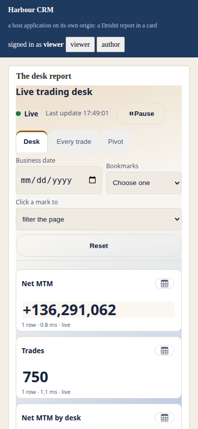
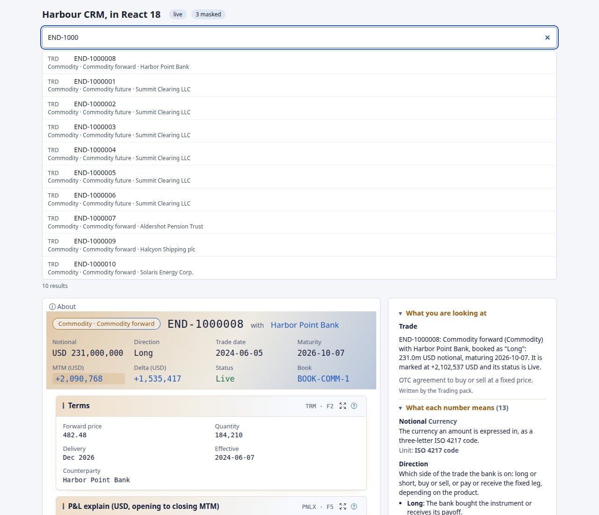

<!--
  Project Drishti · Any data. Any domain. One grammar.

  Copyright (c) 2026 Ashutosh Sinha <ajsinha@gmail.com>.
  All rights reserved.

  PROPRIETARY AND CONFIDENTIAL.

  This file is the confidential and proprietary property of Ashutosh Sinha.
  Unauthorised copying, use, modification, distribution or disclosure of this
  file, via any medium, is strictly prohibited except with the express prior
  written permission of the copyright holder.

  See the LICENSE file in the root of this repository for the full terms.
-->

# Embed Drishti in your pages

This guide is for a team that wants Drishti inside **its own web application**: a live view of a trade or a counterparty in a CRM,
a published report in a portal, a search box on an intranet page, or Drishti's grid and chart components in an application of its
own. Everything is drawn in your page's DOM, in a Shadow DOM, with **no iframe**: your layout, your theme tokens, your keyboard focus,
one network connection for the whole page, and your user signed in as themselves with every masked field masked.

There are three ways in:

| You want | Use | Chapter |
|---|---|---|
| Drishti views, panels, reports, About and search as tags in your page | **Drishti Elements**: `<drishti-view>`, `<drishti-panel>`, `<drishti-report>`, `<drishti-about>`, `<drishti-search>` | [3](#3-five-minutes-a-static-page) to [5](#5-the-elements-one-by-one) |
| A Drishti screen drawn by one function call, with full control of navigation and live updates | **Drishti Render**: `render(container, source, options)` | [6](#6-drishti-render-one-import-one-call) |
| A grid, a chart or a picker in your own application, with or without a Drishti server | **the Elements libraries** (drishti-core, -grid, -chart, ...) | [13](#13-drishti-elements-libraries-in-your-own-app) and [14](#14-moving-an-ag-grid-enterprise-pivot-app) |

What each screen contains is the **ViewModel**, the server's JSON of a screen already laid out and bound: its reference is
[VIEWMODEL.md](../architecture/VIEWMODEL.md). How the renderer and the elements are built is
[ARCHITECTURE.md](../architecture/ARCHITECTURE.md) (section 30). The API of every Elements library is [ELEMENTS_API.md](ELEMENTS_API.md).

## Contents

1. [What you need](#1-what-you-need)
2. [Turn embedding on and register your application](#2-turn-embedding-on-and-register-your-application)
3. [Five minutes: a static page](#3-five-minutes-a-static-page)
4. [How a user gets in](#4-how-a-user-gets-in)
5. [The elements, one by one](#5-the-elements-one-by-one)
6. [Drishti Render: one import, one call](#6-drishti-render-one-import-one-call)
7. [React, Angular and Vue](#7-react-angular-and-vue)
8. [Theming and sizing](#8-theming-and-sizing)
9. [Your page's Content-Security-Policy](#9-your-pages-content-security-policy)
10. [Versions, integrity and lifecycle](#10-versions-integrity-and-lifecycle)
11. [Cookbook](#11-cookbook)
12. [Troubleshooting by code](#12-troubleshooting-by-code)
13. [Drishti Elements libraries in your own app](#13-drishti-elements-libraries-in-your-own-app)
14. [Moving an AG Grid Enterprise pivot app](#14-moving-an-ag-grid-enterprise-pivot-app)

## 1. What you need

- **A Drishti console your users can reach.** The console serves the library and the embed API; the library loads nothing from a CDN,
  ever (ECharts, the map shapes and the icon font come from the console too).
- **Embedding switched on** and **your application registered** (chapter 2). Inside Drishti's own console nothing needs registering.
- **A way to say who the user is:** your backend exchanges its user for a short-lived token (the default), or, for a page with no
  backend, the person signs in through single sign-on in a small window ([4.2](#42-a-page-without-a-backend-the-sign-in-window)).
- **An evergreen browser:** Custom Elements v1, Shadow DOM, constructable style sheets, `ReadableStream` and `AbortController`. No
  polyfills.

What the elements do not do: they are a read-only window. No layout mode, no saved Pivot arrangement, no share, comments, alerts, pins,
Calc, Ask, raw JSON drawer or export; the view shows the Sutra's layout, never a person's own arrangement, so you can rely on what it
looks like.

## 2. Turn embedding on and register your application

### 2.1 Switch embedding on

Embedding is **off by default**. The server needs `drishti.embed.enabled=true` with `drishti.security.enabled=true`, and the console
`embed.enabled=true`; with them off there is no token endpoint and every embed token is refused. The sign-in window for pages without a
backend also needs single sign-on (`auth.oidc` on the console, `drishti.security.oidc` on the server) and is on by default
(`embed.sign_in.enabled`, `drishti.embed.sign-in-window`). Every key, its default and its environment variable are in
[CONFIGURATION.md](../admin/CONFIGURATION.md#console-embed--the-consoles-side-of-embedded-views) (the console's `embed`) and
[CONFIGURATION.md](../admin/CONFIGURATION.md#drishtiembed--embedded-views-for-other-web-applications) (the server's `drishti.embed`).

### 2.2 Register a host application

An administrator registers each application in **Admin → Embedding** (`/admin/embedding`) or with
`POST /api/v1/admin/embed/apps` ([USER_MANAGEMENT.md](../admin/USER_MANAGEMENT.md#embedding-host-applications), which also describes
the page, rotating a secret, disabling and the audit events). What a registration holds:

| Field | Example | Meaning |
|---|---|---|
| Id | `crm` | lower-case; appears in tokens (`azp`) and in the access log as `embed:crm` |
| Name, contact | *Client CRM*, `crm-team@bank.example` | shown in the access log |
| Origins | `https://crm.bank.example` | **exact** origins (scheme, host, port; no path); no wildcards unless `drishti.embed.allow-wildcard-origins` allows a suffix for review apps |
| Client authentication | a client secret (shown **once**), a public key (JWKS JSON or URL), or both | how your backend proves it is your backend; a public key (`private_key_jwt`, RSA or ECDSA) is recommended in production |
| Scopes | `embed:view`, `embed:about`, `embed:report`, `embed:search` | views and panels; the About text and `<drishti-about>`; BI reports; `<drishti-search>` |
| Kinds and reports | `trade, counterparty`, `report:file:report:trades-overview`, `report:*` | what it may show; empty: everything the user's roles open. An application may narrow its users' rights, never widen them |
| Token lifetime | 300 s | at most `drishti.embed.token-max-seconds` |
| Rates | `callsPerMinute` per application, `userCallsPerMinute` per user | over them: `429 DRS-8004` with `Retry-After` |
| Enabled | yes | off stops the application at the next call |

Applications can also be declared in the server's configuration (`drishti.embed.apps`, for GitOps); the page shows them read-only.

### 2.3 The CORS allow-list

The registered origins **are** the allow-list; there is no second list to keep. The console answers CORS only on its embed paths, echoes
your `Origin` only when it is a registered one (`Vary: Origin`), never sends `Access-Control-Allow-Credentials` (no cookie is ever
used), and allows the headers `Authorization`, `Content-Type`, `Drishti-Embed-Api`, `X-Drishti-As-Of` and `X-Drishti-Known-At`, methods
`GET` and `POST`. The console's own cookie routes never answer CORS. A request from an origin that is not registered gets `DRS-8002`.

## 3. Five minutes: a static page

1. **Switch embedding on** and **register your application** (chapter 2), with your page's exact origin and the scopes you need.
2. **Give your backend a token route** that exchanges its signed-in user for an embed token ([4.1](#41-the-token-exchange)).
3. **Add one script line, a token provider and an element:**

```html
<script type="module" src="https://drishti.bank.example/embed/v1/elements/1.4.5/drishti-elements.js" crossorigin="anonymous"></script>
<script type="module">
  DrishtiElements.configure({
    tokenProvider: async () => {                      // your backend, not Drishti: it holds your client secret
      const r = await fetch('/api/drishti-token', { cache: 'no-store' });
      const b = await r.json();
      return { token: b.token, expiresAt: Date.now() + b.expiresIn * 1000 };
    }
  });
</script>

<drishti-view kind="trade" entity="MX-20000001" theme="light"></drishti-view>
```

That is all of it. `server` defaults to the origin the module was loaded from (the console), and several elements on a page share one
connection.

**Two lines of elements.** Elements **1.x** (version 1.4.5, under `/embed/v1/`) is the line above and carries all five tags. Elements
**2.x** (under `/embed/v2/`) draws `<drishti-view>` and `<drishti-panel>` with Drishti Render from the ViewModel, adds `<drishti-screen>`
(an alias of `<drishti-view>`), and keeps 1.x's attributes, events, slots and token provider. The same page on 2.x changes one line:

```html
<script type="module" src="https://drishti.bank.example/embed/v2/elements/2/drishti-elements.js" crossorigin="anonymous"></script>
<script type="module">
  DrishtiElements.configure({ tokenProvider: async () => { const r = await fetch('/api/drishti-token', { cache: 'no-store' });
    const b = await r.json(); return { token: b.token, expiresAt: Date.now() + b.expiresIn * 1000 }; } });
</script>
<drishti-view kind="trade" entity="MX-20000001" theme="light"></drishti-view>
```

A page uses one major or the other ([5.2](#52-elements-2x-drawn-by-the-renderer)).

**A working host to copy.** `tools/elements-demo` in the repository is a complete host application with its own sign-in, a backend doing
the token exchange, a search box, a recent list, an as-of picker and a report page, served under a strict policy
(`python3 tools/elements-demo/server.py --help`; `/?elements=2` runs the same page on Elements 2.x, `/?tt=1` also enforces Trusted
Types).

## 4. How a user gets in

Drishti never sees your user's password and your page never sees your secret. Whichever way the token comes, the server checks it on
**every call** (signature, audience, expiry, the application, the user, the origin, the scope and kind or report, the rates) and then
acts as that user, with their roles as they are now and with every field mask applied whatever their roles say.

| `auth` | Who vouches for the person | Use it for |
|---|---|---|
| `'token'` (the default when you give `token` / a `tokenProvider`) | your backend, by the token exchange | a portal, a CRM, any application with a server |
| `'popup'` | the bank's single sign-on, in one small window the person opens with a click | a page with no backend |
| `'session'` (the default otherwise) | the console's own sign-in cookie | the console's pages, a same-origin proxy |

### 4.1 The token exchange

Your **backend** exchanges *its* credentials and *who the user is* for a **short-lived, read-only embed token** (RFC 8693,
`POST /api/v1/embed/token` on the server) and hands the token to its own page. The request (form encoded; client authentication by
`Authorization: Basic base64(id:secret)` or by a signed client assertion, `private_key_jwt`):

```
POST /api/v1/embed/token
grant_type=urn:ietf:params:oauth:grant-type:token-exchange
subject_token=<an assertion your backend signs about the user, or the user's OIDC ID token>
subject_token_type=urn:ietf:params:oauth:token-type:jwt        (or ...:id_token)
audience=https://drishti.bank.example                           (the console's public URL)
scope=embed:report                                              (within the application's own scopes)
```

and the answer is `{"access_token": "<JWT>", "token_type": "Bearer", "expires_in": 300, "scope": "embed:report"}`. The field-by-field
reference, the claims and the refusals are in [API_REFERENCE.md](API_REFERENCE.md).

**Saying who the user is.** Either the user's **ID token** from the identity provider both applications use (needs single sign-on on
the server), or a **JWT your backend signs** about its user with its registered key (`sub`, `iat`, `exp` at most 60 s ahead, a `jti`
never used before; RS256/384/512 or ES256/384). There is no plain "username" field: a stolen client secret alone cannot make anyone
anyone. The user must already exist in Drishti and be enabled.

The backend of the demo host (Python, the standard library only, the assertion signed with RS256) is `tools/elements-demo/server.py`, the
`mint` method. The same exchange in other languages:

```javascript
// Node (an Express route; fetch is built in)
app.get('/api/drishti-token', async (req, res) => {
  const user = req.session.user;                       // who is signed in to YOUR application
  const now = Math.floor(Date.now() / 1000);
  const assertion = signJwt({ iss: 'crm', sub: user, aud: DRISHTI + '/api/v1/embed/token', iat: now, exp: now + 60, jti: crypto.randomUUID() }, MY_PRIVATE_KEY);
  const r = await fetch(DRISHTI + '/api/v1/embed/token', {
    method: 'POST', headers: { Authorization: 'Basic ' + Buffer.from('crm:' + SECRET).toString('base64'), 'Content-Type': 'application/x-www-form-urlencoded' },
    body: new URLSearchParams({ grant_type: 'urn:ietf:params:oauth:grant-type:token-exchange', subject_token: assertion,
      subject_token_type: 'urn:ietf:params:oauth:token-type:jwt', audience: CONSOLE, scope: 'embed:report' }) });
  const t = await r.json();
  res.json({ token: t.access_token, expiresIn: t.expires_in });
});
```

```java
// Java (Spring MVC; java.net.http; signJwt is your JWT library's call)
@GetMapping("/api/drishti-token")
Map<String, Object> token(Principal who) throws Exception {
    long now = Instant.now().getEpochSecond();
    String assertion = signJwt(Map.of("iss", "crm", "sub", who.getName(), "aud", drishti + "/api/v1/embed/token", "iat", now, "exp", now + 60, "jti", UUID.randomUUID().toString()));
    String form = "grant_type=" + enc("urn:ietf:params:oauth:grant-type:token-exchange") + "&subject_token=" + enc(assertion)
        + "&subject_token_type=" + enc("urn:ietf:params:oauth:token-type:jwt") + "&audience=" + enc(console) + "&scope=embed%3Areport";
    HttpResponse<String> r = http.send(HttpRequest.newBuilder(URI.create(drishti + "/api/v1/embed/token"))
        .header("Authorization", "Basic " + Base64.getEncoder().encodeToString(("crm:" + secret).getBytes()))
        .header("Content-Type", "application/x-www-form-urlencoded").POST(BodyPublishers.ofString(form)).build(), BodyHandlers.ofString());
    JsonNode t = json.readTree(r.body());
    return Map.of("token", t.get("access_token").asText(), "expiresIn", t.get("expires_in").asInt());
}
```

**Tokens over time.** A token lives five minutes by default (the application's own setting, never more than
`drishti.embed.token-max-seconds`). The provider may be sync or async and return a string or `{token, expiresAt}` (else the token's own
`exp` counts). The library reuses a token until **60 seconds before it ends** (40 % of its life when that is shorter: a 30 s token is
replaced at 18 s), and asks once more after a `401`. An open live stream is handed the fresh token in place, so nothing redraws and the
connection is not reopened; a stream that gets no fresh token in time ends with `DRS-8001`. If the provider fails or there is none, the
elements say so with `drishti:token-needed` and wait; set `tokenProvider` and an element that failed with a 401 reloads by itself. A
token is never put in a URL, `localStorage`, `sessionStorage` or a cookie. Disabling the application or the user stops their tokens at
the next call (open streams within `embed.recheck_seconds`).

**Masks.** An embed call **always masks**: `drishti.security.redact` fields and a dataset's masked columns read `•••` whatever the
user's roles, so a user with the raw power sees real names in the console and `•••` in your page. `drishti:masked` tells you what was
masked. An embed token never writes.

### 4.2 A page without a backend: the sign-in window

A page that has **no backend of its own** (a static intranet page, a SharePoint page, a team dashboard) cannot run the exchange. It uses
**`auth: 'popup'`**. What the person sees: in place of the screen, a card with the product's name and a **Sign in to see this** button.
Nothing opens by itself. On the click, one small window goes to the single sign-on (already signed in: it opens and closes at once,
nothing to type), and the screen is drawn in place. On a phone the window is a new tab that closes itself; where no window can open (an
embedded webview), the page goes to the sign-in and comes back.

```html
<!-- the renderer: one call (the library from the console's embed path; your page needs no server) -->
<div id="risk"></div>
<script type="module">
  import { render } from 'https://drishti.bank.example/embed/v2/render/2.0.0/drishti-render.js';
  const view = render(document.getElementById('risk'), { kind: 'trade', id: '1000008' },
                      { auth: 'popup', server: 'https://drishti.bank.example' });
  const el = view.container;
  el.addEventListener('drishti:auth-required', (e) => console.log('the button is shown', e.detail.allowed, e.detail.code));
  el.addEventListener('drishti:signed-in', (e) => console.log('signed in as', e.detail.user));
  el.addEventListener('drishti:signed-out', (e) => console.log('signed out:', e.detail.reason));   // expired | refused | host
</script>
```

```html
<!-- Elements 2.x: the same with a tag (every element of the page shares the one sign-in) -->
<script type="module" src="https://drishti.bank.example/embed/v2/elements/2/drishti-elements.js"></script>
<drishti-view auth="popup" kind="trade" entity="1000008"></drishti-view>
<!-- or for the whole page: DrishtiElements.configure({ auth: 'popup' }); DrishtiElements.signOut() signs out -->
```

- **The token** comes back to your page by `postMessage`, sent to your page's **exact origin** and accepted only from the console's own
  window with the random state the page sent: checked both ways. It is kept **in memory only**. A reload asks again (a click; already
  signed in to SSO, nothing to type).
- **Renewal** is silent while the single sign-on session lasts (the provider's refresh token, sealed by the console so the page cannot
  read or change it), shortly before the token ends, at most `embed.sign_in.max_hours`. When it can no longer be renewed:
  `drishti:signed-out` (`reason: 'expired'`) and the button comes back; a view refused with `401` does the same (`reason: 'refused'`).
  `handle.signOut()` (or `DrishtiElements.signOut()`) forgets it (`reason: 'host'`).
- **Only registered pages.** Your page's origin must be one of a host application's origins (chapter 2). Before drawing the button the
  library asks the console (`GET /embed/v2/sign-in/check`, no data, no credentials); any other page gets the button **disabled**, with
  `DRS-8002` and its origin named, and no window. The application's scopes, kinds and token life apply.
- **Take over at any point:** `drishti:auth-required` (`{server, allowed, code, detail}`) tells you the button is shown; call your own
  login and pass the token with `handle.signIn({ token, expiresIn })`. `handle.user` names who signed in; `drishti:signed-in` carries
  `{user, server}`, `drishti:signed-out` `{reason, server}`. An element waiting for the click is in the state `sign-in`.
- **The window's mode:** `signInWindow` (`auto`, the default: a new tab on a phone, a small window elsewhere; or `popup`, `tab`,
  `redirect`). With `redirect` the page goes to the sign-in and comes back with a one-time code in the fragment, taken out of the address
  at once and redeemed within two minutes, for that origin only.
- **What the administrator sets once:** single sign-on on the console and the server, the provider's client allowing the console's
  `…/embed/v2/sign-in/callback` as a redirect URI, and the host application registered
  ([USER_MANAGEMENT.md](../admin/USER_MANAGEMENT.md#the-sign-in-window-for-pages-that-embed-views)). Every sign-in through the window is
  audited as `embed-sign-in-window` with the page's origin, the user, the application and the time.
- **Live frames:** `render()` with `auth: 'popup'` draws the view as it is (`live` off unless you ask, because the console's own stream is
  a session route); `<drishti-view auth="popup">` is live over the page's one channel, as with a token.

### 4.3 Inside Drishti's console

On the console's own origin `auth: 'session'` uses the console's sign-in: nothing to configure. A same-origin reverse proxy in front of
the console works the same way.

## 5. The elements, one by one

| Element | Shows |
|---|---|
| `<drishti-view kind="trade" entity="MX-20000001">` | a live view of one entity: header, key figures, every panel, as the console draws them |
| `<drishti-panel kind="trade" entity="MX-20000001" panel="legs">` | **one panel** of a view, in a card of your own |
| `<drishti-report report="file:report:trades-overview">` | a published **BI report**, one page of it or one visual of it, with its slicers, cross-filter and live updates |
| `<drishti-about kind="trade" entity="MX-20000001">` | the **About this page** layers of a view (where each number comes from, the masks and rules that applied to this reader) in a panel of your own |
| `<drishti-search>` | **search across Drishti** from your page: a box and the entities that match, masked for the signed-in user |

Importing the library defines the elements once; importing twice is harmless.

### 5.1 The reference

Every attribute is reflected to a property of the same name in camelCase (`as-of` is `asOf`). Events are `CustomEvent`s on the element,
`bubbles: true, composed: true`, named `drishti:<name>`. This reference is **generated** from `drishti-console/core/element_api.py`, the
same source as the TypeScript declarations, and a test checks it against the elements, so it cannot drift.

#### `<drishti-view>`

A live Drishti view of one entity.

| Attribute | Type | Meaning |
|---|---|---|
| `server` | `string` | the console's base URL; default: the origin the module was loaded from. Elements sharing a `server` share one connection |
| `kind` | `string` | an entity kind (`trade`, `counterparty`, ...); required |
| `entity` | `string` | the entity id; change it to show another entity (reloads in place); required |
| `as-of` | `string` | `live` (default) or a business date `YYYY-MM-DD` (a past date is a static snapshot) |
| `known-at` | `string` | an ISO instant: bitemporal "as known at" |
| `theme` | `string` | `inherit`, or a Drishti theme: `terminal`, `light` (default), `blue`, `green`, `wallstreet`, `crimson`, `crimson-dark`, `terminal-green`, `terminal-crimson`, `terminal-blue` |
| `density` | `'compact' | 'comfortable'` | row padding of tables |
| `header` | `'full' | 'strip' | 'none'` | title and strip, strip only, or panels only (default `full`; `none` for `<drishti-panel>`) |
| `panels` | `string` | comma-separated panel ids to show (default all) |
| `live` | `'auto' | 'off'` | `off` loads once and never subscribes |
| `label` | `string` | the element's accessible name (`role="region"`); default the view's title |
| `controls` | `string` | the Sutra's controls as `legs=2&when=2026-10-01..2026-12-31` (the `ctl.` prefix is optional) |

| Property | Type | Meaning |
|---|---|---|
| `tokenProvider` | `() => string | { token: string; expiresAt?: number } | Promise<string | { token: string; expiresAt?: number }>` | set on any element: one provider per page (also `DrishtiElements.configure({tokenProvider})`) |
| `state` (read-only) | `'idle' | 'loading' | 'live' | 'static' | 'reconnecting' | 'paused' | 'deleted' | 'error'` | the state machine |
| `view` (read-only) | `{ ref: { kind: string; id: string }; title: unknown; generation: number; provenance: unknown; panels: { id: string; kind: string; title: string }[] } | null` | once loaded |
| `lastError` (read-only) | `{ code: string; status: number; detail: string } | null` | the last error |
| `controls` | `string` | the controls' values now |

| Method | Effect |
|---|---|
| `refresh()` | fetch the view again (same entity), keep the subscription, swap what changed |
| `reload()` | full reload: cancel in-flight requests, drop the subscription, fetch, subscribe |
| `pause()` | give the subscription back (the element also does this itself when hidden) |
| `resume()` | take it again |

| Event (`drishti:`) | `detail` | When |
|---|---|---|
| `controls` | `{ query: string; changed: string[] }` | a reader changed a control |
| `error` | `{ code: string; status: number; detail: string; fatal?: boolean; retryInMs?: number }` | a DRS code; `fatal: false` while the element retries by itself or a single visual failed |
| `loaded` | `{ ref: { kind: string; id: string }; generation: number; title: unknown; live: boolean }` | a view was loaded and painted |
| `masked` | `{ count?: number; panels?: string[]; columns?: string[] }` | what the user is shown has masked fields (a view: count and panels; a report: the columns) |
| `navigate` | `{ kind: string; id: string; href: string; panel?: string; source: 'link' | 'chart' | 'graph' }` | **cancellable**: the user activated a linked entity; not cancelled, the element shows it in place |
| `paint` | `{ ref: { kind: string; id: string }; generation: number }` | the shadow root was rebuilt |
| `state` | `{ state: string; previous: string }` | every state change (drives a host's own live indicator) |
| `tick` | `{ generation: number; seq?: number; latencyMs?: number; changed?: { strip: number[]; panels: string[] }; at?: string }` | live data was applied |
| `token-needed` | `{ reason: 'missing' | 'refused' | 'provider-failed' }` | no token provider, the token was refused twice, or the provider threw: sign the user in again and set `tokenProvider` |

#### `<drishti-panel>`

One panel of a view: `<drishti-view>` with the `panel` attribute and the header off.

| Attribute | Type | Meaning |
|---|---|---|
| `panel` | `string` | the panel id to show (the same as `panels="<id>"`); required |

| Property | Type | Meaning |
|---|---|---|
| `panel` | `string` | the attribute of the same name |

#### `<drishti-report>`

A published BI report, or one page or visual of it, with its slicers, cross-filter and live updates.

| Attribute | Type | Meaning |
|---|---|---|
| `server` | `string` | the console's base URL; default: the origin the module was loaded from |
| `report` | `string` | the id of a **published** report, e.g. `file:report:trades-overview`; required. The host application's `kinds` must list `report:<id>` or `report:*` |
| `page` | `string` | the page to show first (default: the first page that is not a drill-through target) |
| `visual` | `string` | show only this visual (its page is found for you): a card, a chart or a table in a card of the host's own |
| `filters` | `string` | initial filters as JSON: `{"slicers": {"<slicer id>": ["FX"]}, "dates": "2026-10-09", "selections": [{"visual": "by-desk", "field": "trade.DESK", "values": ["FX"]}], "mode": "highlight"}` |
| `chrome` | `'full' | 'bare'` | `full` (default): title, page tabs, business date, bookmarks, filter chips, live bar. `bare`: the visuals only (the default when `visual` is set) |
| `theme` | `string` | as `<drishti-view>` |
| `live` | `'auto' | 'off'` | `off` draws once and never follows the report's live tables |
| `label` | `string` | the element's accessible name |

| Property | Type | Meaning |
|---|---|---|
| `tokenProvider` | `() => string | { token: string; expiresAt?: number } | Promise<string | { token: string; expiresAt?: number }>` | as `<drishti-view>` |
| `state` (read-only) | `'idle' | 'loading' | 'live' | 'static' | 'stale' | 'failed' | 'reconnecting' | 'paused' | 'error'` | the state machine |
| `page` | `string` | the page shown (assign to change it) |
| `filters` | `{ page?: string; slicers?: Record<string, unknown>; dates?: string | { from?: string; to?: string } | null; selections?: { visual: string; field: string; values: unknown[] }[]; carry?: unknown[]; mode?: 'filter' | 'highlight' }` | the filters in force; assign the same shape to set them (anything left out is cleared) |
| `lastError` (read-only) | `{ code: string; status: number; detail: string } | null` | the last error |

| Method | Effect |
|---|---|
| `reload()` | full reload: fetch the report again and redraw |
| `refresh()` | ask every visual again, quietly |
| `selectPage(id` | show another page (its filters are cleared, as when a reader clicks the tab) |
| `clearFilters()` | clear slicers, selections and the date (the Reset button) |
| `pause()` | give the live stream back |
| `resume()` | take it again |

| Event (`drishti:`) | `detail` | When |
|---|---|---|
| `error` | `{ code: string; status: number; detail: string; fatal?: boolean; retryInMs?: number }` | a DRS code; `fatal: false` while the element retries by itself or a single visual failed |
| `filter-changed` | `{ page: string; slicers: Record<string, unknown>; dates: unknown; selections: { visual: string; field: string; values: unknown[] }[]; carry: unknown[]; mode: string; source: 'user' | 'api' }` | a reader (or the host, `source: 'api'`) changed a slicer, a selection, the date or the page |
| `loaded` | `{ report: string; title: string; page: string; visuals: string[]; live: boolean }` | the report was drawn (every visual of the first page has answered or failed) |
| `masked` | `{ count?: number; panels?: string[]; columns?: string[] }` | what the user is shown has masked fields (a view: count and panels; a report: the columns) |
| `page-changed` | `{ page: string; title: string; visuals: string[]; phone: boolean }` | a page was drawn (first draw, a tab, `selectPage`, or a swap to or from the phone layout) |
| `state` | `{ state: string; previous: string }` | every state change (drives a host's own live indicator) |
| `tick` | `{ generation: number; seq?: number; latencyMs?: number; changed?: { strip: number[]; panels: string[] }; at?: string }` | live data was applied |
| `token-needed` | `{ reason: 'missing' | 'refused' | 'provider-failed' }` | no token provider, the token was refused twice, or the provider threw: sign the user in again and set `tokenProvider` |

#### `<drishti-about>`

The "About this page" layers of one view (sources, lineage, the masks and rules that applied to this reader) in a panel of the host's own.

| Attribute | Type | Meaning |
|---|---|---|
| `server` | `string` | the console's base URL; default: the origin the module was loaded from |
| `kind` | `string` | an entity kind (`trade`, `counterparty`, ...); required |
| `entity` | `string` | the entity id; change it to show another entity's About; required |
| `theme` | `string` | as `<drishti-view>` |
| `label` | `string` | the element's accessible name (default `About this page`) |

| Property | Type | Meaning |
|---|---|---|
| `tokenProvider` | `() => string | { token: string; expiresAt?: number } | Promise<string | { token: string; expiresAt?: number }>` | as `<drishti-view>` (the application's scopes must include `embed:about`) |
| `state` (read-only) | `'idle' | 'loading' | 'loaded' | 'error'` | the state machine |
| `lastError` (read-only) | `{ code: string; status: number; detail: string } | null` | the last error |

| Method | Effect |
|---|---|
| `reload()` | ask the console for the About body again |

| Event (`drishti:`) | `detail` | When |
|---|---|---|
| `error` | `{ code: string; status: number; detail: string; fatal?: boolean; retryInMs?: number }` | a DRS code; `fatal: false` while the element retries by itself or a single visual failed |
| `loaded` | `{ kind: string; entity: string }` | the About body was drawn |
| `state` | `{ state: string; previous: string }` | every state change (drives a host's own live indicator) |
| `token-needed` | `{ reason: 'missing' | 'refused' | 'provider-failed' }` | no token provider, the token was refused twice, or the provider threw: sign the user in again and set `tokenProvider` |

#### `<drishti-search>`

Search across Drishti from a host page: a box and the entities that match, masked for the signed-in user.

| Attribute | Type | Meaning |
|---|---|---|
| `server` | `string` | the console's base URL; default: the origin the module was loaded from |
| `theme` | `string` | as `<drishti-view>` |
| `placeholder` | `string` | the box's placeholder (default `Search`) |
| `label` | `string` | the box's accessible name (default the placeholder) |
| `limit` | `number` | most results asked for (1 to 50, default 10; the server caps it at `drishti.embed.search.max-results`) |
| `min-chars` | `number` | shortest query searched (default 2) |
| `delay` | `number` | milliseconds of quiet after the last key before a search is made (default 250) |
| `target` | `string` | a CSS selector of a `<drishti-view>` or `<drishti-panel>`: picking a result points it at that entity (unless `drishti:select` is cancelled) |

| Property | Type | Meaning |
|---|---|---|
| `tokenProvider` | `() => string | { token: string; expiresAt?: number } | Promise<string | { token: string; expiresAt?: number }>` | as `<drishti-view>` (the application's scopes must include `embed:search`) |
| `value` | `string` | the text in the box (assign to search for it) |
| `results` (read-only) | `{ type: string; kind: string; id: string; mnemonic: string; title: string; subtitle: string }[]` | the results now shown |
| `state` (read-only) | `'idle' | 'loading' | 'error'` | the state machine |
| `lastError` (read-only) | `{ code: string; status: number; detail: string } | null` | the last error |

| Method | Effect |
|---|---|
| `search(q?` | search now (the box shows `q`); resolves with the results |
| `clear(box?` | empty the list, and the box unless `box` is false |

| Event (`drishti:`) | `detail` | When |
|---|---|---|
| `error` | `{ code: string; status: number; detail: string; fatal?: boolean; retryInMs?: number }` | a DRS code; `fatal: false` while the element retries by itself or a single visual failed |
| `results` | `{ query: string; results: { kind: string; id: string; mnemonic: string; title: string; subtitle: string }[] }` | a search answered |
| `select` | `{ kind: string; id: string; mnemonic: string; title: string; type: string }` | **cancellable**: the user picked a result; not cancelled, the `target` view (if any) is pointed at it |
| `state` | `{ state: string; previous: string }` | every state change (drives a host's own live indicator) |
| `token-needed` | `{ reason: 'missing' | 'refused' | 'provider-failed' }` | no token provider, the token was refused twice, or the provider threw: sign the user in again and set `tokenProvider` |

**The page object, `DrishtiElements`** (one per page): `configure({ server, tokenProvider, auth })` (or `element.tokenProvider = fn`),
`resolve(text)` (a typed command such as `TRD MX-20000001` to `{ref: {kind, id}, mnemonic, title}`, for your own search box),
`invalidateToken()` (your user changed: the next call asks the provider again; a token for another user closes the connection and every
element reloads), `connections()` (how many live connections the page holds: one per console), `signOut()` and `version`.

**Slots** (`<drishti-view>`, `<drishti-panel>`):

| Slot | Shown | Default |
|---|---|---|
| `loading` | while loading and no view has been painted yet | nothing (the element dims the view it has, while it reloads) |
| `empty` | no `kind`/`entity` yet (state `idle`) | nothing |
| `error` | an error with no view to keep | the DRS code and detail (`role="alert"`); with a slotted node, your content replaces it, and `drishti:error` still fires |

**Keyboard.** Shortcuts work **only while the focus is inside the element** (never on your `document`): `?` opens About, `Esc` closes
it, `Z` zooms the focused panel to the element's own box (`Esc` restores; `Shift+Z` asks for full screen), `Alt+1..9` move between
panels, and the table keys work inside a table. The console's global keys (`F1`, the command line, workspace panes, layout mode) are not
bound.

**Loading, live and reconnecting.** An element loads when it has both `kind` and `entity`; attribute changes in one task are coalesced
into one load, and an attribute changed mid-load aborts that load, so only the latest answer is ever painted. A live element applies
each tick in place (strip cells, whole panels, chart data), keeping scroll, selection, focus and zoom; it repaints (`drishti:paint`) only
on the first load, an attribute change, `refresh()` or `reload()`, the entity coming back after a deletion, or Retry after an error.
`refresh()` keeps a table's sort, page and filter where the panel did not change. When the connection drops, every live element goes to
`reconnecting` and keeps showing what it has; the connection retries with back-off (2 s doubling to 30 s, with jitter) and each element
fetches a fresh view when it is back. An element **pauses** when the page has been hidden, or the element off-screen, for 10 s: it
gives its subscription back and, on return, fetches a fresh view and subscribes again. A deleted entity greys the view under a banner.

### 5.2 Elements 2.x: drawn by the renderer

Elements 2.x keeps the 1.x element API for `<drishti-view>` and `<drishti-panel>` and draws them with Drishti Render from the ViewModel
the embed API v2 answers as JSON. What you get on top of 1.x:

- **`navigation`**: unset, a link changes `kind` and `entity` as in 1.x; `in-place` draws the linked entity in the element with a Back
  bar ("← Back to IRS-48213", Alt+← returns); `host` sends only the event.
- **`auth="popup"`** and `DrishtiElements.configure({ auth: 'popup' })` ([4.2](#42-a-page-without-a-backend-the-sign-in-window)), with the
  element state `sign-in` until the person signs in.
- **The console's behaviours inside the element**: per-column filter funnels, Chart any table, drill-downs in place, the nested pivot as
  a tree grid, zoom and the Sutra's controls. About this page is a side sheet inside the element (the `?` key or the head's About
  button).
- **`element.handle`**, the renderer's handle ([6.2](#62-sources-and-the-handle)), and the renderer's events beside 1.x's: `drishti:about`,
  `drishti:panel`, `drishti:row-click` and `drishti:select`.
- **`<drishti-screen>`**, an alias of `<drishti-view>`.

`<drishti-report>`, `<drishti-about>` and `<drishti-search>` are 1.x elements. `DrishtiElements.version` names the Elements version and
`renderer`, `contracts` and `api` the rest. A host that enforces Trusted Types names `drishti-render` beside `drishti-elements`.

### 5.3 `<drishti-report>`: a published report

A **published** report, one **page** of it or one **visual** of it, drawn with the console viewer's own code: the page tabs, the
slicers, the business date, bookmarks, *click a mark to filter or highlight*, **cross-filtering** between the visuals, *show as a
table*, and, for a report over a live table, a live bar and redraws as the data ticks (each tick asks the visuals again, as the person
looking, so their row rules and masks apply to every update). Not in the element: drill down and through, *Alert me*, *Show the rows
behind this visual*, Export and Subscribe, creating bookmarks, and cross-filtering **between** two elements. A `perspective-*` visual is
drawn as in the viewer, Drishti's own grid of the server's answer (no element loads WebAssembly). How reports are made and published:
[REPORTS_GUIDE.md](REPORTS_GUIDE.md).

```html
<drishti-report id="rep" report="file:report:live-trading-desk"
  filters='{"selections":[{"visual":"by-desk","field":"trade.DESK","values":["DESK-RATES"]}]}'></drishti-report>
<drishti-report report="file:report:live-trading-desk" visual="by-desk" chrome="bare"></drishti-report>
```

**`filters`** is the initial state as JSON (and the property reads and sets the same shape): `slicers` (a slicer visual's id to the
values it selects, or `{from, to}` for a range), `dates` (`"2026-10-09"` or `{from, to}`: the business date), `selections` (the marks
"clicked": `{visual, field, values}`), `carry` (values carried by a drill-through) and `mode` (`filter` or `highlight`). Anything left
out is cleared. Assigning it does what a click would: the visuals ask again, and `drishti:filter-changed` comes back with
`source: "api"`.

**`chrome`**: `full` (default) shows the title, page tabs, business date, bookmarks, the filter chips, Reset and the live bar; `bare`
shows the visuals only. With `visual` set the element is that one visual, found on whichever page holds it, in a card, and the chrome
is off.

**What the host hears** (captured from a real page, the demo host with the *Live trading desk* report; the last two are the report
telling its host which columns it masked and what a click selected):

```
page-changed rep  {"page":"desk","title":"Desk","visuals":["trades","notional","mtm","losses","pnl","by-desk","rolling","movers","latest"],"phone":false}
loaded       rep  {"title":"Live trading desk","page":"desk"}
masked       rep  {"columns":["trade.trader"]}
filter-changed rep {"page":"desk","slicers":{},"dates":null,"selections":[{"visual":"by-desk","field":"trade.DESK","values":["DESK-RATES"]}],"carry":[],"mode":"filter","source":"user"}
```

**Masks.** As every embed call ([4.1](#41-the-token-exchange)): the user's trader column reads `•••` in your card and the real name in
the console. `drishti:masked` lists the columns.

**Which reports a host may show.** The host application's **kinds and reports** list (chapter 2): `report:file:report:live-trading-desk`
allows one report, `report:*` every report; a host whose list holds only entity kinds may show none; an empty list means everything the
user's roles open. The application needs the scope `embed:report`, and only a **published** report is embedded. A refusal is `DRS-8005`
(`drishti:error`, `fatal: true`, the element shows the code). An embed token may never call a report's authoring paths (`DRS-5002`).

**Many visuals.** The query engine's per-person limit (three at a time) applies; the element asks its visuals three at a time and
retries a `429` by itself.

**On a phone.** The element measures **its own width**: at 640 px or narrower it draws the report's `layouts.phone` for the page when the
report has one ([REPORTS_GUIDE.md](REPORTS_GUIDE.md)), else the automatic single column, and swaps back as it grows, with no reload. A
hidden visual is not queried. `drishti:page-changed` carries `phone: true` when the arranged page is on screen.



**Images.** A report's `image` visual loads its `src` as your page's `img-src` allows; a host that allows none shows the alt text.

### 5.4 `<drishti-about>` and `<drishti-search>`

Two small elements for a host page that has its own layout around a view.

**`<drishti-about>`** is the *About this page* body of a view without the view: where each number comes from (the sources, the lineage,
the layers), what is masked for **this** reader and why, and the rules that applied. It is the same body the console's own drawer shows,
without the *Ask* layer and the Discussion tab, drawn in a Shadow DOM; its links open in a new tab on the console. The application needs
the scope `embed:about`. Point it at the same entity as a view and put it where your page has room:

```html
<drishti-view id="v" kind="trade" entity="MX-20000001"></drishti-view>
<drishti-about kind="trade" entity="MX-20000001" label="Where these numbers come from"></drishti-about>
```

**`<drishti-search>`** is a search box and a short list of what matches, the console's own type-ahead for the signed-in user: kinds they
may not open are left out, fields masked for them (and every field `drishti.security.redact` names) are neither shown nor matched, and
the list is cut to the kinds the host application may show. The application needs the scope **`embed:search`**. A search reads and
writes nothing and is rate-limited per user and application (`drishti.embed.limits.searches-per-user-per-minute`, on top of the call
rates; `DRS-8004` with `Retry-After`). A query shorter than `drishti.embed.search.min-chars` is not searched; at most
`drishti.embed.search.max-results` results come back. Results are 44 px targets and everything is drawn as text. Picking one fires the
cancellable `drishti:select`; with `target="#v"` the element also points that `<drishti-view>` at the pick:

```html
<drishti-search placeholder="Find a trade or counterparty" target="#v"></drishti-search>
<drishti-view id="v" kind="trade" entity="MX-20000001"></drishti-view>
<script type="module">
  document.querySelector('drishti-search').addEventListener('drishti:select', (e) => {
    // e.detail = { kind: 'trade', id: 'MX-20000001', mnemonic: 'TRD', title: 'MX-20000001', type: 'entity' }
    e.preventDefault();                       // take it over yourself instead of letting `target` follow
    openInMyApp(e.detail.kind, e.detail.id);
  });
</script>
```

## 6. Drishti Render: one import, one call

Drishti Render paints a Drishti screen in the browser from the server's ViewModel. It is plain ES modules with no build step, served by
the console under a versioned path, with the vendored ECharts and nothing from a CDN. The screen draws inside your container, in a
Shadow DOM, follows live updates, and navigates **in place** with its own back stack. Elements 2.x is built on it.

### 6.1 The quick start

```html
<div id="risk"></div>
<script type="module">
  import { render } from 'https://drishti.bank.example/static/render/2.0.0/drishti-render.js';
  const view = render(document.getElementById('risk'), { kind: 'trade', id: 'IRS-48213' }, { behaviours: 'console', about: true });
  view.container.addEventListener('drishti:navigate', (e) => console.log('opened', e.detail.kind, e.detail.id));
</script>
```

or the tag `<drishti-screen kind="trade" entity="IRS-48213" theme="crimson-dark"></drishti-screen>` after the same import. On the
console's own origin (or a same-origin proxy) this runs as the person signed in to the console. **Another origin** imports
`/embed/v2/render/2.0.0/drishti-render.js` and gives a `token` provider ([4.1](#41-the-token-exchange)) or `auth: 'popup'`
([4.2](#42-a-page-without-a-backend-the-sign-in-window)).

**Defaults for everything.** A call with no options draws in a Shadow DOM with the library's own sheet, in the theme your custom
properties give it (`--d-*` on the container, or the default), follows the view live when the server says it is live, opens links **in
place** with a back stack, and reads as the person signed in to the console or with your token. Every option only overrides.

**Typed.** `drishti-render.d.ts` beside the entry declares every option, method, event and the ViewModel's shape.

### 6.2 Sources and the handle

```js
const view = render(container, source, options);   // returns at once; view.ready settles after the first paint
await view.ready;
view.patch(frame);              // a live frame {seq, generation, patches} (VIEWMODEL.md section 5)
view.apply(message);            // a stream message (6.6)
const stop = view.subscribe();  // follow the view's stream (default: this console's relay), returns stop()
view.subscribe((on) => myChannel.subscribe(key, on));     // your own channel (on.frame, on.view, on.gone); returns stop()
view.navigate({ kind: 'counterparty', id: 'CP-NORTHBRIDGE' });   // as a click would
view.back();  view.depth;       // the in-place back stack
view.setTheme('crimson-dark');  view.reload();  view.dispose();
view.viewModel;                 // the ViewModel shown now, patches applied
view.drawPanel(panelView);  view.drawStrip(cells);  view.drawAbout({ explain, index });   // parts for a host that places them
view.drawCharts(scope);  view.about();                     // charts of what the host placed; the About sheet (about: true)
view.signIn({ token, expiresIn });  view.signOut();  view.user;   // with auth: 'popup' (4.2)
patch(view, frame); subscribe(view, source);         // the same as functions
```

**`source`** is one of: a ViewModel (the JSON of `GET /api/v1/views/{kind}/{id}`); `{kind, id, controls?}` (fetched as the person; controls
travel as `ctl.<id>` parameters, the business date as `X-Drishti-As-Of`); `{stream: url}` (a Server-Sent Events stream of whole views,
frames and stream messages); or an async iterable of stream messages. In a framework, call `dispose()` when the component goes;
`render()` into the same container replaces cleanly.

### 6.3 Options

Every option has a default:

| Option | Default | Meaning |
|---|---|---|
| `shadow` | `true` | draw in a Shadow DOM with the library's sheet; `false` draws in the container and your sheets style it |
| `theme` | `'inherit'` | a console theme (`light`, `terminal`, `blue`, `green`, `crimson`, `crimson-dark`, `wallstreet`, `terminal-blue`, `terminal-green`, `terminal-crimson`) or your custom properties |
| `server` | `''` | the console that serves data and links; `''` is this page's origin |
| `navigation` | `'in-place'` | `'in-place'`, `'host'` (events only), `'new-window'`, or `'follow'` (a link is a link: `drishti:navigate` first, cancel it to stay, then the browser follows it, so Ctrl+click works) ([6.5](#65-navigation-in-place)) |
| `consoleLinks`, `outsideLinks` | `'event'` | a link to a console page (help, designer, connector) or to a page outside Drishti: an event (default), `'follow'` or `'new-window'` |
| `live`, `subscribe` | `true`, off | follow a live view; for a ViewModel source, subscribe at once (`true` or an SSE URL) |
| `token`, `credentials` | none, `same-origin` | a bearer token provider; fetch credentials (`include` with a `server`) |
| `auth`, `signInWindow` | `token` with a token, else `session`; `auto` | how the person gets in ([chapter 4](#4-how-a-user-gets-in)); the sign-in window's mode (`auto`, `popup`, `tab`, `redirect`) |
| `device` | none | `phone`, `tablet` or `desk`, sent as `X-Drishti-Device` |
| `behaviours` | `'library'` | `'library'`: light ones (sorting, one filter box, paging, trees, drills, tabs); `'console'`: the console's own (per-column funnels, Chart any table, the nested-pivot grid, drills in place, zoom, the controls), started inside the container; `'host'`: none but the widths, your page's scripts enhance the DOM |
| `about` | `false` | an About button in the head and `?`: About this page drawn from JSON in a side sheet inside the container |
| `insight` | none | `{ about(ref, generation) }` answers About this page's JSON from your own source instead of `aboutUrl` |
| `designOn` | `false` | "How this view was built" links its Sutra to the designer |
| `viewUrl`, `streamUrl`, `aboutUrl`, `recordsUrl`, `panelsUrl`, `eventSource` | the console's | where the view, its stream, About, a pivot's rows and a control's panels come from, when you proxy the console or need your own EventSource |
| `tables`, `help`, `keys`, `header`, `panels`, `label`, `asOf` | `true`, `true`, `false`, `'full'`, all, the title, live | table behaviours, the `?` help links, the function keys under the view, the head, a subset of panels, the region's name, the as-of banners |

### 6.4 Events

On the container; they bubble, cross the shadow boundary and are cancelable where you may take over:

| Event | Detail | Cancel to |
|---|---|---|
| `drishti:navigate` | `{target: 'entity'\|'console'\|'outside', kind, id, href, panel, source: 'link'\|'chart'\|'key'\|'api', navigation}` | route it yourself (the renderer does nothing) |
| `drishti:row-click` | `{panel, event, row, pick, cells}` for a row or bar that carries an event | keep the row unselected |
| `drishti:select` | `{panel, control, value}` for a row that sets a control | |
| `drishti:paint`, `drishti:loaded`, `drishti:ready` | the reference, generation, back-stack depth; `ready` when a streamed screen is complete | |
| `drishti:tick`, `drishti:deleted`, `drishti:restored` | what a live frame changed | |
| `drishti:error` | `{code, detail, fix, status}` | |
| `drishti:pivot`, `drishti:key` | a Pivot opened; a function key with no in-place action | draw it yourself |
| `drishti:panel`, `drishti:about` | a panel replaced by a live frame `{panel, element}`; the About sheet opened `{open, ref}` | |
| `drishti:auth-required`, `drishti:signed-in`, `drishti:signed-out` | the sign-in window ([4.2](#42-a-page-without-a-backend-the-sign-in-window)) | |

### 6.5 Navigation in place

Nothing opens a new window or leaves your page unless you want it:

| Mode (`navigation`) | An entity link, a chart point, a map place, a link key | Your page |
|---|---|---|
| `'in-place'` (default) | `drishti:navigate` first; if not cancelled, the entity's view is fetched and drawn **in the same container**, the previous screen pushed on the renderer's back stack; a Back bar ("← Back to IRS-48213") and Alt+← return | never navigates, its address never changes |
| `'host'` | only `drishti:navigate`: you route it (your own router, a deep link, another container) | as you decide |
| `'new-window'` | `drishti:navigate`, then a new window | a new window, because you asked |

- **Drill-downs, tree rows, tabs, sorting, sections and folds** happen in place, with no change to your address.
- **Links to console pages** (the `?` help, the designer, a connector's page) and **links outside Drishti** (a bare `https://` value in
  the data) cannot be drawn in place: by default they are only `drishti:navigate` events (`target: 'console'` or `'outside'`); set
  `consoleLinks` / `outsideLinks` to `'follow'` or `'new-window'` to change that.
- **About and detail sheets** render inside the container's shadow root, never over your page.
- In `'in-place'` mode no window is ever opened; the one window the library may open is the sign-in window, and only on the person's
  click.

**Names your page sees.** Everything Drishti adds keeps out of your way: one global (`window.Drishti`; Elements adds `DrishtiElements`
and, for the console's behaviour scripts, `drishtiModules`), custom events `drishti:<what>`, custom elements `drishti-<name>`, storage
keys starting `drishti`, static files named `drishti_<name>`.

### 6.6 Live updates and streamed screens

**Live.** `subscribe()` follows the view's stream; `patch(frame)` applies a live frame exactly as [VIEWMODEL.md](../architecture/VIEWMODEL.md)
section 5 describes: `strip` (the cell rebuilt), `panel` (the panel rebuilt and re-enhanced, its grid place, phone order, tab state and
fold kept; charts redrawn), `provenance` (the banners rebuilt), `deleted` (the view greyed under a banner, later patches ignored),
`restored` (the view fetched again). An op the renderer does not know is ignored; a patch never changes the screen's structure. A
second whole `view` on the stream (a reconnect, a newer generation) repaints. A host that needs headers on the stream gives
`eventSource(url)`, or hands its own channel with `subscribe(fn)`.

**Streamed screens.** `render()` also takes a screen that arrives panel by panel (`{stream: url}` or an async iterable), through the same
paint and patch: the skeleton is painted at once in its final layout, each stub saying "Loading…", so nothing jumps. The messages (the
SSE event name is the type, or a `type` field on the default `message` event):

| Type | Payload | The renderer |
|---|---|---|
| `skeleton` | `{view}`: a ViewModel whose panels are stubs (`id`, `kind`, `title`, `area`, `span`, `height`, and the layout) | paints the final layout at once, each stub saying "Loading…" (`aria-busy` on the view) |
| `panel-add` | `{panel, after?}` | a panel the skeleton did not announce, after `after` (or at the end of its column) |
| `panel-replace` | `{panel}` | replaces the stub (or an earlier panel) with the bound panel |
| `patch` | `{frame}` | a live frame, as `patch()` |
| `done` | `{provenance?}` | the screen is complete: `aria-busy` cleared, `drishti:ready` |
| `error` | `{code, detail, fix?, panel?}` | a panel that could not bind shows its error; without `panel`, the screen does |

Every link, drill, event and action works on a streamed screen as on any other, because they are in the ViewModel. The end state equals
a one-shot render of the same screen.

**What the renderer draws.** Every panel kind of the ViewModel, its states (waiting, denied, empty, error, computing, stale, failed,
refused), the Sutra's layout grid, and every chart with its Data table, so nothing is only in the picture. The server formats every
value a person reads; the renderer prints the server's text and the server's tones. A kind it does not know becomes a titled panel saying
so. Below 640 px of the **container**, every grid is one column in the phone order, tables scroll inside themselves, nothing scrolls
sideways, and targets are 44 px (also on any coarse pointer).

### 6.7 Errors

Every failure is a `drishti:error` event and, when there is nothing to show, a box in the container with the code, the words and the fix:

| Code | When | The fix it gives |
|---|---|---|
| `DRS-9101` | the container is not an element | Pass a DOM element, e.g. `document.getElementById("risk")` |
| `DRS-9102` | an unknown `navigation` | Leave it out for in-place, the default |
| `DRS-9103` | the source is neither a ViewModel, `{kind, id}`, `{stream}` nor a stream | `render(el, { kind: "trade", id: "IRS-48213" })` |
| `DRS-9104` | a reference without kind or id | the same |
| `DRS-9105` | a ViewModel speaks a contract major the library does not draw | Load the renderer version this server serves |
| `DRS-9106` | an unknown `behaviours` | Leave it out for the library's own, the default |
| `DRS-9107` | `behaviours: 'console'` could not load the console's scripts | Check that the console serves its static scripts, or use `behaviours: 'library'` |
| `DRS-9108` | an unknown `auth` | Leave it out: `token` when you give a token, else the console's session; `popup` for a page without a backend |
| `DRS-5003` | the console could not be reached | Check the server option, the network, and that the console allows this origin (CORS) |
| the server's own (`DRS-1001`, `DRS-5002`, ...) | the view was refused | the server's own `fix` when it gives one, else per code (`DRS-4023`: the edition or lens hides the kind), else per HTTP status: sign in or give a token (401), your role may not open this kind (403), no such entity here (404), retry (502, 504) |

A view refused with `DRS-4023` is no typo: the answer names the edition, or in the console the lens the person is inside ("You are inside
the Drishti World lens, which does not include trades: leave the lens (Views → Leave) or choose an entity it shows").

### 6.8 The playground

Open **`/render/demo`** on your console (signed in). It renders any view you may open, or pasted ViewModel JSON, in every theme and
navigation mode, lists the events the renderer sends, and prints the quick start for what is on screen, ready to copy. It opens on an
entity your server holds and you may open (the first of a common kind, in your lens; `GET /render/demo/start`), says which lens you are
inside, and says why when there is nothing to draw.

## 7. React, Angular and Vue

The library is a function and custom elements, so every framework uses it as it is; no wrapper is needed. Events with a colon
(`drishti:select`) are bound with `addEventListener` in all three, because Vue and Angular read the colon in a template.

**Drishti Render:**

```jsx
// React
import { render } from 'https://drishti.bank.example/static/render/2.0.0/drishti-render.js';
export function Trade({ id }) {
  const ref = useRef(null);
  useEffect(() => { const h = render(ref.current, { kind: 'trade', id }); return () => h.dispose(); }, [id]);
  return <div ref={ref} />;
}
```

```ts
// Angular (CUSTOM_ELEMENTS_SCHEMA in the component)
@Component({ selector: 'app-trade', template: '<drishti-screen kind="trade" [attr.entity]="id"></drishti-screen>', schemas: [CUSTOM_ELEMENTS_SCHEMA] })
export class TradeComponent { @Input() id = 'IRS-48213'; }
// main.ts: import 'https://drishti.bank.example/static/render/2.0.0/drishti-render.js';
```

```vue
<!-- Vue (compilerOptions.isCustomElement: (t) => t.startsWith('drishti-')) -->
<template><drishti-screen kind="trade" :entity="id" /></template>
<script setup>import 'https://drishti.bank.example/static/render/2.0.0/drishti-render.js'; defineProps(['id']);</script>
```

A bundler that refuses URL imports copies the version's folder as it is ([10.4](#104-the-npm-package-layout)).

**The elements.** Set attributes in JSX, bind events with a ref (React 19 passes properties to custom elements; for events use
`addEventListener`):

```jsx
function DeskReport({ onFilter }) {
  const ref = useRef(null);
  useEffect(() => { const el = ref.current; el.addEventListener('drishti:filter-changed', onFilter); return () => el.removeEventListener('drishti:filter-changed', onFilter); }, [onFilter]);
  return <drishti-report ref={ref} report="file:report:live-trading-desk" theme="light" />;
}
```

**Angular** (add `CUSTOM_ELEMENTS_SCHEMA` to the module or component). Angular reads a colon in an event binding as a target
(`window:resize`), so bind these events with `addEventListener`:

```ts
@ViewChild('rep', { static: true }) rep!: ElementRef<HTMLElement>;
ngAfterViewInit() { this.rep.nativeElement.addEventListener('drishti:filter-changed', (e) => this.onFilter(e as CustomEvent)); }
// template: <drishti-report #rep report="file:report:live-trading-desk"></drishti-report>
```

**Vue 3**: `app.config.compilerOptions.isCustomElement = (t) => t.startsWith('drishti-')`, then
`<drishti-report report="file:report:live-trading-desk" @drishti:filter-changed="onFilter" />`.

### 7.1 The sample pages

`docs/guides/examples/embed/` holds one host page for each framework, each embedding `<drishti-search>`, `<drishti-view>`,
`<drishti-about>` and `<drishti-report>`, wired the way that framework wires custom elements: **React 18** (`createElement`, events bound
with a ref, the same in JSX), **Vue 3** (the runtime-only build and render functions, so no `eval`), **Angular 18** (a standalone
component with `CUSTOM_ELEMENTS_SCHEMA`, zoneless). They share `host.js` (the token provider) and `sample.css`, and run against the
elements demo host (`tools/elements-demo/server.py`), which serves them at `/samples/<framework>/` under a strict policy (script-src
`'self'` and the console, no inline script). The samples bind events in `onMounted` / `ngAfterViewInit` / a ref effect.

The framework builds are **not in the repository**. `bash docs/guides/examples/embed/fetch-vendor.sh` downloads the pinned versions once
(React 18.3.1 UMD, Vue 3.5.43 runtime build, Angular 18.2.14 ES modules, RxJS 7.8.2, tslib 2.8.1; all MIT) into
`docs/guides/examples/embed/vendor/` (ignored by git), and the pages load them from there: no CDN, offline afterwards. React 19 has no
UMD build; with a bundler the JSX is the one shown in the comments. Angular has no UMD build either, so its page uses an import map and
Angular's JIT compiler, which needs `'unsafe-eval'` and an inline import map: the demo host relaxes its policy for `/samples/angular/`
only. A real Angular application is compiled ahead of time (`ng build`) and needs neither; the component is the same. The React page,
drawn in Chromium against a real server:



## 8. Theming and sizing

**Custom properties.** The sheets read the console's design tokens, which inherit through the shadow boundary: set them on the element
(or the render container) or any ancestor, and they win over the sheet's defaults. Charts read them when they draw, so a theme change
redraws them.

| Property | Meaning |
|---|---|
| `--d-bg`, `--d-bg-2`, `--d-surface`, `--d-surface-2` | backgrounds: page, alternate, panel, panel header |
| `--d-ink`, `--d-muted`, `--d-faint` | text: main, secondary, hints |
| `--d-border`, `--d-radius`, `--d-shadow` | frame |
| `--d-link`, `--d-accent`, `--d-accent-strong`, `--d-accent-tint`, `--d-on-accent` | links, emphasis |
| `--d-pos`, `--d-neg`, `--d-ok`, `--d-warn`, `--d-bad` | tones (gains, losses, status); charts take their palette from these |
| `--d-emph-bg`, `--d-highlight`, `--d-glow` | emphasised strip cell, live flash |
| `--d-font-sans`, `--d-font-mono` | fonts (your fonts work: the element loads none but its icon font) |

A token not listed is not part of the contract. `theme="inherit"` uses your values with `light` as the fallback; `terminal`, `light`,
`blue`, `green`, `wallstreet`, `crimson`, `crimson-dark`, `terminal-green`, `terminal-crimson` and `terminal-blue` are the console's
own. One override, for example: `#risk { --d-accent: #0b5cad }`.

**Parts** for spacing and borders without reaching into the shadow root: `::part(header)`, `::part(strip)`, `::part(grid)`,
`::part(panel)` (views) and `::part(report)`, `::part(tabs)`, `::part(chips)`, `::part(grid)` (reports). The panels' inner HTML is not a
contract: style it only through the custom properties and parts.

**Sizing.** Every element is `display: block`, as wide as its container, as tall as its content; give it a width the way you give any
block one (a grid cell, a flex item with `min-width: 0`, a fixed-width column), and `max-height` with `overflow: auto` if you want it to
scroll. Do not make it `display: inline` or shrink-wrapped: it is a **size container** with no intrinsic width of its own. The console's
width breakpoints (1700, 1400, 1100, 1000, 900, 760, 640 and 560 px) apply to **its own width**, not the page's, so an element in a
360 px sidebar of a wide page uses the phone layout (one column, a two-column key-figure strip, wrapped tab heads), and tables scroll
inside their panel and never widen your page. Charts follow the element's size, including your split panes and drawers.

**Touch.** A panel's `?` and a column or field hint open by tap. Where the element is at most 640 px wide, or the pointer is coarse, its
controls are at least 44 by 44 px. The About drawer is a right-hand side drawer sized to the element (at most 420 px) and becomes a
bottom sheet the element's full width at 640 px or narrower.

**Accessibility.** The view's title is an `h1`, every panel an `h3` that labels its section; every chart is `role="img"` with a sentence
and keeps its Data table; every control is a native button or link; tabs move with arrows, Home and End; Esc goes up a drill level;
colour is never the only signal; computing states and the pager are polite live regions, alerts use `role="alert"`, and a streamed screen
is `aria-busy` until it is done.

## 9. Your page's Content-Security-Policy

The elements and the renderer are written for a **strict host policy**: no inline script or style, no `frame-src`, no `'unsafe-inline'`
or `'unsafe-eval'`. A page that names the console in three directives works:

```
Content-Security-Policy: default-src 'self'; script-src 'self' https://drishti.bank.example; style-src 'self'; font-src https://drishti.bank.example;
  connect-src 'self' https://drishti.bank.example; img-src 'self' data:; object-src 'none'; base-uri 'none'
```

`style-src` does not need the console: the style sheets are adopted (`adoptedStyleSheets`), the icon font is added through the
`FontFace` API, charts are drawn inside the shadow root, and DOM is built with `createElement` and `textContent`, never from markup in
the data. A host that enforces **Trusted Types** adds `require-trusted-types-for 'script'; trusted-types drishti-elements drishti-render`
and nothing else (Elements 1.x needs only `drishti-elements`). A report's `image` visual loads its `src` as your `img-src` allows. The
demo host runs under exactly this policy and its tests assert that no violation is reported.

**What you trust.** The shadow roots are **open**: your scripts can read inside them (and your tests can, [11](#11-cookbook)). That is why
an embed call always masks and never writes: a stolen token lets the thief read, for minutes, what the user could read on that host
anyway. Load the library by an exact version with its integrity hash (chapter 10).

## 10. Versions, integrity and lifecycle

### 10.1 Where the library is served

| Path | What | Cache |
|---|---|---|
| `/static/render/<version>/…` | Drishti Render on the console's own origin (the console's pages, same-origin hosts) | as `/static/` |
| `/embed/v2/render/<version>/…` | the same files for other origins, with CORS for the registered origins; a partial version (`2`, `2.0`) answers `302` to the exact one | `immutable`, one year |
| `/embed/v2/elements/<2, 2.3, 2.3.0, 2.2, 2.2.0>/drishti-elements.js` | Elements 2.x by its own version: a `302` to the renderer that carries it (Elements 2.3.0 is carried by renderer 2.0.0, 2.2.0 by renderer 1.2.0; `2` answers the newest) | 60 s |
| `/embed/v2/elements/<library>/…` | the Elements libraries renderer 2.0.0 imports (drishti-core, -grid, -chart, -data, -renderer), allow-listed | revalidated |
| `/embed/v1/elements/1.4.5/drishti-elements.js` | Elements 1.x at its exact version (it imports `./m/<name>.js`, served beside it) | `immutable`, one year |
| `/embed/v1/elements/1/…`, `/embed/v1/elements/1.4/…` | `302` to the exact version, for a host that accepts updates | 60 s |
| `/embed/v1/drishti-elements.js` | Elements 1.x as the console serves it now, revalidated on each load (a host that follows the console) | revalidated |

Served renderer versions: **2.0.0** (the current one, carrying Elements 2.3) and **1.2.0** (frozen, byte for byte, for pages that pinned
it; Elements 2.2). The data routes the library calls (the ViewModel, About, panels, a pivot's rows, the live channel, resolve, search,
reports) are listed in [API_REFERENCE.md](API_REFERENCE.md).

### 10.2 Integrity and SRI

A released version is **immutable**: a version always names **the same bytes**, and a change means a new version. Each version's folder
holds `integrity.json`, the SHA-384 (subresource integrity) of every distributed file; for Elements 1.x it reads
`{"name", "version", "api", "files": {"drishti-elements.js": {"integrity": "sha384-…", "bytes": 2500}, "m/report.js": …}}` and is served
at `/embed/v1/elements/1.4.5/integrity.json`. Put the entry's `integrity` on the script line (SRI needs the exact version, not an alias):

```html
<script type="module" src="https://drishti.bank.example/embed/v2/render/2.0.0/drishti-render.js" integrity="sha384-…" crossorigin="anonymous"></script>
```

Because a module's own imports are not covered by the script's `integrity`, pin the rest with an import map's `integrity` (Chrome 127 and
later) listing the module files of `integrity.json`. The static files are served with `Access-Control-Allow-Origin: *` (public code, no
data), so `crossorigin` and SRI work from any page.

### 10.3 Contracts and lifecycle

Three contracts, all semantic versions:

- **The element and render API** (attributes, properties, methods, events and their `detail`, options, custom properties, parts, slots)
  changes only in a major version of the library.
- **The ViewModel** carries `"contract": "1.0"`; the renderer refuses a major it does not draw (`DRS-9105`)
  ([VIEWMODEL.md](../architecture/VIEWMODEL.md)).
- **The embed API** (`/embed/v1`, `/embed/v2`) changes additively within a major. The element sends `Drishti-Embed-Api: <major>.<minor>`
  and the console answers in the newest compatible shape. A major's end is announced with `Deprecation` and `Sunset` headers and a `Link`
  on every answer (the console's `embed.lifecycle`, one entry per major); from the sunset day its calls are `410 DRS-8006`.

A version this console does not serve answers `410 DRS-8006`, and the answer names the one it serves: after a console upgrade, a page
pinned to an old version tells you to move the pin.

**Moving from renderer 1.2.0 to 2.0.0.** Change the version in the import (`/static/render/2.0.0/drishti-render.js`, or
`/embed/v2/render/2.0.0/…`); the API, the options, the events, the Elements attributes and the ViewModel contract are the same. What
you may see: the nested pivot in `behaviours: 'console'` is drishti-grid's tree grid (its own headings, keyboard and density, the grand
total as a last row), a tree table keeps drishti-grid's own filter box, a figure exactly on a half rounds up, tooltips escape every
value, and the option `insight` is new. A host that bundled 1.2.0's `m/` files bundles
`static/elements/drishti-renderer/src/` and the four libraries it imports instead.

**Moving from Elements 1.x to 2.x.** Change the script line ([chapter 3](#3-five-minutes-a-static-page)); the token exchange, the
attributes, the events and the slots are the same. Keep `<drishti-report>`, `<drishti-about>` and `<drishti-search>` pages on 1.x.

### 10.4 The npm package layout

Drishti Render's version folder is also laid out as an npm package, `@drishti/render`, for a host that bundles it (it is not published to
any public registry): `drishti-render.js`, `drishti-elements.js`, the modules, `drishti-render.css`, `drishti-render.d.ts`,
`integrity.json`, plus `package.json` (`"type": "module"`, `"exports": {".": "./drishti-render.js", "./elements": "./drishti-elements.js",
"./drishti-render.css": ...}`, `"types": "./drishti-render.d.ts"`) and the licence. The bytes are the same as `/embed/v2/render/<version>/`.
A host that bundles it must also serve the console's `js/`, `vendor/` and `css/` files beside it, or set `server` so the library loads
them from the console.

Elements 1.x has no npm package: it is frozen and served from the console. The Elements libraries have their own packages,
`@drishti/elements-<name>` ([13.1](#131-install)).

## 11. Cookbook

**Master and detail: a list drives `entity`.** Set the attribute; the element reloads in place and cancels the request it was making.

```js
list.addEventListener('click', (e) => { main.setAttribute('entity', e.target.dataset.id); });
```

**Keep navigation in your application.** A linked entity inside a view fires a cancellable `drishti:navigate`; cancel it and take the
user where you like, or let it through and the element shows the entity in place.

```js
main.addEventListener('drishti:navigate', (e) => { e.preventDefault(); router.go('/trades/' + e.detail.id); });
```

**Keep counterparties in your CRM, trades in the element.**

```js
v.addEventListener('drishti:navigate', (e) => {
  if (e.detail.kind === 'counterparty') { e.preventDefault(); location.href = '/clients/' + e.detail.id; }
});
```

**Your own search box.** `DrishtiElements.resolve('TRD MX-20000001')` returns `{ref: {kind, id}}` for a typed command (`TRD MX-20000001`,
`CPTY CP-1042` or a bare id); set `kind` and `entity` from it. A resolved command is not added to the user's command history.

**A live indicator of your own.** `drishti:state` fires on every change (`loading`, `live`, `reconnecting`, `paused`, `error`, and for a
report `stale` or `failed`): bind it to your page's own badge. `drishti:tick` says a live update was applied.

**Two elements side by side, one connection.** Elements with the same `server` share one stream; `DrishtiElements.connections()` is `1`
however many there are, and two elements on the same entity share one subscription. (Twenty elements on ten entities on one page: one
channel stream.)

**A past business date.** `<drishti-view as-of="2026-10-09">` loads a static snapshot (the console's own as-of rule); `as-of="live"` goes
back.

**A dark host.** `theme="inherit"` and your own `--d-bg`, `--d-surface`, `--d-ink` on an ancestor, or `theme="crimson-dark"`.

**One panel in a card.** `<drishti-panel kind="trade" entity="MX-20000001" panel="legs">`: the header is off unless you ask for
`header="strip"`.

**A view built with control values.** `<drishti-view kind="netting-set" entity="NS-NORTH-01" controls="legs=2">`: the element draws the
Sutra's controls inside itself; a reader's change asks the console for only the panels that read it, fires `drishti:controls` and
updates the `controls` property, and never touches your page's address.

**A report in a card, driven by your filters.** Set `filters` when your own control changes; the visuals ask again:

```js
deskPicker.addEventListener('change', () => {
  rep.filters = { selections: [{ visual: 'by-desk', field: 'trade.DESK', values: [deskPicker.value] }] };
});
rep.addEventListener('drishti:filter-changed', (e) => { if (e.detail.source === 'user') { deskPicker.value = (e.detail.selections[0] || { values: [''] }).values[0]; } });
```

**Testing a page that embeds Drishti.** The elements have **open** shadow roots, so a test reaches inside: Playwright's CSS selectors
pierce them (`page.locator('#rep [data-visual="trades"] .bi-card-value')`), and `await expect(el).toHaveAttribute('data-state', 'live')`
waits for the state machine. A report sets `data-ready="yes"` on itself when its first page has drawn.
`drishti-console/tests/test_embed_report_browser.py` is a complete example: a host on its own origin under a strict policy against a
real server.

## 12. Troubleshooting by code

The element puts the code in `drishti:error` (`detail.code`, `status`, `detail`, `fatal`) and shows it in the element when it has nothing
else to show; the renderer's own codes are in [6.7](#67-errors). The full list is in [TROUBLESHOOTING.md](TROUBLESHOOTING.md); the ones
an embedder meets:

| Code | Meaning | What to do |
|---|---|---|
| `DRS-8001` (401) | the embed token is missing, forged, expired or for another audience | check your provider returns a fresh token and the token request's `audience` is the console's public URL; a stream ends with this after `embed.token_grace_seconds` without a renewal |
| `DRS-8002` (403) | this origin is not one of the host application's | register the exact origin (scheme, host, port) in Admin → Embedding; `null` and wildcards are refused unless `drishti.embed.allow-wildcard-origins` |
| `DRS-8003` (403) | the host application is unknown or disabled | it was disabled or deleted in Admin → Embedding |
| `DRS-8004` (429) | over the embed call rate, or the console holds `embed.max_streams` streams | the answer carries `Retry-After`; raise the application's rates or `embed.max_streams` |
| `DRS-8005` (400, or 403 for an unpublished report) | the application may not show this kind or this report | add the kind, `report:<id>` or `report:*` to the application's list; publish the report |
| `DRS-8006` (410) | a version or API major this console no longer serves | pin the version the answer names, or upgrade the element |
| `DRS-4023` (404) | the server's edition (or, in the console, the person's lens) does not include this kind | the answer's `fix` says which and what to do (choose an entity it shows; leave the lens; an administrator adds the command to the edition); it is no typo in the id |
| `DRS-5002` (403) | a path the embed scope does not open (for example the report's authoring paths), or a scope the application was not given | give the application the scope (`embed:report` for a report); an embed token never writes |
| `DRS-5010` (401) | the user behind the token is disabled or gone | sign the user in again; tokens are checked against the user on every call |
| `DRS-1001` (404) | no such entity, or one the user may not reach (the two look the same) | check the kind and id, and that the user may open it in the console |
| `DRS-9001` (404) | no such report for this user (the id is wrong, or it is not in a workspace they can read) | check the id (`file:report:<name>` for shipped content) and that the user may open it in the console |
| `DRS-9031` / `DRS-9034` (422) | the report has errors and cannot be drawn | open it in the designer; the answer names the first error |
| `DRS-5003` (503) | the console cannot reach the server | retried by the element; check the server |

**Nothing at all** (the element stays in `loading`, with no event): the token provider never answered. Open the browser's network tab:
the first request is to *your* backend. `window.DrishtiElements.connections()` and `element.state` / `element.lastError` say what the
element thinks. **The sign-in button is greyed out**: your page's origin is not registered (`DRS-8002` names it).

## 13. Drishti Elements libraries in your own app

Drishti Elements are also the console's JavaScript and CSS as libraries: drishti-core (formats, tokens, the API client, dialogs),
-inputs, -grid, -chart, -data, -renderer and, for the banking module, -risk ([ELEMENTS.md section 2](../architecture/ELEMENTS.md#2-the-eight-libraries)).
This chapter is for a team that wants a grid, a chart or a picker in its **own** web application: how to install them, pick the
libraries, theme them, draw with no server, and connect to a Drishti server when it wants server pivots and Explain.

**Never from a public CDN.** Every form below is a file you keep inside your organisation: a release archive, tarballs for your own npm
registry, a WebJar for your own Maven repository, or the Drishti server you already run. Nothing is published anywhere public.

### 13.1 Install

Every form holds the same bytes; choose the one your build already uses. The tools are `drishti.py elements …`
([TOOLS.md section 5.18](TOOLS.md#518-elements)); they run offline with Python only.

| Form | Make it | What you get | Size (Elements 1.0.0) |
|---|---|---|---|
| **Two files** for one page | `drishti.py elements pack --libs core,grid,chart` | `drishti-elements.js` and `drishti-elements.css` with exactly those libraries and what they require | core+grid+chart: 1.8 MB JS (555 KB gzip; 732 KB without ECharts), 50 KB CSS |
| **Release archive** | `drishti.py elements dist --only zip` | `drishti-elements-<version>.zip`: every library, the themes, a manifest with SRI hashes, the changelog lines, the licence notice | 3.3 MB (11.9 MB unpacked, maps included) |
| **npm tarballs** | `drishti.py elements dist --only npm` | `@drishti/elements-<name>` as `npm/drishti-elements-<name>-<version>.tgz` | core 90 KB, grid 283 KB, chart 2.5 MB (ECharts and the maps), inputs 217 KB, data 31 KB, renderer 92 KB |
| **WebJar** | `./mvnw -P elements -pl drishti-elements package` | `drishti-elements-<version>.jar` with the archive's files under `META-INF/resources/webjars/drishti-elements/<version>/` | 3.5 MB |
| **A Drishti server** | nothing to build | `/static/elements/…` on the console's origin, `/embed/v2/elements/<library>/…` for registered host applications ([10.1](#101-where-the-library-is-served)) | |

**The archive.** Unzip it into a folder your web server serves, for example `/vendor/drishti/`. Its layout is the console's: the loader in
drishti-core finds the other libraries, the style sheets and the engines from where drishti-core's bundle was loaded, so nothing has to be
configured:

```
drishti-elements-1.0.0/
  drishti-elements.json        every library, its version and files, every file's bytes and SHA-384 integrity hash
  README.md  CHANGELOG.md  LICENSE-NOTICE.txt
  elements/drishti_elements.json                 the release train
  elements/drishti-grid/src/*.js                 ES modules (tree-shakable)
  elements/drishti-grid/drishti_grid.js          the bundle: a classic script, registers Drishti.elements.grid
  elements/drishti-grid/drishti_grid.css         the component's sheet
  elements/drishti-grid/drishti-grid.d.ts        TypeScript declarations, generated from the typed JSDoc
  elements/drishti-grid/README.md  LICENSE-NOTICE.txt
  css/drishti_tokens.css  css/drishti_resize.css  the design tokens (every theme) and drishti-core's sheet
  themes/drishti-theme-<name>.css                one theme, every token on :root
  vendor/echarts/  vendor/codemirror/            the engines with their licences, the map shapes
```

**npm, through your internal registry.** Publish the tarballs once to Artifactory or Nexus (an npm-hosted repository), then install as
usual. Nothing in the tarballs names a registry; your `.npmrc` does:

```bash
# once, by whoever releases Drishti in your organisation (Artifactory: an npm local repository; Nexus: an npm (hosted) repository)
npm config set @drishti:registry https://artifactory.example.internal/artifactory/api/npm/npm-internal/
npm publish npm/drishti-elements-core-1.1.0.tgz     # core first: the others depend on it
npm publish npm/drishti-elements-inputs-0.3.0.tgz   # then inputs: the grid, the chart, the graph and the tree draw their choices with it
npm publish npm/drishti-elements-grid-0.4.0.tgz
npm publish npm/drishti-elements-chart-0.1.0.tgz
# in an application
echo "@drishti:registry=https://artifactory.example.internal/artifactory/api/npm/npm-internal/" >> .npmrc
npm install @drishti/elements-grid @drishti/elements-chart
```

For Nexus the registry address is `https://nexus.example.internal/repository/npm-internal/`; both need your registry's credentials in
`.npmrc` (`//host/path/:_authToken=…`). Without a registry, `npm install ./drishti-elements-core-1.1.0.tgz ./drishti-elements-inputs-0.3.0.tgz ./drishti-elements-grid-0.4.0.tgz`
works from the files. A package's `src/` holds the ES modules (`import` resolves the package itself), its root the bundle (`require`
gives the bundle's API under Node), `drishti-<name>.d.ts` the types, and `package.json` lists the libraries it depends on.

**The WebJar, through your Maven repository.** Deploy the jar to your internal repository (`mvn deploy:deploy-file
-DgroupId=com.ash.drishti -DartifactId=drishti-elements -Dversion=1.0.0 -Dpackaging=jar -Dfile=drishti-elements-1.0.0.jar
-Durl=<your repository> -DrepositoryId=<its id>`), then depend on it:

```xml
<dependency>
  <groupId>com.ash.drishti</groupId>
  <artifactId>drishti-elements</artifactId>
  <version>1.0.0</version>
</dependency>
```

Spring Boot serves it at `/webjars/drishti-elements/1.0.0/…` with no configuration; any servlet container that serves
`META-INF/resources` does the same.

### 13.2 Pick libraries

| You want | Libraries (`--libs`) | Needs a server |
|---|---|---|
| tables, a pivot, export | `grid` | no |
| charts and maps | `chart` | no |
| date pickers, multi-select, forms, the code editor | `inputs` | no |
| paged, server-side or live rows, Arrow | `data` (with `grid`) | the data's server, any |
| Drishti screens from a ViewModel | `renderer` | a Drishti server |
| the banking module's risk charts | `risk` | a Drishti server with the banking module, and its licence |

Every library brings drishti-core, and the pack tool adds what a library requires, deepest first:

```bash
python3 tools/drishti.py elements pack --libs grid,chart --theme dark --out web/vendor/drishti
# packed: drishti-core 1.1.0, drishti-grid 0.4.0, drishti-chart 0.1.0; theme terminal; engines vendor/echarts/echarts.min.js
```

The first comment of each packed file and `drishti-elements-pack.json` name every library and version inside. `--no-engines` leaves
ECharts out when the page loads its own first (`window.echarts`, or the chart's `echarts` option); `--maps` copies the map shapes
(7.7 MB) beside the files; drishti-inputs' code editor reads CodeMirror from `vendor/codemirror/` beside the packed files, which the
pack writes when inputs is packed.

With ES modules, import only what you use; a bundler drops the rest (each package marks only its entry, its bundle and its sheets as
having side effects):

```js
import { Grid } from '@drishti/elements-grid';           // or './vendor/drishti/elements/drishti-grid/src/drishti_index.js'
import '@drishti/elements-grid/drishti_grid.css';
import '@drishti/elements-core/drishti_tokens.css';
```

### 13.3 Theme

Every colour, size and density is a CSS custom property of drishti-core's token set (the list is in
[ELEMENTS.md section 4.1](../architecture/ELEMENTS.md#41-drishti-core)), read by every component. Two ways to choose a theme:

- **Every theme, switched at run time**: load `css/drishti_tokens.css` (or pack without `--theme`) and set `data-theme` on `<html>`
  (`terminal`, the default and dark; `light`; `blue`, `green`, `wallstreet`, `crimson`, `crimson-dark`, `terminal-green`,
  `terminal-crimson`, `terminal-blue`). Without the attribute, the default theme is used, and the light one when the reader's system
  prefers light. `Drishti.elements.core.setTheme('light')` (or `setTheme` imported from drishti-core) does the same from code.
- **One theme, fixed**: `themes/drishti-theme-<name>.css` or `pack --theme <name>` (`dark` and `light` name the default dark and
  light themes): every token on `:root`, no attribute needed.

**Your own theme** is an override after the sheet: set the tokens you change, on `:root` for the whole page or on any element for
one part of it. The components follow at once, charts included:

```css
/* after drishti-elements.css */
:root {
  --d-accent: #0a7d5a;          /* your brand colour: buttons, emphasis, the selected cell */
  --d-on-accent: #ffffff;       /* text on it */
  --d-font-sans: "Inter", system-ui, sans-serif;
}
.my-sidebar { --d-surface: #f4f6f8; }   /* one region only */
```

Keep text tokens readable on their grounds (4.5:1, WCAG AA). The density (`comfortable`, `compact`, `terminal`) is the components'
`density` option or `data-density` on an ancestor.

### 13.4 A grid and a chart with no server

A complete page with the two packed files, under a strict Content-Security-Policy (nothing inline: the components draw through the DOM
and the CSSOM):

```html
<!doctype html>
<html lang="en">
<head>
  <meta charset="utf-8">
  <link rel="stylesheet" href="vendor/drishti/drishti-elements.css">
  <script src="vendor/drishti/drishti-elements.js"></script>
  <script src="app.js" defer></script>
</head>
<body><div id="grid" style="height: 260px"></div><div id="chart"></div></body>
</html>
```

```js
// app.js
const E = window.Drishti.elements;
const rows = [{ desk: 'Rates', pnl: 1250000 }, { desk: 'Credit', pnl: -340000 }, { desk: 'FX', pnl: 560000 }];
new E.grid.Grid(document.getElementById('grid'), {
  columns: [{ field: 'desk', header: 'Desk' }, { field: 'pnl', header: 'P&L', type: 'number', format: 'amount0' }],
  rows, getRowId: (r) => r.desk,
});
new E.chart.Chart(document.getElementById('chart'),
  { kind: 'bar', title: 'P&L by desk', id: 'desk', data: { rows }, x: 'desk', y: { field: 'pnl', format: 'money' } });
```

With ES modules the same is `import { Grid } from '@drishti/elements-grid'` and `import { Chart } from '@drishti/elements-chart'`; as
web components, `<drishti-grid>` and `<drishti-chart>` with the options as a property. This page is the one the test
`tests/test_elements_pack_browser.py` opens. With no server the grid sorts, filters, groups and pivots in the browser, and the
chart's Explain shows the mark's own rows. The options of every component are in the generated API reference and live in the gallery.

### 13.5 Connecting to a Drishti server

A grid becomes a view onto Drishti's numbers through three hooks; the browser then computes no figure Drishti owns
([ELEMENTS.md section 5.3](../architecture/ELEMENTS.md#53-the-pivot)):

```js
import { ApiClient } from '@drishti/elements-core';
import { Grid } from '@drishti/elements-grid';

const api = new ApiClient({ base: 'https://drishti.example.internal', credentials: 'include' });
let last = null;
const grid = new Grid(el, {
  columns, layout: 'wells',
  clientAggregation: false,                                   // every total is the server's (VaR and ES are not sums)
  serverPivot: (req, signal) => api.post('/api/pivot/query', { view: req.view }, { signal }).then((a) => (last = a)),
  explain: (cell) => {                                        // cell: {measure, coords, members, value, text, view, row, col}
    const r = grid.model.rowAt(cell.row), c = grid.model.shownColumns()[cell.col];
    const key = r.entry.key + '|' + c.colKey;                // the answer's cell
    return api.get(`/api/pivot/provenance/${encodeURIComponent(last.provenance)}?cell=${encodeURIComponent(key)}`)
      .then((p) => `${cell.measure} = ${cell.text}: ${p.cell.members} rows, ${p.source}, version ${p.version}`);
  },
});
```

The Explain hook answers words, an element or an ExplainResult, and the grid shows it in its layout's place; the Pivot screen's own
hook (`static/js/drishti_pivot.js`, `explain`) is the complete example. The view is the pivot engine's ([PIVOT_GUIDE.md](PIVOT_GUIDE.md));
paged and live rows come from drishti-data (`serverSideSource(url)`, `restSource(url)`, `arrowSource(url)`, `live({url})`). **Where the
page runs**: the console's `/api/` answers its own origin with the person's session, so an application calls it from behind the same
origin (a path on the same host or a reverse proxy). From another origin, register the application as a host application
([chapter 2](#2-turn-embedding-on-and-register-your-application)) and use the embed API v2 (`/embed/v2/…`: the ViewModel, About and
panels as JSON, with CORS for registered origins and the token exchange or the sign-in window), which drishti-renderer draws
([chapter 6](#6-drishti-render-one-import-one-call)).

### 13.6 Licensing

Libraries 1 to 7 ship with the product under its licence (`LICENSE-NOTICE.txt` in every package names the libraries, their versions and
the third-party software inside: ECharts under Apache 2.0, CodeMirror under MIT, the Natural Earth map shapes in the public domain).
**drishti-risk is licensed with the banking module**, as every later domain library is with its module: the pack and dist tools leave it
out and refuse it unless `--include-domain banking` is given (the archive is then `drishti-elements-<version>+banking.zip`), and the
WebJar never holds it. Give the banking files only to customers licensed for the module. Libraries 1 to 5 may be used in the product
owner's own applications and in a customer's applications under their licence
([ELEMENTS.md section 14, O3](../architecture/ELEMENTS.md#14-decisions-of-the-product-owner-2026-11-07)); never redistributed outside
the licensed organisation.

### 13.7 Versions and integrity

Each library has its own semantic version and the release train (`elements/drishti_elements.json`, `"elements"`) names the set that
goes together; the archive, the WebJar and its folder carry the train's version, each npm package its library's. `drishti-elements.json`
(the archive and WebJar), `integrity.json` (each npm package) and `drishti-elements-pack.json` (a pack) hold every file's SHA-384
hash for subresource integrity:

```html
<script src="vendor/drishti/drishti-elements.js" integrity="sha384-…" crossorigin="anonymous"></script>
```

The same sources make the same bytes (fixed times, sorted entries), so a hash changes only with the code. What changed in each library
is `CHANGELOG.md` in the archive, the lines of the product's CHANGELOG whose lead names the library.

### 13.8 More

- The API reference of every library, generated from the typed JSDoc: [ELEMENTS_API.md](ELEMENTS_API.md) (and the `.d.ts` files).
- The gallery, every component live with its code: `/elements` on a Drishti console (Build → Learn → Elements;
  [ELEMENTS.md section 8.4](../architecture/ELEMENTS.md#84-as-built-the-gallery)).
- Moving an AG Grid Enterprise pivot application: [chapter 14](#14-moving-an-ag-grid-enterprise-pivot-app).
- How the distribution is built: [ELEMENTS.md section 8.7](../architecture/ELEMENTS.md#87-as-built-the-distribution).

## 14. Moving an AG Grid Enterprise pivot app

An application written for AG Grid Enterprise's pivoting, row grouping, server-side row model or tree data moves to drishti-grid by
changing the call that makes its grid. drishti-grid's **AG Grid-style adapter** takes the application's grid options in AG Grid's option
shapes, gives it a drishti-grid, and answers the grid API calls and events the application already makes. The grid the person sees is
drishti-grid: its own look, layouts, densities, keyboard, Explain and non-additive totals.

**Drishti never uses AG Grid.** The adapter is a translation layer inside drishti-grid, written from AG Grid's public documentation of
its option and API shapes only: no AG Grid code, package, type files, CSS, class names or look. Your application stops loading AG Grid.
The adapter's API (`createGridFromAgOptions`, `AgGridApi`, the filter translation, the server helpers) is in
[ELEMENTS_API.md](ELEMENTS_API.md#drishti-grid); its design is [ELEMENTS.md section 6](../architecture/ELEMENTS.md#6-the-ag-grid-style-adapter).

### 14.1 Step by step

1. **Load drishti-grid instead of AG Grid.** Remove the AG Grid package, its script and its style sheets. Add Drishti's theme tokens,
   the grid's style sheet and the two bundles (no npm, no CDN: the files are served from Drishti's `static/elements/` or copied with
   your application):

   ```html
   <link rel="stylesheet" href="/static/css/drishti_tokens.css">
   <link rel="stylesheet" href="/static/elements/drishti-inputs/drishti_inputs.css">
   <link rel="stylesheet" href="/static/elements/drishti-grid/drishti_grid.css">
   <script src="/static/elements/drishti-core/drishti_core.js"></script>
   <script src="/static/elements/drishti-inputs/drishti_inputs.js"></script>   <!-- the grid's choices are drishti-inputs' Select -->
   <script src="/static/elements/drishti-grid/drishti_grid.js"></script>
   ```

   or, as ES modules: `import { createGridFromAgOptions } from '/static/elements/drishti-grid/src/drishti_index.js';`

2. **Change the one call that makes the grid.** Keep `gridOptions` as it is:

   ```js
   // before: const api = agGrid.createGrid(document.getElementById('grid'), gridOptions);
   const api = Drishti.elements.grid.createGridFromAgOptions(document.getElementById('grid'), gridOptions);
   ```

   `api` answers the calls your code makes (`api.setGridOption`, `api.applyTransaction`, `api.exportDataAsExcel` ...). drishti-grid's own
   objects are `api.grid` (the drawn grid) and `api.model` (its engine), for anything beyond AG Grid's shapes.

3. **Read the report.** Every option the adapter does not take in full is named once in the browser console with drishti-grid's way,
   and `api.reportUnsupported()` lists them (`{option, state, words}`; state `partial`, `unsupported`, `no-op` or `unknown`). Work
   through the list; nothing is ignored silently.

4. **Give the element a height.** drishti-grid scrolls its rows virtually inside its element (a million rows cost nothing), so the
   element needs a height, as AG Grid's did. `domLayout: 'autoHeight'` sizes it from the row count when the grid is drawn.

5. **Mark non-additive measures.** A measure whose total is not the sum of its rows (VaR, expected shortfall, a ratio, a distinct
   count) takes `aggFunc: 'drishti:server'` (or `'drishti:server:var(99, 1d)'` to name the server's measure). Its totals are never
   added up in the browser: with client-side rows give `drishti: { serverPivot }`, with the server-side row model your datasource
   answers them.

6. **Choose the look** with the `drishti` option, the one key the adapter adds: `drishti: { layout: 'panel' | 'wells' | 'terminal',
   density: 'comfortable' | 'compact' | 'terminal', title, explain, serverPivot, download, conditionalFormats }`. Any drishti-grid option
   may go there (ELEMENTS_API.md, `GridOptions` and `GridViewOptions`). A `sideBar` gives the `panel` layout, the nearest to AG Grid's
   tool panel.

### 14.2 Before and after

**A client-side pivot.** The options do not change; only the call does.

```js
const gridOptions = {
  columnDefs: [
    { field: 'desk', rowGroup: true, enableRowGroup: true },
    { field: 'book', rowGroup: true, rowGroupIndex: 1, enableRowGroup: true },
    { field: 'region', pivot: true, enablePivot: true },
    { field: 'mtm', headerName: 'MTM', aggFunc: 'sum', enableValue: true, valueFormatter: (p) => fmt(p.value) },
    { field: 'var', headerName: 'VaR 99% 1d', aggFunc: 'drishti:server', enableValue: true },
  ],
  rowData: trades,
  getRowId: (p) => p.data.id,
  pivotMode: true,
  groupDefaultExpanded: 1,
  grandTotalRow: 'bottom',
  pivotRowTotals: 'after',
  sideBar: true,
  onCellClicked: (e) => show(e.data, e.column.colId),
  drishti: { serverPivot: (body, signal, rows) => fetch('/api/pivot/query', { method: 'POST', body: JSON.stringify(body), signal }).then((r) => r.json()) },
};
// before: agGrid.createGrid(el, gridOptions)
const api = Drishti.elements.grid.createGridFromAgOptions(el, gridOptions);
```

**The server-side row model.** The datasource is the one your server already answers.

```js
const gridOptions = {
  rowModelType: 'serverSide',
  serverSideDatasource: {
    getRows: (params) => fetch('/trades/rows', { method: 'POST', body: JSON.stringify(params.request) })
      .then((r) => r.json())
      .then((a) => params.success({ rowData: a.rows, rowCount: a.lastRow, pivotResultFields: a.pivotFields }))
      .catch(() => params.fail()),
  },
  cacheBlockSize: 200,
  columnDefs: [{ field: 'desk', rowGroup: true }, { field: 'region', pivot: true }, { field: 'mtm', aggFunc: 'sum' }],
  pivotMode: true,
};
const api = Drishti.elements.grid.createGridFromAgOptions(el, gridOptions);   // was agGrid.createGrid(el, gridOptions)
api.refreshServerSide({ purge: true });                                          // as before
```

**Tree data.**

```js
const api = Drishti.elements.grid.createGridFromAgOptions(el, {
  treeData: true,
  getDataPath: (data) => data.orgPath,
  autoGroupColumnDef: { headerName: 'Organisation' },
  groupDefaultExpanded: -1,
  columnDefs: [{ field: 'headcount', aggFunc: 'sum' }],
  rowData: people,
});
```

### 14.3 What maps

The table is generated from the adapter's own mapping (`AG_MAPPING` in `drishti_grid-ag-map.js`), so it is what the code does. States:
**mapped** (same meaning), **partial** (mapped, with a difference the console names), **unsupported** (named in the console, with
drishti-grid's way), **no-op** (nothing to set: drishti-grid does it always).

<!-- ag-mapping: generated by tools/docs/elements_api.py from drishti_grid-ag-map.js; do not edit -->

| AG Grid Enterprise option (public API shape) | State | drishti-grid |
|---|---|---|
| `columnDefs`: `field`, `colId`, `headerName`, `headerTooltip`, `children` (column groups) | mapped | the column definition: `field`, `id`, `header`, `description`; a group's heading is `group` (nested groups joined with ›) |
| `defaultColDef`, `columnTypes`, colDef `type` (`numericColumn`, your own types), `cellDataType` | mapped | merged under each column; `numericColumn` or a number in the first row makes `type: 'number'` |
| `width`, `minWidth`, `maxWidth`, `resizable`, `hide`, `pinned`, `sortable`, `sort`, `sortIndex` | mapped | `width`, `minWidth`, `maxWidth`, `resizable`, `hidden`, `pinned`, `sortable`, the sort model |
| `flex` | partial | a width shared from the element's width when the grid is drawn (and by `sizeColumnsToFit`); it does not follow later resizes |
| `filter` (`true`, the text, number, date, set and multi filters), `filterModel` shapes | mapped | `filterable` and the shared filter model (text, number, date, set, blank); a filter with two conditions keeps the first and says so |
| `valueGetter`, `valueFormatter`, `comparator` (functions) | mapped | `valueGetter(row)`, `format(value, row)`, `comparator(a, b)`; string expressions are refused with a warning |
| `cellClass`, `cellClassRules`, `cellStyle` (functions or values) | partial | `cellClass` and `cellStyle` of the column: class names of letters and digits, colour, background, font, alignment only |
| `editable` | mapped | `editable` (a function becomes `true`, with a warning); drishti-grid's editors by type |
| `pivotMode: true` | mapped | the grid starts as a pivot (`pivot` wells) |
| colDef `rowGroup`, `rowGroupIndex`, `enableRowGroup` | mapped | `pivot.rows` (order) or grouped rows when not a pivot; the field allowed in Rows |
| colDef `pivot`, `pivotIndex`, `enablePivot` | mapped | `pivot.columns` (order); the field allowed in Columns |
| colDef `aggFunc` (`sum`, `min`, `max`, `count`, `avg`, `first`, `last`, a function, a name of `aggFuncs`), `enableValue`, `defaultAggFunc` | mapped | `pivot.values[].aggFunc`; a function or an `aggFuncs` name is registered (`registerAggFunc`); `'drishti:server'` (or `'drishti:server:var(99, 1d)'`) marks a non-additive measure asked of the server |
| `allowedAggFuncs` | partial | drishti-grid's aggregation picker offers its own functions (`VALUE_FUNCS`) |
| `aggFuncs` (custom functions) | mapped | `registerAggFunc(name, fn)`: the function is given the members' values of each cell and total |
| `groupDisplayType: 'singleColumn'`, `autoGroupColumnDef` (`headerName`, `width`, `minWidth`, `pinned`) | mapped | a group column the adapter adds (`system`), headed by `headerName` |
| `groupDisplayType: 'multipleColumns'` or `'groupRows'` | partial | drawn as one group column |
| `groupDefaultExpanded`, `pivotDefaultExpanded` | mapped | `groupDefaultExpanded`; the pivot's open levels (`expandToLevel`) |
| `grandTotalRow` (`top`, `bottom`; `pinnedTop`, `pinnedBottom` drawn unpinned), `groupIncludeTotalFooter` | mapped | the pivot's `grandTotalRow` (`top`, `bottom`, `none`) |
| `groupTotalRow`, `groupIncludeFooter` | mapped | the pivot's subtotals: `bottom` below the members, else on the group row (`subtotals: 'above'`) |
| `pivotRowTotals`, `pivotColumnGroupTotals` | mapped | `grandColumn`, `columnGroupTotals` (drawn after the members; `before` is drawn after, with a warning) |
| `suppressAggFuncInHeader` | mapped | the value's label is its column's heading alone |
| `sideBar` (columns and filters tool panels), `rowGroupPanelShow`, `pivotPanelShow` | mapped | `layout: 'panel'` (g1 B); the panels without a `sideBar` are the `wells` layout's ribbon |
| `rowModelType: 'serverSide'`, `serverSideDatasource.getRows(params)`, `cacheBlockSize` | mapped | drishti-grid's server-side row model (`ServerRowModel`) over the host's function; `blockSize` |
| `params.request`: `startRow`, `endRow`, `rowGroupCols`, `valueCols`, `pivotCols`, `pivotMode`, `groupKeys`, `filterModel`, `sortModel` | mapped | translated from the block request (columns as `{id, displayName, field, aggFunc}`, the filter model in AG's shape) |
| `params.success({ rowData, rowCount, pivotResultFields })`, `params.fail()`, `successCallback`, `failCallback` | mapped | the block answer; in pivot mode the rows and `pivotResultFields` become the pivot's answer (rows, result columns, cells) |
| `serverSidePivotResultFieldSeparator` | mapped | the separator of a pivot result field's keys (default `_`) |
| `refreshServerSide({ route, purge })`, `purge` | mapped | `ServerRowModel.refresh({keys, purge})`; a server pivot is asked again |
| `rowModelType: 'infinite'` with `datasource.getRows` | partial | the server-side row model without groups |
| `treeData`, `getDataPath` | mapped | `treeData`, `getDataPath` (client-side rows) |
| `treeData` with `rowModelType: 'serverSide'`, `isServerSideGroup`, `getServerSideGroupKey` (server-side tree data) | mapped | tree data on the server-side row model: each node's level asked when it opens, `groupKeys` its path |
| `rowData`, `getRowId`, `rowSelection` (`singleRow`, `multiRow`, `single`, `multiple`, `checkboxes`), `quickFilterText` | mapped | `rows`, `getRowId`, `rowSelection` and `checkboxes`, the quick filter |
| `rowHeight` | partial | the nearest density: up to 24 px terminal, up to 31 px compact, else comfortable |
| `domLayout: 'autoHeight'` | partial | the element's height follows the row count when drawn; give large data a fixed height |
| `animateRows`, `enableCellChangeFlash`, `cellSelection`, `enableRangeSelection`, `statusBar`, `suppressMenuHide` | no-op | nothing to set: drishti-grid flashes live changes, has cell ranges and its status bar always |
| Grid API: `setGridOption`, `updateGridOptions`, `getGridOption`, `applyTransaction(Async)`, `getSelectedRows`, `forEachNode`, `getDisplayedRowAtIndex` | mapped | the same calls on the adapter's handle, forwarded to the grid's API |
| Grid API: `exportDataAsCsv`, `exportDataAsExcel`, `getDataAsCsv`, `setFilterModel`, `getFilterModel`, `applyColumnState`, `getColumnState` | mapped | CSV and the standalone Excel writer, the filter model, the column state |
| Grid API: `sizeColumnsToFit`, `autoSizeAllColumns`, `expandAll`, `collapseAll`, `refreshCells`, `setRowGroupColumns`, `setPivotColumns`, `setValueColumns`, `getPivotResultColumns` | mapped | the grid's widths, autosize, open levels, redraw and wells |
| Events: `onGridReady`, `onFirstDataRendered`, `onCellClicked`, `onSelectionChanged`, `onSortChanged`, `onFilterChanged`, `onColumnPivotChanged` and the rest of AG_EVENTS | mapped | drishti-grid's typed events (GRID_EVENTS), with AG-shaped parameters |
| `processPivotResultColDef`, `processPivotResultColGroupDef` | unsupported | the pivot's columns are drawn by drishti-grid; format a measure with its column's `valueFormatter` |
| `getContextMenuItems`, `getMainMenuItems`, `cellRenderer`, `cellEditor`, `headerComponent`, overlays | unsupported | drishti-grid's own menus, cells and editors (by type) |
| `getRowStyle`, `getRowClass`, `rowClassRules`, `headerHeight`, `localeText`, `tooltipField`, `suppressRowClickSelection` | unsupported | the column's `cellStyle` and `cellClass`, the density, drishti-grid's words, `headerTooltip`, `rowSelection.enableClickSelection` |
| `pagination`, `paginationPageSize` | unsupported | virtual scrolling: every row is reachable without pages |
| `enableCharts` (integrated charts), `masterDetail`, `rowDragManaged`, `theme`, `rowModelType: 'viewport'` | unsupported | drishti-chart on a range; Drishti's theme tokens; the rest is not covered in version 1 |

Not covered in version 1: integrated charts (use drishti-chart on a range), master-detail rows, sparkline cell renderers, row dragging between grids, AG Grid's theming API and CSS classes (Drishti's theme applies), the viewport row model, pagination, custom cell renderers, editors and header components.

<!-- /ag-mapping -->

### 14.4 What differs

The adapter keeps AG Grid's meaning where it can. These are the differences a person or a test will notice:

| Area | AG Grid | drishti-grid through the adapter |
|---|---|---|
| Look | AG Grid's themes | Drishti's theme tokens, three layouts (`wells` by default, `panel` with a `sideBar`, `terminal`) and three densities; light and dark |
| The wells | the row group and pivot panels appear when asked (`rowGroupPanelShow`) | the `wells` layout always shows the four wells above the grid; `drishti: { layout: 'panel' }` puts them in a side panel |
| Non-additive totals | a custom aggregation sums or recomputes in the browser | `aggFunc: 'drishti:server'`: every total is asked of the server and marked ◆; a sum of a range of such cells is refused in the status bar |
| Custom aggregations | `aggFuncs` and `aggFunc` functions get `params.values` | the same, registered for the grid (`registerAggFunc`); every cell and total is made from its own members' values, never from other totals |
| Group order | the data's order unless sorted | the same for grouped rows; a pivot's members are in natural order (T2 before T10) until sorted |
| Pivot totals | no row or column group totals unless asked | the same: `pivotRowTotals` shows the grand total column, `pivotColumnGroupTotals` each open column group's total, both after the members |
| Group footers | `groupTotalRow` adds a footer row | in pivot mode `groupTotalRow: 'bottom'` gives a total row below the members; otherwise the group row carries the figures |
| Headings of values | `sum(MTM)` | `MTM` for a sum, `MTM (average)` for the others; `suppressAggFuncInHeader` keeps the column's heading alone |
| Column flex | follows the grid's width | shares the width once when drawn and on `sizeColumnsToFit()` |
| Row height | any pixel height | the nearest density (22, 28 or 36 px) |
| Filters | a filter component per column | drishti-grid's filter by the column's type (text, number, date, set, blank), one condition a column (or between); the model is translated both ways |
| Row nodes | the full RowNode | `{id, data, rowIndex, group, key, level, expanded, isSelected(), setSelected()}` |
| Events | AG Grid's event objects | the AG names with `type`, `api`, `context` and the fields applications read (`data`, `node`, `value`, `column`, `colDef`, `rowIndex`, `oldValue`, `newValue`, `expanded`) |
| Export | CSV and Excel with styles | CSV, and an Excel workbook with values, number formats and outline levels (`exportDataAsExcel`); inside Drishti the server's export adds formulas and provenance |

### 14.5 The server-side datasource

Your `serverSideDatasource.getRows(params)` is called as before. `params.request` carries `startRow`, `endRow`, `rowGroupCols`,
`valueCols` (each `{id, displayName, field, aggFunc}`, the `aggFunc` as your column definition named it, `'drishti:server'`
included), `pivotCols`, `pivotMode`, `groupKeys`, `filterModel` (AG Grid's shape: `{filterType: 'set', values}`, `{filterType:
'number', type: 'greaterThan', filter}` ...) and `sortModel`; `params.success({rowData, rowCount, pivotResultFields})` and
`params.fail()` answer it (the older `successCallback(rows, lastRow)` and `failCallback()` too). `params.api` is the adapter's handle and
`params.context` your `context`. A group level's rows carry the group column's value and their figures; `childCount` is shown beside
the member.

Rows come in blocks of `cacheBlockSize` (default 100) as they scroll into view; a sort or filter change aborts what is in flight. Open
groups ask their own level (`groupKeys`). `api.refreshServerSide({route, purge})` asks again (one level and those under it, or all).

**Pivot mode.** drishti-grid draws a pivot from one answer per open level, so in pivot mode the adapter asks your datasource for each
level whole (`startRow` 0, `endRow` 100,000): the top level, then each open member's level (`groupKeys`), as drishti-grid's pivot
opens them. Each answer's rows carry the pivot result fields; `pivotResultFields` names them, keys joined by
`serverSidePivotResultFieldSeparator` (default `_`) and the value column's id last (`EMEA_EUR_mtm`). The grand total row
(`grandTotalRow`) is one more request with no `rowGroupCols`; the row totals (`pivotRowTotals`) one more per level with no `pivotCols`.
Every figure, every total included, is your server's: nothing is added up in the browser, so a non-additive measure is right at every
level.

### 14.6 Options not covered

Every option below is named in the console when an application gives it, with drishti-grid's way, and listed by
`api.reportUnsupported()`. The table of [14.3](#143-what-maps) lists them by state; the ways in short:

- **Integrated charts** (`enableCharts`): select a range and use the context menu's Chart the range (drishti-chart).
- **Master-detail** (`masterDetail`): a second grid beside the first, or `drishti: { drillThrough }` for the rows behind a cell.
- **Cell renderers, editors, header components, overlays**: drishti-grid draws its cells (format with `valueFormatter`, colour with
  `cellClass`, `cellStyle` or conditional formats) and edits by type.
- **Pagination**: virtual scrolling reaches every row without pages.
- **Theming** (`theme`, AG Grid's CSS classes): Drishti's theme tokens and densities.
- **The viewport row model**: the server-side row model.
- **`processPivotResultColDef`**: format a measure with its column's `valueFormatter`.
- **Context and column menus of your own** (`getContextMenuItems`, `getMainMenuItems`): drishti-grid's menus.

An option the adapter does not know at all is reported as `unknown`. A string expression in `valueGetter`, `valueFormatter` or
`cellClassRules` is refused (give a function).

### 14.7 Checking a migration

- Open the page with the browser console showing; read every adapter line, then `api.reportUnsupported()`.
- Compare a pivot's figures with the old grid's on the same data: sums, counts, averages, mins, maxes and custom aggregations are
  computed the same way from the same members; a non-additive measure now comes from the server at every total.
- Your event handlers run with the same names; check the fields they read against [14.4](#144-what-differs).
- The gallery (Build → Learn → Elements, `/elements`) shows any grid's options in AG Grid's shapes on its AG Grid adapter tab, and the
  adapter's demo draws a pivot made from them.
