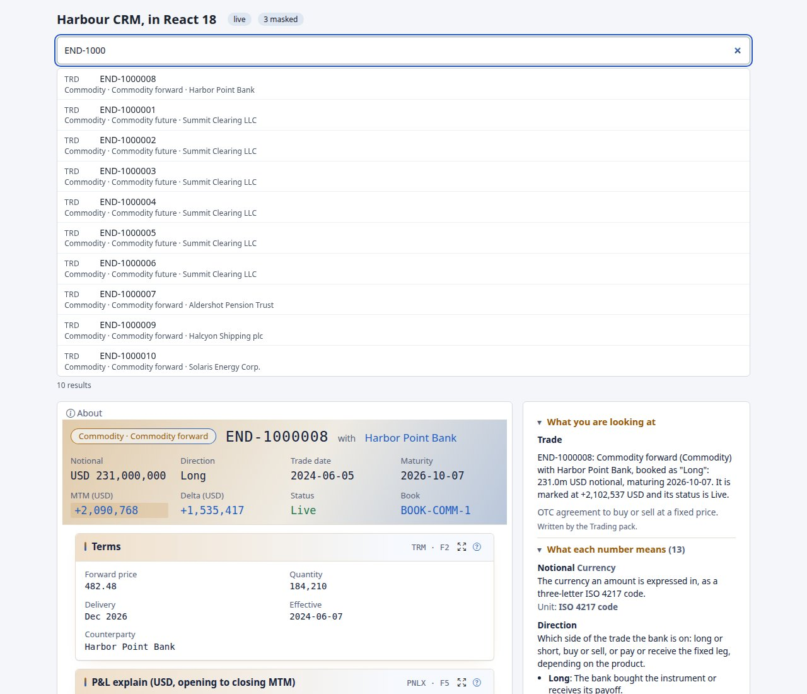

<!--
  Project Drishti · Any data. Any domain. One grammar.

  Copyright (c) 2026 Ashutosh Sinha <ajsinha@gmail.com>.
  All rights reserved.

  PROPRIETARY AND CONFIDENTIAL.

  This file is the confidential and proprietary property of Ashutosh Sinha.
  Unauthorised copying, use, modification, distribution or disclosure of this
  file, via any medium, is strictly prohibited except with the express prior
  written permission of the copyright holder.

  See the LICENSE file in the root of this repository for the full terms.
-->

# Embed Drishti in your pages

This guide is for a team that wants Drishti inside **its own web application**: a live view of a trade or a counterparty in a CRM,
a live panel of a view in a portal, or Drishti's grid and chart components in an application of its
own. Everything is drawn in your page's DOM, in a Shadow DOM, with **no iframe**: your layout, your theme tokens, your keyboard focus,
one network connection for the whole page, and your user signed in as themselves with every masked field masked.

There are three ways in:

| You want | Use | Chapter |
|---|---|---|
| Drishti views and panels as tags in your page | **Drishti Elements**: `<drishti-view>`, `<drishti-panel>` | [3](#3-five-minutes-a-static-page) to [5](#5-the-elements-one-by-one) |
| A Drishti screen drawn by one function call, with full control of navigation and live updates | **Drishti Render**: `render(container, source, options)` | [6](#6-drishti-render-one-import-one-call) |
| A grid, a chart or a picker in your own application, with or without a Drishti server | **the Elements libraries** (drishti-core, -grid, -chart, ...) | [13](#13-drishti-elements-libraries-in-your-own-app) and [14](#14-moving-an-ag-grid-enterprise-pivot-app) |

What each screen contains is the **ViewModel**, the server's JSON of a screen already laid out and bound: its reference is
[VIEWMODEL.md](../architecture/VIEWMODEL.md). How the renderer and the elements are built is
[ARCHITECTURE.md](../architecture/ARCHITECTURE.md) (section 30). The API of every Elements library is [ELEMENTS_API.md](https://github.com/drishti-platform/drishti-elements/blob/main/docs/API.md).

## Contents

1. [What you need](#1-what-you-need)
2. [Turn embedding on and register your application](#2-turn-embedding-on-and-register-your-application)
3. [Five minutes: a static page](#3-five-minutes-a-static-page)
4. [How a user gets in](#4-how-a-user-gets-in)
5. [The elements, one by one](#5-the-elements-one-by-one)
6. [Drishti Render: one import, one call](#6-drishti-render-one-import-one-call)
7. [React, Angular and Vue](#7-react-angular-and-vue)
8. [Theming and sizing](#8-theming-and-sizing)
9. [Your page's Content-Security-Policy](#9-your-pages-content-security-policy)
10. [Versions, integrity and lifecycle](#10-versions-integrity-and-lifecycle)
11. [Cookbook](#11-cookbook)
12. [Troubleshooting by code](#12-troubleshooting-by-code)
13. [Drishti Elements libraries in your own app](#13-drishti-elements-libraries-in-your-own-app)
14. [Moving an AG Grid Enterprise pivot app](#14-moving-an-ag-grid-enterprise-pivot-app)
15. [Use Rachana and Elements in your own app, and GenUI](#15-use-rachana-and-elements-in-your-own-app-and-genui)

## 1. What you need

- **A Drishti console your users can reach.** The console serves the library and the embed API; the library loads nothing from a CDN,
  ever (ECharts, the map shapes and the icon font come from the console too).
- **Embedding switched on** and **your application registered** (chapter 2). Inside Drishti's own console nothing needs registering.
- **A way to say who the user is:** your backend exchanges its user for a short-lived token (the default), or, for a page with no
  backend, the person signs in through single sign-on in a small window ([4.2](#42-a-page-without-a-backend-the-sign-in-window)).
- **An evergreen browser:** Custom Elements v1, Shadow DOM, constructable style sheets, `ReadableStream` and `AbortController`. No
  polyfills.

What the elements do not do: they are a read-only window. No layout mode, no saved Pivot arrangement, no share, comments, alerts, pins,
Calc, Ask, raw JSON drawer or export; the view shows the Sutra's layout, never a person's own arrangement, so you can rely on what it
looks like.

## 2. Turn embedding on and register your application

### 2.1 Switch embedding on

Embedding is **off by default**. The server needs `drishti.embed.enabled=true` with `drishti.security.enabled=true`, and the console
`embed.enabled=true`; with them off there is no token endpoint and every embed token is refused. The sign-in window for pages without a
backend also needs single sign-on (`auth.oidc` on the console, `drishti.security.oidc` on the server) and is on by default
(`embed.sign_in.enabled`, `drishti.embed.sign-in-window`). Every key, its default and its environment variable are in
[CONFIGURATION.md](../admin/CONFIGURATION.md#console-embed--the-consoles-side-of-embedded-views) (the console's `embed`) and
[CONFIGURATION.md](../admin/CONFIGURATION.md#drishtiembed--embedded-views-for-other-web-applications) (the server's `drishti.embed`).

### 2.2 Register a host application

An administrator registers each application in **Admin → Embedding** (`/admin/embedding`) or with
`POST /api/v1/admin/embed/apps` ([ADMIN_GUIDE.md](ADMIN_GUIDE.md#7-embedding-host-applications), which also describes
the page, rotating a secret, disabling and the audit events). What a registration holds:

| Field | Example | Meaning |
|---|---|---|
| Id | `crm` | lower-case; appears in tokens (`azp`) and in the access log as `embed:crm` |
| Name, contact | *Client CRM*, `crm-team@bank.example` | shown in the access log |
| Origins | `https://crm.bank.example` | **exact** origins (scheme, host, port; no path); no wildcards unless `drishti.embed.allow-wildcard-origins` allows a suffix for review apps |
| Client authentication | a client secret (shown **once**), a public key (JWKS JSON or URL), or both | how your backend proves it is your backend; a public key (`private_key_jwt`, RSA or ECDSA) is recommended in production |
| Scopes | `embed:view`, `embed:about` | views and panels; the About text |
| Kinds | `trade, counterparty` | what it may show; empty: everything the user's roles open. An application may narrow its users' rights, never widen them |
| Token lifetime | 300 s | at most `drishti.embed.token-max-seconds` |
| Rates | `callsPerMinute` per application, `userCallsPerMinute` per user | over them: `429 DRS-8004` with `Retry-After` |
| Enabled | yes | off stops the application at the next call |

Applications can also be declared in the server's configuration (`drishti.embed.apps`, for GitOps); the page shows them read-only.

### 2.3 The CORS allow-list

The registered origins **are** the allow-list; there is no second list to keep. The console answers CORS only on its embed paths, echoes
your `Origin` only when it is a registered one (`Vary: Origin`), never sends `Access-Control-Allow-Credentials` (no cookie is ever
used), and allows the headers `Authorization`, `Content-Type`, `Drishti-Embed-Api`, `X-Drishti-As-Of` and `X-Drishti-Known-At`, methods
`GET` and `POST`. The console's own cookie routes never answer CORS. A request from an origin that is not registered gets `DRS-8002`.

## 3. Five minutes: a static page

1. **Switch embedding on** and **register your application** (chapter 2), with your page's exact origin and the scopes you need.
2. **Give your backend a token route** that exchanges its signed-in user for an embed token ([4.1](#41-the-token-exchange)).
3. **Add one script line, a token provider and an element:**

```html
<script type="module" src="https://drishti.bank.example/embed/v2/elements/2/drishti-elements.js" crossorigin="anonymous"></script>
<script type="module">
  DrishtiElements.configure({
    tokenProvider: async () => {                      // your backend, not Drishti: it holds your client secret
      const r = await fetch('/api/drishti-token', { cache: 'no-store' });
      const b = await r.json();
      return { token: b.token, expiresAt: Date.now() + b.expiresIn * 1000 };
    }
  });
</script>

<drishti-view kind="trade" entity="MX-20000001" theme="light"></drishti-view>
```

That is all of it. `server` defaults to the origin the module was loaded from (the console), and several elements on a page share one
connection. The script is Elements **2.x** (under `/embed/v2/`): it draws `<drishti-view>` and `<drishti-panel>` (and `<drishti-screen>`, an
alias of `<drishti-view>`) with Drishti Render from the ViewModel ([5.2](#52-elements-2x-drawn-by-the-renderer)).

**A working host to copy.** `tools/elements-demo` in the repository is a complete host application with its own sign-in, a backend doing
the token exchange, a recent list and an as-of picker, served under a strict policy
(`python3 tools/elements-demo/server.py --help`; `/?tt=1` also enforces Trusted Types).

## 4. How a user gets in

Drishti never sees your user's password and your page never sees your secret. Whichever way the token comes, the server checks it on
**every call** (signature, audience, expiry, the application, the user, the origin, the scope and kind or report, the rates) and then
acts as that user, with their roles as they are now and with every field mask applied whatever their roles say.

| `auth` | Who vouches for the person | Use it for |
|---|---|---|
| `'token'` (the default when you give `token` / a `tokenProvider`) | your backend, by the token exchange | a portal, a CRM, any application with a server |
| `'popup'` | the bank's single sign-on, in one small window the person opens with a click | a page with no backend |
| `'session'` (the default otherwise) | the console's own sign-in cookie | the console's pages, a same-origin proxy |

### 4.1 The token exchange

Your **backend** exchanges *its* credentials and *who the user is* for a **short-lived, read-only embed token** (RFC 8693,
`POST /api/v1/embed/token` on the server) and hands the token to its own page. The request (form encoded; client authentication by
`Authorization: Basic base64(id:secret)` or by a signed client assertion, `private_key_jwt`):

```
POST /api/v1/embed/token
grant_type=urn:ietf:params:oauth:grant-type:token-exchange
subject_token=<an assertion your backend signs about the user, or the user's OIDC ID token>
subject_token_type=urn:ietf:params:oauth:token-type:jwt        (or ...:id_token)
audience=https://drishti.bank.example                           (the console's public URL)
scope=embed:view                                                (within the application's own scopes)
```

and the answer is `{"access_token": "<JWT>", "token_type": "Bearer", "expires_in": 300, "scope": "embed:view"}`. The field-by-field
reference, the claims and the refusals are in [API_REFERENCE.md](API_REFERENCE.md).

**Saying who the user is.** Either the user's **ID token** from the identity provider both applications use (needs single sign-on on
the server), or a **JWT your backend signs** about its user with its registered key (`sub`, `iat`, `exp` at most 60 s ahead, a `jti`
never used before; RS256/384/512 or ES256/384). There is no plain "username" field: a stolen client secret alone cannot make anyone
anyone. The user must already exist in Drishti and be enabled.

The backend of the demo host (Python, the standard library only, the assertion signed with RS256) is `tools/elements-demo/server.py`, the
`mint` method. The same exchange in other languages:

```javascript
// Node (an Express route; fetch is built in)
app.get('/api/drishti-token', async (req, res) => {
  const user = req.session.user;                       // who is signed in to YOUR application
  const now = Math.floor(Date.now() / 1000);
  const assertion = signJwt({ iss: 'crm', sub: user, aud: DRISHTI + '/api/v1/embed/token', iat: now, exp: now + 60, jti: crypto.randomUUID() }, MY_PRIVATE_KEY);
  const r = await fetch(DRISHTI + '/api/v1/embed/token', {
    method: 'POST', headers: { Authorization: 'Basic ' + Buffer.from('crm:' + SECRET).toString('base64'), 'Content-Type': 'application/x-www-form-urlencoded' },
    body: new URLSearchParams({ grant_type: 'urn:ietf:params:oauth:grant-type:token-exchange', subject_token: assertion,
      subject_token_type: 'urn:ietf:params:oauth:token-type:jwt', audience: CONSOLE, scope: 'embed:view' }) });
  const t = await r.json();
  res.json({ token: t.access_token, expiresIn: t.expires_in });
});
```

```java
// Java (Spring MVC; java.net.http; signJwt is your JWT library's call)
@GetMapping("/api/drishti-token")
Map<String, Object> token(Principal who) throws Exception {
    long now = Instant.now().getEpochSecond();
    String assertion = signJwt(Map.of("iss", "crm", "sub", who.getName(), "aud", drishti + "/api/v1/embed/token", "iat", now, "exp", now + 60, "jti", UUID.randomUUID().toString()));
    String form = "grant_type=" + enc("urn:ietf:params:oauth:grant-type:token-exchange") + "&subject_token=" + enc(assertion)
        + "&subject_token_type=" + enc("urn:ietf:params:oauth:token-type:jwt") + "&audience=" + enc(console) + "&scope=embed%3Aview";
    HttpResponse<String> r = http.send(HttpRequest.newBuilder(URI.create(drishti + "/api/v1/embed/token"))
        .header("Authorization", "Basic " + Base64.getEncoder().encodeToString(("crm:" + secret).getBytes()))
        .header("Content-Type", "application/x-www-form-urlencoded").POST(BodyPublishers.ofString(form)).build(), BodyHandlers.ofString());
    JsonNode t = json.readTree(r.body());
    return Map.of("token", t.get("access_token").asText(), "expiresIn", t.get("expires_in").asInt());
}
```

**Tokens over time.** A token lives five minutes by default (the application's own setting, never more than
`drishti.embed.token-max-seconds`). The provider may be sync or async and return a string or `{token, expiresAt}` (else the token's own
`exp` counts). The library reuses a token until **60 seconds before it ends** (40 % of its life when that is shorter: a 30 s token is
replaced at 18 s), and asks once more after a `401`. An open live stream is handed the fresh token in place, so nothing redraws and the
connection is not reopened; a stream that gets no fresh token in time ends with `DRS-8001`. If the provider fails or there is none, the
elements say so with `drishti:token-needed` and wait; set `tokenProvider` and an element that failed with a 401 reloads by itself. A
token is never put in a URL, `localStorage`, `sessionStorage` or a cookie. Disabling the application or the user stops their tokens at
the next call (open streams within `embed.recheck_seconds`).

**Masks.** An embed call **always masks**: `drishti.security.redact` fields and a dataset's masked columns read `•••` whatever the
user's roles, so a user with the raw power sees real names in the console and `•••` in your page. `drishti:masked` tells you what was
masked. An embed token never writes.

### 4.2 A page without a backend: the sign-in window

A page that has **no backend of its own** (a static intranet page, a SharePoint page, a team dashboard) cannot run the exchange. It uses
**`auth: 'popup'`**. What the person sees: in place of the screen, a card with the product's name and a **Sign in to see this** button.
Nothing opens by itself. On the click, one small window goes to the single sign-on (already signed in: it opens and closes at once,
nothing to type), and the screen is drawn in place. On a phone the window is a new tab that closes itself; where no window can open (an
embedded webview), the page goes to the sign-in and comes back.

```html
<!-- the renderer: one call (the library from the console's embed path; your page needs no server) -->
<div id="risk"></div>
<script type="module">
  import { render } from 'https://drishti.bank.example/embed/v2/render/3.3.2/drishti-render.js';
  const view = render(document.getElementById('risk'), { kind: 'trade', id: '1000008' },
                      { auth: 'popup', server: 'https://drishti.bank.example' });
  const el = view.container;
  el.addEventListener('drishti:auth-required', (e) => console.log('the button is shown', e.detail.allowed, e.detail.code));
  el.addEventListener('drishti:signed-in', (e) => console.log('signed in as', e.detail.user));
  el.addEventListener('drishti:signed-out', (e) => console.log('signed out:', e.detail.reason));   // expired | refused | host
</script>
```

```html
<!-- Elements 2.x: the same with a tag (every element of the page shares the one sign-in) -->
<script type="module" src="https://drishti.bank.example/embed/v2/elements/2/drishti-elements.js"></script>
<drishti-view auth="popup" kind="trade" entity="1000008"></drishti-view>
<!-- or for the whole page: DrishtiElements.configure({ auth: 'popup' }); DrishtiElements.signOut() signs out -->
```

- **The token** comes back to your page by `postMessage`, sent to your page's **exact origin** and accepted only from the console's own
  window with the random state the page sent: checked both ways. It is kept **in memory only**. A reload asks again (a click; already
  signed in to SSO, nothing to type).
- **Renewal** is silent while the single sign-on session lasts (the provider's refresh token, sealed by the console so the page cannot
  read or change it), shortly before the token ends, at most `embed.sign_in.max_hours`. When it can no longer be renewed:
  `drishti:signed-out` (`reason: 'expired'`) and the button comes back; a view refused with `401` does the same (`reason: 'refused'`).
  `handle.signOut()` (or `DrishtiElements.signOut()`) forgets it (`reason: 'host'`).
- **Only registered pages.** Your page's origin must be one of a host application's origins (chapter 2). Before drawing the button the
  library asks the console (`GET /embed/v2/sign-in/check`, no data, no credentials); any other page gets the button **disabled**, with
  `DRS-8002` and its origin named, and no window. The application's scopes, kinds and token life apply.
- **Take over at any point:** `drishti:auth-required` (`{server, allowed, code, detail}`) tells you the button is shown; call your own
  login and pass the token with `handle.signIn({ token, expiresIn })`. `handle.user` names who signed in; `drishti:signed-in` carries
  `{user, server}`, `drishti:signed-out` `{reason, server}`. An element waiting for the click is in the state `sign-in`.
- **The window's mode:** `signInWindow` (`auto`, the default: a new tab on a phone, a small window elsewhere; or `popup`, `tab`,
  `redirect`). With `redirect` the page goes to the sign-in and comes back with a one-time code in the fragment, taken out of the address
  at once and redeemed within two minutes, for that origin only.
- **What the administrator sets once:** single sign-on on the console and the server, the provider's client allowing the console's
  `…/embed/v2/sign-in/callback` as a redirect URI, and the host application registered
  ([ADMIN_GUIDE.md](ADMIN_GUIDE.md#51-the-sign-in-window-for-pages-that-embed-views)). Every sign-in through the window is
  audited as `embed-sign-in-window` with the page's origin, the user, the application and the time.
- **Live frames:** `render()` with `auth: 'popup'` draws the view as it is (`live` off unless you ask, because the console's own stream is
  a session route); `<drishti-view auth="popup">` is live over the page's one channel, as with a token.

### 4.3 Inside Drishti's console

On the console's own origin `auth: 'session'` uses the console's sign-in: nothing to configure. A same-origin reverse proxy in front of
the console works the same way.

## 5. The elements, one by one

| Element | Shows |
|---|---|
| `<drishti-view kind="trade" entity="MX-20000001">` | a live view of one entity: header, key figures, every panel, as the console draws them |
| `<drishti-panel kind="trade" entity="MX-20000001" panel="legs">` | **one panel** of a view, in a card of your own |

Importing the library defines the elements once; importing twice is harmless.

### 5.1 The reference

Every attribute is reflected to a property of the same name in camelCase (`as-of` is `asOf`). Events are `CustomEvent`s on the element,
`bubbles: true, composed: true`, named `drishti:<name>`. The TypeScript declarations of the renderer (`drishti-render.d.ts`) hold the same types.

#### `<drishti-view>`

A live Drishti view of one entity.

| Attribute | Type | Meaning |
|---|---|---|
| `server` | `string` | the console's base URL; default: the origin the module was loaded from. Elements sharing a `server` share one connection |
| `kind` | `string` | an entity kind (`trade`, `counterparty`, ...); required |
| `entity` | `string` | the entity id; change it to show another entity (reloads in place); required |
| `as-of` | `string` | `live` (default) or a business date `YYYY-MM-DD` (a past date is a static snapshot) |
| `known-at` | `string` | an ISO instant: bitemporal "as known at" |
| `theme` | `string` | `inherit`, or a Drishti theme: `terminal`, `light` (default), `blue`, `green`, `wallstreet`, `crimson`, `crimson-dark`, `terminal-green`, `terminal-crimson`, `terminal-blue` |
| `density` | `'compact' | 'comfortable'` | row padding of tables |
| `header` | `'full' | 'strip' | 'none'` | title and strip, strip only, or panels only (default `full`; `none` for `<drishti-panel>`) |
| `panels` | `string` | comma-separated panel ids to show (default all) |
| `live` | `'auto' | 'off'` | `off` loads once and never subscribes |
| `label` | `string` | the element's accessible name (`role="region"`); default the view's title |
| `controls` | `string` | the Sutra's controls as `legs=2&when=2026-10-01..2026-12-31` (the `ctl.` prefix is optional) |

| Property | Type | Meaning |
|---|---|---|
| `tokenProvider` | `() => string | { token: string; expiresAt?: number } | Promise<string | { token: string; expiresAt?: number }>` | set on any element: one provider per page (also `DrishtiElements.configure({tokenProvider})`) |
| `state` (read-only) | `'idle' | 'loading' | 'live' | 'static' | 'reconnecting' | 'paused' | 'deleted' | 'error'` | the state machine |
| `view` (read-only) | `{ ref: { kind: string; id: string }; title: unknown; generation: number; provenance: unknown; panels: { id: string; kind: string; title: string }[] } | null` | once loaded |
| `lastError` (read-only) | `{ code: string; status: number; detail: string } | null` | the last error |
| `controls` | `string` | the controls' values now |

| Method | Effect |
|---|---|
| `refresh()` | fetch the view again (same entity), keep the subscription, swap what changed |
| `reload()` | full reload: cancel in-flight requests, drop the subscription, fetch, subscribe |
| `pause()` | give the subscription back (the element also does this itself when hidden) |
| `resume()` | take it again |

| Event (`drishti:`) | `detail` | When |
|---|---|---|
| `controls` | `{ query: string; changed: string[] }` | a reader changed a control |
| `error` | `{ code: string; status: number; detail: string; fatal?: boolean; retryInMs?: number }` | a DRS code; `fatal: false` while the element retries by itself or a single visual failed |
| `loaded` | `{ ref: { kind: string; id: string }; generation: number; title: unknown; live: boolean }` | a view was loaded and painted |
| `masked` | `{ count?: number; panels?: string[]; columns?: string[] }` | what the user is shown has masked fields (count and panels) |
| `navigate` | `{ kind: string; id: string; href: string; panel?: string; source: 'link' | 'chart' | 'graph' }` | **cancellable**: the user activated a linked entity; not cancelled, the element shows it in place |
| `paint` | `{ ref: { kind: string; id: string }; generation: number }` | the shadow root was rebuilt |
| `state` | `{ state: string; previous: string }` | every state change (drives a host's own live indicator) |
| `tick` | `{ generation: number; seq?: number; latencyMs?: number; changed?: { strip: number[]; panels: string[] }; at?: string }` | live data was applied |
| `token-needed` | `{ reason: 'missing' | 'refused' | 'provider-failed' }` | no token provider, the token was refused twice, or the provider threw: sign the user in again and set `tokenProvider` |

#### `<drishti-panel>`

One panel of a view: `<drishti-view>` with the `panel` attribute and the header off.

| Attribute | Type | Meaning |
|---|---|---|
| `panel` | `string` | the panel id to show (the same as `panels="<id>"`); required |

| Property | Type | Meaning |
|---|---|---|
| `panel` | `string` | the attribute of the same name |

**The page object, `DrishtiElements`** (one per page): `configure({ server, tokenProvider, auth })` (or `element.tokenProvider = fn`),
`resolve(text)` (a typed command such as `TRD MX-20000001` to `{ref: {kind, id}, mnemonic, title}`, for your own search box),
`invalidateToken()` (your user changed: the next call asks the provider again; a token for another user closes the connection and every
element reloads), `connections()` (how many live connections the page holds: one per console), `signOut()` and `version`.

**Slots** (`<drishti-view>`, `<drishti-panel>`):

| Slot | Shown | Default |
|---|---|---|
| `loading` | while loading and no view has been painted yet | nothing (the element dims the view it has, while it reloads) |
| `empty` | no `kind`/`entity` yet (state `idle`) | nothing |
| `error` | an error with no view to keep | the DRS code and detail (`role="alert"`); with a slotted node, your content replaces it, and `drishti:error` still fires |

**Keyboard.** Shortcuts work **only while the focus is inside the element** (never on your `document`): `?` opens About, `Esc` closes
it, `Z` zooms the focused panel to the element's own box (`Esc` restores; `Shift+Z` asks for full screen), `Alt+1..9` move between
panels, and the table keys work inside a table. The console's global keys (`F1`, the command line, workspace panes, layout mode) are not
bound.

**Loading, live and reconnecting.** An element loads when it has both `kind` and `entity`; attribute changes in one task are coalesced
into one load, and an attribute changed mid-load aborts that load, so only the latest answer is ever painted. A live element applies
each tick in place (strip cells, whole panels, chart data), keeping scroll, selection, focus and zoom; it repaints (`drishti:paint`) only
on the first load, an attribute change, `refresh()` or `reload()`, the entity coming back after a deletion, or Retry after an error.
`refresh()` keeps a table's sort, page and filter where the panel did not change. When the connection drops, every live element goes to
`reconnecting` and keeps showing what it has; the connection retries with back-off (2 s doubling to 30 s, with jitter) and each element
fetches a fresh view when it is back. An element **pauses** when the page has been hidden, or the element off-screen, for 10 s: it
gives its subscription back and, on return, fetches a fresh view and subscribes again. A deleted entity greys the view under a banner.

### 5.2 Elements 2.x: drawn by the renderer

Elements 2.x draws `<drishti-view>` and `<drishti-panel>` with Drishti Render from the ViewModel the embed API v2 answers as JSON. Its features:

- **`navigation`**: unset, a link changes `kind` and `entity`; `in-place` draws the linked entity in the element with a Back
  bar ("← Back to IRS-48213", Alt+← returns); `host` sends only the event.
- **`auth="popup"`** and `DrishtiElements.configure({ auth: 'popup' })` ([4.2](#42-a-page-without-a-backend-the-sign-in-window)), with the
  element state `sign-in` until the person signs in.
- **The console's behaviours inside the element**: per-column filter funnels, Chart any table, drill-downs in place, the nested pivot as
  a tree grid, zoom and the Sutra's controls. About this page is a side sheet inside the element (the `?` key or the head's About
  button).
- **`element.handle`**, the renderer's handle ([6.2](#62-sources-and-the-handle)), and the renderer's events: `drishti:about`,
  `drishti:panel`, `drishti:row-click` and `drishti:select`.
- **`<drishti-screen>`**, an alias of `<drishti-view>`.

`DrishtiElements.version` names the Elements version and
`renderer`, `contracts` and `api` the rest. A host that enforces Trusted Types names `drishti-render` beside `drishti-elements`.

## 6. Drishti Render: one import, one call

Drishti Render paints a Drishti screen in the browser from the server's ViewModel. It is plain ES modules with no build step, served by
the console under a versioned path, with the vendored ECharts and nothing from a CDN. The screen draws inside your container, in a
Shadow DOM, follows live updates, and navigates **in place** with its own back stack. Elements 2.x is built on it.

### 6.1 The quick start

```html
<div id="risk"></div>
<script type="module">
  import { render } from 'https://drishti.bank.example/static/render/3.3.2/drishti-render.js';
  const view = render(document.getElementById('risk'), { kind: 'trade', id: 'IRS-48213' }, { behaviours: 'console', about: true });
  view.container.addEventListener('drishti:navigate', (e) => console.log('opened', e.detail.kind, e.detail.id));
</script>
```

or the tag `<drishti-screen kind="trade" entity="IRS-48213" theme="crimson-dark"></drishti-screen>` after the same import. On the
console's own origin (or a same-origin proxy) this runs as the person signed in to the console. **Another origin** imports
`/embed/v2/render/3.3.2/drishti-render.js` and gives a `token` provider ([4.1](#41-the-token-exchange)) or `auth: 'popup'`
([4.2](#42-a-page-without-a-backend-the-sign-in-window)).

**Defaults for everything.** A call with no options draws in a Shadow DOM with the library's own sheet, in the theme your custom
properties give it (`--d-*` on the container, or the default), follows the view live when the server says it is live, opens links **in
place** with a back stack, and reads as the person signed in to the console or with your token. Every option only overrides.

**Typed.** `drishti-render.d.ts` beside the entry declares every option, method, event and the ViewModel's shape.

### 6.2 Sources and the handle

```js
const view = render(container, source, options);   // returns at once; view.ready settles after the first paint
await view.ready;
view.patch(frame);              // a live frame {seq, generation, patches} (VIEWMODEL.md section 5)
view.apply(message);            // a stream message (6.6)
const stop = view.subscribe();  // follow the view's stream (default: this console's relay), returns stop()
view.subscribe((on) => myChannel.subscribe(key, on));     // your own channel (on.frame, on.view, on.gone); returns stop()
view.navigate({ kind: 'counterparty', id: 'CP-NORTHBRIDGE' });   // as a click would
view.back();  view.depth;       // the in-place back stack
view.setTheme('crimson-dark');  view.reload();  view.dispose();
view.viewModel;                 // the ViewModel shown now, patches applied
view.drawPanel(panelView);  view.drawStrip(cells);  view.drawAbout({ explain, index });   // parts for a host that places them
view.drawCharts(scope);  view.about();                     // charts of what the host placed; the About sheet (about: true)
view.signIn({ token, expiresIn });  view.signOut();  view.user;   // with auth: 'popup' (4.2)
patch(view, frame); subscribe(view, source);         // the same as functions
```

**`source`** is one of: a ViewModel (the JSON of `GET /api/v1/views/{kind}/{id}`); `{kind, id, controls?}` (fetched as the person; controls
travel as `ctl.<id>` parameters, the business date as `X-Drishti-As-Of`); `{stream: url}` (a Server-Sent Events stream of whole views,
frames and stream messages); or an async iterable of stream messages. In a framework, call `dispose()` when the component goes;
`render()` into the same container replaces cleanly.

### 6.3 Options

Every option has a default:

| Option | Default | Meaning |
|---|---|---|
| `shadow` | `true` | draw in a Shadow DOM with the library's sheet; `false` draws in the container and your sheets style it |
| `theme` | `'inherit'` | a console theme (`light`, `terminal`, `blue`, `green`, `crimson`, `crimson-dark`, `wallstreet`, `terminal-blue`, `terminal-green`, `terminal-crimson`) or your custom properties |
| `server` | `''` | the console that serves data and links; `''` is this page's origin |
| `navigation` | `'in-place'` | `'in-place'`, `'host'` (events only), `'new-window'`, or `'follow'` (a link is a link: `drishti:navigate` first, cancel it to stay, then the browser follows it, so Ctrl+click works) ([6.5](#65-navigation-in-place)) |
| `consoleLinks`, `outsideLinks` | `'event'` | a link to a console page (help, designer, connector) or to a page outside Drishti: an event (default), `'follow'` or `'new-window'` |
| `live`, `subscribe` | `true`, off | follow a live view; for a ViewModel source, subscribe at once (`true` or an SSE URL) |
| `token`, `credentials` | none, `same-origin` | a bearer token provider; fetch credentials (`include` with a `server`) |
| `auth`, `signInWindow` | `token` with a token, else `session`; `auto` | how the person gets in ([chapter 4](#4-how-a-user-gets-in)); the sign-in window's mode (`auto`, `popup`, `tab`, `redirect`) |
| `device` | none | `phone`, `tablet` or `desk`, sent as `X-Drishti-Device` |
| `behaviours` | `'library'` | `'library'`: the painter's own (sorting, the filter box, paging, trees, tabs, pivots, a Data table under each chart); `'console'`: those and the table tools (a funnel on each column heading: the values with counts, a search, Select all, a number condition such as `> 1m`; Chart any table: the rows as shown opened as a chart in a dialog inside the container); `'host'`: as `'library'` (renderer 1.2.0: none but the widths) |
| `about` | `false` | an About button in the head and `?`: About this page drawn from JSON in a side sheet inside the container |
| `insight` | none | `{ about(ref, generation) }` answers About this page's JSON from your own source instead of `aboutUrl` |
| `designOn` | `false` | "How this view was built" links its Sutra to the designer |
| `viewUrl`, `streamUrl`, `aboutUrl`, `recordsUrl`, `panelsUrl`, `eventSource` | the console's | where the view, its stream, About, a pivot's rows and a control's panels come from, when you proxy the console or need your own EventSource |
| `tables`, `help`, `keys`, `header`, `panels`, `label`, `asOf` | `true`, `true`, `false`, `'full'`, all, the title, live | table behaviours, the `?` help links, the function keys under the view, the head, a subset of panels, the region's name, the as-of banners |

### 6.4 Events

On the container; they bubble, cross the shadow boundary and are cancelable where you may take over:

| Event | Detail | Cancel to |
|---|---|---|
| `drishti:navigate` | `{target: 'entity'\|'console'\|'outside', kind, id, href, panel, source: 'link'\|'chart'\|'key'\|'api', navigation}` | route it yourself (the renderer does nothing) |
| `drishti:row-click` | `{panel, event, row, pick, cells}` for a row or bar that carries an event | keep the row unselected |
| `drishti:select` | `{panel, control, value}` for a row that sets a control | |
| `drishti:paint`, `drishti:loaded`, `drishti:ready` | the reference, generation, back-stack depth; `ready` when a streamed screen is complete | |
| `drishti:tick`, `drishti:deleted`, `drishti:restored` | what a live frame changed | |
| `drishti:error` | `{code, detail, fix, status}` | |
| `drishti:pivot`, `drishti:key` | a Pivot opened; a function key with no in-place action | draw it yourself |
| `drishti:panel`, `drishti:about` | a panel replaced by a live frame `{panel, element}`; the About sheet opened `{open, ref}` | |
| `drishti:auth-required`, `drishti:signed-in`, `drishti:signed-out` | the sign-in window ([4.2](#42-a-page-without-a-backend-the-sign-in-window)) | |

### 6.5 Navigation in place

Nothing opens a new window or leaves your page unless you want it:

| Mode (`navigation`) | An entity link, a chart point, a map place, a link key | Your page |
|---|---|---|
| `'in-place'` (default) | `drishti:navigate` first; if not cancelled, the entity's view is fetched and drawn **in the same container**, the previous screen pushed on the renderer's back stack; a Back bar ("← Back to IRS-48213") and Alt+← return | never navigates, its address never changes |
| `'host'` | only `drishti:navigate`: you route it (your own router, a deep link, another container) | as you decide |
| `'new-window'` | `drishti:navigate`, then a new window | a new window, because you asked |

- **Drill-downs, tree rows, tabs, sorting, sections and folds** happen in place, with no change to your address.
- **Links to console pages** (the `?` help, the designer, a connector's page) and **links outside Drishti** (a bare `https://` value in
  the data) cannot be drawn in place: by default they are only `drishti:navigate` events (`target: 'console'` or `'outside'`); set
  `consoleLinks` / `outsideLinks` to `'follow'` or `'new-window'` to change that.
- **About and detail sheets** render inside the container's shadow root, never over your page.
- In `'in-place'` mode no window is ever opened; the one window the library may open is the sign-in window, and only on the person's
  click.

**Names your page sees.** Everything Drishti adds keeps out of your way: one global (`window.Drishti`; Elements adds `DrishtiElements`
and, for the console's behaviour scripts, `drishtiModules`), custom events `drishti:<what>`, custom elements `drishti-<name>`, storage
keys starting `drishti`, static files named `drishti_<name>`.

### 6.6 Live updates and streamed screens

**Live.** `subscribe()` follows the view's stream; `patch(frame)` applies a live frame exactly as [VIEWMODEL.md](../architecture/VIEWMODEL.md)
section 5 describes: `strip` (the cell rebuilt), `panel` (the panel rebuilt and re-enhanced, its grid place, phone order, tab state and
fold kept; charts redrawn), `provenance` (the banners rebuilt), `deleted` (the view greyed under a banner, later patches ignored),
`restored` (the view fetched again). An op the renderer does not know is ignored; a patch never changes the screen's structure. A
second whole `view` on the stream (a reconnect, a newer generation) repaints. A host that needs headers on the stream gives
`eventSource(url)`, or hands its own channel with `subscribe(fn)`.

**Streamed screens.** `render()` also takes a screen that arrives panel by panel (`{stream: url}` or an async iterable), through the same
paint and patch: the skeleton is painted at once in its final layout, each stub saying "Loading…", so nothing jumps. The messages (the
SSE event name is the type, or a `type` field on the default `message` event):

| Type | Payload | The renderer |
|---|---|---|
| `skeleton` | `{view}`: a ViewModel whose panels are stubs (`id`, `kind`, `title`, `area`, `span`, `height`, and the layout) | paints the final layout at once, each stub saying "Loading…" (`aria-busy` on the view) |
| `panel-add` | `{panel, after?}` | a panel the skeleton did not announce, after `after` (or at the end of its column) |
| `panel-replace` | `{panel}` | replaces the stub (or an earlier panel) with the bound panel |
| `patch` | `{frame}` | a live frame, as `patch()` |
| `done` | `{provenance?}` | the screen is complete: `aria-busy` cleared, `drishti:ready` |
| `error` | `{code, detail, fix?, panel?}` | a panel that could not bind shows its error; without `panel`, the screen does |

Every link, drill, event and action works on a streamed screen as on any other, because they are in the ViewModel. The end state equals
a one-shot render of the same screen.

**What the renderer draws.** Every panel kind of the ViewModel, its states (waiting, denied, empty, error, computing, stale, failed,
refused), the Sutra's layout grid, and every chart with its Data table, so nothing is only in the picture. The server formats every
value a person reads; the renderer prints the server's text and the server's tones. A kind it does not know becomes a titled panel saying
so. Below 640 px of the **container**, every grid is one column in the phone order, tables scroll inside themselves, nothing scrolls
sideways, and targets are 44 px (also on any coarse pointer).

### 6.7 Errors

Every failure is a `drishti:error` event and, when there is nothing to show, a box in the container with the code, the words and the fix:

| Code | When | The fix it gives |
|---|---|---|
| `DRS-9101` | the container is not an element | Pass a DOM element, e.g. `document.getElementById("risk")` |
| `DRS-9102` | an unknown `navigation` | Leave it out for in-place, the default |
| `DRS-9103` | the source is neither a ViewModel, `{kind, id}`, `{stream}` nor a stream | `render(el, { kind: "trade", id: "IRS-48213" })` |
| `DRS-9104` | a reference without kind or id | the same |
| `DRS-9105` | a ViewModel speaks a contract major the library does not draw | Load the renderer version this server serves |
| `DRS-9106` | an unknown `behaviours` | Leave it out for the library's own, the default |
| `DRS-9107` | `behaviours: 'console'` could not load the console's scripts | Check that the console serves its static scripts, or use `behaviours: 'library'` |
| `DRS-9108` | an unknown `auth` | Leave it out: `token` when you give a token, else the console's session; `popup` for a page without a backend |
| `DRS-5003` | the console could not be reached | Check the server option, the network, and that the console allows this origin (CORS) |
| the server's own (`DRS-1001`, `DRS-5002`, ...) | the view was refused | the server's own `fix` when it gives one, else per code (`DRS-4023`: the edition or lens hides the kind), else per HTTP status: sign in or give a token (401), your role may not open this kind (403), no such entity here (404), retry (502, 504) |

A view refused with `DRS-4023` is no typo: the answer names the edition, or in the console the lens the person is inside ("You are inside
the Drishti World lens, which does not include trades: leave the lens (Views → Leave) or choose an entity it shows").

### 6.8 The playground

Open **`/render/demo`** on your console (signed in). It renders any view you may open, or pasted ViewModel JSON, in every theme and
navigation mode, lists the events the renderer sends, and prints the quick start for what is on screen, ready to copy. It opens on an
entity your server holds and you may open (the first of a common kind, in your lens; `GET /render/demo/start`), says which lens you are
inside, and says why when there is nothing to draw.

## 7. React, Angular and Vue

The library is a function and custom elements, so every framework uses it as it is; no wrapper is needed. Events with a colon
(`drishti:select`) are bound with `addEventListener` in all three, because Vue and Angular read the colon in a template.

**Drishti Render:**

```jsx
// React
import { render } from 'https://drishti.bank.example/static/render/3.3.2/drishti-render.js';
export function Trade({ id }) {
  const ref = useRef(null);
  useEffect(() => { const h = render(ref.current, { kind: 'trade', id }); return () => h.dispose(); }, [id]);
  return <div ref={ref} />;
}
```

```ts
// Angular (CUSTOM_ELEMENTS_SCHEMA in the component)
@Component({ selector: 'app-trade', template: '<drishti-screen kind="trade" [attr.entity]="id"></drishti-screen>', schemas: [CUSTOM_ELEMENTS_SCHEMA] })
export class TradeComponent { @Input() id = 'IRS-48213'; }
// main.ts: import 'https://drishti.bank.example/static/render/3.3.2/drishti-render.js';
```

```vue
<!-- Vue (compilerOptions.isCustomElement: (t) => t.startsWith('drishti-')) -->
<template><drishti-screen kind="trade" :entity="id" /></template>
<script setup>import 'https://drishti.bank.example/static/render/3.3.2/drishti-render.js'; defineProps(['id']);</script>
```

A bundler that refuses URL imports copies the version's folder as it is ([10.4](#104-the-npm-package-layout)).

**The elements.** Set attributes in JSX, bind events with a ref (React 19 passes properties to custom elements; for events use
`addEventListener`):

```jsx
function TradeView({ onState }) {
  const ref = useRef(null);
  useEffect(() => { const el = ref.current; el.addEventListener('drishti:state', onState); return () => el.removeEventListener('drishti:state', onState); }, [onState]);
  return <drishti-view ref={ref} kind="trade" entity="MX-20000001" theme="light" />;
}
```

**Angular** (add `CUSTOM_ELEMENTS_SCHEMA` to the module or component). Angular reads a colon in an event binding as a target
(`window:resize`), so bind these events with `addEventListener`:

```ts
@ViewChild('v', { static: true }) v!: ElementRef<HTMLElement>;
ngAfterViewInit() { this.v.nativeElement.addEventListener('drishti:state', (e) => this.onState(e as CustomEvent)); }
// template: <drishti-view #v kind="trade" entity="MX-20000001"></drishti-view>
```

**Vue 3**: `app.config.compilerOptions.isCustomElement = (t) => t.startsWith('drishti-')`, then
`<drishti-view kind="trade" entity="MX-20000001" @drishti:state="onState" />`.

### 7.1 The sample pages

`docs/guides/examples/embed/` holds one host page for each framework, each embedding `<drishti-view>` with the page's own box for the entity, wired the way that framework wires custom elements: **React 18** (`createElement`, events bound
with a ref, the same in JSX), **Vue 3** (the runtime-only build and render functions, so no `eval`), **Angular 18** (a standalone
component with `CUSTOM_ELEMENTS_SCHEMA`, zoneless). They share `host.js` (the token provider) and `sample.css`, and run against the
elements demo host (`tools/elements-demo/server.py`), which serves them at `/samples/<framework>/` under a strict policy (script-src
`'self'` and the console, no inline script). The samples bind events in `onMounted` / `ngAfterViewInit` / a ref effect.

The framework builds are **not in the repository**. `bash docs/guides/examples/embed/fetch-vendor.sh` downloads the pinned versions once
(React 18.3.1 UMD, Vue 3.5.43 runtime build, Angular 18.2.14 ES modules, RxJS 7.8.2, tslib 2.8.1; all MIT) into
`docs/guides/examples/embed/vendor/` (ignored by git), and the pages load them from there: no CDN, offline afterwards. React 19 has no
UMD build; with a bundler the JSX is the one shown in the comments. Angular has no UMD build either, so its page uses an import map and
Angular's JIT compiler, which needs `'unsafe-eval'` and an inline import map: the demo host relaxes its policy for `/samples/angular/`
only. A real Angular application is compiled ahead of time (`ng build`) and needs neither; the component is the same. The React page,
drawn in Chromium against a real server:



## 8. Theming and sizing

**Custom properties.** The sheets read the console's design tokens, which inherit through the shadow boundary: set them on the element
(or the render container) or any ancestor, and they win over the sheet's defaults. Charts read them when they draw, so a theme change
redraws them.

| Property | Meaning |
|---|---|
| `--d-bg`, `--d-bg-2`, `--d-surface`, `--d-surface-2` | backgrounds: page, alternate, panel, panel header |
| `--d-ink`, `--d-muted`, `--d-faint` | text: main, secondary, hints |
| `--d-border`, `--d-radius`, `--d-shadow` | frame |
| `--d-link`, `--d-accent`, `--d-accent-strong`, `--d-accent-tint`, `--d-on-accent` | links, emphasis |
| `--d-pos`, `--d-neg`, `--d-ok`, `--d-warn`, `--d-bad` | tones (gains, losses, status); charts take their palette from these |
| `--d-emph-bg`, `--d-highlight`, `--d-glow` | emphasised strip cell, live flash |
| `--d-font-sans`, `--d-font-mono` | fonts (your fonts work: the element loads none but its icon font) |

A token not listed is not part of the contract. `theme="inherit"` uses your values with `light` as the fallback; `terminal`, `light`,
`blue`, `green`, `wallstreet`, `crimson`, `crimson-dark`, `terminal-green`, `terminal-crimson` and `terminal-blue` are the console's
own. One override, for example: `#risk { --d-accent: #0b5cad }`.

**Parts** for spacing and borders without reaching into the shadow root: `::part(header)`, `::part(strip)`, `::part(grid)`,
`::part(panel)`. The panels' inner HTML is not a
contract: style it only through the custom properties and parts.

**Sizing.** Every element is `display: block`, as wide as its container, as tall as its content; give it a width the way you give any
block one (a grid cell, a flex item with `min-width: 0`, a fixed-width column), and `max-height` with `overflow: auto` if you want it to
scroll. Do not make it `display: inline` or shrink-wrapped: it is a **size container** with no intrinsic width of its own. The console's
width breakpoints (1700, 1400, 1100, 1000, 900, 760, 640 and 560 px) apply to **its own width**, not the page's, so an element in a
360 px sidebar of a wide page uses the phone layout (one column, a two-column key-figure strip, wrapped tab heads), and tables scroll
inside their panel and never widen your page. Charts follow the element's size, including your split panes and drawers.

**Touch.** A panel's `?` and a column or field hint open by tap. Where the element is at most 640 px wide, or the pointer is coarse, its
controls are at least 44 by 44 px. The About drawer is a right-hand side drawer sized to the element (at most 420 px) and becomes a
bottom sheet the element's full width at 640 px or narrower.

**Accessibility.** The view's title is an `h1`, every panel an `h3` that labels its section; every chart is `role="img"` with a sentence
and keeps its Data table; every control is a native button or link; tabs move with arrows, Home and End; Esc goes up a drill level;
colour is never the only signal; computing states and the pager are polite live regions, alerts use `role="alert"`, and a streamed screen
is `aria-busy` until it is done.

## 9. Your page's Content-Security-Policy

The elements and the renderer are written for a **strict host policy**: no inline script or style, no `frame-src`, no `'unsafe-inline'`
or `'unsafe-eval'`. A page that names the console in three directives works:

```
Content-Security-Policy: default-src 'self'; script-src 'self' https://drishti.bank.example; style-src 'self'; font-src https://drishti.bank.example;
  connect-src 'self' https://drishti.bank.example; img-src 'self' data:; object-src 'none'; base-uri 'none'
```

`style-src` does not need the console: the style sheets are adopted (`adoptedStyleSheets`), the icon font is added through the
`FontFace` API, charts are drawn inside the shadow root, and DOM is built with `createElement` and `textContent`, never from markup in
the data. A host that enforces **Trusted Types** adds `require-trusted-types-for 'script'; trusted-types drishti-elements drishti-render`
and nothing else. A view's `image` panel loads its `src` as your `img-src` allows. The
demo host runs under exactly this policy and its tests assert that no violation is reported.

**What you trust.** The shadow roots are **open**: your scripts can read inside them (and your tests can, [11](#11-cookbook)). That is why
an embed call always masks and never writes: a stolen token lets the thief read, for minutes, what the user could read on that host
anyway. Load the library by an exact version with its integrity hash (chapter 10).

## 10. Versions, integrity and lifecycle

### 10.1 Where the library is served

| Path | What | Cache |
|---|---|---|
| `/static/render/<version>/…` | Drishti Render on the console's own origin (the console's pages, same-origin hosts) | as `/static/` |
| `/embed/v2/render/<version>/…` | the same files for other origins, with CORS for the registered origins; a partial version (`2`, `2.0`) answers `302` to the exact one | `immutable`, one year |
| `/embed/v2/elements/<2, 2.4, 2.4.0, 2.2, 2.2.0>/drishti-elements.js` | Elements 2.x by its own version: a `302` to the renderer that carries it (the renderer's version is the Elements version, 2.4.0; `2` answers the newest) | 60 s |
| `/embed/v2/elements/<library>/…` | the Elements libraries the current renderer imports (drishti-core, -grid, -chart, -data, -renderer), allow-listed | revalidated |

Served renderer version: the current one only (the renderer, like every Elements library, carries the one Elements version). The data routes the library calls (the ViewModel, About, panels, a pivot's rows, the live channel and resolve) are listed in [API_REFERENCE.md](API_REFERENCE.md).

### 10.2 Integrity and SRI

A released version is **immutable**: a version always names **the same bytes**, and a change means a new version. Each version's folder
holds `integrity.json`, the SHA-384 (subresource integrity) of every distributed file, served at `/embed/v2/render/<version>/integrity.json`. Put the entry's `integrity` on the script line (SRI needs the exact version, not an alias):

```html
<script type="module" src="https://drishti.bank.example/embed/v2/render/3.3.2/drishti-render.js" integrity="sha384-…" crossorigin="anonymous"></script>
```

Because a module's own imports are not covered by the script's `integrity`, pin the rest with an import map's `integrity` (Chrome 127 and
later) listing the module files of `integrity.json`. The static files are served with `Access-Control-Allow-Origin: *` (public code, no
data), so `crossorigin` and SRI work from any page.

### 10.3 Contracts and lifecycle

Three contracts, all semantic versions:

- **The element and render API** (attributes, properties, methods, events and their `detail`, options, custom properties, parts, slots)
  changes only in a major version of the library.
- **The ViewModel** carries `"contract": "1.0"`; the renderer refuses a major it does not draw (`DRS-9105`)
  ([VIEWMODEL.md](../architecture/VIEWMODEL.md)).
- **The embed API** (`/embed/v2`) changes additively within a major. The element sends `Drishti-Embed-Api: <major>.<minor>`
  and the console answers in the newest compatible shape. A major's end is announced with `Deprecation` and `Sunset` headers and a `Link`
  on every answer (the console's `embed.lifecycle`, one entry per major); from the sunset day its calls are `410 DRS-8006`.

A version this console does not serve answers `410 DRS-8006`, and the answer names the one it serves: after a console upgrade, a page
pinned to an old version tells you to move the pin.

**Retired renderer paths.** Any renderer version but the one this console serves, and any Elements 2.x version but the one it serves, answers `410` (`DRS-8006`) naming the version it serves; pin the one renderer.

**Renderer 3.3.2.** Every panel is drawn by Drishti Elements' painter (`drishti-views`); the API, the options, the events, the element
attributes and the contract are the same. What you may see: the painter's look (its title line, freshness line and function keys, a
filter box and pages on long tables, a Data table under each chart), a dash in an empty cell, a pivot's corner in its fields' own case;
`behaviours: 'console'` gives the painter's tables their tools (column funnels, Chart any table, in the container); the console's nested-pivot grid, drills in place and zoom are the painter's own pivots, trees and tabs; a GenUI stream's messages are not drawn (release i9).
The `3.1.0` paths are gone (`410` with `DRS-8006` under `/embed/v2/`): pin `3.3.2`.

### 10.4 The npm package layout

Drishti Render's version folder is also laid out as an npm package, `@drishti/render`, for a host that bundles it (it is not published to
any public registry): `drishti-render.js`, `drishti-elements.js`, the modules, `drishti-render.css`, `drishti-render.d.ts`,
`integrity.json`, plus `package.json` (`"type": "module"`, `"exports": {".": "./drishti-render.js", "./elements": "./drishti-elements.js",
"./drishti-render.css": ...}`, `"types": "./drishti-render.d.ts"`) and the licence. The bytes are the same as `/embed/v2/render/<version>/`.
A host that bundles it must also serve the console's `js/`, `vendor/` and `css/` files beside it, or set `server` so the library loads
them from the console.

The Drishti Elements libraries are a separate project with
their own release tree ([section 13](#13-drishti-elements-libraries-in-your-own-app)).

## 11. Cookbook

**Master and detail: a list drives `entity`.** Set the attribute; the element reloads in place and cancels the request it was making.

```js
list.addEventListener('click', (e) => { main.setAttribute('entity', e.target.dataset.id); });
```

**Keep navigation in your application.** A linked entity inside a view fires a cancellable `drishti:navigate`; cancel it and take the
user where you like, or let it through and the element shows the entity in place.

```js
main.addEventListener('drishti:navigate', (e) => { e.preventDefault(); router.go('/trades/' + e.detail.id); });
```

**Keep counterparties in your CRM, trades in the element.**

```js
v.addEventListener('drishti:navigate', (e) => {
  if (e.detail.kind === 'counterparty') { e.preventDefault(); location.href = '/clients/' + e.detail.id; }
});
```

**Your own search box.** `DrishtiElements.resolve('TRD MX-20000001')` returns `{ref: {kind, id}}` for a typed command (`TRD MX-20000001`,
`CPTY CP-1042` or a bare id); set `kind` and `entity` from it. A resolved command is not added to the user's command history.

**A live indicator of your own.** `drishti:state` fires on every change (`loading`, `live`, `reconnecting`, `paused`, `error`): bind it to your page's own badge. `drishti:tick` says a live update was applied.

**Two elements side by side, one connection.** Elements with the same `server` share one stream; `DrishtiElements.connections()` is `1`
however many there are, and two elements on the same entity share one subscription. (Twenty elements on ten entities on one page: one
channel stream.)

**A past business date.** `<drishti-view as-of="2026-10-09">` loads a static snapshot (the console's own as-of rule); `as-of="live"` goes
back.

**A dark host.** `theme="inherit"` and your own `--d-bg`, `--d-surface`, `--d-ink` on an ancestor, or `theme="crimson-dark"`.

**One panel in a card.** `<drishti-panel kind="trade" entity="MX-20000001" panel="legs">`: the header is off unless you ask for
`header="strip"`.

**A view built with control values.** `<drishti-view kind="netting-set" entity="NS-NORTH-01" controls="legs=2">`: the element draws the
Sutra's controls inside itself; a reader's change asks the console for only the panels that read it, fires `drishti:controls` and
updates the `controls` property, and never touches your page's address.

**Testing a page that embeds Drishti.** The elements have **open** shadow roots, so a test reaches inside: Playwright's CSS selectors
pierce them (`page.locator('#view .pnl')`), and `await expect(el).toHaveAttribute('data-state', 'live')`
waits for the state machine. `drishti-console/tests/test_embed_elements2_browser.py` is a complete example: a host on its own origin under a strict policy against a
real server.

## 12. Troubleshooting by code

The element puts the code in `drishti:error` (`detail.code`, `status`, `detail`, `fatal`) and shows it in the element when it has nothing
else to show; the renderer's own codes are in [6.7](#67-errors). The full list is in [OPERATIONS_GUIDE.md](OPERATIONS_GUIDE.md#21-troubleshooting); the ones
an embedder meets:

| Code | Meaning | What to do |
|---|---|---|
| `DRS-8001` (401) | the embed token is missing, forged, expired or for another audience | check your provider returns a fresh token and the token request's `audience` is the console's public URL; a stream ends with this after `embed.token_grace_seconds` without a renewal |
| `DRS-8002` (403) | this origin is not one of the host application's | register the exact origin (scheme, host, port) in Admin → Embedding; `null` and wildcards are refused unless `drishti.embed.allow-wildcard-origins` |
| `DRS-8003` (403) | the host application is unknown or disabled | it was disabled or deleted in Admin → Embedding |
| `DRS-8004` (429) | over the embed call rate, or the console holds `embed.max_streams` streams | the answer carries `Retry-After`; raise the application's rates or `embed.max_streams` |
| `DRS-8005` (400) | the application may not show this kind | add the kind to the application's list |
| `DRS-8006` (410) | a version or API major this console no longer serves | pin the version the answer names, or upgrade the element |
| `DRS-4023` (404) | the server's edition (or, in the console, the person's lens) does not include this kind | the answer's `fix` says which and what to do (choose an entity it shows; leave the lens; an administrator adds the command to the edition); it is no typo in the id |
| `DRS-5002` (403) | a path the embed scope does not open, or a scope the application was not given | give the application the scope (`embed:view`, `embed:about`); an embed token never writes |
| `DRS-5010` (401) | the user behind the token is disabled or gone | sign the user in again; tokens are checked against the user on every call |
| `DRS-1001` (404) | no such entity, or one the user may not reach (the two look the same) | check the kind and id, and that the user may open it in the console |
| `DRS-5003` (503) | the console cannot reach the server | retried by the element; check the server |

**Nothing at all** (the element stays in `loading`, with no event): the token provider never answered. Open the browser's network tab:
the first request is to *your* backend. `window.DrishtiElements.connections()` and `element.state` / `element.lastError` say what the
element thinks. **The sign-in button is greyed out**: your page's origin is not registered (`DRS-8002` names it).

## 13. Drishti Elements libraries in your own app

The libraries the console draws with (grid and pivot, charts and maps, inputs, tree, graph, the data client, the designer kit) are Drishti
Elements, a separate project by the same owner that Drishti vendors at a pinned version
([docs/architecture/ELEMENTS_IN_DRISHTI.md](../architecture/THIN_CONSOLE_DESIGN.md)). Using them in your own app, served by a host or from
the release tree, is in its own docs: [USING.md](https://github.com/drishti-platform/drishti-elements/blob/main/docs/USING.md), with the
[API reference](https://github.com/drishti-platform/drishti-elements/blob/main/docs/API.md) and the
[contracts](https://github.com/drishti-platform/drishti-elements/blob/main/docs/CONTRACTS.md) a server answers (the live set, the errors, the
data capabilities). A Drishti console serves the pinned copy under `/static/vendor/drishti-elements/<version>/` and its gallery at `/elements`.

### Names a host page sees

The console's scripts and styles keep out of a host's way: every static file we wrote is named `drishti_<name>` (`drishti_tables.js`,
`drishti_tokens.css`), our scripts set one global, `window.Drishti`, custom events are `drishti:<what>`, custom elements `drishti-<name>`
and storage keys start `drishti`. The names a published renderer or Elements version uses are its contract and stay as they are while it
is served: the globals `drishtiModules`, `drishtiBi` and `drishtiGeo`, the classes and data- attributes of its markup, and the addresses
it loads (`/static/js/<name>.js` and the embed routes' `/js/<name>.js` answer with the `drishti_` file). The developer guide
([DEVELOPER_GUIDE.md](DEVELOPER_GUIDE.md#static-asset-names-and-the-one-namespace)) has the rules.

## 14. Moving an AG Grid Enterprise pivot app

Drishti Elements' grid takes AG Grid Enterprise-shaped options through its adapter (`createGridFromAgOptions`); the mapping, what is
covered and what is not, is in its [MOVING_FROM_AG_GRID.md](https://github.com/drishti-platform/drishti-elements/blob/main/docs/MOVING_FROM_AG_GRID.md).

## 15. Use Rachana and Elements in your own app, and GenUI

This guide is Drishti's side: how a page of yours embeds a Drishti view. Using the screen language and the widget libraries in an application
that has no Drishti server at all, and streaming generated screens into an app (GenUI), are the products' own guides, and they are the one
home of those subjects:

- [Rachana and Elements in your own app](https://github.com/drishti-platform/drishti-rachana/blob/v1.0.1-ide3/docs/guides/IN_YOUR_APP.md): the
  renderer and the libraries, from one import to a screen of your own, with no copy of them here.
- [GenUI](https://github.com/drishti-platform/drishti-rachana/blob/v1.0.1-ide3/docs/guides/GENUI.md): a screen streamed to the page as it is
  composed, its links intact, and the tool suggestions for an assistant that composes it.

Drishti uses the same renderer (section 6) and the same libraries (section 13); what Drishti adds is the server's views, its sign-in
(section 4) and its data.

## Drishti Elements in React, Vue and Angular

Three host pages, one per framework, each embedding `<drishti-view>` for a signed-in user. They are the examples of [section 7.1](#71-the-sample-pages); `tests/test_embed_frameworks_browser.py` runs all three in Chromium.

| Folder | Framework | How it runs without a build step |
|---|---|---|
| `react/` | React 18.3.1 | the UMD builds, `createElement` (the JSX is in the comments) |
| `vue/` | Vue 3.5.43 | the runtime-only global build (no template compiler, so no `eval`), render functions |
| `angular/` | Angular 18.2.14 | the ES-module builds through an import map and the JIT compiler, a standalone zoneless component |

`host.js` (the token provider, the demo sign-in) and `sample.css` are shared.

### Run them

1. **Fetch the framework builds** (they are not in the repository; MIT; once, needs `node`/`npm` and the npm registry; offline afterwards):

   ```bash
   bash docs/guides/examples/embed/fetch-vendor.sh              # all three; or: --only react | vue | angular
   ```

   They are written to `docs/guides/examples/embed/vendor/` (git-ignored). The pages load them from there: no CDN.

2. **Start Drishti with embedding on and the demo host**, as in [tools/elements-demo/README.md](../../tools/elements-demo/README.md) (register the host application with the scopes `embed:view embed:about`).

3. **Open** `http://127.0.0.1:17968/samples/react/`, `/samples/vue/` or `/samples/angular/` (the demo host serves this folder at `/samples/`, under a strict content-security policy: no inline script and only the console beyond itself).

The Angular page is the exception to "strict": Angular has no UMD build, so it needs an inline import map and the JIT compiler (`'unsafe-eval'`); the demo host relaxes its policy for `/samples/angular/` alone. A real Angular application is built ahead of time (`ng build`) and needs neither: the component and its template are the same (`schemas: [CUSTOM_ELEMENTS_SCHEMA]`).

### What each page shows

* The page's own box for an entity id (the host decides what a pick means; the element just draws it).
* The view (`<drishti-view>`), with its **About this page** side sheet, with the page's own live indicator (the `drishti:state` event) and a masked-fields badge (`drishti:masked`).

Events with a colon are bound with `addEventListener` in all three (Vue and Angular read the colon in a template), in `onMounted`, `ngAfterViewInit` or an effect.
