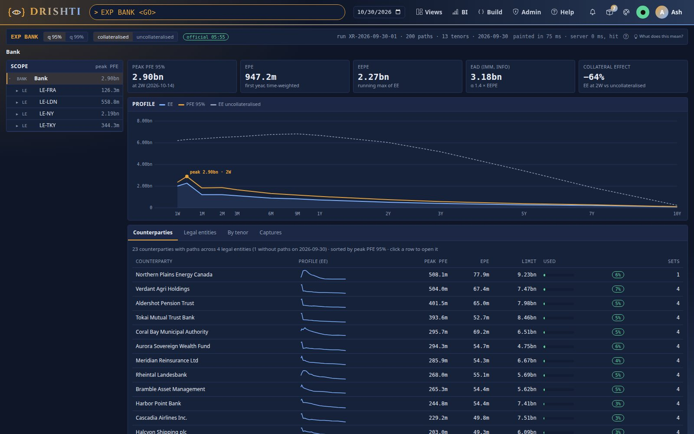
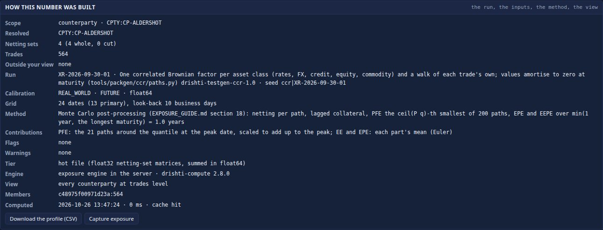
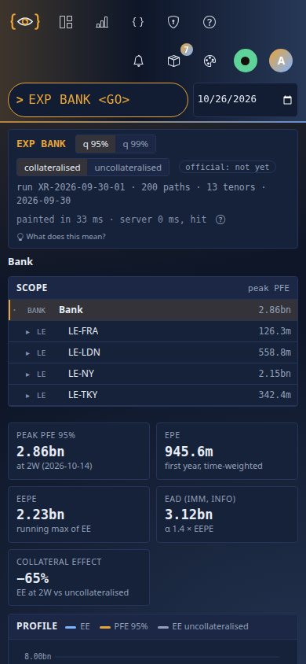
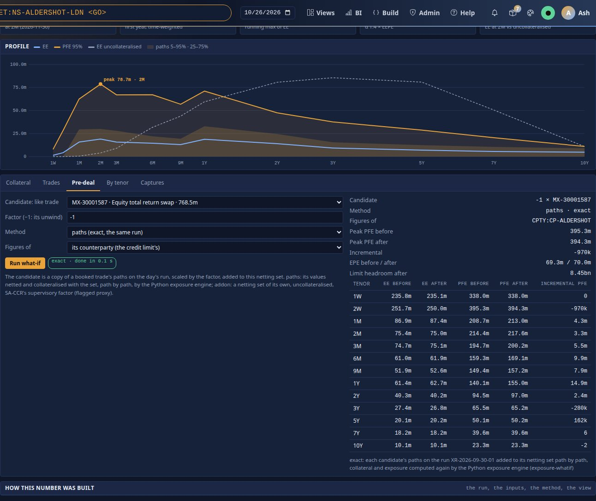
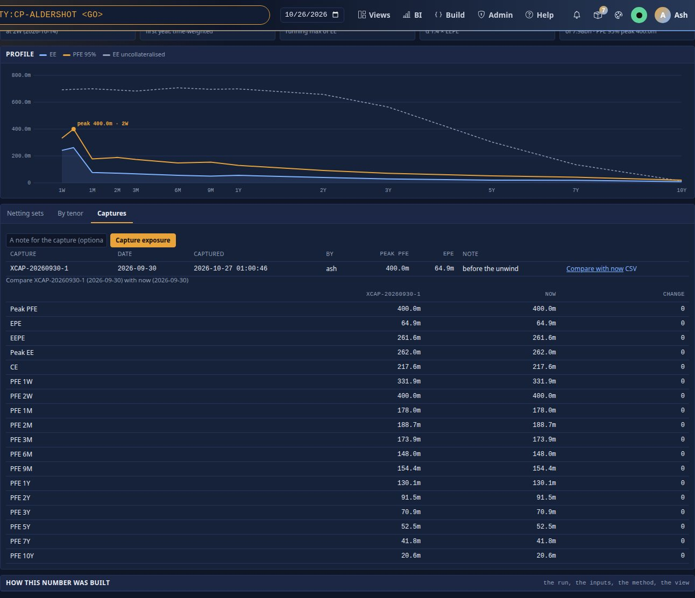
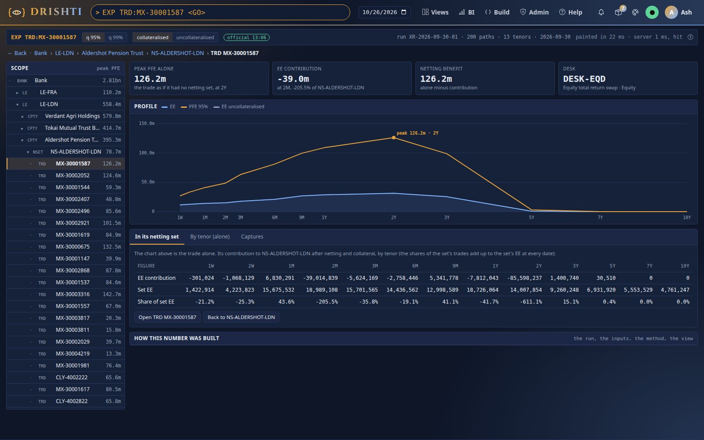
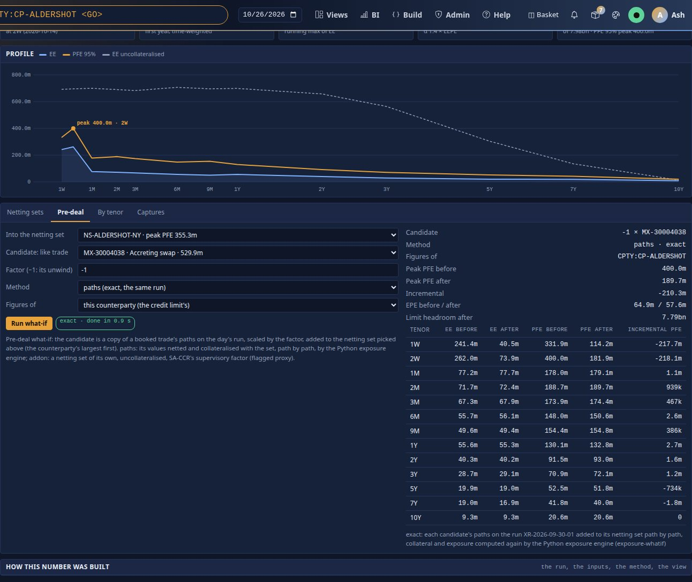

<!--
  Project Drishti · Any data. Any domain. One grammar.

  Copyright (c) 2026 Ashutosh Sinha <ajsinha@gmail.com>.
  All rights reserved.

  PROPRIETARY AND CONFIDENTIAL.

  This file is the confidential and proprietary property of Ashutosh Sinha.
  Unauthorised copying, use, modification, distribution or disclosure of this
  file, via any medium, is strictly prohibited except with the express prior
  written permission of the copyright holder.

  See the LICENSE file in the root of this repository for the full terms.
-->
# Exposure in Drishti: the complete guide

Built in 2.9.0. This is the one reference for Drishti's counterparty exposure: what every number means and how it is computed (EE, ENE,
EEE, PFE, EPE, EEPE, EAD), the explorer screen by screen, scopes from the bank to a trade, collateral and netting, captures and compare,
the pre-deal what-if, exposure as a kind, who sees what, the command line, the API and the settings (Part I); the data contract: every
input column, formula, answer, error code, the official results, retention, the retirement of the stored profiles and the change table
(Part II); how the engine holds a date's netting-set path matrices in memory and on local disk, its sizes and what is still open (Part
III). The hands-on walk-through is [tutorial 26](../tutorials/26-exposure-from-the-bank-to-a-trade.md) (the test data, from the bank to a
trade). In the console, **F1** on the explorer (or its **?**) opens this guide.

On 2026-10-26 the product owner's rule for measures (each measure has exactly two documents, the guide and one tutorial, and two help
entries) folded the exposure data contract `EXP.md` into Part II of this guide;
the contract is kept as history in the [archive](../archive/README.md). Where the original proposal said otherwise, the code wins and the difference is stated (**As built:**).
VaR follows the same rule: [VAR_GUIDE.md](VAR_GUIDE.md) and tutorial 25.

Every number below that is not a hand-made example is the engine's on the demo lake that `drishti.py lake demo` builds by default
(`--exposure demo`): the run `XR-2026-09-30-01` (business date 2026-09-30, 200 paths, 24 grid dates of which 13 primary) generated for
every netting set of 23 of the 24 counterparties (74 netting sets, 8,022 live trades), on the data's own dates (`--as-of data`).
The committed run of eight netting sets (523 trades) is a subset with the same figures; the netting-set and CP-ALDERSHOT figures are also those of
`drishti-compute/src/test/resources/ccr/reference.json`, which `ExposureParityTest` checks the Java engine against (to 1e-6 USD on the
heap). [Section 23](#23-test-data-and-generators) says how the data is made.

## Contents

**Part I · Using exposure**

1. [The question exposure answers](#1-the-question-exposure-answers)
2. [The measures, with worked numbers](#2-the-measures-with-worked-numbers)
3. [The explorer, screen by screen](#3-the-explorer-screen-by-screen)
4. [Scopes](#4-scopes)
5. [Collateral and netting](#5-collateral-and-netting)
6. [Captures and compare](#6-captures-and-compare)
7. [Pre-deal what-if](#7-pre-deal-what-if)
8. [Exposure as a kind](#8-exposure-as-a-kind)
9. [Who sees what: entitlements and audit](#9-who-sees-what-entitlements-and-audit)
10. [The command line](#10-the-command-line)
11. [The API](#11-the-api)
12. [Settings](#12-settings)
13. [Troubleshooting](#13-troubleshooting)

**Part II · The data contract**

14. [The contract at a glance](#14-the-contract-at-a-glance)
15. [Inputs from upstream engines](#15-inputs-from-upstream-engines)
16. [Reference and master data read](#16-reference-and-master-data-read)
17. [Conventions specific to exposure](#17-conventions-specific-to-exposure)
18. [The computation](#18-the-computation)
19. [What Drishti answers](#19-what-drishti-answers)
20. [Official end-of-day results](#20-official-end-of-day-results)
21. [Validation, errors and data quality](#21-validation-errors-and-data-quality)
22. [Retiring the stored version](#22-retiring-the-stored-version)
23. [Test data and generators](#23-test-data-and-generators)
24. [Decisions, open questions and the change table](#24-decisions-open-questions-and-the-change-table)

**Part III · How the engine works and stores data**

25. [Where the engine lives](#25-where-the-engine-lives)
26. [One date in memory and the hot file](#26-one-date-in-memory-and-the-hot-file)
27. [Sizes, performance and retention](#27-sizes-performance-and-retention)
28. [Open items](#28-open-items)

## Part I · Using exposure

## 1. The question exposure answers

*How much could this counterparty owe us if it defaulted at some future date, on average and in a bad case, after netting and the
collateral we would hold?* Credit officers set limits on the bad case (PFE); the CVA desk prices the average (EE); regulatory capital
under an internal model uses the effective average (EEPE); a trader asks what a new trade does to a counterparty's PFE before dealing.

Drishti does not simulate markets or price trades. An upstream exposure simulator writes, every night, every live trade's value on every
Monte Carlo path at every date of a time grid (the table `exposure-path`, with the run's identity and grid in `simulation-run`). Every
trade uses the same paths, so values add path by path. Drishti then, for **any scope** (a netting set, a counterparty, a connected group,
a legal entity, a desk, a book, a list of trades, a rule over trades, the whole bank, or any combination with `+ - &`):

1. sums each netting set's trades on each path and date (the netting-set value V);
2. computes on each path the collateral the CSA would hold, called at the look-back date a margin period of risk earlier;
3. floors the collateralised value at zero (the exposure E), adds exposures of different netting sets path by path;
4. takes the mean over paths (EE), the quantile (PFE), the running maximum (EEE) and the first-year time averages (EPE, EEPE).

The stored `exposure-profile` records (figures that were never exposures of the trades: [section 22](#22-retiring-the-stored-version)) were
retired in 2.9.0; `EXP` is now computed when asked, like `VAR`.

## 2. The measures, with worked numbers

| Measure | What it is | Formula (per primary date t, P paths) | Adds up across netting sets? |
|---|---|---|---|
| **E** (exposure on a path) | what the counterparty owes after netting and collateral, never negative | `E = max(V − C − IM, 0)` | yes, path by path |
| **EE** (expected exposure) | the average exposure at t | mean of E over the paths | yes |
| **ENE** (expected negative exposure) | the average of what *we* owe them (reported negative) | mean of `min(V − C, 0)` | yes |
| **EEE** (effective EE) | EE that never falls: the running maximum | `EEE(t) = max(EEE(t−1), EE(t))` | no |
| **PFE_q** (potential future exposure) | the bad case at confidence q (95%, 99%) | the ⌈P·q⌉-th smallest E | no (a quantile) |
| **Peak PFE** (MPFE) | the largest PFE over the primary dates, and its date | `max_t PFE_q(t)` | no |
| **EPE** (expected positive exposure) | EE averaged over the first year (or the last maturity, if sooner) | `Σ EE(t) Δt / T` | yes when the horizons agree |
| **EEPE** (effective EPE) | EEE averaged over the same horizon: the regulatory figure | `Σ EEE(t) Δt / T` | no |
| **EAD (IMM)** | alpha × EEPE, alpha 1.4 (Basel CRE53); informational only | `1.4 × EEPE` | no |
| **CE** (current exposure) | today's exposure, from today's MtM and collateral | `Σ max(MtM − C − IM, 0)` | yes |

The formulas, with the horizon rule, the collateral and the quantile rule, are in [section 18](#18-the-computation).

### 2.1 By hand: the contract's worked example

**One netting set** of two trades A and B, **4 paths**, **3 primary dates** t₁ = 0.25, t₂ = 0.5, t₃ = 1.0 years. Amounts in USD millions.
The CSA has thresholds TH_them = TH_us = 1, MTA 0, IA 0, no rounding. The look-back values L are the set's value at t − MPOR on the same
path (given; in a real run they are the look-back grid dates).

| Path | A (t₁, t₂, t₃) | B (t₁, t₂, t₃) | V = A + B | L (look-back) |
|---|---|---|---|---|
| 1 | 3, 5, 2 | −1, −1, 1 | **2, 4, 3** | 1, 2, 3 |
| 2 | −2, −1, −3 | 1, 2, 1 | **−1, 1, −2** | −1, 0, −1 |
| 3 | 3, 4, 6 | −2, 0, −1 | **1, 4, 5** | 0, 3, 4 |
| 4 | 0, −2, −1 | 1, 0, −2 | **1, −2, −3** | 1, −1, −3 |

**Collateral** C = max(L − 1, 0) − max(−L − 1, 0): path 1: 0, 1, 2; path 2: 0, 0, 0; path 3: 0, 2, 3; path 4: 0, 0, −2 (we posted 2 at t₃).
**Exposure** E = max(V − C, 0) and negative exposure N = min(V − C, 0):

| Path | E (t₁, t₂, t₃) | N (t₁, t₂, t₃) |
|---|---|---|
| 1 | 2, 3, 1 | 0, 0, 0 |
| 2 | 0, 1, 0 | −1, 0, −2 |
| 3 | 1, 2, 2 | 0, 0, 0 |
| 4 | 1, 0, 0 | 0, −2, −1 (V − C = −3 + 2 = −1) |

| Figure | t₁ = 0.25 | t₂ = 0.5 | t₃ = 1.0 |
|---|---|---|---|
| EE = mean E | (2+0+1+1)/4 = **1.0** | (3+1+2+0)/4 = **1.5** | (1+0+2+0)/4 = **0.75** |
| ENE = mean N | −0.25 | −0.5 | −0.75 |
| PFE 75% = 3rd smallest of 4 (⌈4 × 0.75⌉ = 3) | sorted 0,1,1,2 → **1** | 0,1,2,3 → **2** | 0,0,1,2 → **1** |
| PFE 95% (⌈3.8⌉ = 4th: the largest) | 2 | 3 | 2 |
| EEE (running max of EE) | 1.0 | 1.5 | 1.5 |
| EE without collateral = mean max(V, 0) | 1.0 | 2.25 | 2.0 |

With Δt = 0.25, 0.25, 0.5 and T = 1 year (t₀ ignored here, CE = 0):
- **EPE** = (1.0 × 0.25 + 1.5 × 0.25 + 0.75 × 0.5) / 1 = **1.0**
- **EEPE** = (1.0 × 0.25 + 1.5 × 0.25 + 1.5 × 0.5) / 1 = **1.375** (the running max keeps 1.5 after t₂: EEPE > EPE)
- **PEAK_PFE (75%)** = 2 at t₂; without collateral it would be 4 (sorted 0, 1, 4, 4 at t₂): collateral halves the peak.
- **EAD_IMM** (informational) = 1.4 × 1.375 = **1.925**.
- **EE contribution** at t₂ without collateral: paths with V > 0 are 1, 2, 3 (V = 4, 1, 4); A contributes (5 − 1 + 4)/4 = 2.0, B (−1 + 2 + 0)/4 =
  0.25; 2.0 + 0.25 = 2.25 = the uncollateralised EE at t₂.

[CVA.md](../contracts/CVA.md) section 15 prices CVA from this profile; [WWR.md](../contracts/WWR.md) section 15 adds credit paths to it.

### 2.2 On the test data

**One netting set: NS-ALDERSHOT-LDN** (159 live trades, CSA thresholds 10m each way, MPOR 10 business days). Its net MtM today is
**−139.1m** (the bank owes Aldershot) and the bank has **posted 112.2m** of collateral, so today's exposure CE is 0. The engine's profile
(USD, collateral lagged, PFE at 95%):

| Tenor | Date | EE | ENE | EEE | PFE 95% | PFE 99% | EE uncollateralised |
|---|---|---|---|---|---|---|---|
| 1W | 2026-10-07 | 2,197,414 | −37,553,650 | 2,197,414 | 15,797,605 | 35,497,518 | 0 |
| 1M | 2026-10-30 | 15,744,605 | −22,167,433 | 15,744,605 | 63,596,710 | 91,457,505 | 343,409 |
| **2M** | 2026-11-30 | **19,520,460** | −23,735,800 | 19,520,460 | **85,063,192** | 125,420,947 | 3,535,713 |
| 6M | 2027-03-30 | 13,768,983 | −20,755,320 | 19,520,460 | 58,918,700 | 84,676,236 | 23,106,636 |
| 1Y | 2027-09-30 | 16,654,426 | −12,896,602 | 19,520,460 | 58,929,323 | 90,130,996 | 59,294,083 |
| 5Y | 2031-09-30 | 6,792,488 | −8,632,088 | 19,520,460 | 29,290,737 | 43,976,231 | 86,723,737 |
| 10Y | 2036-09-30 | 4,245,352 | −2,766,622 | 19,520,460 | 10,193,935 | 11,079,915 | 7,080,517 |

Figures: EPE **14,738,051**, EEPE **18,764,913**, peak EE 19,520,460, **peak PFE 95% 85,063,192 at 2M**, PFE 99% 125,420,947, EAD
(IMM, informational) 1.4 × 18,764,913 = 26,270,878.

How to read it:
- **Collateral can raise exposure.** In the first months EE *with* collateral is above EE without: the bank has posted 112.2m that it
  would get back only a margin period later, so on paths where the swaps move in the bank's favour the posted collateral is at risk too.
  After a year the lagged collateral works the other way: at 5Y the uncollateralised EE is 86.7m, the collateralised 6.8m.
- **EEPE ≥ EPE.** EE peaks at 2M and falls; EEE keeps the peak, so EEPE (18.8m) is above EPE (14.7m).
- **PFE is the tail.** At 2M the 95% path is four times the mean, the 99% path six times.

**A counterparty: CP-ALDERSHOT** (its four netting sets: FRA, LDN, NY, TKY):

| Scope | CE | EPE | EEPE | Peak EE | Peak PFE 95% | at | PFE 99% |
|---|---|---|---|---|---|---|---|
| NS-ALDERSHOT-FRA (35 trades, horizon 0.44 years) | 0 | 1,837,009 | 18,431,387 | 19,151,377 | 30,610,762 | 2W | 35,243,869 |
| NS-ALDERSHOT-LDN (159) | 0 | 14,738,051 | 18,764,913 | 19,520,460 | 85,063,192 | 2M | 125,420,947 |
| NS-ALDERSHOT-NY (254) | 212,580,686 | 37,365,431 | 226,486,573 | 226,486,573 | 355,255,470 | 2W | 385,459,359 |
| NS-ALDERSHOT-TKY (21) | 4,984,320 | 11,991,049 | 17,655,800 | 17,987,495 | 61,396,882 | 2M | 72,781,990 |
| **CPTY:CP-ALDERSHOT** | **217,565,006** | **64,894,762** | **261,628,419** | 262,023,876 | **399,970,549** | 2W | 423,220,721 |

- **CE and EE add up**: 0 + 0 + 212.58 + 4.98 = 217.57m is the counterparty's CE.
- **EPE adds up only over one horizon.** The FRA set's EPE is over its own 0.44 years (its last repo matures then); the counterparty's
  horizon is a year, so the four EPEs (65.9m) do not sum to 64.9m. EE, path by path and date by date, always adds.
- **PFE does not add up.** The four peaks sum to 532.3m; the counterparty's peak is 400.0m. Exposures of separate netting sets add path
  by path (they do not net against each other), but their bad cases fall on different paths and dates, so the quantile of the sum is
  below the sum of the quantiles. That is why Drishti sums path matrices, never stored PFEs.

**The bank and its legal entities** (the demo lake on the data's own date, `--as-of data`: 74 netting sets with paths of 76, 8,022
live trades; `drishti.py exposure show BANK`, `tree`; tutorial 26 steps 1 and 2):

| Scope | Peak PFE 95% | EPE | Note |
|---|---|---|---|
| **BANK** | **2,858,060,180** at 2W (PFE 99% 3,105,286,752) | 945,577,981 | EEPE 2,229,170,152, peak EE 2,234,312,582, CE 1,532,007,701, EAD (info) 3,120,838,213 |
| LE:LE-NY | 2,147,576,084 | 487,884,025 | |
| LE:LE-LDN | 558,766,819 at 2M | 275,306,484 | EEPE 326,469,672; 17 netting sets, 2,403 trades |
| LE:LE-TKY | 342,353,840 | 173,537,427 | |
| LE:LE-FRA | 126,325,566 | 20,316,140 | |

The legal entities' peaks sum to 3.18 bn against the bank's 2.86 bn: the same diversification as above. Collateral matters most at the
bank: at 2W the bank's EE is 2.23 bn collateralised against 6.30 bn uncollateralised. In the explorer the figures come from the hot
file, float32 matrices summed in float64, so a counterparty's or netting set's figures can differ from the float64 ones above in the
last dollars (CP-ALDERSHOT's peak PFE reads 399,970,560 there against 399,970,549 on the heap; [section 26](#26-one-date-in-memory-and-the-hot-file)).

At CP-ALDERSHOT the **PFE contributions** (the shares that add up to its peak) are NS-ALDERSHOT-NY 348,369,072 (87.1%), TKY 22,470,544,
FRA 20,344,010 and LDN 8,786,935: LDN's peak alone is 85.1m but it peaks at 2M, while the counterparty peaks at 2W, when LDN's exposure
is small. Its stored credit limit LIM-ALDERSHOT is 7,980,000,000, so the limit used reads 5.0% ([section 28](#28-open-items)).

## 3. The explorer, screen by screen

### 3.1 Open it

| Way in | Opens |
|---|---|
| `EXP <GO>` | the bank |
| `EXP NSET:NS-ALDERSHOT-FRA <GO>`, or spaced: `EXP NSET NS-ALDERSHOT-FRA <GO>` | a netting set (`EXP CPTY CP-ALDERSHOT`, `EXP GROUP GRP-ALDERSHOT`, `EXP LE LE-NY`, `EXP TRD <trade>` the same way) |
| `EXP CPTY:CP-ALDERSHOT - NSET:NS-ALDERSHOT-FRA <GO>` | any scope text ([section 4](#4-scopes)) |
| `/exposure?scope=<scope>` (optional `q`, `collateral`, `asOf`) | the same, as a link |
| the netting-set and counterparty pages | their figures under `EXPOSURE_ENGINE` link here |
| `EXP EXP-ALDERSHOT-FRA <GO>`, `/v/exposure-profile/EXP-ALDERSHOT-FRA` | a retired stored id: the same netting set, with a notice ("EXP-ALDERSHOT-FRA was a stored exposure profile, retired in 2.9.0 …") |

The page is `drishti-console/web/templates/terminal/exposure.html`, filled by `web/static/js/exposure-explorer.js` from the console's
same-origin `/api/exposure/...`, which asks the server's `/api/v1/exposure` as you (so your entitlements apply as on every screen). The
computed kind `exposure-result` stays an ordinary kind too (`/v/exposure-result/<scope>`, [section 8](#8-exposure-as-a-kind)).

### 3.2 The screen

From top to bottom:

- **The command line**: `EXP <scope>` as asked; the switches **q 95% / q 99%** (the PFE confidence) and **collateralised /
  uncollateralised** (`collateral=lagged` or `none`); the **official** chip (whether the business date's official end-of-day capture
  exists, [section 20](#20-official-end-of-day-results)); the run (`run XR-2026-09-30-01 · 200 paths · 13 tenors · 2026-09-30`); the time
  from the click to the painted headline and the server's compute time and cache state; **?** (help: this guide).
- **The breadcrumb** with **Back**: Bank › legal entity › counterparty › netting set › trade. Every click on the tree, the board, a
  netting set or a trade moves the whole screen to the new scope in place, with no page load; Back returns to the scope before.
- **The tree** (left): the bank, the legal entities, their counterparties (largest peak PFE first), the netting sets and, under the
  open netting set, its trades with the largest EE contribution; each row shows its peak PFE. A netting set the run has no paths for is
  marked and opens the no-paths state ([section 13](#13-troubleshooting)).
- **The tiles** (the headline): **Peak PFE** at the chosen q (with its tenor and date), **EPE** (first year, time-weighted), **EEPE**
  (running max of EE), **EAD (IMM, info)** (α 1.4 × EEPE), and either **Limit used** (a counterparty with a stored credit limit: peak PFE
  at the limit's confidence over the limit, coloured by use) or **Collateral effect** (EE at the peak tenor against the
  uncollateralised EE: "−65%" when collateral lowers it by 65%, "+452%" when posted collateral raises it, as on NS-ALDERSHOT-LDN, where
  the bank has posted 112.2m). A trade's tiles are different: **Peak PFE alone** (the trade as if it had no netting set), **EE contribution**
  (its share of its netting set's EE at the set's peak date), **Netting benefit** (alone minus contribution) and **Desk**.
- **The profile chart**: EE, PFE at q and EE uncollateralised over the primary dates, the peak marked; at a netting set the **path fan**
  (the 5–95% and 25–75% bands of the paths' exposures at every primary date, from `distribution?bands=true`).
- **The tabs**, by the scope's level (Captures is on every level):

| Level | Tabs |
|---|---|
| Bank | **Counterparties** (the board), **Legal entities**, By tenor, Captures |
| Legal entity, group | **Counterparties** (the board), By tenor, Captures |
| Counterparty | **Netting sets**, **Pre-deal**, By tenor, Captures |
| Ad-hoc scope | **Netting sets**, By tenor, Captures |
| Netting set | **Collateral**, **Trades**, **Pre-deal**, By tenor, Captures |
| Trade | **In its netting set**, By tenor (alone), Captures |

- **How this number was built** (folded): the run, the inputs' versions, the method, the view, the flags, the collateral model; buttons
  **Download the profile (CSV)** and **Capture exposure**.






On a phone the panels stack: the command line, the tree, then the tiles and the chart:



### 3.3 The tabs

- **Counterparties** (the board): one row per counterparty: a small EE profile, peak PFE, EPE, the stored **limit** and **used**
  (the computed peak PFE at the limit's confidence over the limit), the number of netting sets; 25 rows at a time, largest first; a row
  opens the counterparty. The limit is the `credit-limit` record read as stored (`drishti.ccr.exposure.kinds.limit`); LIM stays parked,
  see [section 28](#28-open-items) on its low utilisation.
- **Legal entities** (bank): per legal entity its EE profile, peak PFE, EPE, netting sets and share of the bank's peak.
- **Netting sets** (counterparty or ad-hoc): per set its CSA, EE profile, EPE, **peak PFE alone** and **PFE contribution** (the shares
  that add up to the scope's peak, [section 18](#18-the-computation), 18.6) and share; a total row.
- **Collateral** (netting set): the CSA (thresholds them / us, minimum transfers, independent amount, rounding, MPOR and remargin
  frequency), at the peak tenor EE without collateral, the mean collateral on the paths, EE with collateral and the *Effect of collateral* (signed: −65% lower, +452% higher); today's net
  MtM, collateral held (net), initial margin held, the trades, the collateral model, the look-back used, the `MPOR_MISMATCH` flag and
  the dates that keep today's collateral (no look-back point after today).
- **Trades** (netting set): every trade, 25 a page, by EE contribution at the set's peak date (read from the lake on request): product,
  desk, EE contribution, share, **peak PFE alone**; a row opens the trade's exposure, its id opens `TRD`.
- **Pre-deal** (netting set and counterparty): the pre-deal what-if form, [section 7](#7-pre-deal-what-if); on a counterparty it first asks which of its netting sets the new trade goes into.
- **By tenor**: the profile as a table (EE, ENE, EEE, PFE at q, PFE 99%, EE uncollateralised per tenor), with the CSV link and the CLI and
  API equivalents.
- **Captures**: capture now with a note, the scope's captures (id, date, captured, by, peak PFE, EPE, note), **Compare with now**,
  **Compare the two newest**, each capture's CSV; [section 6](#6-captures-and-compare).






### 3.4 A trade: alone, in its set, the netting benefit

`EXP TRD:<id>` (or a click on a trade) shows the trade **alone**: as its own netting set, uncollateralised, its own profile and peak
PFE. The tab **In its netting set** shows, per tenor, its **EE contribution** to its netting set after netting and collateral, the set's
EE and the share (the shares of a set's trades add up to the set's EE at every date). The tile **Netting benefit** is the peak PFE alone
less the contribution: a trade that offsets its set has a large benefit, often a negative contribution. Buttons open `TRD <id>` and go
back to the set.



### 3.5 The no-paths state

A netting set or counterparty the reference data knows but the run does not cover shows only "no exposure paths for the netting set NS-…
on <date>" and a note: the engine computes from the day's simulated paths; nothing is shown, never an old figure. In the default demo lake the
three netting sets of CP-SUMMIT and CP-NORTHPLAINS have no paths; with `lake demo --exposure committed` 68 of the 76 have none
([section 23](#23-test-data-and-generators)).

## 4. Scopes

A scope is text: one word or several joined with `+` (union), `-` (difference) and `&` (intersection), the grammar of VaR's scopes
([VAR_GUIDE.md section 5](VAR_GUIDE.md#5-scopes-portfolios-and-baskets)) with the counterparty words added.

| Word | Means | Example on the test data |
|---|---|---|
| `BANK` | everything with paths | `EXP BANK` |
| `NSET:<id>` | a netting set (with or without `NS-`) | `NSET:NS-ALDERSHOT-LDN` |
| `CPTY:<id>` | a counterparty's netting sets (with or without `CP-`) | `CPTY:CP-ALDERSHOT` |
| `GROUP:<id>` | a connected group's counterparties (`counterparty-group`) | `GROUP:GRP-ALDERSHOT` |
| `LE:<id>` | the trades booked by a legal entity (`LE:NY` is `LE-NY`) | `LE:LE-LDN` |
| `DESK:<desk>`, `BOOK:<book>` | the trades' `DESK`, `TT_BOOK` (cut netting sets: `partial`) | `DESK:RATES & CPTY:CP-ALDERSHOT` |
| `TRD:<ids>` | trades only, uncollateralised (`standalone`) | `TRD:CLY-4003028` |
| `WHERE:<rule>` | a rule over the trades' columns | `WHERE:ASSET_CLASS = 'Rates' & CPTY:CP-ALDERSHOT` |

Examples: `CPTY:CP-ALDERSHOT - NSET:NS-ALDERSHOT-NY` (Aldershot without New York), `NSET:NS-ALDERSHOT-LDN + NSET:NS-AURORA-TKY` (two sets
together: their exposures add path by path), `LE:LE-TKY & CPTY:CP-ALDERSHOT`.

Scope grammar of VAR_GUIDE.md section 5 with the counterparty terms of NSET.md section 8 (`NSET:`, `CPTY:`, `GROUP:`, `LE:`).

| Scope | How the exposure matrix is formed | Cost |
|---|---|---|
| `NSET:<id>` | the set's `EMAT` (statistics precomputed) | microseconds |
| `CPTY:<id>` | Σ of its sets' `EMAT` (statistics precomputed at load) | microseconds; a few ms for contributions |
| `GROUP:<id>` | Σ of its counterparties' sets | ms |
| `LE:<id>` | EE, ENE, EPE: sums of set statistics; PFE: a batch job | ms / job |
| a scope that cuts sets (`DESK:RATES & CPTY:CP-X`) | per touched set, V recomputed from the scope's trades (lake read), then collateral and E as if those trades were the set (`partial`) | seconds |
| `TRD:<ids>` (a trade alone) | the trade as its own set, uncollateralised | ms (lake read) |

**Additive:** V per path across trades; E per path across netting sets; EE, ENE, EPE across netting sets. **Not additive:** PFE, peaks,
EEE, EEPE, contributions to them.

**As built (2.9.0):** the words `BANK`, `NSET:` (ids, with or without `NS-`), `CPTY:` (with or without `CP-`), `GROUP:` (the
`counterparty-group` members), `LE:` (the trade's legal entity; `LE:NY` is `LE-NY`), `DESK:`, `BOOK:` (the trades' `DESK` and `TT_BOOK`),
`TRD:` (ids in any case; a scope of trades only is `standalone`: uncollateralised) and `WHERE:` (a rule over the trades' `NETTING_SET`,
`COUNTERPARTY`, `LEGAL_ENTITY`, `DESK`, `TT_BOOK`, `ASSET_CLASS`, `PRODUCT`, `SOURCE_SYSTEM`, `MATURITY_DATE`, `NOTIONAL`, `MTM`), joined with
`+ - &` (VaR's parser, `ScopeExpr`, with `NSET` and `GROUP` added). `DIV:`, `NODE:`, `POS:`, `PORT:`, `BASKET:`, `CAPTURE:` are VaR's:
`400 DRS-5440`. A scope sums every netting set it touches interactively up to `max-scope-netting-sets`; the official capture has no limit.
A netting set or counterparty the reference data knows that the run does not cover answers `404 DRS-1001` "no exposure paths for the
netting set NS-… on <date>" (the computed kind: `STATUS: no-paths`), never stale numbers.

## 5. Collateral and netting

**Netting** happens inside a netting set only: its trades' values add path by path (V), so a payer and a receiver swap offset. Across
netting sets nothing nets: their *exposures* (already floored at zero) add path by path.

**Collateral** is per netting set, from its CSA ([NSET.md section 3.5](../contracts/NSET.md)) and today's holdings (`collateral-balance`):

- **lagged** (the default): on each path the collateral at date t is what the CSA called at the look-back date t − MPOR (thresholds,
  minimum transfer amounts, independent amount, rounding applied to the change from today's collateral). A date whose look-back would
  fall on or before today (1W and 2W on a 10-day MPOR) keeps today's collateral: nothing called later settles in time.
- **current**: today's collateral held constant on every path.
- **none**: no collateral and no initial margin (the explorer's **uncollateralised** switch; `TRD:` scopes are always uncollateralised).
- **initial margin** held today is kept on every path (`im-model: current`); IM the bank posts, segregated, adds nothing.

The **Collateral** tab shows the CSA and its effect at the peak tenor; the profile chart's dashed line is EE uncollateralised. Collateral
reduces exposure when the bank holds it and can raise it when the bank has posted it (NS-ALDERSHOT-LDN, [section 2](#2-the-measures-with-worked-numbers)).
When a CSA's MPOR (plus remargin frequency − 1) differs from the run's look-back, the run's look-back is used and the answer is flagged
`MPOR_MISMATCH` (decided 2026-10-26). The formulas are [section 18](#18-the-computation), 18.3.

A scope that cuts a netting set (a desk inside a counterparty) recomputes the set's value from the scope's trades, read from the lake,
and applies the set's CSA to them as if they were the set (flag `partial`).

## 6. Captures and compare

A **capture** freezes a scope's answer: the figures, the profile, the netting sets, the flags, the member trade ids (for a viewer who sees
them) and the provenance; never paths. Ids are `XCAP-<yyyymmdd>-<n>`, kept per owner in the content store (`exposure/captures/`).

| Where | How |
|---|---|
| Explorer | the **Captures** tab: a note, **Capture exposure**; or **Capture exposure** under *How this number was built* |
| CLI | `drishti.py exposure capture CPTY:CP-ALDERSHOT --note 'before the unwind'`; `captures [--scope]`; `compare XCAP-20260930-1 now` |
| API | `POST /api/v1/exposure/captures {scope, note, q, collateral}` (a token needs `risk:write`); `GET /captures?scope=`, `GET /captures/{id}`, `GET /captures/{id}/csv` |

**Compare** two captures, or a capture with **now** (the scope computed again): peak PFE, EPE, EEPE, peak EE and CE side by side with
the change, PFE per tenor, and the trades added and removed. `GET /api/v1/exposure/compare?a=<id>&b=<id|now>`. A capture's CSV is the `#
field: value` lines and then the profile.

## 7. Pre-deal what-if

*What does this trade do to the counterparty's PFE before I deal?* Two methods:

| Method | How | Where it runs | Flag |
|---|---|---|---|
| **`paths`** (exact) | the candidate's values on every path of **the same run** are added to its netting set's V; the set's collateral and exposure are computed again, then the scope's figures; incremental = with − without, per figure and per primary date | the **Python exposure engine** (`drishti_compute.exposure.whatif`, reactive connector `exposure-whatif`, compute pool `exposure`) | none (`exact`) |
| **`addon`** (conservative proxy) | the candidate as a netting set of its own, no netting, no collateral: PFE add-on `max(MTM, 0) + z_q · SF · d · |δ| · sqrt(min(t, M))`, EE add-on with `1/sqrt(2π)` in place of z_q, with SA-CCR's supervisory factor SF | the Java engine | `proxy` |

**The `paths` method needs compute on.** The Python engine runs in Drishti's compute pool: start the server with
`DRISHTI_COMPUTE_ENABLED=true` (the pool `exposure` in `config/compute/compute.yaml`, standard library only, up to
`DRISHTI_COMPUTE_EXPOSURE_WORKERS` workers, 2 GB each). Without it `method: paths` answers `503 DRS-5446` ("the exact what-if … runs in
the Python exposure engine … which is not running on this server; ask method addon for the conservative proxy"); `addon` always works.

**The candidate.** A candidate's paths are one of:
- `{copyOf: <trade>, factor}`: a booked trade's paths on the run, scaled (`factor: -1` is its unwind) — what the explorer and
  `--like` use;
- `{runId, mtm}`: G lists of P numbers (or one list of G × P, grid-date-major);
- `{runId, arrow}`: base64 Arrow IPC with `GRID_INDEX` and `MTM` as a fixed-size list of P.

Paths of another run or another length are refused (`400 DRS-5442`). A candidate with `nettingSet` joins that set (netting and
collateral with it); without, it is a netting set of its own, uncollateralised. For `addon` give `assetClass`, `notional`,
`maturityDate`, `mtm` and `delta`.

**In the explorer** (a netting set's **Pre-deal** tab): *Candidate: like trade* (one of the set's trades), *Factor* (−1: its unwind),
*Method* (`paths (exact, the same run)` or `addon (conservative proxy)`), *Figures of* (its counterparty, the credit limit's scope, or this
netting set), **Run what-if**. The chip says **exact** or **proxy** and the time; the answer: peak PFE before and after, the incremental
(red when it adds), EPE before and after, the limit headroom after (when q is the limit's confidence) and a per-tenor table of EE and
PFE before and after with the incremental PFE.

**On a counterparty** (its **Pre-deal** tab, 2.9.2): the same pre-deal what-if, with one field more, *Into the netting set*: the
counterparty's netting sets, the largest by peak PFE first (picked by default); the candidates are that set's trades, and changing the
set lists its trades. *Figures of* is **this counterparty** (the credit limit's scope, the default) or the netting set picked. The
answer has the same layout as the netting set's tab: before, after, the incremental, the limit headroom and the table by tenor.



`--method addon`, or `--candidates new-swap.json`. **API**: `POST /api/v1/exposure/what-if`, [section 11](#11-the-api).

**How the exact method gets its inputs**: the Java engine serves them as the asking person through the computed kind `exposure-result`
with `detail=whatif` (the scope's E and N matrices, G_primary × P, the grid, the horizon, the candidate sets' ids) and `detail=set` (a
netting set's V, G × P, E, N, CSA terms, holdings); the candidates go into the person's private sandbox, the connector is asked as them,
and the sandbox is deleted after. The engine is deterministic (no random numbers) and reproduces the Java maths
(`drishti_compute.exposure.measures`, tested against the worked example and the test data). Details: [section 19](#19-what-drishti-answers), 19.5.

## 8. Exposure as a kind

| Kind | Command | Class | What |
|---|---|---|---|
| `exposure-result` | `EXP <scope>` | computed (reactive connector `exposure-engine`, Java `ExposureResultEngine`) | a scope's figures, profile, netting sets, flags, provenance |
| `exposure-whatif` | `XWIF <scope>` | computed (reactive connector `exposure-whatif`, Python, pool `exposure`) | a scope before and after the candidates in the person's sandbox, exact |
| `simulation-run` | `XRUN` | input | the run's identity and grid |
| `exposure-path` | `XPATH` | input (Delta connector `exposure-store`) | every trade's MtM on every path at every grid date |

The id of a computed answer is the scope text with parameters after `~`: `CPTY:CP-ALDERSHOT~q=0.99`. `exposure-result` takes `q`,
`collateral` (`lagged`, `current`, `none`), `run` (empty: the newest complete run), and, for the Python engine, `detail` (`none`, `whatif`,
`set`) and `sets`. `exposure-whatif` takes `sandbox`, `q`, `collateral` and `sets`; its result has `BEFORE_`, `AFTER_` and `CHANGE_` of
`EPE`, `EEPE`, `PEAK_PFE`, `PEAK_EE`, `CE`, a `profile` table and an `items` table. Both kinds' contracts are generated pages in
`docs/contracts/` (`exposure-result.contract.yaml`, `exposure-whatif.contract.yaml` in the pack).

Because they are kinds, the usual tools work: `/v/exposure-result/NSET:NS-ALDERSHOT-FRA`, Sutra pages (the netting-set and counterparty
pages read the engine's figures under `EXPOSURE_ENGINE`: EPE and peak PFE 95% in the strip, the profile panel, a "how it was computed"
panel), Calc (`exposure_profile_stats.py`, `cva_from_ee.py`, `collateral_mpor_mc.py`, `concentration_hhi.py`, the core pack's
`group_exposure.py`), BI over the published official results. Large `detail=whatif` answers pass through the connector cache: see
[section 28](#28-open-items).

## 9. Who sees what: entitlements and audit

As NSET.md section 11 (counterparty coverage, restricted list, masks, aggregate-only). In addition: a role at `aggregate` for a
counterparty sees its profile but not `BY_NETTING_SET` rows below its level nor trade contributions; captures never store trade paths;
the what-if sandbox is private (REACTIVE_CONNECTOR.md); `ccr-view`, `ccr-whatif` and `ccr-capture` are audited with scope, run and
counts.

**As built (2.9.0):** `drishti.ccr.exposure.access.<role>[<counterparty, group or legal entity>]` is `trades`, `aggregate` or `none`; a
netting set takes the widest level of its counterparty, the counterparty's group and its legal entity; a role with no entry sees all at
`trades` when it may open `exposure-path`. A scope naming trades (`TRD:`, `DESK:`, `BOOK:`, `WHERE:`) needs `trades` on every set it
touches (`403`). The `counterparty` kind's `NAME` mask shows the id in labels. The restricted (wall-crossed) list is not built. Audited:
`ccr-view`, `ccr-export`, `ccr-capture`, `ccr-whatif`, `ccr-official`, `ccr-reload`.

| Action | Console (a person) | Token |
|---|---|---|
| read figures, profile, distribution, contributions, tree, captures, compare | any user who may open the scope | `read` |
| `POST /what-if` | any user who may open the scope (`trades` on the sets the candidates join for `paths`) | `read` |
| `POST /captures` | any user | `risk:write` |
| `POST /reload`, `POST /official` | administrators | never (an administrator in the console) |

## 10. The command line

`drishti.py exposure <command>` (`tools/expcli.py`) asks `/api/v1/exposure` as the token's user (`--server`, `--token` or the
environment, as every `drishti.py` group). Exit codes: 0, 1 (the server said no), 2 (usage). Every scope command takes `--date
YYYY-MM-DD` (default the newest with paths), `--q Q` (default 0.95), `--collateral lagged|current|none` and `--json`.

| Command | What | Example |
|---|---|---|
| `show <scope>` | the figures in a few lines (peak PFE and its tenor, PFE 99%, EPE, EEPE, peak EE, CE, EAD, the limit and its use, the run, flags) and the profile as a table | `drishti.py exposure show NSET:NS-ALDERSHOT-NY` |
| `parts <scope>` | contributions: `--by child|netting-set|counterparty|legal-entity|trade|asset`, `--figure PFE|EE|EPE`, `--at TENOR|DATE` (EE), `--top N` (25) | `drishti.py exposure parts NSET:NS-ALDERSHOT-NY --by trade --figure EE --top 10` |
| `tree` | the bank, legal entities, counterparties and netting sets with peak PFE, EPE and limit use (`--date`, `--q`) | `drishti.py exposure tree` |
| `profile <scope>` | the profile; `--csv` writes the CSV | `drishti.py exposure profile NSET:NS-ALDERSHOT-NY --csv > ns-ny.csv` |
| `distribution <scope>` | the exposure distribution at a primary date (`--at 1Y`): histogram, quantiles, mean, share at zero, and the path fan | `drishti.py exposure distribution NSET:NS-ALDERSHOT-NY --at 1Y` |
| `status` | the engine's settings, hot files and loaded dates | `drishti.py exposure status` |
| `capture <scope>` | capture now (`--note`) | `drishti.py exposure capture CPTY:CP-ALDERSHOT --note 'before the unwind'` |
| `captures` | the captures you may read, newest first (`--scope`) | `drishti.py exposure captures` |
| `compare <a> [b]` | two captures, or a capture with `now` | `drishti.py exposure compare XCAP-20260930-1 now` |
| `official` | the date's official end-of-day record (`--date`); `--capture` takes it now (administrators) | `drishti.py exposure official` |
| `retention` | what the retention keeps of each date held, and the dates whose trade paths are beyond their window | `drishti.py exposure retention` |
| `reload` | drop the loaded dates (administrators): the next request maps the hot file again or reads the lake | `drishti.py exposure reload` |
| `whatif <scope>` | a pre-deal what-if: `--like TRADE` (`--factor`, default 1; −1 its unwind), `--set NETTING_SET` (default a set of its own), or `--candidates FILE.json`; `--method paths|addon` (default `paths`) | `drishti.py exposure whatif CPTY:CP-ALDERSHOT --like CLY-4003028 --factor -1 --set NS-ALDERSHOT-FRA` |

Real output of each on the test data: [tutorial 26](../tutorials/26-exposure-from-the-bank-to-a-trade.md). Tests: `tools/test_expcli.py`.

## 11. The API

All under `/api/v1/exposure`. Every `GET` takes `asOf` (the business date; default the newest with paths), `q` (default
`limit-confidence`, 0.95), `collateral` (`lagged`, `current`, `none`); `/scope` also `run` and `strict`. Answers are camelCase (`epe`,
`peakPfe`, `profile[].pfe99`); the computed kind spells the same fields in UPPER_SNAKE.

| Method and path | Parameters | Answer |
|---|---|---|
| `GET /scope` | `scope`, `q`, `collateral`, `run` (the newest complete run), `strict` (`true`: a date whose run is not one run is refused instead of answered from the date before) | the figures, profile, netting sets, ancestors, limit, collateral, flags, provenance ([section 19](#19-what-drishti-answers)) |
| `GET /scopes/{scope}` | as above | the path form for a simple scope (`/scopes/NSET:NS-ALDERSHOT-FRA`) |
| `GET /scope/profile` | `scope`, `dates` (`primary` or `all`), `format=csv` | the profile only, for charts; CSV `tenor,date,t,ee,ene,eee,pfe,pfe_99,ee_uncoll` |
| `GET /scope/distribution` | `scope`, `date` (a primary date or tenor; default the peak), `bins` (`histogram-bins`, 42), **`bands`** (`true`: also the path fan, the 5, 25, 50, 75 and 95% quantiles of the paths' exposure at every primary date) | `histogram {edges, counts}`, `quantiles`, `mean`, `zeroShare`, `bands` |
| `GET /scope/contributions` | `scope`, `by` (`child`, `netting-set`, `counterparty`, `legal-entity`, `trade`, `asset`), `figure` (`EE`, `EPE`, `PFE`), `date` (EE), **`alone`** (`true`, by trade: each trade's peak PFE alone, uncollateralised, too), **`profile`** (`true`, by trade: each trade's EE contribution at every primary date) | rows `{key, scope, label, kind, value, pct, incremental}` (with `alone`: `peakPfeAlone`; with `profile`: `profile[]`), `total`, `date`, `parts`, `truncated` |
| `GET /tree` | `q` | the bank, legal entities, groups, counterparties (with their stored limit and use) and netting sets with EPE and peak PFE; sets without paths `noPaths` |
| `POST /what-if` | body `{scope, method: paths|addon, q, collateral, candidates: [{tradeId, label, nettingSet, paths: {copyOf, factor} | {runId, mtm} | {runId, arrow}, assetClass, notional, maturityDate, mtm, delta}]}` | `{base, with, incremental: {epe, peakPfe, profile[]}, method, flags, items, note}` ([section 7](#7-pre-deal-what-if)) |
| `POST /captures` | `{scope, note, q, collateral}` | the capture |
| `GET /captures`, `GET /captures/{id}`, `GET /captures/{id}/csv` | `scope` | your captures, one, its CSV |
| `GET /compare` | `a`, `b` (an id or `now`) | both, the change, PFE per tenor, trades added and removed |
| `GET /status` | | the settings, runs loaded, hot files, sizes |
| `GET /retention` | | each date held: what the retention keeps, the dates whose trade paths are beyond their window |
| `GET /official` | `asOf` | the official record of a date |
| `POST /official` | `asOf` | take the official capture now (administrators) |
| `POST /reload` | | drop the loaded dates (administrators) |

The computed kind `exposure-result` takes **`detail`** (`none`, `whatif`: the scope's exposure matrices for the Python engine, `set`: a
netting set's value matrix and CSA terms) with `sets` (the netting sets a candidate may join; empty: every set the scope covers whole, at
most 50); see [section 19](#19-what-drishti-answers), 19.5. Codes: [section 21](#21-validation-errors-and-data-quality). The full
endpoint list of Drishti is [API_GUIDE.md](API_GUIDE.md).

## 12. Settings

Every setting is under `drishti.ccr.exposure` in `application.yaml` (and [CONFIGURATION.md](../admin/CONFIGURATION.md#drishticcrexposure--the-exposure-engine)).

| Setting | Default | Meaning |
|---|---|---|
| `enabled` | `true` (`DRISHTI_EXPOSURE_ENABLED`) | the engine, the connectors `exposure-engine` and `exposure-whatif` |
| `confidence` | `[0.95, 0.99]` | PFE confidences computed for every answer (any q in (0.5, 1) may be asked) |
| `limit-confidence` | `0.95` | the PFE credit limits are set on; the default q |
| `rank-rule` | `kth` | `kth` (the ⌈P·q⌉-th smallest) or `interpolated` |
| `collateral-model` | `lagged` | `lagged`, `current`, `none` |
| `im-model` | `current` | `current` (IM held today on every path) or `none` |
| `alpha` | `1.4` | EAD_IMM = alpha × EEPE (informational) |
| `contribution-window` | `21` | paths around the PFE quantile a PFE contribution averages over |
| `hot-dates` | `2` | business dates kept open |
| `memory-budget-gb` | `0` (`DRISHTI_EXPOSURE_MEMORY_GB`; a quarter of the heap) | most memory a date's matrices take while it loads; over it `503 DRS-5445` |
| `hot-folder` | `${drishti.data.dir}/ccr/hot` (`DRISHTI_EXPOSURE_HOT_DIR`) | the hot files, a folder per date |
| `tier` | `mapped` (`DRISHTI_EXPOSURE_TIER`) | `mapped` (float32 hot file) or `heap` (float64 on the heap) |
| `disk-dates` | `60` | hot files kept on disk (least recently used beyond deleted, unless the retention keeps them) |
| `keep-on-shutdown` | `false` | delete the hot files at shutdown (and leftovers at start) |
| `close-grace-seconds` | `60` | an evicted date stays mapped this long for requests still reading it |
| `max-scope-netting-sets` | `20000` | most whole netting sets an interactive answer sums (more: `503 DRS-5443`) |
| `max-parts` | `5000` | most parts a contribution table computes |
| `histogram-bins` | `42` | bins of a distribution |
| `t0-tolerance` | `0.10` | a trade's paths' mean at the first grid date departing from today's MtM by more (or 5% of notional) is listed |
| `kinds.run`, `.paths`, `.netting-set`, `.csa`, `.collateral`, `.counterparty`, `.group`, `.hierarchy` | `simulation-run`, `exposure-path`, `netting-set`, `csa`, `collateral-balance`, `counterparty`, `counterparty-group`, `risk-hierarchy` | the kinds the engine reads |
| `kinds.limit` | `credit-limit` | the stored credit limits, read as stored (the explorer's and the tree's limit and use; LIM stays parked) |
| `access.<role>[<counterparty, group or legal entity>]` | `{}` | `trades`, `aggregate` or `none` ([section 9](#9-who-sees-what-entitlements-and-audit)) |
| `official.enabled` | `true` (`DRISHTI_EXPOSURE_OFFICIAL`) | capture every set, counterparty, group and node when a date's run is complete |
| `official.publish` | `true` | also append to `<root>/risk-results/exposure-official` and `-cpty` |
| `official.root` | `${DRISHTI_DELTA_ROOT}` | the risk lake's root (an `s3://` root is not published by this writer) |
| `official.retention-years` | `7` | the published tables keep their log and removed files this long |
| `official.on-start` | `true` | at start, capture the newest date when it has no official record |
| `retention.trade-paths-days`, `.trade-paths-month-end-years`, `.set-matrices-years`, `.set-matrices-month-end-years`, `.statistics-years`, `.trade-contributions-years` | `20`, `1`, `1`, `7`, `7`, `7` | [section 27](#27-sizes-performance-and-retention), 27.3 |

Also: the compute pool **`exposure`** in `config/compute/compute.yaml` (Python, `drishti_compute.exposure.whatif:ExposureWhatIfEngine`,
system environment, `DRISHTI_COMPUTE_EXPOSURE_WORKERS` workers (4), 2 GB, 300 CPU-seconds, 60 s timeout), active only with
`DRISHTI_COMPUTE_ENABLED=true`; and the token rules: `POST /api/v1/exposure/what-if` is `read`, `POST /captures` `risk:write`, `POST
/reload` and `POST /official` never a token's.

## 13. Troubleshooting

| Symptom | Cause | What to do |
|---|---|---|
| "no exposure paths for the netting set NS-… on <date>" (`404 DRS-1001`; the kind's `STATUS: no-paths`) | the reference data knows the set or counterparty, the day's run does not cover it (CP-SUMMIT's and CP-NORTHPLAINS's three sets in the default demo lake; 68 of 76 with `--exposure committed`) | expected for those sets; in production, check the simulator's coverage: `drishti.py exposure status` counts `setsWithoutPaths` |
| `404 DRS-1001` "no run for the date" | no complete `simulation-run` on `asOf` | another date (`--date`), or load the run; the load signal reloads it |
| `501`/`503 DRS-5446` on a what-if | `method: paths` and the Python engine is not running | start with `DRISHTI_COMPUTE_ENABLED=true` (pool `exposure`); or `--method addon` |
| `400 DRS-5442` | candidate paths of another run, or another number of paths | candidates from the same `RUN_ID`, P paths each |
| `400 DRS-5440` | a bad scope word (VaR's `DIV:`, `NODE:`, `POS:`, `PORT:`, `BASKET:`, `CAPTURE:`) or parameter (`q`, `collateral`, `date` not a primary date, `by`, `figure`, `run`) | [section 4](#4-scopes) |
| `409 DRS-5441`, or the flag `stale-run` | the date's run is not one run (two batch ids, a duplicate row, a trade in two sets, a bad grid) | fix the upstream run; until then the date before answers with a warning (`strict=true` refuses) |
| `503 DRS-5443` | the scope sums more than `max-scope-netting-sets` | narrow the scope; the official capture computes it |
| `503 DRS-5445` | the date's matrices over `memory-budget-gb` | raise the budget or the heap |
| `422 DRS-5444` counted in the provenance | rows rejected at load (vector length, NaN, grid index) | fix the rows upstream; never padded |
| `403` on a `TRD:`, `DESK:`, `BOOK:`, `WHERE:` scope | your role sees a touched set only in aggregate | ask for `trades` access ([section 9](#9-who-sees-what-entitlements-and-audit)) |
| the board's *used* is tiny (0.1% to 5%) | the stored credit limits were sized on the retired stored profiles | known, [section 28](#28-open-items) |
| the first answer of a date is slow | the date's rows are read from the lake and the hot file written | the next answers map the hot file; `status` shows it |
| the flag `MPOR_MISMATCH` | a CSA's MPOR (+ frequency − 1) differs from the run's look-back | the run's look-back is used (decided) |
| a trade listed in the load's t₀ check | its paths' mean at the first grid date departs from today's MtM | expected for short trades on the test data's amortising model; in production an upstream trade-version or market-data mismatch |

## Part II · The data contract

*Version 1.2 · 2026-10-26 · AS BUILT (2.9.0, parts 1 and 2) · Shared rules: [contracts README.md](../contracts/README.md) · Model
contract: [VAR_GUIDE.md Part II](VAR_GUIDE.md#14-the-contract-at-a-glance) · Netting and the shared counterparty tables:
[NSET.md](../contracts/NSET.md)*

This is the contract of Drishti's **exposure engine** (formerly `docs/contracts/EXP.md`, now [archived](../archive/EXP.md)): what an
upstream exposure simulator delivers (every trade's MtM on every Monte Carlo path at every date of a time grid), what Drishti builds from
it (netting-set path matrices, collateral on each path, tiered memory), and what it answers (EE, ENE, EPE, effective EE and EPE, PFE at
any confidence, peaks, contributions, incremental figures before dealing) for any scope. It defines the two **shared path tables**,
`simulation-run` and `exposure-path`, which [CVA.md](../contracts/CVA.md), [LIM.md](../contracts/LIM.md), [GRP.md](../contracts/GRP.md)
and [WWR.md](../contracts/WWR.md) read too. Sections marked **As built** were checked against the code and the committed test data on
2026-10-26.

**Sources of truth checked (1.2):** `tools/packgen/ccr/` (`paths.py`, `ccrmath.py`, `make_ccr_data.py`); `drishti-compute`
(`com.ash.drishti.compute.ccr`: `ExposureGrid`, `CsaTerms`, `ExposureMath`, `ExposureBook`, `ExposureHotFile`, `ExposureScopes`,
`ExposureCalc`; the Python `drishti_compute.exposure`: `measures`, `whatif`); `drishti-server` (`com.ash.drishti.server.exposure`,
`ExposureWhatIfPaths`, `ExposureWhatIfInputs`); `drishti.ccr.exposure` in `application.yaml`; the pool `exposure` in
`config/compute/compute.yaml`; the counterparty-risk pack's `pack.yaml` (`exposure-store`, `exposure-engine`, `exposure-whatif`);
`data/testdata/counterparty-risk/{simulation-run,exposure-path}`.

## 14. The contract at a glance

### 14.1 Summary

**What it is.** Counterparty credit exposure over time: on each simulated path, the netting set's value after netting and after the
collateral it would hold, floored at zero; then across paths the expected exposure (EE), expected negative exposure (ENE), the time
averages EPE and effective EPE (EEPE), and potential future exposure (PFE) at a confidence such as 95% or 99%, with the peak. For a
netting set, a counterparty, a connected group, a legal entity or any ad-hoc scope, and for a scope plus candidate trades (pre-deal).

**Commands.** `EXP NSET:NS-ALDERSHOT-FRA <GO>` (as typed; the spaced `EXP NSET NS-ALDERSHOT-FRA <GO>` too), `EXP CPTY:CP-ALDERSHOT <GO>`,
`EXP GROUP:GRP-ALDERSHOT <GO>`, `EXP LE:LE-NY <GO>`, `EXP TRD:<trade> <GO>`; the API `/api/v1/exposure`; the netting-set and counterparty
pages show the engine's figures as they open. **As built:** `EXP` is the computed kind `exposure-result`; its main screen is the
exposure explorer ([section 3](#3-the-explorer-screen-by-screen)); `XWIF <scope>` is the exact what-if (`exposure-whatif`).

**Retired in the same release:** the stored kind `exposure-profile` (`EXP-*` records with `EPE`, `EEPE`, `PFE_PEAK`, `BUCKETS[]`), and
the profile figures on `netting-set` ([NSET.md](../contracts/NSET.md) section 14). Old ids open the computed page (§22).

| Part | Status |
|---|---|
| `simulation-run` (one row per simulation run and date: the grid, the paths, the seed, the model) | BUILT 2.9.0 |
| `exposure-path` (one row per trade × grid date: a vector of MtM over the paths) | BUILT 2.9.0 |
| Netting per path, collateral per path with the margin period of risk, EE, ENE, EPE, EEE, EEPE, PFE, peaks, contributions | BUILT 2.9.0 |
| Tiered memory: netting-set path matrices in memory-mapped per-date files, trade paths read only for drills and what-ifs | BUILT 2.9.0 (one node; sharding PLANNED) |
| Incremental exposure before dealing: the conservative proxy (`addon`) | BUILT 2.9.0 |
| Incremental exposure before dealing: exact with candidate paths of the same run (`paths`, the Python engine) | BUILT 2.9.0 (part 2) |
| Computed kind `exposure-result`, reactive connector `exposure-engine` (Java) | BUILT 2.9.0 |
| Reactive connector `exposure-whatif` (Python, kind `exposure-whatif` XWIF, pool `exposure`), the exposure explorer, the CLI's exposure commands (`drishti.py exposure`) | BUILT 2.9.0 (part 2) |
| The benchmark at a large bank's size | BUILT 2.9.1 at a workstation's size, extrapolated ([section 27.4](#274-the-benchmark-measured-and-extrapolated-291)) |
| Official end-of-day results `exposure-official`, `exposure-official-cpty` | BUILT 2.9.0 |
| Retirement of the stored `exposure-profile` and of the netting set's and counterparty's exposure figures | BUILT 2.9.0 (§22) |

### 14.2 The measure in one page

**What it answers:** *how much could this counterparty owe us if it defaulted at a future date, on average and in a bad case, after
netting and collateral?* For credit officers (limits are set on PFE), CVA desks (EE feeds CVA), regulatory capital (EEPE under an
internal model), and traders (what a new trade does to a counterparty's PFE before they deal).

**In words:**
1. The upstream simulator draws P market paths (2,000 to 5,000 in a bank) on a time grid of G dates (50 to 100, including *look-back*
   dates a margin period of risk before the main ones), revalues every live trade on every path and date, and writes one row per trade
   and grid date: a vector of P MtM values. **Every trade uses the same paths** (path *p* is the same market for all trades), so trade
   values add per path.
2. Drishti sums the trades of each netting set per path and date: the **netting-set value** V(p, t).
3. On a margined netting set Drishti computes the **collateral** each path would hold at t, from the CSA's thresholds, minimum transfer
   amount and independent amount applied to the set's value at the look-back date t − MPOR (the collateral lags by the margin period of
   risk).
4. The **exposure** on a path is E(p, t) = max(V − C, 0); across netting sets of one counterparty exposures **add per path**.
5. **EE(t)** is the mean of E over the paths; **PFE_q(t)** is its q-quantile; **EPE** and **EEPE** are time averages over the first year.

**Methodology.** Monte Carlo exposure simulation post-processing as in Basel CRE53 (internal models method: EE, effective EE, EEPE,
alpha 1.4) and the industry's PFE practice for limits. Drishti does **not** simulate markets or price trades: the paths are inputs
(the contracts' README.md section 3). QLRisk may later produce them ([PYTHON_COMPUTE.md](../architecture/PYTHON_COMPUTE.md)).

## 15. Inputs from upstream engines

### 15.1 Where they live

```
${DRISHTI_DELTA_ROOT}/risk/
├── simulation-run/   business_date=YYYY-MM-DD/                   one row per simulation run and date: the grid and the run's identity
├── exposure-path/    business_date=YYYY-MM-DD/run_id=<RUN_ID>/   one row per trade × grid date: MTM over the P paths  (the large table)
├── credit-path/      business_date=YYYY-MM-DD/run_id=<RUN_ID>/   optional: counterparty credit on the same paths (WWR.md)
└── netting-set/, netting-set-member/, csa/, valuation/     NSET.md
```

| Kind | Key | Grain | Read by | Cadence | Due |
|---|---|---|---|---|---|
| `simulation-run` | `RUN_ID` | run × date | EXP, CVA, LIM, GRP, WWR | daily | before the paths (to be agreed) |
| `exposure-path` | `PATH_ROW_ID` | trade × grid date × run | EXP, CVA, LIM, GRP, WWR | daily | **to be agreed** (open question 1); a large bank's run often lands overnight, 04:00–07:00 local |

### 15.2 `simulation-run`: the run's identity and grid (reference row)

**Grain:** one row per run and business date. **Row count:** 1 per date (a second, *stressed* calibration run is open question 4).
The paths of `exposure-path` are ordered by this row exactly as the P&L vectors are ordered by the scenario set (VAR_GUIDE.md section 15.3).

| Column | JSON | Delta | Req. | Engine | Unit | Meaning | Example |
|---|---|---|---|---|---|---|---|
| `RUN_ID` | id | `id` STRING | required | R | | the run; stamped on every answer | `XR-2026-09-30-01` |
| `BUSINESS_DATE` | date | `business_date` DATE | required | R | | the close the run starts from (t₀) | `2026-09-30` |
| `MARKET_DATA_DATE` | date | doc | required | R | | the market data the run calibrated to (normally the business date) | `2026-09-30` |
| `MODEL` | text | doc | required | – | | the scenario model | `Hull-White 1F rates, GBM FX and equity, Schwartz 1F commodity` |
| `MODEL_VERSION` | text | doc | required | – | | | `xsim-7.3.1` |
| `CALIBRATION` | text | STRING | required | R | | `RISK_NEUTRAL` (CVA, pricing) or `REAL_WORLD` (PFE, limits); `STRESSED` for a stressed calibration | `RISK_NEUTRAL` |
| `PATHS` | integer | DOUBLE | required | R | | P, the length of every `MTM` vector | `5000` |
| `SEED` | text | doc | required | – | | the generator's seed; with `MODEL_VERSION`, market data and trade versions the run is reproducible upstream | `0x5eed-20260930` |
| `ANTITHETIC` | boolean | doc | optional | – | | paths 2k and 2k+1 are antithetic pairs | `false` |
| `GRID_DATES` | date list | doc | required | R | | the G grid dates, strictly increasing, all after `BUSINESS_DATE`; index *k* of every row's `GRID_INDEX` | `["2026-10-01", "2026-10-07", …]` |
| `GRID_ROLE` | text list | doc | required | R | | per grid date: `PRIMARY` (exposure is reported) or `LOOKBACK` (only for collateral) | `["LOOKBACK", "PRIMARY", …]` |
| `LOOKBACK_OF` | integer list | doc | required | R | | per grid date: for a `LOOKBACK` point, the index of the `PRIMARY` point it serves; −1 for a primary point | `[1, -1, …]` |
| `LOOKBACK_DAYS` | integer | doc | required | R | business days | the distance of every look-back point before its primary point (the run's MPOR) | `10` |
| `VALUE_BASIS` | text | doc | required | R | | `FUTURE` (each value in USD of its grid date; Drishti discounts for CVA) or `DISCOUNTED` (in today's USD by the run's numeraire) | `FUTURE` |
| `CURRENCY` | ccy | doc | required | R | | must be `USD` | `USD` |
| `PRECISION` | text | doc | required | R | | `float32` or `float64`: the `MTM` vectors' type (§17) | `float32` |
| `CREDIT_PATHS` | boolean | doc | optional | R | | the run also wrote `credit-path` rows (WWR.md) | `true` |
| `TRADES`, `ROWS` | integer | doc | required | R | | rows written, for completeness | `998412`, `41302877` |
| `BATCH_ID`, `COMPUTED_AT` | id, timestamp | STRING, doc | required | – | | | `B-2026-09-30-01` |

**The grid.** Recommended (not required): daily to 2 weeks, weekly to 3 months, monthly to 1 year, quarterly to 5 years, semi-annual to
10 years, annual to 30 years (about 50 primary dates), each with one look-back date `LOOKBACK_DAYS` before it, shared where two coincide.
Drishti reports exposure at primary dates only; t₀ (the business date) comes from `valuation` (the current MtM), not from the paths.

### 15.3 `exposure-path`: every trade's MtM on every path (the large input)

**Grain:** one row per trade, grid date and run. **Key:** `PATH_ROW_ID` = `<RUN_ID>~<TRADE_ID>~<GRID_INDEX>`; natural key
(`BUSINESS_DATE`, `RUN_ID`, `TRADE_ID`, `GRID_INDEX`). **Sparse by maturity:** a trade has rows only for grid dates up to its last
cash flow; **an absent row means the trade is worth 0 on every path at that date** (allowed only after `MATURITY_DATE` + 10 business days,
otherwise the trade is incomplete, §21). **Row count:** Σ over trades of their live grid dates: about 40 million a date at 1,000,000 trades
and 50 primary + 50 look-back dates (average remaining maturity short of the grid's end).

**Why this grain** (decided here, open to review): one row per trade × grid date keeps a row to one vector of P floats (20 KB at P =
5,000 in float32, a good Parquet page), lets maturity drop rows instead of storing zeros, and lets Drishti read one grid date of a
netting set without the others. One row per trade with a P × G matrix would make 2 MB rows and store every zero after maturity.

**As built (2.9.0):** the run's row also carries `GRID_TENORS` (optional: each primary date's label, `1W` .. `10Y`; absent, the engine
labels a date by the nearest standard tenor), `STATUS` (`complete`; a run of another status is not read) and `NETTING_SETS`. A row of
`exposure-path` also carries, denormalised for the scopes and checks, `DESK`, `TT_BOOK`, `ASSET_CLASS`, `PRODUCT`, `NOTIONAL` and
`MATURITY_DATE` (optional; `DESK:` and `BOOK:` scopes need the first two). Rows of another `RUN_ID` on the date are left out and counted
(several runs may share a date: the newest complete run, by `COMPUTED_AT`, answers; `run=<id>` of another run is refused, `DRS-5440`).
The lake is partitioned by `business_date` only (`RUN_ID` is a column); the demo lake keeps `MTM` as `list<double>` (the run says
`PRECISION: float64`); float32 vectors are accepted by the contract (open question 7, decided) and, since part 2, the Delta reader
reads `list<float>` too (each value widened exactly to float64) and the lake writer writes float32 vector columns (`vector32`). In the lake the paths are served by the counterparty-risk pack's Delta connector `exposure-store` from the risk lake's domain
(`<root>/risk/simulation-run/`, `<root>/risk/exposure-path/`, layout `vectors: [MTM]`).

| Column | JSON | Delta | Req. | Engine | Unit | Meaning | Example |
|---|---|---|---|---|---|---|---|
| `PATH_ROW_ID` | id | `id` STRING | required | – | | `<RUN_ID>~<TRADE_ID>~<GRID_INDEX>` | `XR-2026-09-30-01~CLY-4003028~7` |
| `BUSINESS_DATE` | date | `business_date` DATE | required | R | | partition | `2026-09-30` |
| `RUN_ID` | id | STRING (partition `run_id`) | required | R | | the `simulation-run` | `XR-2026-09-30-01` |
| `TRADE_ID` | id | STRING | required | R | | the booking system's id, text | `CLY-4003028` |
| `SOURCE_SYSTEM` | text | STRING | required | R | | | `CALYPSO` |
| `TRADE_VERSION` | text | doc | optional | – | | the trade version the simulator priced | `5` |
| `NETTING_SET` | id | STRING | required | R | | denormalised from `netting-set-member` (checked, NSET.md section 10); empty: standalone | `NS-ALDERSHOT-FRA` |
| `COUNTERPARTY` | id | STRING | required | R | | denormalised | `CP-ALDERSHOT` |
| `LEGAL_ENTITY` | id | STRING | required | R | | the trade's booking legal entity | `LE-FRA` |
| `GRID_INDEX` | integer | DOUBLE | required | R | | *k*, index into `GRID_DATES` | `7` |
| `GRID_DATE` | date | STRING | required | – | | `GRID_DATES[k]`, for people and checks | `2026-12-31` |
| `MTM` | vector | `list<float>` (or `list<double>`) | required | R | USD | the trade's MtM on each path at the grid date, bank's side, an asset positive, length P, path order of the run | `[1203455.5, -88213.0, …]` (5,000) |
| `CASHFLOW` | vector | `list<float>` | optional | R | USD | net cash flow the trade pays the bank between the previous grid date and this one, per path (positive received); for settlement risk and collateral spikes (open question 6) | `[0, 0, 25000.0, …]` |
| `STATUS` | text | STRING | required | R | | `ok`, `proxied` (an approximate model), `failed` (`MTM` null) | `ok` |
| `PRICER` | text | doc | optional | – | | | `xsim-hw1f-swap` |
| `BATCH_ID` | id | STRING | required | R | | the run's batch; equal to the `simulation-run`'s | `B-2026-09-30-01` |

**The vector** (the contracts' README.md section 8, with one stated difference):

| Property | Contract |
|---|---|
| Type | `list<float>` (float32) **or** `list<double>`, as `PRECISION` of the run says. **Differs from the contracts' README.md section 8** (float64 only): exposure paths are about 4,000 times VaR's vectors (§27.2), float32 halves the lake and keeps about 7 significant digits (a 50m MtM to about ±3 USD); every sum in Drishti is float64 |
| Length | P = `PATHS` of the run, every row of the run |
| Order | element *p* is path *p* of the run, the same market path for every trade and every `credit-path` row |
| Currency, basis | USD; `VALUE_BASIS` of the run |
| Missing | no `null`, `NaN` or infinity inside a vector; a trade the simulator could not value has `STATUS: failed` and `MTM` null on every row |

**Partitioning, sort and files (proposed):** partitioned by `business_date` and `run_id`; within a date, **sorted by `NETTING_SET`,
`TRADE_ID`, `GRID_INDEX`** so a netting set is contiguous and Drishti can aggregate it in one streaming pass; files about 512 MB,
row groups about 128 MB; `MTM` with Parquet `BYTE_STREAM_SPLIT` and ZSTD (level 3). Statistics on `NETTING_SET` and `GRID_INDEX`
allow pruning. The demo lake (`lake build`) writes the same columns with the writers' defaults.

### 15.4 Cadence, delivery and retention

| Item | Contract |
|---|---|
| Cadence | once per business date (the overnight exposure run); an intraday re-run is a new `RUN_ID` on the same date (the newest complete run answers; open question 4) |
| Complete when | every live member trade of every netting set has rows for every grid date up to its maturity (`ok`, `proxied` or `failed`), and `ROWS` of the run equals the rows written |
| One run | one `RUN_ID` and one `BATCH_ID` per run; a vector of another length rejects the row |
| Load signal | `POST /api/v1/packs/counterparty-risk/loads {kind: exposure-path, businessDate, batchId, rows}` reloads the date in the exposure engine automatically (product owner, 2026-10-25) |
| Restatement | a new `RUN_ID` (or the same `RUN_ID` rewritten whole); the old run stays readable by time travel |
| Retention | **7 years** was decided for input vectors (VaR, 2026-10-25). For exposure paths that is about 3.5 PB at a large bank: §27.3 proposes what is kept at full resolution and what summarised (**open question 2 for the product owner**) |

## 16. Reference and master data read

| Kind | Key | Read for |
|---|---|---|
| `netting-set`, `netting-set-member`, `csa` (NSET.md) | `NETTING_SET`, `CSA` | membership (checks), margined or not, thresholds, MTA, IA, rounding, MPOR, IM |
| `collateral-holding` (COLL.md) | `NETTING_SET` | today's collateral (the `current` collateral model, independent amounts, IM held) |
| `valuation` ([TVAL.md](../contracts/TVAL.md)) | `TRADE_ID` | t₀ exposure (today's MtM) and the check that path means start near it |
| `trade` | `TRADE_ID` | maturity (sparse rows), status |
| `counterparty`, `counterparty-group` | | `CPTY:` and `GROUP:` scopes (GRP.md) |
| `ir-curve` (market-data) | `CRV-USD-…` | discount factors when `VALUE_BASIS` is `FUTURE` and a discounted figure is asked (CVA.md) |

## 17. Conventions specific to exposure

| Convention | Rule |
|---|---|
| Exposure sign | E ≥ 0, positive when the counterparty owes the bank; ENE ≤ 0 (what the bank owes them), reported negative |
| Paths | P equally weighted paths; antithetic pairs are just paths |
| Quantile | PFE_q(t) = the ⌈P·q − 10⁻⁹⌉-th smallest exposure at t (`rank-rule: kth`, as VaR's), or interpolated (`rank-rule: interpolated`); q in (0.5, 1) |
| Time | years as ACT/365 from the business date; Δt_k = t_k − t_{k−1} over primary dates, t₀ = the business date |
| First year | for EPE and EEPE the averaging horizon is T = min(1 year, the longest remaining maturity in the netting set) (CRE53) |
| Precision | inputs float32 or float64; every sum and statistic in float64; the hot matrices float32 (§26) |
| Currency | USD; `VALUE_BASIS: FUTURE` values are not discounted for EE and PFE (exposure at the date, as limits want) |

## 18. The computation

### 18.1 Parameters (the `drishti.ccr.exposure` settings, AS BUILT)

| Setting | Default | Meaning |
|---|---|---|
| `confidence` | `[0.95, 0.99]` | PFE confidences computed (any q may be asked per request) |
| `limit-confidence` | `0.95` | the PFE that LIM uses by default |
| `rank-rule` | `kth` | §17 |
| `collateral-model` | `lagged` | `lagged` (§18.3), `current` (today's collateral held constant), `none` |
| `im-model` | `current` | initial margin held kept at today's amount on every path, `none`; [SIMM.md](../contracts/SIMM.md) paths later |
| `alpha` | `1.4` | IMM EAD = alpha × EEPE (informational: §18.5) |
| `contribution-window` | `21` | paths around the PFE quantile averaged for PFE contributions (§18.6) |
| `hot-dates` | `2` | dates with mapped path matrices |
| `memory-budget-gb` | `0` (a quarter of the heap for statistics; matrices are mapped, not on the heap) | |
| `hot-folder` | `${drishti.data.dir}/ccr/hot` | where the per-date files go (local disk, §26.2) |

**As built:** besides the above, `enabled`, `tier` (`mapped`: the hot file; `heap`: float64 matrices on the heap), `disk-dates` (60),
`keep-on-shutdown` (false), `close-grace-seconds` (60), `max-scope-netting-sets` (20,000; more: `503 DRS-5443`), `max-parts` (5,000),
`histogram-bins` (42), `t0-tolerance` (0.10), `kinds.*`, `access.<role>[<counterparty, group or legal entity>]`, `official.*` and
`retention.*` (§27.3). `memory-budget-gb` 0 is a quarter of the heap and bounds the date's value matrices while it loads (float64,
G × P per netting set). `im-model: current` reads the initial margin held from the collateral holding's `IM_HELD` (the test data has
none: 0). Every setting is in [CONFIGURATION.md](../admin/CONFIGURATION.md#drishticcrexposure--the-exposure-engine).

### 18.2 Netting per path

For netting set *n*, path *p* and grid index *k* (primary or look-back):

```
V_n(p,k) = Σ_{i ∈ n} MTM_i(p,k)                (absent row: 0; float64 accumulation)
```

A standalone trade (no enforceable netting set) is its own set. Additive across trades: the per-path sum is exactly VaR's vector sum,
applied G times.

### 18.3 Collateral on each path (margined netting sets)

With the CSA's terms (NSET.md section 3.5) converted to USD at today's FX (`TH_them`, `TH_us`, `MTA_them`, `MTA_us`, `IA`, rounding *r*),
and ℓ(k) the look-back point of primary point *k* (`LOOKBACK_OF`):

```
target(v)      = max(v − TH_them, 0) − max(−v − TH_us, 0) + IA          the collateral the CSA calls for at value v
lagged model   C_n(p,k) = R( target(V_n(p, ℓ(k))) )                     collateral at t_k = what was called at t_k − MPOR
               held side shortened by the counterparty's MTA:   if C > 0: C = max(C − MTA_them, 0)
R(x)           rounding of the CSA (deliveries up, returns down: applied to x as the change from today's collateral)
current model  C_n(p,k) = C_n(today)    (COLL.md's VM held − posted, constant)
none           C_n(p,k) = 0
IM             IM_n = IM held today (COLL.md) on every path (im-model: current); IM posted, segregated, adds nothing
E_n(p,k)       = max(V_n(p,k) − C_n(p,k) − IM_n, 0)
N_n(p,k)       = min(V_n(p,k) − C_n(p,k), 0)
```

When the CSA's `MPOR_DAYS` differs from the run's `LOOKBACK_DAYS`, Drishti uses the run's look-back points and flags the answer
(`MPOR_MISMATCH`, open question 3). With `MARGIN_FREQUENCY_DAYS` = F > 1 the effective MPOR is MPOR + F − 1 (CRE53): flagged the same way.
Unmargined sets: C = IA held (or 0).

**As built (2.9.0):**

- A primary date whose look-back date would fall on or before the business date (1W and 2W on a 10-day margin period) has no look-back
  point: its collateral is today's collateral held (`collateral-balance.NET`), as nothing called later settles within the margin period.
- Rounding is applied to the change from today's collateral (`CsaTerms.called`); only the held side is shortened by the counterparty's
  MTA, as above (the posted side is not: conservative).
- The MPOR flag: `MPOR_MISMATCH` when MPOR + F − 1 differs from the run's `LOOKBACK_DAYS` (today's CSAs: `MPOR: "10 business days"`,
  `FREQUENCY: Daily`, so none is flagged). Decided by the product owner (2026-10-26, open question 3): the run's look-back is used.
- A set with no CSA, or a scope of trades only (`TRD:`), is uncollateralised (C = 0, no IM); a set without a VM CSA holds its IA.
- A scope that cuts a set (`DESK:` inside a counterparty) recomputes the set's value from the scope's trades (read from the lake) and
  applies the set's CSA as if those trades were the set, holding today what the CSA calls on their value (`partial`).
- `collateral=none` drops the initial margin too.

### 18.4 Statistics of a scope

A scope's **exposure matrix** is the sum over the netting sets it covers of their exposure matrices (exposures add per path across netting
sets; partial sets are first recomputed from the trades in the scope, as NSET.md section 6.1):

```
E_S(p,k) = Σ_{n ∈ S} E_n(p,k)            N_S(p,k) = Σ_{n ∈ S} N_n(p,k)          over primary k only

EE(k)    = (1/P) Σ_p E_S(p,k)                       expected exposure             additive across netting sets
ENE(k)   = (1/P) Σ_p N_S(p,k)                       expected negative exposure    additive across netting sets
PFE_q(k) = the ⌈P·q⌉-th smallest of E_S(·,k)         potential future exposure     NOT additive (a quantile)
EEE(k)   = max(EEE(k−1), EE(k)), EEE(0) = EE(0)     effective EE (non-decreasing) NOT additive (a running max)
EPE      = Σ_{t_k ≤ T} EE(k) Δt_k / T                expected positive exposure   additive across netting sets (linear in EE)
EEPE     = Σ_{t_k ≤ T} EEE(k) Δt_k / T               effective EPE                NOT additive
PEAK_PFE = max_k PFE_q(k), and its date             MPFE                          NOT additive
PEAK_EE  = max_k EE(k)                                                            NOT additive
CE       = E at t₀ = Σ_n max(MTM_n − C_n − IM_n, 0)  current exposure (NSET.md)
```

EE(0), EEE(0) use the t₀ exposure (CE). For a counterparty or group with several netting sets, T for EPE and EEPE is the longest
remaining maturity in the scope, capped at 1 year. Sums and means in float64.

**As built (2.9.0):** the interval of primary dates that crosses T counts up to T (EPE = Σ EE(k) · (min(t_k, T) − t_{k−1}) / T); T is the
longest remaining maturity of the scope's trades (their `MATURITY_DATE`, else their last grid date), capped at 1 year; T = 0 gives EPE =
EEPE = 0. The peaks are over the primary dates only (t₀ is CE), the earliest date on a tie. CE uses each set's value today, the sum of its
member trades' MtM in the `netting-set` record (`TRADES[].MTM`, the valuation's), less today's collateral and IM. Implemented in
`ExposureMath` (Java) and `ccrmath.py` (Python), compared on the test data by `ExposureParityTest`.

### 18.5 Regulatory figures (informational)

| Figure | Formula | Note |
|---|---|---|
| `EAD_IMM` | `alpha × EEPE` per netting set (alpha 1.4, CRE53) | only meaningful with supervisory approval of the bank's model; shown labelled *informational* |
| `EAD_IMM_STRESSED` | `alpha × max(EEPE, EEPE_stressed)` | needs a `STRESSED` run on the date (open question 4) |
| margined shortcut | EEPE of a margined set ≤ EEPE of the same set unmargined | checked and flagged |

### 18.6 Contributions (decomposition)

| Figure | Formula | Adds up to |
|---|---|---|
| EE contribution of trade *i* in set *n*, uncollateralised | `c_i(k) = (1/P) Σ_p MTM_i(p,k) · 1{V_n(p,k) > 0}` | EE_n(k) exactly (Euler, continuous marginal allocation) |
| EE contribution with collateral | `c_i(k) = (1/P) Σ_p (MTM_i(p,k) − w_i(p,k) C_n(p,k)) · 1{E_n(p,k) > 0}`, `w_i` = MTM_i / V_n on the path (0 when V_n = 0) | EE_n(k) |
| EPE contribution | Σ_k c_i(k) Δt_k / T | EPE |
| EE of a netting set in a counterparty | EE_n(k) | EE of the counterparty (additive) |
| PFE contribution of a part *j* | `−` mean of the part's E (sets) or MTM (trades) over the `contribution-window` paths ranked around the quantile at the peak date, scaled to add up to PEAK_PFE (as VaR's component VaR, VAR_GUIDE.md section 18.3) | PEAK_PFE |
| Incremental PFE of a part | PEAK_PFE(scope) − PEAK_PFE(scope without the part) | does not add up |

**As built (2.9.0):** a trade's share is `(MTM_i − w_i (C_n + IM_n)) · 1{E_n > 0}`, so with initial margin the shares still add up to the
set's E on every path. EE and EPE contributions are each part's mean (EPE over the scope's T); the PFE contribution averages the part's
share over the `contribution-window` paths ranked around the quantile (ranks k − h .. k + h of the scope's exposures) at the peak date and
is scaled to add up to the peak; incremental PFE removes the part's share path by path (exact for netting sets, counterparties and legal
entities; for a trade it is the Euler share removed, not the set recomputed without it). `by`: `child` (a group or legal entity: its
counterparties; a counterparty: its netting sets; a netting set: its trades; other scopes: the netting sets they touch), `netting-set`,
`counterparty`, `legal-entity`, `trade`, `asset` (the trades' `ASSET_CLASS`). Trades' paths are read from the lake for `trade` and `asset`.

### 18.7 Pre-deal: incremental exposure

| Method | When | Computation |
|---|---|---|
| `paths` (exact) | the candidate's paths on **the same run** (same `RUN_ID`, same P, same path order) come with the request or from the upstream what-if service | the candidate's `MTM_c(p,k)` is added to its netting set's V, collateral and E recomputed, then the scope's figures; incremental = with − without, per figure and per primary date |
| `addon` (conservative proxy) | no candidate paths | the candidate is treated as its own netting set (no netting benefit, no collateral): `E_c(k) = max(MTM_c,0) + z_q · SF · d · δ · sqrt(min(t_k, M))` added to the PFE profile, with SA-CCR's supervisory factor SF, adjusted notional d, delta δ (SACCR.md section 6) and z_0.95 = 1.645; flagged `proxy` |

The `paths` method runs in the Python engine (§19.5) on the netting sets the candidate touches (2 MB per set matrix), well inside
interactive time.

**As built (2.9.0):** `POST /api/v1/exposure/what-if` with `method: addon` answers in Java (`ExposureWhatIf`): each candidate's PFE add-on
is `max(MTM, 0) + z_q · SF · d · |δ| · sqrt(min(t_k, M))` and its EE add-on `max(MTM, 0) + SF · d · |δ| · sqrt(min(t_k, M)) / sqrt(2π)` (the
mean positive part of a normal of that spread), added to the scope's profile; SF by asset class (rates 0.5%, FX 4%, credit 0.54%, equity
32%, commodity 18%), d the notional (rates: times the supervisory duration), z the normal quantile; flagged `proxy`. `method: paths` is
answered by the Python exposure engine (part 2, below); candidate paths of another run are refused with `400 DRS-5442`.

**As built (2.9.0, part 2):** `method: paths` (the default of the CLI and the explorer) is asked by `ExposureWhatIfPaths` as the person:
the candidates go into a private sandbox, the reactive connector `exposure-whatif` computes the kind `exposure-whatif` from the scope's
`exposure-result` with `detail=whatif` and the touched netting sets' with `detail=set` (§19.5), and the sandbox is deleted after. A
candidate's paths are `{copyOf, factor}` (a booked trade's paths on the run, scaled), `{runId, mtm}` (G × P numbers, grid-date-major) or
`{runId, arrow}` (base64 Arrow IPC); a candidate without `nettingSet` is a netting set of its own, uncollateralised. When the Python
engine is not running (compute off, the pool `exposure` absent) the answer is `503 DRS-5446`; its own errors are `400`. The answer:
`base`, `with`, `incremental {epe, peakPfe, profile[]}` (per primary date `eeBase`, `ee`, `pfeBase`, `pfe`, `incrementalPfe`), `items`
(each candidate's peak PFE alone and its incremental peak PFE added alone), `method`, `flags`.

### 18.8 Where it runs

| Work | Where | Why |
|---|---|---|
| Building V and E matrices per netting set at date load | Java (`drishti-compute`, planned `com.ash.drishti.compute.ccr.ExposureStore`), streaming the sorted `exposure-path` table, fanned out across the cluster's nodes by netting-set ranges | billions of float additions; SIMD loops; no copy to Python |
| Statistics of a scope (sum of matrices, means, quantiles) | Java | per request: sum of the scope's set matrices (P × G), then a sort of P values per date |
| What-if with candidate paths, other collateral models, stressed runs, custom quantile methods, path analytics | Python engine on the compute pool (`risk` pool), Arrow in and out | heavy or rarely used; the scope's few matrices are shipped, never the date |

**As built (2.9.0):** everything in Java on one node: the maths in `drishti-compute` (`com.ash.drishti.compute.ccr`: `ExposureMath`,
`ExposureBook`, `ExposureCalc`, `ExposureScopes`, `ExposureHotFile`), the service in `drishti-server` (`com.ash.drishti.server.exposure`).
Other collateral models (`collateral=current|none`) are computed in Java from the value matrices. The exact what-if runs in the
Python engine (`drishti_compute.exposure`, the compute pool `exposure`, part 2). Fan-out across nodes is PLANNED.

## 19. What Drishti answers

### 19.1 The computed kind `exposure-result`

**Id:** the canonical scope text, with parameters after `~` as reactive kinds do (`CPTY:CP-ALDERSHOT~q=0.99`).

| Field | Type | Unit | Meaning |
|---|---|---|---|
| `SCOPE`, `CANONICAL`, `SCOPE_KIND`, `LABEL`, `BUSINESS_DATE` | text, date | | as NSET |
| `RUN_ID`, `PATHS`, `CALIBRATION` | text, integer, text | | the run |
| `CONFIDENCE` | rate | | q of the PFE fields |
| `CE`, `EPE`, `EEPE`, `PEAK_EE`, `PEAK_PFE`, `PEAK_PFE_DATE` | amount, date | USD | §18.4 |
| `EAD_IMM` | amount | USD | informational (§18.5) |
| `MPOR_DAYS`, `COLLATERAL_MODEL` | integer, text | | what was applied |
| `PROFILE` | record list | | per primary date: `TENOR` (label, `1M`), `DATE`, `T` (years), `EE`, `ENE`, `EEE`, `PFE` (at `CONFIDENCE`), `PFE_99`, `EE_UNCOLL` |
| `BY_NETTING_SET` | record list | | for a counterparty or larger: `NETTING_SET`, `EPE`, `PEAK_EE`, `PEAK_PFE`, `PFE_CONTRIBUTION` |
| `FLAGS` | text list | | `partial`, `MPOR_MISMATCH`, `proxy`, `incomplete`, `stale-run` |
| `PROVENANCE` | record | | NSET's plus `RUN_ID`, `MODEL`, `MODEL_VERSION`, `SEED`, `FAILED_TRADES`, `PROXIED_TRADES`, `TIER` (`hot`, `lake`) |

Standard tenor labels in `PROFILE`: the primary grid dates, labelled by the nearest of `1W`, `2W`, `1M`, `2M`, `3M`, `6M`, `9M`, `1Y`, …,
`30Y` (a grid date between labels keeps its date).

**As built (2.9.0):** also `STATUS` (`ok` or `no-paths`, with `NOTE`), `PEAK_PFE_TENOR`, `PEAK_PFE_99`, `HORIZON_YEARS`, and in `PROFILE`
`PFE_95` beside `PFE`; `BY_NETTING_SET` rows carry `COUNTERPARTY`, `LABEL` and `PARTIAL` and are left out for a viewer who sees the scope
in aggregate only; `PROVENANCE` in UPPER_SNAKE (the run, the inputs' versions, the intake, `TIER`). An id of the retired stored kind
(`EXP-ALDERSHOT-FRA`) answers `NSET:NS-ALDERSHOT-FRA` with a `NOTE` saying so. The result's rule: `required: [SCOPE, STATUS, PROFILE]`.

### 19.2 The API (`/api/v1/exposure`)

| Method and path | Parameters | Answer |
|---|---|---|
| `GET /scope` | `scope`, `asOf`, `q` (0.95), `collateral` (`lagged`), `run` (newest complete) | §19.1 |
| `GET /scope/profile` | as above, `dates` (`primary` or `all`) | `PROFILE` only, for charts |
| `GET /scope/distribution` | `scope`, `date` (a grid date), `bins` (42) | the exposure distribution at the date: `histogram {edges, counts}`, `quantiles {0.5, 0.9, 0.95, 0.975, 0.99}`, `mean`, `zeroShare` |
| `GET /scope/contributions` | `scope`, `by` (`child`, `netting-set`, `trade`, `asset`), `figure` (`EE`, `EPE`, `PFE`), `date` | rows `{key, scope, label, kind, value, pct, incremental}` (§18.6) |
| `POST /what-if` | body `{scope, candidates: [{tradeId, nettingSet, counterparty, paths: {runId, arrow: <base64 Arrow IPC of FixedSizeList<float32>[P] × G> } or {upstreamRef} }], method: paths|addon, q}` | `{base, with, incremental: {epe, peakPfe, profile[]}, method, flags}` |
| `POST /captures`, `GET /captures[/{id}[/csv]]`, `GET /compare` | as VaR | captures of exposure answers (the profile and, optionally, the scope's E matrix summary, never the trade paths) |
| `GET /status`, `POST /reload` | | runs loaded, hot files, sizes |

**As built (2.9.0):** the paths are under `/api/v1/exposure`; every `GET` takes `asOf`, `q`, `collateral` and (`/scope`) `run` and
`strict`. Also `GET /scopes/{scope}` (the path form), `GET /scope/profile?format=csv`, `GET /tree` (groups, counterparties and netting
sets with their EPE and peak PFE; sets without paths marked `noPaths`), `GET /retention` (§27.3), `GET /official?asOf=` and `POST
/official` (administrators), `POST /reload` (administrators). Answers are camelCase (`epe`, `peakPfe`, `profile[].pfe99` ...); the computed
kind spells the same fields in UPPER_SNAKE. **Part 2** added `distribution?bands=true` (the path fan: the 5, 25, 50, 75 and 95%
quantiles at every primary date), `contributions?alone=true` (by trade: each trade's peak PFE alone) and `&profile=true` (by trade: its EE
contribution at every primary date), the answer's `ancestors`, the counterparty's stored `limit` (`kinds.limit`), the netting set's
`collateral` (with `atPeak`), a trade's attributes, the tree's EE lines, tenors, bank and legal-entity nodes, and `POST /what-if` with
`method: paths`. The full table is [section 11](#11-the-api). `contributions` rows: `{key, scope, label, kind, value, pct, incremental}`, with `total`,
`date`, `parts`, `truncated`. Captures are ids `XCAP-<yyyymmdd>-<n>`, kept per owner in the content store (`exposure/captures/`); a
capture keeps the figures, profile, netting sets, flags, member trade ids (for a viewer who sees them) and provenance, never paths.
`POST /captures` and `POST /what-if` need a token's `risk:write` and `read` respectively; `POST /reload` and `POST /official` are never
a token's (an administrator in the console).

### 19.3 CSV

`GET /scope/profile?format=csv`: `tenor,date,t,ee,ene,eee,pfe,pfe_99,ee_uncoll`. Captures' CSV: the `# field: value` lines, then the
profile.

### 19.4 The reactive connector (Java engine)

```yaml
# config/connectors/exposure-engine.yaml                        (proposed; as built: in the pack's pack.yaml, below)
plugin: reactive
mode: reactive
description: Exposure profiles (EE, EPE, EEPE, PFE) for any counterparty scope, from the exposure paths
kinds:
  exposure-result:
    compute: exposure
    params:
      q:          { type: decimal, default: 0.95, min: 0.5, max: 0.9999 }
      collateral: { type: enum, options: [lagged, current, none], default: lagged }
      run:        { type: text, default: "" }                    # empty: the newest complete run of the date
    result: { required: [EPE, PEAK_PFE, PROFILE], types: { EPE: number, PEAK_PFE: number } }
reads:
  - { kind: simulation-run, as: run, all: true }
  - { kind: exposure-path, as: paths, vectors: [MTM], all: true }   # pinned by data version; read by the engine's store, not per request
  - { kind: netting-set-member, as: members, all: true }
  - { kind: csa, as: csas, all: true }
  - { kind: collateral-holding, as: holdings, all: true }
engine:
  type: java
  entry: com.ash.drishti.compute.ccr.ExposureEngine
  version: "1.0"
triggers:
  - { on: data-version, kinds: [simulation-run, exposure-path, netting-set-member, csa, collateral-holding], affects: all }
coalesce: { quiet: 1s, max-wait: 10s }
cache: { results: 1000, ttl: 1d }
limits: { timeout: 60s, wait: 50ms, max-inflight-per-user: 4, max-scope-netting-sets: 20000 }
```

**As built (2.9.0):** the connector `exposure-engine` is in the counterparty-risk pack's `pack.yaml` (written by
`tools/packgen/banking/ccr_kinds.py`), as VaR's `var-engine` is in the market-risk pack's: `engine: { type: java, class:
com.ash.drishti.server.exposure.ExposureResultEngine }`, `params` `q`, `collateral`, `run` as above, `result: { required: [SCOPE, STATUS,
PROFILE], types: { EPE: number, PEAK_PFE: number } }`, `triggers` on the data versions of `simulation-run`, `exposure-path`,
`netting-set`, `csa`, `collateral-balance`, `coalesce` 1 s / 10 s, `cache` 1,000 for 1 h, `limits` 60 s / 5 s / 4 per user; enabled by
`DRISHTI_EXPOSURE_ENABLED`. The scope limit is the engine's setting `max-scope-netting-sets`. No `reads:`: the engine reads its store.

### 19.5 The Python engine (what-if and analytics)

The proposal (2026-10-25), kept for the record; **as built** below:

```yaml
# config/connectors/exposure-whatif.yaml                        (proposed; as built: in the pack's pack.yaml)
plugin: reactive
mode: reactive
kinds:
  exposure-whatif:
    params:
      sandbox: { type: sandbox-ref, required: true }               # the candidate trades and their paths
      q:       { type: decimal, default: 0.95, min: 0.5, max: 0.9999 }
      method:  { type: enum, options: [paths, addon], default: paths }
reads:
  - { kind: exposure-result, as: base, id: "{id}" }
engine:
  type: python
  entry: drishti_ccr.exposure:ExposureWhatIfEngine
  pool: risk
  version: "1.0"
limits: { timeout: 30s, wait: 100ms, max-inflight-per-user: 2 }
requires: { python: { version: "3.12", lock: requires/drishti-ccr.lock } }
```

The engine interface (worker SDK, [PYTHON_COMPUTE.md](../architecture/PYTHON_COMPUTE.md) section 8), as proposed in a package `compute/drishti-ccr`:

```python
# compute/drishti-ccr/src/drishti_ccr/exposure.py               (proposed; as built: drishti_compute/exposure/whatif.py)
from drishti_compute import Engine, Request, Inputs, Progress, Result

class ExposureWhatIfEngine(Engine):
    kinds = ("exposure-whatif",)

    def compute(self, req: Request, inputs: Inputs, progress: Progress) -> Result:
        grid = inputs.arrow("grid")          # GRID_INDEX int32, T float64, ROLE string, LOOKBACK_OF int32
        sets = inputs.arrow("set_paths")     # NETTING_SET string, GRID_INDEX int32, V fixed_size_list<float32>[P]  (the touched sets only)
        csa = inputs.arrow("csa")            # NETTING_SET, TH_THEM, TH_US, MTA_THEM, MTA_US, IA, ROUNDING, MPOR_DAYS, IM_HELD (USD, float64)
        cand = inputs.arrow("candidates")    # TRADE_ID, NETTING_SET, GRID_INDEX, MTM fixed_size_list<float32>[P]
        ...                                  # V' = V + candidates; C, E per section 18.3; statistics per section 18.4
        return Result(rows=[{"EPE": ..., "PEAK_PFE": ..., "INCREMENTAL_PEAK_PFE": ...}],
                      tables={"profile": profile_table})   # TENOR, DATE, T, EE, ENE, EEE, PFE, EE_BASE, PFE_BASE
```

Deterministic (no random numbers); a missing candidate path or a different P is `ComputeError("the candidate's paths are not of run
XR-…: 2,000 paths, the run has 5,000")`.

**As built (2.9.0, part 2):** the connector `exposure-whatif` is in the counterparty-risk pack's `pack.yaml` (written by
`tools/packgen/banking/ccr_kinds.py`), enabled by `DRISHTI_EXPOSURE_ENABLED`: kind `exposure-whatif` (mnemonic `XWIF`), `params`
`sandbox` (sandbox-ref), `q`, `collateral`, `sets`; `result: { required: [BEFORE_PEAK_PFE, AFTER_PEAK_PFE] }`; `reads` the base
`exposure-result` at `{id}~collateral=…~detail=whatif~q=…~sets=…` and the sets `{inputs.base.WHATIF_SETS}` (at most 50) with
`detail=set`; `engine: { type: python, entry: drishti_compute.exposure.whatif:ExposureWhatIfEngine, pool: exposure }`; `triggers` on
the data versions of `simulation-run`, `exposure-path`, `netting-set`, `csa`, `collateral-balance`; `coalesce` 1 s / 10 s; `cache` 200
for 1 h; `limits` 60 s / 250 ms / 2 per user. The pool `exposure` (`config/compute/compute.yaml`): Python, the system environment
(standard library only), 0 to `DRISHTI_COMPUTE_EXPOSURE_WORKERS` (4) workers, 2 GB, 300 CPU-seconds, 60 s; it runs only with
`DRISHTI_COMPUTE_ENABLED=true`. The package is `drishti-compute/src/main/python/drishti_compute/exposure/` (shipped in the worker SDK):
`measures.py` (the measures by `ExposureMath`'s rules: lagged collateral, E, N, EE, ENE, EEE, PFE by the rank rule, EPE and EEPE over the
horizon) and `whatif.py`.

Its inputs, read as the viewer from the Java engine (`ExposureWhatIfInputs`):

| Read | From | Fields |
|---|---|---|
| `base` (one row) | `exposure-result` with `detail=whatif` | `E_SCOPE`, `N_SCOPE` (G_primary × P, row-major), `TIMES`, `PRIMARY`, `LOOKBACK_FOR`, `TENORS`, `DATES`, `RULE`, `CE_SCOPE`, `LIFE_YEARS`, `WHATIF_SETS` / `WHATIF_SET_IDS` (the sets named in `sets`, else every set the scope covers whole, at most 50), `PATHS`, `RUN_ID`, `CONFIDENCE`, the scope's ids |
| `sets` (a row per set) | `exposure-result` with `detail=set` on `NSET:<id>` | `NETTING_SET`, `V` (G × P), `E_SET`, `N_SET`, the CSA's terms in USD, `HELD_TODAY`, `IM_HELD`, `V0`, `CE_SET` |
| `sandbox` | the person's private sandbox | `TRADE_ID`, `LABEL`, `NETTING_SET` (empty: its own), `MTM` (G × P), `MTM0`, `LIFE_YEARS`, `RUN_ID` |

The scope's exposure becomes `E_scope − E_set + E'_set` path by path for every set a candidate joins. The result: one row (`SCOPE`,
`CANONICAL`, `BUSINESS_DATE`, `RUN_ID`, `CONFIDENCE`, `COLLATERAL_MODEL`, `METHOD`, `ITEMS`, `BEFORE_`, `AFTER_` and `CHANGE_` of `EPE`,
`EEPE`, `PEAK_PFE`, `PEAK_EE`, `CE`, `BEFORE_PEAK_PFE_TENOR`, `AFTER_PEAK_PFE_TENOR`, `FLAGS`) and the tables `profile` (`TENOR`, `DATE`,
`T`, `EE_BASE`, `EE`, `ENE_BASE`, `ENE`, `PFE_BASE`, `PFE`, `INCREMENTAL_EE`, `INCREMENTAL_PFE`) and `items`. Its contract is
`exposure-whatif.contract.yaml` (computed). Tests: `drishti-compute/src/test/python/test_exposure_engine.py` (the worked example of
§2.1 and the test data against the Java figures).

## 20. Official end-of-day results

The two tables of [NSET.md section 9.5](../contracts/NSET.md#95-published-official-results-nset-official-nset-official-cpty) (node rows; restricted
netting-set, counterparty and group rows), with the shared columns and these figures:

| Column | Type | Meaning |
|---|---|---|
| `RUN_ID`, `PATHS`, `CALIBRATION` | STRING, BIGINT, STRING | the run |
| `CE`, `EPE`, `EEPE`, `PEAK_EE`, `PEAK_PFE_95`, `PEAK_PFE_99`, `EAD_IMM` | DOUBLE | USD (§18.4, §18.5) |
| `PEAK_PFE_DATE` | DATE | |
| `PFE_95_1Y`, `PFE_95_5Y`, `EE_1Y`, `EE_5Y` | DOUBLE | the profile at standard tenors, for warehouse queries without arrays |
| `PROFILE` | STRING | the profile (`TENOR`, `DATE`, `EE`, `ENE`, `EEE`, `PFE_95`, `PFE_99`) as JSON text: the shared table has no vector columns |
| `NETTING_SETS`, `FAILED_TRADES` | BIGINT | |

Node rows: EE, ENE and EPE are sums over the node's netting sets; PFE and EEPE of a node sum the paths of its netting sets (a batch step of
the official capture, §26.2), so a node's PFE is the PFE of everything it faces, not a sum of PFEs. No paths are published.

**As built (2.9.0):** `ExposureOfficial` captures every netting set, counterparty and group (`exposure-official-cpty`, `HIERARCHY`
`NSET`, `CPTY`, `GROUP`; `NODE_ID` the scope text; `COUNTERPARTY` and `LEGAL_ENTITY`; LEI and rating are not published in 2.9.0) and every
node of the MGMT and LEGAL hierarchies (`risk-hierarchy`: a node's trades are its books', the sets it cuts recomputed; without the
hierarchy kind, the bank and each legal entity) into `exposure-official`, at `limit-confidence` under the default collateral model, with
`PARTIAL_SETS` and `TRADES` besides the columns above, contract version `1.1`. Idempotent per inputs; a restated date is captured again
with the next `RESULT_VERSION`; append-only, logs kept `official.retention-years`. The record (`exposure/official/<date>.json`) keeps
every scope's figures and profile; every trade's EE contribution per primary date is kept beside it
(`exposure/official/<date>-trades-v<n>.json`). Captured after the data-load signal and once at start for the newest date.

## 21. Validation, errors and data quality

| Check | Rule | Outcome |
|---|---|---|
| Vector length | `len(MTM) = PATHS` of the run | row rejected |
| Finiteness | no `null`, `NaN`, infinity | row rejected |
| Grid | `GRID_DATES` increasing, after the business date; every `LOOKBACK` maps to a `PRIMARY`; `LOOKBACK_OF` lengths agree | run not loaded |
| Index | `0 ≤ GRID_INDEX < G`; `GRID_DATE` = `GRID_DATES[GRID_INDEX]` | row rejected |
| Unique | one row per (`RUN_ID`, `TRADE_ID`, `GRID_INDEX`) | load fails |
| Sparse rows | no row after maturity is fine; a missing row **before** `MATURITY_DATE` + 10 business days | trade `incomplete`, its set flagged |
| Membership | `NETTING_SET` equals `netting-set-member` | membership wins, flagged |
| Coverage | every live member trade has rows | missing trades counted, sets flagged `incomplete` |
| t₀ consistency | the mean of `MTM` at the first grid date within a tolerance of the trade's `valuation.MTM` (default 5% of notional-scaled vol, or 10% of |MTM| when larger) | warning listed per trade (an upstream mismatch of trade version or market data) |
| One run | one `BATCH_ID` per run; `RUN_ID` matches the run row | run not loaded; previous answers with a warning |

**DRS codes (AS BUILT, 2.9.0):** `DRS-5440` (400, a bad scope word or parameter: `q`, `collateral`, `date` not a primary grid date,
`by`, `figure`, `run` not the loaded run), `DRS-5441` (409, the date's run is not one run: its grid, two batch ids, a duplicate row, a
trade in two netting sets; the date before answers with a warning and the flag `stale-run`, or with `strict=true` the refusal),
`DRS-5442` (400, what-if candidate paths of another run), `DRS-5443` (503, the scope sums more netting sets than an interactive answer
may: the official capture computes it), `DRS-5444` (422, a row rejected at load: another vector length, NaN or infinity, a grid index or
date outside the grid; counted and listed in the provenance, never padded), `DRS-5445` (503, the date's matrices over the memory
budget), `DRS-5446` (503 since part 2: the what-if `paths` method's Python exposure engine is not running or not answering; it was 501
before the engine existed; the engine's own errors are 400), `DRS-1001` (404, no run for the date, or no paths
for the netting set or counterparty), `DRS-1003` (502, unreadable input). **As built checks:** sparse rows are checked to maturity plus 14
calendar days (the engine has no calendar; the generator writes rows to maturity plus 10 business days); the t₀ check lists trades whose
paths' mean at the first grid date departs from their MtM today by more than `t0-tolerance` of it or 5% of the notional (the test data's
model amortises to maturity, so short trades are listed); membership wins over a row's `NETTING_SET` (counted `membershipCorrected`); every
netting set the reference data knows without any path is counted (`setsWithoutPaths`).

## 22. Retiring the stored version

### 22.1 Id mapping and removals

| Old | New |
|---|---|
| `EXP-<cp>-<le>` (`exposure-profile`, 76 records) | `EXP NSET:NS-<cp>-<le>` (the same netting set) |
| `netting-set.PROFILE[]`, `EE_PEAK`, `PFE_PEAK` | `exposure-result` at `NSET:<id>` |
| `counterparty.PFE_PEAK` | `exposure-result` at `CPTY:<id>` (`PEAK_PFE`) |
| `exposure-profile.PATHS`, `MODEL`, `CONFIDENCE`, `RUN_DATE` | `simulation-run` (`PATHS`, `MODEL`, `BUSINESS_DATE`) and the request's `q` |

Removed: the `exposure-profile` kind (pack kind, route, form, badge, id pattern `^EXP-` now redirecting), `samples/exposure-profile.jsonl`,
`data/testdata/counterparty-risk/exposure-profile/`, the kind's Sutra (replaced by the computed page), the Calc snippets
`exposure_profile_stats.py` and `collateral_mpor_mc.py` (rewritten over `exposure-result`), the generator's `profile()` and the
`exposure-profile` part of `credit_results` in `tools/packgen/banking/data_results.py`. Guard test: `exposure-profile` must not return; no
input or fundamental kind carries `EPE`, `EEPE`, `PFE_PEAK`, `EE_PEAK`.

**As built (2.9.0):**

- Removed: the kind from the pack (kinds, mnemonic `EXP` now the computed kind, the route on `credit-store`, its form and id pattern),
  its samples, test data (60 files), Sutra, Sutra tests (`tests/exposure-profile/`, its help-coverage line), contract
  (`exposure-profile.contract.yaml`), about text, README section, the Sutra Next test layout (`exposure-profile.v2.sutra.yaml`), the
  `credit-store` kind lists of the eight example connector files (`config/connectors.examples/*/credit-store.yaml`) and the docs that
  listed it. The generator's `profile()` is kept, writing nothing: the stored CVA and the limits' usage (parked, unchanged) are built on it.
- `netting-set` lost `EE_PEAK`, `PFE_PEAK`, `PROFILE[]` and the link `EXPOSURE_PROFILE`; `counterparty` lost `PFE_PEAK` (the policy's
  `removed:`). Their pages read the engine's figures under `EXPOSURE_ENGINE` as they open (`ExposureFigures`): the netting set's strip
  shows EPE and the peak PFE 95% (engine), its exposure panel the computed profile (EE, PFE 95, PFE 99) and a panel saying how it was
  computed (status, run, paths, CE, EEPE, the peak's date, a note); a set the run does not cover shows `STATUS no-paths` and "no exposure
  paths for the netting set NS-… on <date>". The badge of a netting set is its net MtM. `UTILISATION`, `LIMIT` and `CVA` stay stored
  (LIM and CVA are parked); the walks of the live demo no longer move exposure figures.
- Calc: `exposure_profile_stats.py` reads `exposure-result` (`EXP NSET:NS-ALDERSHOT-FRA`), recomputing EPE and EEPE beside the engine's;
  `cva_from_ee.py` reads the netting set's `exposure-result` profile (`T`, `EE`); `collateral_mpor_mc.py` its 1Y uncollateralised EE;
  `concentration_hhi.py` and the core pack's `group_exposure.py` each counterparty's `PEAK_PFE`. The count of snippets is unchanged.
- Redirects: `EXP EXP-ALDERSHOT-FRA` and the API's or the computed kind's id `EXP-ALDERSHOT-FRA` answer `NSET:NS-ALDERSHOT-FRA`
  (`ExposureService.scopeText`); the console's `/v/exposure-profile/EXP-ALDERSHOT-FRA` redirects to
  `/v/exposure-result/NSET:NS-ALDERSHOT-FRA?from=EXP-ALDERSHOT-FRA` (`routes/exposure_routes.py`).
- Guard: `tools/contracts.policy.yaml` lists `exposure-profile` under `retired:` (2.9.0), the netting set's and counterparty's figures
  under `removed:`, and `engine-columns.exposure` (`EPE`, `EEPE`, `PFE_PEAK`, `EE_PEAK`, `PEAK_PFE`, `PEAK_EE`, `EAD_IMM`, `PFE_95`,
  `PFE_99`, `EXPOSURE_ENGINE`, `EXPOSURE_PROFILE`); `tools/test_contracts.py` fails the build when one returns.
- Not changed, and noted for the next wave: the shipped BI samples (`config/bi`: the models `trading-risk`, `counterparty-exposure`,
  `live-exposure`, their datasets, the notebook and Python transform `pnl-vs-exposure`) still declare the netting set's `EE_PEAK` and
  `PFE_PEAK`; after the retirement those columns are empty in the demo lake. The Screen Designer's example family `exposure-profile`
  (`docs/guides/examples/`) is a chart example of its own (`match: { kind: exposure }`), not the retired kind, and stays.

### 22.2 Reconciliation: how the stored profile was made

`data_results.py` `profile(members, collateral)` (2026-10-25) does not simulate. For each of 10 tenors it sets
`EE = max(net − collateral, 0) · exp(−t/4) + vol · sqrt(max(t, 1/52)) · 0.4` with `vol = Σ_alive |notional| · SF · 0.35`, `PFE_95 = 2.2 · EE + 0.05 · vol`,
`PFE_99 = 2.9 · EE + 0.07 · vol`, `ENE` symmetrical. Then:

| Stored | Rule used | Computed rule | Effect |
|---|---|---|---|
| `EPE` | the simple mean of the 10 bucket EEs (0 to 10Y, not time-weighted) | time-weighted mean of EE over the first year | stored mixes 10 years of short buckets; not comparable |
| `EEPE` | the **largest** EE of the first five buckets (0, 1M, 3M, 6M, 1Y) | time-weighted mean of the running maximum | stored ≥ computed for any profile that is not flat |
| `PFE_95` | a multiple of EE | the 95% quantile of path exposures | different model |
| `PATHS: 5000` | a label: no paths exist | the run's `PATHS` | |
| collateral | the set's random collateral share, not lagged | lagged CSA collateral per path | stored EE ignores thresholds and MPOR |

Example on the test data's `NS-ALDERSHOT-FRA`: stored `EPE` 1,464,164 and `EEPE` 3,244,739 (the 1M bucket's EE), with `EE` falling from
3.24m at 1M to 1.31m at 1Y. Applied to that same stored profile, the rules of §18.4 give a first-year EPE of 1.74m (3.24 × 1/12 + 2.68 ×
2/12 + 1.48 × 3/12 + 1.31 × 6/12) and an EEPE of 3.24m: the stored EEPE matches only because this profile peaks at its first bucket. The
release notes will show stored against computed for every one of the 76 sets.

**Every stored set against the computed (2.9.0).** `python3 tools/packgen/ccr/make_ccr_data.py --reconcile 1/2` and `2/2` (half the netting
sets a run, at most 10,000 trades: 12,556 live trades in all) with `--stored` the 2.8.0 folder computes every one of the 76 sets with the
committed run's model (200 paths, the same seeds: ★ the eight committed sets, whose figures are exactly the engine's) against the stored
2.8.0 profile. USD millions; computed EPE and EEPE over the first year (or the set's last maturity), peak PFE at 95% with lagged CSA
collateral. Measured on the 2.9.0 test data, whose netting sets still held cancelled trades (12,556 members; since 2.9.2 they
hold the 9,572 live ones, so today's computed figures are those of section 2.2, not this table's): the table is the record of the
2.9.0 reconciliation.

| Netting set | Trades | EPE stored | EPE computed | EEPE stored | EEPE computed | Peak PFE 95 stored | Peak PFE 95 computed | PFE computed / stored |
|---|---|---|---|---|---|---|---|---|
| NS-ALDERSHOT-FRA ★ | 43 | 1.46 | 2.51 | 3.24 | 19.14 | 8.43 | 29.39 | 3.49 |
| NS-ALDERSHOT-LDN ★ | 194 | 784.31 | 15.25 | 937.43 | 18.22 | 2,779.48 | 78.72 | 0.03 |
| NS-ALDERSHOT-NY ★ | 305 | 513.61 | 41.23 | 740.76 | 220.57 | 1,831.12 | 353.33 | 0.19 |
| NS-ALDERSHOT-TKY ★ | 22 | 288.37 | 11.70 | 368.72 | 16.73 | 1,281.80 | 56.92 | 0.04 |
| NS-AURORA-FRA | 42 | 0.47 | 0.36 | 2.07 | 2.25 | 5.46 | 10.18 | 1.86 |
| NS-AURORA-LDN | 176 | 654.53 | 20.03 | 855.05 | 25.11 | 2,259.77 | 102.60 | 0.05 |
| NS-AURORA-NY | 288 | 487.25 | 22.10 | 653.02 | 158.17 | 1,734.21 | 212.80 | 0.12 |
| NS-AURORA-TKY ★ | 11 | 118.94 | 23.72 | 195.59 | 33.38 | 507.86 | 133.75 | 0.26 |
| NS-BRAMBLE-FRA | 39 | 0.56 | 2.95 | 2.05 | 18.48 | 5.39 | 27.56 | 5.11 |
| NS-BRAMBLE-LDN | 199 | 582.71 | 17.30 | 852.43 | 21.25 | 1,993.93 | 92.58 | 0.05 |
| NS-BRAMBLE-NY | 308 | 413.53 | 26.55 | 611.07 | 91.74 | 1,438.66 | 233.54 | 0.16 |
| NS-BRAMBLE-TKY | 24 | 276.05 | 10.86 | 321.18 | 14.42 | 1,133.55 | 53.27 | 0.05 |
| NS-CASCADIA-FRA | 33 | 5.97 | 1.59 | 10.27 | 9.09 | 23.20 | 7.60 | 0.33 |
| NS-CASCADIA-LDN | 165 | 604.66 | 14.44 | 702.84 | 19.63 | 2,354.26 | 80.48 | 0.03 |
| NS-CASCADIA-NY | 281 | 358.27 | 18.71 | 496.29 | 125.10 | 1,247.05 | 188.53 | 0.15 |
| NS-CASCADIA-TKY ★ | 15 | 210.89 | 12.19 | 243.83 | 16.68 | 1,048.45 | 56.37 | 0.05 |
| NS-CORAL-FRA | 38 | 0.48 | 0.13 | 2.10 | 1.99 | 5.15 | 6.00 | 1.17 |
| NS-CORAL-LDN | 162 | 493.32 | 14.14 | 586.12 | 15.29 | 1,797.11 | 66.74 | 0.04 |
| NS-CORAL-NY | 264 | 314.72 | 44.30 | 568.82 | 71.32 | 1,340.67 | 261.65 | 0.20 |
| NS-CORAL-TKY | 19 | 166.06 | 9.52 | 243.95 | 12.72 | 620.46 | 42.64 | 0.07 |
| NS-HALCYON-FRA | 31 | 0.38 | 0.00 | 1.48 | 0.01 | 3.90 | 0.00 | 0.00 |
| NS-HALCYON-LDN | 180 | 597.57 | 15.20 | 679.81 | 17.63 | 2,470.75 | 75.20 | 0.03 |
| NS-HALCYON-NY | 285 | 371.81 | 22.44 | 582.37 | 30.60 | 1,655.01 | 130.92 | 0.08 |
| NS-HALCYON-TKY | 19 | 147.74 | 10.31 | 183.10 | 13.79 | 635.80 | 46.30 | 0.07 |
| NS-HARBORPT-FRA | 47 | 2.47 | 0.20 | 4.98 | 3.23 | 12.33 | 8.09 | 0.66 |
| NS-HARBORPT-LDN | 190 | 699.28 | 15.90 | 805.04 | 19.13 | 2,653.17 | 79.14 | 0.03 |
| NS-HARBORPT-NY | 263 | 405.02 | 30.59 | 689.28 | 85.26 | 1,896.06 | 225.45 | 0.12 |
| NS-HARBORPT-TKY | 17 | 264.03 | 8.92 | 277.99 | 10.94 | 1,223.83 | 41.34 | 0.03 |
| NS-HARBOURLINE-LDN-NY ★ | 5 | 0.04 | 0.04 | 0.12 | 0.07 | 0.33 | 0.21 | 0.63 |
| NS-HOUSE-NY | 67 | 5.52 | 1.66 | 20.87 | 5.14 | 49.55 | 20.71 | 0.42 |
| NS-KESTREL-FRA ★ | 32 | 0.37 | 1.14 | 1.56 | 12.79 | 3.83 | 18.50 | 4.83 |
| NS-KESTREL-LDN | 166 | 566.04 | 22.46 | 662.38 | 27.09 | 2,108.37 | 110.20 | 0.05 |
| NS-KESTREL-NY | 293 | 241.36 | 10.46 | 359.14 | 25.04 | 934.46 | 94.55 | 0.10 |
| NS-KESTREL-TKY | 18 | 209.75 | 8.70 | 284.15 | 13.94 | 819.82 | 53.99 | 0.07 |
| NS-LUMEN-FRA | 39 | 0.70 | 1.27 | 2.38 | 3.95 | 5.77 | 10.70 | 1.86 |
| NS-LUMEN-LDN | 162 | 393.31 | 10.91 | 487.57 | 23.73 | 1,489.93 | 72.87 | 0.05 |
| NS-LUMEN-NY | 268 | 415.58 | 33.37 | 610.52 | 223.25 | 1,423.08 | 342.04 | 0.24 |
| NS-LUMEN-TKY | 20 | 102.86 | 5.22 | 155.22 | 6.80 | 448.56 | 28.95 | 0.06 |
| NS-MERIDIAN-FRA | 50 | 5.62 | 0.25 | 10.39 | 7.98 | 23.96 | 6.85 | 0.29 |
| NS-MERIDIAN-LDN | 173 | 588.35 | 15.29 | 712.90 | 16.17 | 2,210.71 | 80.26 | 0.04 |
| NS-MERIDIAN-NY | 294 | 336.87 | 19.11 | 562.58 | 41.39 | 1,303.95 | 98.92 | 0.08 |
| NS-MERIDIAN-RE-FRA | 45 | 2.90 | 3.71 | 6.12 | 9.54 | 14.52 | 16.90 | 1.16 |
| NS-MERIDIAN-RE-LDN | 191 | 727.68 | 13.54 | 774.42 | 21.47 | 3,125.66 | 102.57 | 0.03 |
| NS-MERIDIAN-RE-NY | 323 | 295.22 | 20.61 | 403.40 | 35.61 | 1,097.23 | 134.78 | 0.12 |
| NS-MERIDIAN-RE-TKY | 17 | 199.68 | 10.90 | 276.59 | 13.65 | 770.12 | 49.92 | 0.06 |
| NS-MERIDIAN-TKY | 19 | 206.15 | 12.50 | 305.66 | 17.18 | 880.51 | 72.19 | 0.08 |
| NS-METROEX-NY | 73 | 2.94 | 0.28 | 11.11 | 0.74 | 28.22 | 4.35 | 0.15 |
| NS-NORTHBRIDGE-FRA | 38 | 0.53 | 0.43 | 2.12 | 1.67 | 5.20 | 5.95 | 1.14 |
| NS-NORTHBRIDGE-LDN | 164 | 443.02 | 14.96 | 569.21 | 24.91 | 1,786.87 | 93.87 | 0.05 |
| NS-NORTHBRIDGE-NY | 282 | 308.89 | 12.76 | 408.46 | 58.85 | 1,242.08 | 109.57 | 0.09 |
| NS-NORTHBRIDGE-TKY | 22 | 304.05 | 13.93 | 370.32 | 18.96 | 1,307.28 | 72.36 | 0.06 |
| NS-NORTHPLAINS-NY | 698 | 1,186.32 | 81.37 | 2,846.66 | 138.61 | 6,618.49 | 570.19 | 0.09 |
| NS-PINNACLE-FRA | 39 | 0.57 | 0.98 | 2.42 | 8.46 | 5.94 | 16.39 | 2.76 |
| NS-PINNACLE-LDN | 172 | 612.85 | 21.07 | 727.60 | 29.60 | 2,806.26 | 113.63 | 0.04 |
| NS-PINNACLE-NY | 278 | 294.93 | 15.62 | 389.70 | 22.05 | 1,137.60 | 93.08 | 0.08 |
| NS-PINNACLE-TKY | 26 | 272.80 | 10.51 | 340.28 | 14.47 | 1,115.62 | 47.38 | 0.04 |
| NS-PRAIRIEGAS-NY | 62 | 13.09 | 2.76 | 45.01 | 8.88 | 118.05 | 36.86 | 0.31 |
| NS-RHEINTAL-FRA | 30 | 0.45 | 0.98 | 1.65 | 5.77 | 4.01 | 12.79 | 3.19 |
| NS-RHEINTAL-LDN | 165 | 493.58 | 17.45 | 590.27 | 20.11 | 2,137.65 | 96.90 | 0.05 |
| NS-RHEINTAL-NY | 281 | 347.51 | 28.01 | 489.10 | 56.33 | 1,191.33 | 222.59 | 0.19 |
| NS-RHEINTAL-TKY | 24 | 240.24 | 8.29 | 290.61 | 12.27 | 1,007.76 | 43.68 | 0.04 |
| NS-SOLARIS-FRA | 51 | 4.26 | 0.01 | 8.09 | 5.95 | 18.76 | 0.37 | 0.02 |
| NS-SOLARIS-LDN | 168 | 703.14 | 17.99 | 766.64 | 24.88 | 2,756.02 | 100.33 | 0.04 |
| NS-SOLARIS-NY | 261 | 340.78 | 16.80 | 470.40 | 123.30 | 1,221.95 | 176.20 | 0.14 |
| NS-SOLARIS-TKY | 19 | 231.58 | 9.63 | 256.72 | 11.97 | 1,094.27 | 45.36 | 0.04 |
| NS-SUMMIT-LDN | 330 | 529.80 | 23.20 | 1,664.83 | 58.83 | 3,956.92 | 278.85 | 0.07 |
| NS-SUMMIT-NY | 1530 | 452.09 | 12.02 | 974.17 | 33.24 | 2,311.07 | 126.52 | 0.05 |
| NS-TOKAI-FRA | 37 | 0.35 | 1.09 | 1.42 | 4.18 | 3.74 | 9.66 | 2.58 |
| NS-TOKAI-LDN | 144 | 560.92 | 24.10 | 647.75 | 59.10 | 2,502.72 | 198.69 | 0.08 |
| NS-TOKAI-NY | 267 | 488.65 | 30.29 | 752.10 | 153.61 | 1,732.10 | 285.97 | 0.17 |
| NS-TOKAI-TKY | 19 | 254.67 | 10.84 | 318.80 | 14.64 | 1,002.43 | 54.22 | 0.05 |
| NS-VAULTGUARD-NY | 36 | 14.48 | 5.57 | 50.78 | 29.18 | 123.97 | 60.01 | 0.48 |
| NS-VERDANT-FRA | 38 | 1.62 | 1.89 | 3.79 | 7.86 | 8.84 | 17.14 | 1.94 |
| NS-VERDANT-LDN | 175 | 537.48 | 17.67 | 709.96 | 18.52 | 2,057.39 | 79.52 | 0.04 |
| NS-VERDANT-NY | 268 | 429.78 | 43.24 | 684.04 | 313.99 | 1,572.30 | 517.12 | 0.33 |
| NS-VERDANT-TKY | 19 | 267.94 | 12.08 | 330.60 | 15.95 | 1,052.75 | 52.42 | 0.05 |

**Reading it.** The stored figures were not exposures of these trades: they scaled with gross notional (`vol = Σ |notional| · SF · 0.35`)
and ignored the CSAs, so the large VM-margined sets with thresholds of 10m (the LDN and NY sets of 150 to 700 trades) stored peaks of
1 to 6.6 bn where the computed peak, collateral lagged by 10 business days, is 50 to 570 m: computed / stored 0.03 to 0.26, median
0.08 over the 76 sets; the stored 76 peaks sum to 92.6 bn, the computed to 7.6 bn. Small, short sets (the FRA securities-financing sets)
go the other way (1.9 to 5.1 times): their stored profile decayed with time while the computed one keeps the repos' path dispersion
until maturity, and EEPE there is several times EPE because EE peaks in the first weeks. The largest differences: NS-NORTHPLAINS-NY (peak
PFE 6,618 m stored, 570 m computed), NS-SUMMIT-LDN (3,957 m, 279 m), NS-PINNACLE-LDN (2,806 m, 114 m), NS-MERIDIAN-RE-LDN (3,126 m,
103 m), NS-ALDERSHOT-LDN (2,779 m, 79 m). Limits and CVA (parked) are still built on the stored profile's figures.

## 23. Test data and generators

| Item | Plan (deterministic, small: at most 10,000 trades locally) |
|---|---|
| Generator | `tools/packgen/ccr/paths.py`, called by `make_ccr_data.py` |
| Model | one standard-normal factor walk per asset class (rates, FX, credit, equity, commodity), correlated with a fixed matrix; for trade *i* in class *c*: `MTM_i(p,k) = A_i(t_k) · (MTM_i + s_c · N_i · (ρ X_c(p,k) + sqrt(1−ρ²) ε_i(p,k)))`, `A_i` the amortisation (1 − t/M_i, 0 after maturity), `s_c` a class volatility per unit notional, `N_i` the USD notional, ρ = 0.7; Python's `Random` seeded by text (`ccr|<RUN_ID>|<class>`, `ccr|<TRADE_ID>`) |
| Grid | 13 primary dates (`1W`, `2W`, `1M`, `2M`, `3M`, `6M`, `9M`, `1Y`, `2Y`, `3Y`, `5Y`, `7Y`, `10Y`) and a look-back date 10 business days before each that falls after the business date: **as built 24 dates** (1W and 2W have none) |
| Committed | **8 netting sets** chosen to cover margined and unmargined, positive and negative MtM, one SFT set, one wrong-way set: about 600 trades × 200 paths × 26 dates = 3.1 million values, whole USD, about 8 MB compressed, in `data/testdata/counterparty-risk/exposure-path/cob-2026-09-30.part-00N.jsonl.gz` and `simulation-run/cob-2026-09-30.jsonl.gz` |
| Local full set | `make_ccr_data.py --full` writes every live member trade (at most 10,000) × 500 paths × 26 dates into the data folder (about 0.5 GB, never committed), for benchmarks |
| Checks | `make_ccr_data.py --check` (as VaR's); `test_ccr_data.py`: vector lengths, sparse rows only after maturity, path 0 at the first grid date near t₀ MtM, the reference statistics in `ccrmath.py` equal the engine's (parity test in `drishti-compute`) |

**As built (2.9.0):** `tools/packgen/ccr/` (`paths.py`, `ccrmath.py`, `make_ccr_data.py`, `test_ccr_data.py`); `make_testdata.py` runs it.
The committed run `XR-2026-09-30-01` (batch `XB-2026-09-30-01`, `CALIBRATION: REAL_WORLD`, 200 paths, `PRECISION: float64`, whole USD)
covers **eight netting sets, 523 live trades, 7,540 rows, 6.0 MB** in 6 files (2.9.2): NS-ALDERSHOT-FRA (securities financing, positive),
NS-ALDERSHOT-LDN (negative), NS-ALDERSHOT-NY (large, positive), NS-ALDERSHOT-TKY (structured), NS-HARBOURLINE-LDN-NY and NS-KESTREL-FRA
(threshold-zero CSAs: fully margined; KESTREL-FRA a negative SFT set), NS-AURORA-TKY (the wrong-way set: every trade one way on one factor
at ρ = 0.95; its credit paths are not written) and NS-CASCADIA-TKY. Members, MtM, notional, maturity and asset class are the netting-set
records' (`TRADES[]`), live on the date: status `NEW`, `VALIDATED` or `AMENDED` in its booking system (VaR's live statuses; since
2.9.2 a netting set holds no cancelled or matured trade, and the generator also reads the trades' statuses) and maturity on or after it; desks from the core pack's desks. The volatilities per unit notional
and year: rates 1.2%, FX 4.5%, credit 2.5%, equity 9%, commodity 8%; the trade's direction a seeded coin. Every CSA of the test data
calls variation margin (no unmargined set: `collateral=none` and `TRD:` show a set unmargined). The other 68 netting sets have no paths
in the committed run; `--full --out <dir>` writes every set that fits in 10,000 trades (all 76 since 2.9.2: 9,572 live trades) at 500 paths.

**The demo lake (2.9.0, product owner 2026-10-26).** `drishti.py lake demo` (`tools/lake/demo.py`) does not load the committed run by
default: with `--exposure demo` (the default) it generates the run for every netting set of the counterparties that fit in 9,500
trades, smallest first and always whole: **23 of the 24 counterparties, 74 netting sets, 8,022 live trades, 200 paths** on the data's own date
(all 24, 76 sets and 8,302 trades on 2026-10-26, when the trades matured since are out) (about a
minute and 100 MB in the lake's staging folder, nothing downloaded, never committed), by `make_ccr_data.py --demo` (`write_demo`) from the
committed netting sets and CSAs, on the committed run's grid and seeds. Each trade's paths are seeded by its id, so the eight committed
sets have exactly the committed figures on the data's own dates (`--as-of data`); moved to today (the default), a trade that matured
between the data's date and today has no paths (`write_demo`'s `live_on`, 2.9.2), so a set with such trades reads lower there. CP-SUMMIT (1,550 live trades) stays without paths on the data's own date under the 9,500-trade demo
limit. `--exposure committed` loads the committed run of eight sets alone (the fast path, and what the Java tests read). `drishti-compute`'s
`src/test/resources/ccr/reference.json` holds `ccrmath.py`'s figures of every committed set and of CP-ALDERSHOT; `ExposureParityTest`
checks the Java engine against them on the heap (float64: to 1e-6 USD) and through the hot file (float32: within 2^-23 of the set's
largest value). `lake demo` moves the run id, the rows' ids and the grid dates with the business dates.

## 24. Decisions, open questions and the change table

### 24.1 Open questions

| # | Question | Context |
|---|---|---|
| 1 | Due time of the exposure run and of its paths; who runs the simulator (a vendor engine, an in-house one, QLRisk later) | §15.4 · decided by default: due time to be agreed (the contracts say so); the load signal reloads whenever it lands |
| 2 | **Retention of exposure paths** (7 years decided for VaR vectors): full trade-level paths for 7 years is about 3.5 PB at P = 5,000 and G = 100. Accept the tiers of §27.3 (full trade paths 20 days and month-ends for a year, netting-set matrices month-ends for 7 years, statistics and trade contributions every date for 7 years), or another split? | §27.3 · **Decided 2026-10-26: the tiers of §27.3** |
| 3 | When a CSA's MPOR differs from the run's look-back: use the run's look-back with a flag (proposed), or require the simulator to write a look-back per MPOR in use (5, 10, 20 days)? | §18.3 · **Decided 2026-10-26: the run's look-back, flagged `MPOR_MISMATCH`** |
| 4 | Several runs on one date: a `STRESSED` calibration for EEPE (CRE53), a `REAL_WORLD` run for PFE and a `RISK_NEUTRAL` one for CVA. Which runs does the bank produce, and which is the default for each measure? | §15.2, §18.5 · decided by default: the newest complete run of a date answers every measure; `run=` names it; `EAD_IMM_STRESSED` not built |
| 5 | Keep a per-set trade matrix in the hot file (fast trade contributions and what-if removals, but 2 TB a date at full size), or always read trades from the lake (proposed)? | §26.2 · decided by default: read from the lake |
| 6 | Path cash flows (`CASHFLOW`): needed for settlement-risk spikes and for collateral between grid dates; required, optional (proposed), or not at all? | §15.3 · decided by default: optional; not read in 2.9.0 |
| 7 | Float32 paths in the lake (a stated difference from the contracts' README.md section 8): accept? | §15.3 · **Decided 2026-10-26: accepted** (the demo lake keeps float64; since part 2 the Delta reader reads `list<float>` too) |
| 8 | Pre-deal paths: will the upstream simulator offer an on-demand what-if service on the overnight run (same paths), and through which interface? | §18.7 · decided by default: candidate paths come with the request (`copyOf`, `mtm` or Arrow), built in part 2; `upstreamRef` not built |

### 24.2 The change table

| Version | Date | Change |
|---|---|---|
| 1.0 | 2026-10-25 | First version, PLANNED for 2.10.0; product owner's decisions of 2026-10-25 applied (load signal reloads the engine, 7-year retention stated with a cost and a proposal, `LE:` from the trade's booking legal entity, published official results) |
| 1.1 | 2026-10-26 | **AS BUILT (2.9.0, EXP part 1):** brought forward to 2.9.0 by the product owner; decisions of 2026-10-26: open question 2 (the retention tiers of §27.3, settings `retention.*`), 7 (float32 paths accepted), 3 (the run's look-back, flagged); questions 1, 4, 5, 6, 8 decided by default (as proposed); the inputs as built with their denormalised columns (§15.3), the grid of the test data (24 dates, §23), the engine in `drishti-compute` and `drishti-server` (§18.8), collateral where no look-back point exists and for partial and standalone scopes (§18.3), the horizon rule (§18.4), contributions and incremental PFE (§18.6), the `addon` what-if (§18.7), the hot file format 1 (date-major, §26.2), the scope words (§4), the computed kind and the connector in the pack (§19.1, §19.4), the API (§19.2), the official results (§20), `DRS-5440` to `DRS-5446` (§21), entitlements (§9), the retirement and the reconciliation of the 76 stored sets (§22) |
| 1.2 | 2026-10-26 | **AS BUILT (2.9.0, EXP part 2); folded into EXPOSURE_GUIDE.md Part II** (the product owner's rule: each measure has two documents, the guide and one tutorial; `EXP.md` archived): the exact `paths` what-if by the Python exposure engine (`exposure-whatif` XWIF, pool `exposure`, `ExposureWhatIfPaths`, §18.7, §19.5), `DRS-5446` now 503 (§21), `exposure-result` `detail` and `sets` (§19.5), the API's `bands`, `alone`, `profile` and the explorer's fields (§19.2), `kinds.limit` (the stored credit limits read as stored), float32 paths read by the Delta reader (§15.3), the explorer and `drishti.py exposure` (Part I); the benchmark not built (§28) |
| 1.3 | 2026-10-26 | **AS BUILT (2.9.1):** the benchmark (`ExposureTierBenchmark`, §27.4), measured to 100,000 trades and extrapolated; three open items it found (§28) |

## Part III · How the engine works and stores data

## 25. Where the engine lives

| Piece | Where | What |
|---|---|---|
| the maths | `drishti-compute`, `com.ash.drishti.compute.ccr` | `ExposureGrid` (the grid, roles, look-back map, Δt), `CsaTerms` (thresholds, MTA, IA, rounding, called collateral), `ExposureMath` (E, N, EE, ENE, EEE, PFE, EPE, EEPE, contributions), `ExposureBook` (a date's netting sets and trades), `ExposureHotFile` (`DRSHEXP1`), `ExposureScopes` (the scope words), `ExposureCalc`; the benchmark `ExposureTierBenchmark` (drishti-server tests, §27.4) |
| the service | `drishti-server`, `com.ash.drishti.server.exposure` | `ExposureLoader` and `ExposureIntake` (a date from the lake, checks), `ExposureTier` (the hot files, eviction), `ExposureService` (scopes as the viewer, answers, cache), `ExposureViews` and `ExposureExplorer` (profile, distribution and fan, contributions, tree, ancestors, collateral), `ExposureCaptures`, `ExposureWhatIf` (addon) and `ExposureWhatIfPaths` + `ExposureWhatIfInputs` (the exact method through the Python engine), `ExposureOfficial`, `ExposureOfficialStore`, `ExposurePublisher`, `ExposureRetention`, `ExposureAccess`, `ExposureResultEngine` (the kind), `ExposureFigures` (the netting-set and counterparty pages), `ExposureController` |
| the Python engine | `drishti-compute/src/main/python/drishti_compute/exposure/` | `measures.py` (the measures by the Java engine's rules), `whatif.py` (`ExposureWhatIfEngine`, kind `exposure-whatif`); tests `drishti-compute/src/test/python/test_exposure_engine.py` |
| the console | `drishti-console` | `routes/exposure_routes.py` (`EXP` and `/exposure`, retired ids), `web/templates/terminal/exposure.html`, `web/static/js/exposure-explorer.js`, `exposure-charts.js` (plain SVG), `web/static/css/exposure.css`; tests `tests/test_exposure_routes.py`, `tests/test_exposure_explorer_browser.py` (the explorer in a browser) |
| the CLI | `tools/expcli.py` (`drishti.py exposure`) | tests `tools/test_expcli.py` |
| test data | `tools/packgen/ccr/` | `paths.py`, `ccrmath.py` (the reference maths in Python), `make_ccr_data.py` (`--check`, `--full`, `--reconcile`), `test_ccr_data.py` |
| the pack | `config/packs/counterparty-risk/pack.yaml` (written by `tools/packgen/banking/ccr_kinds.py`) | kinds `simulation-run`, `exposure-path`, `exposure-result`, `exposure-whatif`; connectors `exposure-store` (Delta), `exposure-engine` and `exposure-whatif` (reactive) |

Everything runs on one node in 2.9.0; sharding across Drishti\*net is planned ([section 26](#26-one-date-in-memory-and-the-hot-file),
26.2 "Sharding").

## 26. One date in memory and the hot file

### 26.1 In memory (per date, `CcrBook` plus the exposure store)

| Structure | Content | Size, large bank (100,000 sets, P = 5,000, G = 100: 50 primary + 50 look-back) |
|---|---|---|
| grid | dates, roles, look-back map, Δt | bytes |
| per set statistics | EE, ENE, PFE at each configured q, EEE over primary dates (float64) | 100,000 × 50 × 5 × 8 = **200 MB** |
| per counterparty statistics | the same over its sets (EE, ENE additive; PFE, EEE from the summed matrix, computed at load) | 10,000 × 50 × 5 × 8 = 20 MB |
| set index | set → offset in the hot file, CSA terms, flags | 10 MB |
| answer cache | recent answers (profiles, 50 points each) | 50 MB |

### 26.2 On disk: the hot exposure file per date

`<hot-folder>/<YYYY-MM-DD>/<RUN_ID>.xhot`, little-endian, written once after the first load of the date, memory-mapped, the layout
style of VaR's hot file (VAR_GUIDE.md section 26): a header (magic `DRSHEXP1`, version, business date, P, G, primary count, sets, run id,
data version of the date's `exposure-path` files, batch id), a section table with CRC-32C, and sections:

| Section | Content | Size (100,000 sets, P = 5,000, G = 100) | Size (P = 2,000, G = 50) |
|---|---|---|---|
| `GRID` | grid dates, roles, look-back map | bytes | bytes |
| `SETS` | per set: id, counterparty, legal entity, CSA terms, offsets | 20 MB | 20 MB |
| `VMAT` | per set, V as **float32 P × G**, path-major within the set, 64-byte aligned (needed for what-ifs and other collateral models) | 100,000 × 5,000 × 100 × 4 = **200 GB** | 100,000 × 2,000 × 50 × 4 = **40 GB** |
| `EMAT` | per set, E (default collateral model) float32 P × G_primary | **100 GB** | 20 GB |
| `STAT` | the per set statistics of §26.1, float64 | 0.2 GB | 0.04 GB |

**What must stay on disk:** the matrices (100 to 300 GB a date at full size) are never on the heap: mapped pages only, the OS keeps what
is used. A counterparty's answer touches its own sets' `EMAT` (2 MB a set at P = 5,000 and 50 primary dates), so an interactive answer
reads megabytes. A bank-wide PFE (all 100,000 sets summed per path) is a 100 GB scan: a batch job (BI run), not interactive.

**Sharding (cluster):** each node maps the sets of the counterparties it owns (contiguous ranges of counterparties, aligned to groups
so a group is on one node where possible), two replicas; a group spanning nodes is summed by the coordinator (each node returns its
partial E matrix of P × 50 float64 = 2 MB).

**Trade paths** (1 to 4 TB a date) stay **in the lake only**. They are read for: contributions by trade (§18.6), a partial scope (a desk's
share of a set), and the removal of a trade in a what-if. One netting set's trades are contiguous in the lake's sort order, so such a read
is a range of row groups (a set of 1,000 trades at P = 5,000 and 100 dates: 2 GB float32, about 2 seconds from local NVMe; a
remote object store slower: open question 5 for a per-set trade matrix in the hot file).

**As built (2.9.0, format 1):** `<hot-folder>/<YYYY-MM-DD>/run-<16 hex>.xhot`, named by the digest of the inputs' data versions, the run,
the collateral and IM models and the format. Header: magic `DRSHEXP1`, version 1, business date, P, G, primary count, sets, run id,
digest, batch id; a section table with CRC-32C; sections `META` (JSON: the grid, the sets with their CSA terms and flags, the trades'
index, the run's record, the load's intake), `VMAT` (G × P per set), `EMAT` and `NMAT` (G_primary × P per set, the default collateral
model), float32, **one row of P paths per date** (date-major, not path-major: a date's quantile reads one row), 64-byte aligned. No
`STAT` section: a scope's statistics are computed from the matrices when asked and cached (1,000 answers). Kept as VaR's
(`ExposureTier`): reopened without the lake while their inputs are unchanged; `disk-dates` files at most, except those the retention
keeps (§27.3); deleted at shutdown unless `keep-on-shutdown`. Trade paths are read from the lake (open question 5, decided by default):
the date's rows streamed once and those of the wanted trades kept (a cache of 256 MB); pruning by `NETTING_SET` statistics is PLANNED.

### 26.3 Load of a date

1. Read `simulation-run`; check P, G, roles.
2. Stream `exposure-path` in the lake's sort order (netting set, trade, grid index), one set at a time: accumulate V in float64 per set,
   write float32 to `VMAT`, compute C and E per §18.3, write `EMAT`, compute the set's statistics.
3. Sum each counterparty's set matrices for its statistics (and each group's, GRP.md).
4. Publish the date (the previous date stays until no request uses it). A load is one job per node over its shard; progress on Admin →
   Data loads.

**As built (2.9.0):** one node: the date's rows are accumulated per netting set in float64 on the heap (bounded by
`memory-budget-gb`; over it `503 DRS-5445`, never loaded in part), in any order (a set need not be contiguous); then each set's
collateral, E and N, the hot file written and mapped. The data-load signal of `simulation-run`, `exposure-path`, `netting-set`, `csa` or
`collateral-balance` reloads the date and runs the official capture (§20).

### 26.4 Caching

Answers cached by (canonical scope, date, run id, data versions, parameters, view signature), at most 1,000; the data-load signal of
`exposure-path`, `simulation-run`, `netting-set-member`, `csa` or `collateral-holding` reloads the date and drops its answers.

## 27. Sizes, performance and retention

The figures below are the contract's targets and sizing formulas; [section 27.4](#274-the-benchmark-measured-and-extrapolated-291)
has the benchmark (built in 2.9.1, as VaR's of [VAR_GUIDE.md section 27](VAR_GUIDE.md#27-sizes-performance-and-the-benchmark)):
measured at up to 100,000 trades in memory and extrapolated to a large bank. On the test data (eight sets, 523 trades, 200 paths,
24 dates) a date loads in about a second and every answer is warm in milliseconds.

### 27.1 Targets (p95, warm)

| Operation | Target |
|---|---|
| a netting set or counterparty profile (precomputed statistics) | 10 ms |
| a group of 20 counterparties (sum of their matrices, P = 5,000, 50 dates) | 150 ms |
| contributions by netting set of a counterparty | 100 ms |
| contributions by trade of a set of 1,000 trades (lake read) | 5 s |
| pre-deal, exact, one candidate on a set of 1,000 trades | 1 s |
| pre-deal, proxy | 50 ms |
| load a date, large bank, 8 nodes (2 TB float32 of paths) | 30 minutes, shown as a job |

### 27.2 Sizes

| Item | Formula | P = 2,000, G = 50 | P = 5,000, G = 100 |
|---|---|---|---|
| trade paths (lake), dense, 1,000,000 trades | trades × P × G × 4 bytes (float32) | 400 GB | 2.0 TB |
| the same, float64 | × 2 | 800 GB | 4.0 TB |
| sparse by maturity (about 40% of grid dates live on average, a proposal to verify) | × 0.4 | 160 GB | 0.8 TB |
| netting-set V matrices (hot), 100,000 sets | sets × P × G × 4 | 40 GB | 200 GB |
| netting-set E matrices (hot), primary dates | sets × P × G/2 × 4 | 20 GB | 100 GB |
| statistics per set | sets × G/2 × 5 × 8 | 0.1 GB | 0.2 GB |
| for comparison: VaR vectors, 1,000,000 trades | trades × 509 × 8 | 4.07 GB | |

### 27.3 Seven-year retention: cost and the decision (open question 2, decided 2026-10-26)

The product owner decided 7 years for VaR's input vectors. 7 years is about 1,764 business dates:

| What | Per date (P = 5,000, G = 100) | 7 years | Proposal |
|---|---|---|---|
| trade paths, float32, dense | 2.0 TB | **3.5 PB** | keep at full resolution for **20 business days** and **each month-end for 1 year** (about 32 dates, 64 TB); older dates: dropped, reproducible upstream from the run record (`MODEL_VERSION`, `SEED`, market data date, trade versions) |
| trade paths, sparse | 0.8 TB | 1.4 PB | as above (26 TB) |
| netting-set V matrices | 200 GB | 353 TB | kept **month-ends for 7 years** (84 × 200 GB = 17 TB) and every date for 1 year (50 TB) |
| statistics per set and counterparty (EE, ENE, EEE, PFE 95/99 per primary date), float64 | 0.22 GB | 0.4 TB | **every date, 7 years** |
| trade EE contributions per primary date, float32 | 1,000,000 × 50 × 4 = 0.2 GB | 0.35 TB | **every date, 7 years** (audit of who drove the exposure) |
| official end-of-day captures (counterparty profiles) | about 0.05 GB | 0.1 TB | 7 years |
| `simulation-run` rows | KB | MB | 7 years (reproducibility) |

At P = 2,000 and G = 50 every number above is a fifth. Under the proposal the standing storage is about 150 TB at full size (instead of
3.5 PB); the question for the product owner is whether trade-level paths older than the windows above may be summarised (open question 2).

**Decided (product owner, 2026-10-26):** the tiers above are accepted. **As built (2.9.0):** the settings `drishti.ccr.exposure.retention`
(`trade-paths-days` 20, `trade-paths-month-end-years` 1, `set-matrices-years` 1, `set-matrices-month-end-years` 7, `statistics-years` 7,
`trade-contributions-years` 7; a month-end is the last weekday of its month). Drishti applies them to what it keeps: a hot file within
its window is never trimmed by `disk-dates`; official records and trade contributions beyond theirs are removed after each capture. The
trade paths are the lake owner's: `GET /api/v1/exposure/retention` lists each date held and whether its paths are beyond their window.

### 27.4 The benchmark: measured and extrapolated (2.9.1)

**The benchmark** (`drishti-server/src/test/java/com/ash/drishti/server/exposure/ExposureTierBenchmark.java`, opt-in: never part of the
default test run, modelled on VaR's `VarTierBenchmark`): T synthetic trades in netting sets of 10 (the first set 1,000 trades),
counterparties of 20 sets, half the sets under a margined CSA (thresholds 5m, MTA 0.5m, rounding 0.1m, 10-day look-back), the others
unmargined; P paths and G grid dates (G/2 primary from 1 week to 10 years, each with its look-back point); five correlated asset-class
factors per path, each trade a long or short exposure to one, zero after its maturity. The trades' paths are held in memory as float32
(as the lake holds them), then one business date is loaded as the server loads it: every row added into its set's value matrix in
float64, then each set's collateral, E and N, the hot file written and mapped (`ExposureBook.Builder`). The scopes, contributions and
what-ifs are the engine's own code (`ExposureScopes`, `ExposureCalc`, `ExposureMath`, the proxy's `ExposureWhatIf`); the trade paths a
drill needs are read from memory, both as the wanted rows only and as the server reads the lake (every row of the date streamed once,
the wanted ones kept). Times are the best of five warm runs with the hot file in the page cache, on one workstation (24 hardware threads,
61 GB, JDK 25, NVMe):

```bash
# measured here (a workstation run is limited to 100,000 trades in memory)
./mvnw -o test -pl drishti-server -Dtest=ExposureTierBenchmark -Dsurefire.failIfNoSpecifiedTests=false \
    -Ddrishti.ccr.bench.trades=10000 -Ddrishti.ccr.bench.paths=200 -Ddrishti.ccr.bench.grid=24 -DargLine=-Xmx4g
# options: -Ddrishti.ccr.bench.trades-per-set=10 -Ddrishti.ccr.bench.sets-per-cpty=20 -Ddrishti.ccr.bench.big-set=1000
#          -Ddrishti.ccr.bench.dir=/local/ccr-bench (the one hot file; deleted at the end)
```

The Python engine's exact `paths` method was timed on its own (`ExposureWhatIfEngine.compute` on Arrow inputs of one netting set and
its candidates, best of three, the same machine).

**Measured.** Five runs: 10,000 trades (901 sets) at P = 100, 200 and 500 with G = 24, at P = 200 with G = 48, and 100,000 trades (9,901
sets) at P = 200, G = 24:

| Measure | 10,000 trades, P = 200, G = 24 | P = 100 / P = 500 (G = 24) | G = 48 (P = 200) | 100,000 trades, P = 200, G = 24 |
|---|---|---|---|---|
| load a date: rows into the sets' value matrices (float64) | 113 ms (240,000 rows) | 121 / 170 ms | 159 ms | 785 ms (2.4 M rows) |
| load a date: collateral, E, N, the hot file written and mapped | 313 ms | 406 / 443 ms | 375 ms | 1,250 ms |
| heap while loading (every set's V in float64) | 35 MB | 17 / 86 MB | 69 MB | 380 MB |
| hot file (V, E, N in float32 + the sets and trades) | 37.6 MB | 20.3 / 89.5 MB | 72.2 MB | 410.8 MB |
| reopen the date from its hot file (map; read sets and trades) | 21 ms | 30 / 27 ms | 20 ms | 157 ms |
| heap of the open date (matrices mapped) | 18 MB | 18 / 18 MB | 18 MB | 172 MB |
| scope `BANK` (every set's E, N and max(V, 0) summed, statistics) | 8.1 ms (901 sets) | 5.9 / 15.4 ms | 12.6 ms | 61 ms (9,901 sets) |
| scope `CPTY:` of 20 sets | 0.30 ms | 0.20 / 0.81 ms | 0.40 ms | 0.22 ms |
| scope `NSET:` (one set) | 0.16 ms | 0.05 / 0.20 ms | 0.19 ms | 0.06 ms |
| the counterparty uncollateralised (each set again from V) / at 99% | 1.31 / 0.18 ms | 1.65 / 0.12 ms; 1.44 / 0.38 ms | 0.67 / 0.26 ms | 0.73 / 0.14 ms |
| contributions by netting set of the counterparty (20 parts, PFE with each part's incremental) | 2.2 ms | 2.1 / 3.6 ms | 2.4 ms | 1.3 ms |
| contributions by netting set of the bank: EE / PFE with incrementals | 7.9 / 32 ms | 2.9 / 12 ms; 6.9 / 106 ms | 6.1 / 78 ms | 37 / 168 ms (9,901 parts) |
| contributions by trade of a set of 1,000 trades: the shares and PFE (EE) | 44 (11) ms | 18 (7) / 82 (17) ms | 60 (16) ms | 28 (14) ms |
| the same: its trades' paths read, wanted rows only / the date streamed once | 8 / 17 ms | 5 / 12 ms; 6 / 19 ms | 13 / 24 ms | 2 / 63 ms |
| pre-deal exact, Java arithmetic (one candidate into the 1,000-trade set: V + its paths, collateral, E, statistics) | 0.15 ms | 0.07 / 0.25 ms | 0.19 ms | 0.11 ms |
| pre-deal exact, the Python engine (one candidate into one set; five candidates) | 3.1 ms; 9.0 ms | P = 500: 7.6 ms | 6.1 ms | P = 2,000, G = 50: 69 ms |
| pre-deal proxy (`addon`, ten candidates) with the scope's answer cached / computed | 0.011 / 0.23 ms | 0.010 / 0.21 ms; 0.007 / 0.33 ms | 0.012 / 0.35 ms | 0.007 / 0.16 ms |

What the runs show: the load is linear in the values (T × G × P; about 4 ns a value at 100,000 trades, about 9 ns at 10,000 where
fixed costs weigh more); reopening and the open date's heap are linear in the trades (the sets' and trades' records), independent of P
and G; a counterparty's or a set's answer does not depend on the bank's size, only on its own sets × G × P; the bank scope is linear in
the sets × G × P (about 2.6 ns a value at 9,901 sets); PFE with incrementals grows a little faster than P (a sort of each date's P paths
per part); the Python engine is about 0.65 µs a value of the set's G × P (pure Python lists), so about 1,000 times the Java arithmetic.

**Extrapolated** to the guide's large bank: 1,000,000 trades in 100,000 netting sets of 10, a counterparty of 20 sets, a set of 1,000
trades. Method: each figure scaled by the measured run nearest in shape, by the dimension the runs show it is linear in (values for the
load; the trades for reopening and the heap; a scope's own sets × G × P from the 20-set counterparty and the 1,000-trade set; the bank's
sets × G × P from the 9,901-set run), on one node with the pages resident; the factor from P = 200, G = 24 (G_primary 12) is 20.8 to
P = 2,000, G = 50 and 104 to P = 5,000, G = 100. Disk and memory are the formulas of §27.2 checked against the measured files.

| Measure | P = 2,000, G = 50 | P = 5,000, G = 100 | Target (§27.1) |
|---|---|---|---|
| hot file per date (V, E and N float32: sets × P × (G + G_primary × 2) × 4) | about 80 GB (10 GB a node on 8) | about 400 GB (200 V + 100 E + 100 N; 50 GB a node on 8) | |
| heap while loading (every set's V in float64, as built) | about 80 GB: needs the sharded load | about 400 GB: needs the sharded load or a set-at-a-time load | |
| load a date, compute only (rows, collateral, E, N, the file) | about 7 min on one node; about 1 min a node on 8 | about 35 min on one node; about 4.5 min a node on 8 | 30 min on 8 nodes, with the lake read (0.4 / 2 TB of paths: about 25 s / 2 min a node from NVMe at 2 GB/s) |
| reopen a date from its hot file | about 1.6 s (1 M trades' records) | the same | |
| heap of an open date | about 1.7 GB | the same | |
| scope `BANK` (100,000 sets) | about 13 s, reading 60 GB of mapped matrices | about 65 s, 300 GB | a batch job (the official capture); over `max-scope-netting-sets` (20,000) an interactive answer is refused, `DRS-5443` |
| a netting set | about 3 ms | about 17 ms | 10 ms (as built there is no `STAT` section: computed when asked, then cached) |
| a counterparty of 20 sets | about 6 ms | about 30 ms | 10 ms; cached after the first answer |
| a group of 20 counterparties (about 200 sets) | about 60 ms | about 0.3 s | 150 ms: met at P = 2,000; at P = 5,000 needs a parallel sum or per-set statistics (§28) |
| contributions by netting set of a counterparty | about 50 ms | about 0.25 s | 100 ms: met at P = 2,000 |
| contributions by trade of a set of 1,000 trades: compute | about 0.9 s | about 4.5 s | 5 s with the lake read |
| the same: the lake read | the date's whole `exposure-path` streamed (as built): 0.4 TB, minutes; pruned by `NETTING_SET` (planned): the set's 0.4 GB, about 0.2 s | 2 TB, many minutes; pruned: 2 GB, about 1 s; held as float64 on the heap: 4 GB (§28) | |
| pre-deal exact, one candidate on a set of 1,000 trades: Java arithmetic / the Python engine | about 3 ms / 69 ms (measured) | about 16 ms / about 0.35 s, twice with the candidate also alone; plus the set's V and the scope's E and N sent as Arrow (about 8 MB) | 1 s: met |
| pre-deal proxy | under 1 ms with the scope's answer cached, else the scope's time | the same | 50 ms: met |

**The targets** are met at P = 2,000, G = 50 for a set, a counterparty, a group, contributions by set and both what-ifs, once a date is
sharded. At P = 5,000, G = 100 a set and a counterparty are over 10 ms on their first answer (then cached), a group and contributions by
set are about twice their targets, and contributions by trade meet 5 s only with the pruned lake read. **What blocks a large bank** in
2.9.1 is the load (every set's V on one heap) and the trade-path read (the whole date streamed): both are open items (§28). **Still to
measure on a server:** the full size, the lake read of a real `exposure-path` table, and a cold first touch of a hot file.


## 28. Open items

| Item | State |
|---|---|
| **The benchmark at a large bank's size** | BUILT 2.9.1 at a workstation's size (`ExposureTierBenchmark`, §27.4: up to 100,000 trades in memory, P up to 500), extrapolated to 1 M trades. Still to run on a server: the full size, the lake read of a real `exposure-path` table and a cold first touch of the hot file |
| **Loading a large bank on one node** | open (§27.4): the load keeps every set's value matrix in float64 on the heap until the date is built (80 GB at P = 2,000, G = 50; 400 GB at P = 5,000, G = 100), so a large bank needs the sharding below or a set-at-a-time load (§26.3's design); the memory budget refuses a date over it (`DRS-5445`) |
| **Contributions by trade at a large bank's size** | open (§27.4): the trade-path read streams the date's whole `exposure-path` table, minutes at 0.4 to 2 TB; pruning by `NETTING_SET` (planned, §26.2) makes it a set's 0.4 to 2 GB. Its trades' paths are held in float64 (4 GB for 1,000 trades at P = 5,000, G = 100) |
| **Scopes of many sets at P = 5,000** | open (§27.4): a scope's matrices are summed on one thread; a group of 200 sets is about 0.3 s at P = 5,000, G = 100 (target 150 ms). Summing in parallel, or a `STAT` section of per-set statistics, would meet it |
| **Sharding across Drishti\*net** | planned: counterparties in contiguous ranges aligned to groups, two replicas, a group across nodes summed by the coordinator (§26.2); 2.9.0 is one node |
| **The restricted (wall-crossed) list** | not built (§9): access is by counterparty, group or legal entity at `trades`, `aggregate` or `none` |
| **Stored credit limits read very low utilisation** | the `credit-limit` records (read as stored, `kinds.limit`) were sized on the retired stored profiles, which were 3 to 30 times the computed peaks on the large sets (§22.2: median computed / stored 0.08), so the board's *used* reads 0.1% to a few percent. Limits (LIM) are parked; resizing them on the computed PFE is for the LIM wave |
| **Large `detail=whatif` answers in the connector cache** | `exposure-result` with `detail=whatif` or `set` carries G × P matrices (a set of 24 dates × 200 paths is small; at P = 5,000 and G = 100 a set's V is 4 MB as JSON numbers and more), and the reactive connector caches answers (1,000 for 1 h). Excluding detail answers from the cache, or passing the matrices as Arrow, is open |
| Several runs on one date (`STRESSED`, `EAD_IMM_STRESSED`) | not built (§24.1, question 4) |
| Path cash flows (`CASHFLOW`) | optional, not read (§24.1, question 6) |
| `upstreamRef` candidates (an upstream what-if service) | not built (§24.1, question 8) |
| Pruning trade-path reads by `NETTING_SET` statistics | planned (§26.2) |
| Limits (LIM) and CVA | parked; still built on the stored profile's figures |
| Capture privacy | comparing with, or opening, another user's capture answers 404 "no exposure capture … you may read", not 403: as VaR's captures, Drishti does not say whether a capture it will not show you exists |

---

*Copyright (c) 2026 Ashutosh Sinha <ajsinha@gmail.com>. All rights reserved.
Proprietary and confidential. Unauthorised copying, use or distribution is prohibited.*
