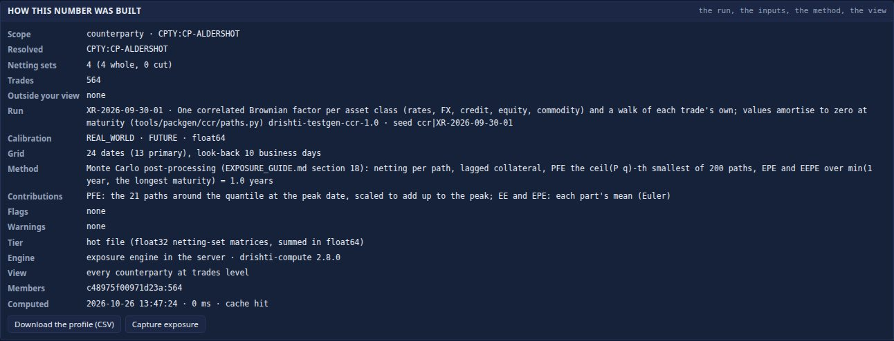

<!--
  Project Drishti · Any data. Any domain. One grammar.

  Copyright (c) 2026 Ashutosh Sinha <ajsinha@gmail.com>.
  All rights reserved.

  PROPRIETARY AND CONFIDENTIAL.

  This file is the confidential and proprietary property of Ashutosh Sinha.
  Unauthorised copying, use, modification, distribution or disclosure of this
  file, via any medium, is strictly prohibited except with the express prior
  written permission of the copyright holder.

  See the LICENSE file in the root of this repository for the full terms.
-->
# Exposure in Drishti: the complete guide

This is the one reference for Drishti's counterparty exposure: what every number means and how it is computed (EE, ENE,
EEE, PFE, EPE, EEPE, EAD), the explorer screen by screen, scopes from the bank to a trade, collateral and netting, captures and compare,
the pre-deal what-if, exposure as a kind, who sees what, the command line, the API and the settings (Part I); the computation, formula
by formula (Part II; every input, its delivery and checks, the answers, the official results and the decisions are in
[the exposure data contract](../contracts/EXP.md)); how the engine holds a date's netting-set path matrices in memory and on local disk, its sizes and what is still open (Part
III). The hands-on walk-through is [tutorial 26](../tutorials/26-exposure-from-the-bank-to-a-trade.md) (the test data, from the bank to a
trade). In the console, **F1** on the explorer (or its **?**) opens this guide.

Each measure has one guide and one tutorial; its data has one home, [the exposure data contract](../contracts/EXP.md). Where the original proposal said otherwise, the code wins and the difference is stated (**Implementation:**).
VaR follows the same rule: [VAR_GUIDE.md](VAR_GUIDE.md) and tutorial 25.

For the proposed counterparty credit risk cube on this engine (allocated exposure, the GLEIF group roll-up, limits by tenor with
headroom, CVA, SA-CCR, SIMM, wrong-way risk, pre-deal pricing on paths, every data contract), see the design:
[CCR_CUBE_LENS.md](../lenses/CCR_CUBE_LENS.md).

Every number below that is not a hand-made example is the engine's on the demo lake that `drishti.py lake demo` builds by default
(`--exposure demo`): the run `XR-2026-09-30-01` (business date 2026-09-30, 200 paths, 24 grid dates of which 13 primary) generated for
every netting set of 23 of the 24 counterparties (74 netting sets, 8,022 live trades), on the data's own dates (`--as-of data`).
The committed run of eight netting sets (523 trades) is a subset with the same figures; the netting-set and CP-ALDERSHOT figures are also those of
`drishti-compute/src/test/resources/ccr/reference.json`, which `ExposureParityTest` checks the Java engine against (to 1e-6 USD on the
heap). [Section 23](../contracts/EXP.md#9-test-data-and-generators) says how the data is made.

## Contents

**Part I · Using exposure**

1. [The question exposure answers](#1-the-question-exposure-answers)
2. [The measures, with worked numbers](#2-the-measures-with-worked-numbers)
3. [The explorer, screen by screen](#3-the-explorer-screen-by-screen)
4. [Scopes](#4-scopes)
5. [Collateral and netting](#5-collateral-and-netting)
6. [Captures and compare](#6-captures-and-compare)
7. [Pre-deal what-if](#7-pre-deal-what-if)
8. [Exposure as a kind](#8-exposure-as-a-kind)
9. [Who sees what: entitlements and audit](#9-who-sees-what-entitlements-and-audit)
10. [The command line](#10-the-command-line)
11. [The API](#11-the-api)
12. [Settings](#12-settings)
13. [Troubleshooting](#13-troubleshooting)

**Part II · The computation** (the data contract: [EXP.md](../contracts/EXP.md))

18. [The computation](#18-the-computation)

**Part III · How the engine works and stores data**

25. [Where the engine lives](#25-where-the-engine-lives)
26. [One date in memory and the hot file](#26-one-date-in-memory-and-the-hot-file)
27. [Sizes, performance and retention](#27-sizes-performance-and-retention)
28. [Open items](#28-open-items)
29. [Exposure data: every dataset the engine reads](#29-exposure-data-every-dataset-the-engine-reads)

## Part I · Using exposure

## 1. The question exposure answers

*How much could this counterparty owe us if it defaulted at some future date, on average and in a bad case, after netting and the
collateral we would hold?* Credit officers set limits on the bad case (PFE); the CVA desk prices the average (EE); regulatory capital
under an internal model uses the effective average (EEPE); a trader asks what a new trade does to a counterparty's PFE before dealing.

Drishti does not simulate markets or price trades. An upstream exposure simulator writes, every night, every live trade's value on every
Monte Carlo path at every date of a time grid (the table `exposure-path`, with the run's identity and grid in `simulation-run`). Every
trade uses the same paths, so values add path by path. Drishti then, for **any scope** (a netting set, a counterparty, a connected group,
a legal entity, a desk, a book, a list of trades, a rule over trades, the whole bank, or any combination with `+ - &`):

1. sums each netting set's trades on each path and date (the netting-set value V);
2. computes on each path the collateral the CSA would hold, called at the look-back date a margin period of risk earlier;
3. floors the collateralised value at zero (the exposure E), adds exposures of different netting sets path by path;
4. takes the mean over paths (EE), the quantile (PFE), the running maximum (EEE) and the first-year time averages (EPE, EEPE).

There are no stored `exposure-profile` records ([the exposure data contract, section 8](../contracts/EXP.md#8-exposure-is-computed-not-stored)):
`EXP` is computed when asked, like `VAR`.

## 2. The measures, with worked numbers

| Measure | What it is | Formula (per primary date t, P paths) | Adds up across netting sets? |
|---|---|---|---|
| **E** (exposure on a path) | what the counterparty owes after netting and collateral, never negative | `E = max(V − C − IM, 0)` | yes, path by path |
| **EE** (expected exposure) | the average exposure at t | mean of E over the paths | yes |
| **ENE** (expected negative exposure) | the average of what *we* owe them (reported negative) | mean of `min(V − C, 0)` | yes |
| **EEE** (effective EE) | EE that never falls: the running maximum | `EEE(t) = max(EEE(t−1), EE(t))` | no |
| **PFE_q** (potential future exposure) | the bad case at confidence q (95%, 99%) | the ⌈P·q⌉-th smallest E | no (a quantile) |
| **Peak PFE** (MPFE) | the largest PFE over the primary dates, and its date | `max_t PFE_q(t)` | no |
| **EPE** (expected positive exposure) | EE averaged over the first year (or the last maturity, if sooner) | `Σ EE(t) Δt / T` | yes when the horizons agree |
| **EEPE** (effective EPE) | EEE averaged over the same horizon: the regulatory figure | `Σ EEE(t) Δt / T` | no |
| **EAD (IMM)** | alpha × EEPE, alpha 1.4 (Basel CRE53); informational only | `1.4 × EEPE` | no |
| **CE** (current exposure) | today's exposure, from today's MtM and collateral | `Σ max(MtM − C − IM, 0)` | yes |

The formulas, with the horizon rule, the collateral and the quantile rule, are in [section 18](#18-the-computation).

### 2.1 By hand: the contract's worked example

**One netting set** of two trades A and B, **4 paths**, **3 primary dates** t₁ = 0.25, t₂ = 0.5, t₃ = 1.0 years. Amounts in USD millions.
The CSA has thresholds TH_them = TH_us = 1, MTA 0, IA 0, no rounding. The look-back values L are the set's value at t − MPOR on the same
path (given; in a real run they are the look-back grid dates).

| Path | A (t₁, t₂, t₃) | B (t₁, t₂, t₃) | V = A + B | L (look-back) |
|---|---|---|---|---|
| 1 | 3, 5, 2 | −1, −1, 1 | **2, 4, 3** | 1, 2, 3 |
| 2 | −2, −1, −3 | 1, 2, 1 | **−1, 1, −2** | −1, 0, −1 |
| 3 | 3, 4, 6 | −2, 0, −1 | **1, 4, 5** | 0, 3, 4 |
| 4 | 0, −2, −1 | 1, 0, −2 | **1, −2, −3** | 1, −1, −3 |

**Collateral** C = max(L − 1, 0) − max(−L − 1, 0): path 1: 0, 1, 2; path 2: 0, 0, 0; path 3: 0, 2, 3; path 4: 0, 0, −2 (we posted 2 at t₃).
**Exposure** E = max(V − C, 0) and negative exposure N = min(V − C, 0):

| Path | E (t₁, t₂, t₃) | N (t₁, t₂, t₃) |
|---|---|---|
| 1 | 2, 3, 1 | 0, 0, 0 |
| 2 | 0, 1, 0 | −1, 0, −2 |
| 3 | 1, 2, 2 | 0, 0, 0 |
| 4 | 1, 0, 0 | 0, −2, −1 (V − C = −3 + 2 = −1) |

| Figure | t₁ = 0.25 | t₂ = 0.5 | t₃ = 1.0 |
|---|---|---|---|
| EE = mean E | (2+0+1+1)/4 = **1.0** | (3+1+2+0)/4 = **1.5** | (1+0+2+0)/4 = **0.75** |
| ENE = mean N | −0.25 | −0.5 | −0.75 |
| PFE 75% = 3rd smallest of 4 (⌈4 × 0.75⌉ = 3) | sorted 0,1,1,2 → **1** | 0,1,2,3 → **2** | 0,0,1,2 → **1** |
| PFE 95% (⌈3.8⌉ = 4th: the largest) | 2 | 3 | 2 |
| EEE (running max of EE) | 1.0 | 1.5 | 1.5 |
| EE without collateral = mean max(V, 0) | 1.0 | 2.25 | 2.0 |

With Δt = 0.25, 0.25, 0.5 and T = 1 year (t₀ ignored here, CE = 0):
- **EPE** = (1.0 × 0.25 + 1.5 × 0.25 + 0.75 × 0.5) / 1 = **1.0**
- **EEPE** = (1.0 × 0.25 + 1.5 × 0.25 + 1.5 × 0.5) / 1 = **1.375** (the running max keeps 1.5 after t₂: EEPE > EPE)
- **PEAK_PFE (75%)** = 2 at t₂; without collateral it would be 4 (sorted 0, 1, 4, 4 at t₂): collateral halves the peak.
- **EAD_IMM** (informational) = 1.4 × 1.375 = **1.925**.
- **EE contribution** at t₂ without collateral: paths with V > 0 are 1, 2, 3 (V = 4, 1, 4); A contributes (5 − 1 + 4)/4 = 2.0, B (−1 + 2 + 0)/4 =
  0.25; 2.0 + 0.25 = 2.25 = the uncollateralised EE at t₂.

[CVA.md](../contracts/CVA.md) [exposure contract section 2](../contracts/EXP.md#2-inputs-from-upstream-engines) prices CVA from this profile; [WWR.md](../contracts/WWR.md) [exposure contract section 2](../contracts/EXP.md#2-inputs-from-upstream-engines) adds credit paths to it.

### 2.2 On the test data

**One netting set: NS-ALDERSHOT-LDN** (159 live trades, CSA thresholds 10m each way, MPOR 10 business days). Its net MtM today is
**−139.1m** (the bank owes Aldershot) and the bank has **posted 111.1m** of collateral (after haircut,: 112.2m at market
value), so today's exposure CE is 0. The engine's profile
(USD, collateral lagged, PFE at 95%):

| Tenor | Date | EE | ENE | EEE | PFE 95% | PFE 99% | EE uncollateralised |
|---|---|---|---|---|---|---|---|
| 1W | 2026-10-07 | 2,042,786 | −38,521,266 | 2,042,786 | 14,675,361 | 34,375,274 | 0 |
| 1M | 2026-10-30 | 15,744,605 | −22,167,433 | 15,744,605 | 63,596,710 | 91,457,505 | 343,409 |
| **2M** | 2026-11-30 | **19,520,460** | −23,735,800 | 19,520,460 | **85,063,192** | 125,420,947 | 3,535,713 |
| 6M | 2027-03-30 | 13,768,983 | −20,755,320 | 19,520,460 | 58,918,700 | 84,676,236 | 23,106,636 |
| 1Y | 2027-09-30 | 16,654,426 | −12,896,602 | 19,520,460 | 58,929,323 | 90,130,996 | 59,294,083 |
| 5Y | 2031-09-30 | 6,792,488 | −8,632,088 | 19,520,460 | 29,290,737 | 43,976,231 | 86,723,737 |
| 10Y | 2036-09-30 | 4,245,352 | −2,766,622 | 19,520,460 | 10,193,935 | 11,079,915 | 7,080,517 |

Figures: EPE **14,729,920**, EEPE **18,756,782**, peak EE 19,520,460, **peak PFE 95% 85,063,192 at 2M**, PFE 99% 125,420,947, EAD
(IMM, informational) 1.4 × 18,756,782 = 26,259,495.

How to read it:
- **Collateral can raise exposure.** In the first months EE *with* collateral is above EE without: the bank has posted 111.1m that it
  would get back only a margin period later, so on paths where the swaps move in the bank's favour the posted collateral is at risk too.
  After a year the lagged collateral works the other way: at 5Y the uncollateralised EE is 86.7m, the collateralised 6.8m.
- **EEPE ≥ EPE.** EE peaks at 2M and falls; EEE keeps the peak, so EEPE (18.8m) is above EPE (14.7m).
- **PFE is the tail.** At 2M the 95% path is four times the mean, the 99% path six times.

**A counterparty: CP-ALDERSHOT** (its four netting sets: FRA, LDN, NY, TKY):

| Scope | CE | EPE | EEPE | Peak EE | Peak PFE 95% | at | PFE 99% |
|---|---|---|---|---|---|---|---|
| NS-ALDERSHOT-FRA (35 trades, horizon 0.44 years) | 0 | 1,832,126 | 18,357,151 | 19,075,328 | 30,534,120 | 2W | 35,167,227 |
| NS-ALDERSHOT-LDN (159) | 0 | 14,729,920 | 18,756,782 | 19,520,460 | 85,063,192 | 2M | 125,420,947 |
| NS-ALDERSHOT-NY (254) | 214,706,654 | 37,446,771 | 228,612,541 | 228,612,541 | 357,381,438 | 2W | 387,585,327 |
| NS-ALDERSHOT-TKY (21) | 5,543,509 | 12,002,758 | 17,667,508 | 17,987,495 | 61,396,882 | 2M | 72,781,990 |
| **CPTY:CP-ALDERSHOT** | **220,250,163** | **64,977,553** | **263,701,831** | 264,093,896 | **401,456,820** | 2W | 425,829,236 |

- **CE and EE add up**: 0 + 0 + 214.71 + 5.54 = 220.25m is the counterparty's CE.
- **EPE adds up only over one horizon.** The FRA set's EPE is over its own 0.44 years (its last repo matures then); the counterparty's
  horizon is a year, so the four EPEs (66.0m) do not sum to 65.0m. EE, path by path and date by date, always adds.
- **PFE does not add up.** The four peaks sum to 534.4m; the counterparty's peak is 401.5m. Exposures of separate netting sets add path
  by path (they do not net against each other), but their bad cases fall on different paths and dates, so the quantile of the sum is
  below the sum of the quantiles. That is why Drishti sums path matrices, never stored PFEs.

**The bank and its legal entities** (the demo lake on the data's own date, `--as-of data`: 74 netting sets with paths of 76, 8,022
live trades; `drishti.py exposure show BANK`, `tree`; tutorial 26 steps 1 and 2):

| Scope | Peak PFE 95% | EPE | Note |
|---|---|---|---|
| **BANK** | **2,897,620,439** at 2W (PFE 99% 3,146,370,255) | 947,202,991 | EEPE 2,270,175,837, peak EE 2,275,263,996, CE 1,586,811,699, EAD (info) 3,178,246,172 |
| LE:LE-NY | 2,192,334,926 | 489,560,704 | |
| LE:LE-LDN | 558,766,819 at 2M | 275,188,101 | EEPE 326,351,289; 17 netting sets, 2,403 trades |
| LE:LE-TKY | 344,315,638 | 173,614,005 | |
| LE:LE-FRA | 126,314,351 | 20,293,496 | |

The legal entities' peaks sum to 3.22 bn against the bank's 2.90 bn: the same diversification as above. Collateral matters most at the
bank: at 2W the bank's EE is 2.28 bn collateralised against 6.30 bn uncollateralised. In the explorer the figures come from the hot
file, float32 matrices summed in float64, so a counterparty's or netting set's figures can differ from the float64 ones above in the
last dollars (CP-ALDERSHOT's peak PFE reads 401,456,810 there against 401,456,820 on the heap; [section 26](#26-one-date-in-memory-and-the-hot-file)).

At CP-ALDERSHOT the **PFE contributions** (the shares that add up to its peak) are NS-ALDERSHOT-NY 349,983,112 (87.2%), TKY 22,890,610,
FRA 20,237,212 and LDN 8,345,877: LDN's peak alone is 85.1m but it peaks at 2M, while the counterparty peaks at 2W, when LDN's exposure
is small. Its stored credit limit LIM-ALDERSHOT is 7,980,000,000, so the limit used reads 5.0% ([section 28](#28-open-items)).

## 3. The explorer, screen by screen

### 3.1 Open it

| Way in | Opens |
|---|---|
| `EXP <GO>` | the bank |
| `EXP NSET:NS-ALDERSHOT-FRA <GO>`, or spaced: `EXP NSET NS-ALDERSHOT-FRA <GO>` | a netting set (`EXP CPTY CP-ALDERSHOT`, `EXP GROUP GRP-ALDERSHOT`, `EXP LE LE-NY`, `EXP TRD <trade>` the same way) |
| `EXP CPTY:CP-ALDERSHOT - NSET:NS-ALDERSHOT-FRA <GO>` | any scope text ([section 4](#4-scopes)) |
| `/exposure?scope=<scope>` (optional `q`, `collateral`, `asOf`) | the same, as a link |
| the netting-set and counterparty pages | their figures under `EXPOSURE_ENGINE` link here |
| `EXP EXP-ALDERSHOT-FRA <GO>`, `/v/exposure-profile/EXP-ALDERSHOT-FRA` | a stored-profile id: the same netting set, with a notice |

The page is `drishti-console/web/templates/terminal/exposure.html`, filled by `web/static/js/drishti_exposure-explorer.js` from the console's
same-origin `/api/exposure/...`, which asks the server's `/api/v1/exposure` as you (so your entitlements apply as on every screen). The
computed kind `exposure-result` stays an ordinary kind too (`/v/exposure-result/<scope>`, [section 8](#8-exposure-as-a-kind)).

### 3.2 The screen

From top to bottom:

- **The command line**: `EXP <scope>` as asked; the switches **q 95% / q 99%** (the PFE confidence) and **collateralised /
  uncollateralised** (`collateral=lagged` or `none`); the **official** chip (whether the business date's official end-of-day capture
  exists, [the exposure data contract, section 6](../contracts/EXP.md#6-official-end-of-day-results)); the run (`run XR-2026-09-30-01 · 200 paths · 13 tenors · 2026-09-30`); the time
  from the click to the painted headline and the server's compute time and cache state; **?** (help: this guide).
- **The breadcrumb** with **Back**: Bank › legal entity › counterparty › netting set › trade. Every click on the tree, the board, a
  netting set or a trade moves the whole screen to the new scope in place, with no page load; Back returns to the scope before.
- **The tree** (left): the bank, the legal entities, their counterparties (largest peak PFE first), the netting sets and, under the
  open netting set, its trades with the largest EE contribution; each row shows its peak PFE. A netting set the run has no paths for is
  marked and opens the no-paths state ([section 13](#13-troubleshooting)).
- **The tiles** (the headline): **Peak PFE** at the chosen q (with its tenor and date), **EPE** (first year, time-weighted), **EEPE**
  (running max of EE), **EAD (IMM, info)** (α 1.4 × EEPE), and either **Limit used** (a counterparty with a stored credit limit: peak PFE
  at the limit's confidence over the limit, coloured by use) or **Collateral effect** (EE at the peak tenor against the
  uncollateralised EE: "−65%" when collateral lowers it by 65%, "+452%" when posted collateral raises it, as on NS-ALDERSHOT-LDN, where
  the bank has posted 111.1m after haircut). A trade's tiles are different: **Peak PFE alone** (the trade as if it had no netting set), **EE contribution**
  (its share of its netting set's EE at the set's peak date), **Netting benefit** (alone minus contribution) and **Desk**.
- **The profile chart**: EE, PFE at q and EE uncollateralised over the primary dates, the peak marked; at a netting set the **path fan**
  (the 5–95% and 25–75% bands of the paths' exposures at every primary date, from `distribution?bands=true`).
- **The tabs**, by the scope's level (Captures is on every level):

| Level | Tabs |
|---|---|
| Bank | **Counterparties** (the board), **Legal entities**, By tenor, Captures |
| Legal entity, group | **Counterparties** (the board), By tenor, Captures |
| Counterparty | **Netting sets**, **Pre-deal**, By tenor, Captures |
| Ad-hoc scope | **Netting sets**, By tenor, Captures |
| Netting set | **Collateral**, **Trades**, **Pre-deal**, By tenor, Captures |
| Trade | **In its netting set**, By tenor (alone), Captures |

- **How this number was built** (folded): the run, the inputs' versions, the method, the view, the flags, the collateral model; buttons
  **Download the profile (CSV)** and **Capture exposure**.




On a phone the panels stack: the command line, the tree, then the tiles and the chart:


### 3.3 The tabs

- **Counterparties** (the board): one row per counterparty: a small EE profile, peak PFE, EPE, the stored **limit** and **used**
  (the computed peak PFE at the limit's confidence over the limit), the number of netting sets; 25 rows at a time, largest first; a row
  opens the counterparty. The limit is the `credit-limit` record read as stored (`drishti.ccr.exposure.kinds.limit`); LIM stays parked,
  see [section 28](#28-open-items) on its low utilisation.
- **Legal entities** (bank): per legal entity its EE profile, peak PFE, EPE, netting sets and share of the bank's peak.
- **Netting sets** (counterparty or ad-hoc): per set its CSA, EE profile, EPE, **peak PFE alone** and **PFE contribution** (the shares
  that add up to the scope's peak, [section 18](#18-the-computation), 18.6) and share; a total row.
- **Collateral** (netting set): the CSA (thresholds them / us, minimum transfers, independent amount, rounding, MPOR and remargin
  frequency), at the peak tenor EE without collateral, the mean collateral on the paths, EE with collateral and the *Effect of collateral* (signed: −65% lower, +452% higher); today's net
  MtM, collateral held (net), initial margin held, the trades, the collateral model, the look-back used, the `MPOR_MISMATCH` flag and
  the dates that keep today's collateral (no look-back point after today).
- **Trades** (netting set): every trade, 25 a page, by EE contribution at the set's peak date (read from the lake on request): product,
  desk, EE contribution, share, **peak PFE alone**; a row opens the trade's exposure, its id opens `TRD`.
- **Pre-deal** (netting set and counterparty): the pre-deal what-if form, [section 7](#7-pre-deal-what-if); on a counterparty it first asks which of its netting sets the new trade goes into.
- **By tenor**: the profile as a table (EE, ENE, EEE, PFE at q, PFE 99%, EE uncollateralised per tenor), with the CSV link and the CLI and
  API equivalents.
- **Captures**: capture now with a note, the scope's captures (id, date, captured, by, peak PFE, EPE, note), **Compare with now**,
  **Compare the two newest**, each capture's CSV; [section 6](#6-captures-and-compare).


### 3.4 A trade: alone, in its set, the netting benefit

`EXP TRD:<id>` (or a click on a trade) shows the trade **alone**: as its own netting set, uncollateralised, its own profile and peak
PFE. The tab **In its netting set** shows, per tenor, its **EE contribution** to its netting set after netting and collateral, the set's
EE and the share (the shares of a set's trades add up to the set's EE at every date). The tile **Netting benefit** is the peak PFE alone
less the contribution: a trade that offsets its set has a large benefit, often a negative contribution. Buttons open `TRD <id>` and go
back to the set.


### 3.5 The no-paths state

A netting set or counterparty the reference data knows but the run does not cover shows only "no exposure paths for the netting set NS-…
on <date>" and a note: the engine computes from the day's simulated paths; nothing is shown, never an old figure. In the default demo lake the
three netting sets of CP-SUMMIT and CP-NORTHPLAINS have no paths; with `lake demo --exposure committed` 68 of the 76 have none
([the exposure data contract, section 9](../contracts/EXP.md#9-test-data-and-generators)).

## 4. Scopes

A scope is text: one word or several joined with `+` (union), `-` (difference) and `&` (intersection), the grammar of VaR's scopes
([VAR_GUIDE.md section 5](VAR_GUIDE.md#5-scopes-portfolios-and-baskets)) with the counterparty words added.

| Word | Means | Example on the test data |
|---|---|---|
| `BANK` | everything with paths | `EXP BANK` |
| `NSET:<id>` | a netting set (with or without `NS-`) | `NSET:NS-ALDERSHOT-LDN` |
| `CPTY:<id>` | a counterparty's netting sets (with or without `CP-`) | `CPTY:CP-ALDERSHOT` |
| `GROUP:<id>` | a connected group's counterparties (`counterparty-group`) | `GROUP:GRP-ALDERSHOT` |
| `LE:<id>` | the trades booked by a legal entity (`LE:NY` is `LE-NY`) | `LE:LE-LDN` |
| `DESK:<desk>`, `BOOK:<book>` | the trades' `DESK`, `TT_BOOK` (cut netting sets: `partial`) | `DESK:RATES & CPTY:CP-ALDERSHOT` |
| `TRD:<ids>` | trades only, uncollateralised (`standalone`) | `TRD:CLY-4003028` |
| `WHERE:<rule>` | a rule over the trades' columns | `WHERE:ASSET_CLASS = 'Rates' & CPTY:CP-ALDERSHOT` |

Examples: `CPTY:CP-ALDERSHOT - NSET:NS-ALDERSHOT-NY` (Aldershot without New York), `NSET:NS-ALDERSHOT-LDN + NSET:NS-AURORA-TKY` (two sets
together: their exposures add path by path), `LE:LE-TKY & CPTY:CP-ALDERSHOT`.

Scope grammar of VAR_GUIDE.md section 5 with the counterparty terms of NSET.md section 8 (`NSET:`, `CPTY:`, `GROUP:`, `LE:`).

| Scope | How the exposure matrix is formed | Cost |
|---|---|---|
| `NSET:<id>` | the set's `EMAT` (statistics precomputed) | microseconds |
| `CPTY:<id>` | Σ of its sets' `EMAT` (statistics precomputed at load) | microseconds; a few ms for contributions |
| `GROUP:<id>` | Σ of its counterparties' sets | ms |
| `LE:<id>` | EE, ENE, EPE: sums of set statistics; PFE: a batch job | ms / job |
| a scope that cuts sets (`DESK:RATES & CPTY:CP-X`) | per touched set, V recomputed from the scope's trades (lake read), then collateral and E as if those trades were the set (`partial`) | seconds |
| `TRD:<ids>` (a trade alone) | the trade as its own set, uncollateralised | ms (lake read) |

**Additive:** V per path across trades; E per path across netting sets; EE, ENE, EPE across netting sets. **Not additive:** PFE, peaks,
EEE, EEPE, contributions to them.

**Implementation:** the words `BANK`, `NSET:` (ids, with or without `NS-`), `CPTY:` (with or without `CP-`), `GROUP:` (the
`counterparty-group` members), `LE:` (the trade's legal entity; `LE:NY` is `LE-NY`), `DESK:`, `BOOK:` (the trades' `DESK` and `TT_BOOK`),
`TRD:` (ids in any case; a scope of trades only is `standalone`: uncollateralised) and `WHERE:` (a rule over the trades' `NETTING_SET`,
`COUNTERPARTY`, `LEGAL_ENTITY`, `DESK`, `TT_BOOK`, `ASSET_CLASS`, `PRODUCT`, `SOURCE_SYSTEM`, `MATURITY_DATE`, `NOTIONAL`, `MTM`), joined with
`+ - &` (VaR's parser, `ScopeExpr`, with `NSET` and `GROUP` added). `DIV:`, `NODE:`, `POS:`, `PORT:`, `BASKET:`, `CAPTURE:` are VaR's:
`400 DRS-5440`. A scope sums every netting set it touches interactively up to `max-scope-netting-sets`; the official capture has no limit.
A netting set or counterparty the reference data knows that the run does not cover answers `404 DRS-1001` "no exposure paths for the
netting set NS-… on <date>" (the computed kind: `STATUS: no-paths`), never stale numbers.

## 5. Collateral and netting

**Netting** happens inside a netting set only: its trades' values add path by path (V), so a payer and a receiver swap offset. Across
netting sets nothing nets: their *exposures* (already floored at zero) add path by path.

**Collateral** is per netting set, from its CSA ([NSET.md section 3.5](../contracts/NSET.md)) and today's holdings (`collateral-balance`):

- **lagged** (the default): on each path the collateral at date t is what the CSA called at the look-back date t − MPOR (thresholds,
  minimum transfer amounts, independent amount, rounding applied to the change from today's collateral). A date whose look-back would
  fall on or before today (1W and 2W on a 10-day MPOR) keeps today's collateral: nothing called later settles in time.
- **current**: today's collateral held constant on every path.
- **none**: no collateral and no initial margin (the explorer's **uncollateralised** switch; `TRD:` scopes are always uncollateralised).
- **initial margin** held today is kept on every path (`im-model: current`); IM the bank posts, segregated, adds nothing.

The **Collateral** tab shows the CSA and its effect at the peak tenor; the profile chart's dashed line is EE uncollateralised. Collateral
reduces exposure when the bank holds it and can raise it when the bank has posted it (NS-ALDERSHOT-LDN, [section 2](#2-the-measures-with-worked-numbers)).
When a CSA's MPOR (plus remargin frequency − 1) differs from the run's look-back, the run's look-back is used and the answer is flagged
`MPOR_MISMATCH` (decided 2026-10-26). The formulas are [section 18](#18-the-computation), 18.3.

A scope that cuts a netting set (a desk inside a counterparty) recomputes the set's value from the scope's trades, read from the lake,
and applies the set's CSA to them as if they were the set (flag `partial`).

## 6. Captures and compare

A **capture** freezes a scope's answer: the figures, the profile, the netting sets, the flags, the member trade ids (for a viewer who sees
them) and the provenance; never paths. Ids are `XCAP-<yyyymmdd>-<n>`, kept per owner in the content store (`exposure/captures/`).

| Where | How |
|---|---|
| Explorer | the **Captures** tab: a note, **Capture exposure**; or **Capture exposure** under *How this number was built* |
| CLI | `drishti.py exposure capture CPTY:CP-ALDERSHOT --note 'before the unwind'`; `captures [--scope]`; `compare XCAP-20260930-1 now` |
| API | `POST /api/v1/exposure/captures {scope, note, q, collateral}` (a token needs `risk:write`); `GET /captures?scope=`, `GET /captures/{id}`, `GET /captures/{id}/csv`, `GET /captures/{id}/jsonl` |

**Compare** two captures, or a capture with **now** (the scope computed again): peak PFE, EPE, EEPE, peak EE and CE side by side with
the change, PFE per tenor, and the trades added and removed. `GET /api/v1/exposure/compare?a=<id>&b=<id|now>`. A capture's CSV is the `#
field: value` lines and then the profile.

## 7. Pre-deal what-if

*What does this trade do to the counterparty's PFE before I deal?* Two methods:

| Method | How | Where it runs | Flag |
|---|---|---|---|
| **`paths`** (exact) | the candidate's values on every path of **the same run** are added to its netting set's V; the set's collateral and exposure are computed again, then the scope's figures; incremental = with − without, per figure and per primary date | the **Python exposure engine** (`drishti_compute.exposure.whatif`, reactive connector `exposure-whatif`, compute pool `exposure`) | none (`exact`) |
| **`addon`** (conservative proxy) | the candidate as a netting set of its own, no netting, no collateral: PFE add-on `max(MTM, 0) + z_q · SF · d · |δ| · sqrt(min(t, M))`, EE add-on with `1/sqrt(2π)` in place of z_q, with SA-CCR's supervisory factor SF | the Java engine | `proxy` |

**The `paths` method needs compute on.** The Python engine runs in Drishti's compute pool: start the server with
`DRISHTI_COMPUTE_ENABLED=true` (the pool `exposure` in `config/compute/compute.yaml`, standard library only, up to
`DRISHTI_COMPUTE_EXPOSURE_WORKERS` workers, 2 GB each). Without it `method: paths` answers `503 DRS-5446` ("the exact what-if … runs in
the Python exposure engine … which is not running on this server; ask method addon for the conservative proxy"); `addon` always works.

**The candidate.** A candidate's paths are one of:
- `{copyOf: <trade>, factor}`: a booked trade's paths on the run, scaled (`factor: -1` is its unwind) — what the explorer and
  `--like` use;
- `{runId, mtm}`: G lists of P numbers (or one list of G × P, grid-date-major);
- `{runId, arrow}`: base64 Arrow IPC with `GRID_INDEX` and `MTM` as a fixed-size list of P.

Paths of another run or another length are refused (`400 DRS-5442`). A candidate with `nettingSet` joins that set (netting and
collateral with it); without, it is a netting set of its own, uncollateralised. For `addon` give `assetClass`, `notional`,
`maturityDate`, `mtm` and `delta`.

**In the explorer** (a netting set's **Pre-deal** tab): *Candidate: like trade* (one of the set's trades), *Factor* (−1: its unwind),
*Method* (`paths (exact, the same run)` or `addon (conservative proxy)`), *Figures of* (its counterparty, the credit limit's scope, or this
netting set), **Run what-if**. The chip says **exact** or **proxy** and the time; the answer: peak PFE before and after, the incremental
(red when it adds), EPE before and after, the limit headroom after (when q is the limit's confidence) and a per-tenor table of EE and
PFE before and after with the incremental PFE.

**On a counterparty** (its **Pre-deal** tab): the same pre-deal what-if, with one field more, *Into the netting set*: the
counterparty's netting sets, the largest by peak PFE first (picked by default); the candidates are that set's trades, and changing the
set lists its trades. *Figures of* is **this counterparty** (the credit limit's scope, the default) or the netting set picked. The
answer has the same layout as the netting set's tab: before, after, the incremental, the limit headroom and the table by tenor.


`--method addon`, or `--candidates new-swap.json`. **API**: `POST /api/v1/exposure/what-if`, [section 11](#11-the-api).

**How the exact method gets its inputs**: the Java engine serves them as the asking person through the computed kind `exposure-result`
with `detail=whatif` (the scope's E and N matrices, G_primary × P, the grid, the horizon, the candidate sets' ids) and `detail=set` (a
netting set's V, G × P, E, N, CSA terms, holdings); the candidates go into the person's private sandbox, the connector is asked as them,
and the sandbox is deleted after. The engine is deterministic (no random numbers) and reproduces the Java maths
(`drishti_compute.exposure.measures`, tested against the worked example and the test data). Details: [the exposure data contract, section 5](../contracts/EXP.md#5-what-drishti-answers), 19.5.

## 8. Exposure as a kind

| Kind | Command | Class | What |
|---|---|---|---|
| `exposure-result` | `EXP <scope>` | computed (reactive connector `exposure-engine`, Java `ExposureResultEngine`) | a scope's figures, profile, netting sets, flags, provenance |
| `exposure-whatif` | `XWIF <scope>` | computed (reactive connector `exposure-whatif`, Python, pool `exposure`) | a scope before and after the candidates in the person's sandbox, exact |
| `simulation-run` | `XRUN` | input | the run's identity and grid |
| `exposure-path` | `XPATH` | input (Delta connector `exposure-store`) | every trade's MtM on every path at every grid date |

The id of a computed answer is the scope text with parameters after `~`: `CPTY:CP-ALDERSHOT~q=0.99`. `exposure-result` takes `q`,
`collateral` (`lagged`, `current`, `none`), `run` (empty: the newest complete run), and, for the Python engine, `detail` (`none`, `whatif`,
`set`) and `sets`. `exposure-whatif` takes `sandbox`, `q`, `collateral` and `sets`; its result has `BEFORE_`, `AFTER_` and `CHANGE_` of
`EPE`, `EEPE`, `PEAK_PFE`, `PEAK_EE`, `CE`, a `profile` table and an `items` table. Both kinds' contracts are generated pages in
`docs/contracts/` (`exposure-result.contract.yaml`, `exposure-whatif.contract.yaml` in the pack).

Because they are kinds, the usual tools work: `/v/exposure-result/NSET:NS-ALDERSHOT-FRA`, Sutra pages (the netting-set and counterparty
pages read the engine's figures under `EXPOSURE_ENGINE`: EPE and peak PFE 95% in the strip, the profile panel, a "how it was computed"
panel), Calc (`exposure_profile_stats.py`, `cva_from_ee.py`, `collateral_mpor_mc.py`, `concentration_hhi.py`, the core pack's
`group_exposure.py`), BI over the published official results. Large `detail=whatif` answers pass through the connector cache: see
[section 28](#28-open-items).

## 9. Who sees what: entitlements and audit

As NSET.md section 11 (counterparty coverage, restricted list, masks, aggregate-only). In addition: a role at `aggregate` for a
counterparty sees its profile but not `BY_NETTING_SET` rows below its level nor trade contributions; captures never store trade paths;
the what-if sandbox is private (REACTIVE_CONNECTOR.md); `ccr-view`, `ccr-whatif` and `ccr-capture` are audited with scope, run and
counts.

**Implementation:** `drishti.ccr.exposure.access.<role>[<counterparty, group or legal entity>]` is `trades`, `aggregate` or `none`; a
netting set takes the widest level of its counterparty, the counterparty's group and its legal entity; a role with no entry sees all at
`trades` when it may open `exposure-path`. A scope naming trades (`TRD:`, `DESK:`, `BOOK:`, `WHERE:`) needs `trades` on every set it
touches (`403`). The `counterparty` kind's `NAME` mask shows the id in labels. The restricted (wall-crossed) list is not built. Audited:
`ccr-view`, `ccr-export`, `ccr-capture`, `ccr-whatif`, `ccr-official`, `ccr-reload`.

| Action | Console (a person) | Token |
|---|---|---|
| read figures, profile, distribution, contributions, tree, captures, compare | any user who may open the scope | `read` |
| `POST /what-if` | any user who may open the scope (`trades` on the sets the candidates join for `paths`) | `read` |
| `POST /captures` | any user | `risk:write` |
| `POST /reload`, `POST /official` | administrators | never (an administrator in the console) |

## 10. The command line

`drishti.py exposure <command>` (`tools/expcli.py`) asks `/api/v1/exposure` as the token's user (`--server`, `--token` or the
environment, as every `drishti.py` group). Exit codes: 0, 1 (the server said no), 2 (usage). Every scope command takes `--date
YYYY-MM-DD` (default the newest with paths), `--q Q` (default 0.95), `--collateral lagged|current|none` and `--json`.

| Command | What | Example |
|---|---|---|
| `show <scope>` | the figures in a few lines (peak PFE and its tenor, PFE 99%, EPE, EEPE, peak EE, CE, EAD, the limit and its use, the run, flags) and the profile as a table | `drishti.py exposure show NSET:NS-ALDERSHOT-NY` |
| `parts <scope>` | contributions: `--by child|netting-set|counterparty|legal-entity|trade|asset`, `--figure PFE|EE|EPE`, `--at TENOR|DATE` (EE), `--top N` (25) | `drishti.py exposure parts NSET:NS-ALDERSHOT-NY --by trade --figure EE --top 10` |
| `tree` | the bank, legal entities, counterparties and netting sets with peak PFE, EPE and limit use (`--date`, `--q`) | `drishti.py exposure tree` |
| `profile <scope>` | the profile; `--csv` writes the CSV | `drishti.py exposure profile NSET:NS-ALDERSHOT-NY --csv > ns-ny.csv` |
| `distribution <scope>` | the exposure distribution at a primary date (`--at 1Y`): histogram, quantiles, mean, share at zero, and the path fan | `drishti.py exposure distribution NSET:NS-ALDERSHOT-NY --at 1Y` |
| `status` | the engine's settings, hot files and loaded dates | `drishti.py exposure status` |
| `capture <scope>` | capture now (`--note`) | `drishti.py exposure capture CPTY:CP-ALDERSHOT --note 'before the unwind'` |
| `captures` | the captures you may read, newest first (`--scope`) | `drishti.py exposure captures` |
| `compare <a> [b]` | two captures, or a capture with `now` | `drishti.py exposure compare XCAP-20260930-1 now` |
| `official` | the date's official end-of-day record (`--date`); `--capture` takes it now (administrators) | `drishti.py exposure official` |
| `retention` | what the retention keeps of each date held, and the dates whose trade paths are beyond their window | `drishti.py exposure retention` |
| `reload` | drop the loaded dates (administrators): the next request maps the hot file again or reads the lake; `?date=` one date only | `drishti.py exposure reload [--date D]` |
| `whatif <scope>` | a pre-deal what-if: `--like TRADE` (`--factor`, default 1; −1 its unwind), `--set NETTING_SET` (default a set of its own), or `--candidates FILE.json`; `--method paths|addon` (default `paths`) | `drishti.py exposure whatif CPTY:CP-ALDERSHOT --like CLY-4003028 --factor -1 --set NS-ALDERSHOT-FRA` |

Real output of each on the test data: [tutorial 26](../tutorials/26-exposure-from-the-bank-to-a-trade.md). Tests: `tools/test_expcli.py`.

## 11. The API

All under `/api/v1/exposure`. Every `GET` takes `asOf` (the business date; default the newest with paths), `q` (default
`limit-confidence`, 0.95), `collateral` (`lagged`, `current`, `none`); `/scope` also `run` and `strict`. Answers are camelCase (`epe`,
`peakPfe`, `profile[].pfe99`); the computed kind spells the same fields in UPPER_SNAKE.

| Method and path | Parameters | Answer |
|---|---|---|
| `GET /scope` | `scope`, `q`, `collateral`, `run` (the newest complete run), `strict` (`true`: a date whose run is not one run is refused instead of answered from the date before) | the figures, profile, netting sets, ancestors, limit, collateral, flags, provenance ([the exposure data contract, section 5](../contracts/EXP.md#5-what-drishti-answers)) |
| `GET /scopes/{scope}` | as above | the path form for a simple scope (`/scopes/NSET:NS-ALDERSHOT-FRA`) |
| `GET /scope/profile` | `scope`, `dates` (`primary` or `all`), `format=csv` or `format=jsonl` | the profile only, for charts; CSV `tenor,date,t,ee,ene,eee,pfe,pfe_99,ee_uncoll` |
| `GET /scope/distribution` | `scope`, `date` (a primary date or tenor; default the peak), `bins` (`histogram-bins`, 42), **`bands`** (`true`: also the path fan, the 5, 25, 50, 75 and 95% quantiles of the paths' exposure at every primary date) | `histogram {edges, counts}`, `quantiles`, `mean`, `zeroShare`, `bands` |
| `GET /scope/contributions` | `scope`, `by` (`child`, `netting-set`, `counterparty`, `legal-entity`, `trade`, `asset`), `figure` (`EE`, `EPE`, `PFE`), `date` (EE), **`alone`** (`true`, by trade: each trade's peak PFE alone, uncollateralised, too), **`profile`** (`true`, by trade: each trade's EE contribution at every primary date) | rows `{key, scope, label, kind, value, pct, incremental}` (with `alone`: `peakPfeAlone`; with `profile`: `profile[]`), `total`, `date`, `parts`, `truncated` |
| `GET /tree` | `q` | the bank, legal entities, groups, counterparties (with their stored limit and use) and netting sets with EPE and peak PFE; sets without paths `noPaths` |
| `POST /what-if` | body `{scope, method: paths|addon, q, collateral, candidates: [{tradeId, label, nettingSet, paths: {copyOf, factor} | {runId, mtm} | {runId, arrow}, assetClass, notional, maturityDate, mtm, delta}]}` | `{base, with, incremental: {epe, peakPfe, profile[]}, method, flags, items, note}` ([section 7](#7-pre-deal-what-if)) |
| `POST /captures` | `{scope, note, q, collateral}` | the capture |
| `GET /captures`, `GET /captures/{id}`, `GET /captures/{id}/csv`, `/jsonl` | `scope` | your captures, one, its CSV or JSON Lines (a grid date a line) |
| `GET /compare` | `a`, `b` (an id or `now`) | both, the change, PFE per tenor, trades added and removed |
| `GET /status` | | the settings, runs loaded, hot files, sizes |
| `GET /retention` | | each date held: what the retention keeps, the dates whose trade paths are beyond their window |
| `GET /official` | `asOf` | the official record of a date |
| `POST /official` | `asOf` | take the official capture now (administrators) |
| `POST /reload` | | drop the loaded dates (administrators) |

The computed kind `exposure-result` takes **`detail`** (`none`, `whatif`: the scope's exposure matrices for the Python engine, `set`: a
netting set's value matrix and CSA terms) with `sets` (the netting sets a candidate may join; empty: every set the scope covers whole, at
most 50); see [the exposure data contract, section 5](../contracts/EXP.md#5-what-drishti-answers), 19.5. Codes: [the exposure data contract, section 7](../contracts/EXP.md#7-validation-errors-and-data-quality). The full
endpoint list of Drishti is [API_GUIDE.md](API_GUIDE.md).

## 12. Settings

Every setting is under `drishti.ccr.exposure` in the engine's own file, `config/engines/exposure.yaml` (its switch `drishti.engines.exposure.enabled`; [OPERATIONS.md section 21](../admin/OPERATIONS.md#21-compute-engines-on-or-off)) (and [CONFIGURATION.md](../admin/CONFIGURATION.md#drishticcrexposure--the-exposure-engine)).

Every setting of this part, with its type, default, environment variable, meaning and whether a change needs a restart, is in the one configuration document: [CONFIGURATION.md, `drishti.ccr.exposure`](../admin/CONFIGURATION.md#drishticcrexposure) (also at Help → Configuration in the console).

Also: the compute pool **`exposure`** in `config/compute/compute.yaml` (Python, `drishti_compute.exposure.whatif:ExposureWhatIfEngine`,
system environment, `DRISHTI_COMPUTE_EXPOSURE_WORKERS` workers (4), 2 GB, 300 CPU-seconds, 60 s timeout), active only with
`DRISHTI_COMPUTE_ENABLED=true`; and the token rules: `POST /api/v1/exposure/what-if` is `read`, `POST /captures` `risk:write`, `POST
/reload` and `POST /official` never a token's.

## 13. Troubleshooting

| Symptom | Cause | What to do |
|---|---|---|
| "no exposure paths for the netting set NS-… on <date>" (`404 DRS-1001`; the kind's `STATUS: no-paths`) | the reference data knows the set or counterparty, the day's run does not cover it (CP-SUMMIT's and CP-NORTHPLAINS's three sets in the default demo lake; 68 of 76 with `--exposure committed`) | expected for those sets; in production, check the simulator's coverage: `drishti.py exposure status` counts `setsWithoutPaths` |
| `404 DRS-1001` "no run for the date" | no complete `simulation-run` on `asOf` | another date (`--date`), or load the run; the load signal reloads it |
| `501`/`503 DRS-5446` on a what-if | `method: paths` and the Python engine is not running | start with `DRISHTI_COMPUTE_ENABLED=true` (pool `exposure`); or `--method addon` |
| `400 DRS-5442` | candidate paths of another run, or another number of paths | candidates from the same `RUN_ID`, P paths each |
| `400 DRS-5440` | a bad scope word (VaR's `DIV:`, `NODE:`, `POS:`, `PORT:`, `BASKET:`, `CAPTURE:`) or parameter (`q`, `collateral`, `date` not a primary date, `by`, `figure`, `run`) | [section 4](#4-scopes) |
| `409 DRS-5441`, or the flag `stale-run` | the date's run is not one run (two batch ids, a duplicate row, a trade in two sets, a bad grid) | fix the upstream run; until then the date before answers with a warning (`strict=true` refuses) |
| `503 DRS-5443` | the scope sums more than `max-scope-netting-sets` | narrow the scope; the official capture computes it |
| `503 DRS-5445` | the date's matrices over `memory-budget-gb` | raise the budget or the heap |
| `422 DRS-5444` counted in the provenance | rows rejected at load (vector length, NaN, grid index) | fix the rows upstream; never padded |
| `403` on a `TRD:`, `DESK:`, `BOOK:`, `WHERE:` scope | your role sees a touched set only in aggregate | ask for `trades` access ([section 9](#9-who-sees-what-entitlements-and-audit)) |
| the board's *used* is tiny (0.1% to 5%) | the stored credit limits were sized on stored profiles, not on computed exposure | known, [section 28](#28-open-items) |
| the first answer of a date is slow | the date's rows are read from the lake and the hot file written | the next answers map the hot file; `status` shows it |
| the flag `MPOR_MISMATCH` | a CSA's MPOR (+ frequency − 1) differs from the run's look-back | the run's look-back is used (decided) |
| a trade listed in the load's t₀ check | its paths' mean at the first grid date departs from today's MtM | expected for short trades on the test data's amortising model; in production an upstream trade-version or market-data mismatch |

## Part II · The computation

The data contract of exposure (every input and its delivery, the reference data read, the conventions, what Drishti answers,
the official end-of-day results, validation, the retired stored profiles, the test data and the open questions) is
[the exposure data contract](../contracts/EXP.md). This part keeps the computation.

*Version 1.2 · Built · Shared rules: [contracts README.md](../contracts/README.md) · Model
contract: [VAR.md](../contracts/VAR.md#1-the-contract-at-a-glance) · Netting and the shared counterparty tables:
[NSET.md](../contracts/NSET.md)*

This is the contract of Drishti's **exposure engine**: what an
upstream exposure simulator delivers (every trade's MtM on every Monte Carlo path at every date of a time grid), what Drishti builds from
it (netting-set path matrices, collateral on each path, tiered memory), and what it answers (EE, ENE, EPE, effective EE and EPE, PFE at
any confidence, peaks, contributions, incremental figures before dealing) for any scope. It defines the two **shared path tables**,
`simulation-run` and `exposure-path`, which [CVA.md](../contracts/CVA.md), [LIM.md](../contracts/LIM.md), [GRP.md](../contracts/GRP.md)
and [WWR.md](../contracts/WWR.md) read too. Sections marked **Implementation** are checked against the code and the committed test data.

**Sources of truth checked (1.2):** `tools/packgen/ccr/` (`paths.py`, `ccrmath.py`, `make_ccr_data.py`); `drishti-compute`
(`com.ash.drishti.compute.ccr`: `ExposureGrid`, `CsaTerms`, `ExposureMath`, `ExposureBook`, `ExposureHotFile`, `ExposureScopes`,
`ExposureCalc`; the Python `drishti_compute.exposure`: `measures`, `whatif`); `drishti-server` (`com.ash.drishti.server.exposure`,
`ExposureWhatIfPaths`, `ExposureWhatIfInputs`); `drishti.ccr.exposure` in `config/engines/exposure.yaml`; the pool `exposure` in
`config/compute/compute.yaml`; the counterparty-risk pack's `pack.yaml` (`exposure-store`, `exposure-engine`, `exposure-whatif`);
`data/testdata/counterparty-risk/{simulation-run,exposure-path}`.

## 18. The computation

### 18.1 Parameters (the `drishti.ccr.exposure` settings)

| Setting | Default | Meaning |
|---|---|---|
| `confidence` | `[0.95, 0.99]` | PFE confidences computed (any q may be asked per request) |
| `limit-confidence` | `0.95` | the PFE that LIM uses by default |
| `rank-rule` | `kth` | [exposure contract §4](../contracts/EXP.md#4-conventions-specific-to-exposure) |
| `collateral-model` | `lagged` | `lagged` (§18.3), `current` (today's collateral held constant), `none` |
| `im-model` | `current` | initial margin held kept at today's amount on every path, `none`; [SIMM.md](../contracts/SIMM.md) paths later |
| `alpha` | `1.4` | IMM EAD = alpha × EEPE (informational: §18.5) |
| `contribution-window` | `21` | paths around the PFE quantile averaged for PFE contributions (§18.6) |
| `hot-dates` | `10` | dates kept open: the least recently used leaves first; the date just used, the newest and the pinned in memory stay (VAR_GUIDE section 26.8) |
| `refusal-ttl-seconds` | `300` | a date refused for room is answered at once with `Retry-After` this long, no lake read |
| `open-heap-mb` | `0` (automatic) | the byte safety net over the open dates' heap |
| `fiscal-year-end`, `pinned` | none, off | pinned dates, as VaR's (VAR_GUIDE section 26.8) |
| `memory-budget-gb` | `0` (a quarter of the heap for statistics; matrices are mapped, not on the heap) | |
| `hot-folder` | `${drishti.data.dir}/ccr/hot` | where the per-date files go (local disk, §26.2) |

**Implementation:** besides the above, `enabled`, `tier` (`mapped`: the hot file; `heap`: float64 matrices on the heap), `disk-dates` (60),
`keep-on-shutdown` (false), `close-grace-seconds` (60), `max-scope-netting-sets` (20,000; more: `503 DRS-5443`), `max-parts` (5,000),
`histogram-bins` (42), `t0-tolerance` (0.10), `kinds.*`, `access.<role>[<counterparty, group or legal entity>]`, `official.*` and
`retention.*` (§27.3). `memory-budget-gb` 0 is a quarter of the heap and bounds the date's value matrices while it loads (float64,
G × P per netting set). `im-model: current` reads the initial margin held from the collateral holding's `IM_HELD` (the test data has
none: 0). Every setting is in [CONFIGURATION.md](../admin/CONFIGURATION.md#drishticcrexposure--the-exposure-engine).

### 18.2 Netting per path

For netting set *n*, path *p* and grid index *k* (primary or look-back):

```
V_n(p,k) = Σ_{i ∈ n} MTM_i(p,k)                (absent row: 0; float64 accumulation)
```

A standalone trade (no enforceable netting set) is its own set. Additive across trades: the per-path sum is exactly VaR's vector sum,
applied G times.

### 18.3 Collateral on each path (margined netting sets)

With the CSA's terms (NSET.md section 3.5) converted to USD at today's FX (`TH_them`, `TH_us`, `MTA_them`, `MTA_us`, `IA`, rounding *r*),
and ℓ(k) the look-back point of primary point *k* (`LOOKBACK_OF`):

```
target(v)      = max(v − TH_them, 0) − max(−v − TH_us, 0) + IA          the collateral the CSA calls for at value v
lagged model   C_n(p,k) = R( target(V_n(p, ℓ(k))) )                     collateral at t_k = what was called at t_k − MPOR
               held side shortened by the counterparty's MTA:   if C > 0: C = max(C − MTA_them, 0)
R(x)           rounding of the CSA (deliveries up, returns down: applied to x as the change from today's collateral)
current model  C_n(p,k) = C_n(today)    (COLL.md's VM held − posted, constant)
none           C_n(p,k) = 0
IM             IM_n = IM held today (COLL.md) on every path (im-model: current); IM posted, segregated, adds nothing
E_n(p,k)       = max(V_n(p,k) − C_n(p,k) − IM_n, 0)
N_n(p,k)       = min(V_n(p,k) − C_n(p,k), 0)
```

When the CSA's `MPOR_DAYS` differs from the run's `LOOKBACK_DAYS`, Drishti uses the run's look-back points and flags the answer
(`MPOR_MISMATCH`, open question 3). With `MARGIN_FREQUENCY_DAYS` = F > 1 the effective MPOR is MPOR + F − 1 (CRE53): flagged the same way.
Unmargined sets: C = IA held (or 0).

**Implementation:**

- A primary date whose look-back date would fall on or before the business date (1W and 2W on a 10-day margin period) has no look-back
  point: its collateral is today's collateral held, as nothing called later settles within the margin period. (E0 of
  [COMPUTED_ATTRIBUTES.md](../architecture/COMPUTED_ATTRIBUTES.md)) that is the balance's holdings **after haircut** (`POSITIONS[].VALUE`,
  held positive, posted negative; a balance without positions gives its `NET`, also after haircut in the test data).
- Rounding is applied to the change from today's collateral (`CsaTerms.called`); only the held side is shortened by the counterparty's
  MTA, as above (the posted side is not: conservative).
- The MPOR flag: `MPOR_MISMATCH` when MPOR + F − 1 differs from the run's `LOOKBACK_DAYS` (today's CSAs: `MPOR_DAYS: 10`, a number,
  `FREQUENCY: Daily`, so none is flagged). Decided by the product owner (2026-10-26, open question 3): the run's look-back is used.
- A set with no CSA, or a scope of trades only (`TRD:`), is uncollateralised (C = 0, no IM); a set without a VM CSA holds its IA.
- A scope that cuts a set (`DESK:` inside a counterparty) recomputes the set's value from the scope's trades (read from the lake) and
  applies the set's CSA as if those trades were the set, holding today what the CSA calls on their value (`partial`).
- `collateral=none` drops the initial margin too.

### 18.4 Statistics of a scope

A scope's **exposure matrix** is the sum over the netting sets it covers of their exposure matrices (exposures add per path across netting
sets; partial sets are first recomputed from the trades in the scope, as NSET.md section 6.1):

```
E_S(p,k) = Σ_{n ∈ S} E_n(p,k)            N_S(p,k) = Σ_{n ∈ S} N_n(p,k)          over primary k only

EE(k)    = (1/P) Σ_p E_S(p,k)                       expected exposure             additive across netting sets
ENE(k)   = (1/P) Σ_p N_S(p,k)                       expected negative exposure    additive across netting sets
PFE_q(k) = the ⌈P·q⌉-th smallest of E_S(·,k)         potential future exposure     NOT additive (a quantile)
EEE(k)   = max(EEE(k−1), EE(k)), EEE(0) = EE(0)     effective EE (non-decreasing) NOT additive (a running max)
EPE      = Σ_{t_k ≤ T} EE(k) Δt_k / T                expected positive exposure   additive across netting sets (linear in EE)
EEPE     = Σ_{t_k ≤ T} EEE(k) Δt_k / T               effective EPE                NOT additive
PEAK_PFE = max_k PFE_q(k), and its date             MPFE                          NOT additive
PEAK_EE  = max_k EE(k)                                                            NOT additive
CE       = E at t₀ = Σ_n max(MTM_n − C_n − IM_n, 0)  current exposure (NSET.md)
```

EE(0), EEE(0) use the t₀ exposure (CE). For a counterparty or group with several netting sets, T for EPE and EEPE is the longest
remaining maturity in the scope, capped at 1 year. Sums and means in float64.

**Implementation:** the interval of primary dates that crosses T counts up to T (EPE = Σ EE(k) · (min(t_k, T) − t_{k−1}) / T); T is the
longest remaining maturity of the scope's trades (their `MATURITY_DATE`, else their last grid date), capped at 1 year; T = 0 gives EPE =
EEPE = 0. The peaks are over the primary dates only (t₀ is CE), the earliest date on a tie. CE uses each set's value today, the sum of its
live member trades' MtM, less today's collateral (after haircut) and IM. (E0 of
[COMPUTED_ATTRIBUTES.md](../architecture/COMPUTED_ATTRIBUTES.md)) the members and their MtM are read from `trade-valuation` (a live
status, the set in `NETTING_SET`; a member past its maturity date is in no figure and flags the set `PAST_MATURITY`), not the set's
stored `TRADES[].MTM`; a date without trade valuations reads the stored members. Implemented in
`ExposureMath` (Java) and `ccrmath.py` (Python), compared on the test data by `ExposureParityTest`.

### 18.5 Regulatory figures (informational)

| Figure | Formula | Note |
|---|---|---|
| `EAD_IMM` | `alpha × EEPE` per netting set (alpha 1.4, CRE53) | only meaningful with supervisory approval of the bank's model; shown labelled *informational* |
| `EAD_IMM_STRESSED` | `alpha × max(EEPE, EEPE_stressed)` | needs a `STRESSED` run on the date (open question 4) |
| margined shortcut | EEPE of a margined set ≤ EEPE of the same set unmargined | checked and flagged |

### 18.6 Contributions (decomposition)

| Figure | Formula | Adds up to |
|---|---|---|
| EE contribution of trade *i* in set *n*, uncollateralised | `c_i(k) = (1/P) Σ_p MTM_i(p,k) · 1{V_n(p,k) > 0}` | EE_n(k) exactly (Euler, continuous marginal allocation) |
| EE contribution with collateral | `c_i(k) = (1/P) Σ_p (MTM_i(p,k) − w_i(p,k) C_n(p,k)) · 1{E_n(p,k) > 0}`, `w_i` = MTM_i / V_n on the path (0 when V_n = 0) | EE_n(k) |
| EPE contribution | Σ_k c_i(k) Δt_k / T | EPE |
| EE of a netting set in a counterparty | EE_n(k) | EE of the counterparty (additive) |
| PFE contribution of a part *j* | `−` mean of the part's E (sets) or MTM (trades) over the `contribution-window` paths ranked around the quantile at the peak date, scaled to add up to PEAK_PFE (as VaR's component VaR, VAR_GUIDE.md section 18.3) | PEAK_PFE |
| Incremental PFE of a part | PEAK_PFE(scope) − PEAK_PFE(scope without the part) | does not add up |

**Implementation:** a trade's share is `(MTM_i − w_i (C_n + IM_n)) · 1{E_n > 0}`, so with initial margin the shares still add up to the
set's E on every path. EE and EPE contributions are each part's mean (EPE over the scope's T); the PFE contribution averages the part's
share over the `contribution-window` paths ranked around the quantile (ranks k − h .. k + h of the scope's exposures) at the peak date and
is scaled to add up to the peak; incremental PFE removes the part's share path by path (exact for netting sets, counterparties and legal
entities; for a trade it is the Euler share removed, not the set recomputed without it). `by`: `child` (a group or legal entity: its
counterparties; a counterparty: its netting sets; a netting set: its trades; other scopes: the netting sets they touch), `netting-set`,
`counterparty`, `legal-entity`, `trade`, `asset` (the trades' `ASSET_CLASS`). Trades' paths are read from the lake for `trade` and `asset`.

### 18.7 Pre-deal: incremental exposure

| Method | When | Computation |
|---|---|---|
| `paths` (exact) | the candidate's paths on **the same run** (same `RUN_ID`, same P, same path order) come with the request or from the upstream what-if service | the candidate's `MTM_c(p,k)` is added to its netting set's V, collateral and E recomputed, then the scope's figures; incremental = with − without, per figure and per primary date |
| `addon` (conservative proxy) | no candidate paths | the candidate is treated as its own netting set (no netting benefit, no collateral): `E_c(k) = max(MTM_c,0) + z_q · SF · d · δ · sqrt(min(t_k, M))` added to the PFE profile, with SA-CCR's supervisory factor SF, adjusted notional d, delta δ (SACCR.md section 6) and z_0.95 = 1.645; flagged `proxy` |

The `paths` method runs in the Python engine ([exposure contract §5.5](../contracts/EXP.md#55-the-python-engine-what-if-and-analytics)) on the netting sets the candidate touches (2 MB per set matrix), well inside
interactive time.

**Implementation:** `POST /api/v1/exposure/what-if` with `method: addon` answers in Java (`ExposureWhatIf`): each candidate's PFE add-on
is `max(MTM, 0) + z_q · SF · d · |δ| · sqrt(min(t_k, M))` and its EE add-on `max(MTM, 0) + SF · d · |δ| · sqrt(min(t_k, M)) / sqrt(2π)` (the
mean positive part of a normal of that spread), added to the scope's profile; SF by asset class (rates 0.5%, FX 4%, credit 0.54%, equity
32%, commodity 18%), d the notional (rates: times the supervisory duration), z the normal quantile; flagged `proxy`. `method: paths` is
answered by the Python exposure engine (part 2, below); candidate paths of another run are refused with `400 DRS-5442`.

**Implementation:** `method: paths` (the default of the CLI and the explorer) is asked by `ExposureWhatIfPaths` as the person:
the candidates go into a private sandbox, the reactive connector `exposure-whatif` computes the kind `exposure-whatif` from the scope's
`exposure-result` with `detail=whatif` and the touched netting sets' with `detail=set` ([exposure contract §5.5](../contracts/EXP.md#55-the-python-engine-what-if-and-analytics)), and the sandbox is deleted after. A
candidate's paths are `{copyOf, factor}` (a booked trade's paths on the run, scaled), `{runId, mtm}` (G × P numbers, grid-date-major) or
`{runId, arrow}` (base64 Arrow IPC); a candidate without `nettingSet` is a netting set of its own, uncollateralised. When the Python
engine is not running (compute off, the pool `exposure` absent) the answer is `503 DRS-5446`; its own errors are `400`. The answer:
`base`, `with`, `incremental {epe, peakPfe, profile[]}` (per primary date `eeBase`, `ee`, `pfeBase`, `pfe`, `incrementalPfe`), `items`
(each candidate's peak PFE alone and its incremental peak PFE added alone), `method`, `flags`.

### 18.8 Where it runs

| Work | Where | Why |
|---|---|---|
| Building V and E matrices per netting set at date load | Java (`drishti-compute`, planned `com.ash.drishti.compute.ccr.ExposureStore`), streaming the sorted `exposure-path` table, fanned out across the cluster's nodes by netting-set ranges | billions of float additions; SIMD loops; no copy to Python |
| Statistics of a scope (sum of matrices, means, quantiles) | Java | per request: sum of the scope's set matrices (P × G), then a sort of P values per date |
| What-if with candidate paths, other collateral models, stressed runs, custom quantile methods, path analytics | Python engine on the compute pool (`risk` pool), Arrow in and out | heavy or rarely used; the scope's few matrices are shipped, never the date |

**Implementation:** everything in Java on one node: the maths in `drishti-compute` (`com.ash.drishti.compute.ccr`: `ExposureMath`,
`ExposureBook`, `ExposureCalc`, `ExposureScopes`, `ExposureHotFile`), the service in `drishti-server` (`com.ash.drishti.server.exposure`).
Other collateral models (`collateral=current|none`) are computed in Java from the value matrices. The exact what-if runs in the
Python engine (`drishti_compute.exposure`, the compute pool `exposure`, part 2). Fan-out across nodes is PLANNED.

## Part III · How the engine works and stores data

## 25. Where the engine lives

| Piece | Where | What |
|---|---|---|
| the maths | `drishti-compute`, `com.ash.drishti.compute.ccr` | `ExposureGrid` (the grid, roles, look-back map, Δt), `CsaTerms` (thresholds, MTA, IA, rounding, called collateral), `ExposureMath` (E, N, EE, ENE, EEE, PFE, EPE, EEPE, contributions), `ExposureBook` (a date's netting sets and trades), `ExposureHotFile` (`DRSHEXP1`), `ExposureScopes` (the scope words), `ExposureCalc`; the benchmark `ExposureTierBenchmark` (drishti-server tests, §27.4) |
| the service | `drishti-server`, `com.ash.drishti.server.exposure` | `ExposureLoader` and `ExposureIntake` (a date from the lake, checks), `ExposureTier` (the hot files, eviction), `ExposureService` (scopes as the viewer, answers, cache), `ExposureViews` and `ExposureExplorer` (profile, distribution and fan, contributions, tree, ancestors, collateral), `ExposureCaptures`, `ExposureWhatIf` (addon) and `ExposureWhatIfPaths` + `ExposureWhatIfInputs` (the exact method through the Python engine), `ExposureOfficial`, `ExposureOfficialStore`, `ExposurePublisher`, `ExposureRetention`, `ExposureAccess`, `ExposureResultEngine` (the kind), `ExposureFigures` (the netting-set and counterparty pages), `ExposureController` |
| the Python engine | `drishti-compute/src/main/python/drishti_compute/exposure/` | `measures.py` (the measures by the Java engine's rules), `whatif.py` (`ExposureWhatIfEngine`, kind `exposure-whatif`); tests `drishti-compute/src/test/python/test_exposure_engine.py` |
| the console | `drishti-console` | `routes/exposure_routes.py` (`EXP` and `/exposure`, stored-profile ids), `web/templates/terminal/exposure.html`, `web/static/js/drishti_exposure-explorer.js`, `drishti_exposure-charts.js` (plain SVG), `web/static/css/drishti_exposure.css`; tests `tests/test_exposure_routes.py`, `tests/test_exposure_explorer_browser.py` (the explorer in a browser) |
| the CLI | `tools/expcli.py` (`drishti.py exposure`) | tests `tools/test_expcli.py` |
| test data | `tools/packgen/ccr/` | `paths.py`, `ccrmath.py` (the reference maths in Python), `make_ccr_data.py` (`--check`, `--full`, `--reconcile`), `test_ccr_data.py` |
| the pack | `config/packs/counterparty-risk/pack.yaml` (written by `tools/packgen/banking/ccr_kinds.py`) | kinds `simulation-run`, `exposure-path`, `exposure-result`, `exposure-whatif`; connectors `exposure-store` (Delta), `exposure-engine` and `exposure-whatif` (reactive) |

Everything runs on one node; sharding across Drishti\*net is planned ([section 26](#26-one-date-in-memory-and-the-hot-file),
26.2 "Sharding").

## 26. One date in memory and the hot file

### 26.1 In memory (per date, `CcrBook` plus the exposure store)

| Structure | Content | Size, large bank (100,000 sets, P = 5,000, G = 100: 50 primary + 50 look-back) |
|---|---|---|
| grid | dates, roles, look-back map, Δt | bytes |
| per set statistics | EE, ENE, PFE at each configured q, EEE over primary dates (float64) | 100,000 × 50 × 5 × 8 = **200 MB** |
| per counterparty statistics | the same over its sets (EE, ENE additive; PFE, EEE from the summed matrix, computed at load) | 10,000 × 50 × 5 × 8 = 20 MB |
| set index | set → offset in the hot file, CSA terms, flags | 10 MB |
| answer cache | recent answers (profiles, 50 points each) | 50 MB |

### 26.2 On disk: the hot exposure file per date

`<hot-folder>/<YYYY-MM-DD>/<RUN_ID>.xhot`, little-endian, written once after the first load of the date, memory-mapped, the layout
style of VaR's hot file (VAR_GUIDE.md section 26): a header (magic `DRSHEXP1`, version, business date, P, G, primary count, sets, run id,
data version of the date's `exposure-path` files, batch id), a section table with CRC-32C, and sections:

| Section | Content | Size (100,000 sets, P = 5,000, G = 100) | Size (P = 2,000, G = 50) |
|---|---|---|---|
| `GRID` | grid dates, roles, look-back map | bytes | bytes |
| `SETS` | per set: id, counterparty, legal entity, CSA terms, offsets | 20 MB | 20 MB |
| `VMAT` | per set, V as **float32 P × G**, path-major within the set, 64-byte aligned (needed for what-ifs and other collateral models) | 100,000 × 5,000 × 100 × 4 = **200 GB** | 100,000 × 2,000 × 50 × 4 = **40 GB** |
| `EMAT` | per set, E (default collateral model) float32 P × G_primary | **100 GB** | 20 GB |
| `STAT` | the per set statistics of §26.1, float64 | 0.2 GB | 0.04 GB |

**What must stay on disk:** the matrices (100 to 300 GB a date at full size) are never on the heap: mapped pages only, the OS keeps what
is used. A counterparty's answer touches its own sets' `EMAT` (2 MB a set at P = 5,000 and 50 primary dates), so an interactive answer
reads megabytes. A bank-wide PFE (all 100,000 sets summed per path) is a 100 GB scan: a batch job (BI run), not interactive.

**Sharding (cluster):** each node maps the sets of the counterparties it owns (contiguous ranges of counterparties, aligned to groups
so a group is on one node where possible), two replicas; a group spanning nodes is summed by the coordinator (each node returns its
partial E matrix of P × 50 float64 = 2 MB).

**Trade paths** (1 to 4 TB a date) stay **in the lake only**. They are read for: contributions by trade (§18.6), a partial scope (a desk's
share of a set), and the removal of a trade in a what-if. One netting set's trades are contiguous in the lake's sort order, so such a read
is a range of row groups (a set of 1,000 trades at P = 5,000 and 100 dates: 2 GB float32, about 2 seconds from local NVMe; a
remote object store slower: open question 5 for a per-set trade matrix in the hot file).

**Implementation (format 1):** `<hot-folder>/<YYYY-MM-DD>/run-<16 hex>.xhot`, named by the digest of the inputs' data versions, the run,
the collateral and IM models and the format. Header: magic `DRSHEXP1`, version 1, business date, P, G, primary count, sets, run id,
digest, batch id; a section table with CRC-32C; sections `META` (JSON: the grid, the sets with their CSA terms and flags, the trades'
index, the run's record, the load's intake), `VMAT` (G × P per set), `EMAT` and `NMAT` (G_primary × P per set, the default collateral
model), float32, **one row of P paths per date** (date-major, not path-major: a date's quantile reads one row), 64-byte aligned. No
`STAT` section: a scope's statistics are computed from the matrices when asked and cached (1,000 answers). Kept as VaR's
(`ExposureTier`): reopened without the lake while their inputs are unchanged; `disk-dates` files at most, except those the retention
keeps (§27.3); also at most `max-disk-gb` (0: a quarter of the disk), and **that cap wins over the retention** (decision
PO-3): a retained date beyond it is deleted from local disk and read from the lake when asked; deleted at shutdown unless
`keep-on-shutdown`. Trade paths are read from the lake (open question 5, decided by default):
the date's rows streamed once and those of the wanted trades kept (a cache of 256 MB); pruning by `NETTING_SET` statistics is PLANNED.

### 26.3 Load of a date

1. Read `simulation-run`; check P, G, roles.
2. Stream `exposure-path` in the lake's sort order (netting set, trade, grid index), one set at a time: accumulate V in float64 per set,
   write float32 to `VMAT`, compute C and E per §18.3, write `EMAT`, compute the set's statistics.
3. Sum each counterparty's set matrices for its statistics (and each group's, GRP.md).
4. Publish the date (the previous date stays until no request uses it). A load is one job per node over its shard; progress on Admin →
   Data loads.

**Implementation:** one node: the date's rows are accumulated per netting set in float64 on the heap (bounded by
`memory-budget-gb`; over it `503 DRS-5445`, never loaded in part), in any order (a set need not be contiguous); then each set's
collateral, E and N, the hot file written and mapped. The data-load signal of `simulation-run`, `exposure-path`, `netting-set`, `csa` or
`collateral-balance` reloads the date and runs the official capture ([exposure contract §6](../contracts/EXP.md#6-official-end-of-day-results)).

### 26.4 Caching

Answers cached by (canonical scope, date, run id, data versions, parameters, view signature), at most 1,000; the data-load signal of
`exposure-path`, `simulation-run`, `netting-set-member`, `csa` or `collateral-holding` reloads the date and drops its answers.

## 27. Sizes, performance and retention

The figures below are the contract's targets and sizing formulas; [section 27.4](#274-the-benchmark-measured-and-extrapolated)
has the benchmark (as VaR's of [VAR_GUIDE.md section 27](VAR_GUIDE.md#27-sizes-performance-and-the-benchmark)):
measured at up to 100,000 trades in memory and extrapolated to a large bank. On the test data (eight sets, 523 trades, 200 paths,
24 dates) a date loads in about a second and every answer is warm in milliseconds.

### 27.1 Targets (p95, warm)

| Operation | Target |
|---|---|
| a netting set or counterparty profile (precomputed statistics) | 10 ms |
| a group of 20 counterparties (sum of their matrices, P = 5,000, 50 dates) | 150 ms |
| contributions by netting set of a counterparty | 100 ms |
| contributions by trade of a set of 1,000 trades (lake read) | 5 s |
| pre-deal, exact, one candidate on a set of 1,000 trades | 1 s |
| pre-deal, proxy | 50 ms |
| load a date, large bank, 8 nodes (2 TB float32 of paths) | 30 minutes, shown as a job |

### 27.2 Sizes

| Item | Formula | P = 2,000, G = 50 | P = 5,000, G = 100 |
|---|---|---|---|
| trade paths (lake), dense, 1,000,000 trades | trades × P × G × 4 bytes (float32) | 400 GB | 2.0 TB |
| the same, float64 | × 2 | 800 GB | 4.0 TB |
| sparse by maturity (about 40% of grid dates live on average, a proposal to verify) | × 0.4 | 160 GB | 0.8 TB |
| netting-set V matrices (hot), 100,000 sets | sets × P × G × 4 | 40 GB | 200 GB |
| netting-set E matrices (hot), primary dates | sets × P × G/2 × 4 | 20 GB | 100 GB |
| statistics per set | sets × G/2 × 5 × 8 | 0.1 GB | 0.2 GB |
| for comparison: VaR vectors, 1,000,000 trades | trades × 509 × 8 | 4.07 GB | |

### 27.3 Seven-year retention: cost and the decision (open question 2, decided 2026-10-26)

The product owner decided 7 years for VaR's input vectors. 7 years is about 1,764 business dates:

| What | Per date (P = 5,000, G = 100) | 7 years | Proposal |
|---|---|---|---|
| trade paths, float32, dense | 2.0 TB | **3.5 PB** | keep at full resolution for **20 business days** and **each month-end for 1 year** (about 32 dates, 64 TB); older dates: dropped, reproducible upstream from the run record (`MODEL_VERSION`, `SEED`, market data date, trade versions) |
| trade paths, sparse | 0.8 TB | 1.4 PB | as above (26 TB) |
| netting-set V matrices | 200 GB | 353 TB | kept **month-ends for 7 years** (84 × 200 GB = 17 TB) and every date for 1 year (50 TB) |
| statistics per set and counterparty (EE, ENE, EEE, PFE 95/99 per primary date), float64 | 0.22 GB | 0.4 TB | **every date, 7 years** |
| trade EE contributions per primary date, float32 | 1,000,000 × 50 × 4 = 0.2 GB | 0.35 TB | **every date, 7 years** (audit of who drove the exposure) |
| official end-of-day captures (counterparty profiles) | about 0.05 GB | 0.1 TB | 7 years |
| `simulation-run` rows | KB | MB | 7 years (reproducibility) |

At P = 2,000 and G = 50 every number above is a fifth. Under the proposal the standing storage is about 130 TB at full size (64 + 50 + 17 TB of paths and matrices, under 1 TB of statistics,
contributions and captures) (instead of
3.5 PB); the question for the product owner is whether trade-level paths older than the windows above may be summarised (open question 2).

**Decided (product owner, 2026-10-26):** the tiers above are accepted. **Implementation:** the settings `drishti.ccr.exposure.retention`
(`trade-paths-days` 20, `trade-paths-month-end-years` 1, `set-matrices-years` 1, `set-matrices-month-end-years` 7, `statistics-years` 7,
`trade-contributions-years` 7; a month-end is the last weekday of its month). Drishti applies them to what it keeps: a hot file within
its window is never trimmed by `disk-dates` (but is by the disk cap `max-disk-gb`); official records and trade contributions beyond theirs are removed after each capture. The
trade paths are the lake owner's: `GET /api/v1/exposure/retention` lists each date held and whether its paths are beyond their window.

<a id="274-the-benchmark-measured-and-extrapolated-291"></a>
### 27.4 The benchmark: measured and extrapolated

`ExposureTierBenchmark` (opt-in) loads a date of synthetic netting sets as the server does and times the scopes, contributions and
what-ifs: measured at 10,000 and 100,000 trades (a set or a counterparty in under a millisecond, the bank of 9,901 sets in 61 ms), and
extrapolated to a bank of 1,000,000 trades at P = 2,000, G = 50 and P = 5,000, G = 100 against the targets of §27.1. The method, the
command, every figure and what limits a large bank: [BENCHMARK.md section 6](../admin/BENCHMARK.md#6-exposure).

## 28. Open items

| Item | State |
|---|---|
| **The benchmark at a large bank's size** | BUILT at a workstation's size (`ExposureTierBenchmark`, §27.4: up to 100,000 trades in memory, P up to 500), extrapolated to 1 M trades. Still to run on a server: the full size, the lake read of a real `exposure-path` table and a cold first touch of the hot file |
| **Loading a large bank on one node** | open (§27.4): the load keeps every set's value matrix in float64 on the heap until the date is built (80 GB at P = 2,000, G = 50; 400 GB at P = 5,000, G = 100), so a large bank needs the sharding below or a set-at-a-time load (§26.3's design); the memory budget refuses a date over it (`DRS-5445`) |
| **Contributions by trade at a large bank's size** | open (§27.4): the trade-path read streams the date's whole `exposure-path` table, minutes at 0.4 to 2 TB; pruning by `NETTING_SET` (planned, §26.2) makes it a set's 0.4 to 2 GB. Its trades' paths are held in float64 (4 GB for 1,000 trades at P = 5,000, G = 100) |
| **Scopes of many sets at P = 5,000** | open (§27.4): a scope's matrices are summed on one thread; a group of 200 sets is about 0.3 s at P = 5,000, G = 100 (target 150 ms). Summing in parallel, or a `STAT` section of per-set statistics, would meet it |
| **Sharding across Drishti\*net** | planned: counterparties in contiguous ranges aligned to groups, two replicas, a group across nodes summed by the coordinator (§26.2); today it is one node. The full design (key `COUNTERPARTY`, `NETTING_SET`; partial path matrices; quantiles after the combine; the migration) is [CLUSTER_DEPLOYMENT.md section 6](../architecture/CLUSTER_DEPLOYMENT.md#6-exposure-sharding-in-depth-planned), plan row CD10 |
| **The restricted (wall-crossed) list** | not built (§9): access is by counterparty, group or legal entity at `trades`, `aggregate` or `none` |
| **Stored credit limits read very low utilisation** | the `credit-limit` records (read as stored, `kinds.limit`) were sized on stored profiles, 3 to 30 times the computed peaks on the large sets ([exposure contract §8.2](../contracts/EXP.md#82-stored-profiles-against-computed-exposure): median computed / stored 0.08), so the board's *used* reads 0.1% to a few percent. Limits (LIM) are parked; resizing them on the computed PFE comes with the LIM engine |
| **Large `detail=whatif` answers in the connector cache** | `exposure-result` with `detail=whatif` or `set` carries G × P matrices (a set of 24 dates × 200 paths is small; at P = 5,000 and G = 100 a set's V is 4 MB as JSON numbers and more), and the reactive connector caches answers (1,000 for 1 h). Excluding detail answers from the cache, or passing the matrices as Arrow, is open |
| Several runs on one date (`STRESSED`, `EAD_IMM_STRESSED`) | not built ([exposure contract §10.1](../contracts/EXP.md#101-open-questions), question 4) |
| Path cash flows (`CASHFLOW`) | optional, not read ([exposure contract §10.1](../contracts/EXP.md#101-open-questions), question 6) |
| `upstreamRef` candidates (an upstream what-if service) | not built ([exposure contract §10.1](../contracts/EXP.md#101-open-questions), question 8) |
| Pruning trade-path reads by `NETTING_SET` statistics | planned (§26.2) |
| Limits (LIM) and CVA | parked; still built on the stored profile's figures |
| Capture privacy | comparing with, or opening, another user's capture answers 404 "no exposure capture … you may read", not 403: as VaR's captures, Drishti does not say whether a capture it will not show you exists |

## 29. Exposure data: every dataset the engine reads

<!-- The block below is generated by tools/docs/guide_data.py from tools/docs/guide_data.yaml: edit the spec, not the block. -->
<!-- guide-data:begin exposure -->
Every dataset the feature reads: whether it is needed, what for, and its **data contract**, the one home of its fields and of one example record from the committed test data. The engine's own contract (what it is delivered, how it checks it, what it answers) is [EXP.md](../contracts/EXP.md).

| Kind | Needed? | What it is for | Data contract |
|---|---|---|---|
| `simulation-run` | **yes** | the run, its time grid, the number of paths and the seed | [`simulation-run`](../contracts/packs/counterparty-risk.md#xrun-exposure-simulation-run-simulation-run) (XRUN, counterparty-risk) |
| `exposure-path` | **yes** | one row per trade and grid date, a vector of MtM over the paths | [`exposure-path`](../contracts/packs/counterparty-risk.md#xpath-exposure-path-a-trades-mtm-on-every-path-at-a-grid-date-exposure-path) (XPATH, counterparty-risk) |
| `netting-set` | **yes** | which trades net together, the counterparty and the CSA | [`netting-set`](../contracts/packs/counterparty-risk.md#nset-netting-set-netting-set) (NSET, counterparty-risk) |
| `csa` | for margined netting sets | thresholds, minimum transfer, independent amount, margin period of risk | [`csa`](../contracts/packs/counterparty-risk.md#csa-credit-support-annex-csa) (CSA, counterparty-risk) |
| `collateral-balance` | optional (the `current` collateral model) | the collateral held and posted today per account | [`collateral-balance`](../contracts/packs/counterparty-risk.md#coll-collateral-balance-collateral-balance) (COLL, counterparty-risk) |
| `counterparty` | for `CPTY:` scopes | names, ratings and groups of the counterparties | [`counterparty`](../contracts/packs/core.md#cpty-counterparty-counterparty) (CPTY, core) |
| `counterparty-group` | for `GROUP:` scopes | the connected groups of counterparties | [`counterparty-group`](../contracts/packs/core.md#grp-counterparty-group-counterparty-group) (GRP, core) |
| `risk-hierarchy` | for hierarchy scopes (`LE:` and the trees) | the legal entity and management trees, shared with VaR | [`risk-hierarchy`](../contracts/packs/market-risk.md#hier-risk-hierarchy-node-risk-hierarchy) (HIER, market-risk) |

**The minimum for an exposure profile:** a `simulation-run`, its `exposure-path` rows and the `netting-set` rows that group the trades.
The kinds are the engine's `drishti.ccr.exposure.kinds.*` settings (`config/engines/exposure.yaml`); a bank names its own there.
<!-- guide-data:end -->

---

*Copyright (c) 2026 Ashutosh Sinha <ajsinha@gmail.com>. All rights reserved.
Proprietary and confidential. Unauthorised copying, use or distribution is prohibited.*
