<!--
  Project Drishti · Any data. Any domain. One grammar.

  Copyright (c) 2026 Ashutosh Sinha <ajsinha@gmail.com>.
  All rights reserved.

  PROPRIETARY AND CONFIDENTIAL.

  This file is the confidential and proprietary property of Ashutosh Sinha.
  Unauthorised copying, use, modification, distribution or disclosure of this
  file, via any medium, is strictly prohibited except with the express prior
  written permission of the copyright holder.

  See the LICENSE file in the root of this repository for the full terms.
-->
# Exposure in Drishti: the complete guide

This is the one reference for Drishti's counterparty exposure: what every number means and how it is computed (EE, ENE,
EEE, PFE, EPE, EEPE, EAD), the explorer screen by screen, scopes from the bank to a trade, collateral and netting, captures and compare,
the pre-deal what-if, exposure as a kind, who sees what, the command line, the API and the settings (Part I); the data contract: every
input column, formula, answer, error code, the official results, retention, the stored profiles against computed exposure and the decisions
(Part II); how the engine holds a date's netting-set path matrices in memory and on local disk, its sizes and what is still open (Part
III). The hands-on walk-through is [tutorial 26](../tutorials/26-exposure-from-the-bank-to-a-trade.md) (the test data, from the bank to a
trade). In the console, **F1** on the explorer (or its **?**) opens this guide.

Each measure has exactly two documents, the guide and one tutorial, and two help entries: the exposure data contract is Part II of this
guide. Where the original proposal said otherwise, the code wins and the difference is stated (**Implementation:**).
VaR follows the same rule: [VAR_GUIDE.md](VAR_GUIDE.md) and tutorial 25.

For the proposed counterparty credit risk cube on this engine (allocated exposure, the GLEIF group roll-up, limits by tenor with
headroom, CVA, SA-CCR, SIMM, wrong-way risk, pre-deal pricing on paths, every data contract), see the design:
[CCR_CUBE_LENS.md](../lenses/CCR_CUBE_LENS.md).

Every number below that is not a hand-made example is the engine's on the demo lake that `drishti.py lake demo` builds by default
(`--exposure demo`): the run `XR-2026-09-30-01` (business date 2026-09-30, 200 paths, 24 grid dates of which 13 primary) generated for
every netting set of 23 of the 24 counterparties (74 netting sets, 8,022 live trades), on the data's own dates (`--as-of data`).
The committed run of eight netting sets (523 trades) is a subset with the same figures; the netting-set and CP-ALDERSHOT figures are also those of
`drishti-compute-banking/src/test/resources/ccr/reference.json`, which `ExposureParityTest` checks the Java engine against (to 1e-6 USD on the
heap). [Section 23](#23-test-data-and-generators) says how the data is made.

## Contents

**Part I · Using exposure**

1. [The question exposure answers](#1-the-question-exposure-answers)
2. [The measures, with worked numbers](#2-the-measures-with-worked-numbers)
3. [The explorer, screen by screen](#3-the-explorer-screen-by-screen)
4. [Scopes](#4-scopes)
5. [Collateral and netting](#5-collateral-and-netting)
6. [Captures and compare](#6-captures-and-compare)
7. [Pre-deal what-if](#7-pre-deal-what-if)
8. [Exposure as a kind](#8-exposure-as-a-kind)
9. [Who sees what: entitlements and audit](#9-who-sees-what-entitlements-and-audit)
10. [The command line](#10-the-command-line)
11. [The API](#11-the-api)
12. [Settings](#12-settings)
13. [Troubleshooting](#13-troubleshooting)

**Part II · The data contract**

14. [The contract at a glance](#14-the-contract-at-a-glance)
15. [Inputs from upstream engines](#15-inputs-from-upstream-engines)
16. [Reference and master data read](#16-reference-and-master-data-read)
17. [Conventions specific to exposure](#17-conventions-specific-to-exposure)
18. [The computation](#18-the-computation)
19. [What Drishti answers](#19-what-drishti-answers)
20. [Official end-of-day results](#20-official-end-of-day-results)
21. [Validation, errors and data quality](#21-validation-errors-and-data-quality)
22. [Retiring the stored version](#22-exposure-is-computed-not-stored)
23. [Test data and generators](#23-test-data-and-generators)
24. [Decisions and open questions](#24-decisions-and-open-questions)

**Part III · How the engine works and stores data**

25. [Where the engine lives](#25-where-the-engine-lives)
26. [One date in memory and the hot file](#26-one-date-in-memory-and-the-hot-file)
27. [Sizes, performance and retention](#27-sizes-performance-and-retention)
28. [Open items](#28-open-items)
29. [Exposure data: every dataset the engine reads](#29-exposure-data-every-dataset-the-engine-reads)

## Part I · Using exposure

## 1. The question exposure answers

*How much could this counterparty owe us if it defaulted at some future date, on average and in a bad case, after netting and the
collateral we would hold?* Credit officers set limits on the bad case (PFE); the CVA desk prices the average (EE); regulatory capital
under an internal model uses the effective average (EEPE); a trader asks what a new trade does to a counterparty's PFE before dealing.

Drishti does not simulate markets or price trades. An upstream exposure simulator writes, every night, every live trade's value on every
Monte Carlo path at every date of a time grid (the table `exposure-path`, with the run's identity and grid in `simulation-run`). Every
trade uses the same paths, so values add path by path. Drishti then, for **any scope** (a netting set, a counterparty, a connected group,
a legal entity, a desk, a book, a list of trades, a rule over trades, the whole bank, or any combination with `+ - &`):

1. sums each netting set's trades on each path and date (the netting-set value V);
2. computes on each path the collateral the CSA would hold, called at the look-back date a margin period of risk earlier;
3. floors the collateralised value at zero (the exposure E), adds exposures of different netting sets path by path;
4. takes the mean over paths (EE), the quantile (PFE), the running maximum (EEE) and the first-year time averages (EPE, EEPE).

There are no stored `exposure-profile` records ([section 22](#22-exposure-is-computed-not-stored)):
`EXP` is computed when asked, like `VAR`.

## 2. The measures, with worked numbers

| Measure | What it is | Formula (per primary date t, P paths) | Adds up across netting sets? |
|---|---|---|---|
| **E** (exposure on a path) | what the counterparty owes after netting and collateral, never negative | `E = max(V − C − IM, 0)` | yes, path by path |
| **EE** (expected exposure) | the average exposure at t | mean of E over the paths | yes |
| **ENE** (expected negative exposure) | the average of what *we* owe them (reported negative) | mean of `min(V − C, 0)` | yes |
| **EEE** (effective EE) | EE that never falls: the running maximum | `EEE(t) = max(EEE(t−1), EE(t))` | no |
| **PFE_q** (potential future exposure) | the bad case at confidence q (95%, 99%) | the ⌈P·q⌉-th smallest E | no (a quantile) |
| **Peak PFE** (MPFE) | the largest PFE over the primary dates, and its date | `max_t PFE_q(t)` | no |
| **EPE** (expected positive exposure) | EE averaged over the first year (or the last maturity, if sooner) | `Σ EE(t) Δt / T` | yes when the horizons agree |
| **EEPE** (effective EPE) | EEE averaged over the same horizon: the regulatory figure | `Σ EEE(t) Δt / T` | no |
| **EAD (IMM)** | alpha × EEPE, alpha 1.4 (Basel CRE53); informational only | `1.4 × EEPE` | no |
| **CE** (current exposure) | today's exposure, from today's MtM and collateral | `Σ max(MtM − C − IM, 0)` | yes |

The formulas, with the horizon rule, the collateral and the quantile rule, are in [section 18](#18-the-computation).

### 2.1 By hand: the contract's worked example

**One netting set** of two trades A and B, **4 paths**, **3 primary dates** t₁ = 0.25, t₂ = 0.5, t₃ = 1.0 years. Amounts in USD millions.
The CSA has thresholds TH_them = TH_us = 1, MTA 0, IA 0, no rounding. The look-back values L are the set's value at t − MPOR on the same
path (given; in a real run they are the look-back grid dates).

| Path | A (t₁, t₂, t₃) | B (t₁, t₂, t₃) | V = A + B | L (look-back) |
|---|---|---|---|---|
| 1 | 3, 5, 2 | −1, −1, 1 | **2, 4, 3** | 1, 2, 3 |
| 2 | −2, −1, −3 | 1, 2, 1 | **−1, 1, −2** | −1, 0, −1 |
| 3 | 3, 4, 6 | −2, 0, −1 | **1, 4, 5** | 0, 3, 4 |
| 4 | 0, −2, −1 | 1, 0, −2 | **1, −2, −3** | 1, −1, −3 |

**Collateral** C = max(L − 1, 0) − max(−L − 1, 0): path 1: 0, 1, 2; path 2: 0, 0, 0; path 3: 0, 2, 3; path 4: 0, 0, −2 (we posted 2 at t₃).
**Exposure** E = max(V − C, 0) and negative exposure N = min(V − C, 0):

| Path | E (t₁, t₂, t₃) | N (t₁, t₂, t₃) |
|---|---|---|
| 1 | 2, 3, 1 | 0, 0, 0 |
| 2 | 0, 1, 0 | −1, 0, −2 |
| 3 | 1, 2, 2 | 0, 0, 0 |
| 4 | 1, 0, 0 | 0, −2, −1 (V − C = −3 + 2 = −1) |

| Figure | t₁ = 0.25 | t₂ = 0.5 | t₃ = 1.0 |
|---|---|---|---|
| EE = mean E | (2+0+1+1)/4 = **1.0** | (3+1+2+0)/4 = **1.5** | (1+0+2+0)/4 = **0.75** |
| ENE = mean N | −0.25 | −0.5 | −0.75 |
| PFE 75% = 3rd smallest of 4 (⌈4 × 0.75⌉ = 3) | sorted 0,1,1,2 → **1** | 0,1,2,3 → **2** | 0,0,1,2 → **1** |
| PFE 95% (⌈3.8⌉ = 4th: the largest) | 2 | 3 | 2 |
| EEE (running max of EE) | 1.0 | 1.5 | 1.5 |
| EE without collateral = mean max(V, 0) | 1.0 | 2.25 | 2.0 |

With Δt = 0.25, 0.25, 0.5 and T = 1 year (t₀ ignored here, CE = 0):
- **EPE** = (1.0 × 0.25 + 1.5 × 0.25 + 0.75 × 0.5) / 1 = **1.0**
- **EEPE** = (1.0 × 0.25 + 1.5 × 0.25 + 1.5 × 0.5) / 1 = **1.375** (the running max keeps 1.5 after t₂: EEPE > EPE)
- **PEAK_PFE (75%)** = 2 at t₂; without collateral it would be 4 (sorted 0, 1, 4, 4 at t₂): collateral halves the peak.
- **EAD_IMM** (informational) = 1.4 × 1.375 = **1.925**.
- **EE contribution** at t₂ without collateral: paths with V > 0 are 1, 2, 3 (V = 4, 1, 4); A contributes (5 − 1 + 4)/4 = 2.0, B (−1 + 2 + 0)/4 =
  0.25; 2.0 + 0.25 = 2.25 = the uncollateralised EE at t₂.

[CVA.md](../contracts/CVA.md) section 15 prices CVA from this profile; [WWR.md](../contracts/WWR.md) section 15 adds credit paths to it.

### 2.2 On the test data

**One netting set: NS-ALDERSHOT-LDN** (159 live trades, CSA thresholds 10m each way, MPOR 10 business days). Its net MtM today is
**−139.1m** (the bank owes Aldershot) and the bank has **posted 111.1m** of collateral (after haircut,: 112.2m at market
value), so today's exposure CE is 0. The engine's profile
(USD, collateral lagged, PFE at 95%):

| Tenor | Date | EE | ENE | EEE | PFE 95% | PFE 99% | EE uncollateralised |
|---|---|---|---|---|---|---|---|
| 1W | 2026-10-07 | 2,042,786 | −38,521,266 | 2,042,786 | 14,675,361 | 34,375,274 | 0 |
| 1M | 2026-10-30 | 15,744,605 | −22,167,433 | 15,744,605 | 63,596,710 | 91,457,505 | 343,409 |
| **2M** | 2026-11-30 | **19,520,460** | −23,735,800 | 19,520,460 | **85,063,192** | 125,420,947 | 3,535,713 |
| 6M | 2027-03-30 | 13,768,983 | −20,755,320 | 19,520,460 | 58,918,700 | 84,676,236 | 23,106,636 |
| 1Y | 2027-09-30 | 16,654,426 | −12,896,602 | 19,520,460 | 58,929,323 | 90,130,996 | 59,294,083 |
| 5Y | 2031-09-30 | 6,792,488 | −8,632,088 | 19,520,460 | 29,290,737 | 43,976,231 | 86,723,737 |
| 10Y | 2036-09-30 | 4,245,352 | −2,766,622 | 19,520,460 | 10,193,935 | 11,079,915 | 7,080,517 |

Figures: EPE **14,729,920**, EEPE **18,756,782**, peak EE 19,520,460, **peak PFE 95% 85,063,192 at 2M**, PFE 99% 125,420,947, EAD
(IMM, informational) 1.4 × 18,756,782 = 26,259,495.

How to read it:
- **Collateral can raise exposure.** In the first months EE *with* collateral is above EE without: the bank has posted 111.1m that it
  would get back only a margin period later, so on paths where the swaps move in the bank's favour the posted collateral is at risk too.
  After a year the lagged collateral works the other way: at 5Y the uncollateralised EE is 86.7m, the collateralised 6.8m.
- **EEPE ≥ EPE.** EE peaks at 2M and falls; EEE keeps the peak, so EEPE (18.8m) is above EPE (14.7m).
- **PFE is the tail.** At 2M the 95% path is four times the mean, the 99% path six times.

**A counterparty: CP-ALDERSHOT** (its four netting sets: FRA, LDN, NY, TKY):

| Scope | CE | EPE | EEPE | Peak EE | Peak PFE 95% | at | PFE 99% |
|---|---|---|---|---|---|---|---|
| NS-ALDERSHOT-FRA (35 trades, horizon 0.44 years) | 0 | 1,832,126 | 18,357,151 | 19,075,328 | 30,534,120 | 2W | 35,167,227 |
| NS-ALDERSHOT-LDN (159) | 0 | 14,729,920 | 18,756,782 | 19,520,460 | 85,063,192 | 2M | 125,420,947 |
| NS-ALDERSHOT-NY (254) | 214,706,654 | 37,446,771 | 228,612,541 | 228,612,541 | 357,381,438 | 2W | 387,585,327 |
| NS-ALDERSHOT-TKY (21) | 5,543,509 | 12,002,758 | 17,667,508 | 17,987,495 | 61,396,882 | 2M | 72,781,990 |
| **CPTY:CP-ALDERSHOT** | **220,250,163** | **64,977,553** | **263,701,831** | 264,093,896 | **401,456,820** | 2W | 425,829,236 |

- **CE and EE add up**: 0 + 0 + 214.71 + 5.54 = 220.25m is the counterparty's CE.
- **EPE adds up only over one horizon.** The FRA set's EPE is over its own 0.44 years (its last repo matures then); the counterparty's
  horizon is a year, so the four EPEs (66.0m) do not sum to 65.0m. EE, path by path and date by date, always adds.
- **PFE does not add up.** The four peaks sum to 534.4m; the counterparty's peak is 401.5m. Exposures of separate netting sets add path
  by path (they do not net against each other), but their bad cases fall on different paths and dates, so the quantile of the sum is
  below the sum of the quantiles. That is why Drishti sums path matrices, never stored PFEs.

**The bank and its legal entities** (the demo lake on the data's own date, `--as-of data`: 74 netting sets with paths of 76, 8,022
live trades; `drishti.py exposure show BANK`, `tree`; tutorial 26 steps 1 and 2):

| Scope | Peak PFE 95% | EPE | Note |
|---|---|---|---|
| **BANK** | **2,897,620,439** at 2W (PFE 99% 3,146,370,255) | 947,202,991 | EEPE 2,270,175,837, peak EE 2,275,263,996, CE 1,586,811,699, EAD (info) 3,178,246,172 |
| LE:LE-NY | 2,192,334,926 | 489,560,704 | |
| LE:LE-LDN | 558,766,819 at 2M | 275,188,101 | EEPE 326,351,289; 17 netting sets, 2,403 trades |
| LE:LE-TKY | 344,315,638 | 173,614,005 | |
| LE:LE-FRA | 126,314,351 | 20,293,496 | |

The legal entities' peaks sum to 3.22 bn against the bank's 2.90 bn: the same diversification as above. Collateral matters most at the
bank: at 2W the bank's EE is 2.28 bn collateralised against 6.30 bn uncollateralised. In the explorer the figures come from the hot
file, float32 matrices summed in float64, so a counterparty's or netting set's figures can differ from the float64 ones above in the
last dollars (CP-ALDERSHOT's peak PFE reads 401,456,810 there against 401,456,820 on the heap; [section 26](#26-one-date-in-memory-and-the-hot-file)).

At CP-ALDERSHOT the **PFE contributions** (the shares that add up to its peak) are NS-ALDERSHOT-NY 349,983,112 (87.2%), TKY 22,890,610,
FRA 20,237,212 and LDN 8,345,877: LDN's peak alone is 85.1m but it peaks at 2M, while the counterparty peaks at 2W, when LDN's exposure
is small. Its stored credit limit LIM-ALDERSHOT is 7,980,000,000, so the limit used reads 5.0% ([section 28](#28-open-items)).

## 3. The explorer, screen by screen

### 3.1 Open it

| Way in | Opens |
|---|---|
| `EXP <GO>` | the bank |
| `EXP NSET:NS-ALDERSHOT-FRA <GO>`, or spaced: `EXP NSET NS-ALDERSHOT-FRA <GO>` | a netting set (`EXP CPTY CP-ALDERSHOT`, `EXP GROUP GRP-ALDERSHOT`, `EXP LE LE-NY`, `EXP TRD <trade>` the same way) |
| `EXP CPTY:CP-ALDERSHOT - NSET:NS-ALDERSHOT-FRA <GO>` | any scope text ([section 4](#4-scopes)) |
| `/exposure?scope=<scope>` (optional `q`, `collateral`, `asOf`) | the same, as a link |
| the netting-set and counterparty pages | their figures under `EXPOSURE_ENGINE` link here |
| `EXP EXP-ALDERSHOT-FRA <GO>`, `/v/exposure-profile/EXP-ALDERSHOT-FRA` | a stored-profile id: the same netting set, with a notice |

The page is `drishti-console/plugins/banking/templates/terminal/exposure.html`, filled by `drishti-console/plugins/banking/static/js/drishti_exposure-explorer.js` from the console's
same-origin `/api/exposure/...`, which asks the server's `/api/v1/risk/exposure` as you (so your entitlements apply as on every screen). The
computed kind `exposure-result` stays an ordinary kind too (`/v/exposure-result/<scope>`, [section 8](#8-exposure-as-a-kind)).

### 3.2 The screen

From top to bottom:

- **The command line**: `EXP <scope>` as asked; the switches **q 95% / q 99%** (the PFE confidence) and **collateralised /
  uncollateralised** (`collateral=lagged` or `none`); the **official** chip (whether the business date's official end-of-day capture
  exists, [section 20](#20-official-end-of-day-results)); the run (`run XR-2026-09-30-01 · 200 paths · 13 tenors · 2026-09-30`); the time
  from the click to the painted headline and the server's compute time and cache state; **?** (help: this guide).
- **The breadcrumb** with **Back**: Bank › legal entity › counterparty › netting set › trade. Every click on the tree, the board, a
  netting set or a trade moves the whole screen to the new scope in place, with no page load; Back returns to the scope before.
- **The tree** (left): the bank, the legal entities, their counterparties (largest peak PFE first), the netting sets and, under the
  open netting set, its trades with the largest EE contribution (asked when the set opens); each row shows its peak PFE, the server's
  figure for that node (peak PFE does not add up: a parent's is never its children's sum). A netting set the run has no paths for is
  marked and opens the no-paths state ([section 13](#13-troubleshooting)). On a touch screen the + and − are a finger's size.
- **The tiles** (the headline): **Peak PFE** at the chosen q (with its tenor and date), **EPE** (first year, time-weighted), **EEPE**
  (running max of EE), **EAD (IMM, info)** (α 1.4 × EEPE), and either **Limit used** (a counterparty with a stored credit limit: peak PFE
  at the limit's confidence over the limit, coloured by use) or **Collateral effect** (EE at the peak tenor against the
  uncollateralised EE: "−65%" when collateral lowers it by 65%, "+452%" when posted collateral raises it, as on NS-ALDERSHOT-LDN, where
  the bank has posted 111.1m after haircut). A trade's tiles are different: **Peak PFE alone** (the trade as if it had no netting set), **EE contribution**
  (its share of its netting set's EE at the set's peak date), **Netting benefit** (alone minus contribution) and **Desk**.
- **The profile chart**: EE, PFE at q and EE uncollateralised over the primary dates, the peak marked; at a netting set the **path fan**
  (the 5–95% and 25–75% bands of the paths' exposures at every primary date, from `distribution?bands=true`).
- **The tabs**, by the scope's level (Captures is on every level):

| Level | Tabs |
|---|---|
| Bank | **Counterparties** (the board), **Legal entities**, By tenor, Captures |
| Legal entity, group | **Counterparties** (the board), By tenor, Captures |
| Counterparty | **Netting sets**, **Pre-deal**, By tenor, Captures |
| Ad-hoc scope | **Netting sets**, By tenor, Captures |
| Netting set | **Collateral**, **Trades**, **Pre-deal**, By tenor, Captures |
| Trade | **In its netting set**, By tenor (alone), Captures |

- **Explain**: every figure tile (peak PFE, EPE, EEPE, EAD) is explained by the one Explain
  ([USER_GUIDE.md, "Explain: one for every number"](USER_GUIDE.md#explain-one-for-every-number)): hover for the preview, click (or
  **Explain ›**, key **E**) for the drawer: **Formula** (the definition with the scope's figures: the quantile and paths, the averaging
  horizon, α × EEPE), **Inputs & lineage** (the run, the model and seed, the calibration, the grid, the method, the contributions, the
  flags and warnings, the tier, the view and the inputs' versions), the checks; **Why it moved** and **Workbook** are marked *Under
  construction* for exposure. Beside it, **Download the profile (CSV)**, **JSONL** and **Capture exposure**.

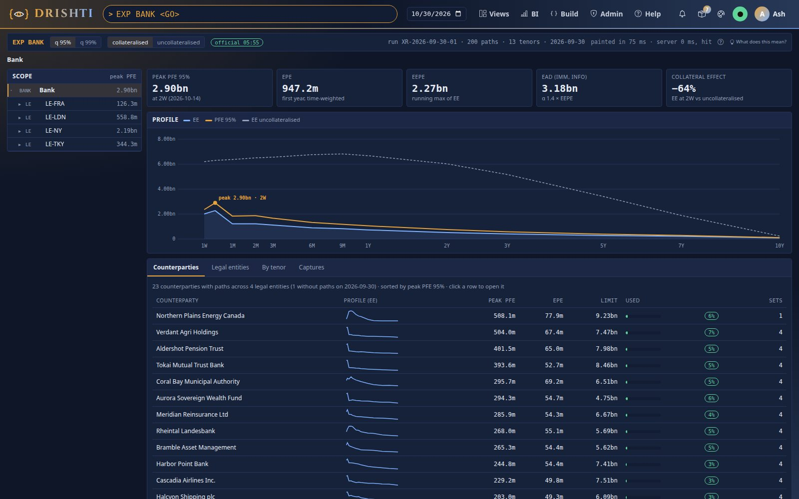


On a phone the panels stack: the command line, the tree, then the tiles and the chart:

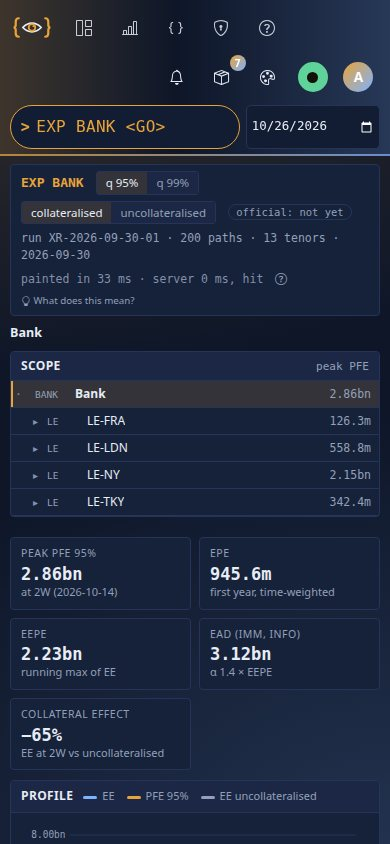

### 3.3 The tabs

- **Counterparties** (the board): one row per counterparty: a small EE profile, peak PFE, EPE, the stored **limit** and **used**
  (the computed peak PFE at the limit's confidence over the limit), the number of netting sets; 25 rows at a time, largest first; a row
  opens the counterparty. The limit is the `credit-limit` record read as stored (`drishti.ccr.exposure.kinds.limit`); LIM stays parked,
  see [section 28](#28-open-items) on its low utilisation.
- **Legal entities** (bank): per legal entity its EE profile, peak PFE, EPE, netting sets and share of the bank's peak.
- **Netting sets** (counterparty or ad-hoc): per set its CSA, EE profile, EPE, **peak PFE alone** and **PFE contribution** (the shares
  that add up to the scope's peak, [section 18](#18-the-computation), 18.6) and share; a total row.
- **Collateral** (netting set): the CSA (thresholds them / us, minimum transfers, independent amount, rounding, MPOR and remargin
  frequency), at the peak tenor EE without collateral, the mean collateral on the paths, EE with collateral and the *Effect of collateral* (signed: −65% lower, +452% higher); today's net
  MtM, collateral held (net), initial margin held, the trades, the collateral model, the look-back used, the `MPOR_MISMATCH` flag and
  the dates that keep today's collateral (no look-back point after today).
- **Trades** (netting set): every trade, 25 a page, by EE contribution at the set's peak date (read from the lake on request): product,
  desk, EE contribution, share, **peak PFE alone**; a row opens the trade's exposure, its id opens `TRD`.
- **Pre-deal check ›** (a button under the tabs, at a counterparty and at a netting set): opens **Counterparties → Pre-deal check** at
  that counterparty or netting set, [section 7](#7-pre-deal-what-if). The explorer has no pre-deal form of its own: the check is one
  screen, and an old link to the explorer's Pre-deal tab (`/exposure?scope=…&tab=predeal`) opens it.
- **By tenor**: the profile as a table (EE, ENE, EEE, PFE at q, PFE 99%, EE uncollateralised per tenor), with the CSV link and the CLI and
  API equivalents.
- **Captures**: capture now with a note, the scope's captures (id, date, captured, by, peak PFE, EPE, note), **Compare with now**,
  **Compare the two newest**, each capture's CSV; [section 6](#6-captures-and-compare).

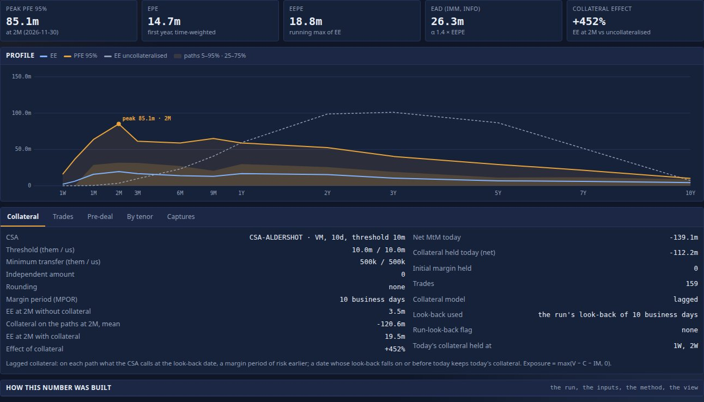

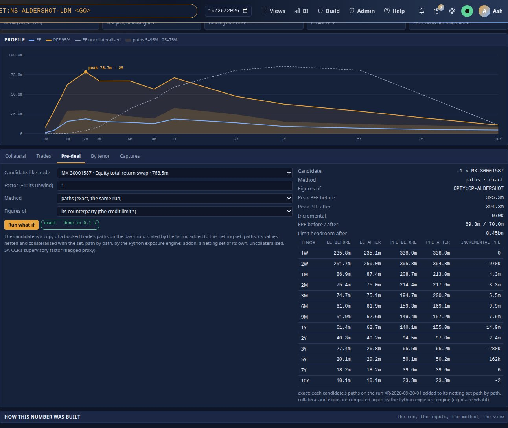

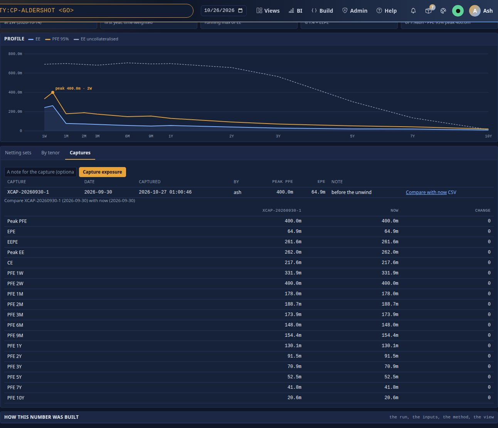

### 3.4 A trade: alone, in its set, the netting benefit

`EXP TRD:<id>` (or a click on a trade) shows the trade **alone**: as its own netting set, uncollateralised, its own profile and peak
PFE. The tab **In its netting set** shows, per tenor, its **EE contribution** to its netting set after netting and collateral, the set's
EE and the share (the shares of a set's trades add up to the set's EE at every date). The tile **Netting benefit** is the peak PFE alone
less the contribution: a trade that offsets its set has a large benefit, often a negative contribution. Buttons open `TRD <id>` and go
back to the set.

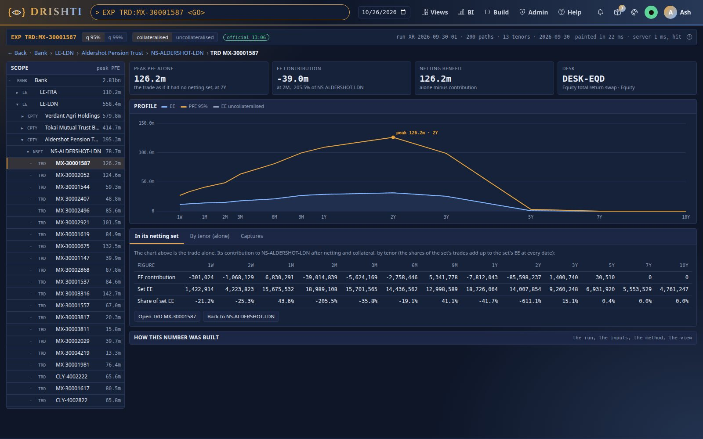

### 3.5 The no-paths state

A netting set or counterparty the reference data knows but the run does not cover shows only "no exposure paths for the netting set NS-…
on <date>" and a note: the engine computes from the day's simulated paths; nothing is shown, never an old figure. In the default demo lake the
three netting sets of CP-SUMMIT and CP-NORTHPLAINS have no paths; with `lake demo --exposure committed` 68 of the 76 have none
([section 23](#23-test-data-and-generators)).

## 4. Scopes

A scope is text: one word or several joined with `+` (union), `-` (difference) and `&` (intersection), the grammar of VaR's scopes
([VAR_GUIDE.md section 5](VAR_GUIDE.md#5-scopes-portfolios-and-baskets)) with the counterparty words added.

| Word | Means | Example on the test data |
|---|---|---|
| `BANK` | everything with paths | `EXP BANK` |
| `NSET:<id>` | a netting set (with or without `NS-`) | `NSET:NS-ALDERSHOT-LDN` |
| `CPTY:<id>` | a counterparty's netting sets (with or without `CP-`) | `CPTY:CP-ALDERSHOT` |
| `GROUP:<id>` | a connected group's counterparties (`counterparty-group`) | `GROUP:GRP-ALDERSHOT` |
| `LE:<id>` | the trades booked by a legal entity (`LE:NY` is `LE-NY`) | `LE:LE-LDN` |
| `DESK:<desk>`, `BOOK:<book>` | the trades' `DESK`, `TT_BOOK` (cut netting sets: `partial`) | `DESK:RATES & CPTY:CP-ALDERSHOT` |
| `TRD:<ids>` | trades only, uncollateralised (`standalone`) | `TRD:CLY-4003028` |
| `WHERE:<rule>` | a rule over the trades' columns | `WHERE:ASSET_CLASS = 'Rates' & CPTY:CP-ALDERSHOT` |

Examples: `CPTY:CP-ALDERSHOT - NSET:NS-ALDERSHOT-NY` (Aldershot without New York), `NSET:NS-ALDERSHOT-LDN + NSET:NS-AURORA-TKY` (two sets
together: their exposures add path by path), `LE:LE-TKY & CPTY:CP-ALDERSHOT`.

Scope grammar of VAR_GUIDE.md section 5 with the counterparty terms of NSET.md section 8 (`NSET:`, `CPTY:`, `GROUP:`, `LE:`).

| Scope | How the exposure matrix is formed | Cost |
|---|---|---|
| `NSET:<id>` | the set's `EMAT` (statistics precomputed) | microseconds |
| `CPTY:<id>` | Σ of its sets' `EMAT` (statistics precomputed at load) | microseconds; a few ms for contributions |
| `GROUP:<id>` | Σ of its counterparties' sets | ms |
| `LE:<id>` | EE, ENE, EPE: sums of set statistics; PFE: a batch job | ms / job |
| a scope that cuts sets (`DESK:RATES & CPTY:CP-X`) | per touched set, V recomputed from the scope's trades (lake read), then collateral and E as if those trades were the set (`partial`) | seconds |
| `TRD:<ids>` (a trade alone) | the trade as its own set, uncollateralised | ms (lake read) |

**Additive:** V per path across trades; E per path across netting sets; EE, ENE, EPE across netting sets. **Not additive:** PFE, peaks,
EEE, EEPE, contributions to them.

**Implementation:** the words `BANK`, `NSET:` (ids, with or without `NS-`), `CPTY:` (with or without `CP-`), `GROUP:` (the
`counterparty-group` members), `LE:` (the trade's legal entity; `LE:NY` is `LE-NY`), `DESK:`, `BOOK:` (the trades' `DESK` and `TT_BOOK`),
`TRD:` (ids in any case; a scope of trades only is `standalone`: uncollateralised) and `WHERE:` (a rule over the trades' `NETTING_SET`,
`COUNTERPARTY`, `LEGAL_ENTITY`, `DESK`, `TT_BOOK`, `ASSET_CLASS`, `PRODUCT`, `SOURCE_SYSTEM`, `MATURITY_DATE`, `NOTIONAL`, `MTM`), joined with
`+ - &` (VaR's parser, `ScopeExpr`, with `NSET` and `GROUP` added). `DIV:`, `NODE:`, `POS:`, `PORT:`, `BASKET:`, `CAPTURE:` are VaR's:
`400 DRS-5440`. A scope sums every netting set it touches interactively up to `max-scope-netting-sets`; the official capture has no limit.
A netting set or counterparty the reference data knows that the run does not cover answers `404 DRS-1001` "no exposure paths for the
netting set NS-… on <date>" (the computed kind: `STATUS: no-paths`), never stale numbers.

## 5. Collateral and netting

**Netting** happens inside a netting set only: its trades' values add path by path (V), so a payer and a receiver swap offset. Across
netting sets nothing nets: their *exposures* (already floored at zero) add path by path.

**Collateral** is per netting set, from its CSA ([NSET.md section 3.5](../contracts/NSET.md)) and today's holdings (`collateral-balance`):

- **lagged** (the default): on each path the collateral at date t is what the CSA called at the look-back date t − MPOR (thresholds,
  minimum transfer amounts, independent amount, rounding applied to the change from today's collateral). A date whose look-back would
  fall on or before today (1W and 2W on a 10-day MPOR) keeps today's collateral: nothing called later settles in time.
- **current**: today's collateral held constant on every path.
- **none**: no collateral and no initial margin (the explorer's **uncollateralised** switch; `TRD:` scopes are always uncollateralised).
- **initial margin** held today is kept on every path (`im-model: current`); IM the bank posts, segregated, adds nothing.

The **Collateral** tab shows the CSA and its effect at the peak tenor; the profile chart's dashed line is EE uncollateralised. Collateral
reduces exposure when the bank holds it and can raise it when the bank has posted it (NS-ALDERSHOT-LDN, [section 2](#2-the-measures-with-worked-numbers)).
When a CSA's MPOR (plus remargin frequency − 1) differs from the run's look-back, the run's look-back is used and the answer is flagged
`MPOR_MISMATCH` (decided 2026-10-26). The formulas are [section 18](#18-the-computation), 18.3.

A scope that cuts a netting set (a desk inside a counterparty) recomputes the set's value from the scope's trades, read from the lake,
and applies the set's CSA to them as if they were the set (flag `partial`).

## 6. Captures and compare

A **capture** freezes a scope's answer: the figures, the profile, the netting sets, the flags, the member trade ids (for a viewer who sees
them) and the provenance; never paths. Ids are `XCAP-<yyyymmdd>-<n>`, kept per owner in the content store (`exposure/captures/`).

| Where | How |
|---|---|
| Explorer | the **Captures** tab: a note, **Capture exposure**; or **Capture exposure** beside **Explain ›** |
| CLI | `drishti.py exposure capture CPTY:CP-ALDERSHOT --note 'before the unwind'`; `captures [--scope]`; `compare XCAP-20260930-1 now` |
| API | `POST /api/v1/risk/exposure/captures {scope, note, q, collateral}` (a token needs `risk:write`); `GET /captures?scope=`, `GET /captures/{id}`, `GET /captures/{id}/csv`, `GET /captures/{id}/jsonl` |

**Compare** two captures, or a capture with **now** (the scope computed again): peak PFE, EPE, EEPE, peak EE and CE side by side with
the change, PFE per tenor, and the trades added and removed. `GET /api/v1/risk/exposure/compare?a=<id>&b=<id|now>`. A capture's CSV is the `#
field: value` lines and then the profile.

## 7. Pre-deal what-if

*What does this trade do to the counterparty's PFE before I deal?* Two methods:

| Method | How | Where it runs | Flag |
|---|---|---|---|
| **`paths`** (exact) | the candidate's values on every path of **the same run** are added to its netting set's V; the set's collateral and exposure are computed again, then the scope's figures; incremental = with − without, per figure and per primary date | the Java engine (`ExposureWhatIfMath` with `ExposureMath`, the same code as every exposure figure) | none (`exact`) |
| **`addon`** (conservative proxy) | the candidate as a netting set of its own, no netting, no collateral: PFE add-on `max(MTM, 0) + z_q · SF · d · |δ| · sqrt(min(t, M))`, EE add-on with `1/sqrt(2π)` in place of z_q, with SA-CCR's supervisory factor SF | the Java engine | `proxy` |

**Both methods run in the server's exposure engine**, wherever exposure runs: no compute pool, no worker, no setting of their own.

**The candidate.** A candidate's paths are one of:
- `{copyOf: <trade>, factor}`: a booked trade's paths on the run, scaled (`factor: -1` is its unwind) — what the pre-deal check (`LIKE`) and
  `--like` use;
- `{runId, mtm}`: G lists of P numbers (or one list of G × P, grid-date-major);
- `{runId, arrow}`: base64 Arrow IPC with `GRID_INDEX` and `MTM` as a fixed-size list of P.

Paths of another run or another length are refused (`400 DRS-5442`). A candidate with `nettingSet` joins that set (netting and
collateral with it); without, it is a netting set of its own, uncollateralised. For `addon` give `assetClass`, `notional`,
`maturityDate`, `mtm` and `delta`.

**On the screen: Counterparties → Pre-deal check** (`PREDEAL <GO>`, the menu Counterparties, or **Pre-deal check ›** in the explorer
at a counterparty or a netting set; `/predeal`). One screen for the question, built on the Drishti Elements libraries; every number on it
is the server's pre-deal check ([section 18.9](#189-the-pre-deal-check)), the page only places them.

- **The trade** (a form, on the right): *Counterparty* (those you see, the largest peak PFE first, each with its limit use), *Into the
  netting set* (the counterparty's; left empty, the server takes the template's or the only one), *The trade is* **like a booked trade
  (exact)** or **described (proxy, only refers)**; like a trade: *Like the trade* (the netting set's trades, the largest EE contribution
  first), the *Side* (the template's, or the other side: reverse); described: *Asset class* and *Maturity*; then the *Notional* (money:
  `250m`, `1.5bn`, `400k`; blank copies the template as it is) and the *MtM today*. **Check** asks the server.
- **The verdict**: the decision (**approve**, **refer**, **decline**) with its lamp, the limit's status (**within**, **near the limit**
  from `drishti.risk.limit-near` of it, 80% by default, or **over the limit**), the reason and every other reason; the tiles: the new trade, the limit
  use before → after with its status, the headroom after (and before), the incremental figure the limit is set on, EPE before → after,
  the EAD (IMM, α × EEPE) before → after (the exact method only), SA-CCR's incremental EAD (under construction, 2.9.11.k); the table of
  the limit and each tenor bucket: limit, before, with the trade, increment, use before and after, headroom and status.
- **Explain ›** (or a tile, or **E**): the one Explain of the check (kind `predeal`): the formula with its values (use = with ÷ limit,
  headroom = limit − with, each bucket, the near rule, EAD = α × EEPE, the decision rule), the inputs (the command, the netting set and how
  it was chosen, the method, the template) and the checks (the reasons). A figure of a table explains itself in the table's own pane.
- **The what-if**: the profile overlay (PFE with the trade over PFE before, EE with and before, EEPE, the limit line when the limit is on
  PFE), the incremental PFE per tenor as bars, the figures current and with the trade (peak PFE, EPE, EEPE, peak EE, CE, EAD) and the
  table by tenor. Under the verdict the same check as a command line: `drishti.py exposure predeal "PREDEAL …"`.

A typed command checks at once: `PREDEAL CP-ALDERSHOT LIKE MX-30001587 REVERSE IN NS-ALDERSHOT-LDN <GO>` opens the screen with that check
made and the form filled from it. On a phone the screen stacks: the verdict first, then the trade, the charts and the tables (a wide
table scrolls inside its card). With the banking module off the screen, its word and its script are gone.

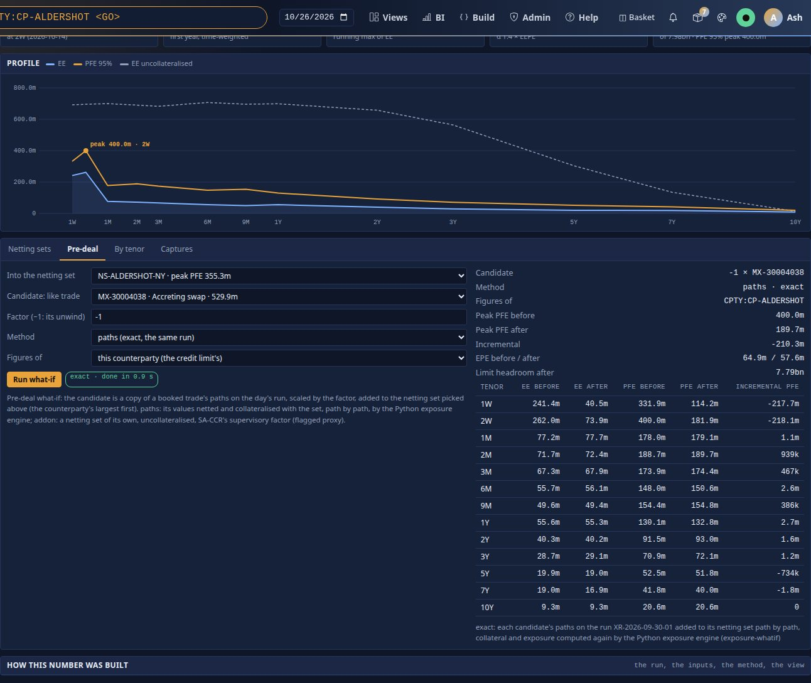

The what-if alone, without a limit or a decision, is the API's and the command line's (`drishti.py exposure whatif --like <trade>
--factor -1 --set <netting set>`, `--method addon`, or `--candidates new-swap.json`). **API**: `POST /api/v1/risk/exposure/what-if`, [section 11](#11-the-api).

**How the exact method computes**: the engine reads the scope and each netting set a candidate joins as the asking person (their
entitlements apply; a set must be one the scope covers whole), adds each candidate's paths to its set's value V path by path, computes
the set's collateral and exposure again with `ExposureMath` (the CSA's terms, today's holdings, the look-back points, the asked
collateral model), and replaces the set's E and N in the scope's: `E_scope − E_set + E'_set` on every path. A candidate of its own adds
`max(M, 0)`. The current exposure moves the same way, and the horizon is the longest remaining life, at most a year. Deterministic (no
random numbers), nothing stored. Each candidate is also measured alone (`peakPfeAlone`, uncollateralised) and added alone
(`incrementalPeakPfe`). Details: [section 19](#19-what-drishti-answers), 19.5.

**The pre-deal check** (`PREDEAL <counterparty> LIKE <trade> <notional>`) puts the what-if to the counterparty's credit limit and
answers **approve**, **refer** or **decline**, with the method and the template shown; a proxy only refers, never approves:
[section 18.9](#189-the-pre-deal-check).

## 8. Exposure as a kind

| Kind | Command | Class | What |
|---|---|---|---|
| `exposure-result` | `EXP <scope>` | computed (reactive connector `exposure-engine`, Java `ExposureResultEngine`) | a scope's figures, profile, netting sets, flags, provenance |
| `simulation-run` | `XRUN` | input | the run's identity and grid |
| `exposure-path` | `XPATH` | input (Delta connector `exposure-store`) | every trade's MtM on every path at every grid date |

The id of a computed answer is the scope text with parameters after `~`: `CPTY:CP-ALDERSHOT~q=0.99`. `exposure-result` takes `q`,
`collateral` (`lagged`, `current`, `none`) and `run` (empty: the newest complete run). Its contract is a generated page in
`docs/contracts/` (`exposure-result.contract.yaml` in the pack). The pre-deal what-if is not a kind: it is the engine's
`POST /api/v1/risk/exposure/what-if` ([section 7](#7-pre-deal-what-if)).

Because they are kinds, the usual tools work: `/v/exposure-result/NSET:NS-ALDERSHOT-FRA`, Sutra pages (the netting-set and counterparty
pages read the engine's figures under `EXPOSURE_ENGINE`: EPE and peak PFE 95% in the strip, the profile panel, a "how it was computed"
panel), Calc (`exposure_profile_stats.py`, `cva_from_ee.py`, `collateral_mpor_mc.py`, `concentration_hhi.py`, the core pack's
`group_exposure.py`), BI over the published official results.

## 9. Who sees what: entitlements and audit

As NSET.md section 11 (counterparty coverage, restricted list, masks, aggregate-only). In addition: a role at `aggregate` for a
counterparty sees its profile but not `BY_NETTING_SET` rows below its level nor trade contributions; captures never store trade paths;
the what-if sandbox is private (REACTIVE_CONNECTOR.md); `ccr-view`, `ccr-whatif` and `ccr-capture` are audited with scope, run and
counts.

**Implementation:** `drishti.ccr.exposure.access.<role>[<counterparty, group or legal entity>]` is `trades`, `aggregate` or `none`; a
netting set takes the widest level of its counterparty, the counterparty's group and its legal entity; a role with no entry sees all at
`trades` when it may open `exposure-path`. A scope naming trades (`TRD:`, `DESK:`, `BOOK:`, `WHERE:`) needs `trades` on every set it
touches (`403`). The `counterparty` kind's `NAME` mask shows the id in labels. The restricted (wall-crossed) list is not built. Audited:
`ccr-view`, `ccr-export`, `ccr-capture`, `ccr-whatif`, `ccr-official`, `ccr-reload`.

| Action | Console (a person) | Token |
|---|---|---|
| read figures, profile, distribution, contributions, tree, captures, compare | any user who may open the scope | `read` |
| `POST /what-if` | any user who may open the scope (`trades` on the sets the candidates join for `paths`) | `read` |
| `POST /captures` | any user | `risk:write` |
| `POST /reload`, `POST /official` | administrators | never (an administrator in the console) |

## 10. The command line

`drishti.py exposure <command>` (`tools/expcli.py`) asks `/api/v1/risk/exposure` as the token's user (`--server`, `--token` or the
environment, as every `drishti.py` group). Exit codes: 0, 1 (the server said no), 2 (usage). Every scope command takes `--date
YYYY-MM-DD` (default the newest with paths), `--q Q` (default 0.95), `--collateral lagged|current|none` and `--json`.

| Command | What | Example |
|---|---|---|
| `show <scope>` | the figures in a few lines (peak PFE and its tenor, PFE 99%, EPE, EEPE, peak EE, CE, EAD, the limit and its use, the run, flags) and the profile as a table | `drishti.py exposure show NSET:NS-ALDERSHOT-NY` |
| `parts <scope>` | contributions: `--by child|netting-set|counterparty|legal-entity|trade|asset`, `--figure PFE|EE|EPE`, `--at TENOR|DATE` (EE), `--top N` (25) | `drishti.py exposure parts NSET:NS-ALDERSHOT-NY --by trade --figure EE --top 10` |
| `tree` | the bank, legal entities, counterparties and netting sets with peak PFE, EPE and limit use (`--date`, `--q`) | `drishti.py exposure tree` |
| `profile <scope>` | the profile; `--csv` writes the CSV | `drishti.py exposure profile NSET:NS-ALDERSHOT-NY --csv > ns-ny.csv` |
| `distribution <scope>` | the exposure distribution at a primary date (`--at 1Y`): histogram, quantiles, mean, share at zero, and the path fan | `drishti.py exposure distribution NSET:NS-ALDERSHOT-NY --at 1Y` |
| `status` | the engine's settings, hot files and loaded dates | `drishti.py exposure status` |
| `capture <scope>` | capture now (`--note`) | `drishti.py exposure capture CPTY:CP-ALDERSHOT --note 'before the unwind'` |
| `captures` | the captures you may read, newest first (`--scope`) | `drishti.py exposure captures` |
| `compare <a> [b]` | two captures, or a capture with `now` | `drishti.py exposure compare XCAP-20260930-1 now` |
| `official` | the date's official end-of-day record (`--date`); `--capture` takes it now (administrators) | `drishti.py exposure official` |
| `retention` | what the retention keeps of each date held, and the dates whose trade paths are beyond their window | `drishti.py exposure retention` |
| `reload` | drop the loaded dates (administrators): the next request maps the hot file again or reads the lake; `?date=` one date only | `drishti.py exposure reload [--date D]` |
| `whatif <scope>` | a pre-deal what-if: `--like TRADE` (`--factor`, default 1; −1 its unwind), `--set NETTING_SET` (default a set of its own), or `--candidates FILE.json`; `--method paths|addon` (default `paths`) | `drishti.py exposure whatif CPTY:CP-ALDERSHOT --like CLY-4003028 --factor -1 --set NS-ALDERSHOT-FRA` |

Real output of each on the test data: [tutorial 26](../tutorials/26-exposure-from-the-bank-to-a-trade.md). Tests: `tools/test_expcli.py`.

## 11. The API

All under `/api/v1/risk/exposure`. Every `GET` takes `asOf` (the business date; default the newest with paths), `q` (default
`limit-confidence`, 0.95), `collateral` (`lagged`, `current`, `none`); `/scope` also `run` and `strict`. Answers are camelCase (`epe`,
`peakPfe`, `profile[].pfe99`); the computed kind spells the same fields in UPPER_SNAKE.

| Method and path | Parameters | Answer |
|---|---|---|
| `GET /scope` | `scope`, `q`, `collateral`, `run` (the newest complete run), `strict` (`true`: a date whose run is not one run is refused instead of answered from the date before) | the figures, profile, netting sets, ancestors, limit, collateral, flags, provenance ([section 19](#19-what-drishti-answers)) |
| `GET /scopes/{scope}` | as above | the path form for a simple scope (`/scopes/NSET:NS-ALDERSHOT-FRA`) |
| `GET /scope/profile` | `scope`, `dates` (`primary` or `all`), `format=csv` or `format=jsonl` | the profile only, for charts; CSV `tenor,date,t,ee,ene,eee,pfe,pfe_99,ee_uncoll` |
| `GET /scope/distribution` | `scope`, `date` (a primary date or tenor; default the peak), `bins` (`histogram-bins`, 42), **`bands`** (`true`: also the path fan, the 5, 25, 50, 75 and 95% quantiles of the paths' exposure at every primary date) | `histogram {edges, counts}`, `quantiles`, `mean`, `zeroShare`, `bands` |
| `GET /scope/contributions` | `scope`, `by` (`child`, `netting-set`, `counterparty`, `legal-entity`, `trade`, `asset`), `figure` (`EE`, `EPE`, `PFE`), `date` (EE), **`alone`** (`true`, by trade: each trade's peak PFE alone, uncollateralised, too), **`profile`** (`true`, by trade: each trade's EE contribution at every primary date) | rows `{key, scope, label, kind, value, pct, incremental}` (with `alone`: `peakPfeAlone`; with `profile`: `profile[]`), `total`, `date`, `parts`, `truncated` |
| `GET /tree` | `q` | the bank, legal entities, groups, counterparties (with their stored limit and use) and netting sets with EPE and peak PFE; sets without paths `noPaths` |
| `POST /what-if` | body `{scope, method: paths|addon, q, collateral, candidates: [{tradeId, label, nettingSet, paths: {copyOf, factor} | {runId, mtm} | {runId, arrow}, assetClass, notional, maturityDate, mtm, delta}]}` | `{base, with, incremental: {epe, peakPfe, profile[]}, method, flags, items, note}` ([section 7](#7-pre-deal-what-if)); a `copyOf` of a trade you do not see trade by trade `403` |
| `POST /predeal` | body `{command: "PREDEAL <counterparty> LIKE <trade> <notional> …"}` or the same as fields; `asOf` | `{checkId, command, decision: approve|refer|decline, reason, reasons, method, template, nettingSet, limit {…, buckets}, exposure {base, with, incremental}, saCcr, flags}` ([section 18.9](#189-the-pre-deal-check)) |
| `GET /predeal/grammar` | | the command's usage, words, asset classes, examples and decisions |
| `POST /captures` | `{scope, note, q, collateral}` | the capture |
| `GET /captures`, `GET /captures/{id}`, `GET /captures/{id}/csv`, `/jsonl` | `scope` | your captures, one, its CSV or JSON Lines (a grid date a line) |
| `GET /compare` | `a`, `b` (an id or `now`) | both, the change, PFE per tenor, trades added and removed |
| `GET /status` | | the settings, runs loaded, hot files, sizes |
| `GET /retention` | | each date held: what the retention keeps, the dates whose trade paths are beyond their window |
| `GET /official` | `asOf` | the official record of a date |
| `POST /official` | `asOf` | take the official capture now (administrators) |
| `POST /reload` | | drop the loaded dates (administrators) |

Codes: [section 21](#21-validation-errors-and-data-quality). The full endpoint list of Drishti is [API_GUIDE.md](API_GUIDE.md).

## 12. Settings

Every setting is under `drishti.ccr.exposure` in the engine's own file, `config/engines/exposure.yaml` (its switch `drishti.engines.exposure.enabled`; [OPERATIONS.md section 21](../admin/OPERATIONS.md#21-compute-engines-on-or-off)) (and [CONFIGURATION.md](../admin/CONFIGURATION.md#drishticcrexposure--the-exposure-engine)).

Every setting of this part, with its type, default, environment variable, meaning and whether a change needs a restart, is in the one configuration document: [CONFIGURATION.md, `drishti.ccr.exposure`](../admin/CONFIGURATION.md#drishticcrexposure) (also at Help → Configuration in the console).

Also the token rules: `POST /api/v1/risk/exposure/what-if` and `POST /api/v1/risk/exposure/predeal` are `read`, `POST /captures` `risk:write`, `POST
/reload` and `POST /official` never a token's.

## 13. Troubleshooting

| Symptom | Cause | What to do |
|---|---|---|
| "no exposure paths for the netting set NS-… on <date>" (`404 DRS-1001`; the kind's `STATUS: no-paths`) | the reference data knows the set or counterparty, the day's run does not cover it (CP-SUMMIT's and CP-NORTHPLAINS's three sets in the default demo lake; 68 of 76 with `--exposure committed`) | expected for those sets; in production, check the simulator's coverage: `drishti.py exposure status` counts `setsWithoutPaths` |
| `404 DRS-1001` "no run for the date" | no complete `simulation-run` on `asOf` | another date (`--date`), or load the run; the load signal reloads it |
| `400 DRS-5440` "the netting set NS-… is not one the scope … covers whole" on a what-if | a candidate's `nettingSet` is outside the scope, or only part of it is in the scope | ask on the counterparty or the netting set, or leave `nettingSet` out (a netting set of its own) |
| `400 DRS-5442` | candidate paths of another run, or another number of paths | candidates from the same `RUN_ID`, P paths each |
| `400 DRS-5440` | a bad scope word (VaR's `DIV:`, `NODE:`, `POS:`, `PORT:`, `BASKET:`, `CAPTURE:`) or parameter (`q`, `collateral`, `date` not a primary date, `by`, `figure`, `run`) | [section 4](#4-scopes) |
| `409 DRS-5441`, or the flag `stale-run` | the date's run is not one run (two batch ids, a duplicate row, a trade in two sets, a bad grid) | fix the upstream run; until then the date before answers with a warning (`strict=true` refuses) |
| `503 DRS-5443` | the scope sums more than `max-scope-netting-sets` | narrow the scope; the official capture computes it |
| `503 DRS-5445` | the date's matrices over `memory-budget-gb` | raise the budget or the heap |
| `422 DRS-5444` counted in the provenance | rows rejected at load (vector length, NaN, grid index) | fix the rows upstream; never padded |
| `403` on a `TRD:`, `DESK:`, `BOOK:`, `WHERE:` scope | your role sees a touched set only in aggregate | ask for `trades` access ([section 9](#9-who-sees-what-entitlements-and-audit)) |
| the board's *used* is tiny (0.1% to 5%) | the stored credit limits were sized on stored profiles, not on computed exposure | known, [section 28](#28-open-items) |
| the first answer of a date is slow | the date's rows are read from the lake and the hot file written | the next answers map the hot file; `status` shows it |
| the flag `MPOR_MISMATCH` | a CSA's MPOR (+ frequency − 1) differs from the run's look-back | the run's look-back is used (decided) |
| a trade listed in the load's t₀ check | its paths' mean at the first grid date departs from today's MtM | expected for short trades on the test data's amortising model; in production an upstream trade-version or market-data mismatch |

## Part II · The data contract

*Version 1.2 · Built · Shared rules: [contracts README.md](../contracts/README.md) · Model
contract: [VAR_GUIDE.md Part II](VAR_GUIDE.md#14-the-contract-at-a-glance) · Netting and the shared counterparty tables:
[NSET.md](../contracts/NSET.md)*

This is the contract of Drishti's **exposure engine**: what an
upstream exposure simulator delivers (every trade's MtM on every Monte Carlo path at every date of a time grid), what Drishti builds from
it (netting-set path matrices, collateral on each path, tiered memory), and what it answers (EE, ENE, EPE, effective EE and EPE, PFE at
any confidence, peaks, contributions, incremental figures before dealing) for any scope. It defines the two **shared path tables**,
`simulation-run` and `exposure-path`, which [CVA.md](../contracts/CVA.md), [LIM.md](../contracts/LIM.md), [GRP.md](../contracts/GRP.md)
and [WWR.md](../contracts/WWR.md) read too. Sections marked **Implementation** are checked against the code and the committed test data.

**Sources of truth checked (1.2):** `tools/packgen/ccr/` (`paths.py`, `ccrmath.py`, `make_ccr_data.py`); `drishti-compute`
(`com.ash.drishti.banking.compute.ccr`: `ExposureGrid`, `CsaTerms`, `ExposureMath`, `ExposureBook`, `ExposureHotFile`, `ExposureScopes`,
`ExposureCalc`, `ExposureWhatIfMath`); `drishti-banking` (`com.ash.drishti.banking.exposure`, `ExposureWhatIf`, `ExposureWhatIfPaths`);
`drishti.ccr.exposure` in `config/engines/exposure.yaml`; the counterparty-risk pack's `pack.yaml` (`exposure-store`, `exposure-engine`);
`data/testdata/counterparty-risk/{simulation-run,exposure-path}`.

## 14. The contract at a glance

### 14.1 Summary

**What it is.** Counterparty credit exposure over time: on each simulated path, the netting set's value after netting and after the
collateral it would hold, floored at zero; then across paths the expected exposure (EE), expected negative exposure (ENE), the time
averages EPE and effective EPE (EEPE), and potential future exposure (PFE) at a confidence such as 95% or 99%, with the peak. For a
netting set, a counterparty, a connected group, a legal entity or any ad-hoc scope, and for a scope plus candidate trades (pre-deal).

**Commands.** `EXP NSET:NS-ALDERSHOT-FRA <GO>` (as typed; the spaced `EXP NSET NS-ALDERSHOT-FRA <GO>` too), `EXP CPTY:CP-ALDERSHOT <GO>`,
`EXP GROUP:GRP-ALDERSHOT <GO>`, `EXP LE:LE-NY <GO>`, `EXP TRD:<trade> <GO>`; the API `/api/v1/risk/exposure`; the netting-set and counterparty
pages show the engine's figures as they open. **Implementation:** `EXP` is the computed kind `exposure-result`; its main screen is the
exposure explorer ([section 3](#3-the-explorer-screen-by-screen)), whose Pre-deal tab asks the engine's what-if.

**Not stored:** the kind `exposure-profile` (`EXP-*` records with `EPE`, `EEPE`, `PFE_PEAK`, `BUCKETS[]`), and
the profile figures on `netting-set` ([NSET.md](../contracts/NSET.md) section 14). Its ids open the computed page (§22).

| Part | Status |
|---|---|
| `simulation-run` (one row per simulation run and date: the grid, the paths, the seed, the model) | BUILT |
| `exposure-path` (one row per trade × grid date: a vector of MtM over the paths) | BUILT |
| Netting per path, collateral per path with the margin period of risk, EE, ENE, EPE, EEE, EEPE, PFE, peaks, contributions | BUILT |
| Tiered memory: netting-set path matrices in memory-mapped per-date files, trade paths read only for drills and what-ifs | BUILT (one node; sharding PLANNED) |
| Incremental exposure before dealing: the conservative proxy (`addon`) | BUILT |
| Incremental exposure before dealing: exact with candidate paths of the same run (`paths`, the Java engine) | BUILT |
| Computed kind `exposure-result`, reactive connector `exposure-engine` (Java) | BUILT |
| The exposure explorer, the CLI's exposure commands (`drishti.py exposure`) | BUILT |
| The benchmark at a large bank's size | BUILT at a workstation's size, extrapolated ([section 27.4](#274-the-benchmark-measured-and-extrapolated)) |
| Official end-of-day results `exposure-official`, `exposure-official-cpty` | BUILT |
| No stored `exposure-profile`, and no exposure figures on the netting set and counterparty | BUILT (§22) |

### 14.2 The measure in one page

**What it answers:** *how much could this counterparty owe us if it defaulted at a future date, on average and in a bad case, after
netting and collateral?* For credit officers (limits are set on PFE), CVA desks (EE feeds CVA), regulatory capital (EEPE under an
internal model), and traders (what a new trade does to a counterparty's PFE before they deal).

**In words:**
1. The upstream simulator draws P market paths (2,000 to 5,000 in a bank) on a time grid of G dates (50 to 100, including *look-back*
   dates a margin period of risk before the main ones), revalues every live trade on every path and date, and writes one row per trade
   and grid date: a vector of P MtM values. **Every trade uses the same paths** (path *p* is the same market for all trades), so trade
   values add per path.
2. Drishti sums the trades of each netting set per path and date: the **netting-set value** V(p, t).
3. On a margined netting set Drishti computes the **collateral** each path would hold at t, from the CSA's thresholds, minimum transfer
   amount and independent amount applied to the set's value at the look-back date t − MPOR (the collateral lags by the margin period of
   risk).
4. The **exposure** on a path is E(p, t) = max(V − C, 0); across netting sets of one counterparty exposures **add per path**.
5. **EE(t)** is the mean of E over the paths; **PFE_q(t)** is its q-quantile; **EPE** and **EEPE** are time averages over the first year.

**Methodology.** Monte Carlo exposure simulation post-processing as in Basel CRE53 (internal models method: EE, effective EE, EEPE,
alpha 1.4) and the industry's PFE practice for limits. Drishti does **not** simulate markets or price trades: the paths are inputs
(the contracts' README.md section 3). QLRisk may later produce them ([PYTHON_COMPUTE.md](../architecture/PYTHON_COMPUTE.md)).

## 15. Inputs from upstream engines

### 15.1 Where they live

```
${DRISHTI_DELTA_ROOT}/risk/
├── simulation-run/   business_date=YYYY-MM-DD/                   one row per simulation run and date: the grid and the run's identity
├── exposure-path/    business_date=YYYY-MM-DD/run_id=<RUN_ID>/   one row per trade × grid date: MTM over the P paths  (the large table)
├── credit-path/      business_date=YYYY-MM-DD/run_id=<RUN_ID>/   optional: counterparty credit on the same paths (WWR.md)
└── netting-set/, netting-set-member/, csa/, valuation/     NSET.md
```

| Kind | Key | Grain | Read by | Cadence | Due |
|---|---|---|---|---|---|
| `simulation-run` | `RUN_ID` | run × date | EXP, CVA, LIM, GRP, WWR | daily | before the paths (to be agreed) |
| `exposure-path` | `PATH_ROW_ID` | trade × grid date × run | EXP, CVA, LIM, GRP, WWR | daily | **to be agreed** (open question 1); a large bank's run often lands overnight, 04:00–07:00 local |

Beside them the engine reads, for the date (E0 of [COMPUTED_ATTRIBUTES.md](../architecture/COMPUTED_ATTRIBUTES.md)):
`trade-valuation` (each netting set's members, a live status naming the set, and their MtM today: the market-risk pack's kind, which
VaR reads too), `netting-set` (the set's terms and links: counterparty, legal entity, CSA, collateral balance; no figure), `csa` (the
terms), `collateral-balance` (the holdings, after haircut), `credit-limit` (the counterparty's approved limit) and the counterparty and
group masters. Each of their data-load signals reloads the date (the connector's triggers; `drishti.ccr.exposure.kinds.*` names them).

### 15.2 `simulation-run`: the run's identity and grid (reference row)

**Grain:** one row per run and business date. **Row count:** 1 per date (a second, *stressed* calibration run is open question 4).
The paths of `exposure-path` are ordered by this row exactly as the P&L vectors are ordered by the scenario set (VAR_GUIDE.md section 15.3).

| Column | JSON | Delta | Req. | Engine | Unit | Meaning | Example |
|---|---|---|---|---|---|---|---|
| `RUN_ID` | id | `id` STRING | required | R | | the run; stamped on every answer | `XR-2026-09-30-01` |
| `BUSINESS_DATE` | date | `business_date` DATE | required | R | | the close the run starts from (t₀) | `2026-09-30` |
| `MARKET_DATA_DATE` | date | doc | required | R | | the market data the run calibrated to (normally the business date) | `2026-09-30` |
| `MODEL` | text | doc | required | – | | the scenario model | `Hull-White 1F rates, GBM FX and equity, Schwartz 1F commodity` |
| `MODEL_VERSION` | text | doc | required | – | | | `xsim-7.3.1` |
| `CALIBRATION` | text | STRING | required | R | | `RISK_NEUTRAL` (CVA, pricing) or `REAL_WORLD` (PFE, limits); `STRESSED` for a stressed calibration | `RISK_NEUTRAL` |
| `PATHS` | integer | DOUBLE | required | R | | P, the length of every `MTM` vector | `5000` |
| `SEED` | text | doc | required | – | | the generator's seed; with `MODEL_VERSION`, market data and trade versions the run is reproducible upstream | `0x5eed-20260930` |
| `ANTITHETIC` | boolean | doc | optional | – | | paths 2k and 2k+1 are antithetic pairs | `false` |
| `GRID_DATES` | date list | doc | required | R | | the G grid dates, strictly increasing, all after `BUSINESS_DATE`; index *k* of every row's `GRID_INDEX` | `["2026-10-01", "2026-10-07", …]` |
| `GRID_ROLE` | text list | doc | required | R | | per grid date: `PRIMARY` (exposure is reported) or `LOOKBACK` (only for collateral) | `["LOOKBACK", "PRIMARY", …]` |
| `LOOKBACK_OF` | integer list | doc | required | R | | per grid date: for a `LOOKBACK` point, the index of the `PRIMARY` point it serves; −1 for a primary point | `[1, -1, …]` |
| `LOOKBACK_DAYS` | integer | doc | required | R | business days | the distance of every look-back point before its primary point (the run's MPOR) | `10` |
| `VALUE_BASIS` | text | doc | required | R | | `FUTURE` (each value in USD of its grid date; Drishti discounts for CVA) or `DISCOUNTED` (in today's USD by the run's numeraire) | `FUTURE` |
| `CURRENCY` | ccy | doc | required | R | | must be `USD` | `USD` |
| `PRECISION` | text | doc | required | R | | `float32` or `float64`: the `MTM` vectors' type (§17) | `float32` |
| `CREDIT_PATHS` | boolean | doc | optional | R | | the run also wrote `credit-path` rows (WWR.md) | `true` |
| `TRADES`, `ROWS` | integer | doc | required | R | | rows written, for completeness | `998412`, `41302877` |
| `BATCH_ID`, `COMPUTED_AT` | id, timestamp | STRING, doc | required | – | | | `B-2026-09-30-01` |

**The grid.** Recommended (not required): daily to 2 weeks, weekly to 3 months, monthly to 1 year, quarterly to 5 years, semi-annual to
10 years, annual to 30 years (about 50 primary dates), each with one look-back date `LOOKBACK_DAYS` before it, shared where two coincide.
Drishti reports exposure at primary dates only; t₀ (the business date) comes from `valuation` (the current MtM), not from the paths.

### 15.3 `exposure-path`: every trade's MtM on every path (the large input)

**Grain:** one row per trade, grid date and run. **Key:** `PATH_ROW_ID` = `<RUN_ID>~<TRADE_ID>~<GRID_INDEX>`; natural key
(`BUSINESS_DATE`, `RUN_ID`, `TRADE_ID`, `GRID_INDEX`). **Sparse by maturity:** a trade has rows only for grid dates up to its last
cash flow; **an absent row means the trade is worth 0 on every path at that date** (allowed only after `MATURITY_DATE` + 10 business days,
otherwise the trade is incomplete, §21). **Row count:** Σ over trades of their live grid dates: about 40 million a date at 1,000,000 trades
and 50 primary + 50 look-back dates (average remaining maturity short of the grid's end).

**Why this grain** (decided here, open to review): one row per trade × grid date keeps a row to one vector of P floats (20 KB at P =
5,000 in float32, a good Parquet page), lets maturity drop rows instead of storing zeros, and lets Drishti read one grid date of a
netting set without the others. One row per trade with a P × G matrix would make 2 MB rows and store every zero after maturity.

**Implementation:** the run's row also carries `GRID_TENORS` (optional: each primary date's label, `1W` .. `10Y`; absent, the engine
labels a date by the nearest standard tenor), `STATUS` (`complete`; a run of another status is not read) and `NETTING_SETS`. A row of
`exposure-path` also carries, denormalised for the scopes and checks, `DESK`, `TT_BOOK`, `ASSET_CLASS`, `PRODUCT`, `NOTIONAL` and
`MATURITY_DATE` (optional; `DESK:` and `BOOK:` scopes need the first two). Rows of another `RUN_ID` on the date are left out and counted
(several runs may share a date: the newest complete run, by `COMPUTED_AT`, answers; `run=<id>` of another run is refused, `DRS-5440`).
The lake is partitioned by `business_date` only (`RUN_ID` is a column); the demo lake keeps `MTM` as `list<double>` (the run says
`PRECISION: float64`); float32 vectors are accepted by the contract (open question 7, decided) and, since part 2, the Delta reader
reads `list<float>` too (each value widened exactly to float64) and the lake writer writes float32 vector columns (`vector32`). In the lake the paths are served by the counterparty-risk pack's Delta connector `exposure-store` from the risk lake's domain
(`<root>/risk/simulation-run/`, `<root>/risk/exposure-path/`, layout `vectors: [MTM]`).

| Column | JSON | Delta | Req. | Engine | Unit | Meaning | Example |
|---|---|---|---|---|---|---|---|
| `PATH_ROW_ID` | id | `id` STRING | required | – | | `<RUN_ID>~<TRADE_ID>~<GRID_INDEX>` | `XR-2026-09-30-01~CLY-4003028~7` |
| `BUSINESS_DATE` | date | `business_date` DATE | required | R | | partition | `2026-09-30` |
| `RUN_ID` | id | STRING (partition `run_id`) | required | R | | the `simulation-run` | `XR-2026-09-30-01` |
| `TRADE_ID` | id | STRING | required | R | | the booking system's id, text | `CLY-4003028` |
| `SOURCE_SYSTEM` | text | STRING | required | R | | | `CALYPSO` |
| `TRADE_VERSION` | text | doc | optional | – | | the trade version the simulator priced | `5` |
| `NETTING_SET` | id | STRING | required | R | | denormalised from `netting-set-member` (checked, NSET.md section 10); empty: standalone | `NS-ALDERSHOT-FRA` |
| `COUNTERPARTY` | id | STRING | required | R | | denormalised | `CP-ALDERSHOT` |
| `LEGAL_ENTITY` | id | STRING | required | R | | the trade's booking legal entity | `LE-FRA` |
| `GRID_INDEX` | integer | DOUBLE | required | R | | *k*, index into `GRID_DATES` | `7` |
| `GRID_DATE` | date | STRING | required | – | | `GRID_DATES[k]`, for people and checks | `2026-12-31` |
| `MTM` | vector | `list<float>` (or `list<double>`) | required | R | USD | the trade's MtM on each path at the grid date, bank's side, an asset positive, length P, path order of the run | `[1203455.5, -88213.0, …]` (5,000) |
| `CASHFLOW` | vector | `list<float>` | optional | R | USD | net cash flow the trade pays the bank between the previous grid date and this one, per path (positive received); for settlement risk and collateral spikes (open question 6) | `[0, 0, 25000.0, …]` |
| `STATUS` | text | STRING | required | R | | `ok`, `proxied` (an approximate model), `failed` (`MTM` null) | `ok` |
| `PRICER` | text | doc | optional | – | | | `xsim-hw1f-swap` |
| `BATCH_ID` | id | STRING | required | R | | the run's batch; equal to the `simulation-run`'s | `B-2026-09-30-01` |

**The vector** (the contracts' README.md section 8, with one stated difference):

| Property | Contract |
|---|---|
| Type | `list<float>` (float32) **or** `list<double>`, as `PRECISION` of the run says. **Differs from the contracts' README.md section 8** (float64 only): exposure paths are about 4,000 times VaR's vectors (§27.2), float32 halves the lake and keeps about 7 significant digits (a 50m MtM to about ±3 USD); every sum in Drishti is float64 |
| Length | P = `PATHS` of the run, every row of the run |
| Order | element *p* is path *p* of the run, the same market path for every trade and every `credit-path` row |
| Currency, basis | USD; `VALUE_BASIS` of the run |
| Missing | no `null`, `NaN` or infinity inside a vector; a trade the simulator could not value has `STATUS: failed` and `MTM` null on every row |

**Partitioning, sort and files (proposed):** partitioned by `business_date` and `run_id`; within a date, **sorted by `NETTING_SET`,
`TRADE_ID`, `GRID_INDEX`** so a netting set is contiguous and Drishti can aggregate it in one streaming pass; files about 512 MB,
row groups about 128 MB; `MTM` with Parquet `BYTE_STREAM_SPLIT` and ZSTD (level 3). Statistics on `NETTING_SET` and `GRID_INDEX`
allow pruning. The demo lake (`lake build`) writes the same columns with the writers' defaults.

### 15.4 Cadence, delivery and retention

| Item | Contract |
|---|---|
| Cadence | once per business date (the overnight exposure run); an intraday re-run is a new `RUN_ID` on the same date (the newest complete run answers; open question 4) |
| Complete when | every live member trade of every netting set has rows for every grid date up to its maturity (`ok`, `proxied` or `failed`), and `ROWS` of the run equals the rows written |
| One run | one `RUN_ID` and one `BATCH_ID` per run; a vector of another length rejects the row |
| Load signal | `POST /api/v1/packs/counterparty-risk/loads {kind: exposure-path, businessDate, batchId, rows}` reloads the date in the exposure engine automatically (product owner, 2026-10-25) |
| Restatement | a new `RUN_ID` (or the same `RUN_ID` rewritten whole); the old run stays readable by time travel |
| Retention | **7 years** was decided for input vectors (VaR, 2026-10-25). For exposure paths that is about 3.5 PB at a large bank: §27.3 proposes what is kept at full resolution and what summarised (**open question 2 for the product owner**) |

## 16. Reference and master data read

| Kind | Key | Read for |
|---|---|---|
| `netting-set`, `netting-set-member`, `csa` (NSET.md) | `NETTING_SET`, `CSA` | membership (checks), margined or not, thresholds, MTA, IA, rounding, MPOR, IM |
| `collateral-holding` (COLL.md) | `NETTING_SET` | today's collateral (the `current` collateral model, independent amounts, IM held) |
| `valuation` ([TVAL.md](../contracts/TVAL.md)) | `TRADE_ID` | t₀ exposure (today's MtM) and the check that path means start near it |
| `trade` | `TRADE_ID` | maturity (sparse rows), status |
| `counterparty`, `counterparty-group` | | `CPTY:` and `GROUP:` scopes (GRP.md) |
| `ir-curve` (market-data) | `CRV-USD-…` | discount factors when `VALUE_BASIS` is `FUTURE` and a discounted figure is asked (CVA.md) |

## 17. Conventions specific to exposure

| Convention | Rule |
|---|---|
| Exposure sign | E ≥ 0, positive when the counterparty owes the bank; ENE ≤ 0 (what the bank owes them), reported negative |
| Paths | P equally weighted paths; antithetic pairs are just paths |
| Quantile | PFE_q(t) = the ⌈P·q − 10⁻⁹⌉-th smallest exposure at t (`rank-rule: kth`, as VaR's), or interpolated (`rank-rule: interpolated`); q in (0.5, 1) |
| Time | years as ACT/365 from the business date; Δt_k = t_k − t_{k−1} over primary dates, t₀ = the business date |
| First year | for EPE and EEPE the averaging horizon is T = min(1 year, the longest remaining maturity in the netting set) (CRE53) |
| Precision | inputs float32 or float64; every sum and statistic in float64; the hot matrices float32 (§26) |
| Currency | USD; `VALUE_BASIS: FUTURE` values are not discounted for EE and PFE (exposure at the date, as limits want) |

## 18. The computation

### 18.1 Parameters (the `drishti.ccr.exposure` settings)

| Setting | Default | Meaning |
|---|---|---|
| `confidence` | `[0.95, 0.99]` | PFE confidences computed (any q may be asked per request) |
| `limit-confidence` | `0.95` | the PFE that LIM uses by default |
| `rank-rule` | `kth` | §17 |
| `collateral-model` | `lagged` | `lagged` (§18.3), `current` (today's collateral held constant), `none` |
| `im-model` | `current` | initial margin held kept at today's amount on every path, `none`; [SIMM.md](../contracts/SIMM.md) paths later |
| `alpha` | `1.4` | IMM EAD = alpha × EEPE (informational: §18.5) |
| `contribution-window` | `21` | paths around the PFE quantile averaged for PFE contributions (§18.6) |
| `hot-dates` | `10` | dates kept open: the least recently used leaves first; the date just used, the newest and the pinned in memory stay (VAR_GUIDE section 26.8) |
| `refusal-ttl-seconds` | `300` | a date refused for room is answered at once with `Retry-After` this long, no lake read |
| `open-heap-mb` | `0` (automatic) | the byte safety net over the open dates' heap |
| `fiscal-year-end`, `pinned` | none, off | pinned dates, as VaR's (VAR_GUIDE section 26.8) |
| `memory-budget-gb` | `0` (a quarter of the heap for statistics; matrices are mapped, not on the heap) | |
| `hot-folder` | `${drishti.data.dir}/ccr/hot` | where the per-date files go (local disk, §26.2) |

**Implementation:** besides the above, `enabled`, `tier` (`mapped`: the hot file; `heap`: float64 matrices on the heap), `disk-dates` (60),
`keep-on-shutdown` (false), `close-grace-seconds` (60), `max-scope-netting-sets` (20,000; more: `503 DRS-5443`), `max-parts` (5,000),
`histogram-bins` (42), `t0-tolerance` (0.10), `kinds.*`, `access.<role>[<counterparty, group or legal entity>]`, `official.*` and
`retention.*` (§27.3). `memory-budget-gb` 0 is a quarter of the heap and bounds the date's value matrices while it loads (float64,
G × P per netting set). `im-model: current` reads the initial margin held from the collateral holding's `IM_HELD` (the test data has
none: 0). Every setting is in [CONFIGURATION.md](../admin/CONFIGURATION.md#drishticcrexposure--the-exposure-engine).

### 18.2 Netting per path

For netting set *n*, path *p* and grid index *k* (primary or look-back):

```
V_n(p,k) = Σ_{i ∈ n} MTM_i(p,k)                (absent row: 0; float64 accumulation)
```

A standalone trade (no enforceable netting set) is its own set. Additive across trades: the per-path sum is exactly VaR's vector sum,
applied G times.

### 18.3 Collateral on each path (margined netting sets)

With the CSA's terms (NSET.md section 3.5) converted to USD at today's FX (`TH_them`, `TH_us`, `MTA_them`, `MTA_us`, `IA`, rounding *r*),
and ℓ(k) the look-back point of primary point *k* (`LOOKBACK_OF`):

```
target(v)      = max(v − TH_them, 0) − max(−v − TH_us, 0) + IA          the collateral the CSA calls for at value v
lagged model   C_n(p,k) = R( target(V_n(p, ℓ(k))) )                     collateral at t_k = what was called at t_k − MPOR
               held side shortened by the counterparty's MTA:   if C > 0: C = max(C − MTA_them, 0)
R(x)           rounding of the CSA (deliveries up, returns down: applied to x as the change from today's collateral)
current model  C_n(p,k) = C_n(today)    (COLL.md's VM held − posted, constant)
none           C_n(p,k) = 0
IM             IM_n = IM held today (COLL.md) on every path (im-model: current); IM posted, segregated, adds nothing
E_n(p,k)       = max(V_n(p,k) − C_n(p,k) − IM_n, 0)
N_n(p,k)       = min(V_n(p,k) − C_n(p,k), 0)
```

When the CSA's `MPOR_DAYS` differs from the run's `LOOKBACK_DAYS`, Drishti uses the run's look-back points and flags the answer
(`MPOR_MISMATCH`, open question 3). With `MARGIN_FREQUENCY_DAYS` = F > 1 the effective MPOR is MPOR + F − 1 (CRE53): flagged the same way.
Unmargined sets: C = IA held (or 0).

**Implementation:**

- A primary date whose look-back date would fall on or before the business date (1W and 2W on a 10-day margin period) has no look-back
  point: its collateral is today's collateral held, as nothing called later settles within the margin period. (E0 of
  [COMPUTED_ATTRIBUTES.md](../architecture/COMPUTED_ATTRIBUTES.md)) that is the balance's holdings **after haircut** (`POSITIONS[].VALUE`,
  held positive, posted negative; a balance without positions gives its `NET`, also after haircut in the test data).
- Rounding is applied to the change from today's collateral (`CsaTerms.called`); only the held side is shortened by the counterparty's
  MTA, as above (the posted side is not: conservative).
- The MPOR flag: `MPOR_MISMATCH` when MPOR + F − 1 differs from the run's `LOOKBACK_DAYS` (today's CSAs: `MPOR_DAYS: 10`, a number,
  `FREQUENCY: Daily`, so none is flagged). Decided by the product owner (2026-10-26, open question 3): the run's look-back is used.
- A set with no CSA, or a scope of trades only (`TRD:`), is uncollateralised (C = 0, no IM); a set without a VM CSA holds its IA.
- A scope that cuts a set (`DESK:` inside a counterparty) recomputes the set's value from the scope's trades (read from the lake) and
  applies the set's CSA as if those trades were the set, holding today what the CSA calls on their value (`partial`).
- `collateral=none` drops the initial margin too.

### 18.4 Statistics of a scope

A scope's **exposure matrix** is the sum over the netting sets it covers of their exposure matrices (exposures add per path across netting
sets; partial sets are first recomputed from the trades in the scope, as NSET.md section 6.1):

```
E_S(p,k) = Σ_{n ∈ S} E_n(p,k)            N_S(p,k) = Σ_{n ∈ S} N_n(p,k)          over primary k only

EE(k)    = (1/P) Σ_p E_S(p,k)                       expected exposure             additive across netting sets
ENE(k)   = (1/P) Σ_p N_S(p,k)                       expected negative exposure    additive across netting sets
PFE_q(k) = the ⌈P·q⌉-th smallest of E_S(·,k)         potential future exposure     NOT additive (a quantile)
EEE(k)   = max(EEE(k−1), EE(k)), EEE(0) = EE(0)     effective EE (non-decreasing) NOT additive (a running max)
EPE      = Σ_{t_k ≤ T} EE(k) Δt_k / T                expected positive exposure   additive across netting sets (linear in EE)
EEPE     = Σ_{t_k ≤ T} EEE(k) Δt_k / T               effective EPE                NOT additive
PEAK_PFE = max_k PFE_q(k), and its date             MPFE                          NOT additive
PEAK_EE  = max_k EE(k)                                                            NOT additive
CE       = E at t₀ = Σ_n max(MTM_n − C_n − IM_n, 0)  current exposure (NSET.md)
```

EE(0), EEE(0) use the t₀ exposure (CE). For a counterparty or group with several netting sets, T for EPE and EEPE is the longest
remaining maturity in the scope, capped at 1 year. Sums and means in float64.

**Implementation:** the interval of primary dates that crosses T counts up to T (EPE = Σ EE(k) · (min(t_k, T) − t_{k−1}) / T); T is the
longest remaining maturity of the scope's trades (their `MATURITY_DATE`, else their last grid date), capped at 1 year; T = 0 gives EPE =
EEPE = 0. The peaks are over the primary dates only (t₀ is CE), the earliest date on a tie. CE uses each set's value today, the sum of its
live member trades' MtM, less today's collateral (after haircut) and IM. (E0 of
[COMPUTED_ATTRIBUTES.md](../architecture/COMPUTED_ATTRIBUTES.md)) the members and their MtM are read from `trade-valuation` (a live
status, the set in `NETTING_SET`; a member past its maturity date is in no figure and flags the set `PAST_MATURITY`), not the set's
stored `TRADES[].MTM`; a date without trade valuations reads the stored members. Implemented in
`ExposureMath` (Java) and `ccrmath.py` (Python), compared on the test data by `ExposureParityTest`.

### 18.5 Regulatory figures (informational)

| Figure | Formula | Note |
|---|---|---|
| `EAD_IMM` | `alpha × EEPE` per netting set (alpha 1.4, CRE53) | only meaningful with supervisory approval of the bank's model; shown labelled *informational* |
| `EAD_IMM_STRESSED` | `alpha × max(EEPE, EEPE_stressed)` | needs a `STRESSED` run on the date (open question 4) |
| margined shortcut | EEPE of a margined set ≤ EEPE of the same set unmargined | checked and flagged |

### 18.6 Contributions (decomposition)

| Figure | Formula | Adds up to |
|---|---|---|
| EE contribution of trade *i* in set *n*, uncollateralised | `c_i(k) = (1/P) Σ_p MTM_i(p,k) · 1{V_n(p,k) > 0}` | EE_n(k) exactly (Euler, continuous marginal allocation) |
| EE contribution with collateral | `c_i(k) = (1/P) Σ_p (MTM_i(p,k) − w_i(p,k) C_n(p,k)) · 1{E_n(p,k) > 0}`, `w_i` = MTM_i / V_n on the path (0 when V_n = 0) | EE_n(k) |
| EPE contribution | Σ_k c_i(k) Δt_k / T | EPE |
| EE of a netting set in a counterparty | EE_n(k) | EE of the counterparty (additive) |
| PFE contribution of a part *j* | `−` mean of the part's E (sets) or MTM (trades) over the `contribution-window` paths ranked around the quantile at the peak date, scaled to add up to PEAK_PFE (as VaR's component VaR, VAR_GUIDE.md section 18.3) | PEAK_PFE |
| Incremental PFE of a part | PEAK_PFE(scope) − PEAK_PFE(scope without the part) | does not add up |

**Implementation:** a trade's share is `(MTM_i − w_i (C_n + IM_n)) · 1{E_n > 0}`, so with initial margin the shares still add up to the
set's E on every path. EE and EPE contributions are each part's mean (EPE over the scope's T); the PFE contribution averages the part's
share over the `contribution-window` paths ranked around the quantile (ranks k − h .. k + h of the scope's exposures) at the peak date and
is scaled to add up to the peak; incremental PFE removes the part's share path by path (exact for netting sets, counterparties and legal
entities; for a trade it is the Euler share removed, not the set recomputed without it). `by`: `child` (a group or legal entity: its
counterparties; a counterparty: its netting sets; a netting set: its trades; other scopes: the netting sets they touch), `netting-set`,
`counterparty`, `legal-entity`, `trade`, `asset` (the trades' `ASSET_CLASS`). Trades' paths are read from the lake for `trade` and `asset`.

### 18.7 Pre-deal: incremental exposure

| Method | When | Computation |
|---|---|---|
| `paths` (exact) | the candidate's paths on **the same run** (same `RUN_ID`, same P, same path order) come with the request or from the upstream what-if service | the candidate's `MTM_c(p,k)` is added to its netting set's V, collateral and E recomputed, then the scope's figures; incremental = with − without, per figure and per primary date |
| `addon` (conservative proxy) | no candidate paths | the candidate is treated as its own netting set (no netting benefit, no collateral): `E_c(k) = max(MTM_c,0) + z_q · SF · d · δ · sqrt(min(t_k, M))` added to the PFE profile, with SA-CCR's supervisory factor SF, adjusted notional d, delta δ (SACCR.md section 6) and z_0.95 = 1.645; flagged `proxy` |

The `paths` method runs in the Java engine (§19.5) on the netting sets the candidate touches (2 MB per set matrix), well inside
interactive time.

**Implementation:** `POST /api/v1/risk/exposure/what-if` with `method: addon` answers in Java (`ExposureWhatIf`): each candidate's PFE add-on
is `max(MTM, 0) + z_q · SF · d · |δ| · sqrt(min(t_k, M))` and its EE add-on `max(MTM, 0) + SF · d · |δ| · sqrt(min(t_k, M)) / sqrt(2π)` (the
mean positive part of a normal of that spread), added to the scope's profile; SF by asset class (rates 0.5%, FX 4%, credit 0.54%, equity
32%, commodity 18%), d the notional (rates: times the supervisory duration), z the normal quantile; flagged `proxy`. `method: paths` is
answered by the same engine (below); candidate paths of another run are refused with `400 DRS-5442`.

**Implementation:** `method: paths` (the default of the CLI and the explorer) is `ExposureWhatIfPaths` in the server, computed by
`ExposureWhatIfMath` in `drishti-compute` (§19.5): it reads the scope and each netting set a candidate joins as the person, so their
entitlements apply. A candidate's paths are `{copyOf, factor}` (a booked trade's paths on the run, scaled), `{runId, mtm}` (G × P
numbers, grid-date-major) or `{runId, arrow}` (base64 Arrow IPC); a candidate without `nettingSet` is a netting set of its own,
uncollateralised; a `nettingSet` the scope does not cover whole is `400 DRS-5440`. The answer: `base`, `with`,
`incremental {epe, eepe, peakPfe, peakEe, ce, profile[]}` (per primary date `eeBase`, `ee`, `pfeBase`, `pfe`, `incrementalEe`,
`incrementalPfe`), `items` (each candidate's peak PFE alone and its incremental peak PFE added alone), `method`, `flags` (`exact`),
`engine`.

### 18.8 Where it runs

| Work | Where | Why |
|---|---|---|
| Building V and E matrices per netting set at date load | Java (`drishti-compute`, planned `com.ash.drishti.banking.compute.ccr.ExposureStore`), streaming the sorted `exposure-path` table, fanned out across the cluster's nodes by netting-set ranges | billions of float additions; SIMD loops; no copy to Python |
| Statistics of a scope (sum of matrices, means, quantiles) | Java | per request: sum of the scope's set matrices (P × G), then a sort of P values per date |
| What-if with candidate paths, other collateral models | Java, the same engine | the scope's and the joined sets' matrices are in memory already; one implementation of the maths |
| Stressed runs, custom quantile methods, path analytics | PLANNED | not built |

**Implementation:** everything in Java on one node: the maths in `drishti-compute-banking` (`com.ash.drishti.banking.compute.ccr`: `ExposureMath`,
`ExposureBook`, `ExposureCalc`, `ExposureScopes`, `ExposureHotFile`), the service in `drishti-banking` (`com.ash.drishti.banking.exposure`).
Other collateral models (`collateral=current|none`) are computed in Java from the value matrices. The exact what-if runs in the same
engine (`ExposureWhatIfMath`, §19.5). Fan-out across nodes is PLANNED.

### 18.9 The pre-deal check

*Does this new trade fit the counterparty's credit limit?* The pre-deal check is the exposure engine's answer to that question: one
request, the what-if of section 18.7 computed with the trade added, the counterparty's stored credit limit applied, and a decision.
It is a service of the counterparty-risk domain (`ExposurePreDeal`, `ExposurePreDealCommand` and `ExposurePreDealController` in
`com.ash.drishti.banking.exposure`); every number in it is the server's.

**The command** (Drishti's grammar: upper-case words, any order after the counterparty):

```
PREDEAL <counterparty> LIKE <trade> [<notional>] [REVERSE] [IN <netting set>]
PREDEAL <counterparty> <RATES|FX|CREDIT|EQUITY|COMMODITY> <notional> <maturity> [MTM <amount>] [REVERSE] [IN <netting set>]
```

| Word | Meaning |
|---|---|
| `<counterparty>` | its id: `CP-ALDERSHOT`, `CPTY:CP-ALDERSHOT` or `CPTY CP-ALDERSHOT` |
| `LIKE <trade>` | the **template**: a booked trade you see trade by trade whose paths on the date's run are copied, scaled to the notional; the exact method `paths` |
| `<notional>` | `250M`, `1.5BN`, `400K`, `250,000,000`; with `LIKE` the copy's scale is notional ÷ the template's notional (left out: the template as it is) |
| `REVERSE` | the other side of the template (the copy's paths times −1 × the scale) |
| `IN <netting set>` | the netting set the trade goes into (one of the counterparty's that you see whole); left out: the template's own when it is the counterparty's, else the counterparty's only one |
| `<asset class> <notional> <maturity>` | without a template: the trade described (a maturity date or a tenor such as `5Y`, `18M`); the conservative proxy `addon` |
| `MTM <amount>` | the trade's MtM today (default: the copy's, or 0) |

The same request as fields: `{"command": "PREDEAL CP-ALDERSHOT LIKE 1000001 250M"}`, or `{"counterparty", "like"` (or `"template":
{"copyOf"}`), `"notional"`, `"side": "same"|"reverse"`, `"nettingSet"`, `"assetClass"` (also as the trades name it: *Interest Rate*,
*Foreign Exchange* …), `"maturity"`, `"mtm"}`. Words that are not the grammar's are refused in words (`400 DRS-5440`), with the usage.

**The limit.** The counterparty's `credit-limit` record of the date (`LIMIT`, `MEASURE`, `BUCKETS`). A measure on PFE (`PFE 95 peak`,
`peak PFE`) is held against the peak PFE at its confidence (95 from the text; else `limit-confidence`); `EEPE`, `EPE` and `EE peak`
against those figures. Each tenor bucket (`0-1Y`, `1-3Y`, `3-5Y`, `5-10Y`, `10Y+`; `3M-1Y` and the like) is held against its own limit:
the profile's peak among the primary dates in the bucket, before and after.

**Within, near or over.** The limit and each bucket say `within`, `near` (from `drishti.risk.limit-near` of its limit, 0.8 by default, the banking module's one limit rule shared with VaR limits and the
sensitivity ladder: still within,
said in amber, and the approve reason says which: *near the limit (80.0% or more of it: the 0-1Y bucket at 90.0% of its limit)*) or
`breach` (over 100%). Near never changes the decision; it is the warning before the limit.

**The decision** (in this order):

| Decision | When |
|---|---|
| `refer` | anything less than exact data, each reason said: the **proxy** (`addon`: *a proxy answer only refers, never approves*), no credit limit on record, a limit set on a measure the engine does not compute (or the method does not give), netting sets of the counterparty you do not see (credit, who sees them all, decides), the date's run stale (`stale-run`), the counterparty with several netting sets and none named or implied (the trade shown in one of its own), no exposure for the counterparty on the date (a new counterparty, or one the run does not cover) |
| `decline` | exact data, and the limit or a tenor bucket over its limit after the trade |
| `approve` | exact data, the limit and every bucket within their limits after the trade |

A proxy never approves and never declines: it refers. A counterparty you see none of is refused (`403`), as a template you do not see
trade by trade (`403`); a template not on the date's run is `404 DRS-1001`; a netting set not the counterparty's `400 DRS-5440`.

**The answer**: `checkId` (`PDC-…`), `command` (as Drishti writes it back), `decision`, `reason` and `reasons`, `method` (`id`: `paths`
or `addon`, `exact`, `name`, `text`: how it was computed), `template` (the trade copied: id, product, asset class, notional, maturity,
counterparty, netting set, MtM, the `factor`, `side`, the candidate's notional and MtM; or the trade described), `nettingSet` (`id`,
`how`: named, the template's, the counterparty's only, its own; `sets`), `limit` (`id`, `measure`, `confidence`, `limit`, `before`,
`after`, `increment`, `useBefore`, `useAfter`, `headroomBefore`, `headroomAfter`, `near`, `status` (`within`, `near`, `breach`),
`buckets[]` with `bucket`, `limit`, `before`, `after`, `increment`, `useBefore`, `useAfter`, `headroomAfter`, `status`), `exposure`
(`base`, `with`, `incremental` with the profile, as section 18.7; with the exact method also `ead`, the IMM EAD α × EEPE, in each, and
`alpha`), `saCcr` (SA-CCR's incremental EAD:
**under construction**, release 2.9.11.k), `flags`, `businessDate`, `runId`, `confidence`, `engine`.

**Entitlements and audit.** The check is computed as the person asking: the counterparty's netting sets they see (others left out and
the answer refers), a template only of a trade they see trade by trade; nothing per person is kept between requests (two people asking
at the same time get their own answers). Every check is audited (`ccr-predeal`: the person, the counterparty scope, the check id, the
decision, the method, the command and the limit use), the what-if inside it is not audited twice.

**Explain.** The one Explain explains a check (kind `predeal`, measures `decision`, `headroom`, `increment`, `ead`; arguments the
`command` as the check wrote it back, or its fields, and `date`): it makes the same check again as the person asks, so the same numbers,
and does not audit it a second time (`ExposurePreDealExplainer`).

**Where**: the screen **Counterparties → Pre-deal check** (`PREDEAL <GO>`, `/predeal`, [section 7](#7-pre-deal-what-if));
`POST /api/v1/risk/exposure/predeal` and `GET /api/v1/risk/exposure/predeal/grammar` (section 11); `drishti.py exposure predeal
"PREDEAL CP-ALDERSHOT LIKE 1000001 250M"`; the Trading landing's new-trade check (its exposure half is this check). SA-CCR's incremental EAD and the other limits a trade touches (soft and hard
limits, warnings, the maximum size: [LIM.md section 6.4](../contracts/LIM.md#64-pre-deal-check)) come with release 2.9.11.k.

**Tests**: `ExposurePreDealApiTest` (the what-if equal to the full recompute with the trade booked, figure by figure and date by date;
approve, decline on the limit and on a bucket, refer on a proxy, no limit, a measure not computed and no exposure; two people at once
with their own entitlements; the grammar; the audit; the EAD and the Explain, not audited again), `ExposurePreDealLimitTest` (within,
near and breach on the limit and on a bucket, the headroom, the EAD), and the screen's `tests/test_predeal_browser.py` (each verdict,
a proxy, the form, Explain, a phone, the banking module off).

## 19. What Drishti answers

### 19.1 The computed kind `exposure-result`

**Id:** the canonical scope text, with parameters after `~` as reactive kinds do (`CPTY:CP-ALDERSHOT~q=0.99`).

| Field | Type | Unit | Meaning |
|---|---|---|---|
| `SCOPE`, `CANONICAL`, `SCOPE_KIND`, `LABEL`, `BUSINESS_DATE` | text, date | | as NSET |
| `RUN_ID`, `PATHS`, `CALIBRATION` | text, integer, text | | the run |
| `CONFIDENCE` | rate | | q of the PFE fields |
| `CE`, `EPE`, `EEPE`, `PEAK_EE`, `PEAK_PFE`, `PEAK_PFE_DATE` | amount, date | USD | §18.4 |
| `EAD_IMM` | amount | USD | informational (§18.5) |
| `MPOR_DAYS`, `COLLATERAL_MODEL` | integer, text | | what was applied |
| `PROFILE` | record list | | per primary date: `TENOR` (label, `1M`), `DATE`, `T` (years), `EE`, `ENE`, `EEE`, `PFE` (at `CONFIDENCE`), `PFE_99`, `EE_UNCOLL` |
| `BY_NETTING_SET` | record list | | for a counterparty or larger: `NETTING_SET`, `EPE`, `PEAK_EE`, `PEAK_PFE`, `PFE_CONTRIBUTION` |
| `FLAGS` | text list | | `partial`, `MPOR_MISMATCH`, `proxy`, `incomplete`, `stale-run` |
| `PROVENANCE` | record | | NSET's plus `RUN_ID`, `MODEL`, `MODEL_VERSION`, `SEED`, `FAILED_TRADES`, `PROXIED_TRADES`, `TIER` (`hot`, `lake`) |

Standard tenor labels in `PROFILE`: the primary grid dates, labelled by the nearest of `1W`, `2W`, `1M`, `2M`, `3M`, `6M`, `9M`, `1Y`, …,
`30Y` (a grid date between labels keeps its date).

**Implementation:** also `STATUS` (`ok` or `no-paths`, with `NOTE`), `PEAK_PFE_TENOR`, `PEAK_PFE_99`, `HORIZON_YEARS`, and in `PROFILE`
`PFE_95` beside `PFE`; `BY_NETTING_SET` rows carry `COUNTERPARTY`, `LABEL` and `PARTIAL` and are left out for a viewer who sees the scope
in aggregate only; `PROVENANCE` in UPPER_SNAKE (the run, the inputs' versions, the intake, `TIER`). An id of the stored-profile form
(`EXP-ALDERSHOT-FRA`) answers `NSET:NS-ALDERSHOT-FRA` with a `NOTE` saying so. The result's rule: `required: [SCOPE, STATUS, PROFILE]`.

### 19.2 The API (`/api/v1/risk/exposure`)

| Method and path | Parameters | Answer |
|---|---|---|
| `GET /scope` | `scope`, `asOf`, `q` (0.95), `collateral` (`lagged`), `run` (newest complete) | §19.1 |
| `GET /scope/profile` | as above, `dates` (`primary` or `all`) | `PROFILE` only, for charts |
| `GET /scope/distribution` | `scope`, `date` (a grid date), `bins` (42) | the exposure distribution at the date: `histogram {edges, counts}`, `quantiles {0.5, 0.9, 0.95, 0.975, 0.99}`, `mean`, `zeroShare` |
| `GET /scope/contributions` | `scope`, `by` (`child`, `netting-set`, `trade`, `asset`), `figure` (`EE`, `EPE`, `PFE`), `date` | rows `{key, scope, label, kind, value, pct, incremental}` (§18.6) |
| `POST /what-if` | body `{scope, candidates: [{tradeId, nettingSet, counterparty, paths: {runId, arrow: <base64 Arrow IPC of FixedSizeList<float32>[P] × G> } or {upstreamRef} }], method: paths|addon, q}` | `{base, with, incremental: {epe, peakPfe, profile[]}, method, flags}` |
| `POST /captures`, `GET /captures[/{id}[/csv]]`, `GET /compare` | as VaR | captures of exposure answers (the profile and, optionally, the scope's E matrix summary, never the trade paths) |
| `GET /status`, `POST /reload` | | runs loaded, hot files, sizes |

**Implementation:** the paths are under `/api/v1/risk/exposure`; every `GET` takes `asOf`, `q`, `collateral` and (`/scope`) `run` and
`strict`. Also `GET /scopes/{scope}` (the path form), `GET /scope/profile?format=csv`, `GET /tree` (groups, counterparties and netting
sets with their EPE and peak PFE; sets without paths marked `noPaths`), `GET /retention` (§27.3), `GET /official?asOf=` and `POST
/official` (administrators), `POST /reload` (administrators). Answers are camelCase (`epe`, `peakPfe`, `profile[].pfe99` ...); the computed
kind spells the same fields in UPPER_SNAKE. **Part 2** added `distribution?bands=true` (the path fan: the 5, 25, 50, 75 and 95%
quantiles at every primary date), `contributions?alone=true` (by trade: each trade's peak PFE alone) and `&profile=true` (by trade: its EE
contribution at every primary date), the answer's `ancestors`, the counterparty's stored `limit` (`kinds.limit`), the netting set's
`collateral` (with `atPeak`), a trade's attributes, the tree's EE lines, tenors, bank and legal-entity nodes, and `POST /what-if` with
`method: paths`. The full table is [section 11](#11-the-api). `contributions` rows: `{key, scope, label, kind, value, pct, incremental}`, with `total`,
`date`, `parts`, `truncated`. Captures are ids `XCAP-<yyyymmdd>-<n>`, kept per owner in the content store (`exposure/captures/`); a
capture keeps the figures, profile, netting sets, flags, member trade ids (for a viewer who sees them) and provenance, never paths.
`POST /captures` and `POST /what-if` need a token's `risk:write` and `read` respectively; `POST /reload` and `POST /official` are never
a token's (an administrator in the console).

### 19.3 CSV

`GET /scope/profile?format=csv`: `tenor,date,t,ee,ene,eee,pfe,pfe_99,ee_uncoll`. Captures' CSV: the `# field: value` lines, then the
profile.

### 19.4 The reactive connector (Java engine)

```yaml
# config/connectors/exposure-engine.yaml                        (in the pack's pack.yaml, below)
plugin: reactive
mode: reactive
description: Exposure profiles (EE, EPE, EEPE, PFE) for any counterparty scope, from the exposure paths
kinds:
  exposure-result:
    compute: exposure
    params:
      q:          { type: decimal, default: 0.95, min: 0.5, max: 0.9999 }
      collateral: { type: enum, options: [lagged, current, none], default: lagged }
      run:        { type: text, default: "" }                    # empty: the newest complete run of the date
    result: { required: [EPE, PEAK_PFE, PROFILE], types: { EPE: number, PEAK_PFE: number } }
reads:
  - { kind: simulation-run, as: run, all: true }
  - { kind: exposure-path, as: paths, vectors: [MTM], all: true }   # pinned by data version; read by the engine's store, not per request
  - { kind: netting-set-member, as: members, all: true }
  - { kind: csa, as: csas, all: true }
  - { kind: collateral-holding, as: holdings, all: true }
engine:
  type: java
  entry: com.ash.drishti.banking.compute.ccr.ExposureEngine
  version: "1.0"
triggers:
  - { on: data-version, kinds: [simulation-run, exposure-path, netting-set-member, csa, collateral-holding], affects: all }
coalesce: { quiet: 1s, max-wait: 10s }
cache: { results: 1000, ttl: 1d }
limits: { timeout: 60s, wait: 50ms, max-inflight-per-user: 4, max-scope-netting-sets: 20000 }
```

**Implementation:** the connector `exposure-engine` is in the counterparty-risk pack's `pack.yaml` (written by
`tools/packgen/banking/ccr_kinds.py`), as VaR's `var-engine` is in the market-risk pack's: `engine: { type: java, class:
com.ash.drishti.banking.exposure.ExposureResultEngine }`, `params` `q`, `collateral`, `run` as above, `result: { required: [SCOPE, STATUS,
PROFILE], types: { EPE: number, PEAK_PFE: number } }`, `triggers` on the data versions of `simulation-run`, `exposure-path`,
`netting-set`, `csa`, `collateral-balance`, `coalesce` 1 s / 10 s, `cache` 1,000 for 1 h, `limits` 60 s / 5 s / 4 per user; enabled by
`DRISHTI_EXPOSURE_ENABLED`. The scope limit is the engine's setting `max-scope-netting-sets`. No `reads:`: the engine reads its store.

### 19.5 The exact what-if in the Java engine

The pre-deal what-if is not a kind: it is the engine's `POST /api/v1/risk/exposure/what-if` (section 11), both methods in the server's
exposure engine, the exact one (`paths`) by the same maths as every exposure figure:

```java
// drishti-compute: com.ash.drishti.banking.compute.ccr.ExposureWhatIfMath
ExposureWhatIfMath.Result r = ExposureWhatIfMath.of(
        new Scope(e, n, ce, lifeYears),        // the scope as booked: E and N (G_primary x P), CE, the longest remaining life
        sets,                                  // each netting set a candidate joins: V (G x P), its E and N in the scope, CSA, MtM today, CE
        candidates,                            // id, label, netting set ("" = its own), MTM (G x P), MtM today, life
        grid, paths, times, q, model, rule, scope);
// r.before(), r.after(): ExposureMath.Stats (EE, ENE, EEE, PFE, EPE, EEPE, the peaks, CE); r.items(): alone and added alone
```

For each netting set a candidate joins: `V' = V + Σ MTM_c` on every path at every grid date; the set's collateral and exposure again by
`ExposureMath.exposure` (section 18.3: the CSA's terms, today's holdings, the look-back points, the asked collateral model); the
scope's `E' = E − E_set + E'_set` and `N' = N − N_set + N'_set` path by path; its current exposure `CE − CE_set + CE'_set`, with the
set's MtM today plus the candidates'. A candidate without a netting set adds `max(MTM_c, 0)` and `min(MTM_c, 0)` (uncollateralised) and
`max(MTM0_c, 0)` to the current exposure. The horizon is `min(1 year, the longest remaining life)`, the candidates' included. Then
`ExposureMath.statistics` before and after; incremental = after − before for every figure and every primary date. Each candidate alone:
its peak PFE uncollateralised (`peakPfeAlone`) and the scope's peak PFE change with only it added (`incrementalPeakPfe`).

**Implementation:** `ExposureWhatIfPaths` (`drishti-banking`, `com.ash.drishti.banking.exposure`) turns the request's candidates into
paths (`copyOf` reads the booked trade's paths on the run from the lake; `mtm` or `arrow` as sent; another run or length `400
DRS-5442`), reads the scope and each joined netting set as the person (`NSET:<id>`: their entitlements apply; a set the scope does not
cover whole `400 DRS-5440`; at most 50 sets), computes with `ExposureWhatIfMath` and audits the ask (`ccr-whatif`). Deterministic, nothing
stored, no compute pool. Tests: `ExposureWhatIfMathTest` (the worked example of §2.1, and reference answers on a book of four netting
sets under the three collateral models and both rank rules, `drishti-compute-banking/src/test/resources/ccr/whatif-parity.json`, given to the
cent) and `ExposureApiTest` (an unwind of a whole netting set, a copy of its own, a set outside the scope).

## 20. Official end-of-day results

The two tables of [NSET.md section 9.5](../contracts/NSET.md#95-published-official-results-nset-official-nset-official-cpty) (node rows; restricted
netting-set, counterparty and group rows), with the shared columns and these figures:

| Column | Type | Meaning |
|---|---|---|
| `RUN_ID`, `PATHS`, `CALIBRATION` | STRING, BIGINT, STRING | the run |
| `CE`, `EPE`, `EEPE`, `PEAK_EE`, `PEAK_PFE_95`, `PEAK_PFE_99`, `EAD_IMM` | DOUBLE | USD (§18.4, §18.5) |
| `PEAK_PFE_DATE` | DATE | |
| `PFE_95_1Y`, `PFE_95_5Y`, `EE_1Y`, `EE_5Y` | DOUBLE | the profile at standard tenors, for warehouse queries without arrays |
| `PROFILE` | STRING | the profile (`TENOR`, `DATE`, `EE`, `ENE`, `EEE`, `PFE_95`, `PFE_99`) as JSON text: the shared table has no vector columns |
| `NETTING_SETS`, `FAILED_TRADES` | BIGINT | |

Node rows: EE, ENE and EPE are sums over the node's netting sets; PFE and EEPE of a node sum the paths of its netting sets (a batch step of
the official capture, §26.2), so a node's PFE is the PFE of everything it faces, not a sum of PFEs. No paths are published.

**Implementation:** `ExposureOfficial` captures every netting set, counterparty and group (`exposure-official-cpty`, `HIERARCHY`
`NSET`, `CPTY`, `GROUP`; `NODE_ID` the scope text; `COUNTERPARTY` and `LEGAL_ENTITY`; LEI and rating are not published) and every
node of the MGMT and LEGAL hierarchies (`risk-hierarchy`: a node's trades are its books', the sets it cuts recomputed; without the
hierarchy kind, the bank and each legal entity) into `exposure-official`, at `limit-confidence` under the default collateral model, with
`PARTIAL_SETS` and `TRADES` besides the columns above, contract version `1.1`. Idempotent per inputs; a restated date is captured again
with the next `RESULT_VERSION`; append-only, logs kept `official.retention-years`. The record (`exposure/official/<date>.json`) keeps
every scope's figures and profile; every trade's EE contribution per primary date is kept beside it
(`exposure/official/<date>-trades-v<n>.jsonl`: a header line, then one `{"row": "trade", trade, nettingSet, ee}` a trade; records written
as `.json` are read as they are). Each published date is also written as JSON Lines beside the tables
(`<root>/risk-results/jsonl/<table>/<date>/<table>-v<n>.jsonl`, one row a line, one file per commit; `official.jsonl`, on by default).
Captured after the data-load signal and once at start for the newest date.

**Delta or Iceberg, a folder or S3.** Both tables are written through the same `OfficialSink` as VaR's
([VAR_GUIDE.md section 19](VAR_GUIDE.md#19-official-end-of-day-results)): Delta by default, Iceberg with
`drishti.ccr.exposure.official.format: iceberg`, under a folder or an `s3://` root (`drishti.ccr.exposure.official.storage`). Either way
append-only and 7 years: Delta `delta.appendOnly` and its log retention, Iceberg append commits with
`history.expire.max-snapshot-age-ms` of 2,557 days and every metadata file kept; on S3 each Delta commit file is an exclusive create.
The JSON Lines go beside the tables on the same storage; `<n>` is the Delta version or the Iceberg sequence number. A failed publish
names the format and the table in `publishError`. A table keeps the format it was created in (another format needs another root), and
BI's `exposure-results` connector follows the format by itself (generated as `plugin: iceberg` over the official root; a file never
edited follows a change, an edited one is kept and listed; `lake demo` leaves the file to the server).

**Exposure from an Iceberg CCR lake.** `simulation-run` and `exposure-path` may live in Iceberg (`build_demo_lakes.py --store
risk=iceberg` switches `exposure-store.yaml` with the market-risk pack's `risk-store.yaml`): the same day on Delta and on Iceberg gives
EE, PFE, EPE, the profiles, the contributions and the official records equal to the cent (`ExposureFormatEqualityTest`). Exposure has
one reporting currency, so there is no second one to compare.

**Hierarchies.** The nodes are those of the hierarchies VaR builds (`drishti.var.hierarchies`, else the market-risk pack's
`hierarchies:` block; [VAR_GUIDE.md section 15.14](VAR_GUIDE.md#1514-hierarchies-from-the-rows-or-from-the-trades-columns)):
a hierarchy of the `risk-hierarchy` rows keeps its book-based scope (`BOOK:a + BOOK:b`); a hierarchy built from columns (the demo's limit
letters `LL`, `LIMIT_LETTER > DESK`) has the root `LL~BANK` (scope `BANK`) and a node for every distinct path of its trades' values, its
scope a rule over them (`WHERE:LIMIT_LETTER == 'LL-0003' and DESK == 'DESK-RATES'`), so a letter's EE, PFE and EPE are those of exactly
its trades (the sets it cuts recomputed). The level columns are read from the exposure paths' rows (the pack's layout promotes
`LIMIT_LETTER`; a table without the column skips that hierarchy alone, a `DRS-5211` warning in the provenance and Admin → Health, the
rest as usual; a row that leaves it empty is refused and listed) and kept per trade
in the hot file; a rule may read them (`WHERE:LIMIT_LETTER == 'LL-0003'`), and a hierarchy's word names a node in any exposure scope
(`LL:LL-0003`, `LL:LL-0003/DESK-RATES`). `ExposureOfficialHierarchiesTest` checks a letter's figures against the same rule and the desk it
is alone on.

## 21. Validation, errors and data quality

| Check | Rule | Outcome |
|---|---|---|
| Vector length | `len(MTM) = PATHS` of the run | row rejected |
| Finiteness | no `null`, `NaN`, infinity | row rejected |
| Grid | `GRID_DATES` increasing, after the business date; every `LOOKBACK` maps to a `PRIMARY`; `LOOKBACK_OF` lengths agree | run not loaded |
| Index | `0 ≤ GRID_INDEX < G`; `GRID_DATE` = `GRID_DATES[GRID_INDEX]` | row rejected |
| Unique | one row per (`RUN_ID`, `TRADE_ID`, `GRID_INDEX`) | load fails |
| Sparse rows | no row after maturity is fine; a missing row **before** `MATURITY_DATE` + 10 business days | trade `incomplete`, its set flagged |
| Membership | `NETTING_SET` equals `netting-set-member` | membership wins, flagged |
| Coverage | every live member trade has rows | missing trades counted, sets flagged `incomplete` |
| t₀ consistency | the mean of `MTM` at the first grid date within a tolerance of the trade's `valuation.MTM` (default 5% of notional-scaled vol, or 10% of |MTM| when larger) | warning listed per trade (an upstream mismatch of trade version or market data) |
| One run | one `BATCH_ID` per run; `RUN_ID` matches the run row | run not loaded; previous answers with a warning |

**DRS codes:** `DRS-5440` (400, a bad scope word or parameter: `q`, `collateral`, `date` not a primary grid date,
`by`, `figure`, `run` not the loaded run), `DRS-5441` (409, the date's run is not one run: its grid, two batch ids, a duplicate row, a
trade in two netting sets; the date before answers with a warning and the flag `stale-run`, or with `strict=true` the refusal),
`DRS-5442` (400, what-if candidate paths of another run), `DRS-5443` (503, the scope sums more netting sets than an interactive answer
may: the official capture computes it), `DRS-5444` (422, a row rejected at load: another vector length, NaN or infinity, a grid index or
date outside the grid; counted and listed in the provenance, never padded), `DRS-5445` (503, the date's matrices over the memory
budget), `DRS-1001` (404, no run for the date, or no paths
for the netting set or counterparty), `DRS-1003` (502, unreadable input). **Implementation checks:** sparse rows are checked to maturity plus 14
calendar days (the engine has no calendar; the generator writes rows to maturity plus 10 business days); the t₀ check lists trades whose
paths' mean at the first grid date departs from their MtM today by more than `t0-tolerance` of it or 5% of the notional (the test data's
model amortises to maturity, so short trades are listed); membership wins over a row's `NETTING_SET` (counted `membershipCorrected`); every
netting set the reference data knows without any path is counted (`setsWithoutPaths`).

## 22. Exposure is computed, not stored

### 22.1 Id mapping and removals

| Old | New |
|---|---|
| `EXP-<cp>-<le>` (`exposure-profile`, 76 records) | `EXP NSET:NS-<cp>-<le>` (the same netting set) |
| `netting-set.PROFILE[]`, `EE_PEAK`, `PFE_PEAK` | `exposure-result` at `NSET:<id>` |
| `counterparty.PFE_PEAK` | `exposure-result` at `CPTY:<id>` (`PEAK_PFE`) |
| `exposure-profile.PATHS`, `MODEL`, `CONFIDENCE`, `RUN_DATE` | `simulation-run` (`PATHS`, `MODEL`, `BUSINESS_DATE`) and the request's `q` |

Removed: the `exposure-profile` kind (pack kind, route, form, badge, id pattern `^EXP-` now redirecting), `samples/exposure-profile.jsonl`,
`data/testdata/counterparty-risk/exposure-profile/`, the kind's Sutra (replaced by the computed page), the Calc snippets
`exposure_profile_stats.py` and `collateral_mpor_mc.py` (rewritten over `exposure-result`), the generator's `profile()` and the
`exposure-profile` part of `credit_results` in `tools/packgen/banking/data_results.py`. Guard test: `exposure-profile` must not return; no
input or fundamental kind carries `EPE`, `EEPE`, `PFE_PEAK`, `EE_PEAK`.

**Implementation:**

- Removed: the kind from the pack (kinds, mnemonic `EXP` now the computed kind, the route on `credit-store`, its form and id pattern),
  its samples, test data (60 files), Sutra, Sutra tests (`tests/exposure-profile/`, its help-coverage line), contract
  (`exposure-profile.contract.yaml`), about text, README section, the Sutra Next test layout (`exposure-profile.v2.sutra.yaml`), the
  `credit-store` kind lists of the eight example connector files (`config/connectors.examples/*/credit-store.yaml`) and the docs that
  listed it. The generator's `profile()` is kept, writing nothing: the stored CVA and the limits' usage (parked, unchanged) are built on it.
- `netting-set` lost `EE_PEAK`, `PFE_PEAK`, `PROFILE[]` and the link `EXPOSURE_PROFILE`; `counterparty` lost `PFE_PEAK` (the policy's
  `removed:`). Their pages read the engine's figures under `EXPOSURE_ENGINE` as they open (`ExposureFigures`): the netting set's strip
  shows EPE and the peak PFE 95% (engine), its exposure panel the computed profile (EE, PFE 95, PFE 99) and a panel saying how it was
  computed (status, run, paths, CE, EEPE, the peak's date, a note); a set the run does not cover shows `STATUS no-paths` and "no exposure
  paths for the netting set NS-… on <date>". The badge of a netting set is its net MtM. `LIMIT` and `CVA` stay stored (no stored `UTILISATION`: its formula is unknown)
  (LIM and CVA are parked); the stored CVA, the SA-CCR figures, a credit limit's stored used amount and utilisation and the
  counterparty's stored net MtM show *Under construction* in their place until their engines are built
  ([UNDER_CONSTRUCTION.md](../admin/UNDER_CONSTRUCTION.md)); the walks of the live demo do not move exposure figures.
- **Computed attributes** ([COMPUTED_ATTRIBUTES.md](../architecture/COMPUTED_ATTRIBUTES.md) section 13): beside the stored figures the netting-set page
  shows the totals derived from the trade valuations (derived kind `nset-mtm`: net MtM, live trades, gross positive and negative,
  netting benefit, net-to-gross, uncollateralised CE, MtM by product group, the live-status trades past their maturity date) with the
  difference to the stored net MtM; the counterparty page the same from `cpty-mtm` (its CE uncollateralised per set first). The engine's CE
  and the derived uncollateralised CE differ by the collateral (after haircut) and the IM held. The collateral balance and the credit
  limit gained a **Checks** panel (held, posted and net after haircut from the positions; headroom and utilisation as used ÷ limit).

  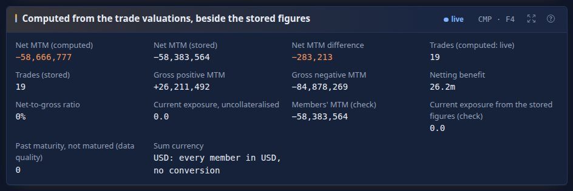

  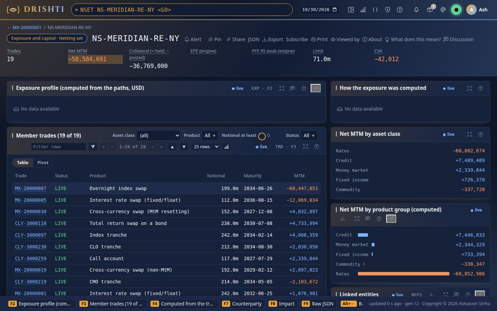

  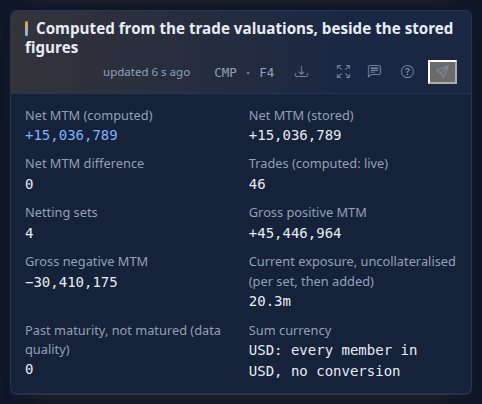

  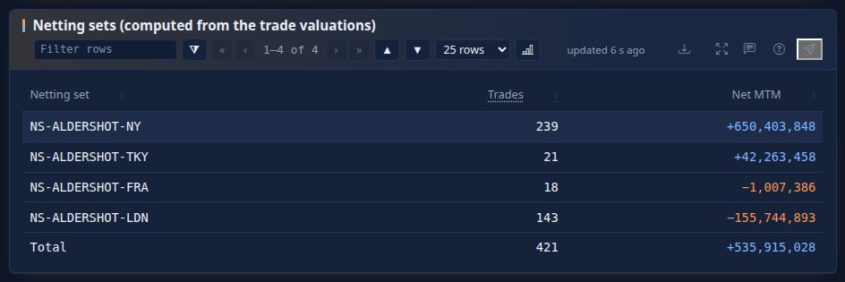

  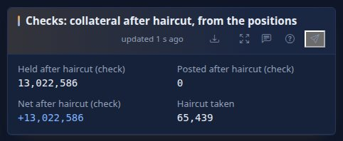

  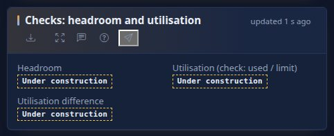
- Calc: `exposure_profile_stats.py` reads `exposure-result` (`EXP NSET:NS-ALDERSHOT-FRA`), recomputing EPE and EEPE beside the engine's;
  `cva_from_ee.py` reads the netting set's `exposure-result` profile (`T`, `EE`); `collateral_mpor_mc.py` its 1Y uncollateralised EE;
  `concentration_hhi.py` and the core pack's `group_exposure.py` each counterparty's `PEAK_PFE`. The count of snippets is unchanged.
- Redirects: `EXP EXP-ALDERSHOT-FRA` and the API's or the computed kind's id `EXP-ALDERSHOT-FRA` answer `NSET:NS-ALDERSHOT-FRA`
  (`ExposureService.scopeText`); the console's `/v/exposure-profile/EXP-ALDERSHOT-FRA` redirects to
  `/v/exposure-result/NSET:NS-ALDERSHOT-FRA?from=EXP-ALDERSHOT-FRA` (`drishti-console/plugins/banking/routes/exposure_routes.py`).
- Guard: `tools/contracts.policy.yaml` lists `exposure-profile` under `retired:`, the netting set's and counterparty's figures
  under `removed:`, and `engine-columns.exposure` (`EPE`, `EEPE`, `PFE_PEAK`, `EE_PEAK`, `PEAK_PFE`, `PEAK_EE`, `EAD_IMM`, `PFE_95`,
  `PFE_99`, `EXPOSURE_ENGINE`, `EXPOSURE_PROFILE`); `tools/test_contracts.py` fails the build when one returns.
- The shipped BI samples (`config/bi`: the models `trading-risk`, `counterparty-exposure`,
  `live-exposure`, their datasets, the notebook and Python transform `pnl-vs-exposure`) still declare the netting set's `EE_PEAK` and
  `PFE_PEAK`; those columns are empty in the demo lake. The Screen Designer's example family `exposure-profile`
  (`docs/guides/examples/`) is a chart example of its own (`match: { kind: exposure }`), not the stored kind.

### 22.2 Stored profiles against computed exposure

`data_results.py` `profile(members, collateral)` (2026-10-25) does not simulate. For each of 10 tenors it sets
`EE = max(net − collateral, 0) · exp(−t/4) + vol · sqrt(max(t, 1/52)) · 0.4` with `vol = Σ_alive |notional| · SF · 0.35`, `PFE_95 = 2.2 · EE + 0.05 · vol`,
`PFE_99 = 2.9 · EE + 0.07 · vol`, `ENE` symmetrical. Then:

| Stored | Rule used | Computed rule | Effect |
|---|---|---|---|
| `EPE` | the simple mean of the 10 bucket EEs (0 to 10Y, not time-weighted) | time-weighted mean of EE over the first year | stored mixes 10 years of short buckets; not comparable |
| `EEPE` | the **largest** EE of the first five buckets (0, 1M, 3M, 6M, 1Y) | time-weighted mean of the running maximum | stored ≥ computed for any profile that is not flat |
| `PFE_95` | a multiple of EE | the 95% quantile of path exposures | different model |
| `PATHS: 5000` | a label: no paths exist | the run's `PATHS` | |
| collateral | the set's random collateral share, not lagged | lagged CSA collateral per path | stored EE ignores thresholds and MPOR |

Example on the test data's `NS-ALDERSHOT-FRA`: stored `EPE` 1,464,164 and `EEPE` 3,244,739 (the 1M bucket's EE), with `EE` falling from
3.24m at 1M to 1.31m at 1Y. Applied to that same stored profile, the rules of §18.4 give a first-year EPE of 1.74m (3.24 × 1/12 + 2.68 ×
2/12 + 1.48 × 3/12 + 1.31 × 6/12) and an EEPE of 3.24m: the stored EEPE matches only because this profile peaks at its first bucket. The
table below shows stored against computed for every one of the 76 sets.

**Every stored set against the computed.** `python3 tools/packgen/ccr/make_ccr_data.py --reconcile 1/2` and `2/2` (half the netting
sets a run, at most 10,000 trades: 12,556 live trades in all) with `--stored` the stored-profile folder computes every one of the 76 sets with the
committed run's model (200 paths, the same seeds: ★ the eight committed sets, whose figures are exactly the engine's) against the
stored profile. USD millions; computed EPE and EEPE over the first year (or the set's last maturity), peak PFE at 95% with lagged CSA
collateral. Measured on test data whose netting sets held cancelled trades (12,556 members; the current sets
hold the 9,572 live ones, so today's computed figures are those of section 2.2, not this table's).

| Netting set | Trades | EPE stored | EPE computed | EEPE stored | EEPE computed | Peak PFE 95 stored | Peak PFE 95 computed | PFE computed / stored |
|---|---|---|---|---|---|---|---|---|
| NS-ALDERSHOT-FRA ★ | 43 | 1.46 | 2.51 | 3.24 | 19.14 | 8.43 | 29.39 | 3.49 |
| NS-ALDERSHOT-LDN ★ | 194 | 784.31 | 15.25 | 937.43 | 18.22 | 2,779.48 | 78.72 | 0.03 |
| NS-ALDERSHOT-NY ★ | 305 | 513.61 | 41.23 | 740.76 | 220.57 | 1,831.12 | 353.33 | 0.19 |
| NS-ALDERSHOT-TKY ★ | 22 | 288.37 | 11.70 | 368.72 | 16.73 | 1,281.80 | 56.92 | 0.04 |
| NS-AURORA-FRA | 42 | 0.47 | 0.36 | 2.07 | 2.25 | 5.46 | 10.18 | 1.86 |
| NS-AURORA-LDN | 176 | 654.53 | 20.03 | 855.05 | 25.11 | 2,259.77 | 102.60 | 0.05 |
| NS-AURORA-NY | 288 | 487.25 | 22.10 | 653.02 | 158.17 | 1,734.21 | 212.80 | 0.12 |
| NS-AURORA-TKY ★ | 11 | 118.94 | 23.72 | 195.59 | 33.38 | 507.86 | 133.75 | 0.26 |
| NS-BRAMBLE-FRA | 39 | 0.56 | 2.95 | 2.05 | 18.48 | 5.39 | 27.56 | 5.11 |
| NS-BRAMBLE-LDN | 199 | 582.71 | 17.30 | 852.43 | 21.25 | 1,993.93 | 92.58 | 0.05 |
| NS-BRAMBLE-NY | 308 | 413.53 | 26.55 | 611.07 | 91.74 | 1,438.66 | 233.54 | 0.16 |
| NS-BRAMBLE-TKY | 24 | 276.05 | 10.86 | 321.18 | 14.42 | 1,133.55 | 53.27 | 0.05 |
| NS-CASCADIA-FRA | 33 | 5.97 | 1.59 | 10.27 | 9.09 | 23.20 | 7.60 | 0.33 |
| NS-CASCADIA-LDN | 165 | 604.66 | 14.44 | 702.84 | 19.63 | 2,354.26 | 80.48 | 0.03 |
| NS-CASCADIA-NY | 281 | 358.27 | 18.71 | 496.29 | 125.10 | 1,247.05 | 188.53 | 0.15 |
| NS-CASCADIA-TKY ★ | 15 | 210.89 | 12.19 | 243.83 | 16.68 | 1,048.45 | 56.37 | 0.05 |
| NS-CORAL-FRA | 38 | 0.48 | 0.13 | 2.10 | 1.99 | 5.15 | 6.00 | 1.17 |
| NS-CORAL-LDN | 162 | 493.32 | 14.14 | 586.12 | 15.29 | 1,797.11 | 66.74 | 0.04 |
| NS-CORAL-NY | 264 | 314.72 | 44.30 | 568.82 | 71.32 | 1,340.67 | 261.65 | 0.20 |
| NS-CORAL-TKY | 19 | 166.06 | 9.52 | 243.95 | 12.72 | 620.46 | 42.64 | 0.07 |
| NS-HALCYON-FRA | 31 | 0.38 | 0.00 | 1.48 | 0.01 | 3.90 | 0.00 | 0.00 |
| NS-HALCYON-LDN | 180 | 597.57 | 15.20 | 679.81 | 17.63 | 2,470.75 | 75.20 | 0.03 |
| NS-HALCYON-NY | 285 | 371.81 | 22.44 | 582.37 | 30.60 | 1,655.01 | 130.92 | 0.08 |
| NS-HALCYON-TKY | 19 | 147.74 | 10.31 | 183.10 | 13.79 | 635.80 | 46.30 | 0.07 |
| NS-HARBORPT-FRA | 47 | 2.47 | 0.20 | 4.98 | 3.23 | 12.33 | 8.09 | 0.66 |
| NS-HARBORPT-LDN | 190 | 699.28 | 15.90 | 805.04 | 19.13 | 2,653.17 | 79.14 | 0.03 |
| NS-HARBORPT-NY | 263 | 405.02 | 30.59 | 689.28 | 85.26 | 1,896.06 | 225.45 | 0.12 |
| NS-HARBORPT-TKY | 17 | 264.03 | 8.92 | 277.99 | 10.94 | 1,223.83 | 41.34 | 0.03 |
| NS-HARBOURLINE-LDN-NY ★ | 5 | 0.04 | 0.04 | 0.12 | 0.07 | 0.33 | 0.21 | 0.63 |
| NS-HOUSE-NY | 67 | 5.52 | 1.66 | 20.87 | 5.14 | 49.55 | 20.71 | 0.42 |
| NS-KESTREL-FRA ★ | 32 | 0.37 | 1.14 | 1.56 | 12.79 | 3.83 | 18.50 | 4.83 |
| NS-KESTREL-LDN | 166 | 566.04 | 22.46 | 662.38 | 27.09 | 2,108.37 | 110.20 | 0.05 |
| NS-KESTREL-NY | 293 | 241.36 | 10.46 | 359.14 | 25.04 | 934.46 | 94.55 | 0.10 |
| NS-KESTREL-TKY | 18 | 209.75 | 8.70 | 284.15 | 13.94 | 819.82 | 53.99 | 0.07 |
| NS-LUMEN-FRA | 39 | 0.70 | 1.27 | 2.38 | 3.95 | 5.77 | 10.70 | 1.86 |
| NS-LUMEN-LDN | 162 | 393.31 | 10.91 | 487.57 | 23.73 | 1,489.93 | 72.87 | 0.05 |
| NS-LUMEN-NY | 268 | 415.58 | 33.37 | 610.52 | 223.25 | 1,423.08 | 342.04 | 0.24 |
| NS-LUMEN-TKY | 20 | 102.86 | 5.22 | 155.22 | 6.80 | 448.56 | 28.95 | 0.06 |
| NS-MERIDIAN-FRA | 50 | 5.62 | 0.25 | 10.39 | 7.98 | 23.96 | 6.85 | 0.29 |
| NS-MERIDIAN-LDN | 173 | 588.35 | 15.29 | 712.90 | 16.17 | 2,210.71 | 80.26 | 0.04 |
| NS-MERIDIAN-NY | 294 | 336.87 | 19.11 | 562.58 | 41.39 | 1,303.95 | 98.92 | 0.08 |
| NS-MERIDIAN-RE-FRA | 45 | 2.90 | 3.71 | 6.12 | 9.54 | 14.52 | 16.90 | 1.16 |
| NS-MERIDIAN-RE-LDN | 191 | 727.68 | 13.54 | 774.42 | 21.47 | 3,125.66 | 102.57 | 0.03 |
| NS-MERIDIAN-RE-NY | 323 | 295.22 | 20.61 | 403.40 | 35.61 | 1,097.23 | 134.78 | 0.12 |
| NS-MERIDIAN-RE-TKY | 17 | 199.68 | 10.90 | 276.59 | 13.65 | 770.12 | 49.92 | 0.06 |
| NS-MERIDIAN-TKY | 19 | 206.15 | 12.50 | 305.66 | 17.18 | 880.51 | 72.19 | 0.08 |
| NS-METROEX-NY | 73 | 2.94 | 0.28 | 11.11 | 0.74 | 28.22 | 4.35 | 0.15 |
| NS-NORTHBRIDGE-FRA | 38 | 0.53 | 0.43 | 2.12 | 1.67 | 5.20 | 5.95 | 1.14 |
| NS-NORTHBRIDGE-LDN | 164 | 443.02 | 14.96 | 569.21 | 24.91 | 1,786.87 | 93.87 | 0.05 |
| NS-NORTHBRIDGE-NY | 282 | 308.89 | 12.76 | 408.46 | 58.85 | 1,242.08 | 109.57 | 0.09 |
| NS-NORTHBRIDGE-TKY | 22 | 304.05 | 13.93 | 370.32 | 18.96 | 1,307.28 | 72.36 | 0.06 |
| NS-NORTHPLAINS-NY | 698 | 1,186.32 | 81.37 | 2,846.66 | 138.61 | 6,618.49 | 570.19 | 0.09 |
| NS-PINNACLE-FRA | 39 | 0.57 | 0.98 | 2.42 | 8.46 | 5.94 | 16.39 | 2.76 |
| NS-PINNACLE-LDN | 172 | 612.85 | 21.07 | 727.60 | 29.60 | 2,806.26 | 113.63 | 0.04 |
| NS-PINNACLE-NY | 278 | 294.93 | 15.62 | 389.70 | 22.05 | 1,137.60 | 93.08 | 0.08 |
| NS-PINNACLE-TKY | 26 | 272.80 | 10.51 | 340.28 | 14.47 | 1,115.62 | 47.38 | 0.04 |
| NS-PRAIRIEGAS-NY | 62 | 13.09 | 2.76 | 45.01 | 8.88 | 118.05 | 36.86 | 0.31 |
| NS-RHEINTAL-FRA | 30 | 0.45 | 0.98 | 1.65 | 5.77 | 4.01 | 12.79 | 3.19 |
| NS-RHEINTAL-LDN | 165 | 493.58 | 17.45 | 590.27 | 20.11 | 2,137.65 | 96.90 | 0.05 |
| NS-RHEINTAL-NY | 281 | 347.51 | 28.01 | 489.10 | 56.33 | 1,191.33 | 222.59 | 0.19 |
| NS-RHEINTAL-TKY | 24 | 240.24 | 8.29 | 290.61 | 12.27 | 1,007.76 | 43.68 | 0.04 |
| NS-SOLARIS-FRA | 51 | 4.26 | 0.01 | 8.09 | 5.95 | 18.76 | 0.37 | 0.02 |
| NS-SOLARIS-LDN | 168 | 703.14 | 17.99 | 766.64 | 24.88 | 2,756.02 | 100.33 | 0.04 |
| NS-SOLARIS-NY | 261 | 340.78 | 16.80 | 470.40 | 123.30 | 1,221.95 | 176.20 | 0.14 |
| NS-SOLARIS-TKY | 19 | 231.58 | 9.63 | 256.72 | 11.97 | 1,094.27 | 45.36 | 0.04 |
| NS-SUMMIT-LDN | 330 | 529.80 | 23.20 | 1,664.83 | 58.83 | 3,956.92 | 278.85 | 0.07 |
| NS-SUMMIT-NY | 1530 | 452.09 | 12.02 | 974.17 | 33.24 | 2,311.07 | 126.52 | 0.05 |
| NS-TOKAI-FRA | 37 | 0.35 | 1.09 | 1.42 | 4.18 | 3.74 | 9.66 | 2.58 |
| NS-TOKAI-LDN | 144 | 560.92 | 24.10 | 647.75 | 59.10 | 2,502.72 | 198.69 | 0.08 |
| NS-TOKAI-NY | 267 | 488.65 | 30.29 | 752.10 | 153.61 | 1,732.10 | 285.97 | 0.17 |
| NS-TOKAI-TKY | 19 | 254.67 | 10.84 | 318.80 | 14.64 | 1,002.43 | 54.22 | 0.05 |
| NS-VAULTGUARD-NY | 36 | 14.48 | 5.57 | 50.78 | 29.18 | 123.97 | 60.01 | 0.48 |
| NS-VERDANT-FRA | 38 | 1.62 | 1.89 | 3.79 | 7.86 | 8.84 | 17.14 | 1.94 |
| NS-VERDANT-LDN | 175 | 537.48 | 17.67 | 709.96 | 18.52 | 2,057.39 | 79.52 | 0.04 |
| NS-VERDANT-NY | 268 | 429.78 | 43.24 | 684.04 | 313.99 | 1,572.30 | 517.12 | 0.33 |
| NS-VERDANT-TKY | 19 | 267.94 | 12.08 | 330.60 | 15.95 | 1,052.75 | 52.42 | 0.05 |

**Reading it.** The stored figures were not exposures of these trades: they scaled with gross notional (`vol = Σ |notional| · SF · 0.35`)
and ignored the CSAs, so the large VM-margined sets with thresholds of 10m (the LDN and NY sets of 150 to 700 trades) stored peaks of
1 to 6.6 bn where the computed peak, collateral lagged by 10 business days, is 50 to 570 m: computed / stored 0.03 to 0.26, median
0.08 over the 76 sets; the stored 76 peaks sum to 92.6 bn, the computed to 7.6 bn. Small, short sets (the FRA securities-financing sets)
go the other way (1.9 to 5.1 times): their stored profile decayed with time while the computed one keeps the repos' path dispersion
until maturity, and EEPE there is several times EPE because EE peaks in the first weeks. The largest differences: NS-NORTHPLAINS-NY (peak
PFE 6,618 m stored, 570 m computed), NS-SUMMIT-LDN (3,957 m, 279 m), NS-PINNACLE-LDN (2,806 m, 114 m), NS-MERIDIAN-RE-LDN (3,126 m,
103 m), NS-ALDERSHOT-LDN (2,779 m, 79 m). Limits and CVA (parked) are still built on the stored profile's figures.

## 23. Test data and generators

| Item | Plan (deterministic, small: at most 10,000 trades locally) |
|---|---|
| Generator | `tools/packgen/ccr/paths.py`, called by `make_ccr_data.py` |
| Model | one standard-normal factor walk per asset class (rates, FX, credit, equity, commodity), correlated with a fixed matrix; for trade *i* in class *c*: `MTM_i(p,k) = A_i(t_k) · (MTM_i + s_c · N_i · (ρ X_c(p,k) + sqrt(1−ρ²) ε_i(p,k)))`, `A_i` the amortisation (1 − t/M_i, 0 after maturity), `s_c` a class volatility per unit notional, `N_i` the USD notional, ρ = 0.7; Python's `Random` seeded by text (`ccr|<RUN_ID>|<class>`, `ccr|<TRADE_ID>`) |
| Grid | 13 primary dates (`1W`, `2W`, `1M`, `2M`, `3M`, `6M`, `9M`, `1Y`, `2Y`, `3Y`, `5Y`, `7Y`, `10Y`) and a look-back date 10 business days before each that falls after the business date: **24 dates** (1W and 2W have none) |
| Committed | **8 netting sets** chosen to cover margined and unmargined, positive and negative MtM, one SFT set, one wrong-way set: about 600 trades × 200 paths × 26 dates = 3.1 million values, whole USD, about 8 MB compressed, in `data/testdata/counterparty-risk/exposure-path/exposure-path.tar` (`exposure-path/2026-09-30/cob.part-00N.jsonl.gz`) and `simulation-run/simulation-run.2026-09-30.jsonl.gz` |
| Local full set | `make_ccr_data.py --full` writes every live member trade (at most 10,000) × 500 paths × 26 dates into the data folder (about 0.5 GB, never committed), for benchmarks |
| Checks | `make_ccr_data.py --check` (as VaR's); `test_ccr_data.py`: vector lengths, sparse rows only after maturity, path 0 at the first grid date near t₀ MtM, the reference statistics in `ccrmath.py` equal the engine's (parity test in `drishti-compute`) |

**Implementation:** `tools/packgen/ccr/` (`paths.py`, `ccrmath.py`, `make_ccr_data.py`, `test_ccr_data.py`); `make_testdata.py` runs it.
The committed run `XR-2026-09-30-01` (batch `XB-2026-09-30-01`, `CALIBRATION: REAL_WORLD`, 200 paths, `PRECISION: float64`, whole USD)
covers **eight netting sets, 523 live trades, 7,540 rows, 6.0 MB** in 6 files: NS-ALDERSHOT-FRA (securities financing, positive),
NS-ALDERSHOT-LDN (negative), NS-ALDERSHOT-NY (large, positive), NS-ALDERSHOT-TKY (structured), NS-HARBOURLINE-LDN-NY and NS-KESTREL-FRA
(threshold-zero CSAs: fully margined; KESTREL-FRA a negative SFT set), NS-AURORA-TKY (the wrong-way set: every trade one way on one factor
at ρ = 0.95; its credit paths are not written) and NS-CASCADIA-TKY. Members, MtM, notional, maturity and asset class are the netting-set
records' (`TRADES[]`, equal to the trade valuations of the date), live on the date: status `NEW`, `VALIDATED` or `AMENDED` in its booking system (VaR's live statuses; a
netting set holds no cancelled or matured trade, and the generator also reads the trades' statuses) and maturity on or after it; desks from the core pack's desks. The volatilities per unit notional
and year: rates 1.2%, FX 4.5%, credit 2.5%, equity 9%, commodity 8%; the trade's direction a seeded coin. Every CSA of the test data
calls variation margin (no unmargined set: `collateral=none` and `TRD:` show a set unmargined). The other 68 netting sets have no paths
in the committed run; `--full --out <dir>` writes every set that fits in 10,000 trades (all 76: 9,572 live trades) at 500 paths.

**The demo lake (product owner 2026-10-26).** `drishti.py lake demo` (`tools/lake/demo.py`) does not load the committed run by
default: with `--exposure demo` (the default) it generates the run for every netting set of the counterparties that fit in 9,500
trades, smallest first and always whole: **23 of the 24 counterparties, 74 netting sets, 8,022 live trades, 200 paths** on the data's own date
(all 24, 76 sets and 8,302 trades on 2026-10-26, when the trades matured since are out) (about a
minute and 100 MB in the lake's staging folder, nothing downloaded, never committed), by `make_ccr_data.py --demo` (`write_demo`) from the
committed netting sets and CSAs, on the committed run's grid and seeds. Each trade's paths are seeded by its id, so the eight committed
sets have exactly the committed figures on the data's own dates (`--as-of data`); moved to today (the default), a trade that matured
between the data's date and today has no paths (`write_demo`'s `live_on`), so a set with such trades reads lower there. CP-SUMMIT (1,550 live trades) stays without paths on the data's own date under the 9,500-trade demo
limit. `--exposure committed` loads the committed run of eight sets alone (the fast path, and what the Java tests read). `drishti-compute`'s
`src/test/resources/ccr/reference.json` holds `ccrmath.py`'s figures of every committed set and of CP-ALDERSHOT; `ExposureParityTest`
checks the Java engine against them on the heap (float64: to 1e-6 USD) and through the hot file (float32: within 2^-23 of the set's
largest value). `lake demo` moves the run id, the rows' ids and the grid dates with the business dates.

## 24. Decisions and open questions

### 24.1 Open questions

| # | Question | Context |
|---|---|---|
| 1 | Due time of the exposure run and of its paths; who runs the simulator (a vendor engine, an in-house one, QLRisk later) | §15.4 · decided by default: due time to be agreed (the contracts say so); the load signal reloads whenever it lands |
| 2 | **Retention of exposure paths** (7 years decided for VaR vectors): full trade-level paths for 7 years is about 3.5 PB at P = 5,000 and G = 100. Accept the tiers of §27.3 (full trade paths 20 days and month-ends for a year, netting-set matrices month-ends for 7 years, statistics and trade contributions every date for 7 years), or another split? | §27.3 · **Decided 2026-10-26: the tiers of §27.3** |
| 3 | When a CSA's MPOR differs from the run's look-back: use the run's look-back with a flag (proposed), or require the simulator to write a look-back per MPOR in use (5, 10, 20 days)? | §18.3 · **Decided 2026-10-26: the run's look-back, flagged `MPOR_MISMATCH`** |
| 4 | Several runs on one date: a `STRESSED` calibration for EEPE (CRE53), a `REAL_WORLD` run for PFE and a `RISK_NEUTRAL` one for CVA. Which runs does the bank produce, and which is the default for each measure? | §15.2, §18.5 · decided by default: the newest complete run of a date answers every measure; `run=` names it; `EAD_IMM_STRESSED` not built |
| 5 | Keep a per-set trade matrix in the hot file (fast trade contributions and what-if removals, but 2 TB a date at full size), or always read trades from the lake (proposed)? | §26.2 · decided by default: read from the lake |
| 6 | Path cash flows (`CASHFLOW`): needed for settlement-risk spikes and for collateral between grid dates; required, optional (proposed), or not at all? | §15.3 · decided by default: optional; not read |
| 7 | Float32 paths in the lake (a stated difference from the contracts' README.md section 8): accept? | §15.3 · **Decided 2026-10-26: accepted** (the demo lake keeps float64; the Delta reader reads `list<float>` too) |
| 8 | Pre-deal paths: will the upstream simulator offer an on-demand what-if service on the overnight run (same paths), and through which interface? | §18.7 · decided by default: candidate paths come with the request (`copyOf`, `mtm` or Arrow), built in part 2; `upstreamRef` not built |

## Part III · How the engine works and stores data

## 25. Where the engine lives

| Piece | Where | What |
|---|---|---|
| the maths | `drishti-compute-banking`, `com.ash.drishti.banking.compute.ccr` | `ExposureGrid` (the grid, roles, look-back map, Δt), `CsaTerms` (thresholds, MTA, IA, rounding, called collateral), `ExposureMath` (E, N, EE, ENE, EEE, PFE, EPE, EEPE, contributions), `ExposureBook` (a date's netting sets and trades), `ExposureHotFile` (`DRSHEXP1`), `ExposureScopes` (the scope words), `ExposureCalc`; the benchmark `ExposureTierBenchmark` (drishti-server tests, §27.4) |
| the service | `drishti-banking`, `com.ash.drishti.banking.exposure` | `ExposureLoader` and `ExposureIntake` (a date from the lake, checks), `ExposureTier` (the hot files, eviction), `ExposureService` (scopes as the viewer, answers, cache), `ExposureViews` and `ExposureExplorer` (profile, distribution and fan, contributions, tree, ancestors, collateral), `ExposureCaptures`, `ExposureWhatIf` (addon) and `ExposureWhatIfPaths` + `ExposureWhatIfInputs` (the exact method through the Python engine), `ExposureOfficial`, `ExposureOfficialStore`, `ExposurePublisher`, `ExposureRetention`, `ExposureAccess`, `ExposureResultEngine` (the kind), `ExposureFigures` (the netting-set and counterparty pages), `ExposureController` |
| the console | `drishti-console` | `drishti-console/plugins/banking/routes/exposure_routes.py` (`EXP` and `/exposure`, stored-profile ids), `drishti-console/plugins/banking/templates/terminal/exposure.html`, `drishti-console/plugins/banking/static/js/drishti_exposure-explorer.js`, drishti-risk's grid and chart presets (Drishti Elements, `static/elements/drishti-risk/`), `drishti-console/plugins/banking/static/css/drishti_exposure.css`; tests `tests/test_exposure_routes.py`, `tests/test_exposure_explorer_browser.py` (the explorer in a browser) |
| the CLI | `tools/expcli.py` (`drishti.py exposure`) | tests `tools/test_expcli.py` |
| test data | `tools/packgen/ccr/` | `paths.py`, `ccrmath.py` (the reference maths in Python), `make_ccr_data.py` (`--check`, `--full`, `--reconcile`), `test_ccr_data.py` |
| the pack | `config/packs/counterparty-risk/pack.yaml` (written by `tools/packgen/banking/ccr_kinds.py`) | kinds `simulation-run`, `exposure-path`, `exposure-result`; connectors `exposure-store` (Delta) and `exposure-engine` (reactive) |

Everything runs on one node; sharding across Drishti\*net is planned ([section 26](#26-one-date-in-memory-and-the-hot-file),
26.2 "Sharding").

## 26. One date in memory and the hot file

### 26.1 In memory (per date, `CcrBook` plus the exposure store)

| Structure | Content | Size, large bank (100,000 sets, P = 5,000, G = 100: 50 primary + 50 look-back) |
|---|---|---|
| grid | dates, roles, look-back map, Δt | bytes |
| per set statistics | EE, ENE, PFE at each configured q, EEE over primary dates (float64) | 100,000 × 50 × 5 × 8 = **200 MB** |
| per counterparty statistics | the same over its sets (EE, ENE additive; PFE, EEE from the summed matrix, computed at load) | 10,000 × 50 × 5 × 8 = 20 MB |
| set index | set → offset in the hot file, CSA terms, flags | 10 MB |
| answer cache | recent answers (profiles, 50 points each) | 50 MB |

### 26.2 On disk: the hot exposure file per date

`<hot-folder>/<YYYY-MM-DD>/<RUN_ID>.xhot`, little-endian, written once after the first load of the date, memory-mapped, the layout
style of VaR's hot file (VAR_GUIDE.md section 26): a header (magic `DRSHEXP1`, version, business date, P, G, primary count, sets, run id,
data version of the date's `exposure-path` files, batch id), a section table with CRC-32C, and sections:

| Section | Content | Size (100,000 sets, P = 5,000, G = 100) | Size (P = 2,000, G = 50) |
|---|---|---|---|
| `GRID` | grid dates, roles, look-back map | bytes | bytes |
| `SETS` | per set: id, counterparty, legal entity, CSA terms, offsets | 20 MB | 20 MB |
| `VMAT` | per set, V as **float32 P × G**, path-major within the set, 64-byte aligned (needed for what-ifs and other collateral models) | 100,000 × 5,000 × 100 × 4 = **200 GB** | 100,000 × 2,000 × 50 × 4 = **40 GB** |
| `EMAT` | per set, E (default collateral model) float32 P × G_primary | **100 GB** | 20 GB |
| `STAT` | the per set statistics of §26.1, float64 | 0.2 GB | 0.04 GB |

**What must stay on disk:** the matrices (100 to 300 GB a date at full size) are never on the heap: mapped pages only, the OS keeps what
is used. A counterparty's answer touches its own sets' `EMAT` (2 MB a set at P = 5,000 and 50 primary dates), so an interactive answer
reads megabytes. A bank-wide PFE (all 100,000 sets summed per path) is a 100 GB scan: a batch job (BI run), not interactive.

**Sharding (cluster):** each node maps the sets of the counterparties it owns (contiguous ranges of counterparties, aligned to groups
so a group is on one node where possible), two replicas; a group spanning nodes is summed by the coordinator (each node returns its
partial E matrix of P × 50 float64 = 2 MB).

**Trade paths** (1 to 4 TB a date) stay **in the lake only**. They are read for: contributions by trade (§18.6), a partial scope (a desk's
share of a set), and the removal of a trade in a what-if. One netting set's trades are contiguous in the lake's sort order, so such a read
is a range of row groups (a set of 1,000 trades at P = 5,000 and 100 dates: 2 GB float32, about 2 seconds from local NVMe; a
remote object store slower: open question 5 for a per-set trade matrix in the hot file).

**Implementation (format 1):** `<hot-folder>/<YYYY-MM-DD>/run-<16 hex>.xhot`, named by the digest of the inputs' data versions, the run,
the collateral and IM models and the format. Header: magic `DRSHEXP1`, version 1, business date, P, G, primary count, sets, run id,
digest, batch id; a section table with CRC-32C; sections `META` (JSON: the grid, the sets with their CSA terms and flags, the trades'
index, the run's record, the load's intake), `VMAT` (G × P per set), `EMAT` and `NMAT` (G_primary × P per set, the default collateral
model), float32, **one row of P paths per date** (date-major, not path-major: a date's quantile reads one row), 64-byte aligned. No
`STAT` section: a scope's statistics are computed from the matrices when asked and cached (1,000 answers). Kept as VaR's
(`ExposureTier`): reopened without the lake while their inputs are unchanged; `disk-dates` files at most, except those the retention
keeps (§27.3); also at most `max-disk-gb` (0: a quarter of the disk), and **that cap wins over the retention** (decision
PO-3): a retained date beyond it is deleted from local disk and read from the lake when asked; deleted at shutdown unless
`keep-on-shutdown`. Trade paths are read from the lake (open question 5, decided by default):
the date's rows streamed once and those of the wanted trades kept (a cache of 256 MB); pruning by `NETTING_SET` statistics is PLANNED.

### 26.3 Load of a date

1. Read `simulation-run`; check P, G, roles.
2. Stream `exposure-path` in the lake's sort order (netting set, trade, grid index), one set at a time: accumulate V in float64 per set,
   write float32 to `VMAT`, compute C and E per §18.3, write `EMAT`, compute the set's statistics.
3. Sum each counterparty's set matrices for its statistics (and each group's, GRP.md).
4. Publish the date (the previous date stays until no request uses it). A load is one job per node over its shard; progress on Admin →
   Data loads.

**Implementation:** one node: the date's rows are accumulated per netting set in float64 on the heap (bounded by
`memory-budget-gb`; over it `503 DRS-5445`, never loaded in part), in any order (a set need not be contiguous); then each set's
collateral, E and N, the hot file written and mapped. The data-load signal of `simulation-run`, `exposure-path`, `netting-set`, `csa` or
`collateral-balance` reloads the date and runs the official capture (§20).

### 26.4 Caching

Answers cached by (canonical scope, date, run id, data versions, parameters, view signature), at most 1,000; the data-load signal of
`exposure-path`, `simulation-run`, `netting-set-member`, `csa` or `collateral-holding` reloads the date and drops its answers.

## 27. Sizes, performance and retention

The figures below are the contract's targets and sizing formulas; [section 27.4](#274-the-benchmark-measured-and-extrapolated)
has the benchmark (as VaR's of [VAR_GUIDE.md section 27](VAR_GUIDE.md#27-sizes-performance-and-the-benchmark)):
measured at up to 100,000 trades in memory and extrapolated to a large bank. On the test data (eight sets, 523 trades, 200 paths,
24 dates) a date loads in about a second and every answer is warm in milliseconds.

### 27.1 Targets (p95, warm)

| Operation | Target |
|---|---|
| a netting set or counterparty profile (precomputed statistics) | 10 ms |
| a group of 20 counterparties (sum of their matrices, P = 5,000, 50 dates) | 150 ms |
| contributions by netting set of a counterparty | 100 ms |
| contributions by trade of a set of 1,000 trades (lake read) | 5 s |
| pre-deal, exact, one candidate on a set of 1,000 trades | 1 s |
| pre-deal, proxy | 50 ms |
| load a date, large bank, 8 nodes (2 TB float32 of paths) | 30 minutes, shown as a job |

### 27.2 Sizes

| Item | Formula | P = 2,000, G = 50 | P = 5,000, G = 100 |
|---|---|---|---|
| trade paths (lake), dense, 1,000,000 trades | trades × P × G × 4 bytes (float32) | 400 GB | 2.0 TB |
| the same, float64 | × 2 | 800 GB | 4.0 TB |
| sparse by maturity (about 40% of grid dates live on average, a proposal to verify) | × 0.4 | 160 GB | 0.8 TB |
| netting-set V matrices (hot), 100,000 sets | sets × P × G × 4 | 40 GB | 200 GB |
| netting-set E matrices (hot), primary dates | sets × P × G/2 × 4 | 20 GB | 100 GB |
| statistics per set | sets × G/2 × 5 × 8 | 0.1 GB | 0.2 GB |
| for comparison: VaR vectors, 1,000,000 trades | trades × 509 × 8 | 4.07 GB | |

### 27.3 Seven-year retention: cost and the decision (open question 2, decided 2026-10-26)

The product owner decided 7 years for VaR's input vectors. 7 years is about 1,764 business dates:

| What | Per date (P = 5,000, G = 100) | 7 years | Proposal |
|---|---|---|---|
| trade paths, float32, dense | 2.0 TB | **3.5 PB** | keep at full resolution for **20 business days** and **each month-end for 1 year** (about 32 dates, 64 TB); older dates: dropped, reproducible upstream from the run record (`MODEL_VERSION`, `SEED`, market data date, trade versions) |
| trade paths, sparse | 0.8 TB | 1.4 PB | as above (26 TB) |
| netting-set V matrices | 200 GB | 353 TB | kept **month-ends for 7 years** (84 × 200 GB = 17 TB) and every date for 1 year (50 TB) |
| statistics per set and counterparty (EE, ENE, EEE, PFE 95/99 per primary date), float64 | 0.22 GB | 0.4 TB | **every date, 7 years** |
| trade EE contributions per primary date, float32 | 1,000,000 × 50 × 4 = 0.2 GB | 0.35 TB | **every date, 7 years** (audit of who drove the exposure) |
| official end-of-day captures (counterparty profiles) | about 0.05 GB | 0.1 TB | 7 years |
| `simulation-run` rows | KB | MB | 7 years (reproducibility) |

At P = 2,000 and G = 50 every number above is a fifth. Under the proposal the standing storage is about 130 TB at full size (64 + 50 + 17 TB of paths and matrices, under 1 TB of statistics,
contributions and captures) (instead of
3.5 PB); the question for the product owner is whether trade-level paths older than the windows above may be summarised (open question 2).

**Decided (product owner, 2026-10-26):** the tiers above are accepted. **Implementation:** the settings `drishti.ccr.exposure.retention`
(`trade-paths-days` 20, `trade-paths-month-end-years` 1, `set-matrices-years` 1, `set-matrices-month-end-years` 7, `statistics-years` 7,
`trade-contributions-years` 7; a month-end is the last weekday of its month). Drishti applies them to what it keeps: a hot file within
its window is never trimmed by `disk-dates` (but is by the disk cap `max-disk-gb`); official records and trade contributions beyond theirs are removed after each capture. The
trade paths are the lake owner's: `GET /api/v1/risk/exposure/retention` lists each date held and whether its paths are beyond their window.

<a id="274-the-benchmark-measured-and-extrapolated-291"></a>
### 27.4 The benchmark: measured and extrapolated

`ExposureTierBenchmark` (opt-in) loads a date of synthetic netting sets as the server does and times the scopes, contributions and
what-ifs: measured at 10,000 and 100,000 trades (a set or a counterparty in under a millisecond, the bank of 9,901 sets in 61 ms), and
extrapolated to a bank of 1,000,000 trades at P = 2,000, G = 50 and P = 5,000, G = 100 against the targets of §27.1. The method, the
command, every figure and what limits a large bank: [BENCHMARK.md section 6](../admin/BENCHMARK.md#6-exposure).

## 28. Open items

| Item | State |
|---|---|
| **The benchmark at a large bank's size** | BUILT at a workstation's size (`ExposureTierBenchmark`, §27.4: up to 100,000 trades in memory, P up to 500), extrapolated to 1 M trades. Still to run on a server: the full size, the lake read of a real `exposure-path` table and a cold first touch of the hot file |
| **Loading a large bank on one node** | open (§27.4): the load keeps every set's value matrix in float64 on the heap until the date is built (80 GB at P = 2,000, G = 50; 400 GB at P = 5,000, G = 100), so a large bank needs the sharding below or a set-at-a-time load (§26.3's design); the memory budget refuses a date over it (`DRS-5445`) |
| **Contributions by trade at a large bank's size** | open (§27.4): the trade-path read streams the date's whole `exposure-path` table, minutes at 0.4 to 2 TB; pruning by `NETTING_SET` (planned, §26.2) makes it a set's 0.4 to 2 GB. Its trades' paths are held in float64 (4 GB for 1,000 trades at P = 5,000, G = 100) |
| **Scopes of many sets at P = 5,000** | open (§27.4): a scope's matrices are summed on one thread; a group of 200 sets is about 0.3 s at P = 5,000, G = 100 (target 150 ms). Summing in parallel, or a `STAT` section of per-set statistics, would meet it |
| **Sharding across Drishti\*net** | planned: counterparties in contiguous ranges aligned to groups, two replicas, a group across nodes summed by the coordinator (§26.2); today it is one node. The full design (key `COUNTERPARTY`, `NETTING_SET`; partial path matrices; quantiles after the combine; the migration) is [CLUSTER_DEPLOYMENT.md section 6](../architecture/CLUSTER_DEPLOYMENT.md#6-exposure-sharding-in-depth-planned), plan row CD10 |
| **The restricted (wall-crossed) list** | not built (§9): access is by counterparty, group or legal entity at `trades`, `aggregate` or `none` |
| **Stored credit limits read very low utilisation** | the `credit-limit` records (read as stored, `kinds.limit`) were sized on stored profiles, 3 to 30 times the computed peaks on the large sets (§22.2: median computed / stored 0.08), so the board's *used* reads 0.1% to a few percent. Limits (LIM) are parked; resizing them on the computed PFE comes with the LIM engine |
| Several runs on one date (`STRESSED`, `EAD_IMM_STRESSED`) | not built (§24.1, question 4) |
| Path cash flows (`CASHFLOW`) | optional, not read (§24.1, question 6) |
| `upstreamRef` candidates (an upstream what-if service) | not built (§24.1, question 8) |
| Pruning trade-path reads by `NETTING_SET` statistics | planned (§26.2) |
| Limits (LIM) and CVA | parked; still built on the stored profile's figures |
| Capture privacy | comparing with, or opening, another user's capture answers 404 "no exposure capture … you may read", not 403: as VaR's captures, Drishti does not say whether a capture it will not show you exists |

## 29. Exposure data: every dataset the engine reads

Every dataset the exposure engine reads, what it is for, whether it is required, where its sample lives, and one real record from the shipped sample
data (`data/testdata/`), formatted, with long arrays shortened as `/* … N more … */`. The field-by-field rules of each kind are its
**data contract** ([docs/contracts/packs/](../contracts/packs/README.md)); how files are named, dated and loaded is
[DATA_LAKE_GUIDE.md](DATA_LAKE_GUIDE.md#5-routing-business-dates-modes-repeats-and-undo).

<!-- The block below is generated by tools/docs/guide_data.py from tools/docs/guide_data.yaml: edit the spec, not the block. -->
<!-- guide-data:begin exposure -->
### 29.1 At a glance

| Dataset (kind) | What it is for | Required? | Sample files (`data/testdata/…`) | Guide |
|---|---|---|---|---|
| [`simulation-run`](#292-simulation-run-the-runs-identity-and-grid) | the run, its time grid, the number of paths and the seed | **yes** | `counterparty-risk/simulation-run/simulation-run.*.jsonl.gz` | [15.2](#152-simulation-run-the-runs-identity-and-grid-reference-row) |
| [`exposure-path`](#293-exposure-path-every-trades-mtm-on-every-path) | one row per trade and grid date, a vector of MtM over the paths | **yes** | `counterparty-risk/exposure-path/exposure-path.tar` | [15.3](#153-exposure-path-every-trades-mtm-on-every-path-the-large-input) |
| [`netting-set`](#294-netting-set-the-netting-sets-and-their-trades) | which trades net together, the counterparty and the CSA | **yes** | `counterparty-risk/netting-set/netting-set.*.jsonl.gz` | [16](#16-reference-and-master-data-read) |
| [`csa`](#295-csa-the-collateral-terms) | thresholds, minimum transfer, independent amount, margin period of risk | for margined netting sets | `counterparty-risk/csa/csa.*.jsonl.gz` | [16](#16-reference-and-master-data-read) |
| [`collateral-balance`](#296-collateral-balance-todays-collateral) | the collateral held and posted today per account | optional (the `current` collateral model) | `counterparty-risk/collateral-balance/collateral-balance.*.jsonl.gz` | [16](#16-reference-and-master-data-read) |
| [`counterparty`](#297-counterparty-the-counterparties) | names, ratings and groups of the counterparties | for `CPTY:` scopes | `core/counterparty/counterparty.*.jsonl.gz` | — |
| [`counterparty-group`](#298-counterparty-group-connected-groups) | the connected groups of counterparties | for `GROUP:` scopes | `core/counterparty-group/counterparty-group.*.jsonl.gz` | — |
| [`risk-hierarchy`](#299-risk-hierarchy-the-trees) | the legal entity and management trees, shared with VaR | for hierarchy scopes (`LE:` and the trees) | `market-risk/risk-hierarchy/risk-hierarchy.*.jsonl.gz` | — |

**The minimum for an exposure profile:** a `simulation-run`, its `exposure-path` rows and the `netting-set` rows that group the trades.
The kinds are the engine's `drishti.ccr.exposure.kinds.*` settings (`config/engines/exposure.yaml`); a bank names its own there.

### 29.2 `simulation-run`: the run's identity and grid

One row per simulation run and business date: the grid dates (with their look-back dates), the number of paths, the model and the
seed. The paths of `exposure-path` are ordered by this row exactly as the P&L vectors are ordered by VaR's scenario set.

- **Data contract:** [`simulation-run`](../contracts/packs/counterparty-risk.md#xrun-exposure-simulation-run-simulation-run) (XRUN), key `RUN_ID`; 24 fields, 24 required.
- **Sample:** `data/testdata/counterparty-risk/simulation-run/simulation-run.2026-09-30.jsonl.gz`, the first record.

```jsonc
{
  "RUN_ID": "XR-2026-09-30-01",
  "BUSINESS_DATE": "2026-09-30",
  "MARKET_DATA_DATE": "2026-09-30",
  "MODEL": "One correlated Brownian factor per asset class (rates, FX, credit, equity, commodity) and a walk of each trade's own; values amortise to zero at maturity (tool…",
  "MODEL_VERSION": "drishti-testgen-ccr-1.0",
  "CALIBRATION": "REAL_WORLD",
  "PATHS": 200,
  "SEED": "ccr|XR-2026-09-30-01",
  "ANTITHETIC": false,
  "GRID_DATES": [
    "2026-10-07",
    "2026-10-14",
    "2026-10-16",
    "2026-10-30",
    /* … 16 more … */,
    "2033-09-16",
    "2033-09-30",
    "2036-09-16",
    "2036-09-30"
  ],
  "GRID_ROLE": [
    "PRIMARY",
    "PRIMARY",
    "LOOKBACK",
    "PRIMARY",
    /* … 16 more … */,
    "LOOKBACK",
    "PRIMARY",
    "LOOKBACK",
    "PRIMARY"
  ],
  "LOOKBACK_OF": [
    -1,
    -1,
    3,
    -1,
    /* … 16 more … */,
    21,
    -1,
    23,
    -1
  ],
  "GRID_TENORS": [
    "1W",
    "2W",
    null,
    "1M",
    /* … 16 more … */,
    null,
    "7Y",
    null,
    "10Y"
  ],
  "LOOKBACK_DAYS": 10,
  "VALUE_BASIS": "FUTURE",
  "CURRENCY": "USD",
  "PRECISION": "float64",
  "CREDIT_PATHS": false,
  "NETTING_SETS": 8,
  "TRADES": 523,
  "ROWS": 7540,
  "BATCH_ID": "XB-2026-09-30-01",
  "COMPUTED_AT": "2026-09-30T23:40:00Z",
  "STATUS": "complete"
}
```

### 29.3 `exposure-path`: every trade's MtM on every path

The large input: one row per trade, grid date and run, `MTM` holding the trade's value on each path. Drishti sums a netting set's
trades per path and date; an absent row after maturity means the trade is worth 0 there.

- **Data contract:** [`exposure-path`](../contracts/packs/counterparty-risk.md#xpath-exposure-path-a-trades-mtm-on-every-path-at-a-grid-date-exposure-path) (XPATH), key `PATH_ROW_ID`; 21 fields, 20 required.
- **Sample:** `data/testdata/counterparty-risk/exposure-path/exposure-path.tar` → `exposure-path/2026-09-30/cob.part-001.jsonl.gz`, the first record.

```jsonc
{
  "PATH_ROW_ID": "XR-2026-09-30-01~CLY-3000280~0",
  "BUSINESS_DATE": "2026-09-30",
  "RUN_ID": "XR-2026-09-30-01",
  "TRADE_ID": "CLY-3000280",
  "SOURCE_SYSTEM": "CALYPSO",
  "NETTING_SET": "NS-ALDERSHOT-FRA",
  "COUNTERPARTY": "CP-ALDERSHOT",
  "LEGAL_ENTITY": "LE-FRA",
  "DESK": "DESK-SFT",
  "TT_BOOK": "BOOK-SFT-1",
  "LIMIT_LETTER": "LL-0001",
  "ASSET_CLASS": "Securities financing",
  "PRODUCT": "Tri-party repo",
  "NOTIONAL": 260700000.0,
  "MATURITY_DATE": "2027-02-15",
  "GRID_INDEX": 0,
  "GRID_DATE": "2026-10-07",
  "MTM": [
    -523841,
    -1015981,
    -712385,
    -991918,
    /* … 192 more … */,
    -789507,
    -534603,
    -638599,
    -552661
  ],
  "STATUS": "ok",
  "PRICER": "testgen-factor-walk",
  "BATCH_ID": "XB-2026-09-30-01"
}
```

### 29.4 `netting-set`: the netting sets and their trades

Each netting set with its counterparty, legal entity, agreement and CSA, and its trades: the engine sums the trades' paths of one set
before flooring at zero.

- **Data contract:** [`netting-set`](../contracts/packs/counterparty-risk.md#nset-netting-set-netting-set) (NSET), key `NETTING_SET_ID`; 19 fields, 18 required.
- **Sample:** `data/testdata/counterparty-risk/netting-set/netting-set.2026-09-30.jsonl.gz`, the first record.

```jsonc
{
  "NETTING_SET_ID": "NS-ALDERSHOT-FRA",
  "TRADE_COUNT": 35,
  "NET_MTM": -22673015.35,
  "COLLATERAL": -15251373,
  "LIMIT": 7000000.0,
  "CVA": -46,
  "TRADES": [
    {
      "TRADE_ID": "CLY-4000583",
      "STATUS": "LIVE",
      "PRODUCT": "Tri-party repo",
      "ASSET_CLASS": "Securities financing",
      "CURRENCY": "EUR",
      "BOOK": "BOOK-SFT-3",
      "NOTIONAL": 645808000.0,
      "MATURITY": "2026-10-15",
      "MATURITY_BUCKET": "0-1Y",
      "MTM": -14229099.25
    },
    {
      "TRADE_ID": "CLY-4004249",
      "STATUS": "LIVE",
      "PRODUCT": "Reverse repo",
      "ASSET_CLASS": "Securities financing",
      "CURRENCY": "EUR",
      "BOOK": "BOOK-SFT-1",
      "NOTIONAL": 671692000.0,
      "MATURITY": "2026-10-07",
      "MATURITY_BUCKET": "0-1Y",
      "MTM": 13871720.6
    },
    /* … 33 more … */
  ],
  "BY_ASSET": [
    {
      "ASSET": "Securities financing",
      "MTM": -22673015
    }
  ],
  "COUNTERPARTY": "CP-ALDERSHOT",
  "AGREEMENT": "AGR-ALDERSHOT-ISDA",
  "CSA": "CSA-ALDERSHOT-FRA",
  "CREDIT_LIMIT": "LIM-ALDERSHOT",
  "CVA_RESULT": "CVA-ALDERSHOT-FRA",
  "SACCR": "SACCR-ALDERSHOT-FRA",
  "SIMM": "SIMM-ALDERSHOT",
  "COLLATERAL_BALANCE": "COLL-ALDERSHOT-FRA",
  "LEGAL_ENTITY": "LE-FRA",
  "NETTING_ENFORCEABLE": true,
  "TRADE_IDS": [
    "CLY-3000280",
    "CLY-3000286",
    "CLY-3000289",
    "CLY-4000284",
    /* … 27 more … */,
    "CLY-4004280",
    "CLY-4004557",
    "CLY-4004583",
    "CLY-4004588"
  ]
}
```

### 29.5 `csa`: the collateral terms

A credit support annex's terms: thresholds, minimum transfer amount, independent amount, rounding and the margin period of risk the
collateral on each path is computed with. A netting set without a CSA is unmargined.

- **Data contract:** [`csa`](../contracts/packs/counterparty-risk.md#csa-credit-support-annex-csa) (CSA), key `CSA_ID`; 18 fields, 18 required.
- **Sample:** `data/testdata/counterparty-risk/csa/csa.2026-07-08.jsonl.gz`, the first record.

```jsonc
{
  "CSA_ID": "CSA-ALDERSHOT-FRA",
  "MARGIN_TYPE": "VM",
  "CSA_CURRENCY": "USD",
  "THRESHOLD_US": 10000000.0,
  "THRESHOLD_THEM": 10000000.0,
  "MTA": 500000,
  "MTA_US": 500000,
  "MTA_THEM": 500000,
  "INDEPENDENT_AMOUNT": 0,
  "FREQUENCY": "Daily",
  "MARGIN_FREQUENCY_DAYS": 1,
  "MPOR_DAYS": 10,
  "ELIGIBLE": [
    {
      "ASSET": "USD, EUR, GBP cash",
      "HAIRCUT": 0.0
    },
    {
      "ASSET": "G7 government bonds < 1Y",
      "HAIRCUT": 0.005
    },
    /* … 2 more … */
  ],
  "AGREEMENT": "AGR-ALDERSHOT-ISDA",
  "COUNTERPARTY": "CP-ALDERSHOT",
  "LEGAL_ENTITY": "LE-FRA",
  "NETTING_SETS": [
    "NS-ALDERSHOT-FRA"
  ],
  "COLLATERAL_BALANCES": [
    "COLL-ALDERSHOT-FRA"
  ]
}
```

### 29.6 `collateral-balance`: today's collateral

The collateral account of a netting set today: what is held and posted. Read by the `current` collateral model and for independent
amounts and initial margin held.

- **Data contract:** [`collateral-balance`](../contracts/packs/counterparty-risk.md#coll-collateral-balance-collateral-balance) (COLL), key `BALANCE_ID`; 8 fields, 8 required.
- **Sample:** `data/testdata/counterparty-risk/collateral-balance/collateral-balance.2026-09-30.jsonl.gz`, the first record.

```jsonc
{
  "BALANCE_ID": "COLL-ALDERSHOT-FRA",
  "HELD": 0,
  "POSTED": 15251373,
  "NET": -15251373,
  "AS_OF": "2026-09-30",
  "POSITIONS": [
    {
      "ASSET": "Solaris Energy Corp. 2031",
      "DIRECTION": "Posted",
      "MARKET_VALUE": 5109338,
      "HAIRCUT": 0.005,
      "VALUE": 5083791
    },
    {
      "ASSET": "United States Treasury 2036",
      "DIRECTION": "Posted",
      "MARKET_VALUE": 5109338,
      "HAIRCUT": 0.005,
      "VALUE": 5083791
    },
    /* … 1 more … */
  ],
  "CSA": "CSA-ALDERSHOT-FRA",
  "NETTING_SET": "NS-ALDERSHOT-FRA"
}
```

### 29.7 `counterparty`: the counterparties

The core pack's counterparties: the `CPTY:` scope adds the exposures of a counterparty's netting sets per path; the name and rating
label the explorer.

- **Data contract:** [`counterparty`](../contracts/packs/core.md#cpty-counterparty-counterparty) (CPTY), key `COUNTERPARTY_ID`; 19 fields, 17 required.
- **Sample:** `data/testdata/core/counterparty/counterparty.2026-09-30.jsonl.gz`, the first record.

```jsonc
{
  "COUNTERPARTY_ID": "CP-ALDERSHOT",
  "NAME": "Aldershot Pension Trust",
  "LEI": "549300H5KZ2QJHEAMB55",
  "RATING": "AA-",
  "SECTOR": "Pensions",
  "COUNTRY": "GB",
  "TYPE": "Pension fund",
  "COUNTRY_OF_RISK": "GB",
  "UEN": "UEN0100037",
  "ECONOMY": "ECON-GBR",
  "NEWS_ID": "NEWS-Aldershot_Pension_Trust",
  "NET_MTM": 520405666.42,
  "NETTING_SETS": [
    {
      "ID": "NS-ALDERSHOT-FRA",
      "AGREEMENT": "AGR-ALDERSHOT-ISDA",
      "TRADES": 35,
      "NET_MTM": -22673015.35
    },
    {
      "ID": "NS-ALDERSHOT-LDN",
      "AGREEMENT": "AGR-ALDERSHOT-ISDA",
      "TRADES": 159,
      "NET_MTM": -139050654.04
    },
    /* … 2 more … */
  ],
  "KYC": {
    "STATUS": "Approved",
    "RISK_RATING": "Standard",
    "LAST_REVIEW": "2026-02-11",
    "EMIR_CLASSIFICATION": "FC",
    "PD_1Y": 0.0004
  },
  "GROUP": "GRP-ALDERSHOT",
  "CREDIT_LIMIT": "LIM-ALDERSHOT",
  "HIERARCHY": {
    "NODES": [
      {
        "ID": "GRP-ALDERSHOT",
        "LABEL": "Aldershot Pension Trust",
        "TYPE": "Group (ultimate parent)"
      },
      {
        "ID": "CP-ALDERSHOT",
        "LABEL": "Aldershot Pension Trust",
        "TYPE": "Counterparty"
      },
      /* … 9 more … */
    ],
    "EDGES": [
      {
        "FROM": "GRP-ALDERSHOT",
        "TO": "CP-ALDERSHOT",
        "LABEL": "parent of"
      },
      {
        "FROM": "CP-ALDERSHOT",
        "TO": "AGR-ALDERSHOT-ISDA",
        "LABEL": "signed"
      },
      /* … 12 more … */
    ]
  },
  "LEGAL_ENTITY": "LE-NY"
}
```

### 29.8 `counterparty-group`: connected groups

A group of connected counterparties (a parent and its subsidiaries): the `GROUP:` scope.

- **Data contract:** [`counterparty-group`](../contracts/packs/core.md#grp-counterparty-group-counterparty-group) (GRP), key `GROUP_ID`; 5 fields, 5 required.
- **Sample:** `data/testdata/core/counterparty-group/counterparty-group.2026-09-30.jsonl.gz`, the first record.

```jsonc
{
  "GROUP_ID": "GRP-ALDERSHOT",
  "NAME": "Aldershot Pension Trust",
  "LIMIT": 7980000000.0,
  "UTILISATION": 0.6673,
  "MEMBERS": [
    {
      "ID": "CP-ALDERSHOT",
      "NAME": "Aldershot Pension Trust",
      "RATING": "AA-"
    }
  ]
}
```

### 29.9 `risk-hierarchy`: the trees

The market-risk pack's trees, shared with VaR: a legal-entity or desk scope of exposure is a node of one of them.

- **Data contract:** [`risk-hierarchy`](../contracts/packs/market-risk.md#hier-risk-hierarchy-node-risk-hierarchy) (HIER), key `NODE_ID`; 11 fields, 8 required.
- **Sample:** `data/testdata/market-risk/risk-hierarchy/risk-hierarchy.2026-09-30.jsonl.gz`, the first record.

```jsonc
{
  "NODE_ID": "LEGAL~BANK",
  "HIERARCHY": "LEGAL",
  "LEVEL": "bank",
  "PARENT_ID": null,
  "NAME": "Drishti Bank",
  "REF": null,
  "CHILDREN": [
    "LEGAL~LE-NY",
    "LEGAL~LE-LDN",
    "LEGAL~LE-FRA",
    "LEGAL~LE-TKY"
  ],
  "BOOKS": [
    "BOOK-COMM-1",
    "BOOK-COMM-2",
    "BOOK-COMM-3",
    "BOOK-CREDIT-1",
    /* … 22 more … */,
    "BOOK-SFT-3",
    "BOOK-STRUCT-1",
    "BOOK-STRUCT-2",
    "BOOK-STRUCT-3"
  ],
  "BUSINESS_DATE": "2026-09-30",
  "VALID_FROM": "2026-01-02",
  "VALID_TO": null
}
```
<!-- guide-data:end -->

---

*Copyright (c) 2026 Ashutosh Sinha <ajsinha@gmail.com>. All rights reserved.
Proprietary and confidential. Unauthorised copying, use or distribution is prohibited.*
