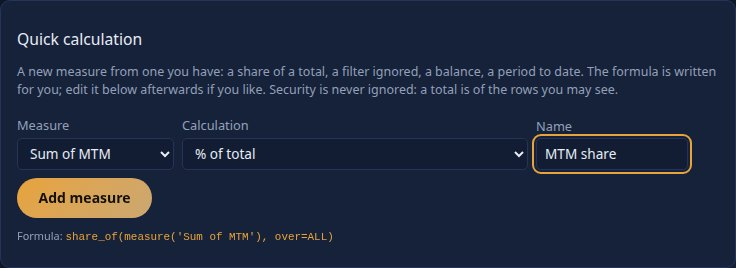
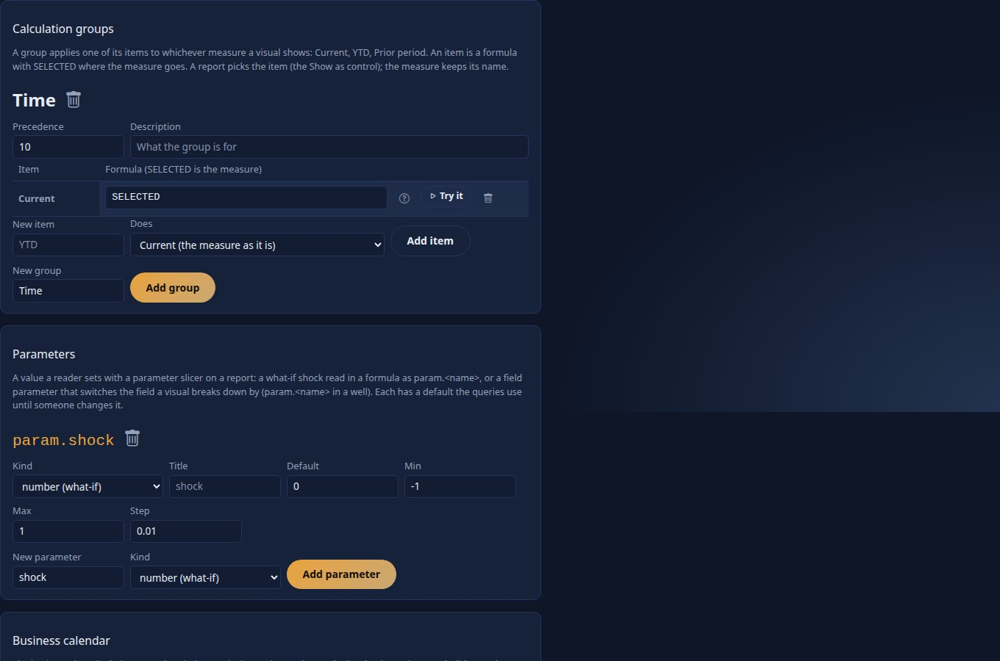
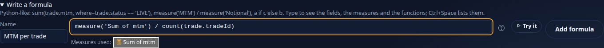
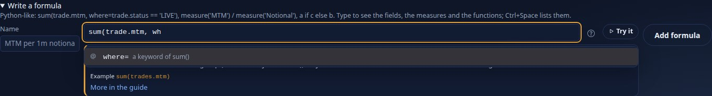
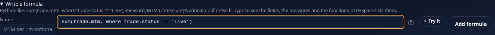
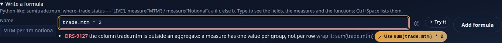
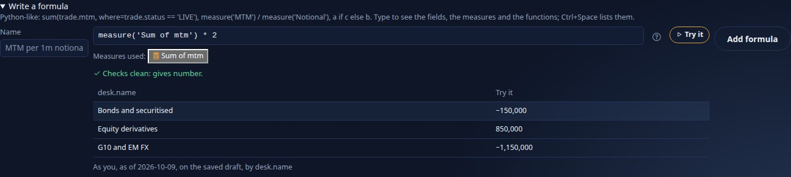

<!--
  Project Drishti · Any data. Any domain. One grammar.

  Copyright (c) 2026 Ashutosh Sinha <ajsinha@gmail.com>.
  All rights reserved.

  PROPRIETARY AND CONFIDENTIAL.

  This file is the confidential and proprietary property of Ashutosh Sinha.
  Unauthorised copying, use, modification, distribution or disclosure of this
  file, via any medium, is strictly prohibited except with the express prior
  written permission of the copyright holder.

  See the LICENSE file in the root of this repository for the full terms.
-->
# Expressions: the Drishti expression language (DEL)

DEL is how you write **measures**, **derived columns**, **filters** and **row rules** in Drishti BI. It reads like Python: every DEL expression is a
valid Python expression (`ast.parse(text, mode="eval")` accepts it), but only a small, safe part of Python is allowed, and nothing is ever run by a
Python interpreter. The Java server parses the text, checks it, and compiles it into the query plan (SQL with bound values), **after** your row rules
and masks are applied. DEL v2 arrived in release 2.2.0 (wave A) and replaces the older Rachana-EL-flavoured syntax (`&&`, `?:`, `[Measure]`); a
converter rewrites old expressions for you ([section 10](#10-the-old-syntax-and-the-converter)).

```python
sum(trades.MTM, where=trades.TRADE_STATUS != 'MATURED')                    # MTM of the live trades
measure('P&L 1d') / measure('Exposure (EE peak)')                 # one measure over another
notional * fx(currency, 'USD')                                    # a derived column (fx arrives in wave B)
trades.DESK in user.desks                                         # a row rule: each desk head sees their desks
trades.MTM if trades.MTM > 0 else 0                               # a conditional
```

Contents: [1](#1-where-you-write-del-scopes) scopes · [2](#2-the-grammar) grammar · [3](#3-what-is-refused) what is refused ·
[4](#4-values-and-edge-cases) values and edge cases · [5](#5-measures-referring-to-measures) measure references ·
[6](#6-functions) functions (generated from the catalogue) · [7](#7-problems-and-their-fixes) problems and fixes ·
[8](#8-checking-an-expression-the-api-and-the-cli) the API and the CLI · [9](#9-how-del-differs-from-python-and-from-dax) DEL vs Python and DAX ·
[10](#10-the-old-syntax-and-the-converter) the old syntax and the converter · [11](#11-recipes) recipes

Related: [DATASETS.md](DATASETS.md) (datasets and their security), [BI_DESIGN.md §3.3](../architecture/BI_DESIGN.md#33-del-the-drishti-expression-language-python-like)
(the design), [API_GUIDE.md](API_GUIDE.md#expressions-apiv1biexpr) (the endpoints), [CONFIGURATION.md](../admin/CONFIGURATION.md#drishtibiexpr--the-expression-language)
(`drishti.bi.expr.*`).

---

## 1. Where you write DEL (scopes)

Where an expression is written decides what it may name. The server checks the **scope** of every expression; the expression editor and
`POST /api/v1/bi/expr/validate` take it as `scope`.

| Scope | Where | May name | Aggregates? | Result |
|---|---|---|---|---|
| **row** | a dataset's `derive.*.expr` and `columns.*.expr`, its `where:`, MQ and SQL row filters | the columns of its own dataset (`notional`, or `trades.NOTIONAL`); `related(desk.name)` one hop | no — an aggregate belongs in a measure | one value per row |
| **rule** | `security.rows[].where` | the dataset's own columns and `user.<attribute>` (`user.desks`, `user.name`) | no | `True` or `False` per row; no function can remove it |
| **aggregate** | `measures.*.expr`, MQ `define`, report local measures | `alias.column` **inside an aggregate**, `measure('name')` | yes — a bare column outside an aggregate is refused: *wrap it: `sum(trades.MTM)`* | one value per group of the answer |
| **context** *(wave B)* | the first argument of `calc`, `share_of`, `parent_of`, `as_of` | as aggregate | yes | one value per group, in an edited filter context |

**Row context** is "this row of this dataset": `notional * 2` is worked out for each trade. **Aggregate context** is "the rows of this group,
after security and filters": `sum(trades.MTM)` in the bar for desk RATES is the sum over the RATES trades *you* may see.

## 2. The grammar

DEL is this subset of Python's expression grammar (precedence from loosest to tightest, as in Python):

```
expr        := ifexpr
ifexpr      := orexpr ["if" orexpr "else" expr]                 # a if cond else b
orexpr      := andexpr ("or" andexpr)*
andexpr     := notexpr ("and" notexpr)*
notexpr     := "not" notexpr | comparison
comparison  := arith (compop arith)*                           # chained: 0 < x <= 10
compop      := "==" | "!=" | "<" | "<=" | ">" | ">=" | "in" | "not in" | "is" | "is not"   # is / is not only with None
arith       := term (("+" | "-") term)*
term        := factor (("*" | "/" | "//" | "%") factor)*
factor      := ("-" | "+") factor | power
power       := primary ["**" factor]
primary     := atom | call | field
field       := NAME ("." NAME)*                                 # trades.MTM, trades.TRADE_DATE.month, user.desks
call        := FUNCNAME "(" [arg ("," arg)* [","]] ")"          # catalogue functions only; never a method call
arg         := expr | NAME "=" expr                             # keyword arguments: where= by= desc= ...
atom        := NUMBER | STRING | True | False | None | ALL | list | "(" expr ")"
list        := "[" [expr ("," expr)* [","]] "]"                 # for in / not in, and field lists (by=[...])
```

| Element | Written | Notes |
|---|---|---|
| numbers | `12`, `1.5`, `1e6`, `1_000_000` | a number with `.` or an exponent is a decimal |
| text | `'Live'`, `"it's"` | escapes `\\` `\'` `\"` `\n` `\t`; adjacent texts join (`'a' 'b'`); no f-strings, bytes, raw or triple-quoted strings |
| booleans, null | `True`, `False`, `None` | capitalised, as in Python |
| dates | `date('2026-10-09')`, `timestamp('2026-10-09T09:30')` | DEL has no date literal; a column compared with an ISO text (`trades.TRADE_DATE >= '2026-10-01'`) is also read as a date |
| fields | `trades.MTM`, `trades.TRADE_DATE.year` (`.quarter`, `.month`, `.week`, `.day`) | in row and rule scope a bare `mtm` is a column of the dataset in context |
| the reader | `user.desks`, `user.name`, `user.roles` | row rules only |
| lists | `['USD', 'EUR']` | only on the right of `in` / `not in`, or as `by=[...]` |
| comments | `# to the end of the line` | in YAML, write a multi-line expression as a block: `expr: \|` |
| bounds | 2,000 characters (4,000 when written over several lines), nesting depth 64 | split a long expression into measures that use each other |

Operators: `+ - * / // % **`, comparisons, `in`, `not in`, `is None`, `is not None`, `and`, `or`, `not`, `a if c else b`. Keyword arguments
follow positional ones; `where=`, `by=`, `desc=` are keyword-only (write the name).

## 3. What is refused

Everything else Python has is refused with `DRS-9127`, naming the construct and what to write instead:

| You wrote | The server says | Write instead |
|---|---|---|
| `x := 1`, `x = 1` | assignment is not DEL | `==` for equality; a measure for a reusable value |
| `lambda x: x` | lambda is not DEL | a catalogue function, or a Python item |
| `[x for x in t]`, `sum(x for x in t)` | comprehensions and generators are not DEL | `sum(x, where=...)`, `count(alias, where=...)` |
| `trades.MTM[0]` | subscripts and slices are not DEL | name the column: `alias.column` |
| `trades.MTM.sum()` | method calls are not DEL | `sum(trades.MTM)` |
| `f(*args)`, `f(**kw)` | star arguments are not DEL | write each argument |
| `f'{x}'`, `b'x'`, `'''x'''` | prefixed or triple-quoted strings are not DEL | a plain `'text'` |
| `{'a': 1}`, `(1, 2)` | dict, set and tuple literals are not DEL | a list for `in`: `[1, 2]` |
| `import`, `await`, `yield`, `def` ... | not DEL | — |
| `a && b`, `!a`, `c ? a : b`, `true`, `null` | the old syntax | `and`, `not`, `a if c else b`, `True`, `None` (run the converter) |

## 4. Values and edge cases

Every function follows these rules; the reference in [section 6](#6-functions) adds what is particular to each.

| Case | Rule |
|---|---|
| `None` | arithmetic with `None` gives `None`; a comparison with `None` is never `True` — write `x is None` / `x is not None` (`x == None` is refused); aggregates skip `None`; `count(x)` counts the values that are not `None` |
| division | `/` is decimal division and gives `None` on a zero divisor (never an error, never infinity); `//` (floor division) and `%` likewise |
| no rows | `sum`, `avg`, `min`, `max` of no rows are `None`; `count` and `distinct` are `0`. Show `0` with `coalesce(sum(x), 0)` |
| masked values | a masked column reads as the text `•••` in row scope; an aggregate over it is `None` and the answer marks it masked; a filter, sort or `in` on it is refused (`DRS-9161`) |
| currencies | summing an amount whose currency is a column, across several currencies, is the currency guard (`DRS-9158`): group or filter by the currency |
| types | integer with decimal gives decimal; `date - date` gives integer days; text with number is refused (no implicit casts); the items of `in [...]` must have the field's type |
| booleans | `and`, `or`, `not` and `a if c else b` take conditions only: no truthiness of numbers or texts (`if trades.MTM` is refused; write `trades.MTM != 0`) |
| `%` with negatives | follows SQL (the sign of the dividend), not Python (the sign of the divisor) |

## 5. Measures referring to measures

A measure names another with **`measure('name')`** — the name in quotes, so any name works (`measure('P&L 1d')`, `measure('Exposure (EE peak)')`),
or the measure's stable id (`measure('m_mtm')`), which survives a rename. The designer shows the reference as a chip and writes `measure('…')` into
the YAML. Measures that refer to each other in a circle are refused (`DRS-9127`). A measure reference belongs in aggregate scope, outside
aggregates: `sum(measure('MTM'))` is refused (aggregate columns; combine measures outside aggregates).

```yaml
measures:
  MTM:          { id: m_mtm, expr: "sum(trades.MTM)" }
  Trades:       { id: m_trades, expr: "count(trades)" }
  MTM per trade: { expr: "measure('m_mtm') / measure('Trades')" }      # by id and by name
```

### 5.1 The filter context: `calc`, `share_of`, `parent_of`, `avg_by` (wave B)

A measure is worked out per group of the answer in a **filter context** of four layers. You can edit layers 2 and 3; layer 1 is never in reach:

| Layer | What it holds | Who changes it |
|---|---|---|
| 1 security | your row rules and masks, per dataset | nobody: `ignore=ALL` means *everything you may see* |
| 2 query | the query's filters: MQ `where`, slicers, page and visual filters, drill, cross-filter | `calc(…, ignore=…/keep=…)`, `share_of` |
| 3 group | the values of the answer's fields for this row (`desk == 'RATES'`) | `calc(…, ignore=…/keep=…)`, `share_of`, `parent_of` |
| 4 measure | the measure's own `where=` and `calc(…, where=…)` | the measure |

```yaml
measures:
  MTM:              { expr: "sum(trades.MTM)" }
  MTM all desks:    { expr: "calc(measure('MTM'), ignore=[desks.NAME])" }        # the desk slicer and the row's desk dropped
  MTM % of total:   { expr: "share_of(measure('MTM'), over=ALL)" }               # of the total you may see
  MTM % of desk:    { expr: "share_of(measure('MTM'), over=[books.NAME])" }      # a book's share of the rest of its group
  MTM % of parent:  { expr: "parent_of(measure('MTM'), hierarchy='Desk and book')" }
  Live MTM anyway:  { expr: "calc(measure('MTM'), where=trades.TRADE_STATUS != 'MATURED')" }
  Region MTM:       { expr: "calc(measure('MTM'), keep=[desks.REGION])" }        # every filter but the region's dropped
  MTM by settle:    { expr: "calc(measure('MTM'), via='r_5')" }                  # the inactive relationship r_5 instead of the active one
  Avg book MTM:     { expr: "avg_by(sum(trades.MTM), by=[books.NAME])" }         # MTM per book, then the average
```

Before and after, for *MTM all desks* with a slicer `desk in [RATES]` and the answer grouped by desk and currency:

| | desk filter | desk group | currency group | so the value is |
|---|---|---|---|---|
| `measure('MTM')` | RATES | the row's desk | the row's currency | MTM of that desk and currency |
| `calc(measure('MTM'), ignore=[desks.NAME])` | dropped | dropped | kept | MTM of every desk you may see, in that currency |

How it runs: `where=` alone restricts the aggregates (`FILTER (WHERE …)`); `ignore`, `keep`, `via`, `share_of`, `parent_of` and `avg_by` become a
**context sub-query** (the same question at the coarser grain, as you, joined back on the fields both keep: `Context` nodes in `explain`). Rules:
security is never in scope; contexts nest at most three deep (`DRS-9127` in an expression, `DRS-9166` through measures); no context transition
(iterate explicitly with `avg_by`); a context is read on the groups the answer has, so a grand total with no rows of its own shows `None`; no rollup
answers a measure with a context (the plan says so).

### 5.2 Parameters and calculation groups (wave B)

A model declares **parameters** and **calculation groups**; a query (`mq: 2`) gives values and picks items.

```yaml
parameters:
  shock:     { kind: number, default: 0, min: -0.5, max: 0.5, step: 0.01 }     # what-if: param.shock in any expression
  breakdown: { kind: field, fields: [desks.REGION, trades.CURRENCY], default: desks.REGION }   # field: param.breakdown in select.fields
calc-groups:
  Time:
    precedence: 10                                   # several groups: the highest precedence applies first (innermost)
    items:
      Current: "SELECTED"
      YTD:     "ytd(SELECTED, trades.TRADE_DATE)"     # SELECTED is the measure the item applies to
      Prior:   "prior_period(SELECTED, trades.TRADE_DATE)"
measures:
  Shocked MTM: { expr: "measure('MTM') * (1 + param.shock)" }
```

```yaml
mq: 2
model: desk-calc
select: { fields: [param.breakdown], measures: [MTM, Notional, Trades] }
params: { shock: -0.1, breakdown: trades.CURRENCY }
calc: { Time: YTD }                                  # every selected measure becomes its YTD; the answer keeps the names
```

A value outside the parameter's kind, range or list is `DRS-9164`; an unknown group or item `DRS-9165`. The values and the items are part of the
question (the plan hash), so two shocks are two cache entries. `param.x` is refused in a row rule (security never depends on a what-if value).

### 5.3 Balances, time travel, calendars and currencies (wave B)

A **balance** (a position, a limit, collateral held) is not added across dates: summing Monday's and Tuesday's balance is meaningless. Write it with a
balance function, which says which date's rows count:

| Function | Per group of the answer | Example |
|---|---|---|
| `last(agg, date)` | the rows dated on the group's latest date | `last(sum(accounts.balance), accounts.businessDate)` |
| `first(agg, date)` | the rows dated on the group's earliest date | `first(sum(accounts.balance), accounts.businessDate)` |
| `closing(agg, date, period='month')` | the rows on the last **business** day of each period, up to the as-of date (a month ending on a holiday or a weekend closes on the business day before) | `closing(sum(accounts.balance), accounts.businessDate)` |
| `opening(agg, date, period='month')` | the closing of the period before: along the answer's date field the row before; without one, the business day before the as-of date's period (read at that date when `date` is the snapshot's `businessDate`) | `opening(sum(accounts.balance), accounts.businessDate)` |
| `avg_over(agg, date)` | the average of the aggregate per date (an average daily balance) | `avg_over(sum(accounts.balance), accounts.businessDate)` |
| `as_of(agg, d)` | the aggregate at another business date (same fields, filters and security) | `measure('MTM') - as_of(measure('MTM'), shift_date(asof(), -1))` |

A measure declared `additive: { over-time: last }` and **not** written with one of these, asked over a window of dates with other measures and without
the date as a field, is refused (`DRS-9159`: the fix offers `last(measure('…'), <alias>.businessDate)`); asked alone it is still answered as its last
date's value. `asof()` is the query's as-of date; `shift_date(d, n, unit='business-day')` moves a date by business days (on the model's calendar), days,
weeks, months, quarters or years; `as_of` needs a date it can work out before the query runs (`date('…')`, `asof()`, `shift_date(asof(), -1)`:
`DRS-9166` otherwise).

**The model's calendar** (`calendars: { holidays: USNY, fiscal-year-start: 4 }`) decides the business days of `closing`, `opening`, `shift_date`,
`prior_period`, `same_period_last_year`, `business_days_between` (weekdays less its holidays) and relative windows, and the fiscal year of
`fiscal_ytd(agg, date)` (here from 1 April). Without one, the pack's calendar and a calendar year.

**Currencies.** A model names its FX rates (`fx: { rates: <alias>, from: base, to: quote, rate: rate, date: day, base: USD }`): `fx(ccy, 'USD',
at=d)` is the latest rate on or before `d` (a pair as stored, its inverse, or through `base`); `convert(agg, to='USD', at='as-of')` multiplies every
amount inside the aggregate by the rate of its own currency (the column's `unit: { currency: <column> }`) at the as-of date, at each row's trade date
(`at='trade-date'`) or at another date column (`at='settleDate'`). A converted measure has one currency, so the currency guard (`DRS-9158`) does not
apply to it. The rates are reference data: the rates table's row rules do not filter a conversion.

```yaml
measures:
  Month-end balance:   { expr: "closing(sum(accounts.balance), accounts.businessDate)" }
  Average daily:       { expr: "avg_over(sum(accounts.balance), accounts.businessDate)" }
  MTM day on day:      { expr: "measure('MTM') - as_of(measure('MTM'), shift_date(asof(), -1))" }
  Fiscal YTD P&L:      { expr: "fiscal_ytd(sum(trades.PNL_1D), trades.TRADE_DATE)" }
  Notional USD:        { expr: "convert(sum(trades.NOTIONAL), to='USD')" }
  Notional EUR traded: { expr: "convert(sum(trades.NOTIONAL), to='EUR', at='trade-date')" }
calendars: { holidays: USNY, fiscal-year-start: 4 }
fx: { rates: rates, from: base, to: quote, rate: rate, date: day, base: USD }
```

### 5.4 In the console: Quick calculation and the Calculations tab (wave B)

Nothing of sections 5.1 to 5.3 needs typing. In the model designer (**Models**, a model, **Edit**):

**Quick calculation** (the **Measures** tab, under *New measure from a column*). Pick a measure you have, a calculation and, when it needs one, a field,
a date field, a relationship or a parameter; the formula is written below it and the name is proposed. **Add measure** writes it and the server checks it
like any other. The calculations offered are the ones the server's catalogue has built:

| Calculation | Writes |
|---|---|
| % of total | `share_of(measure('MTM'), over=ALL)`, format `share` (a share of 1 shown as a percent: 1.25 is 125 %) |
| % of the total of a field | `share_of(measure('MTM'), over=[books.NAME])` |
| Ignoring a field's filter (a slicer) | `calc(measure('MTM'), ignore=[desks.NAME])` |
| Ignoring every filter | `calc(measure('MTM'), ignore=ALL)` |
| Through another relationship | `calc(measure('MTM'), via='r_5')` (a relationship without an id is given one) |
| Year, fiscal year, month to date; prior period; running total | `ytd(...)`, `fiscal_ytd(...)`, `mtd(...)`, `prior_period(...)`, `running(...)` over the date field you pick |
| Closing, opening, average balance; last value | `closing(...)`, `opening(...)`, `avg_over(...)`, `last(...)` over the date field |
| As of the business day before | `as_of(measure('MTM'), shift_date(asof(), -1))` |
| What-if: shocked by a parameter | `measure('MTM') * (1 + param.shock)` |



The formula can then be edited in the measures table, in the ExpressionEditor, which completes `param.<name>` (the model's parameters), the
relationship ids after `via=` and `ALL` after `over=` or `ignore=`. A measure's **Via** column picks the relationship it follows (`via:` in the YAML).

**The Calculations tab** holds what is not a measure: **calculation groups** (a group's name and precedence, its items as formulas over `SELECTED`, a
new item from the same templates), **parameters** (name, kind, title, default, min, max, step, the values of a text parameter, the fields of a field
parameter), the **business calendar** (holidays and the month the fiscal year starts) and **currency conversion** (the rates dataset and its columns).



What it writes (the YAML tab, unchanged by hand):

```yaml
measures:
  Sum of mtm:  { expr: "sum(trade.mtm)", format: signed0 }
  MTM share:   { expr: "share_of(measure('Sum of mtm'), over=ALL)", format: share }
  MTM shocked: { expr: "measure('Sum of mtm') * (1 + param.shock)" }
calc-groups:
  Time:
    precedence: 10
    items: {Current: SELECTED}
parameters:
  shock: {kind: number, default: 0, min: -1, max: 1, step: 0.01}
calendars: {holidays: USNY, fiscal-year-start: 4}
```

A reader then sets the parameters and picks a calculation group's item on the report itself ([BI_GUIDE.md section 25](BI_GUIDE.md#25-live-answers-and-standing-queries-wave-b-230)).
From the command line the same model is checked with `drishti.py bi model check <file>` and a query with parameters is `POST /api/v1/bi/mq` with
`mq: 2`, `params` and `calc` (section 5.2).

## 6. Functions

The reference below is generated from the server's catalogue (`drishti-server/src/main/resources/bi/expr/functions.yaml`), the same list the
server checks against, `GET /api/v1/bi/expr/functions` serves to the expression editor and AI uses; a test fails when they disagree. A function
marked with a later wave is refused with `DRS-9129` until that wave.

<!-- functions:begin (generated from drishti-server/src/main/resources/bi/expr/functions.yaml; do not edit by hand) -->

| Family | Functions |
|---|---|
| scalar | [`abs`](#fn-abs), [`round`](#fn-round), [`coalesce`](#fn-coalesce), [`upper`](#fn-upper), [`lower`](#fn-lower), [`len`](#fn-len), [`contains`](#fn-contains), [`startswith`](#fn-startswith), [`endswith`](#fn-endswith), [`date`](#fn-date), [`timestamp`](#fn-timestamp), [`year`](#fn-year), [`quarter`](#fn-quarter), [`month`](#fn-month), [`week`](#fn-week), [`day`](#fn-day), [`days_between`](#fn-days-between), [`business_days_between`](#fn-business-days-between) |
| conversion | [`fx`](#fn-fx), [`convert`](#fn-convert) |
| lookup | [`related`](#fn-related) |
| aggregate | [`sum`](#fn-sum), [`avg`](#fn-avg), [`min`](#fn-min), [`max`](#fn-max), [`count`](#fn-count), [`distinct`](#fn-distinct), [`ratio`](#fn-ratio), [`percentile`](#fn-percentile), [`avg_by`](#fn-avg-by) |
| time intelligence | [`ytd`](#fn-ytd), [`mtd`](#fn-mtd), [`qtd`](#fn-qtd), [`prior_period`](#fn-prior-period), [`same_period_last_year`](#fn-same-period-last-year), [`running`](#fn-running), [`fiscal_ytd`](#fn-fiscal-ytd) |
| windows | [`lag`](#fn-lag), [`lead`](#fn-lead), [`rank`](#fn-rank), [`dense_rank`](#fn-dense-rank), [`percent_rank`](#fn-percent-rank), [`moving_avg`](#fn-moving-avg), [`moving_sum`](#fn-moving-sum), [`moving_min`](#fn-moving-min), [`moving_max`](#fn-moving-max), [`cumulative`](#fn-cumulative) |
| balances | [`last`](#fn-last), [`first`](#fn-first), [`opening`](#fn-opening), [`closing`](#fn-closing), [`avg_over`](#fn-avg-over) |
| filter context | [`calc`](#fn-calc), [`share_of`](#fn-share-of), [`parent_of`](#fn-parent-of) |
| time travel | [`as_of`](#fn-as-of), [`shift_date`](#fn-shift-date), [`asof`](#fn-asof) |
| measure reference | [`measure`](#fn-measure) |

### Scalar

<a id="fn-abs"></a>
#### `abs(x)`

*Scopes: row, rule, aggregate · returns: the type of `x` · since W1*

The absolute value of a number.

| Parameter | Type | Default | Notes |
|---|---|---|---|
| `x` | number | required |  |

| Example | What it says |
|---|---|
| `abs(trades.MTM)` | the size of a trade's MTM, whatever its sign (row scope) |
| `sum(abs(trades.MTM))` | gross MTM: the sum of the absolute values |

* **None:** abs(None) is None.
* **Types:** Numbers only; abs of a text or a date is DRS-9127.

<a id="fn-round"></a>
#### `round(x, n=0)`

*Scopes: row, rule, aggregate · returns: the type of `x` · since W1*

Rounds a number to n decimal places (half away from zero, as the database rounds).

| Parameter | Type | Default | Notes |
|---|---|---|---|
| `x` | number | required |  |
| `n` | integer-literal | `0` |  |

| Example | What it says |
|---|---|
| `round(trades.NOTIONAL / 1000000, 1)` | notional in millions with one decimal |
| `round(measure('MTM'))` | a measure rounded to a whole number |

* **None:** round(None, 2) is None.
* **Types:** n is a whole number written in the expression (not a field); a negative n rounds to tens, hundreds, ...

<a id="fn-coalesce"></a>
#### `coalesce(a, b, ...)`

*Scopes: row, rule, aggregate · returns: the type of `values` · since W1*

The first of its arguments that is not None.

| Parameter | Type | Default | Notes |
|---|---|---|---|
| `values` | any | — | one or more |

| Example | What it says |
|---|---|
| `coalesce(trades.PORTFOLIO, 'UNBOOKED')` | the book, or UNBOOKED when it is missing |
| `coalesce(measure('MTM'), 0)` | a measure that shows 0 instead of an empty cell |

* **None:** None only when every argument is None.
* **Types:** Every argument must have the same type (a number with a text is DRS-9127).

<a id="fn-upper"></a>
#### `upper(s)`

*Scopes: row, rule, aggregate · returns: string · since W1*

The text in capital letters.

| Parameter | Type | Default | Notes |
|---|---|---|---|
| `s` | string | required |  |

| Example | What it says |
|---|---|
| `upper(trades.CURRENCY)` | usd becomes USD |
| `upper(counterparties.NAME) == 'ACME BANK'` | a comparison that ignores case |

* **None:** upper(None) is None.
* **Masked values:** A masked column reads as the text ••• and stays •••.

<a id="fn-lower"></a>
#### `lower(s)`

*Scopes: row, rule, aggregate · returns: string · since W1*

The text in small letters.

| Parameter | Type | Default | Notes |
|---|---|---|---|
| `s` | string | required |  |

| Example | What it says |
|---|---|
| `lower(trades.TRADE_STATUS)` | LIVE becomes live |
| `lower(trades.DESK) in ['rates', 'credit']` | a list test that ignores case |

* **None:** lower(None) is None.

<a id="fn-len"></a>
#### `len(s)`

*Scopes: row, rule, aggregate · returns: integer · since A · old syntax: `length`*

The number of characters of a text.

| Parameter | Type | Default | Notes |
|---|---|---|---|
| `s` | string | required |  |

| Example | What it says |
|---|---|
| `len(trades.TRADE_ID)` | how long the id is |
| `len(trades.COUNTERPARTY) > 0` | a comment was written |

* **None:** len(None) is None (not 0).
* **Types:** Text only; len of a list is not DEL.

<a id="fn-contains"></a>
#### `contains(s, part)`

*Scopes: row, rule, aggregate · returns: boolean · since W1*

True when the text contains the part, ignoring case.

| Parameter | Type | Default | Notes |
|---|---|---|---|
| `s` | string | required |  |
| `part` | string | required |  |

| Example | What it says |
|---|---|
| `contains(trades.PRODUCT_TYPE, 'SWAP')` | every kind of swap |
| `sum(trades.MTM, where=contains(trades.PORTFOLIO, 'COMM'))` | MTM of the hedge books |

* **None:** contains(None, 'x') is None, which a filter treats as not matching.
* **Masked values:** Filtering on a masked column is DRS-9161.

<a id="fn-startswith"></a>
#### `startswith(s, prefix)`

*Scopes: row, rule, aggregate · returns: boolean · since A · old syntax: `startsWith`*

True when the text starts with the prefix, ignoring case.

| Parameter | Type | Default | Notes |
|---|---|---|---|
| `s` | string | required |  |
| `prefix` | string | required |  |

| Example | What it says |
|---|---|
| `startswith(trades.PORTFOLIO, 'BOOK-RATES-')` | the rates books |
| `count(trades, where=startswith(trades.TRADE_ID, 'BBG'))` | how many Bloomberg-booked trades |

* **None:** startswith(None, 'x') is None.

<a id="fn-endswith"></a>
#### `endswith(s, suffix)`

*Scopes: row, rule, aggregate · returns: boolean · since A*

True when the text ends with the suffix, ignoring case.

| Parameter | Type | Default | Notes |
|---|---|---|---|
| `s` | string | required |  |
| `suffix` | string | required |  |

| Example | What it says |
|---|---|
| `endswith(trades.PORTFOLIO, '-1')` | the London books |
| `not endswith(trades.PRODUCT_TYPE, 'OPTION')` | everything but options |

* **None:** endswith(None, 'x') is None.

<a id="fn-date"></a>
#### `date(text)`

*Scopes: row, rule, aggregate · returns: date · since A*

A date written in ISO form (YYYY-MM-DD). DEL has no date literal; this is it.

| Parameter | Type | Default | Notes |
|---|---|---|---|
| `text` | string-literal | required |  |

| Example | What it says |
|---|---|
| `trades.TRADE_DATE >= date('2026-10-01')` | trades from October 2026 |
| `sum(trades.MTM, where=trades.MATURITY_DATE < date('2027-01-01'))` | MTM of what matures this year |

* **Types:** The text must be an ISO date; date('10/01/2026') is DRS-9127. Comparing a date with a text is allowed only for an ISO text.

<a id="fn-timestamp"></a>
#### `timestamp(text)`

*Scopes: row, rule, aggregate · returns: timestamp · since A*

A timestamp written in ISO form (YYYY-MM-DDTHH:MM[:SS]).

| Parameter | Type | Default | Notes |
|---|---|---|---|
| `text` | string-literal | required |  |

| Example | What it says |
|---|---|
| `trades.updatedAt >= timestamp('2026-10-09T09:00')` | changed since nine o'clock |
| `count(trades, where=trades.updatedAt < timestamp('2026-10-09T00:00:00'))` | rows not touched today |

* **Types:** The text must be an ISO timestamp; anything else is DRS-9127.

<a id="fn-year"></a>
#### `year(d)`

*Scopes: row, rule, aggregate · returns: integer · since W1*

The year of a date or timestamp. The same as the field part trades.TRADE_DATE.year.

| Parameter | Type | Default | Notes |
|---|---|---|---|
| `d` | date | required |  |

| Example | What it says |
|---|---|
| `year(trades.TRADE_DATE) == 2026` | trades of 2026 |
| `year(trades.MATURITY_DATE) - year(trades.TRADE_DATE)` | a rough tenor in years |

* **None:** year(None) is None.
* **Types:** Dates and timestamps only.

<a id="fn-quarter"></a>
#### `quarter(d)`

*Scopes: row, rule, aggregate · returns: integer · since W1*

The quarter (1 to 4) of a date or timestamp.

| Parameter | Type | Default | Notes |
|---|---|---|---|
| `d` | date | required |  |

| Example | What it says |
|---|---|
| `quarter(trades.TRADE_DATE)` | 1 for January to March |
| `count(trades, where=quarter(trades.TRADE_DATE) == 4)` | trades done in the fourth quarter |

* **None:** quarter(None) is None.

<a id="fn-month"></a>
#### `month(d)`

*Scopes: row, rule, aggregate · returns: integer · since W1*

The month (1 to 12) of a date or timestamp.

| Parameter | Type | Default | Notes |
|---|---|---|---|
| `d` | date | required |  |

| Example | What it says |
|---|---|
| `month(trades.TRADE_DATE)` | 10 for October |
| `month(trades.MATURITY_DATE) in [3, 6, 9, 12]` | quarter-end maturities |

* **None:** month(None) is None.

<a id="fn-week"></a>
#### `week(d)`

*Scopes: row, rule, aggregate · returns: integer · since A*

The ISO week number (1 to 53) of a date or timestamp.

| Parameter | Type | Default | Notes |
|---|---|---|---|
| `d` | date | required |  |

| Example | What it says |
|---|---|
| `week(trades.TRADE_DATE)` | the ISO week a trade was done in |
| `count(trades, where=week(trades.TRADE_DATE) == 41)` | trades of week 41 |

* **None:** week(None) is None.
* **Types:** ISO weeks: the first days of January can belong to week 52 or 53 of the year before.

<a id="fn-day"></a>
#### `day(d)`

*Scopes: row, rule, aggregate · returns: integer · since W1*

The day of the month (1 to 31) of a date or timestamp.

| Parameter | Type | Default | Notes |
|---|---|---|---|
| `d` | date | required |  |

| Example | What it says |
|---|---|
| `day(trades.TRADE_DATE)` | 9 for 2026-10-09 |
| `day(trades.MATURITY_DATE) == 15` | mid-month maturities |

* **None:** day(None) is None.

<a id="fn-days-between"></a>
#### `days_between(a, b)`

*Scopes: row, rule, aggregate · returns: integer · since A*

Calendar days from a to b (negative when b is before a). The same as b - a for two dates.

| Parameter | Type | Default | Notes |
|---|---|---|---|
| `a` | date | required |  |
| `b` | date | required |  |

| Example | What it says |
|---|---|
| `days_between(trades.TRADE_DATE, trades.MATURITY_DATE)` | a trade's tenor in days |
| `avg(days_between(trades.TRADE_DATE, trades.MATURITY_DATE))` | the average tenor |

* **None:** None when either date is None.
* **Types:** Timestamps are taken at their date.

<a id="fn-business-days-between"></a>
#### `business_days_between(a, b)`

*Scopes: row, rule, aggregate · returns: integer · since A*

Business days from a, excluded, to b, included, on the model's calendar (calendars.holidays, else the pack's): weekdays less the holidays between; negative when b is before a.

| Parameter | Type | Default | Notes |
|---|---|---|---|
| `a` | date | required |  |
| `b` | date | required |  |

| Example | What it says |
|---|---|
| `business_days_between(trades.TRADE_DATE, trades.MATURITY_DATE)` | the settlement lag in business days |
| `count(trades, where=business_days_between(trades.TRADE_DATE, trades.MATURITY_DATE) > 2)` | trades settling later than T+2 |

* **None:** None when either date is None.
* **Types:** Weekends only until model calendars arrive (B); a holiday is counted as a business day.

### Conversion

<a id="fn-fx"></a>
#### `fx(ccy, to, at=None)`

*Scopes: row, aggregate · returns: decimal · since B*

The rate that converts one unit of ccy into the currency to: the latest rate on or before the row's business date (or at=) in the model's FX rates (fx: { rates, from, to, rate, date, base }), a pair as stored, its inverse, or through the base currency; 1 for the same currency. Worked out inside a measure (a dataset's derived column cannot read the rates).

| Parameter | Type | Default | Notes |
|---|---|---|---|
| `ccy` | string | required |  |
| `to` | string-literal | required |  |
| `at` | date | `None` | keyword only: `at=...` |

| Example | What it says |
|---|---|
| `sum(trades.NOTIONAL * fx(trades.CURRENCY, 'USD'))` | notional in US dollars |
| `sum(trades.MTM * fx(trades.CURRENCY, 'EUR', at=trades.TRADE_DATE))` | MTM in euros at each trade date |

* **None:** None when the currency is None or no rate for the pair is on or before the date.
* **Masked values:** The rates are reference data: the rates table's row rules do not filter a conversion.
* **Currencies:** A converted amount has one currency, so summing it lifts the currency guard (DRS-9158).

<a id="fn-convert"></a>
#### `convert(agg, to='USD', at='as-of')`

*Scopes: aggregate · returns: decimal · since B*

An aggregate of amounts in many currencies, converted to one: each amount inside is multiplied by the rate of its own currency (its column's unit: { currency: ... }) at the as-of date (at='as-of'), at each row's trade date (at='trade-date'; the business date when the row has none) or at another date column of the row (at='settleDate').

| Parameter | Type | Default | Notes |
|---|---|---|---|
| `agg` | aggregate | required |  |
| `to` | string-literal | `'USD'` | keyword only: `to=...` |
| `at` | string-literal | `'as-of'` | keyword only: `at=...` |

| Example | What it says |
|---|---|
| `convert(sum(trades.NOTIONAL), to='USD')` | notional in USD at the as-of rate |
| `convert(sum(trades.MTM), to='EUR', at='trade-date')` | each trade converted at its own trade date |

* **None:** A row whose rate is unknown adds None (it is skipped by the sum).
* **Currencies:** Lifts the currency guard: the result has one currency.
* **Types:** An amount with no currency, or mixing two, is refused (DRS-9020): convert each amount in its own aggregate.

### Lookup

<a id="fn-related"></a>
#### `related(alias.column)`

*Scopes: row · returns: the type of `field` · since A*

A column of the one row a many-to-one pack reference points at: one hop, in a dataset's derive (for example the desk's name on a trade).

| Parameter | Type | Default | Notes |
|---|---|---|---|
| `field` | field | required |  |

| Example | What it says |
|---|---|
| `related(desk.name)` | the desk's name next to each trade |
| `related(counterparty.sector)` | the counterparty's sector as a column of the trade dataset |

* **None:** None when the reference is empty or points at nothing.
* **Masked values:** A masked column of the referenced kind arrives masked.
* **Types:** Exactly one hop; related(related(...)) is DRS-9127.

### Aggregate

<a id="fn-sum"></a>
#### `sum(x, where=None)`

*Scopes: aggregate · returns: the type of `x` · since W1*

The sum of x over the rows of the group (after security and filters), only the rows where the condition holds when where= is given.

| Parameter | Type | Default | Notes |
|---|---|---|---|
| `x` | number | required |  |
| `where` | boolean | `None` | keyword only: `where=...` |

| Example | What it says |
|---|---|
| `sum(trades.MTM)` | MTM |
| `sum(trades.MTM, where=trades.TRADE_STATUS != 'MATURED')` | MTM of the live trades only |
| `sum(trades.NOTIONAL * trades.DV01) / sum(trades.NOTIONAL)` | a notional-weighted average rate |

* **None:** None values are skipped.
* **No rows:** None over no rows (not 0); wrap it in coalesce(..., 0) to show 0.
* **Masked values:** None over a masked column, and the answer marks the column masked.
* **Currencies:** Summing an amount whose currency is a column, across several currencies, is the currency guard DRS-9158: group or filter by the currency.

<a id="fn-avg"></a>
#### `avg(x, where=None)`

*Scopes: aggregate · returns: decimal · since W1*

The arithmetic mean of x over the rows of the group.

| Parameter | Type | Default | Notes |
|---|---|---|---|
| `x` | number | required |  |
| `where` | boolean | `None` | keyword only: `where=...` |

| Example | What it says |
|---|---|
| `avg(trades.NOTIONAL)` | the average trade size |
| `avg(economies.GROWTH, where=economies.REGION == 'Asia')` | average growth of the Asian economies |

* **None:** None values are skipped (they are not zeros).
* **No rows:** None over no rows.
* **Masked values:** None over a masked column.

<a id="fn-min"></a>
#### `min(x, where=None)`

*Scopes: aggregate · returns: the type of `x` · since W1*

The smallest value of x in the group (numbers, dates or text).

| Parameter | Type | Default | Notes |
|---|---|---|---|
| `x` | any | required |  |
| `where` | boolean | `None` | keyword only: `where=...` |

| Example | What it says |
|---|---|
| `min(trades.MTM)` | the worst trade MTM |
| `min(trades.MATURITY_DATE, where=trades.TRADE_STATUS != 'MATURED')` | the next maturity |

* **None:** None values are skipped.
* **No rows:** None over no rows.

<a id="fn-max"></a>
#### `max(x, where=None)`

*Scopes: aggregate · returns: the type of `x` · since W1*

The largest value of x in the group (numbers, dates or text).

| Parameter | Type | Default | Notes |
|---|---|---|---|
| `x` | any | required |  |
| `where` | boolean | `None` | keyword only: `where=...` |

| Example | What it says |
|---|---|
| `max(netting_sets.UTILISATION)` | the highest limit utilisation |
| `max(trades.updatedAt)` | when the group last changed |

* **None:** None values are skipped.
* **No rows:** None over no rows.

<a id="fn-count"></a>
#### `count(alias | x, where=None)`

*Scopes: aggregate · returns: integer · since W1*

count(trades) counts the rows of a dataset alias; count(x) counts the rows where x is not None.

| Parameter | Type | Default | Notes |
|---|---|---|---|
| `x` | table-or-any | required |  |
| `where` | boolean | `None` | keyword only: `where=...` |

| Example | What it says |
|---|---|
| `count(trades)` | how many trades |
| `count(trades, where=trades.MTM < 0)` | how many trades lose money |
| `count(trades.PORTFOLIO)` | trades with a book |

* **None:** count(x) skips None; count(alias) counts every row.
* **No rows:** 0 over no rows (never None).

<a id="fn-distinct"></a>
#### `distinct(x, where=None)`

*Scopes: aggregate · returns: integer · since W1*

How many different values of x the group has.

| Parameter | Type | Default | Notes |
|---|---|---|---|
| `x` | any | required |  |
| `where` | boolean | `None` | keyword only: `where=...` |

| Example | What it says |
|---|---|
| `distinct(trades.COUNTERPARTY)` | how many counterparties |
| `distinct(trades.PORTFOLIO, where=trades.TRADE_STATUS != 'MATURED')` | books with live trades |

* **None:** None is not a value.
* **No rows:** 0 over no rows.
* **Masked values:** None over a masked column (the values cannot be told apart).

<a id="fn-ratio"></a>
#### `ratio(num, den)`

*Scopes: aggregate · returns: decimal · since W1*

num / den as a decimal, None when den is 0. The same as num / den in DEL, kept for readability.

| Parameter | Type | Default | Notes |
|---|---|---|---|
| `num` | aggregate | required |  |
| `den` | aggregate | required |  |

| Example | What it says |
|---|---|
| `ratio(sum(trades.MTM), sum(trades.NOTIONAL))` | MTM per unit of notional |
| `ratio(sum(regions.GDP_USD_BN), sum(regions.POPULATION)) * 1000000000` | GDP per head in USD |

* **None:** None when either side is None.
* **No rows:** None over no rows.

<a id="fn-percentile"></a>
#### `percentile(x, p, where=None)`

*Scopes: aggregate · returns: decimal · since W1*

The continuous p-quantile of x in the group (p between 0 and 1): 0.5 is the median, 0.99 the 99th percentile.

| Parameter | Type | Default | Notes |
|---|---|---|---|
| `x` | number | required |  |
| `p` | number-literal | required |  |
| `where` | boolean | `None` | keyword only: `where=...` |

| Example | What it says |
|---|---|
| `percentile(trades.MTM, 0.5)` | the median trade MTM |
| `-percentile(scenarios.pnl, 0.01)` | a 99% VaR-style loss from scenario P&L |

* **None:** None values are skipped.
* **No rows:** None over no rows.
* **Types:** p is a number written in the expression, 0 to 1.

<a id="fn-avg-by"></a>
#### `avg_by(agg, by=[fields])`

*Scopes: aggregate, context · returns: decimal · since B*

A two-level aggregate: agg per value of by (within each group of the answer), then the average of those values (the explicit iteration DEL has instead of DAX context transition).

| Parameter | Type | Default | Notes |
|---|---|---|---|
| `agg` | aggregate | required |  |
| `by` | fields | required | keyword only: `by=...` |

| Example | What it says |
|---|---|
| `avg_by(sum(trades.MTM), by=[trades.TRADE_DATE])` | the average daily MTM |
| `avg_by(count(trades), by=[trades.PORTFOLIO])` | trades per book, on average |

* **None:** Groups of by whose aggregate is None are left out of the average.
* **No rows:** None when no group of by has rows.
* **Masked values:** A masked field in by is refused (DRS-9161): the inner groups would split on hidden values.

### Time intelligence

<a id="fn-ytd"></a>
#### `ytd(agg, date)`

*Scopes: aggregate · returns: the type of `agg` · since W1*

The aggregate over the rows whose date falls between the start of the as-of date's year and the as-of date (the end of the query's dates), on the pack's business-day calendar.

| Parameter | Type | Default | Notes |
|---|---|---|---|
| `agg` | aggregate | required |  |
| `date` | date-field | required |  |

| Example | What it says |
|---|---|
| `ytd(sum(trades.MTM), trades.TRADE_DATE)` | MTM of the trades dated this year so far |
| `ytd(count(trades), trades.TRADE_DATE)` | trades done this year |

* **No rows:** None (a count: 0) when no row is in the window.
* **Types:** date is a date or timestamp field of the aggregate's dataset.

<a id="fn-mtd"></a>
#### `mtd(agg, date)`

*Scopes: aggregate · returns: the type of `agg` · since W1*

The aggregate over the rows dated from the start of the as-of month to the as-of date.

| Parameter | Type | Default | Notes |
|---|---|---|---|
| `agg` | aggregate | required |  |
| `date` | date-field | required |  |

| Example | What it says |
|---|---|
| `mtd(sum(trades.PNL_1D), trades.TRADE_DATE)` | month-to-date P&L |
| `mtd(count(trades), trades.TRADE_DATE)` | trades this month |

* **No rows:** None (a count: 0) when no row is in the window.

<a id="fn-qtd"></a>
#### `qtd(agg, date)`

*Scopes: aggregate · returns: the type of `agg` · since W1*

The aggregate over the rows dated from the start of the as-of quarter to the as-of date.

| Parameter | Type | Default | Notes |
|---|---|---|---|
| `agg` | aggregate | required |  |
| `date` | date-field | required |  |

| Example | What it says |
|---|---|
| `qtd(sum(trades.PNL_1D), trades.TRADE_DATE)` | quarter-to-date P&L |
| `qtd(sum(trades.NOTIONAL), trades.TRADE_DATE)` | notional traded this quarter |

* **No rows:** None (a count: 0) when no row is in the window.

<a id="fn-prior-period"></a>
#### `prior_period(agg, date)`

*Scopes: aggregate · returns: the type of `agg` · since W1*

The aggregate over the period just before the query's dates, of the same number of business days.

| Parameter | Type | Default | Notes |
|---|---|---|---|
| `agg` | aggregate | required |  |
| `date` | date-field | required |  |

| Example | What it says |
|---|---|
| `prior_period(sum(trades.PNL_1D), trades.TRADE_DATE)` | P&L of the period before |
| `sum(trades.PNL_1D) - prior_period(sum(trades.PNL_1D), trades.TRADE_DATE)` | change on the prior period |

* **No rows:** None (a count: 0) when the prior period has no rows.

<a id="fn-same-period-last-year"></a>
#### `same_period_last_year(agg, date)`

*Scopes: aggregate · returns: the type of `agg` · since W1*

The aggregate over the query's dates moved back one year.

| Parameter | Type | Default | Notes |
|---|---|---|---|
| `agg` | aggregate | required |  |
| `date` | date-field | required |  |

| Example | What it says |
|---|---|
| `same_period_last_year(sum(trades.NOTIONAL), trades.TRADE_DATE)` | notional a year ago |
| `ratio(sum(trades.NOTIONAL), same_period_last_year(sum(trades.NOTIONAL), trades.TRADE_DATE)) - 1` | growth on last year |

* **No rows:** None (a count: 0) when last year's window has no rows.

<a id="fn-running"></a>
#### `running(agg, date)`

*Scopes: aggregate · returns: the type of `agg` · since W1*

A running total of a sum, count, min or max along the date field of the answer (the date must be a field of the visual).

| Parameter | Type | Default | Notes |
|---|---|---|---|
| `agg` | aggregate | required |  |
| `date` | date-field | required |  |

| Example | What it says |
|---|---|
| `running(sum(trades.NOTIONAL), trades.TRADE_DATE)` | cumulative notional by day |
| `running(count(trades), trades.TRADE_DATE)` | trades so far |

* **Masked values:** Refused along a masked date (DRS-9021).
* **Types:** Only sum, count, min, max; the date field must be in the answer (DRS-9020 otherwise).

<a id="fn-fiscal-ytd"></a>
#### `fiscal_ytd(agg, date)`

*Scopes: aggregate · returns: the type of `agg` · since B*

The aggregate from the start of the fiscal year that holds the as-of date to the as-of date; the fiscal year starts on the first of the model's calendars.fiscal-year-start month (January when the model names none).

| Parameter | Type | Default | Notes |
|---|---|---|---|
| `agg` | aggregate | required |  |
| `date` | date-field | required |  |

| Example | What it says |
|---|---|
| `fiscal_ytd(sum(trades.PNL_1D), trades.TRADE_DATE)` | fiscal year-to-date P&L |
| `fiscal_ytd(count(trades), trades.TRADE_DATE)` | trades this fiscal year |

* **No rows:** None (a count: 0) when no row is in the window.
* **Types:** date is a date or timestamp field of the aggregate's dataset.

### Windows

<a id="fn-lag"></a>
#### `lag(agg, n, order, by=[fields])`

*Scopes: aggregate · returns: the type of `agg` · since W1*

The aggregate n rows before, along order (a field of the answer), restarting for each value of by (default: every other field of the answer).

| Parameter | Type | Default | Notes |
|---|---|---|---|
| `agg` | aggregate | required |  |
| `n` | integer-literal | required |  |
| `order` | field | required |  |
| `by` | fields | `[]` | keyword only: `by=...` |

| Example | What it says |
|---|---|
| `lag(sum(trades.MTM), 1, trades.TRADE_DATE)` | yesterday's MTM on each row |
| `sum(trades.MTM) - lag(sum(trades.MTM), 1, trades.TRADE_DATE, by=[trades.DESK])` | day-on-day change per desk |

* **None:** None on the first n rows of each partition.
* **Masked values:** A masked field is never a partition; ordering along a masked field is DRS-9021.

<a id="fn-lead"></a>
#### `lead(agg, n, order, by=[fields])`

*Scopes: aggregate · returns: the type of `agg` · since W1*

The aggregate n rows after, along order.

| Parameter | Type | Default | Notes |
|---|---|---|---|
| `agg` | aggregate | required |  |
| `n` | integer-literal | required |  |
| `order` | field | required |  |
| `by` | fields | `[]` | keyword only: `by=...` |

| Example | What it says |
|---|---|
| `lead(sum(trades.NOTIONAL), 1, trades.MATURITY_DATE)` | the next maturity bucket's notional |
| `lead(count(trades), 2, trades.TRADE_DATE, by=[trades.PORTFOLIO])` | two days ahead, per book |

* **None:** None on the last n rows of each partition.

<a id="fn-rank"></a>
#### `rank(agg, desc=True, by=[fields])`

*Scopes: aggregate · returns: integer · since W1*

The position of each row of the answer by the aggregate, 1 for the highest (desc=False: 1 for the lowest); ties share a rank and leave gaps.

| Parameter | Type | Default | Notes |
|---|---|---|---|
| `agg` | aggregate | required |  |
| `desc` | boolean-literal | `True` | keyword only: `desc=...` |
| `by` | fields | `[]` | keyword only: `by=...` |

| Example | What it says |
|---|---|
| `rank(sum(trades.MTM))` | MTM rank, best first |
| `rank(sum(netting_sets.EE_PEAK), by=[counterparties.SECTOR])` | exposure rank within each sector |

* **None:** None values rank last.

<a id="fn-dense-rank"></a>
#### `dense_rank(agg, desc=True, by=[fields])`

*Scopes: aggregate · returns: integer · since W1*

Like rank, without gaps after ties.

| Parameter | Type | Default | Notes |
|---|---|---|---|
| `agg` | aggregate | required |  |
| `desc` | boolean-literal | `True` | keyword only: `desc=...` |
| `by` | fields | `[]` | keyword only: `by=...` |

| Example | What it says |
|---|---|
| `dense_rank(sum(trades.NOTIONAL))` | 1, 2, 2, 3 for tied notionals |
| `dense_rank(count(trades), desc=False)` | the quietest first |

* **None:** None values rank last.

<a id="fn-percent-rank"></a>
#### `percent_rank(agg, desc=True, by=[fields])`

*Scopes: aggregate · returns: decimal · since W1*

The relative rank from 0 to 1.

| Parameter | Type | Default | Notes |
|---|---|---|---|
| `agg` | aggregate | required |  |
| `desc` | boolean-literal | `True` | keyword only: `desc=...` |
| `by` | fields | `[]` | keyword only: `by=...` |

| Example | What it says |
|---|---|
| `percent_rank(sum(trades.MTM))` | 0 for the best desk, 1 for the worst |
| `percent_rank(sum(trades.NOTIONAL), desc=False)` | a percentile position by size |

* **No rows:** 0 for a single row.

<a id="fn-moving-avg"></a>
#### `moving_avg(agg, n, order, by=[fields])`

*Scopes: aggregate · returns: decimal · since W1*

The average of the aggregate over the row and the n - 1 rows before it along order.

| Parameter | Type | Default | Notes |
|---|---|---|---|
| `agg` | aggregate | required |  |
| `n` | integer-literal | required |  |
| `order` | field | required |  |
| `by` | fields | `[]` | keyword only: `by=...` |

| Example | What it says |
|---|---|
| `moving_avg(sum(trades.MTM), 3, trades.TRADE_DATE)` | a three-day moving average of MTM |
| `moving_avg(sum(trades.PNL_1D), 20, trades.TRADE_DATE, by=[trades.DESK])` | a 20-day average P&L per desk |

* **None:** The first rows average over what is there.

<a id="fn-moving-sum"></a>
#### `moving_sum(agg, n, order, by=[fields])`

*Scopes: aggregate · returns: the type of `agg` · since W1*

The sum of the aggregate over the row and the n - 1 rows before it.

| Parameter | Type | Default | Notes |
|---|---|---|---|
| `agg` | aggregate | required |  |
| `n` | integer-literal | required |  |
| `order` | field | required |  |
| `by` | fields | `[]` | keyword only: `by=...` |

| Example | What it says |
|---|---|
| `moving_sum(sum(trades.PNL_1D), 5, trades.TRADE_DATE)` | a rolling five-day P&L |
| `moving_sum(count(trades), 7, trades.TRADE_DATE)` | trades over the last seven rows |

* **None:** None values are skipped.

<a id="fn-moving-min"></a>
#### `moving_min(agg, n, order, by=[fields])`

*Scopes: aggregate · returns: the type of `agg` · since W1*

The smallest value of the aggregate over the row and the n - 1 rows before it.

| Parameter | Type | Default | Notes |
|---|---|---|---|
| `agg` | aggregate | required |  |
| `n` | integer-literal | required |  |
| `order` | field | required |  |
| `by` | fields | `[]` | keyword only: `by=...` |

| Example | What it says |
|---|---|
| `moving_min(sum(trades.MTM), 10, trades.TRADE_DATE)` | the worst MTM of the last ten days |
| `moving_min(min(trades.MTM), 3, trades.TRADE_DATE)` | the worst trade over three days |

* **None:** None values are skipped.

<a id="fn-moving-max"></a>
#### `moving_max(agg, n, order, by=[fields])`

*Scopes: aggregate · returns: the type of `agg` · since W1*

The largest value of the aggregate over the row and the n - 1 rows before it.

| Parameter | Type | Default | Notes |
|---|---|---|---|
| `agg` | aggregate | required |  |
| `n` | integer-literal | required |  |
| `order` | field | required |  |
| `by` | fields | `[]` | keyword only: `by=...` |

| Example | What it says |
|---|---|
| `moving_max(max(netting_sets.UTILISATION), 5, netting_sets.businessDate)` | peak utilisation over five days |
| `moving_max(sum(trades.MTM), 20, trades.TRADE_DATE)` | the 20-day high of MTM |

* **None:** None values are skipped.

<a id="fn-cumulative"></a>
#### `cumulative(agg, date)`

*Scopes: aggregate · returns: the type of `agg` · since W1*

The same as running(agg, date).

| Parameter | Type | Default | Notes |
|---|---|---|---|
| `agg` | aggregate | required |  |
| `date` | date-field | required |  |

| Example | What it says |
|---|---|
| `cumulative(sum(trades.NOTIONAL), trades.TRADE_DATE)` | notional so far |
| `cumulative(count(trades), trades.TRADE_DATE)` | trades so far |

* **Types:** As running.

### Balances

<a id="fn-last"></a>
#### `last(agg, date)`

*Scopes: aggregate · returns: the type of `agg` · since B*

The aggregate over the rows of each group dated on the group's latest date (a balance's semi-additive total: the latest day's figure, never the sum of the days).

| Parameter | Type | Default | Notes |
|---|---|---|---|
| `agg` | aggregate | required |  |
| `date` | date-field | required |  |

| Example | What it says |
|---|---|
| `last(sum(accounts.balance), accounts.businessDate)` | the closing balance of the period |
| `last(sum(collateral.value), collateral.businessDate)` | collateral held at the end |

* **None:** Rows with no date are never the latest.
* **No rows:** None when the group has no dated row.

<a id="fn-first"></a>
#### `first(agg, date)`

*Scopes: aggregate · returns: the type of `agg` · since B*

The aggregate over the rows of each group dated on the group's earliest date.

| Parameter | Type | Default | Notes |
|---|---|---|---|
| `agg` | aggregate | required |  |
| `date` | date-field | required |  |

| Example | What it says |
|---|---|
| `first(sum(accounts.balance), accounts.businessDate)` | the balance at the start of the period |
| `last(sum(accounts.balance), accounts.businessDate) - first(sum(accounts.balance), accounts.businessDate)` | the change over the period |

* **No rows:** None when the group has no dated row.

<a id="fn-opening"></a>
#### `opening(agg, date, period='month')`

*Scopes: aggregate · returns: the type of `agg` · since B*

The balance at the close of the business day before the period starts (period: day, week, month, quarter, year): along the answer's date field it is the closing of the row before; without one, the aggregate on the business day before the as-of date's period (read at that business date when date is the snapshot's businessDate).

| Parameter | Type | Default | Notes |
|---|---|---|---|
| `agg` | aggregate | required |  |
| `date` | date-field | required |  |
| `period` | string-literal | `'month'` | keyword only: `period=...` |

| Example | What it says |
|---|---|
| `opening(sum(accounts.balance), accounts.businessDate)` | the opening balance of the month |
| `opening(sum(accounts.balance), accounts.businessDate, period='quarter')` | the opening balance of the quarter |

* **No rows:** None when the day before has no rows, and on the first period of the answer when the period before is not in it.

<a id="fn-closing"></a>
#### `closing(agg, date, period='month')`

*Scopes: aggregate · returns: the type of `agg` · since B*

The aggregate over the rows dated on the last business day of each period (on the model's calendar: a month ending on a holiday or a weekend closes on the business day before), up to the as-of date (the as-of period closes on the as-of date); per group, so a monthly answer shows each month's close.

| Parameter | Type | Default | Notes |
|---|---|---|---|
| `agg` | aggregate | required |  |
| `date` | date-field | required |  |
| `period` | string-literal | `'month'` | keyword only: `period=...` |

| Example | What it says |
|---|---|
| `closing(sum(accounts.balance), accounts.businessDate)` | the month-end balance |
| `closing(sum(accounts.balance), accounts.businessDate, period='year')` | the year-end balance |

* **No rows:** None when the period's last business day has no rows.
* **Types:** Without a window the periods of the five years before the as-of date are looked at.

<a id="fn-avg-over"></a>
#### `avg_over(agg, date)`

*Scopes: aggregate · returns: decimal · since B*

The average over the dates of each group of the aggregate per date (an average daily balance): avg_by(agg, by=[date]).

| Parameter | Type | Default | Notes |
|---|---|---|---|
| `agg` | aggregate | required |  |
| `date` | date-field | required |  |

| Example | What it says |
|---|---|
| `avg_over(sum(accounts.balance), accounts.businessDate)` | the average daily balance |
| `avg_over(sum(collateral.value), collateral.businessDate)` | average collateral held |

* **No rows:** None when the group has no dated row.

### Filter context

<a id="fn-calc"></a>
#### `calc(agg, where=..., ignore=[...] | ALL, keep=[...], via='rel_id')`

*Scopes: aggregate, context · returns: the type of `agg` · since B*

The aggregate in an edited filter context: add conditions (where=, a row condition ANDed to the aggregate's), drop the query's and the group's filters on some fields (ignore=[...]) or on all (ignore=ALL), drop every filter except those on some fields (keep=[...]), or follow an inactive relationship (via='r_5', the active one for the same pair switched off). Security is never in scope: ignore=ALL means everything you may see.

| Parameter | Type | Default | Notes |
|---|---|---|---|
| `agg` | aggregate | required |  |
| `where` | boolean | `None` | keyword only: `where=...` |
| `ignore` | fields-or-all | `[]` | keyword only: `ignore=...` |
| `keep` | fields | `[]` | keyword only: `keep=...` |
| `via` | string-literal | `None` | keyword only: `via=...` |

| Example | What it says |
|---|---|
| `calc(measure('MTM'), ignore=[desks.NAME])` | MTM ignoring the desk slicer and the desk of the row |
| `calc(sum(trades.MTM), where=trades.TRADE_STATUS != 'MATURED')` | MTM of the live trades, whatever else is filtered |
| `calc(measure('MTM'), keep=[desks.REGION])` | MTM of the whole region of the row |
| `calc(measure('MTM'), via='r_5')` | MTM along the settlement-date relationship |

* **No rows:** None (a count: 0) when the edited context has no rows.
* **Masked values:** ignore=ALL means all the rows you may see, never more; a masked field in ignore= or keep= is never a group (it is not grouped on).
* **Types:** Nesting of calc, share_of, parent_of and as_of is at most three deep (DRS-9127).

<a id="fn-share-of"></a>
#### `share_of(agg, over=[...] | ALL)`

*Scopes: aggregate, context · returns: decimal · since B*

The aggregate divided by itself with the fields of over ignored (the same as agg / calc(agg, ignore=over)): over=ALL is the share of the grand total you may see, over=[books.NAME] a book's share within the rest of its group.

| Parameter | Type | Default | Notes |
|---|---|---|---|
| `agg` | aggregate | required |  |
| `over` | fields-or-all | required | keyword only: `over=...` |

| Example | What it says |
|---|---|
| `share_of(measure('MTM'), over=ALL)` | MTM as a share of the total you may see |
| `share_of(measure('MTM'), over=[books.NAME])` | a book's share within its desk |

* **None:** None when the coarser total is 0 or None.
* **Masked values:** Of what you may see: the total never includes rows your row rules hide.

<a id="fn-parent-of"></a>
#### `parent_of(agg, hierarchy='name')`

*Scopes: aggregate, context · returns: decimal · since B*

The aggregate as a share of its parent level in a hierarchy of the model: the deepest level of the hierarchy in the answer is ignored (with the levels below it), so each row is divided by its parent's total.

| Parameter | Type | Default | Notes |
|---|---|---|---|
| `agg` | aggregate | required |  |
| `hierarchy` | string-literal | required | keyword only: `hierarchy=...` |

| Example | What it says |
|---|---|
| `parent_of(measure('MTM'), hierarchy='Desk and book')` | a book's share of its desk |
| `parent_of(measure('Notional'), hierarchy='Region')` | a country's share of its region |

* **None:** None at the top level, and when no level of the hierarchy is a field of the answer; None when the parent's total is 0.
* **Types:** hierarchy names a hierarchy of the model (DRS-9152 otherwise).

### Time travel

<a id="fn-as-of"></a>
#### `as_of(agg, date_expr)`

*Scopes: aggregate, context · returns: the type of `agg` · since B*

The aggregate with every scan bound to another business date (the same fields, filters and security, that day's data), joined on the answer's fields: today against yesterday in one visual. The date is worked out before the query runs: date('...'), asof(), or shift_date(asof(), n, unit=).

| Parameter | Type | Default | Notes |
|---|---|---|---|
| `agg` | aggregate | required |  |
| `date_expr` | date | required |  |

| Example | What it says |
|---|---|
| `measure('MTM') - as_of(measure('MTM'), shift_date(asof(), -1))` | MTM day on day |
| `as_of(measure('Exposure'), date('2026-09-30'))` | exposure at the quarter end |

* **No rows:** None when that date has no data for the group.
* **Types:** A date that depends on the row (a column) is refused (DRS-9166); a live table has no other dates (DRS-9157).

<a id="fn-shift-date"></a>
#### `shift_date(d, n, unit='business-day')`

*Scopes: row, aggregate, context · returns: date · since B*

A date moved by n units: business-day (the default, on the model's calendar: holidays and weekends skipped), day, week, month, quarter or year. Business days need a fixed date (asof() or date('...')); a column moves by the other units.

| Parameter | Type | Default | Notes |
|---|---|---|---|
| `d` | date | required |  |
| `n` | integer-literal | required |  |
| `unit` | string-literal | `'business-day'` | keyword only: `unit=...` |

| Example | What it says |
|---|---|
| `shift_date(asof(), -1)` | the previous business day |
| `shift_date(asof(), -1, unit='month')` | a month ago |

* **None:** shift_date(None, n) is None.
* **Types:** n is a whole number written in the expression; shift_date(column, n) in business days is refused (DRS-9020).

<a id="fn-asof"></a>
#### `asof()`

*Scopes: row, aggregate, context · returns: date · since B*

The query's as-of date: the end of its dates (time.as-of, the window's end), else the business date it read.

| Example | What it says |
|---|---|
| `sum(trades.NOTIONAL, where=days_between(trades.TRADE_DATE, asof()) <= 30)` | notional traded in the last 30 days |
| `count(trades, where=trades.MATURITY_DATE <= shift_date(asof(), 30, unit='day'))` | trades maturing within 30 days |

* **Types:** Always a date.

### Measure reference

<a id="fn-measure"></a>
#### `measure('name')`

*Scopes: aggregate, context · returns: number · since A · old syntax: `[name]`*

Another measure of the model, by its name or its stable id (measure('m_mtm')); a rename keeps the binding by id.

| Parameter | Type | Default | Notes |
|---|---|---|---|
| `name` | string-literal | required |  |

| Example | What it says |
|---|---|
| `measure('P&L 1d') / measure('Exposure (EE peak)')` | P&L per unit of exposure |
| `measure('MTM') - measure('Open MTM')` | MTM of the matured trades |

* **None:** As the measure it names.
* **Types:** Measures that refer to each other in a circle are DRS-9127.

<!-- functions:end -->

## 7. Problems and their fixes

Every problem carries a code, a message, a **fix** when there is a mechanical one, and the position (`at.start`, `at.end`: character offsets).
These are the codes an expression can raise:

| Code | When | Example | Fix |
|---|---|---|---|
| `DRS-9127` | the language, a scope or a type | `trades.MTM * 2` as a measure: *the column trades.MTM is outside an aggregate* | `wrap it: sum(trades.MTM)` |
| `DRS-9127` | a positional argument where a keyword is required | `sum(trades.MTM, trades.TRADE_STATUS != 'MATURED')`: *sum() takes at most 1 argument before its keywords* | `name it: where=...` |
| `DRS-9127` | a comparison with `None` | `trades.PORTFOLIO == None` | `write x is None` |
| `DRS-9127` | an aggregate in a row expression or rule | `sum(trades.MTM)` in `derive`: *an aggregate belongs in a measure* | make it a measure of the model |
| `DRS-9127` | the old syntax or an old function name | `startsWith(trades.PORTFOLIO, 'R')`: *'startsWith' is the old name* | `write startswith(...)` |
| `DRS-9127` | a construct Python has and DEL does not ([section 3](#3-what-is-refused)) | `trades.MTM.sum()`: *method calls are not DEL* | `call the function on it: sum(trades.MTM)` |
| `DRS-9129` | a function or value of a later wave | `calc(measure('MTM'), ignore=ALL)`: *calc() arrives in wave B (filter context)* | — |
| `DRS-9152` | a field or measure that does not exist for you (in an expression a hidden column is "not found", on purpose; a model query that names one answers `DRS-9163`) | `sum(trades.MTX)`: *no field 'trades.MTX'; did you mean trades.MTM?* | the suggested name |
| `DRS-9161` | a filter, sort or `in` on a field masked for you | `count(trades, where=trades.MTM < 0)` as a reader without raw | filter on a field that is not masked |
| `DRS-9100` | the old expression syntax: refused (the default `drishti.bi.expr.legacy: refuse`); a warning only while a site sets `legacy: warn` | `[MTM] / [Trades]` | `write: measure('MTM') / measure('Trades')` |
| `DRS-9190` | the converter could not keep the meaning of an old expression (it then leaves it as it was) | — | rewrite it by hand |
| `DRS-9158` | (at query time) a sum across currencies | `sum(trades.NOTIONAL)` by desk, several currencies | group or filter by the currency |

Captured from the server (2.2.0), checking `trades.MTM * 2` as a measure:

```json
{"code": "DRS-9127", "level": "error",
 "message": "the column trades.MTM is outside an aggregate: a measure has one value per group, not per row",
 "fix": "wrap it: sum(trades.MTM)", "at": {"start": 0, "end": 10}}
```

and `[MTM] / [Trades]` once the old syntax is refused:

```json
{"code": "DRS-9100", "level": "error",
 "message": "old expression syntax (refused since wave A): run the converter, drishti.py bi migrate --expressions",
 "fix": "write: measure('MTM') / measure('Trades')", "at": {"start": 0, "end": 16}}
```

## 8. Checking an expression: the API and the CLI

`POST /api/v1/bi/expr/validate` checks one expression in its scope against a model **as you see it** (masked fields marked, hidden ones absent)
and, for a measure, also compiles it the way publishing a model would — without reading data. It always answers `200`; `valid` and `problems` say
what is wrong ([API_GUIDE.md](API_GUIDE.md#expressions-apiv1biexpr)).

```bash
drishti.py bi expr validate "sum(trades.NOTIONAL, where=trades.DESK == 'DESK-RATES') / measure('Trades')" --model trading-risk
# valid  (del2, aggregate scope, type decimal)
drishti.py bi expr validate "trades.NOTIONAL * 2" --model trading-risk
# INVALID  (del2, aggregate scope, type number)
#   error   DRS-9127  at 0-15: the column trades.NOTIONAL is outside an aggregate: a measure has one value per group, not per row
#       fix: wrap it: sum(trades.NOTIONAL)
drishti.py bi expr functions --scope row          # the functions you may use in a derived column
drishti.py bi expr convert "[MTM] / [Trades]"     # measure('MTM') / measure('Trades')
```

### 8.1 In the console: the expression editor

Every place the console takes an expression uses one editor: a model's **Measures** tab (*Write a formula* and each measure's formula), a report's
**New measure for this report** (Fields pane), the dataset wizard's **Rows** filter, **Worked-out columns** and **SQL view** (Drishti SQL: the model's
fields and `MEASURE('…')` completed, `/sql/validate` as the check), a model's **free row rule** (Security tab, rule scope, `user.*` completed), and the
guided tables builder's formulas. It never parses DEL itself: completion comes from the model and the server's catalogue (`GET /api/v1/bi/expr/functions`, only the
functions that work now), and every check is the server's (`POST /api/v1/bi/expr/validate`, debounced as you type).

| You do | The editor does |
|---|---|
| type part of a name | lists the fields (with type, meaning and format), the measures and the functions that match; ↑ ↓ choose, Enter or Tab take one, Esc closes, Ctrl+Space opens the list anywhere. The order: a field whose whole name starts with what you typed (`status` for `sta`), then the functions (`sum` for `su`), then the fields matched by their column (`trade.summary`) |
| type inside `count(` | the model's datasets (aliases) first: `count(trade)` counts its rows |
| type inside `sum(`, `avg(`, `min(`, `max(` | the numeric fields first, text last |
| pick a measure | writes `measure('Sum of mtm')` (a name with spaces or symbols needs nothing more); a word starting with a capital lists measures first |
| pick a function | writes `sum(` and shows its **card**: the signature, one line, one example, *More in the guide* (this page, at the function) |
| type inside a call | the card stays; after `,` the call's keyword arguments are offered (`where=`, `by=`, `desc=`) |
| stop typing | the server's check: *Checks clean: gives decimal*, or each problem with its code, its message and the fix as a button (**Use …**) |
| press **Try it** | the server's answer for the formula on the saved model, as you, by a suggested field (a table under the editor) |
| look below the input | the measures the formula uses, as chips; a chip that names no measure is red; clicking one selects it in the text |

A measure picked from the list is written `measure('Sum of mtm')`, and the measures a formula uses show as chips under it:







A bare column in a measure is the most common slip. The server answers `DRS-9127` *the column trade.mtm is outside an aggregate* with the fix
*wrap it: sum(trade.mtm)*; the button puts the fix in place of the column (the problem's `at` span), so `trade.mtm * 2` becomes `sum(trade.mtm) * 2`:



When the server's problem carries no replacement, the editor offers its own fix, always as a button and always checked again by the server:

| The problem | The button |
|---|---|
| a bracket left open (`sum(trade.mtm`) | **Use** `sum(trade.mtm)`: the missing `)` added |
| `=` written for a comparison (`where=trade.status = 'Live'`) | **Use** `… trade.status == 'Live'` (a keyword argument such as `where=` is left alone) |
| a name the model does not have (`DRS-9152`, `sum(trade.mtmm)`) | the server's *did you mean*, else the nearest field or measure: **Use** `sum(trade.mtm)` |
| any fix that would sum, average or range over a text column | never offered (a sum of `trade.status` is no fix) |

The old syntax is refused with `DRS-9100` (a warning only where a site sets `legacy: warn`); its fix button writes the converter's text (`[Sum of mtm] * 2` becomes
`measure('Sum of mtm') * 2`). **Try it** then asks the server, as you, on the saved draft:



In the dataset wizard the editor is in **row** scope: it completes the table's columns and the row functions, and the server checks against the base
dataset (its implicit model and alias):


## 9. How DEL differs from Python and from DAX

| | Python | DEL | DAX |
|---|---|---|---|
| Execution | interpreted | compiled into the plan (SQL); never run as code | engine-evaluated |
| Loops, assignment, side effects | yes | none | none (`VAR` only) |
| `sum(x)` | over an iterable | over the group's rows, after security | `SUM(col)` |
| Conditional aggregate | — | `sum(x, where=cond)` | `CALCULATE(SUM(x), cond)` |
| Null | `None`, arithmetic raises | `None` propagates, never raises | `BLANK()` with coercions |
| Division by zero | `ZeroDivisionError` | `None` | `DIVIDE` or an error |
| Truthiness | any value | booleans only | coercions |
| `==` with `None` | works | refused: write `is None` | — |
| `%` with negatives | sign of the divisor | sign of the dividend (SQL) | `MOD`: sign of the divisor |
| Context override | — | `calc(…)` (wave B); security outside it | `CALCULATE`, with context transition |

**DAX → DEL** (what a Power BI author writes instead):

| DAX | DEL |
|---|---|
| `SUM(Trades[MTM])` | `sum(trades.MTM)` |
| `CALCULATE(SUM(Trades[MTM]), Trades[TRADE_STATUS] <> "MATURED")` | `sum(trades.MTM, where=trades.TRADE_STATUS != 'MATURED')` |
| `COUNTROWS(Trades)` | `count(trades)` |
| `DISTINCTCOUNT(Trades[Counterparty])` | `distinct(trades.COUNTERPARTY)` |
| `DIVIDE([MTM], [Notional])` | `measure('MTM') / measure('Notional')` (or `ratio(...)`: `None` on 0) |
| `IF([MTM] > 0, [MTM], 0)` | `measure('MTM') if measure('MTM') > 0 else 0` |
| `TOTALYTD(SUM(Trades[PnL]), Trades[TradeDate])` | `ytd(sum(trades.PNL_1D), trades.TRADE_DATE)` |
| `CALCULATE([MTM], SAMEPERIODLASTYEAR(Dates[Date]))` | `same_period_last_year(sum(trades.MTM), trades.TRADE_DATE)` |
| `RANKX(ALL(Desks), [MTM])` | `rank(measure('MTM'))` (over the answer's rows) |
| `PERCENTILE.INC(Trades[MTM], 0.5)` | `percentile(trades.MTM, 0.5)` |
| `RELATED(Desks[Name])` (calculated column) | `related(desk.name)` in a dataset's `derive` |
| `CALCULATE([MTM], ALL(Desks[Name]))` | `calc(measure('MTM'), ignore=[desks.NAME])` *(wave B)* |
| `DIVIDE([MTM], CALCULATE([MTM], ALL(Trades)))` | `share_of(measure('MTM'), over=ALL)` *(wave B)* — of what *you* may see |
| `CALCULATE([MTM], USERELATIONSHIP(...))` | `calc(measure('MTM'), via='r_5')` *(wave B)* |
| `CALCULATE([MTM], ALLEXCEPT(Desks, Desks[Region]))` | `calc(measure('MTM'), keep=[desks.REGION])` *(wave B)* |

There is no context transition: iteration is explicit (`avg_by`, wave B), so a measure's number never depends on hidden row context.

## 10. The old syntax and the converter

Until 2.2.0, expressions used a Rachana-EL-flavoured syntax. From the end of wave A it is refused (`drishti.bi.expr.legacy: refuse`, the default),
with the DEL v2 text as the fix; a site still converting its own items may set `legacy: warn` to read it with a `DRS-9100` warning meanwhile. An item
that declares `expressions: 2` refuses it whatever the setting. A text that is already DEL v2 but wrong (say `rank(trades.MTM)`) gets its DEL v2 problem,
not `DRS-9100`. A rule written as a YAML boolean (`where: true`) is read as `True`.

| Old syntax | DEL v2 |
|---|---|
| `sum(trades.MTM, trades.TRADE_STATUS != 'MATURED')` | `sum(trades.MTM, where=trades.TRADE_STATUS != 'MATURED')` |
| `[P&L 1d] / [Exposure (EE peak)]` | `measure('P&L 1d') / measure('Exposure (EE peak)')` |
| `c ? a : b`, `if(c, a, b)` | `a if c else b` |
| `&&`, `\|\|`, `!` | `and`, `or`, `not` |
| `a = b` (equality) | `a == b` |
| `x in ('A', 'B')` | `x in ['A', 'B']` |
| `true`, `false`, `null`; `x == null` | `True`, `False`, `None`; `x is None` |
| `trades.DESK in user.desks` | unchanged |
| `startsWith(s, p)`, `length(s)` | `startswith(s, p)`, `len(s)` |
| `rank(sum(x), 'asc')`, `lag(agg, 1, d, trades.DESK)` | `rank(sum(x), desc=False)`, `lag(agg, 1, d, by=[trades.DESK])` |

**How it converts.** The old parser reads the expression into a tree; a printer writes the tree as DEL v2 (never a text substitution); the DEL v2
parser reads it back, and the converter asserts that both compile to the **same tree, hence the same SQL**. Every shipped item is converted this
way and a test compares the SQL and parameters of every shipped measure before and after.

```bash
drishti.py bi migrate --expressions config/bi                   # what would change, file by file
drishti.py bi migrate --expressions config/bi --write           # rewrite in place: comments, key order and layout kept; sets expressions: 2
drishti.py bi migrate --expressions config/bi --check           # CI: exit 1 while a file still has the old syntax
```

Captured in 2.2, on two files of the 2.1 BI folder before they were converted (the shipped items have no old syntax left: today the same
command ends `40 file(s), 0 with old-syntax expressions`):

```
config/bi/datasets/trades-basic.dataset.yaml: would change (1 of 5 expressions)
    measures.Average MTM per trade.expr: [MTM] / [Trades]
      -> measure('MTM') / measure('Trades')
config/bi/datasets/trading-risk.dataset.yaml: would change (4 of 19 expressions)
    measures.Open MTM.expr: sum(trades.mtm, trades.status == 'Live')
      -> sum(trades.mtm, where=trades.status == 'Live')
    security.rows[1].where: true
      -> True
    ...
```

**Stored items convert themselves.** Items saved in workspaces before the old syntax was refused are converted by the server **at start**
(`drishti.bi.migrate.on-start`, [CONFIGURATION.md](../admin/CONFIGURATION.md#drishtibimigrate--migrations-of-stored-bi-items)): the draft and the
published text of every item, with the same converter. The text before becomes a saved state of the item's *History* (so *Restore* brings it back), a
published text that changes is published again as the next version (the old version stays in the list), a draft stays a draft, and each change is an
event on the item and an audit record (`bi-expressions-migrated`). An item with an expression the converter cannot convert is **not changed at all**: it
keeps its text, is listed in Admin, BI settings and on its page, and Check shows the expression with its problem. A bi-admin sees what would change, or
runs it again after fixing an item, from the CLI:

```bash
drishti.py bi migrate --expressions --dry-run     # the server's stored items: what would change (nothing is written)
drishti.py bi migrate --expressions               # convert them (bi-admin); exit 1 while an item cannot be converted
```

Captured in 2.2 (a store holding three items saved by 2.1 over the 2.1 sample fields, one of them with a typing slip):

```
dataset 'it-published' (it-published, published): would convert
    draft measures.Live.expr: sum(trades.mtm, trades.status == 'Live')
      -> sum(trades.mtm, where=trades.status == 'Live')
    draft measures.Per.expr: [MTM] / [Live]
      -> measure('MTM') / measure('Live')
    draft security.rows[0].where: true
      -> True
    published measures.Live.expr: sum(trades.mtm, trades.status == 'Live')
      -> sum(trades.mtm, where=trades.status == 'Live')
    ...
dataset 'it-broken' (it-broken, draft): problem
    measures.Per.expr: NOT CONVERTED: DRS-9127 expected ')' to close the call of sum(), but the expression ends there
4 stored item(s) scanned, 2 would be converted, 1 cannot be converted (they keep their text; Admin, BI settings lists them)
```

After the run, the item's *History* reads (newest first; captured): `4 expression(s) converted to DEL v2` (origin `migrate`, the draft), `... the
published text, version 2`, `the published text of version 1 before the migration`, then the person's own saved states; its events: `migrate` by `system`,
"4 expression(s) converted to DEL v2; the text before is saved state 2; published as version 2".

## 11. Recipes

Fifty-odd finance and risk measures, each a DEL expression you can paste into the expression editor (a model's **Measures** tab, a report's
**New measure for this report**, the dataset wizard's **Worked-out columns**), into `define:` of a model query, or into a YAML item. They are written
against the shipped **trading-risk** sample (trades, netting sets, counterparties, desks and books across the trading, core and
counterparty-risk packs; [DATASETS.md](DATASETS.md) shows its YAML) and **every one runs as a test on the demo lake**
(`drishti-console/tests/test_expression_recipes.py` reads this section: the block under each `####` heading is the expression, its `# by:` line the
fields the test groups by, `# scope:` the scope when it is not a measure). Change the aliases (`trades`, `netting_sets`, ...) to your model's.

How to read them: each recipe is the question, the expression, and what to watch for. The filter context, the balances and time travel of wave B are
[11.10](#1110-filter-context-balances-and-time-wave-b); most of them are also one choice of the model designer's **Quick calculation** (section 5.4).

### 11.1 Positions and P&L

#### R1 · MTM by desk

```python
# by: desks.NAME
sum(trades.MTM)
```

The sum of the trades' mark-to-market for each desk, over the trades *you* may see (a desk head sees their desks only). Masked MTM sums to `None`.
Captured on the demo lake as the risk reader (the first five desks of the answer):

| desks.NAME | Recipe |
|---|---|
| Bonds and securitised | -2,977,676 |
| Commodities | 15,411,196 |
| Credit trading | 7,948,456 |
| Equity derivatives | -6,433,670 |
| G10 and EM FX | -15,759,419 |

#### R2 · P&L over the last day by desk

```python
# by: desks.NAME
sum(trades.PNL_1D)
```

#### R3 · Open MTM (live trades only)

```python
# by: desks.NAME
sum(trades.MTM, where=trades.TRADE_STATUS != 'MATURED')
```

`where=` filters the rows of this aggregate only; the other measures of the same visual still see every trade. Power BI: `CALCULATE(SUM(...), ...)`.

#### R4 · Matured or closed MTM

```python
# by: desks.NAME
sum(trades.MTM, where=trades.TRADE_STATUS == 'MATURED')
```

#### R5 · Share of MTM that is still open

```python
# by: desks.NAME
ratio(sum(trades.MTM, where=trades.TRADE_STATUS != 'MATURED'), sum(trades.MTM))
```

`ratio` is `None` when the denominator is 0 or `None` (never an error, never infinity); `/` behaves the same.

#### R6 · Gross MTM

```python
# by: desks.NAME
sum(abs(trades.MTM))
```

The size of the book whatever the sign: `abs` is applied row by row, then summed.

#### R7 · Net to gross

```python
# by: desks.NAME
ratio(sum(trades.MTM), sum(abs(trades.MTM)))
```

Close to 1 (or −1) for a one-way book, close to 0 for a hedged one.

#### R8 · Receivable MTM (positive trades)

```python
# by: counterparties.NAME
sum(trades.MTM, where=trades.MTM > 0)
```

#### R9 · Payable MTM (negative trades)

```python
# by: counterparties.NAME
sum(trades.MTM, where=trades.MTM < 0)
```

#### R10 · P&L in bps of notional

```python
# by: desks.NAME
ratio(sum(trades.PNL_1D), sum(trades.NOTIONAL)) * 10_000
```

Underscores in numbers are allowed, as in Python: `10_000`, `1_000_000`.

#### R11 · A measure from measures

```python
# by: desks.NAME
measure('MTM') / measure('Notional') * 1_000_000
```

`measure('…')` takes any name (`measure('P&L 1d')`, `measure('Exposure (EE peak)')`) or a stable id (`measure('m_mtm')`); the editor writes it for
you when you pick a measure from the list.

### 11.2 Counts and sizes

#### R12 · Trades

```python
# by: desks.NAME
count(trades)
```

`count(alias)` counts rows; `count(x)` counts the rows where `x` is not `None`.

#### R13 · Live trades

```python
# by: desks.NAME
count(trades, where=trades.TRADE_STATUS != 'MATURED')
```

#### R14 · Counterparties traded with

```python
# by: desks.NAME
distinct(trades.COUNTERPARTY)
```

#### R15 · Average ticket

```python
# by: trades.PRODUCT_TYPE
avg(trades.NOTIONAL)
```

#### R16 · Notional in millions, one decimal

```python
# by: trades.CURRENCY
round(sum(trades.NOTIONAL) / 1_000_000, 1)
```

Notional is in each trade's own currency: group by `trades.CURRENCY` (as here), or the server refuses a sum across currencies (`DRS-9158`); converting
is `convert` over the model's `fx:` ([section 5.3](#53-balances-time-travel-calendars-and-currencies-wave-b)).

#### R17 · Largest trade

```python
# by: desks.NAME
max(trades.NOTIONAL)
```

#### R18 · Worst trade

```python
# by: desks.NAME
min(trades.MTM)
```

#### R19 · Swaps only

```python
# by: desks.NAME
count(trades, where=contains(trades.PRODUCT_TYPE, 'SWAP'))
```

#### R20 · One book family

```python
# by: desks.NAME
sum(trades.NOTIONAL, where=startswith(trades.PORTFOLIO, 'BOOK-FX'))
```

### 11.3 Market risk

#### R21 · DV01 by currency

```python
# by: trades.CURRENCY
sum(trades.DV01)
```

#### R22 · Absolute DV01

```python
# by: desks.NAME
sum(abs(trades.DV01))
```

The sensitivity regardless of direction, a quick view of how much rate risk a desk runs.

#### R23 · DV01 per million notional

```python
# by: trades.CURRENCY
ratio(sum(trades.DV01), sum(trades.NOTIONAL)) * 1_000_000
```

#### R24 · Notional-weighted tenor in years (a duration proxy)

```python
# by: desks.NAME
ratio(sum(trades.NOTIONAL * days_between(trades.TRADE_DATE, trades.MATURITY_DATE)), sum(trades.NOTIONAL)) / 365
```

Arithmetic inside an aggregate is row by row: each trade's notional times its days to maturity, then the sums.

#### R25 · Average business days to maturity

```python
# by: trades.PRODUCT_TYPE
avg(business_days_between(trades.TRADE_DATE, trades.MATURITY_DATE))
```

#### R26 · Trades maturing within a year of their trade date

```python
# by: desks.NAME
count(trades, where=days_between(trades.TRADE_DATE, trades.MATURITY_DATE) <= 365)
```

### 11.4 Distribution and VaR-style measures

#### R27 · Median trade MTM

```python
# by: desks.NAME
percentile(trades.MTM, 0.5)
```

#### R28 · 5th percentile of one-day P&L (a VaR-style number)

```python
# by: desks.NAME
percentile(trades.PNL_1D, 0.05)
```

On the demo lake: Bonds and securitised -104,633.90, Commodities -110,447.55, Credit trading -67,251.90. The trade-level 5% quantile of P&L, over the trades you may see. It is not a portfolio VaR (no aggregation of scenarios); quants use a Python
measure for that ([PYTHON_BI.md](PYTHON_BI.md)).

#### R29 · Expected shortfall, approximately

```python
# by: desks.NAME
avg(trades.PNL_1D, where=trades.PNL_1D <= -8_000)
```

The average of the losses beyond a threshold; put the threshold your desk uses.

#### R30 · 99th percentile notional

```python
# by: trades.PRODUCT_TYPE
percentile(trades.NOTIONAL, 0.99)
```

### 11.5 Counterparty credit

#### R31 · Exposure (EE peak) by counterparty

```python
# by: counterparties.NAME
sum(netting_sets.EE_PEAK)
```

Exposure lives on the netting sets: group by what netting sets reach (counterparties), not by desk.

#### R32 · Counterparty rank by PFE

```python
# by: counterparties.NAME
rank(sum(netting_sets.PFE_PEAK))
```

`rank` is over the rows of the answer, 1 for the highest (`desc=False` for the lowest first). A top 10 is a filter on it (a visual's *Top N*, or MQ
`having: [{measure: PFE rank, op: le, value: 10}]`).

#### R33 · Dense rank of desks by P&L

```python
# by: desks.NAME
dense_rank(sum(trades.PNL_1D), desc=True)
```

#### R34 · Percent rank of counterparties by MTM

```python
# by: counterparties.NAME
percent_rank(sum(trades.MTM))
```

#### R35 · Limit utilisation

```python
# by: counterparties.NAME
ratio(sum(netting_sets.PFE_PEAK), sum(netting_sets.LIMIT))
```

#### R36 · Headroom under the limit

```python
# by: counterparties.NAME
sum(netting_sets.LIMIT) - sum(netting_sets.PFE_PEAK)
```

#### R37 · Limit breaches

```python
# by: counterparties.SECTOR
count(netting_sets, where=netting_sets.PFE_PEAK > netting_sets.LIMIT)
```

A condition between two columns of the same row is fine inside `where=`.

#### R38 · Netting sets above 80 % utilised

```python
# by: counterparties.SECTOR
count(netting_sets, where=netting_sets.UTILISATION >= 0.8)
```

#### R39 · Average utilisation

```python
# by: counterparties.RATING
avg(netting_sets.UTILISATION)
```

#### R40 · Collateral cover

```python
# by: counterparties.NAME
ratio(sum(netting_sets.COLLATERAL), sum(netting_sets.NET_MTM, where=netting_sets.NET_MTM > 0))
```

The collateral held over the positive (receivable) net MTM: below 1, part of what is owed to you is unsecured. On the demo lake Aldershot Pension
Trust reads 0.478 and Aurora Sovereign Wealth Fund 0.752; Coral Bay Municipal Authority reads -8.87: its collateral is negative, collateral *you* posted,
which is worth a look.

#### R41 · Uncollateralised exposure

```python
# by: counterparties.NAME
sum(netting_sets.NET_MTM, where=netting_sets.NET_MTM > 0) - sum(netting_sets.COLLATERAL)
```

### 11.6 Time intelligence

#### R42 · MTM year to date

```python
# by: trades.TRADE_DATE.month
ytd(sum(trades.MTM), trades.TRADE_DATE)
```

The trades dated this year up to the as-of date (the end of the report's dates). `mtd` and `qtd` work the same way.

#### R43 · Notional month to date

```python
# by: trades.TRADE_DATE
mtd(sum(trades.NOTIONAL), trades.TRADE_DATE)
```

#### R44 · P&L quarter to date

```python
# by: desks.NAME
qtd(sum(trades.PNL_1D), trades.TRADE_DATE)
```

#### R45 · P&L of the period before

```python
# by: trades.TRADE_DATE.month
prior_period(sum(trades.PNL_1D), trades.TRADE_DATE)
```

The same measure for the period before each row's (the month before, here, because the answer is by month).

#### R46 · Notional, same period last year

```python
# by: trades.TRADE_DATE.month
same_period_last_year(sum(trades.NOTIONAL), trades.TRADE_DATE)
```

On the business calendar's dates; a holiday-aware version (`fiscal_ytd` and model calendars) arrives in wave B.

#### R47 · Running notional

```python
# by: trades.TRADE_DATE
running(sum(trades.NOTIONAL), trades.TRADE_DATE)
```

### 11.7 Windows over the answer

#### R48 · Three-day moving average of P&L

```python
# by: trades.TRADE_DATE
moving_avg(sum(trades.PNL_1D), 3, trades.TRADE_DATE)
```

The average of this row and the two before it, along the trade date (the visual needs `trades.TRADE_DATE` as a field). `moving_sum`, `moving_min` and
`moving_max` take the same arguments.

#### R49 · Day-on-day change in P&L

```python
# by: trades.TRADE_DATE
sum(trades.PNL_1D) - lag(sum(trades.PNL_1D), 1, trades.TRADE_DATE)
```

Captured on the demo lake:

| trades.TRADE_DATE | Recipe |
|---|---|
| 2024-04-12 | `None` (no day before) |
| 2024-04-16 | -135,851 |
| 2024-04-17 | 133,839 |
| 2024-04-19 | 184 |
| 2024-04-22 | 8,124 |

#### R50 · Day-on-day change in MTM, per cent

```python
# by: trades.TRADE_DATE
ratio(sum(trades.MTM) - lag(sum(trades.MTM), 1, trades.TRADE_DATE), abs(lag(sum(trades.MTM), 1, trades.TRADE_DATE))) * 100
```

The first day has no day before: `lag` is `None` there and so is the change.

#### R51 · Day-on-day change per desk

```python
# by: desks.NAME, trades.TRADE_DATE
sum(trades.MTM) - lag(sum(trades.MTM), 1, trades.TRADE_DATE, by=[desks.NAME])
```

`by=` restarts the window for each desk.

#### R52 · Cumulative trade count

```python
# by: trades.TRADE_DATE
cumulative(count(trades), trades.TRADE_DATE)
```

### 11.8 Buckets and labels (row by row)

A **row** expression is worked out for each row: a dataset's `derive:` column, its `where:`, a model query's row filter. As a derived column it
becomes a field you group by; the test runs each one inside `distinct(...)` or `count(..., where=...)` on the demo lake.

#### R53 · Tenor bucket

```python
# scope: row
# by: desks.NAME
'0-1y' if days_between(trades.TRADE_DATE, trades.MATURITY_DATE) <= 365 else '1-5y' if days_between(trades.TRADE_DATE, trades.MATURITY_DATE) <= 1825 else '5y+'
```

As a derived column of a trades dataset (`derive: { tenorBucket: { expr: "…", type: string } }`), then *exposure by tenor bucket* is any measure grouped
by `tenorBucket`. Conditionals chain like Python's: `a if c1 else b if c2 else d`.

#### R54 · Ageing bucket of a trade

```python
# scope: row
# by: desks.NAME
'under 30 days' if days_between(trades.TRADE_DATE, date('2026-10-09')) <= 30 else 'under 90 days' if days_between(trades.TRADE_DATE, date('2026-10-09')) <= 90 else 'older'
```

Dates are written `date('2026-10-09')`.

#### R55 · Long or short

```python
# scope: row
# by: desks.NAME
'Long' if trades.MTM >= 0 else 'Short'
```

#### R56 · Rating, with a default

```python
# scope: row
# by: counterparties.SECTOR
coalesce(counterparties.RATING, 'NR')
```

`coalesce` takes the first value that is not `None`.

#### R57 · Big live trades (a row filter)

```python
# scope: row
# by: desks.NAME
trades.TRADE_STATUS != 'MATURED' and trades.NOTIONAL >= 5_000_000
```

A dataset's `where:` (keep only these rows) or a condition inside `count(…, where=…)`. `and`, `or` and `not` take booleans only.

### 11.9 Row rules

A **rule** is a row expression that may also name `user.*`, the reader's attributes. The test checks each one with the server (it is evaluated per
reader at query time, so it is not run as a measure).

#### R58 · Each desk head sees their desks

```python
# scope: rule
trades.DESK in user.desks
```

#### R59 · Everyone sees the published books, desk heads also their own

```python
# scope: rule
startswith(trades.PORTFOLIO, 'BOOK-PUB') or trades.DESK in user.desks
```

### 11.10 Filter context, balances and time (wave B)

These change *which rows* an aggregate reads (section 5.1) or *which dates* (section 5.3). Security is never in scope: "all" is always all you may see.

#### R60 · Share of the total you may see

```python
# by: desks.NAME
share_of(sum(trades.MTM), over=ALL)
```

Each desk's MTM over the MTM of every desk you may see, whatever the slicers say about desks: the shares of the answer add up to 1 when no other filter
is set. Format it `share` (always a share of 1: a negative total gives shares above 100 %, which `pct` would misread). Quick calculation: *% of total*.

#### R61 · A book's share of its desk

```python
# by: desks.NAME, books.NAME
share_of(sum(trades.MTM), over=[books.NAME])
```

`over=` names the fields whose filter and group are dropped: here the book, so each book is divided by its desk's MTM. Power BI: `DIVIDE(x, CALCULATE(x, ALL(books[name])))`.

#### R62 · Share of the parent level

```python
# by: desks.NAME, books.NAME
parent_of(sum(trades.MTM), hierarchy='Desk and book')
```

The value of the level above in the model's hierarchy (the desk of each book), the denominator of a "% of parent" (`sum(trades.MTM) / parent_of(...)`).

#### R63 · MTM of every desk, ignoring the desk slicer

```python
# by: desks.NAME
calc(sum(trades.MTM), ignore=[desks.NAME])
```

The same number on every row: the slicer and the row's own desk are dropped, every other filter stays. Quick calculation: *Ignoring a field's filter*.

#### R64 · Everything you may see

```python
# by: desks.NAME
calc(sum(trades.MTM), ignore=ALL)
```

Every query filter dropped (the slicers, the page, the drill); your row rules stay. A desk head's "all" is their desks.

#### R65 · Live MTM whatever the slicers say about status

```python
# by: desks.NAME
calc(sum(trades.MTM), where=trades.TRADE_STATUS != 'MATURED')
```

`where=` adds a condition to this aggregate only (it is ANDed with the query's filters, not instead of them).

#### R66 · The average desk

```python
# by: counterparties.SECTOR
avg_by(sum(trades.MTM), by=[desks.NAME])
```

MTM per desk first, then the average of those numbers for each sector: an explicit iteration, where a plain `avg(trades.MTM)` would average the trades.

#### R67 · Fiscal year to date

```python
# by: desks.NAME
fiscal_ytd(sum(trades.PNL_1D), trades.TRADE_DATE)
```

The P&L of the trades dated from the start of the fiscal year (the model's `calendars: { fiscal-year-start: }`, else January) to the as-of date.

#### R68 · The last day's MTM (a balance)

```python
# by: desks.NAME
last(sum(trades.MTM), trades.TRADE_DATE)
```

Each desk's MTM on its latest trade date: a balance is read on one date, never added across dates.

#### R69 · Month-end closing

```python
# by: desks.NAME
closing(sum(trades.MTM), trades.TRADE_DATE)
```

The value on the last **business** day of each month up to the as-of date, on the model's calendar: a month ending on a holiday closes on the business day
before. `opening` is the closing of the period before.

#### R70 · Opening balance

```python
# by: desks.NAME
opening(sum(trades.MTM), trades.TRADE_DATE)
```

#### R71 · Average daily balance

```python
# by: desks.NAME
avg_over(sum(trades.MTM), trades.TRADE_DATE)
```

The aggregate per date, then the average of those dates.

#### R72 · Day on day

```python
# by: desks.NAME
sum(trades.MTM) - as_of(sum(trades.MTM), shift_date(asof(), -1))
```

`as_of` asks the same aggregate at another business date (same fields, filters and security); `shift_date(asof(), -1)` is the business day before the
query's as-of date. Quick calculation: *As of the business day before*, then subtract.

The currency recipes need the model's `fx:` (section 5.3), which the trading-risk sample does not declare: `convert(sum(trades.NOTIONAL), to='USD')` is the
notional in dollars at the as-of date, `convert(sum(trades.NOTIONAL), to='EUR', at='trade-date')` at each trade's own date. A what-if shock needs a
parameter: `sum(trades.MTM) * (1 + param.shock)`, set by the reader with a parameter slicer.
