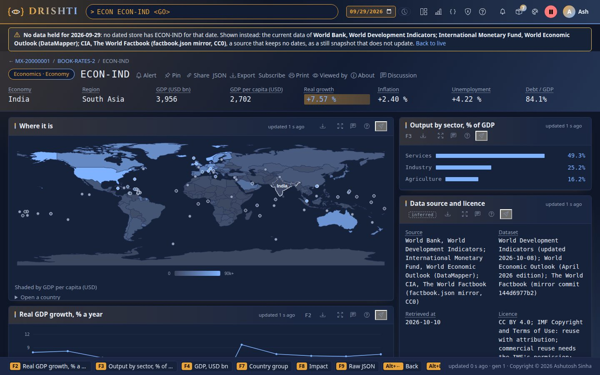
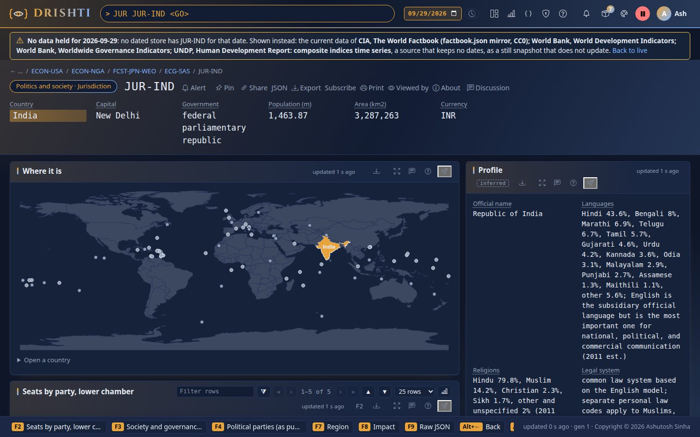
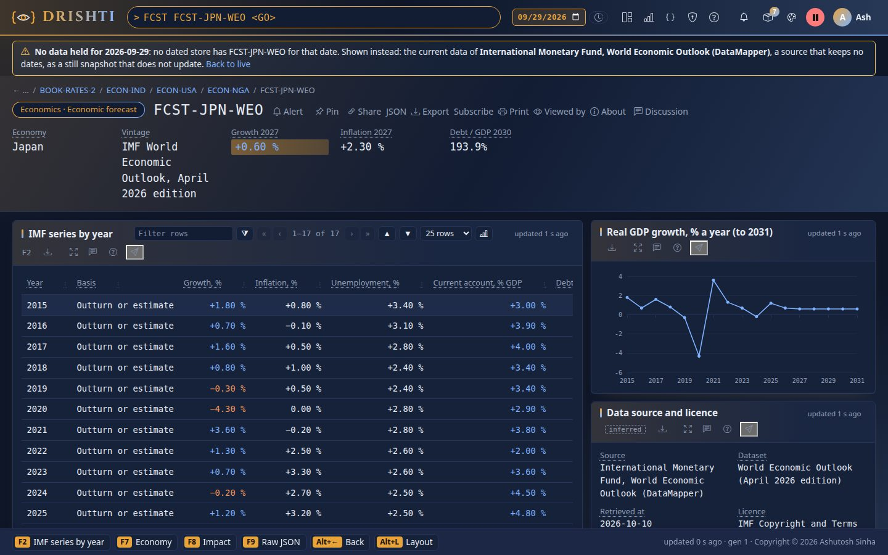
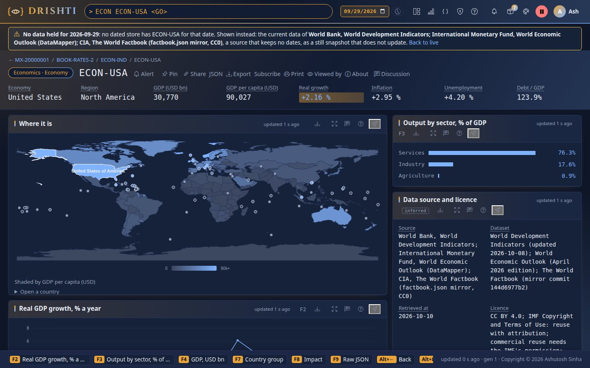
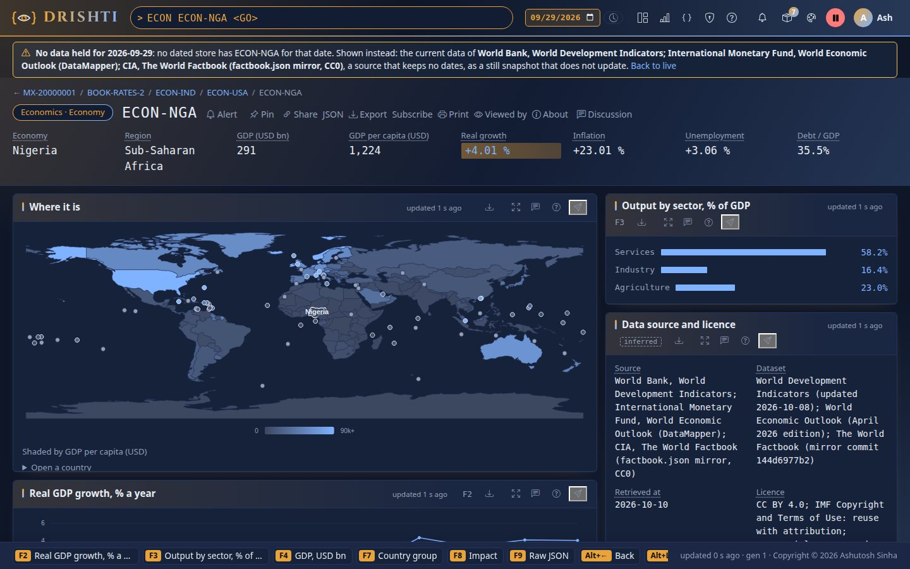
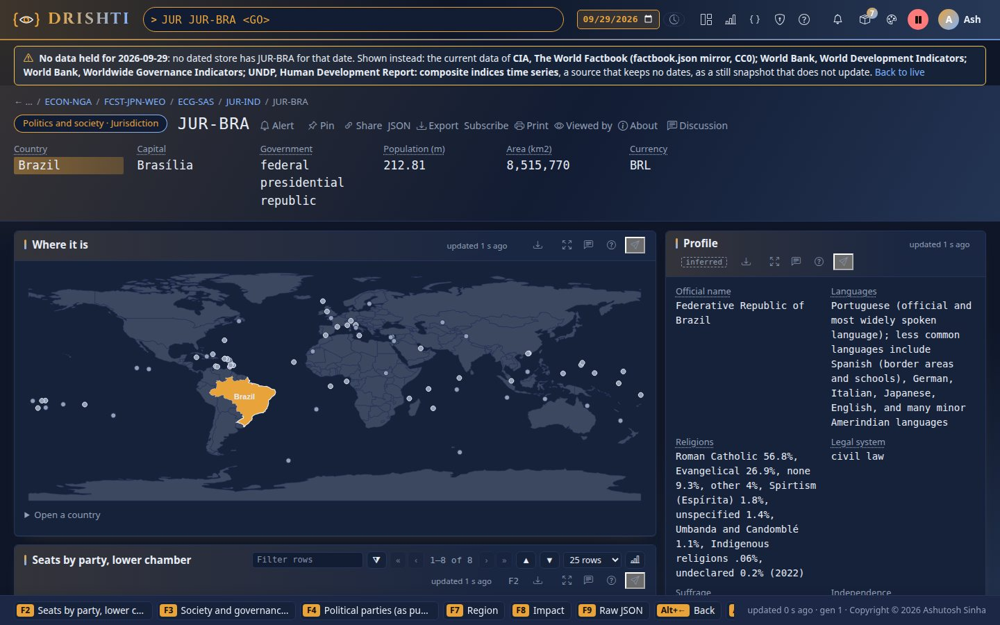
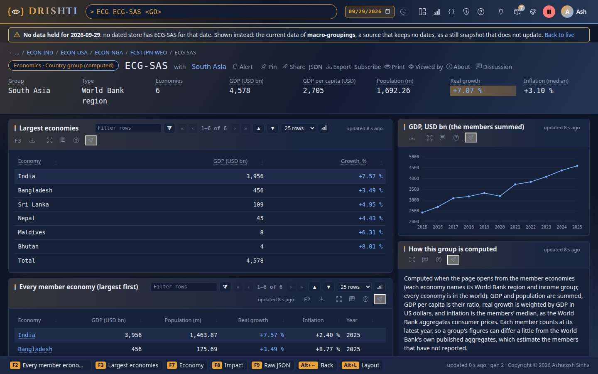
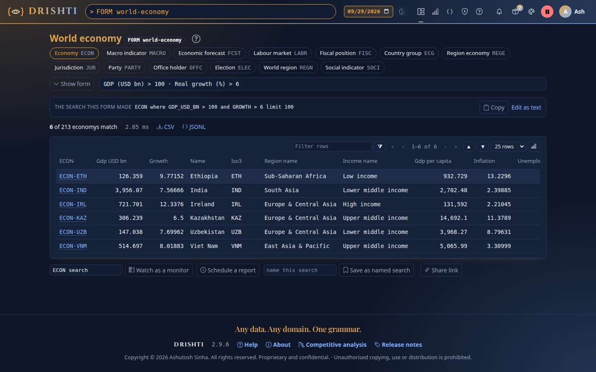
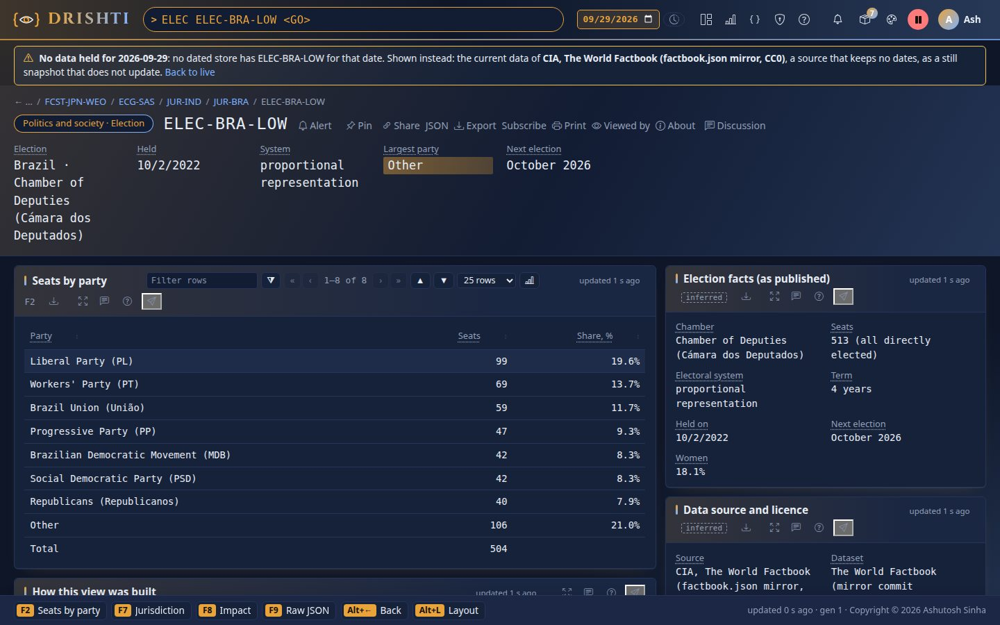
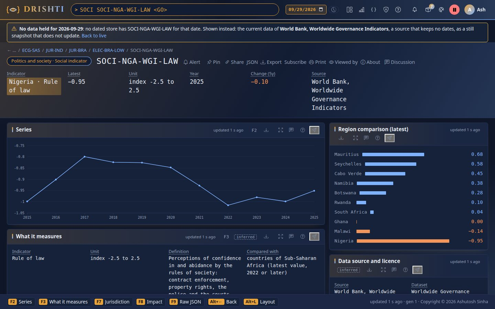

<!--
  Project Drishti · Any data. Any domain. One grammar.

  Copyright (c) 2026 Ashutosh Sinha <ajsinha@gmail.com>.
  All rights reserved.

  PROPRIETARY AND CONFIDENTIAL.

  This file is the confidential and proprietary property of Ashutosh Sinha.
  Unauthorised copying, use, modification, distribution or disclosure of this
  file, via any medium, is strictly prohibited except with the express prior
  written permission of the copyright holder.

  See the LICENSE file in the root of this repository for the full terms.
-->
# External data feeds

How Drishti pulls external data (GLEIF, the SEC, the IMF, the World Bank, central banks, news) and loads it into its lakes, every day,
from the command line or a scheduler. One module does it all, **drishti-feeds**: a feed pulls its source in Python, writes what it
pulled as JSON Lines, one gzipped file per dataset and business date, and hands the files to the loaders Drishti already has.

Sections 1 to 10 run, schedule, watch and write the feeds; sections 11 to 16 are the sources themselves: each external source of
every pack, its licence, whether it may leave the organisation, what its feed writes and how to check it. The lakes, the `.ready`
file and the data inbox are the [data lake guide](DATA_LAKE_GUIDE.md).

!!! warning "Internal use only: IMF data and Yahoo prices"
    Two kinds of external data are for **internal demonstrations only**: the **IMF World Economic Outlook** figures in the
    world-economy pack (the IMF's terms need its permission for commercial reuse) and anything from **Yahoo Finance** (quotes and
    price history: Yahoo's terms forbid redistribution), together with the **Google News** headlines (they belong to their publishers).
    Their feeds (`world-economy`, `news-and-markets`, `yahoo-prices`) are marked internal only: they load the bank's own lakes, and
    `--snapshot` never writes them into a committed folder unless you pass `--internal-ok`. Raise it with the owner before any client
    or external use, or pull without them (`drishti.py feed run world-economy -- --no-imf`; leave `yahoo-prices` off).

## Contents

1. [The module](#1-the-module)
2. [The feeds](#2-the-feeds)
3. [Run a feed](#3-run-a-feed)
4. [Loading: three routes](#4-loading-three-routes)
5. [Run it every day](#5-run-it-every-day)
6. [Monitor: status, the ledger, Admin → Feeds, alerts](#6-monitor-status-the-ledger-admin--feeds-alerts)
7. [The feed file, every key](#7-the-feed-file-every-key)
8. [Writing a feed](#8-writing-a-feed)
9. [Licences and internal-only data](#9-licences-and-internal-only-data)
10. [Tests](#10-tests)
11. [Every external source at a glance](#11-every-external-source-at-a-glance)
12. [A source's own options](#12-a-sources-own-options)
13. [Worked examples](#13-worked-examples)
14. [How external data reaches the server](#14-how-external-data-reaches-the-server)
15. [The sources, pack by pack](#15-the-sources-pack-by-pack)
16. [Not covered](#16-not-covered)

## 1. The module

drishti-feeds is the Python package `tools/feeds/` beside the other command-line tools, with one feed file per feed in
`config/feeds/`. It is a package of the tools rather than a Maven module because the pull is Python (every source is an HTTP API or a
bulk file that Python reads with its standard library) and the load is not new code at all: the module calls `drishti.py lake build`,
which runs the parallel loader in the server's jar, or drops files into the data inbox. Nothing in it writes a lake.

| Part | File | Does |
|---|---|---|
| the Feed base class, the feed file, one run's files | `tools/feeds/feedbase.py` | section 8; checks `config/feeds/<feed>.yaml` (section 7) |
| one run end to end, the run ledger | `tools/feeds/feedrunner.py` | lock → pull → files → check → load → state → ledger → one log line |
| the three load routes | `tools/feeds/feedload.py` | section 4 |
| the schedule entries | `tools/feeds/feedschedule.py` | section 5 |
| the command line | `tools/feeds/cli.py` | `drishti.py feed list|run|status|schedule` |
| the polite HTTP client and download cache | `tools/feeds/pullkit.py` | User-Agent, pause, retries with back-off, `Retry-After`, the cache |
| each source's pull | `tools/feeds/sources/<module>.py` | one module per source (a feed file's `class:`) |
| the wrappers | `tools/feeds/feed.sh`, `tools/windows/feed.ps1` | what cron, systemd and Task Scheduler run |

Every external source of the packs is pulled this way: each pack's source module in `tools/feeds/sources/` (gleif, us-equities, funds,
world-economy, news-and-markets, market-data) is a feed's pull, and the same module refreshes its pack's committed demo snapshot with
`feed run <feed> --snapshot` (section 3.4). There is one way to pull external data.

**Where things are written**, all under the data folder (`DRISHTI_DATA_DIR`, else `./data`; never committed):

```text
data/datafeeds/
├── ledger.jsonl                                    one line per run, every feed (section 6)
└── gleif/
    ├── state.json                                  what the feed has pulled (section 3.2)
    ├── cache/                                      the downloads as served, with cache-index.json (a broken run resumes from it)
    ├── 2026-11-07/
    │   ├── manifest.json                           the files with their rows and SHA-256, the licence, the run
    │   ├── lei-entity.2026-11-07.jsonl.gz          <table>.<YYYY-MM-DD>.jsonl.gz: the load rules' name (table and date)
    │   ├── lei-relationship.2026-11-07.jsonl.gz
    │   └── lei-mapping.2026-11-07.jsonl.gz
    └── loads/<run>/                                the loader's summaries of each run
```

## 2. The feeds

| Feed | Source | Datasets (pack: kinds) | Lake | Use | Daily at |
|---|---|---|---|---|---|
| `gleif` | GLEIF golden copy, LEI API, mapping files | gleif: lei-entity, lei-relationship, lei-mapping | `referencelake` | CC0, redistributable | 05:30 |
| `funds` | SEC Form N-PORT, N-CEN, risk/return summaries; Nasdaq Trader; GLEIF | funds: fund, fund-holder, index-funds | `capitalmarket` | public domain | 06:15 |
| `world-economy` | World Bank WDI (read from the world-development feed's output, never the API), WGI and country list; IMF WEO, UNDP HDI, CIA Factbook | world-economy: economy, macro-indicator, economic-forecast, labour-market, fiscal-position, region-economy, jurisdiction, party, office-holder, election, region, social-indicator | `worldlake` | **internal only** (the IMF forecasts) | 06:45 |
| `us-equities` | SEC EDGAR; index members from SPY, DIA, QQQ and IWM N-PORT holdings (S&P 500, Dow 30, Nasdaq-100, Russell 2000); Nasdaq Trader; GLEIF; Wikidata | us-equities: us-company, index-membership, filing-feed, filing, financial-fact | `capitalmarket` | public domain, CC0 | 07:00 |
| `news-and-markets` | Yahoo Finance quotes, Google News headlines (through Drishti's own live connectors) | news-and-markets: quote, news | `newslake` | **internal only** | 07:30 |
| `market-data` | ECB euro reference rates, US Treasury par curve, SOFR, euro short-term rate | market-data: fx-spot, ir-curve, rate-fixing (each under its own date) | `capitalmarket` | attribution | weekdays 18:30 |
| `yahoo-prices` | Yahoo Finance daily prices of the us-equities companies (through a running server's connector) | us-equities: price-history | `capitalmarket` | **internal only**, off as shipped | weekdays 22:30 |

Each source has one fetcher: the World Bank's development indicators (WDI) are pulled only by the public sector's world-development
feed, which takes every `kind: wdi` code of `tools/realdata/sources.yaml` (and the World Bank's world, region and income-group
aggregates) into its development-series. world-economy, and its committed demo snapshot (`--snapshot`), read them from that feed's
latest output in `<data>/datafeeds/world-development/<date>/` and never call the WDI API; with no such output the run fails in words:
`run feed run world-development first`. Feeds run in the order of their schedule, so world-development (06:30) runs before
world-economy (06:45), as funds runs before us-equities: its N-PORT download cache gives us-equities its index members.

`drishti.py feed list` prints the same from the feed files. Each feed's source, data contract (with JSON examples) and licence are its
pack's README and the [External data](EXTERNAL_DATA.md) page.

## 3. Run a feed

```bash
python3 tools/drishti.py feed run gleif
```

```text
fetch golden
...
  loaded lei-entity 2026-11-07: 1,204 rows into lake referencelake (java)
2026-11-07T06:30:41-05:00 feed ok exit=0 feed=gleif date=2026-11-07 files=3 rows=4,377 load=java loaded=4,377 seconds=41.2
```

The last line is the run's **one log line**: what a scheduler's mail or the journal shows. The same in PowerShell:
`.\tools\windows\feed.ps1 run gleif`.

| Option | Means |
|---|---|
| `<feed>` or `--all` | one feed, or every enabled feed one after another |
| `--date YYYY-MM-DD` | the business date (default today) |
| `--since YYYY-MM-DD` | pull history from this date (default: the day after the state's last date; section 3.2) |
| `--load java\|python\|inbox\|none` | the load route (default: the feed file's `load:`, `java` as shipped; section 4) |
| `--lake NAME` | load into this lake instead of the feed file's |
| `--dry-run` | say what would be fetched and loaded; nothing changes, no ledger line |
| `--snapshot` | refresh the committed demo snapshot instead (section 3.4) |
| `--offline` | the download cache only; nothing is fetched |
| `--set NAME=VALUE` | override an option of the feed file (`--set indicators='["NY.GDP.MKTP.CD"]'`) |
| `-- ARGS` | arguments for the source itself (`feed run gleif -- --scope GROUP:784F5XWPLTWKTBV3E584`) |
| `--inbox DIR`, `--lake-root DIR`, `--jar`, `--java`, `--signal URL`, `--token-file` | for the load routes (section 4) |
| `--json` | the run's ledger entry as JSON |

### 3.1 Exit codes

| Code | Means | A scheduler should |
|---|---|---|
| 0 | ok: pulled, written, loaded | nothing |
| 1 | failed: the pull (after its retries), the feed's check or the load; the error in words | alert (Drishti already did, section 6) |
| 2 | refused: a bad feed file, a key's variable not set, an unknown feed, internal-only data into a committed folder | fix the setting |
| 3 | another run of the feed holds its lock (`data/datafeeds/<feed>/run.lock`) | nothing; the next day's run |
| 4 | partial: some feeds of `--all` failed, or the load rejected rows | look at `feed status` |

### 3.2 Incremental pulls, resume and re-runs

- **State.** `data/datafeeds/<feed>/state.json` records, per dataset, the last business date pulled. The next run asks the source only for
  what is newer (`run.window()`, section 8). The state is saved **only when the whole run succeeded**, so a failed run is pulled again
  from the same point. The first run of a feed pulls `history.first-run-days` (30) days; `--since` pulls any history.
- **Resume.** Every download goes through the cache `data/datafeeds/<feed>/cache/` (`cache-hours`, 12 by default); a run that broke half way
  reuses what it fetched and asks only for the rest.
- **Re-runs are idempotent.** A run writes each date's files to a work folder and then replaces the date's folder whole; every route
  loads with replace-by-date. Running the same date twice leaves the same files and the same rows in the lake.
- **Rate limits.** `source.pause` seconds between requests; `source.retries` retries after 2, 4, 8 … seconds on 429, 5xx and network
  errors, or after the server's `Retry-After`.

### 3.3 The User-Agent and keys

Every request carries one User-Agent: `DRISHTI_FEEDS_USER_AGENT`, else the default `Drishti ajsinha@gmail.com` (Drishti and a contact,
as the SEC asks of everyone who reads EDGAR; GLEIF and the other sources get the same). Set it to your organisation's contact in
production:

```bash
export DRISHTI_FEEDS_USER_AGENT="Example Bank market data team marketdata@bank.example"
```

A key (an API key, a token) is only ever an environment variable named in the feed file (`keys:`, section 7); a key written in a file
is refused, and a feed whose key's variable is not set exits 2 naming it.

### 3.4 `--snapshot`: the committed demo snapshot

A feed whose pack ships a committed snapshot (the demo data in `data/testdata/<pack>/`) refreshes it with `--snapshot`: the pack's
generator writes its files where they live (the samples and guide, `data/testdata/<pack>/`), its check runs, nothing is loaded. Internal-only data
(section 9) is written into the repository only with `--internal-ok`.

```bash
python3 tools/drishti.py feed run gleif --snapshot          # config/packs/core/gleif (samples, guide) and data/testdata/gleif
python3 tools/drishti.py lake demo                          # then rebuild the demo lake from it
```

## 4. Loading: three routes

None of the routes writes a lake itself; each hands the run's files to what Drishti already has, and each replaces the business dates it
loads.

| Route | What runs | Needs | Use it when |
|---|---|---|---|
| `java` (default) | `drishti.py lake build --engine java`: the parallel loader `com.ash.drishti.lakeload.LakeLoad` from the server's exec jar (`-Dloader.main`), under the lake's lock, one commit per business date | Java 21 and the jar (`DRISHTI_JAR` or `kernel/drishti-server/target`) | always, unless one of the others fits better |
| `python` | `drishti.py lake build` with its default writer | the console's Python and the jar | a machine where the parallel loader is not wanted |
| `inbox` | the files dropped into the data inbox with their `.ready` files; the server loads them at its next cycle | the server running with the inbox on | the server should load (one place for every load, its Admin → Data loads screen) |

**The java and python routes** load one dataset of one date at a time (`--mode overwrite-dates`), into the lake the feed file names;
a table the lake file does not describe yet gets its pack's recommended entry first. `--lake-root DIR` writes a scratch copy;
`--signal URL` tells a server the data landed.

**The inbox route** drops into `<data>/dataload/inbox/` (`DRISHTI_DATALOAD_DIR`, or `--inbox DIR`):

- one dataset of one date: the file and its `.ready`:

  ```yaml
  # lei-mapping.2026-11-07.jsonl.gz.ready
  lake: referencelake
  pack: gleif
  kind: lei-mapping
  table: lei-mapping
  business-date: '2026-11-07'
  mode: replace
  sha256: 9c1f...
  rows: 3
  ```

- anything more: **one tar** of `<table>/<YYYY-MM-DD>/` folders, which the inbox loads completely or not at all:

  ```text
  gleif-2026-11-07.tar
  ├── lei-entity/2026-11-07/lei-entity.2026-11-07.jsonl.gz
  ├── lei-mapping/2026-11-07/lei-mapping.2026-11-07.jsonl.gz
  └── lei-relationship/2026-11-07/lei-relationship.2026-11-07.jsonl.gz
  ```

  ```yaml
  # gleif-2026-11-07.tar.ready
  lake: referencelake
  folders: {lei-entity: gleif, lei-mapping: gleif, lei-relationship: gleif}
  mode: replace
  sha256: 41d2...
  rows: 4377
  ```

The data file is written under a `.part` name and renamed when complete; the `.ready` file comes last. The inbox checks the SHA-256 and
the rows before anything is written ([DATA_LAKE_GUIDE.md section 4](DATA_LAKE_GUIDE.md#4-the-ready-file-every-key)).

## 5. Run it every day

`drishti.py feed schedule` prints ready-to-use daily entries, one per enabled feed, at the time its feed file's `schedule:` gives
(local time). Every entry runs the wrapper of its system, so the Python is the console's.

**Linux and macOS, cron:**

```bash
python3 tools/drishti.py feed schedule --cron
```

```text
# Drishti data feeds: daily (crontab -e, then paste; the times are this machine's local time)
# mkdir -p $HOME/drishti-feeds-logs   (one log file per feed; each run appends its one log line and any messages)
SHELL=/bin/bash
30 5 * * * /opt/drishti/tools/feeds/feed.sh run gleif --trigger schedule >> $HOME/drishti-feeds-logs/gleif.log 2>&1
```

**Linux, systemd** (a missed day runs at the next boot):

```bash
python3 tools/drishti.py feed schedule --systemd
```

```ini
# ---- drishti-feed-gleif.service
[Unit]
Description=Drishti data feed gleif: GLEIF legal entities, ownership and identifier mappings
Wants=network-online.target
After=network-online.target

[Service]
Type=oneshot
WorkingDirectory=/opt/drishti
ExecStart=/opt/drishti/tools/feeds/feed.sh run gleif --trigger schedule
Nice=10

# ---- drishti-feed-gleif.timer
[Unit]
Description=Run the Drishti data feed gleif daily

[Timer]
OnCalendar=*-*-* 05:30:00
Persistent=true
RandomizedDelaySec=120

[Install]
WantedBy=timers.target
```

Save each block under `~/.config/systemd/user/`, then `systemctl --user daemon-reload && systemctl --user enable --now
drishti-feed-gleif.timer`; `journalctl --user -u drishti-feed-gleif` shows each run's log line.

**Windows, Task Scheduler** (run the printed commands in a command prompt as the user the feeds run as; `--root` names the Drishti
folder on that machine when you print them elsewhere):

```bash
python3 tools/drishti.py feed schedule --windows --root 'C:\drishti'
```

```text
schtasks /Create /F /TN "Drishti feed gleif" /SC DAILY /ST 05:30 /TR "powershell.exe -NoProfile -ExecutionPolicy Bypass -File \"C:\drishti\tools\windows\feed.ps1\" run gleif --trigger schedule"
```

Task Scheduler's *Last Run Result* is the exit code (section 3.1). One task for every feed instead: `feed.ps1 run --all` (the feeds run
one after another in the order of their schedule times). `--trigger schedule` only marks the run in the ledger as the schedule's.

## 6. Monitor: status, the ledger, Admin → Feeds, alerts

```bash
python3 tools/drishti.py feed status
```

```text
FEED   LAST RUN             STATUS  LAST SUCCESS         DATE        ROWS   SECONDS  FAILURES
gleif  2026-11-07T05:30:12  ok      2026-11-07T05:30:12  2026-11-07  4,377  41.2     0
ledger: data/datafeeds/ledger.jsonl
```

`--runs N` adds the last N runs; `--json` gives the same for scripts. It exits 1 when a feed's last run failed.

**The ledger**, `data/datafeeds/ledger.jsonl`, has one JSON line per run, kept for ever:

```json
{"at": "2026-11-07T05:30:12-05:00", "feed": "gleif", "run": "20261107T103012-drishti-main-41822", "trigger": "schedule",
 "businessDate": "2026-11-07", "since": null, "lake": "referencelake", "status": "ok", "exit": 0, "files": 3, "rows": 4377,
 "dates": ["2026-11-07"], "datasets": {"lei-entity": {"rows": 1204, "table": "lei-entity"}},
 "load": {"route": "java", "status": "ok", "rows": 4377, "rejected": 0, "count": 3}, "licence": "CC0 1.0 (attribution appreciated)",
 "internalOnly": false, "seconds": 41.2}
```

**Admin → Data loads → Feeds** (`/admin/loads/feeds`, administrators) shows the same from the server's side: every feed with its lake,
schedule, last run and status, last success with its business date and rows, the duration, the failures since the last success, the
last error in words and the licence (internal only marked), then the latest runs of the ledger. Both tables are console tables (sort,
filter, keyboard). **Run now** starts `tools/drishti.py feed run <feed> --trigger admin` on the server's machine in the background,
with the server's data folder (its output in `data/datafeeds/<feed>/admin-run.log`); while a run of the feed holds its lock it says so
instead. The same over REST: `GET /api/v1/admin/feeds`, `POST /api/v1/admin/feeds/{feed}/run` (audited `feed.run`). The server finds
the feed files, the tools and Python by `drishti.feeds.config`, `drishti.feeds.root` and `drishti.feeds.python`
([CONFIGURATION.md](../admin/CONFIGURATION.md)).

**Alerts.** A failed (or refused, or partial) last run sets the gauge `drishti.datafeed.failed{feed}` to 1, and the platform alert rule
`data-feed-failed` (`config/alerts/platform-alerts.yaml`) opens an alert in the one alert engine: the administrators are told in their
inbox, Admin → Health and Alerts list it, and it closes by itself at the feed's next successful run. The server reads the ledger every
`drishti.feeds.sample-seconds` (60), so a failure of a cron run is seen as surely as one of Run now. The same rule for a site's
Prometheus is `DrishtiDataFeedFailed` (`deploy/prometheus/drishti-alerts.yaml`).

## 7. The feed file, every key

`config/feeds/<feed>.yaml`, named after the feed. An unknown key is refused, naming the keys there are.

```yaml
feed: gleif                            # the name: lower case, digits, dashes; the file's name
title: GLEIF legal entities, ownership and identifier mappings
description: >-                        # optional: what it holds, in a sentence or two
  The Global LEI Foundation's golden copy ...
class: gleif.GleifFeed                 # <module>.<Class>: tools/feeds/sources/<module>.py (or a module beside the feed file)
source:
  provider: GLEIF
  url: https://www.gleif.org
  pause: 1.0                           # seconds between requests (default 0.5): the rate limit
  retries: 3                           # retries after 2, 4, 8 s on 429, 5xx, network errors (default 3)
  timeout: 90                          # seconds a request may take
  cache-hours: 20                      # a download younger than this is reused (default 12)
lake: referencelake                    # the lake it loads (config/lakes/<lake>.yaml)
load: java                             # java | python | inbox | none (default java)
enabled: true                          # false: left out of --all and the schedule
schedule: {at: "05:30", days: daily}   # HH:MM local time; daily | weekdays
licence:
  name: CC0 1.0 (attribution appreciated)
  url: https://www.gleif.org/en/meta/lei-data-terms-of-use
  redistribution: allowed              # allowed | attribution | internal-only
  internal-only: false                 # true: never redistributed (section 9)
  attribution: "Contains LEI data from GLEIF, CC0 1.0"
keys:                                  # API keys: environment variables only, never values
  api_key: ${FRED_API_KEY}             # required: the run exits 2 when it is not set
  token: {env: "${SOME_TOKEN}", required: false}
history: {first-run-days: 30}          # the first run, without a state, pulls this many days
datasets:                              # each: the rows' pack and kind, and the table they load into
  lei-entity:       {pack: gleif, kind: lei-entity, key: LEI}
  lei-relationship: {pack: gleif, kind: lei-relationship, key: RELATIONSHIP_ID}
  lei-mapping:      {pack: gleif, kind: lei-mapping, key: IDENTIFIER, table: lei-mapping, dated: run}
options:                               # free settings the feed's class reads with run.option(name); --set NAME=VALUE overrides
  args: []
snapshot:                              # optional: what --snapshot does (args for the source; a note)
  note: refreshes config/packs/core/gleif and data/testdata/gleif
```

| Dataset key | Means |
|---|---|
| `pack`, `kind` | the pack and kind of the rows: their layout, id and contract (required) |
| `table` | the table (and the files' name); default the kind, as the demo lake names its tables |
| `key` | the rows' id field: given to the load (`--key`), so a lake entry without an id takes it; an entry with one must agree |
| `dated` | `run` (default): every row under the run's business date (a snapshot such as GLEIF's); `source`: the date the feed gives each emit (a time series) |
| `description` | a line for `feed list --json` and the docs |

## 8. Writing a feed

A feed is a feed file (section 7) and one class. The class pulls; the base class does everything else: the cache, the retries, the
dated files and their manifest, the state, the lock, the ledger, the load.

```python
# tools/feeds/sources/worldbank.py
from feedbase import Feed, FeedError

BASE = "https://api.worldbank.org/v2"


class WorldBank(Feed):
    def plan(self, run):                                       # what --dry-run prints
        start, end = run.window("indicator")
        return [f"{BASE}/country/all/indicator/{c}?date={start.year}:{end.year}" for c in run.option("indicators", [])]

    def pull(self, run):
        start, end = run.window("indicator")                   # --since; else the day after the state's last date; else history
        for code in run.option("indicators", []):
            doc = run.get_json(f"{BASE}/country/all/indicator/{code}?date={start.year}:{end.year}&format=json&per_page=20000",
                               name=f"wdi-{code}-{start.year}-{end.year}.json")
            if doc is None:
                raise FeedError(f"{code}: no answer")          # a failed request also fails the run by itself
            rows = [{"INDICATOR": code, "COUNTRY": x["countryiso3code"], "YEAR": int(x["date"]), "VALUE": x["value"]}
                    for x in doc[1] or [] if x.get("value") is not None]
            run.emit("indicator", rows)                        # under the run's business date (dated: run)
        run.mark("indicator", end)                             # saved only when the whole run succeeds
```

```yaml
# config/feeds/worldbank.yaml
feed: worldbank
title: World Bank World Development Indicators
class: worldbank.WorldBank
source: {provider: World Bank, url: "https://data.worldbank.org", pause: 0.5}
lake: worldlake
schedule: {at: "06:00", days: daily}
licence: {name: CC BY 4.0, url: "https://www.worldbank.org/en/about/legal/terms-of-use-for-datasets", redistribution: attribution,
          attribution: "The World Bank: World Development Indicators"}
datasets:
  indicator: {pack: world-economy, kind: indicator, key: INDICATOR}
options:
  indicators: [NY.GDP.MKTP.CD, SP.POP.TOTL]
```

**The API** (stable; `tools/feeds/feedbase.py`):

| Call | Gives |
|---|---|
| `run.business_date` | the run's business date (`--date`, else today) |
| `run.since` | `--since`, else `None` |
| `run.window(dataset)` | `(first, last)` dates to pull: `--since`; else the day after the dataset's last date in the state; else `last - history.first-run-days` |
| `run.option(name, default)` | the feed file's `options:` value, overridden by `--set name=value` (JSON values) |
| `run.key(name)` | a key's value from its environment variable; exits the run with 2 when a required one is not set |
| `run.get_json(url, name=None, headers=None)` | the parsed JSON, through the cache (`name`: its file name in the cache; default a hash of the URL); `None` after the retries |
| `run.get_text(...)`, `run.get_bytes(...)` | the same as text or bytes (CSV, XML, RSS, zip) |
| `run.emit(dataset, rows, business_date=None)` | rows (dicts) of a dataset of the feed file, appended to that date's file; returns how many |
| `run.mark(dataset, last)` | records the last business date pulled (saved with the state when the run succeeds) |
| `run.state` | the feed's `state.json` as a dict, for anything more (a cursor, an ETag); saved only on success |
| `run.log(text)` | a line to the run's output |
| `run.dry_run`, `run.offline` | what the command line asked |

A class may also implement `check(run)` (problems with what it wrote, in words: the run fails with them) and `snapshot(run)` (for
`--snapshot`). Rules that keep feeds alike:

- **JSON Lines only**, contract fields only: the rows are what the pack's kind contract says, nothing Drishti-internal.
- **Keys only via `run.key()`**: never logged, never written; pass them in `headers=` (the cache never stores request headers).
- **Pull, do not load.** A feed never writes a lake or the inbox itself; the route is the operator's choice.
- **Recorded fixtures for tests** (section 10), never the network.

## 9. Licences and internal-only data

Every feed file records its source's licence: its name, its terms' URL, whether the data may be redistributed and whether it is for
internal use only. It is copied into every date's `manifest.json` and every ledger line, and `feed list` shows it. A feed marked
`internal-only: true` (Yahoo's prices, the IMF's forecasts, news headlines) loads into the bank's own lakes like any other, which are
never committed or shipped; `--snapshot` writes it into the repository only with `--internal-ok`, for internal demos.


A source whose terms do not allow redistribution is never written into a committed folder of the repository unless you pass
`--internal-ok` (with `--snapshot`); without it the feed refuses (exit 2) and explains why in words:

```text
refused: .../config/packs/economy/world-economy is a committed folder of the repository, and these sources may not be redistributed:
  - IMF World Economic Outlook (DataMapper): the IMF's terms allow reuse with attribution, but commercial reuse needs the IMF's permission; ...
Write them to the data folder instead (leave out --out, or point it outside the repository), or pass --internal-ok
if the result stays inside your organisation (internal demos only).
```

The committed world-economy pack carries the IMF forecasts, and the committed news-and-markets snapshot carries Yahoo and Google
News data: both were the owner's choice for internal demos ([the world-economy data in detail](#the-world-economy-data-in-detail), `data/testdata/README.md`). The
us-equities pack ships **no** prices: its Yahoo price connector is off as shipped. Before any external or client use, rebuild without
them (`drishti.py feed run world-economy -- --no-imf`) or get permission.

## 10. Tests

`tools/feeds/tests/` runs every feed against **recorded responses** (`tools/feeds/tests/fixtures/`), never the network: the feed file's
checks, a pull with its dated files, manifest and state, the next run pulling only what is new, an idempotent re-run, retries with
back-off, the lock, the ledger and status, the inbox route's `.ready` and tar, the java and python routes into a temporary lake (with the
server's jar), the command line and the schedule output. One `--live` smoke per feed is for a person to run by hand:

```bash
python3 -m pytest tools/feeds/tests/test_live.py --live -k gleif        # the real source, into a scratch data folder
```
## 11. Every external source at a glance

| Pack | `SOURCE` | Where it comes from | Licence | Use |
|---|---|---|---|---|
| world-economy | `worldbank` | World Bank WGI and the country list, `https://api.worldbank.org/v2`; WDI from the world-development feed's output | CC BY 4.0 | committable, with attribution |
| world-economy | `imf` | IMF World Economic Outlook, DataMapper, `https://www.imf.org/external/datamapper/api/v1` | IMF terms: reuse with attribution, commercial reuse needs the IMF's permission | IMF data: **internal only** |
| world-economy | `undp` | UNDP Human Development Index, `https://hdr.undp.org/data-center/documentation-and-downloads` | CC BY 3.0 IGO | committable, with attribution |
| world-economy | `factbook` | CIA World Factbook, the factbook.json mirror at a pinned commit, `https://github.com/factbook/factbook.json` | public domain (mirror CC0 1.0) | committable |
| news-and-markets | `quote` | Yahoo Finance quotes and daily history, through the yfinance connector, `https://finance.yahoo.com` | Yahoo terms: no redistribution | Yahoo prices: **internal only** |
| news-and-markets | `news` | Google News RSS headlines, through the news connector, `https://news.google.com/rss` | headlines belong to their publishers | Google News: **internal only** |
| market-data | `ecb-fx` | ECB euro reference FX rates, `https://www.ecb.europa.eu/stats/eurofxref/eurofxref-hist.zip` | ECB: free reuse with the source acknowledged | committable, with attribution |
| market-data | `us-treasury` | US Treasury daily par yield curve, `https://home.treasury.gov/resource-center/data-chart-center/interest-rates` | public domain (US Government work) | committable |
| market-data | `sofr` | SOFR, Federal Reserve Bank of New York, `https://markets.newyorkfed.org/api/rates/secured/sofr` | NY Fed terms of use: reuse with attribution | committable, with attribution |
| market-data | `estr` | Euro short-term rate, ECB, `https://data-api.ecb.europa.eu/service/data/EST` | ECB: free reuse with the source acknowledged | committable, with attribution |
| us-equities | `wikidata` | Wikidata: company facts (headquarters, founded, website, LEI) and the date a member joined its index, `https://query.wikidata.org/sparql` | CC0 1.0 | committable |
| us-equities | `trackers` | SEC Form N-PORT of SPY, QQQ, DIA and IWM: the S&P 500, Nasdaq-100, Dow and Russell 2000 members (read from the funds cache, no download) | public domain (US Government work) | committable |
| us-equities | `nasdaq` | Nasdaq Trader symbol directory, `https://www.nasdaqtrader.com/dynamic/SymDir/` | public symbol directory files | committable |
| us-equities | `sec` | SEC EDGAR: tickers, submissions, XBRL company facts, `https://data.sec.gov` | public domain (US Government work); EDGAR fair access policy | committable |
| us-equities | `gleif` | GLEIF LEI records, `https://api.gleif.org/api/v1` | CC0 1.0 | committable |
| us-equities | `prices` | Yahoo Finance daily prices, through the us-equities-prices connector | Yahoo terms: no redistribution | Yahoo prices: **internal only** |
| gleif | `golden` | GLEIF golden copy, level 2: relationship records and reporting exceptions, `https://goldencopy.gleif.org` | CC0 1.0 (attribution appreciated) | committable |
| gleif | `api` | GLEIF LEI API: LEI records, legal forms, countries, LEI issuers, `https://api.gleif.org/api/v1` | CC0 1.0 | committable |
| gleif | `mapping` | GLEIF mapping files: BIC, ISIN, MIC, OpenCorporates to LEI, `https://mapping.gleif.org` | CC0 1.0 | committable |
| gleif | `golden-lei` | GLEIF golden copy, level 1 bulk file, for full-country pulls (never by default) | CC0 1.0 | data folder only (its size, not its licence) |
| funds | `tickers` | SEC ticker files: fund share classes and listed trusts, `https://www.sec.gov/files/company_tickers_mf.json`, `company_tickers_exchange.json` | public domain (US Government work) | committable |
| funds | `nasdaq` | Nasdaq Trader symbol directory (which tickers are ETFs), `https://www.nasdaqtrader.com/dynamic/SymDir/` | public symbol directory files | committable |
| funds | `nport` | SEC Form N-PORT data sets (holdings, derivatives, counterparties, flows, monthly returns; about 450 MB a quarter), `https://www.sec.gov/data-research/sec-markets-data/form-n-port-data-sets` | public domain (US Government work); SEC fair access policy | committable (the downloads stay in the data folder) |
| funds | `ncen` | SEC Form N-CEN data sets (ETF facts, service providers, authorised participants), `https://www.sec.gov/data-research/sec-markets-data/form-n-cen-data-sets` | public domain (US Government work) | committable |
| funds | `rr` | SEC mutual fund prospectus risk/return summary data sets (expense ratio, turnover, calendar-year returns), `https://www.sec.gov/data-research/sec-markets-data/mutual-fund-prospectus-riskreturn-summary-data-sets` | public domain (US Government work) | committable |
| funds | `gleif` | GLEIF golden copy level 2: fund relationships (managed by, sub-fund of, feeder to), `https://goldencopy.gleif.org` | CC0 1.0 | committable |
| world-development | `wdi` | World Bank World Development Indicators, `https://api.worldbank.org/v2` (the world-development feed, the one fetcher of WDI) | CC BY 4.0 | redistributable, with attribution |
| central-banks | `fred` | FRED, Federal Reserve Bank of St. Louis, `https://api.stlouisfed.org/fred` (key: `DRISHTI_FRED_API_KEY`) | FRED API terms; the default series are US government works | redistributable (default series) |
| central-banks | `boc` | Bank of Canada Valet API, `https://www.bankofcanada.ca/valet` | Bank of Canada terms: free use with attribution | redistributable, with attribution |
| national-statistics | `statcan` | Statistics Canada Web Data Service, `https://www150.statcan.gc.ca/t1/wds/rest` | Statistics Canada Open Licence | redistributable, with attribution |
| oecd | `oecd` | OECD Data Explorer SDMX API, `https://sdmx.oecd.org/public/rest` | OECD terms (CC BY 4.0) | redistributable, with attribution |
| official-news | `FED`, `SEC`, `FEDREG` | the Federal Reserve Board's and the SEC's press releases (RSS), the US Federal Register's API | public domain (US government works) | redistributable |
| official-news | `ECB`, `BOC` | the ECB's and the Bank of Canada's press releases (RSS) | free use with the source acknowledged | redistributable, with attribution |
| official-news | `BOE`, `OSFI`, `GAZETTE1`, `GAZETTE2` | the Bank of England's and OSFI's news, the Canada Gazette Parts I and II (RSS) | non-commercial or internal use only without permission | **internal only** |
| gdelt-events | `gdelt` | GDELT 1.0 daily event files, `https://data.gdeltproject.org/events/` | GDELT terms: free for any use with a citation | redistributable, with attribution |

A new pack built on external data adds its rows here and a section of its own in section 15 (the funds pack, SEC N-PORT and N-CEN, came
this way). The market-data pack's committed samples and test data are synthetic: its official sources are optional and
always go to the data folder. Every other pack (core, trading, market-risk, counterparty-risk, compute-demo) holds synthetic or
computed data only, and has no external source.

## 12. A source's own options

A source's own options go after `--` (`feed run gleif -- --scope NAME:allianz,CAP:200`):

| Option | Meaning |
|---|---|
| `SOURCE ...` | only these sources of the feed (default: all of them except those marked "never by default") |
| `--years N` / `--since YEAR` | how much history: the last N years, or from YEAR |
| `--scope A,B` | widen the source: more indicators, tickers, pairs, entities (each source's section below says what) |
| `--max-age HOURS` | reuse a cached download younger than this (default 24); older files are fetched again |
| `--no-check` | skip the pack's check after the build |

The download cache of a source is `<data>/datafeeds/sources/cache/<pack>/` (a run that breaks resumes from it; `feed run --offline` uses
it only). Every request carries the one User-Agent (section 3.3).

## 13. Worked examples

*Captured* on a scratch data folder (paths shortened to `~/drishti`). A dry run changes nothing and needs no network: run it first.

```bash
python3 tools/drishti.py feed run market-data --dry-run --date 2026-11-06
```

```text
dry run: feed market-data (Official market data (ECB FX reference rates, US Treasury par curve, SOFR, euro short-term rate)), business date 2026-11-06, window 2026-10-07..2026-11-06, datasets fx-spot, ir-curve, rate-fixing -> lake capitalmarket by java
    ecb-fx (ECB: free reuse with the source acknowledged): fx-spot.<date>.jsonl from 2025-11-07; https://www.ecb.europa.eu/stats/eurofxref/eurofxref-hist.zip
    us-treasury (Public domain (US Government work)): ir-curve.<date>.jsonl from 2025-11-07; https://home.treasury.gov/...
    sofr (NY Fed terms of use: reuse with attribution): rate-fixing.<date>.jsonl from 2025-11-07; https://markets.newyorkfed.org/api/rates/secured/sofr/search.json?...
    estr (ECB: free reuse with the source acknowledged): rate-fixing.<date>.jsonl from 2025-11-07; https://data-api.ecb.europa.eu/service/data/EST/...
2026-11-07T19:01:23-05:00 feed dry-run exit=0 feed=market-data date=2026-11-06 files=0 rows=0 seconds=0.0
```

One source, written but not loaded (`--load none`):

```bash
python3 tools/drishti.py feed run market-data --load none --date 2026-11-06 -- estr
```

```text
fetch estr
normalise estr: 1 documents, 254 observations
wrote ~/drishti/data/feeds/market-data/work/20261108T000123-oryxpro-1372281/build/rate-fixing.2026-11-05.jsonl
2026-11-07T19:01:24-05:00 feed ok exit=0 feed=market-data date=2026-11-06 files=1 rows=1 load=none seconds=0.8
```

The euro short-term rate's one document (its 254 daily observations inside) is written under its own business date, 2026-11-05
(`dated: source`): `data/datafeeds/market-data/2026-11-05/rate-fixing.2026-11-05.jsonl.gz` with its `manifest.json`. More:

```bash
python3 tools/drishti.py feed run world-economy -- worldbank undp        # the openly licensed sources only
python3 tools/drishti.py feed run us-equities --offline -- sec           # the SEC part again, from the download cache
python3 tools/drishti.py feed run gleif --snapshot -- mapping            # the BIC, ISIN, MIC and OpenCorporates files into the committed pack
```

On Windows the same through `.\tools\windows\feed.ps1` (`.\tools\windows\feed.ps1 run gleif --dry-run`); nothing but Python and
Java is needed.

## 14. How external data reaches the server

1. **The feed** pulls into its download cache, builds the pack's data in its run folder and writes each kind as dated JSON Lines,
   `<data>/datafeeds/<feed>/<YYYY-MM-DD>/<kind>.<YYYY-MM-DD>.jsonl.gz` with a `manifest.json` (rows, SHA-256, the licence).
2. **The lake.** The feed loads them into its lake (`referencelake`, `capitalmarket`, `worldlake`, `newslake`) by the parallel loader,
   `lake build` or the data inbox, replacing the dates it brings ([EXTERNAL_DATA.md section 4](#4-loading-three-routes)).
   The demo lake is built from the committed snapshots instead: `--snapshot` refreshes them, then `python3 tools/drishti.py lake demo`.
3. **The server** reads each kind through the pack's connector, which reads the lake its connector file names (`demo` as shipped; point
   it at the feed's lake for live data: [DATA_LAKE_GUIDE.md section 6](DATA_LAKE_GUIDE.md#6-pointing-drishti-at-a-lake)).

**Checking.** Each feed runs its pack's own check on the build (`make.py --check` for us-equities, gleif and funds, the pack
generator's `--check` for world-economy, the snapshot read back for news-and-markets, the document checks for market-data); a failed
check fails the run. `python3 tools/drishti.py feed status` shows the last runs; `python3 tools/contracts.py check` compares every
kind's data contract with the data, and in the console `USEQ <GO>`, `LEI <GO>`, `ECON <GO>`, `QUOTE <GO>` or `FX <GO>` lists the kind.

**Offline.** Everything committed works without a network: the demo machine never fetches. A feed on a machine without internet
uses the download cache only (`--offline`; copy the cache folder from a machine that has one). The live connectors that reach the
internet (news, yfinance, us-equities-prices, the public-data feed connectors) are off as shipped and never start on a machine
configured offline (`drishti.offline.plugins`).

## 15. The sources, pack by pack

Each pack built on external data: its sources, what its feed writes and where, how to check it.

### world-economy

**Sources:** `worldbank` (World Bank WGI and country list from the API; WDI read from the world-development feed's latest output, which must have run first; CC BY 4.0), `imf` (IMF WEO, **internal only**), `undp` (UNDP HDI, CC BY 3.0 IGO),
`factbook` (CIA World Factbook, public domain). The regional figures of [`region-economy`](../contracts/samples/world-economy.md#region-economy) ([contract](../contracts/packs/world-economy.md#rege-region-economy-region-economy)) are typed into the generator by hand from US
Census Bureau and BEA figures (illustrative, rounded): there is no fetch for them.

`drishti.py feed run world-economy` wraps `tools/realdata/` (see [the world-economy data in detail](#the-world-economy-data-in-detail)): the fetcher's downloads go
through the shared client into the same cache layout, then the normaliser, the pack generator
(`tools/packgen/world/make.py`) and its `--check` run as `realdata.py all` would.

```bash
python3 tools/drishti.py feed status world-economy
python3 tools/drishti.py feed run world-economy --dry-run
python3 tools/drishti.py feed run world-economy --snapshot                    # a full build in <data>/datafeeds/sources/world-economy
python3 tools/drishti.py feed run world-economy --snapshot --internal-ok      # refresh the committed dataset, pack, glossary, tests and guide tables
python3 tools/drishti.py feed run world-economy --snapshot -- --no-imf           # no IMF data at all; always the data folder
python3 tools/drishti.py feed run world-economy --snapshot --internal-ok --offline -- --cache ~/.cache/drishti-realdata   # rebuild from an older realdata cache
```

Where it writes:

- With `--internal-ok` (and no widening): the committed `tools/realdata/dataset/`, `config/packs/economy/world-economy/`,
  `tools/packgen/world/about.yaml` and the generated tables of this page's world-economy section (`tools/realdata/realdata.py docs`). Commit the result.
- Otherwise: `<data>/datafeeds/sources/world-economy/` with `sources.yaml` (what this build used), `dataset/`, `packs/world-economy/`
  and `about/`. Serve that pack with `DRISHTI_PACKS_DIR` or copy what you need.

**Widening.** `--since 2000` or `--years 25` fetches a longer window; `--scope` adds indicators:

```bash
python3 tools/drishti.py feed run world-economy --snapshot -- worldbank --since 2000 --scope GOV_WGI_RL.STD:governance
python3 tools/drishti.py feed run world-economy --snapshot -- imf --scope GGXWDG_NGDP:fiscal
```

A scope item is a World Bank governance (WGI) code or an IMF WEO code, optionally `:group` (economy, labour, fiscal, social,
governance; default economy). The name, unit and definition come from the source's own metadata. A development indicator (WDI)
is refused here: the world-development feed is its one fetcher. Add it to `tools/realdata/sources.yaml` (`kind: wdi`, one line with
its name, unit, scale and definition), run `feed run world-development` (it pulls every `kind: wdi` code of that file), then this
feed. `--since` reaches back only as far as the world-development output does for WDI (it pulls from `sources.yaml`'s `years.first`
or its own `years`, whichever is earlier; the log says when the window is shorter). A widened build always goes to the data folder.
To widen the committed pack, add the indicator to `tools/realdata/sources.yaml` and run `feed run world-economy --snapshot --internal-ok`.

**Check it:** the feed runs `tools/packgen/world/make.py --check`; `ECON IND <GO>` opens India's economy, `FCST <GO>` the IMF
forecasts. **Offline:** `feed run world-economy --offline` rebuilds from the cache.

#### The world-economy data in detail

(This was REAL_DATA.md.) The `world-economy` pack carries **published public data**, not samples: about 213 economies and 216 countries from the World Bank, the IMF, UNDP and
the CIA World Factbook. Every number is a published value (a percentage stays a percentage, as the source states it) and every text is as the source publishes it (HTML
removed). It is not marked `sample: true`. (It was two packs, `economics` and `politics-society`, until they were merged into `world-economy`;
the two halves keep their names below.)

The data is fetched and normalised by a repeatable tool, `tools/realdata/`, and committed to git as a small normalised dataset (`tools/realdata/dataset/`, 2.4 MB) plus the
generated pack documents. The raw downloads are cached outside the repository and are never committed.

> **Licence note: IMF data is for internal demonstration only.** The IMF World Economic Outlook data in this pack (the [`economic-forecast`](../contracts/samples/world-economy.md#economic-forecast) ([contract](../contracts/packs/world-economy.md#fcst-economic-forecast-economic-forecast)) documents, and the
> `debt` and `net_lending` series that feed each economy's debt ratio and fiscal position) is kept for **internal demos only**. The IMF's terms allow reuse with
> attribution but require its **permission for commercial use** (copyright@imf.org). Before the pack is shown to a client, shipped, sold or used commercially,
> either obtain that permission or build without the IMF: `python3 tools/realdata/realdata.py write --no-imf` (see [Building without the IMF](#building-without-the-imf)).
> The World Bank (CC BY 4.0), UNDP (CC BY 3.0 IGO) and CIA Factbook (public domain) data needs only attribution.



##### Sources, licences and attribution

<!-- realdata:begin sources -->
| Source | Dataset and vintage | Licence | Terms |
|---|---|---|---|
| World Bank, World Development Indicators | World Development Indicators (updated 2026-10-08) | CC BY 4.0 | https://datacatalog.worldbank.org/public-licenses#cc-by |
| World Bank, Worldwide Governance Indicators | Worldwide Governance Indicators (updated 2026-09-25) | CC BY 4.0 | https://datacatalog.worldbank.org/public-licenses#cc-by |
| International Monetary Fund, World Economic Outlook (DataMapper) | World Economic Outlook (April 2026 edition) | IMF Copyright and Terms of Use: reuse with attribution; commercial reuse needs the IMF's permission | https://www.imf.org/en/About/copyright-and-terms |
| UNDP, Human Development Report: composite indices time series | Human Development Index time series (2025 report) | CC BY 3.0 IGO | https://creativecommons.org/licenses/by/3.0/igo/ |
| CIA, The World Factbook (factbook.json mirror, CC0) | The World Factbook (mirror commit 144d6977b2) | Public domain (U.S. Government work); the factbook.json mirror is CC0 1.0 | https://github.com/factbook/factbook.json/blob/master/LICENSE.md |
<!-- realdata:end sources -->

Attribution text (also in [THIRD-PARTY-NOTICES.md](../../THIRD-PARTY-NOTICES.md), and in each document's *Data source and licence* panel):

- The World Bank: World Development Indicators (CC BY 4.0). The World Bank: Worldwide Governance Indicators (CC BY 4.0).
- Source: International Monetary Fund, World Economic Outlook database, https://www.imf.org/external/datamapper. The packs transform the data (units, rounding to six
  significant digits, joins with other sources); the IMF's terms ask that material changes be stated, which this guide and the panel do.
- UNDP, Human Development Report 2025 data (CC BY 3.0 IGO).
- Central Intelligence Agency, The World Factbook (public domain). The Factbook is read through the CC0 `factbook.json` mirror, pinned to a commit (recorded in each
  document's dataset line), because the CIA site offers no stable download of the whole book.

Caveats to read before reusing the data. **IMF:** the terms allow downloading, copying and derivative works with attribution, but ask for permission before *commercial*
reuse and prohibit bulk automated downloads without permission; the tool makes one request per series (eight in all) with a pause, and the data is shown here for a
demonstration. Ask copyright@imf.org before any commercial use. **UNDP:** the HDR data page states CC BY 3.0 IGO; check the page before redistribution. **World Bank:** each
indicator also has its own upstream source (for example SIPRI for military spending, the Inter-Parliamentary Union for women in parliament, ILO for labour data) that WDI
credits; the *About this series* panel shows the World Bank code to look it up.

##### What is in the pack

| Half of world-economy | Kind | Mnemonic | Documents | One document is |
|---|---|---|---|---|
| economics | `economy` | `ECON` | 213 | a country: GDP, growth, inflation, unemployment, debt, current account, sectors, links to its region, income group, labour market, fiscal position, IMF forecast and 16 indicators |
| economics | [`macro-indicator`](../contracts/samples/world-economy.md#macro-indicator) ([contract](../contracts/packs/world-economy.md#macro-macro-indicator-macro-indicator)) | `MACRO` | 3,119 | one headline statistic of one country: history 2015 to the latest year, rank among countries, definition |
| economics | `economic-forecast` | `FCST` | 192 | the IMF WEO series 2015 to 2031 (growth, inflation, unemployment, current account, debt, net lending, GDP), outturn and projections |
| economics | [`labour-market`](../contracts/samples/world-economy.md#labour-market) ([contract](../contracts/packs/world-economy.md#labr-labour-market-labour-market)) | `LABR` | 185 | unemployment, participation, youth and female labour, jobs and output by sector |
| economics | [`fiscal-position`](../contracts/samples/world-economy.md#fiscal-position) ([contract](../contracts/packs/world-economy.md#fisc-fiscal-position-fiscal-position)) | `FISC` | 192 | IMF debt and net lending, World Bank revenue, expense, military spending |
| economics | `country-group` | `ECG` | 12 | a World Bank region, income group or the world, computed from its member economies when asked ([BI_GUIDE.md](BI_GUIDE.md#part-5--groupings-and-analytics)): output, growth, inflation and its largest economies |
| economics | `region-economy` | `REGE` | 59 | a state or territory (ISO 3166-2, `AU-NSW`, `US-CA`) with population and GDP: an **illustrative sample, rounded from public figures, not for reporting** (`tools/realdata/dataset/regions.json`, not fetched), behind the BI sample report *Region economics* |
| politics | `jurisdiction` | `JUR` | 216 | a country: government type, capital, legislature seats by party, indicators, links to office holders, elections, parties and region |
| politics | [`office-holder`](../contracts/samples/world-economy.md#office-holder) ([contract](../contracts/packs/world-economy.md#offc-office-holder-office-holder)) | `OFFC` | 430 | the chief of state and head of government as the Factbook publishes them |
| politics | `election` | `ELEC` | 378 | the most recent lower-chamber, upper-chamber and executive election: system, term, seats by party, next election |
| politics | `party` | `PARTY` | 282 | a party that won seats in the lower chamber at the most recent election, with the chamber's full result |
| politics | `region` | `REGN` | 7 | a World Bank region: countries, population, life expectancy, government types |
| politics | [`social-indicator`](../contracts/samples/world-economy.md#social-indicator) ([contract](../contracts/packs/world-economy.md#soci-social-indicator-social-indicator)) | `SOCI` | 4,297 | one social or governance statistic of one country with a regional comparison |

Removed because no open, global dataset backs them: central-bank decisions, trade flows (bilateral), price baskets, opinion polls, bills and candidates. The old
fictional polities (Valdoria, Kestria) and the invented economies are gone.

Identifiers use the ISO 3166 alpha-3 code: `ECON-IND`, `MACRO-BRA-GDP-GROWTH`, `FCST-JPN-WEO`, `LABR-NGA`, `FISC-USA`, `ECG-SAS`, `JUR-USA`, `OFFC-JPN-HOG`,
`ELEC-BRA-LOW`, `PARTY-IND-01`, `REGN-SSF`, `SOCI-NGA-WGI-LAW`. The link graph is: country ↔ region ↔ income group ↔ indicators ↔ forecast, labour and fiscal documents, and
(politics) jurisdiction ↔ region, office holders, elections, parties, indicators.



###### Provenance in every document

Each document has a `provenance` object (shown by the *Data source and licence* panel) and the same four facts in `_meta`:

<!-- realdata:begin provenance -->
```json
"provenance": {"source": "International Monetary Fund, World Economic Outlook (DataMapper)", "dataset": "World Economic Outlook (April 2026 edition)",
  "retrievedAt": "2026-10-10", "licence": "IMF Copyright and Terms of Use: reuse with attribution; commercial reuse needs the IMF's permission",
  "attribution": "Source: International Monetary Fund, World Economic Outlook database, https://www.imf.org/external/datamapper.",
  "url": "https://www.imf.org/external/datamapper"}
```
<!-- realdata:end provenance -->



##### Coverage

Years: World Bank and UNDP series 2015 to 2025 (a series shows the years the source has; the latest year differs by country and indicator), IMF series 2015 to 2031.
Countries are the 217 economies the World Bank lists as countries or territories (Channel Islands has no Factbook profile, so 216 jurisdictions and 213 economies with
output data). Examples of how many countries have data: GDP 213, real growth 212, inflation 190, unemployment 187, government debt (IMF) 190, Gini 151, HDI 193, rule of
law 207, CO2 per capita 203, reserves 177. A missing value is simply absent from the series: nothing is estimated or filled in. Rankings count only countries whose latest
value is from 2022 or later.

Size: the world-economy pack is about 19 MB (its economics half 6.9 MB, its politics half 12.1 MB) and the normalised dataset 2.4 MB (21.4 MB of text in all, under the 25 MB limit; git compresses it to
about a fifth). Sample documents are written without indentation (`compact_json` in the pack generator) to keep it small.

###### More countries and groups

The same Sutras serve every country: the United States and Nigeria below, Brazil's government, and the World Bank's South Asia group with its largest economies.






##### Indicators

###### Economy, labour and fiscal (world-economy pack, economics half)

<!-- realdata:begin indicators-economics -->
| Key | Indicator | Unit | Source and code | Countries with data |
|---|---|---|---|---|
| `gdp` | GDP, current prices | USD bn | World Bank WDI `NY.GDP.MKTP.CD` | 213 |
| `gdp_pc` | GDP per capita, current prices | USD | World Bank WDI `NY.GDP.PCAP.CD` | 213 |
| `gdp_growth` | Real GDP growth | % a year | World Bank WDI `NY.GDP.MKTP.KD.ZG` | 212 |
| `inflation` | Inflation, consumer prices | % a year | World Bank WDI `FP.CPI.TOTL.ZG` | 190 |
| `unemployment` | Unemployment rate | % of labour force | World Bank WDI `SL.UEM.TOTL.ZS` | 187 |
| `population` | Population | millions | World Bank WDI `SP.POP.TOTL` | 217 |
| `current_account` | Current account balance | % of GDP | World Bank WDI `BN.CAB.XOKA.GD.ZS` | 192 |
| `reserves` | Total reserves incl. gold | USD bn | World Bank WDI `FI.RES.TOTL.CD` | 177 |
| `trade` | Trade | % of GDP | World Bank WDI `NE.TRD.GNFS.ZS` | 188 |
| `exports` | Exports of goods and services | % of GDP | World Bank WDI `NE.EXP.GNFS.ZS` | 188 |
| `imports` | Imports of goods and services | % of GDP | World Bank WDI `NE.IMP.GNFS.ZS` | 188 |
| `fdi` | Foreign direct investment, net inflows | % of GDP | World Bank WDI `BX.KLT.DINV.WD.GD.ZS` | 200 |
| `co2` | CO2 emissions per capita | t CO2e | World Bank WDI `EN.GHG.CO2.PC.CE.AR5` | 203 |
| `real_interest` | Real interest rate | % a year | World Bank WDI `FR.INR.RINR` | 136 |
| `agriculture` | Agriculture, value added | % of GDP | World Bank WDI `NV.AGR.TOTL.ZS` | 202 |
| `industry` | Industry, value added | % of GDP | World Bank WDI `NV.IND.TOTL.ZS` | 205 |
| `services` | Services, value added | % of GDP | World Bank WDI `NV.SRV.TOTL.ZS` | 204 |
| `lfp` | Labour force participation rate | % of population 15+ | World Bank WDI `SL.TLF.CACT.ZS` | 187 |
| `youth_unemployment` | Youth unemployment rate | % of labour force 15-24 | World Bank WDI `SL.UEM.1524.ZS` | 187 |
| `employment_ratio` | Employment to population ratio | % of population 15+ | World Bank WDI `SL.EMP.TOTL.SP.ZS` | 187 |
| `female_lfp` | Female labour force participation rate | % of women 15+ | World Bank WDI `SL.TLF.CACT.FE.ZS` | 187 |
| `vulnerable` | Vulnerable employment | % of employment | World Bank WDI `SL.EMP.VULN.ZS` | 187 |
| `emp_agriculture` | Employment in agriculture | % of employment | World Bank WDI `SL.AGR.EMPL.ZS` | 187 |
| `emp_industry` | Employment in industry | % of employment | World Bank WDI `SL.IND.EMPL.ZS` | 187 |
| `emp_services` | Employment in services | % of employment | World Bank WDI `SL.SRV.EMPL.ZS` | 187 |
| `debt` | General government gross debt | % of GDP | IMF WEO `GGXWDG_NGDP` | 190 |
| `net_lending` | General government net lending/borrowing | % of GDP | IMF WEO `GGXCNL_NGDP` | 193 |
| `tax_revenue` | Tax revenue | % of GDP | World Bank WDI `GC.TAX.TOTL.GD.ZS` | 150 |
| `revenue` | Revenue, excluding grants | % of GDP | World Bank WDI `GC.REV.XGRT.GD.ZS` | 150 |
| `expense` | Expense | % of GDP | World Bank WDI `GC.XPN.TOTL.GD.ZS` | 150 |
| `military` | Military expenditure | % of GDP | World Bank WDI `MS.MIL.XPND.GD.ZS` | 159 |
<!-- realdata:end indicators-economics -->

###### Society and governance (world-economy pack, politics half)

<!-- realdata:begin indicators-society -->
| Key | Indicator | Unit | Source and code | Countries with data |
|---|---|---|---|---|
| `life_expectancy` | Life expectancy at birth | years | World Bank WDI `SP.DYN.LE00.IN` | 217 |
| `hdi` | Human Development Index | index 0-1 | UNDP HDR `hdi` | 193 |
| `fertility` | Fertility rate | births per woman | World Bank WDI `SP.DYN.TFRT.IN` | 217 |
| `infant_mortality` | Infant mortality rate | per 1,000 live births | World Bank WDI `SP.DYN.IMRT.IN` | 196 |
| `under5_mortality` | Under-5 mortality rate | per 1,000 live births | World Bank WDI `SH.DYN.MORT` | 196 |
| `urban` | Urban population | % of population | World Bank WDI `SP.URB.TOTL.IN.ZS` | 217 |
| `pop_growth` | Population growth | % a year | World Bank WDI `SP.POP.GROW` | 217 |
| `gini` | Gini index | index 0-100 | World Bank WDI `SI.POV.GINI` | 151 |
| `poverty` | Extreme poverty headcount | % of population | World Bank WDI `SI.POV.DDAY` | 151 |
| `literacy` | Adult literacy rate | % of people 15+ | World Bank WDI `SE.ADT.LITR.ZS` | 119 |
| `secondary_enrolment` | Secondary school enrolment | % gross | World Bank WDI `SE.SEC.ENRR` | 191 |
| `internet` | Individuals using the Internet | % of population | World Bank WDI `IT.NET.USER.ZS` | 208 |
| `electricity` | Access to electricity | % of population | World Bank WDI `EG.ELC.ACCS.ZS` | 215 |
| `health_spend` | Current health expenditure | % of GDP | World Bank WDI `SH.XPD.CHEX.GD.ZS` | 193 |
| `education_spend` | Government expenditure on education | % of GDP | World Bank WDI `SE.XPD.TOTL.GD.ZS` | 190 |
| `women_parliament` | Women in national parliament | % of seats | World Bank WDI `SG.GEN.PARL.ZS` | 193 |
| `wgi_voice` | Voice and accountability | index -2.5 to 2.5 | World Bank WGI `GOV_WGI_VA.EST` | 207 |
| `wgi_stability` | Political stability and absence of violence | index -2.5 to 2.5 | World Bank WGI `GOV_WGI_PV.EST` | 207 |
| `wgi_effectiveness` | Government effectiveness | index -2.5 to 2.5 | World Bank WGI `GOV_WGI_GE.EST` | 205 |
| `wgi_regulatory` | Regulatory quality | index -2.5 to 2.5 | World Bank WGI `GOV_WGI_RQ.EST` | 205 |
| `wgi_law` | Rule of law | index -2.5 to 2.5 | World Bank WGI `GOV_WGI_RL.EST` | 207 |
| `wgi_corruption` | Control of corruption | index -2.5 to 2.5 | World Bank WGI `GOV_WGI_CC.EST` | 207 |
<!-- realdata:end indicators-society -->

The definitions and units are in each pack's *About this page* glossary (`config/about.yaml`, from `tools/packgen/*/about.yaml`, which `tools/realdata/about.py` generates) and in each macro or social indicator's
*About this series* panel. World Governance Indicators are estimates from about -2.5 (weak) to 2.5 (strong).



`FORM world-economy economy` searches the real data (the picture was taken when the economics half was a pack of its own, `FORM economics`): the form above finds six economies larger than USD 100 bn growing above 6% (Ethiopia, India, Ireland, Kazakhstan,
Uzbekistan, Viet Nam in the April 2026 data).

##### The tool: `tools/realdata/`

```
python3 tools/realdata/realdata.py fetch     [--cache DIR] [--refresh] [--pause S]   download the raw data (network)
python3 tools/realdata/realdata.py normalise [--cache DIR]                           raw cache -> tools/realdata/dataset/*.jsonl (and meta.json)
python3 tools/realdata/realdata.py about                                              sources.yaml + about/*.kinds.yaml -> tools/packgen/*/about.yaml
python3 tools/realdata/realdata.py write                                              dataset -> the pack, its glossary and its Sutra tests
python3 tools/realdata/realdata.py tests                                              the pack's Sutra tests only (config/packs/*/tests)
python3 tools/realdata/realdata.py docs                                               the generated tables of this guide
python3 tools/realdata/realdata.py all       [--cache DIR] [--refresh]                fetch, normalise, about, write, docs: everything committed
python3 tools/realdata/realdata.py check     [--cache DIR]                           fail if anything committed differs from what `all` would write
```

`all` from the cached raw data regenerates **everything committed for the pack** byte for byte: the normalised dataset, the glossary source
(`tools/packgen/*/about.yaml`), the pack (`pack.yaml`, Sutras, samples, guides, help, `config/about.yaml`), the Sutra tests (`tests/`) and the tables of this guide
between its `<!-- realdata:begin ... -->` markers (sources, the two indicator tables with their country counts, the provenance example). Only `config/formats.yaml` is kept by hand.
`check` fails on any drift: it re-derives the dataset from the cache (skipped, with a note, when there is no cache), runs the generator (`tools/packgen/world/make.py`) with `--check` (pack, glossary and
tests) and compares the guide tables. A run on the committed state prints:

```
$ python3 tools/realdata/realdata.py check
dataset: no raw cache at /home/ci/.cache/drishti-realdata, not re-derived     (with a cache: nothing)
world-economy: <n> files up to date
```

###### Building without the IMF

```
python3 tools/realdata/realdata.py all --no-imf [--out DIR]     # fetch (never the IMF), normalise, write the pack
python3 tools/realdata/realdata.py write --no-imf               # from the committed dataset, filtered
python3 tools/realdata/realdata.py check --no-imf               # the --no-imf packs are what the tool would write
```

`--no-imf` builds a World Bank, UNDP and Factbook pack set: the IMF is not contacted, the `economic-forecast` kind and its 192 documents are gone, the IMF `debt` and
`net_lending` series are gone (so an economy has no `debtToGdp` and no `outlook` link), the `fiscal-position` kind keeps only the World Bank revenue, expense and military
shares (`debt`, `balance` and the two paths are removed), and the glossary, FORM, examples, guide and provenance never name the IMF as a source. The politics half
never used IMF data and is unchanged. The one remaining word is the World Bank's definition of *Total reserves* ("... reserve position in the IMF ..."), which describes the
reserves, not IMF data. The committed dataset, glossary, tests and this guide are never touched: the pack goes to `--out` (default `~/.cache/drishti-realdata/no-imf/packs`) and a
`--no-imf` dataset to `~/.cache/drishti-realdata/no-imf/dataset`; copy the `world-economy` directory into `config/packs/` of the build you ship.

| File | Role |
|---|---|
| `sources.yaml` | the sources (name, API, licence, attribution) and every indicator (code, unit, scale, definition); edit this to add an indicator |
| `fetch.py` | the downloader: one request per World Bank indicator, per IMF series and per Factbook file, a pause between requests, retries, files already cached are kept |
| `normalise.py` | pure parsing functions (World Bank, IMF, UNDP, Factbook) and the run that writes `dataset/*.jsonl` (one country, group, series or Factbook profile a line) and the `meta.json` manifest |
| `build_docs.py` | the document builders the pack generator calls (`economics()`, `politics()`, one per half); `Data(no_imf=True)` drops the IMF |
| `about.py`, `about/*.kinds.yaml` | the glossary source: the vocabulary comes from `sources.yaml`, the per-kind and per-field text from `about/<pack>.kinds.yaml` (edit there, not in `tools/packgen/*/about.yaml`) |
| `pack_tests.py`, `pack_tests.yaml` | the pack's Sutra tests: which documents ship as tests, what each expects, the help-coverage ratchet |
| `doc_snippets.py` | the generated tables of this guide |
| `packrun.py` | what the pack generator runs: glossary, pack and tests, written or (`--check`) compared |
| `tests/` | `test_normalise.py` against small recorded fixtures (`tests/fixtures/`), `test_build_docs.py` against the committed dataset, `test_pipeline.py` (reproducibility, drift, `--no-imf`); no network |

The cache defaults to `~/.cache/drishti-realdata` (outside the repository; use `--cache` to move it). A full fetch is about 50 World Bank calls, 8 IMF calls, one UNDP file and
about 260 Factbook files, and takes 10 to 20 minutes at the default pause; the World Bank API is sometimes slow. Run it rarely and with the default pause.

###### Refreshing

The everyday way is the pack's data feed, `drishti.py feed run world-economy` (status, dry run, `--years`, `--scope`,
the internal-only rule for the IMF data, Windows wrappers): see this document. It runs the commands below for you.

```
python3 tools/realdata/realdata.py all --refresh      # download again, normalise, regenerate glossary, packs, tests and guide tables
python3 tools/realdata/realdata.py check              # clean when everything committed matches
python3 tools/packgen/world/make.py --check           # clean when the pack matches the dataset
python3 tools/packgen/politics/make.py --check
python3 tools/drishti.py pack check config/packs/economy/world-economy config/packs/economy/world-economy
python3 -m pytest tools/realdata/tests
```

Review the diff of `tools/realdata/dataset/` (that is the change in the world), and update the vintage notes if a source changed its format. The UNDP file name carries
the report year (the `csv:` address under `undp:` in `sources.yaml`): move it when a new HDR is published. The Factbook mirror is pinned to the commit that was current when fetched; a
refresh pins the newest.

How the Factbook is read: *Government type*, *Capital*, *Independence*, *Executive branch* (chief of state, head of government, how chosen, last and next election),
*Legislative branch* (the lower and upper chamber: seats, system, term, parties elected and seats per party), *Political parties*, *Area*, *Languages*, *Religions* and the
*Exchange rates* currency code. A Factbook profile is matched to a World Bank country by its Internet country code (the ISO 3166 alpha-2 code, with a few exceptions) and then by
name; unmatched profiles are listed in `meta.json` (`factbookUnmatched`: dependencies and uninhabited territories the World Bank does not list). Texts such as office holders
(`President Droupadi MURMU (since 25 July 2022)`) are shown as published: the tool splits off only the *since* date, it does not parse names.

##### Generated outputs stay consistent

`tools/packgen/world/make.py` (joining the halves `tools/packgen/economics/make.py` and `tools/packgen/politics/make.py`) writes `pack.yaml`, the Sutras, `samples/`, `guides/`, `config/help.yaml` and `config/about.yaml`;
`--check` fails if any differs. They also write `config/about.yaml`'s source and the pack `tests/` (see `about.py` and `pack_tests.py`). Only `config/formats.yaml` (the `pc1` and `pc2` formats that add a `%` sign to values already in percent) is kept by hand. The
pack tests are one to five real countries per kind (India, the United States, Brazil, Nigeria, Japan) with `expect.yaml` (`noErrors`, `nonEmpty`, help coverage 100%); which ones is in `tools/realdata/pack_tests.yaml`.

```
$ python3 tools/drishti.py pack check config/packs/economy/world-economy config/packs/economy/world-economy
== economics: sutra lint: exit 0
== economics: sutra test: exit 0
     economy: help coverage 8/8 (100%)
     ...
== world-economy: sutra lint: exit 0
== world-economy: sutra test: exit 0
```




The pictures are made by `tools/docs/shots/realdata.py` (`drishti-console/.venv/bin/python tools/docs/screenshots.py --guide realdata`) on a server started with
`DRISHTI_PACKS=world-economy`.

### news-and-markets

**Sources:** `quote` (Yahoo Finance quotes and daily history, **internal only**) and `news` (Google News RSS headlines, **internal
only**). The topics and listed companies are hand-written reference data (`config/packs/economy/news-and-markets/tools/make_samples.py`).

`drishti.py feed run news-and-markets` wraps `tools/testdata/capture_market.py` (also `drishti.py testdata capture-market`): the
documents come through Drishti's own live connectors, so they have exactly the shape the Sutras read. It starts a scratch server
from the built jar (`mvn -q -DskipTests package` first), or uses `--server URL`. Both sources are internal only.

```bash
python3 tools/drishti.py feed status news-and-markets                  # also shows the committed snapshot
python3 tools/drishti.py feed run news-and-markets --dry-run
python3 tools/drishti.py feed run news-and-markets --snapshot                 # a snapshot in <data>/datafeeds/sources/news-and-markets/testdata
python3 tools/drishti.py feed run news-and-markets --snapshot --internal-ok   # replace the committed snapshot in data/testdata
python3 tools/drishti.py lake demo                                   # then rebuild the demo lake from it
```

- `--years N` / `--since YEAR` choose the quote history: the smallest range the connector accepts that covers it (1y, 2y, 5y,
  10y, else max).
- `--scope TSLA,NVDA,NEWS-Tesla` adds tickers (quotes) and news ids to the pack's twenty companies and fifteen topics.
- `--delay` (at least 2 seconds), `--server`, `--jar`, `--port`, `--token-file` pass through to the capture.
- The check reads the snapshot back: ids unique and sorted, every document stamped as a snapshot.
- There is no download cache here (the server fetches); a failed call is retried after 5, 10, 20 and 40 seconds, and a rerun
  replaces the snapshot.

**Check it:** `QUOTE QUOTE-AAPL <GO>` shows the captured quote with its snapshot stamp. **Offline:** the committed snapshot is what the
demo serves; the live `news` and `yfinance` connectors are off as shipped.

### market-data

**Sources:** `ecb-fx` (ECB euro reference rates), `us-treasury` (the par yield curve), `sofr` (New York Fed), `estr` (ECB); all
openly licensed with attribution. The pack's committed samples and test data are synthetic (`tools/testdata/make_testdata.py`); these
official sources are optional. FRED (the `fred-feed` connector) needs a personal API key and is left to the live connector.

`drishti.py feed run market-data` captures the official sources the pack's feed connectors read live
(`ecb-fx-feed`, `us-treasury-feed`, `nyfed-sofr-feed`, `ecb-estr-feed`; off by default), so the data works offline. The pack's
committed samples are synthetic and generated, and are never overwritten: the output always goes to the data folder or to a
folder outside the repository.

```bash
python3 tools/drishti.py feed run market-data                                  # a year of history, loaded into capitalmarket
python3 tools/drishti.py feed run market-data -- ecb-fx --years 5 --scope USDMXN,EURSEK
python3 tools/drishti.py feed run market-data -- us-treasury sofr --since 2020
```

It writes one file a kind and business date, named by the load rules ([DATA_LAKE_GUIDE.md](DATA_LAKE_GUIDE.md#5-routing-business-dates-modes-repeats-and-undo)):
the date is each document's `AS_OF`, the day of its newest observation, in the pack's own shapes (UPPER_SNAKE): `fx-spot.<date>.jsonl`
(`FX-EURUSD` and eleven more pairs, crosses through EUR, with daily `HISTORY`), `ir-curve.<date>.jsonl` (`CRV-USD-UST-PAR`: the latest
par curve and the 2Y, 10Y and 30Y history) and `rate-fixing.<date>.jsonl` (`FIX-SOFR`, `FIX-ESTR`, newest fixing first; two files when
the two fixings are of different days). Every document carries `PROVENANCE` (source, URL, licence, retrieval time). The feed loads
each under the date in its name into `capitalmarket` (`dated: source` in its feed file), so a run replaces exactly the dates it brings.
The daily run is **incremental by day**: it loads only the business dates after the last one in its state (`data/datafeeds/market-data/state.json`),
so a holiday is a run with nothing to load; it asks the sources for a year before that day (`options.history-days`, 365) so each
series document keeps its whole `HISTORY`. `--since YYYY-MM-DD` is the one-off backfill: everything from that day, every date loaded again.

**Check it:** the feed checks every document it wrote; after loading, `FIX FIX-SOFR <GO>` shows the fixing history. **Offline:**
`feed run market-data --offline` rebuilds the files from the cache.

### us-equities

**Sources:** `trackers` (the index members: the stocks the tracking ETFs SPY, QQQ, DIA and IWM (Russell 2000) report in their newest
Form N-PORT, read from the funds feed's download cache, so the funds feed runs first; IWM joins when the data set has its report;
public domain), `wikidata` (headquarters, founded, website, LEI and
the date a member joined its index, CC0), `nasdaq` (the listing market), `sec` (companies, SIC codes, filings, financial facts; public
domain), `gleif` (each company's LEI, CC0), and `prices` (Yahoo Finance daily prices, **internal only**, never part of a default
refresh).

**Why the tracking ETFs.** Index providers' constituent lists are proprietary. A fund that tracks an index must report every holding
to the SEC, so its equity holdings are the index's members on its report date (each index page names the fund, the date and the
filing). Wikidata's member lists are out of date (its S&P 500 lacks Exxon Mobil, BlackRock and
about 80 others and still listed 44 former members. A company Wikidata still lists but no tracking ETF holds stays in the pack, in no
index; a holding the SEC no longer lists (taken private or merged since the report) is named in the index page's note.

`drishti.py feed run us-equities` wraps the pack's generator, `tools/packgen/us_equities/fetch.py` (the network) and `make.py`
(the build, offline): a refresh of the committed pack writes exactly what `make.py` writes, then runs `make.py --check`. The four
company sources are openly licensed, so a plain refresh rebuilds the committed data. SEC EDGAR gets the
User-Agent it asks for, the feeds' one User-Agent (`Drishti ajsinha@gmail.com`; `DRISHTI_FEEDS_USER_AGENT` overrides it), and fewer than 8 requests a
second (its limit is 10); GLEIF and Wikidata about one a second.

**Where the refresh writes.** The documents follow the standard data pattern: one gzipped JSON Lines snapshot per kind,
`data/testdata/us-equities/<kind>/<kind>.<date>.jsonl.gz` (the load rules' name), listed in `data/testdata/testdata.yaml`; the pack's `samples/` folder keeps
only a few reference documents and its guide and README are rebuilt. The server reads the data from the demo lake through the pack's
Delta connector `us-equities-store`, never through the demo connector, so after a refresh rebuild the lake:
`python3 tools/drishti.py lake demo` (or `python3 tools/build_demo_lakes.py`).

```bash
python3 tools/drishti.py feed status us-equities                           # also the committed pack's companies and retrieval date
python3 tools/drishti.py feed run us-equities --dry-run
python3 tools/drishti.py feed run us-equities --snapshot                          # the committed pack (about 1,100 SEC and 500 GLEIF calls)
python3 tools/drishti.py feed run us-equities --snapshot --offline                # rebuild the committed pack from the cache only
python3 tools/drishti.py feed run us-equities --snapshot -- --scope TSLA,CIK:1326380,FILINGS:40,YEARS:15
                                                                         # a widened build in <data>/datafeeds/sources/us-equities
python3 tools/drishti.py feed run us-equities --snapshot -- prices --server http://localhost:18080 --scope AAPL,MSFT
                                                                         # internal only: a price snapshot in the data folder
```

- **The cache** (`<data>/datafeeds/sources/cache/us-equities`, or `--cache`) holds what `fetch.py` keeps: the Wikidata query results,
  the Nasdaq files, the SEC ticker file, each company's submissions (metadata of the recent filings) and its XBRL facts reduced
  to the annual values of the pack's concepts, and the GLEIF records. A file stays until it is removed, so a broken run resumes;
  `--max-age HOURS` fetches files older than that again (the old one is put back if the new fetch fails). Every file is in
  `cache-index.json` (URL, time, sha256, size).
- **`--scope`** widens the build (comma separated): a ticker (`TSLA`) or `CIK:<n>` adds a company (listed under a `SCOPE`
  membership, "Added with --scope (not an index)"); `INDEX:<CODE>=<Wikidata QID>[=<name>]` adds an index's current members
  (the QID of the index item in Wikidata); `FILINGS:<n>` keeps more recent filings a company (default 20);
  `YEARS:<n>` or `--years N` more fiscal years (default 10); `CONCEPT:<NAME>=<tag>[|<tag>...][@<unit>][@instant]` another
  annual XBRL concept (`CONCEPT:CASH=CashAndCashEquivalentsAtCarryingValue@USD@instant`).
- **A widened build goes to the data folder**: `<data>/datafeeds/sources/us-equities/packs/us-equities`, a whole pack (the hand-written
  manifest, Sutras and help copied, the reference samples and guide generated), with its snapshot beside it in
  `<data>/datafeeds/sources/us-equities/testdata/us-equities/<kind>/`, checked with `make.py --check --pack`. Its cache is
  `scoped/<hash>` inside the cache, seeded from the plain cache less what the scope changes (submissions for `FILINGS`, facts for
  `YEARS` and `CONCEPT`, the Wikidata members for `INDEX`). `--into-pack` writes a widened build over the committed pack, on
  purpose only; without it `--out config/packs/capitalmarkets/us-equities` with a scope is refused.
- **Prices are internal only.** The pack ships no prices; the `prices` source reads `price-history/PX-<ticker>` through the
  pack's `us-equities-prices` connector of a running server where you switched it on (`DRISHTI_US_EQUITIES_PRICES_ENABLED=true`,
  `--server`, `--token-file`, `--delay` at least 2 s, `--limit N`). It is the feed `yahoo-prices` (internal only, off as shipped) and writes
  `<data>/datafeeds/sources/us-equities/prices/price-history/price-history.<date>.jsonl.gz`, each document stamped as a snapshot; into a
  committed folder only with `--internal-ok`. Each ticker is cached under `prices/` in the cache, so `--offline` rebuilds it.

**Check it:** `make.py --check` (run by the feed; without a cache it checks the committed snapshot); `USEQ AAPL <GO>` opens a
company. **Offline:** `feed run us-equities --offline`.

### gleif

**Sources:** `golden` (the golden copy's level 2 files), `api` (the LEI API), `mapping` (the BIC, ISIN, MIC and OpenCorporates
mapping files), and `golden-lei` (the level 1 bulk file, for full-country pulls into the data folder only). Everything GLEIF publishes
is CC0 1.0.

`drishti.py feed run gleif` wraps the pack's generator, `tools/packgen/gleif/fetch.py` (the network) and `make.py` (the build,
offline): a refresh of the committed pack writes exactly what `make.py` writes, then runs `make.py --check`, and an offline refresh
from an unchanged cache reproduces the committed data byte for byte. Everything GLEIF publishes is CC0 1.0 (attribution
appreciated). GLEIF gets the feeds' one User-Agent (`Drishti ajsinha@gmail.com`; `DRISHTI_FEEDS_USER_AGENT` overrides it) and at
most one API call a second (GLEIF allows 60 a minute).

**Where the refresh writes.** As for us-equities: one snapshot per kind, `data/testdata/gleif/<kind>/<kind>.<date>.jsonl.gz`,
listed in `data/testdata/testdata.yaml`, served from the demo lake by the pack's Delta connector `gleif-store` (never the demo
connector); `samples/` keeps a few reference documents. Rebuild the lake after a refresh: `python3 tools/drishti.py lake demo`.

```bash
python3 tools/drishti.py feed status gleif                           # also the committed pack's entities and golden-copy date
python3 tools/drishti.py feed run gleif --dry-run                # the universe today, the downloads; changes nothing
python3 tools/drishti.py feed run gleif --snapshot                          # the committed pack: ~90 MB of golden copy and mapping files, ~70 API calls
python3 tools/drishti.py feed run gleif --snapshot --offline                # rebuild the committed pack from the cache only
python3 tools/drishti.py feed run gleif --snapshot -- --scope GROUP:784F5XWPLTWKTBV3E584,CAP:600
                                                                   # Goldman Sachs' whole group, in <data>/datafeeds/sources/gleif
python3 tools/drishti.py feed run gleif --snapshot -- golden golden-lei api mapping --scope COUNTRY:LU --since 2025
                                                                   # every Luxembourg entity updated since 2025, from the bulk file
```

- **The sources.** `golden`: the golden copy's level 2 files, the relationship records (`rr`, about 24 MB zipped) and the
  reporting exceptions (`repex`, about 62 MB), downloaded whole and reduced into `reduced/` (the consolidation relationships;
  the exceptions of the pack's entities). `api`: the LEI record of every entity of the pack, 200 a request (`filter[lei]`), and
  the code lists (entity legal forms, countries, LEI issuers). `mapping`: the BIC, ISIN, MIC and OpenCorporates mapping files
  (the ISIN file is about 33 MB zipped), reduced to the pack's entities. `golden-lei`: the level 1 bulk file (about 480 MB
  zipped), only for `COUNTRY:` pulls into the data folder; never part of a default refresh, never into the committed pack.
- **The universe.** The seeds are the us-equities companies with an LEI (from that pack's committed snapshot,
  `data/testdata/us-equities/us-company/`) and the banks,
  insurers, asset managers and market infrastructures pinned in `fetch.py` (`SEEDS`, LEIs resolved once by legal name). Each
  seed brings its ownership group: its ultimate parent and every entity it consolidates, level by level, at most 50 a group
  (`GROUP_CAP`; a group page says when GLEIF has more).
- **The cache** (`<data>/datafeeds/sources/cache/gleif`, or `--cache`) keeps every download as served (`golden/`, `mapping/`,
  `api/records/` batches) and the reductions (`reduced/`); a file stays until removed, so a broken run resumes, and only LEIs
  not yet cached are asked for. `--max-age HOURS` fetches the golden copy, mapping files and code lists again when older (the old
  one is put back if the new fetch fails). Every download is in `cache-index.json`.
- **`--scope`** widens the build (comma separated): `LEI:<lei>` or `GROUP:<lei>` adds that entity's group; `COUNTRY:<XX>` the
  entities with a legal address in the country (the LEI API, at most `--max-pages` pages of 200, default 10; every one with
  `golden-lei`); `NAME:<text>` what GLEIF's full-text search finds (one page of 200); `TICKERS-FROM:us-equities` the us-equities
  companies of the widened us-equities build's snapshot in the data folder when there is one (or
  `TICKERS-FROM:<a us-company .jsonl or .jsonl.gz>`);
  `CAP:<n>` up to n entities a group. `--years N` / `--since YEAR` keep only the `COUNTRY:` and `NAME:` entities whose LEI record
  was updated in that period.
- **A widened build goes to the data folder**: `<data>/datafeeds/sources/gleif/packs/gleif`, a whole pack (the hand-written manifest,
  Sutras and help copied, reference samples and guide generated), with its snapshot in `<data>/datafeeds/sources/gleif/testdata/gleif/`,
  checked with `make.py --check --pack`. `--into-pack` writes it over the
  committed pack, on purpose only (never with `golden-lei`); without it `--out config/packs/core/gleif` with a scope is refused.

**Check it:** `make.py --check` (run by the feed); `LEI 8I5DZWZKVSZI1NUHU748 <GO>` opens an entity, `LEIG ALL <GO>` every group.
**Offline:** `feed run gleif --snapshot --offline` reproduces the committed data from the cache byte for byte.

### funds

**Sources:** `tickers` (the SEC's fund share class and listed-company ticker files), `nasdaq` (the Nasdaq Trader symbol directory:
which tickers are ETFs), `nport` (the newest quarter of the SEC's Form N-PORT data sets), `ncen` (the newest four quarters of the Form
N-CEN data sets), `rr` (the newest four quarters of the prospectus risk/return summary data sets) and `gleif` (GLEIF's level 2
relationship records, reused from the gleif pack's cache when it has them). The SEC's data sets are U.S. public domain; GLEIF's are
CC0 1.0.

`drishti.py feed run funds` downloads the data sets into its cache and runs the pack's generator, `tools/packgen/funds/make.py` (the
build, offline: it streams the N-PORT tables once and keeps the 200 largest funds and ETFs by net assets that have a ticker), then
`make.py --check`. SEC requests carry the one feeds User-Agent (`DRISHTI_FEEDS_USER_AGENT`; the SEC asks for a contact in it) and go
one at a time.

**The downloads are large** (an N-PORT quarter is about 450 MB, four quarters of risk/return summaries about 200 MB, N-CEN 6 to 16 MB
a quarter) and stay in `<data>/datafeeds/sources/cache/funds`, never in git; a file younger than `--max-age` hours (a week by default) is
reused. **Where `--snapshot` writes:** the committed snapshot, gzipped JSON Lines under `data/testdata/funds/<kind>/` (the fund kind
in parts of about 1.2 MB, 5.5 MB in all), listed in `data/testdata/testdata.yaml` and served from the demo lake by the pack's Delta
connector `funds-store`; `samples/`, the README, the guide and the glossary (`config/about.yaml`) of `config/packs/capitalmarkets/funds`. Rebuild
the demo lake after it: `python3 tools/drishti.py lake demo`. A plain `feed run funds` loads the same kinds into `capitalmarket`.

```bash
python3 tools/drishti.py feed status funds                           # its last runs: last success, rows, failures
python3 tools/drishti.py feed run funds --dry-run                # the quarters and files a refresh would fetch; changes nothing
python3 tools/drishti.py feed run funds --snapshot                          # the committed pack: about 700 MB of downloads, then make.py and --check
python3 tools/drishti.py feed run funds --snapshot --offline                # rebuild the committed pack from the downloads only
python3 tools/drishti.py feed run funds --snapshot -- ncen rr --since 2025     # every quarter of the census and the summaries since 2025
python3 tools/drishti.py feed run funds --snapshot -- --scope FUNDS:300,HOLDINGS:1000
                                                                   # the 300 largest, 1,000 holdings a fund, in <data>/datafeeds/sources/funds
```

On Windows the same through `.\tools\windows\feed.ps1` (`.\tools\windows\feed.ps1 run funds --dry-run`); on Linux and macOS
`tools/feeds/feed.sh run funds` takes the same arguments.

- **The 200.** Every fund's newest N-PORT report in the quarter (amendments win over the report they amend), ranked by net assets;
  a fund needs a ticker (a share class in `company_tickers_mf.json`, or, for a unit investment trust such as SPY or DIA, its
  listed ticker in `company_tickers_exchange.json`). Money market funds file Form N-MFP, not N-PORT, so they are not among them.
- **The holdings.** A fund keeps its 600 largest holdings by value (every S&P 500 fund whole) and the totals of the rest; the
  reverse look-through (`HELD`) counts every holding. The index tab's weights are computed from SEC data (shares outstanding times
  the price the filings imply) because index weights are proprietary.
- **`--scope`** widens the build: `FUNDS:<n>` the n largest funds, `HOLDINGS:<n>` the holdings kept a fund. A widened build goes to
  `<data>/datafeeds/sources/funds` (`packs/funds` and `testdata/funds`); `--into-pack` writes it over the committed pack, on purpose only.

**Check it:** `make.py --check` (run by the feed); `FUND QQQ <GO>` opens a fund, `HELD AAPL <GO>` the funds holding Apple.
**Offline:** `feed run funds --snapshot --offline` rebuilds the committed data from the downloads; without them `make.py --check` checks the committed
snapshot against what it derives. The guide is [FUNDS_GUIDE.md](FUNDS_GUIDE.md) (Part III: where the data comes from).

### The public-sector packs

Six public-sector packs of the economy module, each filled every day by its own feed into the bank's own `worldlake` or `newslake`; nothing is
committed but a few sample documents (from the feeds' recorded fixtures). The guide is [PUBLIC_SECTOR_GUIDE.md](PUBLIC_SECTOR_GUIDE.md)
(the default selection of each source, the licences, changing what is pulled); the tutorial is
[Tutorial 14](../tutorials/14-public-sector-data.md).

| Feed (pack) | Sources | Key | Writes |
|---|---|---|---|
| `world-development` | World Bank WDI (its one fetcher; world-economy reads this output) | none | [`development-profile`](../contracts/samples/world-development.md#development-profile) ([contract](../contracts/packs/world-development.md#wdi-development-profile-development-profile)), [`development-series`](../contracts/samples/world-development.md#development-series) ([contract](../contracts/packs/world-development.md#wdis-development-indicator-series-development-series)) into worldlake |
| `central-banks` | FRED; Bank of Canada Valet | `DRISHTI_FRED_API_KEY` (FRED only: without it the Bank of Canada's series still load) | [`central-bank`](../contracts/samples/central-banks.md#central-bank) ([contract](../contracts/packs/central-banks.md#cbank-central-bank-central-bank)), [`rate-series`](../contracts/samples/central-banks.md#rate-series) ([contract](../contracts/packs/central-banks.md#cbser-central-bank-series-rate-series)) into worldlake |
| `national-statistics` | Statistics Canada WDS | none | [`statistics-series`](../contracts/samples/national-statistics.md#statistics-series) ([contract](../contracts/packs/national-statistics.md#nstat-national-statistic-statistics-series)) into worldlake |
| `oecd` | OECD Data Explorer (SDMX) | none | [`oecd-country`](../contracts/samples/oecd.md#oecd-country) ([contract](../contracts/packs/oecd.md#oecd-oecd-country-oecd-country)), [`oecd-series`](../contracts/samples/oecd.md#oecd-series) ([contract](../contracts/packs/oecd.md#oecds-oecd-series-oecd-series)) into worldlake |
| `official-news` | the Fed, ECB, Bank of Canada, Bank of England, SEC, OSFI, Federal Register, Canada Gazette | none | [`release-source`](../contracts/samples/official-news.md#release-source) ([contract](../contracts/packs/official-news.md#press-official-press-releases-release-source)), [`press-release`](../contracts/samples/official-news.md#press-release) ([contract](../contracts/packs/official-news.md#prel-press-release-press-release)) into newslake |
| `gdelt-events` | GDELT 1.0 daily event files | none | [`event-country`](../contracts/samples/gdelt-events.md#event-country) ([contract](../contracts/packs/gdelt-events.md#gdelt-world-events-by-country-event-country)) into newslake |

```bash
python3 tools/drishti.py feed run world-development --dry-run    # what it would ask; nothing changes
python3 tools/drishti.py feed run world-development              # pull what is new, load into worldlake
python3 tools/drishti.py feed run official-news --load inbox     # through the data inbox
.\tools\windows\feed.ps1 run oecd                                 # Windows (PowerShell)
```

Each feed file (`config/feeds/<pack>.yaml`) records every source's licence and terms in `options.sources`; the Bank of England, OSFI and
the Canada Gazette allow no commercial reuse, so their releases carry `INTERNAL_ONLY: true` and Export data refuses them.

**Check it:** `drishti.py feed status <feed>`; `WDI WDI-CAN <GO>`, `PRESS PRESS-FED <GO>`. **Offline:** the feeds need their sources; a
run without the network fails in words and the lake keeps its latest date.

## 16. Not covered

- **Genomics** reference facts (`tools/packgen/genomics/reference.py`: gene coordinates, UniProt accessions, dbSNP ids) are
  typed in by hand from public references; there is no fetcher to wrap. A script would query Ensembl and UniProt.
- **Region maps** (`tools/maps/build_regions.py`, Natural Earth, public domain) are console assets, not a pack; that tool
  keeps its own download.
- **FRED** (the market-data pack's `fred-feed`) needs a personal API key and FRED's terms limit redistribution of some
  series; it is left to the live connector.
