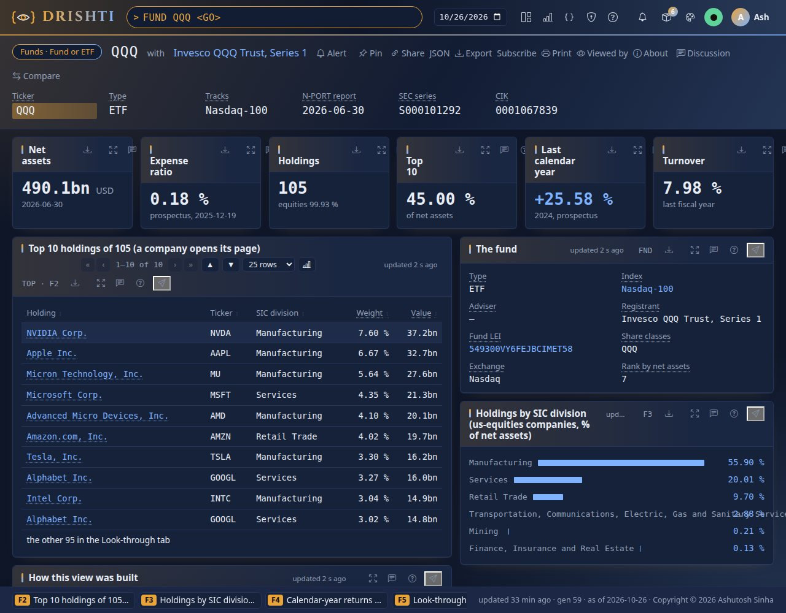
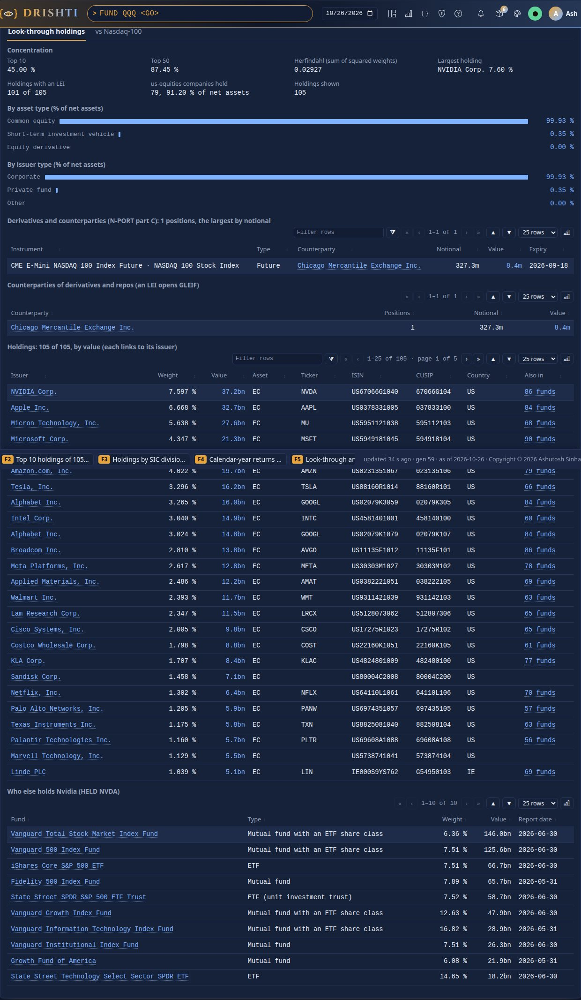
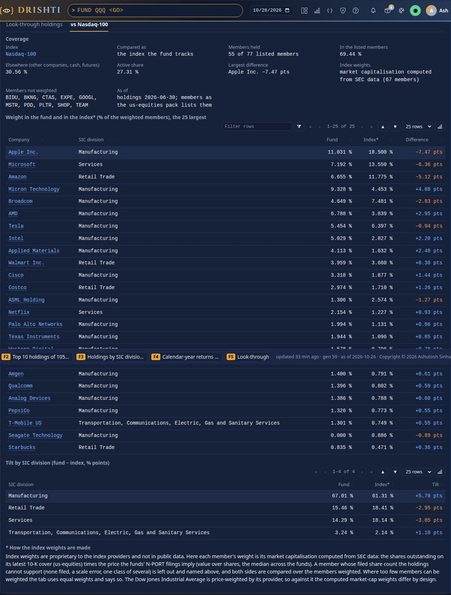
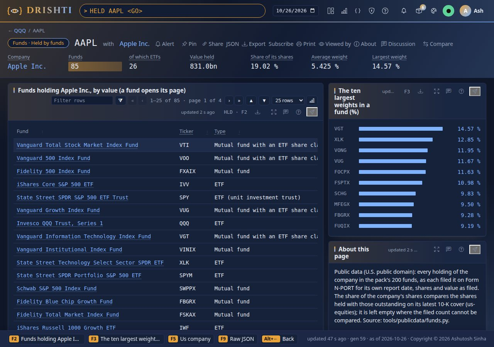
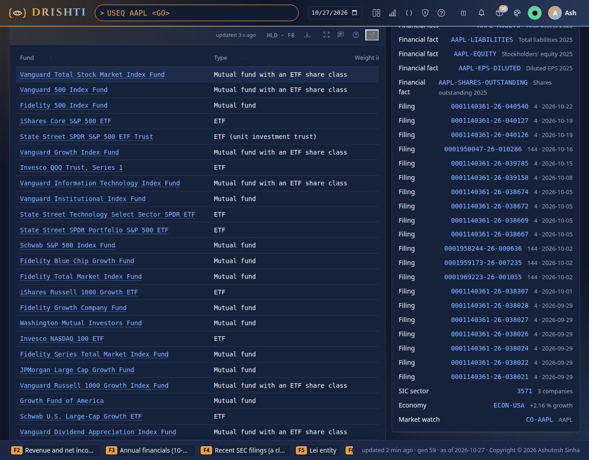
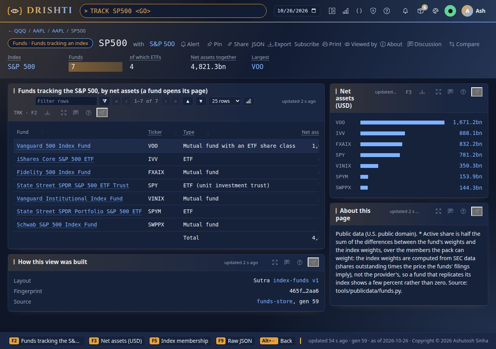
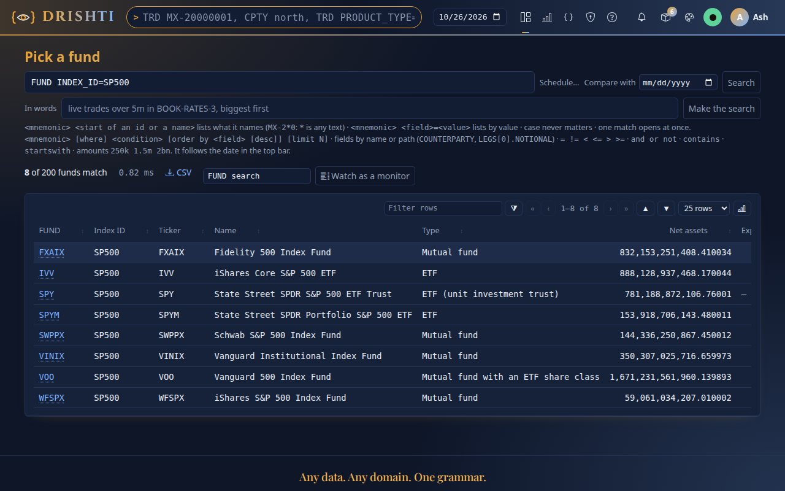

<!--
  Project Drishti · Any data. Any domain. One grammar.

  Copyright (c) 2026 Ashutosh Sinha <ajsinha@gmail.com>.
  All rights reserved.

  PROPRIETARY AND CONFIDENTIAL.

  This file is the confidential and proprietary property of Ashutosh Sinha.
  Unauthorised copying, use, modification, distribution or disclosure of this
  file, via any medium, is strictly prohibited except with the express prior
  written permission of the copyright holder.

  See the LICENSE file in the root of this repository for the full terms.
-->
# Funds and ETFs guide

The `funds` pack (2.9.2) puts the **200 largest US mutual funds and ETFs** by net assets on the terminal, with their holdings, from
SEC public data: what each fund holds and how much (Form N-PORT), who runs, holds and audits it (Form N-CEN), what it costs and how
it did (the prospectus risk/return summary). The funds link to the rest of Drishti: a holding opens its company (`USEQ`), a company
lists the funds that hold it (`HELD`), an index lists the funds that track it (`TRACK`), an LEI opens its GLEIF record (`LEI`).

This guide has three parts. **Part I** is how to use it: the FUND page and its tabs, the funds holding a company, the funds tracking an
index, the commands, the command line and the API, worked through on the committed data. **Part II** is the data contract of every
kind: every column with its type, key, source in the SEC's tables and an example. **Part III** is where the data comes from: each
source and its licence, how the 200 are chosen, the refresh script on Linux and Windows, the gzipped snapshot and offline use. The
hands-on companion is [tutorial 28](../tutorials/28-funds-and-etfs.md); the words (NAV, share class, look-through, active share, overlap)
are explained in [Knowledge: Companies, funds and ETFs](../knowledge/companies-funds-and-etfs.md).

All figures below are from the committed snapshot: N-PORT reports dated 2026-05-31 to 2026-07-31 (the SEC's 2026 Q3 data set), retrieved
on 2026-10-26.

## Contents

Part I · Using it

1. [Turning the pack on](#1-turning-the-pack-on)
2. [The FUND page: the fact sheet](#2-the-fund-page-the-fact-sheet)
3. [The Look-through holdings tab](#3-the-look-through-holdings-tab)
4. [The fund against its index](#4-the-fund-against-its-index)
5. [Held by funds: HELD and the company page](#5-held-by-funds-held-and-the-company-page)
6. [Funds tracking an index: TRACK and the index page](#6-funds-tracking-an-index-track-and-the-index-page)
7. [Commands, search, command line and API](#7-commands-search-command-line-and-api)

Part II · The data contracts

8. [fund](#8-fund)
9. [fund-holder](#9-fund-holder)
10. [index-funds](#10-index-funds)
11. [Validation and conventions](#11-validation-and-conventions)

Part III · Where the data comes from

12. [The sources and their licences](#12-the-sources-and-their-licences)
13. [How the 200 are chosen](#13-how-the-200-are-chosen)
14. [How the documents are built](#14-how-the-documents-are-built)
15. [The refresh script](#15-the-refresh-script)
16. [The gzipped snapshot and offline use](#16-the-gzipped-snapshot-and-offline-use)
17. [What is not included](#17-what-is-not-included)

# Part I · Using it

## 1. Turning the pack on

The pack is **off by default**, like `us-equities` and `gleif`, and needs `us-equities` (its holdings link to the companies there; with
`gleif` on, the LEIs open their records too). Load it and build its tables into the lake:

```bash
export DRISHTI_PACKS=core,market-data,trading,counterparty-risk,market-risk,world-economy,news-and-markets,us-equities,gleif,funds
python3 tools/drishti.py lake demo                    # every table; or: python3 tools/build_demo_lakes.py --only funds
```

On Windows, `.\tools\windows\start-server.ps1 -DemoLakes` loads the public-data packs including `funds`, and
`python tools\build_demo_lakes.py --only funds` builds its three tables. The demo cluster (`drishti-stack/stack.yaml`) loads it on
every node. Type `FUNDS` and press Enter: the pack's overview lists its three commands with their counts (200 funds, 586 companies
held, 3 indexes tracked).

The pack's data is served by its Delta connector `funds-store` from the lake, never by the demo connector: a server with
`DRISHTI_DEMO_ENABLED=false` opens every page.

## 2. The FUND page: the fact sheet

`FUND QQQ` opens Invesco QQQ. The page is the **fact sheet** (the main view), with two tabs under it: **Look-through holdings** and
**vs Nasdaq-100** (section 3 and 4), the pattern of the exposure explorer.



From top to bottom:

- **The strip**: ticker, type, the index it tracks, the date of its N-PORT report, its SEC series and CIK.
- **The tiles**: net assets (490.1bn USD on 2026-06-30), the expense ratio (0.18%, from the prospectus of 2025-12-19), holdings (105,
  equities 99.93%), the top 10's weight (45.00%), the last calendar-year return (+25.58% in 2024) and turnover (7.98%). A tile with no
  filed value (a unit investment trust files no prospectus summary) is left out, not shown empty.
- **Top 10 holdings** (F2): each holding links to its us-equities company (`USEQ NVDA`), or to another fund of the pack (a fund of
  funds); the line under it points to the other 95 in the Look-through tab.
- **The fund**: type, index (opens `IDX NDX`), adviser and fund LEI (open `LEI` when the gleif pack is on), registrant, every share
  class ticker, the exchange, the ETF's creation unit and authorised participants, its rank by net assets.
- **Holdings by SIC division** (F3): the us-equities companies held, by SIC division, in percent of net assets.
- **Calendar-year returns** (F4), **Flows and returns, three months** (sales, redemptions, net flow and the class's monthly return;
  totals) and **Service providers** (custodian, auditor, administrator, transfer agent, sub-advisers, the census period).

The types: **ETF**; **Mutual fund**; **Mutual fund with an ETF share class** (Vanguard's funds: `FUND VOO` is the Vanguard 500 Index
Fund, whose share classes are VOO, VFINX, VFIAX and VFFSX); **ETF (unit investment trust)** (SPY, DIA). The fund's ticker is its ETF
class where it has one, else its oldest class; `FUND VFIAX` opens VOO (section 7).

`FUND VOO` is the second-largest fund: 1,671.2bn of net assets, 520 holdings, expense ratio 0.03%, +17.84% in 2025, flows of +28.5bn,
+15.8bn and −8.5bn in April to June 2026, custodian State Street Bank and Trust Company, auditor PricewaterhouseCoopers.

## 3. The Look-through holdings tab

The first tab is the look-through: what the fund holds, all of it, and who it is exposed to.



- **Concentration**: top 10 and top 50 weights, the Herfindahl index (the sum of squared weights: 0.029 for QQQ), the largest holding,
  how many holdings carry an issuer LEI (101 of 105), the us-equities companies held and their weight, and how many holdings are shown.
- **By asset type** and **By issuer type**: N-PORT's asset categories (common equity, debt, repo, derivatives ...) and issuer types
  (corporate, US Treasury, municipal, registered fund ...).
- **Derivatives and counterparties**: the largest 50 positions by notional, each with its counterparty (an LEI opens GLEIF) and
  expiry. QQQ holds one: a NASDAQ-100 future, 327.3m notional, cleared at the Chicago Mercantile Exchange. A bond fund (`FUND PONAX`,
  the PIMCO Income Fund) shows the largest of its 1,730 swaps and forwards, with 38 counterparties.
- **Counterparties of derivatives and repos**: per counterparty, positions, notional and value.
- **Holdings**: every holding kept (a fund keeps its 600 largest by value, every S&P 500 fund whole; the line above says how many
  others there are and their weight), paged and filterable: issuer (a link to its company, fund or LEI), weight, value, asset category,
  ticker, ISIN, CUSIP, country, and **Also in**: how many other funds of the pack hold the same company (opens `HELD`).
- **Who else holds** the fund's largest us-equities company: the ten other funds holding it the most (QQQ: NVIDIA).

## 4. The fund against its index

The second tab compares the fund with the index it tracks; an equity fund that tracks none of the pack's indexes is compared with the
S&P 500 for reference (`FUND AGTHX`, the Growth Fund of America: active share 44%), and the tab's title says so.



- **Coverage**: the index, members held of those listed, the weight in the listed members and elsewhere, the **active share** (half
  the sum of the weight differences), the largest difference, how the index weights are made and which members are not weighted.
- **Weights** of the 25 largest companies in the fund and in the index, and the difference.
- **Tilt by SIC division**: fund, index and the difference in percentage points.

**Index weights are proprietary** to the index providers and not in public data. The tab computes them from SEC data: each member's
market capitalisation is its shares outstanding on its latest 10-K cover (us-equities `SHARES_OUTSTANDING`) times the price the funds'
N-PORT filings imply (value over shares, the median across the funds). A member whose filed share count the holdings cannot support
(none filed, a scale error, one class of several: the funds would own under 0.2% or over 80% of it) is left out and named, and both
sides are compared over the members weighted; with fewer than 70% weighted, equal weights are used and the tab says so. The
Nasdaq-100 caps its largest members (its published method: a member over 24% is cut to 20%, and members over 4.5% that weigh more than
48% together are cut to 40%), and the tab applies the same caps; the Dow Jones Industrial Average weighs its members by share price,
and so does the tab (`FUND DIA`: active share 1.8%). The members are the us-equities pack's: what the index's tracking ETF (SPY, QQQ,
DIA) reported holding in its newest N-PORT. An S&P 500 fund still shows an active share of about 5.3% rather than 0 (`FUND VOO`
holds 493 of the 495 members) because 41 members have no share count the filings support (Alphabet, Meta, Berkshire Hathaway among
them) and are left out of the weights; `FUND QQQ` shows 11.2% for the same reason (15 of its 99 members). Until 2.9.3 the members came
from Wikidata, whose lists were out of date (QQQ then showed 26.75%).

## 5. Held by funds: HELD and the company page

`HELD AAPL` lists every fund of the pack that holds Apple, by value, counting every holding (not only the 600 a fund page keeps):



The strip: 85 funds (26 ETFs) hold 831.0bn of Apple, **19.02% of its shares outstanding**, at an average weight of 5.425% and at most
14.57% (a technology sector fund). The table: fund (opens it), type, Apple's weight in it, value, shares and the report date; on the
right, the ten largest weights. The share of shares outstanding is left empty for a company whose filed share count cannot be compared.

With the funds pack on, the company page `USEQ AAPL` has two tabs under its financials and filings: **Held by funds** (the same table)
and **Fund ownership** (the strip's figures, with a link to `HELD AAPL`). They read the funds pack's `fund-holder` record as their
source; with the pack off they say so.



## 6. Funds tracking an index: TRACK and the index page

`TRACK SP500` lists the funds that track the S&P 500 by net assets: seven, four of them ETFs, 4,821.3bn together, with each one's
expense ratio, members held and active share against the computed index weights.



A fund tracks an index when its name names it (`S&P 500`, `500 Index`, `Nasdaq-100`, `QQQ`, `Dow Jones Industrial`), without a style
or a screen (Growth, Value, Equal Weight, ESG ...); N-CEN says whether a fund is an index fund, but not which index. `TRACK NDX` has
QQQ, QQQM and TQQQ (leveraged, but tracking the Nasdaq-100); `TRACK DJIA` has DIA. The index page `IDX SP500` shows the same list on
the right, **ETFs and funds tracking it** (F4); the bank lists (`IDX BANKS-US` ...) have none.

## 7. Commands, search, command line and API

| Type | Opens | Examples |
|---|---|---|
| `FUNDS` | the pack's overview | `FUNDS` |
| `FUND <ticker>` | a fund: the fact sheet and its tabs; any share class ticker opens its fund | `FUND QQQ`, `FUND VTI`, `FUND VTSAX` (opens VTI), `FUND SPY`, `FUND AGG` |
| `FUND <field>=<value>` | a pick list of funds | `FUND INDEX_ID=SP500`, `FUND TYPE=ETF`, `FUND EXPENSE_RATIO<0.05`, `FUND NET_ASSETS>500bn` |
| `HELD <ticker>` | the funds holding a us-equities company | `HELD AAPL`, `HELD NVDA` |
| `TRACK <index>` | the funds tracking a us-equities index | `TRACK SP500`, `TRACK NDX`, `TRACK DJIA` |
| `FORM funds` | the pack's search form (ticker, name, share class tickers, type, adviser, index, net assets, expense ratio, holdings) | |

Typing `FUND vang` offers the Vanguard funds; `FUND VTSAX` offers VTI (the type-ahead matches every share class ticker, `TICKERS`), and
pressing Enter on it opens VTI. The function keys of the FUND page: F2 top holdings, F3 sectors, F4 returns, F5 the tabs, F6 the funds
holding the largest company, F7 the funds tracking the index, F9 the raw document.



**Command line** (`DRISHTI_SERVER` and `DRISHTI_TOKEN` set, or `--user` with sign-in off):

```bash
python3 tools/drishti.py view get fund/QQQ              # the page as text: tiles, tables, tabs
python3 tools/drishti.py view get fund-holder/AAPL
python3 tools/drishti.py view get index-funds/SP500
python3 tools/contracts.py show FUND                    # the kind's contract
```

```text
$ drishti.py view get index-funds/SP500
Funds · Funds tracking an index  SP500  with S&P 500   [TRACK]

Key figures
  figure               value
  -------------------  ---------
  Index                S&P 500
  Funds                7
  of which ETFs        4
  Net assets together  4,821.3bn
  Largest              VOO

Funds tracking the S&P 500, by net assets (a fund opens its page)  (table, trackers, F2)
  Fund                                     Ticker  Type                                 Net assets  Expense ratio  Members held  Active share*
  Vanguard 500 Index Fund                  VOO     Mutual fund with an ETF share class   1,671.2bn         0.03 %           493         5.29 %
  iShares Core S&P 500 ETF                 IVV     ETF                                     888.1bn         0.03 %           493         5.29 %
  Fidelity 500 Index Fund                  FXAIX   Mutual fund                             832.2bn         0.01 %           487         5.41 %
  ...
```

**API**: `GET /api/v1/views/fund/QQQ` (the page), `GET /api/v1/entities/fund/QQQ/raw` (the document), `GET
/api/v1/search?q=FUND%20INDEX_ID%3DSP500` (a search), `GET /api/v1/command/suggest?q=FUND%20VTSAX` (the type-ahead), as the
[API guide](API_GUIDE.md) describes; every call takes the caller's token and the business date.

# Part II · The data contracts

The contracts are `config/packs/funds/contracts/<kind>.contract.yaml` (checked by `python3 tools/contracts.py check`, published as
[docs/contracts/packs/funds.md](../contracts/packs/funds.md)); each column's meaning is the pack's glossary,
`config/packs/funds/config/about.yaml`, written by `tools/packgen/funds/make.py` from `tools/packgen/funds/fundsglossary.py`. The tables
below list every column with its type, whether it is the key, its meaning (with its unit), its source and an example from the
snapshot. Source names are the SEC data sets' tables and columns: **N-PORT** `FUND_REPORTED_INFO`, `FUND_REPORTED_HOLDING`,
`IDENTIFIERS`, `MONTHLY_TOTAL_RETURN`, the derivative tables of part C.11; **N-CEN** `FUND_REPORTED_INFO`, `ETF`, `ADVISER`,
`CUSTODIAN`, `AUTHORIZED_PARTICIPANT` ...; the **risk/return summary**'s XBRL tags in `num.tsv`. A column of a list is written
`LIST.COLUMN`.

## 8. fund

One document per fund, keyed by `TICKER` (command `FUND`), 200 documents; stored as the Delta table `<root>/funds/fund/` with the
promoted columns `TICKER, NAME, TYPE, TICKERS, ADVISER, INDEX_ID, NET_ASSETS, EXPENSE_RATIO, HOLDING_COUNT, REPORT_DATE, RANK` (the
search form and the type-ahead read them; the type-ahead also `NAME` and `TICKERS`). Links: a holding's `COMPANY` to `USEQ`
(us-company), `FUND` to another `FUND`, `LEI`, `ADVISER_LEI`, `CUSTODIAN_LEI` and a counterparty's `CPTY_LEI` to `LEI` (gleif's
lei-entity), `INDEX_ID` to `IDX` (index-membership).

| Column | Type | Key | Meaning | Source (SEC table.column, or how it is made) | Links to | Example |
|---|---|---|---|---|---|---|
| `TICKER` | id | key | The fund's ticker: its ETF share class where it has one, else its oldest share class; a unit investment trust's listed ticker. | SEC company_tickers_mf.json, N-CEN SECURITY_EXCHANGE, the Nasdaq Trader directory, company_tickers_exchange.json |  | QQQ |
| `NAME` | text |  | The series name as filed (upper-case names title-cased). | N-PORT FUND_REPORTED_INFO.SERIES_NAME |  | Invesco QQQ Trust, Series 1 |
| `TYPE` | text |  | ETF, Mutual fund, Mutual fund with an ETF share class, or ETF (unit investment trust). | N-CEN FUND_REPORTED_INFO.IS_ETF, ETF.tsv, the Nasdaq Trader directory |  | ETF |
| `FUND_KEY` | text |  | The SEC series id, or CIK<cik> for a fund without one (a unit investment trust). | N-PORT FUND_REPORTED_INFO.SERIES_ID, REGISTRANT.CIK |  | S000101292 |
| `SERIES_ID` | id |  | The SEC series id (S and nine digits). | N-PORT FUND_REPORTED_INFO.SERIES_ID |  | S000101292 |
| `CIK` | text |  | The registrant's SEC Central Index Key (ten digits). | N-PORT REGISTRANT.CIK |  | 0001067839 |
| `REGISTRANT` | text |  | The trust or company the series belongs to. | N-PORT REGISTRANT.REGISTRANT_NAME |  | Invesco QQQ Trust, Series 1 |
| `LEI` | text |  | The fund's (series') LEI; opens its GLEIF record. | N-PORT FUND_REPORTED_INFO.SERIES_LEI | LEI (gleif) | 549300VY6FEJBCIMET58 |
| `REGISTRANT_LEI` | text |  | The registrant's LEI. | N-PORT REGISTRANT.LEI |  | 549300VY6FEJBCIMET58 |
| `TICKERS` | text |  | Every share class ticker, the fund's own first; the type-ahead matches any of them (FUND VTSAX opens VTI). | SEC company_tickers_mf.json |  | QQQ |
| `CLASSES` | record list |  | Each share class: id, ticker, name, expense ratio and three-month return. | company_tickers_mf.json, N-CEN SHARES_OUTSTANDING, risk/return summary, N-PORT MONTHLY_TOTAL_RETURN |  |  |
| `CLASSES.CLASS_ID` | id |  | The SEC class id (C and nine digits). | company_tickers_mf.json classId |  | C000271435 |
| `CLASSES.TICKER` | id |  | The share class's ticker. | company_tickers_mf.json symbol |  | QQQ |
| `CLASSES.CLASS_NAME` | text |  | The class's name (Admiral Shares, Class A ...). | N-CEN SHARES_OUTSTANDING.CLASS_NAME |  | Investor Shares |
| `CLASSES.EXPENSE_RATIO` | rate |  | The class's net expense ratio (gross where no net one is filed). (%) | risk/return summary NetExpensesOverAssets, ExpensesOverAssets |  | 0.18 |
| `CLASSES.RETURN_3M` | amount |  | The class's three monthly returns compounded. (%) | N-PORT MONTHLY_TOTAL_RETURN |  | 27.64 |
| `CLASS_COUNT` | integer |  | How many share classes the fund has. (classes) | company_tickers_mf.json |  | 1 |
| `PRIMARY_CLASS` | text |  | The class id of TICKER; its fees and returns are the page's. | company_tickers_mf.json |  | C000271435 |
| `IS_ETF` | boolean |  | True when the fund is, or has, an exchange-traded share class. | N-CEN IS_ETF, ETF.tsv, SECURITY_EXCHANGE; the Nasdaq Trader directory |  | True |
| `IS_INDEX` | boolean |  | True when the fund says it is an index fund, or its name names a tracked index. | N-CEN FUND_REPORTED_INFO.IS_INDEX |  | True |
| `IS_FUND_OF_FUNDS` | boolean |  | True when the fund invests in other funds. | N-CEN FUND_REPORTED_INFO.IS_FUND_OF_FUND |  | False |
| `IS_TARGET_DATE` | boolean |  | True for a target-date fund. | N-CEN FUND_REPORTED_INFO.IS_TARGET_DATE |  | False |
| `IS_MASTER_FEEDER` | boolean |  | True when the fund is part of a master-feeder structure. | N-CEN FUND_REPORTED_INFO.IS_MASTER_FEEDER |  | False |
| `INDEX_ID` | id |  | The us-equities index the fund tracks (SP500, NDX, DJIA), matched by its name; opens IDX. | computed from the name (N-CEN says whether a fund is an index fund, not which index) | IDX (index-membership) | NDX |
| `EXCHANGE` | text |  | Where the ETF share class lists. | the Nasdaq Trader directory; N-CEN SECURITY_EXCHANGE |  | Nasdaq |
| `CREATION_UNIT` | amount |  | Shares in one creation unit of the ETF. (shares) | N-CEN ETF.NUM_SHARES_PER_CREATION_UNIT |  | 100000.0 |
| `AP_COUNT` | integer |  | How many authorised participants the ETF reports. (firms) | N-CEN AUTHORIZED_PARTICIPANT |  | 40 |
| `AUTHORISED_PARTICIPANTS` | record list |  | The ten most active authorised participants by purchases and redemptions. | N-CEN AUTHORIZED_PARTICIPANT |  |  |
| `AUTHORISED_PARTICIPANTS.NAME` | text |  | The authorised participant. | N-CEN AUTHORIZED_PARTICIPANT.PARTICIPANT_NAME |  | Merrill Lynch Pro |
| `AUTHORISED_PARTICIPANTS.LEI` | text |  | Its LEI. | N-CEN AUTHORIZED_PARTICIPANT.PARTICIPANT_LEI | LEI (gleif) | 549300PMHS66E71I2D34 |
| `AUTHORISED_PARTICIPANTS.PURCHASES` | amount |  | Creation units it bought over the year, by value. (USD) | N-CEN AUTHORIZED_PARTICIPANT.PURCHASE_VALUE |  | 14638424000.0 |
| `AUTHORISED_PARTICIPANTS.REDEMPTIONS` | amount |  | Creation units it redeemed over the year, by value. (USD) | N-CEN AUTHORIZED_PARTICIPANT.REDEEM_VALUE |  | 6246681000.0 |
| `ADVISER` | text |  | The fund's investment adviser. | N-CEN ADVISER.ADVISER_NAME |  | The Vanguard Group, Inc. |
| `ADVISER_LEI` | text |  | The adviser's LEI; opens its GLEIF record. | N-CEN ADVISER.ADVISER_LEI | LEI (gleif) | 5493002789CX3L0CJP65 |
| `SUB_ADVISERS` | text |  | Up to six sub-advisers. | N-CEN ADVISER (sub-advisers) |  | Geode Capital Management, LLC |
| `CUSTODIAN` | text |  | The fund's custodian (not a sub-custodian). | N-CEN CUSTODIAN.CUSTODIAN_NAME |  | JPMorgan Chase Bank NA |
| `CUSTODIAN_LEI` | text |  | The custodian's LEI. | N-CEN CUSTODIAN.CUSTODIAN_LEI | LEI (gleif) | 7H6GLXDRUGQFU57RNE97 |
| `ADMINISTRATOR` | text |  | The fund's administrator (not a sub-administrator). | N-CEN ADMIN.ADMIN_NAME |  | THE VANGUARD GROUP, INC. |
| `TRANSFER_AGENT` | text |  | The fund's transfer agent. | N-CEN TRANSFER_AGENT.TRANSFERAGENT_NAME |  | The Vanguard Group, Inc. |
| `AUDITOR` | text |  | The registrant's independent public accountant. | N-CEN PUBLIC_ACCOUNTANT.PUB_ACCOUNTANT_NAME |  | PRICEWATERHOUSECOOPERS LLP |
| `AUDITOR_LEI` | text |  | The accountant's LEI. | N-CEN PUBLIC_ACCOUNTANT.PUB_ACCOUNTANT_LEI |  | 5493002GVO7EO8RNNS37 |
| `LENDS_SECURITIES` | boolean |  | True when the fund lent securities in the year. | N-CEN FUND_REPORTED_INFO.DID_LEND_SECURITIES |  | False |
| `NCEN_PERIOD` | date |  | The fiscal year end of the N-CEN report used. | N-CEN SUBMISSION.REPORT_ENDING_PERIOD |  | 2025-12-31 |
| `NCEN_ACCESSION` | text |  | The N-CEN filing used. | N-CEN SUBMISSION.ACCESSION_NUMBER |  | 0000036405-26-000103 |
| `GLEIF_RELATIONSHIPS` | record list |  | The fund's relationships in GLEIF: managed by, sub-fund of (its umbrella), feeder to. | GLEIF golden copy level 2 (rr.csv) |  |  |
| `GLEIF_RELATIONSHIPS.TYPE` | text |  | Managed by, Sub-fund of or Feeder to. | GLEIF rr.csv Relationship.RelationshipType |  | Managed by |
| `GLEIF_RELATIONSHIPS.LEI` | text |  | The manager's, umbrella's or master fund's LEI. | GLEIF rr.csv Relationship.EndNode.NodeID | LEI (gleif) | EJW8VXOT5RJ3PPMVEB49 |
| `GLEIF_RELATIONSHIPS.STATUS` | text |  | ACTIVE or INACTIVE. | GLEIF rr.csv Relationship.RelationshipStatus |  | ACTIVE |
| `RANK` | integer |  | The fund's rank by net assets among the funds with a ticker. | computed |  | 7 |
| `REPORT_DATE` | date |  | The date the N-PORT report is as of. | N-PORT SUBMISSION.REPORT_DATE |  | 2026-06-30 |
| `FILED` | date |  | The date the N-PORT report was filed. | N-PORT SUBMISSION.FILING_DATE |  | 2026-08-28 |
| `ACCESSION` | text |  | The N-PORT filing used. | N-PORT SUBMISSION.ACCESSION_NUMBER |  | 0001067839-26-000030 |
| `NPORT_URL` | text |  | The filing's folder on EDGAR. | computed from CIK and ACCESSION |  | https://www.sec.gov/Archives/edgar/da... |
| `TOTAL_ASSETS` | amount |  | Total assets. (USD) | N-PORT FUND_REPORTED_INFO.TOTAL_ASSETS |  | 492478331787.0 |
| `NET_ASSETS` | amount |  | Net assets: what the 200 are chosen by. (USD) | N-PORT FUND_REPORTED_INFO.NET_ASSETS |  | 490103179942.0 |
| `EXPENSE_RATIO` | rate |  | The net expense ratio of the fund's share class (gross where no net one is filed). (%) | risk/return summary NetExpensesOverAssets, ExpensesOverAssets |  | 0.18 |
| `GROSS_EXPENSE_RATIO` | rate |  | Total annual operating expenses before waivers. (%) | risk/return summary ExpensesOverAssets |  | 0.18 |
| `MANAGEMENT_FEE` | amount |  | The management fee. (%) | risk/return summary ManagementFeesOverAssets |  | 0.18 |
| `TURNOVER` | amount |  | Portfolio turnover in the last fiscal year. (%) | risk/return summary PortfolioTurnoverRate |  | 7.98 |
| `PROSPECTUS_FILED` | date |  | The date of the risk/return summary used. | risk/return summary sub.tsv filed |  | 2025-12-19 |
| `ANNUAL_RETURNS` | record list |  | Up to ten calendar-year total returns of the share class (the prospectus bar chart). | risk/return summary AnnualReturnPercent, AnnlRtrPct |  |  |
| `ANNUAL_RETURNS.YEAR` | text |  | The calendar year. | risk/return summary num.tsv ddate |  | 2015 |
| `ANNUAL_RETURNS.RETURN` | amount |  | The year's total return. (%) | risk/return summary AnnualReturnPercent, AnnlRtrPct |  | 9.53 |
| `RETURN_LAST_YEAR` | amount |  | The latest calendar-year return filed. (%) | risk/return summary AnnualReturnPercent, AnnlRtrPct |  | 25.58 |
| `RETURN_YEAR` | integer |  | The year of RETURN_LAST_YEAR. | risk/return summary |  | 2024 |
| `RETURN_3M` | amount |  | The share class's three monthly returns of the report compounded. (%) | N-PORT MONTHLY_TOTAL_RETURN |  | 27.64 |
| `FLOWS` | record list |  | Each of the report's three months: sales, reinvestments, redemptions, net flow and the class's return. | N-PORT FUND_REPORTED_INFO SALES_FLOW_MON1-3 ... |  |  |
| `FLOWS.MONTH` | text |  | The month (yyyy-mm), the third being the report's. | computed from REPORT_DATE |  | 2026-04 |
| `FLOWS.SALES` | amount |  | Shares sold (subscriptions), by value. (USD) | N-PORT FUND_REPORTED_INFO.SALES_FLOW_MONn |  | 56960297589.31 |
| `FLOWS.REINVESTMENT` | amount |  | Distributions reinvested. (USD) | N-PORT FUND_REPORTED_INFO.REINVESTMENT_FLOW_MONn |  | 0.0 |
| `FLOWS.REDEMPTIONS` | amount |  | Shares redeemed, by value. (USD) | N-PORT FUND_REPORTED_INFO.REDEMPTION_FLOW_MONn |  | 46510905488.86 |
| `FLOWS.NET_FLOW` | amount |  | Sales plus reinvestment less redemptions. (USD) | computed |  | 10449392100.45 |
| `FLOWS.RETURN` | amount |  | The share class's total return in the month. (%) | N-PORT MONTHLY_TOTAL_RETURN.MONTHLY_TOTAL_RETURNn |  | 15.656032 |
| `SALES` | amount |  | The three months' sales. (USD) | N-PORT SALES_FLOW_MON1-3 |  | 216564959011.07 |
| `REDEMPTIONS` | amount |  | The three months' redemptions. (USD) | N-PORT REDEMPTION_FLOW_MON1-3 |  | 205720139470.74 |
| `REINVESTMENT` | amount |  | The three months' reinvested distributions. (USD) | N-PORT REINVESTMENT_FLOW_MON1-3 |  | 0 |
| `NET_FLOW` | amount |  | Sales plus reinvestment less redemptions over the three months. (USD) | computed |  | 10844819540.33 |
| `HOLDING_COUNT` | integer |  | Every holding the fund reported. (holdings) | N-PORT FUND_REPORTED_HOLDING |  | 105 |
| `HOLDINGS_SHOWN` | integer |  | Holdings kept in HOLDINGS (the 600 largest by value). (holdings) | computed |  | 105 |
| `HOLDINGS_REST_COUNT` | integer |  | Holdings not kept. (holdings) | computed |  | 0 |
| `HOLDINGS_REST_PCT` | rate |  | The weight of the holdings not kept. (% of net assets) | computed |  | 0 |
| `HOLDINGS_REST_VALUE` | amount |  | The value of the holdings not kept. (USD) | computed |  | 0 |
| `TOP10_PCT` | rate |  | The weight of the ten largest holdings. (% of net assets) | computed |  | 45.0 |
| `TOP50_PCT` | rate |  | The weight of the fifty largest holdings. (% of net assets) | computed |  | 87.448 |
| `HHI` | amount |  | The sum of the squared weights (as fractions): 1 is one holding, near 0 is many small ones. | computed |  | 0.02927 |
| `LARGEST` | text |  | The largest holding by value. | computed | FUND | NVIDIA Corp. |
| `LARGEST_PCT` | rate |  | The largest holding's weight. (% of net assets) | computed |  | 7.596757 |
| `WITH_LEI` | integer |  | Holdings whose issuer LEI was filed. (holdings) | computed |  | 101 |
| `EQUITY_PCT` | rate |  | The weight of common equity (asset category EC). (% of net assets) | computed |  | 99.927 |
| `US_COMPANY_PCT` | rate |  | The weight of the holdings that are us-equities companies. (% of net assets) | computed |  | 91.196 |
| `US_COMPANIES` | integer |  | How many us-equities companies the fund holds. (companies) | computed |  | 79 |
| `BY_ASSET` | record list |  | The weight by N-PORT asset category. | computed |  |  |
| `BY_ISSUER_TYPE` | record list |  | The weight by issuer type. | computed |  |  |
| `BY_COUNTRY` | record list |  | The weight by country, the largest ten. | computed |  |  |
| `BY_SECTOR` | record list |  | The weight of the us-equities companies held, by SIC division. | computed |  |  |
| `DERIVATIVE_COUNT` | integer |  | How many derivatives the fund holds. (positions) | computed |  | 1 |
| `DERIVATIVES_NOTIONAL` | amount |  | The notionals added up, by size. (USD) | computed |  | 327348711.0 |
| `DERIVATIVES` | record list |  | The fifty largest derivative positions by notional, with their counterparties. | N-PORT part C.11 |  |  |
| `COUNTERPARTIES` | record list |  | The counterparties of the derivatives and repos, by notional: positions, notional, value. | N-PORT DERIVATIVE_COUNTERPARTY, REPURCHASE_COUNTERPARTY |  |  |
| `COUNTERPARTIES.NAME` | text |  | The counterparty. | N-PORT DERIVATIVE_COUNTERPARTY_NAME |  | Chicago Mercantile Exchange Inc. |
| `COUNTERPARTIES.LEI` | text |  | The counterparty's LEI; opens its GLEIF record. | N-PORT DERIVATIVE_COUNTERPARTY_LEI | LEI (gleif) | SNZ2OJLFK8MNNCLQOF39 |
| `COUNTERPARTIES.POSITIONS` | integer |  | Positions with the counterparty. (positions) | computed |  | 1 |
| `COUNTERPARTIES.NOTIONAL` | amount |  | Their notionals added up, by size. (USD) | computed |  | 327348711.0 |
| `COUNTERPARTIES.VALUE` | amount |  | Their values added up. (USD) | computed |  | 8409789.0 |
| `COUNTERPARTY_COUNT` | integer |  | How many counterparties. (counterparties) | computed |  | 1 |
| `HOLDINGS` | record list |  | The 600 largest holdings by value, each with its identifiers and links. | N-PORT FUND_REPORTED_HOLDING, IDENTIFIERS |  |  |
| `MOST_HELD_COMPANY` | id |  | The largest us-equities company the fund holds. | computed | USEQ | NVDA |
| `MOST_HELD_NAME` | text |  | That company's name. | us-equities |  | Nvidia |
| `ALSO_HELD_BY` | record list |  | The ten other funds holding that company the most, by value. | computed from fund-holder |  |  |
| `ACTIVE_SHARE` | rate |  | Half the sum of the differences between the fund's and the index's weights (VS_INDEX). (%) | computed |  | 11.21 |
| `VIEWS` | record list |  | The page's tabs: Look-through holdings, and the fund against its index when there is one. | computed |  |  |
| `VIEWS.VIEW` | text |  | LOOK_THROUGH or VS_INDEX. | computed |  | LOOK_THROUGH |
| `VIEWS.TITLE` | text |  | The tab's title. | computed |  | Look-through holdings |
| `VS_INDEX` | record |  | The fund against its tracked index (or the S&P 500 for reference); index weights computed from SEC data. | computed |  |  |
| `VS_INDEX.INDEX_ID` | id |  | The us-equities index. | us-equities index-membership | IDX (index-membership) | NDX |
| `VS_INDEX.INDEX_NAME` | text |  | Its name. | us-equities index-membership |  | Nasdaq-100 |
| `VS_INDEX.BASIS` | text |  | tracks (the fund tracks it) or reference (an equity fund compared with the S&P 500). | computed |  | tracks |
| `VS_INDEX.WEIGHTING` | text |  | market capitalisation computed from SEC data (capped as the Nasdaq-100 caps it), share price for the Dow, or equal weights. | computed |  | market capitalisation computed from S... |
| `VS_INDEX.MEMBERS` | integer |  | The index's members as the us-equities pack lists them. (companies) | us-equities index-membership (the holdings of SPY, QQQ and DIA) |  | 99 |
| `VS_INDEX.MEMBERS_WEIGHTED` | integer |  | Members with a market capitalisation the filings support. (companies) | computed |  | 84 |
| `VS_INDEX.MEMBERS_NOT_WEIGHTED` | text |  | Members left out of the weights, by ticker. | computed |  | ABNB, APP, BKNG, CRWD, CRWV, DASH, DD... |
| `VS_INDEX.MEMBERS_HELD` | amount |  | Listed members the fund holds. (companies) | computed |  | 98 |
| `VS_INDEX.FUND_IN_INDEX_PCT` | rate |  | The fund's weight in the listed members. (% of net assets) | computed |  | 99.2 |
| `VS_INDEX.NOT_IN_INDEX_PCT` | rate |  | The rest: other companies, cash, futures. (% of net assets) | computed |  | 0.8 |
| `VS_INDEX.ACTIVE_SHARE` | rate |  | Half the sum of the absolute weight differences over the members weighted. (%) | computed |  | 11.21 |
| `VS_INDEX.LARGEST_DIFF_COMPANY` | text |  | The company with the largest difference. | computed |  | ASML |
| `VS_INDEX.LARGEST_DIFF_NAME` | text |  | Its name. | us-equities |  | ASML Holding |
| `VS_INDEX.LARGEST_DIFF` | amount |  | Fund weight less index weight. (% points) | computed |  | -1.915 |
| `VS_INDEX.AS_OF` | date |  | The fund's report date. | N-PORT SUBMISSION.REPORT_DATE |  | 2026-06-30 |
| `VS_INDEX.ROWS` | record list |  | The 25 largest weights in either, side by side. | computed |  |  |
| `VS_INDEX.ROWS.COMPANY` | id |  | The us-equities company. | us-equities | USEQ (us-company) | AAPL |
| `VS_INDEX.ROWS.NAME` | text |  | Its name. | us-equities |  | Apple Inc. |
| `VS_INDEX.ROWS.SECTOR` | text |  | Its SIC division. | us-equities |  | Manufacturing |
| `VS_INDEX.ROWS.FUND_PCT` | rate |  | The company's weight in the fund over the members weighted. (%) | computed |  | 10.655 |
| `VS_INDEX.ROWS.INDEX_PCT` | rate |  | Its computed market-cap weight in the index. (%) | computed: SEC shares outstanding times the price N-PORT implies |  | 18.474 |
| `VS_INDEX.ROWS.DIFF` | amount |  | Fund less index. (% points) | computed |  | -7.819 |
| `VS_INDEX.SECTORS` | record list |  | Fund and index weights by SIC division. | computed |  |  |
| `VS_INDEX.SECTORS.SECTOR` | text |  | The division. | us-equities |  | Manufacturing |
| `VS_INDEX.SECTORS.FUND_PCT` | rate |  | The fund's weight in it. (%) | computed |  | 67.8 |
| `VS_INDEX.SECTORS.INDEX_PCT` | rate |  | The index's weight in it. (%) | computed |  | 61.38 |
| `VS_INDEX.SECTORS.TILT` | amount |  | Fund less index. (% points) | computed |  | 6.42 |
| `PROVENANCE.SOURCE` | text |  | Where the data comes from. | written by tools/packgen/funds/fundsbuild.py |  | U.S. Securities and Exchange Commissi... |
| `PROVENANCE.LICENCE` | text |  | The source's licence (public domain). | written by tools/packgen/funds/fundsbuild.py |  | Public domain (U.S. Government work);... |
| `PROVENANCE.RETRIEVED_AT` | date |  | The date the data sets were downloaded. | the download cache |  | 2026-10-26 |
| `PROVENANCE.NOTE` | text |  | What the document holds and from which filings. | written by tools/packgen/funds/fundsbuild.py |  | Holdings, flows and returns as the fu... |
| `HOLDINGS.NAME` | text |  | The issuer's name as the fund filed it. | N-PORT FUND_REPORTED_HOLDING.ISSUER_NAME |  | NVIDIA Corp. |
| `HOLDINGS.TITLE` | text |  | The title of the security or contract. | N-PORT FUND_REPORTED_HOLDING.ISSUER_TITLE |  | NVIDIA Corp. |
| `HOLDINGS.TICKER` | id |  | The security's ticker where the fund gave one, written as us-equities writes it (BRK/B is BRK-B). | N-PORT IDENTIFIERS.IDENTIFIER_TICKER |  | NVDA |
| `HOLDINGS.CUSIP` | text |  | The security's CUSIP (none for N/A or zeros). | N-PORT FUND_REPORTED_HOLDING.ISSUER_CUSIP |  | 67066G104 |
| `HOLDINGS.ISIN` | text |  | The security's ISIN where the fund gave one. | N-PORT IDENTIFIERS.IDENTIFIER_ISIN |  | US67066G1040 |
| `HOLDINGS.LEI` | text |  | The issuer's Legal Entity Identifier; opens its GLEIF record (gleif pack). | N-PORT FUND_REPORTED_HOLDING.ISSUER_LEI | LEI (gleif) | 549300S4KLFTLO7GSQ80 |
| `HOLDINGS.ASSET` | text |  | N-PORT's asset category: EC common equity, EP preferred, DBT debt, ABS-MBS, ABS-ASBS, ABS-CBDO, ABS-O, DCO, DCR, DE, DFE, DIR, DO derivatives, SN, LON, RA repo, STIV, RE, COMM, OTHER. | N-PORT FUND_REPORTED_HOLDING.ASSET_CAT |  | EC |
| `HOLDINGS.ISSUER_TYPE` | text |  | CORP, UST, USGA, USGSE, MUN, NUSS (non-US sovereign), PF (private fund), RF (registered fund), OTHER. | N-PORT FUND_REPORTED_HOLDING.ISSUER_TYPE |  | CORP |
| `HOLDINGS.COUNTRY` | text |  | The country of investment or issuer (ISO 3166). | N-PORT FUND_REPORTED_HOLDING.INVESTMENT_COUNTRY |  | US |
| `HOLDINGS.CURRENCY` | text |  | The currency the holding is denominated in. | N-PORT FUND_REPORTED_HOLDING.CURRENCY_CODE |  | USD |
| `HOLDINGS.VALUE` | amount |  | The holding's value as reported, in US dollars. (USD) | N-PORT FUND_REPORTED_HOLDING.CURRENCY_VALUE |  | 37231945639.46 |
| `HOLDINGS.PCT` | rate |  | The holding's value over the fund's net assets. (% of net assets) | N-PORT FUND_REPORTED_HOLDING.PERCENTAGE |  | 7.596757 |
| `HOLDINGS.BALANCE` | amount |  | Shares, principal amount or contracts held, in UNIT. | N-PORT FUND_REPORTED_HOLDING.BALANCE |  | 186075994.0 |
| `HOLDINGS.UNIT` | text |  | NS shares, PA principal amount, NC contracts, OU other units. | N-PORT FUND_REPORTED_HOLDING.UNIT |  | NS |
| `HOLDINGS.PAYOFF` | text |  | Long, Short or N/A. | N-PORT FUND_REPORTED_HOLDING.PAYOFF_PROFILE |  | Long |
| `HOLDINGS.DERIVATIVE` | text |  | FWD, FUT, SWP, OPT, SWO, WAR or OTH for a derivative; empty otherwise. | N-PORT FUND_REPORTED_HOLDING.DERIVATIVE_CAT |  | SWP |
| `HOLDINGS.CPTY` | text |  | The derivative's or repo's counterparty ('(cleared)' for a centrally cleared repo). | N-PORT DERIVATIVE_COUNTERPARTY, REPURCHASE_COUNTERPARTY |  | LCH Ltd. |
| `HOLDINGS.CPTY_LEI` | text |  | The counterparty's LEI; opens its GLEIF record. | N-PORT DERIVATIVE_COUNTERPARTY_LEI, REPURCHASE_COUNTERPARTY.LEI | LEI (gleif) | F226TOH6YD6XJB17KS62 |
| `HOLDINGS.NOTIONAL` | amount |  | A derivative's notional (a forward's amount bought), as filed. | N-PORT FUT_FWD_NONFOREIGNCUR_CONTRACT, NONFOREIGN_EXCHANGE_SWAP, FWD_FOREIGNCUR_CONTRACT_SWAP, SWAPTION_OPTION_WARNT_DERIV |  | 3516800000.0 |
| `HOLDINGS.EXPIRY` | date |  | A derivative's expiry, termination or settlement date; a repo's maturity. | N-PORT the derivative tables, REPURCHASE_AGREEMENT.MATURITY_DATE |  | 2051-06-16 |
| `HOLDINGS.UNREALIZED` | amount |  | A derivative's unrealised appreciation (negative: depreciation). (USD) | N-PORT the derivative tables, UNREALIZED_APPRECIATION |  | 1208405914.91 |
| `HOLDINGS.REFERENCE` | text |  | The index or basket a derivative references. | N-PORT DESC_REF_INDEX_BASKET.INDEX_NAME |  | S&P500 EMINI FUT Sep26 |
| `HOLDINGS.COMPANY` | id |  | The us-equities company the holding is (by ticker, else by the issuer's LEI for an equity); opens USEQ. | computed: the committed us-equities companies | USEQ (us-company) | NVDA |
| `HOLDINGS.FUND` | text |  | The pack's fund the holding is (a fund of funds holding another fund); opens FUND. | computed: the share class tickers | FUND | ABALX |
| `HOLDINGS.SECTOR` | text |  | The SIC division of the us-equities company. | us-equities us-company.SECTOR (SEC EDGAR) |  | Manufacturing |
| `HOLDINGS.ALSO_IN` | integer |  | How many other funds of the pack hold the same company. (funds) | computed from every fund's holdings |  | 86 |
| `DERIVATIVES.NAME` | text |  | The issuer's name as the fund filed it. | N-PORT FUND_REPORTED_HOLDING.ISSUER_NAME |  | CME E-Mini NASDAQ 100 Index Future |
| `DERIVATIVES.TITLE` | text |  | The title of the security or contract. | N-PORT FUND_REPORTED_HOLDING.ISSUER_TITLE |  | CME E-Mini NASDAQ 100 Index Future |
| `DERIVATIVES.CURRENCY` | text |  | The currency the holding is denominated in. | N-PORT FUND_REPORTED_HOLDING.CURRENCY_CODE |  | USD |
| `DERIVATIVES.VALUE` | amount |  | The holding's value as reported, in US dollars. (USD) | N-PORT FUND_REPORTED_HOLDING.CURRENCY_VALUE |  | 8409789.3 |
| `DERIVATIVES.PCT` | rate |  | The holding's value over the fund's net assets. (% of net assets) | N-PORT FUND_REPORTED_HOLDING.PERCENTAGE |  | 0.001716 |
| `DERIVATIVES.PAYOFF` | text |  | Long, Short or N/A. | N-PORT FUND_REPORTED_HOLDING.PAYOFF_PROFILE |  | N/A |
| `DERIVATIVES.DERIVATIVE` | text |  | FWD, FUT, SWP, OPT, SWO, WAR or OTH for a derivative; empty otherwise. | N-PORT FUND_REPORTED_HOLDING.DERIVATIVE_CAT |  | FUT |
| `DERIVATIVES.TYPE` | text |  | The derivative category in words (Future, Swap, Option ...). | computed from DERIVATIVE_CAT |  | Future |
| `DERIVATIVES.CPTY` | text |  | The derivative's or repo's counterparty ('(cleared)' for a centrally cleared repo). | N-PORT DERIVATIVE_COUNTERPARTY, REPURCHASE_COUNTERPARTY |  | Chicago Mercantile Exchange Inc. |
| `DERIVATIVES.CPTY_LEI` | text |  | The counterparty's LEI; opens its GLEIF record. | N-PORT DERIVATIVE_COUNTERPARTY_LEI, REPURCHASE_COUNTERPARTY.LEI | LEI (gleif) | SNZ2OJLFK8MNNCLQOF39 |
| `DERIVATIVES.NOTIONAL` | amount |  | A derivative's notional (a forward's amount bought), as filed. | N-PORT FUT_FWD_NONFOREIGNCUR_CONTRACT, NONFOREIGN_EXCHANGE_SWAP, FWD_FOREIGNCUR_CONTRACT_SWAP, SWAPTION_OPTION_WARNT_DERIV |  | 327348710.7 |
| `DERIVATIVES.EXPIRY` | date |  | A derivative's expiry, termination or settlement date; a repo's maturity. | N-PORT the derivative tables, REPURCHASE_AGREEMENT.MATURITY_DATE |  | 2026-09-18 |
| `DERIVATIVES.UNREALIZED` | amount |  | A derivative's unrealised appreciation (negative: depreciation). (USD) | N-PORT the derivative tables, UNREALIZED_APPRECIATION |  | 8409789.3 |
| `DERIVATIVES.REFERENCE` | text |  | The index or basket a derivative references. | N-PORT DESC_REF_INDEX_BASKET.INDEX_NAME |  | NASDAQ 100 Stock Index |
| `BY_ASSET.KEY` | text |  | The code grouped by (an asset category, issuer type, country or SIC division). | computed |  | EC |
| `BY_ASSET.LABEL` | text |  | The code in words; Other (n) gathers the smallest. | computed |  | Common equity |
| `BY_ASSET.PCT` | rate |  | The holdings' weight added up. (% of net assets) | computed from N-PORT PERCENTAGE |  | 99.927 |
| `BY_ASSET.VALUE` | amount |  | The holdings' value added up. (USD) | computed from N-PORT CURRENCY_VALUE |  | 489744804272.0 |
| `BY_ASSET.COUNT` | integer |  | The number of holdings in the group. (holdings) | computed |  | 102 |
| `BY_ISSUER_TYPE.KEY` | text |  | The code grouped by (an asset category, issuer type, country or SIC division). | computed |  | CORP |
| `BY_ISSUER_TYPE.LABEL` | text |  | The code in words; Other (n) gathers the smallest. | computed |  | Corporate |
| `BY_ISSUER_TYPE.PCT` | rate |  | The holdings' weight added up. (% of net assets) | computed from N-PORT PERCENTAGE |  | 99.927 |
| `BY_ISSUER_TYPE.VALUE` | amount |  | The holdings' value added up. (USD) | computed from N-PORT CURRENCY_VALUE |  | 489744804272.0 |
| `BY_ISSUER_TYPE.COUNT` | integer |  | The number of holdings in the group. (holdings) | computed |  | 102 |
| `BY_COUNTRY.KEY` | text |  | The code grouped by (an asset category, issuer type, country or SIC division). | computed |  | US |
| `BY_COUNTRY.LABEL` | text |  | The code in words; Other (n) gathers the smallest. | computed |  | US |
| `BY_COUNTRY.PCT` | rate |  | The holdings' weight added up. (% of net assets) | computed from N-PORT PERCENTAGE |  | 94.927 |
| `BY_COUNTRY.VALUE` | amount |  | The holdings' value added up. (USD) | computed from N-PORT CURRENCY_VALUE |  | 465238883928.0 |
| `BY_COUNTRY.COUNT` | integer |  | The number of holdings in the group. (holdings) | computed |  | 93 |
| `BY_SECTOR.KEY` | text |  | The code grouped by (an asset category, issuer type, country or SIC division). | computed |  | Manufacturing |
| `BY_SECTOR.LABEL` | text |  | The code in words; Other (n) gathers the smallest. | computed |  | Manufacturing |
| `BY_SECTOR.PCT` | rate |  | The holdings' weight added up. (% of net assets) | computed from N-PORT PERCENTAGE |  | 58.061 |
| `BY_SECTOR.VALUE` | amount |  | The holdings' value added up. (USD) | computed from N-PORT CURRENCY_VALUE |  | 284557152390.0 |
| `BY_SECTOR.COUNT` | integer |  | The number of holdings in the group. (holdings) | computed |  | 42 |
| `ALSO_HELD_BY.FUND` | text |  | The fund's ticker; opens FUND. | computed | FUND | VTI |
| `ALSO_HELD_BY.FUND_NAME` | text |  | The fund's name. | N-PORT FUND_REPORTED_INFO.SERIES_NAME |  | Vanguard Total Stock Market Index Fund |
| `ALSO_HELD_BY.TYPE` | text |  | The fund's type. | N-CEN FUND_REPORTED_INFO.IS_ETF, the Nasdaq Trader directory |  | Mutual fund with an ETF share class |
| `ALSO_HELD_BY.PCT` | rate |  | The company's weight in the fund (every line of it added). (% of net assets) | N-PORT FUND_REPORTED_HOLDING.PERCENTAGE |  | 6.3554 |
| `ALSO_HELD_BY.VALUE` | amount |  | The value the fund holds. (USD) | N-PORT FUND_REPORTED_HOLDING.CURRENCY_VALUE |  | 146036467451.0 |
| `ALSO_HELD_BY.SHARES` | amount |  | The shares the fund holds (balances in shares only). (shares) | N-PORT FUND_REPORTED_HOLDING.BALANCE |  | 729853903.0 |
| `ALSO_HELD_BY.REPORT_DATE` | date |  | The date the fund's report is as of. | N-PORT SUBMISSION.REPORT_DATE |  | 2026-06-30 |
| `ALSO_HELD_BY.NET_ASSETS` | amount |  | The fund's net assets. (USD) | N-PORT FUND_REPORTED_INFO.NET_ASSETS |  | 2297839156548.0 |

## 9. fund-holder

One document per us-equities company held by at least one fund, keyed by the company's `TICKER` (command `HELD`), 586 documents. Built
from every holding of every fund (not only those a fund page keeps): a holding is the company when its ticker is the company's, else
(an equity) when its CUSIP is one some fund filed with the company's ticker, its issuer LEI is the company's, or its issuer name is the
company's (legal suffixes and punctuation aside).

| Column | Type | Key | Meaning | Source (SEC table.column, or how it is made) | Links to | Example |
|---|---|---|---|---|---|---|
| `TICKER` | id | key | The us-equities company's ticker. | us-equities us-company.TICKER | USEQ, HELD | AAPL |
| `COMPANY` | id |  | The company; opens USEQ. | us-equities | USEQ (us-company) | AAPL |
| `NAME` | text |  | The company's name. | us-equities us-company.NAME |  | Apple Inc. |
| `SECTOR` | text |  | Its SIC division. | us-equities us-company.SECTOR |  | Manufacturing |
| `FUNDS` | integer |  | How many of the pack's funds hold it. (funds) | computed from every fund's holdings |  | 85 |
| `ETFS` | integer |  | How many of them are ETFs. (funds) | computed |  | 26 |
| `TOTAL_VALUE` | amount |  | The value the funds hold together. (USD) | computed from N-PORT CURRENCY_VALUE |  | 831040821744.0 |
| `TOTAL_SHARES` | amount |  | The shares the funds hold together. (shares) | computed from N-PORT BALANCE |  | 2809918580.0 |
| `SHARES_OUTSTANDING` | integer |  | The company's shares outstanding (10-K cover). (shares) | us-equities us-company.SHARES_OUTSTANDING (SEC XBRL dei) |  | 14776353000 |
| `PCT_OF_SHARES` | rate |  | Shares held over shares outstanding; empty where the filed count cannot be compared. (%) | computed |  | 19.016 |
| `AVG_WEIGHT` | rate |  | Its average weight in the funds holding it. (% of net assets) | computed |  | 5.425 |
| `MAX_WEIGHT` | rate |  | Its largest weight in a fund. (% of net assets) | computed |  | 14.5683 |
| `TOP_HOLDER` | text |  | The fund holding the most, by value. | computed | FUND | VTI |
| `HOLDERS` | record list |  | Every fund holding it, by value (at most 250). | computed |  |  |
| `TOP_WEIGHTS` | record list |  | The ten funds where it weighs the most. | computed |  |  |
| `TOP_WEIGHTS.FUND` | id |  | The fund's ticker. | computed | FUND | VGT |
| `TOP_WEIGHTS.PCT` | rate |  | The company's weight in it. (% of net assets) | computed |  | 14.5683 |
| `HOLDERS.FUND` | id |  | The fund's ticker; opens FUND. | computed | FUND | VTI |
| `HOLDERS.FUND_NAME` | text |  | The fund's name. | N-PORT FUND_REPORTED_INFO.SERIES_NAME |  | Vanguard Total Stock Market Index Fund |
| `HOLDERS.TYPE` | text |  | The fund's type. | N-CEN FUND_REPORTED_INFO.IS_ETF, the Nasdaq Trader directory |  | Mutual fund with an ETF share class |
| `HOLDERS.PCT` | rate |  | The company's weight in the fund (every line of it added). (% of net assets) | N-PORT FUND_REPORTED_HOLDING.PERCENTAGE |  | 5.8716 |
| `HOLDERS.VALUE` | amount |  | The value the fund holds. (USD) | N-PORT FUND_REPORTED_HOLDING.CURRENCY_VALUE |  | 134920536524.0 |
| `HOLDERS.SHARES` | amount |  | The shares the fund holds (balances in shares only). (shares) | N-PORT FUND_REPORTED_HOLDING.BALANCE |  | 466272244.0 |
| `HOLDERS.REPORT_DATE` | date |  | The date the fund's report is as of. | N-PORT SUBMISSION.REPORT_DATE |  | 2026-06-30 |
| `HOLDERS.NET_ASSETS` | amount |  | The fund's net assets. (USD) | N-PORT FUND_REPORTED_INFO.NET_ASSETS |  | 2297839156548.0 |
| `PROVENANCE.SOURCE` | text |  | Where the data comes from. | written by tools/packgen/funds/fundsbuild.py |  | U.S. Securities and Exchange Commissi... |
| `PROVENANCE.LICENCE` | text |  | The source's licence (public domain). | written by tools/packgen/funds/fundsbuild.py |  | Public domain (U.S. Government work);... |
| `PROVENANCE.RETRIEVED_AT` | date |  | The date the data sets were downloaded. | the download cache |  | 2026-10-26 |
| `PROVENANCE.NOTE` | text |  | What the document holds and from which filings. | written by tools/packgen/funds/fundsbuild.py |  | Every holding of the pack's funds in ... |

## 10. index-funds

One document per us-equities index that at least one fund tracks, keyed by `INDEX` (command `TRACK`): SP500, NDX, DJIA.

| Column | Type | Key | Meaning | Source (SEC table.column, or how it is made) | Links to | Example |
|---|---|---|---|---|---|---|
| `INDEX` | id | key | The us-equities index code (SP500, NDX, DJIA). | us-equities index-membership.INDEX | IDX | NDX |
| `NAME` | text |  | The index's name. | us-equities index-membership.NAME |  | Nasdaq-100 |
| `FUNDS` | integer |  | How many of the pack's funds track it. (funds) | computed |  | 2 |
| `ETFS` | integer |  | How many of them are ETFs. (funds) | computed |  | 2 |
| `TOTAL_NET_ASSETS` | amount |  | Their net assets added up. (USD) | computed from N-PORT NET_ASSETS |  | 587254661099.0 |
| `LARGEST` | text |  | The largest tracking fund. | computed | FUND | QQQ |
| `ROWS` | record list |  | The tracking funds by net assets. | computed |  |  |
| `ROWS.FUND` | id |  | The fund's ticker; opens FUND. | computed | FUND | QQQ |
| `ROWS.NAME` | text |  | Its name. | N-PORT SERIES_NAME |  | Invesco QQQ Trust, Series 1 |
| `ROWS.TYPE` | text |  | Its type. | N-CEN IS_ETF |  | ETF |
| `ROWS.IS_ETF` | boolean |  | True for an ETF. | N-CEN IS_ETF |  | True |
| `ROWS.NET_ASSETS` | amount |  | Its net assets. (USD) | N-PORT NET_ASSETS |  | 490103179942.0 |
| `ROWS.EXPENSE_RATIO` | rate |  | Its net expense ratio. (%) | risk/return summary NetExpensesOverAssets |  | 0.18 |
| `ROWS.MEMBERS_HELD` | amount |  | Listed members it holds. (companies) | computed |  | 98 |
| `ROWS.ACTIVE_SHARE` | rate |  | Against the computed index weights. (%) | computed |  | 11.21 |
| `ROWS.REPORT_DATE` | date |  | Its N-PORT report date. | N-PORT REPORT_DATE |  | 2026-06-30 |
| `PROVENANCE.SOURCE` | text |  | Where the data comes from. | written by tools/packgen/funds/fundsbuild.py |  | U.S. Securities and Exchange Commissi... |
| `PROVENANCE.LICENCE` | text |  | The source's licence (public domain). | written by tools/packgen/funds/fundsbuild.py |  | Public domain (U.S. Government work);... |
| `PROVENANCE.RETRIEVED_AT` | date |  | The date the data sets were downloaded. | the download cache |  | 2026-10-26 |
| `PROVENANCE.NOTE` | text |  | What the document holds and from which filings. | written by tools/packgen/funds/fundsbuild.py |  | The pack's funds whose name names thi... |

## 11. Validation and conventions

- **Units.** Amounts are US dollars as N-PORT reports them (`CURRENCY_VALUE`, net assets, flows); weights, ratios and returns are in
  percent as filed (a weight of 7.1 is 7.1% of net assets; an expense ratio of 0.03 is 0.03%). A holding's `BALANCE` is in its `UNIT`
  and a derivative's `NOTIONAL` in the currency filed; neither is converted.
- **Dates.** `REPORT_DATE` is the date the N-PORT report is as of; funds' dates differ (their fiscal quarters end in different
  months), so a comparison across funds compares reports a month or two apart. The snapshot is the same on every business day of the
  lake (`dated-by: snapshot`).
- **Checks.** `tools/contracts.py check` fails when a contract and its pack or data disagree; `tools/packgen/funds/make.py --check`
  fails when the committed snapshot, samples, README, glossary or pack guide differ from what the generator writes;
  `tools/testdata/test_testdata.py` fails when a committed data file is not gzipped or is over 5 MB.
- **Empty values.** An optional column is left out where the fund did not file it: N-CEN facts for a fund whose census is not among
  the four quarters read (7 of 200, among them QQQ, newly reorganised), fees and calendar-year returns for a fund without a
  risk/return summary (the unit investment trusts SPY and DIA), a tile with no value is not shown.

# Part III · Where the data comes from

## 12. The sources and their licences

| Source (`SOURCE` of the refresh script) | What it gives | Where | Licence |
|---|---|---|---|
| `nport` · SEC Form N-PORT data sets | holdings with CUSIP, ISIN, LEI, asset and issuer type, value and weight; derivatives with notional, expiry and counterparties; repos; flows; monthly returns per share class | `https://www.sec.gov/data-research/sec-markets-data/form-n-port-data-sets`, quarterly ZIP (about 450 MB; 32 tab-delimited tables documented in the data set's `nport_readme.htm` and the SEC's N-PORT readme PDF) | public domain (U.S. Government work) |
| `ncen` · SEC Form N-CEN data sets | ETF flag and facts (creation unit, exchange), index-fund flag, adviser, sub-advisers, custodian, administrator, transfer agent, auditor, authorised participants, share classes | `https://www.sec.gov/data-research/sec-markets-data/form-n-cen-data-sets`, quarterly ZIP (6 to 16 MB) | public domain |
| `rr` · SEC mutual fund prospectus risk/return summary data sets | net and gross expense ratio, management fee, portfolio turnover, calendar-year returns (`NetExpensesOverAssets`, `ExpensesOverAssets`, `ManagementFeesOverAssets`, `PortfolioTurnoverRate`, `AnnualReturnPercent` / `AnnlRtrPct`) | `https://www.sec.gov/data-research/sec-markets-data/mutual-fund-prospectus-riskreturn-summary-data-sets`, quarterly ZIP (25 to 80 MB) | public domain |
| `tickers` · SEC ticker files | share class tickers with their series and class ids (`company_tickers_mf.json`); a unit investment trust's ticker (`company_tickers_exchange.json`) | `https://www.sec.gov/files/` | public domain |
| `nasdaq` · Nasdaq Trader symbol directory | which tickers are ETFs, and where they list | `https://www.nasdaqtrader.com/dynamic/SymDir/` | public directory files |
| `gleif` · GLEIF golden copy, level 2 | a fund's relationships: managed by, sub-fund of (its umbrella), feeder to | `https://goldencopy.gleif.org` (reused from the gleif pack's cache when present) | CC0 1.0 |

The prospectus risk/return summary data sets were checked: they are published quarterly and carry the expense ratio, turnover and
the bar chart's calendar-year returns as XBRL facts per share class, so the pack uses them (1,032 share classes and series of the 200 funds have a
summary in the four quarters read; a few fund families file the bar chart under a custom tag and show no returns). The pack also reads
the committed us-equities snapshot (companies, their SIC divisions, LEIs and shares outstanding; index members). SEC asks for a
descriptive User-Agent with a contact and at most 10 requests a second: the refresh script uses exactly the us-equities pack's setting
(`DRISHTI_SEC_USER_AGENT`, else the default in `tools/packgen/us_equities/fetch.py`) and one request at a time. The External data page,
[PUBLIC_DATA.md](PUBLIC_DATA.md#funds), lists every source of every pack.

## 13. How the 200 are chosen

From the newest N-PORT data set: every fund's newest report in the quarter (an amendment wins over the report it amends; a notice of
late filing is skipped), ranked by **net assets** (`FUND_REPORTED_INFO.NET_ASSETS`). A fund needs a ticker: a share class in
`company_tickers_mf.json` (the fund's series id), or, for a unit investment trust without a series id (SPY, DIA), the listed ticker of
its registrant in `company_tickers_exchange.json`. The 200 largest with a ticker are kept: 117 mutual funds, 50 ETFs, 31 mutual funds
with an ETF share class and 2 unit investment trusts, from the Vanguard Total Stock Market Index Fund (2,297.8bn) to the Fidelity
Advisor Growth Opportunities Fund (35.3bn). Money market funds file Form N-MFP, not N-PORT, so none is among them; interval and
private-credit funds without a ticker are skipped. `--scope FUNDS:<n>` takes more or fewer.

## 14. How the documents are built

`tools/packgen/funds/make.py` builds every document offline from the downloads (`fundsread.py` streams the tables, `fundsbuild.py` builds):

1. The N-PORT tables are read once, in order: `SUBMISSION`, `REGISTRANT` and `FUND_REPORTED_INFO` choose the 200; then only their rows
   of `FUND_REPORTED_HOLDING` (411,796 of 5.6 million), `IDENTIFIERS` (ticker, ISIN), the derivative tables and `MONTHLY_TOTAL_RETURN`.
2. N-CEN (the newest four quarters, the newest report of each fund) and the risk/return summaries (the newest four quarters, the
   newest filing of each share class) add the census and the fees; GLEIF's relationship file adds the fund's manager and umbrella.
3. A holding is linked to its us-equities company (by ticker, else CUSIP, LEI or name), to another fund of the pack (by ticker), and
   to its LEI. The holdings are sorted by value; a fund keeps its 600 largest (`--scope HOLDINGS:<n>`), with the count, weight and
   value of the rest.
4. The groupings (asset type, issuer type, country, SIC division), concentration, flows and counterparties are worked out; then the
   reverse look-through (`fund-holder`) from every holding of every fund; then the index weights and each fund's comparison (section
   4); then the funds tracking each index.
5. `tools/testdata/publicsnap.py` writes each kind as gzipped JSON Lines, the fund kind in parts of about 1.2 MB, and lists them in
   `data/testdata/testdata.yaml`; the generator also writes `samples/` (QQQ, AAPL and NDX as reference documents), the README, the
   glossary and the pack guide.

## 15. The refresh script

`tools/publicdata/funds.py` (with `tools/publicdata/funds.sh` and `tools\windows\publicdata-funds.ps1`) takes the same commands and
options as every public-data script: `status`, `refresh --dry-run`, `refresh [SOURCE ...]`, with `--since YEAR`, `--years N`,
`--scope FUNDS:<n>,HOLDINGS:<n>`, `--offline`, `--cache DIR`, `--max-age HOURS` (a week by default), `--pause`, `--no-check`,
`--into-pack`.

On Linux and macOS:

```bash
tools/publicdata/funds.sh status                                # offline: the committed funds, each source's licence, last refresh, cache size
tools/publicdata/funds.sh refresh --dry-run                     # the quarters and files a refresh would fetch; changes nothing
tools/publicdata/funds.sh refresh                               # download (about 700 MB the first time), build, check
tools/publicdata/funds.sh refresh --offline                     # rebuild from the downloads only
tools/publicdata/funds.sh refresh ncen rr --since 2025          # every census and summary quarter since 2025
tools/publicdata/funds.sh refresh --scope FUNDS:300,HOLDINGS:1000   # a wider build in <data>/publicdata/funds
python3 tools/drishti.py lake demo                              # then rebuild the lake
```

```text
$ tools/publicdata/funds.sh status
committed pack: 200 funds in 5 parts, data retrieved 2026-10-26
SOURCE   LICENCE                                           USE          LAST REFRESHED       CACHED
tickers  Public domain (U.S. Government work); SEC fair a  committable  2026-10-26T19:37:15  1.7 MB
nasdaq   Public symbol directory files (Nasdaq Trader)     committable  2026-10-26T19:37:15  871.4 KB
nport    Public domain (U.S. Government work); SEC fair a  committable  2026-10-26T19:12:40  441.0 MB
ncen     Public domain (U.S. Government work); SEC fair a  committable  2026-10-26T19:37:15  36.4 MB
rr       Public domain (U.S. Government work); SEC fair a  committable  2026-10-26T19:37:15  187.4 MB
gleif    CC0 1.0                                           committable  2026-10-26T19:37:15  23.4 MB
```

On Windows (PowerShell, from the repository folder; Python only, nothing to install):

```powershell
.\tools\windows\publicdata-funds.ps1 status
.\tools\windows\publicdata-funds.ps1 refresh --dry-run
.\tools\windows\publicdata-funds.ps1 refresh
python tools\build_demo_lakes.py --only funds
```

The dry run names every request and writes nothing:

```text
$ tools/publicdata/funds.sh refresh --dry-run
dry run: funds, sources tickers, nasdaq, nport, ncen, rr, gleif
  tickers (Public domain (U.S. Government work); SEC fair access policy; committable): 2 request(s), cache <data>/publicdata/cache/funds
    https://www.sec.gov/files/company_tickers_mf.json
    https://www.sec.gov/files/company_tickers_exchange.json
  nport (Public domain (U.S. Government work); SEC fair access policy; committable): 3 request(s), cache <data>/publicdata/cache/funds
    https://www.sec.gov/files/dera/data/form-n-port-data-sets/2026q3_nport.zip
    https://www.sec.gov/files/dera/data/form-n-port-data-sets/2026q2_nport.zip
    https://www.sec.gov/files/dera/data/form-n-port-data-sets/2026q1_nport.zip
  ...
  then: tools/packgen/funds/make.py -> config/packs/funds and data/testdata; then make.py --check
```

A quarterly source tries the newest quarters first and takes the published ones (N-PORT one, N-CEN and the summaries four); a quarter
not yet published answers 404 and is passed over. The downloads go to `<data>/publicdata/cache/funds` (`DRISHTI_DATA_DIR`, else the
repository's git-ignored `data/`), each recorded in `cache-index.json` with its URL, time, size and checksum; the run is recorded in
`<data>/publicdata/funds/manifest.json`. A widened build goes to `<data>/publicdata/funds` (`packs/funds`, `testdata/funds`); only
`--into-pack` writes it over the committed pack.

## 16. The gzipped snapshot and offline use

The committed data is small and gzipped, so a clone (and a Windows checkout) stays light: `data/testdata/funds/fund/` holds five parts
of about 1 MB (`snapshot-2026-10-26.part-01.jsonl.gz` to `part-05`), `fund-holder/` and `index-funds/` one file each, **5.6 MB in
all**. `tools/testdata/test_testdata.py` fails if any data file under `data/testdata` is not gzipped or is over 5 MB. The downloads
(about 700 MB) never enter git.

Offline, nothing is fetched: `python3 tools/drishti.py lake demo` builds the three tables from the committed snapshot (85 tables in thewhole demo lake), and the server reads them with offline mode on. `refresh --offline` rebuilds the pack from the downloads already in
the cache; without them, `python3 tools/packgen/funds/make.py --check` checks the committed snapshot against what it derives (the
samples, README, glossary and guide).

## 17. What is not included

- **Prices and NAV history.** There is no free official source; the pack needs none (the index weights use the prices the filings
  imply). Yahoo Finance prices exist only through the us-equities pack's internal-only, off-by-default connector.
- **Index weights** (proprietary): computed from SEC data, as section 4 says.
- **Non-US funds, money market funds** (Form N-MFP), and funds without a ticker.
- **More than 600 holdings a fund** in the fund documents (the reverse look-through counts them all); `--scope HOLDINGS:<n>` keeps
  more in a widened build.
