<!--
  Project Drishti · Any data. Any domain. One grammar.

  Copyright (c) 2026 Ashutosh Sinha <ajsinha@gmail.com>.
  All rights reserved.

  PROPRIETARY AND CONFIDENTIAL.

  This file is the confidential and proprietary property of Ashutosh Sinha.
  Unauthorised copying, use, modification, distribution or disclosure of this
  file, via any medium, is strictly prohibited except with the express prior
  written permission of the copyright holder.

  See the LICENSE file in the root of this repository for the full terms.
-->

# Notebook and Python

Drishti runs code people write in two places only: **SQL on the server** and **Python on the server's compute pool**. This guide is
how to use both: the **Notebook** (SQL and Python cells over the rows you may see), **Python measures and visuals** in reports,
**Transforms** and the **Transform editor** for data prep, the command line, the limits and errors, and what an administrator does to
turn Python on. How the runtime is built (the pool, its workers, the sandbox, the lock file) is in
[ARCHITECTURE.md](../architecture/ARCHITECTURE.md) section 29. Reports themselves are in [REPORTS_GUIDE.md](REPORTS_GUIDE.md); a
walk-through of everything here is [tutorial 9](../tutorials/09-notebook-and-python.md).

## Contents

1. [Where code runs](#1-where-code-runs)
2. [The Notebook](#2-the-notebook)
3. [Python measures and visuals](#3-python-measures-and-visuals)
4. [Transforms: a table in, a table out](#4-transforms-a-table-in-a-table-out)
5. [Data prep: the Transform editor](#5-data-prep-the-transform-editor)
6. [On the command line](#6-on-the-command-line)
7. [The sandbox and who sees what](#7-the-sandbox-and-who-sees-what)
8. [Limits and errors](#8-limits-and-errors)
9. [For administrators: turning Python on](#9-for-administrators-turning-python-on)

## 1. Where code runs

### 1.1 One Python runtime, on the server

Every Python run in Drishti is the server's, on its compute pool **`python`**: a Notebook cell, a python visual, a Python measure of a
report, board or alert, a Transform behind a Python dataset, a Python-driven table, the Transform editor's step-by-step run, the profile
of a frame and the tests an item ships with. The console runs none and the browser runs none: the page asks and draws. The server reads
the rows **as the person running the code** (their row rules, their masks, their business date) and hands them with the code to the
pool, which runs it in a strict sandbox (no network, its own folder, time and memory limits, pinned libraries:
[section 7](#7-the-sandbox-and-who-sees-what)).

```
 report visual (type: python) ──asks──▶ console ──▶ server: the item to run, and the rows this person may see (read as them, masked)
                                                         │
                                                         ▼
                              the compute pool python: a fresh fork child per call, in the strict sandbox
                    (no network at all, files held by the kernel to its own folder, CPU, memory, time and output limits)
                                          │
                   a number per group, a chart (data, never HTML), or a table
```

| You want to | Use |
|---|---|
| explore a model with SQL and pandas, then keep what is good | the **Notebook** ([section 2](#2-the-notebook)) |
| a number the expression language cannot make (a volatility, a percentile, a fitted slope) | a **Python measure** ([section 3](#3-python-measures-and-visuals)) |
| a chart the visual catalogue does not have | a **Python visual** ([section 3](#3-python-measures-and-visuals)) |
| a join or reshaping easier in pandas, published as a dataset | a **Transform** ([section 4](#4-transforms-a-table-in-a-table-out)) |
| clean raw rows step by step, without typing YAML | the **Transform editor** ([section 5](#5-data-prep-the-transform-editor)) |
| a table whose rows a build function makes | a **Python-driven table** ([TABLES_GUIDE.md](TABLES_GUIDE.md#114-python-driven-tables-and-models)) |
| slice and total a table | the **Pivot** ([PIVOT_GUIDE.md](PIVOT_GUIDE.md)), then a report |

Python runs only once an administrator has switched on the compute pool ([section 9](#9-for-administrators-turning-python-on)), and
only on a Linux server; elsewhere every page says why it cannot run.

### 1.2 The Python console and Calc

The **Python console** is the Notebook: its address `/pyconsole` (and `/bi/explore`) opens `/bi/notebook`, where Python over a
masked extract runs on the server. Python **in your own browser** on a view's rows is a different thing: **Calc**, a scratch pad behind a
Labs switch that never publishes ([USER_GUIDE.md › Calc](USER_GUIDE.md#calc-python-on-any-view)).

## 2. The Notebook

The **Notebook** (`/bi/notebook`, the BI rail's *Notebook*) is the one place for code over data. You open a model as an **extract**, the
rows *you* may see (masked columns stay masked, row rules apply), and work on it in **SQL cells**, run by the server, and **Python cells**,
run on the server's compute pool. You save the work as a **notebook** (a BI item with versions and review like any other) and **promote**
what is good: a SQL cell becomes a **visual in a report draft**, a Python cell a Python Measure, Visual or Transform draft.

**One analysis path: Pivot, then Report.** To slice and total a table, use the [Pivot](PIVOT_GUIDE.md) (`PIVOT <GO>`, or *Pivot* in the
BI rail); to publish, share or schedule, make a report. The Notebook is for what a grid cannot say. **Nothing of yours runs in the
console or in your browser**: SQL is the server's, Python the server's compute pool's.

### 2.1 At a glance

```
 model ──(your identity)──▶ server: masks columns, applies your row rules ──▶ extract (at most bi.notebook.max_rows rows)
                                                                                    │
                    ┌──────────────────────────────────────┬────────────────────────┤
                  SQL cell                              Python cell              Profile
   the server: Drishti SQL over the model,      the server's compute pool    every column of the extract,
   as you (POST /bi/notebook/sql)               (POST /bi/notebook/python)   no code of yours
```

The extract is **rebuilt for you on every call** and never kept: the console holds nothing between calls, so a mask or a row rule changed
on the server applies the next time you run a cell.

### 2.2 The extract

1. Choose a **Model or dataset** (a dataset reads as its own small model).
2. Tick the **Fields**.
3. Choose the **Time**: *Now*, *As of a date* or *A window*.
4. Press **Open the extract**.

The line under the form tells you what you got: `60 rows, 8 columns.` and, when something is masked for you, `Masked for you: MTM.` The
rows are the table's *own* rows (not grouped), cut to `bi.notebook.max_rows` (10,000); a cut says so (`60 rows of 4,000 (cut to the row
limit)`). Columns are named for the table's column (`DESK`, not `trade.DESK`); two columns of the same name keep their table
(`trade_DESK`). The console's route can also open one report visual's data as the extract (`{report, page, visual, state}`).

**More extracts.** *More extracts: join several models* (under the form) adds further extracts to the notebook, each a name, a model and
fields, built for you by the server exactly as the first is (your row rules, your masks; at most `bi.notebook.max_extracts`, 6, besides
the first). A Python cell reads one as `extract("name")`.

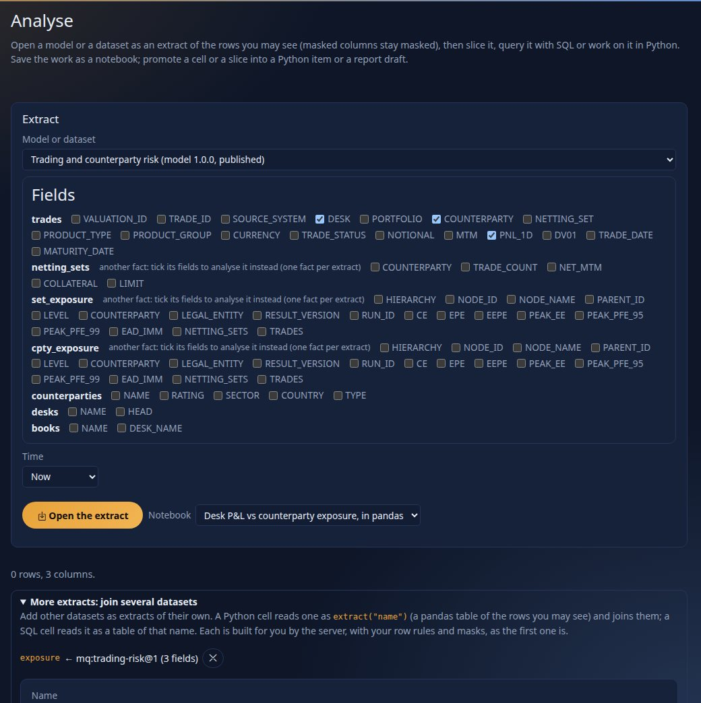

Every extract is the reader's, so a join of two extracts shows **their** rows: a join key that the server masks for them arrives masked
and the join finds nothing, which is the mask doing its job. Because the extract is cut, a cell over it gives the extract's totals, not
the model's: for true totals use the Pivot or a report.

### 2.3 SQL cells

A SQL cell is **Drishti SQL over the model the extract reads** ([ARCHITECTURE.md](../architecture/ARCHITECTURE.md), section 28), run by
the server **as you**, with your row rules and masks, through the same plan as the model query it equals. Its tables are the model's
aliases, a measure is `MEASURE('name')`, and `JOIN` needs no `ON` (the model's relationships are used). A new cell starts with a
statement written from the model (the first text field you ticked and the model's first measure):

```sql
SELECT trade.CURRENCY,
       MEASURE('Sum of MTM') AS "Sum of MTM"
FROM   trade
GROUP  BY trade.CURRENCY
LIMIT  20
```

The cell's footer says *3 rows in 4 ms · Drishti SQL, run by the server over sql-model@1 as you · plan p_825d3a8857*, with the masked
columns when there are any:

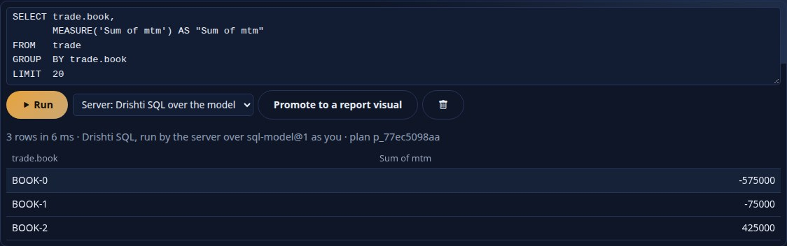

The console sends the cell to `POST /bi/notebook/sql` (`{extract, sql}`), which asks the server's `POST /api/v1/bi/sql` with the model and
the cell's row limit (`bi.notebook.sql_max_rows`, one more to say when it was cut); it never reads the SQL itself. One `SELECT` per cell;
text over `bi.notebook.sql_max_chars` (20,000) is `DRS-9072`. *Run all* runs the cells in order. The same SQL runs from the terminal with
`drishti.py bi sql` ([section 6](#6-on-the-command-line)).

### 2.4 Python cells

A Python cell sees `df` (the extract as a pandas DataFrame), `extract(name)` (any other extract of the notebook, as a DataFrame for the
same reader) and `params`. What it prints comes back as text; what it puts in **`result`** is drawn: a DataFrame or Series as a table, a
dict as an ECharts option, SVG text or PNG bytes as an image, anything else as a value.

```python
g = df.groupby("DESK", as_index=False)["NOTIONAL"].sum()
result = {"title": {"text": "Notional by desk"}, "xAxis": {"type": "category", "data": list(g["DESK"])},
          "yAxis": {"type": "value"}, "series": [{"type": "bar", "data": [float(v) for v in g["NOTIONAL"]]}]}
```

**Run** sends the cell to the server (`POST /bi/notebook/python`), which reads the extract and the other extracts **as you** and runs the
cell on the compute pool `python` in its strict sandbox: no network, files held to its own folder, the cell's time and memory limits
(`bi.notebook.cell_timeout_seconds`, `cell_memory_mb`), the pinned libraries only. The line above the output says where it ran, how long
it took, how many rows it read and what was masked; what the cell printed shows first, then its `result`; a failure shows the error and,
as an author, your own code's traceback. Where the server cannot run Python safely (compute off, a Windows server), *Run* is off and says
why; you can still write, save and promote cells. Whoever opens the notebook later runs them over their own rows.

Running Python needs the **`bi-author`** power (the page says *Running Python needs the bi-author power.*); SQL needs only `bi`. The
packages a cell may import are the pinned allow-list ([section 9.3](#93-the-pinned-libraries-installing-and-locking-the-environment)).

### 2.5 Saving a notebook

**Save as a notebook** stores the extract's definition and every cell as a BI item of kind **`notebook`**: in *My workspace* (or, if you
opened a notebook you may edit, as a new version of it). It has versions, diffs, review and publishing like any item
([REPORTS_GUIDE.md](REPORTS_GUIDE.md)); *Open in the Notebook* on the item page (or `/bi/notebook?item=<id>`, or the notebook picker)
reopens it: the extract is rebuilt for whoever opens it, so **a notebook shared with someone else shows *their* rows**. Outputs are not
stored, only the code.

The body is YAML, checked by `POST /bi/notebook/check` (unknown keys and bad cells are `DRS-9070`, naming the cell):

```yaml
rachana: 1
notebook: desk-notional-first-look
title: Desk notional, first look
dataset: mq:trades-basic@1       # the model it reads (mq:<model>@<major>, or dataset:<name> for a dataset's implicit model)
fields: [trade.TRADE_ID, trade.DESK, trade.PORTFOLIO, trade.NOTIONAL, trade.MTM]
extracts:                       # optional: further extracts, read by a Python cell as extract("name")
  - { name: exposure, dataset: mq:counterparty-exposure@1, fields: [set_exposure.COUNTERPARTY, set_exposure.PEAK_EE] }
cells:
  - type: sql
    source: SELECT trade.DESK, MEASURE('Sum of MTM') FROM trade GROUP BY trade.DESK
  - type: python
    source: |
      result = df.groupby("DESK", as_index=False)["NOTIONAL"].sum()
```

A cell is `sql` or `python`; slicing is the Pivot's, so a notebook saved with a `slice` cell opens with that cell left out and a line
saying so. A notebook may also carry the catalogue's keys (`sample`, `tags`, `endorsement`, `owner`, `audience`); a shipped one is
`config/bi/notebooks/banking/pnl-vs-exposure-pandas.notebook.yaml`. A notebook's cells can also become a Python-driven table's build
function ([TABLES_GUIDE.md](TABLES_GUIDE.md#114-python-driven-tables-and-models)).

### 2.6 Promote

Every promotion answers **beside the button you pressed** (one message, with an *Open the draft* link). Pressing the same promotion again
for the same cell does not make a duplicate: it offers **Update that draft** or **Save another**. Promoting writes a **draft** item in your
workspace; nothing is published.

* **A SQL cell to a report visual.** Choose where first, in the line *Promote a SQL cell to* above the tabs: **a new report draft**, or
  one of the report drafts you may edit (your workspace and the shared ones you contribute to), and optionally the page. Plain and
  `GROUP BY` columns become *rows*, `MEASURE('name')` and the aggregates `sum`, `avg`, `count`, `min`, `max` of a column become *values*
  when the model has that measure, and simple `WHERE` conditions (`=`, `<>`, `<`, `<=`, `>`, `>=`, `IN`, `NOT IN`, `BETWEEN`,
  `IS [NOT] NULL`, joined by `AND`) become *filters*. What a report cannot say (an expression, `LIKE`, `OR`, `HAVING`, a sub-query,
  `ORDER BY`, `LIMIT`) is left out and listed in the notes; nothing is guessed. A new report draft reads the extract's model; in an
  existing one the visual is added below what the page holds and the report is written again by the designer's writer (comments in its
  YAML are not kept; the note says so).

  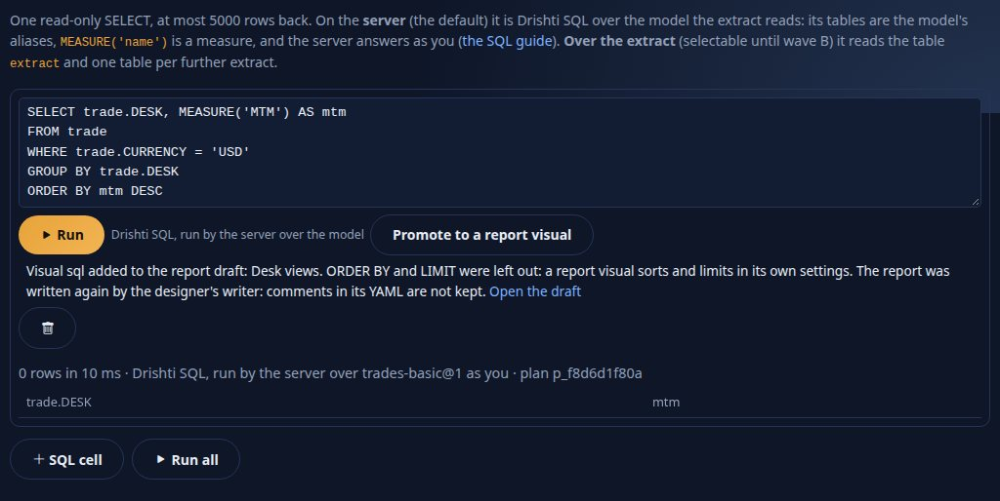

* **A Python cell to a Measure or a Visual** (the cell's buttons): the cell's `df` becomes the function's `table`, `result` is returned,
  and the packages the cell imports go into the manifest ([section 3.3](#33-the-manifest)). Check it on the item page, then publish.
* **A Python cell that joins extracts to a Transform** (*Promote to a Transform*, greyed with "Add a second extract first" until the
  notebook has one): each `extract("name")` becomes a parameter of `run(...)`, a use of `df` becomes the first extract, and the cell's
  `result` is returned ([section 4](#4-transforms-a-table-in-a-table-out)).

The route is the console's `POST /bi/notebook/promote` with `{to: report, name, dataset, sql, columns, qualified, target?, page?}` or
`{to: measure | visual | transform, name, source, columns, extracts?}`.

### 2.7 Profile

The **Profile** tab shows every column of the extract: its type, what its text looks like (numbers or dates kept as text), empty values
(count and %), distinct values, whether it could be a key, min and max (and the mean of a number), the five most common values and a
histogram of a number. No code of yours runs (`POST /bi/notebook/profile` with `{extract}`), and it is drawn by the same panel as the
[Transform editor's profile](#55-profiling). A column masked for you says so and profiles as empty.

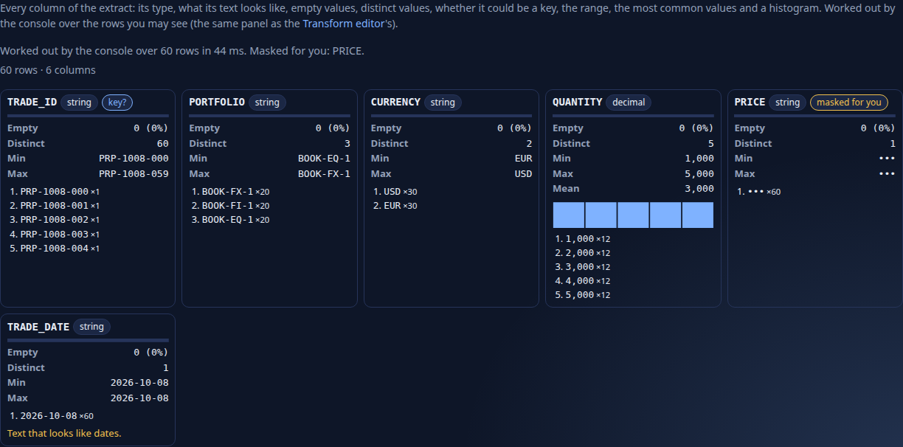

### 2.8 Who sees what in the Notebook

The server decides, as everywhere in BI: the extract is a model query (`POST /api/v1/bi/mq`) **as you**, so the same column masks and row
rules as a report apply, and a masked column arrives empty. A SQL cell is answered by the server as you; a Python cell runs on the pool
over the extract built for you. A cell cannot widen access, and a saved notebook holds code, not data.

### 2.9 Notebook settings, errors and routes

The console's `bi.notebook.*` settings ([CONFIGURATION.md › `bi.notebook`](../admin/CONFIGURATION.md#binotebook)) set the most rows of an
extract (`max_rows`, 10,000), its most columns (`max_fields`), a SQL cell's limits (`sql_max_rows`, `sql_max_chars`), a Python cell's
limits (`cell_timeout_seconds`, `cell_memory_mb`, `cell_max_chars`), the most cells (`max_cells`) and the most further extracts
(`max_extracts`).

| Code | HTTP | In the Notebook |
|---|---|---|
| `DRS-9070` | 422 | the request is wrong (no fields, a bad name, a notebook that does not check, a SQL syntax error, a slice sent to promote) |
| `DRS-9072` | 413 | a limit: SQL text, cell size, extract fields or extracts |
| `DRS-9073` | 403 | refused: Python without `bi-author` |
| `DRS-9074` | 503 | Python does not run on this server now (the reason is given), or the console lacks `pyarrow` |

The server's own refusals (`DRS-9001` no such dataset, a denied model) come through unchanged; a Python cell's own failures are
`DRS-9071` to `9074` ([section 8](#8-limits-and-errors)). The routes are the console's own, JSON from its pages only (same-origin, the
session cookie): `GET /bi/notebook`, `GET /bi/notebook/status`, `POST /bi/notebook/extract`, `POST /bi/notebook/sql`,
`POST /bi/notebook/python`, `POST /bi/notebook/profile`, `POST /bi/notebook/check`, `POST /bi/notebook/promote`.

## 3. Python measures and visuals

Where the expression language and the visual catalogue stop, Drishti runs **typed Python**: a **Measure** is a Python function that turns
the rows of a group into a number (a desk's P&L volatility, a percentile no aggregate gives, a fitted slope), and a **Visual** is a Python
function that turns rows into a chart (a histogram with your own bins, a regression plot). Authors do not paste scripts into a visual: a
Python function is a **BI item** of its own (kind `python`), with a manifest, versions, review and publishing like a dataset or a report,
and a report names it.

### 3.1 At a glance

| | Python measure | Python visual |
|---|---|---|
| function | `compute(table, params)`, or `compute_groups(frame, by, params)` once over every group | `render(table, params)` |
| called | once per group, with that group's rows | once, with all the rows handed over |
| returns | one number (or `None`) | an ECharts option, a Vega-Lite specification or a drishti-chart spec (a dict, by `output:`), SVG text or PNG bytes |
| drawn as | bars, one per group | the chart or image |

Two samples ship (`config/bi/python/`), and the sample report **Desk P&L risk (Python)** (`python-desk-risk`) shows both on the trades
model:

* `desk-pnl-volatility` (a measure): the standard deviation of one-day P&L, per desk;
* `pnl-histogram` (a visual): a histogram of one-day P&L drawn with numpy.

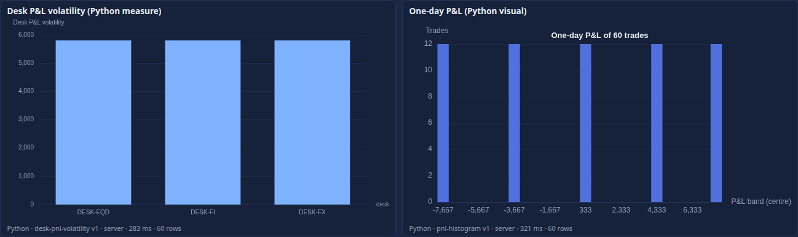

### 3.2 The two interfaces

**Measure.** `config/bi/python/banking/desk-pnl-volatility.python.yaml`:

```yaml
rachana: 1
python: desk-pnl-volatility
title: Desk P&L volatility
interface: measure
inputs: [pnl1d]                  # the columns the function reads, as the table names them
packages: [pandas]
target: server                   # the server's compute pool
timeout: 10                      # seconds
memory: 256                      # megabytes
params: { min_trades: 2 }
source: |
  def compute(table, params):
      """One number for the rows of one group."""
      pnl = table["pnl1d"].dropna()
      if len(pnl) < int(params.get("min_trades", 2)):
          return 0.0
      return float(pnl.std(ddof=1))
```

`table` is a **pandas DataFrame** holding that group's rows and **only the columns in `inputs`**. The function returns a number (an int or
float; `None` or NaN is shown as blank; infinity or anything else is `DRS-9071`). Which columns make a group comes from where the measure
is used ([section 3.5](#35-a-python-measure-in-a-model)): the measure's `by`.

**Visual.** `config/bi/python/banking/pnl-histogram.python.yaml`:

```yaml
interface: visual
output: echarts                  # echarts (an option), vega-lite, drishti-chart, svg or png
inputs: [pnl1d]
packages: [numpy]
params: { bins: 20 }
source: |
  import numpy as np

  def render(table, params):
      pnl = table["pnl1d"].dropna().to_numpy(dtype=float)
      counts, edges = np.histogram(pnl, bins=int(params.get("bins", 20)))
      ...
      return {"title": {...}, "xAxis": {...}, "yAxis": {...}, "series": [{"type": "bar", "data": [int(c) for c in counts]}]}
```

`table` is a DataFrame of the rows the visual hands over (the columns of its `columns` well; the row `id` is dropped). The function returns
**data, never markup**: an ECharts option drawn by the console's own charts (any `formatter`, `valueFormatter`, `extraCssText` and
`appendToBody` key is removed: those are the places an option can carry HTML), an SVG (refused if it holds `<script`, `javascript:`,
`<foreignObject`, `<iframe`, `<image`, `xlink:href` or an `on...` handler; shown as an image, which never runs script) or PNG bytes.
Colours you leave out (text, axes, grid lines) take the page's theme, so a chart reads in the dark and the light theme alike.

### 3.3 The manifest

The body of a `python` item is YAML:

| Key | Required | Meaning |
|---|---|---|
| `python` | yes | the item's name (letters, digits, hyphen, underscore) |
| `interface` | yes | `measure`, `visual`, `transform` ([section 4](#4-transforms-a-table-in-a-table-out)) or `column` ([section 3.7](#37-grouped-measures-and-the-column-interface)) |
| `source` | yes | the code; up to 65,536 characters; it must define the entry function |
| `entry` | no | the function's name: `compute` for a measure, `render` for a visual, `run` for a transform (a top-level function, or a method of a class `Transform`) |
| `inputs` | measure, transform: yes | a measure: the columns the function reads, as the table names them (`pnl1d`, not `trade.pnl1d`); a transform: the **datasets** it reads, in the order its function receives their frames |
| `packages` | no | what the source imports; each must be on the allow-list (`drishti.bi.report.python-packages`) **and pinned** in `config/compute/locks/python.lock` |
| `target` | no | `server` (default). `browser` and `both` are read and run on the server's pool like `server` |
| `timeout` | no | seconds, 1 to `drishti.bi.report.python-max-seconds` (60); default 10 |
| `memory` | no | megabytes the code may add to what Python needs to start, 32 to `python-max-memory-mb` (1024); default 256 |
| `output` | visual | `echarts` (default), `vega-lite`, `drishti-chart` ([section 3.8](#38-vega-lite-and-drishti-chart-output)), `svg` or `png`; a measure's output is `number`, a transform's `frame` |
| `params` | no | defaults the function reads from `params`; a visual of a report overrides them in `format.params` |
| `tests` | no | examples the item must pass: run by Check, and a failing one refuses a publish ([section 3.9](#39-tests-shipped-with-an-item)) |
| `title`, `description`, `owner`, `tags`, `endorsement`, `audience`, `sample`, `version` | no | the catalogue's keys, as for any item |

Anything else is refused with `DRS-9070` and the path of the key. The server checks the manifest (`POST /api/v1/bi/python/validate`, and
on every publish); **Check the Python**, the button on the item page (the console's `POST /bi/python/check`, the server's
`POST /api/v1/bi/python/check`), adds the checks that need Python's own parser, made on the compute pool without running anything: the
source parses, defines its entry, and imports only what it lists or the safe standard library.

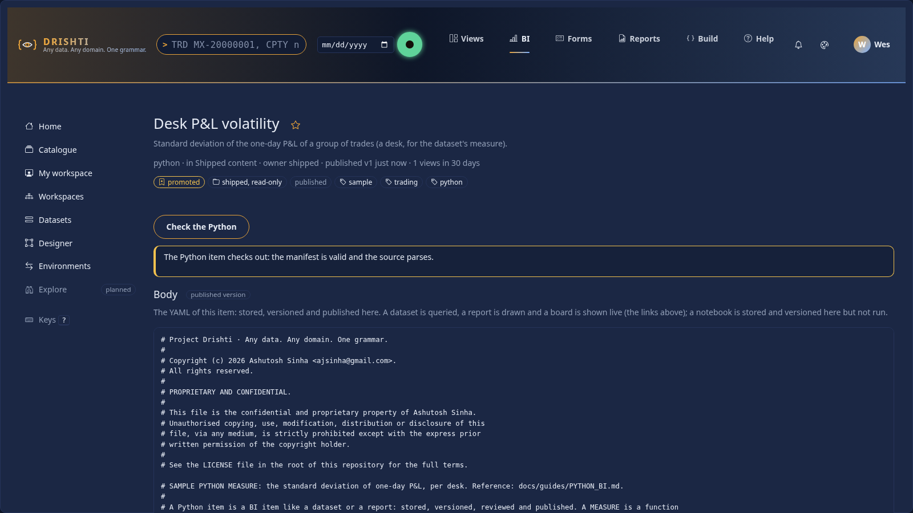

### 3.4 Python items are BI items

A Python item lives where every BI item lives: **shipped** in `config/bi/python/<id>.python.yaml` (a published, read-only item,
`file:python:<id>`, watched live), or **in a workspace** (create it with kind *python*, or `drishti.py bi item new`). Nothing about
governance is special:

* every save is a saved state (diff, restore); **publish** checks the manifest and refuses a bad one with `DRS-9070`; a workspace that
  requires review needs a second person to approve it ([REPORTS_GUIDE.md](REPORTS_GUIDE.md));
* a report that names the item runs **what was published** for every viewer; someone who edits the item (a contributor or better in its
  workspace) runs the **draft**, so a change can be tried before it is published; the run line under the visual shows the version;
* it has an owner, tags, endorsement and an audience like any item, and appears in the catalogue (`kind=python`) and in bundles.

A report **names an item** by catalogue id, shipped file name (`pnl-histogram`) or title. Anyone who can open a published report can have
its Python items run for them: the report is what names the item, as it is what names the dataset.

### 3.5 A Python measure in a model

A measure may be a **Python item** instead of an expression: `python:` names the item (catalogue id, shipped file name or title), `inputs`
the columns its function reads and `by` the columns that make a group, all `table.column` and all of **one table**:

```yaml
measures:
  Desk P&L volatility:
    python: desk-pnl-volatility       # config/bi/python/banking/desk-pnl-volatility.python.yaml
    inputs: [trade.PNL_1D]            # columns of ONE table
    by: [trade.DESK]                  # one number per desk
    description: Standard deviation of the one-day P&L per desk, computed in Python.
```

The SQL engine **cannot run it**: a query that names a Python measure is refused (`DRS-9013`), and the model says so as a warning when it is
checked, so the measure is shown by a **python visual** (below), not mixed into a bar chart's SQL measures. The server reads the rows of
`by` and `inputs` that this person may see, and the pool calls the item once per group. Checks: the item is named, `inputs` is not empty,
every name is a column, all of one table (`DRS-9012`); `expr` and `python` together are `DRS-9010`. The model is checked **without**
looking the item up (an item can be published after it), so a wrong item name appears when a report runs it (`DRS-9001`/`9070`). The
keys of a model's measures are in [TABLES_GUIDE.md](TABLES_GUIDE.md).

### 3.6 The python visual in a report

The **`python` visual** (designer, catalogue group *Python*; wells `columns` and `values`):

```yaml
- id: volatility
  type: python
  title: Desk P&L volatility (Python measure)
  wells: { values: [Desk P&L volatility] }        # a Python measure of the model: its columns and groups come from the measure
  format: { run: auto }

- id: histogram
  type: python
  wells: { columns: [trade.DESK, trade.PNL_1D] }   # the rows handed to Python
  format: { python: pnl-histogram, params: { bins: 24 }, run: auto }
```

| Key | Meaning |
|---|---|
| `wells.values` | one Python measure of the model; the rows are its `by` and `inputs` columns |
| `wells.columns` | the columns handed to a Python item named in `format.python` (any number of fields of one table) |
| `format.python` | the item; required unless the values well holds a Python measure. With a measure item and no model measure, the groups are the columns that are not `inputs` |
| `format.params` | overrides the item's `params` |
| `format.run` | `auto` (default), `server` or `browser`: every value runs on the server's compute pool; with `auto` a server that cannot run Python safely answers `DRS-9074` and says why |

The rows are the table's own rows (not grouped), under the page's slicers, filters and business date, at most
`drishti.bi.report.python-rows` (10,000). The report **check** refuses a python visual with neither an item nor a Python measure, with a
values well that is not a Python measure, or without columns (`DRS-9032`). A python visual has no drill, selection, alert or *show the
rows* buttons; an export of it is the table of rows handed to Python. In the designer its Format pane takes the item and the parameters;
the canvas shows a placeholder, since Python runs when a report is opened, not while designing. The line under each visual says the server
ran it: `Python · desk-pnl-volatility v1 · server · 240 ms · 60 rows`.

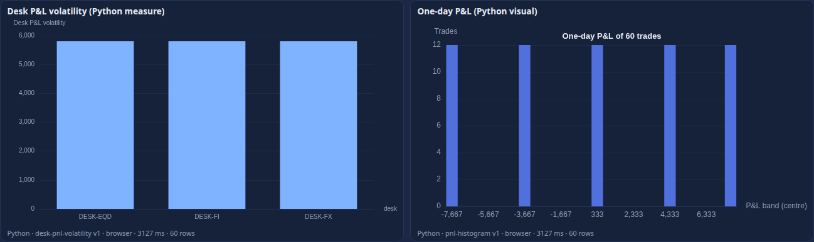

### 3.7 Grouped measures and the column interface

* **`compute_groups(frame, by, params)`.** A measure may define it instead of `compute`: one vectorised call over every group's rows that
  returns a DataFrame of the group columns and one value column (`value`, else the last). Faster for many groups:

  ```python
  def compute_groups(frame, by, params):
      out = frame.groupby(by, dropna=False)["pnl1d"].std().reset_index()
      return out.rename(columns={"pnl1d": "value"})
  ```

* **The `column` interface.** `derive(frame, params)` returns one value per row (a Series, an array or a list), for a column written
  `derive: { python: … }` (a calculated column computed in Python).

### 3.8 Vega-Lite and drishti-chart output

A visual may return a **Vega-Lite** specification instead of an ECharts option: say `output: vega-lite` in the manifest and return the
specification as a dict (`mark`, `encoding`, `layer`, `transform` ... as [Vega-Lite](https://vega.github.io/vega-lite/) has them). The sample
`config/bi/python/banking/pnl-vega.python.yaml` draws one dot for each trade's one-day P&L, by desk, with each desk's median as a tick:

```python
def render(table, params):
    rows = table.dropna(subset=["pnl1d"]).head(int(params.get("max_points", 400)))
    dots = [{"desk": str(r.desk), "pnl1d": float(r.pnl1d)} for r in rows.itertuples()]
    medians = [{"desk": str(d), "median": float(v)} for d, v in rows.groupby("desk")["pnl1d"].median().items()]
    return {"layer": [
        {"data": {"values": dots}, "mark": {"type": "circle", "opacity": 0.6, "size": 40}, "encoding": {"x": {"field": "pnl1d", "type": "quantitative"}, "y": {"field": "desk", "type": "nominal"}}},
        {"data": {"values": medians}, "mark": {"type": "tick", "thickness": 3, "color": "#d9534f"}, "encoding": {"x": {"field": "median", "type": "quantitative"}, "y": {"field": "desk", "type": "nominal"}}}]}
```

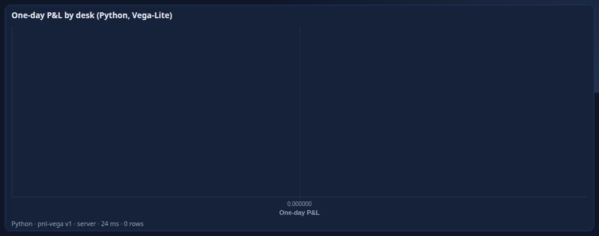

What comes back from the worker is data, as with ECharts: `{"kind": "vega-lite", "spec": {...}, "ms": 258}`. The page has no Vega:
drishti-chart translates the specification (`fromVegaLite`) and draws it, and a feature it does not translate is refused in words with what
to use instead (`DRS-9077`; the list is with the report's own Vega-Lite visuals in [REPORTS_GUIDE.md](REPORTS_GUIDE.md)). The rules:

* **The data is inside the specification** (`data.values`). A `url` or a `loader` anywhere in it is refused, in the sandbox (`DRS-9073`: "a
  Vega-Lite specification may not load anything from a URL or name a loader") and again in the page. An expression such as
  `datum.MTM < 0` is read by drishti-chart's expression language, **without `eval`**, so the page keeps its strict content security policy.
* The chart takes the theme's colours and fills its frame (`width` and `height` are ignored).

**The preferred form: a drishti-chart spec.** A visual whose manifest says `output: drishti-chart` returns a drishti-chart spec (a dict)
with its rows inline, and the page draws it as it is: every kind drishti-chart has (bar, line, area, scatter, bubble, histogram, boxplot,
heatmap, pie, donut, waterfall, treemap, sankey, gauge, candlestick, map, layers), its annotations and conditional marks, nothing to
translate and nothing refused. The answer is `{"kind": "drishti-chart", "spec": {...}}`; a spec without `kind` is a `TypeError`, and
`data.source` (an address to load) is refused in the sandbox (`DRS-9073`): put the rows in `data.rows`. The spec's language is in
[ELEMENTS_API.md](ELEMENTS_API.md) (drishti-chart).

```python
def render(table, params):
    by_desk = table.groupby("DESK", as_index=False)["PNL_1D"].sum()
    return {"kind": "bar", "title": "One-day P&L by desk", "data": {"rows": by_desk.to_dict("records")},
            "x": {"field": "DESK"}, "y": {"field": "PNL_1D", "format": "amount0"},
            "colourWhen": [{"when": "datum.PNL_1D < 0", "tone": "bad"}]}
```

The answer is at most 4 MB. A report can also hold a Vega-Lite visual with **no Python at all** (`type: vega-lite`,
[REPORTS_GUIDE.md](REPORTS_GUIDE.md)).

### 3.9 Tests shipped with an item

A Python item may carry `tests:`: examples of what its function must return. **Check** runs them on the server's compute pool, one request
each (the same as a report's run), and shows each as passed, failed or could not run; a **publish** is refused while one fails.

```yaml
tests:
  - name: the standard deviation of one desk
    input: { columns: [pnl1d], rows: [[1.0], [2.0], [3.0], [4.0]] }      # a frame written in the test
    expect: 1.2909944
    tolerance: 0.000001
  - name: a desk of its own in a grouped call
    input: { columns: [desk, pnl1d], rows: [[FX, 1.0], [FX, 3.0], [RATES, 10.0], [RATES, 14.0]] }
    by: [desk]                                                                # a measure: the group columns
    expect: { FX: 1.4142136, RATES: 2.8284271 }                              # a number for each group
    tolerance: 0.000001
```

A test may read rows of a dataset instead of a frame it carries: `sample: { dataset: trades-basic, fields: [trade.DESK, trade.PNL_1D], limit: 200 }`.

| Key | Meaning |
|---|---|
| `name` | required, unique in the item |
| `input` | the frame: `{columns: [...], rows: [[...]]}` (up to 1,000 rows). For a **transform**, a mapping of each input dataset to its frame |
| `sample` | instead of `input`: `{dataset, fields: [table.column, ...], limit}` (at most 1,000 rows). The rows are the ones the **person running the test** may see (row rules and masks apply), so such a test can pass for one person and fail for another; a sample is for a check against real data, an `input` for a stable one |
| `params` | values over the item's defaults |
| `by` | a measure: the group columns; without it the whole input is one group |
| `expect` | a **measure**: a number (no `by`) or a number for each group (`by`: no group may be missing and none may be extra). A **visual**: `{kind: echarts \| vega-lite \| svg \| png, has: {<dotted path>: <value>}}`, for example `{kind: vega-lite, has: {layer.0.mark.type: circle}}` (a path steps through keys and list indexes). A **transform**: `{columns: [...], rows: <count>}` |
| `tolerance` | absolute, default `1e-9`; for numbers in `expect` and in `has` |

The server reads the **shape** of `tests:` when the item is validated or published (`DRS-9070`, with the path of the key:
`tests[0].expect`) and runs them on its compute pool:

* **Check** (the item page's *Check the Python*) shows them, each with its result: `passed`, `FAILED` (with what it expected and got) or
  `could not run` (the code failed, a package is off the list, Python does not run on this server: the message has the `DRS` code). Body
  `{yaml, tests: false}` skips them.
* **Publish and approve** run them first, whichever way they are asked (the console, the API, the command line); a failing or unrunnable
  one refuses the publish (`DRS-9076`) with the first three: `'Vol' cannot be published: 1 of its 3 tests fails (bad: expected 9.0, got
  1.0). Fix the item or the expected value; a bi-admin may publish it with force.` A **bi-admin** may send `{"force": true}`.

Real output of Check on the two samples that ship tests:

```
desk-pnl-volatility  3 tests: passed 3
  pass  the standard deviation of one desk      1.2909944487358056
  pass  too few trades is zero                  0.0
  pass  a desk of its own in a grouped call     2 groups
pnl-vega             2 tests: passed 2
  pass  a dot for every trade and a median for every desk   vega-lite
  pass  at most max_points dots                             vega-lite
```

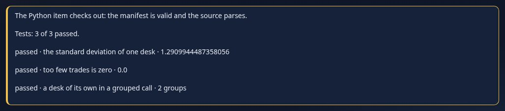

### 3.10 Python on boards and in alerts

**Boards.** A board tile may show a **python visual** of its report: a Python measure shown as bars, a Python visual that returns a
chart, or one that returns a Vega-Lite specification. The tile runs the item for the person looking, exactly as the report does, and shows
the line *Python · item · target · ms · rows* under it. The sample board `python-wall`
([config/bi/reports/banking/python-wall.report.yaml](../../config/bi/reports/banking/python-wall.report.yaml)) has three:

```yaml
- { id: vol,   type: tile, title: Desk P&L volatility, from: { report: python-desk-risk, visual: volatility }, at: { x: 0, y: 0, w: 6, h: 6 } }
- { id: hist,  type: tile, title: One-day P&L,          from: { report: python-desk-risk, visual: histogram },  at: { x: 6, y: 0, w: 6, h: 6 } }
- { id: strip, type: tile, title: P&L by desk,           from: { report: python-desk-risk, visual: strip },      at: { x: 0, y: 6, w: 12, h: 6 } }
```

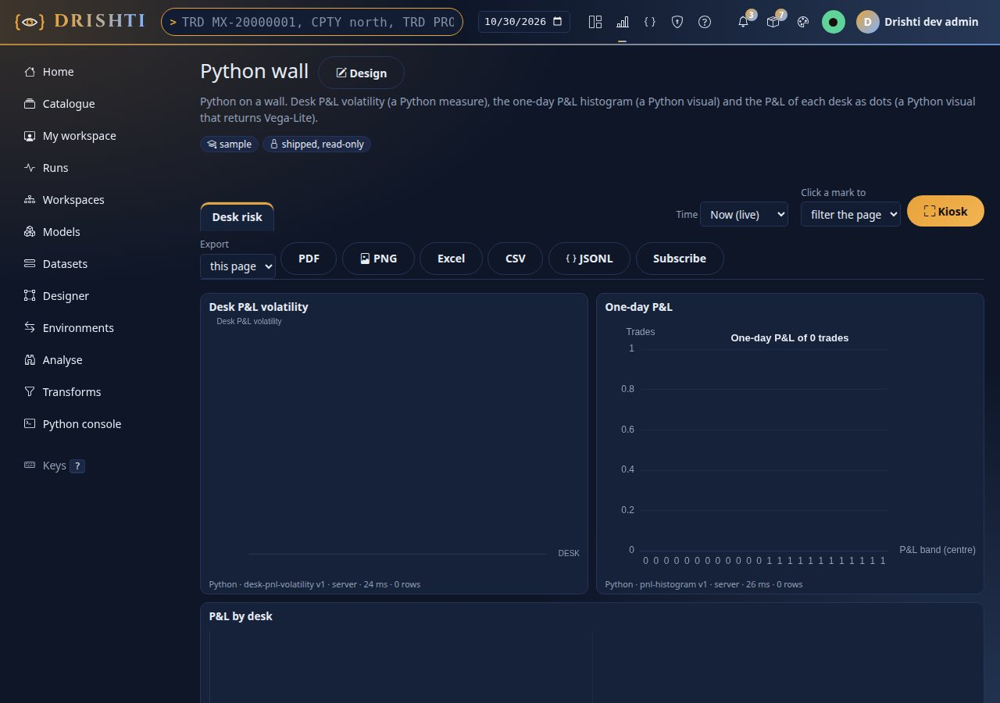

A Python tile has **no `alert:` of its own**: the colour rule reads the numbers a query returns, and a Python tile's number is made by code
that runs for the person looking. To be told when a Python measure crosses a limit, make an **alert** on it.

**Alerts.** An alert's source may be a **Python measure**: a dataset source whose measure is one (`type: dataset`,
`measure: Desk P&L volatility`), or a visual source whose visual is a python visual that shows one. It is read **for each person it is
judged for**, on the alert's schedule, after a load or by hand:

1. the server builds **that person's rows** (their row rules and masks applied by the engine) for the measure's `inputs` and `by` columns,
   up to `drishti.bi.report.python-rows`;
2. it hands the Python item and the rows to the compute pool `python`, which runs the item in the same strict sandbox;
3. the item's number for each group comes back and is reduced to **one number**: for a dataset source the whole input is one group; for a
   visual source `reduce` (`first` by default; `sum`, `min`, `max`, `avg`, `last`, `count`) is applied to the groups.

* A column **masked for the person** makes the reading *masked*: nothing is run and no figure is shown. An alert whose number is masked
  for its owner **when it is saved** is refused (`422`, *the value this alert watches (MTM) is masked for you, so it could never be read:
  an alert only watches a value its owner may see*).
* A visual or model query that answers **several rows** needs the number chosen: one cell (a `state` that filters it to one row) or an
  aggregate (`source.reduce`); saving one without `reduce` is refused and says which to choose.
* A run that fails (the code raised, a limit, the sandbox refused something, Python not running on this server) is an **error reading**
  with the DRS code and its words in the history; an error reading never fires and never clears.
* A python visual that draws a **chart** (no measure in its wells) has no number to watch: the alert reads as an error that says to watch
  a Python measure.
* A Python alert is not cheap (it starts a process for each person each time): prefer `schedule` or `after-load` to `live`.

```
PUT /api/v1/alerts/rules/Vol
{"title": "Desk P&L volatility", "source": {"type": "dataset", "dataset": "file:dataset:trades-basic", "measure": "Desk P&L volatility"},
 "condition": {"type": "threshold", "op": "above", "value": 5000}, "trigger": {"mode": "after-load"}}
```

The rest of alerts (conditions, triggers, delivery) is in [REPORTS_GUIDE.md](REPORTS_GUIDE.md).

## 4. Transforms: a table in, a table out

The third interface, after the Measure and the Visual, is the **Transform**: Python that turns the frames of one or more answers into **a
table**, which a **Python dataset** publishes as its one table (`source: { python: <item>, inputs: { <name>: <a model query> } }`), with
measures in a model over it. Use it where a join or a reshaping is easier in pandas than in the dataset language (a merge with a
tolerance, a rank, a fitted column, a pivot), and you still want the result to be a dataset every report, alert and subscription can use.

```yaml
rachana: 1
python: pnl-vs-exposure
interface: transform            # a table in, a table out
inputs: [pnl, exposure]         # the inputs of the Python dataset (model queries), in the order its function receives their frames
packages: [pandas]
target: server                  # a Transform runs on the server and its result is kept for the reader
timeout: 20
memory: 512
params: { floor: 1.0 }          # defaults; the dataset may override them
source: |
  def run(pnl, exposure, params):
      m = pnl.merge(exposure, on="counterparty", how="left")
      m = m.rename(columns={"Desk P&L": "desk_pnl", "Exposure (EE peak)": "ee_peak"})
      m["pnl_per_exposure"] = m["desk_pnl"] / m["ee_peak"].clip(lower=float(params.get("floor", 1.0)))
      return m[["counterparty", "name", "sector", "desk_pnl", "ee_peak", "pnl_per_exposure"]]
```

**The contract.**

| | |
|---|---|
| function | `run(*frames)`: one **pandas DataFrame** per input, in the order of `inputs`. A function that has a parameter named `params` receives the parameters (the manifest's `params` over the dataset's); or a class named `Transform` with a method `run(self, *frames)`, which finds the parameters in `self.params` |
| frames | what the reader may see: each input is a model query asked **as the reader**, so row rules and masks are already applied and a masked column is null. Each column is named by the last part of its field or measure name (`counterparties.id` is `id`) |
| returns | a DataFrame: no more than `drishti.bi.transform.max-rows` rows; column names of letters, digits and underscore; no duplicate names. Anything else is `DRS-9071` |
| column types | typed from the frame: `int` is `integer`, `float` and decimals are `decimal`, `bool` is `boolean`, dates and timestamps are `date` and `timestamp`, everything else `string` |
| `inputs` (manifest) | the names of the Python dataset's inputs, not columns: the dataset's `source.inputs` must name the same in the same order (`DRS-9075` otherwise) |
| `target` | `server` only |

**Who sees what.** The server asks each input as the reader and hands the answers to the pool, exactly as for a Python measure. The frame
comes back as a Parquet file, is checked against the columns and types the dataset or table declares (its **contract**: a column
missing, or `string` where `decimal` is declared, is `DRS-9075` in words), and the server keeps it for **that reader** and the version of
the inputs (`drishti.bi.transform.cache-ttl`, `cache-entries`). The code never sees anything the reader may not; another reader gets their
own run. Real output of the sample's first and second run (an author who may read every row):

```
Python Transform pnl-vs-exposure: 18 rows in 218 ms (first run); the same reader again: kept, 0 ms
```

**Checks.** The server checks the manifest on validate and publish (`DRS-9070`): a transform needs `inputs` naming datasets, defines `run`
(a top-level function or the method of a class `Transform`), and `target` is `server`. Check adds the source checks on the pool (it parses,
defines its entry, imports only what it lists; nothing runs).

**From the Notebook.** A notebook that joins several extracts in pandas ([section 2.2](#22-the-extract)) can **Promote to a Transform**:
each `extract("name")` becomes a parameter of `run`, the cell's `result` is returned; the draft is then checked and published, and a
Python dataset is written over it (the dataset wizard's source *A Python Transform*), one model query per parameter of `run`.

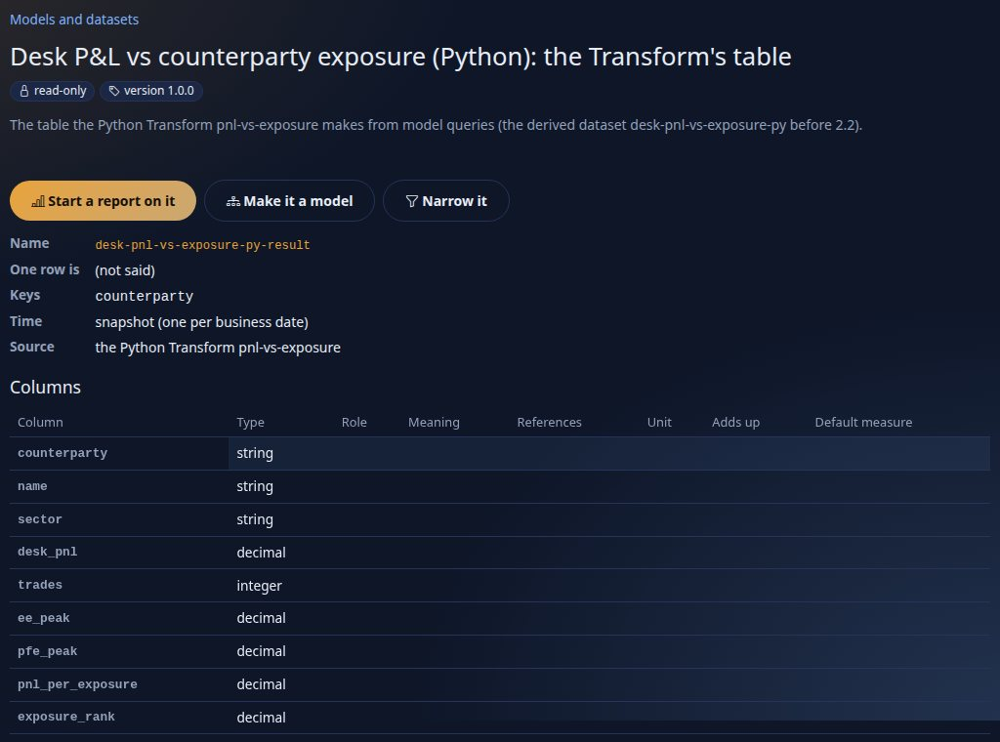

The sample is `config/bi/python/banking/pnl-vs-exposure.python.yaml` with the Python dataset `desk-pnl-vs-exposure-py-result` and the
model `desk-pnl-vs-exposure-py` over it ([tutorial 9, step 8](../tutorials/09-notebook-and-python.md#step-8--two-models-a-python-transform-and-a-join-in-the-notebook)).
Settings: `drishti.bi.transform.*` in
[CONFIGURATION.md](../admin/CONFIGURATION.md#drishtibitransform--python-transforms-and-composed-datasets).

## 5. Data prep: the Transform editor

The Transform editor makes the Python path the data-prep tool a Power Query author expects, without a step language: **raw rows straight
from a connector**, a **step-by-step run with a preview and a profile after every step** and a **tested snippets library** for the common
reshapes. The steps are lines of pandas, run on the server's compute pool in the same sandbox as every Python item, on the rows the
person looking may see.

### 5.1 Inputs straight from a connector

A Python dataset's `source.inputs` ([section 4](#4-transforms-a-table-in-a-table-out)) takes, besides a model query, a **pack kind read
through a connector**:

```yaml
source:
  python: fx-book-value-cleaned
  inputs:
    trades:                                   # the name run() receives it by
      kind: trade                             # a pack kind
      pack: trading                           # optional: which pack's definition (default: the first that declares it)
      connector: prep-store                   # optional: a connector by name (default: whichever the pack routes the kind to)
      fields: [TRADE_ID, TRADE_DATE, PORTFOLIO, CURRENCY, QUANTITY, PRICE]   # optional: the kind's columns (default: all)
      where: [{ field: PORTFOLIO, op: in, values: [BOOK-FX-1] }]             # optional: filters, as a model query's
      limit: 50000                            # optional: at most this many rows
    rates: { model: fx-rates@1, select: { fields: [rates.currency, rates.date, rates.rate], measures: [] }, shape: rows }   # a model query
```

A kind input is the rows of the kind's pack-generated dataset (`pack.trading.trade`), asked through its implicit model **as the reader**:
the kind's entitlements, their row rules and their masks apply exactly as in a report on it, and a masked column arrives masked. A role that
may not read the kind gets no rows. Naming a connector reads the same kind through that connector instead of the one the pack routes it
to; the input then asks only the fields it names (and the grain's keys), so **the connector must keep them as columns** (its `layout`),
which every lake connector does for the promoted columns. Its answers are never put in the result cache; the Transform keeps its own
result per reader.

The server checks the shape on validate and publish (`DRS-9108` with the path: `source.inputs.trades.colour`), a kind no pack declares is
`DRS-9102`, a field the kind lacks `DRS-9108` with the kind's columns, a connector that is not running `DRS-9026`. The lineage of the
dataset reaches the kind and the connector (`pack-kind`, `connector: prep-store`, `input: trades`).

**One input as you.** `POST /api/v1/bi/python/input` with `{input, limit?, asOf?}` answers the rows of one input (either form) as the
caller: Arrow with `?format=arrow` (headers `X-Bi-Rows`, `X-Bi-Masked`, `X-Bi-Model`, `X-Bi-As-Of`, the day the rows came from) or JSON
`{model, kind, columns, rows, rowCount, masked, asOf}`; `limit` defaults to 1,000 and never exceeds
`drishti.bi.transform.max-input-rows` (50,000). It needs the BI power. This is what the editor previews, and what
`drishti.py bi transform input` prints.

### 5.2 The editor

**BI → Transforms** (`/bi/transform`, the rail's *Transforms*; also the Notebook's *Transform editor* link) builds a Transform in four
parts, with **no YAML to type**:

1. **Inputs.** Name it as the code will (`trades`), then *A pack kind, straight through its connector* (pick the kind, optionally type the
   connector, tick the fields) or *A model or a dataset* (a model query of rows). The line under the input says how many rows came, the day
   they are of and what is masked for you.

   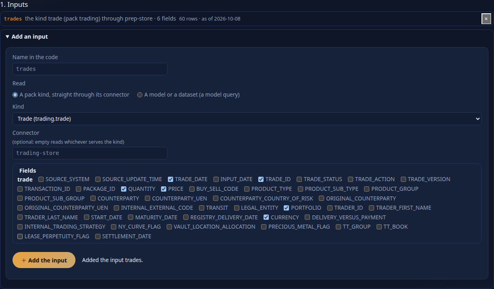

2. **Steps.** The first is *Start from trades* (`df = trades.copy()`). *Add a step from the snippets* opens a form for the snippet you
   choose ([section 5.3](#53-the-snippets-library)): the columns are those of the step before, the inputs are yours. *Write a step* takes a
   label and a few lines of pandas over `df`. A step is inserted after the one you are looking at; each can be edited (✎), moved (↑ ↓) or
   removed (×), and *Undo the last step* removes the last.
3. **Preview.** After every change the console asks the server to run the steps ([section 5.4](#54-the-step-by-step-run)) and each step
   shows its rows and columns; pick one to see its **first 20 rows** (*Rows*) or its **profile** (*Profile*,
   [section 5.5](#55-profiling)). A step that fails turns red, says its error and line, and the steps before it keep their frames.

   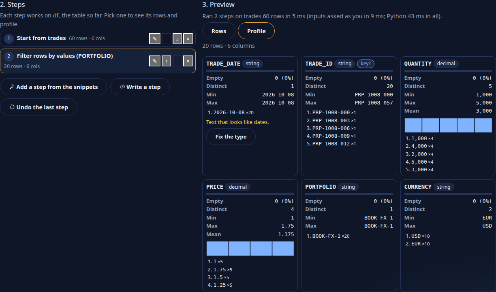

   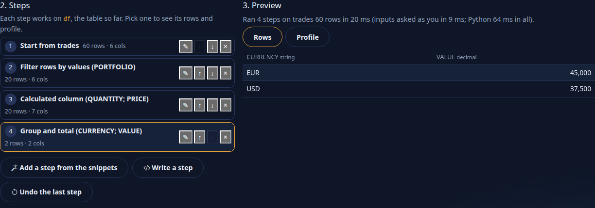

4. **Save.** Tick the column(s) that make one row (the grain; a column that was unique in the preview is offered first) and *Save as
   drafts*: a **Python item** (`interface: transform`) and a **Python dataset** that runs it, both drafts in your workspace. Check and
   publish the Python item first, then the dataset. The page's address then names both (`/bi/transform?item=<id>&dataset=<id>`), and
   opening it again opens the same steps.

The YAML is shown under *YAML: what is saved* and stays in step with the page; edit either text and *Read the YAML back* to see it as
steps again (a Transform written by hand opens too: its `# step:` comments are the steps, or its whole body is one step).

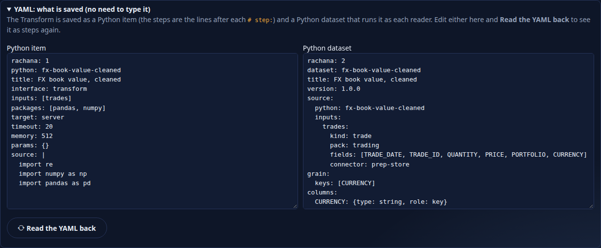

What is saved, for the sample above:

```yaml
rachana: 1
python: fx-book-value-cleaned
title: FX book value, cleaned
interface: transform
inputs: [trades]
packages: [pandas, numpy]
target: server
timeout: 20
memory: 512
params: {}
source: |
  import re
  import numpy as np
  import pandas as pd


  def run(trades, params):
      # step: Start from trades
      df = trades.copy()
      # step: Filter rows by values (PORTFOLIO)
      df = df[df['PORTFOLIO'].isin(['BOOK-FX-1']) == True].reset_index(drop=True)
      # step: Calculated column (QUANTITY; PRICE)
      df['VALUE'] = (pd.to_numeric(df['QUANTITY'], errors="coerce") * pd.to_numeric(df['PRICE'], errors="coerce")).replace([np.inf, -np.inf], np.nan)
      # step: Group and total (CURRENCY; VALUE)
      df = df.groupby(['CURRENCY'], as_index=False, dropna=False)[['VALUE']].agg('sum')
      return df
```

Running the steps needs the **bi-author** power (it runs Python); without it the page still writes and reads the YAML.

### 5.3 The snippets library

`drishti-console/config/prep-snippets.yaml` holds 21 snippets, each one step over `df` with parameters filled in a form. **A value is
always written as a Python literal** (`repr`): a column called `x"]; import os` is a column of that odd name, never code; an *input*
parameter must be one of the Transform's inputs and an *operator* one of its options (`DRS-9070` otherwise). Every snippet carries an
**example** (frames in, parameters, the frame expected out) that the test suite runs in plain pandas **and** as a step of the pool's
step-by-step run, so a snippet is correct out of the box.

| Group | Snippets |
|---|---|
| Columns | keep columns, rename a column, split a column, calculated column (`+ - * /`) |
| Clean | type fix: text to number, type fix: text to date, replace values, fill down (optionally within groups), remove duplicates |
| Rows | filter rows by values, drop rows with an empty value, sort rows |
| Combine | append another input (union), join another input, **as-of join of prices** (the latest price of the instrument on or before the row's date, within *n* days), **as-of FX conversion** (an amount to a base currency at the latest rate on or before the row's date) |
| Reshape | unpivot (columns to rows), pivot (rows to columns), group and total |
| Dates | align to a business day (following, preceding, modified following; weekends and the holidays you list), tenor bucket (`<1Y`, `1-2Y`, ..., `30Y+`) |

More snippets: a file of the same shape named by `bi.transform.snippets_file`
([CONFIGURATION.md](../admin/CONFIGURATION.md#prep-snippetsyaml-the-transform-editors-data-prep-snippets)).

### 5.4 The step-by-step run

`POST /bi/transform/steps` (the console) passes the page's inputs and code to the server (`POST /api/v1/bi/python/steps`): each input is
read **as you** ([section 5.1](#51-inputs-straight-from-a-connector), at most `bi.transform.preview_rows`, 1,000), then `run` runs **once**
on the compute pool (its usual sandbox and limits) with a mark after each step. The steps are the statements after each
`# step: <label>` comment of `run`'s body, or each top-level statement when there is none. After each step the worker describes the frame
that step made (the last DataFrame it assigned, else `df`; after the last step, what `run` returned): its rows, columns and types, its first
20 rows and its profile. The answer also profiles each input and gives the key hints between them. A step that raises stops the run:
`failed` has its index, label, line, error and traceback (the steps before keep their frames). Measured on the sample (60 rows, four
steps): the inputs asked in about 10 ms, the Python run about 45 to 65 ms in all.

The run is never kept: an author runs it as they edit. The Python dataset itself runs the same `run` as each reader when it is read.

### 5.5 Profiling

The **profile** of a frame, worked out on the compute pool over the reader's rows, is one card per column: its type; **what its text looks
like** (numbers or dates kept as text, with *Fix the type*, which adds the right type-fix step; digits in a column named like an
identifier, `TRADE_ID` or `..._CODE`, are not offered a number type: ids are text by design); empty values (count and %, with a bar);
distinct values; **key?** when every row has its own value; min and max (and the mean of a number); the five most common values; a
histogram of a number. Between inputs, *looks like a key of* names a column whose values (90% or more) are the values of another input's
unique column, with how many match: the *Join* snippet joins them.

The same panel is the Notebook's **Profile** tab ([section 2.7](#27-profile)); the server's route is `POST /api/v1/bi/python/profile`. No
author code runs to profile.

## 6. On the command line

The commands run over REST as the token's user (`--server`, `--token-file`, `--user` as for every REST command;
[CLI_REFERENCE.md](CLI_REFERENCE.md)):

```
drishti.py bi sql "SELECT ..." --model M [--explain] [--format table|json|csv|jsonl]   a Notebook SQL cell's statement, from the terminal
drishti.py bi transform input FILE.dataset.yaml [--input NAME] [--limit N] [--as-of DATE] [--rows N] [--json]   each input as you: rows, masked columns, a profile
drishti.py bi transform snippets [--json]                                      the data-prep snippets
drishti.py bi transform snippet ID [NAME=VALUE ...] [--inputs a,b]             one step, its values written as literals
drishti.py bi item new WORKSPACE FILE.python.yaml                              a Python item draft (as the editor's Save makes it)
drishti.py bi item new WORKSPACE FILE.dataset.yaml                             the Python dataset draft
drishti.py bi item tests ID                                                    run an item's tests as you; exit 1 on a failure
drishti.py bi catalogue publish ID [--note TEXT]                               publish the draft (its tests run first)
```

Real output of `bi transform input` on the demo lakes
([tutorial 9, step 12](../tutorials/09-notebook-and-python.md#step-12--prepare-raw-trades-step-by-step-the-transform-editor)):

```
$ python3 tools/drishti.py bi transform input docs/tutorials/data/endur-trades-cleaned.dataset.yaml
trades: 1,000 rows of dataset:pack.trading.trade as of 2026-10-16
  CURRENCY                     text      empty     0  distinct      3  CAD .. USD
  MATURITY_DATE                text      empty     0  distinct     81  2024-11-01 .. 2029-10-31
  NOTIONAL                     float64   empty     0  distinct    971  2,855.8 .. 2.46923e+08
  PORTFOLIO                    text      empty     0  distinct      3  BOOK-COMM-1 .. BOOK-COMM-3
  TRADE_DATE                   text      empty     0  distinct    529  2024-10-10 .. 2026-09-25
  TRADE_ID                     text      empty     0  distinct   1000  1000005 .. 1005000
  TRADE_STATUS                 text      empty     0  distinct      5  AMENDED .. VALIDATED
$ python3 tools/drishti.py bi transform snippet filter-values column=TRADE_STATUS values=MATURED keep=false
# step: Filter rows by values (TRADE_STATUS)
df = df[df['TRADE_STATUS'].isin(['MATURED']) == False].reset_index(drop=True)
$ python3 tools/drishti.py bi transform snippet asof-fx amount=NOTIONAL currency=CURRENCY date=TRADE_DATE fx=rates --inputs trades,rates
```

`snippets` and `snippet` read the console's library (no server). The steps themselves run on the server's compute pool (the editor's
step-by-step run, and the dataset when it is read). The administrator's side (the lock file) is `tools/python_lock.py`
([section 9.3](#93-the-pinned-libraries-installing-and-locking-the-environment)).

## 7. The sandbox and who sees what

### 7.1 What the sandbox enforces

Code people write runs only in the pool's **strict sandbox** (`isolation: strict`), and only where every part of it can be had. The walls
the kernel holds come first; Python's own guards are the second line.

| What | How |
|---|---|
| no network | the worker has a user and network namespace of its own with **no interface**, so nothing it or a library runs (Python, C or C++) can connect anywhere; the kernel also refuses TCP; a guard refuses `socket.*` in words |
| files only in its own folder | each request is held by the kernel (Landlock) to reading the Python installation, the module path, the system libraries and its own scratch folder, and to writing that folder only, so C++ code that opens a file itself (`pyarrow.fs`) is refused too |
| a separate process | a fresh process per request, started with an **empty environment** (no tokens, no proxies); nothing it leaves reaches the next request |
| no processes, no loader | `subprocess`, `os.system`, `exec*`, `spawn*`, `fork` and loading with `ctypes` are refused |
| CPU time and wall time | the item's `timeout`; past it the request is stopped: `DRS-9072` |
| memory | what Python needs to start plus the item's `memory` MB (never more than the pool's): `DRS-9072` |
| output | an answer at most 4 MB, a Transform's file at most `drishti.bi.transform.max-bytes`: `DRS-9072`; the input at most 256 MB |
| pinned libraries | the packages an item may list are the allow-list that `config/compute/locks/python.lock` pins; while the pool's interpreter carries a different version of one, every run is refused, naming the package |
| imports | the author's own `import` may name only the listed packages and a short list of safe standard-library modules (`math`, `statistics`, `json`, `datetime`, `re`, `collections`, `itertools`, `functools`, `typing`, `decimal`, `fractions`, `random`, ...); `exec`, `eval`, `compile` are not given |
| the input is what the reader may see | the server reads the rows as the person running it (row rules and masks), and the function gets only the columns of `inputs` |
| every run audited | the audit log has one line per run (`python-run`): who, what ran, on which pool, the outcome, the time and the bytes handed over |

**Where it cannot be safe, it does not run.** The strict sandbox needs Linux with Landlock (kernel 5.13 or later) and user namespaces. On
**Windows** and on a Linux without them, no code people write runs: every run answers `DRS-9074` with the reason, and the Notebook's Run
and the table editor's Sample run are off and say why. Nothing falls back to a weaker sandbox. A file or feed the code needs is read by the
server and handed in as an input; the code itself never reaches a network.

### 7.2 Who sees what

* The rows are the server's answer for **this person**: their row rules, their masks, their business date. A masked column arrives masked
  (`X-Bi-Masked` lists it; the visual's line says *masked*); Python never receives the real value, so it cannot reveal it. The result is
  derived from those rows only.
* A **traceback** is shown to people with the `bi-author` power; everyone else sees the code and the message
  (`DRS-9071 ZeroDivisionError: division by zero`) without the source lines.
* Which item runs, and which rows it reads, are decided by the **server**; the console passes on the person's identity and decides nothing
  about access.
* Every non-GET call takes JSON from the console's own pages only (same-origin check and `application/json`, `DRS-5002` / `DRS-5001`;
  [API_REFERENCE.md](API_REFERENCE.md)).

## 8. Limits and errors

### 8.1 The limits

| Limit | Where it is set |
|---|---|
| rows handed to a python visual or measure | `drishti.bi.report.python-rows` (10,000) |
| an item's time and memory | its manifest's `timeout` and `memory`, capped by `drishti.bi.report.python-max-seconds` (60) and `python-max-memory-mb` (1024) |
| a Notebook extract, SQL cell and Python cell | `bi.notebook.*` ([section 2.9](#29-notebook-settings-errors-and-routes)) |
| a Transform's rows, input rows, result size and cache | `drishti.bi.transform.*` (`max-rows`, `max-input-rows`, `max-bytes`, `cache-ttl`, `cache-entries`) |
| the editor's preview rows, extra snippets | `bi.transform.*` (`preview_rows`, `snippets_file`) |
| how many run at once | the pool's workers and queue ([section 9.2](#92-workers-memory-and-time)) |

Every key, its default and its environment variable is in [CONFIGURATION.md](../admin/CONFIGURATION.md):
[`drishti.bi.report`](../admin/CONFIGURATION.md#drishtibireport--reports-phase-3),
[`drishti.bi.transform`](../admin/CONFIGURATION.md#drishtibitransform--python-transforms-and-composed-datasets),
[`bi.notebook`](../admin/CONFIGURATION.md#binotebook), [`bi.transform`](../admin/CONFIGURATION.md#bitransform) and
[`compute`](../admin/CONFIGURATION.md#compute-workers-configcomputecomputeyaml).

### 8.2 Errors: DRS-9070 to DRS-9077

| Code | HTTP | Meaning | Usual cause |
|---|---|---|---|
| `DRS-9070` | 422 | a Python item or its use is not valid | a manifest key, a package off the list, no entry function, a python visual with no item |
| `DRS-9071` | 422 | the code failed | an exception (the message names it; authors also get the traceback), a measure that returned something that is not a number, a visual that returned neither an option, an SVG nor a PNG |
| `DRS-9072` | 413 or 504 | a limit stopped it | over `timeout` (504), over `memory`, input or output size (413) |
| `DRS-9073` | 403 | the sandbox refused something | an `import` that is not on the list, the network, a file outside the scratch folder, a process |
| `DRS-9074` | 503 | Python does not run here now | compute off, the pool `python` missing or not strict, the strict sandbox not available on this platform (Windows), the interpreter not carrying the pinned versions, the pool's queue full |
| `DRS-9075` | 422 | a Transform's result is not usable | a column the dataset declares is missing from the frame or of another type, or the Transform's `inputs` are not the dataset's inputs |
| `DRS-9076` | 422 | a test the item ships with fails, so it is not published | a publish (or approve) of a Python item whose `tests:` do not all pass; a bi-admin may publish with `force: true` |
| `DRS-9077` | 422 | a Vega-Lite specification could not be drawn (shown in the visual's frame; no HTTP call) | a `url` or `loader` in the specification, a feature drishti-chart does not translate (named with what to use instead), an invalid specification |

Real answers of the pool's engine in its strict sandbox (a measure on three rows, then a read the guard refuses and one only the kernel
can):

```
{"ok": true, "kind": "measure", "by": ["desk"], "rows": [["A", 3.0], ["B", 5.0]], "ms": 18}
{"ok": false, "kind": "sandbox", "error": "Denied: reading /etc/hostname is not allowed", "traceback": "  File \"<python-item>\", line 2, in render ..."}
{"ok": false, "kind": "sandbox", "error": "PermissionError: [Errno 13] Failed to open local file '/home/.../.bashrc'. Detail: [errno 13] Permission denied"}
```

The server answers them as `DRS-9071` to `9073` (the traceback for authors only).

### 8.3 Does Python run here?

`GET /api/v1/bi/python/runtime` (the console's `GET /bi/python/status`; the Notebook's `GET /bi/notebook/status`) says whether Python
runs, and why not:

```
{"runs": false, "why": "Python runs on the server's compute pool, and compute is off (compute.enabled in config/compute/compute.yaml)", "where": "server",
 "pool": "python", "packages": ["pandas", "numpy", "pyarrow", "scipy"], "pins": {"numpy": "2.5.3", "pandas": "3.0.6", ...}, "calls": 0, "failures": 0}
```

**How fast.** With pandas loaded, the engine answers a measure, a Transform, a cell or a profile in **11 to 24 ms** inside a warm worker
(strict sandbox included); the first request of an idle pool also pays for the worker's start, about 0.2 s plus the imports. More in
[OPERATIONS_GUIDE.md](OPERATIONS_GUIDE.md#21-troubleshooting).

## 9. For administrators: turning Python on

Python is **off as shipped**. Turning it on is three things: switch compute on, size the pool `python`, and make sure its interpreter
carries the pinned libraries. The compute workers in general (other pools, connector requirements and their approval, Admin → Compute) are
in [OPERATIONS_GUIDE.md › Compute workers](OPERATIONS_GUIDE.md#15-compute-workers).

### 9.1 Switch on compute and the pool `python`

1. Use a **Linux** server with Landlock (kernel 5.13 or later) and unprivileged user namespaces ([section 7.1](#71-what-the-sandbox-enforces)).
2. In `config/compute/compute.yaml` set `compute.enabled: true` (or the environment variable `DRISHTI_COMPUTE_ENABLED=true`), and point
   `compute.python` (`DRISHTI_PYTHON`) at the interpreter the workers use (empty: `python3`).
3. Keep the shipped pool `python` as it is: `engines: [drishti_compute.items:ItemsEngine]`, `isolation: strict`, `mode: fork`. A pool that
   is missing or not strict makes every run answer `DRS-9074`.
4. Restart the server, then check `GET /api/v1/bi/python/runtime` (or open the Notebook): `"runs": true`.

`drishti.bi.transform.enabled` switches every Python run off again without touching compute. The console has no Python setting: it runs
none.

### 9.2 Workers, memory and time

The shipped pool:

```yaml
    python:                          # code people write: Python items, Python-driven tables and models, Notebook cells
      type: python
      engines: [drishti_compute.items:ItemsEngine]
      environment: system            # the site's interpreter, checked against locks/python.lock before any run; or { python: "3.13", lock: locks/python.lock, index: <name> }
      isolation: strict              # no network and files held by the kernel: Linux only; elsewhere no run
      workers:
        min: 0
        max: ${DRISHTI_COMPUTE_PYTHON_WORKERS:4}
      mode: fork                     # strict isolation needs a fresh child per request
      memory: 6GB                    # the worker's address space: pandas, NumPy and Arrow loaded (about 2.5 GB of it) plus an item's own memory
      cpu-seconds: 120
      recycle-after: 200
      batch-share: 0.5               # a Python-driven table's scheduled build is batch work
      idle-stop: 5m
      timeout: 60s                   # an item's own timeout may be shorter (drishti.bi.report.python-max-seconds caps it)
      timeout-batch: 10m
```

* **How many at once:** `workers.max` (4 as shipped; any number, per node with `compute.nodes.<node>.pools.python.workers`). A full queue
  answers `DRS-9074`; one person runs at most `compute.scheduling.max-inflight-per-user` at once.
* **Warm workers:** every call is a fresh child of a worker that imported pandas, NumPy and pyarrow once. `workers.min` (0 as shipped)
  keeps that many started, so the first call after an idle spell does not pay about 0.2 s plus the imports; isolation is unchanged.
* **Per item:** the item's `timeout` and `memory` are capped by `drishti.bi.report.python-max-seconds` and `python-max-memory-mb`; a
  Notebook cell by `bi.notebook.cell_timeout_seconds` and `cell_memory_mb`.

### 9.3 The pinned libraries: installing and locking the environment

The libraries code people write may import are **one pinned set**: `config/compute/locks/python.in` lists the whole environment, one
`name==version` per line, transitive packages included (as shipped: numpy, pandas, pyarrow, scipy, python-dateutil, six, tzdata), and
`config/compute/locks/python.lock` pins each to the sha256 of each of its files. The manifest allow-list `drishti.bi.report.python-packages`
offers only what the lock pins (a test holds the two together).

There are two ways to give the pool that environment:

* **`environment: system`** (as shipped): the site's interpreter. Install the pinned versions into it, for example
  `python3 -m pip install --require-hashes --no-deps -r config/compute/locks/python.lock`. Before any run the server asks the pool for its
  interpreter's versions and refuses every run, naming each package, while one differs from its pin.
* **A locked environment**: `environment: { python: "3.13", lock: locks/python.lock, index: <name> }`. The environment is built under the
  data folder from exactly those files by hash (offline, from the named package source in `compute.indexes`, never public PyPI unless the
  site names it), read-only once built, and checked at every worker start. Build it from Admin → Compute (or automatically with
  `compute.build: on-approval`).

**To add or change a library** (for example `statsmodels`, `scikit-learn` or `polars`):

1. add it, and every package it needs, to `config/compute/locks/python.in` with one version each;
2. write the lock on a machine that may reach the package index, and commit it:

   ```
   python tools/python_lock.py config/compute/locks/python.in --out config/compute/locks/python.lock [--index URL]
   ```

3. add the import name to `drishti.bi.report.python-packages`;
4. install it into the pool's interpreter (or rebuild the locked environment) and restart the workers.

Nothing is resolved at install time: the lock is the whole environment.

### 9.4 Watching it

* **Admin → Compute** shows the pools, workers busy, queues, latency, environments and recent requests.
* The **audit log** has one `python-run` line per run (who, what, the pool, the outcome, the time, the bytes).
* `GET /api/v1/bi/python/runtime` says whether Python runs and why not ([section 8.3](#83-does-python-run-here)).
* On **Windows** Python runs stay off by design (no network namespace, no Landlock): every run says so with `DRS-9074`.
