<!--
  Project Drishti · Any data. Any domain. One grammar.

  Copyright (c) 2026 Ashutosh Sinha <ajsinha@gmail.com>.
  All rights reserved.

  PROPRIETARY AND CONFIDENTIAL.

  This file is the confidential and proprietary property of Ashutosh Sinha.
  Unauthorised copying, use, modification, distribution or disclosure of this
  file, via any medium, is strictly prohibited except with the express prior
  written permission of the copyright holder.

  See the LICENSE file in the root of this repository for the full terms.
-->

# Deploy, promote and roll back: artifacts, copying, Admin → Packs and Admin → Artifacts

Everything you build for Drishti (a pack, a Sutra, an about file, a data lake) is a **plain file or folder**. Getting it
onto a server is therefore a **copy**, and it needs **no server API, no token and no running server**. This guide is
the operator's path from "it works on my laptop" to "it runs in production, and I can put the old one back":

1. [The artifacts and where each one goes](#1-the-artifacts-and-where-each-one-goes)
2. [How the server becomes aware of each](#2-how-the-server-becomes-aware-of-each)
3. [Make a bundle (the versioned pack artifact)](#3-make-a-bundle)
4. [Verify it, offline](#4-verify-a-bundle-offline)
5. [Deploy it by copying](#5-deploy-by-copying)
6. [Promote dev, test, prod: the same bundle](#6-promote-dev--test--prod-the-same-bundle)
7. [Sutra files, about.yaml and design exports](#7-sutra-files-aboutyaml-and-design-exports)
8. [Data: a lake or a files root](#8-data-a-delta-lake-or-a-files-root)
9. [Check it after a deploy](#9-check-it-after-a-deploy)
10. [Roll back](#10-roll-back)
11. [Git as the source of truth, and a CI example](#11-git-as-the-source-of-truth-and-a-ci-example)
12. [Permissions and ownership](#12-permissions-and-ownership)
13. [Docker and Kubernetes](#13-docker-and-kubernetes)
14. [Windows](#14-windows)
15. [Troubleshooting](#15-troubleshooting)
16. [`pack make`: one folder to deploy](#16-pack-make-one-folder-to-deploy)
17. [Deploy from Admin → Packs, connectors, history and roll back](#17-deploy-from-admin--packs-connectors-history-and-roll-back)
18. [Admin → Artifacts: install and uninstall safely](#18-admin--artifacts-install-and-uninstall-safely) (was docs/guides/OPERATIONALISING.md)

The commands are those of `tools/drishti.py` ([CLI_GUIDE.md](CLI_GUIDE.md)). You need Python 3.10+ and PyYAML
(`uv run --with pyyaml python tools/drishti.py ...`) on the machine that builds and verifies. The **target** machine
needs only a shell: `tar` and `cp` are enough to do by hand what `pack deploy` does ([section 5.3](#53-by-hand-no-tool-at-all)).

## 1. The artifacts and where each one goes

| Artifact | What it is | Made by | Goes to (on the server) | Server notices it |
|---|---|---|---|---|
| **Pack bundle** `<name>-<version>.tar.gz` (+ `.sha256`) | one pack, versioned, with a manifest of every file's checksum | `pack bundle` | unpacked by `pack deploy` into the **packs folder**: `drishti.packs.dir` (`DRISHTI_PACKS_DIR`, default `./config/packs`) or `drishti.packs.installed-dir` (`./data/packs/installed`, searched first) | the server checks and loads the copied folder by itself (`drishti.packs.watch`); `DRISHTI_PACKS` keeps it for every start; Admin → Packs → Load does it at once |
| **Pack folder** `config/packs/<name>/` | the same content, unpacked (what git holds) | you, `pack new` | the same places, as `<packs folder>/<name>/` | the same |
| **Sutra files** `sutras/**/*.sutra.yaml` | one screen each; inside a pack's `sutras/` or a site folder | `sutra design`, `sutra gen`, the Screen Designer's export | `<pack>/sutras/` (or the site Sutra folder, `drishti.rachana.dirs`) | **hot reload**: seconds, no restart |
| **`config/about.yaml`** (+ `about.<lang>.yaml`, `help.yaml`, `formats.yaml`) | glossary text and formats of a pack | you | `<pack>/config/` | on pack load / restart; Sutra help follows hot reload |
| **Delta lake** | the data, `<root>/<domain>/<kind>/business_date=…/` | `data ingest --lake`, `tools/lake/*` | `DRISHTI_DELTA_ROOT` (or `s3a://…`) | the connector re-reads the table version every `refresh-seconds` (10) and rebuilds its index every minute |
| **Files root** | JSON Lines, `<root>/<domain>/<date>/<kind>.jsonl` | `data ingest --store files` | `DRISHTI_FILES_ROOT` (default `./data/files`) | the connector rescans every `rescan-seconds` (30) |
| **Config overlay** | settings, not content | you | environment variables (`/etc/drishti/drishti.env`, a ConfigMap) and `data/packs/added.yaml` (`DRISHTI_PACKS_OVERLAY`: the packs an admin loaded at run time) | restart (settings); the overlay is read at start |

A **bundle carries the pack only**. Data is separate (section 8) because it changes daily while a pack changes with a
release, and because a lake can be terabytes.

## 2. How the server becomes aware of each

| You copied | What happens | What you do |
|---|---|---|
| a **new pack** (a folder with a `pack.yaml`) | the packs folder is watched (`drishti.packs.watch`, default `auto`): after the copy has been quiet for 750 ms the pack is checked with the loaded ones, then loaded and remembered in `data/packs/added.yaml`. One that does not check out is not loaded; Admin → Packs and Health say why, and it is tried again by itself | nothing; or Admin → Packs → **Load** at once. With `drishti.packs.watch: off` only the Admin button acts. Details: [PACKS.md, Live reload](PACKS.md#live-reload-the-packs-folder-is-watched) |
| a **new version of a loaded pack** | the same watcher checks it again and swaps it in: new mnemonics, kinds, roles, links, Sutras and connector templates apply with no restart. A bad edit keeps the last good version running and shows the problem on the pack's row | nothing; watch Admin → Packs for a problem |
| **Sutra files** into a loaded pack's `sutras/` | the watcher debounces (250 ms) and reloads | nothing; see `sutraProblems` in Admin → Health if a file is invalid (the last good version stays live) |
| **data** | the connector sees a new Delta version or a new file at its next refresh | nothing; a new business date appears within a minute |

A running server is **never touched** by `pack deploy`. That is deliberate: copy during the day, switch at the moment you choose.

## 3. Make a bundle

```bash
drishti-console/.venv/bin/python tools/drishti.py pack bundle config/packs/trading --out dist
```

Captured on a fresh clone (the shipped `trading` pack; the examples below use it throughout, and any pack folder works the same way):

```text
== trading: sutra lint: exit 0
== trading: sutra test: exit 0
bundled trading 1.0.0: 428 files
  dist/trading-1.0.0.tar.gz
  sha256 bd505178b12aa7c25c6cdab0ba8280e3c749bc050906280ba61e2a6bb6c5f901
```

(The bundle runs `pack check` first, so a pack that does not lint and test never becomes an artifact; `--no-check` skips that.) You get three files:

```text
dist/trading-1.0.0.tar.gz          the artifact: copy THIS
dist/trading-1.0.0.tar.gz.sha256   its checksum, in `sha256sum` format; keep it next to the archive
dist/trading-1.0.0.manifest.json   a copy of the manifest, readable without unpacking
```

The manifest (also inside the archive as `trading/MANIFEST.json`) describes the artifact (captured, files shortened):

```json
{
  "format": 1,
  "pack": "trading",
  "version": "1.0.0",
  "title": "Trading",
  "extends": ["core", "market-data"],
  "kinds": ["trade", "counterparty-trades", "portfolio-trades", "legal-entity-trades", "index-trades"],
  "requiresServer": ">=2.5.0",
  "generator": { "tool": "drishti.py pack bundle", "python": "3.13.15", "server": "2.6.7" },
  "data": { "ingest": {}, "connectors": ["trade-calypso", "trade-endur", "trade-murex", "trade-pages", "trading-stream"],
            "note": "the bundle carries the pack only; data (Delta lake, files root) is deployed separately, see OPERATIONALISING.md" },
  "files": [ { "path": "pack.yaml", "sha256": "…", "size": … }, "…" ]
}
```

| Field | Meaning |
|---|---|
| `pack`, `version` | from `pack.yaml`; **bump `version` for every release** (a bundle is named after it) |
| `requiresServer` | the lowest server version this was built against (default: this checkout's; `--requires-server 1.14.0` to say lower) |
| `kinds`, `extends` | what the pack defines and the packs it needs loaded with it |
| `data.ingest` | the pack's `ingest:` block: which field is each kind's id and business date, i.e. the layout the data must have |
| `files` | every file with its SHA-256 and size |

The archive is **reproducible**: no timestamps, owners or machine paths, so the same content gives the same bytes and
the same checksum, whoever builds it. `.git`, `__pycache__` and editor files are left out.

## 4. Verify a bundle, offline

```bash
drishti-console/.venv/bin/python tools/drishti.py pack verify dist/trading-1.0.0.tar.gz
```

```text
verify dist/trading-1.0.0.tar.gz: trading 1.0.0
  checksums ok
  schema    ok
  server    ok
  sutra     ok
verified
```

| Check | What it does | Fails when |
|---|---|---|
| (before everything) | the archive's SHA-256 against the `.sha256` next to it; refuses unsafe archive entries (links, `..`, absolute paths) | the file changed after it was bundled, or was damaged in transfer |
| `checksums` | every manifest file is present with its checksum; **no unlisted file** is present; `pack.yaml` agrees with the manifest | a file was edited, added or removed after bundling |
| `schema` | `pack`, `version`, list-shaped `kinds` and `extends`, a `sutras/` folder, the `ingest:` block | pack.yaml is malformed |
| `server` | `requiresServer` against `--server-version` (default: this checkout's) | the target server is older than the bundle needs |
| `sutra` | `sutra lint` and `sutra test` on the unpacked content (needs Java 21 and the exec jar; `--no-sutra` skips) | a Sutra does not parse or a test fails |

`pack verify` also takes a **folder**, which is how you check a pack that is already deployed for drift: a hand edit shows at once.

```text
$ drishti.py pack verify prod/packs/trading --no-sutra          # after a hand edit of prod/packs/trading/pack.yaml
verify prod/packs/trading: trading 1.0.0
  checksums FAILED
    - checksum mismatch: pack.yaml
  schema    ok
  server    ok
  sutra     skipped
NOT verified
[exit 1]
```

A tampered archive is refused before anything is unpacked:

```text
drishti: trading-1.0.0.tar.gz: sha256 does not match trading-1.0.0.tar.gz.sha256 (the file changed after it was bundled)
[exit 1]
```

Use `--server-version 1.10.0` to check a bundle against an older server than your checkout, `--json` for a machine-readable report. Exit codes: 0 verified, 1 not verified, 2 usage.
The `.sha256` file protects against damage and accidents; if the artifact travels through an untrusted store, publish it
signed instead ([PACKS.md, registry](PACKS.md); `pack publish`/`verify --registry`).

## 5. Deploy by copying

### 5.1 One command

```bash
drishti-console/.venv/bin/python tools/drishti.py pack deploy dist/trading-1.0.0.tar.gz --to /opt/drishti/packs --backup /opt/drishti/backups --no-sutra
```

Captured (deploying the same bundle a second time, so a previous copy is kept):

```text
verify dist/trading-1.0.0.tar.gz: trading 1.0.0
  checksums ok
  schema    ok
  server    ok
  sutra     skipped
verified
deployed trading 1.0.0 to /opt/drishti/packs/trading; previous 1.0.0 kept at /opt/drishti/backups/trading-1.0.0-20261017T214051_360916
next: a running server watches its packs folder (drishti.packs.watch): it checks the copied pack and loads it by itself within seconds, no restart; a pack that does not check out is shown in Admin > Packs and not loaded. Admin > Packs > Load does it at once, and DRISHTI_PACKS keeps it for every start
```

What it does, in order: verifies (above); copies the pack into a **temporary sibling** `/opt/drishti/packs/.trading.incoming-<pid>`
(same filesystem, so the last step is a rename); checks the copy against the manifest; moves the current
`trading/` to the backup folder, named `<name>-<version>-<UTC stamp>`; renames the new folder into place; deletes the
temporary folder. If the final rename fails the old folder is moved back. A reader never sees a half-copied pack, and the
previous version is never lost. A folder that begins with a dot is ignored by the server.

| Option | Meaning |
|---|---|
| `--to DIR` | the packs folder: `DRISHTI_PACKS_DIR`, or `drishti.packs.installed-dir` (searched before the packs dir, so it overrides a shipped pack of the same name) |
| `--backup DIR` | where replaced versions go (default `<to>/previous-versions`). Keep it **outside** the packs folder if you want it excluded from a volume that is mounted into containers |
| `--dry-run` | verify and say what would change, copy nothing |
| `--no-sutra`, `--server-version V`, `--strict`, `--json` | as `pack verify` |

```text
$ drishti.py pack deploy dist/trading-1.0.0.tar.gz --to prod/packs --dry-run --no-sutra
…
dry run: would copy trading 1.0.0 to prod/packs/trading (a new pack)
```

Deploying refuses (exit 1, nothing copied) when verification fails.

### 5.2 Remote machines

`pack deploy` is local to the machine whose disk it writes. Two patterns:

```bash
# copy the artifact, then run deploy there (needs the repo's tools/ or just the one file tools/packbundle.py + drishti.py)
scp dist/trading-1.0.1.tar.gz* ops@prod1:/srv/drishti/incoming/
ssh ops@prod1 'python3 /srv/drishti/tools/drishti.py pack deploy /srv/drishti/incoming/trading-1.0.1.tar.gz --to /srv/drishti/packs --backup /srv/drishti/backups --no-sutra'

# or verify here, then rsync the verified folder (rsync -a keeps modes; --delete makes it an exact mirror)
python3 tools/drishti.py pack verify dist/trading-1.0.1.tar.gz
```

### 5.3 By hand, no tool at all

On a server that has only `tar` and `sha256sum`:

```bash
cd /srv/drishti/incoming
sha256sum -c trading-1.0.1.tar.gz.sha256            # trading-1.0.1.tar.gz: OK
mkdir -p ../stage && tar -xzf trading-1.0.1.tar.gz -C ../stage      # outside the packs folder: the server never sees a half-copied pack
mv ../packs/trading ../backups/trading-1.0.0                        # keep the old one (skip on a first deploy)
mv ../stage/trading ../packs/trading                                # the rename is the switch (same filesystem)
rmdir ../stage
```

`MANIFEST.json` stays inside the deployed folder, so `pack verify <folder>` can check it any time.

## 6. Promote dev → test → prod: the same bundle

The point of a bundle is that **what you tested is what you ship**. Build once, on CI, and copy the same file through the stages:

```text
git (config/packs/trading, tag v1.0.1)
   │  CI: pack check, pack bundle
   ▼
trading-1.0.1.tar.gz + .sha256        ← built ONCE, stored as a CI artifact
   │  pack deploy                  │  pack deploy                  │  pack deploy
   ▼                               ▼                               ▼
 dev server                     test server                     prod server
```

Rules that keep it honest:

1. **Never rebuild per environment.** Compare the checksum: `sha256sum trading-1.0.1.tar.gz` must print the same value on every machine, and `pack verify` checks it for you.
2. **Environment differences live in configuration, not in the pack**: `DRISHTI_PACKS`, `DRISHTI_DELTA_ROOT`, connector URLs in `${ENV_VAR:default}` form inside `pack.yaml`, secrets in the environment file ([OPERATIONS.md, §6 and §7](../admin/OPERATIONS.md)).
3. Promote by **copying the artifact** (a shared folder, an artifact store, `scp`), not by re-running the build.
4. Deploy to test, run the smoke checks ([section 9](#9-check-it-after-a-deploy)), then deploy the identical file to prod.
5. Record what runs where: `ls <packs>/*/MANIFEST.json` or `pack verify <folder>` shows each deployed pack's name and version.

## 7. Sutra files, about.yaml and design exports

All of these are plain text files, so they are copied like anything else.

- **Sutras** (`*.sutra.yaml`) made by `sutra design`, `sutra gen`/`sutragen` or the Screen Designer are ordinary files. Copy them into a pack's `sutras/<folder>/`. On a **running** server they hot-reload ([RACHANA_REFERENCE.md, Editing files on disk](RACHANA_REFERENCE.md#hot-reload-the-workbench-and-governance)): a valid file replaces the old one at once, an invalid one is reported and the last good version stays live, a deleted file's Sutras disappear.
- **Designer export:** `drishti.py design export <id> -o design.zip` writes a zip of the Sutra and its samples. Unzip it and copy the `.sutra.yaml` into the pack (git first, then the next bundle); or hot-copy it onto a server for an urgent fix, and put the same file into git afterwards so the next bundle contains it.
- **`config/about.yaml`** (and `about.<lang>.yaml`): copy into `<pack>/config/`. Check it with `pack about-check config/packs/<name>` before you ship ([PACK_DEVELOPER_GUIDE.md](PACK_DEVELOPER_GUIDE.md)).

Prefer shipping a Sutra change as a **new bundle** (a version, a checksum, a rollback). Hot-copy is for emergencies, and
`pack verify <deployed folder>` will then report the drift until you redeploy a bundle.

```bash
cp new-var.sutra.yaml /opt/drishti/packs/market-risk/sutras/       # live within a second or two
curl -s -H "Authorization: Bearer $DRISHTI_TOKEN" localhost:18480/api/v1/admin/health | python3 -c "import json,sys; print([(p['name'],p['sutraProblems']) for p in json.load(sys.stdin)['packs']])"
```

## 8. Data: a Delta lake or a files root

> **Staging, not production ETL.** `drishti.py data ingest`, `data ingest --watch` and `pack make` are for staging data, small setups and
> proofs of concept. Drishti is not an ingestion engine and will not become one: in production **your own ETL** (or a pipeline engine such as
> DishtaYantra) loads the lake, the files or the database, and its last step tells Drishti the batch landed, so Drishti refreshes, verifies,
> evaluates alerts and tells people, and flags a batch that is late: [DATA_LOADS.md](DATA_LOADS.md).

Data is **not** in the bundle. The rule for both stores: **never write into the folder the server is reading in place
while it is half-finished.** Write somewhere else, then make it appear in one step.

**Files root** (`DRISHTI_FILES_ROOT`, layout `<root>/<domain>/<business-date>/<kind>.jsonl`). The connector lists the folders every 30 s and re-indexes a changed file when it is next read.

```bash
# 1. produce a day somewhere private (the ingest tool is idempotent per business date)
python3 tools/drishti.py data ingest --from new-day.jsonl --pack config/packs/trading --store files --root /srv/stage/files
# 2. copy the date folder next to the others: first under a dot name the connector skips, then rename (a rename is atomic on one filesystem)
cp -r /srv/stage/files/trading/2026-10-05 /srv/drishti/files/trading/.2026-10-05.part
mv /srv/drishti/files/trading/.2026-10-05.part /srv/drishti/files/trading/2026-10-05
```

A single file: write to `<kind>.jsonl.tmp`-style temporary name and `mv` it to `<kind>.jsonl` ([FILE_CONNECTOR.md](../connectors/FILE_CONNECTOR.md)).
To replace a whole root: build `files.new/`, then `mv files files.old && mv files.new files` (a few milliseconds of "no directory" at worst, which the connector reports DOWN and recovers from at the next rescan), keep `files.old` for rollback.

**Delta lake** (`DRISHTI_DELTA_ROOT`, layout `<root>/<domain>/<kind>/business_date=…/`). A Delta table is a folder of
Parquet files plus a `_delta_log`; the log decides what is visible, and a new commit is atomic. Two safe ways:

- **Ingest into the live lake with the tool** (`data ingest --lake`): it commits through Delta, so readers see the new version only when it is complete. This is the normal route for a daily load.
- **Copy a finished lake or partitions:** build it in a stage folder, copy **the Parquet data files first and `_delta_log/` last** (the log is what makes files visible), for example `rsync -a stage/trading/trade_endur/ live/trading/trade_endur/ --exclude _delta_log && rsync -a stage/trading/trade_endur/_delta_log/ live/trading/trade_endur/_delta_log/`. Replacing a whole lake: `mv lake lake.old && mv lake.new lake`, then restart or wait for the connector (`refresh-seconds`, 10; the search index within about a minute). For `s3a://`, upload the same way (data first, log last) with `aws s3 sync`.

Keep local test loads small ([DEMO_DATA.md](../connectors/DEMO_DATA.md)). For what the layout must be, see the manifest's `data.ingest` and [DELTA_CONNECTOR.md](../connectors/DELTA_CONNECTOR.md).

## 9. Check it after a deploy

```bash
# 1. is the server healthy, and is every pack OK with no Sutra problems? (an administrator's token)
curl -s -H "Authorization: Bearer $DRISHTI_TOKEN" http://localhost:18480/api/v1/admin/health | python3 -c "
import json,sys
for p in json.load(sys.stdin)['packs']: print(p['name'], p['version'], p['status'], 'problems:', p['sutraProblems'], 'down:', p['connectorsDown'])"
# 2. the same, as a command with an exit code (1 unless OK)
python3 tools/drishti.py server health
python3 tools/drishti.py server packs list
# 3. a smoke command: a real read through the new pack (use any id you know)
curl -s -o /dev/null -w '%{http_code}\n' http://localhost:18480/api/v1/packs
```

In the console: **Admin → Packs** shows each pack's loaded and installed version and status; **Admin → Health** lists
`sutraProblems` and connectors that are down; **About** lists the loaded packs. Then open the terminal (`/t`) and run a
command from the pack. Pass criteria: the version is the one you shipped, `status` is OK, `sutraProblems` is empty, no connector down.

## 10. Roll back

```bash
drishti-console/.venv/bin/python tools/drishti.py pack rollback trading --to /opt/drishti/packs --backup /opt/drishti/backups
```

```text
restored trading 1.0.0 from /opt/drishti/backups/trading-1.0.0-20261017T214051_360916; the 1.0.0 it replaced is kept at /opt/drishti/backups/trading-1.0.0-20261017T214051_738374
```

It puts back the **newest** backup (`--version 1.0.0` picks one), keeps the version it replaced (so rolling back is itself
undoable) and swaps in one rename. The packs-folder watcher then reloads the restored version by itself (restart only when `drishti.packs.watch` is `off`). By hand: `mv packs/trading backups/trading-bad && mv backups/trading-1.0.0-… packs/trading`.
Data rolls back by `mv files files.new && mv files.old files` (section 8) or, for Delta, by `RESTORE`/time travel on the table.

## 11. Git as the source of truth, and a CI example

Keep `config/packs/<name>/` in git, **including** the version bump. A release is a tag. Production is reproducible from the tag:
`git checkout v1.0.1 && pack bundle` gives the same bytes. Never edit a deployed folder; change git, build, deploy.

A GitHub Actions job that produces the bundle (adapt the syntax to any CI):

```yaml
name: bundle-pack
on: { push: { tags: ["v*"] } }
jobs:
  bundle:
    runs-on: ubuntu-latest
    steps:
      - uses: actions/checkout@v4
      - uses: actions/setup-java@v4
        with: { distribution: temurin, java-version: 21 }
      - uses: astral-sh/setup-uv@v5
      - run: ./mvnw -q -DskipTests package -pl drishti-server -am        # the exec jar that lint and test use
      - run: uv run --with pyyaml python tools/drishti.py pack check config/packs/trading --strict --junit build/reports
      - run: uv run --with pyyaml python tools/drishti.py pack bundle config/packs/trading --out dist
      - run: uv run --with pyyaml python tools/drishti.py pack verify dist/trading-*.tar.gz
      - uses: actions/upload-artifact@v4
        with: { name: trading-bundle, path: "dist/trading-*" }
```

A deploy job (or a person) downloads `trading-bundle` and runs `pack deploy` per environment, in order.

## 12. Permissions and ownership

- The server must be able to **read** the pack folders and the data; it never writes into a pack. Make the deployed tree owned by the deploying user (or root) and readable by the service account: `chown -R deploy:drishti /opt/drishti/packs && chmod -R g+rX,o-rwx /opt/drishti/packs`.
- `pack deploy` runs as the deploying user, and the archive records **no owners**, so files are created as that user. Run it with the same umask every time (`umask 027`).
- Folders need `x` for the service account; `previous-versions/` and the backup folder should not be readable by others.
- If `data/packs/` (the overlay and installed packs) must be written by the server (Admin → Packs → Load writes `added.yaml`), that folder is the one place the service account needs write access.
- Do not run `pack deploy` as the server's own user against a folder the server also edits through the registry installer, unless you want it to move that pack to the backup folder.

## 13. Docker and Kubernetes

For Amazon ECS with EFS and S3 (every written path on EFS at the same path, the server and the console as separate containers), see the design [AWS_DEPLOYMENT.md](../architecture/AWS_DEPLOYMENT.md) (design only; its Dockerfiles are in the document).

The image ships the packs it was built with. Provide yours without rebuilding the image by mounting a folder as the
**installed** packs folder (searched before the shipped ones):

```yaml
# compose.yaml (service drishti-server)
environment:
  DRISHTI_PACKS: trading,my-bank
volumes:
  - /srv/drishti/packs:/opt/drishti/data/packs/installed:ro      # filled by `pack deploy --to /srv/drishti/packs`
  - /srv/lake:/opt/drishti/data/delta:ro
```

On the host, deploy as usual (`pack deploy ... --to /srv/drishti/packs`), the server (which watches the folder) checks and loads the pack by itself; `docker compose restart server` (the service name in `deploy/docker/compose.yaml`) is needed only to put it in `DRISHTI_PACKS` for every start (or use Admin → Packs → Load). A `:ro` mount is fine: the server only reads.

**Kubernetes: an init container copies the bundle in.** The bundle is the artifact; keep it in an object store or an image layer:

```yaml
spec:
  volumes:
    - { name: packs, emptyDir: {} }
  initContainers:
    - name: packs
      image: registry.example.com/drishti-packs:1.0.1        # FROM busybox; COPY trading-1.0.1.tar.gz* /bundles/
      command: ["sh", "-c", "cd /bundles && sha256sum -c trading-1.0.1.tar.gz.sha256 && tar -xzf trading-1.0.1.tar.gz -C /packs"]
      volumeMounts: [{ name: packs, mountPath: /packs }]
  containers:
    - name: drishti-server
      env: [{ name: DRISHTI_PACKS, value: "market-risk,counterparty-risk" }, { name: DRISHTI_PACKS_DIR, value: "/packs" }]
      volumeMounts: [{ name: packs, mountPath: /packs, readOnly: true }]
```

The checksum check makes the pod fail to start on a damaged artifact. Rolling back is rolling the pod spec back to the previous bundle tag. Config overlay values (`DRISHTI_*`) go in a ConfigMap or Secret; a lake is a read-only PersistentVolume or `s3a://`.

## 14. Windows

The tools are the same; use `py` and backslash or forward-slash paths. PowerShell:

```powershell
drishti-console\.venv\Scripts\python tools\drishti.py pack bundle config\packs\trading --out dist
drishti-console\.venv\Scripts\python tools\drishti.py pack deploy dist\trading-1.0.1.tar.gz --to D:\drishti\packs --backup D:\drishti\backups
Get-FileHash dist\trading-1.0.1.tar.gz -Algorithm SHA256     # compare with the .sha256 file
tar -xzf dist\trading-1.0.1.tar.gz -C D:\drishti\stage   # tar.exe ships with Windows 10+; then move the folder into the packs folder
```

Keep the packs folder on the **same drive** as the backup folder so the swap is a rename; antivirus or an open Explorer window
on a pack folder can block the rename ("Access is denied"): close it and retry, the old version is put back automatically.
More in [GETTING_STARTED.md (Windows)](GETTING_STARTED.md#drishti-on-windows).

## 15. Troubleshooting

| Symptom | Cause | Fix |
|---|---|---|
| `sha256 does not match …` | the archive changed or was damaged in transfer | copy it again from the artifact store; compare `sha256sum` on both ends |
| `checksum mismatch: <file>` / `file not in the manifest: <file>` | a deployed or unpacked pack was edited by hand | put the change in git and ship a new bundle, or redeploy the bundle |
| `the bundle needs server >=X but the target is Y` | the bundle was built against a newer server | upgrade the server, or rebuild with `--requires-server` if you know it is compatible |
| `unsafe entry` | a handmade archive with `..`, absolute paths or links | rebuild it with `pack bundle` |
| `the pack fails pack check` | lint/test failed before bundling | run `pack check config/packs/<name>`; fix; `--no-check` only for a diagnosis |
| `no drishti-server-*-exec.jar` | verify/bundle need the jar for lint and test | build it, set `DRISHTI_JAR`, or `--no-sutra` on a target that has no Java |
| deployed, but the old content is served | the watcher has not run yet (it waits for the copy to be quiet for `drishti.packs.reload-debounce`, 750 ms, then checks), `drishti.packs.watch` is `off`, or the new version was refused and the last good one keeps running | wait a few seconds and look at the pack's row in Admin → Packs for a problem; with `watch: off`, use Admin → Packs → Load/Unload or restart |
| deployed, but the pack is not in Admin → Packs | the folder is not in the packs folder the server watches (`--to` differs from `drishti.packs.dir` / `installed-dir`), the watch is off, or it does not check out | check the path; Admin → Packs → Load shows the reason; or add it to `DRISHTI_PACKS` and restart |
| `sutraProblems` is not empty after a copy | a Sutra is invalid; the last good one stays live | read the DRS code in Admin → Health; fix the file; hot reload retries on the next save |
| `PermissionError` on deploy | the target or backup folder is not writable by you | fix ownership (section 12); deploy as the deploying user |
| `Access is denied` / rename fails (Windows) | a program holds the folder open | close it; the previous version is restored automatically |
| new data does not show | the connector has not refreshed yet, or the layout differs from the pack's `ingest:` block | wait a minute; check the path layout in section 8 |
| a partition appears half-loaded | it was copied in place | copy under a dot name and rename; for Delta copy `_delta_log` last |

See also: [CLI_GUIDE.md](CLI_GUIDE.md) (every command), [PACKS.md](PACKS.md) (turning packs on, Load, the registry),
[PACK_DEVELOPER_GUIDE.md](PACK_DEVELOPER_GUIDE.md) (building a pack), [OPERATIONS.md](../admin/OPERATIONS.md) (install, services, backups).

## 16. `pack make`: one folder to deploy

Sections 3 to 9 build the artifacts one command at a time. When you start from JSON Lines, **one command makes them all** and puts
them in a single folder, so that what you carry to a server is that folder:

```bash
drishti-console/.venv/bin/python tools/drishti.py pack make data/testdata/trades/endur/snapshot-2026-07-08.jsonl.gz \
    --kind trade --match PRODUCT_TYPE --name my-bank
```

(the committed ENDUR trades of the test data; your own JSON Lines in their place, and `--date` with your business-date field:
[CLI_GUIDE.md](CLI_GUIDE.md#quickest-path-pack-make) shows the run and why). The folder (`data/build/my-bank-1.0.0/`) holds the pack (`pack/my-bank/`, section 5: copy it into the packs folder), the data
(`data/delta/`, section 8: copy to the lake root or point `DRISHTI_DELTA_ROOT` at it), the bundle (`bundle/`, section 3 and 4,
already verified), a ready configuration overlay, `run-server.sh` and `.ps1`, a `MANIFEST.json`, and a `README.txt` with the deploy,
verify, "lift the data from Delta", update and rollback steps filled in with your kind, ids and dates. Options and the folder tree:
[CLI_GUIDE.md, Quickest path](CLI_GUIDE.md#quickest-path-pack-make).

### 16.1 From JSON Schema: `pack make --schema` and Build → New pack

When what you have is **JSON Schema** (and perhaps JSON Lines), `pack make --schema` makes the same folder (pack, bundle, configuration overlay, scripts,
`MANIFEST.json`, `README.txt`), and **Build → New pack** makes the same bundle in the browser, with a preview of every Sutra, then hands it to
**Admin → Packs → Deploy archive** (section 17.1): checked, previewed, confirmed, rolled back there. The bundle is byte-for-byte the format of `pack bundle`, so every step of
sections 4 to 10 applies unchanged. Schemas alone give a pack that serves its samples (no connector, no data); with real documents the folder also has the dated store. A generated pack
names its sources by logical connector name only. Rules and pictures: [SCHEMA_TO_PACK.md](SCHEMA_TO_PACK.md).

<a id="17-deploy-from-admin--packs-change-a-data-source-history-and-roll-back"></a>
## 17. Deploy from Admin → Packs, connectors, history and roll back

Sections 3 to 10 deploy by **copying files**: no server, no token. When the server is running and you are an administrator you can do the same
from the browser (or the terminal) and get four things the copy does not give you: the server **checks the archive first**, shows you **what it
changes** from the running version (breaking changes marked), **keeps the version it replaces** for a one-click rollback, and **puts the old files
back by itself** if it cannot start with the new ones. The archive is the one section 3 makes (`pack bundle` or `pack make`): a `.tar.gz` holding
**the pack only, never data**. Data is deployed separately (section 8), and where a pack reads it from is set in connector files, [17.5](#175-where-a-pack-reads-its-data-connectors).

### 17.1 Deploy an archive

1. Build and verify the bundle as in sections 3 and 4 (`drishti.py pack bundle config/packs/my-bank`).
2. **Admin → Packs → Deploy an archive**: choose the `.tar.gz` (or drop it on the box) and press **Upload and check**. Nothing changes yet.

   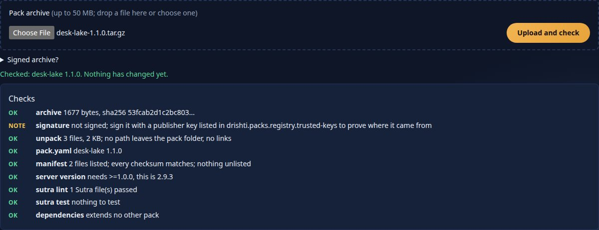

   The server runs these checks and shows each as OK, NOTE (worth a look) or FAIL. Any FAIL refuses the archive and nothing is staged.

   | Check | What it proves | Refused when |
   |---|---|---|
   | **archive** | size and SHA-256; with a `.sha256` file beside it (the CLI sends it) or `--sha256`, that the file arrived as it was bundled | larger than `drishti.packs.deploy.max-archive-mb` (HTTP 413, before it is read); the checksum differs |
   | **signature** | an Ed25519 signature of the archive by a publisher whose key is in `drishti.packs.registry.trusted-keys` (the same keys as the registry) | a signature that does not verify, or a publisher that is not trusted; with `drishti.packs.deploy.require-signature: true`, no signature |
   | **unpack** | only plain files and folders; no absolute path, no `..`, no link, device or special file; at most `max-files` files and `max-unpacked-mb` once unpacked | any of those (a zip or tar slip, a zip bomb) |
   | **pack.yaml** | a plain `pack` name and `version` | missing or odd names |
   | **manifest** | every file `MANIFEST.json` lists is there with its SHA-256 and size, nothing present is unlisted, and the manifest names the same pack and version as `pack.yaml` (the rules of `pack verify`) | a changed, missing or extra file; no manifest (unless `require-manifest: false`) |
   | **server version** | the `requiresServer` the bundle was made with against this server's version | this server is older |
   | **sutra lint**, **sutra test** | every Sutra parses and its expressions check, and every sample test passes: the same checker as `drishti.py sutra lint` / `test` | any problem, with the first ones named |
   | **dependencies** | each pack it `extends` is loaded or on disk | a missing parent: deploy that pack first |

3. Read **What it changes**. It is the same comparison as `drishti.py pack diff` (the Java and Python rule sets are tested against the same cases), between the
   archive and the version that is **running** (or, for a pack that is not loaded, the copy on disk):

   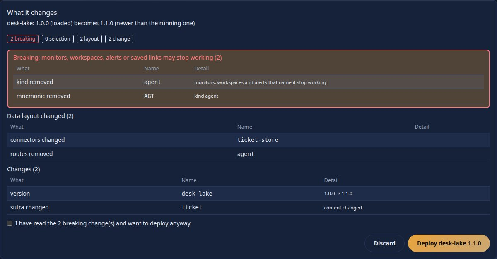

   | Level | Means | Deploying it |
   |---|---|---|
   | **breaking** | a kind or a mnemonic removed or renamed: monitors, workspaces, alerts and saved links name them | needs you to tick *I have read the breaking changes* (API: `acceptBreaking=true`) |
   | **selection** | a Sutra added or removed, or its `match` changed: some documents get another screen | allowed |
   | **layout** | connectors, routes, ingest or columns changed: the data layout moved | allowed; check the data source |
   | **change** | Sutra content, about text or glossary changed | allowed |

   A version that is the same as, or older than, the running one is flagged and still allowed.
4. **Deploy**. The server swaps the files into `drishti.packs.installed-dir` (the folder that wins over `config/packs/`), keeps the previous version under
   `previous-versions/<pack>/<version>-<time>`, then checks all loaded packs with the new one, puts it to use **at once, with no restart**. A pack that was not loaded is loaded.
   If the check fails, or the server cannot start with the new files, the old files are put back and the history says *reverted*; users stay signed in and
   live views reconnect.

### 17.2 History and roll back

**Admin → Packs → History and roll back** lists every deployment, rollback and reverted attempt (when, what, pack, version, the version it replaced, who) and, above it,
the versions kept for a rollback. **Roll back to this** puts a kept version back the same safe way. Rolling back is itself kept, so it can be undone.

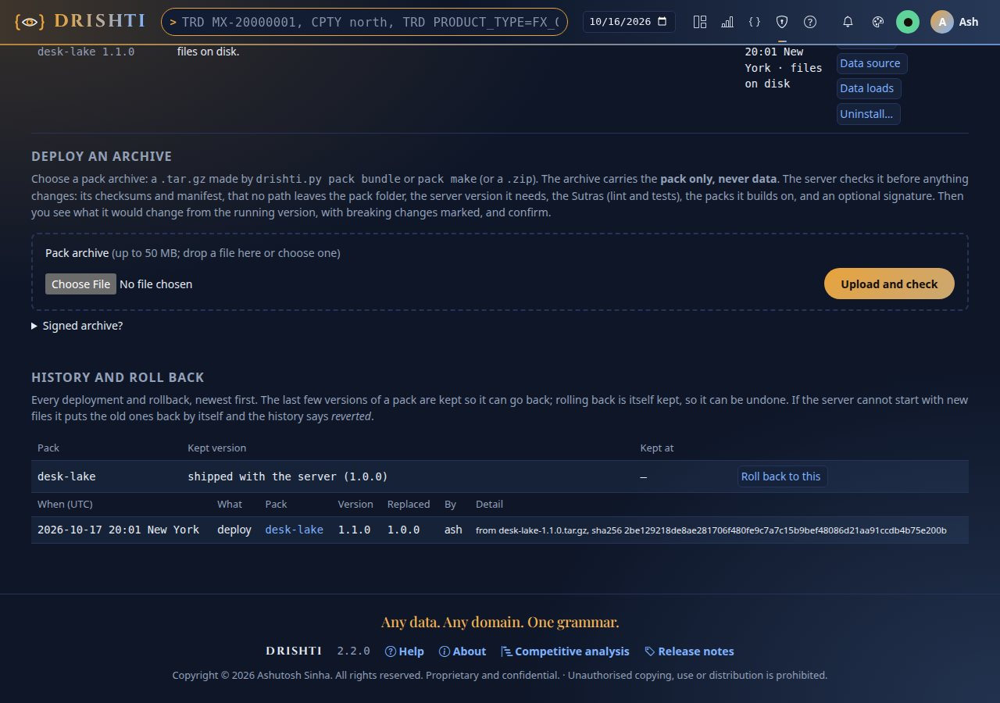

- `drishti.packs.deploy.keep-versions` (5) previous versions are kept per pack; older ones are deleted.
- A pack that was first deployed over the copy that ships with the server also offers **shipped with the server**: rolling back to it removes the installed copy.
- Rollback restores **files only**. Data is not touched, and connector files ([17.5](#175-where-a-pack-reads-its-data-connectors)) stays as it was.
- The history is `data/packs/deploy-history.jsonl` (`DRISHTI_PACKS_DEPLOY_HISTORY`); every step is also an audit row: `pack-upload-checked`, `pack-deployed`, `pack-rolled-back`.

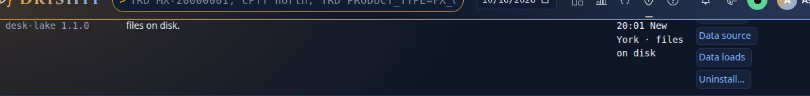

### 17.3 The same from the terminal

```bash
python3 tools/drishti.py server packs deploy dist/my-bank-1.1.0.tar.gz --preview   # checks and changes; discards the upload
python3 tools/drishti.py server packs deploy dist/my-bank-1.1.0.tar.gz --accept-breaking --wait 60
python3 tools/drishti.py server packs history --pack my-bank
python3 tools/drishti.py server packs rollback my-bank --version 1.0.0              # or --version shipped
```

Without `--preview` the command deploys; with a breaking change it prints the preview and exits 1 until you add `--accept-breaking`. A personal API token
needs the **packs:admin** scope (and its user the admin role). Every option and real output: [CLI_GUIDE.md, `server packs deploy`](CLI_GUIDE.md#server-packs-deploy-history-rollback-and-datasource).

### 17.4 Copy path or Admin → Packs

| | Copy (sections 5, 10) | Admin → Packs / `server packs deploy` |
|---|---|---|
| Needs a running server and a login | no | yes (administrator, `packs:admin` for a token) |
| Checks before anything changes | `pack verify` on your machine | the server's checks above, on the server |
| Shows what changes | `pack diff` | the same, in the page, against what is running |
| Previous version kept | `previous-versions/` beside the packs | `previous-versions/` under the installed folder, N kept, listed in the page |
| Restart | you | in place, with automatic undo |
| Audit | file system | audit rows and the history file |

### 17.5 Where a pack reads its data: connectors

A pack does not carry connection settings. It **names** the connectors it reads through (`connectors:` in `pack.yaml`, a list of names) and says which
connector answers each kind (`routes:`). A **connector** is a site resource: one YAML file in `config/connectors/`, whose file name is the connector's
name (`config/connectors/trade-endur.yaml` is `trade-endur`). The file holds the plugin (a Delta lake, JSON Lines files, a database...), the kinds it
serves and its settings (a `root`, a JDBC `url`...). The whole reference, with an example for every store, is [CONNECTOR_FILES.md](../connectors/CONNECTOR_FILES.md);
what an operator needs is here.

```
pack.yaml (trading)               config/connectors/trade-endur.yaml           the system behind it
kinds: [trade, ...]               plugin: delta
connectors: {trade-endur: ...,    kinds: [trade]                         ──►   a Delta lake, a database,
  trade-calypso, trade-murex} ──► settings: { root: ..., domain: trading,      a Kafka topic, ...
routes: {trade: trade-endur}        table.trade: trade_endur, union: "true" }
```

**Who writes the file.** A pack may also carry a **template** (a suggestion: the older `connectors:` mapping of definitions, or `connector-templates:`).
At the first start, for every connector a pack names, the server writes `config/connectors/<name>.yaml` from the template if no file of that name exists, and
**never overwrites** a file afterwards. So a shipped pack works out of the box, and from then on the file is yours. A file **replaces** the template
wholesale (nothing is merged). The precedence, highest first: environment variables and `drishti.sources.connectors.*` in the server's own configuration
(deprecated; they override a file setting by setting), then the file, then the pack's template.

```
$ ls config/connectors                      # a fresh clone after the first start with the seven packs (and lake demo)
civic-store.yaml  collateral-store.yaml  credit-store.yaml  ecb-estr-feed.yaml  ecb-fx-feed.yaml  fred-feed.yaml  legal-store.yaml
macro-store.yaml  market-store.yaml  news-store.yaml  news.yaml  nyfed-sofr-feed.yaml  reference-store.yaml  risk-store.yaml
trade-calypso.yaml  trade-endur.yaml  trade-murex.yaml  trade-pages.yaml  trading-stream.yaml  us-treasury-feed.yaml  yfinance.yaml

connectors: connector file trade-endur.yaml generated from the template of pack 'trading'      (the server's log)
```

**Changing where a pack reads.** Edit the file (in an editor, in version control, or in **Admin → Connectors**) and the running server applies it to that one
connector, without a restart and without touching the others: a new file starts a connector, a changed file restarts only that connector (reads in flight are
given `connectors-drain` to finish), a deleted file stops it. A bad file never takes a running connector down: the last good configuration keeps running and
Admin → Health shows the problem. From the terminal:

```bash
python3 tools/drishti.py connector get trade-endur --yaml > trade-endur.yaml        # edit root: ...
python3 tools/drishti.py connector apply trade-endur.yaml --test-first              # test, then save and apply, if nobody changed it meanwhile
python3 tools/drishti.py connector history trade-endur                              # every earlier text; restore from the page or the API
```

`apply` reads the file's current version and sends it as `If-Match`, so a job that runs while someone else edits fails instead of overwriting.
Every command and real output: [CLI_GUIDE.md, `connector`](CLI_GUIDE.md#connector-list-get-apply-delete-test-plugins-enable-disable-reset-history).

**Admin → Connectors** (administrators; the Admin menu links to it) lists every connector with origin, plugin, kinds, status, which packs use it and when it
changed. **New connector** and **Edit** open a form generated from the plugin's declared settings, a YAML tab (the same draft as text), **Test connection** and
**History**. Test connection starts a throwaway instance on the draft's settings, lists per kind the newest business dates and how many entities the source
holds, and closes it; nothing that runs is changed. Save writes the file atomically (the old text goes to `<data dir>/connectors/history/`), applies it to that connector and says
what state it reached; two editors cannot overwrite each other (the page sends the file's ETag and a stale one is refused with *changed since you read it*).


**Admin → Packs → Data source** (a button on every loaded pack) is now a **read-only view**: the pack's connectors, each with its state, plugin, the kinds
this pack takes from it and what defines it, with **Edit** links to Admin → Connectors. It changes nothing.


**A connector the pack names but nobody defined.** The pack still loads. Its kinds report `DRS-1011` (HTTP 404, "connector not configured"), Admin → Health
shows the pack as degraded with `connectorsNotConfigured`, and the Data source view marks the connector **not configured** with a **Create** link that opens a
new connector pre-filled from the pack's template, when it has one. From the terminal `datasource get` shows the same and exits 1 while one is missing:

```
$ drishti.py server packs datasource get desk-demo
connectors of desk-demo   [files in /srv/drishti/config/connectors; change them with `drishti.py connector ...`]
  connector     state           plugin  kinds from this pack  defined by          problems
  ------------  --------------  ------  --------------------  ------------------  ----------------------------------------
  desk-quotes   running         file    quote                 file
  desk-archive  not configured          quote-archive         nothing defines it  connector desk-archive is not configured
  desk-archive is not configured: create it with `drishti.py connector apply desk-archive.yaml` or in Admin -> Connectors
[exit 1]
```

**Credentials.** A setting whose name says it is a credential (`password`, `secret`, `token`, `api-key`, `access-key`, `private-key`, `credential`) can only be an
environment reference such as `${LAKE_PASSWORD}` or a file reference such as `file:/run/secrets/lake-password`; Admin → Connectors, the API and the CLI refuse a
plain value, a default inside the reference and a password written inside a URL (`jdbc:postgresql://user:pw@host/db`, `?password=...`) with `DRS-5031`. The secret lives in the
environment or the secret mount of the server process, never in a file or a page. If the variable is not set, that file is refused and the last good
configuration keeps running. The folder holds no secret, so it can be kept in version control.

**Shared connectors.** Several packs may name the same connector. Admin → Connectors shows who uses each one and for which kinds, and **asks before you disable or
delete** a connector packs use (`DRS-5032` over the API until `confirm=true`). A connector a pack's template suggests is never deleted, because it would reappear at the next
start: **Reset to pack default** puts the template back (your text is kept in the history), or disable it.

**Archives carry names and templates only.** A pack archive (`pack make`, `pack bundle`, Deploy archive) never carries a site's settings. The deploy preview
lists the connectors the pack names that this site lacks (field `connectors`: `names`, `missing`, `creatable`), and a **Create connectors** step
(`POST /api/v1/admin/packs/deploy/{id}/connectors`) writes the files from the templates before you deploy; loading the pack writes them at the next start anyway.
Rollback of a pack (17.2) restores the pack's files only; connector files are the site's and stay as they are.

**Upgrading from the earlier Data source override.** Settings saved in Admin → Packs → Data source before connector files existed live in
`data/packs/settings/<pack>.yaml`. At the first start after the upgrade the server moves each one into the connector file of the same name (the override's
`enabled` and `settings` applied on top of the existing file, or on top of the pack's template when there is none), keeps the original in
`data/packs/settings/migrated/<pack>.yaml.<timestamp>` and the file's earlier text in `<data dir>/connectors/history/`, and logs and audits it (`connector-migrated`):

```
connectors: data-source override of pack 'risk' for connector 'risk-store' moved into risk-store.yaml
connectors: original override file of pack 'risk' kept in data/packs/settings/migrated
```

An override the server cannot place (neither a template nor a file says which plugin to use) is left where it is and reported; nothing is dropped. The calls
`PUT`, `DELETE` and `.../test` on `/admin/packs/{name}/datasource` and `drishti.py server packs datasource set|test|reset` are removed: use `/admin/connectors` and `drishti.py connector`.

### 17.6 Settings, scopes and API

Every setting of this part, with its type, default, environment variable, meaning and whether a change needs a restart, is in the one configuration document: [CONFIGURATION.md, `drishti.packs.deploy`](../admin/CONFIGURATION.md#drishtipacksdeploy) (also at Help → Configuration in the console).

The endpoints (`/api/v1/admin/packs/...` for deploy and history, `/api/v1/admin/connectors` for connectors; administrator only; a personal token needs `packs:admin`): [API_GUIDE.md](API_GUIDE.md#deploying-a-pack-archive-and-the-packs-connectors) and [CONNECTOR_FILES.md, section 9](../connectors/CONNECTOR_FILES.md#9-the-rest-api).

### 17.7 Troubleshooting

| You see | Meaning | Do |
|---|---|---|
| *checksum mismatch: sutras/x.sutra.yaml* | the file changed after the bundle was made | bundle again; copy with a checksum-preserving tool |
| *unsafe path in the archive* | an entry leaves the pack folder or is a link | rebuild the archive with `pack bundle`; never hand-tar absolute paths |
| *no MANIFEST.json* | built with plain `tar`/`zip` | use `pack bundle`, or set `require-manifest: false` (not recommended) |
| *the archive needs server >=X* | the bundle was made on a newer build | upgrade the server first |
| *extends X, which is neither loaded nor on disk* | a parent pack is missing | deploy or load the parent first |
| HTTP 413 | larger than `max-archive-mb` | raise it (and the console's `packs.deploy_max_mb`) if the archive is right; archives carry no data, so a big one usually has data in it |
| history says *reverted* | the server could not start with the new files and put the old ones back | read `server.log` at that time; fix the pack and redeploy |
| *a credential is never written into a connector file* (`DRS-5031`) | a secret setting is not `${NAME}` or `file:/path` | export the variable for the server process and write the reference |
| *refers to an environment variable that is not set* | the server process has no such variable | set it in the process environment (not your shell) and restart; the last good configuration keeps running meanwhile |
| a connector file edit does nothing, or Health lists a bad file | `connectors-watch: off`, the file name breaks the rule, or the text is invalid | see [CONNECTOR_FILES.md, section 12](../connectors/CONNECTOR_FILES.md#12-health-and-problems) |
| a kind answers `DRS-1011` | the pack names a connector with no file | create it in Admin → Connectors (the Create link on Data source) or `drishti.py connector apply` |

## 18. Admin → Artifacts: install and uninstall safely

Everything an administrator installs on a Drishti site is a file or a folder that the server watches: **domain packs** (`config/packs`, `data/packs/installed`),
**connector files** (`config/connectors`) and the **shipped BI files** (`config/bi`: datasets, reports, boards, notebooks, Python items). **Admin → Artifacts**
(`/admin/artifacts`) lists all of them in one place, tells you what depends on each before you touch it, and gives you a way out that cannot lose anything:
*disable* (keep it, switch it off) or *uninstall* (move it to an archive you can restore from). It is for administrators only.


The same safe uninstall is on the pages you already use: **Admin → Packs** (an *Uninstall…* button on each pack), **Admin → Connectors** (on each connector with a
file, the list and the connector's own page) and **Admin → BI** (a *Shipped files* table). They all open the same dialog, so the answer is the same wherever you
start. The folders are still watched: an artifact you add, edit or delete by hand is picked up as before ([PACKS.md](PACKS.md#live-reload-the-packs-folder-is-watched),
[CONNECTOR_FILES.md](../connectors/CONNECTOR_FILES.md), [config/bi/README.md](../../config/bi/README.md)). This page is the careful way to do the same.

### 18.1 The list

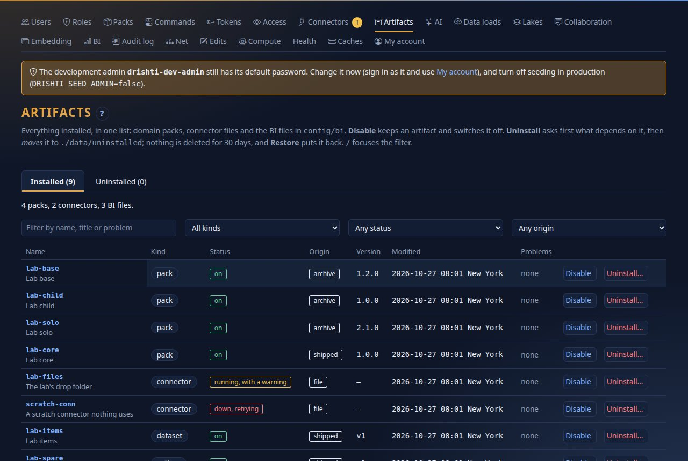

One row per artifact:

| Column | Meaning |
|---|---|
| **Name** | The artifact's name; a link to its own page (a pack's page, a connector's page, the BI item). The line under it is its title or description. |
| **Kind** | `pack`, `connector`, or for BI the kind of file: `dataset`, `report`, `board`, `notebook`, `python`. |
| **Status** | `on`; `disabled` (kept, switched off); `not loaded` (a pack on disk the server has not loaded); `problem` (something is wrong; see *Problems*). |
| **Origin** | `shipped` (a pack in the packs folder, or a BI file in `config/bi`), `archive` (a pack deployed from an archive or the registry: `data/packs/installed`), `file` (a connector file, or one placed by hand), `ui` (a connector saved from the console), `template` (a connector a pack's template wrote), `application` (a connector only the server's own configuration defines; deprecated). |
| **Version** | A pack's `version:`; `v1`, `v2`... for a BI file (counts the content changes the server has seen); empty for a connector. |
| **Modified** | When the file last changed (your clock zone). |
| **Problems** | What the server says is wrong: a pack refused at load (the reason), a connector file that does not parse or whose connection is down, a BI file that does not parse (and whether its last good version is in use). |

The filter box searches name, title and problems; the three menus narrow by kind, status and origin. **/** focuses the filter. The heading's **?** opens this page
in the help centre.

### 18.2 What depends on it: the impact

Before it offers Uninstall, the page asks the server what would stop working. The question is the same for every artifact, and the answer is a count and the first
25 names for each kind of dependant. Administrators see everything; nothing is masked.

| You ask about | It lists |
|---|---|
| **A pack** | Packs that extend it; connectors only it uses (no other loaded pack names them: they stop when it goes); BI datasets that read one of its kinds, and the reports, boards and composed datasets over those; **saved searches**, **monitors**, **alert rules** (on a kind of the pack), **measure alerts**, **subscriptions**, **workspaces** and saved pivots, layouts and reports that name one of its kinds; **shares** of its kinds; **embed hosts** whose kinds include one of its kinds. |
| **A connector** | The packs that read through it and the kinds each sends to it; BI datasets that scan it, and what is over those; saved documents, shares and embed hosts on the kinds it serves; and whether a pack's **connector template** would write it back (then it can only be disabled or reset). |
| **A BI file** | The other BI files that name it (a dataset: the reports, boards, notebooks, composed and derived datasets that use it; a report: the boards with a tile on it; a Python item: the datasets and reports that call it), and then what names *those*, down to six steps; **measure alerts**, **alert rules**, **subscriptions**, workspaces and saved views that name it; embed hosts on the kinds a dataset reads. |

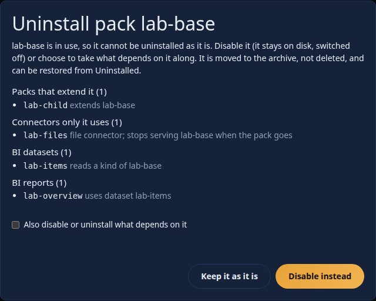

How things are matched, because it reads text and not a dependency graph. A BI file names another by a small set of keys (`dataset:`, `report:`, `board:`,
`notebook:`, `python:`, `transform:`, `connector:`, `kind:`), as a name or as `file:<kind>:<name>`; free text (titles, descriptions, notes) is never matched. A saved
document (a monitor, an alert rule, a workspace, a subscription) is matched on the values of the keys that hold a reference (`kind`, `entity`, `ref`, `path`,
`dataset`, `report`...), so a monitor that names a kind only in its title is not counted, and one that names it in a reference is, even if it no longer works. Items
in other people's workspaces count (the draft ones are marked *a draft*). The list is a safeguard for the person about to click, not a guarantee that nothing else
reads the artifact: a script that calls a view of one of the kinds is not a thing the server can see.

### 18.3 Disable and enable

**Disable** keeps the artifact exactly where it is and switches it off. It is the default way out whenever something depends on the artifact.

| Artifact | Disable does | Enable |
|---|---|---|
| Pack | Switches it off for everyone (`Admin → Packs → Switch off`): its kinds, mnemonics and views disappear. The folder stays; nothing is unloaded from disk. A pack that enabled packs extend is refused unless you also switch those off (*Also disable the packs that build on it*); they go first. | Switches it on, and what it builds on. |
| Connector | `enabled: false` in its file (the file and its history stay). The connector stops; kinds routed to it report it. A connector a pack's template names can be disabled (it is not uninstallable). | `enabled: true`. |
| BI file | Hides it from the catalogue (the file stays in `config/bi`; the list of hidden files is `data/admin/bi-hidden.txt`). Reports and boards that read a hidden dataset keep their own rows in the catalogue but cannot run it while it is hidden. | Shows it again. |

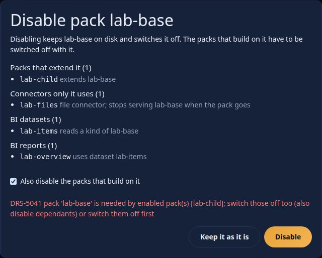

Both packs now read *disabled* and each row offers **Enable**; the folders, the connector and the BI files are untouched:

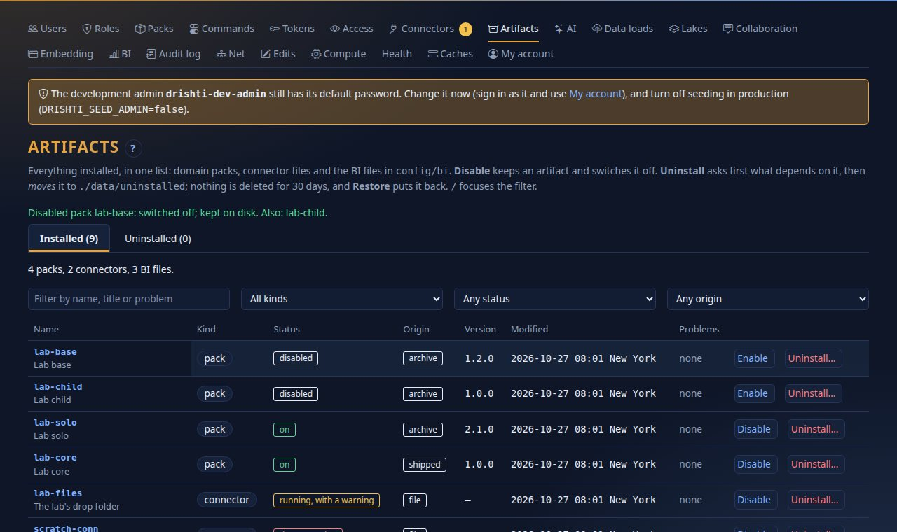

### 18.4 Uninstall

*Uninstall…* opens a dialog that first asks the server for the impact (section 2).

- **Nothing depends on it.** The dialog says so and offers **Uninstall**. The folder or file is **moved** to the archive. It is not deleted.
- **Something depends on it.** **Uninstall is not offered.** The dialog lists the dependants and offers **Disable instead**. The server refuses the call as well, with
  `409 DRS-5041` and the same list, so a script that skips the page gets the same answer.
- **Take the dependants along.** Tick *Also disable or uninstall what depends on it* and **type the artifact's name**. Then: packs that extend it are uninstalled
  (deepest first); connectors only it uses are disabled; BI files that depend on it are hidden. Saved searches, monitors, alert rules, subscriptions and the like are
  people's own: they stay, and say so when they are opened. Without the typed name the server answers `422 DRS-5043` and does nothing.
- **A connector a pack's template names** can only be disabled or reset: the pack would write it back at the next start. The dialog says so (`DRS-5044` from the API).
- **A pack named in `DRISHTI_PACKS` / `drishti.packs.enabled`** cannot be uninstalled here (the server would not start without it): take it out of the setting and
  restart, or disable it (`DRS-5044`).
- **A connector that comes only from the server's own configuration** (`application.yaml`) has no file to move: disable it.

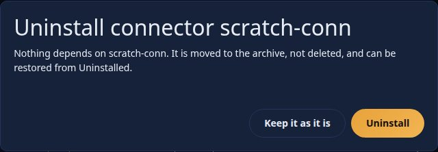

Where it goes: `data/uninstalled/<timestamp>-<kind>-<name>/` (setting `drishti.admin.uninstalled-dir`):

```text
data/uninstalled/20261012T142658-connector-scratch-conn/
├── payload/scratch-conn.yaml          the file (or the whole pack folder) exactly as it was
└── uninstalled.json                   who, when, what depended on it, and where it came from
```

The move is what the watchers see: the pack is unloaded, the connector stops, the BI file leaves the catalogue, each as it does when you delete the file by hand. The
page then says what it did and where it went.

### 18.5 The Uninstalled tab: restore, delete for good, retention

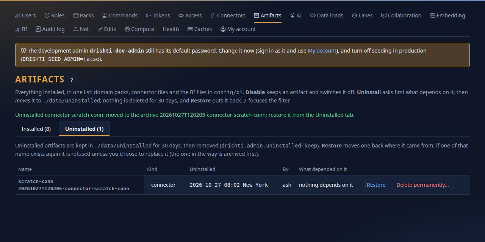

- **Restore** moves the archive back to where it came from (a pack to the folder it left, a connector to the connectors folder, a BI file to its `config/bi`
  folder) and the watchers pick it up. If an artifact of that name exists again, Restore is refused (`409 DRS-5042`); you can choose to **replace** it: type the
  name, and the one in the way is itself archived first, so nothing is lost either way. Restore puts back the artifact only: what was switched off or hidden when it
  was uninstalled *with its dependants* stays off until you **Enable** it from the Installed tab.
- **Delete permanently** removes an archive for good. Type its name (`422 DRS-5043` otherwise). This is the only way an artifact leaves your hands, apart from retention.
- **Retention.** Archives older than `drishti.admin.uninstalled-keep` (default 30 days) are removed by a job that runs once a day (`drishti.admin.uninstalled-prune-interval`);
  each removal is an audit event. `0` keeps archives for ever. An uninstall that you meant to be final does not need a purge: after 30 days it is gone.

### 18.6 Install

The *Install* section of the page has three cards:

- **A pack.** Upload an archive on **Admin → Packs → Deploy an archive** (`.tar.gz` or `.zip`): it is verified and previewed (breaking changes marked) before
  anything changes, and the version it replaces is kept for roll-back ([PACKS.md](PACKS.md)). The card links there.
- **A connector.** **Admin → Connectors → New connector**: a form or YAML, tested before it is saved ([CONNECTOR_FILES.md](../connectors/CONNECTOR_FILES.md)).
- **A BI file.** Choose a file named `<name>.<kind>.yaml` (`kind` is `dataset`, `report`, `board`, `notebook` or `python`). **Nothing is written yet**: the server
  checks it and tells you what it found.

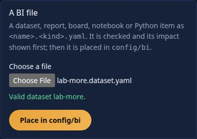

  The checks: the file name; UTF-8 text up to `drishti.admin.bi-upload-max-bytes` (1 MiB); YAML with a mapping at the top; the file's own key (`dataset: lab-more`)
  agrees with its name; and for datasets, reports and boards the same parser the server uses finds no error (warnings are shown and do not stop it). If a file of
  that name is already there, the card says so and lists what depends on it; placing it then needs *Replace* and the name typed, and the old file is archived first.
  The file is placed atomically and appears in the catalogue at once. Notebooks and Python items get the structure checks; a Python item's tests and sandbox
  checks run when it is published or used, as for any Python item.

### 18.7 The audit trail

Every action is an audit event (Admin → Audit log, or `GET /api/v1/admin/audit`) with the subject `<kind>:<name>`, and every refusal is one too:

| Action | Detail |
|---|---|
| `artifact-disabled`, `artifact-enabled` | The impact at the time, the choice (alone or with dependants), the result and what else was switched off. |
| `artifact-uninstalled` | The impact, the choice, `archived as <id>`, and what was taken along. |
| `artifact-restored` | The archive, plain or replace, where it went back to. |
| `artifact-purged` | The archive and its size. |
| `artifact-pruned` | The archives the daily job removed (actor `system`). |
| `artifact-installed` | A BI file uploaded: its size, new or replace, warnings. |
| `artifact-refused` | What was refused and why: the impact, the typed name that did not match, the name that already exists. |

```text
artifact-disabled     pack:lab-base  impact: Packs that extend it (1), Connectors only it uses (1), BI datasets (1), BI reports (1); choice: with dependants; result: off, kept on disk; also off: [lab-child]
artifact-refused      pack:lab-base  uninstall with dependants refused: the name was not typed
artifact-uninstalled  connector:scratch-conn  impact: nothing depends on it; choice: alone; result: archived as 20261012T142658-connector-scratch-conn
artifact-restored     connector:scratch-conn  from 20261012T142658-connector-scratch-conn; choice: plain; result: back in connectors
```

### 18.8 The API, the codes and the settings

Every call needs an administrator. **A personal API token never reaches these endpoints** (`* /api/v1/admin/artifacts/**` is in `drishti.security.token-never`): they are
for an administrator at the console, not for a script holding a token. From the console the same-origin and CSRF rules apply.

| Method | Path | Does |
|---|---|---|
| `GET` | `/admin/artifacts` | `{artifacts[], uninstalledDir, keepDays}`; each artifact `{kind, subtype, name, title, state, origin, version, modified, problems[], link}` |
| `GET` | `/admin/artifacts/impact?kind=&subtype=&name=` | `{kind, subtype, name, total, blocked, summary, templated, templatePack, notes[], groups[{category, label, count, more, items[{name, owner, detail}]}]}`; 25 names per group; `404 DRS-5040` for an unknown artifact |
| `POST` | `/admin/artifacts/disable` `{kind, subtype, name, cascade}` | Switches it off and keeps it. `409 DRS-5041` (with `impact`) for a pack that enabled packs extend, unless `cascade` |
| `POST` | `/admin/artifacts/enable` `{kind, subtype, name}` | Switches it back on |
| `POST` | `/admin/artifacts/uninstall` `{kind, subtype, name, cascade, confirm}` | Moves it to the archive. `409 DRS-5041` with `impact` while it has dependants; with `cascade` the name must be in `confirm` (`422 DRS-5043`); `422 DRS-5044` for a template connector or a configured pack |
| `GET` | `/admin/artifacts/uninstalled` | `{archives[{id, kind, subtype, name, area, rel, at, by, summary, bytes}], directory, keepDays}`, newest first |
| `POST` | `/admin/artifacts/uninstalled/{id}/restore` `{replace, confirm}` | Moves it back. `409 DRS-5042` when the name exists; `replace` archives the one in the way and needs `confirm` = the name |
| `DELETE` | `/admin/artifacts/uninstalled/{id}?confirm=<name>` | Deletes the archive for good; `422 DRS-5043` without the name |
| `POST` | `/admin/artifacts/bi/check?file=<name>.<kind>.yaml` | The file as the raw body (`application/octet-stream`). The dry run: `{valid, name, subtype, problems[], warnings[], exists, replacesImpact}`. Writes nothing |
| `POST` | `/admin/artifacts/bi?file=&replace=false&confirm=` | The same body: checks, archives what it replaces, places the file. `422 DRS-5044` for an invalid file, `409 DRS-5042` for a name in use, `422 DRS-5043` for a missing name |

| Code | HTTP | Meaning |
|---|---|---|
| `DRS-5040` | 404 | No such installed artifact, or no such archive |
| `DRS-5041` | 409 | Refused because other things depend on it; the answer carries the `impact`. Disable instead, or choose to take the dependants along |
| `DRS-5042` | 409 | An artifact of that name already exists (a restore or an upload); choose replace |
| `DRS-5043` | 422 | A destructive step needs the artifact's name typed |
| `DRS-5044` | 422 | Does not apply: a connector a pack's template names, a pack named in `drishti.packs.enabled`, a connector with no file, or an uploaded BI file that is not valid |

Settings ([CONFIGURATION.md](../admin/CONFIGURATION.md#drishtiadmin--uninstalling-packs-connectors-and-bi-files-safely)):

Every setting of this part, with its type, default, environment variable, meaning and whether a change needs a restart, is in the one configuration document: [CONFIGURATION.md, `drishti.admin`](../admin/CONFIGURATION.md#drishtiadmin) (also at Help → Configuration in the console).

Keep `data/` on one disk with `config/` so an uninstall is a single atomic move; across disks the server copies, then removes.

### 18.9 Recipes

**See what depends on a pack, from a script run by an administrator's session** (a token cannot; use the console, or `curl` with the session cookie). Real answers
from the scratch site of the pictures (a pack `lab-base` with a child pack, a connector it reads, a dataset over its kind and a report on that dataset):

```text
$ curl -s "localhost:18936/api/v1/admin/artifacts/impact?kind=pack&name=lab-base"   # one line per group
{"category": "packs", "count": 1, "names": ["lab-child"]}
{"category": "connectors", "count": 1, "names": ["lab-files"]}
{"category": "datasets", "count": 1, "names": ["lab-items"]}
{"category": "reports", "count": 1, "names": ["lab-overview"]}
summary: Packs that extend it (1), Connectors only it uses (1), BI datasets (1), BI reports (1) | blocked: True
```

**Uninstall is refused; disable instead; switch it back on:**

```text
$ curl -s -X POST .../uninstall -d '{"kind":"pack","name":"lab-base"}'
{ "status": 409, "code": "DRS-5041",
  "detail": "DRS-5041 pack 'lab-base' has dependants: Packs that extend it (1), Connectors only it uses (1), BI datasets (1), BI reports (1); disable it instead, or choose to take the dependants along" }
$ curl -s -X POST .../disable -d '{"kind":"pack","name":"lab-base"}'
{ "status": 409, "code": "DRS-5041",
  "detail": "DRS-5041 pack 'lab-base' is needed by enabled pack(s) [lab-child]; switch those off too (also disable dependants) or switch them off first" }
$ curl -s -X POST .../disable -d '{"kind":"pack","name":"lab-base","cascade":true}'
{ "ok": true, "note": "switched off; kept on disk", "also": ["lab-child"] }
```

**Take it along, with the wrong name and then the right one** (the right one moves `lab-base` and `lab-child` to the archive, disables `lab-files` and hides the dataset and the report):

```text
$ curl -s -X POST .../uninstall -d '{"kind":"pack","name":"lab-base","cascade":true,"confirm":"lab"}'
{ "status": 422, "code": "DRS-5043", "detail": "DRS-5043 type the name 'lab-base' to uninstall it together with what depends on it" }
```

**A pack named in the site configuration:**

```text
$ curl -s -X POST .../uninstall -d '{"kind":"pack","name":"lab-core"}'
{ "status": 422, "code": "DRS-5044",
  "detail": "DRS-5044 pack 'lab-core' is named in drishti.packs.enabled (DRISHTI_PACKS): take it out there and restart, or disable it here" }
```

**An unused connector, archived and restored:**

```text
$ curl -s -X POST .../uninstall -d '{"kind":"connector","name":"scratch-conn"}'
{ "ok": true, "impact": "nothing depends on it", "archive": "20261012T142658-connector-scratch-conn",
  "note": "moved to the archive 20261012T142658-connector-scratch-conn; restore it from the Uninstalled tab" }
$ curl -s -X POST .../uninstalled/20261012T142658-connector-scratch-conn/restore -d '{}'
{ "ok": true, "note": "restored to connectors/scratch-conn.yaml", "replaced": false }
```

**Check a BI file before it is placed:**

```text
$ printf 'dataset: lab-more\ntitle: x\n' | curl -s -X POST --data-binary @- -H 'Content-Type: application/octet-stream' ".../bi/check?file=lab-more.dataset.yaml"
{ "valid": false, "name": "lab-more", "subtype": "dataset",
  "problems": ["tables: a dataset needs `tables:` (or `from:` to be composed of other datasets, or `derived:` to be made by a Python Transform)"],
  "warnings": [], "exists": false }
```

**On a phone** the list scrolls with the page, the buttons are 44 px high and the dialog's buttons are full width:

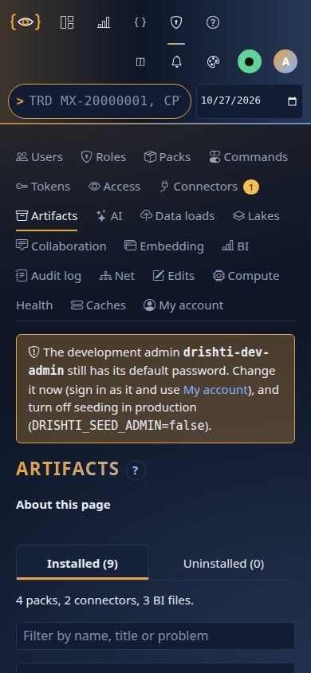


### 18.10 If something goes wrong

| You see | Meaning and the first thing to do |
|---|---|
| *Uninstall* is not offered and the dialog says *in use* | Something depends on it. Read the list; **Disable instead**, or tick *Also disable or uninstall what depends on it* and type the name. |
| `DRS-5044` "named in drishti.packs.enabled" | The pack is in `DRISHTI_PACKS` / `drishti.packs.enabled`; the server needs it to start. Take it out of the setting and restart, or disable it. |
| `DRS-5044` "a pack's template would write it back" | A pack's `connector-templates` names the connector. Disable it, or reset it to the pack's default (Admin → Connectors). |
| `DRS-5042` on Restore | An artifact of that name is there now. Open it first to compare; Restore with *replace* archives it and puts the old one back. |
| The pack is still listed after Uninstall | Another pack that is loaded extends it: the reloader keeps a pack others build on, and says so under *Problems*. Uninstall that pack first (or take the dependants along). |
| An archive is missing | It was older than `drishti.admin.uninstalled-keep`; the audit log has an `artifact-pruned` event naming it. |
| A BI report is blank after its dataset was disabled | A hidden dataset is not in the catalogue; **Enable** it again. |
| The page says *administrators only* | Only an administrator may use it; a token cannot (`token-never`). |

See also: [PACKS.md](PACKS.md), [CONNECTOR_FILES.md](../connectors/CONNECTOR_FILES.md), [BI_GUIDE.md](BI_GUIDE.md), [OPERATIONS.md](../admin/OPERATIONS.md),
[API_GUIDE.md](API_GUIDE.md#administration-artifacts-apiv1adminartifacts), [TROUBLESHOOTING.md](TROUBLESHOOTING.md) and [tutorial 17](../tutorials/17-run-it-in-production.md).
