<!--
  Project Drishti · Any data. Any domain. One grammar.

  Copyright (c) 2026 Ashutosh Sinha <ajsinha@gmail.com>.
  All rights reserved.

  PROPRIETARY AND CONFIDENTIAL.

  This file is the confidential and proprietary property of Ashutosh Sinha.
  Unauthorised copying, use, modification, distribution or disclosure of this
  file, via any medium, is strictly prohibited except with the express prior
  written permission of the copyright holder.

  See the LICENSE file in the root of this repository for the full terms.
-->

# Install and operate

The operator's guide to Drishti: get it onto a machine and running (part one, sections 2 to 4), then install it for other people,
configure it, deploy and promote packs and roll them back, keep it safe, watch it, size it, maintain its lakes, back it up and
upgrade it, and what to do when something goes wrong (four runbooks, the troubleshooting tables and the error codes). Where a
command prints something, the text after **You should see** is what a healthy system prints. It does not teach the product: the first
quarter of an hour in it is [tutorial 1, Part A](../tutorials/01-first-15-minutes.md#part-a--install-start-and-look-around), and running it for a team is
[tutorial 21](../tutorials/21-run-it-in-production.md). Every setting is in [CONFIGURATION.md](../admin/CONFIGURATION.md); this
guide names the ones a task needs. Several servers acting as one, sizing and tuning are in [CLUSTER_GUIDE.md](CLUSTER_GUIDE.md);
users, roles, editions and the engine switches in [ADMIN_GUIDE.md](ADMIN_GUIDE.md).

## Contents

1. [What you are running](#1-what-you-are-running)
2. [Install and run on one machine](#2-install-and-run-on-one-machine)
3. [Other ways to build and run: Maven, IntelliJ IDEA and PyCharm](#3-other-ways-to-build-and-run-maven-intellij-idea-and-pycharm)
4. [Drishti on Windows](#4-drishti-on-windows)
5. [Install for other people: the layout, services and containers](#5-install-for-other-people-the-layout-services-and-containers)
6. [Configure](#6-configure)
7. [Data stores, lakes and feeds](#7-data-stores-lakes-and-feeds)
8. [Deploy, promote and roll back by copying](#8-deploy-promote-and-roll-back-by-copying)
9. [Admin → Packs: deploy an archive, history and roll back](#9-admin--packs-deploy-an-archive-history-and-roll-back)
10. [Admin → Artifacts: install and uninstall safely](#10-admin--artifacts-install-and-uninstall-safely)
11. [Security checklist](#11-security-checklist)
12. [Collaboration, reports and people's data](#12-collaboration-reports-and-peoples-data)
13. [Monitoring and health](#13-monitoring-and-health)
14. [Memory, caches and capacity](#14-memory-caches-and-capacity)
15. [Compute workers](#15-compute-workers)
16. [Lake maintenance and scheduling](#16-lake-maintenance-and-scheduling)
17. [Backups and restore](#17-backups-and-restore)
18. [Upgrades and rollback](#18-upgrades-and-rollback)
19. [Several servers](#19-several-servers)
20. [Runbooks](#20-runbooks)
21. [Troubleshooting](#21-troubleshooting)
22. [Error codes](#22-error-codes)

## 1. What you are running

Drishti is a data viewer you drive from the keyboard, like a Bloomberg terminal: a short **command** (`TRD 1000001 <GO>`: a
**mnemonic**, then the **identifier** of one thing, then Enter) opens a full screen of figures, tables and charts. It is two
processes, and users only ever talk to the console:

```
 browser ──HTTPS──▶ reverse proxy ──HTTP──▶ console (FastAPI, :17480) ──HTTP──▶ server (Spring Boot, :18480) ──▶ your sources
                                             sessions, pages, live channel        views, live streams, users,        Delta Lake, PostgreSQL,
                                                                                  Sutras, packs, governance          Aerospike, Kafka, ActiveMQ,
                                                                                                                     RabbitMQ, S3, files, REST, feeds
```

| Process | Default port | Health check | Metrics | Started by |
|---|---|---|---|---|
| **server** (`drishti-server`, Spring Boot, Java 21 or newer; production runs 21): reads the sources, lays out each screen, answers BI, pushes live updates | 18480 | `/actuator/health/liveness`, `/actuator/health/readiness` | `/actuator/prometheus` | `java -Djava.io.tmpdir=data/tmp/server -jar drishti-server-<version>-exec.jar` |
| **console** (FastAPI on uvicorn, Python): the web pages; it computes nothing itself | 17480 | `/healthz`, `/readyz` | none | `python drishti-console/run_drishti_web.py` |

Industries come as **packs**. Seven ship and load by default: `core` (counterparties, legal entities, books, calendars),
`market-data` (curves, surfaces, FX, fixings), `trading` (`TRD`: trades from ENDUR, CALYPSO and MUREX), `counterparty-risk`,
`market-risk`, `world-economy` and `news-and-markets`. A pack loads the packs it builds on. Every field is written in UPPER_SNAKE
(`TRADE_ID`, `PRODUCT_TYPE`), as the production systems name them. The retired example packs live in `examples/packs/` and load only
when you ask ([BUILD_GUIDE.md](BUILD_GUIDE.md#31-the-packs-that-ship-turning-them-on-who-sees-which)).

Things worth knowing before you plan an installation:

- **Neither process keeps session state in memory that matters.** The console's session is a signed cookie naming a session the
  server keeps, so any console serves any user. Several of each can run behind a load balancer when the servers share their `data/`
  folders and Sutra folders ([CLUSTER_GUIDE.md](CLUSTER_GUIDE.md)).
- **The server's working directory matters.** Every relative path in its configuration (`./config/packs`, `./sutras`, `./data/...`,
  `./application.local.yaml`) is resolved from the folder you start it in. Start it there, or make the paths absolute.
- **The console finds its files relative to itself**: `drishti-console/config/application.yaml`, and its `packs.dir`
  (`../config/packs`) and `help.docs_dir` (`../docs`) are relative to `drishti-console/`.
- **With security off (the development default) the server trusts every caller**: anyone who reaches port 18480 is an administrator.
  In a shared installation turn security on ([section 11](#11-security-checklist)) and never expose 18480 to users.

Two ways to run it on your own machine give the same result: **IntelliJ IDEA and PyCharm with no terminal** (the ready-made run
configurations hold exactly the settings below; [section 3](#3-other-ways-to-build-and-run-maven-intellij-idea-and-pycharm)), or **a
terminal** ([section 2](#2-install-and-run-on-one-machine)). The short form of section 2 is
[data/testdata/README.md](../../data/testdata/README.md) ("Quick start: five steps").

## 2. Install and run on one machine

From a clean clone the whole install takes about 15 minutes on a laptop, most of it the first build. On Windows follow
[section 4](#4-drishti-on-windows), which covers the same steps in PowerShell.

### 2.1 Prerequisites

| Tool | Version | Why | Check with |
|---|---|---|---|
| OpenJDK | **21** or newer, 64-bit, a JDK (not only a JRE); production runs 21, 25 is also tested | builds and runs the server | `java -version`, `javac -version` |
| Python | **3.13** (what CI tests and the images run); the floor is **3.10** (`drishti.py doctor` fails below it; 3.10 to 3.12 are not tested). This row is the one statement of the Python version | the console and the command-line tools | `python3 --version` |
| uv | any recent (**recommended**) | makes the console's Python environment, also where `python3 -m venv` cannot | `uv --version` |
| git | any | downloads the code | `git --version` |
| Docker | optional | containers, the PostgreSQL/Kafka/Aerospike extras, some tests | `docker --version` |
| Disk | a few GB, plus the lakes (the demo lakes: 3.4 GB), each Kafka disk cache (up to `disk-cache.max-gb`, 10 GB) and each ActiveMQ or RabbitMQ state store (`state.max-gb`, 10 GB; plan about twice that, on an SSD) | | |
| Memory | 2 GB of heap for the samples, 4 GB for the demo lakes; [section 14](#14-memory-caches-and-capacity) says what grows | | |

On Ubuntu or Debian:

```bash
sudo apt install openjdk-21-jdk git curl             # any JDK 21 or newer works
curl -LsSf https://astral.sh/uv/install.sh | sh      # installs uv into ~/.local/bin
export JAVA_HOME=/usr/lib/jvm/java-21-openjdk-amd64  # in every terminal you use for Drishti (or in ~/.bashrc)
export PATH="$JAVA_HOME/bin:$PATH"
java -version
```

You should see a line that starts with `openjdk version "21.` (or newer). Drishti refuses an older Java. You do **not** need Maven:
the repository has its own (`./mvnw`, Maven 3.9.12).

### 2.2 Download and build the server

```bash
git clone https://github.com/ajsinha/drishti.git
cd drishti
./mvnw -q package -DskipTests -pl :drishti-app -am
ls kernel/drishti-server/target/*-exec.jar
```

Every command in this guide runs **from this `drishti` folder**: the server finds `./config/packs` and its data folder (`./data`, or
`DRISHTI_DATA_DIR`) relative to it. The clone already holds the test data the demo lakes are built from, `data/testdata/` (about
23 MB of `.jsonl.gz`, the one committed folder under `data/`).

The first build downloads its libraries and takes several minutes; later builds about a minute. `-q` keeps it quiet, so success prints
nothing; `-pl :drishti-app -am` builds the server and what it needs (`./mvnw -q package -DskipTests` builds every module, slower, the same
server; `./mvnw -q verify` also runs every test). You should see `kernel/drishti-server/target/drishti-server-<version>-exec.jar`. Before a
release build use `./mvnw -q clean package -DskipTests`: without `clean`, `target/` keeps older jars, `java -jar
drishti-server-*-exec.jar` then runs the first (the oldest) and the server Dockerfile's `COPY` refuses several files. If the build stops
with `Drishti needs Java 21 or newer … Maven is running on Java …`, `JAVA_HOME` is older than 21: go back to 2.1.

### 2.3 The console's Python

One private environment serves the console, the command-line tools (`tools/drishti.py`) and the lake builder. With **uv**:

```bash
uv venv --python 3.13 drishti-console/.venv
uv pip install --python drishti-console/.venv/bin/python -r drishti-console/requirements.txt
drishti-console/.venv/bin/python -c "import deltalake, pyarrow, yaml, fastapi; print('ok', deltalake.__version__)"
```

You should see `ok 1.6.6` (or a newer deltalake). uv fetches Python 3.13 when the machine lacks it. **Without uv**:
`python3 -m venv drishti-console/.venv && drishti-console/.venv/bin/pip install -r drishti-console/requirements.txt`. On Debian and
Ubuntu that stops with *ensurepip is not available … apt install python3.X-venv* until you install the package matching
`python3 --version` (`sudo apt install python3.14-venv`), or use uv, which needs neither. Developers add
`-r drishti-console/requirements-test.txt`.

- **Python in BI** (python visuals, Python-driven tables, the Notebook's Python cells) runs on the **server's compute pool** `python`, in a
  strict sandbox (Linux only), never in the console. The interpreter must carry exactly the libraries of
  `config/compute/locks/python.lock`; the console's environment can be it:

  ```bash
  uv pip install --python drishti-console/.venv/bin/python --require-hashes --no-deps -r config/compute/locks/python.lock
  export DRISHTI_COMPUTE_ENABLED=true DRISHTI_PYTHON=$PWD/drishti-console/.venv/bin/python     # before starting the server
  ```

  Without it everything else works, and each Python run says why it does not ([section 15](#15-compute-workers)).
- **Calc** (Python in the browser on a view) needs its runtime once: `tools/fetch-pyodide.sh` (about 340 MB, cached; on Windows in Git
  Bash or WSL). Without it a Calc panel stays dead ([USER_GUIDE.md](USER_GUIDE.md#calc-python-on-any-view) has the offline way).

### 2.4 Build the demo lakes

The demo lakes are what the seven packs read: one Delta table per dataset, sixty business days, from the committed test data:

```bash
drishti-console/.venv/bin/python tools/drishti.py lake demo
```

You should see one line per table, then the summary (the folder is your clone's):

```text
  trading/trade_endur: … rows over 60 days
  …
Demo lake ready: …/drishti/data/delta/demo: 86 tables, 60 business days 2026-07-08 to 2026-09-30, built in 943 s
Feeds: …/drishti/data/feeds/fixing.jsonl (the file connector's sample feed)
Server: no server at http://localhost:18480: left …/drishti/data/bi-store/lake-rebuilt.json, so a server clears its stored BI columns and rollups at its next start
Connector files:
  trade-endur: generated by the server at its first start (reads …/drishti/data/delta/demo)
  …
```

Measured: about 15 minutes and 3.4 GB for sixty days. What it does:

- **Sixty business days ending on today's business date** (New York; on a weekend or holiday the day before): the test data's own days
  are moved, with the documents' own dates (`AS_OF`, `VALUATION_DATE`, `RUN_DATE`, `SOURCE_UPDATE_TIME`), so every page opens on data.
  `--as-of data` keeps the test data's dates; `--as-of 2026-10-30` ends on any date.
- **One table per dataset under `data/delta/demo/<domain>/<kind>/`**, partitioned by business date; the trades in one table per source
  system (`trading/trade_endur`, `trade_calypso`, `trade_murex`, also by `PRODUCT_TYPE`), read together as one kind, `trade`.
- **Tells the server**: a running server gets the data-load signal for every table and date (`--server URL`, default `DRISHTI_SERVER`
  then `http://localhost:18480`; with sign-in on, a token with the `loads:write` scope in `--token-file` or `DRISHTI_TOKEN`). With no
  server it leaves `data/bi-store/lake-rebuilt.json`, and the next start clears the BI store's columns and rollups. `--no-signal` skips
  both. Running it again later is safe either way.
- **Checks the connector files**: the packs' Delta connectors read `${DRISHTI_DELTA_ROOT:<data>/delta}`; with the default lake the
  server writes the files at its first start ([DATA_GUIDE.md section 9](DATA_GUIDE.md#9-connector-files-and-admin--connectors)).

`--lake DIR` builds elsewhere (the connector files are then pointed there, their earlier text kept in `data/connectors/history/`),
`--only trades/,core/counterparty` builds some datasets, `--with-real FILE` adds a local real extract to your local lake only (never to
`data/testdata`); every option: `drishti.py lake demo --help`. **Skip it** and the server still starts: the packs' samples answer for
today, and a past date says *No data held for <date>*.

### 2.5 Start the server

**A. On the demo lakes, with sign-in** (the run configuration **Drishti server (demo lakes)**):

```bash
export JAVA_HOME=/usr/lib/jvm/java-21-openjdk-amd64
export DRISHTI_PACKS=core,market-data,trading,counterparty-risk,market-risk,world-economy,news-and-markets
export DRISHTI_STUDIO_SAVE=true
export DRISHTI_SECURITY_ENABLED=true
export DRISHTI_TOKEN_SECRET=drishti-dev-only-token-secret-change-me-0123456789
export DRISHTI_SEED_ADMIN=true DRISHTI_SEED_USERNAME=drishti-dev-admin DRISHTI_SEED_PASSWORD=drishti-dev-admin123
export DRISHTI_EXTERNAL_LIB=$PWD/external_lib   # the console's Python libraries; jars go in the lib folder (DRISHTI_LIB_PATH)
export DRISHTI_DEMO_ENABLED=false
mkdir -p data/tmp/server
java -Djava.io.tmpdir=data/tmp/server -Xmx4g -jar kernel/drishti-server/target/drishti-server-<version>-exec.jar
```

**B. The smallest start** (sign-in off, the packs' samples ticking live):

```bash
java -Djava.io.tmpdir=data/tmp/server -jar kernel/drishti-server/target/drishti-server-<version>-exec.jar
```

| Setting | Meaning |
|---|---|
| `-Djava.io.tmpdir=data/tmp/server` (and the `mkdir`) | Java's temporary folder: DuckDB, RocksDB and CatBoost unpack their native libraries there (DuckDB 60 MB a start), not in `/tmp`, and the server removes stale copies at start. Only the command line moves it (or `JAVA_TOOL_OPTIONS=-Djava.io.tmpdir=…`); without it the server warns in its log and on Admin → Health |
| `DRISHTI_PACKS` | the packs to load, comma-separated; a pack's parents load with it (`market-risk` brings `core`, `market-data`, `trading`). Unset: the seven |
| `DRISHTI_STUDIO_SAVE=true` | lets the Build workbench save Sutras (the view layouts); only in authoring environments |
| `DRISHTI_SECURITY_ENABLED=true` | sign-in on: every call needs a token. Off by default |
| `DRISHTI_TOKEN_SECRET` | the secret the server and the console share to sign tokens, at least 32 bytes. The value above is the development secret: never on a shared machine |
| `DRISHTI_SEED_ADMIN`, `_USERNAME`, `_PASSWORD` | at the first start with no users, create this administrator (the values above are also the defaults) |
| `DRISHTI_LIB_PATH` | extra jars: connectors, JDBC drivers (the server's lib folder; default `<data folder>/lib`) |
| `DRISHTI_EXTERNAL_LIB` | the console's extra Python modules (`external_lib/python`) |
| `DRISHTI_DEMO_ENABLED=false` | the demo source (the packs' samples, ticking) off, so every page reads the lakes; on (the default) a sample answers before the lake for an id both hold, and [tutorial 8, Part F](../tutorials/README.md)'s live tiles need it |

On Java 25 you may add `-XX:+UseCompactObjectHeaders` (about 10% less heap); Java 21 refuses to start with it. Leave the terminal
open: the server logs there. After a few seconds you should see `Started DrishtiApplication in … seconds` (after a `lake demo` with no
server running, first a line saying the BI store's columns and rollups were cleared). Check from a second terminal (the health address
is open even with sign-in on):

```bash
curl -s localhost:18480/actuator/health
curl -s localhost:18480/api/v1/packs | python3 -c 'import json,sys; print([p["name"] for p in json.load(sys.stdin)])'   # start B only
```

You should see `{"status":"UP","groups":["liveness","readiness"]}`, then the seven pack names. With sign-in on the second call answers
`401 DRS-5010 missing bearer token` until you send a token ([2.8](#28-a-personal-api-token-for-the-command-line)). At its first start the
server writes one **connector file** per connector the packs suggest into `config/connectors/` (`trade-endur.yaml`, `market-store.yaml`,
…) and a marker for each under `data/connectors/generated/`; edit a file to point a connector elsewhere ([6.6](#66-connectors-where-a-pack-reads-its-data)).

### 2.6 Start the console

In another terminal in the `drishti` folder. With start A (sign-in on), the console needs the same token secret (the run configuration
**Drishti console**):

```bash
export DRISHTI_TOKEN_SECRET=drishti-dev-only-token-secret-change-me-0123456789
export DRISHTI_AUTH_ENABLED=true
export DRISHTI_SESSION_SECRET=drishti-dev-only-session-secret-change-me-0123456789
export DRISHTI_SECURE_COOKIE=false        # only for plain http on your own machine
drishti-console/.venv/bin/python drishti-console/run_drishti_web.py --server.port=17480 --backend.url=http://127.0.0.1:18480
```

With start B none of the `export` lines is needed: `drishti-console/.venv/bin/python drishti-console/run_drishti_web.py`. You should see
`INFO:     Uvicorn running on http://0.0.0.0:17480`, then a line for each of the console's four worker processes
([5.6](#56-the-consoles-worker-processes)). **The two must match**: a console without `DRISHTI_TOKEN_SECRET` against a server with sign-in on
reads nothing (its log says `business date unavailable: DRS-5010 missing bearer token`). Open **http://localhost:17480** and click
**Open the terminal**, or go straight to **http://localhost:17480/t**. The console listens on every interface: from another machine open
`http://<this machine's address>:17480`.

### 2.7 Sign in, change the admin password, first views

With sign-in on you are sent to **Sign in**. The first start with no users created the development administrator
`drishti-dev-admin` / `drishti-dev-admin123`. Sign in, click your name in the top bar (**My account**, `/account`), and under **Change
password** type the current password and a new one twice (at least 10 characters, letters and digits). Until you do, Admin → Users warns
that the development password is in use. Five wrong passwords lock an account for 15 minutes. With sign-in off you act as the development
user *Ash* with every role. In production set `DRISHTI_SEED_ADMIN=false`, or your own `DRISHTI_SEED_USERNAME`/`DRISHTI_SEED_PASSWORD`
(as the Docker setup does), and long random secrets ([section 11](#11-security-checklist)).

**Admin** in the top bar opens the administration pages, one tab each (*Users*, *Roles*, *Packs*, *Tokens*, *Access*, *Connectors*,
*Artifacts*, *AI*, *Data loads*, *Collaboration*, *Embedding*, *BI*, *Audit log*, *Health*, *Caches*, *Capacity*; *Lakes* opens from
*Connectors* and *Data loads*). Users and roles: [ADMIN_GUIDE.md](ADMIN_GUIDE.md).

Type `TRD 1000001` in the command line and press Enter: an ENDUR commodity swap, its legs side by side, the cash flows opening to their
resets. Other pages to try: `TRD MX-20000001` (a MUREX interest rate swap), `/v/trade/CLY-3000157` (a CALYPSO bond),
`CTRD CP-NORTHPLAINS` (a counterparty's live trades), `/v/netting-set/NS-NORTHPLAINS-NY`, `CPTY CP-VAULTGUARD`, and `/bi` (the shipped
BI reports over the sixty days). On a trade pick the first of the sixty dates, then **Compare** with the last. `DRS-4001` means the
mnemonic is unknown (is its pack loaded?); `DRS-1001 no source holds …` that the id does not exist. Using the console:
[USER_GUIDE.md](USER_GUIDE.md) and [the tutorials](../tutorials/README.md).

### 2.8 A personal API token for the command line

Scripts, notebooks, Excel and `tools/drishti.py` call the server with a **personal API token**:

- **In the console:** your name → **My account** → **API tokens**: a name, how many days, the scopes it may write with (none: it only
  reads; `loads:write` announces data loads, `bi:write` edits BI items, `packs:admin` manages packs and connectors, …), **Create**. The
  secret (`drk_<id>_<secret>`) is shown **once**.
- **Over the API** (with a session token): `POST /api/v1/me/tokens` with `{"name": "laptop", "days": 30, "scopes": []}` answers `201`
  with the record and its `secret` ([API_REFERENCE.md](API_REFERENCE.md#28-personal-api-tokens)).

Keep it in a file only you can read, never on the command line, and check it:

```bash
umask 077; printf '%s' 'drk_…' > ~/drishti-token        # the secret you copied
drishti-console/.venv/bin/python tools/drishti.py doctor --server http://localhost:18480 --token-file ~/drishti-token
drishti-console/.venv/bin/python tools/drishti.py view get trade/MX-20000001 --server http://localhost:18480 --token-file ~/drishti-token
```

You should see, at the end of `doctor`, `GREEN  token  accepted; this token '…' acts as drishti-dev-admin: scopes read, …` and
`doctor: 0 red, 0 yellow`; `view get` prints the view as the token's user sees it (masks apply). `DRISHTI_TOKEN` (the secret) and
`DRISHTI_SERVER` (the base URL) work instead of the two options. A read-only token refuses any change (`403 DRS-5002 API tokens only
read`); a token with a write scope must expire (at most `writeMaxDays`, 90). Revoke it on the same page. Every command:
[CLI_REFERENCE.md](CLI_REFERENCE.md).

### 2.9 Stopping and starting again

`Ctrl+C` in each terminal (or the red square in the IDE) stops it; repeat 2.5 and 2.6 with the same `export` lines to start again (no
rebuild unless the code changed; monitors, alerts, workspaces and settings are kept under `./data`). New demo data: run 2.4 again, with
the server running or not. The start order does not matter ([5.2](#52-first-start-by-hand-and-check-it-works)). Three servers as one
cluster with a console, on this machine: `bin/start-cluster.sh` ([deploy/stack/README.md](../../deploy/stack/README.md),
[CLUSTER_GUIDE.md](CLUSTER_GUIDE.md)).

### 2.10 Where Drishti keeps things

Nothing Drishti writes is hidden (no dot-folders of its own), and everything it writes at run time is under **one data folder**, `./data`
(`DRISHTI_DATA_DIR` moves it). What to back up is in [section 17](#17-backups-and-restore).

| Folder | What is in it |
|---|---|
| `data/testdata/` | the committed test data of the demo lakes (the only committed folder) |
| `data/delta/` | the lakes, each in its own folder: `demo/` (`DRISHTI_DELTA_ROOT` moves it), `<lake>/` any other, `risk-results/` the published official results; a lake's `_drishti-lake/` holds its build log, lock and build records |
| `data/bi-store/` | the BI store: Parquet columns and rollups read from the lakes (`DRISHTI_BI_STORE`) |
| `data/connectors/` | `generated/` (which connector files came from a pack's template) and `history/` (every earlier text of a connector file) |
| `data/identity/` | users, roles, tokens and the audit log (`drishti.db`, SQLite) |
| `data/fstore/` | the content store: designs, collaboration, audit, embed apps, pack switches, proposals, load history, BI items |
| `data/packs/` | `added.yaml` (packs loaded or switched off at run time), `installed/` (deployed archives), `deploy-history.jsonl` |
| `data/feeds/`, `data/loads/`, `data/governance/`, `data/collab/`, `data/reports/` | the file connector's feeds, data-load history, Sutra proposals, collaboration files, report output |
| `data/cache/`, `data/derived/`, `data/index/` | the connectors' disk caches (id maps, documents, Kafka), the grouped pages, the type-ahead index segments: all rebuilt from the sources |
| `data/tmp/` | `server/drishti-<pid>` and `console/drishti-console-<pid>` (removed on a clean stop); `server` is also the JVM's temporary folder; `maven` (`./mvnw`), `drill` (the release drill) |
| `data/net/` | Drishti\*net, when it is on: `node-id`, `peers.json`, `history/` |
| `data/dataload/`, `data/lakes/`, `data/compute/`, `data/uninstalled/` | the data inbox, lake maintenance's file and history, the compute workers' environments and scratch, uninstalled artifacts |
| `data/qa/`, `data/build/`, `data/drill/` | the QA profile's own data, tool output, the drill's logs |

The repository itself holds code and configuration: `config/` (packs, connector files, lakes, BI files, engines), `run-configs/` and
`drishti-console/run-configs/` (the IDE run configurations), `docs/`, `tools/`, `external_lib/`.

## 3. Other ways to build and run: Maven, IntelliJ IDEA and PyCharm

### 3.1 With Maven installed on the system

The poms enforce only the Java version (`[21,)`); the wrapper pins **Maven 3.9.12** (`.mvn/wrapper/maven-wrapper.properties`), so use
3.9.x. The enforcer checks the JVM Maven runs on: set `JAVA_HOME` first.

```bash
mvn -v                                  # "Apache Maven 3.9.…" and "Java version: 21.…"
mvn -q package -DskipTests              # build (add -o to work offline once ~/.m2 is filled)
mvn -q verify                           # build, every test and every rule
mvn -q -pl :drishti-app -am package -DskipTests    # the server and what it needs
```

### 3.2 IntelliJ IDEA: open, build, run and debug the server

Two IDEs, two projects, never one folder: **IntelliJ opens the repository root**, **PyCharm opens `drishti-console/`**. Opened on the same
folder they overwrite each other's `.idea` and IntelliJ loses the Maven modules ("module not specified"); if that happened, close both,
delete the root's `.idea/` (IDE settings only) and reopen. One IntelliJ IDEA Ultimate with the Python plugin can run both.

1. **File → Open**, the root `pom.xml`, **Open as Project**; wait for the import and indexing.
2. **File → Project Structure → Project**: **SDK** a JDK 21 or newer (**Add SDK → Add JDK…** with its folder, for example
   `/usr/lib/jvm/java-21-openjdk-amd64`, `C:\Program Files\Java\jdk-21` or `/Library/Java/JavaVirtualMachines/jdk-21.jdk/Contents/Home`);
   **Language level** *SDK default*. Java 25 needs IDEA 2025.2 or newer.
3. **Settings → Build, Execution, Deployment → Build Tools → Maven → Runner → JRE**: *Use Project JDK* (Maven in the IDE ignores your
   shell's `JAVA_HOME`).
4. **Build → Build Project** (Ctrl+F9). The runnable jar: Maven tool window, **drishti → Lifecycle → package** (with *Skip Tests*), or the
   run configuration **Drishti build server jar**. After pulling a change of the Java bytecode level, **Build → Rebuild Project** once.

The run configurations are in the repository (`run-configs/` for IntelliJ, `drishti-console/run-configs/` for PyCharm), in the drop-down as
soon as the project is open. They use `$PROJECT_DIR$`, the project's JDK and no path of yours:

| Run configuration | What it does | Ports |
|---|---|---|
| **Drishti server** | `DrishtiApplication` on the class path of module `drishti-app` (the core with the domain modules this build ships), working directory the repository root, the seven packs, sign-in on with the development administrator, `DRISHTI_EXTERNAL_LIB`, `-Xmx2g`; data in `./data` | 18480 |
| **Drishti server (demo lakes)** | the same with `DRISHTI_DEMO_ENABLED=false`, `DRISHTI_VAR_SYSTEM_BASKETS_SEED=true` (the system baskets) and `-Xmx4g` | 18480 |
| **Drishti server (QA profile)** | its own data folder `data/qa/data`, so QA never touches `./data` | 18580 |
| **Drishti server (debug-friendly)** | the QA profile with sign-in **off**, DEBUG logging for `com.ash.drishti`, `-Xmx1g` (pair it with a console whose sign-in is off) | 18580 |
| **Drishti build server jar** | Maven `package -DskipTests -pl :drishti-app -am` | |
| **Build demo lakes** (PyCharm) | `drishti.py lake demo` (2.4) | |
| **QA pack make**, **QA lake build**, **QA server smoke**, **QA doctor** (PyCharm) | the command-line tools against the QA server; edit *Parameters* | 18580 |

They are plain Application configurations (the same in Community and Ultimate). Every server configuration uses the class path of
module **`drishti-app`**: `drishti-server` alone carries no domain module, so `VAR` and every banking function would answer *not
installed*. Each passes its class path through an argument file (**Shorten command line: @argfile (Java 9+)**, `ARGS_FILE` in the
`.run.xml`), so Windows' command-line length limit raises no warning. Change one for yourself with **Copy Configuration** (Ctrl+D; the copy
lives in the git-ignored `.idea/`). By hand: **Run → Edit Configurations → + → Application**, main class
`com.ash.drishti.server.DrishtiApplication`, classpath of module `drishti-app`, **Shorten command line** *@argfile*, JRE 21 or newer,
**working directory the repository root** (the default, the module's folder, finds no packs), and the environment above.

**Run** (Shift+F10) ends its log with `Started DrishtiApplication`; `curl -s localhost:18480/actuator/info` gives the version, and the
OpenAPI page is `http://127.0.0.1:18480/api/docs`. **Debug** (Shift+F9): good breakpoints are `com.ash.drishti.engine.ViewPipeline` (a view
being built), `com.ash.drishti.rachana.SutraRegistry` (which Sutra was chosen), a plugin's `SourcePlugin.fetch(…)` and the controllers
under `com.ash.drishti.server` ([ARCHITECTURE.md section 5](../architecture/ARCHITECTURE.md#5-walk-through-one-request) follows one
request). While it runs: Java method bodies reload with **Run → Debugging Actions → Reload Changed Classes** (signatures, fields and new
classes need a restart); Sutras, packs and connector files reload by themselves; `application.yaml` and the environment need a restart. A
second server needs `DRISHTI_PORT=18481`, its own working directory if it must not share `./data`, and a console with
`DRISHTI_BACKEND_URL=http://127.0.0.1:18481`.

### 3.3 PyCharm: run and debug the console

**File → Open** `drishti-console/`. Then once: **Settings → Project → Python Interpreter → Add Local Interpreter → Existing**,
`drishti-console/.venv/bin/python` (Windows `drishti-console\.venv\Scripts\python.exe`), or **Virtualenv → New** at that location and
`pip install -r drishti-console/requirements.txt -r drishti-console/requirements-test.txt`; **Project Structure → + Add Content Root** the
repository's `tools/` marked **Sources** (for reading; the run configurations work without it); right-click `tests/` → **Mark Directory as
→ Test Sources Root**.

| Run configuration | Parameters | Talks to |
|---|---|---|
| **Drishti console** | `--server.port=17480 --backend.url=http://127.0.0.1:18480`, `DRISHTI_AUTH_ENABLED=true`, the development `DRISHTI_TOKEN_SECRET` and `DRISHTI_SESSION_SECRET`, `DRISHTI_SECURE_COOKIE=false` | the default server |
| **Drishti console (QA profile)** | `--server.port=17580 --backend.url=http://127.0.0.1:18580`, `DRISHTI_LAKE_ROOTS=$PROJECT_DIR$/../data/qa/delta` and the same sign-in settings | the QA server |

Each runs from the repository root with the **project interpreter** and stores no interpreter path, so it works as it is on Linux, macOS
and Windows. **Run** shows `Uvicorn running on http://0.0.0.0:17480`. For **Debug** add `DRISHTI_CONSOLE_WORKERS=1` so every request reaches
the process the debugger is in; good breakpoints are the routes in `drishti-console/core/app.py`. Templates and static files reload with
the browser page; Python code needs a restart (Ctrl+F5). The command-line tools run from PyCharm the same way
([CLI_REFERENCE.md](CLI_REFERENCE.md#running-the-tools-from-pycharm-and-the-java-sutra-from-intellij)).

### 3.4 Running the tests from the IDEs

- **Java in IntelliJ:** a class or method from its gutter icon, a module with **Run 'All Tests'**, everything with **drishti → Lifecycle →
  verify**. **Clear the `DRISHTI_*` variables** in test configurations (or the JUnit template): the server tests set their own packs and
  fail when `DRISHTI_PACKS` and its siblings are set. Tests that need a broker or database start it in Docker (Testcontainers) and are
  skipped without Docker. To test on Java 21 and 25, switch the SDK and run again.
- **Python in PyCharm:** **Settings → Tools → Python Integrated Tools → Default test runner: pytest**, then **Run 'pytest in tests'** on
  `drishti-console/tests`. Browser tests (`*_browser.py`) need `drishti-console/.venv/bin/python -m playwright install chromium` once; tests
  that start the server jar need it built; both are skipped otherwise.

### 3.5 The QA profile, end to end (no terminal)

Ports 18580 and 17580 and the git-ignored folder `data/qa/`, so it never disturbs the default stack or `data/`. Start again from scratch by
stopping both and deleting `data/qa/`.

1. IntelliJ: **Drishti build server jar** (`pack make` and `lake build` use the jar).
2. IntelliJ: **Drishti server (QA profile)**; http://127.0.0.1:18580/actuator/health says `{"status":"UP"...}`.
3. PyCharm: **Drishti console (QA profile)**; open http://localhost:17580 and sign in as `drishti-dev-admin` / `drishti-dev-admin123`.
4. *My account → API tokens*: make one and save its text as `data/qa/token.txt`.
5. **QA server smoke** ends `smoke: OK`; **QA doctor** shows no red line.
6. Optional: **QA pack make (from JSON)**, *Parameters*: your sample file (JSON, JSON Lines or `.gz`; or
   `data/testdata/trades/endur/trade_endur.2026-07-08.jsonl.gz`), `--kind`, `--match` (the field that tells kinds apart, e.g.
   `PRODUCT_TYPE`), `--name`. It writes `data/qa/packs/<name>/` (the pack in `pack/<name>`).
7. **QA lake build (big JSON to Delta)**: `--from` your file named by its business date (or add `--as-of YYYY-MM-DD`), `--kind`/`--key`
   (`trade`, `TRADE_ID`), `--mode overwrite-dates` (a re-run replaces the date), `--partition-by PRODUCT_TYPE`, `--lake data/qa/delta`,
   `--pack data/qa/packs/<name>/pack/<name>` (the folder holding `pack.yaml`), and `--signal http://localhost:18580 --token-file
   $PROJECT_DIR$/data/qa/token.txt`. The last line says `lake-build ok exit=0 ... rows=N`. Keep it to 10,000 trades locally.
8. In the console, **Build → New pack**: upload the same JSON, accept or edit the proposed Sutras, save.
9. **Admin → Packs → Deploy** the archive of step 6 (`data/qa/packs/<name>/bundle/<name>-<version>.tar.gz`) or the wizard's; it writes under
   `data/qa/data/packs/`, never `config/packs`.
10. **Admin → Data loads**: the pack's loads show the table of step 7 (a refused lake folder is outside the QA console's
    `DRISHTI_LAKE_ROOTS`).
11. **Explore**, choose the pack and kind, open a row: the deal's page opens with its Sutra view.

## 4. Drishti on Windows

Drishti runs natively on Windows 10 and 11 and Windows Server 2019 or later: no WSL, no Docker, no Hadoop. The Delta connector reads
through its **native engine** (Java's own file access for local disks, the AWS SDK for S3) and the Iceberg connectors through
**drishti-iceberg**, so Hadoop's `winutils.exe` is never needed
([Delta engines](../../plugins/drishti-plugin-delta/README.md#engines-native-and-hadoop),
[Iceberg engines](../../plugins/drishti-plugin-iceberg/README.md#engines-and-caches)). The `windows` CI job builds, tests and starts the
server on `windows-latest`. No `.exe` beyond Java and Python is needed.

### 4.1 Install Java and Python

| Tool | Install with | Check with |
|---|---|---|
| JDK 21 or newer (Temurin or any OpenJDK) | `winget install EclipseAdoptium.Temurin.21.JDK`, or the MSI from adoptium.net | `java -version` |
| Python 3.13 | `winget install Python.Python.3.13`, or python.org (tick *Add python.exe to PATH*) | `python --version` |
| uv (recommended) | `winget install astral-sh.uv` | `uv --version` |
| git (to build from source) | `winget install Git.Git` | `git --version` |

The Java Drishti runs with need not be the default one: the scripts take its folder as `-JavaHome`, or from `DRISHTI_JAVA_HOME`. If
PowerShell refuses the scripts (*running scripts is disabled on this system*), allow local scripts once:

```powershell
$env:DRISHTI_JAVA_HOME = 'C:\Program Files\Eclipse Adoptium\jdk-21.0.5.11-hotspot'   # your JDK folder
Set-ExecutionPolicy -Scope CurrentUser RemoteSigned
```

### 4.2 Get the server: build it, or copy it

```powershell
git clone https://github.com/ajsinha/drishti.git
cd drishti
$env:JAVA_HOME = $env:DRISHTI_JAVA_HOME
.\mvnw.cmd -q package -DskipTests -pl :drishti-app -am
dir kernel\drishti-server\target\*-exec.jar
```

The Delta engine's and connector's tests: `.\mvnw.cmd -q verify -pl :drishti-deltalake,plugins/drishti-plugin-delta -am`; the Iceberg ones:
`.\mvnw.cmd -q verify -pl :drishti-iceberg,plugins/drishti-plugin-iceberg,plugins/drishti-plugin-iceberg-external -am` (Docker tests skip).

**Or copy** a server built elsewhere (Java bytecode is the same everywhere) into a folder such as `C:\drishti`: the
`drishti-server-<version>-exec.jar` (every library is inside), `config\packs\` (and `config\connectors\`, `config\bi\` if you use them),
`drishti-console\` (only to run the console there), `tools\` and `data\testdata\` (to build the demo lakes there), an existing `data\` if any
(lakes, users, feeds; created when absent) and your `application.local.yaml`. Without a clone copy `bin\` to `C:\drishti\bin\`:
the scripts work from the folder above themselves and look for the jar in `kernel\drishti-server\target\`, then in that folder.

### 4.3 The demo lakes, the server and the console

```powershell
drishti-console\.venv\Scripts\python.exe tools\drishti.py lake demo      # after the console's Python exists (below)
bin\start-server.cmd --packs market-risk --background
bin\start-console.cmd --background                                       # makes drishti-console\.venv on its first run
bin\status.cmd                                                            # both running, UP, with their LAN addresses
bin\stop-all.cmd
```

`lake demo` writes the same 86 tables as on Linux. The scripts of `bin\` are the same on Windows, Linux and macOS (`.cmd` and `.ps1` here,
`.sh` there): `start-server` checks that Java is 21 or newer, sets `DRISHTI_DELTA_ENGINE=native` on Windows ([`delta` in CONFIGURATION.md](../admin/CONFIGURATION.md#delta--delta-lake)), adds
`-XX:+UseCompactObjectHeaders` only on Java 25, and `--demo` sets the demo's settings with its development secrets; `start-console` makes
the console's environment on its first run (with uv when present, else `python -m venv` and pip). Every option, where the pid, log and
temporary files go, the exit codes and the errors: [DEPLOYMENT_AND_QA_GUIDE.md › section 6](../DEPLOYMENT_AND_QA_GUIDE.md#6-start-the-server-and-the-console).
Admin → Health then lists each lake connector as `UP (engine: native)`. By hand: `uv venv --python 3.13 drishti-console\.venv`,
`uv pip install --python drishti-console\.venv\Scripts\python.exe -r drishti-console\requirements.txt`, then
`drishti-console\.venv\Scripts\python.exe drishti-console\run_drishti_web.py` (the console's own settings: `DRISHTI_CONSOLE_PORT`,
`DRISHTI_BACKEND_URL`). The jar by hand: `$env:DRISHTI_PACKS = 'market-risk'` then
`& "$env:DRISHTI_JAVA_HOME\bin\java.exe" -Xmx2g -jar kernel\drishti-server\target\drishti-server-<version>-exec.jar`.

**Iceberg tables on Windows** run on the native engine too: `.\tools\windows\load-iceberg.ps1` (the samples, ten business days;
`-Trades 10000 -Days 3` adds a book; the sort spills under `data\tmp\iceberg`, `-SpillDir` to move it), then
`bin\start-server.cmd --iceberg`. On Linux the same is `tools/load-iceberg.sh ./data/iceberg --engine native`.

### 4.4 What works differently on Windows

| What | Why | Instead |
|---|---|---|
| A Delta connector's `engine: hadoop` (or `auto` on Linux) | Hadoop's local file system needs `winutils.exe` | `engine: native` (the default; `auto` is native on Windows); `hadoop` only for Azure (`abfs://`) or Google Cloud Storage (`gs://`), which the native engine does not read. Iceberg's `engine: library` likewise |
| Local paths | | `C:\lakes\drishti`, `\\fileserver\lakes`, `file:/C:/lakes`, paths with spaces all work; S3 with the connector's `s3.*` settings |
| Replacing a DuckDB file while the server reads it | Windows cannot rename over an open file | load a new file and switch the connector's `path`, or stop the server first |
| `tools\*.sh` (`load-postgres.sh`, `drill.sh`, …) | they need bash | `tools\windows\*.ps1` for the server and console, `tools\drishti.py` for lakes and packs; the Python tools run as they are; or Git Bash or WSL |
| `docker compose` (`deploy\`) | Linux containers | Docker Desktop runs them; the jar runs natively |
| Python in BI, compute in fork mode | the strict sandbox needs Linux | stays off on Windows, with that reason ([section 15](#15-compute-workers)) |

The Aerospike, Cassandra, PostgreSQL, Kafka, RabbitMQ, ActiveMQ, Redis, MongoDB, S3 and REST connectors are network clients and work
unchanged (`tools\windows\load-cassandra.ps1` loads the demo data into Cassandra). Windows problems: [21.1](#211-building-and-starting).

## 5. Install for other people: the layout, services and containers

This installs both processes under `/opt/drishti` on a Linux host; adjust the paths to taste. Work through the
[security checklist](#11-security-checklist) before anyone else uses it.

### 5.1 Lay out the installation

```bash
./mvnw -q clean package -DskipTests                       # from a checkout; exactly one exec jar in kernel/drishti-server/target
sudo useradd --system --home /opt/drishti drishti
sudo mkdir -p /opt/drishti/data /opt/drishti/sutras
sudo cp kernel/drishti-server/target/drishti-server-<version>-exec.jar /opt/drishti/drishti-server.jar
sudo cp -r config drishti-console docs /opt/drishti/
sudo cp LICENSE CHANGELOG.md RELEASE_NOTES.md THIRD-PARTY-NOTICES.md /opt/drishti/   # the help centre shows them
sudo chown -R drishti:drishti /opt/drishti
cd /opt/drishti
sudo -u drishti uv venv drishti-console/.venv
sudo -u drishti uv pip install --python drishti-console/.venv/bin/python -r drishti-console/requirements.txt
```

```
/opt/drishti/
├── drishti-server.jar           the server
├── application.local.yaml       your site settings (optional; section 6.1)
├── config/
│   ├── packs/                   domain packs (the server reads ./config/packs, the console ../config/packs)
│   ├── connectors/              one file per connector (DRISHTI_CONNECTORS_DIR)
│   ├── engines/                 one file per compute engine (DRISHTI_ENGINES_DIR)
│   └── bi/                      BI files: reports/, python/, notebooks/ (DRISHTI_BI_DIR); tables and models in config/tables/
├── sutras/                      your own Sutras (drishti.rachana.dirs, default ./sutras)
├── data/                        everything the server writes (DRISHTI_DATA_DIR, section 2.10)
├── docs/                        rendered by the console's help centre
└── drishti-console/
    ├── run_drishti_web.py
    ├── config/application.yaml  console settings; overrides in config/application.local.yaml
    └── .venv/
```

### 5.2 First start by hand, and check it works

```bash
cd /opt/drishti
sudo -u drishti mkdir -p data/tmp/server
sudo -u drishti env DRISHTI_PACKS=market-risk,counterparty-risk \
  /usr/lib/jvm/java-21-openjdk-amd64/bin/java -Djava.io.tmpdir=/opt/drishti/data/tmp/server -jar drishti-server.jar
# a second terminal
sudo -u drishti drishti-console/.venv/bin/python drishti-console/run_drishti_web.py
```

On the very first start the server warns `Created development admin 'drishti-dev-admin' with the default password. Change it before any
shared use.` Then:

```bash
curl -s localhost:18480/actuator/health      # {"status":"UP","groups":["liveness","readiness"]}
curl -s localhost:18480/actuator/info        # {"build":{"artifact":"drishti-server",…,"version":"<version>",…}}
curl -s localhost:17480/healthz              # {"status":"UP"}
```

Open `http://localhost:17480`, type `TRD 1000001` and press Enter: the deal ticket with its legs, cash flows and resets appears (from the
demo lakes of [2.4](#24-build-the-demo-lakes)). The console's `/healthz` says only that the console answers (liveness); `/readyz` also asks the
server: `{"status":"UP","server":"reachable"}`, or `503` with `"server":"unreachable"`. Point a load balancer's readiness check at
`/readyz` and a restart policy at `/healthz`.

**Start order does not matter, and a restart is noticed.** The console asks each server every `backend.check_seconds` (5), logs
`server http://... unreachable: ...` and `server ... reachable again after 42 s` once each, shows the state on Admin → Health (*Console
watch*) and answers `GET /healthz/backend` (`reachable`, `since`, `lastError`, `version`). While the server is down a page already open
keeps what it shows; the first call that fails shows a bar, *Server not reachable, retrying...*, with **Retry now**, checking every 2 s up
to 30 s; when it is back the bar says *Connected again* and a failed page reloads by itself (never one with unsaved edits: it offers
**Reload**).

### 5.3 Running as services (systemd)

Keep secrets out of unit files: an environment file owned by root, mode `0600`, that both processes read (each ignores the other's
variables):

```bash
sudo mkdir -p /etc/drishti
sudo tee /etc/drishti/drishti.env >/dev/null <<EOF
# shared
DRISHTI_TOKEN_SECRET=$(openssl rand -hex 32)
# server
DRISHTI_SECURITY_ENABLED=true
DRISHTI_PACKS=market-risk,counterparty-risk
DRISHTI_DEMO_ENABLED=false
SERVER_ADDRESS=127.0.0.1
# console
DRISHTI_AUTH_ENABLED=true
DRISHTI_SESSION_SECRET=$(openssl rand -hex 32)
DRISHTI_BACKEND_URL=http://127.0.0.1:18480
EOF
sudo chmod 600 /etc/drishti/drishti.env
```

`/etc/systemd/system/drishti-server.service` (also `deploy/systemd/drishti-server.service`; copy `bin/drishti-node.sh` to
`/opt/drishti/bin/` beside it):

```ini
[Unit]
Description=Drishti server
After=network-online.target
Wants=network-online.target

[Service]
User=drishti
WorkingDirectory=/opt/drishti
EnvironmentFile=/etc/drishti/drishti.env
Environment=JAVA_TOOL_OPTIONS=-Xmx4g -XX:+UseZGC -XX:+ZGenerational -XX:MaxDirectMemorySize=256m -XX:TrimNativeHeapInterval=60000 -Djdk.nio.maxCachedBufferSize=262144 -XX:NativeMemoryTracking=summary -XX:+HeapDumpOnOutOfMemoryError -XX:HeapDumpPath=/opt/drishti/data/dumps
Environment=MALLOC_ARENA_MAX=2
Environment=DRISHTI_DRAIN_WAIT=240
ExecStartPre=/usr/bin/mkdir -p /opt/drishti/data/logs /opt/drishti/data/dumps
ExecStart=/usr/lib/jvm/java-21-openjdk-amd64/bin/java -Djava.io.tmpdir=/opt/drishti/data/tmp/server -Xlog:gc*:file=/opt/drishti/data/logs/gc-%p.log:time,uptime:filecount=5,filesize=20m -jar /opt/drishti/drishti-server.jar
ExecStop=-/opt/drishti/bin/drishti-node.sh drain
SuccessExitStatus=143
TimeoutStopSec=300
Restart=on-failure
RestartSec=5

[Install]
WantedBy=multi-user.target
```

- **The stop drains first**: `drishti-node.sh drain` drains the node (in a cluster its work moves to other members; readiness turns
  `OUT_OF_SERVICE`) and waits until it is safe to stop, at most `DRISHTI_DRAIN_WAIT` seconds; systemd then sends SIGTERM and the server
  shuts down gracefully (running requests finish, up to 30 s; exit 143 is a normal stop). The drain needs `DRISHTI_DRAIN_TOKEN=drk_...` in
  the environment file: a personal API token of an administrator with only the `node:drain` scope. Without it, or on a single server, the
  stop goes on at once (the `-` lets a refused drain pass).
- **The heap**: without `-Xmx` the JVM takes a quarter of the machine. Sizing it (VaR at a million positions, dates kept open) is in
  [CLUSTER_GUIDE.md](CLUSTER_GUIDE.md); budget the machine for `-Xmx` plus about 1 GB, and more for the page cache of mapped hot files.
- `MALLOC_ARENA_MAX=2`, `-XX:MaxDirectMemorySize=256m` and `-XX:TrimNativeHeapInterval=60000` keep resident memory near `-Xmx` plus 0.4 GB
  over days; `-Djdk.nio.maxCachedBufferSize=262144`, the heap dump, the GC log and native memory tracking are explained in
  [14.3](#143-direct-memory-and-the-diagnostics-of-a-long-run). Every launcher Drishti ships sets them. `ExecStartPre` makes the log and dump
  folders: the JVM does not start when the GC log's folder is missing.

`/etc/systemd/system/drishti-console.service`:

```ini
[Unit]
Description=Drishti console
After=network-online.target drishti-server.service
Wants=drishti-server.service

[Service]
User=drishti
WorkingDirectory=/opt/drishti/console
EnvironmentFile=/etc/drishti/drishti.env
ExecStart=/opt/drishti/drishti-console/.venv/bin/python /opt/drishti/drishti-console/run_drishti_web.py
Restart=on-failure
RestartSec=5

[Install]
WantedBy=multi-user.target
```

```bash
sudo systemctl daemon-reload
sudo systemctl enable --now drishti-server drishti-console
systemctl status drishti-server --no-pager | head -3      # Active: active (running)
curl -s localhost:18480/actuator/health/readiness          # {"status":"UP"}
journalctl -u drishti-server -f                            # the log
```

**Readiness means ready**: it is `DOWN` (`503`) while the VaR or exposure engine opens its newest business date (the check opens it),
while the node joins a cluster or builds a VaR shard it owns, and `OUT_OF_SERVICE` while it is drained; `/actuator/health/liveness` says
whether the process is up. `bin/drishti-node.sh wait-ready` waits for it. Lake maintenance and the lake build run as further units
([section 16](#16-lake-maintenance-and-scheduling)).

### 5.4 Docker Compose

`deploy/docker/compose.yaml` runs the server and the console as two containers, as a non-root user (uid 10001), with health checks. The
server image runs generational ZGC with `-XX:MaxRAMPercentage=75` and the native memory settings of 5.3: leave about 1 GB of the container's
limit above the heap.

```bash
./mvnw -q clean package -DskipTests
docker build -f deploy/docker/server.Dockerfile  -t drishti-server:<version> .   # eclipse-temurin:21-jre; --build-arg BASE_IMAGE=eclipse-temurin:25-jre for Java 25
docker build -f deploy/docker/console.Dockerfile -t drishti-console:<version> .
```

The server image holds the jar and `config/packs/`; the console image the console, `docs/`, `config/packs/` and the licence and release
files, so the help centre works offline. The compose file refuses to start without two secrets and the first administrator; it has no
default password and never creates the development admin. Put them in `deploy/.env` (never commit it), `chmod 600`:

```bash
cat > deploy/.env <<EOF
DRISHTI_TOKEN_SECRET=$(openssl rand -hex 32)
DRISHTI_SESSION_SECRET=$(openssl rand -hex 32)
DRISHTI_ADMIN_USER=your-name
DRISHTI_ADMIN_PASSWORD=$(openssl rand -base64 18)
DRISHTI_PACKS=market-risk,counterparty-risk
EOF
chmod 600 deploy/.env
docker compose --env-file deploy/.env -f deploy/docker/compose.yaml up -d
docker compose --env-file deploy/.env -f deploy/docker/compose.yaml ps
```

You should see both services `running`, and after about 30 seconds `(healthy)`. A missing value stops it with `required variable
DRISHTI_TOKEN_SECRET is missing a value`. `openssl rand -hex 32` (64 characters) satisfies both minimums. Sign in at
`http://localhost:17480` as `DRISHTI_ADMIN_USER` (at least 10 characters, a letter and a digit) and create the others in Admin → Users. For a
quick try on your own machine, `docker compose -f deploy/docker/compose.yaml up -d --build` with the four variables exported does the same
(`down` stops it).

What `compose.yaml` sets: sign-in on (`DRISHTI_SECURITY_ENABLED`, `DRISHTI_AUTH_ENABLED`), the shared secrets, the seeded administrator,
`DRISHTI_METRICS_TOKEN` (empty: only an admin token reads `/actuator`), the server on `127.0.0.1:18480` only, `DRISHTI_PACKS`, the
volumes `../sutras` → `/opt/drishti/sutras` (read-only), `../data/feeds` → `/opt/drishti/data/feeds` (read-only) and the named volume
`drishti-identity` → `/opt/drishti/data/identity`, and the console's `DRISHTI_BACKEND_URL=http://server:18480`. Before you rely on it, add:

1. **A volume for governance** (Sutra proposals and their history), else they are lost when the container is recreated:
   `- drishti-governance:/opt/drishti/data/governance` (and `drishti-governance: {}` under `volumes:`); likewise the content store
   (`data/fstore`).
2. **The lake**: mount it read-only at the demo lake's root, `- /srv/lake:/opt/drishti/data/delta/demo:ro`, or set `DRISHTI_DELTA_ROOT` to an
   `s3a://` location ([7.2](#72-local-disk-or-object-storage)). Without it the lake views say *No data available*.
3. **The Kafka disk cache**, with a stream connector: a volume on `/opt/drishti/data/cache` sized above `DRISHTI_STREAM_CACHE_GB`.
4. **TLS**: the console's cookies are `Secure`, sent only over HTTPS (and to `http://localhost`): put a proxy in front
   ([11.3](#113-tls-and-the-reverse-proxy)). For a plain-HTTP test from another machine add `DRISHTI_SECURE_COOKIE: "false"` and remove it after.
5. **Port 18480**: in production remove the `127.0.0.1:18480:18480` line; only the console reaches the server, over the compose network.
6. **The demo source**: `DRISHTI_DEMO_ENABLED: "false"` once your packs read your own stores.

### 5.5 Kubernetes, ECS and mounted packs

The image ships the packs it was built with. Provide yours without rebuilding by mounting a folder as the **installed** packs folder
(searched before the shipped ones) and deploying into it on the host ([8.4](#84-deploy-by-copying)):

```yaml
# compose.yaml (service drishti-server)
environment:
  DRISHTI_PACKS: trading,my-bank
volumes:
  - /srv/drishti/packs:/opt/drishti/data/packs/installed:ro      # filled by `pack deploy --to /srv/drishti/packs`
  - /srv/lake:/opt/drishti/data/delta/demo:ro
```

The server watches the folder and loads a copied pack by itself (`:ro` is fine: it only reads); `docker compose restart server` is needed
only to put it in `DRISHTI_PACKS` for every start. On **Kubernetes** an init container copies the checked bundle in:

```yaml
spec:
  volumes:
    - { name: packs, emptyDir: {} }
  initContainers:
    - name: packs
      image: registry.example.com/drishti-packs:1.0.1        # FROM busybox; COPY trading-1.0.1.tar.gz* /bundles/
      command: ["sh", "-c", "cd /bundles && sha256sum -c trading-1.0.1.tar.gz.sha256 && tar -xzf trading-1.0.1.tar.gz -C /packs"]
      volumeMounts: [{ name: packs, mountPath: /packs }]
  containers:
    - name: drishti-server
      env: [{ name: DRISHTI_PACKS, value: "market-risk,counterparty-risk" }, { name: DRISHTI_PACKS_DIR, value: "/packs" }]
      volumeMounts: [{ name: packs, mountPath: /packs, readOnly: true }]
```

A damaged artifact makes the pod fail to start; rolling back is rolling the pod spec back to the previous bundle tag. `DRISHTI_*` settings go
in a ConfigMap or Secret; a lake is a read-only PersistentVolume or `s3a://`. Use `/healthz` for the console's liveness probe and `/readyz`
for its readiness probe, and the server's liveness (never readiness) for a restart check. Amazon ECS with EFS and S3:
[CLUSTER_GUIDE.md](CLUSTER_GUIDE.md).

### 5.6 The console's worker processes

The console runs **4 worker processes** on its port (`server.workers`, `DRISHTI_CONSOLE_WORKERS`): one Python process uses one core and serves
about 40 pages a second, so several share the load (4 workers: trade pages p50 53 ms at 10 users). Nothing a request needs lives in one
process only: a live page's later calls are passed to the worker that holds its stream, over a loopback port each worker opens (with a key
the launcher makes). `DRISHTI_CONSOLE_WORKERS=1` runs a single process (a small machine, a debugger); give more on a machine with cores and
many users. A stop closes open live streams after `server.shutdown_seconds` (5); pages say *Disconnected* and reconnect by themselves.
Consoles on several hosts relay to each other (`DRISHTI_CONSOLE_RELAY_ACROSS_HOSTS=true`, one `DRISHTI_CONSOLE_RELAY_KEY`, ports 17490 to
17493 open between them), so a load balancer needs no sticky sessions ([CLUSTER_GUIDE.md](CLUSTER_GUIDE.md)).

## 6. Configure

Every setting of every kind, with its type, default, environment variable, meaning and whether a change needs a restart, is in one
document: [CONFIGURATION.md](../admin/CONFIGURATION.md) (also Help → Configuration in the console). This section says where settings come
from and how to change them safely.

### 6.1 Where settings come from

**The server** reads `application.yaml` inside the jar, then the compute engines' files (`config/engines/<engine>.yaml`, the jar's copy then
yours), then `./application.local.yaml`, then the packs overlay `<data>/packs/added.yaml` (written by the server; do not edit it). A value
written `${NAME:default}` is the variable `NAME` if set, else the default ([CONFIGURATION.md](../admin/CONFIGURATION.md#placeholders-namedefault)).
Environment variables and `--key=value` arguments win over every file. Variables are read at start: change one and restart. Any setting
without a variable of its own can be set from the environment with Spring's relaxed names (upper case; dots and dashes become underscores;
dashes inside a word dropped):

```bash
DRISHTI_LIVE_MAXSTREAMS=40000                 # drishti.live.max-streams
DRISHTI_SOURCES_FETCHTIMEOUT=3s               # drishti.sources.fetch-timeout
SERVER_ADDRESS=127.0.0.1                      # bind the server to loopback only
LOGGING_LEVEL_COM_ASH_DRISHTI=DEBUG           # log level for Drishti's own classes
```

A site file of your own, read **in addition** to the bundled defaults:

| You want | Command |
|---|---|
| one site file | `java -jar … --spring.config.additional-location=file:/etc/drishti/site.yaml` (or `SPRING_CONFIG_ADDITIONAL_LOCATION=file:/etc/drishti/site.yaml`) |
| several, later ones win | `--spring.config.additional-location=file:/etc/drishti/site.yaml,file:/etc/drishti/secrets.yaml` |
| a folder of files | `--spring.config.additional-location=file:/etc/drishti/conf.d/` (end it with `/`) |
| a profile shipped in the jar (`files`, `postgres`, `duckdb`, `mongodb`, `redis`, `aerospike`, `iceberg`) | `--spring.profiles.active=files` (or `SPRING_PROFILES_ACTIVE`) |
| a profile of your own | `--spring.profiles.active=prod --spring.config.additional-location=file:/etc/drishti/` reads `/etc/drishti/application-prod.yaml` too |
| **replace** the defaults (rare) | `--spring.config.location=classpath:/application.yaml,file:/etc/drishti/site.yaml` (keep the bundled file in the list) |

**Never** write `--spring.config.location=file:/etc/drishti/site.yaml` alone: it drops every Drishti default (the server came up on Spring's
port 8080). Do not set one key in both `application.local.yaml` and an added file. A site file holds only what you change:

```yaml
# /etc/drishti/site.yaml
server:
  port: 18481
drishti:
  packs:
    enabled: market-risk,counterparty-risk
  rachana:
    studio-save: true
```

Connectors are not configured here: each is a file in `config/connectors/` ([6.6](#66-connectors-where-a-pack-reads-its-data)).

**The console** has no flag that points at another file: it reads `drishti-console/config/application.yaml`, then
`drishti-console/config/application.local.yaml` (git-ignored), then the environment, then arguments; later wins:

```bash
# 1. a local file: the same keys as application.yaml, only what you change
cat > drishti-console/config/application.local.yaml <<'YAML'
server:
  port: 17481
backend:
  url: http://127.0.0.1:18481
YAML
# 2. environment variables: DRISHTI_CONSOLE__<SECTION>__<KEY>, or the named variables the YAML uses
DRISHTI_CONSOLE__BACKEND__URL=http://127.0.0.1:18481 DRISHTI_CONSOLE_PORT=17481 drishti-console/.venv/bin/python drishti-console/run_drishti_web.py
# 3. arguments: --key.subkey=value
drishti-console/.venv/bin/python drishti-console/run_drishti_web.py --server.port=17481 --backend.url=http://127.0.0.1:18481
```

To keep several configurations, keep several local files and copy the one you want into place, or set the environment per shell.

**The settings an operator sets first** (each in [CONFIGURATION.md](../admin/CONFIGURATION.md)): on the server `DRISHTI_PORT`,
`DRISHTI_SECURITY_ENABLED`, `DRISHTI_TOKEN_SECRET`, `DRISHTI_OIDC_*`, `DRISHTI_PACKS`, `DRISHTI_DATA_DIR`, `DRISHTI_DELTA_ROOT`,
`DRISHTI_DEMO_ENABLED`, `DRISHTI_CALENDAR` (the holiday calendar of the default business date: `USNY`, `GBLO`, `EUTA`, `JPTO`, `CATO`, or
joint such as `USNY+GBLO`), `DRISHTI_STUDIO_SAVE`, `DRISHTI_SUTRA_REVIEW`, `DRISHTI_SUTRA_FOUR_EYES`, `DRISHTI_SEED_*`,
`DRISHTI_IDENTITY_DB_URL` (SQLite by default, or `jdbc:postgresql://...`), `DRISHTI_METRICS_TOKEN`; on the console `DRISHTI_CONSOLE_HOST`
(every interface by default; `127.0.0.1` behind a proxy on the same host), `DRISHTI_CONSOLE_PORT`, `DRISHTI_BACKEND_URL`,
`DRISHTI_AUTH_ENABLED`, `DRISHTI_SESSION_SECRET`, `DRISHTI_TOKEN_SECRET`, `DRISHTI_SECURE_COOKIE`, `DRISHTI_OIDC_*`.

### 6.2 Admin → Configuration: the configuration editor

**Admin → Configuration** (`/admin/configuration`, administrators) is every setting of CONFIGURATION.md in three tiers, a tab each:
**Everyday** (what a business lead changes: the lenses offered, the VaR confidences and window, the console's feature switches),
**Admin** (security, connectors, lakes, engines, retention, paths, branding) and **Expert** (pools, caches, buffers, timeouts, threads,
sharding, native code, admission). Each row shows the key and its variable, its meaning, its area, whether a change needs a restart, the
**value in effect** on this server (or console) and **where it came from** (`default`, `file`, `env`, `argument`), its default and its tier.
The search box takes a key, a variable or words of a meaning. Secrets are never shown (`••••`) and cannot be changed here.

**A change is a proposal, never a live write.** *Propose a change* asks for the value and a reason; the proposal waits under *Waiting for
approval*, its proposer may *Withdraw* it, and only a **second administrator** may *Approve* or *Reject* it (one change waiting per key). On
approval a server or engine key is written as one line of the server's `application.local.yaml` (every other line and comment kept, the line
naming the proposal, proposer and approver), a console key into the approving console's `config/application.local.yaml`; both are read at the
next start. Every step is audited. Settings of other files (connectors, packs, editions, the cluster folder, the content store) say *in its
file*: they are changed on their own screens. The API is `/api/v1/admin/settings/proposals` ([API_REFERENCE.md](API_REFERENCE.md)).

**The Admin screens' forms** are drawn by one form component, so they behave alike: a field's problem is said in words under it and nothing
is sent until it is fixed; a date is the business-date picker; a box left unticked is saved as **off**; in the connector editor a credential
is masked and must be a `${ENV_VAR}` or `file:` reference. The server checks every change again: who may do what is decided there.

### 6.3 Choosing packs

`DRISHTI_PACKS` is a comma-separated list of pack names (folders under `config/packs/<domain>/`). Unset, it is the seven:
`core,market-data,trading,counterparty-risk,market-risk,world-economy,news-and-markets`. Enabling a pack enables the packs it `extends`.
The retired example packs (`finance`, `genomics`, `logistics`, `retail-banking`, `climate-risk`, `operational-risk`, `liquidity-risk`) are
under `examples/packs/`: `DRISHTI_PACKS_EXTRA_DIRS=examples/packs` lets you name one. Packs new users get until an administrator changes
them: `DRISHTI_DEFAULT_PACKS` (empty: every installed pack).

**Changing packs while the server runs.** The packs folder is watched (`DRISHTI_PACKS_WATCH`, default `auto`): copy a pack folder in and it is
checked and loaded; edit a `pack.yaml`, `about.yaml` or Sutra and it is checked and swapped in; delete a folder and the pack is unloaded; none
of it restarts the server. Copy a pack in under a dot name and rename it when the copy is done, so a half-copied pack is never looked at.
Admin → Packs **Load** and **Unload**, archive deploys and registry installs take the same path. Everything a pack contributes (kinds,
mnemonics, Sutras, roles, the link graph, search columns and pivots, formats, semantic hints, About pages, kind routes, demo sample folders) is
built first and swapped in together or not at all. A bad edit keeps the last good version running and shows on Admin → Packs and Health
(DEGRADED); a refused pack is retried by itself ([13.8](#138-retries-what-failed-is-tried-again-by-itself)).

**Sample packs.** `news-and-markets` is marked `sample: true` (so are the examples `genomics` and `logistics`). Once your own packs exist set
`DRISHTI_PACKS_SAMPLES=developers` (only authors and administrators see them) or `hidden` (unloaded, connectors stopped), or press **Hide
samples from business users** in Admin → Packs (saved in `data/packs/samples-mode`, which overrides the variable).

### 6.4 What changes live, and what needs a restart

Drishti is meant to run for months. Anything you can write as a file or set on an Admin page is noticed while the server runs:

| Artifact | Where | How a change is noticed | On a bad edit |
|---|---|---|---|
| **Packs** and what they contribute | `config/packs/`, `data/packs/installed/` | the folder is watched (`drishti.packs.watch`, poll every 5 s), debounced | the last good version keeps running; the problem on the pack's row and Health, audited (`pack-problem`); retried |
| **Sutras** (`*.sutra.yaml`) | pack `sutras/`, the site's Sutra folders | watched, within about a second | that Sutra's previous version stays; listed at `/api/v1/sutras/problems` and on Health |
| **Connector files** | `config/connectors/` | watched (`drishti.sources.connectors-watch`, poll 5 s); only that connector restarts | the last good configuration keeps running; the file is listed |
| **AI provider and MCP server files** (server and console) | `config/ai/`, `config/mcp/` | watched (`drishti.ai.watch`, `drishti.mcp.watch`; the console looks every `ai.poll_seconds`) | listed with its reason on Admin → AI; the others load; retried |
| **BI files** | `config/bi/`, `config/tables/` | watched (`drishti.bi.watch`: `auto`, `poll`, `off`; every 5 s) | the last good version stays; listed in Admin → BI settings and Health (`bi`) |
| **Engine files** | `config/engines/` | watched ([ADMIN_GUIDE.md](ADMIN_GUIDE.md)) | refused with the reason |
| **Admin switches**: packs on/off, sample mode, roles and users, tokens, embedded applications, collaboration settings | the identity database and `data/` | at once | refused at save |
| **Data loads** (expectations, who is told) | the pack's `loads:` and the Data loads page's overrides | read at each use | refused at save |
| **Console catalogues**: the help library, workspace templates | the console's `config/` | rebuilt when a pack's version or `help.yaml` changes; else read per request | reported on that page |

On a shared network folder where file events do not arrive, use `poll`. What does **not** change live: `application.yaml` and the
environment of either process (ports, TLS, the token secret, OIDC, the identity database, `drishti.packs.enabled`, security and limits); a
pack named in `drishti.packs.enabled` (it cannot be unloaded from Admin, and deleting its folder stops the next start); `${NAME}` values
inside connector files (the file is live, the variable is read at start); new plugin jars in the lib folder (`drishti.lib.path`); chat bridge URLs
and secrets and embedded applications declared in configuration; Python and Java code.

### 6.5 Engines, modules and editions

- **Compute engines** (VaR, exposure, sensitivities, FRTB-SA, SIMM, the cubes, the in-memory lake, the data inbox, Flight, OpenBLAS) are
  switched on or off per server in `config/engines/<engine>.yaml` and **Admin → Engines**: [ADMIN_GUIDE.md](ADMIN_GUIDE.md).
- **Modules.** Drishti runs as a core plus modules: **banking** (VaR and ES, exposure and CCR, FRTB-SA, SIMM, sensitivities, the MR cube, the
  official results and the trading, market-data, market-risk and counterparty-risk packs), **capitalmarkets** (the us-equities and funds packs)
  and **economy** (world-economy, news-and-markets and the public-sector packs: [PUBLIC_SECTOR_GUIDE.md](PUBLIC_SECTOR_GUIDE.md)). A module is
  on when its jar is in the server, it is licensed (`config/access/licence.yaml`; none: the development licence, every module) and enabled
  (`config/modules/<module>.yaml`, written by `POST /api/v1/admin/modules`; `drishti.modules.<module>.enabled` or `DRISHTI_MODULES_<MODULE>_ENABLED`
  wins), and every module it needs is on. **A change takes effect at the next start** (`GET /api/v1/admin/modules` says `restartNeeded: true` until then). A module that is
  off is gone on the server and in the console: its API answers `404 DRS-1025`, its engines show *not installed*, its packs, connectors, BI
  folders (`config/bi/reports/banking/`, `config/tables/banking/`), lenses, help, pages, menus, words and static files are not offered. A single
  function (command word) is turned off for everyone in Admin → Functions (`404 DRS-1026`). Check and switch:

  ```bash
  curl -s -H "Authorization: Bearer $TOKEN" http://localhost:18480/api/v1/admin/modules | jq '.modules[] | {id, on, reason, loaded}'
  curl -s -X POST -H "Authorization: Bearer $TOKEN" -H 'Content-Type: application/json' http://localhost:18480/api/v1/admin/modules \
    -d '{"module": "banking", "enabled": false, "reason": "a site without risk"}'
  DRISHTI_MODULES_BANKING_ENABLED=false java -jar kernel/drishti-server/target/drishti-server-*-exec.jar     # off for one run
  ```

  The banking API is under `/api/v1/risk/…`; the older paths answer with a `Deprecation: true` header and a `Link` to the new path: move
  scripts to the new paths.
- **Distributions and lenses.** `drishti.distribution: risk` (`DRISHTI_DISTRIBUTION=risk`, or `--distribution risk`) on every server
  of a cluster, then a restart, runs Drishti Risk: its packs only (others `DRS-1017`), its commands (others `DRS-4023`), menus, help,
  Admin pages and brand; check with `curl -s http://<server>/public/about` (`"edition": {"name": "drishti.risk", ...}`). A lens is a
  workspace each person opens for their own session; it arranges and hides nothing: [ADMIN_GUIDE.md](ADMIN_GUIDE.md).

### 6.6 Connectors: where a pack reads its data

A pack does not carry connection settings: it **names** the connectors it reads through (`connectors:` in `pack.yaml`) and says which answers
each kind (`routes:`). A **connector** is a site resource: one YAML file in `config/connectors/` (`DRISHTI_CONNECTORS_DIR`) whose file name is
its name, holding the plugin (a Delta lake, JSON Lines files, a database…), the kinds it serves and its settings. The reference, with an
example for every store, is [DATA_GUIDE.md section 9](DATA_GUIDE.md#9-connector-files-and-admin--connectors).

```
pack.yaml (trading)               config/connectors/trade-endur.yaml           the system behind it
kinds: [trade, ...]               plugin: delta
connectors: {trade-endur: ...,    kinds: [trade]                         ──►   a Delta lake, a database,
  trade-calypso, trade-murex} ──► settings: { root: ..., domain: trading,      a Kafka topic, ...
routes: {trade: trade-endur}        table.trade: trade_endur, union: "true" }
```

- **Who writes the file.** A pack may carry a **template**. At the first start the server writes `config/connectors/<name>.yaml` from it for
  every connector a pack names that has no file, and **never overwrites** a file afterwards: from then on the file is yours, and it replaces the
  template wholesale. Environment variables and `drishti.sources.connectors.*` in the server's configuration (deprecated) still override a file
  setting by setting. The server's log says `connectors: connector file trade-endur.yaml generated from the template of pack 'trading'`.
- **Changing it, live.** Edit the file, use **Admin → Connectors** or the terminal; the server applies it to that connector only (reads in
  flight get `connectors-drain`, 3 s; a new file starts a connector, a deleted one stops it). Every earlier text is kept in
  `data/connectors/history/` and can be restored from the page. A variable a file refers to still needs a restart.

  ```bash
  python3 tools/drishti.py connector get trade-endur --yaml > trade-endur.yaml        # edit root: ...
  python3 tools/drishti.py connector apply trade-endur.yaml --test-first              # test, then save and apply (If-Match: fails if someone changed it meanwhile)
  python3 tools/drishti.py connector history trade-endur
  ```

- **Admin → Connectors** (`/admin/connectors`) lists every connector with origin, plugin, kinds, status, who uses it and when it changed.
  **New connector** and **Edit** open a form from the plugin's declared settings, a YAML tab, **Test connection** (a throwaway instance lists
  per kind the newest dates and how many entities the source holds; nothing that runs changes) and **History**. Save writes atomically and
  refuses a stale edit (*changed since you read it*). Several packs may share a connector: the page **asks before you disable or delete** one
  packs use (`DRS-5032` over the API until `confirm=true`); a templated connector is never deleted (it would come back): **Reset to pack default**
  or disable it. **Admin → Packs → Data source** is a read-only view of one pack's connectors with **Edit** and **Create** links.

  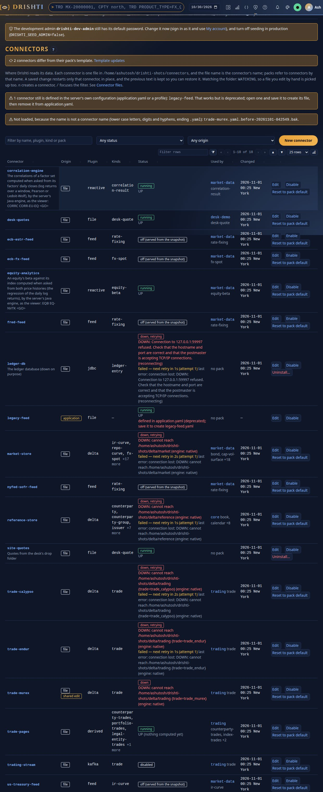

- **A bad file** (bad YAML, an unknown top-level key, a `name:` that differs from the file name, a credential in clear, an unset `${VARIABLE}`
  without a default, a plugin not installed) stops neither the server nor the connector: the last good configuration keeps running, and the
  problem is in the log, in Admin → Health (`connectors.badFiles`) and on the Connectors page.
- **A connector the pack names but nobody defined**: the pack loads, its kinds answer `DRS-1011`, Health shows `connectorsNotConfigured`, and
  Data source marks it **not configured** with a **Create** link pre-filled from the template. `drishti.py server packs datasource get <pack>`
  shows the same and exits 1 while one is missing.
- **Credentials**: a setting whose name says it is one (`password`, `secret`, `token`, `api-key`, `access-key`, `private-key`, `credential`)
  can only be `${LAKE_PASSWORD}` or `file:/run/secrets/lake-password`; a plain value or a password inside a URL is refused (`DRS-5031`). The
  folder holds no secret, so it can live in version control.
- **Template updates**: after a pack upgrade a connector file can lack kinds the pack serves now. A file nobody edited carries a stamp
  (`# drishti-template: …`) and is replaced by the new template, the old one kept beside it (`.before-upgrade-….bak`) and audited; an edited
  file gets every key its template gained and keeps every value (`template-updates: additive`, the default, in
  `config/connectors-settings.yaml`; `notify` only lists them). **Admin → Connectors → Template updates** shows each drifted connector with *Add
  missing kinds*, *Regenerate from template*, *Remove obsolete kinds*, *Use the pack's value* and *Fix all additive*
  ([DATA_GUIDE.md section 9](DATA_GUIDE.md#template-updates)).
- **Archives carry names and templates only**: a pack archive never carries a site's settings; its deploy preview lists the connectors the site
  lacks and a **Create connectors** step writes them from the templates ([9.1](#91-deploy-an-archive)).

## 7. Data stores, lakes and feeds

The banking packs read one store per data domain (`reference`, `market`, `trading`, `risk`, `credit`, `collateral`). Delta Lake is the
default. Drishti is not an ingestion engine: in production **your own ETL** loads the lake, the files or the database, and its last step tells
Drishti the batch landed ([DATA_GUIDE.md](DATA_GUIDE.md#1-telling-drishti-new-data-has-landed)); the tools below are for staging, small setups
and large one-off loads.

### 7.1 The lakes' folders

Every lake has its own folder under `<data>/delta`: the demo lake `data/delta/demo` (`config/lakes/demo.yaml`), a lake the data inbox creates
for a load that names it `data/delta/<lake>` (`risklake`, `newslake`, `worldlake`, `regulators`, `capitalmarket`, `referencelake`), and the
official VaR and exposure results the server publishes in `data/delta/risk-results`. A lake file may name any other root. The layout is
`<root>/<domain>/<kind>/business_date=YYYY-MM-DD/`. Load your own data with your ETL, or `drishti.py lake build` for a large JSON export
([DATA_LAKE_GUIDE.md](DATA_LAKE_GUIDE.md), [16.4](#164-sizing-a-large-load)). The retired example packs keep their generators under
`tools/packgen/` (`tools/packgen/banking/make_data.py --lake data/delta/demo` writes JSON Lines under `data/build/lake-rows`, then loads them).
`python3 tools/drishti.py lake status --lake data/delta/demo` lists a lake's tables; Admin → Lakes shows them.

A lake shipped tables a site's own connector reads that `config/lakes/demo.yaml` has no entry for get that one entry added at the start (in
the file's style, every other line kept byte for byte, the log naming the file): `git diff config/lakes` shows what a site's start added.

### 7.2 Local disk or object storage

A Delta connector's `root` without a scheme is a local folder; `s3a://bucket/lake` is Amazon S3 or any S3-compatible store (MinIO, Ceph),
read with only the AWS SDK modules it needs. Dates, time travel, reverse lookups and search work the same on both. One variable moves every
pack's lake connectors:

```bash
DRISHTI_DELTA_ROOT=s3a://risk-lake/banking java -Djava.io.tmpdir=data/tmp/server -jar drishti-server.jar
```

Credentials then come from the AWS default chain (environment, profile, instance role). For a region, an endpoint or keys, give the connector
its own settings in `config/connectors/trade-endur.yaml`:

```yaml
plugin: delta
kinds: [trade]
settings:
  root: s3a://risk-lake/banking
  domain: trading
  s3.region: us-east-1                          # or s3.access-key / s3.secret-key as ${ENV} references
  # s3.endpoint: https://minio.bank.example     # for S3-compatible stores
  # hadoop.fs.s3a.connection.maximum: "200"     # any Hadoop S3A setting, prefixed hadoop.
```

Every Delta setting: [the Delta connector](../../plugins/drishti-plugin-delta/README.md). Lake maintenance uses `s3://` for the same bucket.
**Sizing**: a laid-out trade table takes about 1.7 KB per trade per business day (1,000,000 trades a day: 1.6 GB a day, 35 GB a month, 2.8 TB
for seven years); the server's memory does not grow with history (it keeps the days in use and bounded caches,
[section 14](#14-memory-caches-and-capacity)). Millions of trades a day: [CLUSTER_GUIDE.md](CLUSTER_GUIDE.md).

### 7.3 PostgreSQL, Aerospike and Kafka

`deploy/docker/compose.data.yaml` starts PostgreSQL 18, a one-node Kafka 3.9 broker and Aerospike Community Edition (ports `DRISHTI_PG_PORT`,
`DRISHTI_KAFKA_PORT`, `DRISHTI_AEROSPIKE_PORT`; its PostgreSQL user and password `drishti`, bound to `127.0.0.1` only: a shared database needs
its own):

```bash
docker compose -f deploy/docker/compose.data.yaml up -d
tools/load-postgres.sh jdbc:postgresql://localhost:5432/drishti
tools/load-aerospike.sh localhost:3000 test
```

Point the connectors at a store by copying the example files for it from `config/connectors.examples/<store>/` into `config/connectors/` (a file
replaces the pack's template wholesale; [DATA_GUIDE.md section 9](DATA_GUIDE.md#911-moving-off-applicationyaml-and-the-old-data-source-override)).
The older Spring profiles (`SPRING_PROFILES_ACTIVE=postgres` or `aerospike`, with `DRISHTI_PG_URL`, `DRISHTI_PG_USER`, `DRISHTI_PG_PASSWORD`,
`DRISHTI_AEROSPIKE_HOSTS`, `DRISHTI_AEROSPIKE_NAMESPACE`) still work but are deprecated.

**Aerospike at scale, and retention.** Each domain is three sets: `<domain>` (a record per entity per business date), `<domain>_ix` (a record per
entity listing its dates) and `<domain>_kinds`. A bulk book with a retention period:

```bash
tools/load-aerospike.sh localhost:3000 test --trades 1000000 --days 3 --ttl-days 730
```

`--ttl-days N` gives every record a time to live, so Aerospike expires old dates itself (no maintenance job; without it records never expire). A
day record takes about 7 KB and an index record about 150 bytes (`asinfo -v sets/test/trading`); size the namespace for trades × days kept.
Drishti's memory does not grow with the days kept ([the Aerospike connector](../../plugins/drishti-plugin-aerospike/README.md)).

**Live trades from Kafka**:

```bash
uv run --with kafka-python python tools/samplegen/stream.py --rate 5          # 5 trades a second to drishti.trading.trades
DRISHTI_STREAM_TRADING=true DRISHTI_PACKS=trading java -Djava.io.tmpdir=data/tmp/server -jar drishti-server.jar
```

`stream.py` also takes `--bootstrap` (`localhost:9092`), `--topic`, `--samples` and `--seconds` (0: until stopped). The trading pack's
`trading-stream` connector reads `DRISHTI_KAFKA_BOOTSTRAP`, `DRISHTI_TRADING_TOPIC`, `DRISHTI_STREAM_STALE_AFTER` (15m: shown as behind) and keeps
the day's messages in a disk cache (`DRISHTI_STREAM_DISK_CACHE`, `DRISHTI_CACHE_ROOT`, `DRISHTI_STREAM_CACHE_GB`, cleared at `DRISHTI_CACHE_RESET_AT`).

### 7.4 Public feeds

The `market-data` pack has five public feeds, each off until switched on and refreshed every 60 minutes: `DRISHTI_FEED_NYFED_SOFR=true`
(`nyfed-sofr-feed`, rate fixings), `DRISHTI_FEED_ECB_ESTR=true` (`ecb-estr-feed`), `DRISHTI_FEED_ECB_FX=true` (`ecb-fx-feed`, FX spots),
`DRISHTI_FEED_US_TREASURY=true` (`us-treasury-feed`, the curve) and `DRISHTI_FEED_FRED=true` (`fred-feed`; needs `FRED_API_KEY`, series from
`DRISHTI_FRED_SERIES`, default `DGS10,DFF`). Each needs internet access (or a proxy). A feed that fails keeps its last good data and shows as down
on Admin → Health; the rest keeps working. Daily public-data feeds of other packs (`drishti.py feed run`) are in [EXTERNAL_DATA.md](EXTERNAL_DATA.md).

### 7.5 The data inbox: its folders, disk and retention

The data inbox ([DATA_GUIDE.md](DATA_GUIDE.md#7-the-data-inbox-drop-files-and-they-load)) is an engine, off as shipped
(`config/engines/dataload.yaml`). Its folder, `drishti.dataload.dir` (`<data>/dataload`):

| Folder | Holds | Kept |
|---|---|---|
| `inbox/` | files waiting, their `.ready` markers, `ready.all` | until loaded |
| `inprocess/<run>/` | the files one run claimed, while they load | emptied by the run; a stopped server's run is finished at the next cycle |
| `outbox/<day>/<run>/` | loaded files, markers, reports, the loader's logs and summaries | `keep-outbox-days` (30) |
| `failed/<day>/<run>/` | files that could not load, with `<file>.failed.json` | the same |
| `ledger/ledger-<yyyy-MM>.jsonl` | one line per step of every file; the SHA-256 that finds a file dropped again | for ever (small) |
| `inbox.lock` | the run that holds the inbox: run id, node, process, heartbeat | while a run loads |

- **One file system** for the whole folder (claiming and moving are renames). On a shared folder (EFS, NFS) give one node `owner: true`; a lock
  whose heartbeat is older than three intervals is taken over (logged).
- **Disk**: room for `keep-outbox-days` of input; busy protection's disk floor skips a cycle when the disk is nearly full.
- **Memory**: each load is a separate Java process with `loader-heap` (4g) and `nice` 10, one table after another; the server's heap is never used.
  A run stopped by `load-timeout` (2h) sends its files back to the inbox.
- **Runs never overlap** (a cycle due while one loads is recorded as skipped), and **stopping the server** mid-run is safe: the next cycle puts
  claimed files back, completes a load that committed and sends the signals not sent.
- `drishti.py dataload status` (or `GET /api/v1/admin/dataload`) shows what waits, what failed and why, and the last cycles; Admin → Data loads →
  Inbox draws the same, with Retry and Load now ([DATA_LAKE_GUIDE.md](DATA_LAKE_GUIDE.md#31-the-data-inbox)).

### 7.6 The in-memory lake: memory-only feeds

Feeds that may not be saved on a disk are held in memory stores (`drishti.lake.memory.*`, the engine `memory-lake`; set one up with
[DATA_LAKE_GUIDE.md](DATA_LAKE_GUIDE.md#13-the-in-memory-lake)):

| Task | How |
|---|---|
| See the stores and tables | Admin → Lakes, *Held in memory only*; `drishti.py lake memory status` (`--json`) |
| See the jobs' runs | `drishti.py lake memory jobs --table <t>`; `GET /api/v1/admin/lakes/memory/jobs` |
| Refill a table now | `drishti.py lake memory refill <table>` (audited `lake.memory.refill`) |
| Start the server | the shipped launchers raise `-XX:MaxDirectMemorySize` by the stores' caps (`tools/lake/memory_caps.py`, or `DRISHTI_LAKE_MEMORY_MB` for Docker and ECS); a unit file of your own adds it |
| After a restart | the stores are empty by design; the warm-up refills them in `warm-up` order; screens say *refilling* meanwhile |
| A store is full | Health amber, the run `refused`, the table at its previous version: raise `max-mb` (restart), unpin tables, or lower `keep-versions` |
| Health red | a pinned table empty after the warm-up (see `jobs`), or the direct-memory limit below the caps |
| The host | no swap (or encrypted swap), no heap dump unless to a RAM disk, no JFR at launch, the temporary folder on a RAM disk: each a host check on Health |
| A cluster | `memory-stores: [<store>]` in the owner's `config/net/node.yaml`; the other nodes forward ([DATA_LAKE_GUIDE.md](DATA_LAKE_GUIDE.md#138-a-cluster-the-owner-node-binds-the-pack)) |

Nothing of a memory-only connector is written to the data folder; a scheduled report, a share's picture or e-mail and an Ask about its pages are
refused (`DRS-5219`); DuckDB does not spill on such a server; logs and audit carry ids and counts only. A user's download from Export data is the
one way out, audited.

## 8. Deploy, promote and roll back by copying

Everything you build for Drishti (a pack, a Sutra, an about file, a lake) is a **plain file or folder**, so getting it onto a server is a
**copy**: no server API, no token, no running server. The commands are `tools/drishti.py`'s ([CLI_REFERENCE.md](CLI_REFERENCE.md)); the machine that
builds and verifies needs Python 3.10+ and PyYAML (`uv run --with pyyaml python tools/drishti.py ...`), the target only a shell (`tar` and
`cp` do by hand what `pack deploy` does). With a running server and an administrator's login, [section 9](#9-admin--packs-deploy-an-archive-history-and-roll-back)
does the same from the browser, with checks on the server and automatic undo.

### 8.1 The artifacts, and how the server notices each

| Artifact | Made by | Goes to | The server notices |
|---|---|---|---|
| **Pack bundle** `<name>-<version>.tar.gz` (+ `.sha256`): one pack, versioned, with a manifest of every file's checksum | `pack bundle` | unpacked by `pack deploy` into the packs folder: `drishti.packs.dir` (`DRISHTI_PACKS_DIR`, `./config/packs`) or `drishti.packs.installed-dir` (`./data/packs/installed`, searched first) | the watcher checks and loads the copied folder after it has been quiet for 750 ms, and records it in `data/packs/added.yaml`; one that does not check out is not loaded (Admin → Packs and Health say why) and is retried; a new version is swapped in, a bad one keeps the last good running. With `drishti.packs.watch: off` only Admin → Packs → **Load** acts |
| **Pack folder** `config/packs/<domain>/<name>/` (what git holds) | you, `pack new` | the same places | the same |
| **Sutra files** `*.sutra.yaml` | `sutra design`, `sutra gen`, the Screen Designer | `<pack>/sutras/`, or the site Sutra folder | hot reload (250 ms debounce): an invalid file is reported, the last good version stays live |
| **`config/about.yaml`** (+ `about.<lang>.yaml`, `help.yaml`, `formats.yaml`) | you | `<pack>/config/` | with the pack's reload |
| **Delta lake** `<root>/<domain>/<kind>/business_date=…/` | your ETL, `lake build`, `data ingest --lake` | `DRISHTI_DELTA_ROOT` or `s3a://…` | the connector re-reads the table version every `refresh-seconds` (10) and on a data-load signal |
| **Files root** `<root>/<domain>/<date>/<kind>.jsonl` | `data ingest --store files` | `DRISHTI_FILES_ROOT` (`./data/files`) | rescanned every `rescan-seconds` (30) |
| **Settings** | you | the environment file, a ConfigMap, `application.local.yaml` | restart |

A **bundle carries the pack only**: data changes daily and can be terabytes, so it is deployed separately (8.7). A running server is never
touched by `pack deploy`: copy during the day, switch at the moment you choose.

### 8.2 Make a bundle

```bash
drishti-console/.venv/bin/python tools/drishti.py pack bundle config/packs/banking/trading --out dist
```

```text
== trading: sutra lint: exit 0
== trading: sutra test: exit 0
bundled trading 1.0.0: 428 files
  dist/trading-1.0.0.tar.gz
  sha256 bd505178b12aa7c25c6cdab0ba8280e3c749bc050906280ba61e2a6bb6c5f901
```

It runs `pack check` first (`--no-check` skips it), so a pack that does not lint and test never becomes an artifact. You get
`dist/trading-1.0.0.tar.gz` (copy **this**), its `.sha256` (keep it beside the archive) and `trading-1.0.0.manifest.json` (the manifest, also
inside the archive as `trading/MANIFEST.json`): `pack` and `version` from `pack.yaml` (**bump `version` for every release**), `title`,
`extends`, `kinds`, `requiresServer` (the lowest server version, default this checkout's; `--requires-server 1.14.0` to say lower),
`generator`, `data` (the pack's `ingest:` block and connector names: the layout the data must have) and `files` (each with its SHA-256 and
size). The archive is **reproducible** (no timestamps, owners or machine paths; `.git`, `__pycache__` and editor files left out): the same
content gives the same bytes.

### 8.3 Verify a bundle, offline

```bash
drishti-console/.venv/bin/python tools/drishti.py pack verify dist/trading-1.0.0.tar.gz
```

```text
verify dist/trading-1.0.0.tar.gz: trading 1.0.0
  checksums ok
  schema    ok
  server    ok
  sutra     ok
verified
```

| Check | Fails when |
|---|---|
| (first) the archive's SHA-256 against its `.sha256`; unsafe entries (links, `..`, absolute paths) | the file changed after bundling or was damaged in transfer: `drishti: trading-1.0.0.tar.gz: sha256 does not match …` before anything is unpacked |
| `checksums`: every manifest file present with its checksum, **no unlisted file**, `pack.yaml` agrees | a file was edited, added or removed after bundling |
| `schema`: `pack`, `version`, list-shaped `kinds` and `extends`, a `sutras/` folder, the `ingest:` block | `pack.yaml` is malformed |
| `server`: `requiresServer` against `--server-version` (default this checkout's) | the target is older than the bundle needs |
| `sutra`: `sutra lint` and `sutra test` on the unpacked content (needs Java 21 and the exec jar; `--no-sutra` skips) | a Sutra does not parse or a test fails |

`pack verify` also takes a **folder**, which finds drift in a deployed pack (`pack verify prod/packs/trading --no-sutra` after a hand edit says
`checksums FAILED - checksum mismatch: pack.yaml`, `NOT verified`, exit 1). `--json` gives a machine-readable report; exit codes 0 verified, 1
not verified, 2 usage. The `.sha256` protects against damage and accidents; through an untrusted store publish the pack signed instead
(`pack publish`, `verify --registry`; [8.11](#811-permissions-ownership-and-registry-keys)).

### 8.4 Deploy by copying

```bash
drishti-console/.venv/bin/python tools/drishti.py pack deploy dist/trading-1.0.0.tar.gz --to /opt/drishti/packs --backup /opt/drishti/backups --no-sutra
```

```text
verified
deployed trading 1.0.0 to /opt/drishti/packs/trading; previous 1.0.0 kept at /opt/drishti/backups/trading-1.0.0-20261017T214051_360916
next: a running server watches its packs folder (drishti.packs.watch): it checks the copied pack and loads it by itself within seconds, no restart; …
```

It verifies; copies into a temporary sibling `.trading.incoming-<pid>` (same file system, so the last step is a rename; a dot folder is ignored by
the server); checks the copy against the manifest; moves the current `trading/` to the backup folder as `<name>-<version>-<UTC stamp>`; renames the
new folder into place; and puts the old one back if that rename fails. A reader never sees a half-copied pack and the previous version is never
lost. Options: `--to DIR` (the packs folder, or `installed-dir` to override a shipped pack of the same name), `--backup DIR` (default
`<to>/previous-versions`; keep it outside the packs folder if that is mounted into containers), `--dry-run` (`dry run: would copy trading 1.0.0 to
prod/packs/trading (a new pack)`), and `--no-sutra`, `--server-version V`, `--strict`, `--json` as for verify. A failed verification copies nothing
(exit 1).

**Remote machines**: `pack deploy` writes the local disk. Copy the artifact and run it there, or verify here and `rsync -a` the verified folder:

```bash
scp dist/trading-1.0.1.tar.gz* ops@prod1:/srv/drishti/incoming/
ssh ops@prod1 'python3 /srv/drishti/tools/drishti.py pack deploy /srv/drishti/incoming/trading-1.0.1.tar.gz --to /srv/drishti/packs --backup /srv/drishti/backups --no-sutra'
```

**By hand, no tool at all** (only `tar` and `sha256sum` on the server):

```bash
cd /srv/drishti/incoming
sha256sum -c trading-1.0.1.tar.gz.sha256                            # trading-1.0.1.tar.gz: OK
mkdir -p ../stage && tar -xzf trading-1.0.1.tar.gz -C ../stage      # outside the packs folder
mv ../packs/trading ../backups/trading-1.0.0                        # keep the old one (skip on a first deploy)
mv ../stage/trading ../packs/trading                                # the rename is the switch (same file system)
rmdir ../stage
```

`MANIFEST.json` stays inside the deployed folder, so `pack verify <folder>` can check it at any time.

### 8.5 Promote dev → test → prod: the same bundle

What you tested is what you ship: build once, on CI, and copy the same file through the stages.

```text
git (config/packs/banking/trading, tag v1.0.1)
   │  CI: pack check, pack bundle
   ▼
trading-1.0.1.tar.gz + .sha256        ← built ONCE, stored as a CI artifact
   │  pack deploy                  │  pack deploy                  │  pack deploy
   ▼                               ▼                               ▼
 dev server                     test server                     prod server
```

1. **Never rebuild per environment**: `sha256sum trading-1.0.1.tar.gz` prints the same on every machine, and `pack verify` checks it.
2. **Differences between environments live in configuration**, never in the pack: `DRISHTI_PACKS`, `DRISHTI_DELTA_ROOT`, connector files,
   secrets in the environment file.
3. Promote by **copying the artifact** (a shared folder, an artifact store, `scp`).
4. Deploy to test, run the checks of [8.8](#88-check-it-after-a-deploy), then deploy the identical file to prod.
5. Record what runs where: `ls <packs>/*/MANIFEST.json` or `pack verify <folder>` shows each pack's name and version.

### 8.6 Sutra files, about.yaml and design exports

Sutras made by `sutra design`, `sutra gen` or the Screen Designer are ordinary files: copy them into a pack's `sutras/<folder>/`, and a running
server hot-reloads them ([RACHANA_REFERENCE.md](RACHANA_REFERENCE.md#hot-reload-the-workbench-and-governance)). `drishti.py design export <id> -o
design.zip` writes a zip of a design's Sutra and samples: put the `.sutra.yaml` in the pack in git, then the next bundle. `config/about.yaml` goes
into `<pack>/config/`; check it first with `pack about-check config/packs/<domain>/<name>`. Prefer shipping a Sutra change as a **new bundle** (a
version, a checksum, a rollback); hot-copy is for emergencies, and `pack verify <deployed folder>` reports the drift until you redeploy:

```bash
cp new-var.sutra.yaml /opt/drishti/packs/market-risk/sutras/       # live within a second or two
curl -s -H "Authorization: Bearer $DRISHTI_TOKEN" localhost:18480/api/v1/admin/health | python3 -c "import json,sys; print([(p['name'],p['sutraProblems']) for p in json.load(sys.stdin)['packs']])"
```

### 8.7 Data: a Delta lake or a files root

Never write into the folder the server reads while it is half-finished: write elsewhere, then make it appear in one step.

- **Files root** (`<root>/<domain>/<business-date>/<kind>.jsonl`; the connector lists folders every 30 s):

  ```bash
  python3 tools/drishti.py data ingest --from new-day.jsonl --pack config/packs/banking/trading --store files --root /srv/stage/files
  cp -r /srv/stage/files/trading/2026-10-05 /srv/drishti/files/trading/.2026-10-05.part     # a dot name the connector skips
  mv /srv/drishti/files/trading/.2026-10-05.part /srv/drishti/files/trading/2026-10-05      # the rename is atomic
  ```

  A single file: write `<kind>.jsonl.tmp` and `mv` it into place ([the file connector](../../docs/connectors/types/file/README.md)). A whole
  root: build `files.new/`, then `mv files files.old && mv files.new files`; keep `files.old` for rollback.
- **Delta lake**: a new commit is atomic, so `lake build` or `data ingest --lake` into the live lake is the normal daily route. To copy a finished
  lake or partitions, copy **the Parquet files first and `_delta_log/` last** (the log makes files visible):
  `rsync -a stage/trading/trade_endur/ live/trading/trade_endur/ --exclude _delta_log && rsync -a stage/trading/trade_endur/_delta_log/ live/trading/trade_endur/_delta_log/`
  (for `s3a://` the same order with `aws s3 sync`). A whole lake: `mv lake lake.old && mv lake.new lake`. Keep times when copying (`cp -p`,
  `rsync -t`): *known at* reads them. Keep local test loads small ([DATA_GUIDE.md section 11](DATA_GUIDE.md#11-the-demo-data)).

### 8.8 Check it after a deploy

```bash
curl -s -H "Authorization: Bearer $DRISHTI_TOKEN" http://localhost:18480/api/v1/admin/health | python3 -c "
import json,sys
for p in json.load(sys.stdin)['packs']: print(p['name'], p['version'], p['status'], 'problems:', p['sutraProblems'], 'down:', p['connectorsDown'])"
python3 tools/drishti.py server health          # exit 1 unless OK
python3 tools/drishti.py server packs list
curl -s -o /dev/null -w '%{http_code}\n' http://localhost:18480/api/v1/packs
```

In the console: Admin → Packs (each pack's loaded and installed version and status), Admin → Health (`sutraProblems`, connectors down), About
(the loaded packs); then run a command of the pack at `/t`. Pass: the version you shipped, `status` OK, no Sutra problem, no connector down.

### 8.9 Roll back

```bash
drishti-console/.venv/bin/python tools/drishti.py pack rollback trading --to /opt/drishti/packs --backup /opt/drishti/backups
```

```text
restored trading 1.0.0 from /opt/drishti/backups/trading-1.0.0-20261017T214051_360916; the 1.0.0 it replaced is kept at /opt/drishti/backups/trading-1.0.0-20261017T214051_738374
```

It puts back the **newest** backup (`--version 1.0.0` picks one), keeps the version it replaced (a rollback is itself undoable) and swaps in one
rename; the watcher reloads it (restart only with `drishti.packs.watch: off`). By hand: `mv packs/trading backups/trading-bad && mv
backups/trading-1.0.0-… packs/trading`. Data rolls back with `mv files files.new && mv files.old files`, or for Delta with `RESTORE` or time
travel on the table.

### 8.10 Git as the source of truth, and a CI example

Keep `config/packs/<domain>/<name>/` in git with the version bump; a release is a tag, and `git checkout v1.0.1 && pack bundle` gives the same
bytes. Never edit a deployed folder: change git, build, deploy. A GitHub Actions job (adapt it to any CI):

```yaml
name: bundle-pack
on: { push: { tags: ["v*"] } }
jobs:
  bundle:
    runs-on: ubuntu-latest
    steps:
      - uses: actions/checkout@v4
      - uses: actions/setup-java@v4
        with: { distribution: temurin, java-version: 21 }
      - uses: astral-sh/setup-uv@v5
      - run: ./mvnw -q -DskipTests package -pl :drishti-app -am        # the exec jar that lint and test use
      - run: uv run --with pyyaml python tools/drishti.py pack check config/packs/banking/trading --strict --junit build/reports
      - run: uv run --with pyyaml python tools/drishti.py pack bundle config/packs/banking/trading --out dist
      - run: uv run --with pyyaml python tools/drishti.py pack verify dist/trading-*.tar.gz
      - uses: actions/upload-artifact@v4
        with: { name: trading-bundle, path: "dist/trading-*" }
```

A deploy job (or a person) downloads `trading-bundle` and runs `pack deploy` per environment, in order.

### 8.11 Permissions, ownership and registry keys

- The server only **reads** pack folders and data. Make the deployed tree owned by the deploying user and readable by the service account:
  `chown -R deploy:drishti /opt/drishti/packs && chmod -R g+rX,o-rwx /opt/drishti/packs`. The archive records no owners; run `pack deploy` with
  the same umask every time (`umask 027`). Folders need `x` for the service account; backups should not be readable by others.
- `data/packs/` (the overlay and installed packs) is the one place the service account needs write access (Admin → Packs → Load writes
  `added.yaml`). Do not run `pack deploy` as the server's own user against a folder the registry installer also writes.
- **Pack registry keys.** The private key that signs packs (`tools/packreg/packreg.py keygen`) is the registry's one secret: keep it off servers,
  in your secret store, for release managers only. Servers hold public keys only (`drishti.packs.registry.trusted-keys`). To rotate: make a new
  key, add its public key to every server, republish the packs with it, remove the old key. To stop trusting a publisher at once, remove its key:
  installed packs keep working, nothing new from it installs.

### 8.12 `pack make`: one folder to deploy

When you start from JSON Lines, **one command makes every artifact** in one folder:

```bash
drishti-console/.venv/bin/python tools/drishti.py pack make data/testdata/trades/endur/trade_endur.2026-07-08.jsonl.gz \
    --kind trade --match PRODUCT_TYPE --name my-bank
```

The folder (`data/build/my-bank-1.0.0/`) holds the pack (`pack/my-bank/`: copy it into the packs folder), the data (`data/delta/`: copy it to the
lake root or point `DRISHTI_DELTA_ROOT` at it), the bundle (`bundle/`, already verified), a configuration overlay, `run-server.sh` and `.ps1`, a
`MANIFEST.json`, and a `README.txt` with the deploy, verify, update and rollback steps filled in with your kind, ids and dates
([CLI_REFERENCE.md](CLI_REFERENCE.md#quickest-path-pack-make); `--date` names your business-date field). From **JSON Schema**, `pack make --schema` makes
the same folder, and **Build → New pack** (`/build/pack/designer`) the same bundle in the browser (it profiles every file in the browser, proposes
kinds, ids, business dates and one Sutra per type, and previews them), then hands it to Admin → Packs → Deploy an archive
([BUILD_GUIDE.md](BUILD_GUIDE.md#8-the-pack-designer-build--new-pack)). Schemas alone give a pack that serves its samples.

### 8.13 Windows

The tools are the same in PowerShell; keep the packs folder and the backup folder on the **same drive** so the swap is a rename:

```powershell
drishti-console\.venv\Scripts\python tools\drishti.py pack bundle config\packs\banking\trading --out dist
drishti-console\.venv\Scripts\python tools\drishti.py pack deploy dist\trading-1.0.1.tar.gz --to D:\drishti\packs --backup D:\drishti\backups
Get-FileHash dist\trading-1.0.1.tar.gz -Algorithm SHA256     # compare with the .sha256 file
tar -xzf dist\trading-1.0.1.tar.gz -C D:\drishti\stage       # tar.exe ships with Windows 10+; then move the folder into the packs folder
```

An antivirus or an open Explorer window on a pack folder can block the rename (*Access is denied*): close it and retry; the old version is put back
automatically.

## 9. Admin → Packs: deploy an archive, history and roll back

With the server running and an administrator signed in, the same archive deploys from the browser (or the terminal), and you get four things a
copy does not: the server **checks the archive first**, shows **what it changes** from the running version (breaking changes marked), **keeps the
version it replaces** for a one-click rollback, and **puts the old files back by itself** if it cannot start with the new ones. The archive is the
pack only, never data; settings: [CONFIGURATION.md](../admin/CONFIGURATION.md#drishtipacksdeploy); endpoints:
[API_REFERENCE.md](API_REFERENCE.md#220-deploying-a-pack-archive-and-the-packs-connectors).

### 9.1 Deploy an archive

1. Build and verify the bundle ([8.2](#82-make-a-bundle), [8.3](#83-verify-a-bundle-offline)).
2. **Admin → Packs → Deploy an archive**: choose the `.tar.gz` (or `.zip`, or drop it on the box) and press **Upload and check**. Nothing changes
   yet. Each check shows OK, NOTE or FAIL; any FAIL refuses the archive.

   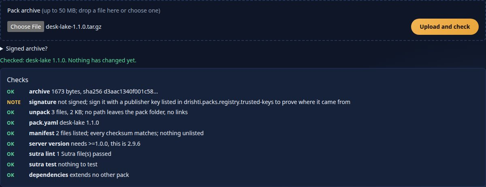

   | Check | Refused when |
   |---|---|
   | **archive**: size and SHA-256 (against a `.sha256` the CLI sends, or `--sha256`) | over `drishti.packs.deploy.max-archive-mb` (HTTP 413, before it is read); the checksum differs |
   | **signature**: an Ed25519 signature by a publisher in `drishti.packs.registry.trusted-keys` | it does not verify or the publisher is not trusted; with `require-signature: true`, no signature |
   | **unpack**: plain files and folders only, at most `max-files` and `max-unpacked-mb` | an absolute path, `..`, a link, device or special file (a zip slip or zip bomb) |
   | **pack.yaml**, **manifest**: names, every listed file with its SHA-256 and size, nothing unlisted, the same pack and version | a changed, missing or extra file; no manifest (unless `require-manifest: false`) |
   | **server version** | this server is older than `requiresServer` |
   | **sutra lint**, **sutra test** | any problem, the first ones named |
   | **dependencies**: each pack it `extends` loaded or on disk | a missing parent: deploy that pack first |

3. Read **What it changes**, the same comparison as `drishti.py pack diff`, against the version **running** (or on disk): **breaking** (a kind or
   mnemonic removed or renamed: monitors, workspaces, alerts and links name them; tick *I have read the breaking changes*, API
   `acceptBreaking=true`), **selection** (a Sutra added, removed or its `match` changed), **layout** (connectors, routes, ingest or columns: check
   the data source), **change** (Sutra content, about text). A version the same as or older than the running one is flagged and allowed. The
   preview also lists connectors the pack names that this site lacks; **Create connectors** writes them from the templates.

   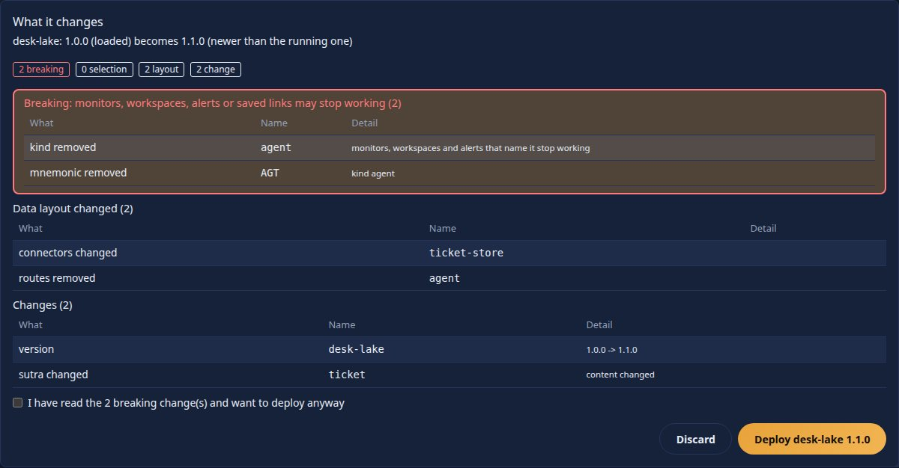

4. **Deploy**. The server swaps the files into `drishti.packs.installed-dir` (which wins over `config/packs/`), keeps the previous version under
   `previous-versions/<pack>/<version>-<time>`, checks all loaded packs with the new one and puts it to use **at once, with no restart**. If the
   check fails or the server cannot start with the new files, the old files are put back and the history says *reverted*; users stay signed in.

   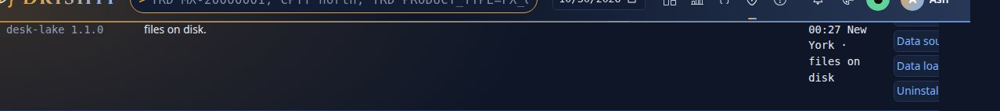

### 9.2 History and roll back

**Admin → Packs → History and roll back** lists every deployment, rollback and reverted attempt (when, pack, version, the version it replaced,
who) and the versions kept; **Roll back to this** puts one back the same safe way, and is itself undoable. `drishti.packs.deploy.keep-versions`
(5) are kept per pack. A pack first deployed over a shipped copy also offers **shipped with the server** (removes the installed copy). Rollback
restores **files only**: data and connector files stay as they are. The history is `data/packs/deploy-history.jsonl`; every step is audited
(`pack-upload-checked`, `pack-deployed`, `pack-rolled-back`).

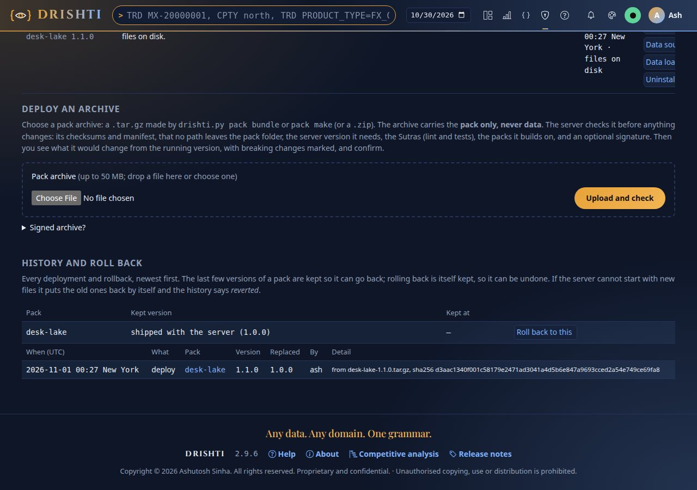

### 9.3 The same from the terminal

```bash
python3 tools/drishti.py server packs deploy dist/my-bank-1.1.0.tar.gz --preview   # checks and changes; discards the upload
python3 tools/drishti.py server packs deploy dist/my-bank-1.1.0.tar.gz --accept-breaking --wait 60
python3 tools/drishti.py server packs history --pack my-bank
python3 tools/drishti.py server packs rollback my-bank --version 1.0.0              # or --version shipped
```

With a breaking change it prints the preview and exits 1 until `--accept-breaking`. A personal API token needs the **packs:admin** scope (and its
user the admin role) ([CLI_REFERENCE.md](CLI_REFERENCE.md#server-packs-deploy-history-rollback-and-datasource)).

| | Copy (described in [section 8](#8-deploy-promote-and-roll-back-by-copying)) | Admin → Packs / `server packs deploy` |
|---|---|---|
| Needs a running server and a login | no | yes (administrator; `packs:admin` for a token) |
| Checks before anything changes | `pack verify` on your machine | the server's checks, on the server |
| Shows what changes | `pack diff` | the same, in the page, against what runs |
| Previous version kept | `previous-versions/` beside the packs | under the installed folder, N kept, listed |
| Restart | you | in place, with automatic undo |
| Audit | the file system | audit rows and the history file |

### 9.4 If a deploy goes wrong

| You see | Do |
|---|---|
| *checksum mismatch: sutras/x.sutra.yaml*, `sha256 does not match …`, `file not in the manifest` | the archive changed or a deployed pack was edited by hand: copy it again with a checksum-preserving tool; put the change in git and ship a new bundle |
| *unsafe path in the archive*, `unsafe entry` | a hand-made archive: rebuild it with `pack bundle` |
| *no MANIFEST.json* | built with plain `tar`/`zip`: use `pack bundle` (or `require-manifest: false`, not recommended) |
| *the archive needs server >=X* | upgrade the server first, or rebuild with `--requires-server` if you know it is compatible |
| *extends X, which is neither loaded nor on disk* | deploy or load the parent first |
| HTTP 413 | over `max-archive-mb` (and the console's `packs.deploy_max_mb`): archives carry no data, so a big one usually has data in it |
| `the pack fails pack check` | run `pack check config/packs/<domain>/<name>` and fix it |
| `no drishti-server-*-exec.jar` | build it, set `DRISHTI_JAR`, or `--no-sutra` on a target without Java |
| history says *reverted* | the server could not start with the new files: read the server log at that time; fix and redeploy |
| deployed, but the old content is served | the watcher waits for the copy to be quiet (`drishti.packs.reload-debounce`, 750 ms), the watch is `off`, or the new version was refused: look at the pack's row; with `watch: off` use Load/Unload or restart |
| deployed, but the pack is not in Admin → Packs | `--to` is not the folder the server watches, or the pack does not check out (Load shows why) |
| `PermissionError` | the target or backup folder is not writable by you ([8.11](#811-permissions-ownership-and-registry-keys)) |
| new data does not show, or a partition appears half-loaded | wait for the refresh; the layout must match the pack's `ingest:`; copy under a dot name and rename, `_delta_log` last |

## 10. Admin → Artifacts: install and uninstall safely

Everything an administrator installs is a file or folder the server watches: **domain packs** (`config/packs`, `data/packs/installed`),
**connector files** (`config/connectors`) and the **shipped BI files** (tables and models in `config/tables/<domain>`; reports, boards, notebooks
and Python items in `config/bi`). **Admin → Artifacts** (`/admin/artifacts`, administrators only) lists them all, says what depends on each before
you touch it, and offers a way out that cannot lose anything: **disable** (keep it, switch it off) or **uninstall** (move it to an archive you can
restore from). The same dialog opens from **Admin → Packs** (*Uninstall…* on each pack), **Admin → Connectors** and **Admin → BI** (*Shipped
files*). Files you add, edit or delete by hand are still picked up; this page is the careful way.

### 10.1 The list and the impact

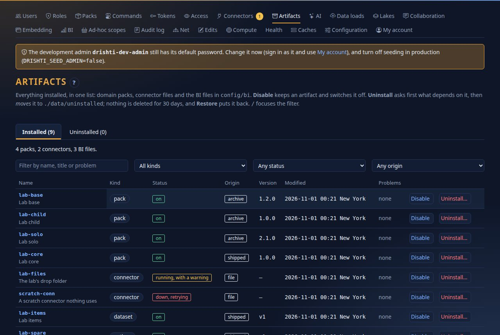

One row per artifact: **Name** (a link to its own page), **Kind** (`pack`, `connector`, or for BI `table`, `model`, `report`, `board`,
`notebook`, `python`), **Status** (`on`, `disabled`, `not loaded`, `problem`), **Origin** (`shipped`, `archive` from a deploy or the registry,
`file`, `ui` saved from the console, `template` written from a pack's template, `application` defined only in the server's configuration),
**Version** (a pack's `version:`; `v1`, `v2`... for a BI file), **Modified** and **Problems** (a pack refused at load, a connector file that does
not parse or whose connection is down, a BI file that does not parse). The filter box (`/`) searches name, title and problems.

Before it offers Uninstall the page asks the server **what would stop working**: a count and the first 25 names per kind of dependant.

| You ask about | It lists |
|---|---|
| **A pack** | packs that extend it; connectors only it uses; BI tables that read its kinds and the models, reports and boards over them; saved searches, monitors, alert rules, measure alerts, subscriptions, workspaces and saved pivots, layouts and reports naming its kinds; shares of its kinds; embed hosts on its kinds |
| **A connector** | the packs that read through it and the kinds each sends; BI tables that scan it and what is over them; saved documents, shares and embed hosts on its kinds; whether a pack's template would write it back |
| **A BI file** | the BI files that name it and what names those, down to six steps; measure alerts, alert rules, subscriptions, workspaces and saved views naming it; embed hosts on the kinds a dataset reads |

It reads references, not free text: a BI file names another by `dataset:`, `report:`, `board:`, `notebook:`, `python:`, `transform:`,
`connector:` or `kind:`; a saved document by the values of its reference keys (`kind`, `entity`, `ref`, `path`, `dataset`, `report`…). Items in other
people's workspaces count (drafts are marked). It is a safeguard for the person about to click: a script that calls a view is not something the
server can see.

### 10.2 Disable, uninstall, restore

**Disable** keeps the artifact where it is and switches it off; it is the way out whenever something depends on it:

| Artifact | Disable does | Enable |
|---|---|---|
| Pack | switches it off for everyone (Admin → Packs → Switch off): its kinds, mnemonics and views disappear; the folder stays. A pack that enabled packs extend is refused unless you tick *Also disable the packs that build on it* (`409 DRS-5041`) | switches it on, and what it builds on |
| Connector | `enabled: false` in its file (file and history stay); a templated connector can be disabled though not uninstalled | `enabled: true` |
| BI file | hides it from the catalogue (the file stays; the list is `data/admin/bi-hidden.txt`); reports on a hidden dataset cannot run it | shows it again |

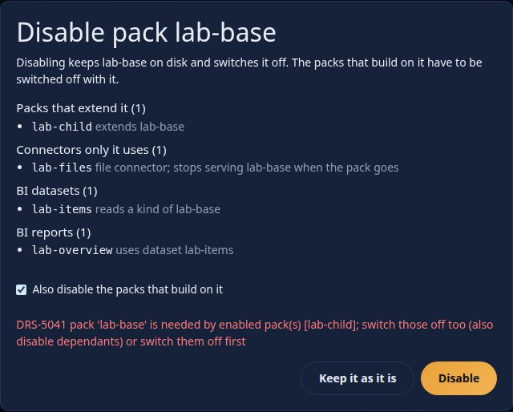

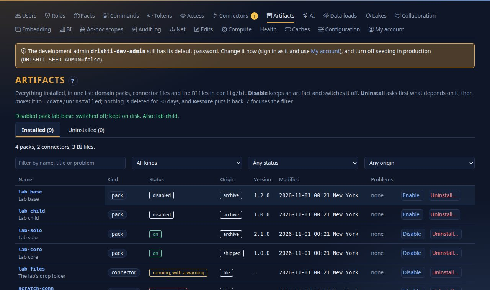

**Uninstall…** first asks for the impact. With nothing depending on it, it offers **Uninstall**, which **moves** the file or folder to
`data/uninstalled/<timestamp>-<kind>-<name>/` (`payload/` exactly as it was, and `uninstalled.json`: who, when, what depended on it, where it came
from; setting `drishti.admin.uninstalled-dir`); the watchers then unload, stop or drop it as if deleted. With dependants, **Uninstall is not
offered**: the dialog lists them and offers **Disable instead**, and the server refuses the call too (`409 DRS-5041`). To **take the dependants
along**, tick *Also disable or uninstall what depends on it* and **type the artifact's name** (else `422 DRS-5043`): packs that extend it are
uninstalled (deepest first), connectors only it uses disabled, dependent BI files hidden; people's own saved items stay and say so when opened.
A connector a pack's template names can only be disabled or reset, and a pack named in `DRISHTI_PACKS` cannot be uninstalled here (take it out of
the setting and restart, or disable it): both `DRS-5044`. A connector defined only in `application.yaml` has no file: disable it.


**The Uninstalled tab**: **Restore** moves an archive back where it came from and the watchers pick it up; if the name exists again it is refused
(`409 DRS-5042`) unless you choose **replace** and type the name (the one in the way is archived first). What was switched off with it stays off
until you **Enable** it. **Delete permanently** removes an archive for good (type its name). **Retention**: archives older than
`drishti.admin.uninstalled-keep` (30 days; `0` keeps them) are removed once a day, each audited; back up `data/uninstalled` with `data/` to keep
them longer. Keep `data/` on the same disk as `config/` so an uninstall is one atomic move.

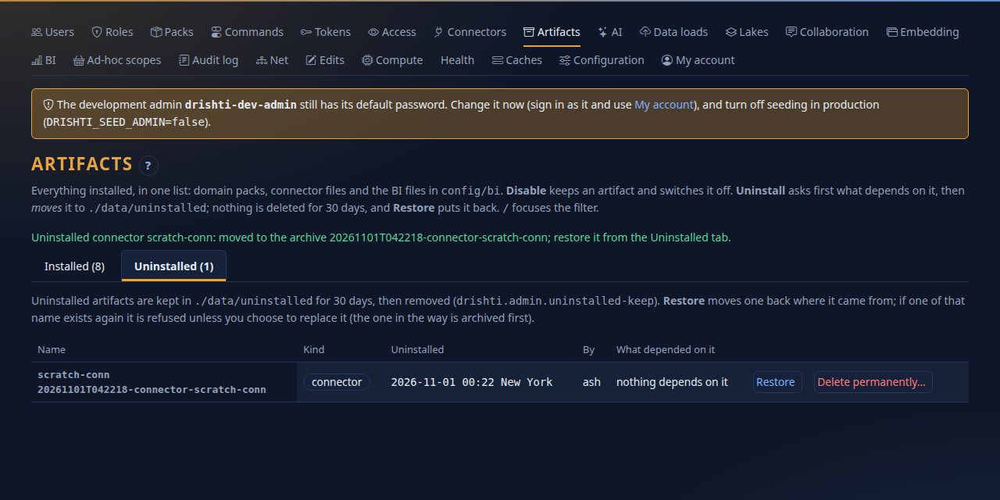

### 10.3 Install

The *Install* section has three cards: **a pack** (links to Admin → Packs → Deploy an archive, [9.1](#91-deploy-an-archive)); **a connector**
(Admin → Connectors → New connector, tested before it is saved); **a BI file** named `<name>.<kind>.yaml` (`table`, `model`, `report`, `board`,
`notebook`, `python`): **nothing is written yet**, the server checks the name, UTF-8 text up to `drishti.admin.bi-upload-max-bytes` (1 MiB), YAML
with a mapping at the top, the file's own key against its name, and the readers' and parsers' errors (warnings do not stop it). If a file of that
name exists the card lists what depends on it; placing it then needs *Replace* and the name typed, and the old file is archived first. The file is
placed atomically (a table or model in `config/tables/<domain>/`) and appears in the catalogue at once. A dataset file in BI's old form
(`<name>.dataset.yaml`) is refused with `DRS-9196`: run `drishti.py tables migrate` and upload the tables and model it writes.

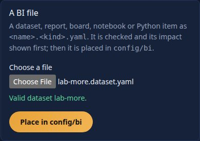

At phone width the list keeps Disable and Uninstall on each row, and the dialogs' choices become full-width buttons.

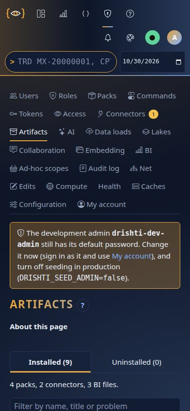

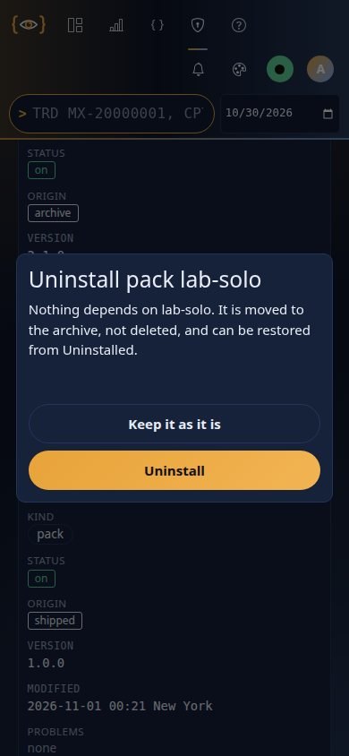

### 10.4 The audit trail, the API and the codes

Every action and every refusal is an audit event (subject `<kind>:<name>`): `artifact-disabled`, `artifact-enabled`, `artifact-uninstalled`,
`artifact-restored`, `artifact-purged`, `artifact-pruned` (the daily job, actor `system`), `artifact-installed` and `artifact-refused` (what and why):

```text
artifact-disabled     pack:lab-base  impact: Packs that extend it (1), Connectors only it uses (1), BI tables (1), BI reports (1); choice: with dependants; result: off, kept on disk; also off: [lab-child]
artifact-uninstalled  connector:scratch-conn  impact: nothing depends on it; choice: alone; result: archived as 20261012T142658-connector-scratch-conn
```

The endpoints are under `/api/v1/admin/artifacts` ([API_REFERENCE.md](API_REFERENCE.md#223-administration-artifacts-apiv1adminartifacts)): the list, `impact`,
`disable`, `enable`, `uninstall` (`cascade`, `confirm`), `uninstalled`, `restore`, delete, and `bi/check` (the dry run of a BI upload). **A personal
API token never reaches them** (`drishti.security.token-never`): they are for an administrator at the console (or `curl` with the session
cookie). The codes: `DRS-5040` (404: no such artifact or archive), `DRS-5041` (409: it has dependants; the answer carries the impact),
`DRS-5042` (409: the name exists; choose replace), `DRS-5043` (422: type the name), `DRS-5044` (422: does not apply: a templated connector, a
configured pack, a connector with no file, an invalid BI file). A session, for example:

```text
$ curl -s -X POST .../uninstall -d '{"kind":"pack","name":"lab-base"}'
{ "status": 409, "code": "DRS-5041", "detail": "DRS-5041 pack 'lab-base' has dependants: Packs that extend it (1), …; disable it instead, or choose to take the dependants along" }
$ curl -s -X POST .../disable -d '{"kind":"pack","name":"lab-base","cascade":true}'
{ "ok": true, "note": "switched off; kept on disk", "also": ["lab-child"] }
$ curl -s -X POST .../uninstalled/20261012T142658-connector-scratch-conn/restore -d '{}'
{ "ok": true, "note": "restored to connectors/scratch-conn.yaml", "replaced": false }
```

| You see | Meaning and the first thing to do |
|---|---|
| *Uninstall* is not offered; the dialog says *in use* | read the list; **Disable instead**, or take the dependants along with the name typed |
| The pack is still listed after Uninstall | another loaded pack extends it: uninstall that first (or take the dependants along) |
| An archive is missing | it was older than `uninstalled-keep`: the audit log has an `artifact-pruned` event |
| A BI report is blank after its dataset was disabled | **Enable** the dataset again |
| *administrators only* | only an administrator may use the page; a token cannot |

## 11. Security checklist

Work through this for every shared installation. Each item says how to check it.

### 11.1 The checklist

1. **Server security on.** `DRISHTI_SECURITY_ENABLED=true` and `DRISHTI_TOKEN_SECRET` at least 32 bytes. Check: `curl -s
   localhost:18480/api/v1/sources` answers `{"title":"unauthenticated","status":401,"code":"DRS-5010","detail":"missing bearer token"}`.
2. **Console sign-in on.** `DRISHTI_AUTH_ENABLED=true`, `DRISHTI_SESSION_SECRET` at least 32 characters, the same `DRISHTI_TOKEN_SECRET` as the
   server. Check: a private window opening the console goes to the sign-in page. Disabling or demoting someone takes effect within
   `auth.recheck_seconds` (10); signing out ends the session on the server.
3. **The development admin is gone.** Compose never creates it. Elsewhere sign in as `drishti-dev-admin`, create your own admin, change or
   disable the development one, and set `DRISHTI_SEED_ADMIN=false` (or give `DRISHTI_SEED_USERNAME`/`_PASSWORD` for the first start). Check:
   no default-password warning; `/api/v1/admin/status` reports `"defaultAdminPasswordInUse": false`.
4. **Single sign-on (optional).** `DRISHTI_OIDC_ENABLED=true`, `DRISHTI_OIDC_ISSUER` (https) and `DRISHTI_OIDC_CLIENT_ID` on both processes,
   `DRISHTI_OIDC_CLIENT_SECRET` and `DRISHTI_OIDC_REDIRECT_URI` on the console, and the group-to-role map `drishti.security.oidc.role-map` on the
   server ([ADMIN_GUIDE.md](ADMIN_GUIDE.md)).
5. **Roles and masks.** Review `drishti.security.roles` and what the packs add; keep `drishti.security.redact` listing every field that roles
   without raw access must not see (they read `•••` everywhere: views, search, type-ahead, alerts; a mask hides only the field it names,
   [CONFIGURATION.md](../admin/CONFIGURATION.md#field-masks)).
6. **Authoring.** `DRISHTI_STUDIO_SAVE=false` except in an authoring environment; keep `DRISHTI_SUTRA_REVIEW=true` and
   `DRISHTI_SUTRA_FOUR_EYES=true` so every change is approved by a second person.
7. **Demo source off**: `DRISHTI_DEMO_ENABLED=false`.
8. **Network.** Only the proxy reaches the console; only the console reaches the server's `/api`; only monitoring reaches `/actuator`;
   `SERVER_ADDRESS=127.0.0.1` when they share a host; `docker compose ps` shows no `0.0.0.0:18480`.
9. **TLS** at the proxy, `DRISHTI_SECURE_COOKIE` left `true` ([11.3](#113-tls-and-the-reverse-proxy)).
10. **Secrets** only in a `0600` environment file or your secret store, never in `application.yaml`, an image or a repository. No password in a
    sample is one to keep (`DRISHTI_PG_PASSWORD`, `DRISHTI_SEED_PASSWORD`); `DRISHTI_METRICS_TOKEN` long and random.
11. **The token secret** protected and rotated as a master key (11.2).
12. **Backups** ([section 17](#17-backups-and-restore)), **lake maintenance** scheduled ([section 16](#16-lake-maintenance-and-scheduling)),
    **monitoring** scraping with the metrics token and alerts set ([section 13](#13-monitoring-and-health)).
13. **Business intelligence**, if used: `drishti.bi.query.store-dir` (`DRISHTI_BI_STORE`) on a local disk with room for the dates in use (it can
    be deleted and rebuilt), `drishti.bi.query.memory-limit` (768MB) and `threads` inside the host's memory next to the heap, the query limits
    left on (`timeout`, `max-rows`, `max-concurrent`), `config/bi` in version control, `drishti.bi.poc.enabled` left `false`. Check: `GET
    /api/v1/bi/engine` as a `bi-admin` shows the limits; `GET /api/v1/bi/poc/bench` answers `404`.
14. **AI and MCP stay off unless wanted** (`drishti.ai.enabled`, `drishti.mcp.enabled`): switch them on only with provider files in `config/ai`
    whose keys are `${ENV}` references, the policy limits set (`drishti.ai.policy`: `per-user-per-day`, `cost-per-user-per-day`,
    `mask-redacted: true`) and an outbound proxy if the host needs one ([DATA_GUIDE.md section 10](DATA_GUIDE.md#outbound-http-proxy-for-connectors-ai-providers-and-mcp-servers)).
    Check: `GET /api/v1/admin/ai` shows `enabled` as intended and `keySet` per provider, never a key.
15. **Embedding stays off unless wanted** (`drishti.embed.enabled`): each host application registered with exact origins
    (`allow-wildcard-origins` stays `false`), the narrowest scopes and kinds, and a secret kept by its backend only. Check: Admin → Embedding
    lists only the applications you expect.

### 11.2 The token secret is a master key

`DRISHTI_TOKEN_SECRET` signs every token the console hands the server (HS256), and the server accepts **any token signed with it**: whoever holds
it can mint a token for any user name, with any role, `admin` included, without the console or a sign-in. Treat it like a database root password.

- **Protect it.** `openssl rand -hex 32`; a `0600` environment file or a secret store on the two hosts that need it; never in `application.yaml`,
  an image, a repository, a chat or a ticket; never shared across environments. Keep the server's `/api` unreachable except from the console, so a
  leaked token cannot be used from elsewhere.
- **Rotate it** on a schedule (every 90 days is common), when someone who knew it leaves, and at once on any suspicion: generate a new value, put
  it in both environments, restart both together. Every token signed with the old one stops working: users sign in again; a client that minted its
  own tokens needs the new secret. Personal API tokens (`drk_...`) are not signed with it and keep working: revoke them in **Admin → Tokens** if
  the leak could have reached them. There is no overlap window: plan the restart for a quiet moment.
- **Limit the damage.** Tokens expire (the console mints short ones), a leaked secret does not; after a suspected leak review **Admin → Audit
  log**, where actions are recorded under the user name in the token, even a made-up one.
- **Avoid sharing it further.** Single sign-on moves who may sign in to your identity provider; a reading client uses a personal API token (one
  real user, read-only, revoked on its own); machine access goes through a gateway that authenticates the caller and mints nothing. A secret per
  environment and a vault that hands it to both processes at start are the practical hardening.

### 11.3 TLS and the reverse proxy

Terminate TLS at a reverse proxy in front of the **console**; users never need the server.

| Path | Expose to users? | Why |
|---|---|---|
| console `:17480`, everything | yes, through the proxy | the whole user interface and its live channel |
| server `:18480/api/v1/...` | no | the console calls it; with security off it trusts anyone |
| server `:18480/actuator/...` | no; monitoring only | with security on only `/actuator/health` is open; the rest needs an admin token or `DRISHTI_METRICS_TOKEN`. `MANAGEMENT_SERVER_PORT=18481` serves it on its own port |
| server `:18480/api/docs`, `/api/docs/ui` | no (developers) | the OpenAPI description and Swagger UI; with security on, any user's token |

**Live updates through a proxy.** Each browser holds one long-lived Server-Sent Events connection to the console (`/api/channel`), shared by all its
tabs. The proxy must **not buffer** (the console sends `X-Accel-Buffering: no`), its **read timeout** must be well above the 15-second heartbeat, and
it must use HTTP/1.1 to the console. An nginx example:

```nginx
server {
    listen 443 ssl http2;
    server_name drishti.bank.example;
    ssl_certificate     /etc/ssl/drishti/fullchain.pem;
    ssl_certificate_key /etc/ssl/drishti/privkey.pem;

    location / {
        proxy_pass         http://127.0.0.1:17480;
        proxy_http_version 1.1;
        proxy_set_header   Host              $host;
        proxy_set_header   X-Forwarded-For   $proxy_add_x_forwarded_for;
        proxy_set_header   X-Forwarded-Proto $scheme;
        proxy_set_header   Connection        "";
        proxy_buffering    off;          # live updates
        proxy_read_timeout 1h;           # long-lived event streams
    }
}

server {
    listen 80;
    server_name drishti.bank.example;
    return 301 https://$host$request_uri;
}
```

Check from outside: `curl -sI https://drishti.bank.example/healthz | head -1` shows `HTTP/2 200`.

- **Cookies** are `Secure` by default: keep `DRISHTI_SECURE_COOKIE` unset once TLS is in place. The session cookie is `HttpOnly`,
  `SameSite=Lax` and holds only a signed reference to a session the server keeps.
- **Cross-site requests.** The console refuses a `POST`, `PUT`, `PATCH` or `DELETE` whose `Origin` (or `Referer`) is not the console itself
  (`403 DRS-5002`), and JSON not sent as `application/json` (`415`). It compares with the `Host` header, so keep `proxy_set_header Host $host;`; if
  your proxy changes the host, list the public origin in `auth.allowed_origins` (`[https://drishti.bank.example]`) in
  `drishti-console/config/application.local.yaml`.
- **Content security policy** is strict and set by the console (`script-src 'self'`, no inline scripts or styles): do not add or loosen one at the
  proxy. Every asset is vendored, so the console works with no internet access.
- **Single sign-on** behind a proxy: set `DRISHTI_OIDC_REDIRECT_URI=https://drishti.bank.example/auth/oidc/callback` and register exactly that URL
  with the identity provider (otherwise the console may build `http://127.0.0.1:17480/...`).

### 11.4 What leaves the server: Ask, the access log and AI

- **The access log.** Every answered read is a row in `drishti_access` (about 150 bytes): 200 people opening 300 views a day add about 60,000
  rows a day, 5.4 million over the default 90 days (1 to 2 GB on PostgreSQL with indexes). For heavier use put the identity database on
  PostgreSQL or shorten `drishti.access-log.keep-days`. If writes fall behind, events queue in memory (`drishti.access-log.queue`, 100,000) and
  beyond that are dropped and counted (Admin → Access shows it). To keep it longer, export it on a schedule (`GET
  /api/v1/admin/access?from=…&limit=5000`) before it is pruned.
- ***Ask about this page*** is off by default; on, it sends text to the model endpoint you configure. With `values: labels-only` (the default) the
  prompt holds the page's labels, the glossary, the pack's guide text and the question, no value; with `values: shown` also the page's sentence
  with the figures the asking user may see. A masked field is never in it. The model gets no tools; document values are marked untrusted data.
  The question is written to the access log (action `ask`) unless `log-questions: false`; answers only with `log-answers: true`. The model, endpoint
  and key are a provider file (`config/ai/<name>.yaml`, the key as `${ENV}`; [AI_GUIDE.md](AI_GUIDE.md)); an endpoint you do not control sees every
  question. If it is down the drawer says so (`DRS-4008`).

## 12. Collaboration, reports and people's data

### 12.1 Scheduled reports

People schedule searches delivered as CSV ([USER_GUIDE.md](USER_GUIDE.md#scheduled-reports)). Files go to `DRISHTI_REPORTS_DIR` (`./data/reports`),
one folder per user and report; nothing prunes it (`find data/reports -mtime +30 -delete`). Allowed webhooks are the URL prefixes in
`drishti.reports.webhooks` (empty: none). With several servers on one identity database set `DRISHTI_REPORTS_ENABLED=false` on all but one, or
each report runs once per server. Audited: `report.save`, `report.run` (`ok` or `failed`), `report.delete`; a failing report does not affect
Health (its owner sees the error on the Reports page).

### 12.2 Collaboration email and the outbox

Shares can be emailed ([ARCHITECTURE.md §31](../architecture/ARCHITECTURE.md#31-collaboration-write-back-and-approvals)). Off until all three are set (the server refuses to start with email
on and sign-in off): `drishti.security.enabled: true`, `drishti.collab.console-url` and an SMTP server:

```bash
export DRISHTI_CONSOLE_URL=https://drishti.example.com
export DRISHTI_MAIL_FROM=drishti@example.com
export SPRING_MAIL_HOST=smtp.example.com SPRING_MAIL_PORT=587 SPRING_MAIL_USERNAME=drishti SPRING_MAIL_PASSWORD=...
export SPRING_MAIL_PROPERTIES_MAIL_SMTP_STARTTLS_REQUIRED=true
export SPRING_MAIL_PROPERTIES_MAIL_SMTP_CONNECTIONTIMEOUT=10000 SPRING_MAIL_PROPERTIES_MAIL_SMTP_TIMEOUT=10000
export DRISHTI_COLLAB_EMAIL_ENABLED=true
```

Then `POST /api/v1/admin/collab/mail-test` mails the signed-in administrator (or `503 DRS-7012` with the SMTP reason). **What is sent**: one message
per person a share reaches who has an address (`User.email`, set by an administrator or the identity provider) and has not turned share mail off:
the sender, the kind and id, the panel and date, the note as that person may read it (masked values `•••`) and the link. A pack whose identifiers are
sensitive sets `drishti.collab.packs.<pack>.email.content: link-only`. The message is built when sent, so a person whose role was removed gets
nothing (*cancelled*). Notices for one person inside `email.coalesce-window` (10 s) go as one digest; nobody is mailed about their own shares, nor
more than `limits.mails-per-recipient-per-hour`.

**The outbox.** The row is written in the share's own transaction; a worker on each server (`outbox.enabled`) claims due rows under a lease, so
several servers never send one twice. A failure retries after `outbox.backoff`, doubling to `outbox.max-backoff`; an SMTP refusal (5xx, a malformed
address) or the `outbox.max-attempts`th failure makes a **dead letter**; sent rows go after `outbox.keep-sent-days`. A mail-server outage needs no
action: rows wait and go out when it returns.

```bash
curl -s -H "Authorization: Bearer $ADMIN" 'http://localhost:18480/api/v1/admin/collab/outbox?state=dead'        # counts and rows
curl -s -X POST -H "Authorization: Bearer $ADMIN" http://localhost:18480/api/v1/admin/collab/outbox/42/retry   # send a dead letter again
```

Rows show recipient, template, share, attempts, next attempt and last error, never the message; `state` is `pending`, `sending`, `sent`, `dead` or
`cancelled`. Alert on `drishti.collab.outbox{state="dead"} > 0` and on a growing `pending`. The causes of a mail that never arrives:
[21.5](#215-sharing-email-and-chat).

### 12.3 Retention, legal holds and the compliance export

Nothing in the collaboration record is destroyed by default (`retention.keep-days: 0`); comments are never deleted by their authors or moderators
(retract and hide change what readers see; every revision stays). Everything here is also on **Admin → Collaboration** (`/admin/collab`: holds,
the export, verify, the retention dry run, the mail outbox with *Send again* and a test mail).

**Retention.** Days in `application.yaml`, most specific first: `drishti.collab.retention.kinds.<kind>`, `drishti.collab.packs.<pack>.retention-days`,
`retention.keep-days`. A daily job removes whole threads whose last activity, and shares whose creation, is older (one audit event each,
`collab.purge.thread` with the thread's final hash, `collab.purge.share`), never what a legal hold covers. Look first:

```bash
curl -s -X POST -H "Authorization: Bearer $ADMIN" 'http://localhost:18480/api/v1/admin/collab/retention/run?dryRun=true'
# {"dryRun":true,"threadsPurged":12,"sharesPurged":30,"threadsHeld":2,"sharesHeld":1}   "held" = past retention but kept by a hold
```

**Legal holds** need the `compliance` power (an administrator is not enough). A hold has a scope (`entity` = kind and id, `kind`, `user` =
everything the person wrote, sent or received, `thread`, or `all`), a reason and an optional date range; place and release are audited:

```bash
curl -s -X POST -H "Authorization: Bearer $COMPLIANCE" -H 'Content-Type: application/json' http://localhost:18480/api/v1/admin/collab/holds \
  -d '{"scope":"entity","kind":"trade","id":"MX-20000001","from":"2026-09-01","to":"2026-09-30","reason":"case 4411"}'
curl -s -H "Authorization: Bearer $COMPLIANCE" 'http://localhost:18480/api/v1/admin/collab/holds?active=true'
curl -s -X DELETE -H "Authorization: Bearer $COMPLIANCE" http://localhost:18480/api/v1/admin/collab/holds/7     # release
```

An administrator's permanent removal of a thread (`DELETE /admin/collab/threads/{id}`) answers `423 DRS-7010` while a hold covers it.

**The export (eDiscovery)** is a job: ask, poll, download once.

```bash
curl -s -X POST -H "Authorization: Bearer $COMPLIANCE" -H 'Content-Type: application/json' http://localhost:18480/api/v1/admin/collab/exports \
  -d '{"from":"2026-09-30","to":"2026-09-30","kind":"trade","id":"MX-20000001"}'          # 202 {"id":"…","state":"queued"}
curl -s -H "Authorization: Bearer $COMPLIANCE" http://localhost:18480/api/v1/admin/collab/exports/ID          # state: queued|running|done|failed
curl -s -H "Authorization: Bearer $COMPLIANCE" -o export.zip http://localhost:18480/api/v1/admin/collab/exports/ID/download
```

Filters: `from`/`to`, `kind`, `id`, `user`, `includeShares`, `includeThreads`. The zip holds `shares.jsonl`, `threads.jsonl` (every revision,
**unscrubbed**: this is the record), `chains.jsonl` (each thread's first and last hash and whether its chain verified), `holds.jsonl`,
`inbox.jsonl`, `outbox.jsonl` (delivery rows, never a body), `README.txt` and `manifest.json` (filters, who, when, counts, version, and the SHA-256,
size and lines of every file). One export runs at a time per server (a queue of 8); only the person who asked downloads it, once; it is deleted then
or after `export-keep`, and a restart forgets an unfinished job. **Keep the manifest and `chains.jsonl` in the firm's archive**: a later export that
disagrees on a thread's hashes proves history was rewritten (evidence, not prevention).

**Verify.** `GET /admin/collab/verify?thread=th_…` recomputes one chain, checks the live rows against their revisions and the head against its
seal (`{ok, steps, firstHash, lastHash, problem}`); without `thread` it checks every thread and share in bounded memory, plus the holds and the audit
trail, and lists the failures (capped by `maxProblems`), naming the revision that changed.

**Where the record lives** (and so what to back up): `drishti.collab.store: content` (the default) keeps threads, shares, inbox, outbox, holds and
seals in the content store (`data/fstore`, the `drishti_content` table or the bucket); `jpa` in the identity database's `drishti_share…`,
`drishti_comment…`, `drishti_collab_hold` tables; `file` (one server) as JSON-lines files under `drishti.collab.dir` (back up all but `exports/`).
A restored store needs no repair: the chains verify against the manifest you kept.

### 12.4 Watermarked snapshots

`drishti.collab.snapshots.enabled` (`false`) lets a sender tick **Include a picture**: the server draws a PNG of the view or panel and attaches it to
the share and, with `email.content: comment`, its email. Read this before turning it on:

- **An image leaves the application's controls**: masked fields are `•••`, but a picture can be forwarded and kept with no rights check. A pack whose
  figures must never leave sets `drishti.collab.packs.<pack>.snapshots.enabled: false` (`403 DRS-7015`).
- **Least privilege**: one picture serves every recipient, so it is drawn for the most restrictive of them; its rights are frozen when the share is
  made, so a redraw can only get more restrictive.
- **Watermark**: the sender, the recipients (a count, or names with `snapshots.recipients: names`), the time, the business date or "live", the
  generation and the link, in a band and tiled diagonally. Each picture produced or served writes an access-log row, action `export`.
- **Resources**: headless, the JDK's logical fonts (a JDK with its font libraries, as the standard images have), bounded by `snapshots.timeout`,
  `max-bytes`, `width` and `max-height`, two at a time, cached for `cache-ttl`. A picture that cannot be made refuses the share (`503 DRS-7016`); a
  digest email carries none.

### 12.5 Chat bridges (Teams, Slack, webhooks)

A bridge posts a share, comment or mention to a chat channel as **a sentence and a link**. The note is written as the role `bridges.render-as` would
read it (the bundled `viewer`, no `raw`: masked values read `•••`); name a raw role there only for a restricted channel. A `link-only` pack's posts
carry no id, panel or note. Posts go through the outbox (retries, dead letters), so an outage delays them and never loses one. Set one up (Teams: a
*Workflows* "post to a channel when a webhook request is received", or an incoming webhook; Slack: an app with an incoming webhook; generic: any
HTTPS endpoint that checks the signature):

```bash
export BRIDGE_RISK_DESK_URL='https://...the webhook URL...'      # a credential: environment only
export BRIDGE_AUDIT_URL=https://hooks.example/drishti BRIDGE_AUDIT_SECRET=...   # a json bridge also needs a signing secret
```

```yaml
drishti.collab:
  console-url: https://drishti.example.com
  bridges:
    enabled: true
    allow: [https://prod-00.westus.logic.azure.com/, https://hooks.example/]   # the URL must start with one of these; empty = nothing posts
    webhooks:
      - name: risk-desk
        format: teams                      # or slack
        url-env: BRIDGE_RISK_DESK_URL
        routes:
          - { packs: [market-risk], events: [share, comment] }
      - name: audit
        format: json
        url-env: BRIDGE_AUDIT_URL
        secret-env: BRIDGE_AUDIT_SECRET
        routes: [{ kinds: [trade], events: [mention] }]
```

`GET /api/v1/admin/collab/bridges` says per bridge `usable`, or which variable is unset or that the URL is not under `allow`; `POST
/api/v1/admin/collab/bridges/risk-desk/test` posts a data-free message (`503 DRS-7013` says why it failed). Route `share` to a channel only when
everyone in it may know a share happened. The **signed webhook** (`format: json`) posts `{schema: "drishti.bridge/1", event, id, product, headline,
kind, entityId, panel, asOf, note, link, at}` with `X-Drishti-Event`, `X-Drishti-Delivery` (the outbox number: drop repeats), `X-Drishti-Timestamp`
and `X-Drishti-Signature: sha256=<hex>`, the HMAC-SHA256 of `<timestamp>.<raw body>`; the receiver recomputes it over the exact bytes, compares in
constant time and rejects an old timestamp. **Limits**: `bridges.per-minute` per bridge, `bridges.timeout`, redirects never followed (use the final
URL), the answer's body never read, the URL and secret never logged. Audit: `collab.bridge.post`, `collab.bridge.dead`, `collab.bridge.test`. A
changed URL or secret needs a restart.

### 12.6 Deleting people's VaR baskets

A VaR **basket** is an ad-hoc scope a person saved in the VaR explorer ([VAR_GUIDE.md](VAR_GUIDE.md#35-construct-your-basket)), kept in the content
store at `var/baskets/<owner>/<name>.json`. Its owner deletes their own; an **administrator** may delete or edit anyone's:

- **Admin → Ad-hoc scopes** (`/admin/scopes`, in the Risk and Trading editions) lists every basket (owner, name, scope, shared with, created,
  updated, size; **Filter by owner**); **Delete** asks for an optional **reason**. The VaR explorer's *My baskets* offers **Delete** and **Edit**
  to an administrator too.
- The command line: `drishti.py var baskets --all [--owner <text>]`; `drishti.py var basket-delete <name> --owner <user> --reason <text>`. The API:
  `GET /api/v1/var/admin/baskets?owner=`, `DELETE /api/v1/var/baskets/<owner>/<name>?reason=`, an edit `POST /api/v1/var/baskets` with `owner`
  (a personal token needs `risk:write`).
- Every delete is one audit entry (`var-basket-delete`, subject `<owner>/<name>`, the reason); every edit `var-basket-edit` (saved under its owner
  as the next version, `editedBy` the administrator). **The owner is told** in their inbox. The dialog sends the version it showed: a basket changed
  meanwhile is refused (`409 DRS-5007`).
- Captures of the basket keep their scope and still open; official records never name a basket; the people it was shared with lose it at once.
  There is no undelete: save it again (the scope text is in the audit entry of its last save, `var-basket-save`) or restore the content store.

## 13. Monitoring and health

### 13.1 The endpoints

| URL | Auth (security on) | Answers | Use it for |
|---|---|---|---|
| `GET :18480/actuator/health/liveness` | none | `{"status":"UP"}` | restart the process if it fails |
| `GET :18480/actuator/health/readiness` | none | `{"status":"UP"}` | send traffic only when up (the image's health check) |
| `GET :18480/actuator/info` | admin or metrics token | build version and time | which version runs |
| `GET :18480/actuator/prometheus` | `Authorization: Bearer $DRISHTI_METRICS_TOKEN` (or admin) | Prometheus metrics | scraping |
| `GET :18480/api/v1/health/live` | token | live streaming numbers | a quick latency check |
| `GET :18480/api/v1/admin/health` | admin | everything in one answer | **Admin → Health**, deep checks |
| `GET :18480/api/v1/sources` | token | each connector and its health | which source is down |
| `GET :18480/api/v1/sutras/problems` | token | Sutra problems, `{}` when none | broken Sutras |
| `GET :17480/healthz` | none | `{"status":"UP"}` | the console answers (liveness) |
| `GET :17480/readyz` | none | `{"status":"UP","server":"reachable"}`, or `503` | the console reaches the server (readiness) |

With security on, read the token-protected ones through the console's Admin → Health, or from monitoring through the actuator. From a terminal,
`python3 tools/drishti.py server health` (exit 1 unless OK), `server smoke` and `doctor` print the same.

### 13.2 Admin → Health

The **Admin → Health** page (`/admin/health`, refreshed by itself) shows the overall status, each connector's state, traffic, latency, connection
pool and last error, each pack's connectors and Sutra problems, the live numbers, **Pages** (per kind of any pack, the views built in the last ten
minutes with p50, p95 and p99, slowest first: the screen to look at when users say a page is slow), **Activity** (requests a minute and their
average time over 30 minutes), **Busy protection** ([14.7](#147-busy-protection-refuse-politely-never-fall-over)), **Disk**, **Alerts**, temporary
folders, retries and the console watch. The data behind it:

```bash
curl -s localhost:18480/api/v1/admin/health | python3 -m json.tool | head -40
```

```json
{
    "status": "OK",
    "summary": { "packsWithProblems": 0, "failedToStart": 0, "sourcesDown": 0, "sourcesDegraded": 0, "sources": 18, "packs": 12 },
    "server": { "version": "…", "uptimeSeconds": 6916, "java": "21.0.12.1", "heapUsedMb": 121, "heapMaxMb": 15640, "threads": 75, "cpus": 24,
                "directUsedBytes": 9437184, "directMaxBytes": 268435456, "directPercent": 3, "directWarning": false, "ioPoolBytes": 8388608,
                "mappedUsedBytes": 46137344, "mappedBuffers": 12, "openFiles": 412, "maxFiles": 1048576, "deletedOpenFiles": 0 },
    "sources": [
        { "name": "credit-store", "status": "UP", "health": "UP", "kinds": ["credit-limit", "cva", "netting-set", "sa-ccr"],
          "live": false, "dated": true, "search": true, "lastUpdate": "2026-09-30T21:04:11Z", "staleAfter": null, "stale": false,
          "reads": { "reads": 4, "found": 4, "errors": 0, "lastError": null, "p50Ms": 11.07, "p99Ms": 18.604 }, … },
        …
    ],
    "packs": [ { "name": "market-data", "kinds": 20, "sutras": 20, "sutraProblems": [], "connectorsDown": [],
                 "connectorsOff": ["ecb-estr-feed", "fred-feed"], "status": "OK", … }, … ],
    "sutras": { "hotReload": "WATCHING", "problemFiles": 0 },
    "live": { "frames": 11660, "p50Ms": 0.809, "streams": 0, "p99Ms": 1.198, "topics": 0, "droppedFrames": 0 }
}
```

- **`status`**: `OK`; `DEGRADED` when a source is down, degraded or stale, a connector failed to start (`failedToStart`), a connector file is bad,
  a pack has a problem or the Sutra watcher stopped; `DOWN` when no source is up.
- **`connectors`**: `count`, `failed`, `badFiles` (with the message; the last good configuration keeps running), `watch` (`WATCHING`, `POLLING`,
  `OFF` or `STOPPED: <reason>`: then edits are not picked up until a restart) and `deprecated` (connectors still in `application.yaml`).
- **`sutras.hotReload`**: `WATCHING`, `POLLING` (no file watches left; still picked up), `OFF` (`drishti.rachana.hot-reload: false`) or `STOPPED:
  <reason>` (restart to pick up edits).
- **A source** is `UP`, `DEGRADED` (it serves, but named tables and dates cannot be read, and why, until a read succeeds or the table gets a new
  version) or `DOWN`; `health` is the plugin's own text. `lastUpdate` is when it last received data (null for sources read on demand); `stale` is
  true past its `stale-after`, shown in amber, and views of it show a "behind" banner. A Redis connector is `DOWN` as soon as its connection drops and
  `UP` within a second of Redis answering.
- **A pack** is `DEGRADED` when a Sutra has problems or a connector is down; `connectorsOff` (switched off by configuration) is not a fault.
- **`server`**, what a long run exhausts (the **Memory and files** row): direct memory against its limit (amber from 80%: at 100% every lake read
  fails, [14.3](#143-direct-memory-and-the-diagnostics-of-a-long-run)), mapped files (id maps, VaR hot files: outside the heap, resident all the same),
  open files against `ulimit -n`, and descriptors open on deleted files (their disk is not given back until they close). A figure that only rises
  over days is a leak: note it with the time and take `jcmd <pid> VM.native_memory summary`.

### 13.3 The live numbers

`curl -s localhost:18480/api/v1/health/live` gives `{"streams":0,"topics":0,"frames":11660,"p50Ms":0.809,"p99Ms":1.198}`: open live views, distinct
entities watched, frames sent since start, and the tick-to-frame latency over the last 30 seconds (`drishti.live.window`); the same p99 is in the
console's top bar ([DATA_ARCHITECTURE.md](../architecture/DATA_ARCHITECTURE.md#1-live-updates)).

### 13.4 Prometheus, Grafana and the suggested alerts

```yaml
scrape_configs:
  - job_name: drishti
    metrics_path: /actuator/prometheus
    authorization: { type: Bearer, credentials: "<the DRISHTI_METRICS_TOKEN value>" }
    static_configs: [ { targets: ["drishti-host:18480"] } ]
```

`curl -s -H "Authorization: Bearer $DRISHTI_METRICS_TOKEN" localhost:18480/actuator/prometheus | grep '^drishti_'` lists Drishti's own metrics:
`drishti_view_seconds` (a page's build time, by quantile), `drishti_live_latency_p99_milliseconds`, `drishti_live_streams`, `drishti_live_topics`,
`drishti_live_frames_total`, `drishti_explain_seconds` (an About answer), `drishti_collab_mail_total{outcome}` and `drishti_collab_outbox{state}`,
and with embedding on `drishti_embed_tokens_total`, `drishti_embed_calls_total`, `drishti_embed_refusals_total{code}` and `drishti_embed_streams`
(labelled `app`). Spring's `jvm_*`, `http_server_requests_seconds_*` and `process_*` are there too. Import `deploy/grafana/drishti-dashboard.json`
into Grafana (view p99, views a second, live p99, streams and topics, frames a second, heap).

| Alert | Condition | First look |
|---|---|---|
| Views slow | `drishti_view_seconds{quantile="0.99"} > 0.15` for 5 min | [20.1](#201-source-down-or-slow) |
| Live late | `drishti_live_latency_p99_milliseconds > 40` for 5 min | [20.3](#203-live-latency-high-or-live-views-stop-ticking) |
| Server down | `up{job="drishti"} == 0`, or readiness not `UP` | `journalctl -u drishti-server` |
| A source down | Admin → Health `status` not `OK`, or a source not `UP` in `/api/v1/sources` | [20.1](#201-source-down-or-slow) |
| Broken Sutra | `/api/v1/sutras/problems` not `{}` | [20.2](#202-a-sutra-is-broken-or-an-edit-does-not-show) |
| Heap high | `sum(jvm_memory_used_bytes{area="heap"}) / sum(jvm_memory_max_bytes{area="heap"}) > 0.9` for 10 min | [section 14](#14-memory-caches-and-capacity) |
| Lake maintenance failed | the job exits 1, or an `"event": "failed"` line | the `error` in that line |
| A pool exhausted | `drishti_db_pool_waiting > 0` for 2 min, or `poolsAttention` not empty | [21.6](#216-connectors) |
| A connection held too long | `increase(drishti_db_pool_leaks[1h]) > 0`, or the log line `connection leak suspected` | the stack in that line |
| Message state store cannot write, or full | an ActiveMQ or RabbitMQ connector's health ends `(messages are not acknowledged and come again)`, or `UP (state store over its budget: …)` | free or grow the disk under `state.root`; raise `state.max-gb` |
| Outbox dead letters | `drishti_collab_outbox{state="dead"} > 0` | [12.2](#122-collaboration-email-and-the-outbox) |

### 13.5 Platform metrics and alert rules

Every server samples its caches, memory budget, disk, sources, feeds and loads every `drishti.metrics.sample-interval` (15 s; the disk every
`disk-interval`, 60 s) into gauges exported on `/actuator/prometheus`, and evaluates its own **platform alert rules** against them, with or without
Prometheus. The metrics (one series per cache, pool, folder, source or pack):

| Metric | Labels | Meaning |
|---|---|---|
| `drishti_cache_bytes`, `_limit_bytes`, `_entries`, `drishti_cache_hits_total`, `_misses_total` | `cache`, `owner`, `where` | each cache of Admin → Caches |
| `drishti_memory_budget_bytes`, `_used_bytes`, `drishti_memory_budget_squeezes_total` | `pool` | the one cache budget, and times it was squeezed |
| `drishti_disk_folder_bytes`, `_limit_bytes`, `drishti_disk_free_bytes`, `drishti_disk_guard_bytes` | `folder` | each folder of Health → Disk and its cap; free disk and the guard |
| `drishti_mapped_files`, `drishti_mapped_deleted_files`, `drishti_open_deleted_files`, `drishti_direct_max_bytes` | | (Linux) mappings and descriptors on deleted files; the direct-memory limit |
| `drishti_source_up`, `drishti_source_stale`, `drishti_source_update_age_seconds` | `source` | a connector serving; behind its `stale-after`; seconds since its last data |
| `drishti_feeds_attention`, `drishti_loads_ready_total`, `drishti_loads_last_ready_age_seconds` | `state`, `pack` | expected loads late, missing or failed ([DATA_GUIDE.md](DATA_GUIDE.md#9-the-data-loads-page)); loads ready |
| `drishti_alerts_open` | `severity` | platform alerts open now |
| `drishti_db_pool_max`, `_open`, `_in_use`, `_idle`, `_waiting`, `_longest_borrow_seconds`, `_leaks`, `_timeouts` | `connector`, `type` | each connection pool (the identity database is `connector="identity"`) |

The rules are `config/alerts/platform-alerts.yaml` (`drishti.metrics.alerts.file`, read again when it changes): each names a metric, optional `tags`, a
`divide-by` metric, `aggregate`, `function` (`value`, or `increase` over `window`), `above` or `below`, `for`, `severity` and a `summary`. As shipped:
`cache-near-limit` (95% for an hour), `memory-budget-squeezed` (more than 3 times an hour), `heap-after-gc-high` (85% for 10 minutes),
`direct-memory-high` (80%, critical), `disk-folder-near-cap` / `-at-cap`, `disk-free-near-guard` / `-under-guard` (new dates refused, `DRS-5218`),
`mapped-deleted-files`, `source-down` (5 minutes, critical), `source-stale`, `feeds-need-attention`, `views-slow`, `live-late`, `server-errors`,
`db-pool-waiting` and `member-suspect`. When one opens the server logs it, counts it in `drishti_alerts_open` and tells every enabled user with a
role in `drishti.metrics.alerts.notify-roles` (`admin`) in their inbox, opening **Admin → Health → Alerts**; it closes when the value is back. `GET
/api/v1/admin/alerts` (administrators) has the rules, the open and the recent alerts (`keep`, 200). With Prometheus and Alertmanager load
`deploy/prometheus/drishti-alerts.yaml`: the same rules in PromQL, plus the scrape failing; a site that wants one channel sets `notify-roles` blank.
`drishti.metrics.enabled: false` stops the sampling and the rules.

### 13.6 Connection pools

Admin → Health has a *Connection pool* column per connector (*in use / size, idle, waiting, longest borrow*), the identity database's pool below the
table and a red line when a pool needs attention (`sources[].pool`, `identityPool`, `poolsAttention` in the health answer). Alert on
`drishti_db_pool_waiting > 0` for 2 minutes, `increase(drishti_db_pool_leaks[1h]) > 0`, and `drishti_db_pool_in_use / drishti_db_pool_max > 0.9` for 10
minutes. Sizing them: [14.8](#148-capacity-figures-database-pools-and-bi-scale).

### 13.7 BI runs and BI metrics

**Admin → BI → Runs** (`GET /api/v1/bi/admin/runs`, bi-admin) shows the slots by work class, the run queue, the result store against
`store.max-bytes` (the five largest users), how honest the estimates are, the interactive admission wait p95 over 5 minutes (it should stay in
milliseconds while background runs are busy) and **rollup suggestions** (a question asked as a heavy run `suggest.min-runs` times in
`suggest.window`, with its rollup drafted: *Accept* adds it to the model's draft for review). Results live under `<data>/bi-runs` (back it up or not:
a missing result only makes its run `expired`); settings `config/runs/runs.yaml`. **Admin → BI → BI usage** (`/admin/bi/usage`) sums questions and
SQL per model, the share from the cache, the busiest readers and the Python runner: a model with many questions and few from the cache is the one a
rollup helps.

The BI engine's metrics ([ARCHITECTURE.md §28](../architecture/ARCHITECTURE.md#285-the-query-engine-and-the-plan)): `drishti_bi_query_seconds` (`model`, `layer`),
`drishti_bi_query_rows`, `drishti_bi_cache_requests_total{result}`, `drishti_bi_admission_wait_seconds`, `drishti_bi_refusals_total{code}`,
`drishti_bi_fragment_seconds`, `drishti_bi_sq_active`, `drishti_bi_sq_lag_seconds`, `drishti_bi_sq_mode{mode}`, `drishti_bi_python_seconds`,
`drishti_bi_layer_rebuild_seconds`, and the runs' `drishti.bi.runs.*`. Alert on `drishti_bi_sq_mode{mode="tick"} > 0` for long (a model over its
maintenance budget), a growing `drishti_bi_refusals_total{code="DRS-9026"}` (a connector failing), and the p95 of `drishti_bi_query_seconds` above
500 ms on the columns layer or 50 ms cached. `GET /api/v1/bi/engine` shows the same live (`admission`, `connectors`, `bus`, `runs`).

### 13.8 Retries: what failed is tried again by itself

Anything that failed to load or lost its connection is tried again without anyone pressing a button, so it works as soon as the cause is fixed:

| Area | What is retried | When |
|---|---|---|
| **Packs** (`drishti.retry.packs.*`) | a pack refused (a clash, a missing `extends`, a bad file) or kept at its last good version | when the packs folder, connector files, the sample switch or the overlay change, **and** on the schedule (needs `drishti.packs.watch` other than `off`) |
| **Connectors** (`drishti.retry.connectors.*`) | a connector that failed to start, and one whose plugin reports `DOWN` (started afresh after a few looks) | on the schedule; a recovered connector serves at once |
| **AI providers**, **MCP servers** (`drishti.retry.ai.*`, `.mcp.*`) | one that cannot be built; an MCP server whose last call failed (closed and connected afresh) | on the schedule |

**The schedule** is exponential backoff with jitter: `initial` 5 s, `factor` 2, `max` 5 min, `jitter` 0.2 (about 5 s, 10 s, 20 s … 300 s). The same
kind of error `permanent-after` (3) times in a row is classed **permanent** and tried once every `max`. `drishti.retry.enabled: false` turns the
timer off; a per-area key overrides (`drishti.retry.mcp.max: 1m`; [CONFIGURATION.md](../admin/CONFIGURATION.md#retry-settings)). Admin → Packs,
Connectors, AI and Health show *failed — next retry in 8 s (attempt 3)* and the last error; `GET /api/v1/admin/retry` returns them all. **Retry
now** (a button, or `POST /api/v1/admin/retry/{packs|connectors|ai|mcp|all}`, `?name=` for one connector; admin role, a token needs `packs:admin`)
tries at once and is audited:

```
$ curl -s -X POST http://localhost:18480/api/v1/admin/retry/packs
{"packs":{"loaded":[],"problems":{"gamma":"kind widget is defined by both pack 'beta' and pack 'gamma' (not loaded)"}},"retry":{ … }}
$ rm -r config/packs/beta                      # the conflict goes; gamma's own folder is untouched
```

The log gets the first failure, then failures 2, 4, 8, … and always the recovery (`RetryBoard : pack 'gamma' recovered after 4 failed
attempt(s)`); the audit log the same events (`pack-retry-failed`, `connector-recovered`, …). Calls to an AI provider or MCP server are always
attempted; the retry keeps Admin → AI honest and reconnects MCP sessions.

### 13.9 Logs

| Process | Where | Notes |
|---|---|---|
| server | standard output (the journal, `docker logs`); with `drishti.logging.file` (`DRISHTI_LOG_FILE`) also that file, rolled at `max-file-mb` (100) and daily, compressed, within `max-total-mb` (1024) and `max-files` (30) | more detail: `LOGGING_LEVEL_COM_ASH_DRISHTI=DEBUG` |
| console | standard output, timestamped | uvicorn at `info`; the access log is off |
| lake maintenance, lake build | standard output; the build also `<lake>/_drishti-lake/runs.log` | one JSON line per table and step |

```bash
journalctl -u drishti-server --since "1 hour ago" --no-pager | grep -E "WARN|ERROR"
docker compose -f deploy/docker/compose.yaml logs --tail 100 server
```

Lines worth knowing: `Started DrishtiApplication` (start-up finished); `Created development admin 'drishti-dev-admin' with the default password`
(first start with no users); `drishti.security.secret must be at least 32 bytes when security is enabled` (the server refused to start);
`auth.session_secret must be at least 32 characters when auth is enabled` (the console refused to start). User actions (sign-ins, user changes, cache
purges, approvals) are in the **audit log**, not the logs: **Admin → Audit**, or `GET /api/v1/admin/audit?limit=50`.

## 14. Memory, caches and capacity

Nothing grows with the day's data without bound: every cache has a limit you can set. Sizing a server or a cluster for a given book (the heap for
VaR dates, the planner's formulas, tuning) is in [CLUSTER_GUIDE.md](CLUSTER_GUIDE.md); this section is what an operator watches and changes on one
server.

### 14.1 The caches, and Admin → Caches

| Where | Holds | Limit (setting) |
|---|---|---|
| Delta and Iceberg connectors (heap) | days' id maps and promoted columns, recent documents, whole days of small tables | **one memory budget**: connectors that set none share one cache of each, sized from the heap (`id-map-mb` 20%, `columns-cache-mb` 20%, `doc-cache-mb` 5%, `cache-mb` 5%: half the heap in all); one that sets its own keeps it |
| Delta and Iceberg connectors (disk) | id maps memory-mapped (`<data>/cache/<connector>/idmaps`); documents read before (`.../docs`, RocksDB), kept across restarts, keyed by table version | `id-map-disk.*`, `doc-disk-cache.*` ([14.5](#145-disk-caches-per-connector)) |
| Parquet footers | each file's parsed footer | `-Ddrishti.parquet.footer-cache-mb` (64) |
| Derived connector (grouped pages) | `store: heap`: every page; `store: disk` (the trading pack's `trade-pages`): each group's totals in memory, members on disk under `<data>/derived/<connector>`, kept across restarts | `max-stream` (100,000) for heap; the disk, 16 dates, for disk |
| Kafka connector | where each entity's latest message is, each id for type-ahead (about 0.4 to 0.5 GB per million entities), recent documents | `cache-mb` (256); `mode: ticks` keeps nothing; `search: false` drops the id index |
| Kafka disk cache | every live message of the day, on local disk (RocksDB, LZ4, oldest files dropped first), one folder per connector | `disk-cache.max-gb` (10), cleared every night at `disk-cache.reset-at` (02:00 New York), `disk-cache.dir` |
| ActiveMQ / RabbitMQ connectors | recent documents; the latest document of every entity on disk (RocksDB, level compaction), synced per `state.durability` (`sync` default, `wal`, `none`); a message it cannot keep is not acknowledged and comes again | `cache-mb` (128); `state.max-gb` (10) under `state.dir` (`./data/state/<connector>`); past it `state.when-full: evict-oldest` (logged, counted in `evicted`) or `warn` |
| Aerospike connector | the kinds' dates, the ids, days of promoted bins | `columns-cache-mb` (1024), kept `columns-seconds` (300) |
| PostgreSQL (JDBC table mode) | nothing: every read is a query | `pool-size` (20) |
| Engine | layouts, shape fingerprints, compiled expressions | `drishti.engine.layout-cache-size` (10,000), `fingerprint-cache-size` (100,000), `drishti.rachana.expression-cache-size` (10,000) |
| Live views | the current document of each watched entity | `drishti.live.max-streams` (20,000) |

The heap budget is squeezed first under pressure (`drishti.memory.squeeze-at`, 0.85, halves the connectors' caches), then busy protection makes new
heavy work wait ([14.7](#147-busy-protection-refuse-politely-never-fall-over)). Documents of entities nobody watches are not held. **Disk space**: the
Kafka disk cache never rewrites files, so space comes back when the store passes `max-gb`, at the nightly reset or on a purge (never beyond
`max-gb`); a message-queue state store merges overwritten values away, checks itself every `state.check-seconds` (60) and, with `evict-oldest`,
removes the entities written longest ago down to 90% of its budget: plan about twice `state.max-gb` of disk per connector. A full disk loses no
message: it is not acknowledged and comes again, and health says `DOWN: … (messages are not acknowledged and come again)` meanwhile.

**Admin → Caches** lists **every** cache of the server (the engine's, the connectors', VaR's answers, open dates, hot files, views and shard books,
exposure's, BI's, pack access, the mapped id maps), each with where it lives (heap, mapped, disk), its size against its limit, its TTL, oldest entry,
hit rate, freshness and last purge; above them the memory budget and the disk's free space against the guard. A cache with dates has **Dates** and
**Purge a date**; purges run on this server unless **whole cluster** is ticked. A `layoutHitRate` well below 0.99 after warm-up means the data's
shapes vary a lot: raise `layout-cache-size`.

```bash
curl -s localhost:18480/api/v1/admin/caches                       # {"memory":{…},"disk":{…},"caches":[{"name":"engine",…},{"name":"var.hot-files",…},…]}
python3 tools/drishti.py server caches purge trade-pages          # or NAME | all; POST /api/v1/admin/caches/{name}/purge, audited cache-purged
```

A purge is always safe: everything is rebuilt from the data at the next read (a Delta connector drops its shared entries, its document cache, its
id-map files and footers; a derived connector its pages, rebuilding the latest date at once while the old pages serve).

### 14.2 Temporary folders

The server's temporary files (DuckDB spill, native libraries, atomic-save scratch, Python transform runs) live in `drishti-<pid>` under
`DRISHTI_TMP_DIR` (`<data>/tmp/server`); the console's (uploads, exports, the static-file cache) in `drishti-console-<pid>` under
`DRISHTI_CONSOLE_TMP_DIR` (`<data>/tmp/console`). Each is removed on a clean stop. A `kill -9` or a power cut leaves the server's one: the next start
leaves it alone and Health lists it for you to delete (the console removes its own leftovers at start). Put the base on a disk with room when DuckDB
spills big queries (`DRISHTI_TMP_DIR=/var/tmp/drishti`), and **start Java with `-Djava.io.tmpdir=<that base>`** (every start command here does):
only the command line moves the folder where DuckDB, RocksDB and CatBoost unpack their native libraries, so without it every unclean stop leaves them
in `/tmp`, whose quota fills. Health lists both folders with their size ([CONFIGURATION.md](../admin/CONFIGURATION.md#temporary-folders-drishtitmp-dir-and-the-consoles-tmp_dir)).

### 14.3 Direct memory, and the diagnostics of a long run

- **Direct memory.** `-XX:MaxDirectMemorySize=256m` caps the server's off-heap buffers. On Java 21 a channel read into a heap array copies through a
  temporary direct buffer as large as the read, cached on the thread for good unless `jdk.nio.maxCachedBufferSize` is set; many threads reading 8 MB
  column chunks would pin all 256 MB and every lake read would fail with `OutOfMemoryError: Cannot reserve 8192 bytes of direct buffer memory`.
  Drishti's own readers slice heap transfers through a small pool of reusable direct buffers (8 MB in all), and every launcher passes
  `-Djdk.nio.maxCachedBufferSize=262144` so no other library pins more than 256 KB a thread: **set it in any start command of your own**. Kafka
  consumers fetch at most 4 MB (`client.fetch.max.bytes`, `client.max.partition.fetch.bytes` in the connector file raise it). Admin → Health shows
  direct memory against its limit, amber from 80%.
- **Arrow's buffers** (the compute workers' exchange, BI answers as Arrow, Arrow Flight) have their own cap, `-Ddrishti.arrow.max-bytes`; the
  launchers raise `-XX:MaxDirectMemorySize` by Arrow's budget and pass the same figure, from `tools/lake/memory_caps.py` (`--arrow-only`): 512 MB for
  the exchange (`DRISHTI_ARROW_EXCHANGE_MB`) plus Flight's `memory.total-mb` (`DRISHTI_FLIGHT_MEMORY_MB`, 4,096) when its engine is on. The limit is
  256 MB plus the in-memory lake's stores plus Arrow's budget. An ECS task has no Python: set `DRISHTI_ARROW_MB` (and `DRISHTI_LAKE_MEMORY_MB`) to what
  `memory_caps.py --arrow-only` (`--stores-only`) prints ([FLIGHT_GUIDE.md](FLIGHT_GUIDE.md#10-operations)). A unit file of your own adds both flags.
- **Diagnostics.** The production launchers (`bin/start-server` and `deploy/stack` through it, the Docker and ECS images, the unit of [5.3](#53-running-as-services-systemd))
  also start the server with `-XX:+HeapDumpOnOutOfMemoryError -XX:HeapDumpPath=<folder>/dumps` (a `java_pid<pid>.hprof` about the size of the heap:
  open it in Eclipse MAT or VisualVM; keep room on that disk; at most `drishti.disk.max-dumps`, 2, are kept), a GC log per process rotated at 20 MB with
  five kept (`-Xlog:gc*:file=<logs>/gc-%p.log:…`: whether the heap was filling for hours before a failure), and `-XX:NativeMemoryTracking=summary`
  (`jcmd <pid> VM.native_memory summary`, or `baseline` then `summary.diff scale=MB`; "Other" holds direct buffers). `bin/start-server` writes them to
  `<data>/dumps/<node>` and `<data>/logs/gc-server[-<node>]-<pid>.log`, the images to `data/dumps` and `data/logs`. The launcher makes both folders: the JVM does not start when the GC log's folder is missing.
- **Health → Disk** lists every folder Drishti fills (`var/hot`, `ccr/hot`, `bi-store`, dumps, `tmp/server`, the connectors' `cache`) with its size
  against its cap and its oldest item, and the free space against the guard: amber at 80% of a cap or under twice the guard, red at the cap or under
  the guard (status `DEGRADED`; a new date that would go under the guard is refused with `DRS-5218`).

### 14.4 The multi-day type-ahead index

Each connector with `index.days` above 1 ([CONFIGURATION.md](../admin/CONFIGURATION.md#drishtiindex--the-multi-day-type-ahead-index)) holds per kind
one dictionary of its distinct ids and one bitmap per day kept.

- **Heap**: about 150 bytes per distinct id plus one bit per id per day (a million ids over ten days: about 150 MB plus 1.2 MB);
  `index.max-memory` (600MB) caps a connector.
- **Disk**: a closed day is about 5 bytes per id (ten days of a million ids: about 50 MB) in `drishti.index.dir` (`DRISHTI_INDEX_DIR`, `./data/index`,
  a local disk kept across restarts); `index.max-disk` (2GB) caps a connector, dropping the oldest days (searches for them fall back to the newest
  day's ids). Days that leave the window, are evicted or reloaded give their disk back at once; files of an earlier run that no longer match, and crash
  leftovers, are deleted at the next start; the folder can be deleted at any time.
- **State**: Admin → Health shows per connector `type-ahead index: 5 days (4 on disk, 0.1 MB), 1,200 ids, 0.3 MB, warm`; `warming (N days to build)`
  means the background build runs (those dates answer from the newest day's ids meanwhile).
- **Reloads**: a data-load signal rebuilds the kept past days, and every `index.reload-every` (10 minutes) each past day is compared with its source
  and rebuilt if it changed. Reload by hand when you cannot wait, when `reload-every` is `0`, or when a past day was restated with no signal: **Admin →
  Connectors → (the connector) → Index** has **Reload** per kind and day, **Reload kind** and **Reload all**; Admin → Health has **Reload index**. One
  reload runs per connector at a time, the old day answers until the new one swaps in, and each is audited.

```text
$ curl -s -X POST $B/admin/connectors/trading-lake/index/reload -H 'Content-Type: application/json' -d '{"kind":"trade","date":"2026-10-05"}' | jq -c '{queued, reload}'
{"queued":1,"reload":{"running":true,"trigger":"manual","total":1,"done":0,"current":"trade 2026-10-05"}}
```

### 14.5 Disk caches per connector

The Delta and Iceberg connectors keep two caches on local disk, one folder each per connector, both kept across restarts and never the only copy of
anything (delete either and the next reads rebuild it). **The id maps** (`<data>/cache/<connector>/idmaps`): for each table and business date, the
day's ids sorted with the file holding each, so a read opens one file instead of scanning the day; read through a memory map (no heap); Delta keeps
the current and previous version of each table, Iceberg the newest map of each date. **The document cache** (`.../docs`): documents already read, in
a RocksDB per connector, so a second read on the same table version decompresses nothing. Settings, nested or flat, in the connector's file:

```yaml
# config/connectors/risk-lake.yaml
plugin: delta
settings:
  root: /data/lake
  domain: risk
  id-map-disk:
    enabled: true          # false: built in the heap at every start (id-map-mb)
    dir: /fast/drishti/idmaps/risk-lake   # default <data>/cache/<connector>/idmaps; a local disk, never shared by two servers
    max-gb: 20             # default 5: least recently used maps beyond it are unmapped, then deleted
    idle-release: 30m      # default 30m (at least 5m): a map not read that long is unmapped; its file stays
    ttl: 7d                # default off; at least 24h
  doc-disk-cache:
    enabled: true
    max-gb: 2              # default 1; oldest files first
    ttl: 12h               # default 12h, compacted hourly
    reset-at: "02:00"      # daily clearing, in zone (default America/New_York)
  # flat form: id-map-disk.max-gb: 20
```

**Sizing the id maps: about 75 MB per million ids per table and date.** At 2.3 million trades a day a date's map is about 170 MB, so the default 5 GB
holds about 29 trade dates of one table (14 with trades and positions); 20 GB about 118. Count every large table and the previous version Delta keeps
for each date reloaded today: raise the cap on a connector that serves VaR or exposure history. Idle maps are released every ten minutes (a release,
not a delete; re-mapping costs a fraction of a millisecond). The cap never evicts a map being read, mapped or read within `idle-release`, written in
the last five minutes, or of a date open in VaR or exposure; when one date's map alone is over the cap it is kept and the connector warns once:

```text
WARN  risk-lake: the id map of trade 2026-10-30 (version 41@1761800000000) is 1.50 GB alone, more than id-map-disk.max-gb (1.00 GB): it is kept
      while in use and the other dates are trimmed; raise id-map-disk.max-gb of risk-lake to at least 3 GB
```

Leave the **TTL** off unless a folder stays full of dates nobody reads (a dropped map costs a full read of the day's ids later); it counts from the
last use, never drops a connector's latest and previous dates, today's, a date open in VaR or exposure or a map being read, and spreads each file's TTL
by ±10%. **Neither cache serves stale data**: both are keyed by the table version (Delta) or the day's fingerprint (Iceberg); a connector looks for a
new version on a data-load signal, else every `refresh-seconds` (10), so after a commit with no signal a read may answer the previous version for up
to that long.

**Reading Admin → Caches to decide**: the connector's row shows `idMapDiskMB` against `idMapDiskMaxGb`, `idMapTtl`, and the maps dropped by reason
(`idMapsEvicted`, `idMapsExpired`, `idMapsReplaced`, `idMapsIdleReleased`); the `connectors.id-maps` row's **Dates** lists every map. Many `evicted
(max-gb)` of dates still read, a warning, or `idMapsInUseOverCap` for long: raise `id-map-disk.max-gb`. A folder full of dates last used weeks ago on
a tight disk: set `ttl` (`7d` or more). A low `docsOnDiskHits` against `docsOnDiskMisses` with `docsOnDiskMB` at its cap: raise `doc-disk-cache.max-gb`.

### 14.6 Admin → Capacity: today against the plan

**Admin → Capacity** (`/admin/capacity`, administrators) answers *are we fine, and for how long?* (it opens there) and *what does a server need?*
(behind **Edit the plan**), both from the single-node planner (`capacity/planner.yaml` in the server's resources; the same formulas as the sizing
workbook, [CLUSTER_GUIDE.md](CLUSTER_GUIDE.md)).

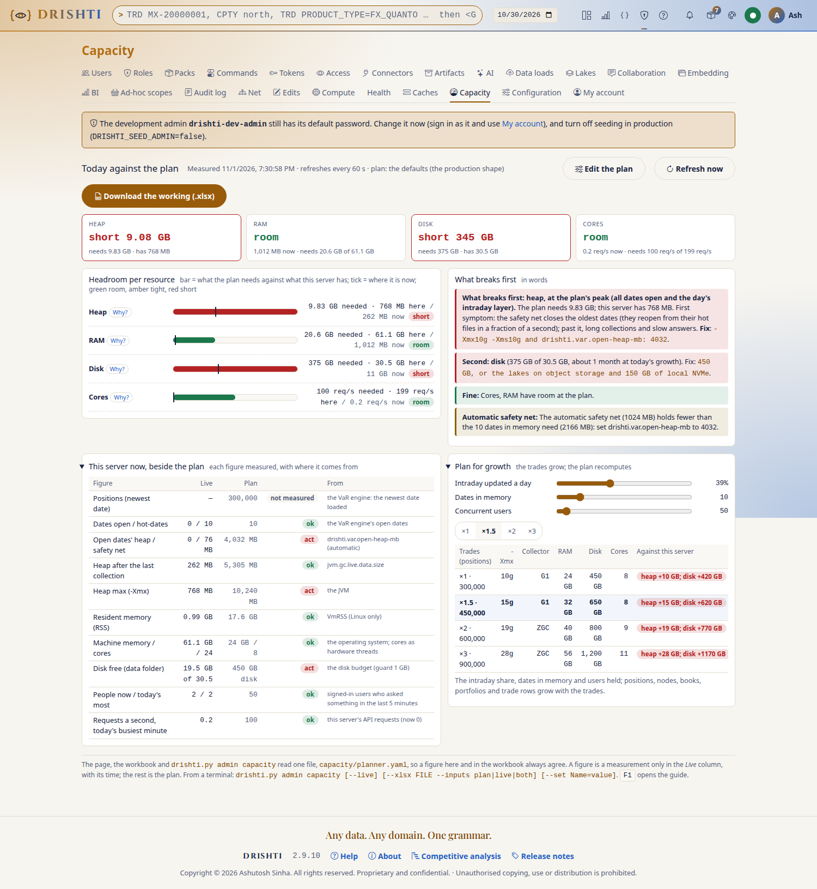

- **The four resources** (heap, RAM, disk, cores), each *room*, *tight*, *short* or *not measured*: the plan's `-Xmx` need against this server's
  `-Xmx`; resident memory with the operating system and the console against the machine; the disk in use against the data folder's disk, with how
  many business days the free space above the guard lasts; the plan's peak requests a second against what the cores answer.
- **Headroom bars** (green, amber past 80%, red short) with a tick where the server is now, each with **Why?** (the sum in words, the formula and
  every figure); **What breaks first**, in a sentence, with its first symptom and fix; **This server now, beside the plan** (positions of the
  newest VaR date, dates open, heap after the last collection, RSS, disk free, people active, requests a second at today's busiest minute, each
  *ok*, *watch* or *act*); **Plan for growth** at ×1, ×1.5, ×2 and ×3 the trades; the planner's warnings.
- **Edit the plan**: the inputs (a changed one is yellow; **Reset to defaults**; **Use this server's figures**), the four answers, every result with
  its **Why?**, the settings in three forms (YAML for `application.local.yaml`, the variable, the argument) and the whole JVM command line, each with
  **Copy**. **Download the working (.xlsx)** gives the planner workbook with live Excel formulas, filled with what is on the screen, this server's
  live figures, or both (audited `capacity-workbook-downloaded`).

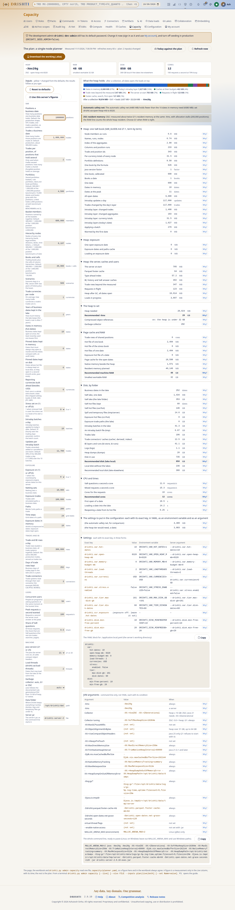

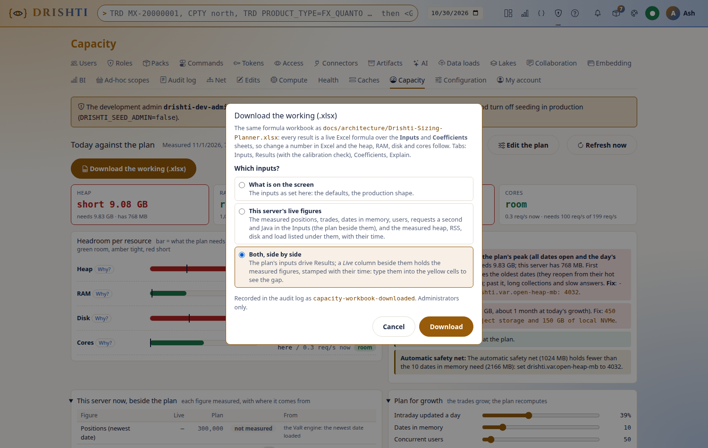

On a phone the page shows the four states and what breaks first, then the headroom bars; the live table and growth are folded, and
editing the plan, the JVM arguments, the command line, the growth sliders and the download are on a wide screen.

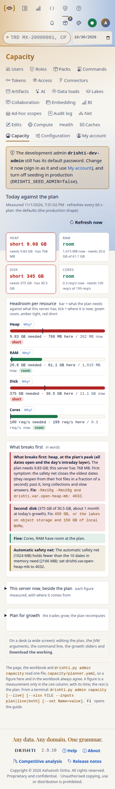

The live figures come from the VaR engine, the JVM (heap after the last collection), the process's `VmRSS` (Linux only), the disk budget and the
request activity; a figure the server cannot tell is left empty, never guessed; the page refreshes every 60 s. The endpoints: `GET
/api/v1/admin/capacity`, `/capacity/live`, `/capacity.xlsx?inputs=plan|live|both&Trades=450000&…`. From a terminal:

```bash
python3 tools/drishti.py admin capacity                          # the answers, the warnings, the YAML block, the command line
python3 tools/drishti.py admin capacity --live                   # this server's figures through the planner
python3 tools/drishti.py admin capacity --set Trades=450000 --set Positions=450000 --all
python3 tools/drishti.py admin capacity --xlsx capacity.xlsx --inputs both
```

To calibrate the planner to your servers, change a coefficient in `capacity/planner.yaml` and run `python3 tools/sizing_planner.py` (it rewrites the
workbook, the template and the test vectors; `--check` fails while any is stale).

### 14.7 Busy protection: refuse politely, never fall over

When the server is short of memory or threads, new heavy work waits a moment instead of risking an out-of-memory. Memory counts as short only when
**both** the heap after the last collection that cleaned the old generation is past its level **and** less than `memory-free-min-mb` (768 MB) is left.

| New work | Code when it waits | Waits when | `Retry-After` |
|---|---|---|---|
| a sign-in | `503 DRS-9501` | memory over `memory-refuse-sign-in` (92%) | 45 s |
| opening a VaR or exposure date not yet open | `503 DRS-9502` | memory over `memory-refuse-heavy` (85%); the engine's loads full (`load-threads` running, `queued-loads` waiting); the open dates' heap over `open-heap-refuse` (1.2) times their safety net; request handlers full; disk nearly full | 30 s |
| an Export data download | `503 DRS-9503` | memory, request handlers, disk | 30 s |
| a BI run | `503 DRS-9504` | memory, request handlers | 60 s |
| a bulk load of a pack's data | `503 DRS-9505` | memory, request handlers, disk | 120 s |

People already working are never gated (reading an open date, drilling, sorting, exporting what is on screen). A refusal is remembered for its
`Retry-After`, so a crowd gets one answer and one countdown; it lifts sooner when its cause clears. The console says it in place with a ring counting
down, **Try now** and **Cancel**, and tries again by itself three times. The API answers `application/problem+json` with `busy: true`, `work`,
`because` and `retryAfterSeconds`; `drishti.py` waits and retries with `--wait` (on `data get`) or `DRISHTI_WAIT_BUSY=1`; a script should do the same.
The server never forces a stop-the-world collection; it asks for a concurrent cycle at most every 10 s where `-XX:+ExplicitGCInvokesConcurrent` allows.

**Admin → Health, Busy protection** shows the state, each reading as a bar with its warn and wait markers, and the last refusals (also `GET
/api/v1/admin/busy`). **The operator's override**, for an emergency, needs a reason and ends by itself (at most `override-max-minutes`, 240; audited
`busy-override`): **Let everything through** (the server can then run out of memory: for a sign-off that must finish now), **Hold all new heavy work**
(for a planned restart; reading and sign-ins go on) and **Automatic**. From a script, as an administrator in the console: `PUT
/api/v1/admin/busy/override` with `{"mode": "hold", "reason": "planned restart 18:00", "minutes": 30}`. The levels are `drishti.admission.*`
([CONFIGURATION.md](../admin/CONFIGURATION.md#drishtiadmission); `enabled: false` turns the waits off): lower the memory levels on a server that runs
close to its heap with large dates, raise `request-handlers` on a large server of mostly small reads. To prove it on your hardware run the
benchmark's users phase at a small heap with more users than it holds: expect refusals with `Retry-After` and no `OutOfMemoryError`
([BENCHMARK.md](../admin/BENCHMARK.md#43-users-50-100-and-200)).

### 14.8 Capacity figures, database pools and BI scale

- A warm view builds in a few milliseconds (gate: p99 < 50 ms), a cold one in about 14 ms; one topic fans out to 10,000 listeners; live streams are
  capped per server by `drishti.live.max-streams` (20,000); each browser holds one connection to the console. Measured figures:
  [BENCHMARK.md](../admin/BENCHMARK.md).
- File watching shares one operating-system watch service per process: one inotify instance (`fs.inotify.max_user_instances`), one watch per watched
  folder (`fs.inotify.max_user_watches`; raise it when Health says `POLLING`).
- An ActiveMQ or RabbitMQ connector applies one message at a time; with `state.durability: sync` each waits for a disk sync (thousands a second on an
  SSD). Split a heavy feed over several connectors, or use `wal` where losing the last moments before a power loss is acceptable.
- **Database connection pools.** Every database connector, and the identity database on PostgreSQL, has a pool of up to `pool-size` (20;
  [CONFIGURATION.md](../admin/CONFIGURATION.md#drishtidbpool--database-connection-pools)), and the database must accept all of them at once:
  `max_connections >= (the pools of every connector pointing at it + the identity pool + loaders + your own clients) × server instances`. Six
  connectors (120), the identity database (20) and a loader (20) for two servers need 320 plus headroom: PostgreSQL's default 100 is **not** enough
  (the symptom is `FATAL: sorry, too many clients already`). Raise `max_connections`, put PgBouncer (transaction mode) in front, or lower `pool-size`
  or the site default `drishti.db.pool.size`. A pool opens connections only as used; a busy one needs `scan-threads` plus the reads you expect, a
  quiet one 2 to 4. MongoDB, Redis and Aerospike have their own limits (`maxIncomingConnections`, `maxclients`, `proto-fd-max`).
- **BI scale** (`drishti.bi.*`, [CONFIGURATION.md](../admin/CONFIGURATION.md#drishtibiexec--execution-connectors-and-scale)): start with
  `query.max-concurrent` twice the cores, `max-concurrent-per-user` 3 to 4, `exec.per-model-share` 0.5, time limits 30 s interactive and 300 s
  background, `query.memory-limit` half the server's memory (DuckDB spills to the store's scratch), `exec.max-estimated-rows` 200 million,
  `max-fragments` 8 (fewer for a small database), the breaker at 5 failures for 30 s, standing queries `mq.max-subscriptions` 500 and 20 per user. Readers
  with the same effective security share one standing-query group: 500 viewers with 5 distinct securities are 5 evaluations per visual. Any node
  answers any model query; each model's live tables and standing queries have one owner. The 500-viewer load test, against a real server only:
  `./mvnw -pl :drishti-server test -Dtest=ViewersLoadTest -Ddrishti.load.url=http://server:18480 -Ddrishti.load.queries=/path/visuals.jsonl
  -Ddrishti.load.users=rita:…,hana:…` (`-Ddrishti.load.viewers=500 -Ddrishti.load.seconds=120` by default).

### 14.9 Native libraries (BLAS)

Drishti multiplies matrices with **OpenBLAS, bundled** in the server (JavaCPP's `org.bytedeco:openblas`, the Linux and Windows x86-64 builds, about
44 MB of jars, so one artifact runs on both): **nothing is installed on a server**. Where it does not fit the server runs the same sums in **pure
Java**, with the same results (within 1e-12; many-scope sums are exact), only slower; nothing about BLAS can stop the server
([HIGH_PERFORMANCE_NATIVE.md](../architecture/HIGH_PERFORMANCE_NATIVE.md#6-blas)).

| Platform | BLAS |
|---|---|
| Linux or Windows x86-64, 64-bit Java 21 | **native** when the `openblas` engine is on |
| macOS, Linux or Windows on ARM, any other system; a 32-bit Java; Linux with musl (Alpine) | Java (the shipped images, `eclipse-temurin:21-jre`, have glibc) |

**Off as shipped**: the engine `openblas` (`config/engines/openblas.yaml`) is off, so a server runs the pure-Java kernels and does not load OpenBLAS.
Turn it on per node in Admin → Engines ([ADMIN_GUIDE.md](ADMIN_GUIDE.md)) or `DRISHTI_OPENBLAS_ENABLED=true` after measuring it on your hardware (the
gain depends on how many overlapping scopes are summed at once, [BENCHMARK.md](../admin/BENCHMARK.md#17-many-var-scopes-at-once-blas)). OpenBLAS runs
one thread per call (no `OPENBLAS_NUM_THREADS`). The settings: `drishti.native.blas.mode` (`auto`: native where it fits, else Java with a loud
warning; `java`: Java, chosen, silent, and the switch cannot turn it on), `drishti.native.cache-dir` (`<data>/native-cache`, must be writable),
`max-bytes-mb`, `blas.max-call-mb` and `blas.canary-interval` (the self-test against Java, `6h`) ([CONFIGURATION.md](../admin/CONFIGURATION.md)).

**How to verify**: the start-up log says `BLAS: mode auto, native (bundled OpenBLAS 0.3.26), 1 thread per call` (or `BLAS: mode java, …`); Admin →
Health, *Native libraries*, with every cluster member's binding (`GET /api/v1/admin/health` → `native.blas`); `python3 tools/drishti.py server blas
status`; the metric `drishti_native_blas{path,reason}`. Switch it live from the command line: `server blas java --reason "..."`, `server blas native
--reason "..."` (`--node <id>` for another member). Off is live (calls go to Java; a notice, not a warning); on runs the self-test first and is
refused in words if it fails. **A cluster agrees on one path**: if any member runs on Java, every member sums many scopes on Java (a WARN names the
member), so the figures they combine are the same bits.

**When `auto` falls back to Java** (no bundled build, the cache folder not writable, the library failed to load, the self-test disagreed, a native
call failed): the log has a **WARN banner** `NATIVE BLAS NOT LOADED` with the reason and the fix; Health is **DEGRADED** (never down) and names each
member on Java; a notice stays on Admin → Health and Engines; the platform alert `native-blas-fallback` opens once (`drishti_native_blas_fallback` is 1).
Fix it with a 64-bit Java on Linux or Windows x86-64, a writable `drishti.native.cache-dir`, and the `openblas` and `javacpp` jars in the server's
library folder; or run on Java on purpose with `mode: java`. The native library never runs unguarded: a start-up self-test, argument checks in Java
before every call, a per-call size bound, and any failure or NaN from finite inputs redone on Java with the native path off for the rest of the run.

## 15. Compute workers

Compute workers run Python computations outside the server's JVM: a pool of worker processes per kind of work, the data handed to them as Arrow files
already read and masked as the person who asked, in a locked environment of libraries an administrator approved
([NOTEBOOK_GUIDE.md](NOTEBOOK_GUIDE.md); the module `drishti-compute`). Python people write in BI (python items and visuals,
Python-driven tables, Notebook cells) runs here too, on the pool `python`.

### 15.1 Switch it on

**It is off as shipped**: with `compute.enabled: false` (`config/compute/compute.yaml`) no worker starts and every request is refused with `DRS-9201`
(approvals work either way, so requirements can be reviewed first).

```yaml
# config/compute/compute.yaml
compute:
  enabled: true                 # or DRISHTI_COMPUTE_ENABLED=true
  python: /opt/python3.12/bin/python3   # or DRISHTI_PYTHON; empty: python3 (python on Windows)
```

Restart the server. Its log says `compute: on, node <name>, 1 pool(s): sample 0..4 fork`; **Admin → Compute** → **Test** on the `sample` pool sums
four numbers on a worker and says which worker answered and how long it took. Everything compute writes is under `<data>/compute/` (`sdk/`, `envs/`
locked environments, `jars/`, `shipped/` wheels and jars, `scratch/` one folder per request, `work/`); nothing goes to the machine's temporary folder.

**The `python` pool** is `isolation: strict`: Linux only (user namespaces and Landlock, kernel 5.13 or later; check with `unshare --user
--map-root-user --net true`), fork mode; on Windows it stays off. Its interpreter must carry exactly the versions of
`config/compute/locks/python.lock` (`DRISHTI_PYTHON` pointing at one, [2.3](#23-the-consoles-python)), or build its locked environment from that lock
(Admin → Compute → **Build**); the server checks before any run and refuses every run, naming each package, while one differs. To change the
libraries, edit `locks/python.in`, run `python tools/python_lock.py config/compute/locks/python.in --out config/compute/locks/python.lock` on a machine
that reaches the index, and install or build the new versions. `GET /api/v1/bi/python/runtime` and **Admin → BI → BI usage** say whether Python
runs and why not; every run is audited (`python-run`). Size the pool's `workers.max` to the cores you give Python.

### 15.2 Pools, workers and fair scheduling

```yaml
compute:
  pools:
    risk:
      engines: [drishti_var.connector:VarEngine]
      environment: { python: "3.12", lock: locks/risk.lock, index: bank-pypi }   # or: system
      workers: { min: 4, max: 32 }
      memory: 4GB
      cpu-seconds: 300
      timeout: 30s
      timeout-batch: 10m
      recycle-after: 200
      batch-share: 0.25
  nodes:                         # a node's own count, by its Drishti*net id
    drishti-big-1:
      pools:
        risk: { workers: { max: 64 } }
```

Every key: [CONFIGURATION.md](../admin/CONFIGURATION.md#compute-workers-configcomputecomputeyaml). **One request per worker at a time**: concurrency
is the number of workers, and a worker never holds two people's data. Each Python worker costs its interpreter (about 15 MB) plus what its engines
import (60 to 120 MB with numpy and polars); in fork mode children share the parent's pages. Raise `workers.max`, or add Drishti\*net nodes that serve
the same pool. Each pool keeps one queue per class: `interactive` (a person waiting; 256; full: `DRS-9203` busy), `event` (triggers; 10,000) and
`batch` (schedules, fan-outs; 100,000, at most `batch-share` of the workers). Within a class people take turns, at most
`compute.scheduling.max-inflight-per-user` (4) running each. **Fan-out** cuts one input into chunks of `compute.fan-out.chunk-rows` (5000), each an
ordinary request, sent to whichever target has least outstanding work: this node's workers and, with `fan-out.peers: true`, other members serving the
pool (signed, one hop; an unreachable node's chunk runs here); at most twice the total worker count is outstanding.

### 15.3 Limits and the sandbox

| Limit | Fork mode (Linux, macOS) | Warm mode (Windows) |
|---|---|---|
| wall time | the request's child is killed at its budget | the worker is killed and replaced |
| CPU time | `RLIMIT_CPU` on the child | not enforced (wall time is) |
| memory | `RLIMIT_AS` on the child | the worker watches its working set every 250 ms |
| network, processes, files | refused by an audit hook: sockets, address lookups, `subprocess`, `os.system`, `os.exec*`, `os.fork`, and writes outside the request's scratch folder | the same |

Workers start with an empty environment (no tokens or credentials; one thread per numeric library). An engine's `print` goes to the server's log;
an engine's own refusal reaches the person in its words, any other failure as "the computation failed (request <id>)" with the traceback in the
server's log only.

### 15.4 Requirements, environments and approval

A connector names the libraries it needs:

```yaml
# config/connectors/var-engine.yaml
plugin: reactive
requires:
  python: { version: "3.12", lock: requires/var-engine.lock, index: shipped }
  java:
    - coords: org.quantlib:quantlib-java:1.36.0-drishti.1
      sha256: 4b1f…e09a
      classifier: linux-x86_64
      source: shipped
      native: true
  plugins: [ { name: drishti-plugin-delta } ]
```

The lock pins every wheel by version and sha256 (`name==version --hash=sha256:...`; ranges and unhashed lines are refused); quote the Python version.
Sources are `shipped` (`<data>/compute/shipped/`), a named index of `compute.indexes` (your mirror; public PyPI only if the site names it) or
`path:<folder>`. Java libraries are checked against their sha256 and scanned for native code (a jar with a `.so`, `.dll` or `.dylib` not marked
`native: true` is refused). **Approval**: a connector or pool whose items are not all approved **stays off** (Admin → Connectors shows *waiting for
approval*); an administrator other than the one who asked approves or rejects with a reason (`compute.approval.roles` can narrow approvers); every
decision is audited, approvals live in the Drishti database so every node sees them, and **Revoke** stops the connectors that need the items at
once. **Environments**: one per lock; **Build** (or `compute.build: on-approval`) runs `python -m venv` and `pip install --require-hashes --no-deps
--only-binary=:all:` from the named source only, writes a manifest of every file's sha256 and makes the folder read-only; every worker start checks
it. A new lock is a new environment.

### 15.5 Admin → Compute, reactive connectors, and when something is wrong

**Admin → Compute** shows per pool the workers busy, idle and starting here and on other nodes, the queues by class, served, crashed and recycled
counts, latency, **Test** and **Build**; the requests running (**Cancel**); the approval requests; the environments; and the last 200 requests. The
same is `GET /api/v1/admin/compute`; decisions `POST /api/v1/approvals/compute/{id}/approve|reject|revoke` with `{"reason": "..."}`
([API_REFERENCE.md](API_REFERENCE.md)). On Windows pools run in warm mode on the console's Python (the SDK is pure Python) and environments build from
`win_amd64` wheels. Measured on a 24-core workstation: about 3,000 trivial requests a second whatever the worker count (the supervisor's own cost);
real engines grow with the workers ([BENCHMARK.md](../admin/BENCHMARK.md)).

A **reactive connector** (plugin `reactive`, [REACTIVE_CONNECTOR.md](../connectors/types/reactive/README.md)) computes its kinds when asked, as the
person asking, sending a Python engine's work to `engine.pool` (`engine.split` spreads one request over every worker). A Java engine runs in the
server: Drishti's own always, any other only with `compute.in-process-java: true` after review. `GET /api/v1/admin/compute/reactive` (`drishti.py
compute reactive`) lists each one's kinds, engine, readiness, cache, coalescing and latency. Triggers fire on `POST /api/v1/compute/events`
(administrators and service tokens); loads reach `data-version` triggers by themselves. Audit: `compute.answer`, `compute.failed`, `compute.event`.
The `compute-demo` pack brings two samples ([tutorial 19, Part C](../tutorials/19-build-a-pack-and-a-screen.md#part-c--computed-panels-a-reactive-connector)).

| You see | Do |
|---|---|
| `DRS-9201` compute is off | switch it on (15.1) |
| a pool *not ready: waiting for approval*; a connector *waiting for approval* | approve in Admin → Compute (another administrator than the one who asked) |
| *approved but not built* | **Build**, or `compute.build: on-approval` |
| a build fails *pip refused the lock* | a wheel's hash differs or none for this platform: fix the source or regenerate the lock (nothing was left behind) |
| *a file of the environment was changed after it was built* | treat it as tampering: remove the environment folder and build again |
| `DRS-9203` busy; `DRS-9204` over its time budget | wait, raise `workers.max` or the queue, add a node; raise the budget or split the work |
| `failed: ... sandbox refused` | the engine opened a socket, started a process or wrote outside its scratch: it must not |
| Admin → Compute shows no other nodes | Drishti\*net is off, or the other nodes do not serve the pool in their own `compute.yaml` |
| *Not computed: compute is off on this server* | a reactive connector with a Python engine: switch compute on |
| *… this server allows only Drishti's own Java engines there* | `compute.in-process-java: true`, after reviewing the engine |

## 16. Lake maintenance and scheduling

### 16.1 Lake maintenance: what it does and who owns a table

A lake that is only ever written grows without bound. **Maintenance** does what Drishti's readers cannot do themselves (the server only reads):

| Step | What it does | Setting |
|---|---|---|
| **Retention** | deletes business dates older than the window, counted back from today in `schedule.zone` (or `--as-of`), never from the newest date in the table; a run that would delete more than `max-drop-share` (0.5) of a table's rows deletes nothing and says why (`--force-drop` overrides) | `keep-business-days` (blank keeps all; the shipped file 520) |
| **Compaction** | merges each date's small files; a table whose pack declares a layout is rewritten in it, only for dates that drifted | `compact`, `target-file-mb` (128) |
| **Checkpoint** | writes a Delta checkpoint, so readers replay a short log | `checkpoint` (on) |
| **Vacuum** | removes files no version uses, older than the window; *known at* reaches back that far, no further | `vacuum-hours` (168) |

**The risk lake keeps 7 years.** The domains `risk` (the VaR engine's inputs) and `risk-results` (the official results) keep 7 years of dates and of time
travel whatever the settings say ([VAR_GUIDE.md](VAR_GUIDE.md#231-open-questions-of-the-contract)): a lower value is raised (61,368 hours; 1,827
business days) and the run reports `retention-floor`; `lake build` creates their tables with 2,557 days of Delta log and removed files. A lake's
`retain-years:` changes the floor per domain (`{risk: 10}`; `0` turns it off on purpose).

**Who owns a table: whoever writes it.** Drishti maintains only the tables its own `lake build` (or `lake demo`) built, recorded in
`<lake>/_drishti-lake/tables-built.json` (older builds found once in `_drishti-lake/runs/*.json`). A table with no build record was published by another
system (a vendor feed, another team's Spark job): that system compacts and vacuums it, and Drishti lists it read-only, because doing it too could remove
files the publisher still expects or rewrite files under a reader mid-scan. `lake maintain` refuses a foreign table you name and skips it in a run over
every table; `--force-foreign` overrides with a warning (only with the publisher's agreement; the page never offers it). `lake demo` writes a checkpoint
per table, so the demo lakes need nothing more.

There is one engine, `tools/lake/maintain.py`: **Admin → Data loads → Lakes → Maintain** runs it in the console and `drishti.py lake maintain` from a
terminal, cron or a container; both read and write `<data>/lakes/lake-maintenance.yaml` and keep the same history. An Iceberg table is maintained the
same way (16.3). The examples use a small lake with two trade tables built by `lake build` and one table another system published (`risk/var_published`).
Its parts beside `maintain.py`: `tools/lake/maintconfig.py` (the maintenance YAML and the run history), `tools/lake/maintschedule.py`
(the one scheduler, used by `--daemon` and by the console), `tools/lake/ownership.py` (which tables Drishti's lake tool built: the only ones
it maintains) and `tools/lake/maintain_iceberg.py` (the Iceberg tables, 16.3).

### 16.2 Maintain from the page or the command line

**The tables.** **Admin → Data loads → Lakes** (`/admin/lakes`; the lake roots are `lakes.roots`, `DRISHTI_LAKE_ROOTS`, default `<data>/delta`) lists
every table with its rows, files, size, partitions, business dates, last build and **Maintenance** (its settings, or *Maintained by its publisher: not
built by drishti.py lake build: read only here*, with its box disabled). Tick tables, **Select all**, or **Select a domain**; the line under the table
shows the equivalent command with **Copy**. A table's name opens its page, read from its Delta log alone (it opens at once on millions of rows):
summary, the connectors that read it, business dates with rows and partitions, columns and their roles, the newest 30 commits, its `lake build` runs,
maintenance and table properties.

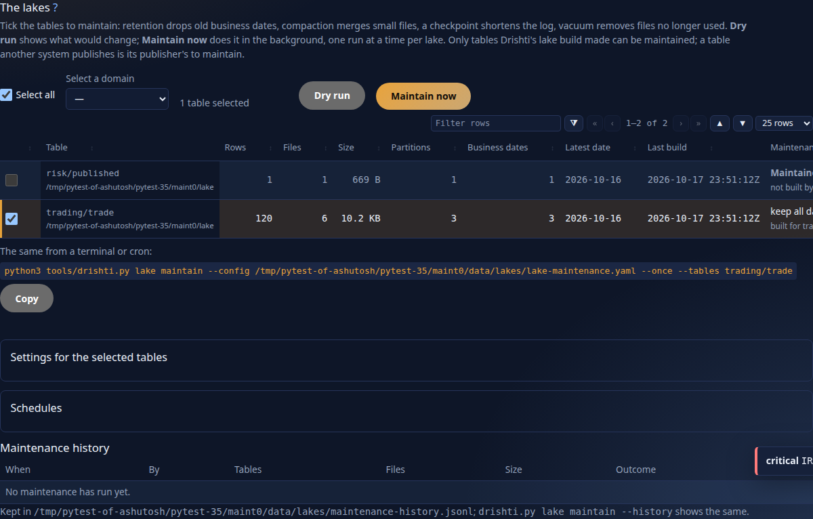

```text
$ drishti.py lake status --lake delta
tables (3):
  table                  rows   files  size     partitions  dates  latest date  last build
  risk/var_published     1      1      669 B    1           1      2026-10-16   2026-10-17 23:51:39Z
  trading/trade_calypso  3,000  6      64.4 KB  3           3      2026-10-16   2026-10-17 23:51:39Z
  trading/trade_endur    3,000  6      64.4 KB  3           3      2026-10-16   2026-10-17 23:51:37Z
lock: free
```

**Dry run.** **Dry run** on the page (in the background) shows per table the files and size **before → after** (marked *estimate*), the dates
**retention would drop**, and what **vacuum would delete**; it changes nothing (it adds a *dry run* line to the history). The same from a terminal:

```bash
drishti.py lake maintain --once --dry-run --tables trading/trade_endur --as-of 2026-10-16
uv run --with deltalake --with pyarrow --with pyyaml python tools/lake/maintain.py --config deploy/lake-maintenance.yaml --once --dry-run   # the tool itself, any config
```

One JSON line per table (`{"event": "maintained", "dry_run": true, "table": …, "before": {"files": 6, "mb": 0.06, …}, "retention": {"cutoff":
"2025-10-17", "would_remove_files": 0, …}, "estimate": {…}, "vacuum": {…}}`), then `{"event": "run", "outcome": "ok", …}`. `cutoff` is the oldest
date kept. Without `--config` the command reads `<data>/lakes/lake-maintenance.yaml`.

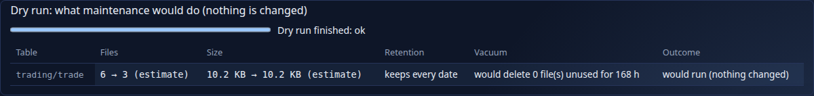

**Maintain now.** The progress bar counts the tables and names the one in hand. One run at a time per lake (a second is refused, `409 DRS-5032`); each
run takes the lake tool's lock (`<lake>/_drishti-lake/lock`) exclusively, while `lake build` holds it shared, so maintenance waits for every load and no
load starts meanwhile (a locked lake fails with *the lake is locked by …* and nothing changes). **Cancel after this table** never leaves a table half
done. Afterwards each changed table built for a pack sends the **data-load signal** for its latest date (`source: lake maintain`), as the administrator
who ran it (or made the schedule), so readers' caches stay right; the row says *readers told (date)* or why not.

```bash
drishti.py lake maintain --once --tables trading/trade_endur,trading/trade_calypso      # lines add "compact": {"numFilesAdded": 3, "numFilesRemoved": 6}, "checkpoint": 6
drishti.py lake maintain --once --tables risk/var_published                             # {"event": "refused", …, "reason": "maintained by its publisher: …"}  exit 1
```

Add `--signal http://server:18480` (with `DRISHTI_TOKEN` or `--token-file`) to signal from the command line. `--tables` takes `domain/table`, or
`root|domain/table` when the file lists several lakes; without it every table but foreign ones. A failing table prints `{"event": "failed", "table": …,
"error": …}` and the others go on; exit 0 when all succeeded, 1 when any failed (suits cron and alerting).

**Settings per table.** Tick tables and open **Settings for the selected tables** (one ticked: its values filled in): *Retention (business days)*
(`keep-business-days`), *Target file size (MB)*, *Write a checkpoint*, *Vacuum files unused for (hours)* (below 168 a warning: readers and *known at* may
still use those files); only changed fields are saved. The file holds them; edit it by hand and the page shows your values (it rewrites the file whole:
your comments are not kept, unknown keys are):

```yaml
schedule: {at: "02:30", zone: America/New_York}
lakes:
  - root: data/delta/demo          # a local path or s3://bucket/path (the server says s3a:// for the same bucket)
    domains: ["*"]
    keep-business-days: null       # the lake's defaults ...
    compact: true
    checkpoint: true
    vacuum-hours: 168
    max-drop-share: 0.5
    # storage-options: {AWS_REGION: …, AWS_ACCESS_KEY_ID: …, AWS_SECRET_ACCESS_KEY: …, AWS_ENDPOINT_URL: …, AWS_ALLOW_HTTP: "true"}
    tables:                        # ... and per table, over them
      trading/trade_endur: {keep-business-days: 260, target-file-mb: 64, checkpoint: true, vacuum-hours: 168}
```

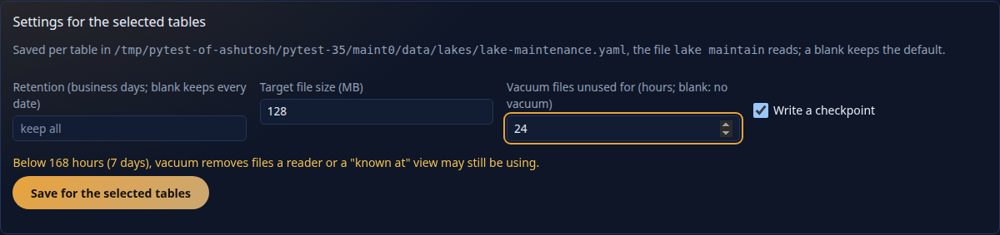

**Schedules.** Tick tables (from one lake), open **Schedules**, name it, and choose **at a time** (tick days and pick the time; the cron text and its plain
words, *Tue–Sat 02:30*, are written as you pick; or type cron, `*/30 * * * *`; in `schedule.zone`) or **after every build of the table** (whether from
the page, the command line or cron). **Pause**, **Resume** and **Delete**. A run missed while the console was stopped runs **once** at its next start
(*catch-up*). Schedules run in the console (`lakes.maintenance_schedules`, checked every 30 s), or without a console in the tool's daemon, which reads the
same file: `drishti.py lake maintain --daemon` (the file's schedules; with none, every table daily at `schedule.at`; it logs `{"event": "sleeping",
"until": ...}`). Run them in **one** place: with the daemon set `DRISHTI_LAKE_MAINTENANCE_SCHEDULES=false` on the console. The state is
`<data>/lakes/maintenance-schedule-state.json`:

```yaml
lakes:
  - root: data/delta/demo
    schedules:
      - {name: nightly, when: "30 2 * * 2,3,4,5,6", tables: [trading/trade_endur], paused: false, by: admin, roles: [admin]}
      - {name: after-load, when: after-build, tables: [trading/trade_calypso], paused: true, by: admin, roles: [admin]}
```

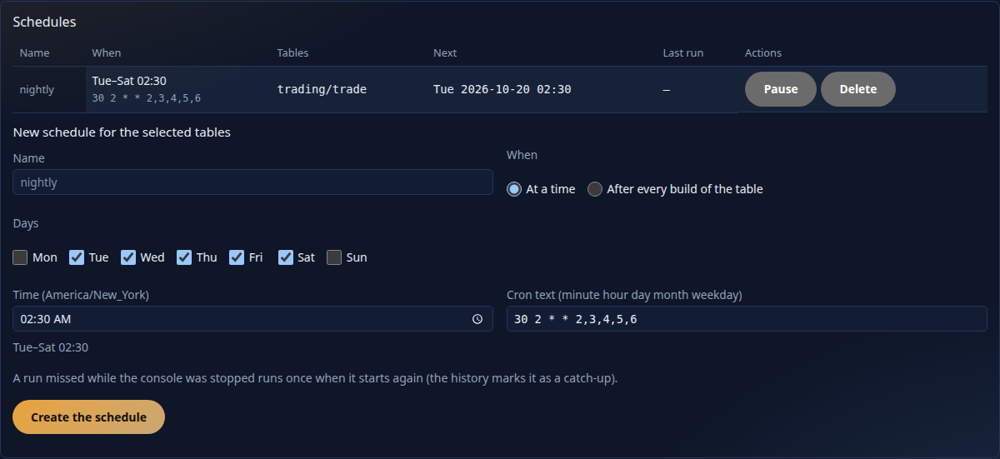

**History.** Every run (dry, manual, scheduled, command line) is in `<data>/lakes/maintenance-history.jsonl` (the last 2,000): when, who or which
schedule, the tables, files and size before → after, the outcome (ok, partial, failed, cancelled), notes and errors. **Maintenance history** on the page
lists the last 50; `drishti.py lake maintain --history` (`--json`, `--limit N`) prints them.

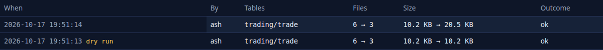

From the command line:

```text
2026-10-17T19:51:57-04:00  ok        run     by ashutosh  2 table(s)  files 12 -> 6  MB 0.12 -> 0.04
2026-10-17T19:51:57-04:00  failed    run     by ashutosh  1 table(s)  files 0 -> 0  MB 0.00 -> 0.00
    risk/var_published: refused: maintained by its publisher: not built by drishti.py lake build (no build record in _drishti-lake); --force-foreign maintains it anyway
```

The page calls the console's API under `/admin/api/lakes/maintain` (administrators): `GET` (tables with `owned` and `settings`, schedules, history),
`POST /runs` (`{tables, dryRun}`; a foreign table `403 DRS-5002`), `GET /runs/{id}`, `POST /runs/{id}/cancel`, `PUT /settings`, `POST /schedules`,
`/schedules/pause`, `/schedules/delete`, and `POST /command` (the equivalent `lake maintain` line). Console settings: `lakes.data_dir`,
`lakes.maintenance_schedules`, `lakes.roots` ([CONFIGURATION.md](../admin/CONFIGURATION.md)).

### 16.3 Iceberg lakes

A lake's tables are maintained as Iceberg tables when the lake says `format: iceberg`, or with `format: auto` (the default) when a table under a local root
is one (`<root>/<domain>/<table>/metadata/*.metadata.json`, as `lake build --format iceberg` writes). The tables list shows each table's **Format**.

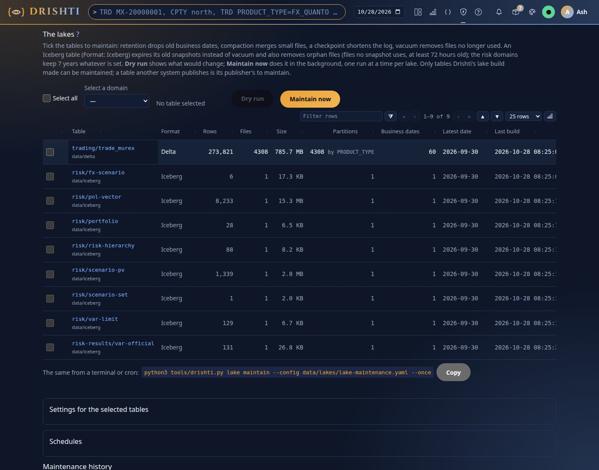

Each step is one Iceberg commit (run by `IcebergMaintenance` from the server's exec jar; `DRISHTI_ICEBERG_CLASSPATH` in development): **retention** keeps
the table's newest N business dates on or before today and drops older ones in one metadata-only delete (`max-drop-share` as for Delta); **compaction**
re-lays out the days that drifted; no checkpoint; **vacuum** expires snapshots older than `vacuum-hours` and deletes the files only they used;
**orphans** removes files no snapshot references older than `orphan-hours` (72, the least allowed). The 7-year floor holds (`--floor-days 2557`). A dry
run lists the dates and the orphan files it would remove. Ownership, the lock, schedules and history are as for Delta. A lake on object storage
(`root: s3://bucket/prefix` with `format: iceberg`) is listed by its `metadata/` folders; one behind a REST catalog (AWS Glue) names its tables and its
catalog:

```yaml
lakes:
  - root: s3://acme-drishti-prod-lake/iceberg
    format: iceberg
    keep-business-days: 1800
    vacuum-hours: 168
    orphan-hours: 72
    iceberg-settings: {catalog: rest, uri: "https://glue.eu-west-2.amazonaws.com/iceberg", warehouse: "123456789012",
                       catalog.rest.sigv4-enabled: "true", catalog.rest.signing-name: glue, catalog.rest.signing-region: eu-west-2}
    tables: {risk/pnl_vector: {}}
```

`deploy/aws/iceberg/maintain.sh` writes such a file and runs it nightly ([CLUSTER_GUIDE.md](CLUSTER_GUIDE.md)).

### 16.4 Sizing a large load

Measured with `lake build` on a synthetic book (14 KB a deal as pretty-printed JSON), one laptop, local SSD: 10,000 deals (140 MB) load in 1.3 s with
deltalake (626 MB peak) and 2.9 s with Drishti's writer (591 MB; the builder itself 114 MB), 13 MB of lake a day.

- **Memory does not grow with the file**: reading holds one document at a time; writing holds one batch (`--batch-mb` 128 or `--batch-rows` 50,000,
  whichever is smaller) plus its Parquet encoding, about 600 MB, for any number of documents; `--batch-mb 32` brings it to about 250 MB.
- **Disk**: the staged rows take the compact size of the documents (about 60% of a pretty-printed export) during the run; the lake about 10% of the
  pretty-printed input. 300,000 such deals: a 4.2 GB export, 2.6 GB staged, about 400 MB of lake per date.
- **Time** grows linearly (about 180 MB a second read, 5,000 deals a second written): about 40 s with deltalake and a minute with Drishti's writer for
  300,000 deals, a few minutes for a million; the run summary's `timings` shows where it went.
- **Partitions**: each date times each classifier value is a folder; keep classifiers to a few dozen values (`lake scan` shows the counts) and compact.
- **The console's Lakes page** streams an upload to its temporary folder (room for the file) and runs the same builder; `lakes.jobs` (2) bounds the
  builds at once, so plan memory for two batches.
- **Millions of documents**: the parallel lake loader (`--engine java`, picked by `auto` from 1 GB of JSON Lines) parses and writes on every core with
  memory set by `memory.budget-mb` ([DATA_LAKE_GUIDE.md](DATA_LAKE_GUIDE.md), [CLUSTER_GUIDE.md](CLUSTER_GUIDE.md)).

**Loading a file from the browser**: Admin → Data loads (`/admin/loads`, what each pack expects and what landed) → **Load a file into a lake** opens the
Lakes page, the browser form of `lake build`. 1. **The file**: a `.json` array, `.jsonl`, `.ndjson` or `.gz`, streamed to the console's temporary folder
as it uploads (up to `lakes.max_upload_mb`, 4,096 MB). 2. **Id, business date and classifiers**: the console scans the first `lakes.scan_docs` (20,000)
documents and lists every field with how often it is present and its values; the business date comes from the file's name (`book.2026-10-16.json`), else
business today, never a row's field ([DATA_LAKE_GUIDE.md](DATA_LAKE_GUIDE.md#5-routing-business-dates-modes-repeats-and-undo)); tick **Classifier** for
partition columns and **Promote** for real columns. 3. **Where it goes**: a new lake (a root, a domain, a kind) or an existing table; what to do when a
date is there; the pack whose connector should read it; **Bind** writes the connector's file (validated, atomic, audited, history kept); **Tell the
server** announces each date. 4. **Build**: a separate process running `tools/lake/build.py` with the same lock and summary; the page shows progress,
the rows per date and classifier, the rejects by reason and a link to one record. The process never holds a token: binding and announcing are done by
the console as the administrator.

### 16.5 Scheduling the jobs

**The nightly lake build** (the day's extract at 21:30 on weekdays, after it lands in `/srv/drop`), from cron:

```cron
# m  h  dom mon dow  command
30 21 *   *   1-5  cd /opt/drishti && drishti-console/.venv/bin/python tools/drishti.py lake build --from /srv/drop/endur-$(date +\%F).json.gz --pack config/packs/banking/trading --kind trade --connector trade-endur --key TRADE_ID --lake /srv/drishti/delta --as-of $(date +\%F) --partition-by PRODUCT_TYPE --signal http://localhost:18480 --token-file /etc/drishti/loads.token -q >> /var/log/drishti/lake-build.log 2>&1
```

Or as a systemd timer (a missed run is caught up after a reboot; `systemctl status` shows the exit code):

```ini
# /etc/systemd/system/drishti-lake-build.service
[Unit]
Description=Drishti lake build (the day's book)
After=network-online.target

[Service]
Type=oneshot
User=drishti
WorkingDirectory=/opt/drishti
ExecStart=/bin/sh -c 'drishti-console/.venv/bin/python tools/drishti.py lake build --from /srv/drop/endur-$(date +%%F).json.gz --pack config/packs/banking/trading --kind trade --connector trade-endur --key TRADE_ID --lake /srv/drishti/delta --as-of $(date +%%F) --partition-by PRODUCT_TYPE --signal http://localhost:18480 --token-file /etc/drishti/loads.token -q'
# 2 (written with rejects) is not a failure of the unit; alert on it from the summary instead
SuccessExitStatus=2
Environment=DRISHTI_LAKE_HEAP=2g

# /etc/systemd/system/drishti-lake-build.timer
[Unit]
Description=Drishti lake build, weekdays at 21:30

[Timer]
OnCalendar=Mon..Fri 21:30
Persistent=true

[Install]
WantedBy=timers.target
```

```bash
sudo systemctl enable --now drishti-lake-build.timer
journalctl -u drishti-lake-build.service -n 20     # the run's log line
drishti-console/.venv/bin/python tools/drishti.py lake status --lake /srv/drishti/delta
```

With `overwrite-dates` or `overwrite-partitions` a run can be repeated any number of times: re-run a failed night by hand with the same command. A run
that finds the lock held exits `3` at once: let the scheduler try again (`Restart=on-failure` with `RestartSec=10min`, or the next timer). A watch on a
drop folder is `drishti.py data ingest --watch`; the data inbox does it inside the server ([7.5](#75-the-data-inbox-its-folders-disk-and-retention)).

**Lake maintenance** runs after the night's builds (02:30 after a 21:30 build), on one machine only, next to the writers (it is safe while Drishti
reads; a compaction that races an append makes one of the two commits retry). From cron, or a oneshot service with a timer (`OnCalendar=Tue..Sat 02:30`,
`Persistent=true`), or the daemon as a service:

```cron
30 2 * * 2-6  cd /opt/drishti && drishti-console/.venv/bin/python tools/drishti.py lake maintain --config /etc/drishti/lake-maintenance.yaml --once >> /var/log/drishti/lake-maintain.log 2>&1
```

```ini
# /etc/systemd/system/drishti-lake.service
[Unit]
Description=Drishti lake maintenance
[Service]
User=drishti
WorkingDirectory=/opt/drishti
ExecStart=/opt/drishti/drishti-console/.venv/bin/python tools/drishti.py lake maintain --config /etc/drishti/lake-maintenance.yaml --daemon
Restart=on-failure
[Install]
WantedBy=multi-user.target
```

The shipped example configuration is `deploy/lake-maintenance.yaml`. **The scheduling reference**:

| Tool | Exit codes | Lock | Log | Re-run safe |
|---|---|---|---|---|
| `drishti.py lake build` | 0 ok, 2 rejects or signal failed, 1 failed, 3 locked | `<lake>/_drishti-lake/lock` | one line per run to stdout and `<lake>/_drishti-lake/runs.log`; a JSON summary per run | yes with `overwrite-dates` / `overwrite-partitions` |
| `drishti.py lake maintain` | 0 ok, 1 a table failed | the same lock, exclusive: schedule it after the builds, on one machine | one JSON line per table and step | yes |
| `drishti.py data ingest` (`--watch --once`) | 0 ok, 1 a file failed or had bad lines | a state file per lake or files root | stdout | yes with `overwrite-dates` |
| `drishti.py data landed` | 0 ok, 1 not verified or refused | none (the same pack, kind, date and batch twice is recorded once) | stdout or `--json` | yes |
| `drishti.py server smoke` / `server health` | 0 ok, 1 a check failed | none | stdout or `--json` | yes |
| `drishti.py pack check` | 0 passed, 1 failed, 2 usage | none | stdout, JUnit with `--junit` | yes |
| `drishti.py feed run` | 0 ok, 1 failed, 2 refused, 3 locked, 4 partial | `<data>/datafeeds/<feed>/run.lock` | stdout and `<data>/datafeeds/ledger.jsonl` | yes: each date replaced ([EXTERNAL_DATA.md](EXTERNAL_DATA.md)) |
| `tools/load-*.sh` | 0 ok, non-zero failed | none: one loader per store at a time | stdout | yes (each day replaced in one step) |
| `tools/drill.sh` | 0 all passed | none: one at a time | `data/drill/*.log` | yes |

Rules for all of them: run as a service user that owns the lake or data folder; pass the server explicitly (`--server`, `--signal`); keep tokens in a
file only that user reads (`--token-file`), never on the command line; send standard output to a log file or the journal; alert on a non-zero exit, and
on `2` read the summary before re-running.

## 17. Backups and restore

The server writes state in a few folders; the console writes nothing that needs keeping. Paths are relative to the server's working directory.

| Path | Holds | Back up? | How |
|---|---|---|---|
| `data/identity/` | users, password hashes, roles, the audit log, each user's settings, workspaces, monitors and pins (`drishti.db`, or the PostgreSQL of `DRISHTI_IDENTITY_DB_URL`); with `drishti.collab.store: jpa` the collaboration tables too | **yes, daily** | SQLite: `sqlite3 data/identity/drishti.db ".backup '/backup/drishti/identity.db'"`, safe while running; PostgreSQL: `pg_dump` |
| `data/fstore/` (the content store, `config/store/store.yaml`, `DRISHTI_STORE_ROOT`) | designs, collaboration, audit, embed apps, pack switches, proposals, load history, BI items and runs ([DATA_ARCHITECTURE.md](../architecture/DATA_ARCHITECTURE.md#5-the-content-store-user-content-every-node-reaches)) | **yes** | copy the folder (or back up the `drishti_content` table or the bucket) |
| `data/governance/` | Sutra proposals, approvals, history | **yes, daily** | copy |
| `sutras/` | your own Sutras and what the workbench saves | **yes**, preferably in version control | git, or copy |
| `application.local.yaml`, `drishti-console/config/application.local.yaml`, `/etc/drishti/drishti.env` | your configuration and secrets | **yes**, securely | copy |
| `config/connectors/`, `config/ai/`, `config/mcp/`, `config/net/`, `config/engines/` | connector, AI, MCP, cluster and engine files (no secret in clear) | **yes**, preferably in version control | commit, or copy (written atomically) |
| `config/tables/`, `config/bi/` | the table layer's tables and models; reports, boards, notebooks, Python items (published BI items are saved here) | **yes**, in version control | version control, or copy |
| `data/connectors/history/`, `data/bi/imports/` | earlier texts of connector files; what each BI import replaced (*Roll back this import*) | yes, with the folders above | copy |
| `data/packs/` | `installed/`, `added.yaml`, `deploy-history.jsonl`, `samples-mode` | **yes** | copy |
| `data/loads/`, `data/designs/`, `data/collab/` (file store only), `data/reports/` | load history and expectation overrides; old-style designs; collaboration files; report output | yes (reports as you need) | copy |
| `data/net/node-id` | this node's id (keep it, or the node rejoins as a new member); `peers.json` optional | yes | copy |
| `data/state/<connector>/` | ActiveMQ and RabbitMQ connectors' latest document of each entity: the only copy (a queue does not send twice) | yes, if you use them | **with the server stopped** (a copy while it writes is not consistent); or rely on the source to re-send |
| `data/uninstalled/` | uninstalled artifacts, kept `uninstalled-keep` | as long as you want them | copy |
| `data/delta/` | the lakes and the official results (append-only records) | by their owners | your data platform's policy |
| `data/cache/`, `data/derived/`, `data/index/`, `data/bi-store/`, `data/connectors/generated/` | caches and markers | no | rebuilt from the sources |
| `config/packs/` | the packs | no, if they come from the release | keep your own in version control |

### 17.1 A nightly backup

```bash
#!/usr/bin/env bash
# /opt/drishti/backup.sh: keep 14 nightly archives of Drishti's own state.
set -euo pipefail
cd /opt/drishti
stamp=$(date +%Y%m%d-%H%M)
if [ -f data/identity/drishti.db ]; then                      # a consistent copy of the live SQLite database
  sqlite3 data/identity/drishti.db ".backup 'data/identity/backup.db'"
fi
keep=()                                                         # only what exists here
for p in data/fstore data/identity data/governance data/packs data/loads data/designs data/collab sutras config/connectors config/tables config/bi config/ai config/mcp application.local.yaml; do
  [ -e "$p" ] && keep+=("$p")
done
tar czf /backup/drishti/drishti-$stamp.tgz --exclude=data/identity/drishti.db* "${keep[@]}"
ls -1t /backup/drishti/drishti-*.tgz | tail -n +15 | xargs -r rm --
```

Run it from cron as the `drishti` user (`30 1 * * * /opt/drishti/backup.sh`) and check an archive with `tar tzf /backup/drishti/drishti-20261001-0130.tgz
| head` (you should see `data/identity/...`, `data/governance/...` and your Sutras). It leaves out `data/state/`: back that up with the server stopped
(`systemctl stop drishti-server`, `tar czf … data/state`, start) in a maintenance window; messages wait in the broker meanwhile.

### 17.2 Restore

1. Stop the server: `sudo systemctl stop drishti-server`.
2. Move the damaged folders aside: `mv data/identity data/identity.broken`.
3. Unpack: `tar xzf /backup/drishti/drishti-20261001-0130.tgz -C /opt/drishti`; with SQLite, `mv data/identity/backup.db data/identity/drishti.db`.
4. `sudo chown -R drishti:drishti /opt/drishti/data` and start the server.
5. Check: sign in as an administrator and open **Admin → Users** and **Admin → Audit**: the users and recent events are there.

## 18. Upgrades and rollback

1. **Read the release notes** (`RELEASE_NOTES.md`, `CHANGELOG.md`) for changes to configuration or storage.
2. **Back up** ([17.1](#171-a-nightly-backup)) and keep the old jar: `cp drishti-server.jar drishti-server-$(date +%F).jar`.
3. **Build or fetch** the release: `./mvnw -q clean package -DskipTests`.
4. **Stop** both: `sudo systemctl stop drishti-console drishti-server`.
5. **Replace** the jar, `config/packs/`, `drishti-console/` and `docs/` (keep `drishti-console/.venv` and your local files), then `uv pip install --python
   drishti-console/.venv/bin/python -r drishti-console/requirements.txt` in case the console's libraries changed.
6. **Start** the server, then the console. Upgrade the two together: a console newer than its server cannot sign anyone in.
7. **Verify**: `curl -s localhost:18480/actuator/info` shows the new `version`, `curl -s localhost:18480/actuator/health/readiness` shows
   `{"status":"UP"}`, Admin → Health shows `OK`, and a view opens.

With Docker: build the images with the new tag, change the `image:` tags and run `docker compose --env-file deploy/.env -f deploy/docker/compose.yaml up
-d` (named volumes are kept). **Rollback**: stop, put the old jar (or image tag) back, restore the backup if the new version changed stored data, start.
A cluster is upgraded one node at a time with the rolling upgrade runner, `tools/rolling-upgrade.sh` ([CLUSTER_GUIDE.md](CLUSTER_GUIDE.md)).

**What a start does after an upgrade, by itself**: connector files generated from a pack's template are brought up to the new template ([6.6](#66-connectors-where-a-pack-reads-its-data));
data-source overrides saved in older versions (`data/packs/settings/<pack>.yaml`) are moved into the connector file of the same name, the original kept
in `data/packs/settings/migrated/` and audited `connector-migrated`; stored BI items are moved into the table layer ([21.10](#2110-bi-after-an-upgrade)); and a demo lake built in
the older layout (tables directly under `data/delta/<domain>/`) is moved into `data/delta/demo/` once, before any connector opens a table. That move
renames the demo lake's own folders on the same file system (no file is copied, rewritten or deleted), measures every table before and after (version,
files, rows) and moves everything back on any difference; it **refuses**, saying why and moving nothing, when `data/delta/demo` exists, when something in
`data/delta` belongs to no lake file, when a folder is on another file system, when a table is Iceberg or does not open, or while a build holds the lock.
It records itself in `data/delta/demo/_drishti-lake/relocated.json` and rewrites connector files that read the old default root to `lake: demo` (each
earlier file kept as `<name>.yaml.before-lake-<time>.bak`). By hand, with the server stopped:

```bash
python3 tools/drishti.py lake relocate demo --dry-run     # the folders it would move and every table measured; nothing moves
python3 tools/drishti.py lake relocate demo               # exit 0 moved (or nothing to move), 1 refused or moved back
```

`DRISHTI_LAKES_RELOCATE_ON_START=false` leaves it to the command. Afterwards scheduled jobs that name `data/delta` for the demo lake name `data/delta/demo`
(`lake build --lake`, `lake maintain`, `deploy/lake-maintenance.yaml`).

## 19. Several servers

**Drishti\*net** makes several Drishti servers act as one: each server (a **node**) tells the others by gossip over HTTP which packs, kinds and data it
serves; a request one node cannot answer is answered by another, and a person connected to any node sees the same pages. It is off by default (a server
with no `config/net/node.yaml` saying `enabled: true` is a single server). Nodes advertise a real address (never `localhost` or `0.0.0.0`), share one
key (`DRISHTI_NET_SECRET`), keep their clocks in step, and are watched on **Admin → Cluster**. Setting one up, its files, security, routing, draining, rolling
upgrades, VaR sharding, the console with several servers, sizing and performance tuning, and Drishti on AWS are all in
[CLUSTER_GUIDE.md](CLUSTER_GUIDE.md); a cluster of three on one machine is `bin/start-cluster.sh` and [tutorial 22](../tutorials/22-a-cluster-of-three.md).

## 20. Runbooks

Four runbooks for the incidents an operator meets most; [section 21](#21-troubleshooting) has everything else. Each gives the symptoms, the diagnosis
step by step, the fixes and how to verify. The examples use `http://localhost:18480` for the server and `http://localhost:17480` for the console; with
security on add `-H "Authorization: Bearer $TOKEN"` to server calls (an administrator's token for `/api/v1/admin/*`; [API_REFERENCE.md](API_REFERENCE.md)).

### 20.1 Source down or slow

A *source* is where Drishti reads entities from (a Delta Lake domain, a database, Kafka, a REST service, S3, a feed): a plugin instance, usually a
connector a pack names (the `trading` pack's `trade-endur`, `trade-calypso` and `trade-murex`, one per source system, in `config/connectors/`). When one
fails the others keep serving; only its kinds are affected.

**Symptoms.** A view shows `DRS-1003` (the source failed) or `DRS-1004` (it timed out); linked entities show *pending* or *missing*; `DRS-1001 no source
holds trade/1000001` for an entity that exists, or `DRS-1002` (no source for the kind); Admin → Health is `DEGRADED` or `DOWN`; searches say they are
partial; the type-ahead stops suggesting one kind.

**Step 1. Which sources are unhealthy?**

```bash
curl -s http://localhost:18480/api/v1/admin/health | python3 -c '
import json, sys
d = json.load(sys.stdin)
print("status:", d["status"], d["summary"])
print("failed to start:", d["failedToStart"])
for s in d["sources"]:
    if s["status"] != "UP": print(s["status"] + ":", s["name"], s["health"], s["kinds"])
for p in d["packs"]:
    if p["connectorsDown"] or p["connectorsOff"]: print("pack", p["name"], "down:", p["connectorsDown"], "off:", p["connectorsOff"])'
```

On a healthy server you should see `status: OK {…}`, `failed to start: {}` and only connectors that are off by design (`pack trading down: [] off:
['trading-stream']`).

| Field | Meaning | Next |
|---|---|---|
| `failedToStart` | `{"<source>": "<reason>"}` for plugins that threw while starting | Step 2 |
| a source `DOWN` | it started but its health check fails now; `health` holds the plugin's reason | Step 3 |
| a source `DEGRADED` | it serves, but `health` names tables and dates it cannot read and why (a Delta date in BROTLI or LZO pages, a truncated Parquet file, a log missing a commit); reads of them fail with `DRS-1003`, searches over them are `partial` | fix the data ([the Delta connector](../../plugins/drishti-plugin-delta/README.md#troubleshooting)) |
| `connectorsDown` of a pack | its connectors that are `DOWN` | Step 3 |
| `connectorsOff` of a pack | connectors not running: switched off (`trading-stream` until `DRISHTI_STREAM_TRADING=true`), idle, or failed to start | Step 2 if you expected it on |

**Idle is not failed.** A plugin enabled without its settings (a Kafka connector without `topics`) stays **idle**: not in `failedToStart`, the status
stays `OK`, and the log says at INFO `source plugin kafka is installed but not configured (kafka needs settings.topics); it stays idle`. Without admin
rights, `GET /api/v1/sources` lists every running source with its `health`, and `failures`.

**Step 2. Why did it fail to start?** `journalctl -u drishti-server --since "1 hour ago" | grep -E "failed to start|failed reading"`: a line such as
`connector trade-endur failed to start` is followed by the cause (the same reason is in `failedToStart`). A wrong path (a folder that does not exist:
correct `root`, or `DRISHTI_DELTA_ROOT`); a database or broker unreachable (`Connection refused`, an unknown host: start it or correct the URL); wrong
credentials; or switched on without a setting (the message names it).

**Step 3. Down, or only slow?**

1. Time one view of an affected kind:

   ```bash
   curl -s http://localhost:18480/api/v1/views/trade/MX-20000001 | python3 -c 'import json,sys; d=json.load(sys.stdin); print(d["timings"], d["provenance"]["source"])'
   ```

   `{'fetch': 0.11, 'layout': 0.14, 'links': 0.16, 'bind': 0.21, 'total': 0.62} murex-rates` (milliseconds). A `fetch` near 10,000 means reads hit
   `drishti.sources.fetch-timeout` (10 s); `links` near 40 that linked entities hit `drishti.graph.link-budget` (40 ms) and show as *pending*.
2. A failing view: `DRS-1004` (HTTP 504) is a timeout, `DRS-1003` (HTTP 502) a failure; the `detail` names the source and entity.
3. The source's `reads` in Admin → Health, or the log for `<source> failed reading <kind>/<id>`.
4. Try the source outside Drishti: the query in a SQL client, `curl` the REST `base-url`, your Kafka tools on the topic, or list the lake folder (`ls
   ./data/delta/demo/trading/trade_endur`).

**Fixes.**

- **The source is down**: bring it back; nothing in Drishti changes. Connectors are retried by themselves with growing waits
  ([13.8](#138-retries-what-failed-is-tried-again-by-itself)); **Retry now** (`POST /api/v1/admin/retry/connectors`) tries at once.
- **A connector failed to start**: correct it in **Admin → Connectors** (**Test connection** gives the reason with a hint) or its file; it restarts by
  itself within seconds. A plugin configured under `drishti.sources.plugins` in `application.yaml` is not retried: correct it and restart.
- **A connector's file has a mistake**: the last good configuration keeps running; Health (`connectors.badFiles`) and the Connectors page give the
  message; fix the file or restore an earlier text from History ([DATA_GUIDE.md section 9](DATA_GUIDE.md#912-health-and-problems)).
- **Healthy but slow**: give it more time in `application.local.yaml`, then restart (raise the link budget only as far as needed: every view with slow
  links waits longer); for lake and stream connectors a bigger `cache-mb` helps too.

  ```yaml
  drishti:
    sources:
      fetch-timeout: 20s       # default 10s
    graph:
      link-budget: 100ms       # default 40ms
  ```
- **Out for a long time**: disable the connector in Admin → Connectors (or `drishti.py connector disable <name>`, or `enabled: false` in its file), with no
  restart; views of its kinds then fail at once instead of waiting for timeouts. `DRISHTI_LAKE_ENABLED=false` turns the packs' lake connectors off at start.

**Verify.** Admin → Health shows `status: OK`, `sourcesDown: 0`, `failedToStart: 0` and no `connectorsDown`; `curl -s -o /dev/null -w "%{http_code}\n"
http://localhost:18480/api/v1/views/trade/MX-20000001` prints `200` with `timings.fetch` well below the timeout; linked entities show values.

### 20.2 A Sutra is broken, or an edit does not show

A *Sutra* lays out the view of a family of entities: one YAML file, `<name>.v<N>.sutra.yaml`, first key `rachana: 1`, read from the enabled packs'
`sutras/` folders and the site folder (`drishti.rachana.dirs`, `./sutras`, `DRISHTI_SUTRAS`; the grammar: [RACHANA_REFERENCE.md](RACHANA_REFERENCE.md)).
**An invalid edit never takes a view down**: a changed file is reloaded within about 250 ms (`drishti.rachana.reload-debounce`); if it is invalid the last
good version stays live and the problems are reported with file, line and column. A Sutra that was never valid is not used (inference lays its entities
out).

**Symptoms.** `GET /api/v1/sutras/problems` is not `{}`; after an edit views show the old layout; *How this view was built* shows `inference` only; the log
has `sutra problem` lines; a save in the Build workbench fails with a `DRS-2xxx` message.

**Step 1. List the problems.** `curl -s http://localhost:18480/api/v1/sutras/problems | python3 -m json.tool` gives `{}` or each file with its problems,
for example `{"code": "DRS-2021", "message": "unknown panel kind 'tabel'", "location": {"file": "…/cmd-forward.v1.sutra.yaml", "line": 41, "column":
11}}`; the log has one line per problem (`sutra problem <file>:<line>:<column> <code> <message>`).

| Code | Meaning | Typical fix |
|---|---|---|
| `DRS-2001` | the file cannot be read or parsed (YAML syntax; a tab at the start of a line) | fix indentation (spaces only), quotes or colons at the line |
| `DRS-2004` | a file in a Sutra folder is not a Sutra file: a `.sutra.md` or a plain `.yaml`/`.yml` | convert a `.sutra.md` (below); rename to `<name>.v<N>.sutra.yaml`; move other YAML out |
| `DRS-2009` | `rachana:` is missing, or names a version this server does not read | put `rachana: 1` as the first key |
| `DRS-2010`, `DRS-2011`, `DRS-2012` | a required key missing; an unknown key (often a typo); a value of the wrong type | add, correct or quote it |
| `DRS-2020` | a bad name or version, or no site folder to save into | lower-case kebab names, a positive `version`; set `drishti.rachana.dirs` |
| `DRS-2021`, `DRS-2022`, `DRS-2023` | an unknown panel kind; a missing required option; an option the kind does not take | use a kind of RACHANA_REFERENCE.md; add or remove the option |
| `DRS-2024`, `DRS-2025`, `DRS-2026`, `DRS-2027` | a duplicate panel id; a key not F1–F12 or used twice; more than 8 strip figures; `area` not `main` or `right` | correct it |
| `DRS-2028` | the same name and version in two files | raise one `version`, or delete the duplicate |
| `DRS-2032` | the file could not be read at all (nested too deeply); the others load | simplify it |
| `DRS-2033` | a key written twice, a second document after `---`, or a YAML tag | write each key once, one document, no tag |
| `DRS-2101` | an expression does not compile, or is past `max-expression-depth` (200) or `max-expression-length` (10,000) | fix the Rachana-EL; write long sums with `sum(...)` |

<a id="step-1a-a-sutramd-or-plain-yaml-file-drs-2004-drs-2009"></a>**A `.sutra.md` or plain `.yaml` file (`DRS-2004`, `DRS-2009`).** Sutras are
YAML only; convert Markdown Sutras from the repository root (files or folders):

```bash
python3 tools/rachana/md_to_yaml.py sutras --delete
```

It prints one line per file (`sutras/rates/my-swap.v1.sutra.md -> sutras/rates/my-swap.v1.sutra.yaml`), keeps the `sutra` block with its comments,
adds `rachana: 1` and turns the prose into `notes:`; without `--delete` the `.md` files stay (and stay reported) while you compare. A file then starts:

```yaml
rachana: 1
sutra: my-swap
version: 1
match: { kind: trade, where: "$.productType == 'IRS_FIXFLOAT'" }
```

**Step 2. Which version does a view use?** `GET /api/v1/views/trade/1000001` gives `provenance.layout` (`Sutra cmd-forward v1 + inference`); `GET
/api/v1/sutras` lists each Sutra with `latest`, `versions` and `where`. The old version with the file listed in `problems`: the edit is invalid (step 3).
The old version and no problem: the server never saw the edit: a wrong folder, a pack not enabled (`GET /api/v1/packs`), `drishti.rachana.hot-reload:
false` (changes apply at the next restart), or a save waiting for review (step 4). `inference` only: no Sutra's `match.where` is true for the entity.
Another Sutra's name: one with a higher `priority` (or a more specific `where`) matches first.

**Step 3. Find the error in the Build workbench.** Open the Sutra at the entity
(`http://localhost:17480/studio?sutra=cmd-forward@1&kind=trade&id=1000001`) and press **Ctrl+Enter** to preview the editor's text against it: problems
are listed by line, a click jumps to one, and nothing changes on the server.

**Step 4. A save is a proposal** with review on (`drishti.governance.enabled`, the default) until an approver approves it (`GET
/api/v1/sutras/proposals`, **Views → Approvals**); with four-eyes on nobody approves their own (`DRS-2007`); a proposal made against a live Sutra that
changed since is stale (`DRS-2006`: reject it and propose again from the live version).

**Fixes.**

- **Fix the file in place** and save; hot reload applies it. **Not in a generated pack**: most shipped packs' Sutras start with `Generated by
  tools/packgen/… Edit the taxonomy, not this file.` A fix there works at once but the next generator run undoes it and the generated-file check fails
  (`pack manifests out of date`): use it only to restore service, then change the generator ([BUILD_GUIDE.md](BUILD_GUIDE.md#301-how-the-shipped-packs-are-generated)).
  To change a generated layout for your site only, save a higher version in the site Sutra folder.
- **Fix it in the Build workbench.** **Save** needs `DRISHTI_STUDIO_SAVE=true` and the `author`, `approver` or `admin` role (`GET
  /api/v1/studio/settings` answers `{"approve":true,"review":true,"save":true}`). It checks the Sutra first, saves into the first site folder
  (`./sutras/<domain>/<name>.v<version>.sutra.yaml`), and cannot overwrite a pack's Sutra under the same name and version (`DRS-2028`): raise `version`.
- **Go back to the last good version**: revert the file in version control; workbench saves have `GET /api/v1/sutras/{name}/history`.

**Verify.** `GET /api/v1/sutras/problems` returns `{}`; the view's provenance names the new version (`Sutra cmd-forward v2 + inference`); the log's latest
`sutras loaded: N names, 0 problem file(s), 1 changed` confirms the reload.

### 20.3 Live latency high, or live views stop ticking

How live updates work is in [DATA_ARCHITECTURE.md](../architecture/DATA_ARCHITECTURE.md#1-live-updates); the normal numbers in
[BENCHMARK.md](../admin/BENCHMARK.md).

**Symptoms.** `p99Ms` of `GET /api/v1/health/live` stays above 40 for more than a minute (normal: single digits), or the alert on
`drishti_live_latency_p99_milliseconds` fires; values change in bursts or late; the Live button keeps an **amber** ring (*Reconnecting…*) or values stop
while the source ticks; new live views fail with `DRS-5001 too many live streams on this server`.

**Step 1. Read the live counters.** `curl -s http://localhost:18480/api/v1/health/live` on a healthy server: `{"streams":12,"topics":5,"frames":11652,
"p50Ms":0.886,"p99Ms":1.917}`. Both p50 and p99 high (tens of ms): every frame is slow (step 2). p50 low, only p99 high: occasional stalls (step 3). Both
`0.0` while people say views are live: nothing ticks (step 4). `streams` near `drishti.live.max-streams` (20,000): the server is full (fix C).

**Step 2. Why are frames slow?** CPU and heap on Admin → Health (`heapUsedMb` near `heapMaxMb`: fix D; host CPU with `top`). A live frame is a rebuild of
the view, so time one (`GET /api/v1/views/trade/1000001` → `timings`): a `bind` of tens of milliseconds is a heavy Sutra; `fetch` or `links` near their
budgets a slow source ([20.1](#201-source-down-or-slow)). `drishti_view_seconds{quantile="0.99"}` above 0.040 confirms that views themselves are slow.
Hundreds of distinct entities each ticking fast multiply the work (fixes A, B).

**Step 3. Occasional stalls.** The server should run generational ZGC (`-XX:+UseZGC -XX:+ZGenerational`, as the images do): check with `ps -o args= -C
java | grep drishti-server` (fix D if missing); `jvm_gc_pause_seconds_max` shows the longest recent pause. A burst of first views (a morning start, a
reconnect) shows as `drishti_live_streams` jumping by hundreds and settles within one 30 s window.

**Step 4. Nothing ticks.** Only live sources tick: `GET /api/v1/sources` lists each with `live` and `health` ([20.1](#201-source-down-or-slow)). A picked
past date never streams (the Live button is red with pause bars, the date box amber). Stream straight from the server: `curl -N
http://localhost:18480/api/v1/views/trade/1000001/stream` shows `event:view`, then `event:frame` lines as the source ticks; only `event:view` and the
response ends: the entity is not live; only `:hb` every 15 s: the source sends nothing (for Kafka, check the topic). `ticking: false` on the demo source
freezes every demo entity.

**Step 5. The browser receives no frames.** Stream through the console as the browser does: `curl -N "http://localhost:17480/api/channel?s=view:trade/1000001"`
(with sign-in on add `-b "drishti_session=<your cookie>"`) shows `event: channel`, `event: view`, then `event: frame`. Frames from the console but not
through the proxy: the proxy buffers ([11.3](#113-tls-and-the-reverse-proxy)). *Paused while hidden*: the tab was hidden 10 s and gave its subscriptions
back. Several console processes behind a load balancer and further tabs never tick: sessions are not sticky and the hosts do not relay (fix E). One view
`Static` among very many live tabs: it reached `live.max_subscriptions` (32, console).

**Fixes** (a server configuration change needs a restart; live views reconnect by themselves):

- **A. Coalesce more**: `drishti.live.frame: 100ms` in `application.local.yaml` (a busy entity costs at most one frame per interval).
- **B. Make the expensive view cheaper**: open the Sutra named in the provenance in the Build workbench and bind less (fewer columns and rows in large
  tables, simpler expressions).
- **C. Add capacity or cap streams**: another server behind the load balancer, or `--drishti.live.max-streams=5000` (over it, `DRS-5001` and the browser
  retries).
- **D. The JVM**: `JAVA_TOOL_OPTIONS="-XX:MaxRAMPercentage=75 -XX:+UseZGC -XX:+ZGenerational" java -jar drishti-server-*-exec.jar`.
- **E. Sticky sessions or the relay** for several console processes: `ip_hash;` in nginx's console `upstream`, or the cross-host relay ([5.6](#56-the-consoles-worker-processes)).

**Verify.** Within one 30 s window `p99Ms` is below 40; on `TRD 1000001` the Live button glows without an amber ring and `MTM (USD)` changes every few
hundred milliseconds; the metric stays below 40 for the next hour.

### 20.4 Users cannot sign in

How sign-in works: the user types a name and password on the console's `/login`; the console asks the server (`POST /api/v1/auth/login`) with its own
short-lived service token signed with `DRISHTI_TOKEN_SECRET`; the server checks the password, counts failures and locks the account after 5 (for 15
minutes). On success the console opens a session on the server (`POST /api/v1/auth/sessions`) and sets a signed cookie naming it (`drishti_session`,
signed with `DRISHTI_SESSION_SECRET`); on later requests it asks whether the session still stands and who the user is now (cached `auth.recheck_seconds`,
10) and sends a fresh token with the user's current roles. Sessions last 10 hours. With single sign-on the provider replaces the password step. Users,
roles and the audit log: [ADMIN_GUIDE.md](ADMIN_GUIDE.md).

| What the user sees | Most likely cause | Go to |
|---|---|---|
| "Unknown user or wrong password." for one user | a wrong name or password (exact: `drishti-dev-admin`, not `admin`), or the account is disabled | Step 1 |
| "This account is locked after repeated failures." (`DRS-6005`) | 5 failed attempts | Fix A |
| "Unknown user or wrong password." for **everyone** | console and server disagree on `DRISHTI_TOKEN_SECRET`, or the console has none | Step 3 |
| "Sign-in unavailable: backend unreachable: …", or right after a correct password | the console cannot reach the server, or the server could not open a session (an older server, the identity database down) | Step 4 |
| Signed in, but pages fail with `DRS-5010` | tokens refused: secrets differ, or clocks differ by more than 30 s | Step 3 |
| Signed in, then back at sign-in within seconds | the session ended on the server (signed out elsewhere, disabled, deleted, password reset; audit `signed-out`, `sessions-ended`); or the *secure* cookie over plain HTTP to another host name | Step 2; HTTPS, or `DRISHTI_SECURE_COOKIE=false` for a private trial |
| Every page leads to *My account* (`403 DRS-6010`) | a password change is due (first sign-in or after a reset) | change it there |
| A button does nothing: `403 DRS-5002 refused: this request came from another site` | the proxy changes the `Host` header | `auth.allowed_origins` ([11.3](#113-tls-and-the-reverse-proxy)) |
| An entity or link says "no access" / `DRS-5002` | the user's roles lack the kind, or its pack is not theirs or is off | Fix D |
| "Single sign-on is unavailable" or "The sign-in provider said: …" | OIDC configuration or the provider | Step 5 |
| No sign-in page at all, no users or roles apply | security off on the server and sign-in off in the console (`/api/v1/about` says `"securityEnabled": false`): the development default | turn both on with one shared secret ([2.5](#25-start-the-server), [2.6](#26-start-the-console)) |
| The console will not start: "auth.session_secret must be at least 32 characters" | the session secret is short (the server likewise refuses a token secret under 32 bytes) | set `DRISHTI_SESSION_SECRET` |
| No administrator can sign in | all locked out, or passwords lost | Fix E |

**Step 1. Look the user up** in **Admin → Users** (`active`, `locked` or `disabled`) or `GET /api/v1/admin/users`. Not listed: Fix C. Disabled: Fix B (a
disabled user with the right password still sees "Unknown user or wrong password."; the audit log gives the real reason). Locked: Fix A.

**Step 2. Read the audit log** (**Admin → Audit**, or `GET /api/v1/admin/audit?subject=jdoe&limit=10`): `login-failed` (`unknown user` / `attempt 3`),
`locked` (`attempt 5`), `login-refused` (`locked until …` / `disabled`), `login`, `password-reset`, `sessions-ended` (`1 session(s): disabled`),
`signed-out`. No entries at all for a user who tried: the attempts never reached the server (step 3).

**Step 3. The shared token secret and the clocks.** With security on the server refuses any request without a valid token, the console's own sign-in
check included. Both read `DRISHTI_TOKEN_SECRET`, which must be identical and at least 32 bytes: compare the environment files. The refusal reads
`{"title":"unauthenticated","status":401,"code":"DRS-5010","detail":"bad token signature"}`; other details: `missing bearer token` (the console has no
secret), `token expired` (clock skew), `malformed token`, `unsupported token algorithm`. Tokens live 300 s and 30 s of skew is allowed
(`drishti.security.clock-skew`): `timedatectl | grep -E "synchronized|NTP"` should say `System clock synchronized: yes` on both hosts.

**Step 4. Can the console reach the server?** `curl -s -w ' %{http_code}\n' http://localhost:17480/readyz` calls the server as sign-in does:
`{"status":"UP","server":"reachable"} 200`, or `503` with a `detail` (a refused connection, a timeout, or `bad token signature`: step 3). From the
console's host `curl -s http://localhost:18480/actuator/health/readiness` should say `{"status":"UP"}`; otherwise the server is down or the console points
elsewhere (`DRISHTI_BACKEND_URL`).

**Step 5. Single sign-on.** The console's `DRISHTI_OIDC_ENABLED`, `_ISSUER`, `_CLIENT_ID`, `_CLIENT_SECRET`, `_REDIRECT_URI` and the server's
`drishti.security.oidc.*` (same issuer and client id) must agree, and the provider must accept the redirect URI (`<console URL>/auth/oidc/callback`).
"The sign-in provider said: …" quotes the provider's own error. Signed in at the provider but refused by Drishti: none of the user's groups maps to a role
and `default-roles` is empty: map the group in `drishti.security.oidc.role-map`.

**Fixes.**

- **A. Unlock**: a lock ends after 15 minutes (`drishti.identity.lockout`); now: **Reset password** in Admin → Users, which clears the failure count (give
  the new password over a separate channel).
- **B. Enable**: Admin → Users → **Enable**.
- **C. Create the user**: Admin → Users → **New user** with its roles (passwords at least 10 characters, `drishti.identity.min-password-length`).
- **D. Give access to a kind**: the user's roles (Admin → Users) or the role's kinds (Admin → Roles); then the kind's pack must be assigned to the user
  (or among *default packs*), ticked in their own pack menu and **on** in Admin → Packs.
- **E. No administrator can sign in**: a locked one is unlocked after 15 minutes. Otherwise back up the user store ([section 17](#17-backups-and-restore)),
  let the server recreate the development admin (only when the store holds **no** users and `DRISHTI_SEED_ADMIN` is `true`), sign in, change its password
  at once, restore real administrators and set `DRISHTI_SEED_ADMIN` back to `false`. The server refuses to delete, disable or demote the last
  administrator (`DRS-6006`).
- **F. Align the secrets**: the same `DRISHTI_TOKEN_SECRET` (32 or more bytes, `openssl rand -base64 48`) on both, then restart both. Sessions survive a
  console restart as long as `DRISHTI_SESSION_SECRET` does not change.

**Verify.** The user signs in at `/login` and lands on the terminal; an entity their roles allow (`TRD MX-20000001 <GO>`) loads; Admin → Audit shows a
`login` and no new `login-failed`.

## 21. Troubleshooting

Each row says what you see, the cause, and the check or fix. The commands assume the server on `18480` and the console on `17480` on the same machine.

**First checks**, which locate most problems:

```bash
curl -s http://localhost:18480/actuator/health                 # {"status":"UP",…}; "Connection refused": the server is not running or on another port
curl -s http://localhost:17480/healthz                         # {"status":"UP"}: the console process answers
curl -s -w ' %{http_code}\n' http://localhost:17480/readyz     # {"status":"UP","server":"reachable"} 200: the console reaches the server
curl -s http://localhost:18480/api/v1/about | python3 -m json.tool | head -20        # version, java, securityEnabled, Sutras, sources, packs
curl -s http://localhost:18480/api/v1/admin/health | python3 -m json.tool | head -12 # "status": "OK" and a summary of problems (an admin)
```

Both programs log to standard output (`docker compose -f deploy/docker/compose.yaml logs -f server` under Compose).

### 21.1 Building and starting

| You see | Cause | Fix |
|---|---|---|
| `Drishti needs Java 21 or newer … Maven is running on Java N from <folder>` | Maven runs on an older Java (or a JRE: the build needs `javac`) | `export JAVA_HOME=/usr/lib/jvm/java-21-openjdk-amd64`; `./mvnw -v` must show 21 or newer. In IntelliJ: the project SDK, and **Maven → Runner → JRE** *Use Project JDK* |
| `UnsupportedClassVersionError … class file version 65.0` (or higher) at start | `java` on the PATH is older than 21 | run the jar with a Java 21 or newer, or put it first on the PATH |
| `class file version 69.0 … only recognizes class file versions up to 65` in tests on Java 21 | class files in `target/` built for Java 25 by an older checkout | `./mvnw clean` (or **Build → Rebuild Project**) once |
| `Unrecognized VM option 'UseCompactObjectHeaders'` | that flag is Java 25's | remove it on Java 21 |
| `ensurepip is not available` | Debian/Ubuntu's Python lacks `python3.X-venv` | use uv, or `sudo apt install python3.X-venv` |
| `lake demo`: `No module named 'deltalake'` (or `yaml`) | run with the wrong Python | `drishti-console/.venv/bin/python` (Windows: `drishti-console\.venv\Scripts\python.exe`), set up in [2.3](#23-the-consoles-python) |
| `Web server failed to start. Port 18480 was already in use.` | another server runs (`ss -ltnp \| grep 18480`) | stop it, or `DRISHTI_PORT=18481` and the console with `DRISHTI_BACKEND_URL=http://127.0.0.1:18481` (and `lake demo --server http://localhost:18481`); the console's own `[Errno 98] address already in use`: `DRISHTI_CONSOLE_PORT=17481`. The QA profile's port is 18580 |
| `pack '…' not found at …/pack.yaml` at start | a typo in `DRISHTI_PACKS`, or started from another folder | use the folder names exactly; start from the installation root or give `DRISHTI_PACKS_DIR` as an absolute path. Other loader messages: `declares pack 'x', expected 'y'` (the folder and `pack:` differ), `packs require each other in a cycle`, `… is defined by both pack 'a' and pack 'b'` |
| A pack you expected is missing | `DRISHTI_PACKS` lists others, or it is a retired example `DRISHTI_PACKS_EXTRA_DIRS` does not name | restart with the list you want, or **Load** in Admin → Packs |
| An old version runs | `target/` holds several jars and `*-exec.jar` runs the oldest | name the jar exactly, or build with `clean`; `/api/v1/about` shows the `version` |
| The server starts but every view is empty, packs missing (IDE) | the run configuration's working directory is `kernel/drishti-server/` | the repository root ([3.2](#32-intellij-idea-open-build-run-and-debug-the-server)) |
| A run configuration is missing or shows `<no module>` | the project is not the root `pom.xml`, or the Python plugin is missing | open the root and let the Maven import finish; Python configurations need PyCharm |
| Tests pass in a terminal but fail in IntelliJ | `DRISHTI_*` set in the test configuration | clear them in the JUnit template |
| `ModuleNotFoundError: No module named 'fastapi'` | the console started with another Python | the console's `.venv` ([2.3](#23-the-consoles-python)); in PyCharm choose it as interpreter |
| `pack make` says no `drishti-server-*-exec.jar`; `lake build: ... pack.yaml: no such file` | the jar is not built; `--pack` is not the folder holding `pack.yaml` | build the jar; `--pack data/qa/packs/<name>/pack/<name>` |
| Smoke or doctor says `401 DRS-5010 missing bearer token` | sign-in is on | make an API token ([2.8](#28-a-personal-api-token-for-the-command-line)) |
| The console cannot be opened from another machine | a firewall, or `DRISHTI_CONSOLE_HOST=127.0.0.1` set somewhere | open 17480 (`sudo ufw allow 17480/tcp`) or unset the variable; open `http://<ip>:17480` (`hostname -I`); turn security on first |
| The log says `sutra hot reload polls the Sutra files` (Health `hotReload: POLLING`) | no inotify watches left (*User limit of inotify watches reached*) | still picked up; to use file events: `echo 'fs.inotify.max_user_watches=524288' \| sudo tee /etc/sysctl.d/60-inotify.conf && sudo sysctl --system`, then restart |
| `NATIVE BLAS NOT LOADED`, Health DEGRADED "BLAS runs on the pure-Java path" | the banner's *Reason*: no bundled build for the platform, a 32-bit JVM, `did not load` (cache folder not writable, jars missing), `self-test failed` | [14.9](#149-native-libraries-blas); `drishti.native.blas.mode: java` to run on Java on purpose |
| A picked date shows today's data, or BI shows nothing for a date | no lake | build the demo lakes ([2.4](#24-build-the-demo-lakes)); the server reads them without a restart |
| `LicenseHeaderTest` fails | a new file has no copyright header | `python3 tools/license_headers.py --fix` |

**On Windows:**

| You see | Do |
|---|---|
| `Drishti runs on Java 21 or newer …; … says: … version "17…` | pass `-JavaHome` or set `DRISHTI_JAVA_HOME` to a JDK 21 or newer folder |
| `running scripts is disabled on this system` | `Set-ExecutionPolicy -Scope CurrentUser RemoteSigned` |
| `HADOOP_HOME and hadoop.home.dir are unset`, `Could not locate executable winutils.exe` | a Delta connector on `engine: hadoop`: remove it and unset `DRISHTI_DELTA_ENGINE` (or `native`); Health then shows `UP (engine: native)` |
| Health `DOWN: cannot reach C:\…\data\delta\trading (engine: native)` | no lake there: `tools\drishti.py lake demo`, or `-LakeRoot` |
| Health `DOWN: no Delta tables under …` | the folder has no `<kind>\_delta_log`: check the root and the connector's `domain` |
| `the native Delta engine reads local disk and S3 …, not abfs://…` | an Azure or GCS lake: that connector's `engine: hadoop` (with `winutils.exe`) |
| Windows Defender slows the first start | it scans the native libraries as they unpack; later starts are faster |

### 21.2 Things that failed to load or lost their connection

Packs, connectors, AI providers and MCP servers that fail are **tried again by themselves** ([13.8](#138-retries-what-failed-is-tried-again-by-itself)),
so most problems clear once the cause is fixed.

| You see | Cause and fix |
|---|---|
| A pack is "not loaded" and the problem names another pack | a kind, mnemonic or role both define: the second is refused. Remove the clash in either pack (or unload the other); it loads by itself, or **Retry now** (`POST /api/v1/admin/retry/packs`). Never retried: `drishti.packs.watch` is `off` |
| A connector is FAILED and "next retry in 5 min" does not change | classed **permanent** (credentials refused or a wrong setting, three times): fix the file (saving restarts the count) or **Retry now** (`POST /api/v1/admin/retry/connectors?name=<connector>`) |
| A connector shows "connection lost" although the store is up | the plugin reports `DOWN`; after three looks it is started afresh; **Test connection** in Admin → Connectors shows the plugin's own message |
| `no free connection in the trade-endur pool within 10000 ms (20 of 20 in use, 3 waiting, longest borrow 41500 ms)` | every connection was borrowed longer than `pool-connection-timeout` (10 s). A long borrow is a slow query or a database that stopped answering (`pg_stat_activity`; `statement-timeout`, 5 minutes, ends one); many short borrows is load: raise `pool-size` after checking the database's `max_connections` ([14.8](#148-capacity-figures-database-pools-and-bi-scale)); keep `pool-size` at `scan-threads` plus the reads you expect |
| `connection leak suspected in the … pool` | a connection held longer than `pool-leak-threshold` (60 s); the line carries the borrower's stack. A legitimately long statement: raise the threshold for that connector; the same line for short work: the code leaks, report it with the stack |
| An AI provider shows ERROR, an MCP server DOWN | ERROR: it could not be set up (type not installed, an `${ENV}` unset): fix it, or **Retry now** on Admin → AI. DOWN: the last call failed; it is reconnected on the schedule. With `drishti.ai.watch: off` nothing is retried |
| An AI provider answers `HTTP 401 (authentication failed …)` or 403 | in order: the variable the file names is set **in the server's process** (Admin → AI says `no api key: set GROQ_API_KEY`); the key belongs to the vendor and `base-url`; Azure `auth: entra`: tenant, client id, secret; Bedrock 403: credentials, region or the account's model access; `no AWS credentials`: the SDK's chain found none |
| `rate limited` (HTTP 429) | the vendor's limit for the key: raise it, spread features over two providers, add `retries: 2` to the provider file, or lower Drishti's per-user limits ([AI_GUIDE.md](AI_GUIDE.md#4-policy)); Bedrock `ThrottlingException` is the account's quota |
| "could not be reached" with a private CA, or "the proxy refused the request" | `tls.ca-file` names the CA of the **server's** certificate; mutual TLS adds `tls.cert-file`/`tls.key-file`; a certificate with only a Common Name fails (re-issue with a SAN); behind a proxy `proxy.url`, `proxy.username`, `proxy.password` and `CONNECT` allowed ([DATA_GUIDE.md section 10](DATA_GUIDE.md#1011-troubleshooting)) |
| Too many retry lines in the log | the log has failures 1, 2, 4, 8…; raise `drishti.retry.max` (or per area), or `drishti.retry.enabled: false` |

### 21.3 The console and the server

| You see | Cause | Fix |
|---|---|---|
| Pages say `DRS-5003 backend unreachable`, with a bar *Server not reachable, retrying…* | the console cannot reach the server (not started, restarting) | nothing: the page reloads when it is back. Otherwise start the server, or correct `DRISHTI_BACKEND_URL` (`curl -s http://localhost:18480/actuator/health`; Admin → Health, `GET /healthz/backend`) |
| `/readyz` answers 503 `{"status":"DOWN","server":"unreachable","detail":"…"}` while `/healthz` is UP | the console runs but cannot reach the server; the `detail` says why (refused, timeout, bad token) | start the server, point the console at it, same `DRISHTI_TOKEN_SECRET`; it becomes ready by itself. Probes: liveness `/healthz`, readiness `/readyz` |
| The server's readiness is `DOWN` or `OUT_OF_SERVICE` while liveness is UP | joining a cluster, opening the VaR or exposure engine's newest date (minutes on a large lake), building a VaR shard; or drained | usually wait; Admin → Cluster shows what it waits for (`GET /api/v1/admin/node`: `readiness.waitingFor`, `drained`); **Undrain** or restart; a gate you do not want: `drishti.node.readiness.engines: false` (or `.joining`, `.shards`). Never point a restart check at readiness |
| Pages are empty and the console's log says `DRS-5010 missing bearer token` | the server has sign-in on and the console not | start the console with the variables of [2.6](#26-start-the-console) |
| The Live button has an amber ring (*Reconnecting…*) | the stream dropped (a restart, a blip) or could not open in 10 s; the page keeps working | nothing: it reconnects; an older tab of a previous session: reload it |
| An amber ring after the tab was in the background (*Paused while hidden*) | the tab was hidden 10 s and gave its subscriptions back | show the tab |
| A view says *Static* although it ticks elsewhere, with very many tabs | one browser follows at most `live.max_subscriptions` (32) (`DRS-5003 this browser already follows 32 live subscriptions`) | close live tabs or panes, or raise it (well below `backend.pool_size`) |
| A new tab never loads, or typing gives no suggestions, with several live tabs | old tabs from an earlier console each holding a connection (browsers allow six per site) | hard-refresh old tabs (**Ctrl+Shift+R**); `Drishti.Channel.transport()` in the browser console says `shared-worker`, `leader` or `follower` |
| Charts are blank | the chart library did not load (a proxy, a strict extension) | `curl -s -o /dev/null -w "%{http_code}\n" http://localhost:17480/static/vendor/echarts/echarts.min.js` prints `200`; allow `/static/` through; hard-refresh |
| `400 DRS-5001` "path parameters (;) are not accepted" under `/api` or `/actuator` | the request path is not written plainly (a `;`, an encoded letter or `/`, a `.`, `..` or `//` segment) | send the plain path; encode only characters that are data in a name or id (`urllib.parse.quote(name, safe='')`, `encodeURIComponent`) |
| `/actuator/prometheus` answers 401 (`operational endpoints need an admin token or the metrics token`) or 403 | security on: only `/actuator/health*` is open | start the server with a long random `DRISHTI_METRICS_TOKEN` and give Prometheus the same ([13.4](#134-prometheus-grafana-and-the-suggested-alerts)); `curl -H "Authorization: Bearer $DRISHTI_METRICS_TOKEN"` then gives `200` |
| `/api/docs` answers 401 | with security on it needs any user's token (not the metrics token) | send a user's token, or read [API_REFERENCE.md](API_REFERENCE.md) |
| `API calls return DRS-5010 sign in first` | the session expired (10 hours) | sign in again |
| The console keeps moving between servers | *Console servers* on Admin → Health; the log `server ... set aside after 2 failed requests in a row` | fix the server it leaves; on a flaky network raise `backend.fail_after` ([CLUSTER_GUIDE.md](CLUSTER_GUIDE.md)) |

### 21.4 Commands, views, dates and search

| You see | Cause | Fix |
|---|---|---|
| `DRS-4001 cannot read command '…'; type <MNEMONIC> <ID> <GO> with a mnemonic such as …` (or *no mnemonics are configured: is a pack loaded?*) | not a known mnemonic, a mnemonic with no id, or an id no pack recognises | `curl -s "http://localhost:18480/api/v1/command/suggest?q=TR"`: an empty list for every prefix means the pack is not enabled or not chosen; type `MNEMONIC ID` |
| *Pick a trade*: "0 of 0 trades match", "Nothing matches." | no id equals, starts with or is in a title like it | type less (`TRD MX-2`), or `curl -s -G http://localhost:18480/api/v1/search --data-urlencode 'q=TRD MX-2 limit 5'`; empty for every id: the source is down ([20.1](#201-source-down-or-slow)) or the date has no data |
| `DRS-1001 no source holds trade/MX-29999999` | a view address (bookmark, old link) names an id no source has | correct the id; each pack's guide under Help → Domain packs has examples |
| `DRS-5002 … may not open … entities` | your roles lack the kind, or its pack is not yours or is off | `GET /api/v1/me/packs`; tick the pack in the box menu, or ask for the pack, a role, or the pack switched on ([20.4](#204-users-cannot-sign-in) fix D) |
| I typed an id and got a pick list | the command named the *start* of several ids, or had a word, `*` or a comparison after it | type the whole id, or pick the row (click, or `↓` and `Enter`) |
| The pick list shows only ids, or odd columns | a kind without `columns:` in its pack shows its first plain fields; ids only: no plain top-level fields, or masked | `curl -s -G …/api/v1/search --data-urlencode 'q=LCR limit 1'` shows the `columns`; add `columns:` to the pack ([BUILD_GUIDE.md](BUILD_GUIDE.md#43-columns-the-key-fields-of-a-pick-list)); or name the fields in the command |
| A table shows only 25 rows; ↑ ↓ Enter do nothing | tables page (the choice is remembered per browser); the table has no focus | `›`, `»` or more rows per page; click a row or `Tab` to it |
| Suggestions do not appear | `curl -s "http://localhost:18480/api/v1/command/suggest?q=T"`: a list means the server is fine (refresh the page); empty: no enabled pack has that mnemonic, or every source missed the 30 ms budget | for a custom source declare `search` ([DEVELOPER_GUIDE.md](DEVELOPER_GUIDE.md#10-connectors-choosing-combining-and-writing-one)) |
| Type-ahead misses a corrected past day | the day was restated with no data-load signal | **Reload** that day ([14.4](#144-the-multi-day-type-ahead-index)) |
| A panel says "No data available" | the document lacks what the panel needs, or another shape ("The data did not have the shape this panel expects": hover for the error) | **F9** shows the raw JSON to compare with the panel's `rows:` path; fix the Sutra ([20.2](#202-a-sutra-is-broken-or-an-edit-does-not-show)) |
| The About drawer says nothing about a number | the pack's `config/about.yaml` has no entry (a mistake is listed in `/api/v1/sutras/problems`, `DRS-2040`–`DRS-2044`) | [BUILD_GUIDE.md](BUILD_GUIDE.md#72-about-text-and-glossary) |
| The Ask box is missing, or says "Ask is unavailable" (`DRS-4008`) | Ask is off (`drishti.explain.ask.enabled` and the pack in `ask.packs`); the endpoint is down, slow or refused the key | the log line `ask failed for …`; [CONFIGURATION.md](../admin/CONFIGURATION.md#drishtiexplainask--ask-about-this-page-optional-off-by-default) |
| A linked entity shows `pending` or `missing` | `pending`: it did not arrive within the link budget (40 ms; 1 s through Drishti\*net); `missing`: no source has it | a slow source ([20.1](#201-source-down-or-slow)); open the link for the real error |
| A view does not tick | a picked date (amber) is a static snapshot; or the source does not stream (`provenance.live` false) | press **Live**; the trading pack's Kafka stream needs `DRISHTI_STREAM_TRADING=true`; ([20.3](#203-live-latency-high-or-live-views-stop-ticking)) |
| "No data held for 2026-08-03: no dated store has … for that date" | no dated store holds the entity that day (history too short) | `ls data/delta/demo/<domain>/<kind>/`; pick a covered date, or `lake demo --as-of 2026-10-30` |
| "Latest data on or before … is from …" | not an error: the newest earlier day | |
| `DRS-4003 business date … is before the history window` / `cannot read business date` | dates go back `drishti.business-date.history` (`P5Y`), as `yyyy-MM-dd` | `GET /api/v1/business-date` shows `earliest`; weekends and holidays roll back |
| "Known at" changes nothing | only versioned sources (Delta, Iceberg) honour it; a lake copied without times lost its history | copy lakes with `cp -p` or `rsync -t` |
| `DRS-1007 <connector> keeps no earlier versions` | *known at* on a store with one version (files, PostgreSQL, Redis…) | clear *known at*, or route the history to Delta or Iceberg |
| `DRS-1001 <connector> holds trade for <date> and does not list …` | the first store in line holds that date and not the entity: it is authoritative | none if intended; else reload that day into it |
| `DRS-4004 cannot read the condition: DRS-2101 unexpected '>' at 8`; `the condition ends early` | a typing error at that position | `= != < <= > >=`, `and`, `or`, `not`, `contains`, `startswith`; single quotes; `250k`, `1.5m`, `2bn`: `TRD where mtm > 1m order by mtm desc limit 50` |
| `DRS-4004 no trade has a field 'nosuchfield'; did you mean …?` | a field no entity of the kind has (case does not matter) | a suggested name, or copy the path from **F9** |
| `DRS-4004 limit must be a whole number from 1 to 1000` | `limit` out of range | a number in range |
| A search returns nothing | a masked field never matches; an optional field is never true where missing | text matching ignores case (`currency = usd` finds `USD`) |
| "… results may be incomplete" | more than 20,000 entities scanned (`drishti.search.max-scan`) or a source slower than 3 s (`drishti.search.budget`) | narrow it, or raise the limits |
| "Incomplete: 1 source could not be read …" | a source failed, timed out or could not list the kind (`"partial": true`, `"failed": [...]`) | follow the reason; Health shows `lastError` ([20.1](#201-source-down-or-slow)) |

### 21.5 Sharing, email and chat

**The email never arrived** (a share reached the bell but not the mailbox):

| Symptom | Check and fix |
|---|---|
| The share answers `503 DRS-7012`, or the dialog offers no email | email is off: it needs `drishti.collab.email.enabled`, `spring.mail.host`, `drishti.collab.console-url` and sign-in on; `GET /api/v1/admin/collab/outbox` shows `available` |
| The server stops at start: "drishti.collab.email.enabled needs drishti.security.enabled" | turn security on, or email off |
| "2 of 8 have no address"; one person never gets mail | an administrator sets the address in Admin → Users; they turned it off (`notify.email.share`) or reached `limits.mails-per-recipient-per-hour` |
| Rows stay `pending` with `attempts` rising and "Could not connect" | the mail server is unreachable: fix host, port, firewall or TLS; set the SMTP timeouts; rows go out by themselves |
| Rows stay `pending` with no attempts | no server dispatches: `outbox.enabled` false everywhere, or started with email off |
| A row is `dead` with `550` or "Invalid Addresses", or after the last attempt | correct the address, then `POST /api/v1/admin/collab/outbox/{seq}/retry`; raise `max-attempts` or `max-backoff` for long outages |
| A row is `cancelled` | by design: the person lost the right, was disabled, or the address is malformed |
| The mail is in spam; it has no id or note | a From your server may send for (SPF/DKIM), `drishti.collab.email.from`; the pack is `link-only` |
| A Teams, Slack or webhook channel gets nothing | `GET /api/v1/admin/collab/bridges` (`status` names an unset variable or a URL not under `bridges.allow`); the route's `packs`, `kinds`, `events`; the bridge's outbox rows |
| A bridge post fails `HTTP 4xx`, or `HTTP 3xx (a redirect)` | the URL is wrong or revoked (make a new webhook, set the variable, restart, retry); use the final URL |
| The chat message shows `•••` | by design: written as `bridges.render-as` would read it |

**A shared link or comment shows other data**: a share pins the date. *You are seeing 29 Sep as known at …, as it was shared* is a versioned source
(**Go live** drops the pin); *this source keeps no earlier versions* (`DRS-1007`) gives the latest for that date; *the data has changed since it was shared*
with **What changed** is an undated or live source; *No data held* means the date never had the data.

**Someone was not notified, or cannot open the share** (the dialog and `POST /api/v1/shares` list who was skipped and why; mentions alike): *may not open
trade views* (their role lacks the kind), *does not have the pack* (assign it; a pack assigned but off is delivered with **Switch on**), *account is
disabled*, *some members may not open …* (a role addressed), no such name in the picker or `DRS-7002` (the directory lists people who share a pack with you;
`drishti.collab.directory.scope: all`), *A shared view you cannot open* (the right was lost after sending), `404` on `/share/sh_…` (not that person's link,
or cut in copying), `429 DRS-7003` (too many in a minute: wait `Retry-After`; `drishti.collab.limits.*`). A thread you cannot see is `DRS-7005`; a comment
past its edit window `DRS-7008`.

**Compliance**: holds, exports or verify answer `403` to an administrator: they need the `compliance` power (`roles.<role>.compliance`). The purge keeps
something older than retention: a hold covers it (the dry run counts `threadsHeld`), or every retention setting is 0 (the default). An export is `failed`
or its download `400`: `GET /admin/collab/exports/{id}` shows why; it downloads once, only by its asker, and is gone after `export-keep` or an interrupting
restart. `verify` reports a chain that *was changed* or *does not follow*: a revision row was edited outside the application: compare with an archived
`chains.jsonl` and restore from backup. A mention reached nobody: only people who may open the kind with its pack assigned are told. A comment shows `•••`:
quote values with `{$.path}` so each reader sees their own.

### 21.6 Connectors

| You see | Cause and fix |
|---|---|
| A connector is idle, not failed (`… installed but not configured …; it stays idle`) | enabled without settings: nothing to do if unused; else give it `settings:` in `config/connectors/<name>.yaml` (applied with no restart) |
| Health DEGRADED with `connectors.badFiles`, or `connector file site-quotes.yaml is not usable; the last good configuration keeps running` | not YAML, a top-level key other than `plugin`, `enabled`, `kinds`, `description`, `settings`, `name`; a `name:` that is not the file name; an unset `${VAR}`; a literal credential. Correct it (applied within `connectors-poll`, 5 s); `drishti.py connector test NAME`; a watch `STOPPED` or `OFF` needs a restart; names are lower-case letters, digits and hyphens |
| A kind answers `DRS-1011` | the pack names a connector with no file: **Create** it ([6.6](#66-connectors-where-a-pack-reads-its-data)) |
| `failedToStart` shows `no plugin named 'null'` or `'x'` | the file has no `plugin:`, or a misspelt one (`postgres` is `jdbc`); an extra plugin's jar goes in the lib folder (`drishti.lib.path`) |
| A connector fails behind a proxy: `HTTP 407 Proxy Authentication Required`, `refused to open a tunnel (CONNECT)`, `cannot connect to the proxy`, `cannot resolve the name … (DNS)` | Admin → Connectors → the connector → **Proxy** shows the proxy in effect and where it came from. From the server's host: `curl -v -x http://proxy:3128 --proxy-user svc:… https://target/` and `curl -v --proxytunnel -x http://proxy:3128 https://target/`. Correct `proxy.username`/`proxy.password`, ask for the target on the allow-list (port 443), correct `proxy.url` (`http://host:port`), add to `proxy.no-proxy` or `proxy: none` ([DATA_GUIDE.md section 10](DATA_GUIDE.md#proxy-11-troubleshooting)) |
| A TLS start-up message (`tls.keystore '…': wrong password`, `tls.key-file '…' does not match the certificate`, `tls.ca-file '…': file not found`), or `DOWN: … PKIX path building failed`, `No subject alternative DNS name matching …` | `openssl s_client -connect host:port -servername host -CAfile ca.pem -verify_hostname host < /dev/null` (`Verification: OK`); put the CA in `tls.ca-file` or `tls.truststore`; re-issue the server's certificate with SANs (last resort `tls.verify-hostname: false`); give client certificate and key for mutual TLS ([DATA_GUIDE.md section 10](DATA_GUIDE.md#108-start-up-checks-and-their-messages); each plugin's README) |
| `tls.* is set but … is not https://` (or `rediss://`, `tls.enabled is not true`) | `tls.*` beside a plain address: change the address (`https://`, `rediss://`, `amqps://`, `ssl://`) or remove the keys. Where a library cannot take a private CA per connector (Delta `engine: hadoop`, Iceberg `catalog: hadoop`, the REST catalog) use the JVM truststore, `-Djavax.net.ssl.trustStore=…` |
| PostgreSQL connects but is not verified | the driver's `sslmode=prefer` encrypts without checking: `tls.enabled: true` with `tls.ca-file`, or `sslmode=verify-full` |
| `UP (TLS certificate CN=… (tls.cert-file) expires in 12 days …)` | rotate it and restart the source ([DATA_GUIDE.md section 10](DATA_GUIDE.md#1010-rotation)) |
| A Kafka connector skips every message of a topic: `a message in the Confluent wire format could not be read` | set `schema-registry.url` and `schema-registry.basic-auth: ${SR_KEY}:${SR_SECRET}` (Avro and JSON Schema are read; Protobuf is not supported yet) ([the Kafka connector](../../plugins/drishti-plugin-kafka/README.md#schema-registry-and-the-confluent-wire-format)) |
| Kafka `UP (catching up)` / `DOWN: … has no partitions yet` / `DOWN: no connection to the broker (reconnecting)` | wait for the replay (`indexedEntities` grows); create the topic; bring the broker back (`nc -z host port`; advertised listeners): it carries on by itself |
| Live view ticks from samples, not Kafka | `provenance.source` is a sample: `DRISHTI_DEMO_ENABLED=false` |
| ActiveMQ/RabbitMQ `rejected` grows; an old entity will not go | bodies must be JSON with an id (header or `id-field.<destination>`); send a delete (`deleted=true`) or clear the state store with the server stopped |
| ActiveMQ/RabbitMQ `DOWN: … (messages are not acknowledged and come again)`; entities gone without deletes; `UP (state store over its budget …)` | free or grow the disk under `state.root` (it resumes by itself); the store passed `state.max-gb` with `evict-oldest`: raise the budget and disk, or `when-full: warn` |
| Feed `DOWN: ConnectException` / `HttpTimeoutException` | the server's outbound internet or proxy; or `url: file://…` |
| Type-ahead does not offer an id; *Linked entities* is empty | `rest` and `jdbc` query mode cannot search; reverse lookups need `delta`, `jdbc` table mode, `aerospike` (`reverse-index`) or `demo` |
| Health `DOWN: no Delta tables under ./data/delta/demo/<domain>` | `ls data/delta/demo/<domain>/*/_delta_log`: build the lake or set `DRISHTI_DELTA_ROOT` |
| Admin health answers `403` | not an administrator: `/api/v1/sources` works for anyone |

### 21.7 Large books: timeouts, grouped pages and caches

| You see | Cause and fix |
|---|---|
| "The server is very busy right now", or a panel counting down (`503 DRS-9501` to `DRS-9505`) | busy protection ([14.7](#147-busy-protection-refuse-politely-never-fall-over)): Health → Busy protection shows which reading is past its marker and the last refusals; the log says `busy protection: new ... waits: ...`. A short peak needs nothing; daily: more heap or another member, fewer `drishti.var.hot-dates`, or move the levels; an urgent sign-off: the operator override |
| `DRS-1004 … timed out` opening a trade | one read over `drishti.sources.fetch-timeout` (10 s): the first read of a date on a large lake, large row groups, a network share, an antivirus scanning reads. Open it again (the id map is then held); load with `lake build`; a local SSD excluded from scanning; or raise the timeout, keeping the console's `backend.timeout_seconds` (15) longer |
| A `CTRD`, `PTRD`, `LTRD` or `ITRD` page is slow or times out | its grouped pages are being built (after a load, or the first time: about 45 s a million trades); the log `derived pages trade-pages (…): reading every trade document in one pass` then `built in N s`. Wait; if every restart rebuilds, keep `<data>/derived/trade-pages` between runs |
| Health `trade-pages DEGRADED: out of memory building the pages`, or `partial: … built from the first 100,000 of …` | `store: heap` did not fit or hit `max-stream`: `store: disk` (the trading pack's default), or more heap; then **Admin → Caches → Purge** the connector |
| A page over many trades lists only 1,000 | not a fault: `max-members` (1,000); every total covers all; search for the rest |
| VaR `OutOfMemoryError` with dates open, or `503 DRS-5204` opening a date | the heap is too small for the dates in use, or a date cannot be built for room (the mapped tier's disk under the guard, or the heap tier's `drishti.var.memory-budget-mb`). Size the heap ([CLUSTER_GUIDE.md](CLUSTER_GUIDE.md); about 0.72 KB of heap a position per open date), lower `drishti.var.hot-dates`, or free disk where `drishti.var.tier.dir` points ([VAR_GUIDE.md](VAR_GUIDE.md#268-dates-in-memory-over-years-of-history)) |
| `documents are not cached on disk (…): reads go on without it` | another process holds the document cache's lock: the previous server still stopping, or a second server on the same data folder. After a restart wait for *documents are cached on disk again*; otherwise give each server its own `DRISHTI_DATA_DIR`, or `doc-disk-cache.enabled: false` |
| A page shows data from before the lake was restored or rewritten | a lake copied back with older versions: **Admin → Caches → Purge** all (`drishti.py server caches purge all`) |
| A temp folder `drishti-<pid>` is left; the temp base fills during a big query | the process was killed: delete it when no such process runs; point `DRISHTI_TMP_DIR` at a disk with room ([14.2](#142-temporary-folders)) |

### 21.8 Studio, Sutras and packs

| You see | Cause and fix |
|---|---|
| Studio's Save (or Submit for review) is disabled | `GET /api/v1/studio/settings` should show `"save": true`: `DRISHTI_STUDIO_SAVE=true` and the `author`, `approver` or `admin` role |
| A Sutra edit has no effect; "line 7 is indented with a tab"; `DRS-2033`; "expression nested deeper than 200 levels"; `.sutra.md` files listed after an upgrade | [20.2](#202-a-sutra-is-broken-or-an-edit-does-not-show) (Health `"sutras": {"hotReload": "WATCHING"}`; `STOPPED` needs a restart) |
| Approving fails with `DRS-2007` or `DRS-2006` | four eyes: ask another approver; stale: reject, re-apply on the live Sutra, submit anew |
| A pack's mnemonics are missing | `GET /api/v1/packs` (enabled?) and the box menu (chosen?); enable it, tick it; an administrator may assign it or switch it on |
| A pack problem in Admin → Health | `curl -s …/api/v1/admin/health \| python3 -c "import json,sys; [print(p['name'], p['status'], p['sutraProblems'], p['connectorsDown']) for p in json.load(sys.stdin)['packs']]"`; Sutras: 20.2; connectors: 20.1 |
| A pack is *off* in Admin → Packs, or its users get `DRS-5002` | an administrator switched it off (*Changed* says when and who; audit `pack-disabled`): **Switch on** (live) |
| A pack says *not loaded* | its folder is there but `DRISHTI_PACKS` did not name it: **Load** (live). *cannot load 'finance': kind trade is defined by both pack 'trading' and pack 'finance'*: it clashes with a loaded pack |
| "Switch off" is greyed, or `'trading' is needed by [market-risk, counterparty-risk]; switch those off first` | switch off the dependants first |
| The drill fails with "pack manifests out of date" | a generated file was edited by hand, or the generator changed and was not run: `python3 tools/packgen/banking/make_packs.py --check` lists them; move the change into the generator and run it, or `git checkout -- config/packs/<domain>/<name>/…` |

### 21.9 Alerts on numbers

An alert's **history** (its edit page, `/alerts/measure/<name>`) says what every look did and why; *Check now* (or `POST /api/v1/alerts/rules/preview`)
says what it reads for you now.

| Symptom | Check and fix |
|---|---|
| It never fires | it is judged on **your** rows: *Check now* shows your number. A field alert fires when its condition **turns** true, on a change of the entity: is it Live and ticking, is the path right (**F9**)? |
| `skipped: masked for you, so it cannot be judged` / `there is no earlier number to compare with yet` / `the earlier number is zero` / `no data yet (…)` / `could not be read: …` | by design / a change alert's first look / use `abs` or a threshold / open the report or dataset: the same message shows; it resumes by itself |
| It fired once and never again; `held back by the cooldown until …` | it is **active** until the number is back inside by the hysteresis, then the cooldown: lower the hysteresis, or Pause then Resume; set `cooldown` |
| An after-load alert does not look; a live alert never looks | another kind (`trigger.kind`), a load not `ready`, `load-delay` not passed ([DATA_GUIDE.md](DATA_GUIDE.md#1-telling-drishti-new-data-has-landed)); the source is not live (the preview says `"live": false`) |
| A "no data" alert on a weekend or holiday | it cannot: business days of the server's calendar only; check `by` and the zone |
| `delivered.email` says `skipped: no email address on file` / `retrying: attempt 1 of 4 …` / `failed after 4 attempts` / `failed (permanent)` | an administrator sets the address / nothing (`drishti.retry.alerts.*`) / fix `spring.mail.*` or the address |
| `delivered."webhook:ops"` says `failed (permanent): … allowed-hosts` / `… is not set` / `HTTP 503` (retrying) or `HTTP 403` | add the host to `drishti.notify.webhook.allowed-hosts` (or `webhook.allow-http`) / set the `${ENV}` and restart / check the receiver; it verifies `X-Drishti-Signature` |
| `delivered.sms` says `skipped: no phone number on file` / `HTTP 401`; a text is cut off | `PUT /api/v1/me/phone`; the `${ENV}` credential of `drishti.notify.sms.*`; `sms.max-chars` (160) |
| `delivered.bridge` says `skipped: no bridge route lists the alert event` / `already posted for this alert within its cooldown` | a route with `events: [alert]`; by design one post per cooldown |
| A board tile never notifies, or would tell more than `max-audience` | `notify` needs a threshold of its level, a **published** board, readers; `POST /api/v1/bi/boards/validate`; narrow the audience or raise the setting |
| Several servers all look, or the same person is told twice | `drishti.alerts.enabled=false` on all but one; a tile and a personal alert are different alerts: pause one |

### 21.10 BI after an upgrade

BI reads only tables and models of the table layer, and only Rachana. At start (`drishti.bi.migrate.on-start`) the server moves every stored dataset and
model into the layer in place (every version, the draft too) and rewrites saved pivot formulas into Rachana; each change is audited and the text before is a
saved state; an item it cannot convert is never changed.

| Symptom | Check and fix |
|---|---|
| A file under `config/bi/datasets` or `config/bi/models` says `DRS-9196`; Admin → Artifacts refuses a `.dataset.yaml` | BI's old form: `drishti.py tables migrate --dry-run`, read the diff, then `drishti.py tables migrate` ([TABLES_GUIDE.md](TABLES_GUIDE.md)): it writes tables and models under `config/tables/` and rebinds the reports |
| An expression says `DRS-9100` ("old expression syntax ... refused") | not Rachana (`and`, `or`, `None`, `x if c else y`, `&&`, `[Measure]`): files with `tables migrate` or `drishti.py bi migrate --expressions FILE --write`, stored items at the next start ([RACHANA_REFERENCE.md](RACHANA_REFERENCE.md#rachana-el-expressions)) |
| Admin → BI settings lists **migration problems** | fix the item's text by hand and restart, or rebuild it in **Build › Tables & models** |
| New saved states by `system` with origin `migrate`; a pivot formula reads differently (`&&` for `and`) | nothing to do: the start-up move (audit `pivot-formula-migrate`); its figures do not change |
| A stored board is missing, or `/bi/b/<id>` opens the report viewer | boards became reports with board pages at the first start (audited `bi-boards-migrated`); a board file still in a folder: `drishti.py bi migrate --boards FILE... --write` |
| A dataset with `from:` or `derived:` says `DRS-9190` | `drishti.py tables migrate` moves it into the table layer |
| A desk-head sees fewer limits or other facts after migrating her own dataset | by design: nobody sees more after the upgrade (`related_rows('<fact>')`); give the role `true` on a table or `may-see-all` in the model as the data owner decides |
| A bookmark to the dataset wizard or model designer opens Build › Tables & models | those screens are replaced: open the table or model there |
| A site wants to move stored items itself, later | `DRISHTI_BI_MIGRATE_ON_START=false`; until moved BI does not read them |

### 21.11 BI: refresh, live, visuals, Python and AI

| You see | Cause and fix |
|---|---|
| A dataset's refresh says `retrying` or `failed` | its layers' rebuild failed (`DRS-9026` a connector not running, a source error): the Refresh section and `GET /api/v1/bi/datasets/{id}/refresh` say why; `retrying` waits `drishti.retry.bi.*`; after `drishti.bi.refresh.max-attempts` (4) it is `failed` until its next time: `POST …/refresh` once the source is back. `DRS-9010`: an unreadable schedule |
| A dataset never refreshes at its time; a refresh shows `interrupted` or runs at start-up | a **draft**, `drishti.bi.refresh.enabled` false, the time is in the business-date zone, or `after-load` with no load; the state is in `<BI store>/refresh/state.json` (a missed schedule runs once at start, `catch-up`) |
| A year-to-date or prior-period figure is too small; a running total refused (`DRS-9020`) | time intelligence adds the rows the query read: give the report `dates: { from: … }`; `running(...)` needs the date on the visual's axis and cannot be filtered on |
| A map shows fewer countries | ISO alpha-2/alpha-3 codes or English names only (the visual names the rest, `Not on the map: KY`); regions as ISO 3166-2 (`AU-NSW`); drilled with no regional figures says so |
| A total shows `–` | a measure that does not add up was refused or is masked for you (hover); a matrix needs `subtotals: true` |
| No live indicator; a tile does not update; **Stale**, **Feed failing**, **Disconnected**, **Paused (tab in background)** | the dataset has no `mode: live` table, the channel failed, or `drishti.bi.live.enabled` false (`GET /api/v1/bi/datasets/{id}/layers`: `live.state`); Stale: nothing heard for 30 s, or the source stopped pushing (`drishti.bi.live.stale-after`); Feed failing: no running connector serves the kind (`DRS-9026`); Disconnected: reconnects by itself (`DRS-9051`: too many streams) |
| The live table has fewer rows; `pushes: false` and updates every 30 s | `drishti.bi.live.follow-max` (2,000), `live: { rows }`, `max-rows` (50,000), `live: { age }`; no connector serving the kind pushes: name one that does (`source: { connector: <name>, kind: trade }`), or lower `resync` |
| A visual says Stale, Not updating (`DRS-9181`/`9182`/`9183`), Asked once | the channel dropped; too many standing queries (`drishti.bi.mq.max-subscriptions-per-user`) or a past date; the page follows 12 visuals (a board 16) |
| A Perspective grid, pivot or chart of an older report is a plain table; `•••` in a column | no BI page loads WebAssembly: change the visual to a `matrix` or a chart; the column is masked for you |
| A board tile says "Not available"; never changes colour | the report or visual is gone or not yours (`GET /api/v1/bi/boards/{id}`: `problems` with `DRS-9052`); `on:` names a column the tile lacks, or the value is masked |
| A python visual, Python dataset or Notebook cell says `DRS-9074` (Run greyed *Off: …*) | Python does not run here, and why: compute off, the pool `python` missing or not strict, no strict sandbox (Windows, no Landlock), the interpreter not carrying the pinned versions, the queue full ([15.1](#151-switch-it-on)); `GET /api/v1/bi/python/runtime` |
| `DRS-9071`, `DRS-9072`, `DRS-9073`, `DRS-9075`; a python measure refused (`DRS-9013`) | the code raised or returned the wrong thing (traceback for `bi-author`); over `timeout`, `memory` or rows (`python-max-seconds`, `python-max-memory-mb`); an unlisted package, network, files or processes (pin it in `locks/python.in` and add it to `drishti.bi.report.python-packages`); a frame not matching the declared columns; show the measure in a python visual |
| A Vega-Lite visual says Not drawn, is empty, or "may not load anything from a URL" | the specification uses what drishti-chart does not draw (the message lists each path and what to use, [REPORTS_GUIDE.md](REPORTS_GUIDE.md#96-vega-lite-visuals)); a field not in the rows (`DESK`, not `trade.DESK`); remove `data.url`/`loader` |
| The Notebook's extract is short; a SQL cell is refused (`DRS-9170`, `DRS-9072`) | `bi.notebook.max_rows` (10,000) of your rows; SQL is one read-only `SELECT` over the model, at most `sql_max_chars` |
| Calc: `No module named 'drishti_bi'`, `needs JavaScript Promise Integration`, `DRS-9002` | `import drishti_bi` in the cell; `await drishti_bi.query_async(...)`; you need the `bi` power |
| A window function reads `null`; a rank differs by reader; `DRS-9020` *no many-to-one path* | no row before or after; row rules apply first; group by a field every fact reaches, or ask the measures apart ([REPORTS_GUIDE.md](REPORTS_GUIDE.md#53-relationships-and-how-a-question-joins)) |
| A history query is empty or refused; a publish refused (`DRS-9040`) for a rename; *Roll back this import* `DRS-9004` | the live table has not been open long enough (Layers: `samples`); give the column a `path:` so the rename is recognised; an item changed since: export, then a bi-admin rolls back with force |
| A deployed pack's BI items did not appear | the import was held (deploy answer `bi.loaded: false`, audit `pack-bi-held`) or files not named `<name>.<kind>.yaml` |
| A theme or format refused (`DRS-9036`, `DRS-9032`); a Transform input refused (`DRS-9102`, `DRS-9108`) | the designer names the path; pick the kind and fields from the editor's lists |
| A subscription: `no SMTP host`, `retry`, `skipped: no email address`, `after-load` never runs, a PDF with fewer rows | `spring.mail.host` then *Run now*; retried per `drishti.retry.distribution.*`; Admin → Users; it waits for a load that finished ready; PDF draws `pdf-max-rows` (500) |
| Describe a report, Ask the data or Explain does nothing or is refused (`DRS-4017`, `DRS-4018`, `DRS-4020`) | the AI layer is off or you lack `bi-author` (`GET /api/v1/bi/ai/status`); the policy does not list your role for the feature (`drishti.ai.policy.features`); over your limit; the model's answer did not pass the check: rephrase. A subscription's summary needs `drishti.bi.ai.values: aggregates` |

### 21.12 Drishti\*net

Cluster set-up and its problems in depth are in [CLUSTER_GUIDE.md](CLUSTER_GUIDE.md); the log names what the cluster does (`net: node ... joined`, `...
is suspect`, `refused a call from ...`) and **Admin → Cluster** shows the members, files and refused calls.

| You see | Fix |
|---|---|
| A node will not join (no members) | Admin → Cluster: *Cluster on*? `node.yaml` refused (the Files tab says why)? `curl -s <seed>/api/v1/net/ping` from the node must answer `401 DRS-5051`. `enabled: true` needs `secret: ${DRISHTI_NET_SECRET}` set in the environment; the seed reachable and enabled |
| `... is a loopback or wildcard address: the address this node advertises must be an address other machines can call` | members advertise a real address (`localhost`, `127.x`, `::1`, `0.0.0.0`, `::` and names resolving to them are refused): use the address the message names, or leave `advertise-url` out |
| `refused a call from ... bad signature`; `signed 75 s away from this node's clock` | the same `DRISHTI_NET_SECRET` on every node (rotate with the previous key accepted first); NTP on every node |
| `DRS-5052 ... cannot be reached now`, `DRS-5053 ... did not answer`; *Your selections were reset ... Pick again.*; a search partial naming a node | the node holding that data is down, drained or slow: Admin → Cluster → Members and Routing; start, rejoin or undrain it; **Remove** a node retired for good |
| Admin → Health says *Last administrator kept* | two administrators removed the last two at once: one was kept (audit `last-admin-kept`); make another administrator first |
| A member flaps between alive and suspect | a slow network or long pauses: raise `suspect-after` (and `dead-after`) in `gossip.yaml`, or fix the pauses |

## 22. Error codes

Every code, with its HTTP status and what it means, is in one table: [API guide, Error code table](API_REFERENCE.md#error-code-table). The Sutra and pack
problem codes (`DRS-2004`, `DRS-2009`–`DRS-2059`) are explained in [RACHANA_REFERENCE.md](RACHANA_REFERENCE.md#problem-codes). This table keeps only the
codes whose cause or fix needs more than the meaning.

| Code | Cause and fix |
|---|---|
| `DRS-1011` | a kind is routed to a connector that has no file in `config/connectors/` (HTTP 404): the pack names a connector nobody defined, or its file was deleted. Create it in Admin → Connectors (the Create link on Admin → Packs → Data source pre-fills it from the template) or `drishti.py connector apply NAME.yaml`; the pack loads and Health shows `connectorsNotConfigured` |
| `DRS-1012` | history queries: the kind keeps no daily history here (`history: {<kind>: {enabled: false}}`, `drishti.history.enabled` off, or only today's data and no `series:`). Route the kind to a dated store or add `series:` |
| `DRS-1013` | history queries: no data in the range: widen it (`TRD X 3M`) or move the date |
| `DRS-1014` | history queries: the connector did not answer within `drishti.history.timeout` (10 s), or `max-concurrent` history requests ran: a shorter range, or raise `timeout` and look at the connector |
| `DRS-1015` | the connector of the kind is restarting (its file changed, a retry) and was not back within 30 s (`503`): Admin → Connectors shows why the start is slow or failed |
| `DRS-1016` | a command an administrator turned off (HTTP 403; *<CMD> is not active on this server*): an administrator turns it on again in Functions (`FUNC`, or `drishti.py server commands`); the history says who, when and why |
| `DRS-1017` | a pack refused by the server's edition (HTTP 403): add it to the edition's `packs.enabled`, or `drishti.edition-spec.packs.allow-only: false` ([ADMIN_GUIDE.md](ADMIN_GUIDE.md)) |
| `DRS-1020` | a compute engine runs on no server of the cluster (HTTP 404; its words, menus and pages are gone): its switch is off or it is `blocked` by an engine it needs. Admin → Engines or `drishti.py server engines on <engine> --with-needs --reason ...` ([ADMIN_GUIDE.md](ADMIN_GUIDE.md)) |
| `DRS-4023` | a command the edition or your lens hides (HTTP 404): `FUNC` lists what you can use; an administrator adds it with `drishti.edition-spec.commands.also-allow` ([ADMIN_GUIDE.md](ADMIN_GUIDE.md)) |
| `DRS-2004`, `DRS-2009`–`DRS-2012`, `DRS-2020`–`DRS-2039` | a Sutra file failed a check: [20.2](#202-a-sutra-is-broken-or-an-edit-does-not-show) and [RACHANA_REFERENCE.md](RACHANA_REFERENCE.md#problem-codes) |
| `DRS-2057` | an event or source reference is wrong (a panel named in `@panel.event` or a `source:` that does not exist, a cycle, a panel called `parent`, a trigger not supported): `sutra lint` names the panel and line |
| `DRS-2059` | a Sutra's `layout:` does not read (an unknown key, columns off the 12-unit grid, an area or section the picture lacks): [RACHANA_REFERENCE.md](RACHANA_REFERENCE.md#layout-the-grid-areas-split-tabs-sections) |
| `DRS-2061` | a pack's `history:` block is wrong (the message names the key); the kind keeps the default history meanwhile: fix it and run `sutra lint <pack-dir>` |
| `DRS-4015` | the AI layer or the MCP client is off: `drishti.ai.enabled` / `drishti.mcp.enabled` and a provider ([AI_GUIDE.md](AI_GUIDE.md#1-model-providers)) |
| `DRS-4016` | the AI provider or MCP server failed or timed out: Admin → AI shows its health; check its URL, key variable and TLS |
| `DRS-4017` | over the AI rate or cost limit for your user: wait, or an administrator raises the policy limit |
| `DRS-4019` | the model, provider, MCP server or tool named is not configured: check `config/ai/` or `config/mcp/` |
| `DRS-4020` | BI with AI: the model's answer could not be used (a draft that failed the report check after one repair, or not a query): say it more plainly, name the measure, or use a stronger model (`drishti.bi.ai.model`) ([REPORTS_GUIDE.md](REPORTS_GUIDE.md#16-ai-in-bi-report-from-words-ask-the-data-explain-this-number)) |
| `DRS-4021` | history queries: more business days than `max-days`: narrow it with `FROM … TO …` |
| `DRS-5003` | raised by the console only: it cannot reach the server, a live stream was refused, or a browser is over its live-subscription limit ([21.3](#213-the-console-and-the-server)) |
| `DRS-5201` | a row of the date's P&L vectors was rejected (wrong length, a null or NaN, not USD): the provenance lists the trade and the reason; fix it upstream and reload the date |
| `DRS-5204` | a VaR date cannot be built for room (the mapped tier's disk under the guard, or the heap tier's `drishti.var.memory-budget-mb`); remembered with `Retry-After`: [21.7](#217-large-books-timeouts-grouped-pages-and-caches) |
| `DRS-5208` | a PV record does not say what it is: add `VALUE_TYPE`, `GRAIN`, the id, `CURRENCY` and `SOURCE_SYSTEM` at the source, or `drishti.py var convert FILE --set ...`; if every record of a date is refused, check the connector's layout promotes those columns |
| `DRS-5209` | a record disagrees with its system's pin (`drishti.var.inputs`, read at start): the source changed what it sends, or the pin is wrong |
| `DRS-5212` | a [`var-limit`](../contracts/samples/market-risk.md#var-limit) ([contract](../contracts/packs/market-risk.md#vlim-var-limit-of-a-hierarchy-node-var-limit)) row names a node the date does not have (a warning; the row is unused): check its `NODE_ID` against the tree |
| `DRS-5213` | the hierarchies' configuration is not valid, or a hierarchy with `ids: leaf` has a value under two parents: fix it, or `ids: path` |
| `DRS-5214` | the tree of a hierarchy the date does not have: `GET /api/v1/risk/var/tree` lists the date's |
| `DRS-5216` | VaR sharding: a partial sum was asked for another data version or shard map than the owner holds: ask again in a moment; persistent: check every member reads the same tables (`drishti.py var shards`) |
| `DRS-5218` | not enough free disk to build a date (the guard, `drishti.disk.min-free-percent`, `min-free-gb`): Health → Disk shows which folder holds what; free space, lower a folder's cap or purge a date in Admin → Caches |
| `DRS-5220` | a system basket cannot be saved or imported as given (VAR_GUIDE.md section 5.7): the message names it and the reason; fix the field (an import's dry run lists every entry's reason) |
| `DRS-5221` | no system basket of that id on the date: `PORT <GO>` lists them; a retired one is valid only until its `validTo` |
| `DRS-5219` | the data is held in memory only by contract, and this would keep it (a scheduled report, a picture or e-mail of a share, a note copying its values, an Ask): download the rows instead ([7.6](#76-the-in-memory-lake-memory-only-feeds)) |
| `DRS-5443` | the scope sums more netting sets than an interactive answer may: read the official record (`GET /api/v1/risk/exposure/official`), narrow it, or raise `drishti.ccr.exposure.max-scope-netting-sets` |
| `DRS-5444` | a row of the date's exposure paths was rejected (another length than `PATHS`, NaN, a grid index outside): fix it upstream and reload the date |
| `DRS-5445` | the date's netting-set matrices exceed the exposure engine's budget: raise `drishti.ccr.exposure.memory-budget-gb` or the heap, or lower `drishti.ccr.exposure.hot-dates` |
| `DRS-5031` | a connector file or body is not valid (HTTP 422): bad name, unknown plugin or top-level key, a missing setting, a wrong type, a `name:` that is not the file name, or a literal credential (use `${ENV_VAR}` or `file:/path`) ([DATA_GUIDE.md section 9](DATA_GUIDE.md#912-health-and-problems)) |
| `DRS-5033` | no connector of that name (HTTP 404): `drishti.py connector list`; the file name is the name |
| `DRS-5040` | Admin → Artifacts: no such pack, connector, BI file or archive (an archive older than `uninstalled-keep` is pruned) |
| `DRS-9203` | a compute pool is busy (HTTP 429): try again, or raise `workers.max` or the queue |
| `DRS-9501`–`DRS-9505` | busy protection: a new sign-in, date, download, BI run or bulk load waits (HTTP 503 with `Retry-After`): [14.7](#147-busy-protection-refuse-politely-never-fall-over) |
| `DRS-9304` | the record's lane holds more changes than `lanes.max-lane-depth`: try again in a moment; the draft is kept (HTTP 503) |
| `DRS-7003` | too many shares or directory searches in a minute (HTTP 429): wait the `Retry-After`; `drishti.collab.limits.*` |
| `DRS-7016` | the share's picture could not be made (HTTP 503): over `snapshots.timeout` or `max-bytes`, or the JDK has no font libraries (install fontconfig and freetype): send without a picture, or raise the limit |
| `DRS-8001` | an embedded view or its token request was refused: the embed token is missing, malformed, expired or for another audience, embedding is off, the server's key changed, or a live stream's token expired unrenewed. The host's backend gets a new token (5 minutes); check its `audience` against `drishti.embed.audiences` and the clocks; run the server with a persistent `drishti.embed.signing-key` |
| `DRS-8003` | the host application is unknown or disabled, or its secret or key is wrong (`invalid_client`), or embedding is off: check its id and secret, whether it was disabled or rotated |
| `DRS-8004` | over the embed rate (HTTP 429): `callsPerMinute`/`userCallsPerMinute` on the application, `drishti.embed.limits`; the console's own `embed.rate_per_minute` and `embed.max_streams` |
| `DRS-8006` | the element's contract version is no longer served (HTTP 410, the console): upgrade the element |
| `DRS-9002` | BI: you lack the power (`bi`, `bi-author`, `bi-steward`, `bi-admin`) or the workspace role the action needs (HTTP 403); an administrator grants it in Admin → Roles or BI settings |
| `DRS-9010` | a dataset's YAML is not valid (HTTP 422): the problem names the path; `POST /api/v1/bi/datasets/validate` |
| `DRS-9025` | too many queries at once, for the server or for you (HTTP 429): try again |
| `DRS-9029` | the planner estimated more rows than the query's budget (HTTP 413): a date filter, a rollup's fields, or `options.budget.rows` |
| `DRS-9030` | a report's YAML is not valid (HTTP 422): the designer's YAML tab or `POST /api/v1/bi/reports/validate` names the path |
| `DRS-9031` | a report names a field, measure, hierarchy, page, bookmark or slicer its dataset or report lacks (HTTP 422; usually a dataset that changed under it) |
| `DRS-9040` | publishing would break published reports (HTTP 409; the message lists them): fix the reports, keep the old names beside the new, or a `bi-admin` publishes with `force` ([REPORTS_GUIDE.md](REPORTS_GUIDE.md#176-impact-what-breaks-if-i-change-this)) |
| `DRS-9043` | publishing is refused because its `tests:` fail or cannot run: run them with **Check** as the role named, fix the item or the expected value; a `bi-admin` may `force` (audited); `drishti.bi.governance.refuse-failing-tests: false` turns the gate off |
| `DRS-9074` | Python does not run on this server now (HTTP 503), and the message says why: [21.11](#2111-bi-refresh-live-visuals-python-and-ai) |
| `DRS-9076` | a Python item's own tests failed, so it is not published (HTTP 422, the console): Check shows each test; fix it, or a bi-admin publishes with `force` |
| `DRS-9077` | a Vega-Lite specification could not be drawn: it names a `url` or a `loader`, or uses a feature drishti-chart does not translate |
| `DRS-9080` | no such BI run, or not one you may see (HTTP 404) |
| `DRS-9081` | too many runs (HTTP 429): `queue.per-user` (5) or the node's `queue.max` (200); wait or cancel one |
| `DRS-9087` | the node that owns the run did not answer (HTTP 503): try later, or *Re-run elsewhere* |
| `DRS-9088` | the run result store is full (HTTP 507): free space or raise `store.max-bytes` |
| `DRS-9100` | an expression in the old syntax (`[Measure]`, `&&`, `c ? a : b`): refused by default (`drishti.bi.expr.legacy: refuse`; `warn` reads it while converting); `drishti.py bi migrate --expressions FILE --write` ([21.10](#2110-bi-after-an-upgrade)). Also a dataset's structure: an unknown key, no `source:` or two, a name starting `pack.`, a `version:` that is not semver |
| `DRS-9101` | a dataset column: an unknown type, role, aggregate or additivity, `of:` naming no column, a `sum`/`avg` default on text, a query dataset that declares no columns |
| `DRS-9102` | a dataset source the server cannot use (a pack or kind not enabled, a query parameter not `as-of`, `business-date`, `from` or `to`, an unbound `:name`) |
| `DRS-9103` | a time mode the source cannot give (`live` over an array or a query, `history` with no `history:` block, a bad `every`, `age`, `storage` or `as-of`) |
| `DRS-9104` | the grain: a key that is not a column, a query or Python dataset with no `grain:` |
| `DRS-9105` | `extends`: the base is not published, a narrowing dataset with its own `source:` or another column type, `where:` without `extends`, a chain that extends itself |
| `DRS-9106` | a dataset's own security names another table's column (write it in a model), or a mask names no column |
| `DRS-9108` | an input of a Python dataset, or a `model` source's query, is not a model query; or its answer lacks a column the dataset declares (name the column's `path:`) |
| `DRS-9109` | a model reaches itself through a dataset whose source is a model (`model:a -> dataset:x -> model:a`): read it from another model |
| `DRS-9110` | a dataset whose root cannot be traced (no source down its `extends` chain, or a pack kind no enabled pack generates) |
| `DRS-9120` | a data model's structure (a bad name, version, alias, lifecycle, a dataset not published at the range named, a rollup on no alias) |
| `DRS-9127` | an expression that is not DEL v2 or does not fit where it is written (a Python construct, a bare column outside an aggregate in a measure, `x == None`, types that do not mix): `drishti.py bi expr validate` |
| `DRS-9130` | the security safeguard: a role restricted elsewhere in the model would see every row of an unrestricted dataset (409 at publish): give it a rule, or `may-see-all` under the model's `security` (audited) |
| `DRS-9131` | a warning: a model's row rules leave out roles that may read the dataset, so they see no rows of it: add a rule (`where: "true"`) or leave them out on purpose |
| `DRS-9132` | a warning: a measure hidden for some roles reads columns those roles still see: hide the columns too |
| `DRS-9140` | a report and its model do not fit (a `rachana: 2` report names a dataset, both `model:` and `dataset:`, or its own measures without a model): point it at one model |
| `DRS-9150` | a model query's shape (HTTP 422): the `fix` says what to set |
| `DRS-9151` | no model by that name and version you may read (HTTP 404): `GET /api/v1/bi/models` |
| `DRS-9152` | a field, measure, hierarchy or stable id the model lacks (HTTP 422); `fix` names a near match |
| `DRS-9155` | a filter the field's type does not allow, a value of the wrong type, an unknown relative window, a bad `top`, `having`, drill or totals level (HTTP 422) |
| `DRS-9156` | a field, filter or row rule a measure's fact does not reach many-to-one (HTTP 422): group by a field every fact reaches |
| `DRS-9161` | a filter, sort or `top` on a field masked for you (HTTP 403); `fix` offers the dataset's key |
| `DRS-9165` | a calculation group or item the model lacks (HTTP 422): `describe` lists `calcGroups` |
| `DRS-9166` | a filter-context function cannot be planned (HTTP 422): `via=` a relationship id, `parent_of` a hierarchy, `as_of` a fixed date; at most three deep |
| `DRS-9184` | with several Java nodes, the owner of the model's standing queries could not be reached (HTTP 503): retry; check `drishti.bi.exec.nodes` and the owner's health |
| `DRS-9404` | raised by the console only (HTTP 404): an embedding page asked for an Elements module or script the console does not ship: check the file name and the library version in the `<script>` tag |
