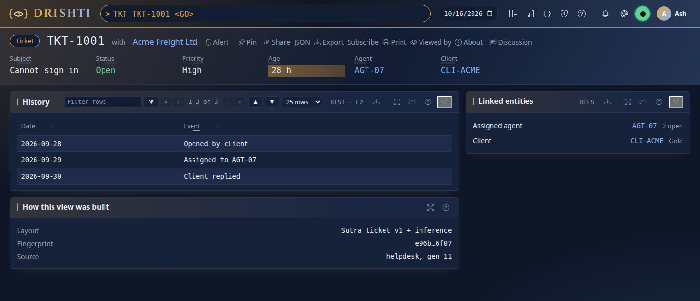
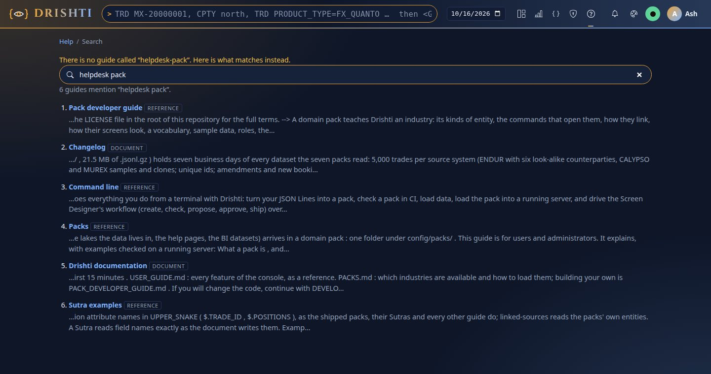
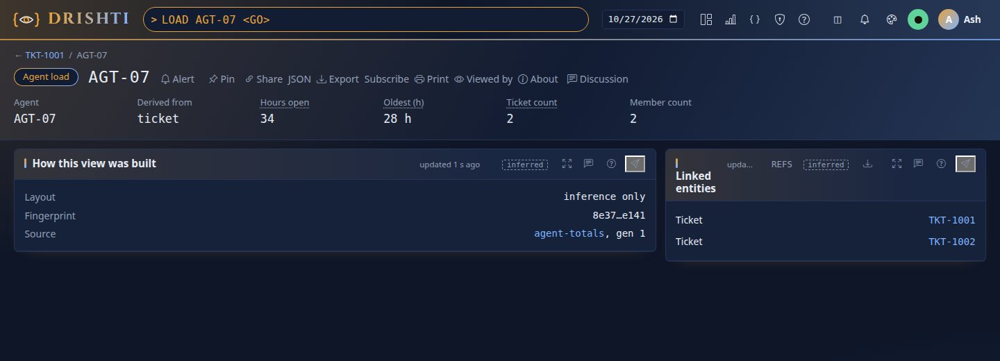
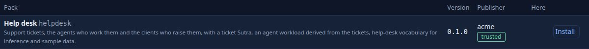
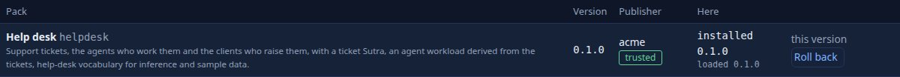
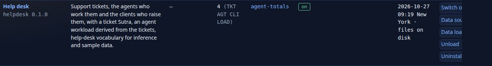

<!--
  Project Drishti · Any data. Any domain. One grammar.

  Copyright (c) 2026 Ashutosh Sinha <ajsinha@gmail.com>.
  All rights reserved.

  PROPRIETARY AND CONFIDENTIAL.

  This file is the confidential and proprietary property of Ashutosh Sinha.
  Unauthorised copying, use, modification, distribution or disclosure of this
  file, via any medium, is strictly prohibited except with the express prior
  written permission of the copyright holder.

  See the LICENSE file in the root of this repository for the full terms.
-->
# Pack developer guide

A **domain pack** teaches Drishti an industry: its kinds of entity, the commands that open them, how they link, how
their screens look, a vocabulary, sample data, roles, the connectors its data comes through, a guide. It is configuration
and content: no Java and no Python the server runs. This guide is for the person who **writes** a pack. It builds one end
to end, a help-desk pack, with real commands and the real output they gave, then covers each topic in depth, using the
shipped packs as the reference.

Who reads what:

| You are | Read |
|---|---|
| a user or administrator: which packs ship, turning them on and off, who sees which, the demo lakes | [PACKS.md](PACKS.md) |
| writing a pack | this guide |
| writing the Sutras of a pack | [Sutra guide](SUTRA_DEVELOPER_GUIDE.md), every key in [RACHANA_REFERENCE.md](RACHANA_REFERENCE.md), the workbench in [SCREEN_DESIGNER.md](SCREEN_DESIGNER.md) |
| connecting a pack to a database, a lake or a queue | [CONNECTOR_FILES.md](../connectors/CONNECTOR_FILES.md), [CONNECTOR_DEVELOPER_GUIDE.md](../connectors/CONNECTOR_DEVELOPER_GUIDE.md) and the per-connector pages they list |
| turning JSON files or a schema into a pack without writing files by hand | [tutorial 5](../tutorials/05-build-a-pack.md), [SCHEMA_TO_PACK.md](SCHEMA_TO_PACK.md), [Generating a pack from JSON Lines](PACK_GENERATORS_GUIDE.md#generating-a-pack-from-json-lines) |

Contents:

1. [What a pack is made of](#what-a-pack-is-made-of)
2. [The worked example: a help-desk pack](#the-worked-example-a-help-desk-pack)
3. [Build it, step by step](#build-it-step-by-step) (steps 1 to 17)
4. [`pack.yaml` key by key](#packyaml-key-by-key)

The rest is in three companion guides:

- [PACK_MODELLING_GUIDE.md](PACK_MODELLING_GUIDE.md), the topics in depth: [the lake layout](PACK_MODELLING_GUIDE.md#large-kinds-the-lake-layout) ·
  [several source systems for one kind](PACK_MODELLING_GUIDE.md#several-source-systems-for-one-kind-the-trading-pack) ·
  [derived kinds](PACK_MODELLING_GUIDE.md#derived-kinds-entities-computed-from-other-kinds) · [samples](PACK_MODELLING_GUIDE.md#samples) ·
  [deep documents](PACK_MODELLING_GUIDE.md#modelling-deep-documents-legs-cashflows-and-fixings) ·
  [vocabulary](PACK_MODELLING_GUIDE.md#vocabulary-labels-formats-and-inference-hints) · [About text](PACK_MODELLING_GUIDE.md#about-text-and-glossary) ·
  [guides and help](PACK_MODELLING_GUIDE.md#guides-and-help) · [roles and field masks](PACK_MODELLING_GUIDE.md#roles-and-field-masks) ·
  [fragments and docstrings](PACK_MODELLING_GUIDE.md#fragments-and-docstrings) · [Calc snippets](PACK_MODELLING_GUIDE.md#calc-python-snippets)
- [PACK_LIFECYCLE_GUIDE.md](PACK_LIFECYCLE_GUIDE.md), around the pack: [inheritance](PACK_LIFECYCLE_GUIDE.md#inheritance) ·
  [tests](PACK_LIFECYCLE_GUIDE.md#testing-a-pack) · [versioning](PACK_LIFECYCLE_GUIDE.md#versioning-a-pack) ·
  [the signed registry](PACK_LIFECYCLE_GUIDE.md#a-signed-pack-registry-publishing-and-installing) ·
  [loading while the server runs](PACK_LIFECYCLE_GUIDE.md#loading-a-pack-while-the-server-runs) ·
  [pack fragments from the workbench](PACK_LIFECYCLE_GUIDE.md#pack-fragments-from-the-build-workbench) · [verifying a pack](PACK_LIFECYCLE_GUIDE.md#verifying-a-pack)
- [PACK_GENERATORS_GUIDE.md](PACK_GENERATORS_GUIDE.md): [generators](PACK_GENERATORS_GUIDE.md#how-the-shipped-packs-are-generated) ·
  [the README standard](PACK_GENERATORS_GUIDE.md#the-readme-standard) · [from JSON Lines](PACK_GENERATORS_GUIDE.md#generating-a-pack-from-json-lines)

## What a pack is made of

A pack is one folder under `config/packs/`. The folder name is the pack's name. Here is the finished help-desk pack of this
guide, `docs/guides/examples/pack/helpdesk/`:

```text
helpdesk/
├── pack.yaml                    the manifest: kinds, commands, links, columns, roles, alerts, connectors, console extras
├── sutras/
│   └── ticket.v1.sutra.yaml     a layout (a Sutra) for tickets
├── tests/
│   └── ticket/                  sample tickets and expect.yaml: what `sutra test` checks about the Sutra
├── config/
│   ├── semantics.yaml           field-name hints and labels for inference
│   ├── formats.yaml             a number format of the pack ("30 h")
│   ├── about.yaml               what a ticket is and what its fields mean (About this page)
│   ├── workspaces.yaml          a starter workspace
│   └── help.yaml                the pack's card in the help centre
├── guides/
│   └── helpdesk.md              the guide that card opens
├── python/
│   └── queue-by-status.py       a Calc snippet
└── samples/
    ├── catalog.jsonl             the list of sample entities (kind, id, title, subtitle)
    ├── ticket.jsonl             the sample tickets, one JSON document a line
    ├── agent.jsonl
    └── client.jsonl
```

And here is how the largest shipped pack, `config/packs/trading/`, uses the same parts:

```text
trading/
├── pack.yaml                    5 kinds, 5 mnemonics, 5 connectors (three Delta tables as a union, a Kafka stream, a derived kind)
├── sutras/                      134 Sutras and 6 shared blocks, in folders for people: common/ endur/ calypso/ murex/ pages/
├── tests/                       134 folders: two or more sample trades per Sutra, and expect.yaml
├── config/                      about.yaml, formats.yaml, help.yaml
├── guides/                      trading.md, trading-products.md
├── python/                      9 Calc snippets
└── samples/                     catalog.jsonl and trade.jsonl (765 trades of the three source systems)
```

**Attribute names are UPPER_SNAKE.** Every shipped pack names every attribute the way production systems write them (`TRADE_ID`,
`COUNTERPARTY_ID`, `NET_MTM`, `ZERO_RATE`), and so does the help-desk pack (`TICKET_ID`, `AGE_HOURS`). Nothing in Drishti requires
it (a document's fields are whatever your source holds), but one convention across packs keeps link fields, searches, BI datasets
and About text consistent, and it is what the generators and `pack new` write.

Words used throughout:

| Word | Meaning | Example |
|---|---|---|
| **kind** | a type of entity; a kind belongs to exactly one pack | `ticket`, `agent`, `trade` |
| **mnemonic** | the short command that opens a kind | `TKT` opens a `ticket` |
| **id** | one entity's identifier | `TKT-1001` |
| **Sutra** | a layout for a kind, one YAML file starting `rachana: 1` | `sutras/ticket.v1.sutra.yaml` |
| **block** | panels several Sutras share, one YAML file starting `rachana: 1` with `block:` | `sutras/common/legs.v1.block.yaml` |
| **connector** | a configured source of data; a site resource (one file in `config/connectors/`) that the pack names, and may suggest a template for | `agent-totals` (a derived one) |
| **route** | which connector answers a kind | `agent-load: agent-totals` |
| **inference** | the layout Drishti works out from a document when no Sutra matches | the agent view below |

A pack with only `pack.yaml` and `samples/` already works: inference lays out every kind. Everything else makes it
better, and each piece is optional.

## The worked example: a help-desk pack

Four kinds: **ticket** (`TKT`), **agent** (`AGT`), **client** (`CLI`) and **agent-load** (`LOAD`), a *derived* kind:
nothing stores it, the server sums each agent's open tickets. The pack has links with badges, impact (F8), pick-list
columns and a Pivot tab, two roles, an alert suggestion, a vocabulary, About text, a Sutra with tests, a guide, a starter
workspace and monitor, a Calc snippet, a file connector for real data and a signed registry entry. It is small enough to
read in one sitting and uses every part of a pack except the lake layout (the shipped packs show that:
[Large kinds](#large-kinds-the-lake-layout)).

The finished pack is in the repository. Open it beside this guide:

| Part | File |
|---|---|
| manifest | [pack.yaml](examples/pack/helpdesk/pack.yaml) |
| Sutra and its tests | [ticket.v1.sutra.yaml](examples/pack/helpdesk/sutras/ticket.v1.sutra.yaml), [tests/ticket/](examples/pack/helpdesk/tests/ticket/expect.yaml) |
| vocabulary | [semantics.yaml](examples/pack/helpdesk/config/semantics.yaml), [formats.yaml](examples/pack/helpdesk/config/formats.yaml) |
| About this page | [about.yaml](examples/pack/helpdesk/config/about.yaml) |
| samples | [catalog.jsonl](examples/pack/helpdesk/samples/catalog.jsonl) and `samples/ticket.jsonl`, `agent.jsonl`, `client.jsonl` |
| guide and starters | [helpdesk.md](examples/pack/helpdesk/guides/helpdesk.md), [help.yaml](examples/pack/helpdesk/config/help.yaml), [workspaces.yaml](examples/pack/helpdesk/config/workspaces.yaml) |

It is not in `config/packs/`, so no server loads it by accident. To follow along, build it yourself in `config/packs/helpdesk/`
(steps 1 to 15), or copy the finished folder there.

**A scratch server to try things on.** Every step ends with something you can see. Use a scratch server and console on
ports of their own, so that nothing of yours is touched: the seven shipped packs plus the one you are writing
(`DRISHTI_PACKS` is explained in [PACKS.md](PACKS.md#turning-packs-on); the start-up recipe, the token and the run configurations are in
[GETTING_STARTED.md](GETTING_STARTED.md)). Keep the demo source on (`DRISHTI_DEMO_ENABLED=true`, the default): it serves the pack's
`samples/`. Security is off unless you turn it on, so the `curl` lines below need no token; on a server with security on add
`-H "Authorization: Bearer $DRISHTI_TOKEN"`.

```bash
export JAVA_HOME=/usr/lib/jvm/java-21-openjdk-amd64
DRISHTI_PORT=18996 DRISHTI_PACKS=core,market-data,trading,counterparty-risk,market-risk,world-economy,news-and-markets,helpdesk \
  java -jar drishti-server/target/drishti-server-2.9.2-exec.jar
DRISHTI_BACKEND_URL=http://127.0.0.1:18996 DRISHTI_CONSOLE_PORT=17996 drishti-console/.venv/bin/python drishti-console/run_drishti_web.py
```

The commands below use `B=http://localhost:18996/api/v1` for the server's API. **Packs follow the folder while the server runs:**
a change to `pack.yaml`, `config/` or `samples/` is picked up within a few seconds (the packs folder is watched, `drishti.packs.poll`),
checked with the loaded packs and swapped in; a bad edit keeps the last good version running and shows on Admin → Packs. A pack folder
copied into `config/packs/` of a running server is loaded too, without naming it in `DRISHTI_PACKS` (it is remembered in
`<data>/packs/added.yaml`). No change needs a restart (see [Versioning a pack](#versioning-a-pack) for what a change needs, and
[PACKS.md](PACKS.md#live-reload-the-packs-folder-is-watched)).

## Build it, step by step

This is the pack **by hand**, to show every file. If your data is JSON Lines or has a JSON Schema, you do not need to write these files:
`drishti.py pack new` ([below](#generating-a-pack-from-json-lines)) and [tutorial 5](../tutorials/05-build-a-pack.md) turn a schema or a folder
into a pack, deploy it and roll it back (the rules are in [SCHEMA_TO_PACK.md](SCHEMA_TO_PACK.md)), and
[tutorial 6](../tutorials/06-design-a-screen.md) designs its screen.

Each step says what to type and what you should see. The outputs are real: they were produced by running the steps on the
finished pack on a 2.3.0 server. (Your ticking numbers may differ a little: the ticket's age walks up and down.)

### Step 1. Create the folders

```bash
mkdir -p config/packs/helpdesk/{samples,sutras,tests/ticket,guides,config,python}
```

### Step 2. The smallest working manifest

`config/packs/helpdesk/pack.yaml`. Every file in the repository carries the copyright header: copy the comment block from
the top of any shipped `pack.yaml`, or run `python3 tools/license_headers.py --fix` when you are done (the build's
`LicenseHeaderTest` fails otherwise).

```yaml
pack: helpdesk                    # must equal the folder name
version: 0.1.0                    # X.Y.Z
code: HELP                        # typed alone, opens the pack's overview
title: Help desk
description: Support tickets, the agents who work them and the clients who raise them.

kinds: [ticket, agent, client]    # the kinds this pack owns; no other loaded pack may own them

mnemonics:                        # what users type
  TKT: { kind: ticket, label: Ticket }
  AGT: { kind: agent,  label: Agent }
  CLI: { kind: client, label: Client }

graph:
  id-patterns:                    # a bare id is recognised by its prefix
    - { pattern: "^TKT-", kind: ticket }
    - { pattern: "^AGT-", kind: agent }
    - { pattern: "^CLI-", kind: client }

console:
  examples:                       # shown on /t
    - ["TKT TKT-1001", "An open ticket · history, agent and client"]
    - ["AGT AGT-07", "An agent · inferred"]
```

Only `pack` is required. The other keys are explained in [`pack.yaml`, key by key](#packyaml-key-by-key); the finished
file has more keys than this one, which later steps add. Choose kinds and mnemonics no shipped pack uses (`trade`, `TRD`,
`counterparty` and `CPTY` are taken): two packs may not own one kind, and two unrelated packs may not define one mnemonic differently.

### Step 3. Sample data

The built-in `demo` source serves every loaded pack's `samples/` folder, so the pack works before there is a real data
store. `samples/catalog.jsonl` lists every sample (`kind` and `id` are required; `title` and `subtitle` are what the
type-ahead shows):

```json
[
  { "kind": "ticket", "id": "TKT-1001", "title": "TKT-1001", "subtitle": "Ticket · Cannot sign in · High" },
  { "kind": "ticket", "id": "TKT-1002", "title": "TKT-1002", "subtitle": "Ticket · Invoice missing · Normal" },
  { "kind": "ticket", "id": "TKT-1003", "title": "TKT-1003", "subtitle": "Ticket · Export fails · Low" },
  { "kind": "agent",  "id": "AGT-07",   "title": "AGT-07",   "subtitle": "Agent · Priya N. · Identity" },
  { "kind": "client", "id": "CLI-ACME",   "title": "CLI-ACME",   "subtitle": "Client · Acme Freight Ltd" },
  { "kind": "client", "id": "CLI-GLOBEX", "title": "CLI-GLOBEX", "subtitle": "Client · Globex Retail plc" }
]
```

and `samples/<kind>.jsonl` holds the documents of a kind, **one document a line**, in the catalogue's order, each with a `_meta`
block. The full format, and what each `_meta` key does, is in [Samples](#samples). `samples/ticket.jsonl` (the first line is the
ticket the guide uses throughout):

```json
{"TICKET_ID":"TKT-1001","SUBJECT":"Cannot sign in","STATUS":"Open","PRIORITY":"High","ASSIGNEE":"AGT-07","CLIENT":"CLI-ACME","CLIENT_NAME":"Acme Freight Ltd","AGE_HOURS":30,"HISTORY":[{"DATE":"2026-09-28","EVENT":"Opened by client"},{"DATE":"2026-09-29","EVENT":"Assigned to AGT-07"},{"DATE":"2026-09-30","EVENT":"Client replied"}],"_meta":{"source":"helpdesk","generation":1,"live":true,"walk":{"AGE_HOURS":1}}}
{"TICKET_ID":"TKT-1002","SUBJECT":"Invoice missing","STATUS":"Waiting on client","PRIORITY":"Normal","ASSIGNEE":"AGT-07","CLIENT":"CLI-GLOBEX","CLIENT_NAME":"Globex Retail plc","AGE_HOURS":6,"HISTORY":[{"DATE":"2026-09-30","EVENT":"Opened by client"}],"_meta":{"source":"helpdesk","generation":1,"live":false}}
{"TICKET_ID":"TKT-1003","SUBJECT":"Export fails on large files","STATUS":"Closed","PRIORITY":"Low","ASSIGNEE":"AGT-07","CLIENT":"CLI-ACME","CLIENT_NAME":"Acme Freight Ltd","AGE_HOURS":52,"HISTORY":[{"DATE":"2026-09-26","EVENT":"Opened by client"},{"DATE":"2026-09-28","EVENT":"Closed: fixed in 4.2"}],"_meta":{"source":"helpdesk","generation":1,"live":false}}
```

`"live": true` with `"walk": {"AGE_HOURS": 1}` makes the age tick while someone watches the ticket: a live view with no
code. `samples/agent.jsonl` holds one agent and `samples/client.jsonl` two clients, written the same way
(`{"AGENT_ID":"AGT-07","NAME":"Priya N.","TEAM":"Identity","OPEN_TICKETS":2,"SHIFT":"EMEA early",…}`,
`{"CLIENT_ID":"CLI-ACME","NAME":"Acme Freight Ltd","TIER":"Gold","COUNTRY":"GB",…}`). A catalogue entry with no document is skipped.

**Never rely on the demo connector to serve a pack's data.** The `demo` source is for building a pack on your own machine; a
cluster runs with it off (`DRISHTI_DEMO_ENABLED=false`), and every page whose data only `samples/` holds then fails with `DRS-1001
no source holds …`. A pack that ships data puts it on the standard pattern of [step 16](#step-16-real-data-a-connector-and-a-route)
(test data, `lake demo`, a Delta connector of the pack); `samples/` then keeps only a few reference documents for the README and
the guide.

### Step 4. Load it

Start the scratch server with `helpdesk` in `DRISHTI_PACKS` (above), or copy the folder into the packs folder of a running server.
Check that it loaded:

```bash
B=http://localhost:18996/api/v1
curl -s $B/packs | python3 -c 'import json,sys; [print(p["name"], p["version"]) for p in json.load(sys.stdin) if p["name"]=="helpdesk"]'
```

```text
helpdesk 0.1.0
```

If the server stopped instead (or, on a running server, Admin → Packs shows the pack *refused*), the message says why: a typo
in a folder name, a kind another pack owns, a clash with an unrelated pack ([TROUBLESHOOTING.md](TROUBLESHOOTING.md#building-and-starting)).
The console needs no restart: it asks the server which packs are on.

### Step 5. Open it (inference only)

In the terminal (`/t`) type `TK`: the dropdown offers `TKT` *Ticket*. Type `TKT TKT-1001` and press Enter. There is no
Sutra yet, so **inference** lays the ticket out. See what it did for the agent, which will never get a Sutra here:

```bash
curl -s $B/views/agent/AGT-07 | python3 -c '
import json,sys; v=json.load(sys.stdin)
print([(s["label"], s["text"]) for s in v["strip"]]); print([(p["id"], p["kind"]) for p in v["panels"]])'
```

```text
[('Agent ID', 'AGT-07'), ('Name', 'Priya N.'), ('Team', 'Identity'), ('Open tickets', '2'), ('Shift', 'EMEA early')]
[('built', 'provenance'), ('refs', 'links')]
```

*How this view was built* says `inference only`; inference turned `OPEN_TICKETS` into *Open tickets* and led with the id field.
`TKT TKT-100` is a **pick list** (`3 of 3 tickets match`), and a bare `TKT-1001` opens the ticket because of the `^TKT-` pattern.
See [INFERENCE.md](../architecture/INFERENCE.md) for how inference decides.

### Step 6. Links and badges

Add to `graph:` in `pack.yaml`:

```yaml
  fields:                         # a field whose value is another entity's id becomes a link
    ASSIGNEE: { kind: agent,  label: Assigned agent }
    CLIENT:   { kind: client, label: Client }
  badges:                         # Rachana-EL, evaluated on the TARGET of the link
    agent:  "$.OPEN_TICKETS + ' open'"
    client: "$.TIER"
```

Save, wait a few seconds for the reload (or press Retry now in Admin → Packs) and open `TKT TKT-1001`. *Linked entities* now lists
the agent and the client, with their badges. The view-model answer (`curl -s $B/views/ticket/TKT-1001`, the `links` panel) says it
exactly:

```text
{'label': 'Assigned agent', 'text': 'AGT-07', 'link': {'kind': 'agent', 'id': 'AGT-07', 'mnemonic': 'AGT'}, 'badge': '2 open', 'status': 'resolved'}
{'label': 'Client', 'text': 'CLI-ACME', 'link': {'kind': 'client', 'id': 'CLI-ACME', 'mnemonic': 'CLI'}, 'badge': 'Gold', 'status': 'resolved'}
```

A link field name means **one kind everywhere**: if another loaded pack also declares a `CLIENT` field for a
different kind, the pack is refused. The shipped packs claim `COUNTERPARTY`, `PORTFOLIO`, `BOOK`, `LEGAL_ENTITY`, `TRADER_ID`,
`TRADE_ID`, `TRADE_IDS`, `ECONOMY`, `NEWS_ID` and many more; pick names that fit your domain and are not taken.

A link field links from **every kind's documents** unless it says otherwise. When the name is generic and other packs' documents carry
it with other codes, add `scope: pack`: the field is then a link only in the documents of the declaring pack's own kinds, and plain
data everywhere else. World-economy does this for `JURISDICTION` (its values are `JUR-` ids), so a gleif entity's `JURISDICTION`
(`US-DE`) and a core legal entity's (`DE`) show as text instead of a link to nothing:

```yaml
  fields:
    JURISDICTION: { kind: jurisdiction, label: Country, scope: pack }   # pack: this pack's kinds only; all (the default): every kind
```

### Step 7. Impact (F8)

Add under `graph:`:

```yaml
  impact:
    follow: [CLIENT]                        # roll dependents up through these link fields
    measures: { ticket: "$.AGE_HOURS" }     # Rachana-EL per dependent kind, summed per group
    formats:  { ticket: amount0 }
```

Save, wait for the reload, open `AGT AGT-07` and press `F8`. The same answer from the API (`curl -s $B/impact/agent/AGT-07`, condensed):

```text
level 1  ticket  TKT-1001 (30)  TKT-1002 (6)  TKT-1003 (52)   total 88
level 2  client  CLI-ACME, CLI-GLOBEX                         via "CLIENT"
```

Tickets depend on the agent directly (they name her in `ASSIGNEE`), with their ages summed; the clients roll up
through the tickets' `CLIENT` field. That answers *which clients are affected if Priya is off sick?* Impact finds
dependents through the sources' reverse lookups; the demo source has them, as do the file, lake and database connectors.
See the [Impact guide](USER_GUIDE.md#f8--impact).

### Step 8. Pick-list columns and a Pivot tab

```yaml
columns:                          # key fields beside each id in pick lists and searches
  ticket: [SUBJECT, STATUS, PRIORITY, ASSIGNEE, AGE_HOURS]
  agent:  [NAME, TEAM, OPEN_TICKETS]
  client: [NAME, TIER, COUNTRY]

pivot:                            # a Pivot tab on the kind's search results
  ticket:
    fields: [STATUS, PRIORITY, ASSIGNEE, CLIENT, AGE_HOURS]
    rows: [ASSIGNEE]
    columns: [STATUS]
    values: [{ field: AGE_HOURS, agg: sum }]
```

`TKT TKT-100` now answers with exactly those five columns (`['$.SUBJECT', '$.STATUS', '$.PRIORITY', '$.ASSIGNEE', '$.AGE_HOURS']`,
three tickets, and a `pivot` block for the Pivot tab). The server's reply to `TKT STATUS=open` (one match, so the ticket opens at once
in the terminal) lists them with their labels, the field the command names first:

```bash
curl -s -G $B/search --data-urlencode 'q=TKT STATUS=open' | python3 -c 'import json,sys; d=json.load(sys.stdin); print(d["columns"]); print(d["labels"])'
```

```text
['$.STATUS', '$.SUBJECT', '$.PRIORITY', '$.ASSIGNEE', '$.AGE_HOURS']
{'$.STATUS': 'Status', '$.SUBJECT': 'Subject', '$.PRIORITY': 'Priority', '$.ASSIGNEE': 'Agent', '$.AGE_HOURS': 'Age (h)'}
```

(*Agent* and *Age (h)* come from the vocabulary of step 10.) Details, and how the Pivot tab computes on the server:
[`columns`](#columns-the-key-fields-of-a-pick-list) and [`pivot`](#pivot-a-pivot-tab-on-search-results).

### Step 9. Roles, field masks and an alert suggestion

```yaml
roles:
  support:      { kinds: [ticket, agent, client, agent-load] }               # opens the pack's kinds, nothing else
  support-lead: { kinds: [ticket, agent, client, agent-load], raw: true, calc: true }   # sees every field unmasked, may use Calc

alerts:
  - kind: ticket
    name: "Open more than a day"
    when: "$.AGE_HOURS > 24 && $.STATUS != 'Closed'"
    severity: warn
    message: "${$.TICKET_ID}: open ${fmt($.AGE_HOURS, 'age0')} (${$.CLIENT_NAME})"
```

Roles take effect when sign-in is on; they appear in *Admin → Roles* marked **built-in**. The difference between
`support` and `support-lead` is `raw`: a role without it sees every field named in the site's `drishti.security.redact` as `•••`
(for example `CLIENT_NAME`, if the site treats client names as confidential). Masks are a site setting, not a pack key,
so a pack can say who is exempt but not what is hidden: see [Roles and field masks](#roles-and-field-masks). The alert
appears in the Alert dialog of every ticket: open `TKT TKT-1001`, click **Alert**, and pick *Open more than a day*.

### Step 10. Vocabulary

`config/formats.yaml` (a format of your own) and `config/semantics.yaml` (hints inference and labels use):

```yaml
# config/formats.yaml
formats:
  age0: { type: number, decimals: 0, suffix: " h" }
```

```yaml
# config/semantics.yaml
roles:                              # a field-name pattern (case ignored) → how inference shows such fields
  - { role: age, pattern: "HOURS$", fmt: age0, weight: 80 }
  - { role: label, pattern: "PRIORITY|TEAM|TIER|SHIFT", weight: 64 }
labels:                             # field → label, everywhere (strips, tables, pick-list headings)
  AGE_HOURS: Age (h)
  ASSIGNEE: Agent
  HOURS_OPEN: Hours open
  OLDEST_HOURS: Oldest (h)
idFields: ["TICKET_ID", "AGENT_ID", "CLIENT_ID"]
```

Save and wait for the reload. The age reads `30 h` and the pick-list column is headed *Age (h)*. The format file and the hints are
explained in [Vocabulary](#vocabulary-labels-formats-and-inference-hints).

### Step 10b. About this page: say what a ticket is

Every view has an *About this page* drawer (`?`). It already says where the data came from and why the page looks as it
does; the sentence at the top and the meaning of each field are yours to write, in one more file,
`config/about.yaml`:

```yaml
# config/about.yaml
about: 1
kinds:
  ticket:
    title: Support ticket
    about: >-
      ${$.TICKET_ID} ("${$.SUBJECT}") is a ${lower($.PRIORITY)}-priority ticket for ${$.CLIENT_NAME}, ${lower($.STATUS)} for
      ${$.AGE_HOURS} hours and assigned to ${$.ASSIGNEE}.
    glossary:
      AGE_HOURS:
        term: Age
        means: Hours since the ticket was opened. It keeps counting while the ticket is open.
        unit: hours
      PRIORITY:
        term: Priority
        means: How soon the team has promised to look at it.
        values:
          High: Within four working hours
          Normal: Within one working day
          Low: Within five working days
      # … SUBJECT, STATUS (with its values), ASSIGNEE, CLIENT, HISTORY.DATE and HISTORY.EVENT the same way
```

Save, wait for the reload and press `?` on `TKT TKT-1001`: the drawer's first section reads *TKT-1001 ("Cannot sign in") is a high-priority
ticket for Acme Freight Ltd, open for 30 hours and assigned to AGT-07.*, and the glossary explains each field the screen shows. The
same from the API (`curl -s $B/views/ticket/TKT-1001/explain`, condensed):

```text
"about": {"pack": {"name": "helpdesk", "title": "Help desk"}, "kindTitle": "Support ticket",
          "text": "TKT-1001 (\"Cannot sign in\") is a high-priority ticket for Acme Freight Ltd, open for 30 hours and assigned to AGT-07."}
"glossary": [{"key": "PRIORITY", "label": "Priority", "shownIn": ["strip"], "term": "Priority", "means": "How soon the team has promised to look at it.",
              "values": {"High": "Within four working hours"}, "origin": "helpdesk:glossary.PRIORITY"}, …]
```

The sentence is a template over the ticket, so it changes when the ticket does; a value's meaning is shown for the value on the page
(`High` only). The keys, the rules and the checks are in [About text and glossary](#about-text-and-glossary);
`drishti.py pack about-check config/packs/helpdesk` lists every field a Sutra shows that has no glossary entry (step 17).

### Step 11. A Sutra: the layout you want

Inference is a good start; a **Sutra** fixes the layout. `sutras/ticket.v1.sutra.yaml`: the copyright header as `#`
comments, then `rachana: 1`, the name, the version and the layout.

```yaml
rachana: 1
sutra: ticket
version: 1
description: A support ticket with its history, agent and client.
match: { kind: ticket, priority: 10 }
title: { pill: "Ticket", id: $.TICKET_ID, with: $.CLIENT_NAME }
strip:
  - { label: Subject, bind: $.SUBJECT }
  - { label: Status, bind: $.STATUS, tone: status }
  - { label: Priority, bind: $.PRIORITY }
  - { label: Age, bind: $.AGE_HOURS, fmt: age0, emphasis: true }
  - { label: Agent, bind: "link($.ASSIGNEE, 'agent')" }
  - { label: Client, bind: "link($.CLIENT, 'client')" }
panels:
  - id: history
    kind: ladder
    title: History
    code: HIST
    key: F2
    rows: $.HISTORY
    highlight: "#index == size($.HISTORY) - 1"
    columns:
      - { label: Date, bind: "@.DATE", fmt: date }
      - { label: Event, bind: "@.EVENT" }
  - { id: built, kind: provenance, title: How this view was built }
  - { id: refs, kind: links, title: Linked entities, code: REFS, area: right }
keys: { F7: "link($.ASSIGNEE, 'agent')", F9: raw }
```

Pack Sutras are watched: the server picks the file up within about a second, no restart. Check it:

```bash
curl -s $B/sutras/problems
```

```text
{}
```

Open `TKT TKT-1001`: the strip reads *Subject Cannot sign in · Status Open · Priority High · Age 30 h · Agent AGT-07 · Client CLI-ACME*.



*How this view was built* now says `Sutra ticket v1 + inference`. A mistake (`kind: ladderr`) is reported with its line
and the view keeps the last good version ([runbooks/sutra-broken.md](../admin/runbooks/sutra-broken.md)).

Writing Sutras is taught in the [Sutra guide](SUTRA_DEVELOPER_GUIDE.md); every key is in
[RACHANA_REFERENCE.md](RACHANA_REFERENCE.md). You can design the Sutra in the **Build workbench** instead of by hand:
start from the samples, let auto-design draft it, edit on the canvas, and export the result into your pack as a
[fragment](#pack-fragments-from-the-build-workbench) ([SCREEN_DESIGNER.md](SCREEN_DESIGNER.md)).

**Many Sutras for one kind.** Sutras may sit in any sub-folders of `sutras/`: the folder is for people only, read recursively, and
Drishti infers nothing from its name; each Sutra's `match:` alone decides what it lays out (a `where:` over the document and a
`priority`). The trading pack is the model to copy when one kind has many shapes: one Sutra per source system and product type
(`match: { kind: trade, where: "$.SOURCE_SYSTEM == 'MUREX' && $.PRODUCT_TYPE == 'IRS_FIXFLOAT'", priority: 10 }`), a product's
variants as panels with `when:` inside its one Sutra rather than as more Sutras, and the panels every product shares in **blocks**
(`sutras/common/legs.v1.block.yaml`, used as `{ use: legs@1, with: { rate-fmt: price4 } }`;
[Shared panel blocks](RACHANA_REFERENCE.md#shared-panel-blocks-use)). Admin → Packs → your pack → **Sutra coverage**
(`GET /api/v1/packs/<pack>/coverage?kind=<kind>`) shows which Sutra lays out each combination of the fields your Sutras match on,
as the data has it, and flags *none* and *several* ([Several source systems for one kind](#several-source-systems-for-one-kind-the-trading-pack)).

### Step 12. Put the Sutra under test

A Sutra that renders today can break with next month's data. `tests/<sutra>/` holds sample documents and an
`expect.yaml`; `sutra test` renders the Sutra against every sample and checks the expectations, with no server and no
port:

```text
tests/ticket/cases.jsonl          two cases, one a line: {"case": "TKT-1001", "document": {...}}
tests/ticket/expect.yaml
```

```yaml
noErrors: true            # no panel in an error state on any sample (the default)
nonEmpty: [history]       # these panels must render with data on every sample
```

```bash
java -jar drishti-server/target/drishti-server-2.9.2-exec.jar sutra test config/packs/helpdesk --junit target/sutra-tests.xml
```

```text
     ticket: help coverage 8/8 (100%)
ok   config/packs/helpdesk/sutras/ticket.v1.sutra.yaml (2 samples)
```

Exit code `0`. *Help coverage* is the share of the fields the Sutra shows that `config/about.yaml` explains (8 of 8 once the
glossary of step 10b is complete; 2 of 8 with only `AGE_HOURS` and `PRIORITY`). `target/sutra-tests.xml` is JUnit XML for your CI's
report step. Now break the expectation on purpose (`nonEmpty: [history, timeline]`):

```text
ticket / TKT-1001: panel timeline is not in the Sutra
ticket / TKT-1002: panel timeline is not in the Sutra
     ticket: help coverage 8/8 (100%)
FAIL config/packs/helpdesk/sutras/ticket.v1.sutra.yaml (2 samples)
```

Exit code `1`. A mistake in the Sutra itself fails `sutra lint`, with the line:

```text
PROBLEM config/packs/helpdesk/sutras/ticket.v1.sutra.yaml
config/packs/helpdesk/sutras/ticket.v1.sutra.yaml:30 DRS-2021 unknown panel kind 'ladderr'; expected one of kv, table, tabs, line, area, hbar, ladder, links, status, provenance, markdown, gauge, surface, waterfall, histogram, scatter, candlestick, graph, timeline, pivot, metric, map
```

The Maven build runs `sutra test` over every pack that has a `tests/` folder, so a Sutra change that breaks
a pack fails the build: see [Testing a pack](#testing-a-pack).

### Step 13. Guide, help card, starters

`guides/helpdesk.md` describes the domain (not the sample records) and has a **Finding things** section;
`config/help.yaml` puts it in the help centre and makes it the guide F1 opens on the terminal; `config/workspaces.yaml`
offers a starter workspace. Their contents are in [Guides and help](#guides-and-help) and in the files linked above.
Then in `pack.yaml`:

```yaml
console:
  examples:
    - ["TKT TKT-1001", "An open ticket · history, agent and client"]
    - ["AGT AGT-07", "An agent · inferred"]
    - ["LOAD AGT-07", "A derived kind · the agent's open tickets summed"]
  workspaces: config/workspaces.yaml
  help: config/help.yaml
  monitors:
    Queue watch: [ { kind: ticket, id: TKT-1001 }, { kind: ticket, id: TKT-1002 } ]
```

Within a minute the help centre has a card *The help-desk pack*, *Views → Workspaces* offers *Ticket desk*, and *Views →
Monitors* offers *Queue watch*.



### Step 14. A derived kind

*How many tickets does each agent have open, and for how long?* No source holds that; the server computes it. Add to
`pack.yaml`:

```yaml
kinds: [ticket, agent, client, agent-load]
mnemonics:
  LOAD: { kind: agent-load, label: Agent workload (derived from tickets) }
connectors:
  agent-totals:
    plugin: derived
    kinds: [agent-load]
    settings:
      refresh: 30s
      agent-load:
        from: ticket
        group-by: $.ASSIGNEE            # one agent-load entity per assignee
        where: $.STATUS != 'Closed'
        id-field: AGENT
        members: TICKET_IDS
        fields:
          TICKET_COUNT: count
          HOURS_OPEN: sum $.AGE_HOURS
          OLDEST_HOURS: max $.AGE_HOURS
routes:
  agent-load: agent-totals
```

and `TICKET_IDS: { kind: ticket, label: Ticket }` under `graph.fields`, so the members show as links, and
`agent-load: [TICKET_COUNT, HOURS_OPEN, OLDEST_HOURS]` under `columns`. Save and wait for the reload: the server writes
`config/connectors/agent-totals.yaml` from the template (a connector is a site resource: [step 16](#step-16-real-data-a-connector-and-a-route))
and computes the kind. Type `LOAD AGT-07`:

```bash
curl -s $B/views/agent-load/AGT-07 | python3 -c 'import json,sys; print([(s["label"], s["text"]) for s in json.load(sys.stdin)["strip"]])'
```

```text
[('Agent', 'AGT-07'), ('Derived from', 'ticket'), ('Hours open', '36'), ('Oldest (h)', '30 h'), ('Ticket count', '2'), ('Member count', '2')]
```



TKT-1003 is closed, so it is not a member: 30 + 6 = 36 hours over two tickets. The first computation runs within `refresh` of the
reload, so a `LOAD AGT-07` typed in the first seconds may still say *no source holds agent-load/AGT-07*. The connector is healthy
(`agent-totals ['agent-load'] UP`). All the options of a derived kind are in
[Derived kinds](#derived-kinds-entities-computed-from-other-kinds).

### Step 15. A Calc snippet

Calc is Python in the user's browser (`Alt+C` on a view). A pack switches it on for its kinds and may ship starter
code. In `pack.yaml`:

```yaml
python:
  enabled: true
```

and `python/queue-by-status.py` (three comment lines, then the code; the copyright header above them is not shown to
the user):

```python
# title: Hours open by status
# description: The ticket's own age and status as a one-row DataFrame, to start a queue analysis from.
# kinds: ticket

import pandas as pd
pd.DataFrame([{"status": view.doc["STATUS"], "hours": view.doc["AGE_HOURS"]}])
```

Only roles with `calc: true` see Calc (here `support-lead`). More in [Calc: Python snippets](#calc-python-snippets).

### Step 16. Real data: a connector and a route

**Data a pack ships: the standard pattern.** Every document a shipped pack serves follows one pattern, whatever its origin
(generated, or published public data such as the us-equities and gleif packs):

1. the documents as gzipped JSON Lines under `data/testdata/<pack>/<kind>/` (a snapshot, then a file of changes a business day; or
   one dated `snapshot-<date>.jsonl.gz` the same on every day), each dataset listed in `data/testdata/testdata.yaml` with its pack,
   kind, Delta connector and key (`tools/testdata/make_testdata.py` and `tools/testdata/publicsnap.py` write it; never by hand);
2. `python3 tools/drishti.py lake demo` (or `tools/build_demo_lakes.py`) builds them into the demo lake;
3. a Delta connector in the pack's `pack.yaml` serves them (`plugin: delta`, its `domain`, the kinds, `layout.<kind>.columns` for the
   fields searches and the search form filter on, `layout.<kind>.type-ahead` for the columns a name is found by).

`PacksServedWithoutDemoTest` (drishti-server) fails the build when a kind of a shipped pack has no such connector and data.

Samples are for demos. Real tickets live somewhere else; here, the ticketing system exports each business day's tickets as one
JSON Lines file, the layout the `file` plugin reads ([FILE_CONNECTOR.md](../connectors/FILE_CONNECTOR.md)):

```text
data/files/helpdesk/2026-10-16/ticket.jsonl      one ticket a line, the day's export
```

```json
{"TICKET_ID": "TKT-2001", "SUBJECT": "Password reset loop", "STATUS": "Open", "PRIORITY": "High", "ASSIGNEE": "AGT-07", "CLIENT": "CLI-GLOBEX", "CLIENT_NAME": "Globex Retail plc", "AGE_HOURS": 3, "HISTORY": [{"DATE": "2026-10-16", "EVENT": "Opened by client"}]}
```

Then name the connector, give it a template, and route tickets to it (a connector is a site resource; the pack suggests it, see
[Connectors: the pack names them, the site owns them](#connectors-the-pack-names-them-the-site-owns-them)):

```yaml
connectors:
  agent-totals: { … as in step 14 … }
  helpdesk-store:
    plugin: file
    kinds: [ticket]
    settings:
      root: ${HELPDESK_FILES_ROOT:${drishti.data.dir:./data}/files}   # <root>/<domain>/<yyyy-mm-dd>/<kind>.jsonl
      domain: helpdesk
      id-field: TICKET_ID           # a plain document per line: its id is this field
      rescan-seconds: 30
routes:
  agent-load: agent-totals
  ticket: helpdesk-store            # tickets are read from this connector first
```

Save. When the pack reloads (a few seconds) the server writes `config/connectors/helpdesk-store.yaml` from the template, starting with the
line `# Generated at first start from the connector template of pack 'helpdesk'. Edit it freely: it is never overwritten.`, and never
overwrites it afterwards. Check the connector, then open `TKT TKT-2001`:

```bash
curl -s $B/sources | python3 -c 'import json,sys; [print(s["name"], s["kinds"], s["health"]) for s in json.load(sys.stdin)["sources"] if s["name"]=="helpdesk-store"]'
```

```text
helpdesk-store ['ticket'] UP
```

*How this view was built* names `helpdesk-store` as the source, for business date 2026-10-16; the strip reads *Subject Password reset
loop · Status Open · Priority High · Age 3 h · Agent AGT-07 · Client CLI-GLOBEX*. The route makes `helpdesk-store` answer tickets first;
a ticket it does not hold is looked for in the other sources, so the sample tickets still open from the demo source.
`TKT AGE_HOURS < 10` now finds a sample and the exported ticket together:

```text
2 [('TKT-1002', 6), ('TKT-2001', 3)]
```

The derived `LOAD` kind reads tickets through the normal routing, so it counts the exported ones too (at its next `refresh`).

Three things the run taught, worth knowing before you point a connector at real files:

- **The template is used once.** Changing `helpdesk-store` in `pack.yaml` afterwards (another `id-field`, fewer kinds) does not touch the
  file already written. Edit the file, or put it back to the pack's current template: `drishti.py connector reset helpdesk-store`
  (or *Reset to pack default* in Admin → Connectors) rewrites it and keeps the earlier text in `<data>/connectors/history/`.
- **A dated file is the whole day.** For a business date that has a `<date>/ticket.jsonl`, that file alone answers; an undated
  `<domain>/ticket.jsonl` serves only the dates that have no dated file.
- **A line without the id is skipped and counted**, and Health says so: `UP (1 unreadable line in 2026-10-16/ticket.jsonl (line 1: no id
  ("id" in a row, or the id-field "id" in a plain document)))` is what a missing `id-field` looks like.

For a database, a lake, Kafka or S3 only the `plugin` and `settings` change; see the connector pages. A site can point the connector
elsewhere without touching the pack: edit `root:` in `config/connectors/helpdesk-store.yaml` (or in Admin → Connectors), and the running
server restarts that one connector; `HELPDESK_FILES_ROOT=/srv/exports` still works because the template, and so the generated file, reads it.
The finished example pack in the repository leaves this step out, so that it needs no data folder.

### Step 17. Check it, and publish it

```bash
python3 tools/license_headers.py --fix                                  # a header on every new file
drishti-console/.venv/bin/python tools/drishti.py pack check config/packs/helpdesk --tail 3
drishti-console/.venv/bin/python tools/drishti.py pack about-check config/packs/helpdesk
```

```text
== helpdesk: sutra lint: exit 0
ok      config/packs/helpdesk/sutras/ticket.v1.sutra.yaml
== helpdesk: sutra test: exit 0
     ticket: help coverage 8/8 (100%)
ok   config/packs/helpdesk/sutras/ticket.v1.sutra.yaml (2 samples)

== helpdesk: 0 field(s) shown without glossary text in 0 Sutra(s); 0 placeholder TODO text(s) in config/about.yaml
```

(`pack check` prints the pack's absolute path; it is shortened here.) With only two glossary entries, `about-check` exits `1` and names
the gaps: `ticket.v1: SUBJECT, STATUS, ASSIGNEE, CLIENT, HISTORY.DATE, HISTORY.EVENT`. Then sign it and publish it to a registry:

```bash
drishti-console/.venv/bin/python tools/drishti.py pack keygen --out ~/drishti-keys/acme          # once per publisher
drishti-console/.venv/bin/python tools/drishti.py pack publish config/packs/helpdesk --registry /srv/drishti-registry \
    --key ~/drishti-keys/acme.pem --publisher acme
```

```text
private key: /home/you/drishti-keys/acme.pem (keep it secret; it signs packs)
public key:  MCowBQYDK2VwAyEAcYvYL5cL9D3XYx6w49WZ4oAnDrhjAfRT95Twju2ug+A=
servers trust it with:  drishti.packs.registry.trusted-keys.<publisher>: <public key>

published helpdesk 0.1.0 (10424 bytes, sha256 1661eb4570b9…) signed by acme
```

An administrator trusts the publisher's key and presses **Install** in *Admin → Packs*:





The server checked the archive's SHA-256 and signature, unpacked it, and put it to use at once, without a restart; the pack is on
(`helpdesk 0.1.0` in the pack list):



The signing model and every refusal are in [the signed registry](#a-signed-pack-registry-publishing-and-installing).
Last, [verify the pack](#verifying-a-pack): Admin → Health, `sutras/problems`, the CLI, and the checklist at the end of
this guide.

### What you built, key by key

| Step | Key or file | What the user gets |
|---|---|---|
| 2 | `pack`, `version`, `code`, `title`, `description`, `kinds`, `mnemonics`, `graph.id-patterns`, `console.examples` | `TKT TKT-1001`, `TKT-1001` alone, suggestions, `HELP` for the pack's overview |
| 3 | `samples/catalog.jsonl`, `samples/<kind>.jsonl` | data with no database, a live ticking age |
| 6 | `graph.fields`, `graph.badges` | links between tickets, agents and clients, with badges |
| 7 | `graph.impact` | F8 on an agent: tickets, then clients |
| 8 | `columns`, `pivot` | useful pick lists and a Pivot tab |
| 9 | `roles`, `alerts` | access control, `raw`, Calc rights; one-click alert rules |
| 10 | `config/formats.yaml`, `config/semantics.yaml` | `30 h`, *Age (h)* |
| 10b | `config/about.yaml` | a sentence about the ticket and the meaning of its fields in the *About this page* drawer |
| 11 | `sutras/` | the layout you designed |
| 12 | `tests/` | the Sutra under CI |
| 13 | `guides/`, `console.help`, `console.workspaces`, `console.monitors` | help card, F1, starters |
| 14 | `connectors` (`derived`), `routes` | an entity computed from others |
| 15 | `python` | Calc and a starter snippet |
| 16 | `connectors` (`file`), `routes` | real data |
| 17 | `pack check`, `pack about-check`, the registry | CI checks; install, upgrade, roll back |

## `pack.yaml`, key by key

Below, every key at a glance, then `config/packs/trading/pack.yaml` annotated (abridged), then the keys for inheritance and real
data from `config/packs/counterparty-risk/pack.yaml`. Every key here is read either by the server's pack loader
(`drishti-packs/…/PackLoader.java`) or by the console (`drishti-console/core/packs.py`); keys not listed are ignored.

**Every key at a glance.** Only `pack` is required; a pack with nothing else loads and does nothing.

| Key | Read by | One-line example | What it does | Details |
|---|---|---|---|---|
| `pack` | server | `pack: helpdesk` | The pack's name; must equal the folder name | below |
| `sample` | server | `sample: true` | Marks the pack as a demonstration: an administrator can hide sample packs from business users (`drishti.packs.samples`) | [Sample packs](PACKS.md#sample-packs) |
| `loads` | server | `loads: { … }` | Which kinds the ETL is expected to land each business day, by when, and who is told | [DATA_LOADS.md](DATA_LOADS.md#6-configuration-reference) |
| `code` | server | `code: HELP` | The pack's short code: typed alone on the command line it opens the pack's overview (`/p/<pack>`). It must not equal a mnemonic (a mnemonic wins) | [Pack codes](PACKS.md#pack-codes) |
| `version` | server | `version: 1.2.0` | **X.Y.Z**; shown in About, Admin → Health and Admin → Packs, checked by deploys and the registry | [Versioning](#versioning-a-pack) |
| `title`, `description` | both | `title: Help desk` | The pack's name and paragraph in menus, help and admin pages | below |
| `extends` (or `requires`) | server | `extends: [market-data, trading]` | Inherit everything from these packs | [Inheritance](#inheritance) |
| `kinds` | server | `kinds: [ticket, agent]` | The kinds this pack owns | below |
| `mnemonics` | server | `TKT: { kind: ticket, label: Ticket }` | The commands | below |
| `graph.id-patterns` | server | `- { pattern: "^TKT-", kind: ticket }` | Recognise a bare id's kind | below |
| `graph.fields` | server | `ASSIGNEE: { kind: agent, label: Assigned agent }` | Turn a field's value into a link (`scope: pack`: in this pack's kinds only) | below |
| `graph.badges` | server | `agent: "$.OPEN_TICKETS + ' open'"` | Text shown beside a link, read from the target | below |
| `graph.impact` | server | `follow: [CLIENT]`, `measures: { ticket: "$.AGE_HOURS" }` | What F8 rolls up and sums | below |
| `columns` | server | `ticket: [SUBJECT, STATUS, PRIORITY]` | Key fields in pick lists and searches | [columns](#columns-the-key-fields-of-a-pick-list) |
| `pivot` | server | `trade: { rows: [PRODUCT_TYPE], columns: [SOURCE_SYSTEM] }` | A Pivot tab on the kind's search results and pick lists | [pivot](#pivot-a-pivot-tab-on-search-results) |
| `form` | server | `trade: [ { path: QUANTITY, type: amount } ]` | The search form of each kind (`FORM <pack>`): its fields, their types and operators | [form](#form-the-search-form-of-a-kind) |
| `history` | server | `equity: { chart: [PRICE] }` | How a kind looks over time (`EQ EQ-CSCA 3M`): its columns, parts, chart fields and limits; never needed, any dated kind has a history | [history](#history-a-kind-over-time) |
| `roles` | server | `support: { kinds: [ticket, agent] }` | Roles this pack adds | [Roles](#roles-and-field-masks) |
| `python` | server | `python: { enabled: true }` | Calc (Python in the browser, `Alt+C`) on this pack's kinds, and starter snippets (also `python/*.py`) | [Calc](#calc-python-snippets) |
| `connectors` | server | `[helpdesk-store]` (names), or `helpdesk-store: { plugin: file, … }` (a mapping: the pack's templates) | The connectors the pack reads through. A list names site connectors; a mapping names them **and** suggests each one's definition | [below](#connectors-the-pack-names-them-the-site-owns-them) |
| `connector-templates` | server | `helpdesk-store: { plugin: file, … }` | Suggested definitions to go with a list of names; written to `config/connectors/<name>.yaml` at the first start if no such file exists | [below](#connectors-the-pack-names-them-the-site-owns-them) |
| `routes` | server | `ticket: helpdesk-store` | Which connector answers a kind | [below](#connectors-the-pack-names-them-the-site-owns-them) |
| `ingest` | tooling | `trade: { key: TRADE_ID, date: BUSINESS_DATE, flatten: { NOTIONAL: LEGS[0].NOTIONAL } }` | Which field is each kind's id and which its business date, for `drishti.py data ingest --pack`, `lake build --pack` (`--key` is then optional) and `pack check`; `flatten`: values inside lists that `lake build` writes as plain fields and columns ([Large kinds](#large-kinds-the-lake-layout)). **Optional and ignored by the server** (a pack loads the same without it) | [below](#generating-a-pack-from-json-lines) |
| `alerts` | server | `- { kind: ticket, name: …, when: "$.AGE_HOURS > 24" }` | Suggested alert rules | below |
| `sutras`, `formats`, `semantics`, `samples`, `about` | server | `sutras: sutras` | Where the pack's folders and files are | below |
| `console.examples` | console | `- ["TKT TKT-1001", "An open ticket"]` | Example commands on `/t` and the landing page | below |
| `console.workspaces` | console | `workspaces: config/workspaces.yaml` | Starter workspaces | below |
| `console.help` | console | `help: config/help.yaml` | Help-centre cards and F1 targets | [Guides and help](#guides-and-help) |
| `console.monitors` | console | `Queue watch: [ { kind: ticket, id: TKT-1001 } ]` | Starter monitors | below |

Values may use `${VARIABLE:default}`, resolved from the environment when the server starts
(`root: ${HELPDESK_FILES_ROOT:${drishti.data.dir:./data}/files}`).

The trading pack's manifest, annotated and abridged (the file is generated by `tools/packgen/banking/make_packs.py`; its
connectors and derived kinds are in [Several source systems for one kind](#several-source-systems-for-one-kind-the-trading-pack)):

```yaml
pack: trading                   # REQUIRED. Must equal the folder name, or the pack is refused.
version: 1.0.0                  # X.Y.Z. Shown on About, Admin → Health and Admin → Packs.
code: TRDS                      # typed alone: the pack's overview
title: Trading                  # display name (pack switcher, help, About). Default: the pack name.
description: >-                 # one paragraph for About and the help centre
  Trades from every booking system (Endur, Calypso, Murex) in one production schema …
extends: [core, market-data]    # inherit their kinds, links, roles, connectors … (Inheritance, below)

kinds: [trade, counterparty-trades, portfolio-trades, legal-entity-trades, index-trades]   # the kinds this pack OWNS. A kind belongs to
                                                                                          # exactly one installed pack.
sutras: sutras                  # where the Sutras are (the default); read recursively
formats: config/formats.yaml    # the pack's named formats (the default)

mnemonics:                      # the commands. MNEMONIC: { kind, label }
  TRD:  { kind: trade, label: Trade }                     # "TRD MX-20000001 <GO>" opens kind trade, id MX-20000001
  CTRD: { kind: counterparty-trades, label: Counterparty trades (derived from trades) }
  PTRD: { kind: portfolio-trades, label: Portfolio trades (derived from trades) }
  LTRD: { kind: legal-entity-trades, label: Legal entity trades (derived from trades) }
  ITRD: { kind: index-trades, label: Index trades (derived from trades) }

graph:                          # how entities link to each other
  id-patterns:                  # a bare id typed on its own is recognised by a regex (Endur's numeric ids are not: type TRD 1000001)
    - { pattern: "^(MX|CLY)-\\d+$", kind: trade }
  fields:                       # a document field whose value is an id of another kind becomes a link
    TRADE_ID:  { kind: trade, label: Trade }
    TRADE_IDS: { kind: trade, label: Trade }     # a list of ids: each one a link (a netting set's members)
  impact:                       # F8: what is summed for each dependent kind
    measures: { trade: "first($.LEGS).NOTIONAL" }
    formats:  { trade: compact }

connectors: { trade-endur: …, trade-calypso: …, trade-murex: …, trading-stream: …, trade-pages: … }   # the names and their templates
routes:
  trade: trade-endur            # the union is read whole whichever of its connectors the route names
  counterparty-trades: trade-pages
  # … one line per derived kind

columns:                        # pick-list and search columns per kind
  trade: [SOURCE_SYSTEM, PRODUCT_TYPE, TRADE_STATUS, TRADE_DATE, BUY_SELL_CODE, CURRENCY, QUANTITY, MATURITY_DATE, PORTFOLIO, COUNTERPARTY]
pivot:                          # a Pivot tab on trade searches (below)
  trade: { fields: [SOURCE_SYSTEM, PORTFOLIO, CURRENCY, …], rows: [PRODUCT_TYPE], columns: [SOURCE_SYSTEM],
           values: [{ field: QUANTITY, agg: sum }], filters: [PRODUCT_GROUP, TRADE_STATUS] }
form:                           # FORM TRDS: the search form (below)
  trade: [ { path: TRADE_ID, label: Trade id, type: id, group: Identity, order: 1 }, … ]

console:                        # read by the console only
  examples:                     # [command, description] pairs on the terminal home and landing page
    - ["TRD MX-20000001", "Interest rate swap (Murex) · legs side by side, flows and fixings"]
    - ["TRD 1000001", "Commodity swap (Endur) · legs, resets, events"]
    - ["TRD CLY-3000086", "Single-name CDS (Calypso) · premium leg payments"]
    - ["CTRD CP-ALDERSHOT", "A counterparty's trades in every system · payments, notional by product"]
  help: config/help.yaml        # help centre cards ("guides:") and F1 targets ("contextual:")
python: { enabled: true }       # Calc on trades; the snippets are python/*.py
roles:                          # roles this pack adds. ROLE: { kinds, raw?, author?, approve?, admin?, calc? }
  trader: { kinds: [trade, ir-curve, repo-curve, fx-spot, …, counterparty, book, …] }
```

The help-desk pack adds the keys trading does not use: `alerts:` (step 9) and `console.workspaces` / `console.monitors` (step 13):

```yaml
alerts:                         # suggested alert rules, offered in the Alert dialog for that kind
  - kind: ticket
    name: "Open more than a day"             # what the user sees in the list of suggestions
    when: "$.AGE_HOURS > 24 && $.STATUS != 'Closed'"   # Rachana-EL condition, checked on every change
    severity: warn                           # info, warn or critical
    message: "${$.TICKET_ID}: open ${fmt($.AGE_HOURS, 'age0')} (${$.CLIENT_NAME})"   # ${…} is evaluated
console:
  workspaces: config/workspaces.yaml         # starter workspaces (a "templates:" map), offered on /w
  monitors:                                  # starter monitors: NAME: [ {kind, id}, … ], offered on /m
    Queue watch: [ { kind: ticket, id: TKT-1001 }, { kind: ticket, id: TKT-1002 } ]
```

Five keys say where the pack's folders are. All are optional, relative to the pack folder, and the default
is used when the key is absent. A folder or file that does not exist is simply skipped.

| Key | Default | What is there |
|---|---|---|
| `sutras` | `sutras` | Sutras (`*.sutra.yaml`) and shared blocks (`*.block.yaml`), scanned recursively; any other `.yaml`, `.yml` or `.sutra.md` file there is reported (`DRS-2004`) |
| `formats` | `config/formats.yaml` | extra named formats (`formats: { age0: { type: number, decimals: 0, suffix: " h" } }`) |
| `semantics` | `config/semantics.yaml` | inference hints: `roles:` (a field-name regex → format, tone, strip weight), `labels:`, `acronyms:` and `idFields:` |
| `samples` | `samples` | sample documents for the built-in `demo` source (`catalog.jsonl`, `<kind>.jsonl`) |
| `about` | `config/about.yaml` | the words of the *About this page* drawer: a sentence per kind, a glossary of fields ([About text and glossary](#about-text-and-glossary)); read when the file exists |

### `columns`: the key fields of a pick list

When a command names several entities (`TRD MX-200000`, `CPTY north`, `TRD PRODUCT_TYPE=REVOLVER`), the user gets a
**pick list**: a table with one row per entity. `columns:` says which fields of each kind appear beside the id,
in order. From `config/packs/trading/pack.yaml` and `config/packs/core/pack.yaml`:

```yaml
columns:                        # KIND: [field, …]  document paths, as in a search ("INDEX.NAME" works too)
  trade:
  - SOURCE_SYSTEM
  - PRODUCT_TYPE
  - TRADE_STATUS
  - TRADE_DATE
  - BUY_SELL_CODE
  - CURRENCY
  - QUANTITY
  - MATURITY_DATE
  - PORTFOLIO
  - COUNTERPARTY
```

```yaml
columns:
  counterparty: [NAME, RATING, SECTOR, COUNTRY_OF_RISK, UEN, NET_MTM]
  book: [NAME, DESK_NAME, TRADE_COUNT, MTM, DV01]
```

With these, `TRD MX-200000 <GO>` on the demo lakes (99 of the 15,000 trades match) shows:

```text
TRD          Source system  Product type   Trade status  Trade date   Buy sell code  Currency  Quantity     Maturity date  Portfolio     Counterparty
MX-20000001  MUREX          IRS_FIXFLOAT   AMENDED       2025-07-25   S              AUD       242,000,000  2032-06-25     BOOK-RATES-3  CP-MERIDIAN-RE
MX-20000002  MUREX          IRS_FIXFLOAT   VALIDATED     2025-02-06   B              EUR       110,000,000  2031-04-15     BOOK-RATES-1  CP-HALCYON
…
```

How the columns of a pick list or search are chosen:

1. the fields the command itself uses, in the order they appear (`TRD CURRENCY=USD order by QUANTITY desc` puts
   *Currency* and *Quantity* first);
2. then the kind's `columns:`, skipping any already shown;
3. if the kind has no `columns:`, the first plain (non-list, non-object) fields of the first document,
   leaving out `id` and fields starting with `_`, up to six columns in all.

Column headings come from the label taxonomy (`labels:` in a pack's `semantics.yaml`, else the name in words: *Buy sell code*),
like every other label. A path may be written `MTM` or `$.MTM`; both mean the same.

Rules:

- `columns:` is optional. In the shipped packs `trade`, `counterparty`, `book`, the world-economy kinds and the news-and-markets kinds
  have it; every other kind uses the automatic columns.
- Choose five to ten fields that tell rows apart at a glance: a type, a direction or status, an amount, a date, an owner.
- A child pack may give a kind of its parent other columns; the more specific pack wins, as for every other
  key ([Inheritance](#inheritance)).
- In a **generated** pack, set the columns in the generator, never in `pack.yaml`
  ([below](#how-the-shipped-packs-are-generated)). For the banking packs that is the `COLUMNS` table in
  `tools/packgen/banking/make_packs.py`; for the packs built with `tools/packgen/common/packbuild.py` it is the
  `columns=` argument of the pack's `PackSpec`, then rerun its `make.py`.

Check what the server uses for a kind:

```bash
curl -s -G $B/search --data-urlencode 'q=BOOK limit 1' | python3 -c 'import json,sys; print(json.load(sys.stdin)["columns"])'
```

You should see `['$.NAME', '$.DESK_NAME', '$.TRADE_COUNT', '$.MTM', '$.DV01']`.

### `pivot`: a Pivot tab on search results

A kind's search results and pick lists can offer the same **Table | Pivot** switch a Sutra gives a table
([USER_GUIDE.md](USER_GUIDE.md#the-pivot-tab-slice-a-table-your-way)). It is offered **only** for the kinds a pack names
under `pivot:`, beside `columns:`; every other kind's results stay a plain list. From `config/packs/trading/pack.yaml`
(generated):

```yaml
pivot:                          # KIND: true, or { fields, rows, columns, values, filters, heat, chart }
  trade:
    fields: [SOURCE_SYSTEM, PORTFOLIO, CURRENCY, PRODUCT_GROUP, PRODUCT_TYPE, BUY_SELL_CODE, TRADE_STATUS, COUNTERPARTY,
             LEGAL_ENTITY, MATURITY_DATE, QUANTITY]
    rows: [PRODUCT_TYPE]
    columns: [SOURCE_SYSTEM]
    values: [{ field: QUANTITY, agg: sum }]
    filters: [PRODUCT_GROUP, TRADE_STATUS]
```

The value is the same as a Sutra's [`pivot` option](RACHANA_REFERENCE.md#pivot-a-pivot-tab-on-a-table-or-ladder),
with one difference: fields are **document paths** (`INDEX.NAME`; `$.` may be written), never
expressions (`bind` is refused). `pivot: { trade: true }` offers the kind's `columns:` as the fields. `false` (or no
entry) offers nothing.

Unlike a panel's pivot, which the browser computes from one document's rows, a search's pivot is computed **on the
server** over every entity the search matches on the business date (not only the page shown), from the day's
**columns**: the fields its store keeps beside each document ([Large kinds](#large-kinds-the-lake-layout)). So choose
fields the connector's `layout.<kind>.columns` lists; the trading pack's pivot fields are all among its trade tables'
columns. A field that no source keeps as a column is marked *doc* in the field list; using it, the server refuses with the reason
and the user may ask for a **document read** instead (at most `drishti.pivot.document-scan`, 20,000 documents; marked
partial beyond). The sample data (the demo plugin) keeps no columns, so on samples every search pivot is a document
read.

Fields the user's role may not see are masked exactly as in a search: grouped under `•••`, never added up.

The server keeps each kind's declaration as `drishti.search.pivot.<kind>`: `true`, or the mapping as JSON. A site may
set it directly in its configuration, as `true` or a JSON string (`drishti.search.pivot.trade: '{"rows": ["PRODUCT_TYPE"]}'`). A
declaration the server cannot read is logged (*no Pivot tab for trade: …*) and that kind offers no Pivot tab; a value
that is neither `true`, `false` nor a mapping stops the pack from loading. In a generated pack, set it in the
generator: `PIVOTS` in `tools/packgen/banking/make_packs.py`.

A Sutra's tables opt in on their own (`pivot:` on the panel). In the banking generators that is `pivot=` on a `Panel`
in `tools/packgen/banking/risk_data.py` (netting sets, books, clearing accounts, desks, collateral); rerun `make_sutras.py`.

### Reserved command words

The console owns six command words: `BI`, `RUPAKA` (its alias), `FORM`, `FUNC`, `WHAT` and `DATAMAP`. A pack may not define a mnemonic with any of those names, in any case: the pack loader
refuses it (`pack 'x' defines the mnemonic 'BI', which is a reserved command word (BI, DATAMAP, FORM, FUNC, RUPAKA, WHAT): choose another`) and `drishti.py pack check` fails the same way. No shipped pack uses them.

### `form`: the search form of a kind

`FORM <pack> <GO>` opens a form for a pack's kinds: one input per field, typed, which the server compiles to the ordinary search
(`TRD where QUANTITY between 1m and 5m ...`) and runs as any search, so masks, kinds per role and packs per user apply. A pack declares the
form of a kind under `form:`; a kind with no entry gets one **inferred**: the kind's search columns, the fields its Sutras' `match.where`
reads and the plain fields of their strip, typed from sample values (numbers, ISO dates, true/false, a short list of repeated words is a
choice) and from the field's name, and labelled with the `term` from `config/about.yaml`. From `config/packs/trading/pack.yaml`:

```yaml
form:
  trade:                              # a kind of this pack; a list of fields, or {calendar: USNY, fields: [...]}
    - { path: TRADE_ID, label: Trade id, type: id, group: Identity, order: 1, help: "One or many: paste a list. MX-2* is any id starting MX-2; Endur ids are numbers." }
    - { path: SOURCE_SYSTEM, label: Source system, type: enum, group: Identity, order: 2, help: "ENDUR, CALYPSO or MUREX: the booking system the trade comes from." }
    - { path: COUNTERPARTY, label: Counterparty, type: enum, group: Identity, order: 3 }
    - { path: PRODUCT_TYPE, label: Product type, type: enum, group: Product, order: 4 }
    - { path: PRODUCT_SUB_TYPE, label: Product sub type, type: enum, group: Product, order: 5, depends: PRODUCT_TYPE }
    - { path: QUANTITY, label: Quantity, type: amount, group: Money, order: 12, operators: [">=", "<=", between, "="], help: "Amounts take k, m and bn: 250k, 1.5m, 2bn." }
    - { path: MATURITY_DATE, label: Maturity date, type: date, group: Dates, order: 14, help: "Relative ranges work here: next 10 business days." }
```

| Key of a field | Meaning |
|---|---|
| `path` | The document path searched (`QUANTITY`, `INDEX.NAME`, `LEGS[0].NOTIONAL`); a `$.` in front is dropped. Required |
| `label` | The heading; by default the path in words (`Product sub type`) |
| `type` | `text`, `number`, `amount`, `date`, `enum`, `id` or `bool` (default `text`) |
| `operators` | Which operators the person may choose, the first being the default; all of the type's when left out (below) |
| `default` | What the input starts with when the form is first opened |
| `order` | Position in the form (lower first). Fields without one follow, in the order written |
| `group` | A heading the field sits under; fields of one group sit together |
| `help` | One line shown under the field |
| `required` | The form cannot be submitted without it |
| `hidden` | Not offered as an input; kept so a saved or shared search can use it. A required hidden field needs a `default` |
| `values` | For an `enum`: the values offered. Left out, the form offers the values found in the data (and the `values` of the field's `about.yaml` glossary entry) |
| `depends` | For an `enum`: another field of the form; only the values that occur with the values chosen there are offered (product sub types of the chosen product types) |

| Type | Input | Operators (first is the default) |
|---|---|---|
| `text` | a text box and a *Match case* box | `equals`, `contains`, `starts` (starts with), `regex` (a regular expression, see `matches` in the [Rachana reference](RACHANA_REFERENCE.md#functions)) |
| `number`, `amount` | one box, or two for `between`; amounts take `250k`, `1.5m`, `2bn` | `=`, `between`, `>`, `<`, `>=`, `<=` |
| `date` | a date picker, two for `between`, or a relative range as text | `on`, `between`, `relative` (`today`, `yesterday`, `last 5 business days`, `next 3 business days`, `last 30 days`, `this week`, `this month`, `month to date`, `year to date`), `before`, `after` |
| `enum` | a tick box for each known value | `in` |
| `id` | a box to paste a list of ids (spaces, commas or lines); `MX-2*` is any id starting `MX-2` | `in` |
| `bool` | Any, Yes, No | `is` |

Business-day ranges (`last 5 business days`) run on the server's calendar, or on the calendar a kind names: `trade: { calendar: USNY, fields: [...] }`.
A field the kind's source does not keep as a column is marked **slower: not indexed** (the documents are read to answer it).

`pack check` reads the section: a field path that is not a path, an unknown `type`, an operator the type lacks (`between` on text), a duplicate
path, `values` on a field that is not an `enum`, a non-number `order`, a kind that is not the pack's, or a key it does not know is an error
that names the kind and field (`pack.yaml form.trade.fields[2] (QUANTITY): type 'money' is not one of text, number, ...`; the keys and rules are in
`tools/packform.py`). In a generated pack, set it in the generator: `TRADE_FORM` and `forms()` in `tools/packgen/banking/make_packs.py`, or
`columns` and `form_overrides` for the packbuild generators (a kind's form is its id and its pick-list columns, typed by name). `pack new`,
`pack make` and *New pack* write a `form:` from the sample documents or schemas. A change proposed from the workbench's Form tab is kept on
the server, once approved, in front of the pack's own `form:` until the pack carries it ([Screen designer, The Form tab](SCREEN_DESIGNER.md#the-form-tab)).

### `history`: a kind over time

`TRD 1000015 30 <GO>` shows the trade over the last 30 business days it has data; `EQ EQ-CSCA 3M` shows the equity's last three months
as a chart with its high, low and change ([HISTORY_QUERIES.md](../architecture/HISTORY_QUERIES.md)). **Any kind read from a dated
store has a history without this key**: a table of its top-level fields (the kind's `columns` first, then every other top-level
scalar), its top-level lists and objects shown as counts, the cells that changed from the day before marked. `history:` only shapes
it, per kind, as `form:` does. From the shipped packs:

```yaml
history:
  trade:                                    # config/packs/trading/pack.yaml
    exclude: [_meta]                        # never shown
    ignore-changes: [SOURCE_UPDATE_TIME, INPUT_DATE]   # shown, but a change here is not "a change" (changes only, DIFF)
    parts: [LEGS, EVENTS]                   # top-level lists shown as counts (default: every list or object)
    default-days: 30                        # the range when none is named (at most max-days)
  counterparty-trades: {enabled: false}     # a derived kind: no history (DRS-1012)
  equity:                                   # config/packs/market-data/pack.yaml
    chart: [{path: PRICE, format: price2}]  # the market shape: a chart and the headline numbers (at most 4 fields)
    columns: [PRICE, {path: CHANGE_1D, format: pct2}, {path: MARKET_CAP, format: compact}, BETA, NAME, EXCHANGE, CURRENCY]
    series: {path: HISTORY, date: DATE, value: CLOSE}   # used when no source keeps daily documents
```

| Key | Default | Rule |
|---|---|---|
| `enabled` | `true` | `false`: the kind has no history (`DRS-1012`) |
| `shape` | `market` when `chart` is set, else `document` | |
| `columns` | the kind's `columns`, then every top-level scalar | a top-level path, or `{path \| expr, label, format}` (`expr` is Rachana-EL: `first($.LEGS).NOTIONAL`) |
| `exclude`, `ignore-changes` | none | lists of paths |
| `parts` | every top-level list or object | lists of paths |
| `chart` | none | numeric fields, at most 4; a chart field is always a column |
| `headline` | the first `chart` field | must be one of `chart`: the field the last, change, high, low, range and average are taken on |
| `series` | none | `{path, date, value \| values}`: a list inside the newest document with a date per item |
| `default-days` | `drishti.history.default-days` (30) | 1..`max-days` |
| `max-days` | `drishti.history.max-days` (366) | can only lower the server's |

Unknown keys are warnings; a wrong value is an error (`DRS-2061`) that `sutra lint <pack-dir>` and the deploy check report, while the
running server logs it when the pack loads (at start and at every reload), shows it as the pack's problem on Admin → Packs and in Health
(the pack DEGRADED), and keeps the kind's default history. Every day's row is masked exactly as the kind's view is.

### Keys for packs that inherit and read real data

From `config/packs/counterparty-risk/pack.yaml` (abridged; the file is generated by `tools/packgen/banking/make_packs.py`):

```yaml
pack: counterparty-risk
extends: [trading]              # the packs this one inherits from, in order (the older name "requires" works too);
                                # trading brings core and market-data with it
kinds: [agreement, csa, netting-set, credit-limit, cva, sa-ccr, collateral-balance, margin-call, simm, simulation-run, exposure-path, exposure-result]

connectors:                     # the connectors this pack reads through. Here a mapping NAME: { plugin, enabled?, kinds, settings }:
                                # the names are what the pack needs, the definitions are the pack's TEMPLATES (the site's file wins)
  legal-store:
    plugin: delta               # which source plugin: delta, jdbc, aerospike, kafka, s3, rest, file, feeds, derived, …
    enabled: ${DRISHTI_LAKE_ENABLED:true}    # ${VAR:default} is resolved from the environment
    kinds: [agreement, csa]
    settings:                   # passed to the plugin as-is (each plugin's settings: CONNECTORS.md; credentials only as ${ENV})
      root: ${DRISHTI_DELTA_ROOT:${drishti.data.dir:./data}/delta}
      domain: legal             # reads <root>/legal/<kind>/
  credit-store:
    plugin: delta
    enabled: ${DRISHTI_LAKE_ENABLED:true}
    kinds: [netting-set, credit-limit, cva, sa-ccr]
    settings: { root: "${DRISHTI_DELTA_ROOT:${drishti.data.dir:./data}/delta}", domain: credit }
  collateral-store:
    plugin: delta
    enabled: ${DRISHTI_LAKE_ENABLED:true}
    kinds: [collateral-balance, margin-call, simm]
    settings: { root: "${DRISHTI_DELTA_ROOT:${drishti.data.dir:./data}/delta}", domain: collateral }

routes:                         # KIND: CONNECTOR — which connector answers each kind
  agreement: legal-store
  netting-set: credit-store
  margin-call: collateral-store
  # … one line per kind

roles:
  credit-risk: { kinds: ["*"], raw: true, calc: true }   # may open every kind, sees every field unmasked, may use Calc
```

#### Connectors: the pack names them, the site owns them

A connector is a **site resource**: one YAML file in `config/connectors/` (`drishti.sources.connectors-dir`), whose file name is the connector's name
(`config/connectors/credit-store.yaml` is `credit-store`). A pack does not carry connection settings that bind a site; it **names** what it reads through
and routes its kinds. The reference for the file is [CONNECTOR_FILES.md](../connectors/CONNECTOR_FILES.md).

```yaml
connectors: [credit-store, collateral-store]        # the form for a pack that only names connectors
connector-templates:                                # optional: what to suggest if the site has none yet
  credit-store: { plugin: delta, kinds: [netting-set], settings: { root: "${DRISHTI_DELTA_ROOT:${drishti.data.dir:./data}/delta}", domain: credit } }
routes: { netting-set: credit-store, margin-call: collateral-store }
```

- **`connectors:` is a list of names or a mapping.** A list names site connectors. A mapping (what every pack shipped with Drishti uses, shown above) is read as the names **plus** the
  pack's templates. `connector-templates:` carries templates beside a list; `pack new` writes that form.
- **A template is a suggestion, written once.** When the pack loads, for each connector it names, the server writes `config/connectors/<name>.yaml` from the template
  if no file of that name exists, logs `connector file credit-store.yaml generated from the template of pack 'counterparty-risk'`, and never overwrites a file
  afterwards. The generated file starts with `# Generated at first start from the connector template of pack '<pack>'. Edit it freely: it is never overwritten.`,
  and the server notes what it generated in `<data>/connectors/generated/<name>.properties`. After that the file is the site's: it **replaces** the template
  wholesale (the settings are not merged, so a later version of your pack cannot silently change a site's file), and the site edits it in an editor or in
  Admin → Connectors, applied live to that one connector. *Reset to pack default* (or `drishti.py connector reset <name>`) writes the pack's current template
  over it, keeping the earlier text in `<data>/connectors/history/`.
- **Kinds go through `routes:`.** You know which kind lives where, so you route it; the file's `kinds:` can only narrow that. A kind read is tried at its route's
  connector first, then the default route, then any other connector that serves the kind. A connector is therefore reusable by other packs.
- **Shared connectors.** Connectors are per data domain, not per pack: the lake is laid out as `<root>/<domain>/<kind>/`, and several packs may name the same
  connector. If two related packs (one `extends` the other) suggest different templates under one name, the more specific pack's template is the one written; two
  unrelated packs suggesting different definitions of one name is an error. Admin → Connectors shows which packs use a connector and asks before the site switches
  it off or deletes it.
- **A name nobody defined is not a failure of the pack.** The pack loads; its kinds answer `DRS-1011` ("connector not configured"), Admin → Health shows
  `connectorsNotConfigured`, and Admin → Packs → Data source offers a **Create** link pre-filled from your template. So give a template for every connector that has a
  sensible default, and for a site-specific one (a customer's own database) name it and document what the site must create.
- **Older site overrides still apply, setting by setting**: environment variables and `drishti.sources.connectors.<name>.…` in the server's own
  configuration still win over a file (and warn), see [CONFIGURATION.md](../admin/CONFIGURATION.md). The recommended way to change a connector is its file.
- **Archives carry names and templates only.** `pack make`, `pack bundle` and Admin → Packs → Deploy archive ship the names and templates, never a site's settings. The deploy preview lists
  the connectors the pack names that the site lacks (`missing`), and the **Create connectors** step writes the files from your templates.

**Checklist for a pack author**

1. List every connector the pack reads through in `connectors:`, and route every kind that is not served by the demo `samples` in `routes:`.
2. Give each a template with settings that work on a developer machine (`${VAR:default}` for paths and URLs, under `${drishti.data.dir:./data}` for folders).
3. Never write a literal credential, not even in a template: use `${ENV_VAR}` (the server refuses a literal in a connector file, and so would any site that tried to keep your template).
4. Do not rename a connector in a later version unless you must: the site's file is named after it, and a new name means a new file to create.
5. Start a scratch server on an empty `config/connectors/` and check that the files are written and that Admin → Health shows no `connectorsNotConfigured` for the pack.
6. Remember that your template is only the first suggestion: changes you make to it in a later version reach no existing site's file (unless the site resets it); say what a site must change in the pack's guide.

### What becomes of each key

The server turns the manifest into ordinary settings. Knowing this helps when you read logs or override something:

| `pack.yaml` | Becomes |
|---|---|
| `kinds` | `drishti.packs.kinds.<pack>[i]` |
| `mnemonics.TKT` | `drishti.commands.mnemonics.TKT.kind` / `.label` |
| `graph.id-patterns` | `drishti.graph.id-patterns[i]` |
| `graph.fields.ASSIGNEE` | `drishti.graph.fields.ASSIGNEE.kind` / `.label` (`scope: pack`: `.from[i]`, the pack's kinds) |
| `graph.badges.agent` | `drishti.graph.badges.agent` |
| `graph.impact.*` | `drishti.graph.impact.follow[i]`, `.measures.<kind>`, `.formats.<kind>` |
| `roles.support` | `drishti.security.roles.support.kinds[i]`, `.raw`, `.author`, `.admin`, `.approve`, `.calc` |
| `connectors.x` (mapping) or `connector-templates.x` | a **template** for `config/connectors/x.yaml` (`plugin`, `enabled`, `kinds`, `settings`), written once if that file does not exist; the file, not the pack, is then the source of the connector's settings |
| `connectors: [x]` (list) | the name `x`: the pack reads through the site connector `x` |
| `routes.kind` | `drishti.sources.routes.<kind>` |
| `columns.trade` | `drishti.search.columns.trade[i]` |
| `pivot.trade` | `drishti.search.pivot.trade` (`true`, or the mapping as JSON) |
| `sutras`, `formats`, `semantics` | added to `drishti.rachana.pack-dirs`, `drishti.rachana.pack-formats-files`, `drishti.inference.pack-semantics-files` |
| `samples` | added to `drishti.sources.plugins.demo.settings.dirs` |

`alerts`, `form` and `console` are read directly from the manifest (by the server's alert suggestions, the form service and the console).

## Large kinds: the lake layout

This section moved to [PACK_MODELLING_GUIDE.md](PACK_MODELLING_GUIDE.md#large-kinds-the-lake-layout).

## Several source systems for one kind: the trading pack

This section moved to [PACK_MODELLING_GUIDE.md](PACK_MODELLING_GUIDE.md#several-source-systems-for-one-kind-the-trading-pack).

## Derived kinds: entities computed from other kinds

This section moved to [PACK_MODELLING_GUIDE.md](PACK_MODELLING_GUIDE.md#derived-kinds-entities-computed-from-other-kinds).

## Samples

This section moved to [PACK_MODELLING_GUIDE.md](PACK_MODELLING_GUIDE.md#samples).

## Modelling deep documents: legs, cashflows and fixings

This section moved to [PACK_MODELLING_GUIDE.md](PACK_MODELLING_GUIDE.md#modelling-deep-documents-legs-cashflows-and-fixings).

## Vocabulary: labels, formats and inference hints

This section moved to [PACK_MODELLING_GUIDE.md](PACK_MODELLING_GUIDE.md#vocabulary-labels-formats-and-inference-hints).

## About text and glossary

This section moved to [PACK_MODELLING_GUIDE.md](PACK_MODELLING_GUIDE.md#about-text-and-glossary).

## Guides and help

This section moved to [PACK_MODELLING_GUIDE.md](PACK_MODELLING_GUIDE.md#guides-and-help).

## Facts for Home

A pack can give the console's Home page **Did you know** facts ([USER_GUIDE.md](USER_GUIDE.md#home-the-fact-of-the-day)): surprising
things its data says on the business date. They live in the pack, in `config/facts.yaml` (no `pack.yaml` key: the console reads the
file when it is there), and carry no numbers: each fact fetches what it needs from the server's APIs as the user, picks the row that
makes the point, and says when the point holds. The shipped examples are `config/packs/market-risk/config/facts.yaml`,
`counterparty-risk/config/facts.yaml` and `funds/config/facts.yaml`; `drishti-console/core/facts.py` reads and computes them.

```yaml
facts: 1
items:
  - id: book-over-limit-desk-within        # letters, digits, hyphens; unique in the file
    domain: Market risk                    # the tile's label
    needs: [counterparty-risk]             # other packs it needs (its own pack always); one off for the user: not shown
    steps:                                 # run in order; each binds its result to the name in `as`
      - { as: tree, var: /tree, params: { hierarchy: LEGAL } }      # GET /api/v1/var/tree?hierarchy=LEGAL&asOf=<date>
      - as: book                                                    # the best row: where filters, order ranks (largest first)
        pick: tree.nodes
        where: "book.limitUse > 1 and find(tree.nodes, 'id', book.parent).limitUse <= 1"
        order: book.limitUse
      - { as: parent, let: "find(tree.nodes, 'id', book.parent)" }  # a value
    when: "book.limitUse > 1"              # what makes it surprising; false: not shown today
    text: "{book.name} is at **{book.limitUse|pct}** of its VaR limit."       # **…** is drawn highlighted
    why: "Its VaR is {book.var|money} against {book.limit|money}; …"
    picture: { type: bars, caption: "Share of the limit used, {asOf}",
               bars: [ { label: "{book.name}", value: book.limitUse, format: pct, tone: alert },
                       { label: "{parent.name}", value: parent.limitUse, format: pct } ] }
    open: "VAR NODE {book.id}"             # the command the primary button opens (/go?q=…)
    what: VaR limit                        # the WHAT term (docs/knowledge/glossary.yaml)
    knowledge: market-risk.md#4-a-worked-example-on-the-demo-data     # "Read more": a Knowledge page and anchor
```

| Step | Fetches or computes |
|---|---|
| `var: <path>`, `exposure: <path>` with `params` | `GET /api/v1/var<path>`, `/api/v1/exposure<path>` (VAR_GUIDE.md and EXPOSURE_GUIDE.md section 11), dated by the user's business date |
| `search: "<query>"` | a structured search (`HELD where PCT_OF_SHARES > 0 order by TOTAL_VALUE desc limit 1`): `{rows: [{ref, values: {"$.FIELD": …}}]}` |
| `raw: {kind, id}` | one record as stored: `{data: {…}}` |
| `each: <list>` on a fetch | once per element (`it` in its templates; at most `limit`, 100 by default, 500 at most): a list of `{it, ans}` |
| `let: <expression>` | a value |
| `pick: <list>`, `where`, `order` | the first row by `order` (largest first; `desc: false` for smallest) among those `where` keeps; none: the fact is not shown |

**Expressions** are Python's expression syntax cut down to reading data: names bound by earlier steps (and `asOf`), `a.b` and
`a['$.X']` (a missing key is `None`), `a[0]`, arithmetic, comparisons, `and or not`, `x if c else y`, lists and one-`for`
comprehensions, and the functions `len sum min max abs round first find pluck flat top ratio overlap common pairs index upper`. `None`
is forgiving: arithmetic with it is `None`, a comparison false, a division by zero `None`, so missing data hides the fact instead of
failing. Nothing else parses (no Python attributes, imports, lambdas, dictionaries, `**`). **Templates** fill `{expression}` or
`{expression|format}`: `money` (3.5m, 1,043.7bn), `int`, `num1`, `num2`, `pct`/`pct1`/`pct2` (a ratio: 2.23 is 223%),
`pctv`/`pctv1`/`pctv2` (a value already in percent), `signpct` (+452%), `times` (13.6×); a field that is empty hides the sentence.
**Pictures:** `bars` (2 to 6 bars, each `label`, `value`, `format`, `tone`: `base`, `alert` or `muted`), `share` (`value` of `of`,
drawn as a filled bar, marked at 100% when over; `label`, `format`) and `line` (`values`, optional `labels` and `mark`).

Check a file before you ship it: from `drishti-console/`,
`python3 -c "from pathlib import Path; from core.facts import check; print(check(Path('../config/packs')))"` prints each pack's
problems (an unknown key, a name no earlier step sets, a function or format that does not exist); `tests/test_home_facts.py` runs the
same check on every shipped pack, and fails when a sentence carries a figure of its own. A fact with a problem is left out and logged;
the others stand. Results are kept per server, user, business date and set of packs for `ui.facts.cache_seconds` (six hours); a fact
slower than `ui.facts.timeout_seconds` (90) is left out.

## Roles and field masks

This section moved to [PACK_MODELLING_GUIDE.md](PACK_MODELLING_GUIDE.md#roles-and-field-masks).

## Fragments and docstrings

This section moved to [PACK_MODELLING_GUIDE.md](PACK_MODELLING_GUIDE.md#fragments-and-docstrings).

## Calc: Python snippets

This section moved to [PACK_MODELLING_GUIDE.md](PACK_MODELLING_GUIDE.md#calc-python-snippets).

## A signed pack registry: publishing and installing

This section moved to [PACK_LIFECYCLE_GUIDE.md](PACK_LIFECYCLE_GUIDE.md#a-signed-pack-registry-publishing-and-installing).

## Loading a pack while the server runs

This section moved to [PACK_LIFECYCLE_GUIDE.md](PACK_LIFECYCLE_GUIDE.md#loading-a-pack-while-the-server-runs).

## Inheritance

This section moved to [PACK_LIFECYCLE_GUIDE.md](PACK_LIFECYCLE_GUIDE.md#inheritance).

## Testing a pack

This section moved to [PACK_LIFECYCLE_GUIDE.md](PACK_LIFECYCLE_GUIDE.md#testing-a-pack).

## How the shipped packs are generated

This section moved to [PACK_GENERATORS_GUIDE.md](PACK_GENERATORS_GUIDE.md#how-the-shipped-packs-are-generated).

## The README standard

This section moved to [PACK_GENERATORS_GUIDE.md](PACK_GENERATORS_GUIDE.md#the-readme-standard).

## Generating a pack from JSON Lines

This section moved to [PACK_GENERATORS_GUIDE.md](PACK_GENERATORS_GUIDE.md#generating-a-pack-from-json-lines).

## Versioning a pack

This section moved to [PACK_LIFECYCLE_GUIDE.md](PACK_LIFECYCLE_GUIDE.md#versioning-a-pack).

## Pack fragments from the Build workbench

This section moved to [PACK_LIFECYCLE_GUIDE.md](PACK_LIFECYCLE_GUIDE.md#pack-fragments-from-the-build-workbench).

## Verifying a pack

This section moved to [PACK_LIFECYCLE_GUIDE.md](PACK_LIFECYCLE_GUIDE.md#verifying-a-pack).

