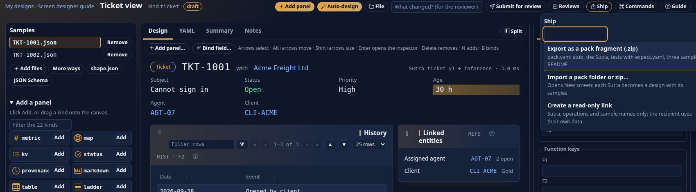

<!--
  Project Drishti · Any data. Any domain. One grammar.

  Copyright (c) 2026 Ashutosh Sinha <ajsinha@gmail.com>.
  All rights reserved.

  PROPRIETARY AND CONFIDENTIAL.

  This file is the confidential and proprietary property of Ashutosh Sinha.
  Unauthorised copying, use, modification, distribution or disclosure of this
  file, via any medium, is strictly prohibited except with the express prior
  written permission of the copyright holder.

  See the LICENSE file in the root of this repository for the full terms.
-->
# Pack lifecycle guide: inheritance, tests, versions, the registry

Around a pack once it is written: inheritance and overlays, testing, versioning, the signed registry, loading while the server runs, pack fragments from the Build workbench and verifying an installed pack. These sections were part of [PACK_DEVELOPER_GUIDE.md](PACK_DEVELOPER_GUIDE.md); they moved here so that guide stays readable, and its old headings point here.

Related: [PACK_MODELLING_GUIDE.md](PACK_MODELLING_GUIDE.md) (the topics of a pack in depth) and [PACK_GENERATORS_GUIDE.md](PACK_GENERATORS_GUIDE.md) (generators, the README standard, JSON Lines).

## A signed pack registry: publishing and installing

Packs can be published to a **registry** and installed from Admin → Packs, with a version history and a rollback.
Every archive is signed; a server installs only what a publisher it trusts signed (ADR-018). `drishti.py pack keygen|publish|verify`
call `tools/packreg/packreg.py`, which you may also run directly.

**1. Make a signing key (once per publisher).** It needs `openssl`.

```bash
drishti-console/.venv/bin/python tools/drishti.py pack keygen --out ~/drishti-keys/acme
```

```text
private key: /home/you/drishti-keys/acme.pem (keep it secret; it signs packs)
public key:  MCowBQYDK2VwAyEAcYvYL5cL9D3XYx6w49WZ4oAnDrhjAfRT95Twju2ug+A=
servers trust it with:  drishti.packs.registry.trusted-keys.<publisher>: <public key>
```

**2. Publish a pack.** The registry is a folder (put it on a web server, or a shared drive):

```bash
drishti-console/.venv/bin/python tools/drishti.py pack publish config/packs/helpdesk --registry /srv/drishti-registry \
    --key ~/drishti-keys/acme.pem --publisher acme
```

```text
published helpdesk 0.1.0 (10424 bytes, sha256 1661eb4570b9…) signed by acme
```

The folder now has `helpdesk-0.1.0.zip` and `index.json`. Publishing the same folder again makes the same archive, byte for byte. Bump
`version:` in `pack.yaml` for each release; old versions stay in the registry.

**3. Trust the publisher on a server**, and point it at the registry:

```yaml
drishti:
  packs:
    registry:
      url: https://packs.bank.example/drishti/     # or a folder: /srv/drishti-registry
      trusted-keys:
        acme: MCowBQYDK2VwAyEAcYvYL5cL9D3XYx6w49WZ4oAnDrhjAfRT95Twju2ug+A=
```

**4. Install.** Admin → Packs shows **From the registry**: every pack version, its publisher (*trusted* or *not
trusted*), and what is installed and loaded here. **Install** (or `drishti.py pack install`) downloads the archive and checks its
SHA-256, its signature, that its files stay inside the pack, and that its `pack.yaml` names the same pack and version. Only then
is it unpacked into `<data>/packs/installed/<name>/` and loaded (it takes effect at once, with no restart). Installing another
version upgrades; the replaced version is kept and **Roll back** puts it back.

Installed packs are looked for before the shipped ones (`drishti.packs.dir`), so an installed `trading` 1.1.0
replaces the shipped `trading`. Check a registry from the command line:

```bash
drishti-console/.venv/bin/python tools/drishti.py pack verify --registry /srv/drishti-registry --publisher acme \
    --public-key MCowBQYDK2VwAyEAcYvYL5cL9D3XYx6w49WZ4oAnDrhjAfRT95Twju2ug+A=
```

```text
ok   helpdesk 0.1.0
```

| Refused because | Message (Admin → Packs) |
|---|---|
| the publisher's key is not in `trusted-keys` | `refused to install 'x': its publisher 'y' is not trusted on this server` |
| the archive changed after it was indexed | `… its SHA-256 is …, the index says …` |
| it was signed with another key | `… its signature does not verify with y's key` |
| a file would land outside the pack (`../`) | `… it has a file outside the pack: …` |
| `pack.yaml` names another pack or version | `… its pack.yaml says …, the index says …` |
| the registry is plain `http:` | `plain http registries are refused` |

## Loading a pack while the server runs

You do not need access to the machine to bring your pack in: an administrator presses **Load** in *Admin → Packs* for
a pack that is on disk but not named in `DRISHTI_PACKS` (or **Install** for one from [the registry](#a-signed-pack-registry-publishing-and-installing),
or deploys its archive); a pack folder copied into the packs folder is loaded by itself. The server runs the start-up check on the loaded
packs plus yours, records the pack in the overlay `<data>/packs/added.yaml`, and puts it to use **without a restart**; if the pack cannot be
used, the last good packs keep running. The steps, the API and the audit entries are in [PACKS.md](PACKS.md#loading-a-pack-while-the-server-runs).

What that means for the author: **the check is the one that refuses a bad pack at start-up** (a kind another pack owns, a
clash with an unrelated pack, a bad manifest), so a pack that loads on your scratch server loads on theirs. Test with
the packs they run: if their site runs `trading` and your pack defines `TRD` or `trade`, you will find out on the scratch server, not
in front of the administrator.

## Inheritance

`extends: [a, b]` means: this pack has everything `a` and `b` have — their kinds (to open), mnemonics, id patterns
and link fields, badges, roles, connectors and routes, Sutras and blocks, labels and formats, About vocabulary, samples, alert
suggestions, workspaces and help — and turning this pack on turns them on too.

When two **related** packs define the same thing differently, **the more specific definition wins**, for every user:

1. a child wins over its parents;
2. among parents, **the rightmost wins**: with `extends: [market-data, trading]`, `trading` beats `market-data`;
3. a pack reached through several parents counts once, below all of them.

This order is C3 linearisation, the rule Python uses to order classes (ADR-015).

### Worked example: the order for `counterparty-risk`

The packs involved, as shipped:

```text
core:               extends []
market-data:        extends [core]
trading:            extends [core, market-data]
counterparty-risk:  extends [trading]
market-risk:        extends [market-data, trading]
```

Work it out from the bottom:

| Pack | Order (most specific first) | Why |
|---|---|---|
| `core` | core | no parents |
| `market-data` | market-data → core | one parent |
| `trading` | trading → market-data → core | rightmost parent (`market-data`) first, then `core`; `core` appears once, after `market-data` (which also extends it) |
| `counterparty-risk` | counterparty-risk → trading → market-data → core | one parent, `trading`, then its order |
| `market-risk` | market-risk → trading → market-data → core | rightmost parent (`trading`) first; `market-data` comes once, after `trading` (which also extends it) |

So if `counterparty-risk`, `trading` and `market-data` all defined a mnemonic `FIX`, the `counterparty-risk`
definition would be used. If only `trading` and `market-data` defined it, `trading`'s would win. On the shipped packs nothing is
overridden: *Admin → Health* lists `overrides: []`.

### Worked example: overriding a parent

Say your bank wants `NSET` to read "Netting set (CSA)" and wants netting sets read from its own PostgreSQL
connector, without editing the shipped pack. Create `config/packs/my-bank/pack.yaml`:

```yaml
pack: my-bank
version: 1.0.0
title: My bank
extends: [counterparty-risk]
mnemonics:
  NSET: { kind: netting-set, label: Netting set (CSA) }      # same name as the parent's: replaces it
connectors:
  bank-credit-db:
    plugin: jdbc
    kinds: [netting-set]
    settings:                                                # table mode; see CONNECTORS.md for the jdbc settings
      url: ${BANK_CREDIT_JDBC_URL}                           # e.g. jdbc:postgresql://db:5432/credit
      user: ${BANK_CREDIT_DB_USER}
      password: ${BANK_CREDIT_DB_PASSWORD}
      table: credit.entities                                 # (kind, id, business_date, doc jsonb)
routes:
  netting-set: bank-credit-db                                # replaces counterparty-risk's route
```

When the pack loads the server writes `config/connectors/bank-credit-db.yaml` from the template (the environment variables are read when
the connector starts; a literal password would be refused). Start the server with `DRISHTI_PACKS=my-bank` (or copy the folder in):
`counterparty-risk`, `trading`, `market-data` and `core` come with it. *Admin → Health* lists every override, one per line, in the
form `<what> <name>: <winner> overrides <loser>`:

```text
mnemonic NSET: my-bank overrides counterparty-risk
route netting-set: my-bank overrides counterparty-risk
```

The same list is in `GET /api/v1/admin/health` under `overrides`. It is empty when nothing is overridden.

### Worked example: a child of two parents (the rightmost wins)

This example is the one `PackLoaderTest.aChildInheritsItsParentsAndTheRightmostParentWins` builds and checks
on every build, so the results below are guaranteed. Four small packs:

```yaml
# config/packs/base/pack.yaml
pack: base
kinds: [curve]
mnemonics: { CRV: { kind: curve, label: Curve } }
roles: { viewer: { kinds: [curve] } }
graph: { badges: { curve: "'base'" } }
```

```yaml
# config/packs/left/pack.yaml
pack: left
extends: [base]
kinds: [trade]
mnemonics: { TRD: { kind: trade, label: Left trade } }
roles: { trader: { kinds: [trade] } }
graph: { badges: { curve: "'left'" } }
```

```yaml
# config/packs/right/pack.yaml
pack: right
extends: [base]
kinds: [quote]
mnemonics: { TRD: { kind: trade, label: Right trade } }
roles: { trader: { kinds: [trade, quote] } }
```

```yaml
# config/packs/child/pack.yaml
pack: child
extends: [left, right]
kinds: [var]
roles: { viewer: { kinds: [curve, trade, var] } }
```

Start the server with `DRISHTI_PACKS=child` (and no shipped pack, since these kinds are theirs). All four load, and the order, most
specific first, is:

```text
child → right → left → base
```

(`right` comes before `left` because it is the rightmost parent; `base` comes once, after both.) Each thing
defined more than once is settled by that order:

| Defined by | Thing | Result | Why |
|---|---|---|---|
| `left` and `right` | mnemonic `TRD` | label *Right trade* | rightmost parent wins |
| `left` and `right` | role `trader` | kinds `[trade, quote]` | rightmost parent wins |
| `base` and `child` | role `viewer` | kinds `[curve, trade, var]` | the child wins over everything |
| `base` and `left` | badge for `curve` | `'left'` | only `left` redefines it, and `left` is more specific than `base` |
| `base` only | mnemonic `CRV` | `curve` | inherited untouched |

The override report (*Admin → Health*, *Overrides*, and `overrides` in `GET /api/v1/admin/health`) lists each
decision, one line per thing, including:

```text
mnemonic TRD: right overrides left
role viewer: child overrides base
```

Now start the server with `DRISHTI_PACKS=left,right` instead, without `child`. `left` and `right` are now
**unrelated**: neither extends the other, and no loaded pack extends both. Their different `TRD` stops the
server:

```text
mnemonic TRD is defined by both pack 'left' and pack 'right', which do not inherit from each other; declare it identically, or make one pack extend the other
```

That is the point of the rule: two packs may disagree only when some pack has said which of them it prefers, by
listing both in its `extends:`.

### What can be redefined

| Thing | A more specific pack may |
|---|---|
| mnemonic, link field, badge, role, connector, route | define the same name again; its definition replaces the parent's |
| Sutra | ship a Sutra with the same `name` and `version` (it replaces the parent's), or another name with a higher `match.priority` |
| block | ship a block with the same name and a higher version, and `use:` it |
| labels (`semantics.yaml`) and formats (`formats.yaml`) | define the same label or format; the more specific pack's wins |
| impact measures and formats | define the same kind; the more specific pack's wins |
| About entries | replace an entry by its key ([About: Inheritance](PACK_MODELLING_GUIDE.md#inheritance-extends)) |

Two rules never bend:

- **A kind belongs to exactly one pack.** A child cannot redefine a parent's kind; it re-lays it out with a Sutra.
- **Unrelated packs may not disagree.** If neither pack inherits from the other, and no loaded pack inherits from
  both, the same name must be defined identically, or the server stops with:
  `mnemonic X is defined by both pack 'a' and pack 'b', which do not inherit from each other; declare it identically, or make one pack extend the other`.
  For example, `counterparty-risk` and `market-risk` both extend `trading` but not each other: they may not define
  the same role differently (`AllShippedPacksTest` loads every pair of shipped packs to prove they do not).

## Testing a pack

Four layers, from the cheapest. The first three need no server.

| Layer | Command | What it proves |
|---|---|---|
| Sutra lint | `sutra lint config/packs/<pack>` (or the whole `config/packs`) | every Sutra and block parses and its keys, expressions and panel options are valid (`DRS-…` codes with the line); help warnings |
| Sutra tests | `sutra test config/packs/<pack>` | each Sutra renders against the samples in `tests/<sutra>/` with no panel in error, the panels `expect.yaml` names are filled, and the help coverage |
| Both, for CI | `drishti.py pack check config/packs/<pack> [--strict] [--junit DIR]` | lint and test in one command, exit `0` / `1` / `2` |
| The pack's tests in the build | `./mvnw verify` | the manifest loads, every `config/packs/*/sutras/` validates, every Sutra survives imperfect data, `sutra test` runs over every pack that has tests, every shipped example loads |
| A scratch server | the [checklist](#verifying-a-pack) | links resolve, connectors are up, commands open, the guide renders |

`sutra lint` and `sutra test` are commands of the server's exec jar (`java -jar drishti-server/target/drishti-server-2.7.0-exec.jar sutra …`);
`pack check` finds the jar itself (`--jar`, `DRISHTI_JAR`). Both read the overlay of the checkout they run in (`<data>/packs/added.yaml`), so
run them where that overlay names only packs that exist (or set `DRISHTI_DATA_DIR` to an empty folder).

### `tests/` and `expect.yaml`

```text
config/packs/<pack>/tests/<sutra>/        one folder per Sutra, named by the Sutra's name (the `sutra:` line)
    TKT-1001.json                  plain entity documents (the kind comes from the Sutra's match.kind); .jsonl files hold one document per line
    expect.yaml                    optional
```

```yaml
noErrors: true            # no panel in an error state on any sample (the default)
nonEmpty: [history]       # these panels must render with data on every sample
help: { coverage: 0.9, about: true }   # optional: the share of shown fields with a glossary entry, and that `about` renders
samples:                  # optional: more expectations for one sample file
  TKT-1002.json: { nonEmpty: [history] }
```

Any other key in `expect.yaml` is a usage error (exit `2`), so a typo cannot silently pass. Without a `tests/<sutra>/`
folder a Sutra is reported `skip (no samples)`, which is not a failure. Choose samples that differ: a ticket with one
history entry and one with many, a closed one, one with a missing field. A shipped pack also keeps `tests/help-coverage.txt`, a ratchet the
help coverage may not fall below. Exit codes: `0` ok, `1` problems, `2` usage. Every command and option (`--junit`, `--out` snapshots, the
shape and design commands) is in [SUTRA_DEVELOPER_GUIDE.md](SUTRA_DEVELOPER_GUIDE.md#15-testing-expectyaml-sutra-linttestpreview-ci).

`pack check` on a shipped pack (`--tail 2` keeps the last two lines of each step):

```text
$ drishti-console/.venv/bin/python tools/drishti.py pack check config/packs/market-risk --tail 2
== market-risk: sutra lint: exit 0
ok      config/packs/market-risk/sutras/market-risk/trade-valuation.v1.sutra.yaml
ok      config/packs/market-risk/sutras/market-risk/var.v1.sutra.yaml
== market-risk: sutra test: exit 0
     var: help coverage 5/5 (100%)
ok   config/packs/market-risk/sutras/market-risk/var.v1.sutra.yaml (2 samples)
```

### In CI

```sh
drishti.py pack check config/packs/helpdesk --strict --junit build/reports          # lint + test, help warnings fail, JUnit XML
java -jar drishti-server-exec.jar sutra preview config/packs/helpdesk --out target/snapshots   # HTML snapshots to attach as build artifacts
```

Publish the JUnit files with your CI's report step. A Sutra whose panels read other entities with `source:` needs
those entities' packs enabled for the run: set `DRISHTI_PACKS=…` in the job, as for the server. In this repository
`SutraCliTest` runs `sutra test` over every shipped pack that has a `tests/` folder, so a Sutra change that breaks a
pack's own tests fails the Maven build. The Build workbench writes the same layout when you export a
[fragment](#pack-fragments-from-the-build-workbench), so an exported fragment passes `sutra test` unchanged.

### The checks that run on every build

| Check | Where | What it proves | Picks up a new pack by itself? |
|---|---|---|---|
| `PackLoaderTest` | `drishti-packs` | the loader: manifests, inheritance order, overrides, refusals (clashes, cycles, missing packs) | — (tests the rules, with packs it writes itself) |
| `AllShippedPacksTest` | `drishti-packs` | the seven default packs and the opt-in public-data packs (us-equities, gleif) load together (no fixed count), any two of them load without a role or mnemonic declared differently, and every retired example pack still loads on top of them | yes: every folder of `config/packs` and `examples/packs` |
| `PackSutrasTest` | `drishti-rachana` | every pack's Sutras parse and validate with zero problems, and every `name@version` is unique | yes: every `config/packs/*/sutras/` |
| `SutraCliTest` | `drishti-server` | `sutra test` over every pack with a `tests/` folder | yes |
| `ImperfectDataTest` | `drishti-server` | every Sutra of every pack survives missing fields, wrong types and flipped shapes: the view still builds, and empty panels say *No data available* | yes |
| `DomainPacksTest` | `drishti-server` | the shipped packs load together, and every example command they advertise opens a full view built by a Sutra, every panel filled, no link missing (news-and-markets: by its Sutra only, its internet connectors being off) | the default pack list (`PackPaths.DEFAULT_ENABLED`) |
| `SutraCoverageTest` | `drishti-server` | every source system × product type (× sub type) of the trading data is laid out by exactly one Sutra | trading only |
| `BankingPacksTest` | `drishti-server` | enabling two risk packs brings the packs they extend, their Sutras and their data-domain connectors | no |
| `ShippedExamplesPacksTest` | `drishti-server` | every BI item shipped in `config/bi` reads only what the seven packs serve (kinds, connectors, `pack.<pack>.<kind>` datasets) | yes |
| `ExamplePreviewTest`, `ConnectorExamplesTest` | `drishti-server` | every documented Sutra example previews without a panel error; every example connector file is valid and holds no secret | yes |
| generator checks | `tools/packgen/*/make*.py --check` | generated files are exactly what the generator writes | yes, for generated packs |
| `LicenseHeaderTest` | `drishti-it` | every file carries the copyright header | yes |

Run the pack-related tests alone while you work:

```bash
export JAVA_HOME=/usr/lib/jvm/java-21-openjdk-amd64
./mvnw -q -pl drishti-packs -am test -Dtest='PackLoaderTest,AllShippedPacksTest' -Dsurefire.failIfNoSpecifiedTests=false
./mvnw -q -pl drishti-rachana -am test -Dtest=PackSutrasTest -Dsurefire.failIfNoSpecifiedTests=false
./mvnw -q -pl drishti-server -am test -Dtest='ImperfectDataTest,DomainPacksTest,SutraCliTest' -Dsurefire.failIfNoSpecifiedTests=false
```

A pack of your own outside this repository gets the same guarantees from `pack check` in its CI and the [checklist](#verifying-a-pack)
on a scratch server; a pack added to this repository's default list (`PackPaths.DEFAULT_ENABLED`) is tested by `DomainPacksTest` and
`AllShippedPacksTest` like the shipped ones.

## Versioning a pack

**The pack's `version`** (`version: 1.2.0`, **X.Y.Z**) is a label: it is shown on About, *Admin → Health* and *Admin → Packs*, and the
registry's index, the deploy check and the install checks use it, but nothing in the pack depends on it. Raise it whenever the pack changes, so an
administrator can tell which copy a server runs and the registry can offer the new one:

```bash
curl -s $B/packs | python3 -c 'import json,sys; [print(p["name"], p["version"]) for p in json.load(sys.stdin)]'
```

**Sutras carry their own versions** (`version: 2` inside the file, and `ticket.v2.sutra.yaml` as the file name by
convention). The highest version of each Sutra name is the one used. Keep the old file while views may still need it to
compare, or delete it; a name and version defined twice is an error (`DRS-2028`). Publishing a pack to the registry
makes the same archive byte for byte for the same folder, so bump `version:` before each `publish`. `drishti.py pack diff OLD NEW` says
what changed between two versions (folders or bundles) and marks removed or renamed kinds and mnemonics as **BREAKING**.

**What a change needs**, by part of the pack:

| You changed | It takes effect |
|---|---|
| a Sutra or block (`sutras/`) | within about a second (hot reload), on every server reading that folder |
| `pack.yaml` (any key), `config/formats.yaml`, `config/semantics.yaml`, `config/about.yaml` | within a few seconds (`drishti.packs.poll`): roles, graph, search columns and pivots, forms, formats, hints, About pages, routes are all swapped in live; a bad edit keeps the last good version. A connector template change does not touch an existing connector file ([reset it](PACK_DEVELOPER_GUIDE.md#connectors-the-pack-names-them-the-site-owns-them)) |
| `samples/` | within a few seconds (the demo source is restarted on its new folders; nothing else is touched) |
| `console:` keys, `guides/`, `config/help.yaml`, `config/workspaces.yaml` | in the console within a minute |
| data behind a connector | at once, or at the connector's next rescan; a Delta date rewritten under a running server is read again by BI too |

Upgrading a pack on a running installation, and removing one, are administrator tasks: see
[PACKS.md](PACKS.md#upgrading-and-removing-a-pack). **Before you rename a kind, a mnemonic, an attribute or a link field**, remember
that saved monitors, workspaces, alert rules and BI items refer to kinds, fields and ids: a rename leaves them pointing at nothing, so
add the new name and keep the old one for a release where you can.

## Pack fragments from the Build workbench

You do not have to write a Sutra by hand. Design it in the Build workbench (from JSON samples, a JSON Schema, or an
existing Sutra: [SCREEN_DESIGNER.md](SCREEN_DESIGNER.md)), and **ship** it as a pack fragment: *Ship → Export as a pack
fragment* downloads a zip you can put in `config/packs/`. The workbench section that describes the export, the import and the
file layout is [SCREEN_DESIGNER.md §24](SCREEN_DESIGNER.md#24-pack-fragments-export-and-import); this is what it means for
a pack author, from an export of the help-desk ticket Sutra (the design id is in the address bar):



```text
ticket-view/pack.yaml
ticket-view/sutras/studio/ticket.v1.sutra.yaml
ticket-view/tests/ticket/TKT-1001.json
ticket-view/tests/ticket/TKT-1002.json
ticket-view/tests/ticket/expect.yaml
ticket-view/samples/ticket.jsonl
ticket-view/samples/catalog.json
ticket-view/README.md
```

A design that has About text (the workbench's About tab) also writes `ticket-view/config/about.yaml` and an `about: config/about.yaml` line in the `pack.yaml`.

The generated `pack.yaml` is a **stub** (the kind, a mnemonic suggestion, an id pattern from the id field of your samples; abridged here:
its comments, the description and `extends: []` are left out), and `expect.yaml` records what `sutra test` found on your samples:

```yaml
pack: ticket-view
version: 0.1.0
code: TICK
title: "Ticket view"
kinds:
- ticket
sutras: sutras
mnemonics:
  TICK:
    kind: ticket
    label: "ticket"
graph:
  id-patterns:
  - pattern: "^TICK-"
    kind: ticket
```

```yaml
noErrors: true
nonEmpty:
- "history"
- "built"
- "refs"
```

From a fragment to a pack, as an author:

1. **Rename it.** The folder name, `pack:` and the title; set the real `version` and `code`.
2. **Fix the stub.** The mnemonic should be the one your users type (`TKT`, not `TICK`), the id pattern should match your real
   ids (`^TKT-`, not `^TICK-`), and the stub knows nothing of links, columns, roles or connectors: add them as in the steps above.
   `kinds:` must be a kind **no other pack owns**.
3. **Keep the tests.** `tests/<sutra>/` already passes `sutra test`; add a sample for each shape your data really has.
4. **Load it** from *Admin → Packs → Load* (the folder under `config/packs/`), or list it in `DRISHTI_PACKS`.

The other way round: *New screen → Or import a pack* takes a zip or a folder (any pack) and turns each `*.sutra.yaml`
into a design, with the pack's `tests/` and `samples/` documents (`samples/<kind>.jsonl` or the older `samples/<kind>/`) as its samples. Use
it to revise a shipped pack's Sutra in the workbench, then bring the new version back as a fragment (or propose it, for the live registry:
the workbench's *Ship → Propose* path puts it through review and approval). Stored-entity samples are references, not data, so they are
not exported; export from synthetic or uploaded samples. The examples of [docs/guides/examples](examples/README.md) each open as a design
in the workbench, which is the quickest way to see a fragment of each panel family.

## Verifying a pack

After any change, one minute on a scratch server tells you the pack is sound.

**In the console**

| Where | Look for |
|---|---|
| *Admin → Packs* (`/admin/packs`) | the pack, its version, **on**; *Needed by* shows what builds on it; its own page shows its kinds, Sutras, Sutra coverage and connectors |
| *Admin → Health* (`/admin/health`) | the pack **OK**, with its kinds, Sutras and connectors; **no Sutra problems**, no connector down or not configured, and the *Overrides* you expect and no others |
| `HELP` (the pack's `code`) typed on the command line | the pack's overview: every kind you may open, its mnemonic, how many entities the sources hold, an example, the key fields |
| *Help → Help centre* | the pack's guide card |

**On the command line**

```bash
B=http://localhost:18996/api/v1
curl -s $B/sutras/problems                                  # {}
curl -s $B/admin/health | python3 -c 'import json,sys; d=json.load(sys.stdin); print(d["overrides"]); print([(p["name"], p["status"], p["version"]) for p in d["packs"] if p["name"]=="helpdesk"])'
curl -s $B/packs/HELP/overview | python3 -c 'import json,sys; d=json.load(sys.stdin); print(d["name"], d["code"], [(k["mnemonic"], k["count"]) for k in d["kinds"]])'
curl -s $B/sources | python3 -c 'import json,sys; [print(s["name"], s["kinds"], s["health"]) for s in json.load(sys.stdin)["sources"] if s["name"] in ("helpdesk-store", "agent-totals")]'
drishti-console/.venv/bin/python tools/drishti.py pack check config/packs/helpdesk --tail 1
```

The output for the finished help-desk pack, with the file connector of step 16 on:

```text
{}
[]
[('helpdesk', 'OK', '0.1.0')]
helpdesk HELP [('TKT', 4), ('AGT', 1), ('CLI', 2), ('LOAD', 1)]
agent-totals ['agent-load'] UP
helpdesk-store ['ticket'] UP
== helpdesk: sutra lint: exit 0
ok      config/packs/helpdesk/sutras/ticket.v1.sutra.yaml
== helpdesk: sutra test: exit 0
ok   config/packs/helpdesk/sutras/ticket.v1.sutra.yaml (2 samples)
```

`[]` is the list of overrides (nothing of another pack was redefined). The four counts are the entities each kind has
for the business date: three sample tickets and the exported one.

**The checklist**

1. `sutras/problems` prints `{}`, and `pack check` passes (`--strict` too, if you keep every shown field explained).
2. *Admin → Health* shows the pack **OK**, with the overrides you expect (and no others), and no connector *down* or *not configured* (`connectorsNotConfigured`); `ls config/connectors` has a file for each connector the pack names.
3. Each `console.examples` command opens, and its *How this view was built* names a Sutra (or says `inference only` where
   you meant it to).
4. `<MN> <GO>` for each mnemonic gives a pick list with sensible columns; the type-ahead offers the mnemonics; `FORM <code>` opens a usable form.
5. The links of one entity of each kind resolve, and F8 on a central entity lists what depends on it.
6. A role without `raw` sees `•••` for the fields the site masks, and the views still make sense.
7. The guide renders in the help centre and its links open; `?` on a view shows your About sentence.
8. The pack's **version** is bumped, and the registry archive (`pack verify --registry`) is current.

### Version rule and the wizard

`version:` in `pack.yaml` is **X.Y.Z** (optionally `-pre-release` and `+build`, such as `2.0.0-rc.1`). `pack bundle`, `pack make --version`, Build → New pack and the server's
deploy check refuse anything else with that sentence. Build → New pack keeps your work: each step is a history entry (the browser's Back moves between steps), a reload
restores the sources and choices from the tab's storage, and leaving with unsaved work asks first. For your own JSON Lines files the default source is the **File
connector** (its generated template tells you to set `root`).
