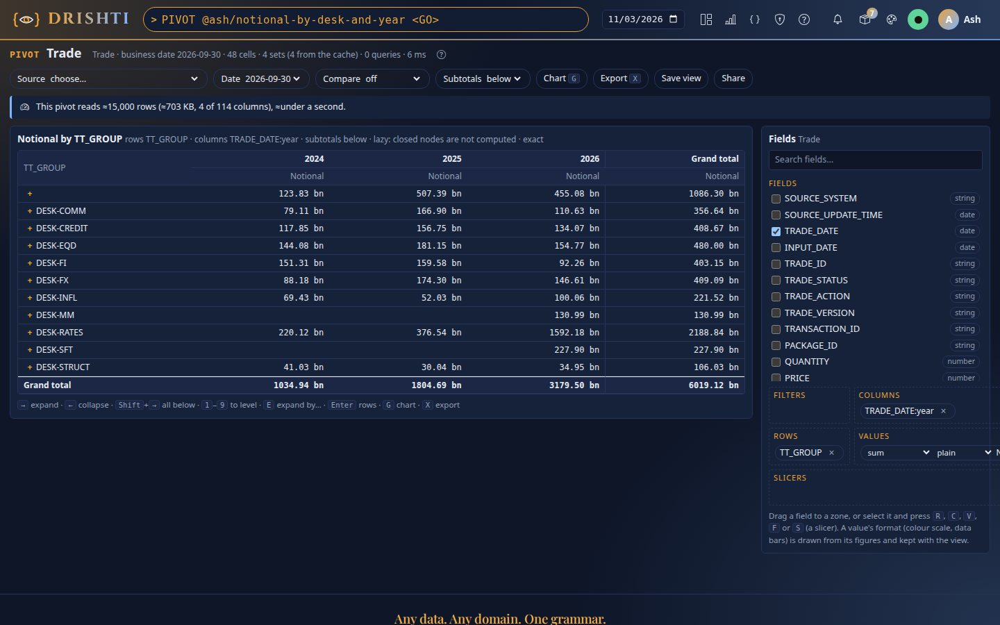
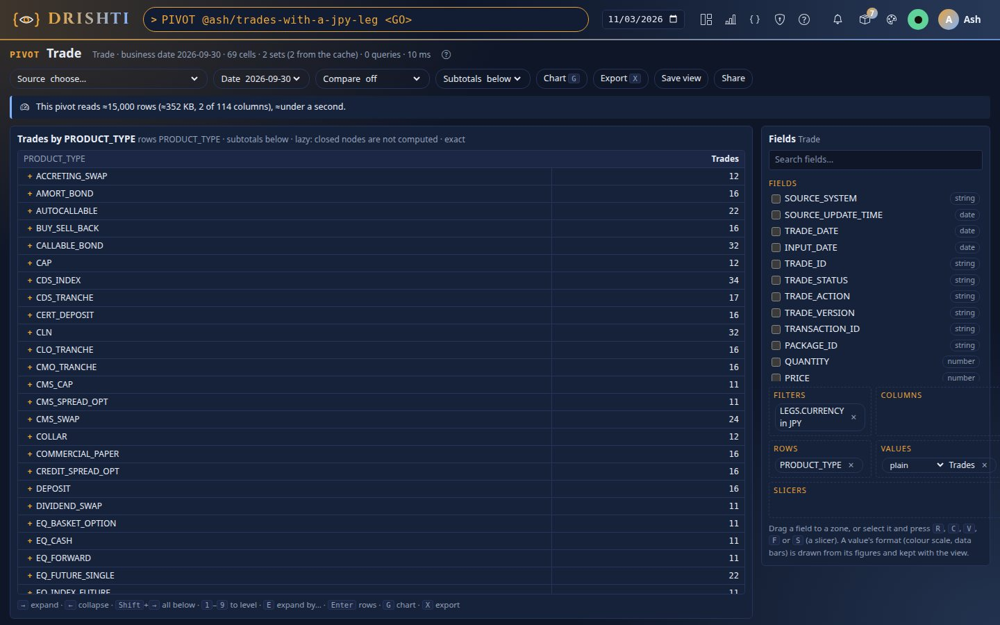
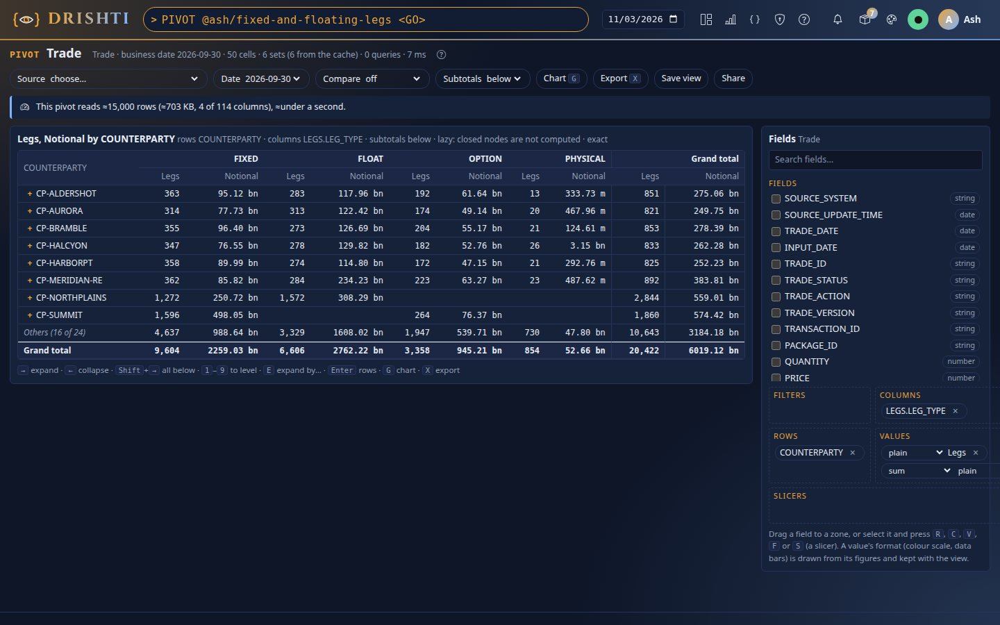
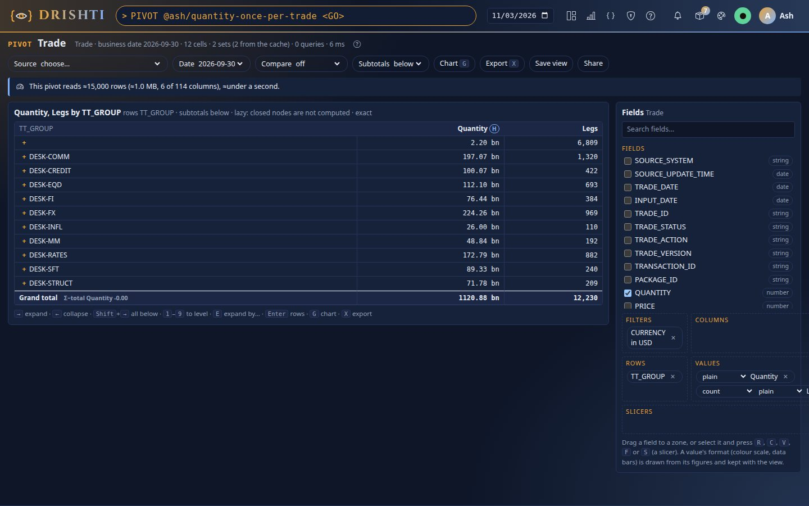
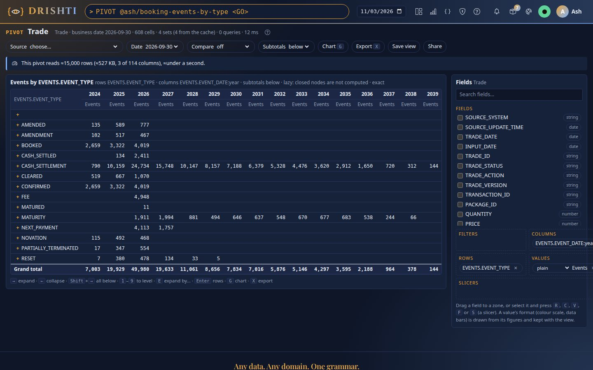
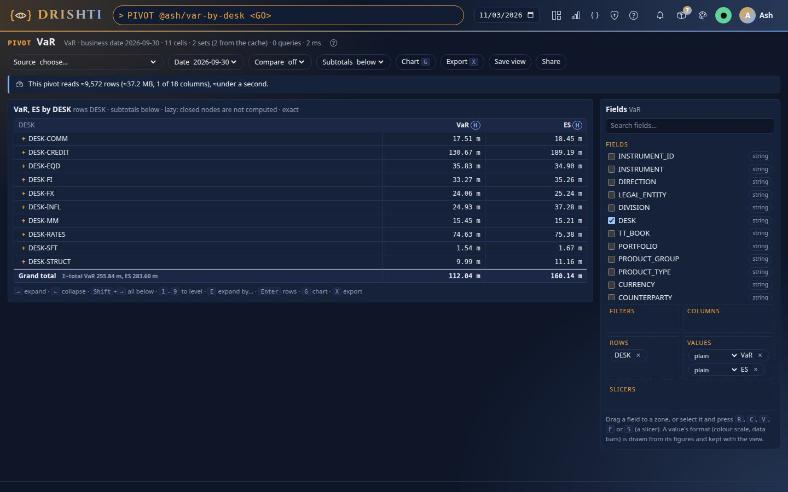

<!--
  Project Drishti · Any data. Any domain. One grammar.

  Copyright (c) 2026 Ashutosh Sinha <ajsinha@gmail.com>.
  All rights reserved.

  PROPRIETARY AND CONFIDENTIAL.

  This file is the confidential and proprietary property of Ashutosh Sinha.
  Unauthorised copying, use, modification, distribution or disclosure of this
  file, via any medium, is strictly prohibited except with the express prior
  written permission of the copyright holder.

  See the LICENSE file in the root of this repository for the full terms.
-->
# Pivot guide

The pivot engine turns any table of any pack, or the VaR engine's trades, into a pivot: these measures, broken down by these fields on
rows and columns, under these filters, on this business date. Every figure is computed by the server; every total is made from its own
members, never from the figures on the screen. The design behind it is [PIVOT_ENGINE.md](../architecture/PIVOT_ENGINE.md); the hands-on
walk-through is [tutorial 33](../tutorials/33-the-pivot-engine.md); custom functions, explain and what-if are walked through in
[tutorial 37](../tutorials/37-custom-functions-and-explain.md).

## Contents

- [1. Open it](#1-open-it)
- [2. The screen](#2-the-screen)
- [3. Sources and fields](#3-sources-and-fields)
- [4. Measures and how each total is made](#4-measures-and-how-each-total-is-made)
- [5. Nested rows, opened lazily](#5-nested-rows-opened-lazily)
- [6. Top N, Others and sorting](#6-top-n-others-and-sorting)
- [7. Provenance, rows and cell references](#7-provenance-rows-and-cell-references)
- [8. The scan estimate, budgets and busy protection](#8-the-scan-estimate-budgets-and-busy-protection)
- [9. Charts of a selection](#9-charts-of-a-selection)
- [10. Export](#10-export)
- [11. Saved and shared views, compare](#11-saved-and-shared-views-compare)
- [12. Who sees what](#12-who-sees-what)
- [13. The view as JSON](#13-the-view-as-json)
- [14. The API](#14-the-api)
- [15. The command line](#15-the-command-line)
- [16. Settings](#16-settings)
- [17. Refusals and their codes](#17-refusals-and-their-codes)
- [18. How it is built](#18-how-it-is-built)
- [19. Custom functions](#19-custom-functions)
- [20. Why did it move: explain the difference](#20-why-did-it-move-explain-the-difference)
- [21. What-if](#21-what-if)
- [22. BI on the pivot engine](#22-bi-on-the-pivot-engine)
- [23. Scale: sketches, rollups, progressive answers and the cluster](#23-scale-sketches-rollups-progressive-answers-and-the-cluster)
- [24. The screen's switches: exact or ≈, progressive, rollups](#24-the-screens-switches-exact-or--progressive-rollups)
- [25. Live pivots](#25-live-pivots)
- [26. Cell comments](#26-cell-comments)
- [27. Pivot data: the sources of the examples](#27-pivot-data-the-sources-of-the-examples)
- [28. Presets: the risk cubes](#28-presets-the-risk-cubes)

## 1. Open it

| From | How |
|---|---|
| The command line | `PIVOT <GO>` (choose a source), `PIVOT trade <GO>` (a table), `PIVOT trade 2026-10-30 <GO>` (a table on a date), `PIVOT var <GO>` (VaR), `PIVOT @asha/desk-risk <GO>` (a saved view) |
| The menu | **Views → Pivot** |
| A table | **Pivot** in Export data's facts of the table (`EXPORT trade <GO>`, then Pivot) |
| A page's table | **Pivot** under a table or ladder whose Sutra says `pivot:` (the source `panel/<kind>/<panel>/<id>`: the panel's own rows, the Sutra's arrangement as the opening view) |
| Search results | **Pivot** above the results of a kind whose pack says `pivot:` (the kind, the pack's arrangement as the opening view) |

The engine is a compute engine with its own file, `config/engines/pivot.yaml` ([COMPUTE_ENGINES.md](../architecture/COMPUTE_ENGINES.md)):
switch it with `drishti.engines.pivot.enabled` (on as shipped; `DRISHTI_PIVOT_ENGINE_ENABLED`), from Admin → Engines or
`drishti.py admin engines`, live. Off, `/api/v1/pivot` answers `404 DRS-1020` in words, and `PIVOT`, Views → Pivot, its Help pages and
`drishti.py pivot` disappear. The old name `drishti.pivot.enabled` still works (it is also the Pivot tab's switch). The MR cube needs it.

## 2. The screen

The screen is mock-up A of the design ([section 25](../architecture/PIVOT_ENGINE.md#25-mock-ups-the-screens-to-build)): Excel's PivotTable
as people know it, with what Excel lacks in the places Excel's equivalents would be.

| Part | What it does |
|---|---|
| Toolbar | Source, Date, Compare (another date, cell by cell), Subtotals (below or above), Chart (`G`), Export (`X`), Save view, Share |
| Scan-estimate bar | what the view reads before it runs ("This pivot reads ≈2,000 rows (≈94 KB, 3 of 8 columns), ≈under a second."); a large one asks first, with **Run** |
| The grid | rows in display order: a member with **+** (closed) or a header with **−** (open), its children indented, then its total (subtotals below; above puts the total on the member's own line); Others; the grand total. Columns × measures; a holistic measure's header carries **H**, an approximate figure **≈** |
| Fields | every field you may use, with its type (string, date, number), and the source's own measures (VaR, ES); search with `/` |
| Slicers | a strip above the grid: each slicer field's members as buttons (read from the engine, as you may see them); a button keeps or drops its member (a filter of the view), **All** clears it. Add one by dragging a field to **Slicers** or pressing `S` on it |
| Conditional formats | on a value's chip: **colour scale** or **data bars**, drawn from the figures shown over the members' cells (never changing a figure), kept with the view |
| Four zones | Filters, Columns, Rows, Values. Drag a field onto a zone, or select it and press `R`, `C`, `V` or `F`; double-click puts a number into Values and a text into Rows. A value's chip has a function picker (sum, count, avg, min, max, median, count_distinct, var_samp, stddev_samp) |
| Provenance popover | click a cell: its figure, exact or ≈, the function and how its totals are made, the members counted, the condition (or VaR scope) that selects them, the data version, the filters, what was computed and what came from the cache, its reference; **Rows** lists the members, **Ask the VaR engine** opens the cell's scope in VAR |
| Chart | a chart of the selected cells (or the top level), linked to the grid: a click on a bar opens that member |
| Export | what (the pivot, the rows of the selected cell, the definition) and how (Excel, CSV, JSON Lines, Arrow) |

Keyboard: arrows move between cells; `→` on a row's first cell opens it, `←` closes it; `Shift+→` opens every level below; `1` to `9`
opens the whole row axis to that level; `E` expands the selected row by another field; `Enter` lists a cell's rows; `G` charts; `X`
exports. The help line under the grid shows them.

## 3. Sources and fields

| Source | What it is | Its fields | Its measures |
|---|---|---|---|
| A table (`trade`, `position`, any stored kind) | Export data's table, read for you through its connector on the date | its columns, typed from the data contract (`string`, `date`, `number`) | the built-in functions over any field |
| `var` | the VaR engine's book of the date | the positions' text columns (DESK, CURRENCY, PRODUCT_GROUP …) | `var()`, `es()`, `pv()`, `trades()` |
| `panel/<kind>/<panel>/<id>` | a table's or ladder's rows on its page: the same document, Sutra and business date | the fields of its Sutra's `pivot:` (masked ones left out) | the built-in functions |
| `table:<domain>.<name>` | a virtual table ([TABLES_GUIDE.md](TABLES_GUIDE.md)) read for you on the date: its source as you may see it, then the table's rules, masks and hidden columns | its columns, typed by the table (`integer` and `decimal` as `number`, `date` and `timestamp` as `date`); a column masked for you is left out | the built-in functions |

A virtual table is read through the layer and staged in the engine's in-memory DuckDB like a panel's rows, at most
`drishti.tables.read-max-rows` rows (more is refused, never cut short); its date picker offers its source's dates. What was staged is
kept while nothing it was read from changed (the table's definition, the date, the source kind's data version, and who reads: user, roles,
attributes, raw): a view opened again then reads nothing. A source that keeps no data version is read on every open.

**Rows held in memory.** Two components pivot rows they already hold, and both ask the engine rather than add up a figure: a Sutra's
`pivot` panel (its document's rows, grouped by `by` and `across` with the panel's `agg`; ChartBinder hands them to the engine's in-memory
provider) and *Chart any table* on the shown rows (the page sends only the chart's fields to `POST /api/v1/pivot/inline`, at most 100,000
rows). The in-memory provider makes every state with the same built-in functions as the tabular provider, so the figures are equal.

A date field groups as `TRADE_DATE:day`, `:week`, `:month`, `:quarter` or `:year`; a number as `NOTIONAL_USD:width=1000000` (buckets of a
width, labelled by their lower edge). A missing value is the member `(blank)`.

How a table is read, chosen per table:

| Route | When | How |
|---|---|---|
| **Direct lake** | the kind's one source is a Delta or Iceberg table on a local disk, a snapshot table (one partition holds the date), without deletion vectors or delete files, and every field you may use is a column it keeps | DuckDB reads the date's Parquet files itself: only the columns a statement uses (column pruning), the filters repeated on the raw columns so row groups and files are skipped by their statistics; masked columns are never named, so never read; no staging cap |
| **Staged** | any other table (a document store, an object store, masks that also change values inside other fields, memory-only data) | read once per date, data version and mask signature through Export data's own read and kept in the engine's in-memory DuckDB (`drishti.pivot.stage-keep` tables); over `drishti.pivot.stage-max-rows` rows refused in words, never cut short |

Memory-only data is never written: the executor has no spill folder unless `drishti.pivot.duckdb.temp-directory` names one. The estimate
of a lake table comes from its metadata (the files' bytes, the manifests' or add-actions' row counts); nothing is read.

### Currencies and units

A field has a **unit**: an `amount` of the data contract is **money** in the currency of the row's currency field (`CURRENCY`, `CCY`,
`*_CCY`); a `rate` or a name ending `_PCT` is never summed (a sum of it is refused, with `avg` or `wavg` offered). A money total over
several currencies is **never added raw**: such a cell shows no figure and says *mixed currencies (EUR to USD)*; a cell in one currency
shows its figure and its currency. To add them, convert in the view:

```json
"currency": {"report": "USD", "rates": {"EUR": 1.08, "GBP": 1.27, "JPY": 0.0066}, "source": "ECB close 2026-10-30"}
```

Every money figure is then in USD (each row converted at its currency's rate before any aggregation; a row in a currency without a rate is
left out), the measures' unit says USD, and the provenance names the rates and their source. Counts stay counts.

### Documents: paths, lists and grains

An entity of the lake is a **document**: a trade keeps its whole source record (JSON) beside a few promoted columns, and that record holds
nested parts. A Calypso, Endur or Murex trade of the demo has `LEGS` (a list: each leg has `LEG_ID`, `LEG_TYPE`, `CURRENCY`, `NOTIONAL`, an
`INDEX` object and a list of `CASH_FLOWS`) and `EVENTS` (a list: each event has `EVENT_TYPE`, `EVENT_DATE`, `AMOUNT`). Every part of it can
be pivoted.

**A field is a Rachana path**, written as a Sutra binds it and as a BI dataset column's `path:` names it:

| Path | Means | One row per |
|---|---|---|
| `$.PRODUCT_TYPE` | a field of the trade | trade |
| `$.LEGS[0].CURRENCY` | the first leg's currency | trade |
| `$.LEGS[?@.LEG_TYPE == 'FLOAT'][0].INDEX.NAME` | the floating leg's index, wherever the leg sits | trade |
| `size($.LEGS)` | how many legs the trade has | trade |
| `$.LEGS[*].NOTIONAL` | every leg's notional | **leg** (the `[*]` makes the grain) |
| `$.LEGS[?@.LEG_TYPE == 'FIXED'][*].NOTIONAL` | the fixed legs' notionals | leg |
| `$.LEGS[*].CASH_FLOWS[*].AMOUNT` | every cash flow of every leg | **cash flow** |
| `$.EVENTS[*].EVENT_TYPE` | every event's type | **event** |

The field list shows them grouped by what they count: the trade's own fields first, then *Each leg (one row per leg)*, *Each cash flow*,
*Each event*, each field under its readable name (*Legs › Notional*, *Legs › Index › Name*). Type a path into the field search box and it is
offered as *Your path*, to drag to a zone like any field. The same paths work in a saved view, on the command line and in the API; the
answer names each field by its id (`LEGS.NOTIONAL`).

**The rules, so a figure is never counted twice:**

1. **One grain per view: the finest list its rows, columns and values use.** Rows *Desk* and values *Sum of Legs › Notional* aggregate one
   row per leg.
2. **A coarser figure in a finer view counts each parent once.** *Sum of Quantity* (a trade field) in a leg view adds each trade's quantity
   once in each cell, never once per leg: a trade with three legs adds its quantity once.
3. **Two separate lists are never crossed.** Legs and events of the same trade are independent lists; a view that would put a leg field and
   an event field on the same rows is refused with the reason (three legs and four events would make twelve rows). Look at them side by side
   as two views.
4. **A filter on a list keeps the parents with any element matching.** *Legs › Currency = JPY* on a trade view keeps the trades with a JPY
   leg; on a leg view it keeps the JPY legs. Add `~all` to the filter's field (`$.LEGS[*].CURRENCY~all`) to keep the trades whose legs
   **all** match.
5. **Masks apply per path:** a field hidden for you is not offered at any depth, and the record you read is the one your masks leave.

**How a path is read**, chosen per view, fastest first (the cell's provenance names the route):

| Route | When | What is read |
|---|---|---|
| **Promoted column** | the path names a field the connector promotes (`layout.<kind>.columns`) | that typed column |
| **BI dataset** | every list field the view uses is a column of a published BI dataset table over that list (`source: {kind: trade, each: LEGS}`), and nothing is masked for you | that table's cached layer (Parquet, one row per element) |
| **Ad hoc** | anything else | each document of the date, by DuckDB's JSON functions; the scan estimate says the cost first, and a kind past `drishti.pivot.stage-max-rows` documents is refused with the cheaper route named |

An administrator sees, under the field list, the paths people typed most on that source, with **Promote** (the connector's page: add the
field to its `layout.<kind>.columns`) and **Add to dataset** (the BI dataset editor: a `path:` column). Both make the path a column read.
`GET /api/v1/pivot/paths?source=trade` lists them.

#### Worked examples on the demo lake

Each view below was run on the demo lake (`drishti.py lake demo`, the trades of the three source systems, business date 2026-09-30); the
figures are the ones the run returned. Each is saved as a view, so it opens with `PIVOT @<you>/<name> <GO>`.

**1. Notional by desk and year: one row per leg.** Rows `$.TT_GROUP` (the desk), columns `$.TRADE_DATE` by year, values the sum of
`$.LEGS[*].NOTIONAL`. The view reads 20,422 legs of 15,000 trades; the grand total is **6019.12 bn**, DESK-RATES the largest desk at
**2188.84 bn** (2024: 220.12 bn, 2025: 376.54 bn, 2026: 1592.18 bn). The first row has no desk: the trades whose source sets no `TT_GROUP`
(1086.30 bn).



```
drishti.py pivot run --source trade --rows '$.TT_GROUP' --cols '$.TRADE_DATE:year' --values 'sum($.LEGS[*].NOTIONAL)'
```

```yaml
source: trade
rows: [$.TT_GROUP]
columns: [$.TRADE_DATE:year]
values:
  - {measure: sum($.LEGS[*].NOTIONAL), as: Notional}
```

**2. How many trades have a JPY leg, by product: one row per trade, a filter on a list.** Rows `$.PRODUCT_TYPE`, value `count()`, filter
`$.LEGS[*].CURRENCY` in JPY. **1,383** of the 15,000 trades have at least one JPY leg, across 69 product types; the most are FX_ACCUMULATOR (68),
FIRST_TO_DEFAULT (64), INFL_ASSET_SWAP (55) and FX_BARRIER (51).



```
drishti.py pivot run --source trade --rows '$.PRODUCT_TYPE' --values 'count()' --filter '$.LEGS[*].CURRENCY=JPY'
```

```yaml
source: trade
rows: [$.PRODUCT_TYPE]
filters: {$.LEGS[*].CURRENCY: {in: [JPY]}}
values:
  - {measure: count(), as: Trades}
```

**3. Fixed against floating legs per counterparty: a list field on the columns.** Rows `$.COUNTERPARTY` (the top 8, the other 16 in
*Others*), columns `$.LEGS[*].LEG_TYPE`, values the count of legs and the sum of their notional. Of 20,422 legs, 9,604 are FIXED
(2259.03 bn), 6,606 FLOAT (2762.22 bn), 3,358 OPTION (945.21 bn) and 854 PHYSICAL (52.66 bn); CP-NORTHPLAINS has the most legs (2,844).



```
drishti.py pivot run --source trade --rows '$.COUNTERPARTY' --cols '$.LEGS[*].LEG_TYPE' --top '$.COUNTERPARTY=8' \
  --values 'count()' --values 'sum($.LEGS[*].NOTIONAL)'
```

```yaml
source: trade
rows: [$.COUNTERPARTY]
columns: [$.LEGS[*].LEG_TYPE]
top: {$.COUNTERPARTY: {n: 8}}
values:
  - {measure: count(), as: Legs}
  - {measure: sum($.LEGS[*].NOTIONAL), as: Notional}
```

**4. Quantity per desk without double counting: a trade figure in a leg view.** Rows `$.TT_GROUP`, filter `$.CURRENCY` in USD (a quantity
is an amount in its trade's currency; one currency adds up), values the sum of `$.QUANTITY` and the count of `$.LEGS[*].LEG_ID`. The legs
make the grain (12,230 USD legs), and each trade's quantity is added once: the total, **1,120,878,590,423.65**, is exactly the sum over the
8,562 USD trades at the trade grain. DESK-COMM: 197,072,225,509.30 over 1,320 legs of 990 trades; DESK-RATES: 172,787,316,965.74 over 882
legs of 541 trades.



```
drishti.py pivot run --source trade --rows '$.TT_GROUP' --filter '$.CURRENCY=USD' --values 'sum($.QUANTITY)' --values 'count($.LEGS[*].LEG_ID)'
```

```yaml
source: trade
rows: [$.TT_GROUP]
filters: {$.CURRENCY: {in: [USD]}}
values:
  - {measure: sum($.QUANTITY), as: Quantity}
  - {measure: count($.LEGS[*].LEG_ID), as: Legs}
```

**5. Booking events by type and year: one row per event.** Rows `$.EVENTS[*].EVENT_TYPE`, columns `$.EVENTS[*].EVENT_DATE` by year, value
`count()`: **157,087** events. BOOKED and CONFIRMED have 10,000 each (2024: 2,659, 2025: 3,322, 2026: 4,019); the cash settlements run to
2059; 1,887 events have no type and no date (*(blank)*).



```
drishti.py pivot run --source trade --rows '$.EVENTS[*].EVENT_TYPE' --cols '$.EVENTS[*].EVENT_DATE:year' --values 'count()'
```

```yaml
source: trade
rows: [$.EVENTS[*].EVENT_TYPE]
columns: [$.EVENTS[*].EVENT_DATE:year]
values:
  - {measure: count(), as: Events}
```

**6. VaR beside the notional: two sources, each exact.** VaR is not a sum of trades, so it comes from the VaR source, not from the trade
documents: rows `DESK`, values `var()` and `es()`. The bank's VaR is **112,041,645.93** (ES 160,143,809.24); DESK-CREDIT
130,670,864.00 and DESK-RATES 74,633,680.00 add up, with the others, to more than the bank: the diversification. Put it beside example 1 to
read a desk's VaR against its legs' notional.



```
drishti.py pivot run --source var --rows DESK --values 'var()' --values 'es()'
```

```yaml
source: var
rows: [DESK]
values:
  - {measure: var(), as: VaR}
  - {measure: es(), as: ES}
```

Two views that would cross lists are refused rather than answered: rows `$.LEGS[*].CURRENCY` and columns `$.EVENTS[*].EVENT_TYPE` answers
*Legs and Events are separate lists of each trade: a view that crossed them would count every pair … Pick one, or compare them side by side
as two views.*

## 4. Measures and how each total is made

**A cell or a total is made from its members, never from other cells' figures.** What differs by kind is how:

| Function | Kind | A total is | In Excel |
|---|---|---|---|
| `sum(x)` | mergeable | the sum of its own rows (compensated) | `SUM` of its parts |
| `count()`, `count(x)` | mergeable | the rows (or values) of its own rows | `SUM` of its parts |
| `avg(x)` | mergeable | Σx / n of its own rows, never an average of averages | value |
| `min(x)`, `max(x)` | mergeable | the extreme of its own rows | value |
| `wavg(x, w)` | mergeable | Σwx / Σw of its own rows | value |
| `var_samp(x)`, `var_pop(x)`, `stddev_samp(x)`, `stddev_pop(x)` | mergeable | Welford's state of its own rows | value |
| `median(x)`, `percentile(x, q)` | holistic, exact; ≈ by its sketch (KLL, ±1.65% of rank) when asked or large | exact: the quantile of its own values (linear interpolation, as DuckDB's `quantile_cont`); ≈: the merge of its cells' KLL summaries | value |
| `distinct(x)` (also written `count_distinct(x)`) | holistic, exact; ≈ by its sketch (HyperLogLog, ±1.6%) when asked or large | exact: the distinct values of its own rows; ≈: the merge of its cells' registers | value |
| `var()`, `es()` (source `var`) | holistic | the VaR engine's answer for the cell's own scope, from its trades' summed scenario vector | value |
| `pv()`, `trades()` (source `var`) | holistic (adds up) | the engine's answer for the cell's scope | value |

So the desks' VaRs add up to more than the bank's: the grand total is the bank's own VaR, and the gap (Σ children − total) is shown beside
every open node's total as **Σ−total**, the diversification. A function has one name ([FUNCTION_CATALOGUE.md](../architecture/FUNCTION_CATALOGUE.md));
its sketch is how it is computed when ≈ is accepted, with a stated error, never a second name, and never for VaR
([section 23](#23-scale-sketches-rollups-progressive-answers-and-the-cluster)); custom functions are in [section 19](#19-custom-functions).

Show values as: a value may carry `showAs` (`pct-grand`, `pct-row`, `pct-column`, `pct-parent-row`, `rank`, `ntile:<n>`,
`diff:<n>:<dimension>`, `pct-change:<n>:<dimension>`); it is computed from the finished figures, so a total is never broken. The same
is written as a function around the aggregate, which is how the catalogue names it: `pct_of_total(sum(NOTIONAL))`,
`pct_of_row(...)`, `pct_of_column(...)`, `pct_of_parent(...)` (the level above on the rows), `ntile(sum(NOTIONAL), 4)` (the bucket
among the siblings), `diff(sum(PNL), 1, TRADE_DATE:month)` and `pct_change(sum(PNL), 1, TRADE_DATE:month)` (along a dimension on the
rows or the columns). The column header is the text as written; the raw figure stays in the answer beside the shown one. The statistics
(`skewness`, `kurtosis`, `corr`, `slope`, `iqr`, `trimmean`, `mode`, `string_agg` …) are ordinary values:
[FUNCTIONS.md](FUNCTIONS.md).

## 5. Nested rows, opened lazily

Rows are levels. Only level one is computed at first; opening a member computes **its children only**: one statement for that node's
children and their columns, every other cell read from the partial-state cache. A ten-level hierarchy over a big table opens as fast as one
level. The answer says what it did: "18 cells · 6 sets (4 from the cache) · 1 queries".

- **+** opens a member by the next row field; a member on the last row level is a leaf and has no **+**.
- **Expand by…** (`E`): open any member by a field other than the next row field, per member: EMEA by desk, APAC by currency, in one grid,
  a leaf included. The totals stay right: each node is its own cell key.
- **Open to level N** (`1`–`9`): every member down to level N.
- The open nodes are part of the view (its `expanded` list), so a saved view and a link reopen them.

## 6. Top N, Others and sorting

A level may show its top N members by a measure and one **Others** member: "Others (3 of 5)". Others' figures are computed from **its own
members** (the rows of the members not shown), for every measure: a median of Others is the median of those rows, never total minus the
top N. Others is not opened further (its rows can be exported).

**Top N when you ask ≈.** With the screen's **≈** switch on (or `"exact": false`), a level whose top N is ranked by a count of rows
(`count()`, or `count(x)` of the level's own field) and whose field is plain text is chosen **before** the level is read: one Space-Saving
summary of the field (10·n counters) is made for the parent's cell, the members it ranks first are the level, and only their cells are
read. The figures shown are exact, each from its own rows; only the choice of members is ≈, within a stated bound: every count the summary
keeps is over by at most its floor, and a member holding more than 1/(10·n) of the rows is always listed. Others then reads "Others (≈: the
rest after a top N chosen by a summary)" and its figures are still its own members' exactly. A top N ranked by anything else (a sum, an
average, a VaR), a grouped date or number bins, and every view not asking ≈ rank every member exactly; the answer's notes say which.
Use it for a level with very many members (counterparties, instruments) where reading every member's cell would be the cost.

Each level sorts on its own: by label in the field's type order (numbers by value, dates by time, text alphabetically, `(blank)` last),
or by a measure, ascending or descending. A sort never moves a child out of its parent.

## 7. Provenance, rows and cell references

Every answer has a provenance id (`pv:<date>:<hash>`); every cell's provenance (members, condition or scope, the measures' kinds, the data
version, filters, statements run, cache hits, time) is kept for the last `drishti.pivot.provenance-kept` answers.

**Rows** lists a cell's member rows, paged, as you may see them (the VaR source's rows are its trades: open the cell's scope in VAR).

A **cell reference** names a cell of a saved view by its coordinates, not its position: `pivot://asha/desk-risk@4/Notional[DESK=RATES-NY,
CCY=USD]`. It survives re-sorting, new columns and a new date; a coordinate that is gone says "not in the view", never 0. Copy it from the
popover; resolve it with `GET /api/v1/pivot/cells?ref=...`. In a Sutra, Rachana reads the same cell: `cell('asha/desk-risk', 'DESK',
'RATES-NY', 'CCY', 'USD')`, and a compute engine's measure for one scope: `measure('VAR', 'DESK:RATES-NY')`, both answered by this
engine for the person viewing ([RACHANA_REFERENCE.md](RACHANA_REFERENCE.md#functions)).

## 8. The scan estimate, budgets and busy protection

Before a view runs, the screen shows what it will read. Over `drishti.pivot.estimate.confirm-above-seconds` (60) or `confirm-above-rows`
(500 million), it asks first. A table not yet read for you has an unknown size until its first pivot.

- **Cell budget**: a view of more visible cells than `drishti.pivot.max-cells` (20,000, totals included; `max-holistic-cells`, 5,000,
  with a holistic measure) is refused with the count and how to narrow it (`422 DRS-5702`), never cut short.
- **Busy protection**: a view of more than `drishti.pivot.busy-cells` cells asks the admission gate before it opens deeper levels; a
  refusal is `503 DRS-9507` with `Retry-After`.

## 9. Charts of a selection

Select cells (click, Shift+click or Shift+arrows) and press `G`. With nothing selected the chart shows the top level. A measure that adds up
(sum, count) is drawn as bars that sum to the total. **A measure that does not add up is never stacked**: VaR by desk is drawn as the desks'
bars beside the bank's, with the diversification as its own bar, and the chart says so in words. The diversification is the engine's
own gap of the charted column (each open row's `diversificationByColumn` in the answer, Σ parts − total; drawn as total − Σ parts): the
browser adds up nothing. A bar's click opens that member in the
grid. ECharts is vendored; nothing comes from a CDN.

## 10. Export

**Export** (`X`) asks what and how:

| What | Contents |
|---|---|
| The pivot as shown | Excel: one sheet with the rows as shown, numbers as numbers, Excel's own row **outline levels** (grouping with + and −, summaries below or above as on screen); a **`SUM` formula only where a measure's total is the plain sum of its parts** (sum, count), every other figure the engine's value; a **Provenance** sheet (who, when, the provenance id, the data, the filters, every measure's function, kind, exactness and how its totals are made). CSV: one row per cell and measure (`ROW, COLUMN, <dimensions>, MEASURE, VALUE, EXACT, MEMBERS, KIND`) or the grid as shown. Arrow: the cells as a columnar stream |
| The underlying rows | the selected cell's member rows as CSV, as you may see them (up to `drishti.pivot.export.rows-max`) |
| The definition | the view as YAML, no figures |

**JSON Lines** (the data standard) writes one object a cell and measure (`row`, `column`, `coords` by dimension, `measure`, `value` as a number, `exact`, `members`, `kind`), and the rows of a cell one object a row. An xlsx of more rows than `drishti.pivot.export.xlsx-max-rows` is refused with CSV or Arrow offered. Every export is audited (who, the view,
what, the format, the size), never its values.

## 11. Saved and shared views, compare

**Save view** keeps the definition (never the numbers) under your name, each save a new version; **Share** adds people or roles
(`role:risk`). A reader opens a shared view with their own entitlements and masks. `PIVOT @owner/name <GO>` opens one.

On a page's table, an author may **promote** the view to the Sutra (`POST /api/v1/pivot/promote` `{"sutra", "view", "note", "preview"}`):
the Sutra's next version with the panel's `pivot:` arrangement, through review when review is on; a view the arrangement cannot say (a
grouped date, a median, a filter that leaves values out) is refused in words and stays a saved view
([RACHANA_REFERENCE.md](RACHANA_REFERENCE.md#pivot-pivot-on-a-table-or-ladder)).

**Compare** picks another date: each cell shows its change (▲/▼) and new or gone cells are marked; the API answers both sides and the
differences.

**Versions.** Every save of a view is kept: `GET /api/v1/pivot/views/{owner}/{name}/versions` lists them, `/diff?from=1&to=2` says what
changed in the definition (rows, columns, values, filters, open nodes, sorts, top N, date) and `POST /api/v1/pivot/views/{name}/restore`
with `{"version": 1}` saves an old one again as the next version (the versions between stay). A view keeps its definition, never numbers.
Comments on its cells are kept beside its versions ([section 26](#26-cell-comments)).

## 12. Who sees what

- A table is read through Export data's own read for you: a table you may not open is not offered; a **masked column is not read at
  all**, so it cannot be a dimension, a measure's input or a filter (`403 DRS-5705`).
- The VaR source applies the VaR engine's own entitlements: trades you may not see are left out of every cell; a role that sees the bank only
  in aggregate is offered no dimension unless the MR cube runs, which offers it the hierarchy levels ([MR_CUBE_GUIDE.md](MR_CUBE_GUIDE.md)).
- `drishti.pivot.aggregate-only.min-members-per-cell` (1 as shipped) hides the figures of a cell with fewer members.
- Every view run, rows read and export is audited without values.

## 13. The view as JSON

```json
{ "source": "trade", "date": "2026-10-30",
  "rows": ["LEGAL_ENTITY", "DESK"], "columns": ["TRADE_DATE:month"],
  "values": [{"measure": "sum(NOTIONAL_USD)", "as": "Notional"}, {"measure": "median(PNL_1D)", "as": "Median P&L"}],
  "filters": {"PRODUCT_GROUP": {"in": ["RATES", "FX"]}, "TRADE_STATUS": {"notIn": ["MATURED"]}},
  "expanded": [{"axis": "rows", "path": [["LEGAL_ENTITY", "LE-UK"]], "by": "CURRENCY"}],
  "expandTo": {"rows": 1}, "sort": {"DESK": {"by": "Notional", "desc": true}},
  "top": {"DESK": {"n": 10, "by": "Notional"}}, "subtotals": "below" }
```

The answer has `rows` and `columns` in display order (each with `key`, `kind` node, header, total, others or grand, `depth`, `label`,
`path`, `expandable`, `expanded`, `by`, and `diversification` on a holistic total), `cells` keyed `rowKey|colKey` (each with `values`,
`members`, `coords`, `notes` where a figure is missing, `scope` on the VaR source), `measures` (id, label, kind, plainSum, exact),
`computed` (sets, fromCache, queries, ms), `provenance` and `provenanceShared`.

## 14. The API

| Call | Does |
|---|---|
| `GET /api/v1/pivot/sources` | the sources you may pivot |
| `GET /api/v1/pivot/catalogue?source=&date=` | a source's fields, measures, functions, dates, masked count |
| `POST /api/v1/pivot/query` | a view (or `{"view": "owner/name"}`) → its answer |
| `POST /api/v1/pivot/estimate` | the scan estimate; nothing read |
| `POST /api/v1/pivot/expand` | `{view, axis, path, by}`: the view with that node open; only its children computed |
| `POST /api/v1/pivot/compare` | `{view, otherDate}`: both answers and the differences per cell |
| `POST /api/v1/pivot/rows` | `{view, coords, offset, limit}`: a cell's member rows |
| `POST /api/v1/pivot/inline` | `{fields: [{name, type}], rows: [[…]], view}`: rows the caller already holds (at most 100,000; field names of letters, digits and `_`; type `string`, `number` or `date`), aggregated by the engine; the view's `source` is ignored |
| `GET /api/v1/pivot/cells?ref=` | a cell by reference |
| `GET /api/v1/pivot/provenance/{id}?cell=rowKey|colKey` | an answer's or a cell's provenance |
| `GET, POST /api/v1/pivot/views`, `GET /views/{owner}/{name}`, `DELETE /views/{name}` | saved views |
| `POST /api/v1/pivot/promote` | a page table's view as its Sutra's `pivot:` arrangement (an author; `preview: true` shows the next version) |
| `POST /api/v1/pivot/export` | `{view, what: pivot|rows|definition, format: xlsx|csv|jsonl|arrow, shape: cells|grid, delimiter, bom, coords}`, streamed |
| `GET /api/v1/pivot/functions`, `GET /functions/{owner}/{name}?version=` | custom functions you may use (section 19) |
| `POST /api/v1/pivot/functions/test` | a definition and sample rows: the harness and the playground; nothing saved |
| `POST /api/v1/pivot/functions` | save a new version after its harness passes |
| `POST /api/v1/pivot/functions/{owner}/{name}@{v}/submit`, `/approve`, `/revoke` | sharing: approval by someone who is not the author, withdrawal |
| `POST /api/v1/explain` `{kind: pivot, measure: cell, view, from, to, fromDate, toDate, by, order, price, quantity}` | the one Explain of a cell: the difference in steps that add up (section 20); `POST /api/v1/pivot/explain` is its deprecated alias for one release |
| `POST /api/v1/pivot/whatif` | `{view, whatIf: {exclude, changes, add}}`: the view with the overlay beside the original (section 21) |
| `GET /api/v1/pivot/views/{owner}/{name}/versions`, `/versions/{n}`, `/diff?from=&to=`; `POST /views/{name}/restore` `{version}` | a saved view's versions (every save kept), one version, what changed between two, an old one restored as the next version |
| `POST /api/v1/pivot/query` with `"exact": true` or `false` | exact on request, or ≈ by the sketches at any size ([section 23.1](#231-sketches-with-a-stated-error-and-exact-on-request)) |
| `POST /api/v1/pivot/query?progressive=true` | server-sent events: `approximate` (from a sample, with intervals) then `exact` |
| `GET, POST /api/v1/pivot/rollups`, `DELETE /rollups/{id}`, `POST /rollups/{id}/refresh` | rollups: list with advice; define, remove, refresh (administrators) |
| `POST /api/v1/pivot/query` with `"rollups": false`, `"progressive": false` | the screen's switches as options: no rollup answers, no ≈ first answer; every answer's `computedAs` says what was asked and what answered ([section 24](#24-the-screens-switches-exact-or--progressive-rollups)) |
| `POST /api/v1/pivot/live`, `GET /live`, `GET /live/{id}/events`, `DELETE /live/{id}` | a live pivot: started (its first answer, id and node), listed, streamed (`answer`, `patch`, `reshape`, `status`), ended ([section 25](#25-live-pivots)) |
| `GET, POST /api/v1/pivot/views/{owner}/{name}/comments`, `POST /comments/{id}/resolve`, `/reopen`, `DELETE /comments/{id}` | a saved view's cell comments ([section 26](#26-cell-comments)) |

Details and the error codes: [API_GUIDE.md, Pivot engine](API_GUIDE.md#pivot-engine-apiv1pivot).

## 15. The command line

```
drishti.py pivot sources
drishti.py pivot fields trade
drishti.py pivot run --source trade --rows productType,counterparty --values "count()" --values "sum(notional)" --open productType=IRS
drishti.py pivot run --source var --rows DESK --cols CURRENCY --values "var()" --values "es()"
drishti.py pivot run --source trade --rows DESK --top DESK=5 --csv out.csv
drishti.py pivot estimate --view asha/desk-risk
drishti.py pivot export --view asha/desk-risk --format xlsx -o desk-risk.xlsx
drishti.py pivot save desk-risk --source var --rows DESK --values "var()" --share role:risk
drishti.py pivot views
drishti.py pivot functions test wret.yaml --sample rows.csv --group DESK
drishti.py pivot functions save wret.yaml --sample rows.csv
drishti.py approvals approve function asha:wret@1 --comment "reviewed" --param scope=group:rates
drishti.py pivot explain --view asha/desk-risk --cell DESK=EMEA --from 2026-09-30 --to 2026-10-30 --by BOOK
drishti.py pivot whatif --view asha/desk-risk --scale PRICE=1.1@DESK=RATES --exclude BOOK=B-17
```

More in [TOOLS.md](TOOLS.md#516-pivot).

## 16. Settings

All under `drishti.pivot` in `config/engines/pivot.yaml` (the switch `drishti.engines.pivot.enabled` there too), listed in [CONFIGURATION.md](../admin/CONFIGURATION.md): `enabled`, `max-cells`,
`max-holistic-cells`, `busy-cells`, `cache-mb` (the partial-state cache `pivot.states`, in the one memory budget), `provenance-kept`,
`local-shards`, `stage-max-rows`, `stage-keep`, `duckdb.connections`, `duckdb.threads`, `duckdb.memory-limit-mb`, `duckdb.temp-directory`,
`estimate.confirm-above-seconds`, `estimate.confirm-above-rows`, `aggregate-only.min-members-per-cell`, `export.xlsx-max-rows`,
`export.rows-max`; custom functions under `functions` (`formula`, `sql-macros`, `require-approval`, `approver-role`,
`holistic-max-rows`, `holistic-max-mb`, `harness.tolerance`, `harness.seeds`, `harness.max-ns-per-row`, `python.enabled`,
`python.interpreter`, `python.workers`, `python.timeout-seconds`, `python.memory-mb`, `python.batch-rows`, `java.enabled`, `java.dir`);
the scale keys of [section 23.6](#236-settings); and `drishti.admission.retry-after.pivot-view`.

## 17. Refusals and their codes

| Code | Status | When |
|---|---|---|
| DRS-5701 | 400 | a view it cannot answer: an unknown field or function, a field twice, a bad grouping, sort or show-as |
| DRS-5702 | 422 | over the cell budget (with the count), a table over `stage-max-rows`, an xlsx over `xlsx-max-rows` |
| DRS-1020 | 404 | the engine is switched off here (DRS-5703 when an edition has no PIVOT) |
| DRS-5704 | 404 | a saved view, provenance id or source that is not there (or not shared with you) |
| DRS-5705 | 403 | a masked field asked as a dimension, input or filter |
| DRS-5720 | 504 | a view computed across the cluster where a node's share had no answer by the deadline (no other node could answer it) |
| DRS-9507 | 503 | busy protection: a large view did not start; `Retry-After` |
| DRS-5710 | 400 | a custom function refused as written (its code, inputs, kind or name) |
| DRS-5711 | 422 | a custom function whose harness did not pass: not saved, with the first failure |
| DRS-5712 | 403 | approval: the author approving, someone who is not an approver, a function not approved for you, a plug-in jar changed since approval |
| DRS-5713 | 404 | a custom function's language is off here (Python and Java plug-ins as shipped) |
| DRS-5714 | 422 | a custom function past a limit: a state over its bound, a call over its time, every worker busy |
| DRS-5715 | 403 | a custom function in an official run, or an official measure's name |
| DRS-5716 | 400 | an explanation or a what-if it cannot make as asked |
| DRS-5721 | 422 | a live pivot refused or ended: live pivots off, your or the server's live views at their most, over the live cell budget, an exact live view over `drishti.pivot.live.max-rows`, a view pinned to a past version |
| DRS-5722 | 400 | a cell comment refused: empty or over 2,000 characters, a cell or measure not of the view, an Others cell, not the author's or the owner's to change |

## 18. How it is built

The engine is the Maven module `drishti-bicompute` (plain Java, no Spring): the pivot model (views, cell keys, nested axes), the provider
SPI (`PivotProvider`: catalogue, estimate, evaluate a plan of declarative cell sets into partial states, drill), the function SPI
(`AggFunction`: start, add a columnar batch, merge, finish; mergeable, sketch or holistic; each with its SQL state form), the built-ins,
the `GROUP BY GROUPING SETS` compiler and the DuckDB tabular provider, the in-memory provider (`RowsProvider`: rows held in memory, the
same states by the functions' own `add`), partial states merged in a fixed order (`OrderedMerge`), the
partial-state cache, the split-and-merge harness and the exports. The server wires it: Export data's tables as sources, the VaR provider,
REST, busy protection, saved views and audit. The console only draws: `drishti_pivot-engine.js` asks the engine and lays its answer out,
`drishti_pivot-grid.js` is the one grid (the Pivot screen and the nested `pivot` panel), and nothing in the browser adds up a figure.

The engine is also Rachana's only source of aggregates ([ONE_GRAMMAR.md](../architecture/ONE_GRAMMAR.md)): it registers every built-in
into Rachana's function table (`sum`, `count`, `avg`, `min`, `max`, `median`, `percentile`, `distinct`, `wavg`, `variance`, `stddev`,
the `_once` forms), the grouping behind `group(...)`, and `measure(...)` and `cell(...)`, so a sum in a Sutra and a sum in a pivot cell
are the same `AggFunction`. A Sutra's `pivot` panel writes its groupings as Rachana paths and its value as one of these
(`by: "@.BOOK"`, `across: "@.CURRENCY"`, `value: sum(@.MTM)`). Every function, once, is listed in [FUNCTIONS.md](FUNCTIONS.md).

## 19. Custom functions

When the built-ins are not enough, write your own aggregation function. Every function, built-in or yours, is the same four steps:
`start` (an empty state), `add` (a columnar batch of a cell's rows: only the inputs you declare, already ruled and masked for the reader),
`merge` (two partial states of the same cell as one) and `finish` (the figure). A function's **kind** says how its totals are made:
**mergeable** (a small state, an exact merge: totals are merged states, never figures added up), **sketch** (a bounded state with a stated
error) or **holistic** (no merge: every cell gets all of its rows in one call, up to `holistic-max-rows`).

| Language | Write | Runs | Kind | On as shipped |
|---|---|---|---|---|
| **Formula** (Rachana) | `sum(r * w) / sum(w)`, `sum(PNL, where = PNL < 0) / sum(abs(PNL))`, `percentile(x, 0.99) - percentile(x, 0.01)`, `count(where = PNL < 0) / count()` | in the same `GROUPING SETS` statement as the built-ins | the kind of its parts (a ratio of sums is mergeable; a formula with a median is holistic) | yes |
| **SQL macro** (DuckDB) | `CREATE MACRO wret(r, w) AS sum(r * w) / sum(w)`; `CREATE MACRO slope(y, x) AS regr_slope(y, x)` | a macro that is a formula of the built-ins is rewritten into their states (mergeable, exact); any other runs in DuckDB per grouping set (holistic) | as found | yes |
| **Python** | a class with `start`, `add`, `merge`, `finish`, decorated `@function(name=..., kind=Mergeable, inputs={...})` | the node's sandboxed `pivot-fn` worker pool, fed Arrow batches over a pipe (never a file) | as declared, proven by the harness | no (`functions.python.enabled`) |
| **Java plug-in** | a class implementing `AggFunction` in a jar in `functions.java.dir` | in the server; the jar pinned by its SHA-256 when an administrator approves it | any | no (`functions.java.enabled`) |

A view uses a function as `fn:owner/name@version(FIELD, FIELD)`: the fields are bound in order to the function's declared inputs. Without
`@version` the latest version you may use is taken, and the column header says which (`fn:asha/wret@2 by asha`). A formula can also be
written straight into a view's values, unnamed: `sum(PNL) / sum(abs(PNL))`.

A formula is a Rachana expression ([RACHANA_REFERENCE.md](RACHANA_REFERENCE.md#rachana-el-expressions)) over the cell's rows: the
aggregates of [FUNCTIONS.md](FUNCTIONS.md) with an optional `where = <condition>`, `count()` for the rows, `&&`, `||`, `!`, `null`,
`c ? a : b` and `power(x, n)`. A formula saved in a view, a view's version or a formula function in Python's style (`and`, `None`,
`x if c else y`, `**`) is rewritten into Rachana once when the server starts, in place and audited (`pivot-formula-migrate`); its figures do
not change.

**The harness.** A function is saved, shared or used only after its harness passes on sample rows: one pass; batches of 1, 7, 1,000 and
65,536 rows; the rows split into 2, 3 and 16 random parts merged left-deep and balanced under five seeds, every state serialised and read
back as the cluster does; an empty cell, a part of nulls, a single row, 100 equal rows, infinities and NaN; a state read back finishes to
the same figure; the same rows give the same bits twice; the cost a row (judged on 1,000 rows or more, the fastest of up to five warm
runs, so a busy machine does not refuse a function within its limit); the state within its declared bytes. A mergeable function whose
split-and-merge answer differs from one pass by more than its tolerance (1e-12 relative) fails, with the run that differed and by how much.

**The playground.** On the pivot screen, **Functions** (`U`): write the function, paste sample rows (CSV with a header), **Check**. You
see the harness's checks, the state after each part and after each merge beside the one-pass figure, the cost (nanoseconds a row, the
state's bytes, and the projection on a real table) and the function tried in a little pivot of the sample (by a column you pick), its
total made from the groups' states. **Save version** keeps it private to you.

**Versions, approval, audit, labels.** Every save is a new version; a saved view names the version it uses, so a new version never changes
its figures. A function is private to its author until an approver (an administrator, or a member of `functions.approver-role`,
`pivot-approver` as shipped) **who is not its author** approves it for everyone or a group (`group:rates`), with a reason; a Java plug-in
is approved by an administrator. Withdrawing a version makes every cell of its column say "function withdrawn by … on …: reason", with no
figure. Saves, tests, submissions, approvals, withdrawals and every use in a view are audited (who, which version). Custom functions never
run in an official run, report or sign-off, and never take an official measure's name (`var`, `es`, `frtb_sa`, `simm`, `saccr`, ...):
the official measures stay the Java engines.

**Python's sandbox.** Each worker is `python -I` in an empty environment and serves one function version only (a function's rows never meet another function's code): no network, no processes, no writes at all, no reads outside the
Python installation and the SDK, imports from an allow-list (numpy, pyarrow, scipy, pandas, polars and safe standard modules), `open`,
`exec`, `eval` and `compile` not given to your code, memory limited per worker and each call's time limited (the worker is stopped past
it). `batch["r"]` is a pyarrow array (or numpy, or a list when those are not installed); `batch.numpy("r")` and `batch.list("r")` give the
others. Vectorise over the batch: a loop row by row shows in the playground's cost line.

```python
from drishti_pivot import function, Mergeable
import pyarrow.compute as pc

@function(name="wavg_return", kind=Mergeable, inputs={"r": "float64", "w": "float64"})
class WeightedReturn:
    def start(self, params):          return {"swr": 0.0, "sw": 0.0}
    def add(self, s, batch):
        swr = pc.sum(pc.multiply(batch["r"], batch["w"])).as_py() or 0.0
        sw = pc.sum(batch["w"]).as_py() or 0.0
        return {"swr": s["swr"] + swr, "sw": s["sw"] + sw}
    def merge(self, a, b):            return {"swr": a["swr"] + b["swr"], "sw": a["sw"] + b["sw"]}
    def finish(self, s):              return None if s["sw"] == 0 else s["swr"] / s["sw"]
```

Functions without an SQL form (Python, Java plug-ins) are fed by the tabular provider: the rows the view reads are scanned once, each row
dealt to the cells of every level it belongs to, each cell's inputs fed in batches of `functions.python.batch-rows`.

## 20. Why did it move: explain the difference

Pick a cell (or two) and press **Why** (`W`): the difference between two cells, or one cell on two dates, split by the members of a
dimension you choose, in steps that **add up** to the difference. **Explain ›** on the card opens the one Explain (USER_GUIDE.md,
"Explain: one for every number") at *Why it moved*: the words ("Notional moved from 1.2bn to 1.5bn (+300m); the largest steps: RATES
+210m, FX +95m (new)"), the waterfall of the steps and each member's step in a table, with the formula and inputs on the other tabs.

| The measure | Each step |
|---|---|
| a sum or a count | the member's own change (new, gone or changed), whatever the order |
| a ratio, an average, a variance, a formula (mergeable) | the change in the total when that member's rows move from the first cell to the second, the others as the steps before left them; the steps telescope, so they add up exactly; a different order (by member, or largest first) splits the same difference differently, and the order is shown |
| a median, a percentile, VaR (holistic: figures computed by DuckDB or the VaR engine, never merged) | each member's own change, then one step for what they do not explain (for VaR: diversification) |
| price × quantity (`--price PRICE --quantity QUANTITY`) | the price effect Σ(p₁−p₀)·q₀, the quantity effect Σp₀·(q₁−q₀), the cross term, new members, members gone, in that order |

What remains after the steps is shown as the residual and named (rounding, or rows whose member is blank); it is zero to the last digits
for a mergeable measure.

## 21. What-if

**What-if** (`I`) shows the view with an overlay beside the view as it is, cell by cell, the differences being what-if minus original:
leave members out (`BOOK=B-17`), scale or set a number field where a condition holds (`PRICE*1.1 where DESK=RATES`,
`NOTIONAL=0 where TRADE_ID=T-1`), add hypothetical rows. The overlay is joined into the source's relation after your row rules, its values
bound as parameters; the original's states come from the cache and only the overlay's cells are new. Nothing is written to the lake. On
the VaR source, use the VaR engine's own what-if.

## 22. BI on the pivot engine

BI's totals and subtotals are the pivot engine's. Every total row and column of a **matrix**, the total row of a **table** with
`format.totals`, and a model query's `totals` (grand, subtotals or explicit levels) are made in **one** `GROUP BY GROUPING SETS` statement
of the engine's function states over the model's rows as the reader may see them: BI's compiler writes those rows (row rules, masks,
joins, layers, dates) as the statement's FROM item and the statement runs in BI's engine, where the model's layers are, so no row leaves
it. Each level is computed from its own rows: an average, a ratio, a distinct count and a percentile are right at every level, and a
sum's total is the engine's too (the console adds nothing up). Measures of two facts get one statement per fact.

A model's measure is a pivot function when its DEL is an expression of aggregates of one fact's rows: `sum`, `avg`, `min`, `max`, `count`,
`distinct`, `percentile`, `ratio`, `where=` conditions, arithmetic, row functions and other measures by `measure('Name')`. Whether a
measure adds up is the engine's answer (its `plainSum`), not a guess from its text. Measures that read beyond the rows of their group
(time intelligence, running and analytic functions, filter contexts, balances, Python measures) are the model's own query's: they get no
total, and the answer says why ("no total for YTD: ytd(...) is not an aggregate of its group's rows"). A dataset read directly from its
source (`mode: direct`) gets no engine totals either (they would read every row back).

## 23. Scale: sketches, rollups, progressive answers and the cluster

Large tables (a billion rows and more) are answered by four things that work together, each of them inside the engine and each saying in
the answer what it did. The design and its reasons are [PIVOT_ENGINE.md section 9](../architecture/PIVOT_ENGINE.md#9-scale-extremely-large-data).

### 23.1 Sketches, with a stated error and exact on request

A sketch is the ≈ form of a function that has one name: the view writes `distinct(x)`, `median(x)` or `percentile(x, q)`, and the engine
computes it from the values (exact) or by its sketch (≈), as the request and the size decide. The answer's measure says which
(`kind: sketch`, `exact: false`, `error`), and a sketched call's id ends in `≈` (`distinct(COUNTERPARTY) ≈`), so the cache and the rollups
keep the two forms apart.

| Function | Sketch (its ≈ form) | State | Stated error |
|---|---|---|---|
| `distinct(x)` | HyperLogLog | 2^p registers (p = 12: 4,096 bytes) | ±1.04/√m: **±1.6%** at p = 12, ±0.8% at p = 14 (one standard error) |
| `median(x)`, `percentile(x, q)` | KLL | about 3k values (k = 200) | **±1.65% of rank** at k = 200; ±1.8% when made from DuckDB's quantile points |
| `top_n` of a level | Space-Saving | 10·n counters | each count over by at most the summary's floor, never under; a member over 1/(10·n) of the rows always listed (a level's top N by a count, when ≈ is asked: [section 6](#6-top-n-others-and-sorting)) |

**Never approximate:** VaR, ES and every provider's own measure, the once-per-parent forms, custom functions: they have no sketch.

A sketch merges like a sum: the distinct count of a desk-month total is the merge of its cells' registers (exact for the sketch, the same
registers in any order), never the sum of the cells' counts. Every ≈ measure carries its error in the answer (`measures[].error`) and in
the provenance popover.

**Exact or ≈ is chosen by size, and you may always ask.** A view that reads more than `sketches.approximate-above-rows` rows (10 million)
answers `distinct`, `median` and `percentile` by their sketches, with a note saying so; under it they are exact (cheap there). Ask
for exact with `"exact": true` beside the view, or for ≈ at any size with `"exact": false` (on the screen: the Exact / Auto / ≈ switch,
[section 24](#24-the-screens-switches-exact-or--progressive-rollups)):

```json
{ "view": { "source": "trade", "rows": ["DESK"], "values": [{"measure": "distinct(COUNTERPARTY)", "as": "Counterparties"}] },
  "exact": true }
```

```
drishti.py pivot run --source trade --rows DESK --values "distinct(COUNTERPARTY)" --approximate    # ≈, ±1.6%, at any size
drishti.py pivot run --source trade --rows DESK --values "distinct(COUNTERPARTY)" --exact          # exact on request, at any size
```

How a sketch is made on the tabular provider: HyperLogLog's (register, rank) pairs come from DuckDB's 64-bit `hash()` in the same
`GROUP BY GROUPING SETS` statement as every other state; KLL is built in Java from the cell's quantile points (`quantile_disc` at 2k + 1
fractions) and its count; Space-Saving from the cell's value counts, kept to its counters. KLL is written in the module (Apache
DataSketches, allowed by decision 2, is not resolvable in the offline build); its error is measured by `SketchErrorTest`. Up to about 10,000 distinct values (2.5 × the 4,096 registers) a distinct count is linear counting over the registers, which is closer there than the harmonic mean. A document
source ([PIVOT_ENGINE.md section 6.7](../architecture/PIVOT_ENGINE.md#67-documents-paths-arrays-and-grains)) is sketched the same way at
its view's grain: `distinct($.LEGS[*].CURRENCY)` counts the legs' currencies.

### 23.2 Rollups of partial states, chosen automatically

A rollup keeps the **partial states** (sums, counts, Welford parts, HyperLogLog registers, KLL summaries, Space-Saving counters) of a source
at a grain. A view whose dimensions, filters and measures the rollup covers is answered from it, merged in key order, equal to reading the
table; the answer says "answered from the rollup …". A date kept by day answers week, month, quarter and year too.

```yaml
# config/engines/pivot.yaml (or POST /api/v1/pivot/rollups, administrators)
drishti:
  pivot:
    rollups:
      definitions:
        - id: trades-desk-month
          source: trade
          grain: [DESK, CURRENCY, TRADE_DATE:month]
          functions: ["sum(NOTIONAL_USD)", "count()", "distinct(COUNTERPARTY) ≈"]   # ≈: the distinct count's sketch is kept
          dates: latest            # the latest date, refreshed as it moves (all: keep every date built)
```

A function marked `≈` keeps its sketch (the registers or the KLL summary), so it answers views that accept ≈ for it (by request or by
size); the exact distinct count and quantiles keep every value and are never rollup material. On a document source the grain and the
functions are written as paths (`grain: [$.LEGS[*].CURRENCY, DESK]`, `functions: ["sum($.LEGS[*].NOTIONAL)"]`): the rollup is kept at
that grain, and a view at the same grain is answered from it.

- **Refreshed on load, incrementally.** Every `rollups.refresh-seconds` (60) each rollup's source version is checked. On a direct lake
  route the files of the version are the rollup's parts: files a load added are read alone and merged in; a partition that lost a file
  (a restatement, a delete) is rebuilt from its own files; other partitions are untouched. A source read another way (staged, or a
  document grain, which reads the documents whole) is rebuilt whole when its version moves. A stale rollup never answers.
- **Smallest first.** Of the rollups that cover a view, the one with the fewest rows answers.
- **Not for everyone.** A rollup answers only a person who reads every row and field of the source (row rules and masks apply before
  aggregation, and a rollup has aggregated already); never a view with `asOf`; never money that is guarded per cell or converted (the
  table answers those). Holistic functions (an exact median, the once-per-parent forms, VaR) are never rollup material.
- **Advice.** Grains that scanned the table `rollups.advise-after-scans` times (10) are proposed, with how often and how long:
  `GET /api/v1/pivot/rollups` lists the definitions, the rollups built (rows, bytes, version, last refresh) and the advice.
- Kept on disk under `<data dir>/pivot/rollups/<id>/<date>.rollup`, read back at start.

### 23.3 Progressive answers: ≈ first, then exact

A view estimated over `progressive.after-ms` (2 s) answers twice when the caller asks for the pair
(`POST /api/v1/pivot/query?progressive=true`, server-sent events `approximate` then `exact`): first from a
sample of `progressive.sample-fraction` (2%) of the rows, then exact. The first answer is honest or silent:

| Measure | First answer |
|---|---|
| `sum`, `count` | the sample's figure scaled up, with its 95% interval (`intervals`) |
| `avg` | the sample's average, ±1.96·s/√n |
| `median`, `percentile` | the sample's quantile by its sketch, with its rank interval |
| everything else (min, max, variance, distinct counts, the once-per-parent forms, custom functions) | "computing" until exact: never a guessed figure |

Every cell of the first answer is marked `approximate`; it is never cached. **Never for VaR**, nor for a view with a holistic measure that
has no sketch or that is asked exact: those wait for exact (decision 7). On a document source the sample is of the view's rows at its
grain (legs of a leg-grain view).

### 23.4 The cluster: partial states from every node, merged in order

On a Drishti\*net cluster, a mergeable view estimated over `cluster.min-rows` (5 million) is computed by every live node running the
engine: on a direct lake route each node reads its share of the files (assigned by rendezvous hashing of the path, so each node's caches
stay warm for the same files), otherwise one row shard each; each answers **partial states per cell key** (`POST
/api/v1/net/pivot/partials`, for the cluster's nodes only, as the same person, so masks and row rules apply there before aggregation);
the coordinator merges them in node order, then cell-key order. The figures equal one node's (counts and registers exactly, sums to the
last digits) and repeat on every run. A node late past `cluster.hedge-after-seconds` (20) has its share asked of the next node too (the
first answer wins); a share with no answer by `cluster.deadline-seconds` (300) refuses the view in words (DRS-5720), never a figure from
the other nodes alone. VaR keeps its own sharding; a view with a custom function or a holistic measure is computed on the node asked;
a document view (its lists read from the documents) is shared by row shards, never by files.

### 23.5 The scan estimate, refined

The estimate (`POST /api/v1/pivot/estimate`) counts rows and bytes from metadata before anything is read; once this node has measured
scans, its seconds come from the **measured** rate (the median of its last 20 scans over 200 ms), divided by the nodes that will share
the scan, always as a range (`range`: half to twice) with how it was made. It lists the options: run, narrow, **use the rollup** (when one
covers the view, and whether it may answer you), run in the background, not now.

### 23.6 Settings

Under `drishti.pivot` in `config/engines/pivot.yaml`, in [CONFIGURATION.md](../admin/CONFIGURATION.md): `sketches.hll-precision` (12),
`sketches.kll-k` (200), `sketches.top-capacity-factor` (10), `sketches.approximate-above-rows` (10,000,000), `progressive.enabled`,
`progressive.after-ms` (2000), `progressive.sample-fraction` (0.02), `rollups.enabled`, `rollups.refresh-seconds` (60),
`rollups.advise-after-scans` (10), `rollups.dir`, `rollups.definitions`, `cluster.enabled`, `cluster.hedge-after-seconds` (20),
`cluster.deadline-seconds` (300), `cluster.min-rows` (5,000,000); live pivots ([section 25](#25-live-pivots)): `drishti.pivot.live.enabled`,
`drishti.pivot.live.max-per-person` (5), `drishti.pivot.live.max-total` (200), `drishti.pivot.live.min-interval-ms` (1000), `drishti.pivot.live.max-cells` (5,000), `drishti.pivot.live.max-rows` (50,000,000),
`drishti.pivot.live.idle-seconds` (60), `drishti.pivot.live.heartbeat-seconds` (15).

The benchmark of these at 5, 25 and 75 GB, one node and three, cold and warm, with and without a rollup, is
[BENCHMARK.md section 16](../admin/BENCHMARK.md#16-the-pivot-engine-at-scale).

## 24. The screen's switches: exact or ≈, progressive, rollups

Under the toolbar, four switches say how the figures are computed. Each is an option of the request (never part of the saved view: a
view says what is shown, these say how it is computed), and the line beside them says how the answer **was** computed, from the answer's
`computedAs`:

```
 [ Exact | Auto | ≈ ]  [x] Progressive  [x] Use rollups  [ ] Live L     from rollup desk-month; ≈ from a sketch (Counterparties)
```

| Switch | On the request | What it does |
|---|---|---|
| **Exact** | `"exact": true` | every figure from its values at any size: distinct counts and percentiles exact, every top N ranked over every member |
| **Auto** (the default) | `"exact": "auto"` | distinct counts and percentiles exact on small data and ≈ by their sketches above `sketches.approximate-above-rows` (the note says so) |
| **≈** | `"exact": false` | distinct counts and percentiles by their sketches with their stated error at any size, and a level's top N by a count chosen by a summary ([section 6](#6-top-n-others-and-sorting)) |
| **Progressive** | `"progressive": true` | a view estimated over `progressive.after-ms` shows ≈ from a sample first, then the exact answer replaces it ([section 23.3](#233-progressive-answers--first-then-exact)) |
| **Use rollups** | `"rollups": false` when off | on: a covering rollup may answer (the same figures, faster); off: the table is read, for a check against the rollup |
| **Live** | `POST /api/v1/pivot/live` | the view kept current ([section 25](#25-live-pivots)) |

Changing a switch asks again. The line reads, joined by `;`: `exact`; `≈ from a 2% sample` (a progressive first answer);
`≈ from a sketch (<measures>)`; `top N ≈ by a summary, figures exact`; `from rollup <id>` (or the node route, on a cluster);
`rollups off`; `live · checked 10:31:02`. Its tooltip lists each sketch's error and each route in full; the provenance popover of a cell
repeats it ("Answered"). VaR, ES and every provider's own measure are exact whatever the switch says.

Keyboard: the switches are ordinary radio buttons and check boxes in the tab order; `L` turns Live on and off. On a phone they wrap
under the toolbar and grow to a comfortable tap size; the line moves to its own row. The browser computes nothing: every figure, ≈ or
exact, is the server's.

The same as JSON and on the command line:

```json
{ "view": "asha/desk-risk", "exact": false, "progressive": false, "rollups": false }
```

```
drishti.py pivot run --view asha/desk-risk --approximate          # ≈
drishti.py pivot run --view asha/desk-risk --exact                # exact on request
```

## 25. Live pivots

**Live** keeps a view current. When the data under it moves, the engine computes the view again and sends only the cells that changed;
the screen puts them in place and flashes them. Nothing else is redrawn unless members came or went.

**What moves it.** A **data load** of the view's table for the view's business date (the same signal the packs' loads give BI: a view
on the latest date moves with a load of any date), and a **live table's update**: a page panel's rows (`panel/<kind>/<panel>/<id>`) are
followed through the same live channel the page's own live view streams from. A load of another table or another date computes nothing.

**What is computed again.** The view, through the one engine and its partial-state cache: the sets of dates and data versions that did not
move come from the cache, so only the touched date's sets (or, when a rollup answers, the rollup refreshed with the load's new files'
states first) are read again. A live recompute is **exact**, never a sample and never progressive, unless the view asked ≈: a live
figure is never an estimate you did not ask for.

**What is sent** (server-sent events on `GET /api/v1/pivot/live/{id}/events`):

| Event | Carries |
|---|---|
| `answer` | first: the current answer |
| `patch` | the cells whose figures, members or notes moved (whole, by `rowKey|colKey`), the cells gone (`removed`), the new provenance id and `computedAs`, `seq`, `causes` ("a load of trade for 2026-10-30") |
| `reshape` | the whole answer, when the rows, columns or measures changed (a member came or went, the latest date moved on) |
| `status` | nothing moved after a check, and the heartbeat every `drishti.pivot.live.heartbeat-seconds` |
| `error`, `ended` | a recompute that failed (the view stays live), the view ended (stopped, idle, over the live cell budget, the engine stopped) |

A patch applied to the last answer equals a fresh query of the view, cell by cell (`LivePivotTest`).

**Limits, refused in words** (`422 DRS-5721`): live pivots switched off (`drishti.pivot.live.enabled`); `drishti.pivot.live.max-per-person` (5) live views per
person and `drishti.pivot.live.max-total` (200) per server; `drishti.pivot.live.max-cells` (5,000) visible cells; an exact live view estimated over `drishti.pivot.live.max-rows`
(50 million rows: ask ≈ for a live view of its sketches, or narrow it); a view pinned to a past version (`asOf`), which never changes.
Changes are coalesced: at most one recompute per view every `drishti.pivot.live.min-interval-ms` (1 s), the latest data wins. A live view nobody
streams ends after `drishti.pivot.live.idle-seconds` (60). A live view is its person's: only they stream or end it.

```
POST /api/v1/pivot/live            {"view": "asha/desk-risk", "exact": true}
  → {"id": "lp-3f2a…", "node": "10.0.4.17:18480", "answer": {…}, "options": {"exact": true, "progressive": false, "rollups": true}}
GET  /api/v1/pivot/live/lp-3f2a…/events           (on that node; the console follows it on the browser's one live channel, `pivotlive:<id>@<node>`)
DELETE /api/v1/pivot/live/lp-3f2a…
```

A personal API token may start and stream a live pivot (it reads only); ending one needs the `pivot:write` scope. Starting and ending
are audited (`pivot.live.start`, `pivot.live.end`).

## 26. Cell comments

On a **saved** view, anyone who may open the view may comment on a cell: click the cell, and the provenance popover lists the cell's
comments and has a box to add one (`M` puts the cursor there), about the whole cell or one measure. A commented cell shows a marker in
its corner (dimmed when every comment on it is resolved).

- **What is kept:** who, when, the text (1 to 2,000 characters), the measure if one, the cell by its **coordinates**
  (`productType=IRS`; the grand total `*`), resolved or open (by whom, when), and the view's **version** it was written on. A cell is
  named by its coordinates, not its place on the screen, so the comment stays on its cell when the view is rearranged.
- **Kept with the view's versions** (`pivot/view-versions/<owner>/<name>/comments.json`, beside the numbered versions): saving the view
  again keeps every comment; one written on an earlier version says so ("on an older version").
- **Who changes one:** its author or the view's owner resolves, reopens and deletes it (`400 DRS-5722` for anyone else). Others' cells
  take no comments (their members move with the top N). A view keeps at most 1,000 comments.
- **Audited** (`pivot.comment.add`, `resolve`, `reopen`, `delete`) with the view, the cell and the comment's id, never its text.
- A personal API token reads comments with any scope and changes them with the `pivot:comment` scope.

```
GET    /api/v1/pivot/views/asha/desk-risk/comments?open=true            the open comments ({cell}: one cell's)
POST   /api/v1/pivot/views/asha/desk-risk/comments   {"coords": {"DESK": "RATES"}, "measure": "Notional", "text": "checked with the desk"}
POST   /api/v1/pivot/views/asha/desk-risk/comments/c-91d0…/resolve      (and /reopen)
DELETE /api/v1/pivot/views/asha/desk-risk/comments/c-91d0…
```

## 27. Pivot data: the sources of the examples

Every dataset the pivot guide's examples reads, what it is for, whether it is required, where its sample lives, and one real record from the shipped sample
data (`data/testdata/`), formatted, with long arrays shortened as `/* … N more … */`. The field-by-field rules of each kind are its
**data contract** ([docs/contracts/packs/](../contracts/packs/README.md)); how files are named, dated and loaded is
[DATA_LAKE_GUIDE.md](DATA_LAKE_GUIDE.md#5-routing-business-dates-modes-repeats-and-undo).

<!-- The block below is generated by tools/docs/guide_data.py from tools/docs/guide_data.yaml: edit the spec, not the block. -->
<!-- guide-data:begin pivot -->
### 27.1 At a glance

| Dataset (kind) | What it is for | Required? | Sample files (`data/testdata/…`) | Guide |
|---|---|---|---|---|
| [The trades](#272-the-trades-the-examples-table) | the rows of the guide's examples (`"source": "trade"`) | for the table source `trade` | `trades/murex/trade_murex.*.jsonl.gz` | [3](#3-sources-and-fields) |
| [`scenario-pv`](#273-scenario-pv-the-var-books-vectors) | the positions' columns and vectors behind `var()`, `es()`, `pv()` | for the source `var` | `market-risk/scenario-pv/scenario-pv-*.tar` | [3](#3-sources-and-fields) |
| [`position`](#274-position-positions) | a stored position table, when the bank delivers one | optional (a table source) | no sample in the demo data | [3](#3-sources-and-fields) |

The pivot reads any stored kind through its connector ([section 3](#3-sources-and-fields)); these are the sources the guide's examples
use. A field's type and unit (money, rate) come from the kind's data contract.

### 27.2 The trades: the examples' table

The trades (`trade_murex`, `trade_endur`, `trade_calypso` under `data/testdata/trades/<system>/`): a stored kind read as a table; its
text fields are the rows and columns, its numbers the measures. The record shows the fields a pivot of trades usually groups by.

- **Data contract:** [`trade`](../contracts/packs/trading.md#trd-trade-trade) (TRD), key `TRADE_ID`; 47 fields, 25 required.
- **Sample:** `data/testdata/trades/murex/trade_murex.2026-07-08.jsonl.gz`, the first record.

```jsonc
{
  "SOURCE_SYSTEM": "MUREX",
  "TRADE_ID": "MX-20000001",
  "TRADE_STATUS": "AMENDED",
  "TRADE_DATE": "2025-07-25",
  "PRODUCT_GROUP": "Rates",
  "PRODUCT_TYPE": "IRS_FIXFLOAT",
  "BUY_SELL_CODE": "S",
  "QUANTITY": 242000000.0,
  "CURRENCY": "AUD",
  "COUNTERPARTY": "CP-MERIDIAN-RE",
  "LEGAL_ENTITY": "LE-NY",
  "PORTFOLIO": "BOOK-RATES-3",
  "TRADER_ID": "TRDR-ASHAH",
  "MATURITY_DATE": "2032-06-25"
}
```

The record shows 14 of its 47 fields; omitted here: `SOURCE_UPDATE_TIME`, `INPUT_DATE`, `TRADE_ACTION`, `TRADE_VERSION`, `TRANSACTION_ID`, `PACKAGE_ID`, `PRICE`, `PRODUCT_SUB_TYPE` and 25 more.

### 27.3 `scenario-pv`: the VaR book's vectors

The source `var` is the VaR engine's book of the date, built from these rows (or `pnl-vector` rows, [VAR_GUIDE.md section
36](VAR_GUIDE.md#36-var-data-every-dataset-the-engine-reads)): its text columns (DESK, CURRENCY, PRODUCT_GROUP …) are the fields.

- **Data contract:** [`scenario-pv`](../contracts/packs/market-risk.md#spv-scenario-pvs-of-a-trade-509-scenarios-its-currency-scenario-pv) (SPV), key `SCENARIO_PV_ID`; 39 fields, 28 required.
- **Sample:** `data/testdata/market-risk/scenario-pv/scenario-pv-2026-09-30.tar` → `scenario-pv/2026-09-30/cob.part-001.jsonl.gz`, the first record.

```jsonc
{
  "VALUE_TYPE": "PV",
  "GRAIN": "TRADE",
  "TRADE_ID": "1000003",
  "CURRENCY": "USD",
  "SOURCE_SYSTEM": "ENDUR",
  "SCENARIO_PV_ID": "SPV-1000003-HS-509",
  "SECURITY_ID": null,
  "INSTRUMENT": "ENGY-B-SWAP USD 2027-02",
  "BUSINESS_DATE": "2026-09-30",
  "SCENARIO_SET_ID": "HS-509",
  "TRADE_VERSIONS": "v7",
  "TRADE_STATUS": "AMENDED",
  "MATURITY_DATE": "2027-02-28",
  "LEGAL_ENTITY": "LE-NY",
  "DIVISION": "DIV-MARKETS",
  "DESK": "DESK-COMM",
  "TT_BOOK": "BOOK-COMM-1",
  "LIMIT_LETTER": "LL-0001",
  "PORTFOLIO": "BOOK-COMM-1",
  "STRATEGY": "",
  "PRODUCT_GROUP": "Commodity",
  "PRODUCT_TYPE": "ComSwap",
  "COUNTERPARTY": "CP-CASCADIA",
  "DIRECTION": "SHORT",
  "QUANTITY": -4687500.0,
  "TAGS": "",
  "BASE_PV": -5176568.0,
  "VALUATION_DATE": "2026-09-30",
  "BASE_VALUATION_DATE": "2026-09-30",
  "SCENARIO_PV": [
    -4754754.0,
    -5608689.0,
    -5444664.0,
    -5103789.0,
    /* … 501 more … */,
    -5371205.0,
    -5327780.0,
    -4800104.0,
    -5239083.0
  ],
  "STATUS": "ok",
  "PRICER": "demo-factor-model",
  "MODEL_VERSION": "demo-2",
  "COMPUTED_AT": "2026-09-30T06:00:00Z",
  "BATCH_ID": "B-2026-09-30-01",
  "RESTATEMENT": 0,
  "RUN_KIND": "FULL"
}
```

### 27.4 `position`: positions

A stored position table, pivoted like any other kind. The demo derives its positions in the VaR engine instead.

- **Data contract:** [`position`](../contracts/packs/market-risk.md#pos-position-position) (POS), key `POSITION_ID`; 32 fields, 30 required.
- **Sample:** no sample in the demo data.
<!-- guide-data:end -->

## 28. Presets: the risk cubes

**One grid, several doors.** A preset is this screen opened with a source, a lens and a landing view, under its own name and command word. It
draws no grid of its own and computes nothing of its own: every cell, subtotal and total is the pivot engine's answer for the view, as the person
asking, exactly as on `PIVOT <GO>`. The presets are defined in `drishti-console/config/pivot-presets.yaml`, and each opens at
`/pivot?preset=<name>`:

| Preset | Word | Source | Lens and landing | Doors |
|---|---|---|---|---|
| `mr`, the **MR cube** | `MCUBE` | `var` (the VaR engine's book of the date) | the MR lens (headline strip, time-travel slider, tabs B and C); lands on the source's default view: desks by risk class, the VaR, the bank | `MCUBE <GO>`; **VaR → MR cube**; the VaR explorer's **MR cube ›** link (its scope and date); `/mcube` |
| `ccr`, the **CCR cube** | `CCUBE` | the CCR provider (each netting set's exposure paths, netted and collateralised first) | lands on the limit board and the netting-set drill | `CCUBE <GO>`; **Counterparties → CCR cube** |

**The MR cube.** `MCUBE <scope> [BY rows[,columns]] [MEASURE m,...] [DATE d] [SORT desc] <GO>` lays what you type over the landing
(`MCUBE DESK:RATES BY MGMT.BOOK,CURRENCY MEASURE VAR,COMP_VAR`); `MCUBE @owner/name <GO>` opens a saved view; in the VaR explorer, **MR cube ›**
opens the scope and date you are looking at. Its measures, lens and figures are the [MR cube guide](MR_CUBE_GUIDE.md). A test records the view the
cube asked the server for, for each form of `MCUBE`, and checks the preset asks for exactly the same (`tests/test_cube_presets.py`).

**The CCR cube** is *Under construction*: the preset, its word and its door exist, and its page says so; its source, the CCR provider, comes with
the counterparty engines ([PIVOT_ENGINE.md section 6.5](../architecture/PIVOT_ENGINE.md#65-the-ccr-provider-later),
[UNDER_CONSTRUCTION.md](../admin/UNDER_CONSTRUCTION.md), `ccr-cube-preset`). Meanwhile every counterparty's computed exposure is the
[Exposure explorer](EXPOSURE_GUIDE.md) (`EXP`).

A preset whose engine runs on no server of the cluster (the MR cube needs `mr-cube`) is refused in words (`DRS-1020`), like its word.
