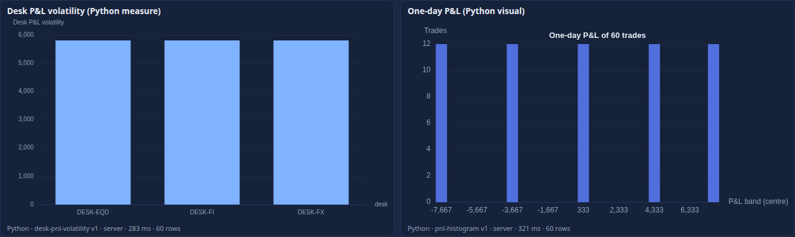
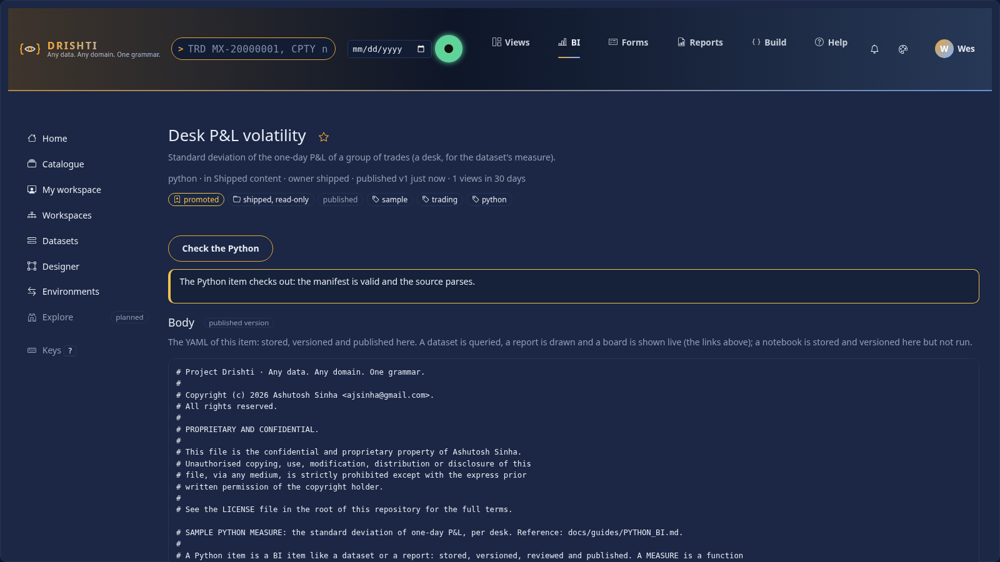
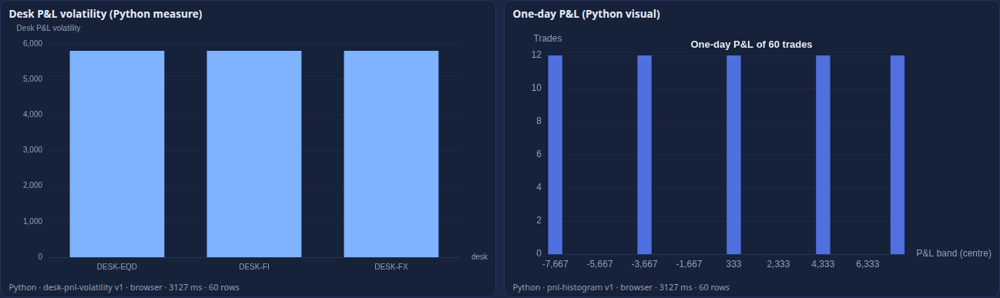
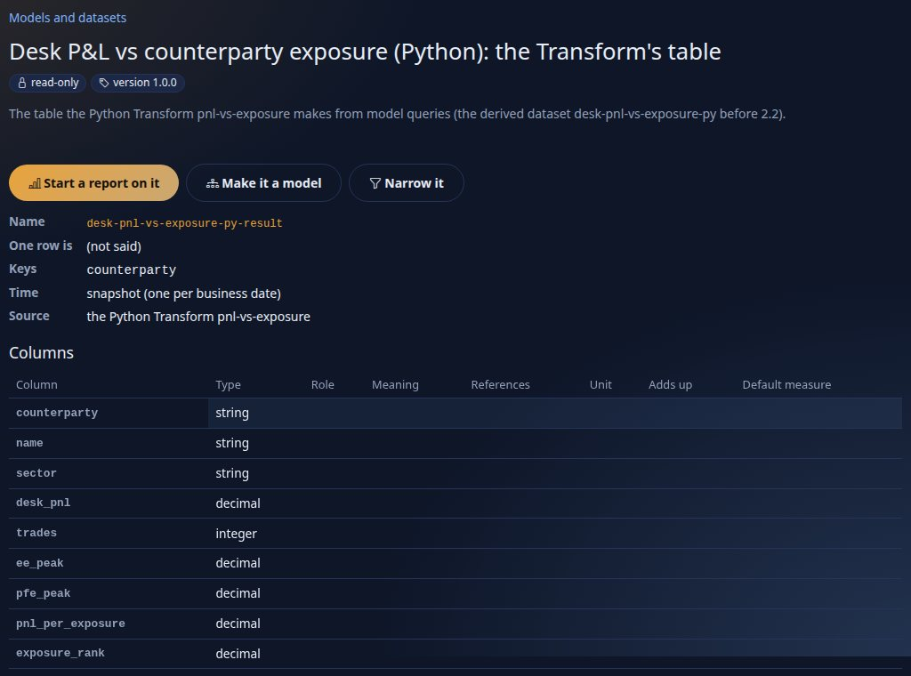
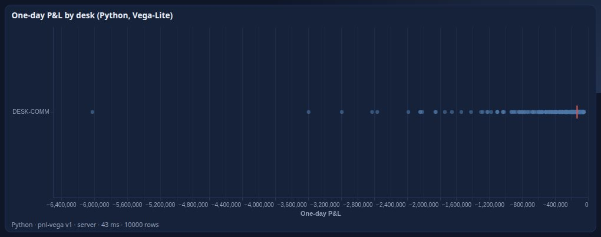
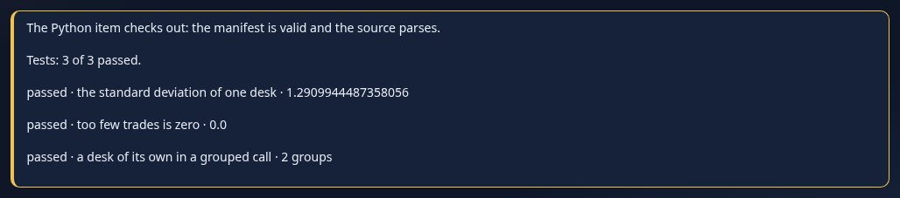
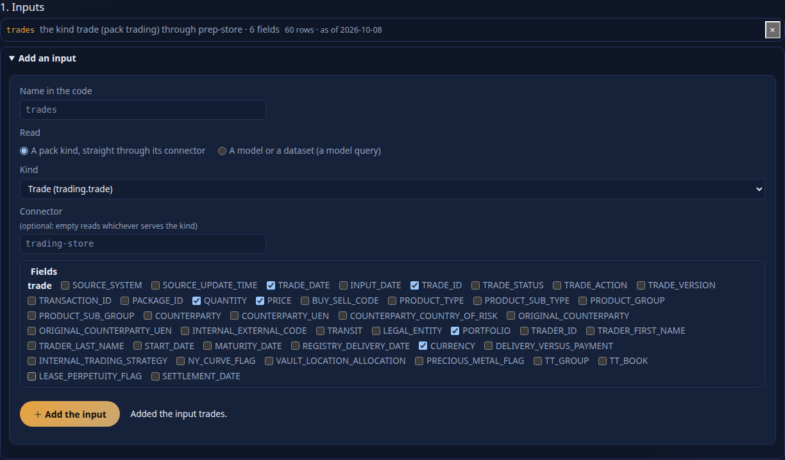
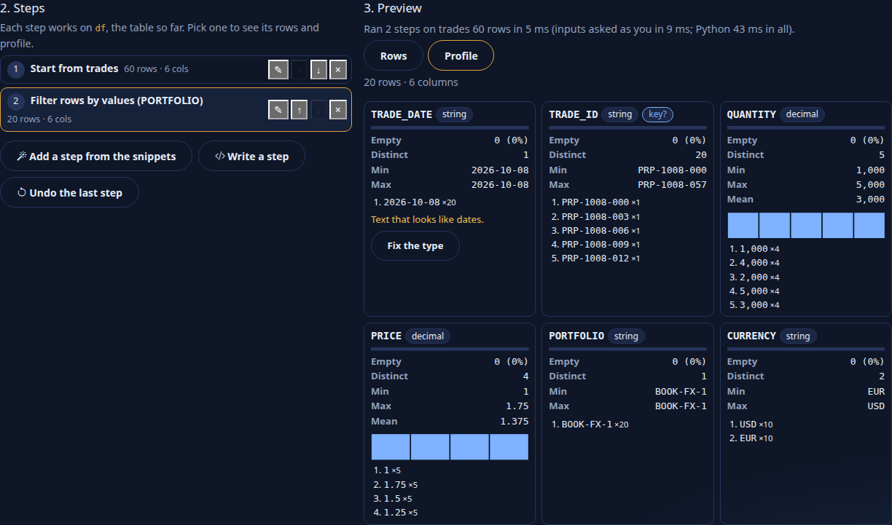
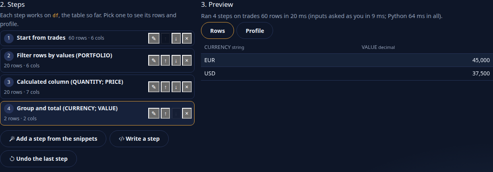
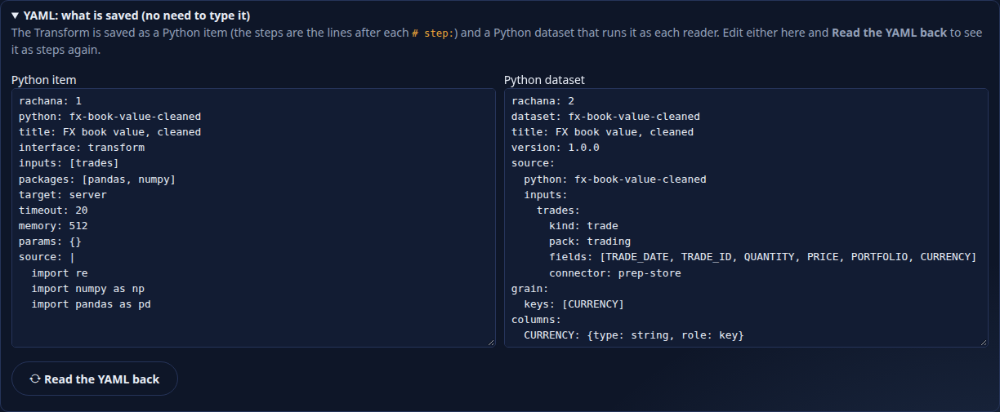

<!--
  Project Drishti · Any data. Any domain. One grammar.

  Copyright (c) 2026 Ashutosh Sinha <ajsinha@gmail.com>.
  All rights reserved.

  PROPRIETARY AND CONFIDENTIAL.

  This file is the confidential and proprietary property of Ashutosh Sinha.
  Unauthorised copying, use, modification, distribution or disclosure of this
  file, via any medium, is strictly prohibited except with the express prior
  written permission of the copyright holder.

  See the LICENSE file in the root of this repository for the full terms.
-->
# Python in BI: measures and visuals written in Python

Drishti Rūpaka runs **typed Python** where the expression language and the visual catalogue stop: a **Measure** is a Python function that turns the rows of a group into a number
(a desk's P&L volatility, a percentile no aggregate gives, a fitted slope), and a **Visual** is a Python function that turns rows into a chart (a histogram with your own bins, a
regression plot). Authors do not paste scripts into a visual: a Python function is a **BI item** of its own, with a manifest, versions, review and publishing like a dataset or a
report, and a report names it. It runs **sandboxed on the console** (since 2.3.0 never in the browser), always on **the rows the person looking may see**.

A third interface, the **Transform**, turns the answers of several model queries into a table that a **Python dataset** publishes (section 13; the 2.1 *derived dataset* it replaced is gone): it is how Python joins models.

This is the reference. For a walk-through see [tutorial 14](../tutorials/14-python-and-analyse.md); the design is [RUPAKA.md](../architecture/RUPAKA.md) section 13, what is built is its section 20.8.
Python in the *terminal* (Calc) is a different thing: [PYTHON_CALC.md](PYTHON_CALC.md).

## Contents

1. [At a glance](#1-at-a-glance)
2. [The two interfaces](#2-the-two-interfaces)
3. [The manifest](#3-the-manifest)
4. [Python items are BI items](#4-python-items-are-bi-items)
5. [Using them: a Python measure and the python visual](#5-using-them-a-python-measure-and-the-python-visual)
6. [Where it runs](#6-where-it-runs)
7. [The sandbox, exactly](#7-the-sandbox-exactly)
8. [Who sees what](#8-who-sees-what)
9. [Settings](#9-settings)
10. [Errors: DRS-9070 to DRS-9077](#10-errors-drs-9070-to-drs-9077)
11. [Measured](#11-measured)
12. [Built and not built](#12-built-and-not-built)
13. [Transforms: a table in, a table out](#13-transforms-a-table-in-a-table-out)
14. [Vega-Lite output](#14-vega-lite-output)
15. [Tests shipped with an item](#15-tests-shipped-with-an-item)
16. [Python in alerts and on boards](#16-python-in-alerts-and-on-boards)
17. [Data prep: the Transform editor (2.4.0)](#17-data-prep-the-transform-editor-240)

## 1. At a glance

```
 report visual (type: python) ──asks──▶ console ──▶ server: what to run (item + manifest), and the rows this person may see (masked Arrow)
                                          │
                                          │
                       the console's sandbox: a child of its fork-server per call
                (no network, scratch folder, CPU, memory, time and output limits)
                                          │
                   a number per group, or a chart (data, never HTML)
```

| | Python measure | Python visual |
|---|---|---|
| function | `compute(table, params)`, or `compute_groups(frame, by, params)` once over every group (2.3.0) | `render(table, params)` |
| called | once per group, with that group's rows | once, with all the rows handed over |
| returns | one number (or `None`) | an ECharts option or a Vega-Lite specification (a dict, by `output:`), SVG text or PNG bytes |
| drawn as | bars, one per group | the chart or image |

Two samples ship (`config/bi/python/`), and a sample report **Desk P&L risk (Python)** shows both on the trades model:

* `desk-pnl-volatility` (a measure): the standard deviation of one-day P&L, per desk;
* `pnl-histogram` (a visual): a histogram of one-day P&L drawn with numpy.



## 2. The two interfaces

**Measure.** Read `config/bi/python/desk-pnl-volatility.python.yaml`:

```yaml
rachana: 1
python: desk-pnl-volatility
title: Desk P&L volatility
interface: measure
inputs: [pnl1d]                  # the columns the function reads, as the table names them
packages: [pandas]
target: server                   # 2.3.0: always the console (browser and both, from 2.2 items, run there too)
timeout: 10                      # seconds
memory: 256                      # megabytes
params: { min_trades: 2 }
source: |
  def compute(table, params):
      """One number for the rows of one group."""
      pnl = table["pnl1d"].dropna()
      if len(pnl) < int(params.get("min_trades", 2)):
          return 0.0
      return float(pnl.std(ddof=1))
```

`table` is a **pandas DataFrame** holding that group's rows and **only the columns in `inputs`**. The function returns a number (an int or float; `None` or NaN is shown as blank; infinity or
anything else is `DRS-9071`). Which columns make a group comes from where the measure is used (section 5): the dataset's `by`.

**Visual.** `config/bi/python/pnl-histogram.python.yaml`:

```yaml
interface: visual
output: echarts                  # echarts (an option), svg or png
inputs: [pnl1d]
packages: [numpy]
params: { bins: 20 }
source: |
  import numpy as np

  def render(table, params):
      pnl = table["pnl1d"].dropna().to_numpy(dtype=float)
      counts, edges = np.histogram(pnl, bins=int(params.get("bins", 20)))
      ...
      return {"title": {...}, "xAxis": {...}, "yAxis": {...}, "series": [{"type": "bar", "data": [int(c) for c in counts]}]}
```

`table` is a DataFrame of the rows the visual hands over (the columns of its `columns` well; the row `id` is dropped). The function returns **data, never markup**: an ECharts option
drawn by the console's own ECharts (any `formatter`, `valueFormatter`, `extraCssText` and `appendToBody` key is removed: those are the places an option can carry HTML), an SVG (refused
if it holds `<script`, `javascript:`, `<foreignObject`, `<iframe`, `<image`, `xlink:href` or an `on...` handler; shown as an image, which never runs script) or PNG bytes. Colours you leave
out (text, axes, grid lines) take the page's theme, so a chart reads in the dark and the light theme alike. A visual may also return a Vega-Lite specification (`output: vega-lite`, section 14).

## 3. The manifest

The body of a `python` item is YAML:

| Key | Required | Meaning |
|---|---|---|
| `python` | yes | the item's name (letters, digits, hyphen, underscore) |
| `interface` | yes | `measure`, `visual` or `transform` (section 13) |
| `source` | yes | the code; up to 65,536 characters; it must define the entry function |
| `entry` | no | the function's name: `compute` for a measure, `render` for a visual, `run` for a transform (a top-level function, or a method of a class `Transform`) |
| `inputs` | measure: yes; transform: yes | a measure: the columns the function reads, as the table names them (`pnl1d`, not `trade.pnl1d`); a transform: the **datasets** it reads, in the order its function receives their frames (section 13) |
| `packages` | no | what the source imports; each must be on the allow-list (`drishti.bi.report.python-packages`, console `bi.python.packages`) |
| `target` | no | `server` (default). 2.3.0: `browser` and `both` (items of 2.2) are read and run on the console like `server` |
| `timeout` | no | seconds, 1 to `drishti.bi.report.python-max-seconds` (60); default 10 |
| `memory` | no | megabytes the code may add to what Python needs to start, 32 to `python-max-memory-mb` (1024); default 256 |
| `output` | visual | `echarts` (default), `vega-lite` (section 14), `svg` or `png`; a measure's output is `number`, a transform's `frame` |
| `params` | no | defaults the function reads from `params`; a visual of a report overrides them in `format.params` |
| `tests` | no | examples the item must pass: run by Check, and a failing one refuses a publish through the console (section 15) |
| `title`, `description`, `owner`, `tags`, `endorsement`, `audience`, `sample`, `version` | no | the catalogue's keys, as for any item |

Anything else is refused with `DRS-9070` and the path of the key. The server checks the manifest ( `POST /api/v1/bi/python/validate`, and on every publish); the **console** adds the checks
that need Python: the source parses, defines its entry, and imports only what it lists or the safe standard library (`POST /bi/python/check`, the **Check the Python** button on the item page):



## 4. Python items are BI items

A Python item lives where every BI item lives: **shipped** in `config/bi/python/<id>.python.yaml` (a published, read-only item, `file:python:<id>`, watched live), or **in a workspace** (create
it with kind *python*). Nothing about governance is special:

* every save is a saved state (diff, restore); **publish** checks the manifest and refuses a bad one with `DRS-9070`; a workspace that requires review needs a second person to approve it
  ([BI_GOVERNANCE.md](BI_GOVERNANCE.md));
* a report that names the item runs **what was published** for every viewer; someone who edits the item (a contributor or better in its workspace) runs the **draft**, so a change can be tried
  before it is published; the run line under the visual shows the version;
* it has an owner, tags, endorsement and an audience like any item, and appears in the catalogue (`kind=python`) and in bundles ([BI_GOVERNANCE.md](BI_GOVERNANCE.md) section 7).

A report **names an item** by catalogue id, shipped file name (`pnl-histogram`) or title. Anyone who can open a published report can have its Python items run for them: the report is what
names the item, as it is what names the dataset.

## 5. Using them: a Python measure and the python visual

**A Python measure in a dataset** ([DATASETS.md](DATASETS.md) section 4.2): a measure whose definition is not an expression but an item, the columns it reads and the groups it makes:

```yaml
measures:
  Desk P&L volatility:
    python: desk-pnl-volatility      # the item
    inputs: [trade.PNL_1D]            # columns of ONE table
    by: [trade.DESK]                 # one number per desk
```

The model checks the item is named, `inputs` is not empty, every name is a column, and all of them are of one table (`DRS-9012`); it also warns (`DRS-9013`) that **a query that names the measure is
refused**: the SQL engine cannot run Python, so the measure is shown by a python visual (below), not mixed into a bar chart's SQL measures.

**The `python` visual** (catalogue group *Python*; wells `columns` and `values`):

```yaml
- id: volatility
  type: python
  title: Desk P&L volatility (Python measure)
  wells: { values: [Desk P&L volatility] }        # a Python measure of the dataset: its columns and groups come from the dataset
  format: { run: auto }

- id: histogram
  type: python
  wells: { columns: [trade.DESK, trade.PNL_1D] }   # the rows handed to Python
  format: { python: pnl-histogram, params: { bins: 24 }, run: auto }
```

| Key | Meaning |
|---|---|
| `wells.values` | one Python measure of the dataset; the rows are its `by` and `inputs` columns |
| `wells.columns` | the columns handed to a Python item named in `format.python` (any number of fields of one table) |
| `format.python` | the item; required unless the values well holds a Python measure. With a measure item and no dataset measure, the groups are the columns that are not `inputs` |
| `format.params` | overrides the item's `params` |
| `format.run` | `auto` (default), `server` or `browser` (section 6): since 2.3.0 every value runs on the console; the key is read so 2.2 reports keep working |

The rows are the table's own rows (not grouped), under the page's slicers, filters and business date, at most `drishti.bi.report.python-rows` (10,000). The report **check** (`DRS-9030` to `9035`)
refuses a python visual with neither an item nor a Python measure, with a values well that is not a Python measure, or without columns. In the designer the visual is under *Python*; its Format pane takes the item and the
parameters (*Run on* is gone since 2.3.0); the canvas shows a placeholder, since Python runs when a report is opened, not while designing.

## 6. Where it runs

| `format.run` | What happens |
|---|---|
| `server` | the console's runner (below) |
| `browser` | (until 2.2) Pyodide in the page; since 2.3.0 the console's runner, as `server` |
| `auto` | (the default) the console's runner; until 2.2 it fell back to the browser when the server could not run the item, and since 2.3.0 such a run answers `DRS-9074` |

**Server.** The console starts a **worker subprocess per call** (`python -I core/pyrunner_worker.py`), at most `bi.python.workers` (2) at once; a call waits `bi.python.queue_seconds` (5) for a place,
then `DRS-9074`. The worker reads the Arrow stream the server built for this person, runs the function, and writes a small JSON answer, size-limited. Nothing is kept between calls: no worker idles,
and there is no state to leak between people. Nothing extra is deployed: it is the console's own Python, with `pandas`, `numpy` and `pyarrow` installed (`requirements.txt`).

**The browser (until 2.2).** Release 2.2 could run a python visual in the page, in Calc's Pyodide worker. Wave B (2.3.0) made the servers compute and
the browser only draw ([BI_DESIGN.md](../architecture/BI_DESIGN.md) principle P3): no report, board or Analyse page loads Pyodide or WebAssembly, and a visual
that says `browser` runs on the console. Pyodide stays for **Calc** only ([PYTHON_CALC.md](PYTHON_CALC.md)), Python you write yourself on a view.

The picture below is from 2.2 and kept for readers of old reports; the line under each visual now always says the console ran it
(`Python · desk-pnl-volatility v1 · server · 240 ms · 60 rows`).



## 7. The sandbox, exactly

The server target is **defence in depth, not a kernel sandbox**; the author is a reviewed colleague, the code is published through review, and the boundary stops the common ways to hurt or leak. What is enforced:

| What | How | Test |
|---|---|---|
| a separate process | `python -I` (isolated mode), a new session so a timeout kills the whole group, an **empty environment** (no tokens, no proxies; only `PATH`, a scratch `HOME` and thread limits) | `test_pyrunner.py` |
| no network | the worker runs in a **network namespace with no interfaces** when the machine allows it (`unshare --user --net`; `network_namespace: auto`, `require` refuses to run without it), and an **audit hook** refuses every `socket.*` event whatever the namespace says | `test_no_network`, `test_a_socket_is_refused_even_through_a_library` |
| a scratch folder only | the working directory is a fresh temporary folder, removed afterwards; the audit hook refuses a **write** anywhere else, and a **read** outside the Python installation and that folder (so not `/etc/passwd`, not the console's files) | `test_files_outside_the_scratch_folder_are_refused` |
| no processes, no loader | the audit hook refuses `subprocess`, `os.system`, `exec*`, `spawn*`, `fork`, `ctypes` loading | `test_processes_and_other_packages_are_refused` |
| CPU time | `RLIMIT_CPU` = `timeout` seconds (after start-up), and the parent kills the group at `timeout + 3` s wall clock: `DRS-9072` (HTTP 504) | `test_wall_clock_and_cpu_limits_kill_the_worker` |
| memory | `RLIMIT_AS` = what Python needs to start + `memory` MB: allocation fails or the process dies: `DRS-9072` (413) | `test_memory_limit` |
| output | the answer is at most `bi.python.max_output_bytes` (1,000,000), files at most four times that: `DRS-9072` (413); the input at most `max_input_bytes` | `test_output_limit`, `test_input_limit_and_busy_pool_and_switched_off` |
| packages | the manifest's `packages` must be on the console's allow-list (and installed) **before a worker starts**; the author's own `import` goes through a guard that allows only those and a short list of safe standard-library modules (`math`, `statistics`, `json`, `datetime`, `re`, `collections`, `itertools`, `functools`, `typing`, `decimal`, `fractions`, `random`, ...); `exec`, `eval`, `compile` are not given | `test_package_allow_list_is_enforced_before_a_worker_starts` |
| the input is what the reader may see | the worker receives only the Arrow stream the server built for this person, and the function only the columns of `inputs` | `test_the_function_sees_only_the_declared_columns` |
| a pool | `bi.python.workers` at once, a bounded wait, `DRS-9074` when full | `test_input_limit_and_busy_pool_and_switched_off` |

Honestly: pure-Python guards (the import guard, the audit hook) can be got round by determined hostile code (the tests include one that reaches `__import__` through a library's own builtins and is still
stopped by the hook). That is why review before publish matters, why the process has nothing to steal (no environment, no network, no files), and why a site that wants a harder wall runs the console in a
container with the usual limits. `GET /bi/python/status` says which isolation is on (`network namespace + audit hook`, or `audit hook`).

## 8. Who sees what

* The rows are the server's answer for **this person**: their row rules, their masks, their business date. A masked column arrives masked (`X-Bi-Masked` lists it; the visual's line says *masked*); Python never receives the real value, so it
  cannot reveal it. The result is derived from those rows only.
* A **traceback** is shown to people with the `bi-author` power; everyone else sees the code and the message (`DRS-9071 ZeroDivisionError: division by zero`) without the source lines.
* Which item runs is decided by the **server** (the report's own dataset and item resolution, as the dataset is); the console passes on the person's identity and decides nothing about access.
* Every non-GET call takes JSON from this console's own pages only (same-origin check and `application/json`, `DRS-5002` / `DRS-5001`): [API_GUIDE.md](API_GUIDE.md).

## 9. Settings

**Server** (`drishti.bi.report.*`, [CONFIGURATION.md](../admin/CONFIGURATION.md#drishtibireport--reports-phase-3)): `python-rows` (10,000), `python-packages` (the manifest allow-list), `python-max-seconds` (60), `python-max-memory-mb` (1024).

**Console** (`bi.python.*` in `application.yaml`, [CONFIGURATION.md](../admin/CONFIGURATION.md)):

| Setting | Default | Meaning |
|---|---|---|
| `enabled` | `true` (`DRISHTI_BI_PYTHON_ENABLED`) | off: the server target answers `DRS-9074` |
| `workers` | `2` | processes at once |
| `queue_seconds` | `5` | how long a call waits for a place |
| `packages` | pandas, numpy, pyarrow, scipy, statsmodels | the allow-list; one not installed is refused when used. Keep it equal to the server's `python-packages` |
| `max_timeout_seconds` / `max_memory_mb` | `60` / `1024` | the most a manifest may ask for |
| `max_input_bytes` / `max_output_bytes` | `16000000` / `1000000` | the size of the rows in and the answer out |
| `max_groups` | `5000` | most groups a measure is called for |
| `network_namespace` | `auto` | `auto`, `require`, `off` |
| `scratch_dir` | system temp | where scratch folders are made |
| `warm` | `true` (`DRISHTI_BI_PYTHON_WARM`) | 2.4.0: start the fork-server when the console starts, so the first call is warm too (section 17.7) |

## 10. Errors: DRS-9070 to DRS-9077

| Code | HTTP | Meaning | Usual cause |
|---|---|---|---|
| `DRS-9070` | 422 | a Python item or its use is not valid | a manifest key, a package off the list, no entry function, a python visual with no item, an item for the browser only asked to run on the server |
| `DRS-9071` | 422 | the code failed | an exception (the message names it; authors also get the traceback), a measure that returned something that is not a number, a visual that returned neither an option, an SVG nor a PNG |
| `DRS-9072` | 413 or 504 | a limit stopped it | over `timeout` (504), over `memory`, input or output size (413) |
| `DRS-9073` | 403 | the sandbox refused something | an `import` that is not on the list, the network, a file outside the scratch folder, a process |
| `DRS-9075` | 422 | a Transform's result is not usable | a column the derived dataset declares is missing from the frame, or the Transform's `inputs` are not the derived dataset's inputs (a Transform only: section 13) |
| `DRS-9074` | 503 | no runner | all workers busy for `queue_seconds`, the runner switched off, `pandas` or `pyarrow` not installed in the console's environment, a package not installed |
| `DRS-9076` | 422 | a test the item ships with fails, so it is not published | `POST /bi/api/items/<id>/publish` (or `approve`) of a Python item whose `tests:` do not all pass; a bi-admin may publish with `force: true` (section 15) |
| `DRS-9077` | 422 | a Vega-Lite specification could not be drawn (shown in the visual's frame; no HTTP call) | a `url` or `loader` in the specification, a library that did not load, an invalid specification (section 14) |

Real output (a measure on 60 trades, then the failures, from `core/pyrunner.py`):

```
{"kind": "measure", "by": ["desk"], "rows": [["DESK-EQD", 0.0], ["DESK-FI", 2043.0156738209967], ["DESK-FX", 2043.0156738209967]], "ms": 213}
DRS-9071 422 ZeroDivisionError: division by zero
  File "<python-item>", line 2, in compute
DRS-9072 504 'desk-pnl-volatility' used more than its 1 s of CPU time and was stopped
DRS-9073 403 Denied: import of 'socket' is not allowed here (this item may use: __future__, bisect, ..., pandas, ...); list the package in the manifest's packages
```

`GET /bi/python/status`:

```
{"enabled": true, "ready": true, "missing": [], "workers": 2, "running": 0, "packages": ["pandas", "numpy", "pyarrow", "scipy", "statsmodels"],
 "installed": ["pandas", "numpy", "pyarrow", "scipy"], "calls": 0, "failures": 0, "isolation": "network namespace + audit hook", ...}
```

More in [TROUBLESHOOTING.md](TROUBLESHOOTING.md).

## 11. Measured

On the development machine (a laptop, Python 3.14, pandas 3, 60 rows): a **server call takes about 220 to 320 ms** (a process start and the `pandas` import dominate; the first is the slowest), 214 to 250 ms warm. The design target was
under 50 ms: **not met** by these figures, taken when each call started a worker. Wave B's fork-server and 2.4.0's warm workers take the start off each call (section 17.7). (Until 2.2 a browser run took about 3.3 s on its first load, the interpreter, numpy and pandas; since 2.3.0 there is no browser run, and wave B's
fork-server takes the worker start off each call: see the end of this guide.) The Chromium test ([test_bi_python_browser.py](../../drishti-console/tests/test_bi_python_browser.py)) checks the sample report's figures against a computation from the same trades.

## 12. Built and not built

Built: the Measure and Visual interfaces; Python items as BI items (versions, review, publish, shipped files, bundles); the manifest and its checks (server and console); Python measures in datasets; the
`python` visual in reports and the designer; the sandboxed server runner with a pool; the shipped samples. (The browser target of 2.2, in Calc's Pyodide worker, was removed in 2.3.0.)

Built with several datasets (section 13): the **Transform** interface, run on the server over the reader's answers and published as a **Python dataset** (2.2: `source.python`, each input a model query; [BI_MODEL_SPEC.md section 1.2](../architecture/BI_MODEL_SPEC.md#12-sources)), kept per reader and version of the inputs; Analyse promotes a join cell to one.

Built in 2.4.0 (section 17): a Transform's input may be a **pack kind read straight through a connector**, as the reader; the **Transform editor**
(step by step, a preview and a profile after each step, a tested snippets library, no YAML to type); the **profile** of a frame (the editor, Analyse); **warm
workers** (the fork-server starts with the console).

Not built, and not faked: the **Source** interface (RUPAKA.md section 13.1; rows from a Python-only source such as an API: a kind through a connector is
built, section 17.1, a Python-only source is not); a Python measure **inside** a SQL query or a bar chart's measures (a query that names one is `DRS-9013`);
Python in **subscriptions** and **embedded** reports (an export of a python visual is the table of rows handed to Python; an embedded report does not draw Vega-Lite or Python visuals); a
**pool of pre-forked children** (the fork-server forks one per call, from a warm parent: section 17.7) and a **separate runner service** (`bi.python.runner-url`: RUPAKA.md section 17); a **kernel-level** sandbox (seccomp, containers: use the platform's); **PygWalker** itself (Calc has its front end, Graphic Walker: [PYTHON_CALC.md](PYTHON_CALC.md#19-the-bi-client-and-graphic-walker)) and notebooks in Calc; **R**; `scikit-learn` and `polars` in the
allow-list (add them to `bi.python.packages` and the server's `python-packages` when installed).


## 13. Transforms: a table in, a table out

The third interface, after the Measure and the Visual, is the **Transform**: Python that turns the frames of one or more answers into **a table**, which a **Python dataset** publishes as its one table (2.2: `source: { python: <item>, inputs: { <name>: <a model query> } }`, [BI_MODEL_SPEC.md section 1.2](../architecture/BI_MODEL_SPEC.md#12-sources); before 2.2 a derived dataset, replaced and now history: [DATASETS_2_1_COMPOSED_DERIVED.md](../archive/DATASETS_2_1_COMPOSED_DERIVED.md#112-derived-datasets-a-python-transform)), with measures in a model over it. Use it where a join or a reshaping is easier in pandas than in the dataset language (a merge with a tolerance, a rank, a fitted column, a pivot), and you still want the result to be a dataset every report, alert and subscription can use. The design is [RUPAKA.md sections 13.1 and 20.10](../architecture/RUPAKA.md).

```yaml
rachana: 1
python: pnl-vs-exposure
interface: transform            # a table in, a table out
inputs: [pnl, exposure]         # the inputs of the Python dataset (model queries), in the order its function receives their frames
packages: [pandas]
target: server                  # a Transform runs on the server and its result is kept for the reader
timeout: 20
memory: 512
params: { floor: 1.0 }          # defaults; the dataset may override them
source: |
  def run(pnl, exposure, params):
      m = pnl.merge(exposure, on="counterparty", how="left")
      m = m.rename(columns={"Desk P&L": "desk_pnl", "Exposure (EE peak)": "ee_peak"})
      m["pnl_per_exposure"] = m["desk_pnl"] / m["ee_peak"].clip(lower=float(params.get("floor", 1.0)))
      return m[["counterparty", "name", "sector", "desk_pnl", "ee_peak", "pnl_per_exposure"]]
```

**The contract.**

| | |
|---|---|
| function | `run(*frames)`: one **pandas DataFrame** per input, in the order of `inputs`. A function that has a parameter named `params` receives the parameters (the manifest's `params` over the dataset's); or a class named `Transform` with a method `run(self, *frames)`, which finds the parameters in `self.params` |
| frames | what the reader may see: each input is a model query asked **as the reader**, so row rules and masks are already applied and a masked column is null. Since 2.2 each column is named by the last part of its field or measure name (`counterparties.id` is `id`); the 2.1 derived dataset renamed them with `as` |
| returns | a DataFrame: no more than `drishti.bi.transform.max-rows` rows; column names of letters, digits and underscore; no duplicate names. Anything else is `DRS-9071` |
| column types | typed from the frame: `int` is `integer`, `float` and decimals are `decimal`, `bool` is `boolean`, dates and timestamps are `date` and `timestamp`, everything else `string` |
| `inputs` (manifest) | the names of the Python dataset's inputs (2.1: datasets), not columns: the dataset's `source.inputs` must name the same in the same order (`DRS-9075` otherwise) |
| `target` | `server` only: the browser has no business making a table the server keeps |

**Where it runs, and who sees what.** The server asks each input as the reader, writes the answers as Arrow files and starts the console's runner (`drishti-console/core/transform_cli.py`, which uses `core/pyrunner.py` exactly as a Python measure does): `python -I`, an empty environment, a scratch folder, no network, CPU, memory, wall-clock and output limits, an audit hook, the import guard. The frame comes back as a Parquet file the server keeps for **that reader** and the version of the inputs (`drishti.bi.transform.cache-ttl`, `cache-entries`). The code never sees anything the reader may not, and the result is derived only from it; another reader gets their own run. Real output of the sample's first and second run (an author who may read every row):

```
Python Transform pnl-vs-exposure: 18 rows in 218 ms (first run); the same reader again: kept, 0 ms
```

**Checks.** The server checks the manifest on validate and publish (`DRS-9070`): `interface` is `measure`, `visual` or `transform`; a transform needs `inputs` naming datasets, defines `run` (a top-level function or the method of a class `Transform`), and `target` is `server`. The console adds the source checks (`POST /bi/python/check`: it parses, defines its entry, imports only what it lists). `DRS-9071` to `9074` are the run's, as for any Python item (section 10); `DRS-9075` is a frame that lacks a column the derived dataset declares or inputs that do not match.

**From Analyse.** A notebook that joins several extracts in pandas ([ANALYSE.md section 2](ANALYSE.md#2-the-extract)) can **Promote to a Transform**: each `extract("name")` becomes a parameter of `run`, the cell's `result` is returned; the draft is then checked and published, and a Python dataset is written over it (the dataset wizard's source *A Python Transform*), one model query per parameter of `run`.



Settings: `drishti.bi.transform.*` in [CONFIGURATION.md](../admin/CONFIGURATION.md#drishtibitransform--python-transforms-and-composed-datasets). The sample is `config/bi/python/pnl-vs-exposure.python.yaml` with the Python dataset `desk-pnl-vs-exposure-py-result` and the model `desk-pnl-vs-exposure-py` over it ([tutorial 14, step 8](../tutorials/14-python-and-analyse.md#step-8--two-models-a-python-transform-and-a-join-in-analyse)).

## 14. Vega-Lite output

A visual may return a **Vega-Lite** specification instead of an ECharts option: say `output: vega-lite` in the manifest and return the specification as a dict (`mark`, `encoding`, `layer`, `transform` ... as [Vega-Lite](https://vega.github.io/vega-lite/) has them). The sample `config/bi/python/pnl-vega.python.yaml` draws one dot for each trade's one-day P&L, by desk, with each desk's median as a tick:

```python
def render(table, params):
    rows = table.dropna(subset=["pnl1d"]).head(int(params.get("max_points", 400)))
    dots = [{"desk": str(r.desk), "pnl1d": float(r.pnl1d)} for r in rows.itertuples()]
    medians = [{"desk": str(d), "median": float(v)} for d, v in rows.groupby("desk")["pnl1d"].median().items()]
    return {"layer": [
        {"data": {"values": dots}, "mark": {"type": "circle", "opacity": 0.6, "size": 40}, "encoding": {"x": {"field": "pnl1d", "type": "quantitative"}, "y": {"field": "desk", "type": "nominal"}}},
        {"data": {"values": medians}, "mark": {"type": "tick", "thickness": 3, "color": "#d9534f"}, "encoding": {"x": {"field": "median", "type": "quantitative"}, "y": {"field": "desk", "type": "nominal"}}}]}
```



What comes back from the worker is data, as with ECharts: `{"kind": "vega-lite", "spec": {...}, "ms": 258}`. The rules:

* **The data is inside the specification** (`data.values`). A `url` or a `loader` anywhere in it is refused, in the sandbox (`DRS-9073`: "a Vega-Lite specification may not load anything from a URL or name a loader") and again in the page. The page draws it with the vendored Vega, Vega-Lite, vega-embed and **vega-interpreter**
  ([VENDOR.md](../../drishti-console/web/static/vendor/VENDOR.md)): the interpreter walks the expression tree instead of compiling it to a function, so an expression such as `datum.MTM < 0` is evaluated **without `eval`** and the page keeps the strict content security policy (no `unsafe-eval`, no inline style: vega-embed is told not to write its own `<style>`). The loader refuses every URL, there is no actions menu, no editor link and no tooltip plug-in.
* The page puts the theme's colours and the report's palette under whatever the specification's own `config` says, sizes the chart to its frame (`width` and `height` as `container`) and draws it on a canvas.
* The size limit is `bi.python.max_output_bytes`. (`target: browser` items of 2.2 run on the console and answer the same.)
* A **report** can also hold a Vega-Lite visual with **no Python at all**: `type: vega-lite` ([REPORTS.md](REPORTS.md#35-vega-lite-visuals)).

## 15. Tests shipped with an item

A Python item may carry `tests:`: examples of what its function must return. **Check** runs them in the console's sandbox, one worker each (the same as a report's run), and shows each as passed, failed or could not run; a **publish** through the console is refused while one fails.

```yaml
tests:
  - name: the standard deviation of one desk
    input: { columns: [pnl1d], rows: [[1.0], [2.0], [3.0], [4.0]] }      # a frame written in the test
    expect: 1.2909944
    tolerance: 0.000001
  - name: a desk of its own in a grouped call
    input: { columns: [desk, pnl1d], rows: [[FX, 1.0], [FX, 3.0], [RATES, 10.0], [RATES, 14.0]] }
    by: [desk]                                                                # a measure: the group columns
    expect: { FX: 1.4142136, RATES: 2.8284271 }                              # a number for each group
    tolerance: 0.000001
```

A test may read rows of a dataset instead of a frame it carries: `sample: { dataset: trades-basic, fields: [trade.DESK, trade.PNL_1D], limit: 200 }`.

| Key | Meaning |
|---|---|
| `name` | required, unique in the item |
| `input` | the frame: `{columns: [...], rows: [[...]]}` (up to 1,000 rows). For a **transform**, a mapping of each input dataset to its frame |
| `sample` | instead of `input`: `{dataset, fields: [table.column, ...], limit}` (at most 1,000 rows). The rows are the ones the **person running the test** may see (row rules and masks apply), so such a test can pass for one person and fail for another; a sample is for a check against real data, an `input` for a stable one |
| `params` | values over the item's defaults |
| `by` | a measure: the group columns; without it the whole input is one group |
| `expect` | a **measure**: a number (no `by`) or a number for each group (`by`: no group may be missing and none may be extra). A **visual**: `{kind: echarts \| vega-lite \| svg \| png, has: {<dotted path>: <value>}}`, for example `{kind: vega-lite, has: {layer.0.mark.type: circle}}` (a path steps through keys and list indexes). A **transform**: `{columns: [...], rows: <count>}` |
| `tolerance` | absolute, default `1e-9`; for numbers in `expect` and in `has` |

The server reads the **shape** of `tests:` when the item is validated or published (`DRS-9070`, with the path of the key: `tests[0].expect`); it does not run them, because it has no Python. The console runs them, so:

* **Check** (`POST /bi/python/check`, the item page's *Check the Python*) shows them, each with its result: `passed`, `FAILED` (with what it expected and got) or `could not run` (the code failed, a package is off the list, the runner is switched off: the message has the `DRS` code). Body `{yaml, tests: false}` skips them.
* **Publish and approve** through the console (`POST /bi/api/items/<id>/publish` and `/approve`) run them first; a failing or unrunnable one answers `DRS-9076` with the first three: `'Vol' cannot be published: 1 of its 3 tests fails (bad: expected 9.0, got 1.0). Fix the item or the test; a bi-admin may publish it anyway with force.` A **bi-admin** may send `{"force": true}`. A call made straight to the server's API is not run through the console, so it is **not gated**: the gate is the console's, which is the only place with Python.

Real output of Check on the two samples that ship tests (the results the console returned):

```
desk-pnl-volatility  3 tests: passed 3
  pass  the standard deviation of one desk      1.2909944487358056
  pass  too few trades is zero                  0.0
  pass  a desk of its own in a grouped call     2 groups
pnl-vega             2 tests: passed 2
  pass  a dot for every trade and a median for every desk   vega-lite
  pass  at most max_points dots                             vega-lite
```



## 16. Python in alerts and on boards

**Boards.** A board tile may be a **python visual** (a Python measure shown as bars, or a Python visual that returns a chart or a Vega-Lite specification): the tile runs it for the person looking, as the report does, on the console's runner. The sample board `python-wall` has three. A Python tile has no threshold alert of its own (the colour rule of a tile reads numbers the query returns); to be told when a Python measure crosses a limit, make an **alert** on it. See [REPORTS.md section 23](REPORTS.md#python-tiles).

**Alerts.** An alert's source may be a **Python measure**: a dataset source whose measure is one (`type: dataset`, `measure: Desk P&L volatility`), or a visual source whose visual is a python visual that shows one. The server has no Python, so it does what a Transform does: it **builds the rows the person may see** (their row rules and masks applied by the engine, up to `drishti.bi.report.python-rows`), writes the item and the rows to a scratch folder and starts the console's runner (`drishti-console/core/transform_cli.py`, in `measure` mode), which runs the item in the same sandbox and answers a number for each group; the alert reduces the groups to one number (a dataset source: the whole input is one group; a visual source: the alert's `reduce`, `first` by default). It is read **for each person**, on the alert's schedule or after a load, like any other. What follows from that:

* a column **masked for the person** makes the reading *masked*: nothing is run and no figure is shown;
* a run that fails (the code, a limit, the sandbox, no Python installed on the server's side) is an *error reading* with the DRS code and words; it never fires and never clears;
* the runner is the one the Transforms use: `drishti.bi.transform.enabled`, `python` (the interpreter that has pandas and pyarrow) and `runner` (`transform_cli.py`), `timeout` and `work-dir` ([CONFIGURATION.md](../admin/CONFIGURATION.md#drishtibitransform--python-transforms-and-composed-datasets)); the package list and limits are the server's `drishti.bi.report.python-*`;
* a **python visual that draws a chart** has no number: such an alert reads as an error saying to watch a Python measure.

```
PUT /api/v1/me/measure-alerts/Vol
{"title": "Desk P&L volatility", "source": {"type": "dataset", "dataset": "file:dataset:trades-basic", "measure": "Desk P&L volatility"},
 "condition": {"type": "threshold", "op": "above", "value": 5000}, "trigger": {"mode": "after-load"}}
```

The reader is tested against the real runner ([ProcessMeasureRunnerTest](../../drishti-server/src/test/java/com/ash/drishti/server/bi/transform/ProcessMeasureRunnerTest.java)) and with a stand-in ([PythonAlertReaderTest](../../drishti-server/src/test/java/com/ash/drishti/server/alerts/measure/PythonAlertReaderTest.java): what the runner is handed, a masked column, a failing run).

## Wave B (2.3.0): one runner on the console, the Py-node endpoint, columns

* **No browser target.** Pyodide is no longer loaded by any BI page; `target: browser` and `both` run on the console. The visual's *Run on* setting is gone
  from the designer.
* **The fork-server.** Each console runs one parent that imported pandas, numpy and pyarrow once and forks a child per call; the child gets its own session,
  limits, audit hook and scratch folder, exactly as a fresh process did (`bi.python.fork_server`, [OPERATIONS.md](../admin/OPERATIONS.md#bi-scale-wave-b)).
* **The L4 result cache.** An answer is kept by the item's code, its parameters and the exact input bytes (`bi.python.cache_entries`, `cache_seconds`): the
  same masked rows give the same answer without a call; another reader's masked rows are other bytes, so never their answer.
* **`compute_groups(frame, by, params)`.** A measure may define it instead of `compute`: one vectorised call over every group's rows that returns a
  DataFrame of the group columns and one value column (`value`, else the last). Faster for many groups:

```python
def compute_groups(frame, by, params):
    out = frame.groupby(by, dropna=False)["pnl1d"].std().reset_index()
    return out.rename(columns={"pnl1d": "value"})
```

* **The `column` interface.** `derive(frame, params)` returns one value per row (a Series, an array or a list), for a dataset's `derive: { python: … }`
  (plan node `PyColumn`).
* **The Py-node endpoint.** The server's planner places Python nodes on the console tier and calls `POST /internal/py/transform`, `/measure` and
  `/column` on the console with `X-Drishti-Runner-Token` ([API_GUIDE.md](API_GUIDE.md); `drishti.bi.transform.console-url` and `console-token` on the
  server, the same `DRISHTI_BI_TRANSFORM_CONSOLE_TOKEN` on the console). Without it the server runs `transform_cli.py` itself, as before.

## 17. Data prep: the Transform editor (2.4.0)

Wave C ([BI_DESIGN.md section 12.2](../architecture/BI_DESIGN.md#wave-c--authoring-and-analysis--240); items P1, P2, P3, P5 and P6 of the 2.1 parity study, history archived in docs/archive/BI_PARITY_PLAN.md) makes the
Python path the data-prep tool a Power Query author expects, without a step language: **raw rows straight from a connector**, a **step-by-step run with a
preview and a profile after every step**, a **tested snippets library** for the common reshapes, and **warm workers**. The steps are still lines of
pandas, run in the same sandbox as every Python item (section 7), on the rows the person looking may see.

### 17.1 Inputs straight from a connector

A Python dataset's `source.inputs` (section 13; [BI_MODEL_SPEC.md section 1.2 C](../architecture/BI_MODEL_SPEC.md#12-sources)) takes, besides a model
query, a **pack kind read through a connector**:

```yaml
source:
  python: fx-book-value-cleaned
  inputs:
    trades:                                   # the name run() receives it by
      kind: trade                             # a pack kind
      pack: trading                           # optional: which pack's definition (default: the first that declares it)
      connector: prep-store                   # optional: a connector by name (default: whichever the pack routes the kind to)
      fields: [TRADE_ID, TRADE_DATE, PORTFOLIO, CURRENCY, QUANTITY, PRICE]   # optional: the kind's columns (default: all)
      where: [{ field: PORTFOLIO, op: in, values: [BOOK-FX-1] }]             # optional: filters, as a model query's
      limit: 50000                            # optional: at most this many rows
    rates: { model: fx-rates@1, select: { fields: [rates.currency, rates.date, rates.rate], measures: [] }, shape: rows }   # a model query, as before
```

A kind input is the rows of the kind's pack-generated dataset (`pack.trading.trade`), asked through its implicit model **as the reader**: the kind's
entitlements, their row rules and their masks apply exactly as in a report on it, and a masked column arrives masked. A role that may not read the kind
gets no rows. Naming a connector reads the same kind through that connector instead of the one the pack routes it to; the input then asks only the fields
it names (and the grain's keys), so **the connector must keep them as columns** (its `layout`), which every lake connector does for the promoted columns.
Its answers are never put in the result cache (whose plan key does not name the connector); the Transform keeps its own result per reader as before.

The server checks the shape on validate and publish (`DRS-9108` with the path: `source.inputs.trades.colour`), a kind no pack declares is `DRS-9102`,
a field the kind lacks `DRS-9108` with the kind's columns, a connector that is not running `DRS-9026`. The lineage of the dataset reaches the kind and the
connector (`pack-kind`, `connector: prep-store`, `input: trades`).

**One input as you.** `POST /api/v1/bi/python/input` with `{input, limit?, asOf?}` answers the rows of one input (either form) as the caller: Arrow with
`?format=arrow` (headers `X-Bi-Rows`, `X-Bi-Masked`, `X-Bi-Model`, `X-Bi-As-Of`, the day the rows came from) or JSON `{model, kind, columns, rows,
rowCount, masked, asOf}`; `limit` defaults to 1,000 and never exceeds `drishti.bi.transform.max-input-rows`. It needs the BI power. This is what the
editor previews, and what `drishti.py bi transform input` prints.

### 17.2 The editor

**BI → Transforms** (`/bi/transform`, the rail's *Transforms*) builds a Transform in four parts, with **no YAML to type**:

1. **Inputs.** Name it as the code will (`trades`), then *A pack kind, straight through its connector* (pick the kind, optionally type the connector, tick
   the fields) or *A model or a dataset* (a model query of rows). The line under the input says how many rows came, the day they are of and what is masked
   for you.

   

2. **Steps.** The first is *Start from trades* (`df = trades.copy()`). *Add a step from the snippets* opens a form for the snippet you choose (section
   17.3): the columns are those of the step before, the inputs are yours. *Write a step* takes a label and a few lines of pandas over `df`. A step is
   inserted after the one you are looking at; each can be edited (✎), moved (↑ ↓) or removed (×), and *Undo the last step* removes the last.
3. **Preview.** After every change the console runs the steps (section 17.4) and each step shows its rows and columns; pick one to see its **first 20
   rows** (*Rows*) or its **profile** (*Profile*, section 17.5). A step that fails turns red, says its error and line, and the steps before it keep their
   frames.

   

   

4. **Save.** Tick the column(s) that make one row (the grain; a column that was unique in the preview is offered first) and *Save as drafts*: a **Python
   item** (`interface: transform`) and a **Python dataset** that runs it, both drafts in your workspace. Check and publish the Python item first, then the
   dataset (section 13). The page's address then names both (`/bi/transform?item=<id>&dataset=<id>`), and opening it again opens the same steps.

The YAML is shown under *YAML: what is saved* and stays in step with the page; edit either text and *Read the YAML back* to see it as steps again (a
Transform written by hand opens too: its `# step:` comments are the steps, or its whole body is one step).



What is saved, for the sample above:

```yaml
rachana: 1
python: fx-book-value-cleaned
title: FX book value, cleaned
interface: transform
inputs: [trades]
packages: [pandas, numpy]
target: server
timeout: 20
memory: 512
params: {}
source: |
  import re
  import numpy as np
  import pandas as pd


  def run(trades, params):
      # step: Start from trades
      df = trades.copy()
      # step: Filter rows by values (PORTFOLIO)
      df = df[df['PORTFOLIO'].isin(['BOOK-FX-1']) == True].reset_index(drop=True)
      # step: Calculated column (QUANTITY; PRICE)
      df['VALUE'] = (pd.to_numeric(df['QUANTITY'], errors="coerce") * pd.to_numeric(df['PRICE'], errors="coerce")).replace([np.inf, -np.inf], np.nan)
      # step: Group and total (CURRENCY; VALUE)
      df = df.groupby(['CURRENCY'], as_index=False, dropna=False)[['VALUE']].agg('sum')
      return df
```

Running the steps needs the **bi-author** power (it runs Python); without it the page still writes and reads the YAML.

### 17.3 The snippets library

`drishti-console/config/prep-snippets.yaml` holds 21 snippets, each one step over `df` with parameters filled in a form. **A value is always written as a
Python literal** (`repr`): a column called `x"]; import os` is a column of that odd name, never code; an *input* parameter must be one of the Transform's
inputs and an *operator* one of its options (`DRS-9070` otherwise). Every snippet carries an **example** (frames in, parameters, the frame expected out)
that `tests/test_transform_editor.py` runs in plain pandas **and** in the sandbox, so a snippet is correct out of the box.

| Group | Snippets |
|---|---|
| Columns | keep columns, rename a column, split a column, calculated column (`+ - * /`) |
| Clean | type fix: text to number, type fix: text to date, replace values, fill down (optionally within groups), remove duplicates |
| Rows | filter rows by values, drop rows with an empty value, sort rows |
| Combine | append another input (union), join another input, **as-of join of prices** (the latest price of the instrument on or before the row's date, within *n* days), **as-of FX conversion** (an amount to a base currency at the latest rate on or before the row's date) |
| Reshape | unpivot (columns to rows), pivot (rows to columns), group and total |
| Dates | align to a business day (following, preceding, modified following; weekends and the holidays you list), tenor bucket (`<1Y`, `1-2Y`, ..., `30Y+`) |

More snippets: a file of the same shape named by `bi.transform.snippets_file`. On the command line: `drishti.py bi transform snippets` lists them and
`drishti.py bi transform snippet asof-fx amount=NOTIONAL currency=CURRENCY date=TRADE_DATE fx=rates --inputs trades,rates` prints the step.

### 17.4 The step-by-step run

`POST /bi/transform/steps` (the console) with the page's spec: each input is asked of the server **as you** (section 17.1, at most
`bi.transform.preview_rows`, 1,000), then `run` runs **once** in the sandbox (a child of the fork-server, its usual limits) with a mark after each step.
The steps are the statements after each `# step: <label>` comment of `run`'s body, or each top-level statement when there is none. After each step the
worker describes the frame that step made (the last DataFrame it assigned, else `df`; after the last step, what `run` returned): its rows, columns and
types, its first 20 rows and its profile. The answer also profiles each input and gives the key hints between them. A step that raises stops the run:
`failed` has its index, label, line, error and traceback (the steps before keep their frames). Measured on the sample (60 rows, four steps): the inputs
asked in about 10 ms, the Python run about 45 to 65 ms in all.

The run is never kept: an author runs it as they edit. The Python dataset itself runs the same `run` as each reader when it is read (section 13).

### 17.5 Profiling

The **profile** of a frame, worked out in the sandbox over the reader's rows, is one card per column: its type; **what its text looks like** (numbers or
dates kept as text, with *Fix the type*, which adds the right type-fix step; digits in a column named like an identifier, `TRADE_ID` or `..._CODE`, are
not offered a number type: ids are text by design); empty values (count and %, with a bar); distinct values; **key?** when every
row has its own value; min and max (and the mean of a number); the five most common values; a histogram of a number. Between inputs, *looks like a key
of* names a column whose values (90% or more) are the values of another input's unique column, with how many match: the *Join* snippet joins them.

The same panel is Analyse's **Profile** tab ([ANALYSE.md section 15](ANALYSE.md#15-profile)), `POST /bi/explore/profile`. No author code runs to profile.

### 17.6 On the command line

```
drishti.py bi transform input FILE.dataset.yaml [--as-of 2026-10-08]      # each input as you: rows, masked columns, a profile
drishti.py bi transform snippets                                          # the library
drishti.py bi transform snippet filter-values column=PORTFOLIO values=BOOK-FX-1      # one step, its values written as literals
drishti.py bi item new me FILE.python.yaml                                # the drafts, as the editor's Save makes them
drishti.py bi item new me FILE.dataset.yaml
```

Real output of the first on the demo lakes ([tutorial 14, step 12](../tutorials/14-python-and-analyse.md#step-12--prepare-raw-trades-step-by-step-the-transform-editor-240)):

```
trades: 1,000 rows of dataset:pack.trading.trade as of 2026-10-16
  CURRENCY                     text      empty     0  distinct      3  CAD .. USD
  MATURITY_DATE                text      empty     0  distinct     81  2024-11-01 .. 2029-10-31
  NOTIONAL                     float64   empty     0  distinct    971  2,855.8 .. 2.46923e+08
  PORTFOLIO                    text      empty     0  distinct      3  BOOK-COMM-1 .. BOOK-COMM-3
  TRADE_DATE                   text      empty     0  distinct    529  2024-10-10 .. 2026-09-25
  TRADE_ID                     text      empty     0  distinct   1000  1000005 .. 1005000
  TRADE_STATUS                 text      empty     0  distinct      5  AMENDED .. VALIDATED
```

See [CLI_GUIDE.md](CLI_GUIDE.md#bi-transform-a-transforms-inputs-as-you-and-the-snippets).

### 17.7 Warm workers

Since wave B every call is a child of the fork-server, a parent that imported pandas, numpy and pyarrow once. In 2.4.0 the console **starts the
fork-server when it starts** (`bi.python.warm`, default on), so the first call of the day, a report's python visual or a Transform's step run, does not pay
for the interpreter and the imports either; `GET /bi/python/status` says `forkServer.warm` and `warmedMs`. Isolation is unchanged: one child per call,
its own session, limits, audit hook and scratch folder.

### 17.8 Settings

| Setting (console) | Default | Meaning |
|---|---|---|
| `bi.transform.preview_rows` | `1000` (`DRISHTI_BI_TRANSFORM_PREVIEW_ROWS`) | rows of each input the step-by-step run starts from (10 to 50,000) |
| `bi.transform.timeout_seconds`, `memory_mb` | `20`, `512` | the step run's limits (also capped by `bi.python.max_timeout_seconds`, `max_memory_mb`) |
| `bi.transform.snippets_file` | empty | more snippets, after the shipped library |
| `bi.python.warm` | `true` | start the fork-server with the console |

The server's `drishti.bi.transform.max-input-rows` (50,000) caps an input, in the editor and in a run.

### 17.9 Not built

AI-written Transforms (P4, the AI release 2.9.0); a precomputed run on refresh for configured roles (the rest of P6); parameters bound to a report (P7); an incremental
mode (P8); promoting several Analyse cells as steps (P9); a drift warning when a Transform's columns change (P10); a Python-only Source (rows from an API).
