<!--
  Project Drishti · Any data. Any domain. One grammar.

  Copyright (c) 2026 Ashutosh Sinha <ajsinha@gmail.com>.
  All rights reserved.

  PROPRIETARY AND CONFIDENTIAL.

  This file is the confidential and proprietary property of Ashutosh Sinha.
  Unauthorised copying, use, modification, distribution or disclosure of this
  file, via any medium, is strictly prohibited except with the express prior
  written permission of the copyright holder.

  See the LICENSE file in the root of this repository for the full terms.
-->
# How to QA in Windows Environment using Custom Data

A step-by-step recipe for a demo on a **Windows** machine **without internet access** (pip and Maven work through your
company's internal mirror). You will show:

1. **ENDUR trades from your real JSONL files** (one or more files, one per business date).
2. **CALYPSO and MUREX trades**, synthetic, from this repository.
3. **Supporting data:** curves, counterparties, netting sets, agreements and CSAs, collateral, FX, fixings, risk.
4. **Equity prices** and **news**: a snapshot captured from Yahoo Finance and Google News, committed here and served
   offline (no website is contacted).
5. **World economy** data, committed here.

Every step says what to click and what you should see. Do the steps **in order**, the day before the demo.

> **⚠ Your real ENDUR files are confidential and this repository is public.**
> Keep them **outside** the project folder, in `C:\Users\asinh09\drishti-private\endur\`. Never copy them into
> `drishti-orig`, never commit them. Drishti reads them from where they are.

Names used below:

| Name | Value |
|---|---|
| Project folder | `C:\Users\asinh09\IdeaProjects\drishti-orig` |
| Your ENDUR files | `C:\Users\asinh09\drishti-private\endur\` (for example `2026-10-15.jsonl`, `2026-10-16.jsonl`) |
| The data folder | `C:\Users\asinh09\IdeaProjects\drishti-orig\data` (the project's own `data` folder) |
| Server | `http://localhost:18480` |
| Console (the browser address) | `http://localhost:17480` |
| Sign-in | user `drishti-dev-admin`, password `drishti-dev-admin123` |

---

## 0. What you need on the machine

| Item | Check |
|---|---|
| **JDK 21** (or newer) | PowerShell: `java -version` shows `21` or higher |
| **Python 3.12 or 3.13** | PowerShell: `py -3.13 --version` (or `py -3.12 --version`) |
| **IntelliJ IDEA** (for the server) and **PyCharm** (for the console and the tools) | both start |
| pip and Maven reach your **internal mirror** | if a download fails, see section 7 |
| 8 GB free memory, 2 GB free disk | Task Manager |

---

## 1. Copy the project — nothing to unzip

1. Copy everything from GitHub into `C:\Users\asinh09\IdeaProjects\drishti-orig` (a `git clone`, or the ZIP from
   GitHub extracted there). Take the branch **main**.
2. **Nothing inside needs unzipping.** The test data in `data\testdata` is `.jsonl.gz`; Drishti reads the `.gz` files
   directly.
3. Create the folder `C:\Users\asinh09\drishti-private\endur\` and put your real ENDUR `.jsonl` files in it, **one file per
   business date**, named by the date, for example `2026-10-16.jsonl`.

You should see: `drishti-orig` contains `drishti-server`, `drishti-console`, `tools`, `config`, `data`, `run-configs`.

---

## 2. One-time setup

### 2.1 The Python environment (PowerShell, once)

Open **PowerShell** in the project folder and run:

```powershell
cd C:\Users\asinh09\IdeaProjects\drishti-orig
py -3.13 -m venv drishti-console\.venv
drishti-console\.venv\Scripts\python.exe -m pip install -r drishti-console\requirements.txt
```

You should see: the last line says `Successfully installed …` (fastapi, uvicorn, pyyaml, pyarrow, deltalake and others).

### 2.2 Two projects: IntelliJ on the project folder, PyCharm on `drishti-console` (once)

IntelliJ and PyCharm each keep their settings in a `.idea` folder inside the folder they open. Opened on the **same**
folder they overwrite each other's (IntelliJ then says **module not specified** for the server). So each opens its own:

| IDE | Opens | Its run configurations (top-right drop-down) |
|---|---|---|
| **IntelliJ** | `C:\Users\asinh09\IdeaProjects\drishti-orig` (the Java server) | `run-configs\`: **Drishti build server jar**, **Drishti server (demo lakes)**, … |
| **PyCharm** | `C:\Users\asinh09\IdeaProjects\drishti-orig\drishti-console` (the console and the tools) | `drishti-console\run-configs\`: **Drishti console**, **Build demo lakes**, **Load ENDUR file into the lake**, the `drishti …` tools |

**If PyCharm was opened on `drishti-orig` before** (it was until 2026-10-18): close **both** IDEs, delete the folder
`C:\Users\asinh09\IdeaProjects\drishti-orig\.idea` in Windows Explorer (IDE settings only; it is not in git), then
do step 2.3 (IntelliJ re-creates it) and the steps below. In PyCharm's start screen, remove `drishti-orig` from the recent
projects (right-click → Remove from Recent Projects) so it is not opened there by habit.

PyCharm:

1. **File → Open** → choose `C:\Users\asinh09\IdeaProjects\drishti-orig\drishti-console` → **Trust Project**.
2. **File → Settings → Project: drishti-console → Python Interpreter → Add Interpreter → Add Local Interpreter →
   Virtualenv Environment → Existing** → `C:\Users\asinh09\IdeaProjects\drishti-orig\drishti-console\.venv\Scripts\python.exe`
   → **OK**.
3. **The tools folder as a source folder** (it sits next to `drishti-console`, not inside it): **File → Settings →
   Project: drishti-console → Project Structure → + Add Content Root** → choose
   `C:\Users\asinh09\IdeaProjects\drishti-orig\tools` → **OK**; select the new `tools` root in the list → click
   **Sources** (the blue folder above the list) → **OK**. The **Project** panel now shows `drishti-console` and `tools`.
   (This is for reading and navigating the tools' code; the run configurations work without it.)
4. In the **Project** panel, right-click `tests` (inside `drishti-console`) → **Mark Directory as → Test Sources Root**.
5. **File → Settings → Tools → Python Integrated Tools → Default test runner** → **pytest** → **OK**.

You should see: the drop-down at the top right lists **Build demo lakes**, **Load ENDUR file into the lake**,
**Drishti console** and the `drishti …` tools. They all use the interpreter of step 2 and run from the project folder
`drishti-orig` (one level up), so `data\`, `config\` and `tools\` mean the same as in this guide; nothing to edit.

> **What these configurations run.** Every command in this guide that starts with `lake …` (`lake demo`, `lake build`)
> is not a program of its own: it is a sub-command of the project's command-line tool **`tools\drishti.py`**. A
> PyCharm configuration is just "run `tools\drishti.py` with these *Parameters*, from the project folder `drishti-orig`":
>
> | Configuration | Script | Parameters (what you edit) |
> |---|---|---|
> | **Build demo lakes** | `tools\drishti.py` | `lake demo …` |
> | **Load ENDUR file into the lake** | `tools\drishti.py` | `lake build …` |
> | **Drishti console** | `drishti-console\run_drishti_web.py` | `--server.port=17480 --backend.url=http://127.0.0.1:18480` |
>
> So a line like `lake build --from …` below goes into the **Parameters** box, not into a terminal. In a configuration,
> `$PROJECT_DIR$` is PyCharm's project folder `drishti-console`, so `$PROJECT_DIR$/..` is `drishti-orig`.
>
> To run the same thing in a terminal instead (PyCharm's **Terminal** tab opens in `drishti-console`; any PowerShell
> window works), this guide gives every command with **full paths**, so it works from whatever folder the terminal is in:
> `C:\Users\asinh09\IdeaProjects\drishti-orig\drishti-console\.venv\Scripts\python.exe C:\Users\asinh09\IdeaProjects\drishti-orig\tools\drishti.py …`. `… C:\Users\asinh09\IdeaProjects\drishti-orig\tools\drishti.py lake build --help` lists every option.

### 2.3 IntelliJ IDEA (once)

1. **File → Open** → `C:\Users\asinh09\IdeaProjects\drishti-orig` → **Trust Project**. IntelliJ imports the Maven project
   (bottom-right progress bar; it downloads through your mirror the first time).
2. **File → Project Structure → Project → SDK** → your **JDK 21** → **OK**.
3. Top-right drop-down → **Drishti build server jar** → ▶ (Run). (If IntelliJ says the Maven project is not found, or
   modules are missing because PyCharm was opened on the same folder: Maven tool window → **Reload All Maven Projects**
   first, see section 4.1.) (This is Maven `package -DskipTests -pl drishti-server -am`
   on the project's `pom.xml`.)

You should see: in the Run window `BUILD SUCCESS`, and the file `drishti-server\target\drishti-server-2.6.5-exec.jar`
exists.

---

## 3. Put the data in place (PyCharm)

### 3.1 All synthetic data, aligned to your ENDUR dates

The synthetic data has seven business days. Make them **end on the date of your newest ENDUR file**, so the date picker
shows CALYPSO, MUREX and ENDUR together.

0. **If this project folder was used before** (an earlier Drishti ran from it): in Windows Explorer delete the folder
   `C:\Users\asinh09\IdeaProjects\drishti-orig\config\connectors`. It holds connector files the server wrote from an
   older version of the packs (for example, a `risk-store` that does not serve trade valuations, so BI shows 0 trades).
   The server writes fresh ones from the packs at its next start. The folder is not in git; nothing of yours is lost.
1. PyCharm, top-right drop-down → **Build demo lakes** → **Edit Configurations…**. The configuration runs the script
   `tools\drishti.py`; in its *Parameters* box change `lake demo` to `lake demo --as-of 2026-10-16` (your newest ENDUR
   date) → **OK**.
2. Press ▶ (Run).

You should see, after about a minute: the Run window ends with what to start next; `data\delta` now holds the folders
`trading`, `reference`, `legal`, `collateral`, `credit`, `risk`, `market`, `macro`, `news` and `civic` (64 tables). This includes the quotes and news snapshot and
the world economy data.

Terminal instead (one line, from any folder):

```
C:\Users\asinh09\IdeaProjects\drishti-orig\drishti-console\.venv\Scripts\python.exe C:\Users\asinh09\IdeaProjects\drishti-orig\tools\drishti.py lake demo --as-of 2026-10-16
```

### 3.2 Replace the synthetic ENDUR trades with your real files

1. **Delete the synthetic ENDUR table:** in Windows Explorer delete the folder
   `C:\Users\asinh09\IdeaProjects\drishti-orig\data\delta\trading\trade_endur`. (Only that folder. `trade_calypso` and
   `trade_murex` stay.)
2. PyCharm, top-right drop-down → **Load ENDUR file into the lake** → **Edit Configurations…**. The configuration runs
   the script `tools\drishti.py` (field *Script path*); the line below is what its *Parameters* box holds. Change only
   the two things that name your file — the path after `--from` and the date after `--as-of` — for example:

   ```
   lake build --from C:\Users\asinh09\drishti-private\endur\2026-10-15.jsonl --as-of 2026-10-15 --pack $PROJECT_DIR$/../config/packs/trading --connector trade-endur --key TRADE_ID --partition-by PRODUCT_TYPE --mode overwrite-dates --lake $PROJECT_DIR$/../data/delta
   ```

   → **OK** → ▶ (Run).

   Terminal instead (one line, from any folder; full paths, so `$PROJECT_DIR$` is not needed):

   ```
   C:\Users\asinh09\IdeaProjects\drishti-orig\drishti-console\.venv\Scripts\python.exe C:\Users\asinh09\IdeaProjects\drishti-orig\tools\drishti.py lake build --from C:\Users\asinh09\drishti-private\endur\2026-10-15.jsonl --as-of 2026-10-15 --pack C:\Users\asinh09\IdeaProjects\drishti-orig\config\packs\trading --connector trade-endur --key TRADE_ID --partition-by PRODUCT_TYPE --mode overwrite-dates --lake C:\Users\asinh09\IdeaProjects\drishti-orig\data\delta
   ```

   What the options mean: `--from` your file; `--as-of` its business date; `--pack` the trading pack, whose schema
   checks each trade; `--connector trade-endur` the table it feeds (`data\delta\trading\trade_endur`); `--key TRADE_ID`
   the id field; `--partition-by PRODUCT_TYPE` one folder per product type; `--mode overwrite-dates` replaces that
   date if it was loaded before; `--lake …\data\delta` the lake folder the server reads (the project's `data\delta`; the
   table lands in `data\delta\trading\trade_endur`). `--pack` and `--lake` are full paths (`$PROJECT_DIR$/..` in the
   configuration), so the folder you run from does not matter.
3. Repeat step 2 for **each** of your files (each with its own path and date).

You should see, for each file, a last line like:

```
lake-build ok exit=0 ... domain=trading kind=trade engine=drishti mode=overwrite-dates rows=500 rejected=0 dates=1 partitions=5
```

`rows` is the number of trades read. `rejected` should be `0`; if not, the lines above it say which line and why.

Good to know:

- **Trade ids are text.** A `TRADE_ID` written as a number in your file (`1000008`) is read as the text `"1000008"`; ids
  may have letters, dashes and underscores; nothing expects an `END` prefix. `SOURCE_SYSTEM` says the trade is ENDUR.
- Loading the same file again is safe: `--mode overwrite-dates` replaces that date.
- A file of several hundred thousand trades takes a few minutes.
- `--key TRADE_ID` may be left out: the trading pack says the same (`ingest.trade.key`). The pack also writes each trade's
  first-leg `NOTIONAL` and `INDEX_NAME` as plain fields and columns (`ingest.trade.flatten`), so searches and the grouped pages
  read them without opening the trade. A table that already exists keeps its columns, which is one more reason for step 3.2
  point 1 (delete `trade_endur` first).

---

## 4. Start the server (IntelliJ) and the console (PyCharm)

### 4.1 The server

**Way A (recommended): IntelliJ**


1. In IntelliJ's toolbar, top right, there is a drop-down with the name of a run configuration, then a green ▶ (Run)
   and a red ■ (Stop). Click the **drop-down** (not the ▶) → open the folder **Drishti** → choose
   **Drishti server (demo lakes)**. The drop-down now shows that name.
2. Click the green ▶ next to it.
3. The **Run** window opens at the bottom; its tab is named **Drishti server (demo lakes)**. IntelliJ first compiles
   (a minute the first time), then starts the server.

> **Do not start the server with the ▶ in the margin of `DrishtiApplication.java`.** That makes a configuration named
> **DrishtiApplication** with **none** of the settings below: no offline mode, the built-in samples on, other packs.
> If your Run tab says *DrishtiApplication*, stop it (red ■) and do steps 1–2.

What **Drishti server (demo lakes)** sets (Run → Edit Configurations… → Application → Drishti server (demo lakes)):

| Field | Value |
|---|---|
| Module (*-cp*) | `drishti-server` |
| Main class | `com.ash.drishti.server.DrishtiApplication` |
| VM options | `-Xmx4g` |
| Working directory | the project folder, `C:\Users\asinh09\IdeaProjects\drishti-orig` |
| Environment variables | the seven packs, samples off, **offline mode** (`DRISHTI_OFFLINE=true`), port 18480, sign-in on with the `drishti-dev-admin` account |

If the configuration says **module not specified** or its main class is red: IntelliJ lost the Maven modules (usually
PyCharm was opened on the same folder: see step 2.2). Open the **Maven** tool window (the **m** on the right edge) → **Reload All Maven Projects**
(the circular arrows); if there is no Maven window, right-click `pom.xml` in the project folder → **Add as Maven
Project**. Wait for the import (progress bar bottom right); the module `drishti-server` is then back. Or use way B.

If the drop-down has no **Drishti** folder (IntelliJ did not pick up `run-configs\`): **Run → Edit Configurations… → + →
Application**, fill in the table above, and paste this into *Environment variables* (one line):

```
DRISHTI_PACKS=core,market-data,trading,counterparty-risk,market-risk,world-economy,news-and-markets;DRISHTI_DEMO_ENABLED=false;DRISHTI_OFFLINE=true;DRISHTI_PORT=18480;DRISHTI_SECURITY_ENABLED=true;DRISHTI_TOKEN_SECRET=drishti-dev-only-token-secret-change-me-0123456789;DRISHTI_SEED_ADMIN=true;DRISHTI_SEED_USERNAME=drishti-dev-admin;DRISHTI_SEED_PASSWORD=drishti-dev-admin123;DRISHTI_STUDIO_SAVE=true;DRISHTI_EXTERNAL_LIB=C:\Users\asinh09\IdeaProjects\drishti-orig\external_lib
```

**Way B: the script, from any PowerShell window** (no IntelliJ needed; it runs the jar of step 2.3)

1. PyCharm → the **Terminal** tab at the bottom (it opens in `drishti-console`), or any PowerShell window.
2. Type, one line:

   ```
   powershell -ExecutionPolicy Bypass -File C:\Users\asinh09\IdeaProjects\drishti-orig\tools\windows\start-server.ps1 -DemoLakes
   ```

   It runs the newest `drishti-server\target\drishti-server-*-exec.jar` with exactly the settings of **Drishti server
   (demo lakes)**: the seven packs on the lakes, samples off, **offline mode**, sign-in on, port 18480, a 4 GB heap. Its
   first line says so: `Drishti server: … offline demo on the lakes (sign in as drishti-dev-admin)`.
3. To stop it: click in that window and press **Ctrl+C**.

After a `git pull` that changed Java code, build the jar again (step 2.3) before starting it this way.

Both ways start Java with `-Djava.io.tmpdir=<repository>\data\tmp\server` (the run configuration in its *VM options*, the
script on its java line), so DuckDB, RocksDB and CatBoost unpack their native libraries in the server's own folder, not in
`%TEMP%`. If you made the configuration by hand (above), add `-Djava.io.tmpdir=$PROJECT_DIR$\data\tmp\server` to its
*VM options*; without it the server says so in its log and on Admin, Health (*Temp folders*).

**What you should see** (either way: in the Run window for way A, in the PowerShell window for way B):

- within about 20 seconds: `Started DrishtiApplication in … seconds` — the server answers from now on;
- then, as the first pages are asked for, one line per large table and date it loads, for example
  `trade-endur: trade 2026-10-16 loaded, 312,480 ids in 35 files (2104 ms)`;
- about 15 seconds after the start, the counterparty, portfolio, legal-entity and index pages being built from the trades,
  with a line every 100,000 trades and a last line `derived pages trade-pages (latest) built in … s: counterparty-trades … pages …`;
  on a later start with the same data, instead, `derived pages trade-pages (…): … pages kept from the previous run` (they are
  served at once, and built again only when a load changes the data).

The grouped pages (`CTRD` counterparty trades, `PTRD` portfolio trades, `LTRD`, `ITRD`) are kept on disk, in
`data\derived\trade-pages`, and count **every** trade of the day (1.16 million a day measured in an 8 GB heap). The
log says `derived pages trade-pages (latest) built in … s on disk (… MB)`; until then those pages answer from the
previous build. If your `config\connectors\trade-pages.yaml` was made before 2026-10-18, delete that one file before
starting (the server writes it again from the pack, with `store: disk`); otherwise they are built in memory and only the
first 100,000 trades count (Admin → Health then shows `trade-pages` DEGRADED, partial).

To throw the grouped pages and caches away and rebuild them from the lake: **Admin → Caches → Purge** on `trade-pages`
(or Purge all), or in a terminal `…\python.exe …\tools\drishti.py server caches purge trade-pages --token-file <your token file>`.

Quotes and news come from the committed snapshot and no website is contacted.

### 4.2 The console, in PyCharm and the browser

1. **PyCharm**, top-right drop-down → **Drishti console** → ▶ (Run). (It runs `drishti-console\run_drishti_web.py`
   with sign-in on.)
   You should see: `Uvicorn running on http://0.0.0.0:17480`, then a line for each of its four worker processes.
2. Browser → `http://localhost:17480` → sign in as `drishti-dev-admin` / `drishti-dev-admin123`.

The console reconnects by itself if you start or restart the server after it.

**Function keys on a laptop.** A view's panels have keys `F2`…`F9` (F7 the counterparty's trades, F8 impact, F9 the raw JSON).
On most Windows laptops the F-keys are media keys unless `Fn` is held, and Edge keeps `F9` for its Immersive Reader: use
`Alt`+`Shift`+`2`…`9` (and `0` for `F10`) instead, which always work.

Temporary files of the server and the console go under `data\tmp\server` and `data\tmp\console`; the Delta caches under
`data\cache\<connector>` and the grouped pages under `data\derived\trade-pages`. All of it can be deleted while both are stopped:
it is rebuilt from the lake.

---

## 5. Check in the admin console (5 minutes)

1. **Admin ▾ → Lakes.** You should see every table with its rows and latest date. `trading / trade_endur` shows **your**
   row count and **your** dates. (On Windows the folder under each table name reads `C:\Users\asinh09\IdeaProjects\drishti-orig\data\delta`.)

   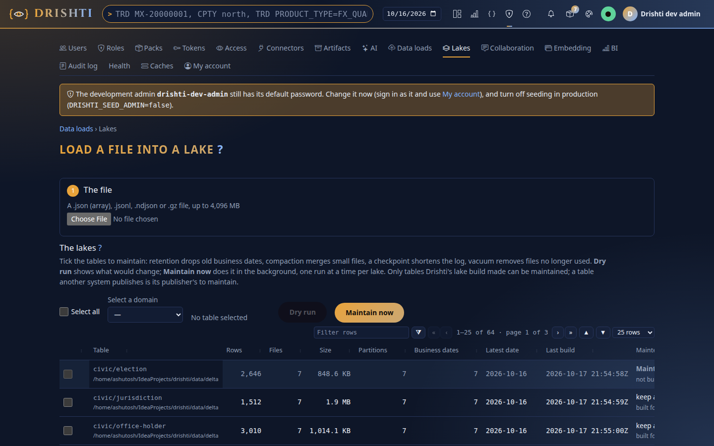

   Click **trading/trade_endur**: its own page lists each of your business dates with its rows, files and size, the columns
   (including `NOTIONAL` and `INDEX_NAME` when the table was built from scratch with this version), the newest commits, your
   `lake build` runs and the connector that reads it (`trade-endur`).
2. **Admin ▾ → Connectors.** You should see `trade-endur`, `trade-calypso`, `trade-murex` and the stores **RUNNING**.
   The live **yfinance** and **news** connectors are shown as **disabled**; `news-store` is **RUNNING** and serves the
   snapshot's quotes and headlines.

   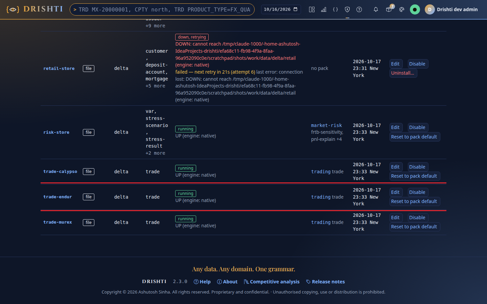
3. **Admin ▾ → Health.** You should see everything green (a warning about a field mask of an example pack that is not
   loaded can be ignored).

   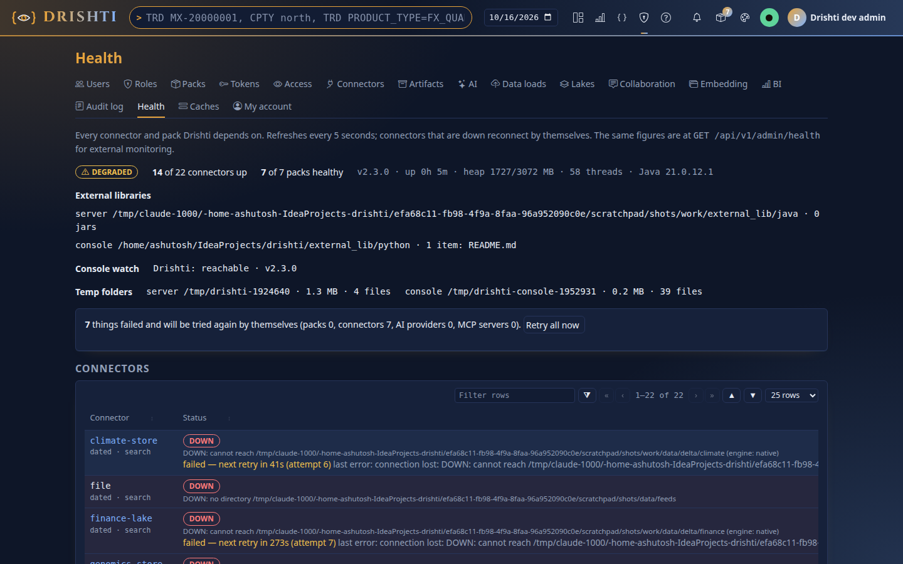
4. **Admin ▾ → Packs → trading → Sutra coverage.** Every SOURCE_SYSTEM × PRODUCT_TYPE in your data has exactly one Sutra.
   A row without a Sutra means a product type of your real data the pack does not know yet: its trades still open, laid
   out by inference.

   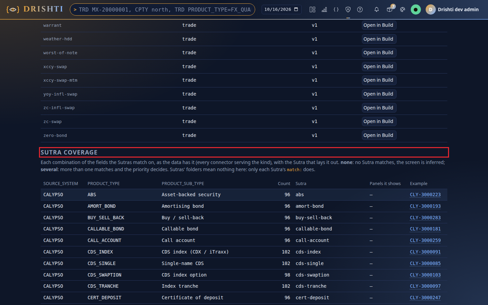

---

## 6. The demo, page by page

| # | Show | How |
|---|---|---|
| 1 | An **ENDUR deal** from your file | Top bar: type one of your real trade ids → Enter. Ticket, legs side by side, cash flows → resets, events, charts. |
| 2 | Trades by system and product | **Forms → Trading**: Source system `ENDUR`, Product type e.g. `ComSwap` → Search. Then `CALYPSO`, then `MUREX`. |
| 3 | A **CALYPSO** and a **MUREX** deal | `/v/trade/CLY-3000157` and `/v/trade/MX-20000001` |
| 4 | **Counterparty → netting set → CSA → collateral** | `/v/counterparty-trades/CP-NORTHPLAINS`, then click a netting set, its CSA, its collateral |
| 5 | A **curve** | `/v/commodity-curve/CMDC-BRENT` |
| 6 | An **equity price** | `/v/listed-company/CO-AAPL` (quote and chart from the snapshot) |
| 7 | **News** | the news panel of the company page, or `/v/news-topic/TOPIC-FED` |
| 8 | **Compare** across two dates | on a trade page, set the date picker to one of your dates → **Compare** → the other date |
| 9 | **BI** by source system | Top bar, the bar-chart icon (**BI**) → **Catalogue** → **Trades overview** → **Open the report**; change a slicer. |
| 10 | How a screen is designed | on a deal page, *How this view was built* → click the Sutra name: the designer opens with the trade as its sample |

### The pages, as they look

| | |
|---|---|
| 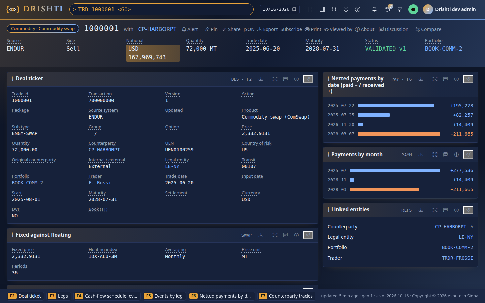 **1. An ENDUR deal** | 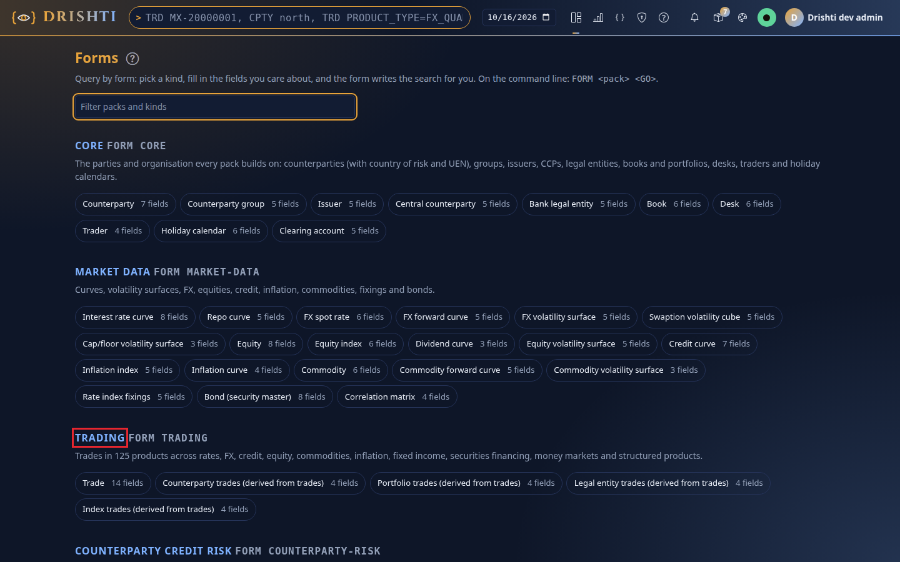 **2. Forms → Trading** |
| 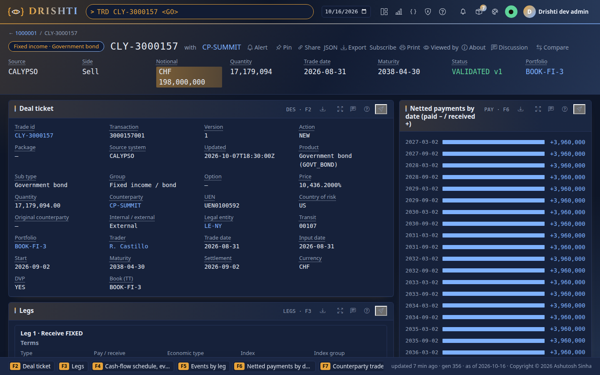 **3. A CALYPSO deal** | 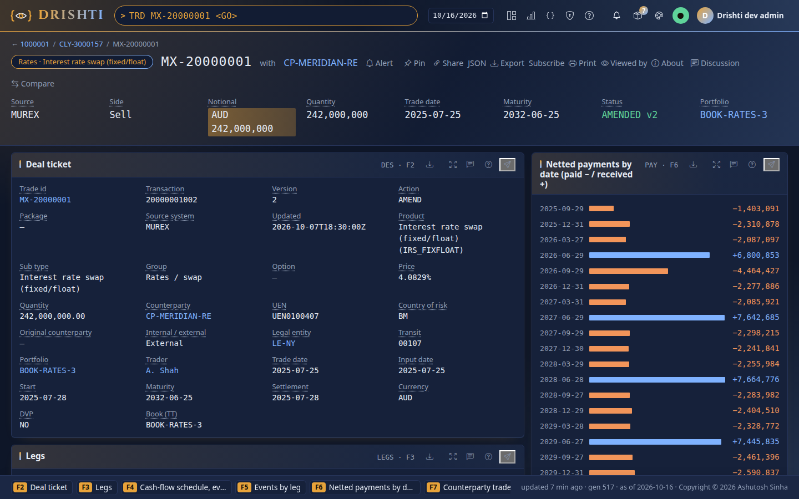 **3. A MUREX deal** |
| 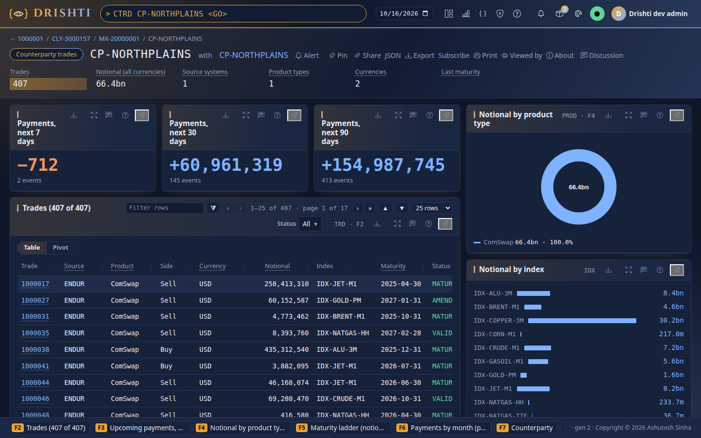 **4. A counterparty** | 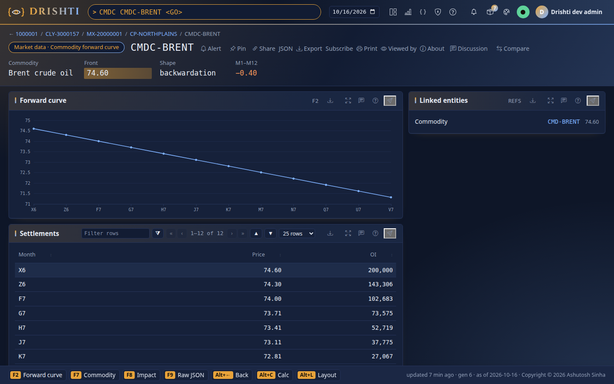 **5. A curve** |
| 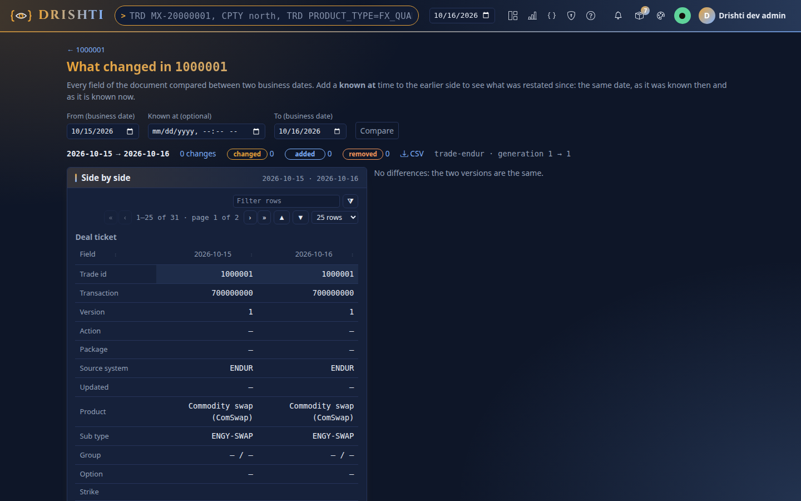 **8. Compare** | 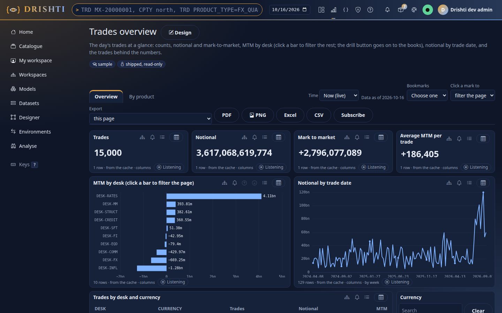 **9. BI, Trades overview** |
| 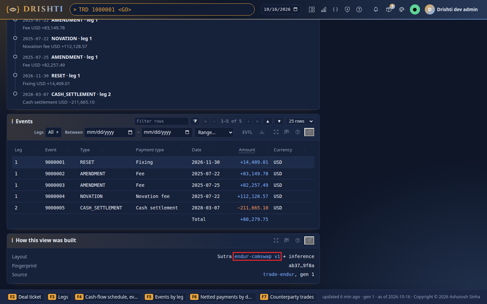 **10. How this view was built** | 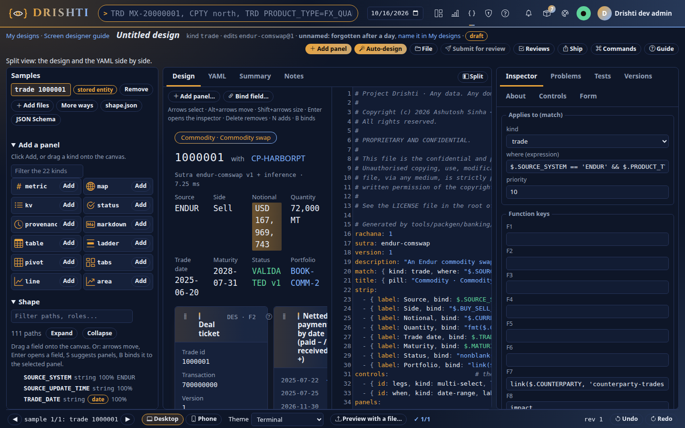 **10. The designer** |

The pictures were taken on synthetic data (a stand-in ENDUR file loaded exactly as in step 3.2); your pages show your
trades.

---

## 6a. Optional: a second server with Drishti*net (15 minutes)

Only if the demo should show two servers acting as one ([tutorial 19](../tutorials/19-a-cluster-of-three.md)). Nothing here changes the
single server of section 4: without a `config\net` folder Drishti*net is off.

**Members use this machine's real address, never `127.0.0.1` or `localhost`** (since 2.6.0 the server, Admin → Net and `drishti.py net`
refuse a loopback address). Find yours once: PowerShell → `ipconfig` → the **IPv4 Address** of your Wi-Fi or Ethernet adapter, for example
`10.20.30.40`. It is written `<your IPv4>` below.

1. In PowerShell, make a key once and keep it for both servers: `$env:DRISHTI_NET_SECRET = [guid]::NewGuid().ToString('N') + [guid]::NewGuid().ToString('N')`.
2. For the first server (the one of section 4.1):
   `C:\Users\asinh09\IdeaProjects\drishti-orig\drishti-console\.venv\Scripts\python.exe C:\Users\asinh09\IdeaProjects\drishti-orig\tools\drishti.py net set node.secret '${DRISHTI_NET_SECRET}'`,
   then the same with `node.enabled true`. No `advertise-url` is needed: the server advertises `http://<your IPv4>:18480` by itself (Admin → Net
   shows it as *detected*). `net list` must say **Drishti*net is ON** and `key set`.
3. For the second server, a copy of the project's `config` in another folder with its own `data` folder, the same two settings
   (`--dir <that folder>\config\net`), and its seed: `net add-peer first <your IPv4>:18480 --dir <that folder>\config\net`.
4. Start the first server as in section 4.1 with `DRISHTI_NET_SECRET` in the run configuration's environment; start the second from a
   PowerShell window in its folder: `java -Djava.io.tmpdir=data\tmp\server -jar <project>\drishti-server\target\drishti-server-<version>-exec.jar --server.port=18490`
   (make `data\tmp\server` first). Each server logs `net: node ... joined Drishti*net at ...` and then `net: member ... joined` for the other.
5. Check: **Admin → Net → Members** lists both `alive` within a few seconds, with the latency each measured (a few milliseconds on one
   machine). Open a trade only the second holds through the console: the same page as on the second; as an administrator, *How this view was
   built* says `Node: <first> · built here, data from <second>`. **Admin → Net → Routing → Explain a request** names the route and lists the
   second under *Data read from*. The members table looks like [tutorial 19's picture](../tutorials/img/t19/01-members.jpg).
6. To show failover, set the console's `DRISHTI_BACKEND_URLS=http://<your IPv4>:18480` before starting it, stop the first server: the next page
   comes from the second within a second, still signed in (sign-in sessions are copied to every server), and an open trade page keeps ticking.
   **Admin → Net → Members** on the second says the first `left`, and *This console's servers* shows 18480 *set aside* and 18490 *in use*
   ([picture](../tutorials/img/t19/09-after-a-stopped.jpg)). A user other than `drishti-dev-admin` must exist on both servers to stay signed in.

If `net set node.enabled true` says *needs the cluster key*, the variable of point 1 is not set in that PowerShell window. If a `net` command
says the address is a loopback address, use `<your IPv4>` from `ipconfig` instead of `127.0.0.1` or `localhost`.

---

## 6b. What is new in 2.6.0: check these (30 minutes)

Do this after `git pull` on **main** and a fresh jar (step 2.3: the file is `drishti-server-2.6.5-exec.jar`), with the server and the
console started as in section 4.

| # | Check | How | You should see |
|---|---|---|---|
| 1 | **Three new themes** | the palette icon in the top bar → **Green Terminal**, then **Crimson Terminal**, then **Blue Terminal**; open a trade in each | dark ground in one hue; every text easy to read; buttons filled (Crimson: deep crimson with white labels, text dusty rose, no blood-red text). Reload the page: the theme stays |
| 2 | **Theme on your phone** | phone on the same network → `http://<your IPv4>:17480` → sign in → pick a Terminal theme | the same look; if the phone shows the old themes, reload the page once |
| 3 | **A statement (paper report)** | follow [tutorial 20](../tutorials/20-statements-and-field-parameters.md) steps 3–5: BI Studio → a report page → **Format → Layout → statement** → the **Paper** tab → preview | pages drawn one at a time with header and footer; **PDF** downloads a page-exact file, **Excel** one set to print on the same paper |
| 4 | **Field parameters** | tutorial 20 steps 1–2: a chart whose slicer switches DESK ↔ PORTFOLIO and MTM ↔ NOTIONAL | the chart redraws with the chosen field; no error |
| 5 | **Iceberg on Windows, no Hadoop** | in a **separate copy** of the project (say `C:\Users\asinh09\IdeaProjects\drishti-iceberg-test`, so your demo's `config\connectors` is untouched): `powershell -ExecutionPolicy Bypass -File tools\windows\load-iceberg.ps1 -Python drishti-console\.venv\Scripts\python.exe`, then `powershell -ExecutionPolicy Bypass -File tools\windows\start-server.ps1 -Iceberg` | the loader ends without any `winutils.exe` or `HADOOP_HOME` error; `data\iceberg` holds one folder per kind; the server starts and **Admin → Connectors** shows the `*-store` connectors **RUNNING** on Iceberg |
| 6 | **Drishti*net addresses** (only if you did section 6a) | **Admin → Net → Members** | both members at `http://<your IPv4>:…`, never `127.0.0.1` |

Not to check on Windows: the **Cassandra** connector needs a Cassandra or ScyllaDB server, which this machine does not have.

---

## 6c. History of a trade or an equity (2.6.5)

Needs **2.6.5**: `git pull` on **main**, step 2.3 again (the jar is `drishti-server-2.6.5-exec.jar`), and **restart both** the server and
the console. The demo lakes of step 3.1 hold **seven business days**, enough to show it; your own ENDUR history shows as soon as **two or
more** of your files are loaded (step 3.2, one per date). Any kind of data has a history, not only trades: a counterparty, a curve, an
economy.

Ids in the demo lakes that changed most over the seven days: ENDUR `1004545` and `1000340` (four changed days: quantity, status, version,
legs, events), CALYPSO `CLY-4000638`, MUREX `MX-20000184`; cancelled trades `1003244` and `MX-30001509`; equities `EQ-CSCA`, `EQ-GRNT`
(the price moves every day), FX `FX-AUDUSD`, the index `EQX-SPX`.

| # | Type in the top bar | You should see |
|---|---|---|
| 1 | `TRD <one of your ENDUR ids> 7` → Enter | one row per business day, newest first; a cell that changed from the day before is highlighted with ▲/▼; the header says the dates, how many days changed and any day with no data |
| 2 | `TRD 1004545 30` | a synthetic ENDUR trade that changed on four days (30 asks for up to 30 days; you get the seven there are) |
| 3 | press **C** | *Changes only*: the days on which nothing moved are hidden |
| 4 | press **D** (or type `TRD <id> 7 DIFF`) | only the fields that changed, and on which day |
| 5 | arrow keys to a row → **Enter** | the trade's normal page as it stood on that day |
| 6 | `EQ EQ-CSCA 3M` | a price chart on top, the last price, change, high, low and range, the daily table below. Days before the lake's first day come from the price history each equity carries; a gap of a few days between the two says *no data on N days* |
| 7 | **E** → CSV or Excel | the table downloads as shown |
| 8 | **Link** | a link that opens the same history for a colleague (within their permissions) |

Also try `TRD <id> YTD`, `TRD <id> FROM 2026-10-07 TO 2026-10-16`, `CPTY CP-NORTHPLAINS 30` (a counterparty) and plain words:
`trade 1004545 last month`. A field you may not see stays `•••` on every day's row. From a terminal:
`…\python.exe …\tools\drishti.py history trade 1004545 --days 30` (add `--diff` for the changes only, `--csv` for a file).

---

## 7. If something goes wrong

| What you see | Do this |
|---|---|
| `pip` or Maven cannot download | Ask IT for the mirror settings: pip reads `%APPDATA%\pip\pip.ini`; Maven reads `%USERPROFILE%\.m2\settings.xml`. |
| PyCharm says the interpreter is invalid | Redo step 2.2 point 2. |
| The Run tab says **DrishtiApplication**, quotes or news try the internet, or sample trades appear | The server was started from the ▶ in `DrishtiApplication.java`: stop it and start **Drishti server (demo lakes)** (section 4.1, way A). |
| IntelliJ: **module not specified**, the main class `com.ash.drishti.server.DrishtiApplication` in red | PyCharm was opened on `drishti-orig` and rewrote its `.idea`: do the note of step 2.2 (close both, delete `drishti-orig\.idea`, PyCharm on `drishti-console`), or reload the Maven projects (section 4.1, way A), or use way B. |
| `start-server.ps1 … cannot be loaded because running scripts is disabled` | Type the line exactly as in section 4.1 way B (`powershell -ExecutionPolicy Bypass -File …`): it allows this one script only. |
| The server log scrolls with thousands of `FilterCompat` or `delta.kernel` INFO lines | An older copy of the project: `git pull` (since 2026-10-18 these libraries log at WARN; Drishti says one line per large table loaded). |
| **BI → Trades overview** shows 0 trades, or a page of the demo shows nothing while Admin → Lakes has the table | Old connector files: stop the server, delete `config\connectors` (step 3.1 point 0), start the server again. |
| `Port 18480 (or 17480) is already in use` | Another copy is running: stop it in IntelliJ / PyCharm (red square), or reboot. |
| `lake build` says `no id (field 'id' is missing…)` | The parameters lack `--key TRADE_ID`: copy the line of step 3.2 again. |
| `lake build` says `give --lake DIR (the Delta root the connector reads)` | The parameters lack `--lake`: copy the line of step 3.2 again (it ends with `--lake $PROJECT_DIR$/../data/delta`, or the full path in a terminal). |
| `lake build` says `no such file or folder` for `config\packs\trading` or writes a `data\delta` inside `drishti-console` | A relative path run from PyCharm's Terminal (it opens in `drishti-console`): use the full-path line of step 3.2. Delete a stray `drishti-console\data` folder if one was made. |
| PowerShell says `lake` is not recognized | `lake …` is not a command of its own: run it as `C:\Users\asinh09\IdeaProjects\drishti-orig\drishti-console\.venv\Scripts\python.exe C:\Users\asinh09\IdeaProjects\drishti-orig\tools\drishti.py lake …`, or use the PyCharm configuration (step 2.2, *What these configurations run*). |
| The run configurations are not in the drop-down | PyCharm must open `drishti-orig\drishti-console` (its configurations are in `drishti-console\run-configs`); IntelliJ must open `drishti-orig` (`run-configs`). See step 2.2. |
| ENDUR pages still show synthetic trades | Step 3.2 point 1 was skipped: stop the server, delete `data\delta\trading\trade_endur`, load your files again, start the server. |
| ENDUR and CALYPSO/MUREX never show on the same date | Step 3.1 used another date: run **Build demo lakes** again with `--as-of` = your newest ENDUR date, then step 3.2 again. |
| A page says *unavailable* for quotes or news | Check **Admin → Connectors**: the snapshot stores must be RUNNING; run **Build demo lakes** again. |
| The server stops with `OutOfMemoryError` | Close other programs; the configuration already gives it 4 GB (`-Xmx4g`), enough up to about 400,000 trades a day; for a million or more give it 8 GB (`-Xmx8g`). |
| Health shows `trade-pages DEGRADED: out of memory building the pages` | The grouped pages were built in memory: delete `config\connectors\trade-pages.yaml` (it comes back with `store: disk`), restart, or give the server more heap. |
| A trade page says `DRS-1004 … timed out` | The first read of a date on a large table; open it again. If it keeps happening, exclude the project's `data` folder from the antivirus's real-time scanning (ask IT), and check that `data` is on the local disk, not a network share. |
| The log says `documents are not cached on disk (…): reads go on without it` | Right after a restart: the old server was still stopping; wait for *documents are cached on disk again* (within a few minutes). Otherwise a second server is running on the same `data` folder: stop it. Nothing is wrong with the data. |
| F7, F8 or F9 do nothing, or Edge opens its Immersive Reader | Use `Alt`+`Shift`+`7`, `8`, `9` (section 4.2). |
| `net …` or Admin → Net says the address is a loopback address | Use this machine's real address (`ipconfig` → IPv4 Address), never `127.0.0.1` or `localhost` (section 6a). |
| `load-iceberg.ps1` asks for `winutils.exe` or `HADOOP_HOME` | An older copy of the project: `git pull` (since 2.6.0 Iceberg runs on Drishti's own engine, no Hadoop). Check the script's first line says the native engine. |
| `TRD <id> 7` opens a pick list instead of the history | A version before 2.6.5: `git pull`, build the jar again (step 2.3), restart both. |
| A counterparty or portfolio page lists only 1,000 trades | By design: the count and every total cover all of its trades; search for the rest. |

---

## 8. Checklist

**The day before:**

- [ ] Step 2 done once (Python environment, PyCharm, IntelliJ, jar built).
- [ ] Step 3.1 with `--as-of` = your newest ENDUR date.
- [ ] Step 3.2 for every ENDUR file, each `rejected=0`.
- [ ] Step 4: server and console start; sign-in works.
- [ ] Step 5: Lakes, Connectors, Health as described.
- [ ] Step 6: walk through the ten pages once.
- [ ] Step 6b: the 2.6.0 checks (themes, statement, field parameters, Iceberg in a separate copy).
- [ ] Step 6c (2.6.5): `TRD <your id> 7` and `EQ <id> 3M` show their history.

**After the demo:**

- [ ] Stop the server and the console.
- [ ] In PowerShell in the project folder, `git status` shows nothing new outside `data\` (the lakes there are ignored by
      git). Your ENDUR files never left `C:\Users\asinh09\drishti-private\`.
