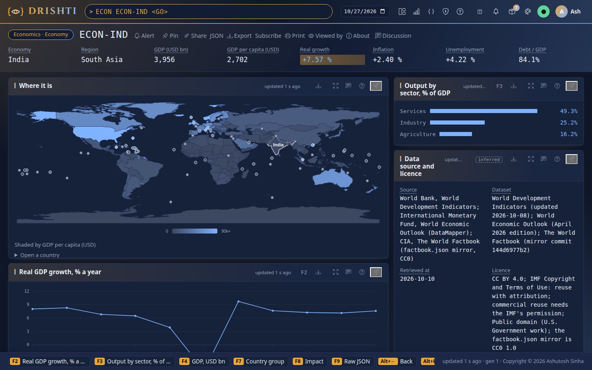
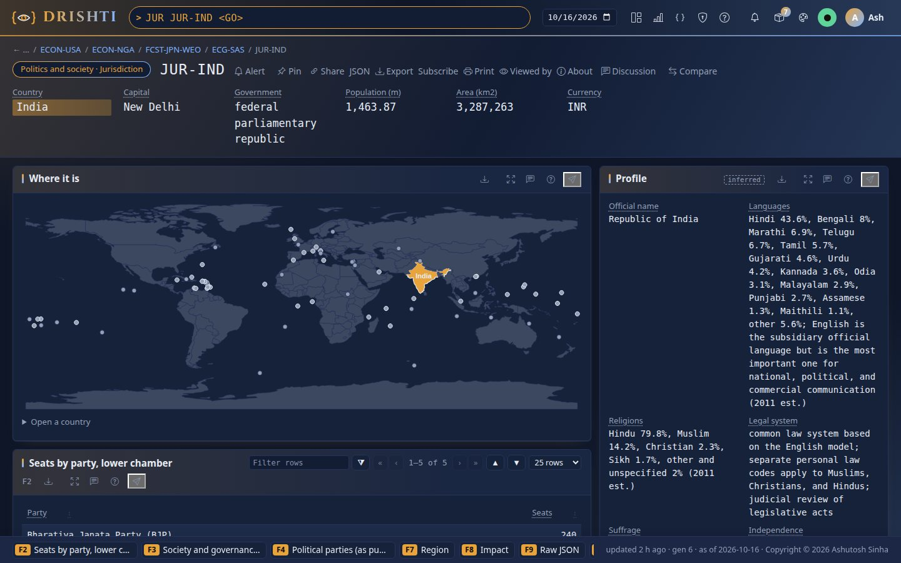
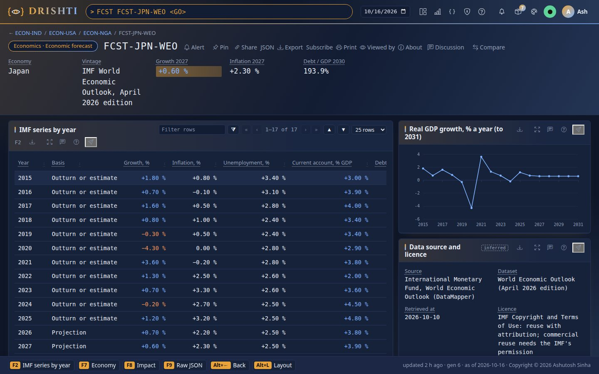
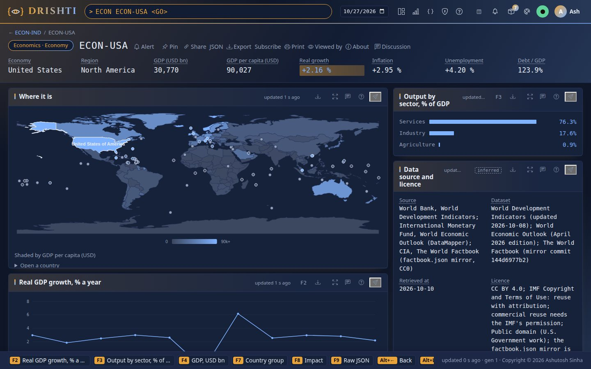
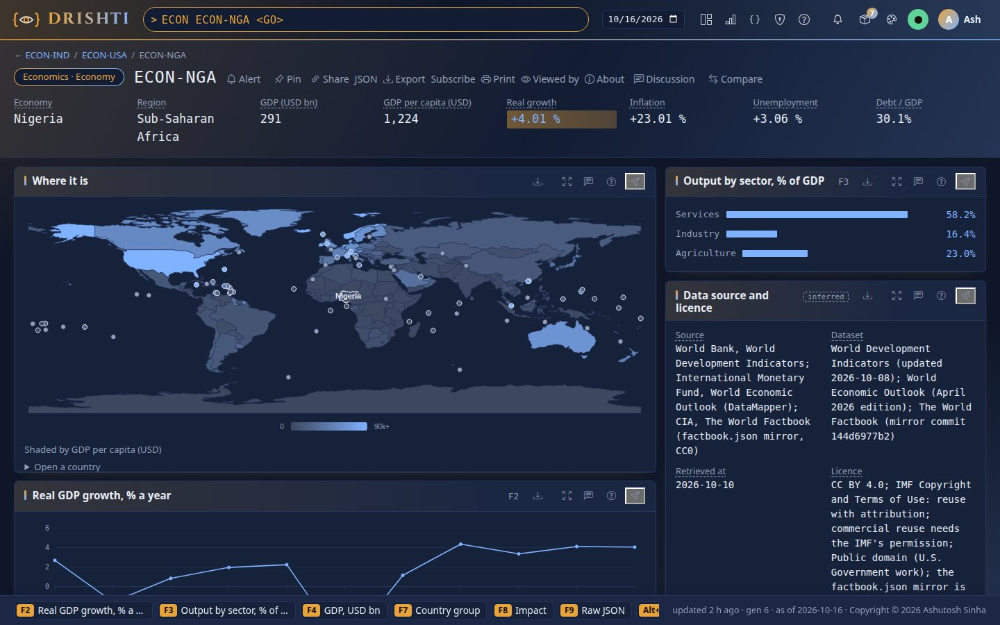
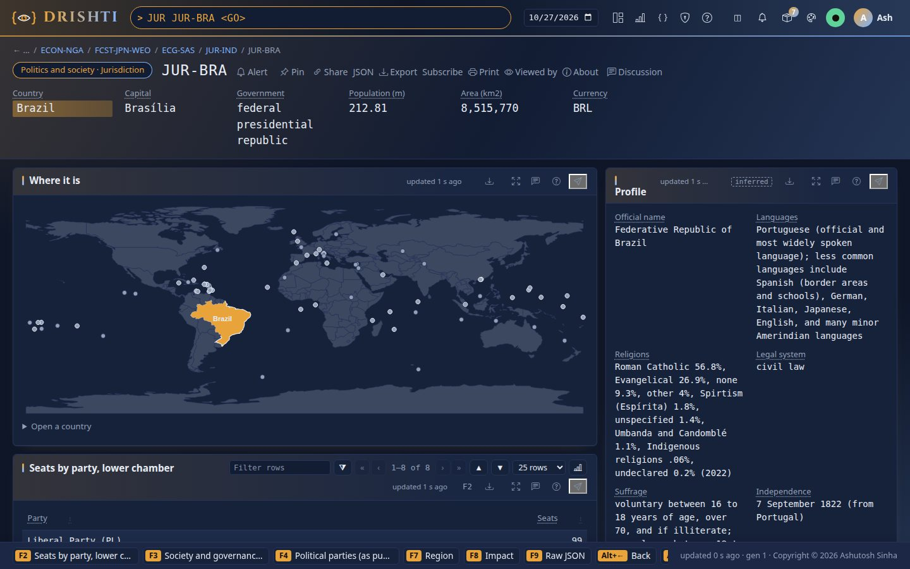
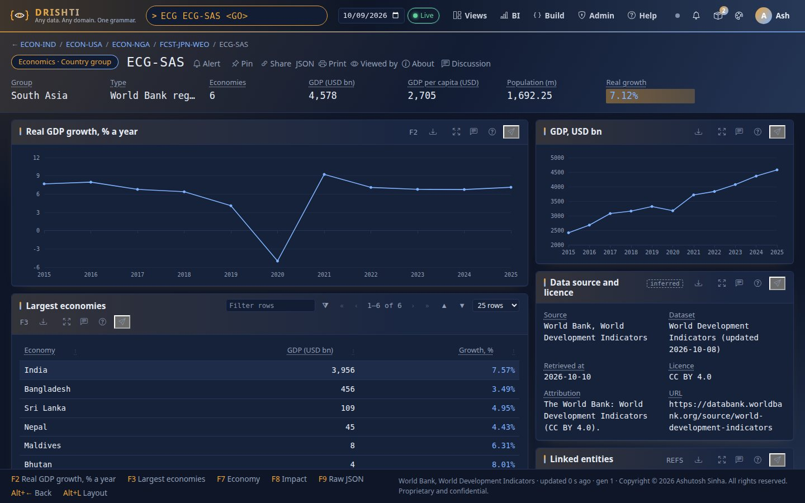
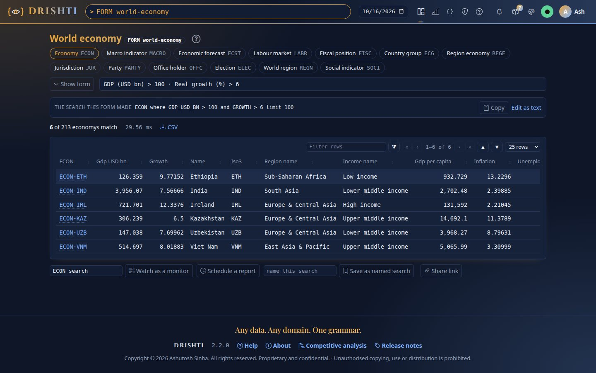
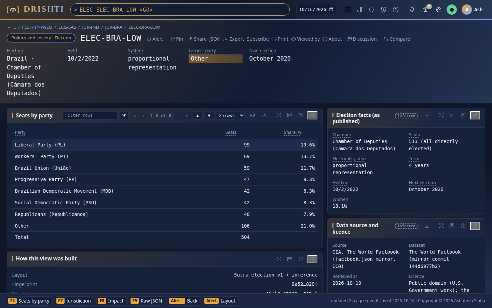
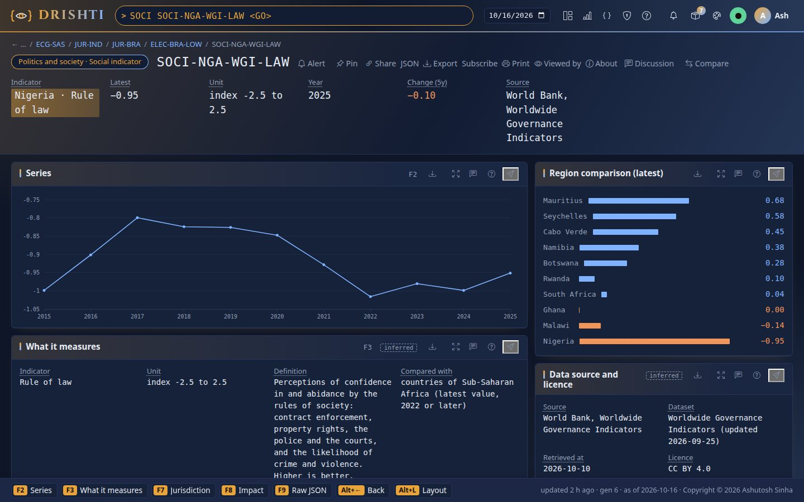

<!--
  Project Drishti · Any data. Any domain. One grammar.

  Copyright (c) 2026 Ashutosh Sinha <ajsinha@gmail.com>.
  All rights reserved.

  PROPRIETARY AND CONFIDENTIAL.

  This file is the confidential and proprietary property of Ashutosh Sinha.
  Unauthorised copying, use, modification, distribution or disclosure of this
  file, via any medium, is strictly prohibited except with the express prior
  written permission of the copyright holder.

  See the LICENSE file in the root of this repository for the full terms.
-->
# Real data in the world-economy pack

The `world-economy` packs carry **published public data**, not samples: about 213 economies and 216 countries from the World Bank, the IMF, UNDP and
the CIA World Factbook. Every number is a published value (a percentage stays a percentage, as the source states it) and every text is as the source publishes it (HTML
removed). Neither pack is marked `sample: true` any more.

The data is fetched and normalised by a repeatable tool, `tools/realdata/`, and committed to git as a small normalised dataset (`tools/realdata/dataset/`, 2.4 MB) plus the
generated pack documents. The raw downloads are cached outside the repository and are never committed.

> **Licence note: IMF data is for internal demonstration only.** The IMF World Economic Outlook data in these packs (the `economic-forecast` documents, and the
> `debt` and `net_lending` series that feed each economy's debt ratio and fiscal position) is kept for **internal demos only**. The IMF's terms allow reuse with
> attribution but require its **permission for commercial use** (copyright@imf.org). Before the packs are shown to a client, shipped, sold or used commercially,
> either obtain that permission or build without the IMF: `python3 tools/realdata/realdata.py write --no-imf` (see [Building without the IMF](#building-without-the-imf)).
> The World Bank (CC BY 4.0), UNDP (CC BY 3.0 IGO) and CIA Factbook (public domain) data needs only attribution.



## Sources, licences and attribution

<!-- realdata:begin sources -->
| Source | Dataset and vintage | Licence | Terms |
|---|---|---|---|
| World Bank, World Development Indicators | World Development Indicators (updated 2026-10-08) | CC BY 4.0 | https://datacatalog.worldbank.org/public-licenses#cc-by |
| World Bank, Worldwide Governance Indicators | Worldwide Governance Indicators (updated 2026-09-25) | CC BY 4.0 | https://datacatalog.worldbank.org/public-licenses#cc-by |
| International Monetary Fund, World Economic Outlook (DataMapper) | World Economic Outlook (April 2026 edition) | IMF Copyright and Terms of Use: reuse with attribution; commercial reuse needs the IMF's permission | https://www.imf.org/en/About/copyright-and-terms |
| UNDP, Human Development Report: composite indices time series | Human Development Index time series (2025 report) | CC BY 3.0 IGO | https://creativecommons.org/licenses/by/3.0/igo/ |
| CIA, The World Factbook (factbook.json mirror, CC0) | The World Factbook (mirror commit 144d6977b2) | Public domain (U.S. Government work); the factbook.json mirror is CC0 1.0 | https://github.com/factbook/factbook.json/blob/master/LICENSE.md |
<!-- realdata:end sources -->

Attribution text (also in [THIRD-PARTY-NOTICES.md](../../THIRD-PARTY-NOTICES.md), and in each document's *Data source and licence* panel):

- The World Bank: World Development Indicators (CC BY 4.0). The World Bank: Worldwide Governance Indicators (CC BY 4.0).
- Source: International Monetary Fund, World Economic Outlook database, https://www.imf.org/external/datamapper. The packs transform the data (units, rounding to six
  significant digits, joins with other sources); the IMF's terms ask that material changes be stated, which this guide and the panel do.
- UNDP, Human Development Report 2025 data (CC BY 3.0 IGO).
- Central Intelligence Agency, The World Factbook (public domain). The Factbook is read through the CC0 `factbook.json` mirror, pinned to a commit (recorded in each
  document's dataset line), because the CIA site offers no stable download of the whole book.

Caveats to read before reusing the data. **IMF:** the terms allow downloading, copying and derivative works with attribution, but ask for permission before *commercial*
reuse and prohibit bulk automated downloads without permission; the tool makes one request per series (eight in all) with a pause, and the data is shown here for a
demonstration. Ask copyright@imf.org before any commercial use. **UNDP:** the HDR data page states CC BY 3.0 IGO; check the page before redistribution. **World Bank:** each
indicator also has its own upstream source (for example SIPRI for military spending, the Inter-Parliamentary Union for women in parliament, ILO for labour data) that WDI
credits; the *About this series* panel shows the World Bank code to look it up.

## What is in the packs

| Pack | Kind | Mnemonic | Documents | One document is |
|---|---|---|---|---|
| economics | `economy` | `ECON` | 213 | a country: GDP, growth, inflation, unemployment, debt, current account, sectors, links to its region, income group, labour market, fiscal position, IMF forecast and 16 indicators |
| economics | `macro-indicator` | `MACRO` | 3,119 | one headline statistic of one country: history 2015 to the latest year, rank among countries, definition |
| economics | `economic-forecast` | `FCST` | 192 | the IMF WEO series 2015 to 2031 (growth, inflation, unemployment, current account, debt, net lending, GDP), outturn and projections |
| economics | `labour-market` | `LABR` | 185 | unemployment, participation, youth and female labour, jobs and output by sector |
| economics | `fiscal-position` | `FISC` | 192 | IMF debt and net lending, World Bank revenue, expense, military spending |
| economics | `country-group` | `ECG` | 12 | a World Bank region, income group or the world, with aggregate series and its largest economies |
| economics | `region-economy` | `REGE` | 59 | a state or territory (ISO 3166-2, `AU-NSW`, `US-CA`) with population and GDP: an **illustrative sample, rounded from public figures, not for reporting** (`tools/realdata/dataset/regions.json`, not fetched), behind the BI sample report *Region economics* |
| world-economy | `jurisdiction` | `JUR` | 216 | a country: government type, capital, legislature seats by party, indicators, links to office holders, elections, parties and region |
| world-economy | `office-holder` | `OFFC` | 430 | the chief of state and head of government as the Factbook publishes them |
| world-economy | `election` | `ELEC` | 378 | the most recent lower-chamber, upper-chamber and executive election: system, term, seats by party, next election |
| world-economy | `party` | `PARTY` | 282 | a party that won seats in the lower chamber at the most recent election, with the chamber's full result |
| world-economy | `region` | `REGN` | 7 | a World Bank region: countries, population, life expectancy, government types |
| world-economy | `social-indicator` | `SOCI` | 4,297 | one social or governance statistic of one country with a regional comparison |

Removed because no open, global dataset backs them: central-bank decisions, trade flows (bilateral), price baskets, opinion polls, bills and candidates. The old
fictional polities (Valdoria, Kestria) and the invented economies are gone.

Identifiers use the ISO 3166 alpha-3 code: `ECON-IND`, `MACRO-BRA-GDP-GROWTH`, `FCST-JPN-WEO`, `LABR-NGA`, `FISC-USA`, `ECG-SAS`, `JUR-USA`, `OFFC-JPN-HOG`,
`ELEC-BRA-LOW`, `PARTY-IND-01`, `REGN-SSF`, `SOCI-NGA-WGI-LAW`. The link graph is: country ↔ region ↔ income group ↔ indicators ↔ forecast, labour and fiscal documents, and
(politics) jurisdiction ↔ region, office holders, elections, parties, indicators.



### Provenance in every document

Each document has a `provenance` object (shown by the *Data source and licence* panel) and the same four facts in `_meta`:

<!-- realdata:begin provenance -->
```json
"provenance": {"source": "International Monetary Fund, World Economic Outlook (DataMapper)", "dataset": "World Economic Outlook (April 2026 edition)",
  "retrievedAt": "2026-10-10", "licence": "IMF Copyright and Terms of Use: reuse with attribution; commercial reuse needs the IMF's permission",
  "attribution": "Source: International Monetary Fund, World Economic Outlook database, https://www.imf.org/external/datamapper.",
  "url": "https://www.imf.org/external/datamapper"}
```
<!-- realdata:end provenance -->



## Coverage

Years: World Bank and UNDP series 2015 to 2025 (a series shows the years the source has; the latest year differs by country and indicator), IMF series 2015 to 2031.
Countries are the 217 economies the World Bank lists as countries or territories (Channel Islands has no Factbook profile, so 216 jurisdictions and 213 economies with
output data). Examples of how many countries have data: GDP 213, real growth 212, inflation 190, unemployment 187, government debt (IMF) 190, Gini 151, HDI 193, rule of
law 207, CO2 per capita 203, reserves 177. A missing value is simply absent from the series: nothing is estimated or filled in. Rankings count only countries whose latest
value is from 2022 or later.

Size: the world-economy pack is about 19 MB (its economics half 6.9 MB, its politics half 12.1 MB) and the normalised dataset 2.4 MB (21.4 MB of text in all, under the 25 MB limit; git compresses it to
about a fifth). Sample documents are written without indentation (`compact_json` in the pack generator) to keep it small.

### More countries and groups

The same Sutras serve every country: the United States and Nigeria below, Brazil's government, and the World Bank's South Asia group with its largest economies.






## Indicators

### Economy, labour and fiscal (world-economy pack, economics half)

<!-- realdata:begin indicators-economics -->
| Key | Indicator | Unit | Source and code | Countries with data |
|---|---|---|---|---|
| `gdp` | GDP, current prices | USD bn | World Bank WDI `NY.GDP.MKTP.CD` | 213 |
| `gdp_pc` | GDP per capita, current prices | USD | World Bank WDI `NY.GDP.PCAP.CD` | 213 |
| `gdp_growth` | Real GDP growth | % a year | World Bank WDI `NY.GDP.MKTP.KD.ZG` | 212 |
| `inflation` | Inflation, consumer prices | % a year | World Bank WDI `FP.CPI.TOTL.ZG` | 190 |
| `unemployment` | Unemployment rate | % of labour force | World Bank WDI `SL.UEM.TOTL.ZS` | 187 |
| `population` | Population | millions | World Bank WDI `SP.POP.TOTL` | 217 |
| `current_account` | Current account balance | % of GDP | World Bank WDI `BN.CAB.XOKA.GD.ZS` | 192 |
| `reserves` | Total reserves incl. gold | USD bn | World Bank WDI `FI.RES.TOTL.CD` | 177 |
| `trade` | Trade | % of GDP | World Bank WDI `NE.TRD.GNFS.ZS` | 188 |
| `exports` | Exports of goods and services | % of GDP | World Bank WDI `NE.EXP.GNFS.ZS` | 188 |
| `imports` | Imports of goods and services | % of GDP | World Bank WDI `NE.IMP.GNFS.ZS` | 188 |
| `fdi` | Foreign direct investment, net inflows | % of GDP | World Bank WDI `BX.KLT.DINV.WD.GD.ZS` | 200 |
| `co2` | CO2 emissions per capita | t CO2e | World Bank WDI `EN.GHG.CO2.PC.CE.AR5` | 203 |
| `real_interest` | Real interest rate | % a year | World Bank WDI `FR.INR.RINR` | 136 |
| `agriculture` | Agriculture, value added | % of GDP | World Bank WDI `NV.AGR.TOTL.ZS` | 202 |
| `industry` | Industry, value added | % of GDP | World Bank WDI `NV.IND.TOTL.ZS` | 205 |
| `services` | Services, value added | % of GDP | World Bank WDI `NV.SRV.TOTL.ZS` | 204 |
| `lfp` | Labour force participation rate | % of population 15+ | World Bank WDI `SL.TLF.CACT.ZS` | 187 |
| `youth_unemployment` | Youth unemployment rate | % of labour force 15-24 | World Bank WDI `SL.UEM.1524.ZS` | 187 |
| `employment_ratio` | Employment to population ratio | % of population 15+ | World Bank WDI `SL.EMP.TOTL.SP.ZS` | 187 |
| `female_lfp` | Female labour force participation rate | % of women 15+ | World Bank WDI `SL.TLF.CACT.FE.ZS` | 187 |
| `vulnerable` | Vulnerable employment | % of employment | World Bank WDI `SL.EMP.VULN.ZS` | 187 |
| `emp_agriculture` | Employment in agriculture | % of employment | World Bank WDI `SL.AGR.EMPL.ZS` | 187 |
| `emp_industry` | Employment in industry | % of employment | World Bank WDI `SL.IND.EMPL.ZS` | 187 |
| `emp_services` | Employment in services | % of employment | World Bank WDI `SL.SRV.EMPL.ZS` | 187 |
| `debt` | General government gross debt | % of GDP | IMF WEO `GGXWDG_NGDP` | 190 |
| `net_lending` | General government net lending/borrowing | % of GDP | IMF WEO `GGXCNL_NGDP` | 193 |
| `tax_revenue` | Tax revenue | % of GDP | World Bank WDI `GC.TAX.TOTL.GD.ZS` | 150 |
| `revenue` | Revenue, excluding grants | % of GDP | World Bank WDI `GC.REV.XGRT.GD.ZS` | 150 |
| `expense` | Expense | % of GDP | World Bank WDI `GC.XPN.TOTL.GD.ZS` | 150 |
| `military` | Military expenditure | % of GDP | World Bank WDI `MS.MIL.XPND.GD.ZS` | 159 |
<!-- realdata:end indicators-economics -->

### Society and governance (world-economy pack, politics half)

<!-- realdata:begin indicators-society -->
| Key | Indicator | Unit | Source and code | Countries with data |
|---|---|---|---|---|
| `life_expectancy` | Life expectancy at birth | years | World Bank WDI `SP.DYN.LE00.IN` | 217 |
| `hdi` | Human Development Index | index 0-1 | UNDP HDR `hdi` | 193 |
| `fertility` | Fertility rate | births per woman | World Bank WDI `SP.DYN.TFRT.IN` | 217 |
| `infant_mortality` | Infant mortality rate | per 1,000 live births | World Bank WDI `SP.DYN.IMRT.IN` | 196 |
| `under5_mortality` | Under-5 mortality rate | per 1,000 live births | World Bank WDI `SH.DYN.MORT` | 196 |
| `urban` | Urban population | % of population | World Bank WDI `SP.URB.TOTL.IN.ZS` | 217 |
| `pop_growth` | Population growth | % a year | World Bank WDI `SP.POP.GROW` | 217 |
| `gini` | Gini index | index 0-100 | World Bank WDI `SI.POV.GINI` | 151 |
| `poverty` | Extreme poverty headcount | % of population | World Bank WDI `SI.POV.DDAY` | 151 |
| `literacy` | Adult literacy rate | % of people 15+ | World Bank WDI `SE.ADT.LITR.ZS` | 119 |
| `secondary_enrolment` | Secondary school enrolment | % gross | World Bank WDI `SE.SEC.ENRR` | 191 |
| `internet` | Individuals using the Internet | % of population | World Bank WDI `IT.NET.USER.ZS` | 208 |
| `electricity` | Access to electricity | % of population | World Bank WDI `EG.ELC.ACCS.ZS` | 215 |
| `health_spend` | Current health expenditure | % of GDP | World Bank WDI `SH.XPD.CHEX.GD.ZS` | 193 |
| `education_spend` | Government expenditure on education | % of GDP | World Bank WDI `SE.XPD.TOTL.GD.ZS` | 190 |
| `women_parliament` | Women in national parliament | % of seats | World Bank WDI `SG.GEN.PARL.ZS` | 193 |
| `wgi_voice` | Voice and accountability | index -2.5 to 2.5 | World Bank WGI `GOV_WGI_VA.EST` | 207 |
| `wgi_stability` | Political stability and absence of violence | index -2.5 to 2.5 | World Bank WGI `GOV_WGI_PV.EST` | 207 |
| `wgi_effectiveness` | Government effectiveness | index -2.5 to 2.5 | World Bank WGI `GOV_WGI_GE.EST` | 205 |
| `wgi_regulatory` | Regulatory quality | index -2.5 to 2.5 | World Bank WGI `GOV_WGI_RQ.EST` | 205 |
| `wgi_law` | Rule of law | index -2.5 to 2.5 | World Bank WGI `GOV_WGI_RL.EST` | 207 |
| `wgi_corruption` | Control of corruption | index -2.5 to 2.5 | World Bank WGI `GOV_WGI_CC.EST` | 207 |
<!-- realdata:end indicators-society -->

The definitions and units are in each pack's *About this page* glossary (`config/about.yaml`, from `tools/packgen/*/about.yaml`, which `tools/realdata/about.py` generates) and in each macro or social indicator's
*About this series* panel. World Governance Indicators are estimates from about -2.5 (weak) to 2.5 (strong).



`FORM world-economy economy` searches the real data (the picture was taken when the economics half was a pack of its own, `FORM economics`): the form above finds six economies larger than USD 100 bn growing above 6% (Ethiopia, India, Ireland, Kazakhstan,
Uzbekistan, Viet Nam in the April 2026 data).

## The tool: `tools/realdata/`

```
python3 tools/realdata/realdata.py fetch     [--cache DIR] [--refresh] [--pause S]   download the raw data (network)
python3 tools/realdata/realdata.py normalise [--cache DIR]                           raw cache -> tools/realdata/dataset/*.json
python3 tools/realdata/realdata.py about                                              sources.yaml + about/*.kinds.yaml -> tools/packgen/*/about.yaml
python3 tools/realdata/realdata.py write                                              dataset -> the pack, its glossary and its Sutra tests
python3 tools/realdata/realdata.py tests                                              the packs' Sutra tests only (config/packs/*/tests)
python3 tools/realdata/realdata.py docs                                               the generated tables of this guide
python3 tools/realdata/realdata.py all       [--cache DIR] [--refresh]                fetch, normalise, about, write, docs: everything committed
python3 tools/realdata/realdata.py check     [--cache DIR]                           fail if anything committed differs from what `all` would write
```

`all` from the cached raw data regenerates **everything committed for the pack** byte for byte: the normalised dataset, the glossary source
(`tools/packgen/*/about.yaml`), the packs (`pack.yaml`, Sutras, samples, guides, help, `config/about.yaml`), the Sutra tests (`tests/`) and the tables of this guide
between its `<!-- realdata:begin ... -->` markers (sources, the two indicator tables with their country counts, the provenance example). Only `config/formats.yaml` is kept by hand.
`check` fails on any drift: it re-derives the dataset from the cache (skipped, with a note, when there is no cache), runs both generators with `--check` (pack, glossary and
tests) and compares the guide tables. A run on the committed state prints:

```
$ python3 tools/realdata/realdata.py check
dataset: no raw cache at /home/ci/.cache/drishti-realdata, not re-derived     (with a cache: nothing)
economics: 3924 files up to date
world-economy: 5621 files up to date
```

### Building without the IMF

```
python3 tools/realdata/realdata.py all --no-imf [--out DIR]     # fetch (never the IMF), normalise, write the packs
python3 tools/realdata/realdata.py write --no-imf               # from the committed dataset, filtered
python3 tools/realdata/realdata.py check --no-imf               # the --no-imf packs are what the tool would write
```

`--no-imf` builds a World Bank, UNDP and Factbook pack set: the IMF is not contacted, the `economic-forecast` kind and its 192 documents are gone, the IMF `debt` and
`net_lending` series are gone (so an economy has no `debtToGdp` and no `outlook` link), the `fiscal-position` kind keeps only the World Bank revenue, expense and military
shares (`debt`, `balance` and the two paths are removed), and the glossary, FORM, examples, guide and provenance never name the IMF as a source. The world-economy pack
never used IMF data and is identical. The one remaining word is the World Bank's definition of *Total reserves* ("... reserve position in the IMF ..."), which describes the
reserves, not IMF data. The committed dataset, glossary, tests and this guide are never touched: the packs go to `--out` (default `~/.cache/drishti-realdata/no-imf/packs`) and a
`--no-imf` dataset to `~/.cache/drishti-realdata/no-imf/dataset`; copy the two pack directories into `config/packs/` of the build you ship.

| File | Role |
|---|---|
| `sources.yaml` | the sources (name, API, licence, attribution) and every indicator (code, unit, scale, definition); edit this to add an indicator |
| `fetch.py` | the downloader: one request per World Bank indicator, per IMF series and per Factbook file, a pause between requests, retries, files already cached are kept |
| `normalise.py` | pure parsing functions (World Bank, IMF, UNDP, Factbook) and the run that writes `dataset/*.json` |
| `build_docs.py` | the document builders both pack generators call (`economics()`, `politics()`); `Data(no_imf=True)` drops the IMF |
| `about.py`, `about/*.kinds.yaml` | the glossary source: the vocabulary comes from `sources.yaml`, the per-kind and per-field text from `about/<pack>.kinds.yaml` (edit there, not in `tools/packgen/*/about.yaml`) |
| `pack_tests.py`, `pack_tests.yaml` | the packs' Sutra tests: which documents ship as tests, what each expects, the help-coverage ratchet |
| `doc_snippets.py` | the generated tables of this guide |
| `packrun.py` | what both pack generators run: glossary, pack and tests, written or (`--check`) compared |
| `tests/` | `test_normalise.py` against small recorded fixtures (`tests/fixtures/`), `test_build_docs.py` against the committed dataset, `test_pipeline.py` (reproducibility, drift, `--no-imf`); no network |

The cache defaults to `~/.cache/drishti-realdata` (outside the repository; use `--cache` to move it). A full fetch is about 50 World Bank calls, 8 IMF calls, one UNDP file and
about 260 Factbook files, and takes 10 to 20 minutes at the default pause; the World Bank API is sometimes slow. Run it rarely and with the default pause.

### Refreshing

The everyday way is the pack's own refresh script, `tools/publicdata/world_economy.py` (status, dry run, `--years`, `--scope`,
the internal-only rule for the IMF data, Windows wrappers): see [PUBLIC_DATA.md](PUBLIC_DATA.md). It runs the commands below for you.

```
python3 tools/realdata/realdata.py all --refresh      # download again, normalise, regenerate glossary, packs, tests and guide tables
python3 tools/realdata/realdata.py check              # clean when everything committed matches
python3 tools/packgen/world/make.py --check           # clean when the pack matches the dataset
python3 tools/packgen/politics/make.py --check
python3 tools/drishti.py pack check config/packs/world-economy config/packs/world-economy
python3 -m pytest tools/realdata/tests
```

Review the diff of `tools/realdata/dataset/` (that is the change in the world), and update the vintage notes if a source changed its format. The UNDP file name carries
the report year (the `csv:` address under `undp:` in `sources.yaml`): move it when a new HDR is published. The Factbook mirror is pinned to the commit that was current when fetched; a
refresh pins the newest.

How the Factbook is read: *Government type*, *Capital*, *Independence*, *Executive branch* (chief of state, head of government, how chosen, last and next election),
*Legislative branch* (the lower and upper chamber: seats, system, term, parties elected and seats per party), *Political parties*, *Area*, *Languages*, *Religions* and the
*Exchange rates* currency code. A Factbook profile is matched to a World Bank country by its Internet country code (the ISO 3166 alpha-2 code, with a few exceptions) and then by
name; unmatched profiles are listed in `meta.json` (`factbookUnmatched`: dependencies and uninhabited territories the World Bank does not list). Texts such as office holders
(`President Droupadi MURMU (since 25 July 2022)`) are shown as published: the tool splits off only the *since* date, it does not parse names.

## Generated outputs stay consistent

`tools/packgen/world/make.py` (joining the halves `tools/packgen/economics/make.py` and `tools/packgen/politics/make.py`) writes `pack.yaml`, the Sutras, `samples/`, `guides/`, `config/help.yaml` and `config/about.yaml`;
`--check` fails if any differs. They also write `config/about.yaml`'s source and the pack `tests/` (see `about.py` and `pack_tests.py`). Only `config/formats.yaml` (the `pc1` and `pc2` formats that add a `%` sign to values already in percent) is kept by hand. The
pack tests are one to five real countries per kind (India, the United States, Brazil, Nigeria, Japan) with `expect.yaml` (`noErrors`, `nonEmpty`, help coverage 100%); which ones is in `tools/realdata/pack_tests.yaml`.

```
$ python3 tools/drishti.py pack check config/packs/world-economy config/packs/world-economy
== economics: sutra lint: exit 0
== economics: sutra test: exit 0
     economy: help coverage 8/8 (100%)
     ...
== world-economy: sutra lint: exit 0
== world-economy: sutra test: exit 0
```




The pictures are made by `tools/docs/shots/realdata.py` (`drishti-console/.venv/bin/python tools/docs/screenshots.py --guide realdata`) on a server started with
`DRISHTI_PACKS=world-economy`.
