<!--
  Project Drishti · Any data. Any domain. One grammar.

  Copyright (c) 2026 Ashutosh Sinha <ajsinha@gmail.com>.
  All rights reserved.

  PROPRIETARY AND CONFIDENTIAL.

  This file is the confidential and proprietary property of Ashutosh Sinha.
  Unauthorised copying, use, modification, distribution or disclosure of this
  file, via any medium, is strictly prohibited except with the express prior
  written permission of the copyright holder.

  See the LICENSE file in the root of this repository for the full terms.
-->
# Reports: the YAML, the visuals and how they behave

A **report** is pages of **visuals** on a 12-column grid, bound to the fields and measures of one **dataset** ([DATASETS.md](DATASETS.md)). This is the reference for the file, for the visual
catalogue, for how a visual becomes a query, and for what people can do with a report on the page. To read or build one step by step see [tutorial 10](../tutorials/10-first-bi-report.md) (a first report; [tutorial 12](../tutorials/12-live-bi-and-boards.md) for a live one); for the
pages (viewer, designer, Model view) see [BI_GUIDE.md](BI_GUIDE.md) sections 14 to 16 and 18. The design is [RUPAKA.md](../architecture/RUPAKA.md) sections 8 and 9; what is built is its sections 20.3 and 20.5.

Three sample reports ship in `config/bi/reports/` (and a fourth for Python, **Desk P&L risk (Python)**, section 3.3), each marked `sample: true` and commented line by line: **Trades overview** (on `trades-basic`), **Counterparty risk** (cross-pack, on
`trading-risk`) and **Cashflow ladder** (deep trades, on `trading-cashflows`); phase 5 adds **Live trading desk** (on the live dataset `live-trading`: cards, a bar, a rolling line, two tables, a grid of every trade, a matrix and a stacked column chart) and
**Live exposure** (on `live-exposure`), and the board **Desk wall** ([BOARDS.md](BOARDS.md)) that shows tiles of both.

## Contents

1. [Where a report lives](#1-where-a-report-lives)
2. [The file](#2-the-file)
3. [The visuals and their wells](#3-the-visuals-and-their-wells)
4. [Filters](#4-filters)
5. [Format](#5-format)
6. [Slicers](#6-slicers)
7. [How a visual becomes a query](#7-how-a-visual-becomes-a-query)
8. [What people can do with a report](#8-what-people-can-do-with-a-report)
9. [Checking a report: DRS-9030 to DRS-9036](#9-checking-a-report-drs-9030-to-drs-9036)
10. [Security](#10-security)
11. [Settings](#11-settings)
12. [Built and not built](#12-built-and-not-built)
13. [Live visuals, and the Perspective types of 2.1 (phase 5)](#13-live-visuals-and-perspective-phase-5)
14. [Phone and tablet layouts](#14-phone-and-tablet-layouts)
15. [A report in another web application](#15-a-report-in-another-web-application)
16. [Reports over several datasets](#16-reports-over-several-datasets)
17. [Expected values: `tests:`](#17-expected-values-tests)
18. [A report on a model (wave W1)](#18-a-report-on-a-model-wave-w1)
19. [Languages in the report designer (wave A)](#19-languages-in-the-report-designer-wave-a)
20. [Report schema v2 in one report (2.4.0)](#20-report-schema-v2-in-one-report-240)

## 1. Where a report lives

* **A file** in the BI folder: `config/bi/reports/<id>.report.yaml` (`drishti.bi.dir`). It is a published, read-only item of the catalogue (workspace *Shipped content*, id `file:report:<id>`), watched
  **live**: add, change or delete the file and the catalogue and the viewer follow, with no restart; a file that does not parse keeps its last good version and is reported ([BI_GUIDE.md](BI_GUIDE.md) section 10).
* **An item** of a workspace: a `report` item whose YAML body is a draft you edit in the designer, then publish like any item (review, versions, endorsement, audience). Publishing checks the structure
  and refuses a report with errors (`DRS-9030`).

The catalogue keys `title`, `description`, `owner`, `tags`, `endorsement`, `audience` and `sample` are read from the same file; the rest is the report.

## 2. The file

```yaml
rachana: 1
report: trades-overview        # the report's name: letters, digits, hyphen, underscore, dot
version: 1
title: Trades overview
description: The day's trades at a glance.
sample: true
dataset: trades-basic          # a catalogue id, a shipped file's name, or the dataset's own name (a visual may name another: section 16)
theme: { palette: default }    # default, colour-blind or mono
dates: { from: 2026-10-01, to: 2026-10-08 }   # optional; without it each query reads the latest business date
filters: []                    # report filters: see section 4
pages:
  - id: overview
    title: Overview
    filters: []                # page filters
    visuals:
      - id: mtm
        type: card
        title: Mark to market
        at: { x: 6, y: 0, w: 3, h: 2 }          # column, row, width in columns, height in rows
        wells: { values: [MTM] }
        format: { conditional: [{ measure: MTM, op: lt, value: 0, colour: "#b3261e" }] }
bookmarks:
  - { name: FX desk only, page: overview, filters: [{ field: trade.desk, op: in, values: [DESK-FX] }] }
layouts:                       # optional: how a page is arranged on a phone and on a tablet (section 14)
  phone:
    overview: { order: [mtm], span: { mtm: 2 } }
tests:                         # optional: what a number should be (section 17)
  - { name: Trades is not empty, measure: Trades, expect: { min: 1 } }
```

| Key | Meaning |
|---|---|
| `rachana` | the language version, `1` |
| `report` | the report's name (also its file name) |
| `version`, `title`, `description` | your own version number; the catalogue's title and description |
| `sample` | `true`: sample content, hidden from people who may not see samples (like sample packs) |
| `dataset` | the dataset it reads. Found by catalogue id, by file name (`trades-basic` is `file:dataset:trades-basic`), by the dataset's own name or by its title; a draft dataset of your own works too. Not found: `DRS-9034` |
| `theme` | a **theme item**'s name (`theme: corporate`, or `{ use: corporate }`; section 5.2), or a palette: `default` (the console's colours, following light, dark and high contrast), `colour-blind` (Okabe-Ito) or `mono`; optional `palette` and `background` (a `#rrggbb`, used by the contrast check) over the theme's |
| `board` | the settings of the report's **board pages** (2.4.0): `rotate` (kiosk rotation) and `notify` (the tiles' notification defaults); [BOARDS.md](BOARDS.md) |
| `dates` | `from` and `to` (`yyyy-mm-dd`, inclusive) for every query; a person can pick a business date in the viewer's toolbar instead |
| `filters`, `bookmarks`, `pages` | sections 4, 8 and below |
| `layouts` | `phone: { <page id>: { order, hide, span } }` (640 px and narrower) and `tablet: { <page id>: { order, hide, span, wide } }` (1024 px and narrower): how a page is arranged. Without them a phone stacks the grid in reading order and a tablet keeps the grid (section 14) |
| `tests` | expected values Check and publishing run (section 17) |

A **page** has `id` (letters, digits, hyphen, underscore, up to 40; made from the title when missing), `title`, `filters`, `visuals`, and optionally `drillthrough: { fields: [table.column] }`, which makes it a
**drill-through target** (section 8): it is left out of the page tabs and opened from a visual. At most 30 pages, 60 visuals a page. Since 2.4.0 a page may also have `layout: board` (a wall of tiles, [BOARDS.md](BOARDS.md)),
`tooltip: true` (a **tooltip page**, drawn over a hovered mark: section 8) and `interactions:` (how a selection on one visual acts on the others: section 8).

A **visual**:

| Key | Meaning |
|---|---|
| `id` | letters, digits, hyphen, underscore; unique on the page (made up, `v1`, when missing) |
| `type` | one of section 3 |
| `title` | shown over the visual |
| `at` | `{ x, y, w, h }`: column `x` (0 to 11), row `y` (0 or more), `w` columns wide (1 to 12, `x + w` at most 12), `h` rows high (1 to 40); a row is 56 px |
| `wells` | by well name, the fields and measures it shows (section 3) |
| `filters`, `sort`, `limit` | the visual's own filters; `sort: { by, desc }` on a field or measure of the visual; most rows (default: section 11) |
| `hierarchy` | a dataset hierarchy the visual drills down (charts, tables, matrices) |
| `drillthrough` | `{ page, field }`: a click on a mark of `field` may open that page carrying the mark's value; the page must list the field under its own `drillthrough: fields` |
| `format` | display settings, section 5 |
| `text`, `src`, `alt`, `interacts`, `action` | the words of a text visual or button; an image's address (this site's `/static/...` or a `data:image/` URI, never another address) and its alt text (also a text alternative for any visual); `interacts: false` stops other visuals' selections from filtering this one; a button's `action: { navigate: <page> }` or `{ bookmark: <name> }` |
| `tooltip` | (2.4.0) the id of a tooltip page drawn over this visual's hovered marks, filtered to the mark (section 8) |
| `from`, `alert` | (2.4.0) a **tile**'s report and visual, and its colour rule ([BOARDS.md](BOARDS.md)) |

The viewer's keyboard order is the picture's: visuals are read top to bottom, then left to right.

## 3. The visuals and their wells

A **well** holds fields (`table.column`, or `table.column.year|quarter|month|week|day` for a date), measures (names of the dataset) or either, and takes a few items. Charts draw with ECharts
(vendored); everything else is plain elements. Required wells must be filled. The designer's Visualizations pane offers the first 26 types below (`bar` to `button`, with `bubble`, `funnel`, `histogram`, `box` and `map` among the charts); `live-chart`, `perspective-grid`, `perspective-pivot` and `perspective-chart` (phase 5, wave C) are written in the YAML, and the designer's canvas shows a note for a Perspective visual (its page has no WebAssembly). `vega-lite` is in the designer's *Charts* with a box for its specification (JSON) under Format.

| Type | Group | Wells (kind, how many) | What it draws |
|---|---|---|---|
| `bar` | chart | `axis` field (1, required), `legend` field (1), `values` measures (required), `split` field (1) | horizontal bars, ranked by the first measure; one series per measure, or per legend value; with a `split` field, **small multiples**: one small chart per value of it (section 5.4) |
| `column` | chart | as `bar` | vertical columns; `format: { stacked: true }` stacks them, `percent: true` to 100% |
| `line` | chart | as `bar` | lines in axis order (a date axis in date order) |
| `area` | chart | as `bar` | filled lines |
| `combo` | chart | `axis` (1, required), `values` (required), `secondary` measures | columns for `values`, lines for `secondary` on a second axis |
| `scatter` | chart | `details` field (1, required), `x` measure (1, required), `y` measure (1, required), `size` measure (1) | a point per value of `details` |
| `pie`, `donut` | chart | `axis` field (1, required), `values` measure (1, required) | shares of the whole, with the percentage in the tip |
| `waterfall` | chart | `axis` field (1, required), `values` measure (1, required) | each step from the running total, and a total |
| `treemap` | chart | `axis` fields (1 or 2, required), `values` measure (1, required) | nested rectangles |
| `heatmap` | chart | `axis` field (1, required), `legend` field (1, required), `values` measure (1, required) | a grid coloured by the measure |
| `bubble` | chart | `details` field (1, required), `x`, `y` and `size` measures (1 each, required) | a scatter whose points are as large as the `size` measure: a bubble per value of `details` (subsection 3.1) |
| `funnel` | chart | `axis` field (1, required), `values` measure (1, required) | stages from the largest value down, each as wide as its measure |
| `histogram` | chart | `axis` field (1, required), `values` measure (1, required); `format: { bins: 10 }` | how many members of `axis` have a value of the measure in each band: the server asks for the measure of **every** member and bins it |
| `box` | chart | `axis` field (1, the category), `details` field (1, required), `values` measure (1, required) | a box plot of the measure over the members of `details`: median, quartiles, whiskers and outliers, one box per value of `axis` (or one box) |
| `map` | chart | `location` field (1) **or** `latitude` and `longitude` fields; `details` field (1), `values` measure (1, required) | countries shaded by the measure (`location` holds ISO country codes), or a point at each latitude and longitude, as large as the measure |
| `card` | card | `values` measure (1, required) | one number; `format.conditional` colours it |
| `multirow-card` | card | `axis` field (1), `values` measures (required) | a row per value of `axis`, or the measures as rows |
| `kpi` | card | `values` measure (1, required), `target` measure (1), `axis` field (1) | the value, how it stands against the target, a sparkline over `axis` |
| `gauge` | card | `values` measure (1, required), `target` measure (1) | a dial; `format: { min, max }` sets the range |
| `table` | table | `columns` fields and measures (required) | the fields grouped, the measures added up; click a column title to sort; data bars and conditional colours; a key column of a table whose kind is a Drishti kind, and a column that references a kind (its dataset's `references: <kind>`, or a name the packs' link graph knows, such as a valuation's `TRADE_ID`), link to the entity in the terminal; `format: { totals: true }` ends with a **total row** the engine works out over all the rows (not only the rows shown) |
| `matrix` | table | `rows` fields (required, any number), `columns` field (1), `values` measures (required) | rows by columns; `format: { subtotals: true }` adds a subtotal for each group **at every level** of the row fields (each opens and closes; *Expand all* and *Collapse all*), a total per row and a grand total, **true totals** for every measure (below); `stepped`, `expandTo`, `valuesOn`, `rowSubtotals`, `columnSubtotals` (section 5.5) |
| `slicer` | slicer | `field` (1, required) | section 6 |
| `text`, `image`, `button` | static | none | `text`; `src` and `alt`; `text` and `action` |
| `live-chart` | live | `values` measures (1 to 4, required) | a **rolling line**: each update of the live table adds a point per measure; `format: { window: 120 }` keeps the latest 5 to 1,000 points (section 13). The points live in the browser from the moment the page opened; for a line that is there when the page opens, chart the table's **history** instead: a `line` with `axis: [history.ts]` and `values: [MTM history]` ([DATASETS.md section 7.1](DATASETS.md#71-live-tables-phase-5), the sample *Live trading desk* has one, *Net MTM and losses, last hour*) |
| `perspective-grid` | perspective | `columns` fields of **one table** (required) | a 2.1 type, kept so old reports open: since 2.3.0 the table's rows in **Drishti's own grid** of the server's answer (no WebAssembly), masked for the reader and updated as the table changes (section 13) |
| `perspective-pivot` | perspective | `rows` fields (required), `columns` fields, `values` fields (required) | a 2.1 type: since 2.3.0 drawn as Drishti's grid of the rows the server sends, **not pivoted in the browser**; for a pivot use a `matrix` (the server groups and totals) |
| `perspective-chart` | perspective | `rows` fields (required), `columns` fields, `values` fields (required) | a 2.1 type: since 2.3.0 drawn as Drishti's grid of the rows the server sends (`format.plugin` and the settings panel are ignored); for a chart use `column`, `bar`, `line` or another chart type (section 13) |
| `vega-lite` | chart | `axis` fields, `legend` field (1), `values` measures: at least a field or a measure | a **Vega-Lite** specification written in `format.spec`, its data the rows of the wells (section 3.5) |
| `python` | python | `columns` fields (any number), `values` one Python measure of the dataset | what a Python item returns for the rows this person may see: bars of a Python measure, or a chart or image (section 3.3) |


| `entity-view` | entity | `key` (1, required): a field holding an entity's id | the Drishti view of the entity whose key is selected on the page (section 3.4) |
| `tile` | board | none: `from: { report, visual, page }` | (2.4.0) a visual of another report on a board page, with its `alert:` colours ([BOARDS.md](BOARDS.md)) |

Reserved and **refused with `DRS-9033`** (not built): `shape`.

A measure in a field well, a field in a measure well, an unknown well, a required well left empty or one over its number of items is `DRS-9032`; a name the dataset does not have is `DRS-9031`. A map with neither a `location` nor a `latitude` and `longitude`, or with both,
or with a latitude without a longitude, or with a latitude that is not a number, is `DRS-9032`, and so is a `histogram` with `bins` outside 2 to 100.

### 3.3 The python visual (phase 6)

```yaml
- { id: volatility, type: python, wells: { values: [Desk P&L volatility] }, format: { run: auto } }       # a Python measure of the dataset
- { id: histogram,  type: python, wells: { columns: [trade.desk, trade.pnl1d] }, format: { python: pnl-histogram, params: { bins: 24 }, run: auto } }
```

The visual hands the rows of its wells (the table's own rows, under the page's filters, at most `python-rows`) to a **Python item** and draws what comes back. `format.python` names the item (catalogue id,
file name or title) unless the values well holds a Python measure ([DATASETS.md](DATASETS.md) section 4.2); `format.params` overrides the item's parameters; `format.run` is `auto`, `server` or `browser`. A python visual
with neither an item nor a Python measure, a values well that is not a Python measure, or no columns is `DRS-9032`. It has no drill, selection, alert or *show the rows* buttons; an export of it is the table of rows handed to Python. The designer
offers it under *Python* and shows a placeholder (Python runs when the report is opened). Everything about the items, where they run, the sandbox and the codes `DRS-9070` to `9074` is in [PYTHON_BI.md](PYTHON_BI.md); the sample report is
`python-desk-risk`.

### 3.1 The map, funnel, histogram, box plot and bubble

All five are ECharts charts (vendored), draw from the same query as any other chart, and are built the same way in the designer (Charts group, Build wells, Format), exported, and drawn by `<drishti-report>`. A mask applies as everywhere: a masked measure is a blank
visual that says `•••`, a masked field is one bar or box. Real pictures from `drishti-console/tests/bi_visuals_shots.py` (two days of 60 trades; the demo report is in the test that checks them):

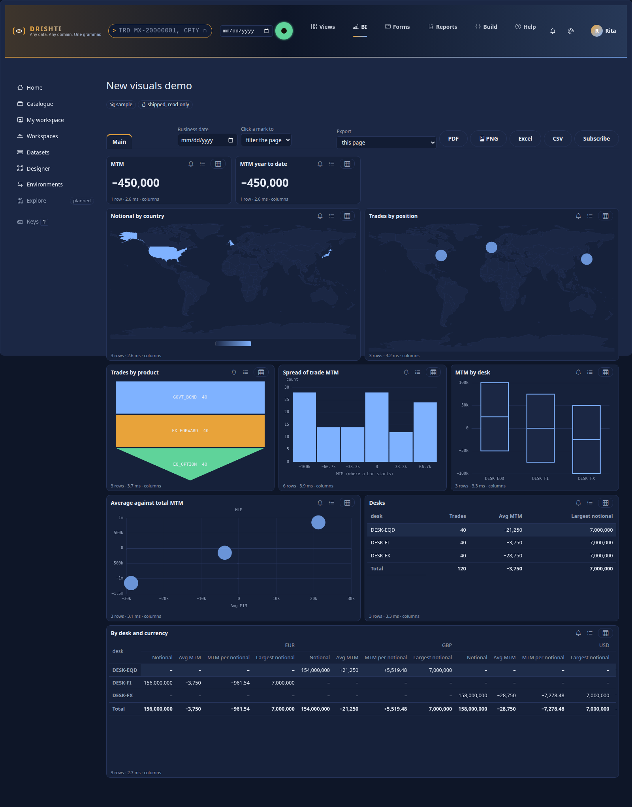

**Map.** `wells: { location: [counterparties.COUNTRY], values: [Exposure (EE peak)] }` shades each country by the measure. `location` holds **ISO 3166-1 codes** (alpha-2 `US` or alpha-3 `USA`) or the English name, or, below the country, **ISO 3166-2 region codes** (`AU-NSW`); it is matched against vendored Natural Earth shapes: the countries at 1:110m
(`static/vendor/echarts/maps/world-countries.json`, 177 shapes) and, for a country the map opens, its regions at 1:10m (`static/vendor/echarts/maps/regions/<ISO3>.json`, one small file per country, loaded when the map first opens that country; [the files](#the-map-shapes)). No tiles, no map service, no CDN: nothing leaves the network.
A country too small for the world shapes (the Cayman Islands, Bermuda ...) is a **clickable dot**, so it is on the map. A value no shape knows is **named under the map** (`Not on the map: CHI, XKX (a country or region code is expected).`) and never dropped silently. A click on a country filters the other visuals by its code, as ever.
**Points:** `wells: { latitude: [trade.lat], longitude: [trade.lon], details: [trade.desk], values: [Trades] }` puts a point at each position, as large as the measure; `details` names it. The two modes are not mixed.

**Drilling.** A map opens at the world. A click on a country **selects it** (the cross-filter) **and opens its regions**: the shapes of its states, provinces or counties, shaded by the rows whose `location` is a region code of that country, with the breadcrumb **World › Australia** above it (the *World* button goes back; the selection stays). A click on a region selects it in turn.
Rows that name only countries leave the regions blank, and the map says so under it (*No figures at region level for Australia*); rows that name only regions shade their country at the world level with the **sum** of their regions (the tooltip says *all regions*), so use a field with both, or an additive measure, when that matters. A country the files have no regions for stays at the world with a note. In the designer's **Format** pane a map has two settings:

| `format` | Meaning |
|---|---|
| `level` | `world` (the default) or the country the map opens at (`AUS`, `AU` or `Australia`): the report opens already drilled in. |
| `drill` | `true` (the default): a click on a country opens its regions. `false`: the world only (with `level` set, the one country, with no way back). |

`drill` not true or false, or a `level` that is not text, is `DRS-9032`. The sample report **World economics** (`config/bi/reports/world-economics.report.yaml`, dataset `world-economics`, over the world-economy pack's real World Bank data: GDP per head by country, the largest economies, the economies table) is the one to adopt and expand; the counterparty-risk
sample's *Exposure by country* is the same visual over counterparties.

**Sample: Region economics.** The sample report **Region economics** (`config/bi/reports/region-economics.report.yaml`, dataset `region-economics`, over the world-economy pack's `region-economy` kind) shows the map at work below the country: population and GDP for the Australian states and territories and the US states and DC, coded `AU-NSW`, `US-CA` and so on (59 rows). It opens at the world, shading Australia and the United States by the **sum** of their regions' GDP (an additive measure, as above), a click opens the country's states shaded by GDP, and the slicer, the bar of the top regions by GDP per head and the table of regions follow the click. **The figures are illustrative, rounded from public figures, not for reporting**: population to the nearest 10,000, GDP to the nearest US$ billion, the sources named in every row (ABS Australian Demographic Statistics and State Accounts; US Census Bureau 2023 estimates; BEA state GDP 2023); the dataset, the report and a text visual on the page say so. No fetcher for regional series exists in `tools/realdata`, so replace the file `tools/realdata/dataset/regions.json` with fetched figures before any reporting use.

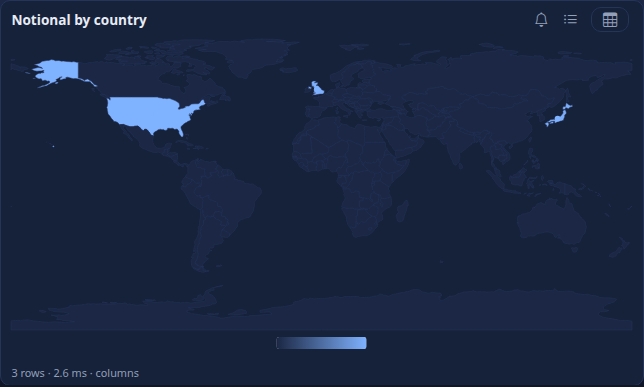 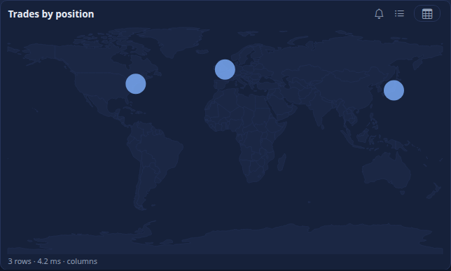

**Funnel** (`axis`, `values`): the stages largest first, as wide as the measure; a click filters by the stage. **Bubble** (`details`, `x`, `y`, `size`): the scatter with its fourth measure as the size.

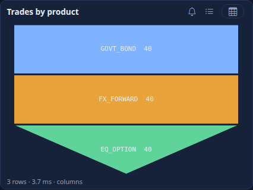 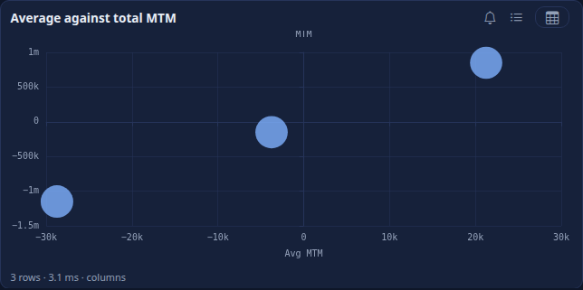

**Histogram.** `wells: { axis: [trades.tradeId], values: [MTM] }, format: { bins: 12 }`: the engine is asked for the measure of every member of `axis` (up to `drishti.bi.report.distribution-rows`, 20,000), as the reader (their rows and masks), and the **server** bins it
into equal-width bands between the smallest and the largest value (default 10, 2 to 100); a value on the edge between two bands belongs to the band that starts there. The answer is four columns, `bin`, `count`, `from`, `to`, so the screen, an export and a subscription show the same bars.
**Box plot.** `wells: { axis: [trade.desk], details: [trade.tradeId], values: [MTM] }`: the measure of every member of `details`, summarised per value of `axis` (one box without it): first quartile, median and third quartile (**linear interpolation**, as the engine's `percentile`),
**whiskers** at the lowest and highest value within 1.5 interquartile ranges of the box, and the members beyond them as outliers (at most 25 listed). The answer's columns are the category, `min` (the lower whisker), `q1`, `median`, `q3`, `max` (the upper whisker), `count` and `outliers`.

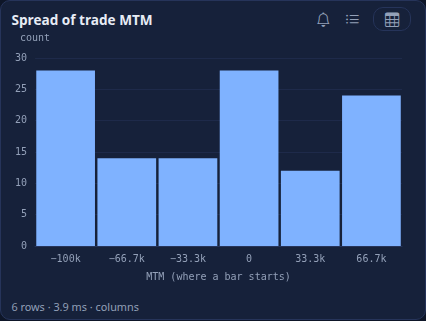 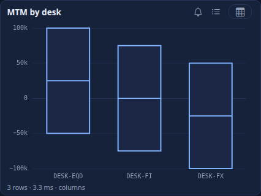

In the designer the five are in the Charts group of the Visualizations pane; the Build pane shows their wells (the map's four place wells are all optional, the validator asks for a place), and Format has **Bars** for a histogram.

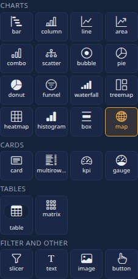 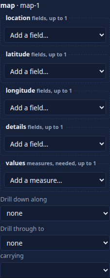

#### The map shapes

| File | What | Size |
|---|---|---|
| `static/vendor/echarts/maps/world-countries.json` | the countries: Natural Earth 1:110m, 177 shapes, properties `name`, `iso2`, `iso3` | 176 KB |
| `static/vendor/echarts/maps/world-points.json` | the countries and territories too small for those shapes (Cayman Islands, Bermuda, Monaco ...): one point each, drawn as clickable dots | 6 KB |
| `static/vendor/echarts/maps/regions/<ISO3>.json` | one country's regions: Natural Earth 1:10m admin-1 (states, provinces, counties), simplified, features coded by ISO 3166-2 (`AU-NSW`), regions that are tiny at the country's scale as points; 251 files, about 7 MB in all, none over 200 KB | per country |

The region files are made by `tools/maps/build_regions.py` (download once, simplify with Douglas-Peucker in pure Python, write the files and `regions/README.md` with the source, licence and sizes; a country across the antimeridian such as Russia, Fiji or the United States is shifted so it draws as one block). They are served by
the console from its static folder and, for `<drishti-report>` and `<drishti-panel>`, from `/embed/v1/world-countries.json`, `/embed/v1/world-points.json` and `/embed/v1/regions/<ISO3>.json`. Natural Earth is public domain: [VENDOR.md](../../drishti-console/web/static/vendor/VENDOR.md), [THIRD-PARTY-NOTICES.md](../../THIRD-PARTY-NOTICES.md).
The same shapes draw the Sutra `map` panel ([PANELS.md](PANELS.md#map)).

### 3.4 The entity view

`type: entity-view` shows **a Drishti view (a Sutra) inline**, for the row the person picks: click a counterparty in a bar and its netting-set view opens beside it.

```yaml
- { id: ids, type: bar, title: Exposure by counterparty (click one), at: { x: 0, y: 0, w: 5, h: 10 }, wells: { axis: [counterparties.id], values: [Exposure (EE peak)] },
    filters: [{ field: counterparties.id, op: top, n: 10, by: Exposure (EE peak) }] }
- { id: counterparty-view, type: entity-view, title: The counterparty's view, at: { x: 5, y: 0, w: 7, h: 10 }, wells: { key: [counterparties.id] } }
```

The `key` well names the field that holds the entity's id (a table's `id` or key column; the table's pack kind says which view). When a mark of **another visual** selects exactly one value of that field, the visual shows the console's view of that entity (`/v/<kind>/<id>?embed=1`, in a frame of the visual's size); until then it says *Select a counterparty in another visual to see its counterparty here*. `format: { kind: counterparty }` names the kind when the field's table does not. The sample **Counterparty risk** has the page *Counterparty lookup*.


**Whose view it is.** The frame is the view page built **for the person looking**: their masks, row rules and rights apply, not the report author's, and a kind they may not open is refused in the frame as it would be in the terminal. The report's dataset only supplies the id. The visual asks the dataset no query of its own (so it has no *Alert me*, *Show as a table* or export; an export of the page leaves it out), and it is a visual of the **viewer**: the designer's canvas and an embedded `<drishti-report>` (which has no console session to build the view with) show a note of what it will do. Select by **id**, not by a name that may be masked: a bar by `counterparties.NAME` selects a name, which is not a key.

### 3.5 Vega-Lite visuals

A `vega-lite` visual draws a [Vega-Lite](https://vega.github.io/vega-lite/) specification that you write in the report. Its **data is the rows of its wells**: the page asks the dataset the same grouped query a bar chart would (the `axis` and `legend` fields, the `values` measures, under the page's filters and slicers, **as the person looking**: row rules and masks apply) and puts the rows in the specification as `data.values`. Put no data in the specification.

```yaml
- id: mtm-by-desk
  type: vega-lite
  title: Net MTM by desk (Vega-Lite)
  at: { x: 0, y: 0, w: 8, h: 7 }
  wells: { axis: [trade.desk], values: [MTM, Trades] }
  format:
    spec:
      mark: { type: bar, cornerRadiusEnd: 3 }
      encoding:
        x: { field: desk, type: nominal, sort: "-y", title: Desk }
        y: { field: MTM, type: quantitative, title: Net MTM }
        color: { condition: { test: "datum.MTM < 0", value: "#b3261e" }, value: "#4f7cff" }
        tooltip: [{ field: desk }, { field: MTM, format: ",.0f" }, { field: Trades }]
  alt: Bars of net mark to market for each desk, red where it is negative
```


* **Field names.** A row is an object keyed by the well's item: a field by the text after the table's dot (`trade.desk` is `desk`), the table put back with an underscore when two fields share a name (`trade_desk`, `desks_desk`); a measure by its name (`MTM`, `Exposure (EE peak)`). Check warns about a field the specification names that no well supplies, unless the specification has a `transform` (which can make fields of its own).
* **Nothing is loaded.** `data.url` and `url` or `loader` as a plain value anywhere in the specification are refused (`DRS-9032`, with the path); the page's loader refuses every URL too. The specification is limited to 200,000 characters.
* **No `eval`.** The page draws it with the vendored Vega, Vega-Lite and vega-embed and the **vega-interpreter**: vega-embed builds the expression tree and the interpreter walks it, so `test: "datum.MTM < 0"`, `calculate`, `filter` and the like run without `eval`, and the page keeps the **strict content security policy** (a Chromium test asserts the header has no `unsafe-eval` and no violation is reported). The libraries (about 0.9 MB) load the first time a page draws one. vega-embed is told not to write its own `<style>`, to draw on a canvas, to show no actions menu and no tooltip plug-in.
* The theme's colours and the report's palette go underneath the specification's own `config`; `width` and `height` default to `container`, so the chart fills its frame. A Vega-Lite visual has the chart buttons (alert, show the rows, as a table) but no marks to click: a selection does not filter the page.
* The designer's preview draws it (with the preview's rows); `<drishti-report>` (the embedded element) does **not** draw a `vega-lite` visual (it shows the note a visual it cannot draw shows). A visual **drawn by Python** instead is [PYTHON_BI.md section 14](PYTHON_BI.md#14-vega-lite-output).

### 3.2 True totals

A total of a measure that adds up (a `sum` or a `count`) is the sum of the figures shown. A total of one that does not (a ratio, an average, a distinct count, a percentile, a minimum, a maximum, a time-intelligence measure) is **not** the sum or the average of
the figures shown: the average of the desks' averages is not the average of the trades. So a matrix with `format: { subtotals: true }` and a table with `format: { totals: true }` ask the engine for those totals: **one more query per level**, as the reader, under the same filters, over the rows of the whole group.
The answer carries them as `totals`:

```
POST /api/v1/bi/reports/file:report:nv-demo/query   {"page": "main", "visual": "matrix", "state": {"dates": {"from": "2026-10-07", "to": "2026-10-08"}}}      (the matrix: rows trade.desk, columns trade.currency)
{"columns": ["trade.desk", "trade.currency", "Notional", "Avg MTM", "MTM per notional", "Largest notional"], "rows": [["DESK-EQD", "GBP", 154000000.0, 21250.0, 5519.48, 7000000.0], ...],
 "totals": [{"by": [],                 "columns": ["Avg MTM", "MTM per notional", "Largest notional"], "masked": [], "rows": [[-3750.0, -961.5384615384615, 7000000.0]]},
            {"by": ["trade.currency"], "columns": ["trade.currency", "Avg MTM", ...], "rows": [["EUR", -3750.0, -961.54, 7000000.0], ["GBP", 21250.0, 5519.48, 7000000.0], ["USD", -28750.0, -7278.48, 7000000.0]]},
            {"by": ["trade.desk"],     "columns": ["trade.desk", "Avg MTM", ...], "rows": [...]}]}
```

Each entry is a level: `by` the fields it groups by, the measures that do not add up (the ones that do are summed by the page), and its rows. A matrix asks for the grand total, each value of the first row field (with several row fields), each column, and each row across the columns;
a table asks for one level, the grand total. A level the engine refuses, or a measure masked for the reader, stays `–` with its reason in the cell's title. The caps are `drishti.bi.report.totals-max-rows` (2,000 rows a level).

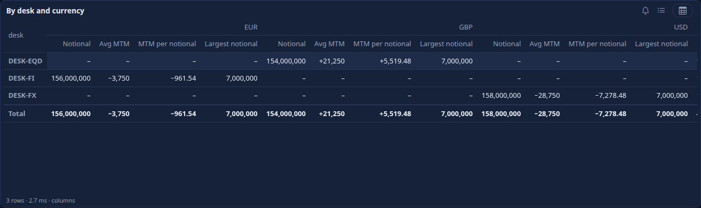
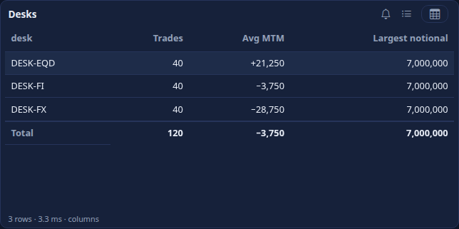

The grand total of *Largest notional* is the largest, 7,000,000; its sum would have been 21,000,000 (three desks): the cells that the engine worked out are marked (`data-true-total`) and say so in their tip.

## 4. Filters

A filter is `{ field, op, values }` at **report**, **page** or **visual** level. `field` is a column (or date part) of the dataset or, for a comparison on a total, a **measure**.

| `op` | Values |
|---|---|
| `in`, `not-in` | a list |
| `eq`, `ne`, `lt`, `le`, `gt`, `ge` | one value |
| `between` | two values |
| `contains`, `starts-with` | text |
| `is-null`, `not-null` | none |
| `top` | `n`, `by` (a measure), `dir` (`desc` for the highest, `asc` for the lowest): keep the `n` values of `field` with the highest measure |

```yaml
filters: [{ field: counterparties.id, op: top, n: 10, by: Exposure (EE peak) }]   # the ten largest counterparties
```

A `top` filter is resolved first: the server ranks the values of `field` in the context of the other filters (slicers included) and keeps the first `n`, so the answer follows the person's choices.
Rank by a column that is not masked (`counterparties.id`, not the masked name): a filter on a masked column is `DRS-9021`.

## 5. Format

`format` is **typed per visual family** (report schema v2, 2.4.0): one JSON Schema per family, written in YAML in the server
(`drishti-server/src/main/resources/bi/report/format/`: `chart` for bar, column, line, area and combo; `other-chart`; `card` for cards, KPIs and gauges; `table`; `matrix`;
`slicer`; `static` for text, image, button and tile; `code` for python, vega-lite and the live and 2.1 types; `common` for what they share). The server checks every
visual's format against its family: a wrong type or value of a key **new in 2.4.0** is `DRS-9032`, a wrong value of a key a 2.3 report could already hold is a
**warning** (the viewer ignores it, so a stored report never stops opening), and an unknown key, or a key of the family this type does not use, is a warning.
`GET /api/v1/bi/reports/format-schemas` gives the schemas, resolved per family; the designer's **Format pane is generated from them** (a section per group,
the right control for each key, its range and its hint), so whatever the pane offers the server accepts.

| Key | For | Meaning |
|---|---|---|
| `subtitle`, `titleSize` | every visual | a line under the title; the title's size (10 to 32 px) |
| `border`, `shadow`, `background`, `padding` | every visual | the frame: a border, a shadow, a `#rrggbb` background, padding (0 to 32 px) |
| `labels`, `labelDensity`, `labelPosition` | charts | data labels; the share of points labelled (1 to 100 %); outside, inside or centre |
| `stacked`, `percent`, `smooth` | bar, column, area; bar, column, area; line, area, combo | stack the series; 100% stacked; smooth the line |
| `valueAxis` | category charts | `{ min, max, log, gridlines, show }` |
| `categoryAxis` | category charts | `{ rotate (-90 to 90), show }` |
| `axisTitles` | bar, column, line, area, combo, scatter, bubble, waterfall, histogram, box | `{ x, y }` |
| `legend` | charts | `bottom`, `top`, `right`, `none` |
| `colour`, `seriesColours` | charts | one `#rrggbb` for a chart with one series (the designer offers the theme's colours); a colour per series (a measure's name or a legend value) or, for a pie, per category |
| `multiples` | bar, column, line, area with a `split` field | `{ columns (1 to 6), max (2 to 24), sharedAxis }` (section 5.4) |
| `period` | charts on a date axis | `auto`, `day`, `week`, `month`, `quarter`, `year` |
| `numberFormat` | charts, cards, tables | `amount0`, `signed0`, `signed2`, `compact`, `pct` (a value of at most 1 is a fraction, a larger one already a percent), `share` (always a fraction of 1: `share_of` measures, 2.3.0); else the measure's own format from the dataset |
| `rules` | cards, kpis, gauges, tables, matrices, bar, column | conditional formatting (section 5.1) |
| `conditional` | as `rules` | the 2.1 short form: `[{ measure, op: lt, le, gt, ge, eq or ne, value, colour }]` (the text colour) |
| `dataBars` | table, matrix | measures to draw as bars in the cell |
| `calloutSize`, `showLabel`, `goodWhen` | card, kpi; card; kpi | the number's size; show the measure's name; better when `higher` (the default) or `lower` than the target, in the theme's good and bad colours |
| `min`, `max` | gauge | the dial's range |
| `totals`, `rowBanding`, `wrap`, `fontSize` | table | a total row; banded rows; wrap long text; text size |
| `subtotals`, `rowSubtotals`, `columnSubtotals`, `stepped`, `expandTo`, `valuesOn` | matrix | section 5.5 |
| `mode`, `style`, `scope`, `syncGroup`, `default`, `options` | slicer | section 6 |
| `size`, `align` | text, button | `heading`; left, centre, right |
| `bins`, `mode`, `level`, `drill` | histogram; map | section 3.1 |

A theme's visual defaults (section 5.2) are applied under a visual's own format: what the visual says wins.

### 5.1 Conditional formatting

`format.rules` is a list; each rule names what it colours (`apply`: a measure the visual shows, or a field for `values`) and its `type`:

```yaml
format:
  rules:
    - { type: gradient, apply: MTM, min: "#c62828", mid: "#ffffff", max: "#2e7d32" }       # a colour scale (mid optional), over the visual's own values
    - { type: rule, apply: MTM, on: Trades, op: gt, value: 10, colour: "#b3261e" }         # a rule on ANOTHER measure; background: also takes a colour
    - { type: icons, apply: Notional, icons: arrows, thresholds: [0, 1000000] }             # arrows, traffic, signs or flags: low, middle, high
    - { type: values, apply: trade.DESK, colours: { DESK-FX: "#1565c0" }, target: background } # a colour per value of a field
```

| Type | Keys |
|---|---|
| `rule` | `on` (a measure of the model; else the one coloured), `op` (`lt le gt ge eq ne between`), `value`, `to` (for `between`), `colour` (text), `background` |
| `gradient` | `min`, `max`, optional `mid` (colours); `minValue`, `midValue`, `maxValue` (fixed; else the lowest, the middle and the highest the visual shows); `target`: `background` (the default) or `font` |
| `icons` | `icons` (`arrows`, `traffic`, `signs`, `flags`), `thresholds` (one or two numbers: below the first is low, from the second high, between them middle), `reverse` (low is good), `on` |
| `values` | `colours` (a value of the field to a colour), `target` (`font` or `background`) |

A rule on another measure makes the visual ask for that measure too (it is not shown). A cell with a background takes black or white text, whichever reads; an icon is said in
words to a screen reader (*low*, *middle*, *high*). Charts (bar, column) colour their marks by the rule; tables and matrices their cells; cards their number.
`apply` that is not shown by the visual is `DRS-9031`; a `values` rule on a measure, or another rule on a field, is `DRS-9032`; an `on` the model lacks is `DRS-9031`.

**In the designer:** Format, *Conditional formatting*: choose the kind (*Rule*, *Colour scale*, *Icons*, *Colour per value*) and **Add a rule**; each rule has its own choices,
colour pickers and numbers; nothing is typed but the numbers.

### 5.2 Themes

A **theme** is a BI item of kind `theme` (shipped in `config/bi/themes`, or stored, versioned, reviewed and published like a report), which a report names with `theme: corporate`:

```yaml
rachana: 1
theme: corporate
title: Corporate
palette: ["#1f4e79", "#2e75b6", "#9dc3e6", "#c55a11", "#70ad47", "#7f7f7f", "#ffc000", "#5b9bd5"]   # 3 to 12 series colours, in order
good: "#2e7d32"                         # a KPI above target, a colour scale's high end
bad: "#c62828"
background: "#ffffff"                   # optional: the visuals' background and text
foreground: "#1b1b1b"
font: { family: sans, size: 12 }        # sans, serif, mono or system (nothing is fetched); 10 to 18 px
visuals:                                # format defaults by family (chart, other-chart, card, table, matrix, slicer, static, code) or type
  chart: { labels: true, legend: bottom, valueAxis: { gridlines: true } }
  matrix: { rowBanding: true, stepped: true }
```

The shipped themes are **Corporate** and **Print**. A report's own `palette` and `background` win over the theme's; a theme that cannot be found is a warning
(`DRS-9036`) and the report draws with the default colours. A theme is checked like a report (`POST /api/v1/bi/themes/validate`): a palette that is not 3 to 12
colours, a colour that is not `#rrggbb`, a font that is not one of the four, or a visual default the format schemas refuse is `DRS-9036`; text on its
background under a contrast of 4.5 is an `A11Y` warning. `GET /api/v1/bi/themes` lists the themes you may use; `GET /api/v1/bi/themes/{name}` reads one.

**In the console:** a report picks its theme in Format with no visual selected (*Report*, *Theme*); **Make a theme** (also *New: theme* in BI Studio's Explorer) opens
the **theme designer** (`/bi/design/theme/<id>`, `/bi/design/theme/new` starts from Corporate in your private workspace): the series colours (add, remove, move),
the page, text, good and bad colours, the type, and the format defaults of each kind of visual, drawn by the same generated Format pane, with a live preview of a chart,
a table and a card; Save, then Publish so that reports read it.

### 5.3 Number formats

`numberFormat` (table above) or the measure's own format; a calculation group item's format wins in a visual that shows it (a share reads as a percent).

### 5.4 Small multiples

A bar, column, line or area chart with a field in its **Small multiples** well (`split`) is drawn as one small chart per value of that field, side by side in rows,
from the one answer the server gave (grouped by the axis, the legend and the split field):

```yaml
- { id: mtm-by-ccy, type: column, at: { x: 0, y: 0, w: 12, h: 7 }, wells: { axis: [trade.DESK], values: [MTM], split: [trade.CURRENCY] },
    format: { multiples: { columns: 3, max: 12, sharedAxis: true } } }
```

`columns` is the charts per row (default up to 3), `max` the most charts (default 12; the rest are named under the chart), `sharedAxis` one value axis for all (the
default). A click on a mark selects its axis value, as on any chart.

### 5.5 The matrix

| Key | Default | Meaning |
|---|---|---|
| `subtotals` | off | subtotals and totals: a subtotal for each group at every level of the row fields, a total per row (across the columns) and a grand total |
| `rowSubtotals` | on | off keeps the grand total and the levels but drops the subtotal figures of the groups |
| `columnSubtotals` | on | the *Total* column of each row |
| `stepped` | on | one indented column for the row fields (Power BI's stepped layout); off: a column per row field, with a total line after each group |
| `expandTo` | every level | the level the matrix opens at: `0` the first row field only, `1` the first two, ...; each group opens and closes, and *Expand all* and *Collapse all* above the matrix open or close every level |
| `valuesOn` | `columns` | `rows` lists the measures down the rows, under each row, with the column field across |

A total of a measure that adds up (`sum`, `count`) is the sum of the figures shown; one that does not is the engine's, worked out over the rows of the group (section 3.2):
the server asks for one level per prefix of the row fields. A click on a row's name selects its value, which filters the other visuals like any mark.

## 6. Slicers

A `slicer` visual lists the values of its field (from the dataset, under the reader's rows and masks) and filters the visuals in its **scope**.

* `format.mode: list` (the default: a checkbox list with a search box), `dropdown` (the shared multi-select) or `range` (two inputs, **From** and **To**, side by side, for a number or a date field; it fits a slicer two grid rows high, and a From after To shows a hint instead of asking for nothing). `relative-date` is a choice of **dates relative to the report's date** (section 6.1).
* `format.scope: page` (the default) filters this page; `report` filters every page, so a choice made on one page holds on the others.
* `format.syncGroup: <name>` (2.4.0, Power BI's sync slicers): the slicers of one group, on any pages, share **one choice**. Choosing on one sets the others; each filters its own page. The slicers of a group slice one field (else `DRS-9032`). A slicer of the group never narrows its own list by the group's choice.
* `format.style: tiles` (2.4.0) draws a list slicer as buttons, pressed when chosen (a tile slicer).
* A slicer never filters itself, and other slicers filter it. A visual a slicer cannot reach through the dataset's relationships answers `DRS-9020` and says so.

## 7. How a visual becomes a query

For each visual the server builds one dataset query ([DATASETS.md](DATASETS.md) section 8) from the visual and the state of the page, in this order of authority: the report's filters, the page's, the
visual's, the slicers in scope, the marks selected on **other** visuals of the page, the values carried by a drill-through, the drill-down path. Then it runs it through the engine **as the person looking**: their
row rules, their masks, the layer the planner chooses.

| Part | Rule |
|---|---|
| fields | the `axis`, `legend` (and `rows`, `columns`, `details`) wells in order; a table's `columns` that are not measures |
| measures | the `values`, `secondary`, `target`, `x`, `y`, `size` wells |
| order | a date axis in date order; else the first measure, largest first; a table, matrix, heatmap or slicer has no explicit order (the engine's, which never sorts on a masked column); `sort` overrides |
| rows | `limit`, else the chart, table or slicer default of section 11; a chart says when it was cut |
| dates | the person's business date, else the report's `dates`, else the latest business date |
| selections | a selected mark on another visual filters this one (`in` on the mark's field); with highlight on, a bar or column chart asks twice, the whole answer and the highlighted one; other types are filtered. A visual with `interacts: false`, and a slicer, is not touched |
| drill-down | the first axis field moves down the visual's hierarchy one level per value clicked, and the values clicked become `eq` filters (past the last level: `DRS-9035`) |
| dataset | the visual's own `dataset:` if it has one, else the report's; a choice made on another dataset reaches the visual only through a `link` (section 16) |
| show the rows | the visual's own filters and selection, and every column of the table it reads (`id` and `index` too), up to the "show rows" limit |

A visual whose query is refused shows the server's code and words in its frame, with a Retry button, and the others carry on.

## 8. What people can do with a report

**The viewer** (`/bi/r/<id>` and `/bi/r/<id>/<page>`; `BI <report> <GO>` opens it). Pages are tabs; a toolbar holds the business date, bookmarks, *Click a mark to filter the page or highlight* and Reset;
the filters in force are chips under it.

* **Cross-filter and highlight.** Click a mark (or focus a chart, move with the arrows and press Enter) and the other visuals filter to it (or, for bar, column, line, area and combo charts, draw the highlighted
  part over the faded whole). Click it again, press Esc or use the visual's clear button to let go. Ctrl or Shift adds to the selection.
* **Edit interactions** (2.4.0). A page's `interactions: { <source visual>: { <target visual>: filter | highlight | none } }` says, pair by pair, how a selection (or a slicer's choice) on one visual acts on another:
  `none` leaves the target alone, `highlight` highlights it where it can (else filters), `filter` filters it; a pair not listed follows the viewer's *Click a mark to* choice. In the designer: select the source visual,
  then Format, *Interactions* (a choice for each other visual), or **Edit on the canvas** (Filter, Highlight and None over each other visual, as in Power BI).
* **Tooltip pages** (2.4.0). A page with `tooltip: true` is left out of the tabs; a visual with `tooltip: <page id>` opens it in a popover when the pointer rests on one of its marks (or rows), each of its visuals
  asked under the page's state with the mark's value carried (as a drill-through carries it). It closes when the pointer leaves, and on Esc. In the designer: Format, *Tooltip*, **New tooltip page**, then put a few cards
  or a small chart on it.
* **Drill down and up** along the visual's `hierarchy`: select a mark, press the drill-down button (or `d`); `u` goes up. The title shows the path.
* **Drill through.** With a mark selected, a visual offers *Drill through to <page>* for each page whose `drillthrough: fields` lists the mark's field. The page opens with the value carried as a chip, in the
  URL (`?carry=...`, so it can be shared), and a Back button.
* **Show the rows** (`r`): the table of the underlying rows of the visual (masked columns read `•••`); **Show as a table** (`t`): the visual's own numbers as a table. Both are also what a screen reader reads.
* **Open in the terminal.** A cell of a key column (or a selected mark on one) of a table whose kind is a Drishti kind opens `/v/<kind>/<id>`; so does a cell
  of a column that references a kind: its dataset says `references: <kind>`, or, over a pack kind, the packs' link graph names the column (the sample
  valuations are keyed by `VALUATION_ID`, and their `TRADE_ID` opens the trade, `DESK` the desk, `COUNTERPARTY` the counterparty).
* **Bookmarks** (`bookmarks: [{ name, page, slicers: { <slicer id>: [values] }, filters }]`): choose one and the page, slicer choices and filters are applied. In the designer, with nothing selected, the **Bookmarks** box of Format writes them: a name, a choice for each slicer of the page (a relative-date slicer offers its windows and writes `{ relative: name }`), and **Save this page as a bookmark** keeps the page, the filters of its Filters pane and those choices; a saved bookmark can be renamed (a button that applies it follows the new name), **updated from the page's filters** or removed.
* **Keys.** Tab moves through the visuals in reading order; in a chart the arrows move between marks and Enter selects; `Esc` clears; `t`, `r`, `d`, `u` as above; `?` lists them.
* **A phone** (390 px) shows one column in reading order with 44 px targets and no sideways scroll.

### 6.1 The relative-date slicer

`format.mode: relative-date` on a slicer whose field is a **date or timestamp** column offers named windows instead of values, worked out **on the server** from the report's **as-of date** (the end of its `dates`, or the date picked in the toolbar, else the current business date) and the pack's **business-day calendar**; so the same name means the same dates on a screen, in an export and in a subscription.

```yaml
- { id: when, type: slicer, title: When, at: { x: 0, y: 0, w: 4, h: 3 }, wells: { field: [trade.tradeDate] },
    format: { mode: relative-date, default: last-30-days, options: [last-7-days, last-5-business-days, last-4-weeks, this-month, this-quarter, this-year, previous-month, all] } }
```

| Name | The window |
|---|---|
| `last-N-days` | the N calendar days ending on the as-of date (the as-of date counts as one) |
| `last-N-business-days` | the N business days ending on the as-of date, or on the business day before it when that is a weekend or holiday; holidays are skipped, so it can reach back further than N days |
| `last-N-weeks` | the 7 x N days ending on the as-of date |
| `last-N-months` | from the day after the same date N months earlier, to the as-of date |
| `this-week`, `this-month`, `this-quarter`, `this-year` | from the start of the period (a week starts on Monday) **to date** |
| `previous-week`, `previous-month`, `previous-quarter`, `previous-year` | the whole period before the one the as-of date is in |
| `all` | no restriction ("All dates") |

**In the designer:** select the slicer and, in Format, set **Mode** to *relative date (a date field)*; **Starts as** is the `default` and **Windows it offers** is `options` (a tick for each of the sixteen names; ticking all of them writes no `options`, and unticking the default clears it). A top-N filter (`op: top`, `n`, `by`, `dir`) is *Filter type: Top N* in the Filters pane (all pages, this page or this visual). The Phone and Tablet tabs edit `order`, `hide`, `span` and, for a tablet, `wide` in full.

N is 1 to 3,660. `default` applies until the person chooses (and in exports and subscriptions, which have no one choosing); choosing *All dates* switches it off. `options` lists the names offered (default: the sixteen in `RelativeDates.DEFAULT_OPTIONS`: `last-7-days`, `last-30-days`, `last-90-days`, `last-5-business-days`, `last-4-weeks`, `last-3-months`, `last-12-months`, `this-*`, `previous-*`, `all`). The window becomes a filter `field >= from` and `field < the day after to`, so it holds for a timestamp too. The state the viewer sends is `slicers: { when: { relative: "last-4-weeks" } }`; a name that is not one of the above is `DRS-9035`, a `default` or `options` that is not one is `DRS-9030`, a field that is not a date `DRS-9032`.


(The report above has `dates: { from: 2026-10-07, to: 2026-10-08 }`, so the four weeks end on 8 October; the whole book is 750 trades.) Business-day windows follow the pack calendar: with USNY, 5 business days ending Tuesday 7 July 2026 start on Tuesday 30 June, because Friday 3 July (Independence Day observed) is skipped.

**The designer** (`/bi/design/<draft>`) and the **Model view** (`/bi/m/<dataset>`) are described in [BI_GUIDE.md](BI_GUIDE.md) sections 15 and 16.

## 9. Checking a report: DRS-9030 to DRS-9036

**One bad visual is one error card.** A visual whose own wells, filters or dataset have an error answers `422 DRS-9034` for itself; every other visual of the report is still queried and drawn, in the viewer as in the designer. A draft with errors can be saved; **Propose, Approve and Publish** refuse it with the errors listed (a bi-admin may force it, audited). **Check** in the designer lists the errors with a link to each visual.

**In the designer (2.1.0).** A frozen (proposed) report opens read-only with a banner; two tabs on one draft are protected by the stale-save choices (`DRS-9007`); **+ Add visual** (beside the type list) and dragging a type from the palette onto the canvas make a new, empty visual of that type, while clicking a type with a visual selected converts it and asks first when wells would be dropped; the visual id follows the type (a made-up id such as `card-1`, `slicer-1` or `visual-3` becomes `<new type>-<n>`; an id you chose yourself is kept), and **everything that named the old id follows it** in the same step: the bookmarks' slicer choices, the phone and tablet layouts of that page (`order`, `hide`, `wide`, `span`) and the report's `tests:`; Undo brings the old id and its references back together (a board tile that names a visual by id is not rewritten: its Check names it); a new filter starts on the selected visual's field; the toolbar's **View** menu opens the report page on **my draft** or **as readers see it (published)**, greyed until the report has been published: that page shows a banner with the published version and a link back to the draft, and draws the published visuals with your own masks (`GET /bi/items/{id}/published`, `?as=published`); **Check** and **Save** answer beside their buttons; **Filters** can be hidden; double-click a page tab to rename it; the YAML tab refuses to be left while the YAML does not parse (fix it, or **Discard my YAML edits**); on a phone the toolbar shows icons and the **Canvas / Visuals / Fields / Filters** tabs reach the panes.

The parser never throws for a bad document: it returns every problem with its code and the path of the key, so a person sees all of them at once (`POST /api/v1/bi/reports/validate`, the designer's
YAML tab and Check button, and the viewer when a report cannot be drawn).

| Code | Meaning | Example |
|---|---|---|
| `DRS-9030` | the structure is wrong: not YAML, an unknown visual type, a bad `at`, a duplicate id, an operator that is not one, an image from another address | `pages[0].visuals[1].at: x is 0 to 11 and w is 1 to 12, and x + w is at most 12 ... this is x=8, w=6` |
| `DRS-9031` | a name the dataset or the report lacks: a field, a measure, a hierarchy, a page, a bookmark, a slicer | `pages[0].visuals[0].wells.axis: table 'trade' has no column 'nope' (it has id, tradeId, desk, ...)` |
| `DRS-9032` | a visual built wrongly: a measure in a field well, a field in a measure well, an unknown well, a required well empty, too many items | `...wells.values: 'trade.mtm' is a field; the values well takes measures (Notional, MTM, ...)` |
| `DRS-9033` | reserved, not built: a visual type (`shape`) | `...type: the visual 'shape' is reserved and not built yet` |
| `DRS-9034` | the dataset cannot be found or has errors, so the report cannot be drawn | `no dataset 'x' (a catalogue id, a file name such as trades-basic, or the dataset's name)` |
| `DRS-9035` | a visual query names a page, a visual or a slicer the report lacks, or its state is not valid (a drill path past the last level, dates that are not dates) | `the hierarchy 'Desk and book' has 2 levels; there is nothing below trade.PORTFOLIO` |
| `DRS-9036` | (2.4.0) a theme item is not valid, or (a warning) the report names a theme that cannot be found | `palette[1]: 'red' is not a colour (#rrggbb)` |

Report schema v2 adds, among others: `pages[0].visuals[1].format.valueAxis.min: is a number, not 'low'` (`DRS-9032`), `pages[0].visuals[0].format.rules[2].apply: 'Notional' is not shown by this visual` (`DRS-9031`),
`pages[1].visuals[0].format.syncGroup: the slicers of sync group 'ccy' share one choice, so they slice one field (trade.CURRENCY), not trade.DESK` (`DRS-9032`),
`pages[0].visuals[0].tooltip: 'q' is not a tooltip page of this report` (`DRS-9031`) and `pages[0].interactions.bars.trend: 'glow' is not an interaction: filter, highlight or none` (`DRS-9030`).

**Check** (the designer's button, `quality: true` on validate) adds warnings that stop nothing: `A11Y` (a chart, table, card or image with neither title nor alt text; an image without alt text; a chosen
colour with a contrast ratio under 3 against the theme's background), `LAYOUT` (two visuals overlap: the picture and the keyboard order disagree) and `PERF` (a visual whose last preview took over a second).

## 10. Security

* A reader needs the **report** (the catalogue's audience and workspace roles decide); they need not be able to open the dataset's catalogue entry: the report reads its dataset with the grants of the
  people who published it (a published or shipped report), and the engine applies **the reader's own row rules and masks**. A reader is not told the dataset's row rules through the report. A **draft** (and the designer) finds only the
  datasets its author may read in the catalogue, so a report cannot be used to reach a dataset the catalogue hides from its author.
* A row rule is a predicate on the dataset's tables, applied to every query. If a visual reads a table the rule's tables cannot reach many-to-one, that visual answers `DRS-9020`, naming the rule: in the
  sample *Counterparty risk* a desk head's exposure visuals say so, and an analyst sees the counterparty name as `•••` (one bar, since every name is the same mask).
* The report's queries go through the same limits as any query (`drishti.bi.query.*`): three at a time per person (the page asks three at a time and retries a refusal for busy), time, rows and bytes.
* Nothing in a report is executed: it is parsed, validated, turned into parameterised dataset queries (every value is bound) and drawn. No script, style or address from a report reaches the page.
* The designer and draft queries need `bi-author`; viewing needs `bi`. A draft in a personal workspace is private to its owner.

## 11. Settings

`drishti.bi.report.*` ([CONFIGURATION.md](../admin/CONFIGURATION.md#drishtibireport--reports-phase-3)): `chart-rows` (500), `table-rows` (1000), `slicer-values` (1000), `show-rows` (1000),
`top-candidates` (10000), `perspective-rows` (20000: the most rows a 2.1 `perspective-*` visual's grid is sent), `distribution-rows` (20000: the most members a histogram or box plot reads), `totals-max-rows` (2000: rows of one level of true totals), `python-rows` (10000: the most rows a python visual hands to Python), `python-packages`, `python-max-seconds` and `python-max-memory-mb` (what a Python manifest may list and ask for: [PYTHON_BI.md](PYTHON_BI.md) section 9). The query limits are `drishti.bi.query.*`; the live ones `drishti.bi.live.*`; the console's `bi.live.min_interval_ms` and `bi.live.stale_seconds` (section 13).

**Never cut silently (2.3.0).** A visual whose rows reach its limit says so: its footer reads *first 500 of 2,340* (with *more than*
past 50,000) and offers **Show all** (up to 5,000 rows, what one answer in JSON holds). A time series (a line, area, column or combo
over a date axis) is asked again by period instead, week, then month, quarter and year, until the whole range fits, and its footer
says *by week*; `format: { period: auto | day | week | month | quarter | year }` fixes the period (`day` never buckets). A model field
may name a period itself: `trade.TRADE_DATE.month_start` is the first day of the month, a date (also `week_start`, Monday,
`quarter_start`, `year_start`).

**A live chip says Live only when changes flow.** A followed visual says **Listening** while its stream is up and nothing has changed
(a daily snapshot never does), **Live** for a minute after each pushed change, and **Too many live queries: close a tab** when the
server refuses a subscription for want of room (`DRS-9181`, `DRS-9182`), never a bare *Not updating*. A tab that closes ends its
standing queries (`pagehide`, a keepalive `DELETE`); one no stream reads is dropped after `drishti.bi.mq.idle-close` (60 s).

## 12. Built and not built

Built: the report model and its parser, validator and writer (DRS-9030 to 9035); the visual catalogue above; filters at three levels with top-N; slicers (list, dropdown, range); cross-filter, highlight (bar and
column), drill-down, drill-through, show the rows, show as a table, open in the terminal; bookmarks; palettes; the viewer, the designer and the Model view; the three stored sample reports; the API.

Built with several datasets (section 16): a visual's own `dataset:`, `links` across datasets for slicers, cross-filter and carried values, impact analysis and lineage over them, a Dataset and Links field in the designer.

Built in phase 6 (section 3.3): the `python` visual, run on the server in a sandboxed worker or in the browser.

Built in phase 5 (section 13): visuals over live tables redraw in place with a live indicator, pause and resume, stale and disconnected states; the rolling chart; the sample live reports. (Phase 5 also drew Perspective grids, pivots and charts in the browser with WebAssembly; 2.3.0 replaced them with Drishti's own grid of the server's answer: section 13.)

Built later: Vega-Lite visuals (3.5), the relative-date slicer (6.1), tablet layouts (14.1), expected values (17), the entity view (3.4) and *promote to visual* from Analyse ([ANALYSE.md](ANALYSE.md#14-promote-to-a-report-visual)).

Built in 2.4.0 (report schema v2, section 20): the typed format per family with the generated Format pane (5), conditional formatting rules (5.1), theme items and the theme designer (5.2), small multiples (5.4),
the matrix at every level (5.5), sync groups and tile slicers (6), the interactions matrix and highlight for lines, areas and combos, tooltip pages (8), board pages ([BOARDS.md](BOARDS.md)).

Not built, and not faked: a `perspective-*` visual over **several tables**; pivoting or charting in the browser (no BI page computes: use a `matrix` or a chart); a `shape` visual; the **entity view in the designer's canvas and in an embedded element** (it shows a note; the viewer shows the view); a python visual in a **subscription** (section 3.3; [PYTHON_BI.md](PYTHON_BI.md) section 12; boards and alerts are built: [PYTHON_BI.md section 16](PYTHON_BI.md#16-python-in-alerts-and-on-boards)); a **tile** map or a map service (nothing is fetched from outside; the shapes are the vendored files), regions **below the first level** (counties inside a state), a
shape-file import, a **choropleth by a field that is not a country code or name**; a histogram with bands of your own (equal-width only), a box plot of **summary** data you already have (it summarises the members the query returns); true totals for a **table's subtotals by group** (a table has one total row); highlight for the charts other than bar, column, line, area and combo, and for tables and matrices (they are filtered); a matrix with **more than one column field**; capturing a bookmark's slicer choices from the page (they are
written in the YAML); per-device layouts for a **large screen** (a phone and a tablet are built: section 14); embedding is built for the report's visuals but not for its drill, alert and export chrome (section 15; export, subscriptions and alerts: [DISTRIBUTION.md](DISTRIBUTION.md)); Vega-Lite and Python visuals in the embedded `<drishti-report>`;
report-level security beyond the catalogue and the dataset's rules.

## 13. Live visuals and Perspective (phase 5)

*The title keeps its old address. Perspective itself is gone since 2.3.0: see [the Perspective visuals of 2.1](#perspective-visuals-of-21-since-230-drishtis-grid).*

### Live visuals

Nothing in a report says "live". A report whose dataset has a **live table** ([DATASETS.md](DATASETS.md#71-live-tables-phase-5)) is live: the viewer opens **one stream** for the report (`GET /api/v1/bi/reports/{id}/live`, over the console's one channel per browser,
[LIVE.md](../architecture/LIVE.md#live-bi-a-reports-live-tables)) and shows a **live indicator** above the pages.

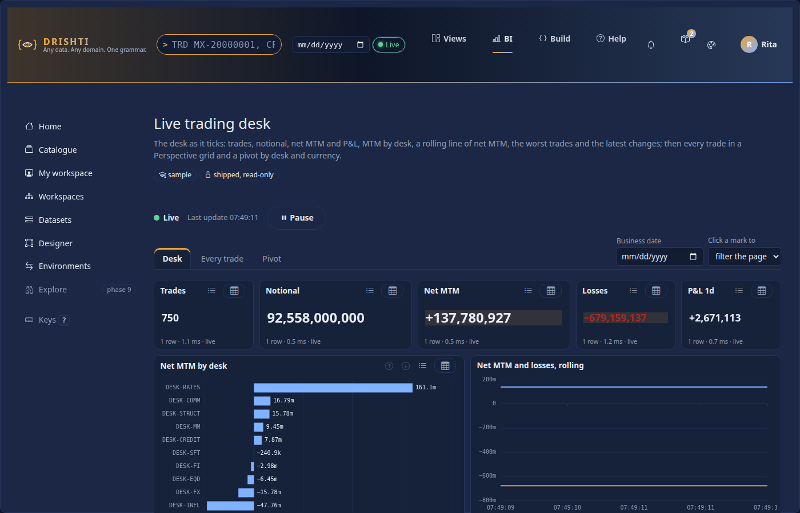

| Part | What it says |
|---|---|
| the dot and word | **Live** (green), **Paused**, **Stale** (amber: nothing heard from the server for `bi.live.stale_seconds`, 30 s, or the source has pushed nothing for `drishti.bi.live.stale-after`), **Feed failing** (red: the table's first read failed), **Disconnected** (red: the stream dropped; the browser retries by itself), **Paused (tab in background)** (the tab was hidden for ten seconds and gave its stream back) |
| *Last update 07:49:57* | the time of the live table's last change (the browser's clock zone), not of the last redraw |
| **Pause** / **Resume** | stops redrawing (the stream stays open); on resume one redraw catches up. 44 px on a phone |

  

**How an update reaches a visual.** The stream says only that the tables **changed** (a `tick`, at most one per `drishti.bi.live.frame`, 250 ms, the latest state: a slow browser skips ticks, never queues them) and how they are doing (a `status` every
`drishti.bi.live.status`, 5 s, which is also its heartbeat). It carries **no data**. A tick makes the page ask its visuals again, **as the person looking**, so their row rules and masks apply to every update. The page:

* **coalesces**: a redraw round runs at most every `bi.live.min_interval_ms` (250 ms) and never two at once; a burst of ticks is one round, and a slow server is not queued behind (back-pressure is "the next round starts when the last one is done");
* **asks three queries at a time** (the per-person limit) for the visuals of the current page, and **quietly**: a visual is not greyed, its picture is drawn over in place (a chart keeps its instance and its keyboard cursor; a table keeps its scroll position; a card flashes when its number changes, unless the person asks for reduced motion);
* keeps the old picture when an update fails, with a dashed border and "old: <reason>" in the line under it, and draws it again on the next good answer;
* redraws everything when a stream (re)connects (`hello` carries the generation: a page that has the latest does not ask again).

A real stream, first events (abridged; the table's counters are in `tables`):

```text
event:hello
data:{"generation":95,"lastUpdate":"2026-10-11T11:50:03.684098666Z","state":"live","at":"2026-10-11T11:50:04.732755792Z","tables":[{"table":"trade","kind":"trade","state":"live","rows":750,"entities":750,"subscribed":750,"pushes":true,"seq":33503,"epoch":0,"generation":95,...}]}

event:tick
data:{"generation":96,"lastUpdate":"2026-10-11T11:50:04.545007543Z","state":"live","at":"2026-10-11T11:50:05.484058137Z","tables":[{"table":"trade",...,"seq":33863,"epoch":0,"generation":96,...}]}
```

Every JSON answer of `POST /api/v1/bi/reports/{id}/query` over a live dataset also carries `live`: `{generation, lastUpdate, state, at, tables: [...]}` (the counters are read **before** the query, so a client that asks "changed since `seq`" misses nothing).
A real card answer: `"meta": {"layer": "live", "rows": 1, "cached": false, ...}`, `"live": {"generation": 99, "state": "live", ...}`. The result cache is keyed by the live generation, so many readers of one state share an answer.

**Cards, KPIs, bars, columns, lines, tables, matrices and the rest** update this way; slicers do not (they keep their open state; a chosen value still filters every update). **A rolling line** (`live-chart`) adds one point per update of its measures
and keeps the latest `format.window` points (default 120). The points live **in the browser, from the moment the page opened**: the server holds no history of an aggregate (a live table is current state), and a reload starts the line again.

```yaml
- { id: rolling, type: live-chart, title: Net MTM and losses, rolling, at: { x: 6, y: 2, w: 6, h: 5 }, wells: { values: [MTM, Losses] }, format: { window: 120 } }
```

### Perspective visuals of 2.1 (since 2.3.0: Drishti's grid)

Wave B made the servers compute every number and the browser only draw ([BI_DESIGN.md](../architecture/BI_DESIGN.md) principle P3): no BI page loads
WebAssembly any more, so Perspective (and its settings panel and saved views) is gone. A report written for 2.1 still opens: its `perspective-grid`,
`perspective-pivot` and `perspective-chart` visuals are drawn as **Drishti's own grid of the rows the server sends** (masked for the reader, as before),
under the strict policy. The rows are not pivoted or added up in the browser: for a pivot or a chart, change the visual's type in the designer (or the
YAML) to a `matrix` (the server groups and totals) or a chart. The live desk sample did so in 2.3.0:

```yaml
- id: desk-currency
  type: matrix                    # was perspective-pivot
  wells: { rows: [trade.desk], columns: [trade.currency], values: [MTM, Notional] }
- id: mtm-chart
  type: column                    # was perspective-chart
  wells: { axis: [trade.desk], legend: [trade.currency], values: [MTM] }
  format: { stacked: true, labels: false }
```

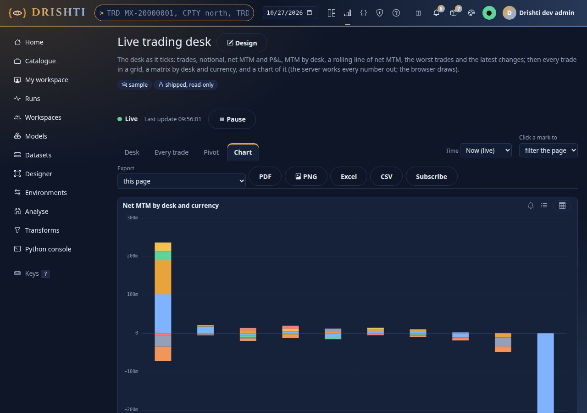

The checks of a `perspective-*` visual are as before (one table, `format.aggregates` from the list), and `drishti.bi.report.perspective-rows` (20,000)
still caps its rows; `format.view` and `format.plugin` are read and ignored.

## 14. Phone and tablet layouts

*Built in phase 7 ([RUPAKA.md section 20.6, part 3](../architecture/RUPAKA.md#206-part-3-embedding-and-phone-layouts-as-built-phase-7-complete)).* A phone shows one column. Without anything declared it is the grid in **reading order** (top to bottom, then left to right), each visual at a height its type has by default,
which is a good first answer. When the order is wrong for a small screen (the headline numbers first, the table last), a report may say how each page is arranged at **640 px and narrower**:

```yaml
layouts:
  phone:
    desk:                                   # a page id
      order: [mtm, trades, by-desk, movers] # these first, in this order; every other visual follows in reading order
      hide: [rolling, losses, latest]       # not drawn on a phone, and not queried
      span: { by-desk: 5 }                  # height in grid rows (1 to 40; one row is 56 px, with 10 px between); the width is the whole screen
```

| Key | Meaning |
|---|---|
| `layouts.phone.<page id>` | the arrangement of that page; a page with no entry keeps the automatic one-column layout |
| `order` | visual ids, first on the screen first. A visual not listed follows the listed ones in reading order |
| `hide` | visual ids left out on a phone. Hidden visuals are **not asked for**, so a hidden table costs the phone nothing. A visual may not be both in `order` and in `hide` |
| `span` | visual id to a height in grid rows. Left out: the type's default height (cards 7.5 rem, charts 18 rem, tables 20 rem) |

Mistakes are `DRS-9031` with the path (`layouts.phone.desk.order: page 'desk' has no visual 'nope'`), or `DRS-9030` for a height that is not 1 to 40. The same words are in `GET /api/v1/bi/reports/{id}` (the model's `layouts`) and the YAML the designer writes back.

**Where it applies.** The console's viewer uses it when the **screen** is 640 px wide or narrower (and swaps back to the grid when the window grows, with no reload); `<drishti-report>` uses it when the **element** is that narrow, whatever the host page's width, so a report in a narrow card of a desktop page gets it too
(section 15). Between 641 and 760 px the automatic single column applies. The designer's **Phone tab** edits it: for the page being edited it lists the visuals in phone order (drag a row or use its arrows to reorder, *Hide*, *Rows* for the height) beside a 390 px preview drawn to scale; each change is a step of
the undo history, *Back to automatic* removes the page's entry, and a visual or page deleted later is dropped from the layouts by the designer. The sample *Live trading desk* ships with one (`config/bi/reports/live-trading-desk.report.yaml`); the picture of the tab and of the result is in the tutorial
([tutorial 16](../tutorials/16-embed-drishti.md)).


### 14.1 A tablet

A tablet (wider than a phone, **1024 px and narrower**) keeps the 12-column grid unless the report says otherwise. `layouts.tablet.<page id>` arranges the page in **two columns**: each visual takes half the width, and the ones listed in `wide` the whole width.

```yaml
layouts:
  tablet:
    main:
      order: [desk, trades, mtm, notional, rows]    # first, in this order; the rest follow in reading order
      wide: [desk, rows]                            # the whole width (the others take half)
      span: { desk: 5, rows: 4 }                    # height in grid rows (1 to 40); left out: the visual's own height in the grid
      hide: []                                      # not drawn on a tablet, and not queried
```

`order`, `hide` and `span` mean what they mean on a phone; `wide` is the tablet's own (on a phone it is ignored with a warning, `layouts.phone.<page>.wide`; an unknown device such as `watch` is ignored with a warning, a page or visual that does not exist is `DRS-9031`, a bad height `DRS-9030`). The viewer chooses by the **screen** (`max-width: 640px` is a phone, `max-width: 1024px` a tablet; a phone with only a tablet layout gets the automatic one-column layout, since half of a phone's width is too little), and `<drishti-report>` by the **element's own width** (the library is 1.3.0). The designer has a **Tablet** tab beside Phone: the visuals in tablet order with *Hide*, *Wide* and *Rows*, above a 768 px preview drawn to scale.


## 15. A report in another web application

`<drishti-report report="file:report:live-trading-desk">` shows a **published** report, one page (`page="grid"`) or one visual (`visual="by-desk"`) in another application's page, signed in as that application's user, masked, with its slicers, cross-filter and live redraws. The attributes, events and the allow-list
(Admin → Embedding: `report:<id>` or `report:*` in the host application's `kinds`) are in [DISTRIBUTION.md section 5](DISTRIBUTION.md#5-embedding-a-report-in-another-web-application) and the developer guide ([ELEMENTS.md](ELEMENTS.md#drishti-report)); what the element does not do (drill down and through, alerts, Export,
Subscribe) is listed there.


## 16. Reports over several datasets

A report reads **one dataset** by default (`dataset:`). A visual may name **another** with its own `dataset:`, and the report's `links:` say which fields of different datasets mean the same, so a slicer or a click on one dataset's visual filters the visuals of another. Each visual's query is still run **as the reader** against its own dataset, with that dataset's row rules and masks. (To put the facts of several datasets in *one* table, build a composed or derived dataset: [DATASETS.md section 11](DATASETS.md#11-composed-and-derived-datasets). The design is [RUPAKA.md section 20.10](../architecture/RUPAKA.md).)

```yaml
report: pnl-vs-exposure
dataset: desk-pnl-vs-exposure           # the default: a visual with no `dataset:` reads this one
links:                                  # fields (table.column) of different datasets that mean the same thing
  - fields: [counterparties.SECTOR, joined.sector]
pages:
  - id: overview
    visuals:
      - { id: pnl, type: card, wells: { values: [Desk P&L] }, at: { x: 0, y: 0, w: 3, h: 2 } }                       # reads desk-pnl-vs-exposure
      - id: sector
        type: slicer
        dataset: counterparty-exposure                                                                                # reads its own dataset
        wells: { field: [counterparties.SECTOR] }
        format: { mode: dropdown, scope: report }
        at: { x: 9, y: 0, w: 3, h: 2 }
```

| Key | Meaning |
|---|---|
| visual `dataset` | the dataset this visual reads: a catalogue id, a file name or the dataset's name; omitted, the report's. Its wells, filters, sort and hierarchy name fields and measures of **that** dataset |
| `links` | a list of `{ fields: [a, b, ...] }`: two or more `table.column`, each a field of at least one dataset the report reads. A link is the author's statement that they mean the same thing (a counterparty's sector, a desk's id) |

**How a choice reaches another dataset.** A choice is made on a field of the dataset of the visual it was made on: a slicer, a click on a mark (the cross-filter), a drill-through's carried value, the report's and the page's filters (those belong to the report's dataset), a bookmark. For each other visual the server asks: does this visual read the same dataset? Then the field is used as it is. Otherwise it looks for a **link** that names the field and, in it, a field the visual's dataset has; that field takes the choice. If there is none, **the choice does not reach that visual** (it is not an error: a visual that no link connects keeps showing everything). A `top` filter ranks by a measure of its own dataset and is not carried to another. Fields of the same name in two datasets are not assumed to be the same: say so with a link (the sample links `counterparties.SECTOR` of the exposure dataset to `joined.sector` of the composed one).

Real query (the sample as `rita`, with the sector slicer, which reads `counterparty-exposure`, set to Banking, for the card that reads the composed dataset; the answer's `query` is what was asked of its dataset):

```
POST /api/v1/bi/reports/file:report:pnl-vs-exposure/query?explain=true   {"page": "overview", "visual": "pnl", "state": {"slicers": {"sector": ["Banking"]}}}
{"query": {"fields": [], "measures": ["Desk P&L"], "filters": ["joined.sector IN [Banking]"], "orderBy": [], "limit": 500}, "rows": [[-1456152.0]]}
```


**Checks.** Each visual is checked against its own dataset (`DRS-9031` for a name that dataset lacks, `DRS-9032` for a well built wrongly, as ever). `no dataset 'x'` for a visual's `dataset:` that cannot be found is `DRS-9034`; a link naming a field no dataset of the report has is `DRS-9031` (`links[0].fields: 'nothing.here' is not a field (table.column) of any dataset the report reads`); a link whose fields are all in one dataset is a warning. `GET /bi/reports/{id}` returns `datasets`: the model of each dataset a visual names (the viewer indexes each visual's fields, formats and hierarchies by it).

**Everywhere else.** Alerts, subscriptions, exports, boards and the embedded report ask each visual through the same server code, so they work over several datasets; a 2.1 `perspective-*` visual shows the rows of one table of its dataset. Governance: **impact analysis** counts only what a report reads of the dataset being changed (a visual's own dataset, else the report's), so a change to `counterparty-exposure` is set against the visuals that read it; lineage shows the report below each dataset it reads. **The designer.** The Fields pane has **Add dataset**: choose any dataset you may read and it gets its own collapsible tree under the report's main one (each tree is labelled; the Remove button of a tree is off while a visual reads that dataset). Drag a field of that tree onto an **empty visual** or onto the canvas and the visual's `dataset:` is set for you (left blank when the field is of the report's main dataset); a small tag with the dataset's title shows on every visual that reads another dataset. A visual reads **one** dataset: dropping a field of another dataset onto a visual that already holds fields is refused with *Refused: this visual reads A; put B fields in another visual, or make a composed dataset.* Once two datasets are in play a **Links between datasets** panel appears under the tree: it suggests fields with the same name and type (or the same stated meaning) in different datasets, a tick box writes the link into `links:` (and removes it again), the links the report already has are listed with a remove button, and **Make a composed dataset from these** shows a `from:` / `join:` draft (DATASETS.md section 11.1) on the first linked pair for you to read; **Create the draft and review it** is the only thing that saves it, as a dataset draft in your workspace opened in the Model view. The Format tab's free-text **Dataset** box still works. The Model view's link, the Check button and the AI helper keep working with the report's main dataset.

**Starting with several datasets.** The *New report* forms (the designer's start page and **My workspace → New item → report**) ask for a **Main dataset** (the report's `dataset:`) and an optional **Also add** list (hold Ctrl or Shift for several). The report is saved with the main dataset, and the designer opens with every chosen dataset in the **Fields** pane, each with its own tree (the same state as **Add dataset**, which now sits at the top of the Fields pane). A dataset that cannot be used is listed **greyed with the reason** instead of hidden: *draft in a private workspace: publish it first*, *a draft: publish it first*, *has errors: open it*. Through the URL, `/bi/design/<id>?also=a,b` does the same for existing reports. In YAML nothing changes: name the datasets in the visuals' `dataset:` keys and the report's `links:` as above.

Not built: a visual that reads **two datasets at once** (compose them: DATASETS.md section 11); links **with a transformation** (a code to a name).

## 17. Expected values: `tests:`

A report (or a dataset: [DATASETS.md section 8.1](DATASETS.md#81-expected-values-tests)) may declare what its numbers should be. **Check** runs the tests and shows each as passed, failed or could-not-run; **publishing is refused while one fails** (`409 DRS-9043`) unless a `bi-admin` forces it (`force: true`, audited as `FORCED over N failing test(s)`).

```yaml
tests:
  - { name: The card shows every trade, visual: trades, expect: 750 }                      # what a visual shows: its first measure, one row
  - { name: Rates desk MTM, measure: MTM, by: [trade.desk], row: { trade.desk: DESK-RATES }, expect: 161766771, tolerance: 0.5% }
  - { name: A bad day, measure: Trades, filters: [{ field: trade.desk, op: eq, values: [DESK-FX] }], date: 2026-10-09, expect: { min: 10, max: 90 }, role: desk-head }
```

| Key | Meaning |
|---|---|
| `visual` or `measure` | a visual of the report (asked as the viewer asks it: the page's own filters apply, then the test's), or a measure of the report's dataset (asked directly, grouped by `by`) |
| `row`, `column` | pick one row of the answer by the values of its fields (without it the answer must be one row); the measure column to read (default: the visual's first measure) |
| `filters`, `date` | extra conditions (`field`, `op`, `values`: the form of a report filter) and a business date |
| `expect`, `tolerance` | a number, a range `{ min, max }` or `[low, high]`; an amount or a percentage (`'0.5%'`) that widens it |
| `role` | run as this role (default: the one chosen in Check, else you) |

**As a chosen role.** The figure a test finds is the figure a reader with that role's row rules and masks sees. Check offers **Run the tests as** *yourself* or a role you hold (a `bi-steward` may choose any); the report and dataset are loaded as you, only the query runs as the role. A role you do not hold makes each test `error` (`does not hold the role 'reader'`), never a figure. A figure masked for the role cannot be checked (`error`), and an answer of several rows needs a `row`.

```text
POST /api/v1/bi/items/bi-d73f79cdbc/tests     {"role": "writer"}
{"item": "bi-d73f79cdbc", "kind": "report", "role": "writer", "total": 3, "passed": 2, "failed": 1, "errors": 0, "ok": false, "results": [
  {"name": "card shows the count", "kind": "visual", "target": "n", "expect": "16", "actual": 16.0, "status": "pass", "message": "", "role": "writer"},
  {"name": "card is wrong", "kind": "visual", "target": "n", "expect": "1", "actual": 16.0, "status": "fail", "message": "expected 1, got 16", "role": "writer"},
  {"name": "measure through the report", "kind": "measure", "target": "N", "expect": "1 or more", "actual": 16.0, "status": "pass", "message": "", "role": "writer"}]}
```

The designer's **Check** runs the report's tests (of the text on the screen, saved or not) under *Expected values*, with the role box and *Run again*. The dataset page has *Expected values* with the same box. A report with a test that names a visual or measure it does not have is `DRS-9031` (`tests[0].visual`), a malformed one `DRS-9030`.


`drishti.bi.governance.refuse-failing-tests` (on) turns the publish gate off (a failing test then only shows in Check). A test that cannot run (a source down, a role the publisher lacks) counts as failing at publish. Exports and subscriptions do not run tests.

## 18. A report on a model (wave W1)

With the model layer ([BI_MODEL_SPEC.md](../architecture/BI_MODEL_SPEC.md) sections 3, 4 and 9.4; [BI_GUIDE.md](BI_GUIDE.md#23-models-and-pack-datasets-the-model-layer-wave-w1))
a report binds to **one model** with `model:` in place of `dataset:`:

```yaml
report: trades-and-desks-report
title: Trades and desks report
model: trades-and-desks@1          # a model by name and major; or dataset:pack.trading.trade (that dataset's implicit model)
pages:
  - id: main
    title: Main
    visuals:
      - { id: bar-1, type: bar, at: { x: 2, y: 1, w: 6, h: 5 }, wells: { axis: [trade.DESK], values: [Sum of MTM] } }
```

**Start one** from *Models* (**Use** on a dataset or a model), from a dataset's page (**Start a report on it**), or from the model designer (**Start a
report**): the draft opens in the designer. Everything of sections 2 to 8 applies; what differs:

* **Fields** is the model as you see it: one group per dataset alias (`trade`, `desk`), its measures (the model's and the default ones such as
  `Sum of NOTIONAL`, `Count of trade`), masked fields marked. The header names the model: *Implicit model of Trade* with **Make it a model**, or
  *Model Trades and desks* with **Open the model**. There is no *Add dataset*: a report reads one model, and another dataset is added to the model.
* **Every visual's data is one model query** (`POST /api/v1/bi/mq`) built from its wells (fields and measures, in order), the report's, page's and
  visual's filters (a filter on a measure becomes `having`), its sort and limit, and, in the viewer, the slicers and the other visuals' selections.
  **Query of the selected visual** (under Fields) shows it as YAML, for example:

  ```yaml
  mq: 1
  model: trades-and-desks@1
  select:
    fields: [trade.DESK]
    measures: [Sum of MTM]
  ```
* A filter's value picker lists the field's values from the model, as you.
* **Make it a model** (implicit models only: `model: dataset:<name>`, quoted or not, as the designer saves it) writes a draft model item in the report's
  workspace (the dataset as the fact, its pack dimensions one hop away with their relationships, the default measures; `implicit-from:` says where it came
  from) and rebinds the report to `<model>@1`; the model opens in the designer. **A model is shared, never a per-report copy**: when the workspace already
  has a model written out from the same dataset, the report is rebound to that one (`"reused": true`), and the answer lists the **other reports on the same
  dataset** (`others`) so they can be moved onto the model too (`POST /bi/model-api/rebind {ref, reports}`). Two reports made from `pack.trading.trade`,
  promoted one after the other:

  ```json
  {"dataset":"pack.trading.trade","model":"bi-00e4ef5375","ref":"r-one-model@1","reused":false, ...,"others":[{"kind":"report","id":"bi-d158511020","title":"R two", ...}]}
  {"dataset":"pack.trading.trade","model":"bi-00e4ef5375","ref":"r-one-model@1","reused":true, ...,"others":[]}
  ```

  On a report that already reads a model of its own the answer is `DRS-9140` *this report already reads a model of its own (or none): Make it a model only
  writes out the implicit model of a report made straight from a dataset (model: dataset:<name>). Open the model it reads to change it.*

**The answer is the same as the old path.** A model query over a pack dataset returns the numbers the version-1 dataset query returns over the same rows;
on the browser test's lake (two days of 60 trades), the model query

```json
{"mq": 1, "model": "trades-and-desks@1", "select": {"fields": ["desk.NAME"], "measures": ["Sum of MTM"]}, "sort": [{"by": "Sum of MTM", "desc": true}]}
```

answers `["Equity derivatives", 425000], ["Fixed income", -75000], ["Foreign exchange", -575000]`, and the version-1 query
`{"fields": ["trade.DESK"], "measures": ["MTM"]}` on `trades-basic` answers `["DESK-EQD", 425000], ["DESK-FI", -75000], ["DESK-FX", -575000]`.

**On the server.** The report endpoints read `model:` as they read `dataset:`: Check (`POST /bi/reports/validate`), the report query (its answer's `mq`
names the model), exports, subscriptions, board tiles and embeds ask each visual as one model query on the model, as the reader. A report names `model:` or
`dataset:`, never both (`DRS-9140`). **Publishing** a report on a model needs that model **published** (a draft model is read by its author only) and
passing its Check and the security safeguard; otherwise publish is refused with `DRS-9030`, for example *the model 'wes-draft@1' is not published (a draft
model is read by its author only): publish the model first, where its Check and security safeguard run*. The publisher must also **read the model** (a
member of its workspace, or in its audience): a report uses a model by reference, so *you may not read the model '…' this report reads, so you cannot publish a
report on it* refuses it otherwise; `POST /bi/mq` refuses such a model the same way (`DRS-9151` *no model '…' that you may read*). The sample reports keep
`dataset:` (the migration wave W4 moves them).

**Reports reference a model; they never own it.** Deleting a report never touches its model. A model item is **not deleted while anything reads it**:
`DELETE /bi/items/<model>` answers `409 DRS-9004` *'Shared model' cannot be deleted: 1 report still read it. A model is shared, never owned by what reads it:
rebind or delete those first (its page lists them under Used by; GET /api/v1/bi/models/<id>/consumers)*. `GET /bi/models/{ref}/consumers` (a model item id,
`<name>@<major>` or `dataset:<name>`) lists the reports, boards (through the reports they show), notebooks, datasets read from the model's answer, alerts on
a model query and live subscriptions, as far as the caller may read them (`hidden` counts the rest); the model's `describe` carries the same list as
`usedBy`.

## 19. Languages in the report designer (wave A)

Wave A ([BI_GUIDE.md section 24](BI_GUIDE.md#24-the-languages-in-the-console-wave-a-220)) adds four things to a report on a model.

**The Fields pane inherits the model.** It is built from the model's description as you see it (`GET /api/v1/bi/models/{ref}/describe`), with the
properties the model gives each field: its **display name** (*Trading desk* for `trade.desk`; every visual's labels use it too), its **description**
(the tooltip), its **format**, its **folder** (a collapsible group inside the dataset), and **hidden** fields left out. A report never re-declares them:
a change in the model reaches every report on it. When the model has **perspectives**, the header offers **Perspective**: the pane then shows only that
perspective's fields and measures (the report's own measures always show), and the report keeps the choice:

```yaml
report: inherit-model-report
title: Inherit model report
model: inherit-model@1
perspective: "desk-view"
pages: [...]
```

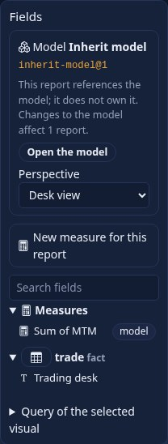

A perspective is a convenience, not security: what a reader may not see the model hides from them (`hidden-for`), and the server leaves it out of
`describe`, SQL and AI.

**A measure of this report only.** *New measure for this report* (above the field search) takes a name and a formula in the expression editor, over
the model's measures and fields; **Try it** asks the model. The measure is written into the report (spec 4.2) and sent with every query that uses it as
`define`, so it never changes the model:

```yaml
measures:
  "MTM in thousands": { expr: "measure('Sum of MTM') / 1000" }
```

```yaml
mq: 1
model: query-model@1
select:
  fields: [trade.DESK]
  measures: [MTM in thousands]
define:
  MTM in thousands: "measure('Sum of MTM') / 1000"
```

In the Fields pane it is marked *this report only*, with **Move to the model** (the model designer opens with the measure added to its draft). A name the
model already has is refused (a report measure cannot shadow one of the model's: `DRS-9154` in Check). The server reads both keys of the report itself: every visual it draws (the viewer, exports, subscriptions, boards) sends the report's own measures as `define`, and `GET /reports/{id}` describes the model through the report's `perspective:` (its `dataset.perspective`).

**Query of the selected visual: MQ or SQL.** The panel under Fields shows the selected visual's question as a **model query** (the YAML the server is
asked) or as **SQL** (Drishti SQL: the model's aliases as tables, `MEASURE('name')` for a measure, `JOIN` without `ON` along the model's relationships),
one switch. **Run as SQL** sends the statement to the server (`POST /api/v1/bi/sql`) and shows its rows, its time and its plan, saying whether the plan is
the one the visual's query ran: one question, one plan, one cache entry, whichever language asks it. The SQL text is written by the console from the
model query (a printer: the server parses, binds and checks it). A report's own measure is written in its SQL form when it has one (`measure('x')`
is `MEASURE('x')`, `sum` is `SUM`, `distinct(x)` is `COUNT(DISTINCT x)`); one with no SQL form (a `where=`, a conditional, a time function) is named
`MEASURE('…')` with its DEL in a comment above. Captured for the bar above (a desk axis and the report's own measure):

```sql
SELECT trade.DESK,
       MEASURE('Sum of MTM') / 1000 AS "MTM in thousands"
FROM   trade
GROUP  BY trade.DESK
ORDER  BY "MTM in thousands" DESC
LIMIT  500
```

**Run as SQL** answered *3 rows from the server in 9.6 ms. Plan p_17ee524ffb* (the same plan as the visual's query). The same holds outside the
designer: on that model, the model query `{select: {fields: [trade.DESK], measures: [Sum of MTM]}}` and the statement
`SELECT trade.DESK, MEASURE('Sum of MTM') AS "Sum of MTM" FROM trade GROUP BY trade.DESK` answer the same rows with the same `meta.plan` (a browser test
checks it).

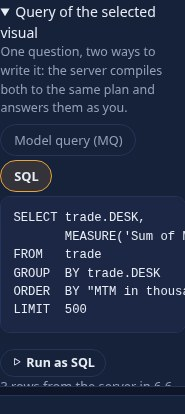

**Expressions are DEL v2.** Every formula the designer writes uses the Python-like syntax ([EXPRESSIONS.md](EXPRESSIONS.md)); a report saved before
2.2.0 with the older syntax is refused (`DRS-9100`, with the DEL v2 text as the fix; stored items are converted when the server starts, and `drishti.py bi migrate --expressions` converts files).

## 20. Report schema v2 in one report (2.4.0)

The parity tasks of a Power BI author (BI_PARITY_PLAN section 4, items 6 to 8 and 13) in one report on `trades-basic`, every part made in the designer (BI Studio) without
the YAML tab; the YAML is what the designer writes:

```yaml
rachana: 1
report: desk-pack
title: Desk pack
model: trades-basic@1
theme: { use: corporate }                                    # Format, Report, Theme
pages:
  - id: page1
    title: Page 1
    interactions:                                            # Format, Interactions (or Edit on the canvas)
      column-1: { matrix-1: none }
    visuals:
      - id: matrix-1
        type: matrix
        at: { x: 0, y: 0, w: 6, h: 5 }
        wells: { rows: [trade.DESK, trade.PORTFOLIO], columns: [trade.CURRENCY], values: [MTM, Notional] }
        format:                                              # Format, Subtotals, Layout, Conditional formatting
          subtotals: true
          expandTo: 0
          rules:
            - { type: gradient, apply: MTM, min: "#c62828", mid: "#ffffff", max: "#2e7d32" }
            - { type: icons, apply: Notional, icons: arrows, thresholds: [0, 1000000] }
      - id: column-1
        type: column
        at: { x: 6, y: 0, w: 6, h: 5 }
        wells: { axis: [trade.DESK], values: [MTM], split: [trade.CURRENCY] }        # Build, the Small multiples well
        tooltip: tip1                                        # Format, Tooltip, New tooltip page
        format: { subtitle: "By desk, one chart per currency", border: true, valueAxis: { gridlines: false }, multiples: { columns: 3 } }
      - { id: card-1, type: card, at: { x: 0, y: 5, w: 3, h: 2 }, wells: { values: [Trades] } }
      - { id: slicer-1, type: slicer, at: { x: 3, y: 5, w: 3, h: 5 }, wells: { field: [trade.CURRENCY] }, format: { syncGroup: ccy } }
  - id: tip1
    title: Tooltip 1
    tooltip: true                                            # Format with no visual selected: Use as a tooltip page
    visuals:
      - { id: card-1, type: card, at: { x: 0, y: 0, w: 6, h: 2 }, wells: { values: [Trades] } }
  - id: page3
    title: Page 3
    visuals:
      - { id: slicer-1, type: slicer, at: { x: 0, y: 0, w: 3, h: 5 }, wells: { field: [trade.CURRENCY] }, format: { syncGroup: ccy } }
      - { id: card-1, type: card, at: { x: 3, y: 0, w: 6, h: 2 }, wells: { values: [MTM] } }
```

The browser test `drishti-console/tests/test_bi_studio_browser.py` builds this report through the UI, then views it: the matrix opens at the desks and expands and collapses,
coloured and with icons; the small multiples draw a chart per currency; a selection on the chart filters the card and not the matrix; the tooltip page opens over a bar,
filtered to it; a currency chosen on page 1 holds on page 3.
