<!--
  Project Drishti · Any data. Any domain. One grammar.

  Copyright (c) 2026 Ashutosh Sinha <ajsinha@gmail.com>.
  All rights reserved.

  PROPRIETARY AND CONFIDENTIAL.

  This file is the confidential and proprietary property of Ashutosh Sinha.
  Unauthorised copying, use, modification, distribution or disclosure of this
  file, via any medium, is strictly prohibited except with the express prior
  written permission of the copyright holder.

  See the LICENSE file in the root of this repository for the full terms.
-->

# Reports and dashboards

Drishti's reports, boards and statements are its business-intelligence layer, called **BI** in the top bar and on the command line
(`RUPAKA` is an alias). There is one analysis path: **slice in the Pivot, then make a report**. The [Pivot](PIVOT_GUIDE.md) is the one grid
for slicing and totalling any table; when an analysis is worth keeping for other people (published, shared, scheduled, put on a wall
screen, sent as a statement, watched by an alert), it becomes a **report**. A report reads a **model** written in Rachana over the
**tables** of the table layer (**Build › Tables & models**; [TABLES_GUIDE.md](TABLES_GUIDE.md) is the home of tables, models and virtual
tables). Every number is computed on the server, as the person looking: their row rules and masks apply to every visual, export, mail,
alert and embedded report. The browser only draws.

This guide is what you see and what you do: the pages, the designer, the report file, boards, statements, background runs, AI helpers,
publishing and governance, and distribution (the Reports page, export, subscriptions, alerts, embedding). How it is built is
[ARCHITECTURE.md section 28](../architecture/ARCHITECTURE.md). Code over a model (SQL and Python cells, Python measures, visuals and
Transforms) is the [Notebook](NOTEBOOK_GUIDE.md).

## Start here

| You want to | Read |
|---|---|
| **Learn by doing** | [tutorial 8, Part A](../tutorials/08-reports-and-dashboards.md#part-a--your-first-bi-report) (a first report in twelve steps: map, bar, slicer, publish, filters, several models, relative dates, a tablet); then [11](../tutorials/08-reports-and-dashboards.md#part-d--bi-that-runs-itself) (refresh, subscriptions, alerts, export, expected values), [12](../tutorials/08-reports-and-dashboards.md#part-f--live-bi-and-boards) (live reports and boards), [13](../tutorials/08-reports-and-dashboards.md#part-g--govern-bi) (governance), [14](../tutorials/09-notebook-and-python.md) (Python and the Notebook), [15](../tutorials/10-ai-assistant.md) (AI), [16](../tutorials/20-embed-drishti.md) (embedding), [18](../tutorials/08-reports-and-dashboards.md#part-b--several-datasets-in-one-report) (several facts in one report), [20](../tutorials/08-reports-and-dashboards.md#part-c--statements-and-field-parameters) (statements and field parameters), [44](../tutorials/18-tables-and-models.md) (tables and models) |
| Try each step with real answers, four people and row rules at work | [section 5.9](#59-worked-examples-the-shipped-models-row-rules-and-masks) |
| Find your way round the pages, powers and workspaces | sections [2](#2-getting-in-the-bi-menu-the-rail-and-bi-go) to [4](#4-home-the-catalogue-workspaces-and-items) |
| Write or read a table or a model | [TABLES_GUIDE.md](TABLES_GUIDE.md); what reports need of them: [section 5](#5-models-and-datasets-what-a-report-reads) |
| Design a report | [section 8](#8-bi-studio-and-the-report-designer); the file: [section 9](#9-the-report-file-pages-visuals-filters-and-slicers) |
| Put a wall of tiles on a screen | [section 14](#14-boards-report-pages-of-live-tiles) |
| Follow a long question that runs in the background | [section 15](#15-background-runs-long-bi-questions) |
| Publish, review, certify, trace lineage, move content between servers | [section 17](#17-publishing-and-governance-versions-review-certification-lineage-impact-environments) |
| Export, subscribe, schedule, alert | [section 18](#18-distribution-the-reports-page-export-and-subscriptions), [section 19](#19-alerts-on-numbers) |
| Show a report in another web application | [section 20](#20-embedding-a-report-in-another-web-application), [EMBED_GUIDE.md](EMBED_GUIDE.md) |
| Grant the powers, set the limits | [ADMIN_GUIDE.md](ADMIN_GUIDE.md#34-bi-powers-rupaka), [CONFIGURATION.md](../admin/CONFIGURATION.md) |
| Call it from a program or the command line | [API_REFERENCE.md](API_REFERENCE.md), [CLI_REFERENCE.md](CLI_REFERENCE.md#bi-workspaces-and-the-catalogue-rupaka) |
| Fix a problem | [section 22](#22-settings-limits-and-problem-codes), [OPERATIONS_GUIDE.md](OPERATIONS_GUIDE.md#21-troubleshooting) |

A good first hour: read sections 2 to 4, set up the stack of [section 5.9](#59-worked-examples-the-shipped-models-row-rules-and-masks), then do tutorial 8, Part A.

## Contents

1. [What a report is, and the path to one](#1-what-a-report-is-and-the-path-to-one)
2. [Getting in: the BI menu, the rail and BI GO](#2-getting-in-the-bi-menu-the-rail-and-bi-go)
3. [Who may do what: the four powers](#3-who-may-do-what-the-four-powers)
4. [Home, the catalogue, workspaces and items](#4-home-the-catalogue-workspaces-and-items)
5. [Models and datasets: what a report reads](#5-models-and-datasets-what-a-report-reads)
6. [The report viewer](#6-the-report-viewer)
7. [Which date a report reads](#7-which-date-a-report-reads)
8. [BI Studio and the report designer](#8-bi-studio-and-the-report-designer)
9. [The report file: pages, visuals, filters and slicers](#9-the-report-file-pages-visuals-filters-and-slicers)
10. [Format, conditional formatting and themes](#10-format-conditional-formatting-and-themes)
11. [Field parameters](#11-field-parameters)
12. [Statements: paginated reports, page-exact, one per reader](#12-statements-paginated-reports-page-exact-one-per-reader)
13. [Live reports and standing queries](#13-live-reports-and-standing-queries)
14. [Boards: report pages of live tiles](#14-boards-report-pages-of-live-tiles)
15. [Background runs: long BI questions](#15-background-runs-long-bi-questions)
16. [AI in BI: report from words, ask the data, explain this number](#16-ai-in-bi-report-from-words-ask-the-data-explain-this-number)
17. [Publishing and governance: versions, review, certification, lineage, impact, environments](#17-publishing-and-governance-versions-review-certification-lineage-impact-environments)
18. [Distribution: the Reports page, export and subscriptions](#18-distribution-the-reports-page-export-and-subscriptions)
19. [Alerts on numbers](#19-alerts-on-numbers)
20. [Embedding a report in another web application](#20-embedding-a-report-in-another-web-application)
21. [Python in reports](#21-python-in-reports)
22. [Settings, limits and problem codes](#22-settings-limits-and-problem-codes)

## 1. What a report is, and the path to one

**The path.** Open any table, entity search or VaR in the **Pivot** (`PIVOT <GO>`, or *Pivot* on the BI rail) and slice it: the risk cubes
are its presets ([PIVOT_GUIDE.md](PIVOT_GUIDE.md)). A figure for other people is a **report**: pages of visuals over one model, designed by
dragging fields onto a canvas, published through review, read by many, each as themselves. What a grid cannot say is the
[Notebook](NOTEBOOK_GUIDE.md)'s.

**What you can do**

* open BI from the top bar or with `BI <GO>`; keep drafts in a personal workspace and move them to a shared one; create typed items
  (`report`, `theme`, `notebook`, `python`, and the table layer's `table` and `model`; a board is a report with board pages) with a YAML body;
* read the **models** reports sit on: tables from pack kinds through connectors, relationships, measures, row rules and masks; a pack's
  every kind is already a table; start a model from the packs (section 5);
* open a **report**: tabs, slicers, click a bar to filter the page, drill down, drill through, show the rows, open a trade in the terminal
  (section 6); **design** one in BI Studio by dragging fields onto a canvas, with the YAML beside it, real data, Check, undo and redo (section 8);
* lay a page out as **paper** (a statement, one per reader: section 12) or as a **board** of live tiles for a wall screen (section 14);
* watch a report over a **live table** redraw as the data ticks (section 13); let a long question run in the **background** and come back
  to it (section 15);
* publish versions, propose for review, approve (four eyes), compare any two saved states, certify, see lineage and what a change breaks,
  move content between servers as a bundle (section 17);
* **export** a page as PDF, PNG, Excel, CSV or JSON Lines, **subscribe** people by email, set **alerts** on a number, **embed** a report in
  another application (sections 18 to 20);
* ask the **AI helpers**, when an administrator has switched them on: describe a report, ask the data, explain a number (section 16).

Everything the pages do, the server decides: the pages are a shell that asks the server's `/api/v1/bi` under your identity.

## 2. Getting in: the BI menu, the rail and BI GO

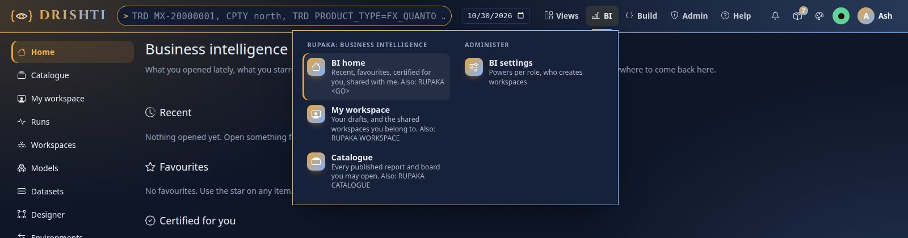

**The BI menu** is a menu of the top bar, with the icon `bar-chart-line` (an edition or a lens chooses which menus it draws, and in what
order). It is shown only to people who hold the `bi` power (section 3), and not at all when BI is
switched off. Its entries are also the **rail** on the left of every BI page:

| Group | Entry | Opens |
|---|---|---|
| Business intelligence | **Catalogue** | every published report and board you may open (`/bi/catalogue`) |
| | **My workspace** | your drafts (`/bi/w/me`) |
| | **My runs** | your BI questions queued or running, and the last ones answered (`/bi/w/me?tab=runs`, section 15) |
| | **Workspaces** | the shared workspaces you belong to, and their members (`/bi/workspaces`) |
| Analyse | **Models** | *Start from your data*: the models and the tables the packs give (`/bi/models`, section 5) |
| | **Datasets** | the tables reports read, with their refresh (`/bi/datasets`) |
| | **Report designer** | your report drafts, a new report or board, and the designer (`/bi/designer`) |
| | **Promotion (test to live)** | move reports and models from one environment to the next as a bundle (`/bi/environments`, section 17.7) |
| | **Notebook**, **Data prep** | code over a model, and Python data preparation ([NOTEBOOK_GUIDE.md](NOTEBOOK_GUIDE.md)) |
| Administer | **BI settings** | Admin, BI settings (`/admin/bi`, needs `bi-admin`; in the top bar's menu only) |

The rail also links the **Build home** (`/build`, where BI's own home `/bi` leads), **Tables & models** (`/build/tables`) and the **Pivot**.
**Reports** in the **Views** menu (`/reports`) lists your scheduled reports, subscriptions and alerts, and the BI reports (section 18.1).

**`BI` on the command line** is a reserved keyword (`RUPAKA` is an alias). Case does not matter.

| Type | Opens |
|---|---|
| `BI <GO>` | the Build home (`/build`) |
| `BI WORKSPACE <GO>` (or `WORKSPACES`) | your personal workspace (`/bi/w/me`) |
| `BI CATALOGUE <GO>` (or `CATALOG`) | the catalogue (`/bi/catalogue`) |
| `BI RUNS <GO>` | your runs (section 15) |
| `BI <report-or-board> <GO>` | an item by its id or its title (any case); a **report opens drawn** (`/bi/r/<id>`), any other item opens its page; words that match several items open the catalogue searched for them |
| `BI SETTINGS <GO>` | Admin, BI settings (needs `bi-admin`) |

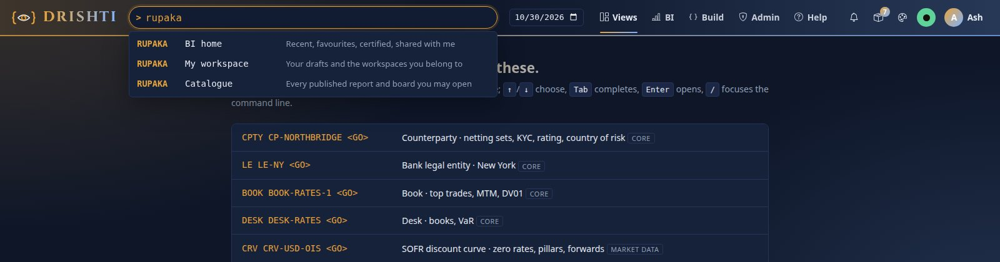

Type-ahead offers the keyword after the first letters (`b`, `ru`), the pages after `BI `, and the items you may open that match what you
type next. Someone without the `bi` power gets no suggestions and, on `<GO>`, a message that says what is missing. A pack may not define a
mnemonic named `BI` or `RUPAKA` (or `FORM`, `FUNC`, `WHAT`, `DATAMAP`): the pack loader refuses it, and `pack check` fails the same way.

**Addresses:** `/bi/catalogue`, `/bi/workspaces`, `/bi/w/<workspace>` (`me` is your personal one), `/bi/i/<item>` (an item's page),
`/bi/models`, `/bi/datasets`, `/bi/ds/<table>` (a table's page), `/bi/r/<report>[/<page>]` (the viewer; `/bi/b/<board>` opens it),
`/bi/designer` and `/bi/design/<draft>` (the designer), `/bi/design/theme/<id>` (the theme designer), `/bi/environments`, `/bi/run/<id>`
(one run), `/admin/bi` and `/admin/bi/runs`. The addresses of tables and models (`/bi/d/<id>`, `/bi/m/<id>`, `/bi/md/<id>`,
`/bi/datasets/new`) lead to the table's page or to **Build › Tables & models**.

**Keys** (the console's one keymap: `?` or the rail's **Keys** button lists them with the rest of the screen's): `/` searches the catalogue
(from another BI page it takes you there with the search focused), `g h` the Build home, `g c` the catalogue, `g w` my workspace, `g r` my
runs. Keys are ignored while you type in a field.

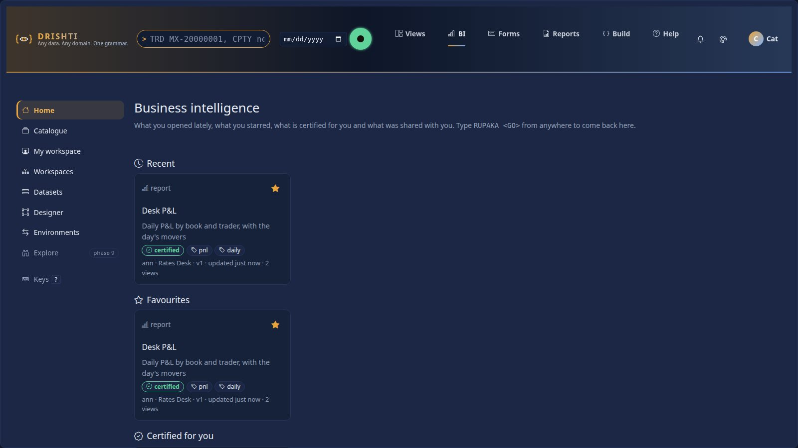

**On a phone** (390 px) the rail becomes a scrolling bar above the page, cards stack in one column, every control is at least 44 px high,
and fields use 16 px text so the browser does not zoom.

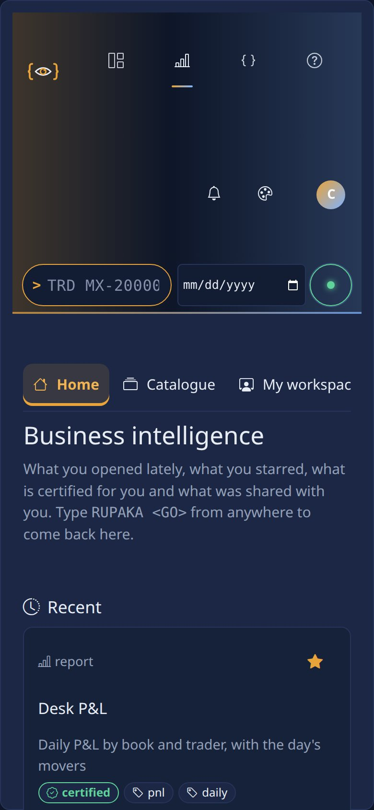

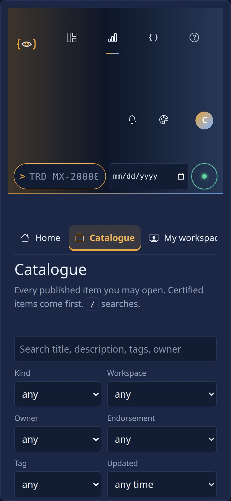 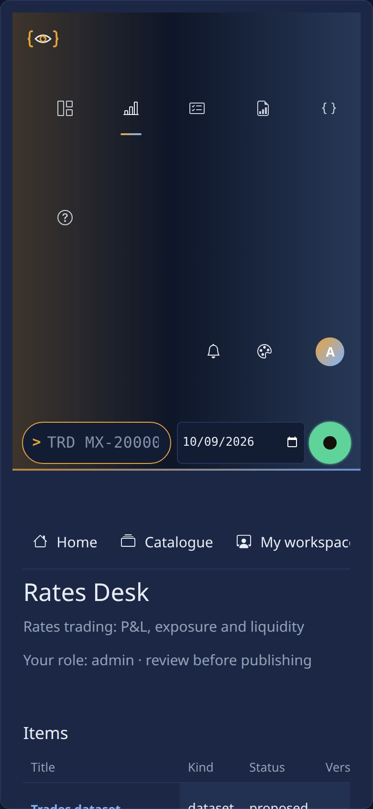

## 3. Who may do what: the four powers

BI powers are granted on roles, beside `raw`, `author` and `approve` (see [ADMIN_GUIDE.md](ADMIN_GUIDE.md#34-bi-powers-rupaka)).

| Power | Lets a holder |
|---|---|
| `bi` | open BI, the catalogue and the published content their audience allows; keep favourites and recents |
| `bi-author` | create, edit, move, propose and publish items (reports, tables, models, themes), design, and create shared workspaces (if the policy says authors) |
| `bi-steward` | **certify** published items; **review** (approve or reject) proposals in any workspace; **import bundles**; create shared workspaces when the policy says stewards |
| `bi-admin` | change BI settings, see and manage every shared workspace, force a publish that breaks reports or fails tests; always allowed to create workspaces |

A higher power also opens BI, so a role granted only `bi-author` still sees the catalogue. The built-in `admin` role holds all four;
`viewer` holds `bi`; `author` and `approver` hold `bi` and `bi-author`; a role a pack defines holds none until an administrator grants it.
With security off, everyone holds everything. What a power allows is then narrowed by the **workspace role** (section 4.3). Approving also
needs the role's own **`approve`** flag for a workspace member who is not a steward (section 17.3).

## 4. Home, the catalogue, workspaces and items

### 4.1 Home: For you

BI's home is the **Build home** (`/build`). Its **For you** strip holds four sets of cards: **Recent** (what you opened lately, newest
first), **Favourites** (items you starred), **Certified for you** (certified items you may open, most used first) and **Shared with me**
(published items of your workspaces that others own). A card shows the kind, a star, the title, the description, badges (certified,
promoted, shipped, status, tags) and a line with owner, workspace, version, freshness ("updated 3 days ago") and the views in the last
30 days.

### 4.2 The catalogue

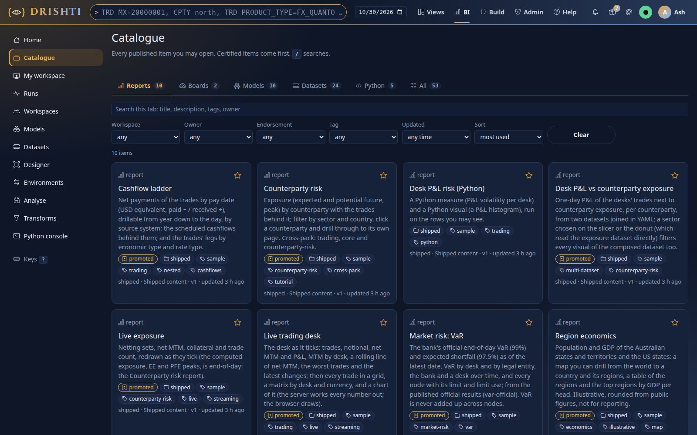

The catalogue lists every **published** item you may open (section 4.5), **split by kind into tabs**: **Reports · Boards · Models · Datasets ·
Python · All**, each with its count (*Reports 24*). Boards holds reports with board pages; Python holds Python items and notebooks; All shows
everything, grouped by kind. A tab switches in place; the address names it (`/bi/catalogue?kind=reports&sort=use`), so a link opens the same
tab and back and forward walk the tabs. With no `kind` in the address the catalogue opens on the tab you used last (remembered in this
browser), else Reports. The arrow keys move along the tabs; on a phone the tabs scroll sideways.

Search, filters and sort work **inside the chosen tab**, and every tab's count follows the search. The search box searches title,
description, tags, owner, kind and workspace name (every word must match); the filters narrow by workspace, owner, endorsement, tag and how
recently it was published; sort is *most used* (the default), *newest* or *title*. **Certified items are pinned first** except when sorted by
title. The address keeps the state (`?kind=python&q=daily`), and the filter lists show only values that exist, with counts.

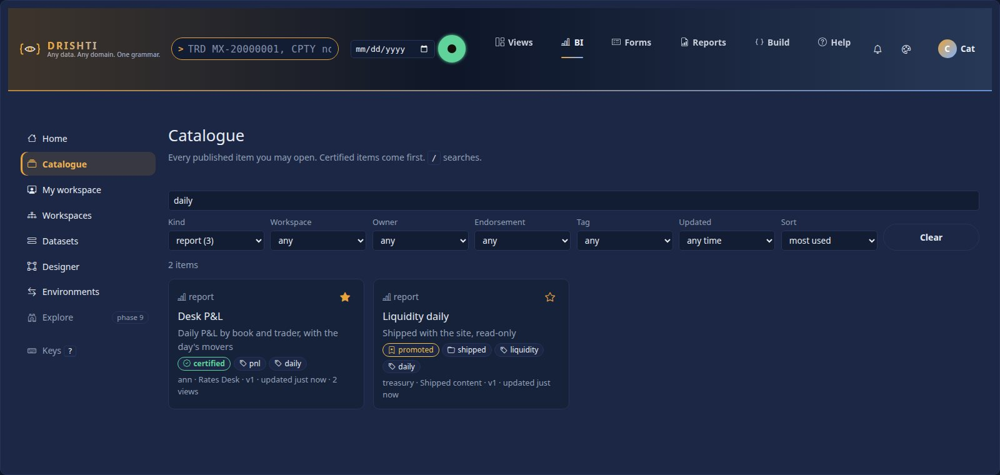

### 4.3 Workspaces and their roles

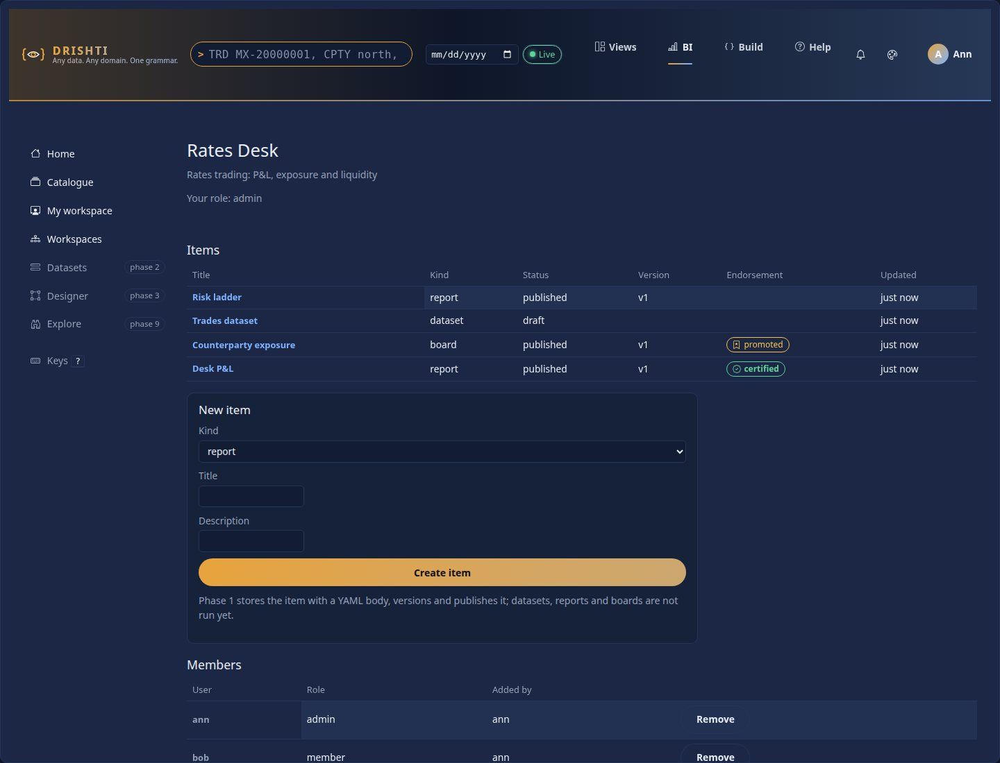

- **Personal workspace** (one per user, made on first use): drafts only you can see. It has no members and cannot publish: move an item
  to a shared workspace first (*Move to workspace*).
- **Shared workspace**: created from **Workspaces** (needs the policy's power, section 4.6). The creator becomes its admin. Members have a role:

| Workspace role | May |
|---|---|
| `viewer` | open the workspace and its published items |
| `contributor` | also create and edit drafts (needs the `bi-author` power too) |
| `member` | also publish, approve proposals, promote, delete others' drafts (publish needs `bi-author`) |
| `admin` | also add and remove members, rename it, switch review on or off, delete it (when empty) |

**Items · Runs · Members.** A workspace page has three tabs (`?tab=members`, `?tab=runs` in the address). **Items** lists the title, a short
id and the created time, the kind, status, version, endorsement and when it was updated. Rows you may delete (your own items, or any item
if you are a member of a shared workspace; never shipped content) have a checkbox; **Select all** and **Delete selected (N)** open one
confirmation listing the titles, and the message says which were deleted and which were skipped, with the reason. **New item** asks a report
for its model and opens it in the designer; a board opens in the same designer; a table or model opens **Build › Tables & models**; a
notebook or a Python item starts in the Notebook. **Members** lists the members and, for its admins, **Add a member** (type part of a name,
choose the role, **Add or change**) and the settings (*Require review before publishing*, *Delete workspace*). After **Create workspace**,
*Next: add the people who share it* opens the Members tab. **Runs** is section 15.4.

A person who is not a member does not learn that a workspace exists (`404 DRS-9001`). The last admin cannot be demoted or removed. A
workspace that **requires review before publishing** offers *Propose* instead of *Publish*. A `bi-admin` is an admin of every shared
workspace (but cannot read anyone's personal workspace).

### 4.4 Items: lifecycle, versions, duplicate and delete

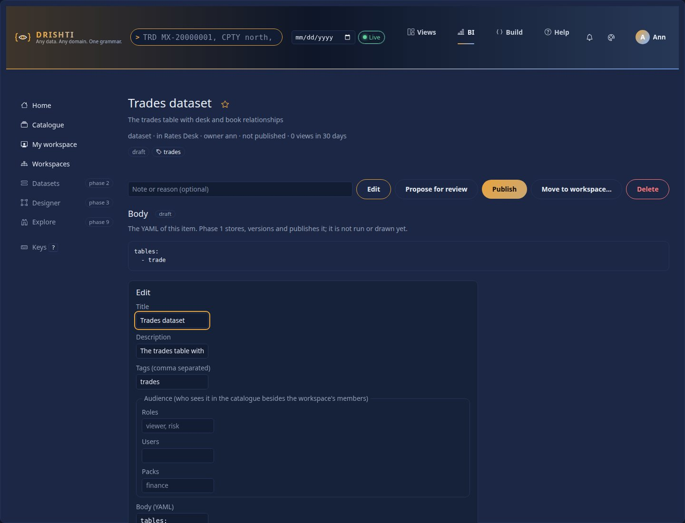

An **item** has a kind, a title, a description, an owner, tags, an audience, a **YAML body** (a mapping, at most
`drishti.bi.max-body-bytes`, 256 KiB; nothing runs it) and a lifecycle: `draft` → (optional `proposed`) → `published` as version N.

- Editing a **published** item makes a new draft; readers keep the published version until you publish again, and the page shows "draft
  changes not published".
- **Publish** (member, `bi-author`, shared workspace, no review required) writes the next version. **Propose for review** freezes the item
  until it is approved, rejected or withdrawn (section 17.3).
- **Two people, one draft.** Every editor saves from the saved state it opened. If someone else saved first, the save is refused
  (`DRS-9007`, nothing written) and the editor offers **Reload theirs**, **Save mine as a copy** (into a workspace you choose) or **Overwrite
  with mine**. This holds in the report designer (boards included), the theme designer and the item page's Edit form.
- **Frozen items open read-only.** A proposed item opens with a banner and **Withdraw to edit**; its page shows who can approve it.
- **One bad visual, not a blank report.** A visual with an error of its own shows an error card; every other visual is drawn, in the
  designer, the viewer, exports and boards.
- **Buttons that do not double-submit.** A button that sends a request is disabled while it is in flight, and the answer (*Published*,
  *Certified*, or a refusal in words such as *DRS-9052 ... which is still a draft*) appears beside it.
- **View as readers see it.** The designers' **View** menu offers **my draft** or **as readers see it (published)**: the published version
  with data masked for you, with a banner naming the version; greyed until the item has been published.
- **Duplicate...** makes a draft copy of any item in a workspace you choose. **Delete** (on the item page and in the workspace list) first
  says what depends on it: the reports that read a model, the boards that show a report (the count is of what you may read). **Move**
  changes workspace (you need contributor in the target).
- **Versions** are kept (`drishti.bi.versions-keep`, 50): *View* shows a version's body; *Restore as draft* makes an old version the draft
  again. **History** (section 17.1) adds a saved state for every save, a side-by-side diff and restore.
- **Endorsement.** The owner or a member may **promote** a published item; only a `bi-steward` may **certify** it (section 17.4).
- **Favourites and views.** The star is yours alone. Opening an item counts one view for today; the card shows the views of the last
  `drishti.bi.usage-days` (30).

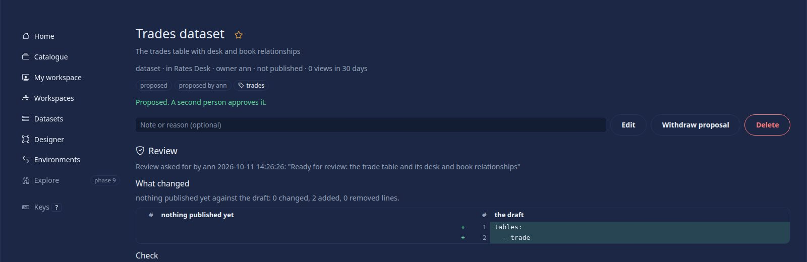

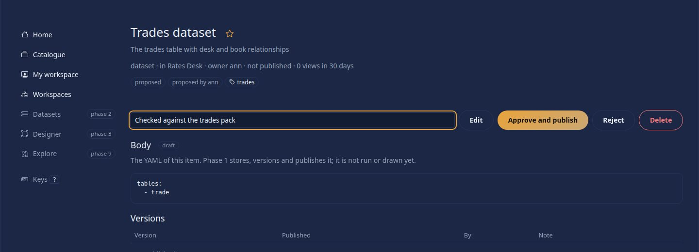

### 4.5 Who sees what

An item reaches the **catalogue** and **Home** for you when it is **published**, not in a personal workspace, and at least one holds: you
are a `bi-admin`, its owner, or a member of its workspace; its **audience** names one of your roles, you by name, or a pack assigned to you;
it is shipped content with no audience (everyone with `bi`). An item with an empty audience is visible to its workspace's members only. A
draft is seen only by the workspace's contributors and above. Anyone who may not see an item gets `404 DRS-9001`, never a hint that it
exists. Rows and fields **inside** a model are a separate layer: the table's and the model's row rules and masks are applied by the server to
every query, for each reader (section 5.5); the catalogue decides only whether you may open the item.

### 4.6 Shipped content, the samples and BI settings

**Shipped content.** Files in the BI folder (`drishti.bi.dir`, default `./config/bi`) appear as published, read-only items of the workspace
*Shipped content*: `reports/<id>.report.yaml` (boards are reports), `python/<id>.python.yaml`, `themes/<id>.theme.yaml`,
`notebooks/<id>.notebook.yaml`, and the table layer's tables and models in `config/tables/<domain>/` ([TABLES_GUIDE.md](TABLES_GUIDE.md)). The
keys `title`, `description`, `owner`, `tags`, `endorsement` (`none`, `promoted`, `certified`) and `audience` (`roles`, `users`, `packs`)
describe the catalogue entry; the file is the body. The folder is read again **live, with no restart** (`drishti.bi.watch`: `auto` file
events with a polling safety net every `folder-refresh`, 5 s; `poll`; or `off`): **add** a file and it appears; **change** it and the next
read is the next version (counted since the server started); **delete** it and it is gone (`404 DRS-9001`). A file that does not parse
**keeps its last good version** and is listed as a problem in *Admin, BI settings* and on *Health*. Shipped items cannot be edited here:
change the file, or **Save a copy**. Details: [config/bi/README.md](../../config/bi/README.md).

```yaml
# config/bi/reports/liquidity-daily.report.yaml
title: Liquidity daily
description: Shipped with the site, read-only
owner: treasury
tags: [liquidity, daily]
endorsement: promoted
pages: []
```

**The samples**, each commented and marked `sample: true`: ten models in `config/tables/banking/` and `config/tables/bi/` (`trades-basic`,
`trading-risk`, `trading-cashflows`, `counterparty-exposure`, `desk-pnl-vs-exposure-py`, the live `live-trading` and `live-exposure`,
`market-risk-var`, `world-economics`, `region-economics`) over the tables beside them; twelve reports in `config/bi/reports/`
(`trades-overview`, `counterparty-risk`, `cashflow-ladder`, `live-trading-desk`, `live-exposure`, `python-desk-risk`, `pnl-vs-exposure`,
`market-risk-var`, `world-economics`, `region-economics`, and the boards `desk-wall` and `python-wall`); four Python items, one notebook
and two themes (**Corporate** and **Print**). `world-economics` reads real World Bank data; `region-economics` (Australian and US states)
has illustrative figures rounded from public figures, not for reporting. A sample is hidden from the people who may not see sample packs
(*Admin, Packs, Hide samples from business users* or *from everyone*).

**VaR in BI.** The sample report **Market risk: VaR** (model `market-risk-var`) reads the official end-of-day VaR the server publishes
([VAR_GUIDE.md section 19](VAR_GUIDE.md#19-official-end-of-day-results)), served by the market-risk pack as the read-only kind
`var-official` (connector `var-results`). The table `market_risk_var_official` holds every result version; `market_risk_var_latest` keeps the
latest version of each node and date, and the model reads that one. VaR is not additive, so no measure sums it: `VaR 99%` and `ES 97.5%` are
`max()` of a node's one row (over several nodes, the largest, never a total), and `Bank VaR` and `Bank ES` are the bank node's own figures.
The report shows the bank's VaR, ES and limit use; VaR by desk and by legal entity, each bar drilling through to a **Node** page; the bank
over time and a desk chosen in a slicer over time; every node with VaR, ES, limit and limit use (over 90% in red). Every figure says what it
is: `nodes.HORIZON` (`1D`), `nodes.METHOD`, and the measures **VaR confidence** and **ES confidence**; put `nodes.HORIZON` on a slicer to keep
a 1-day figure apart from a 10-day one. A 10-day or another-confidence figure is the engine's on demand (`VRES <scope>~horizon=10d~method=sum`,
[VAR_GUIDE.md section 18.6](VAR_GUIDE.md#186-horizons-the-two-10-day-methods-and-the-confidence-chosen)). A node id opens the node in the
terminal; `VAR NODE:<id> <GO>` opens the VaR explorer.

**Exposure in BI.** Netting-set and counterparty records store no exposure: the exposure engine computes it and publishes its official
end-of-day results ([EXPOSURE_GUIDE.md section 20](EXPOSURE_GUIDE.md#20-official-end-of-day-results)), served as the read-only kind
`exposure-official-cpty` (command `XOFC`, connector `exposure-results`). The tables `counterparty_exposure_official_netting_sets` and
`counterparty_exposure_official_counterparties` keep one row type each, the latest version of each scope and date. The models
`counterparty-exposure` and `trading-risk` read them as two more facts, `set_exposure` and `cpty_exposure`, related to `counterparties.id`:
**Exposure (EE peak)** is `sum(set_exposure.PEAK_EE)` (a reporting sum of the netting sets' peaks), and **Exposure (PFE peak)** is
`sum(cpty_exposure.PEAK_PFE_95)`, each counterparty's own peak 95% PFE, never a sum of its sets' PFEs. The live model `live-exposure` keeps
only what the netting set carries as it ticks (net MTM, collateral, limit, trades), since a live table is not joined to the daily results.

**Admin, BI settings** (`/admin/bi`, needs `bi-admin`):

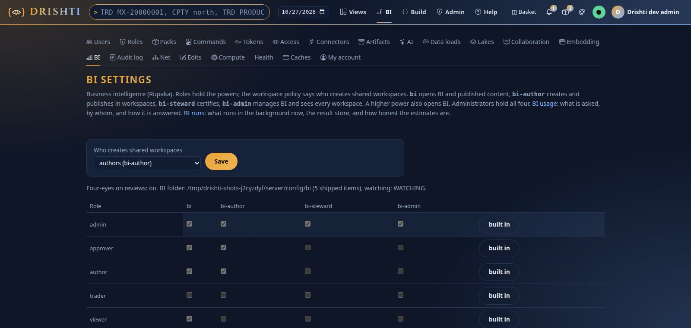

- *Who creates shared workspaces*: `authors` (`bi-author`, the default), `stewards` or `admins`. Kept in the identity database; overrides
  `drishti.bi.workspace-creation`.
- *The BI folder*: how it is watched (`WATCHING`, `POLLING`, `OFF`), how many shipped items it holds, and any file with a problem.
- *Roles and their powers*: tick `bi`, `bi-author`, `bi-steward`, `bi-admin` per role and **Save**. Roles from configuration or a pack are
  read-only here; roles defined in Admin, Roles are editable, by an administrator. A change reaches everyone who holds the role at once.
- *Shipped files*: the same list as **Admin → Artifacts**. **Disable** hides a file from the catalogue and keeps it; **Uninstall…** shows the
  reports, boards, models, alerts and subscriptions that depend on it, refuses while any do, and otherwise moves the file to
  `data/uninstalled/`, from where it is restored ([OPERATIONS_GUIDE.md section 18](OPERATIONS_GUIDE.md#10-admin--artifacts-install-and-uninstall-safely)).

**The command line.** `drishti.py bi workspace list|get`, `drishti.py bi catalogue list|get|publish` and `drishti.py bi item ...` talk to
the API as the token's user ([CLI_REFERENCE.md](CLI_REFERENCE.md#bi-workspaces-and-the-catalogue-rupaka)); the token scopes are `bi:write`,
`bi:approve` and `bi:admin`:

```
$ drishti.py bi workspace list
id                            role          items  name
u-cat-7fd6                    admin             0  My workspace  [personal]
rates-desk                    viewer            4  Rates Desk
shipped                       viewer            2  Shipped content
$ drishti.py bi catalogue list --q exposure --kind board
id              kind     endorsed  status    ver  title
bi-cd5f8b2cc5   board    promoted  published v1   Counterparty exposure  (Rates Desk, ann)
1 item(s)
```

## 5. Models and datasets: what a report reads

A report reads **one model** (`model: trading-risk@1`). A model relates **tables** (BI's "datasets") and defines measures, hierarchies,
parameters and tighter security over them; a table is one governed table over a pack kind, a SQL query, a Python transform, a model's
answer or another table. Both are files of the table layer (`config/tables/<domain>/<name>.table.yaml` and `.model.yaml`, `rachana: 3`)
or stored items of kind `table` and `model`, and both are written in **Build › Tables & models** (`/build/tables`), one editor with the live
YAML below it, a preview read as you, "adds up?" from the engine, and review before live. **Every key, check and command of tables and
models is in [TABLES_GUIDE.md](TABLES_GUIDE.md)**; this section is what a report author needs of them, and the BI pages that show them.

BI reads only the table layer's form, and only Rachana in it. A file in BI's older dataset or model form under `config/bi/datasets` or
`config/bi/models` is refused with `DRS-9196` and the command that migrates it: `drishti.py tables migrate` ([TABLES_GUIDE.md section 9](TABLES_GUIDE.md#9-the-migration-tables-migrate)).
A pack carries its BI tables and models as `config/bi/tables/*.table.yaml` and `config/bi/models/*.model.yaml` in the layer's form (**Build →
New pack** writes them).

### 5.1 The Models page and a table's page

**Models** in the rail (`/bi/models`, *Start from your data*):

* **Tables from the packs.** Every kind of every pack you may open is already a table, with its promoted columns, the vocabulary's meanings
  and the packs' references, certified by its pack, read-only, versioned with the pack. Nobody builds them. A card shows the pack, the time
  mode and the number of columns, and the kind's own description; **Use** starts a report on it at once.
* **Your tables** (the ones you may read, and your drafts) and **Models** (model items you may read).
* **New model** and **New table** open **Build › Tables & models**; **Make it a model** (below) writes a table's implicit model out.

**A table's page** (`/bi/ds/<name>`) says what one row is (*One row per trade per business date*), the keys, the time mode (*snapshot: a
query without a date reads the latest business date with rows*), the source, every column with its type, role, meaning, the kind it
references (`desk →`), its unit, whether it adds up and its default measure, the security, the YAML, its **Refresh** (section 5.6) and its
**Expected values** (section 5.8). Its buttons: **Start a report on it**, **Make it a model**, and **Narrow it** (a table of your own over this
one: extra computed columns, a row filter, more masks; the pack's own stays read-only). **Datasets** in the rail lists the tables reports read,
with their refresh.

**The implicit model.** A report may start from a bare table: its **implicit model** (`model: table:<name>`, or `dataset:<name>`) is the
table as the fact, its pack dimensions one hop away (a trade valuation's `DESK` brings the desk table) and **default measures** (one per
column with an aggregation, `Sum of MTM`, and `Count of <alias>`; amounts formatted `amount2`, counts `integer`). **Make it a model** writes
that implicit model out as a **shared** draft model and binds the report to it; when the workspace already has a model written out from the
same table, the report is bound to that one, and the reports on the same table are offered the move too. A model is shared, never a
per-report copy: deleting a report never touches its model, and a model is **not deleted while anything reads it** (`409 DRS-9004` names
what does; `GET /api/v1/bi/models/{ref}/consumers` lists the reports, boards, notebooks, tables, alerts and live subscriptions that read it).

### 5.2 Fields, perspectives and the contract

Field properties are written **once, in the model** (`fields:`) and inherited by every report, board and answer on it: each field's
**display name**, **description**, **format**, **folder**, **hidden**, **sort by**, **data category** and **default summarisation**, and
each measure's description, format, folder and hidden. A **perspective** (`perspectives:`) is a named field list for one audience; a report
keeps its choice as `perspective:`. A perspective is a convenience, not security: what a role may not see, the model hides from it
(`hidden-for`), and the server leaves it out of `describe`, SQL and AI (naming it is *not found*).

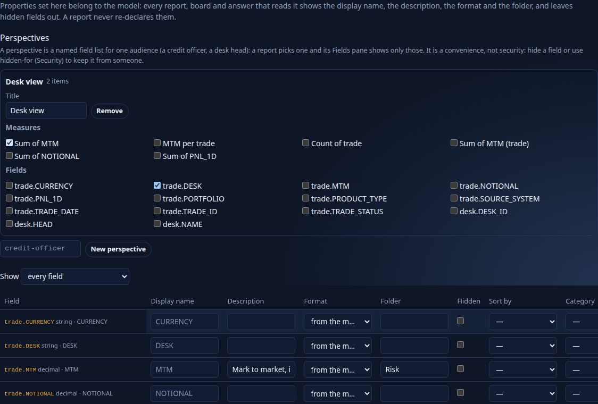

```yaml
measures:
  Sum of MTM: {expr: sum(trade.MTM)}
  MTM per trade: {expr: measure('Sum of MTM') / count(trade.TRADE_ID)}
fields:
  trade.MTM: {description: 'Mark to market, in the trade''s currency', folder: Risk}
  trade.PORTFOLIO: {hidden: true}
perspectives:
  desk-view: {title: Desk view, fields: [trade.DESK], measures: [Sum of MTM]}
```

**The contract.** A model has a semver `version`; reports pin a major (`trades-basic@1`). Each change since the published version needs a
version: removing or redefining a measure, hiding a field or removing a relationship is **major**; adding is **minor**; a description or a
format is **patch**; security needs none (it is audited). A published model refuses a breaking change without a new major (`DRS-9126`), and
the change lists the items that read the published major.

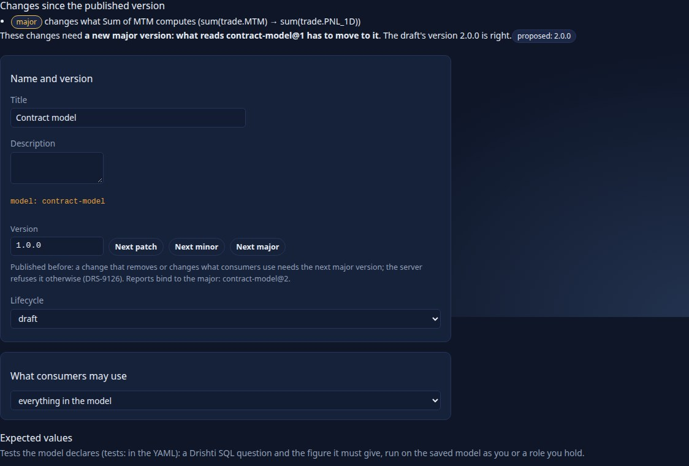

**The security safeguard.** When a role is restricted on one table of a model but no rule restricts another, the model cannot be published
until it is answered (`DRS-9130`): add a rule for that role on the other table, or say so with `may-see-all: { desk: [desk-head] }` (an
audited note). Check also names the readers no row rule matches (`DRS-9131`, a warning: leaving a role out may be the point); such a reader's
answer is empty and says *you have no access to rows of trades in this model: no row rule names your roles*, so the viewer shows that instead
of *No rows for this selection*.

### 5.3 Relationships and how a question joins

A model's relationships go from the many side to the one side (`{ from: trades.DESK, to: desks.id }`), and the packs' links are suggested
for you. A question joins along **active** relationships, many-to-one, `LEFT JOIN`ed from the table the measures aggregate, so a measure is
never counted twice:

* **A measure is aggregated at its own table.** When a question mixes measures of different tables (`MTM` of `trades` and `Exposure (EE peak)`
  of `set_exposure`), each is computed alone at the question's fields and the answers are joined on them, so a "one"-side figure is never
  repeated by the many side. A measure that only combines measures (`measure('MTM') / measure('Exposure (EE peak)')`) is worked out over each
  at its own grain.
* **Several facts in one question.** Facts that share dimensions (trades and limits, both by desk) are not joined to each other: each is
  aggregated alone at the shared fields and the parts are full-outer-joined on them (a null equals a null), so a sector one fact lacks still
  shows with the other's figures. With no fields the totals sit side by side. A filter on a shared dimension reaches every fact.
* **Refused, safely** (`DRS-9020`, `DRS-9156`): a field one fact cannot reach many-to-one; a measure that mixes two unrelated facts in one
  expression; a window measure with another fact; legs and cash flows (siblings under a trade) in one question; and a **row rule that reads
  a fact** the other cannot reach: the question is refused rather than answered with other readers' data.

The pictures show the shipped cross-pack model with its tables and relationships, a relationship drawn back by dragging `PORTFOLIO` of
`trades` onto `id` of `books`, the line in the YAML, and a relationship proposed from the data with its match rate (profiling, no AI;
`drishti.bi.query.infer-min-match`, 0.8; links a pack already declares are never proposed). Relationships are written in the model's
**Tables** tab ([TABLES_GUIDE.md section 11.3](TABLES_GUIDE.md#113-semantic-models)); a model's relationships drive joins and
cross-filtering only and never change a pack.

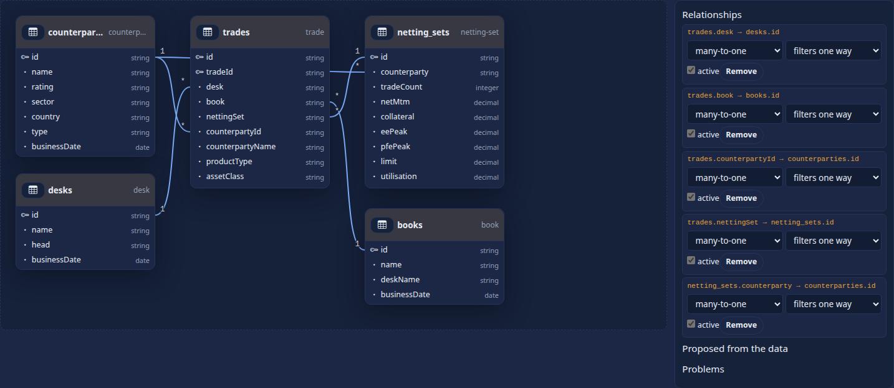

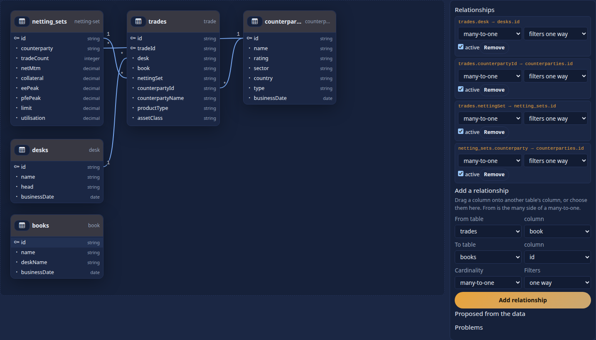

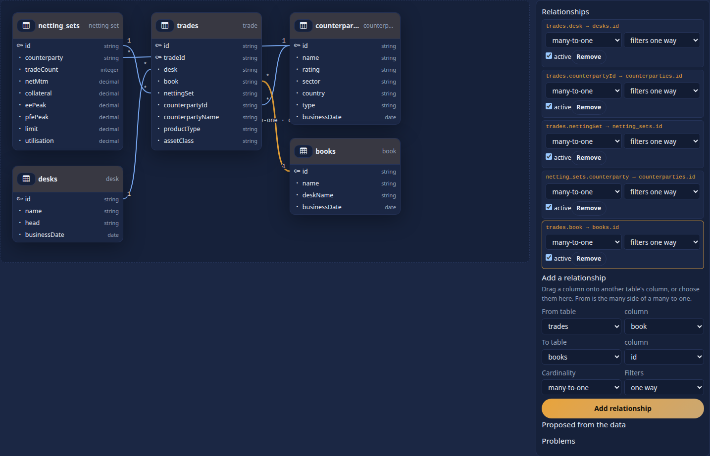

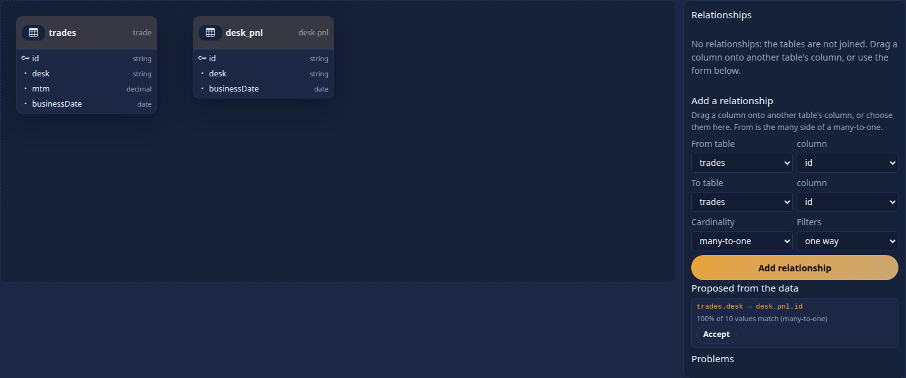

```
trades.DESK → desk_pnl.id  100% of 10 values match (many-to-one)
accepted: { from: trades.DESK, to: desk_pnl.id, cardinality: many-to-one }
```

### 5.4 Measures: the expression language

Measures are **Rachana** expressions in aggregate scope ([RACHANA_REFERENCE.md › Rachana-EL expressions](RACHANA_REFERENCE.md#rachana-el-expressions),
every function in [FUNCTIONS.md](FUNCTIONS.md); filter context and what is refused: [TABLES_GUIDE.md section 12](TABLES_GUIDE.md#12-measures-in-a-model-filter-context-and-what-is-refused)).
They compile to SQL on the server and are never run as code; every value is a bound parameter. The expression editor completes fields,
measures (writing `measure('…')`), functions with their signature and an example, and named arguments, shows the server's problems as you
type with the fix as a button, and **Try it** answers on the saved draft, as you.

```yaml
measures:
  Notional:   { expr: "sum(trades.NOTIONAL)", format: amount0 }
  MTM per 1m: { expr: "ratio(sum(trades.MTM), sum(trades.NOTIONAL)) * 1000000" }
  Share:      { expr: "measure('MTM') / measure('Notional')" }
  Open MTM:   { expr: "sum(trades.MTM, where = trades.TRADE_STATUS != 'MATURED' && trades.TRADE_STATUS != null)" }
  MTM ytd:    { expr: "ytd(sum(trades.MTM), trades.TRADE_DATE)" }
  MTM rank:   { expr: "rank(sum(trades.MTM))" }
  MTM 3-day average: { expr: "moving_avg(sum(trades.MTM), 3, trades.TRADE_DATE)" }
  Day on day: { expr: "sum(trades.MTM) - lag(sum(trades.MTM), 1, trades.TRADE_DATE)" }
```

A measure must aggregate (a column outside an aggregate is `DRS-9127`, *wrap it: `sum(trades.MTM)`*). What a report author needs to know of
the families:

* **Time intelligence** (`ytd`, `mtd`, `qtd`, `prior_period`, `same_period_last_year`, `running`) restricts **the rows the question reads**,
  ending on the as-of date (the end of the question's dates, else the newest date read); `prior_period` and `same_period_last_year` follow
  the pack's business-day calendar. With partitions that hold only each day's rows, the report's dates must reach back to the start of the
  window. `running` needs the date as a **field** of the visual, cannot be filtered on, and takes one `sum`, `count`, `min` or `max`. A rollup
  cannot hold a time measure.
* **Window functions** (`lag`, `lead`, `rank`, `dense_rank`, `percent_rank`, `moving_avg`, `moving_sum`, `moving_min`, `moving_max`,
  `cumulative`) are worked out **over the rows the question returns**, after the reader's row rules, filters and grouping, so a rank is a rank
  among the rows this reader may see. The order column must be a field of the visual; a window cannot be filtered on; a "row" is a row of the
  visual, not a calendar day (`lag(..., 1, trades.TRADE_DATE)` is the previous date that has trades).
* **Filter context** (`calc`, `share_of`, `parent_of`, `as_of`): security is never in scope, so `share_of(…, over = ALL)` is a share of
  everything **you** may see. The Fields pane badges a measure that uses time intelligence or a window (`ytd`, `running total`, ...).

### 5.5 Row rules and masks in practice

Who sees which rows and fields is set on the tables and tightened by the model ([TABLES_GUIDE.md section 7](TABLES_GUIDE.md#7-who-sees-what)).
For a report it means:

* **Row rules** run on the server, for each reader, as a predicate the question cannot remove. A reader gets the rows any of their rules
  allows; a reader no rule names gets **no rows**, and the answer says why. `user.desks` is strict: a desk head with no desks sees no trades.
* **Masks** apply to readers without the `raw` power, **before aggregation**: a masked field reads `•••` in every row and is **not grouped
  on** (its values cannot be told apart, so a bar by a masked name is one bar); a measure over a masked column is `null`; a filter or sort on
  a masked column is refused (`403 DRS-9021` in a report, `DRS-9161` in a model query).
* **Fail closed.** If a visual's measures cannot reach a rule's table many-to-one, that visual answers `DRS-9020`, naming the rule, rather
  than other readers' data.

### 5.6 Layers, rollups and refresh

A table is answered from the smallest layer that covers the question: a model's **rollup** (per-date components of its measures at a coarser
grain: sums, counts, minimums and maximums; `avg` as a sum and a count), else the **columns layer** (typed Parquet per business date, built on
the first question and again when a data-load signal names the date), else the **source** itself. Every answer says which (`layer`,
`rollup`); `"layer": "columns"` in a question forces the columns layer. A rollup answers a question of one table whose fields, filters and
row-rule columns are among its `by` columns and whose measures it holds; `distinct`, `percentile`, a condition inside an aggregate and
time measures are not rollup material. A heavy question asked often is offered as a rollup (section 15.14).

**Refresh.** A data-load signal for a kind ([DATA_GUIDE.md](DATA_GUIDE.md#1-telling-drishti-new-data-has-landed)) rebuilds that date of every
published table that reads it, and only that date. `refresh:` on a table says when it is rebuilt on its own: `daily 06:00`, `weekdays 18:30`,
**`business-days 07:30`** (the pack's holiday calendar), `weekly mon 07:00`, `monthly last 18:00 business`, `hourly`, a cron, or
**`after-load`** (optionally `after-load trade`). Times are in the business-date zone. A refresh builds the current business date; when the
source holds nothing for it, it builds the **latest date the source holds** and says so (`warning: 0 rows for 2026-10-14; latest data
2026-10-09`). A failed refresh is retried with the shared retry policy (`drishti.retry.bi.*`), then `failed` until its next time.

The table page's **Refresh** section lists the schedule, the status (`never`, `waiting`, `running`, `ok`, `retrying`, `failed`, `invalid`),
the last and next refresh, rows, time and failures, **Recent refreshes** (when, started by, result, date, rows, time, error), **Refresh now**
for `bi-author` (audited `bi-dataset-refresh`) and **Set a schedule** for a table with none. The state survives a restart; a time missed
while the server was down runs once at start (`schedule (catch-up)`). From the command line: `drishti.py bi dataset refresh ID --now`; over
the API: `GET` and `POST /api/v1/bi/datasets/{id}/refresh`.

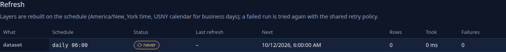

### 5.7 Live tables

A table with `materialize: { live: { rows, age } }` is the **current state of a kind**, kept in memory and updated by key as the source
pushes changes ([TABLES_GUIDE.md section 6](TABLES_GUIDE.md#6-materialisation)); reports and boards over it redraw as it changes
(section 13). What a report author sees:

* A batch of changes is applied in one step, so a question never sees half a batch; a model's **rollups over a live table are kept by group**
  as rows change (a sum or count moves by the difference; a minimum or maximum is read again when the row that held it changes).
* **Retention:** `rows` bounds the table (the rows changed longest ago go first; `drishti.bi.live.max-rows` is the ceiling) and `age` drops rows
  that have not changed for that long. Every live table also has `updateSeq` and `updatedAt`.
* **History:** a live table holds only now, so a model's `history:` samples chosen measures every few seconds into a bounded table
  (`history.ts` and one column per measure, with a generated `<measure> history` measure): a line of net MTM over the last hour is
  `axis: [history.ts], values: [MTM history]`. It lives while the table runs and starts empty after a restart; a reader whose role has a row
  rule on the live table is refused the history (`DRS-9020`), since it cannot be filtered by that rule.
* **How it is doing:** the table page's **Layers** table (and `GET /api/v1/bi/datasets/{id}/layers`) shows each live table's `state`
  (`starting`, `live`, `stale`, `failed`, `closed`), rows, entities followed and how many push, and the last change. A connector that cannot
  push is read again every `drishti.bi.live.resync` (`pushes: false`). A table nobody uses for `drishti.bi.live.idle-close` (10 minutes) is
  closed and starts again on the next use.

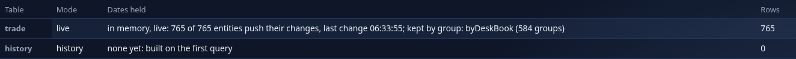

### 5.8 Expected values: `tests:`

A table, a model or a report may declare what a number should be. **Check** runs the tests (the table page's *Expected values*, the designer's
Check, `POST /api/v1/bi/items/{id}/tests`, `drishti.py bi item tests ID`), and **publishing is refused while one fails** (`409 DRS-9043`)
unless a `bi-admin` forces it.

```yaml
tests:
  - name: The book holds 15,000 valuations
    measure: Trades
    expect: 15000                               # a number, a range { min, max } or [low, high]
  - { name: Rates desk, measure: MTM, by: [trades.DESK], row: { trades.DESK: DESK-RATES }, expect: 4108728089.5, tolerance: 0.5% }
  - { name: USD only, measure: Notional, filters: [{ field: trades.CURRENCY, op: eq, values: [USD] }], expect: { min: 1000000 } }
```

`by` groups the answer and `row` picks one row (without it the answer must be one row); `filters` are report filters; `date` is the business
date; `tolerance` widens a number or a range; `role` runs the test as a role. Each result is `pass`, `fail` (with the figure found) or `error`
(why it could not run). A report's tests are in section 9.12.

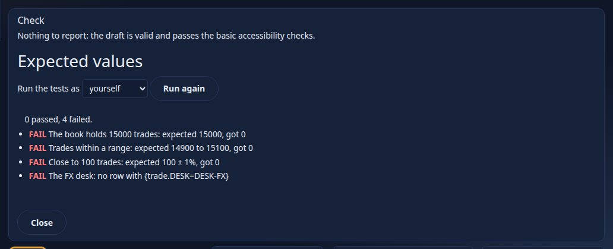

### 5.9 Worked examples: the shipped models, row rules and masks

The tutorials teach reports in order. This section keeps the recipes they do not repeat: a stack with four people so row rules and masks can
be seen at work, and the shipped models queried. Every answer was captured over the **demo lakes** (`drishti.py lake demo`: sixty business
days of the packs, 5,000 trades for each of ENDUR, CALYPSO and MUREX, 15,000 trade valuations a day), which end on today's business date, so
your dates and some figures differ.

| Sample model | What it teaches | Tables (aliases) |
|---|---|---|
| `trades-basic` | the "hello world": one table, four measures, a computed column, a hierarchy | `trade` (the trade valuations) |
| `trading-risk` | three packs, relationships from the packs' links, a rollup, a row rule, masks, window and time measures, the exposure facts | `trades`, `netting_sets`, `set_exposure`, `cpty_exposure`, `counterparties`, `desks`, `books` |
| `trading-cashflows` | nested documents: legs, cash flows and payments as tables of the trades of three source systems | `trades`, `legs`, `cashflows`, `payments` |

#### Set up

The quick start of [data/testdata/README.md](../../data/testdata/README.md) (clone, install, `lake demo`, start, open), or with the IDE's run
configurations **Build demo lakes**, **Drishti server (demo lakes)** and **Drishti console**. From a terminal at the repository root:

```bash
drishti-console/.venv/bin/python tools/drishti.py lake demo
DRISHTI_DEMO_ENABLED=false DRISHTI_SECURITY_ENABLED=true DRISHTI_TOKEN_SECRET=drishti-dev-only-token-secret-change-me-0123456789 \
  DRISHTI_SEED_ADMIN=true DRISHTI_SEED_USERNAME=drishti-dev-admin DRISHTI_SEED_PASSWORD=drishti-dev-admin123 \
  java -Xmx4g -jar drishti-server/target/drishti-server-*-exec.jar
drishti-console/.venv/bin/python drishti-console/run_drishti_web.py --server.port=17480 --backend.url=http://127.0.0.1:18480
```

Open http://localhost:17480 and sign in as `drishti-dev-admin` / `drishti-dev-admin123` ([OPERATIONS_GUIDE.md](OPERATIONS_GUIDE.md#2-install-and-run-on-one-machine)). Then make
four people (the models' row rules name these roles: `desk-head` sees `DESK in user.desks`; `risk`, `analyst` and `admin` see every row):

1. **Admin → Roles → New role** where one is missing: `bi-writer`, `risk`, `desk-head`, `analyst` (tick **Opens every kind**, and **See every
   field unmasked**, the raw power, for `bi-writer` and `risk` only).
2. **Admin → BI settings**: tick `bi` for `risk`, `desk-head` and `analyst`, and `bi` and `bi-author` for `bi-writer`, **Save** on each row.
3. **Admin → Users → New user**, four times: `wes` (`bi-writer`), `rita` (`risk`), `hana` (`desk-head`, **Desk** `DESK-FX`), `ann` (`analyst`),
   each with a password of at least ten characters with letters and digits, *Must change at first sign-in* unticked.

So **wes** writes, **rita** sees everything, **hana** is a desk head without raw, **ann** an analyst without raw
(`drishti-console/tests/bi_data_stack.py` does the same by API). Use a second browser or a private window to be two people at once.

#### The Models page and `trades-basic`

`BI <GO>`, then **Models** (and **Datasets**) in the rail. The samples show as *promoted* and *sample*. `GET /api/v1/bi/models` lists what you
may read; `drishti.py bi model list` prints it; `drishti.py bi model describe trading-risk` prints every table, column and measure.

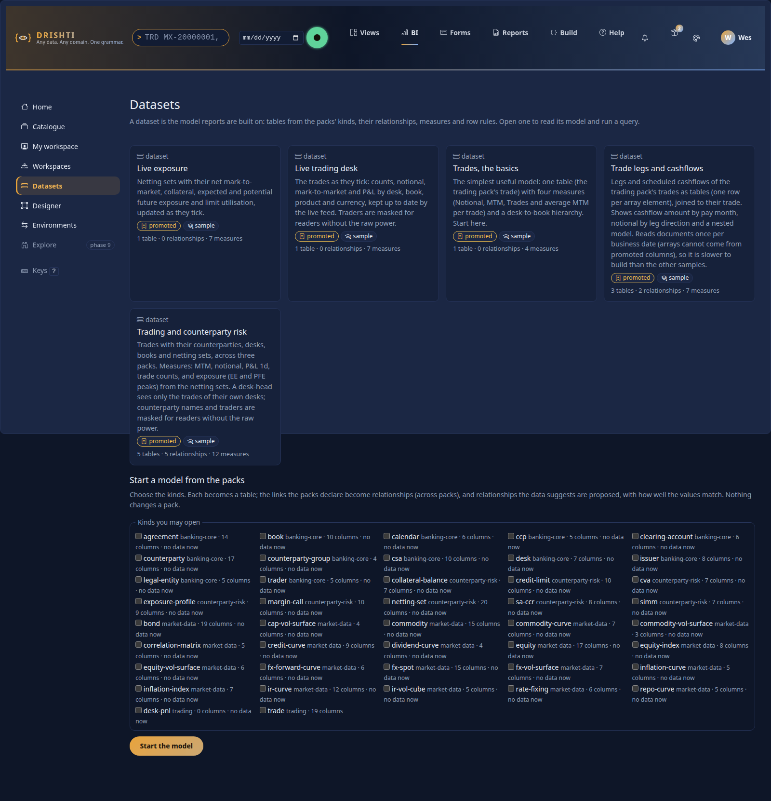

Open **Trades, the basics**: its table with every column and type, the measures with their expressions, the security and the layers.
`config/tables/banking/trades-basic.model.yaml` and `trades_basic_trade.table.yaml` explain each part in comments.

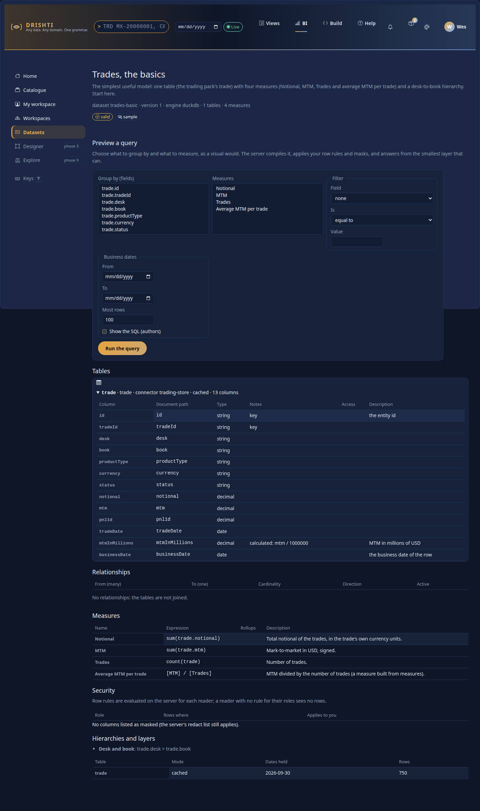

Group by `trade.DESK`, measures *Notional*, *MTM*, *Trades*, *Average MTM per trade*:

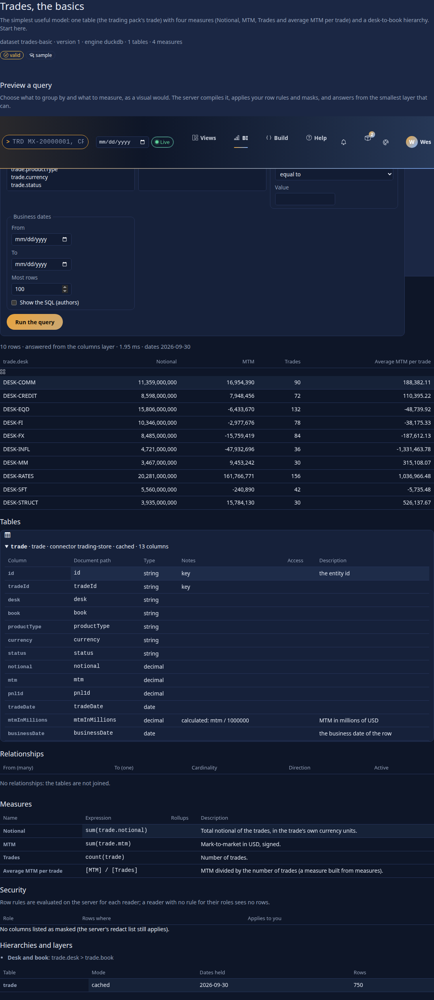

```
POST /api/v1/bi/mq
{"mq": 1, "model": "trades-basic@1", "select": {"fields": ["trade.DESK"], "measures": ["Notional", "MTM", "Trades", "Average MTM per trade"]}}

DESK-COMM     885,017,001,985.25   -395,383,250.53   5990     -66,007.22
DESK-CREDIT   348,350,245,514.15    386,059,702.75   1172     329,402.48
DESK-EQD      430,529,717,922.53    -85,763,784.34   1452     -59,065.97
...                                                                       (10 rows)
meta: asOf=2026-10-26, layer=columns, 10.6 ms, cached=false
```

From a terminal: `drishti.py bi mq --model trades-basic@1 --select trade.DESK --measures Notional,MTM,Trades`, or in SQL,
`drishti.py bi sql "SELECT trade.DESK, MEASURE('MTM') FROM trade GROUP BY trade.DESK" --model trades-basic@1`. The first question built the
columns layer; ask again and the result cache answers (`cached: true`). `time: {as-of: "2026-10-15"}` (a report's date picker) asks another
day. `options: {explain: true}` shows the compiled SQL to an author: names quoted from the model, **no value in the text**.

#### `trading-risk`: relationships from the packs' links

Its tables read three connectors in three packs (`risk-store`, `reference-store`, `credit-store`), joined by the links the packs declare.

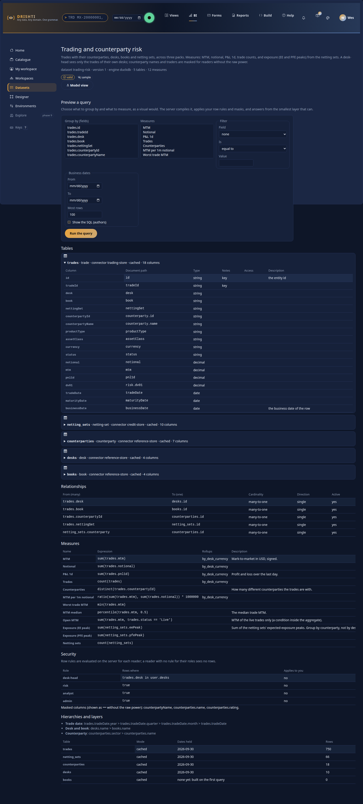

Grouped by `desks.NAME` (a column of another pack's table), *MTM*, *Notional*, *Trades*, *Counterparties* (a distinct count):

```
Bonds and securitised          -30,588,339.35     403,150,156,232.97   1248   18
Commodities                   -395,383,250.53     885,017,001,985.25   5990   24
G10 and EM FX                 -681,989,221.57     372,842,213,118.35   1428   17
...                                                                              (10 rows)
```

Exposure by counterparty (a measure of the exposure facts by a column of the counterparties), the five largest:

```
{"mq": 1, "model": "trading-risk@1", "select": {"fields": ["counterparties.NAME"], "measures": ["Exposure (EE peak)", "Netting sets"]},
 "sort": [{"by": "Exposure (EE peak)", "desc": true}], "limit": 5}
Verdant Agri Holdings           303,824,105   4
Aldershot Pension Trust         278,109,475   4
...
```

The model's rollup `by_desk_currency` answers a question by `trades.DESK` and `trades.CURRENCY` (`meta: layer=rollup, rollup=by_desk_currency`);
`"options": {"layer": "columns"}` gives the same numbers from the columns layer. The window measures it ships rank the desks
(`DESK-RATES 4,108,728,089.50 1`, `DESK-MM 393,805,216.87 2`, ...) and smooth MTM by trade date.

#### Row rules and masks with three readers

The same question, by `desks.NAME`, *MTM*, *Trades*, *Counterparties*:

**rita** (risk, raw): all ten desks.

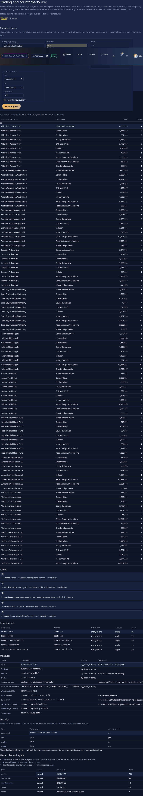

**hana** (desk head, desk `DESK-FX`, no raw): one row, her desk. She did not filter; the rule did, on the server. Her *Counterparties* is null:
a distinct count of a masked column.

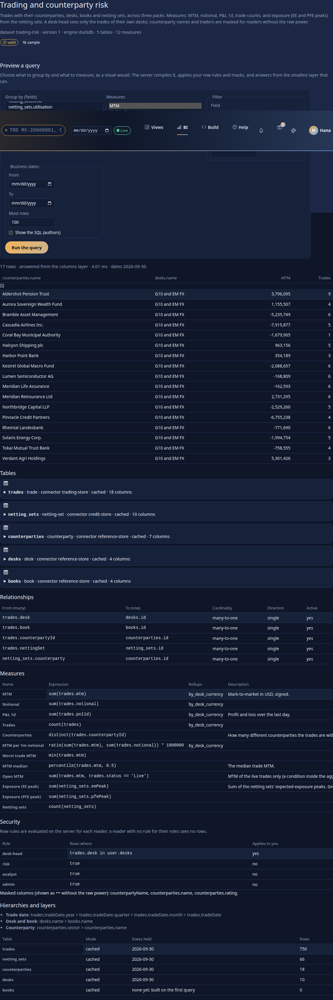

```
G10 and EM FX   -681,989,221.57   1428   null        meta: masked=[Counterparties], warnings=["measure Counterparties is masked"]
```

**ann** (analyst, no raw): every desk, *Counterparties* null. Grouped by `counterparties.NAME`, one row `•••` with every trade in it; a filter
on it is refused:

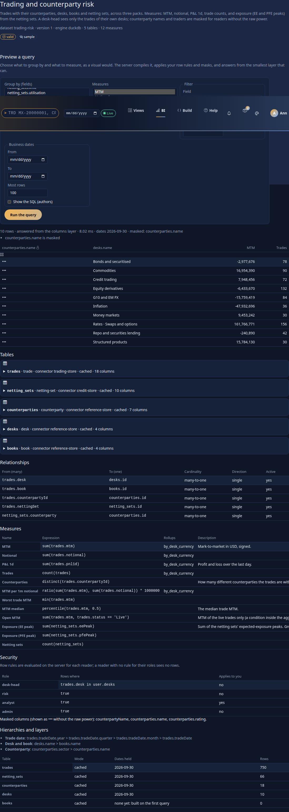

```
403 DRS-9161 'counterparties.NAME' is masked for you: it cannot be filtered on      (a report's visual says DRS-9021)
```

Hana's exposure by counterparty is answered over every netting set (the model's `may-see-all` lets a desk head see every netting set and
counterparty) and is one row `•••`, since the names are masked for her. Without that note the rule on `trades` would be joined into her
question, netting sets do not reach trades many-to-one, and it would be **refused** (`422 DRS-9020`).

#### `trading-cashflows`: legs, cash flows and payments

A trade document holds arrays; a table over an array has one row per element. By payment month:

```
{"mq": 1, "model": "trading-cashflows@1", "select": {"fields": ["cashflows.PAYMENT_DATE.month"], "measures": ["Scheduled notional", "Cashflows"]}}
 1   2,037,997,887,202.71   12381       6   3,109,379,357,636.66   15328
 2   2,839,968,374,336.31   16672       7   2,298,276,593,510.71   13332
...
```

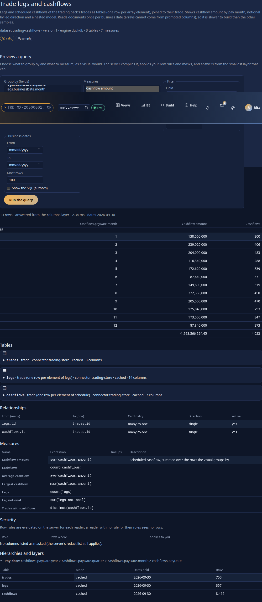

Cash flows by `trades.SOURCE_SYSTEM` join many-to-one to the trades (`CALYPSO 40713 5000`, `ENDUR 65928 5000`, `MUREX 75823 5000`). A leg
column with a cash-flow measure would repeat each cash flow once per leg, and is refused (`422 DRS-9156 ... no relationship path joining
[legs, cashflows] ... Group by a field they all reach`).

#### Change a measure in a copy, and a definition that is wrong

Shipped files are read-only: open one in **Build › Tables & models**, **Copy as a draft**, add a measure such as
`Big trades: { expr: "sum(trade.NOTIONAL, where = trade.NOTIONAL > 100000000)" }`, save, and ask it by `trade.DESK`. Your draft is yours until
published. A mistake is answered with its code and the names that exist:

```
drishti.py bi expr validate "sum(trades.notional)" --model trading-risk
INVALID  (del2, aggregate scope, type any)
  error   DRS-9152  at 4-19: no field 'trades.notional'; did you mean trades.NOTIONAL?
```

#### Start a model from the packs

Choose kinds (here `trade-valuation`, `desk`, `counterparty`, `netting-set`): each is a pack table, **the packs' link graph becomes
relationships, across packs**, and relationships the data suggests are proposed with their match rate.

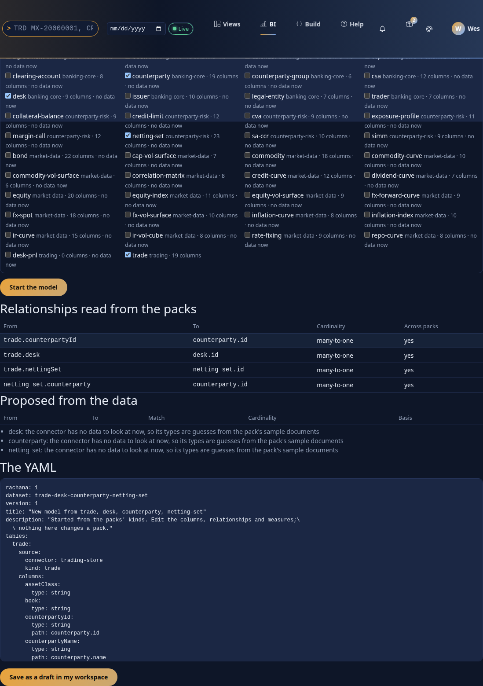

```
relationships read from the packs (all cross-pack):
  trade_valuation.COUNTERPARTY -> counterparty      many-to-one
  trade_valuation.DESK         -> desk              many-to-one
  trade_valuation.NETTING_SET  -> netting_set       many-to-one
  netting_set.COUNTERPARTY     -> counterparty      many-to-one
proposed from the data: none (the packs declare every link between these four)
```

The pages work at 390 px: the rail scrolls sideways, forms stack, tables scroll inside their frame, targets are 44 px.

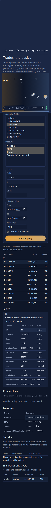

### 5.10 A table of your own, step by step

For what a pack does not give, a table of your own narrows a pack table (`from:` another table, with a filter, a grain, computed columns and
masks) or reads another source: a SQL query in a SQL connector, a Python transform, a model's answer, or a **Drishti SQL** statement over a
model. **Build › Tables & models → + New** walks through it with the server's checks beside each step ([TABLES_GUIDE.md section 11.2](TABLES_GUIDE.md#112-tables-and-virtual-tables)).
The pictures show the steps of a narrowed trade table: the rows kept (the editor completing a column), what one row is and which duplicate
wins (never a silent distinct), a computed column, a grouping to one row per desk, the server's preview as you, and the save with the masked
columns; then a table whose source is a SQL statement over a model, and its preview.

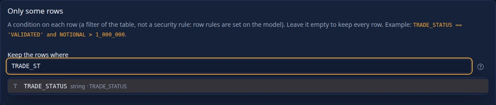

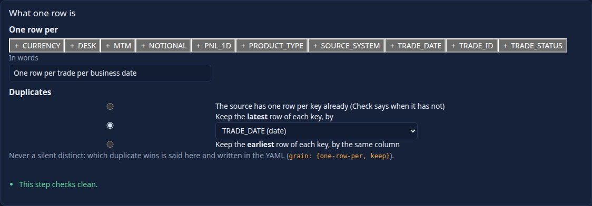

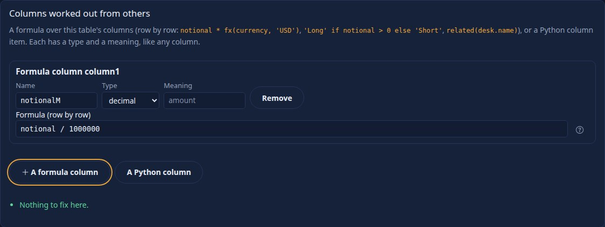

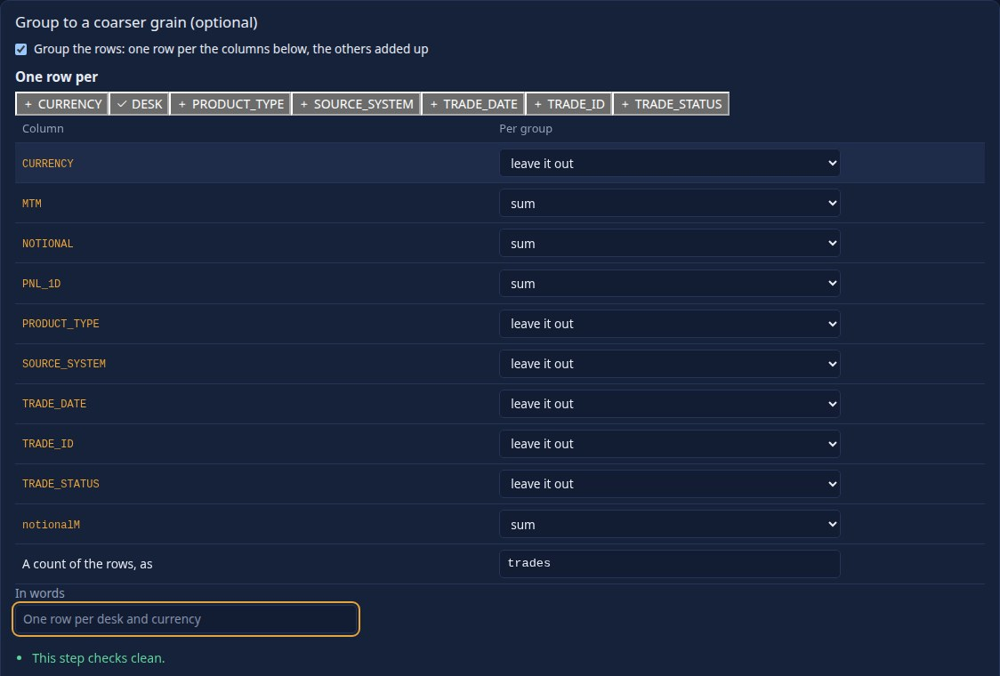

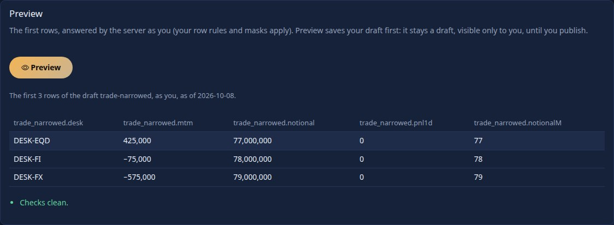

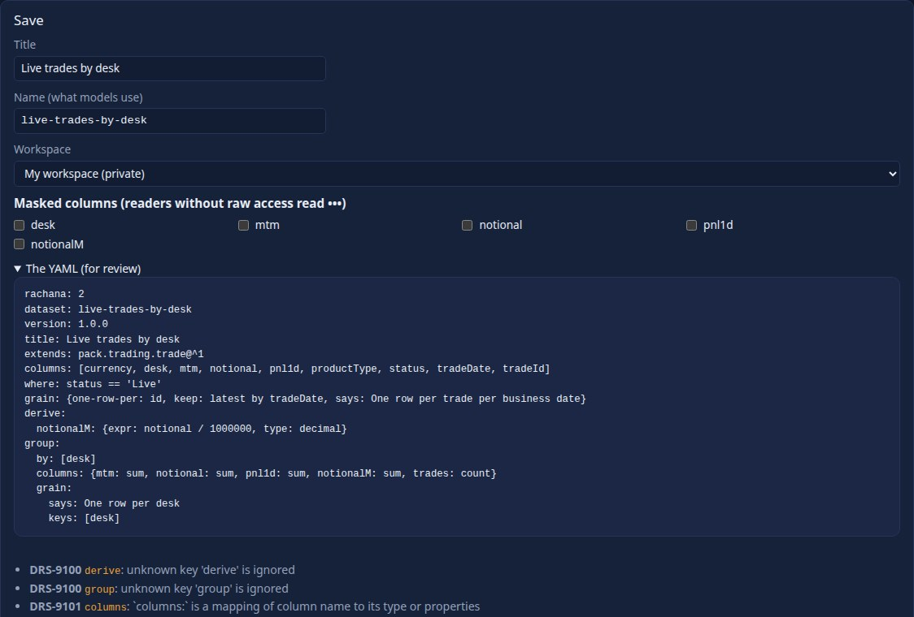

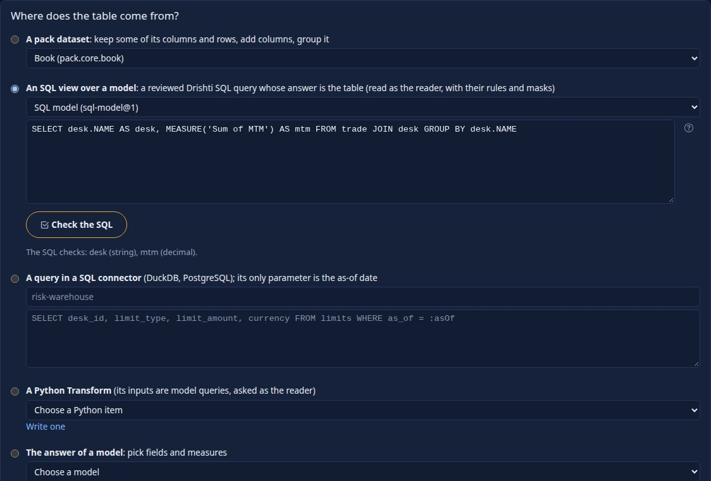

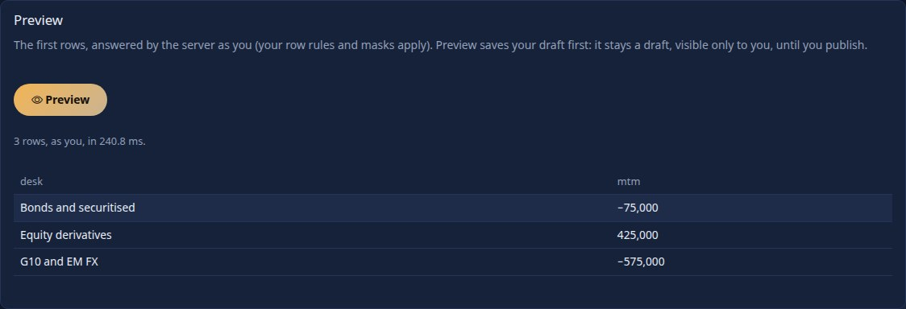

Check a row filter or a formula before you save it, against a table's implicit model:

```bash
drishti.py bi expr validate "TRADE_STATUS != 'MATURED'" --scope row --model dataset:pack.market-risk.trade-valuation
drishti.py bi expr validate "NOTIONAL / 1000000" --scope row --model dataset:pack.market-risk.trade-valuation
```

### 5.11 A run's result as a table snapshot

A finished background run of a model query or SQL statement can be **promoted** (section 15.10): its result is frozen as a snapshot and
becomes a draft table (and optionally a draft report on it) you build on.

```yaml
rachana: 3
table: bi.desk_pnl_2026
version: 1.0.0
title: "Desk P&L 2026 (snapshot of run r-java-1-01JA…, as of 2026-09-30)"
from: { run: desk-pnl-2026, params: { version: 1, token: 9f3c… } }   # the snapshot, pinned to a version; the token binds it to this table
columns:
  desk:   { type: string, title: "trades.desk", role: dimension }
  pnl:    { type: decimal, title: "PnL", role: amount, aggregate: sum }
  trader: { type: string, title: "trades.trader", masked: true, role: dimension }   # masked for the promoter: masked always
keys: [desk, trader]
provenance: { run: "r-java-1-01JA…", computedAs: "ajsinha", asOf: "2026-09-30" }
```

* **The rows are what the promoter could see.** A column masked for them holds the mask and is declared `masked`, so it stays masked for every
  reader; their row rules are baked in. Add `rules:` for readers on top.
* **It is a draft** until reviewed and published; the reviewer sees `provenance` (whose rights computed it).
* **Only this table reads the snapshot** (another gets `DRS-9108`). Promoting again under the same name is version N+1; the newest
  `promote.versions-keep` (5, `config/runs/runs.yaml`) are kept, outside the result store's budget; `promote.enabled: false` turns it off.

## 6. The report viewer

Open a report from the catalogue (its page has **Open the report**), with `BI <report> <GO>`, or at `/bi/r/<id>` (and `/bi/r/<id>/<page>`).
The shipped **Trades overview**, **Counterparty risk** and **Cashflow ladder** read the three stored sample models; **Live trading desk** and
**Live exposure** are live (section 13).

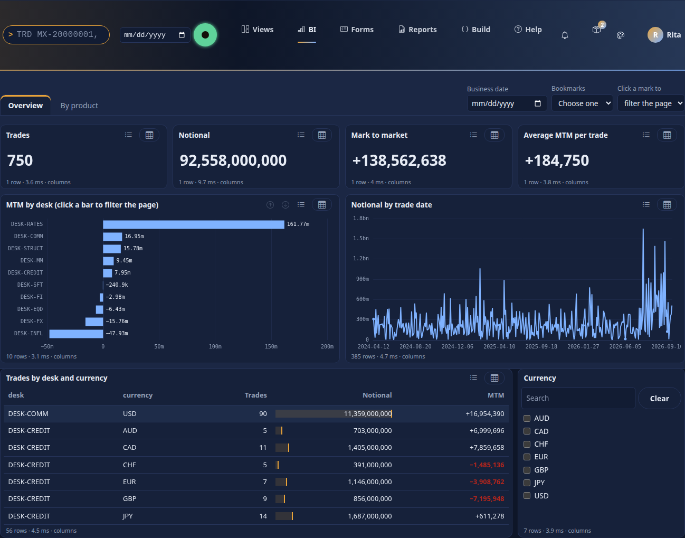

The toolbar holds the **business date** (empty: the latest the data has; section 7), **Bookmarks** (saved states of the report), *Click a
mark to* **filter the page** or **highlight**, and **Reset**; the filters in force are chips under the page tabs. Every visual has a header
with its title and the buttons that fit it, and a line under it with the rows that came back, the milliseconds the question took (or "from
the cache") and the layer that answered (`columns`, `rollup`, `direct`, `live`); *masked* is added when a column was masked for you.

* **Click a mark.** The other visuals filter to it: here DESK-COMM was clicked, the cards, the line and the table are that desk's, the bar
  keeps all desks but dims the others, and a chip says what is selected. Click it again, press `Esc`, or use the visual's clear button to
  let go; Ctrl or Shift adds marks. With **highlight**, bar, column, line, area and combo charts keep the whole answer and draw the chosen
  share over it.

  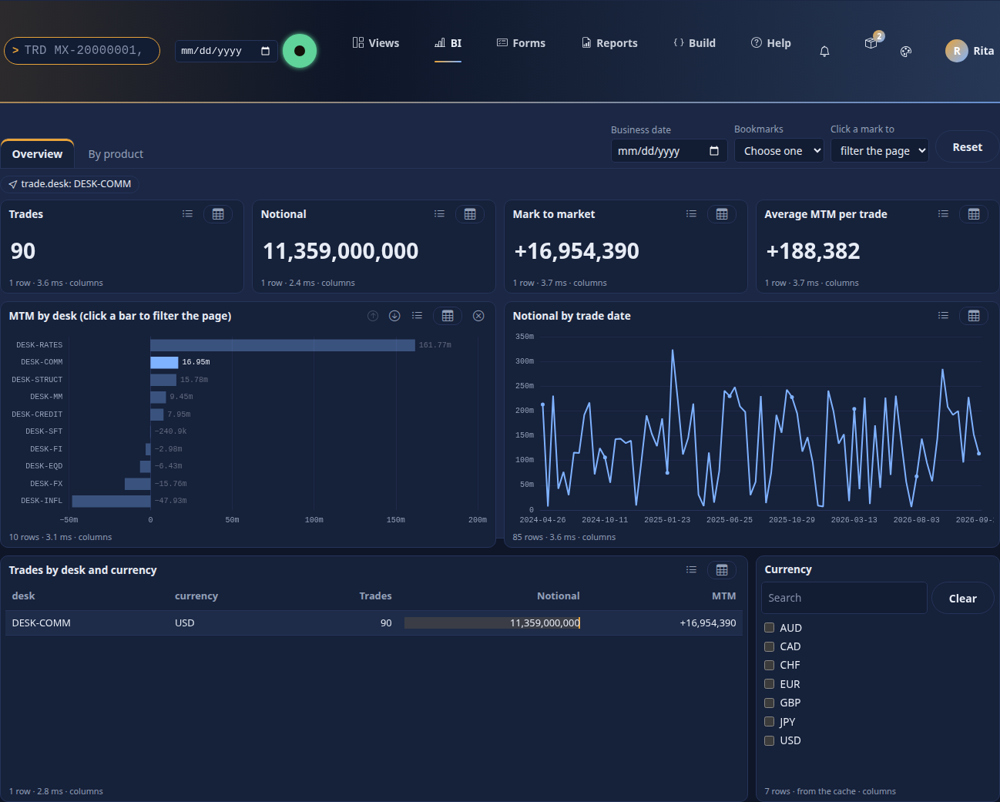

* **Drill down and up.** With a mark selected the drill-down button (or `d`) goes one level down the visual's hierarchy (desk to book); the
  title shows the path; the up button (or `u`) comes back.

  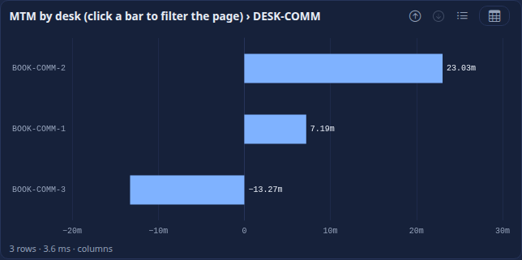

* **Show the rows** (`r`) replaces the visual with the rows behind it (every column of the table it reads; the selected mark's rows when one
  is selected); **Show as a table** (`t`) shows the visual's own numbers, and is what a screen reader reads. Masked columns read `•••` here too.

  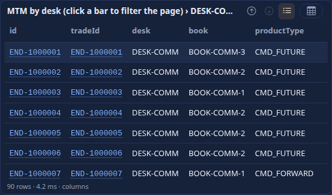

* **Drill through.** In **Counterparty risk**, select a counterparty's bar and press *Drill through to Counterparty*: that counterparty's page
  opens with the value carried as a chip (in the address, `?carry=...`, so the link can be shared) and a **Back** button. A trade in its table
  opens in the terminal (*Open in the terminal*, or the link in the key column; a column that references a kind links to that entity too).

  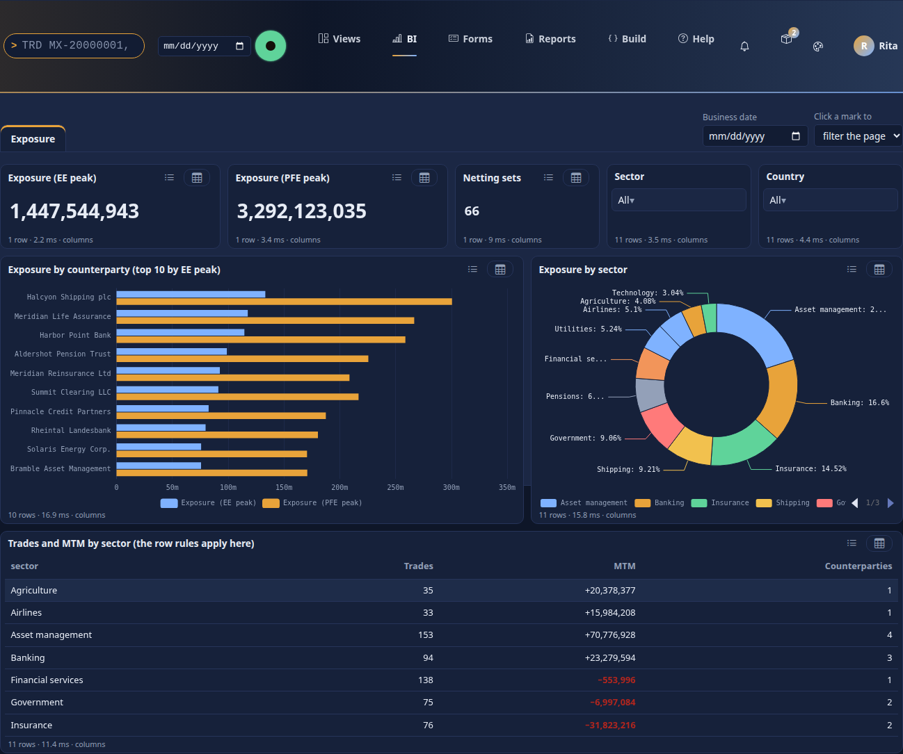

  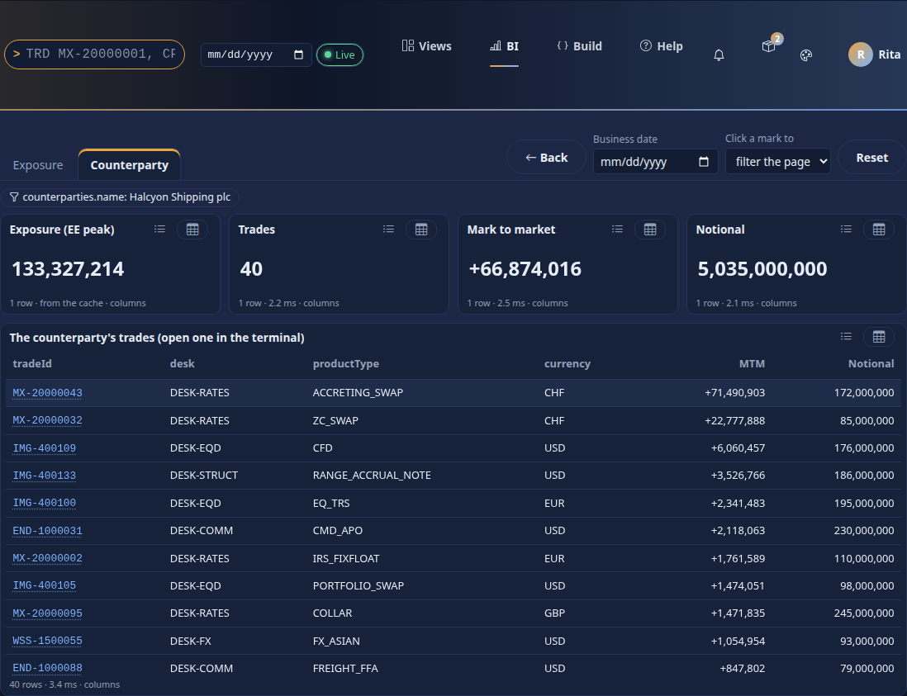

* **The rows you see are yours.** The report asks its model as **you**. A desk head sees the trades of their desk, and the exposure visuals say,
  with the code, why they cannot be drawn for a reader whose row rule is on the trades (`DRS-9020`); a reader without the raw power sees the
  counterparty name as `•••`, one bar:

  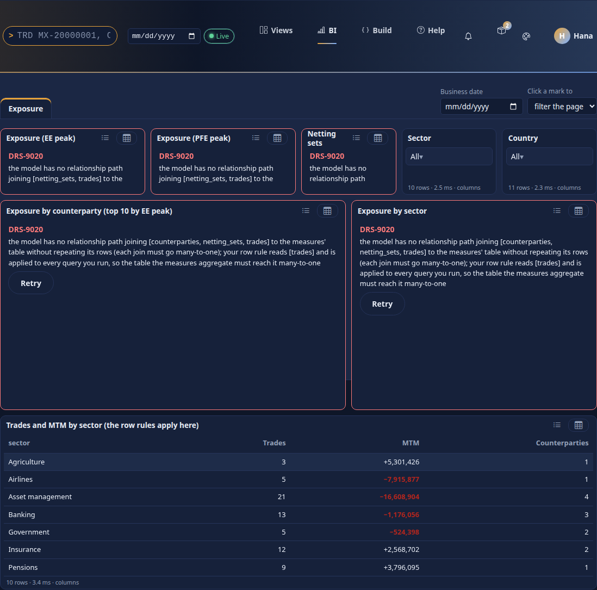

  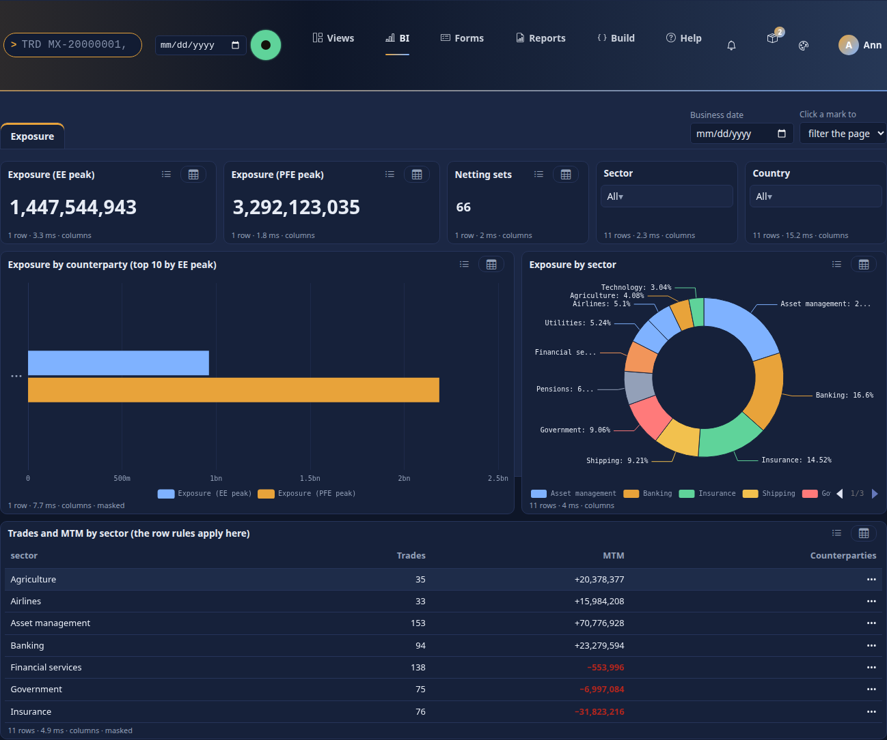

* **Cashflow ladder** drills from the pay year to the quarter, month and day, and lays the legs out as a matrix with subtotals:

  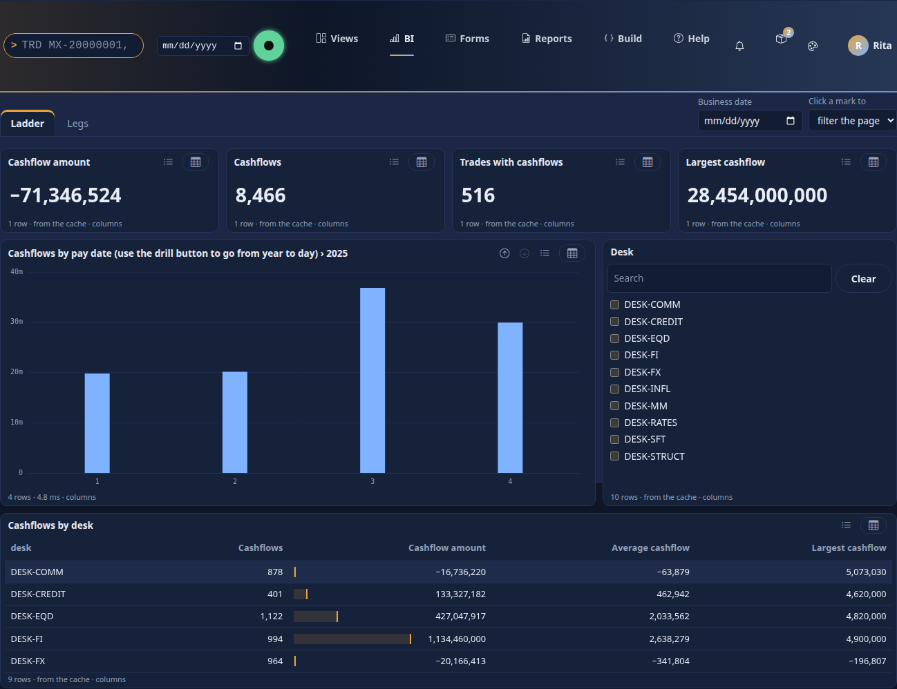

  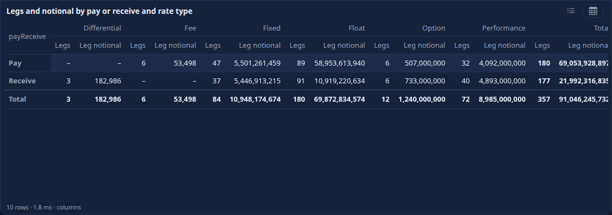

* **Keys.** `Tab` walks the visuals in reading order (top to bottom, left to right); in a chart `Left` and `Right` move between marks and
  `Enter` selects; `Esc` clears; `t`, `r`, `d`, `u` act on the focused visual; `?` lists them.
* **A phone** (390 px) shows one column in reading order with 44 px buttons and no sideways scroll; a report that declares a phone or tablet
  arrangement shows its own (section 8.4):

  

The page asks for each visual's data **three at a time** (the server allows three a person, and the page retries a refusal for busy); a
visual that is refused shows the code and words in its frame with a **Retry** button while the others carry on. A question that takes longer
than the inline wait becomes a background run with a card in place of the chart (section 15). A visual whose rows reach its limit says so
(*first 500 of 2,340*) and offers **Show all** (up to 5,000 rows); a time series is asked again by week, month, quarter or year until the
whole range fits, and says *by week* (section 9.11).

A visual's answer can also come as Apache Arrow (`POST /api/v1/bi/reports/{id}/query` with `Accept: application/vnd.apache.arrow.stream`)
for clients that read Arrow; the page itself asks JSON, which measured as fast to draw ([DATA_GUIDE.md](DATA_GUIDE.md#6-arrow-to-the-browser-where-it-pays)).

## 7. Which date a report reads

"As of D" (a day in the toolbar's date or the time picker, or **Now**, the current business date) means **each table at its latest business
date on or before D**: facts and dimensions alike, live or not, on a weekend or a holiday, and before today's load. A report never shows an
empty table for today while yesterday's data is there, and an empty partition built for a date with no data is never kept as the answer.
The line under the toolbar says the date the data is as of and names each table's date when they differ (*Data as of: prices 2026-10-20,
trades 2026-10-16 (asked 2026-10-21)*); a visual or a board tile whose tables differ says the same under it, in the theme's warning colour.

A report may choose otherwise with the top-level key `as-of`:

| `as-of:` | Each visual reads |
|---|---|
| `per-table` (the default) | each table at its own latest date on or before D; a fact and a dimension may stand at different dates |
| `aligned` | every table at the newest date on or before D that **all** of the visual's tables hold (a reconciliation: no mixing of days) |
| `2026-09-30` | always that date (a month-end pack), whatever the reader picks |
| a relative name | the end of its window at D: `last-business-day`, `previous-month` (the last day of the month before), `previous-quarter`, `last-5-business-days`, `this-month` (D), ... (the names of section 9.9) |

```yaml
report: month-end-reconciliation
model: trading-risk@1
as-of: aligned
```

A window the reader picks (two dates) is read as it is; a report's `dates: { from, to }` sets one for every question. Anything else is
`DRS-9030` at `as-of`. A visual pinned to a past date is asked once, never followed live. Every answer says the date each table was read at
(`meta.dataAsOf`: `{asked, tables: {trades: "2026-10-16", prices: "2026-10-20"}, aligned: false}`).

## 8. BI Studio and the report designer

The designers share one shell, **BI Studio**: the report designer (and so the board and statement designers: a board and a statement are
report pages) and the theme designer. Tables and models are written in **Build › Tables & models**. **Report designer** in the rail
(`/bi/designer`) lists your report drafts (in every workspace where you may add items) and starts a new report or board on a model, in the
workspace you choose; **Samples to start from** lists the shipped reports, each with **Copy and design**. A draft opens at
`/bi/design/<draft>`; a shipped report opens read-only with **Save a copy**. From a table's page, **Start a report on it** opens the designer
with it chosen. The designer needs the `bi-author` power; its step-by-step use is [tutorial 8, Part A](../tutorials/08-reports-and-dashboards.md#part-a--your-first-bi-report).

### 8.1 The Studio shell

* **The header**: where you are (BI › Studio › Reports), the item's name and status (*Saved*, *Unsaved changes*, *Read-only*), the actions
  (Undo, Redo, Preview with data, Check, View, Item page, Publish, Save) and **+ New** (report, board, theme, table, model). The layout picker
  switches between **Studio**, **Side by side** and **Terminal** (dense and monospace, a `DESIGN>` command line on Ctrl+K that takes `check`,
  `save`, `publish`, `undo`, `redo`; F3 Check, F4 the YAML tab, F9 Publish), remembered in this browser. In a workspace that requires review,
  Publish reads **Propose** and asks for a note for the reviewer.
* **The Explorer** (left): the items of every workspace where you may add items, by kind, with a search; a draft shows its status. The button
  at the left of the header folds it away (under 900 px it starts folded).
* **The open items** (above the designer): every item you open joins the tabs (the last eight, for this browser tab). The work itself is saved
  on the server: the tabs are only a convenience.
* **The properties** (right): the designer's panes (Filters, Visualizations with Build and Format, Fields).
* **The dock** (under the designer): **Problems**, what the server's Check says about the draft a second after each change (each linked to its
  visual; the count is on the tab), and **Query**, the selected visual's model query and its SQL (section 8.3).


### 8.2 The report designer

The panes are where Power BI authors expect them: the canvas on the left, then **Filters**, **Visualizations** (with **Build** and **Format**)
and **Fields**.


* **Fields.** The model's tables, their columns (a date opens into its parts: year, quarter, month, week, day), its measures (listed first,
  labelled *default* or *model*) and hierarchies, with a search box. **Drag a field onto the canvas** and the best visual for it appears: a
  measure is a card, a column a table; **drag another onto that visual** and it improves: a category with a measure becomes a bar, a date with
  a measure a line, two categories with a measure a matrix. Without a mouse, the field's button adds it to the selected visual (or makes a new
  one). A hierarchy added to a chart makes it drillable.
* **Visualizations.** The types the designer offers (section 9.3; `vega-lite` has a box for its specification; the rolling chart, the
  `perspective-*` types and the entity view are written in the YAML tab). Choosing one with a visual selected converts it (and asks first when
  wells would be dropped); **+ Add visual**, or dragging a type onto the canvas, makes a new one. **Build** shows the wells of the selected
  visual: chips you can remove or reorder and a select that adds without dragging; drill-down along a hierarchy and drill-through to a page are
  set here. **Format** is section 10; with no visual selected it is the **page** (title, layout: grid, board or statement, the fields it takes as
  a drill-through target, whether it is a tooltip page) and the **report** (title, description, theme, palette, business dates, links,
  bookmarks, the kiosk rotation of its board pages).
* **Filters.** *On all pages*, *On this page*, *On this visual*. **Basic** picks values (type them, or *Pick from the data*), **Advanced** is a
  condition (is, is not, less than, between, contains, starts with, is empty ...), **Top N** keeps the N values with the highest (or lowest)
  measure.

  

* **The canvas** is the 12-column grid. Drag a visual by its header and drag the corner to resize: both snap to the grid, and what a move would
  overlap is pushed down. **Keyboard:** focus a visual and `Arrow` moves it a cell, `Shift` with an arrow resizes it, `Ctrl+D` duplicates,
  `Delete` removes, `Enter` goes to its title in Format.
* **Real data while you design.** Every visual is drawn from the model, as you (your rows, your masks), with the rows and the **question time**
  under it; **Preview with data** can be turned off. An **incomplete visual** (a required well empty) shows its own note (*Add a field to the
  axis well*) while the others still draw. A field dropped where it does not fit says which wells the visual has.
* **YAML.** The tab shows the same draft as text. Edit either view and the other follows at once; a mistake in the text is reported with its
  code and path (`DRS-9031`, ...) and the canvas keeps the last good draft. A strip of **suggestions** follows the cursor: visual types after
  `type:`, operators, hierarchies, pages, and the model's fields and measures in a well. Comments, key order and every entry you did not touch
  stay as written.

  

* **Check** validates the draft and adds the quality checks (`A11Y`: a chart, table, card or image with no title or alt text, a colour too pale
  for the background; `LAYOUT`: visuals that overlap; `PERF`: a preview that took over a second) and runs the report's expected values.
  Clicking a finding goes to the visual; each names the visual's title, id, number and page.

  

* **Undo and redo** (`Ctrl+Z`, `Ctrl+Y`) walk the last 100 changes; **Save** (`Ctrl+S`) keeps the draft; the page warns before you leave with
  unsaved changes. **Publish** (**Propose** where the workspace reviews) saves first, then publishes; a report that cannot be drawn is refused
  with its errors listed. Converting a visual's type renames its made-up id (`card-1` becomes `slicer-1`), and everything that named the old id
  follows it (bookmarks, layouts, interactions, tooltips).

### 8.3 A report on a model: Fields, own measures, MQ or SQL

The **Fields** pane is the model as you see it (`GET /api/v1/bi/models/{ref}/describe`): one group per alias, the model's **display names**
(every visual's labels use them), **descriptions** (the tooltip), **formats**, **folders**, hidden fields left out, masked fields marked. Its
header names the model (*Implicit model of Trade* with **Make it a model**, or *Model Trades and desks* with **Open the model**) and how many
reports a change of it reaches. When the model has **perspectives**, **Perspective** shows only one perspective's fields and measures, and the
report keeps the choice (`perspective: "desk-view"`).


**A measure of this report only.** *New measure for this report* takes a name and a formula in the expression editor over the model's
measures and fields; **Try it** asks the model. It is written into the report and sent with every question that uses it as `define`, so it
never changes the model; it is marked *this report only*, with **Move to the model**. A name the model already has is refused (`DRS-9154`).

```yaml
measures:
  "MTM in thousands": { expr: "measure('Sum of MTM') / 1000" }
```

**Query of the selected visual: MQ or SQL.** Every visual's data is one **model query** built from its wells, the report's, page's and
visual's filters (a filter on a measure becomes `having`), its sort and limit, and in the viewer the slicers and the other visuals'
selections. The Query panel shows it as YAML or as **Drishti SQL** (the model's aliases as tables, `MEASURE('name')` for a measure, `JOIN`
without `ON` along the model's relationships), one switch. **Run as SQL** sends the statement to the server (`POST /api/v1/bi/sql`) and shows
its rows, time and plan, saying whether the plan is the visual's: one question, one plan, one cache entry, whichever language asks it.

```yaml
mq: 1
model: trades-and-desks@1
select:
  fields: [trade.DESK]
  measures: [Sum of MTM]
```

```sql
SELECT trade.DESK,
       MEASURE('Sum of MTM') / 1000 AS "MTM in thousands"
FROM   trade
GROUP  BY trade.DESK
ORDER  BY "MTM in thousands" DESC
LIMIT  500
```


**Publishing a report on a model** needs that model **published** (a draft model is read by its author only) and readable by the publisher
(a member of its workspace, or in its audience); otherwise publish is refused with `DRS-9030` (*the model 'wes-draft@1' is not published ...*).
A report names `model:` or the older `dataset:`, never both (`DRS-9140`).

### 8.4 Phone and tablet layouts

A phone shows one column: without anything declared, the grid in **reading order**, each visual at its type's default height. A report may say
how each page is arranged at **640 px and narrower** (`layouts.phone`) and, for a tablet, at **1024 px and narrower** (`layouts.tablet`, two
columns: each visual half the width, those in `wide` the whole width):

```yaml
layouts:
  phone:
    desk:                                   # a page id
      order: [mtm, trades, by-desk, movers] # first, in this order; every other visual follows in reading order
      hide: [rolling, losses, latest]       # not drawn on a phone, and not asked for
      span: { by-desk: 5 }                  # height in grid rows (1 to 40; a row is 56 px)
  tablet:
    main: { order: [desk, trades, mtm, notional, rows], wide: [desk, rows], span: { desk: 5, rows: 4 }, hide: [] }
```

Hidden visuals are **not asked for**, so a hidden table costs the phone nothing. A visual may not be both in `order` and in `hide`; a page or
visual that does not exist is `DRS-9031`, a bad height `DRS-9030`. The viewer chooses by the **screen** (a phone with only a tablet layout gets
the automatic column) and swaps back when the window grows; `<drishti-report>` chooses by the **element's own width** (section 20). In the
designer the **Phone** tab lists the page's visuals in phone order (drag a row or use its arrows, *Hide*, *Rows* for the height) beside a 390 px
preview drawn to scale; *Back to automatic* removes the page's entry. The **Tablet** tab is the same list with *Wide*, above a 768 px preview.
The sample *Live trading desk* ships with a phone layout.


## 9. The report file: pages, visuals, filters and slicers

### 9.1 Where a report lives

* **A file** in the BI folder, `config/bi/reports/<id>.report.yaml`: a published, read-only item of *Shipped content* (id
  `file:report:<id>`), watched live (section 4.6).
* **An item** of a workspace: a `report` item whose YAML body is a draft you edit in the designer, then publish like any item. Publishing checks
  it and refuses a report with errors (`DRS-9030`).

### 9.2 The file

```yaml
report: trades-overview        # the report's name: letters, digits, hyphen, underscore, dot
version: 1
title: Trades overview
description: The day's trades at a glance.
sample: true
model: trades-basic@1          # the model it reads, at a major version; or table:<name> (an implicit model)
theme: corporate               # a theme item (section 10.3), or { palette: default | colour-blind | mono }
dates: { from: 2026-10-01, to: 2026-10-08 }   # optional; without it each question reads the latest business date (section 7)
filters: []                    # report filters (section 9.8)
pages:
  - id: overview
    title: Overview
    filters: []                # page filters
    visuals:
      - id: mtm
        type: card
        title: Mark to market
        at: { x: 6, y: 0, w: 3, h: 2 }          # column, row, width in columns, height in rows
        wells: { values: [MTM] }
        format: { rules: [{ type: rule, apply: MTM, op: lt, value: 0, colour: "#b3261e" }] }
bookmarks:
  - { name: FX desk only, page: overview, filters: [{ field: trade.DESK, op: in, values: [DESK-FX] }] }
layouts: { phone: { overview: { order: [mtm] } } }   # section 8.4
tests:                         # section 9.12
  - { name: Trades is not empty, measure: Trades, expect: { min: 1 } }
```

| Key | Meaning |
|---|---|
| `report`, `version`, `title`, `description` | the name (also the file name), your own version number, the catalogue's title and description |
| `sample` | `true`: sample content, hidden from people who may not see samples |
| `model` | the model it reads (`<name>@<major>`, or `table:<name>` for a table's implicit model); not found or not readable: `DRS-9034`. Older reports name `dataset:` |
| `perspective`, `measures` | the model's perspective the Fields pane shows; the report's own measures (section 8.3) |
| `theme` | a theme item's name (`theme: corporate`, or `{ use: corporate }`), or a palette: `default` (following light, dark and high contrast), `colour-blind` (Okabe-Ito) or `mono`; optional `palette` and `background` over the theme's |
| `as-of`, `dates` | which date it reads (section 7) |
| `board`, `statement` | the settings of its board pages (section 14) and its paper (section 12) |
| `filters`, `bookmarks`, `links`, `pages` | sections 9.8, 9.10, 9.13 and below |
| `layouts`, `tests` | sections 8.4 and 9.12 |

A **page** has `id` (made from the title when missing), `title`, `filters`, `visuals`, and optionally `layout` (`grid`, the default; `board`,
section 14; `statement`, section 12), `drillthrough: { fields: [table.column] }` (a **drill-through target**, left out of the tabs),
`tooltip: true` (a **tooltip page**) and `interactions:` (section 9.10). At most 30 pages, 60 visuals a page.

A **visual** has `id` (unique on the page), `type` (section 9.3), `title`, `at` (`{ x, y, w, h }`: column `x` 0 to 11, `w` 1 to 12 with
`x + w` at most 12, row `y`, `h` 1 to 40 rows of 56 px), `wells`, its own `filters`, `sort: { by, desc }` and `limit`, `hierarchy` (a model
hierarchy it drills down), `drillthrough: { page, field }`, `format` (section 10), `tooltip` (a tooltip page's id), `interacts: false` (other
visuals' selections do not filter it), the `text` of a text visual or button, an image's `src` (this site's `/static/...` or a `data:image/`
URI, never another address) and `alt` (also a text alternative for any visual), a button's `action: { navigate: <page> }` or
`{ bookmark: <name> }`, and a tile's `from` and `alert` (section 14). The keyboard order is the picture's: top to bottom, then left to right.

### 9.3 The visuals and their wells

A **well** holds fields (`table.column`, or `table.column.year|quarter|month|week|day` for a date), measures or either. Charts draw with the
vendored chart library; everything else is plain elements. Required wells must be filled.

| Type | Wells (kind, how many) | What it draws |
|---|---|---|
| `bar` | `axis` field (1, required), `legend` field (1), `values` measures (required), `split` field (1) | horizontal bars ranked by the first measure; one series per measure or per legend value; with `split`, **small multiples** (section 10.4) |
| `column`, `line`, `area` | as `bar` | vertical columns (`stacked`, `percent`); lines in axis order (a date axis in date order); filled lines |
| `combo` | `axis` (1, required), `values` (required), `secondary` measures | columns for `values`, lines for `secondary` on a second axis |
| `scatter` | `details` field (1, required), `x`, `y` measures (1 each, required), `size` measure (1) | a point per value of `details` |
| `pie`, `donut` | `axis` field (1, required), `values` measure (1, required) | shares of the whole, the percentage in the tip |
| `waterfall` | `axis` field (1, required), `values` measure (1, required) | each step from the running total, and a total |
| `treemap` | `axis` fields (1 or 2, required), `values` measure (1, required) | nested rectangles |
| `heatmap` | `axis` and `legend` fields (1 each, required), `values` measure (1, required) | a grid coloured by the measure |
| `bubble` | `details` field (1, required), `x`, `y` and `size` measures (1 each, required) | a scatter sized by `size` (section 9.4) |
| `funnel` | `axis` field (1, required), `values` measure (1, required) | stages from the largest down |
| `histogram` | `axis` field (1, required), `values` measure (1, required); `format: { bins: 10 }` | how many members of `axis` fall in each band of the measure, binned by the server |
| `box` | `axis` field (1), `details` field (1, required), `values` measure (1, required) | a box plot of the measure over the members of `details`, one box per value of `axis` |
| `map` | `location` field (1) **or** `latitude` and `longitude` fields; `details` (1), `values` measure (1, required) | countries or regions shaded by the measure, or points (section 9.4) |
| `card` | `values` measure (1, required) | one number |
| `multirow-card` | `axis` field (1), `values` measures (required) | a row per value of `axis`, or the measures as rows |
| `kpi` | `values` measure (1, required), `target` measure (1), `axis` field (1) | the value against the target, a sparkline over `axis` |
| `gauge` | `values` measure (1, required), `target` measure (1) | a dial; `format: { min, max }` |
| `table` | `columns` fields and measures (required) | the fields grouped, the measures added up; sortable titles; data bars and colours; key and reference columns link to the entity in the terminal; `format: { totals: true }` adds a true total row (section 9.7) |
| `matrix` | `rows` fields (required, any number), `columns` field (1), `values` measures (required) | rows by columns, with subtotals at every level and true totals (section 10.5) |
| `slicer` | `field` (1, required) | section 9.9 |
| `text`, `image`, `button` | none | `text`; `src` and `alt`; `text` and `action` |
| `live-chart` | `values` measures (1 to 4, required) | a **rolling line** of a live report: a point per update, the latest `format.window` (5 to 1,000) points (section 13.1) |
| `vega-lite` | `axis` fields, `legend` (1), `values` measures: at least one | a Vega-Lite specification in `format.spec`, its data the rows of the wells (section 9.6) |
| `python` | `columns` fields, `values` one Python measure | what a Python item returns for your rows ([NOTEBOOK_GUIDE.md](NOTEBOOK_GUIDE.md)) |
| `entity-view` | `key` (1, required): a field holding an entity's id | the Drishti view of the entity selected on the page (section 9.5) |
| `tile` | none: `from: { report, visual, page }` | a visual of another report on a board page (section 14) |
| `perspective-grid`, `perspective-pivot`, `perspective-chart` | `columns` / `rows`, `columns`, `values` fields of one table | drawn as Drishti's own grid of the rows the server sends, masked; for a pivot use a `matrix`, for a chart a chart type |

Reserved and refused with `DRS-9033`: `shape`. A measure in a field well, a field in a measure well, an unknown well, a required well left
empty or one over its number of items is `DRS-9032`; a name the model does not have is `DRS-9031`.

### 9.4 The map, funnel, histogram, box plot and bubble

All five draw from the same question as any chart, are built the same way in the designer (the Charts group, Build, Format), and are exported
and drawn by `<drishti-report>`. A mask applies as everywhere: a masked measure is a blank visual that says `•••`, a masked field is one bar or
box.


**Map.** `wells: { location: [counterparties.COUNTRY], values: [Exposure (EE peak)] }` shades each country by the measure. `location` holds
**ISO 3166-1 codes** (`US` or `USA`) or the English name or, below the country, **ISO 3166-2 region codes** (`AU-NSW`), matched against
vendored Natural Earth shapes: no tiles, no map service, no CDN. A country too small for the world shapes is a **clickable dot**; a value no
shape knows is **named under the map** (*Not on the map: CHI, XKX*), never dropped. **Points:** `latitude`, `longitude`, `details` and
`values` put a point at each position, as large as the measure. **Drilling:** a map opens at the world; a click on a country **selects it**
(the cross-filter) **and opens its regions**, with the breadcrumb **World › Australia**. Rows that name only regions shade their country with
the **sum** of their regions, so use an additive measure. `format: { level: AUS }` opens already drilled in; `drill: false` keeps the world
only. The samples **World economics** (real World Bank data) and **Region economics** (Australian and US states, illustrative figures) are the
ones to adopt.

 

**Funnel** (`axis`, `values`): the stages largest first; a click filters by the stage. **Bubble** (`details`, `x`, `y`, `size`): the scatter
with its fourth measure as the size.

 

**Histogram.** `wells: { axis: [trades.TRADE_ID], values: [MTM] }, format: { bins: 12 }`: the engine is asked for the measure of every member
of `axis` (up to `drishti.bi.report.distribution-rows`, 20,000), as the reader, and the **server** bins it into equal-width bands (2 to 100);
the answer is `bin`, `count`, `from`, `to`, so the screen, an export and a subscription show the same bars. **Box plot.**
`wells: { axis: [trade.DESK], details: [trade.TRADE_ID], values: [MTM] }`: quartiles by linear interpolation, whiskers at the lowest and highest
value within 1.5 interquartile ranges, the members beyond them as outliers (at most 25 listed).

 

In the designer the five are in the Charts group; Build shows their wells (the map's place wells are optional, the check asks for a place);
Format has **Bars** for a histogram, and **Level** and **Drill into countries** for a map.

 

**The map shapes.** `static/vendor/echarts/maps/world-countries.json` (Natural Earth 1:110m, 177 shapes), `world-points.json` (the
countries too small for those shapes, as points) and `regions/<ISO3>.json` (one country's admin-1 regions at 1:10m, simplified, coded by
ISO 3166-2; 251 files, none over 200 KB, loaded when the map first opens that country), made by `tools/maps/build_regions.py`. The console
serves them, and for `<drishti-report>` `/embed/v1/world-countries.json`, `/embed/v1/world-points.json` and `/embed/v1/regions/<ISO3>.json`.
Natural Earth is public domain ([VENDOR.md](../../drishti-console/web/static/vendor/VENDOR.md)). The same shapes draw the Sutra `map` panel.

### 9.5 The entity view

`type: entity-view` shows **a Drishti view inline** for the row the person picks: click a counterparty in a bar and its view opens beside it.

```yaml
- { id: ids, type: bar, title: Exposure by counterparty (click one), at: { x: 0, y: 0, w: 5, h: 10 }, wells: { axis: [counterparties.id], values: [Exposure (EE peak)] },
    filters: [{ field: counterparties.id, op: top, n: 10, by: Exposure (EE peak) }] }
- { id: counterparty-view, type: entity-view, title: The counterparty's view, at: { x: 5, y: 0, w: 7, h: 10 }, wells: { key: [counterparties.id] } }
```

When a mark of another visual selects exactly one value of the `key` field, the visual shows that entity's view (`/v/<kind>/<id>?embed=1`);
until then it says *Select a counterparty in another visual to see its counterparty here*. `format: { kind: counterparty }` names the kind when
the table does not. The frame is the view **built for the person looking** (their masks, row rules and rights); the report only supplies the
id, so select by **id**, not by a name that may be masked. It asks no question of its own (no *Alert me*, *Show as a table* or export), and the
designer's canvas and an embedded report show a note instead. The sample **Counterparty risk** has the page *Counterparty lookup*.


### 9.6 Vega-Lite visuals

A `vega-lite` visual draws a [Vega-Lite](https://vega.github.io/vega-lite/) specification written in the report. Its **data is the rows of
its wells**, asked as the person looking and put in as `data.values`; put no data in the specification.

```yaml
- id: mtm-by-desk
  type: vega-lite
  title: Net MTM by desk (Vega-Lite)
  at: { x: 0, y: 0, w: 8, h: 7 }
  wells: { axis: [trade.DESK], values: [MTM, Trades] }
  format:
    spec:
      mark: { type: bar, cornerRadiusEnd: 3 }
      encoding:
        x: { field: DESK, type: nominal, sort: "-y", title: Desk }
        y: { field: MTM, type: quantitative, title: Net MTM }
        color: { condition: { test: "datum.MTM < 0", value: "#b3261e" }, value: "#4f7cff" }
        tooltip: [{ field: DESK }, { field: MTM, format: ",.0f" }, { field: Trades }]
  alt: Bars of net mark to market for each desk, red where it is negative
```


* **Field names.** A row is keyed by the well's items: a field by the text after the table's dot (`trade.DESK` is `DESK`; `trade_DESK` when two
  fields share a name), a measure by its name. Check warns about a field the specification names that no well supplies.
* **Nothing is loaded.** `data.url`, `url` and `loader` are refused (`DRS-9032`); the specification is limited to 200,000 characters.
* **Drawn by drishti-chart**, which translates the specification (marks `bar`, `line`, `area`, `point`, `circle`, `square`, `tick`, `rule`,
  `rect`, `arc`, `boxplot`; encodings `x`, `y`, `color`, `size`, `theta`, `tooltip`, `opacity`; `aggregate`, `bin`, `stack`, `scale`, `axis`;
  `layer`; `transform` `filter` and `calculate`), read by a small expression language, never `eval`, under the page's strict content policy.
  Anything else (facets, `repeat`, `concat`, `params`, `selection`, `projection`, other transforms, `text` marks, `resolve`) is **not drawn**,
  and the frame says which feature and what to use instead. `width` and `height` are ignored. An embedded `<drishti-report>` does not draw it.

### 9.7 True totals

A total of a ratio, an average, a distinct count, a percentile, a minimum or a maximum is **not** the sum or the average of the figures shown.
Every total and subtotal of a matrix, and the total row of a table with `format: { totals: true }`, is computed by the **pivot engine**
([PIVOT_GUIDE.md section 22](PIVOT_GUIDE.md#22-bi-on-the-pivot-engine)) over the model's rows as the reader may see them, each level from the rows
of its own group, in one statement; the page adds nothing up. A measure that reads beyond its group's rows (time intelligence, running,
context, Python) has no total. The answer carries them as `totals` (one entry per level: `by`, the measures, the rows); a level the engine
refuses, or a measure masked for the reader, stays `–` with its reason in the cell's title. The cap is `drishti.bi.report.totals-max-rows`
(2,000 rows a level).


The grand total of *Largest notional* is the largest, 7,000,000 (its sum would have been 21,000,000); the cells the engine worked out say so
in their tip.

### 9.8 Filters

A filter is `{ field, op, values }` at **report**, **page** or **visual** level. `field` is a column (or date part) or, for a comparison on a
total, a **measure** (it becomes `having`).

| `op` | Values |
|---|---|
| `in`, `not-in` | a list |
| `eq`, `ne`, `lt`, `le`, `gt`, `ge` | one value |
| `between` | two values |
| `contains`, `starts-with` | text |
| `is-null`, `not-null` | none |
| `top` | `n`, `by` (a measure), `dir` (`desc` for the highest, `asc` for the lowest): keep the `n` values of `field` with the highest measure |

```yaml
filters: [{ field: counterparties.id, op: top, n: 10, by: Exposure (EE peak) }]   # the ten largest counterparties
```

A `top` filter is resolved first, in the context of the other filters (slicers included), so it follows the person's choices. Rank by a column
that is not masked (`counterparties.id`, not the masked name): a filter on a masked column is `DRS-9021`.

### 9.9 Slicers

A `slicer` lists the values of its field (under the reader's rows and masks) and filters the visuals in its **scope**.

* `format.mode`: `list` (the default: checkboxes with a search box), `dropdown`, `range` (**From** and **To** for a number or a date) or
  `relative-date` (below). `format.style: tiles` draws a list as buttons.
* `format.scope`: `page` (the default) or `report` (every page, so a choice holds on the others).
* `format.syncGroup: <name>`: the slicers of one group, on any pages, share **one choice**, each filtering its own page; they slice one field
  (else `DRS-9032`).
* A slicer never filters itself, and other slicers filter it. A visual a slicer cannot reach through the model's relationships answers
  `DRS-9020` and says so.

**The relative-date slicer.** `format.mode: relative-date` on a date or timestamp field offers named windows, worked out **on the server** from
the report's as-of date and the pack's **business-day calendar**, so the same name means the same dates on a screen, in an export and in a
subscription.

```yaml
- { id: when, type: slicer, title: When, at: { x: 0, y: 0, w: 4, h: 3 }, wells: { field: [trade.TRADE_DATE] },
    format: { mode: relative-date, default: last-30-days, options: [last-7-days, last-5-business-days, last-4-weeks, this-month, this-quarter, this-year, previous-month, all] } }
```

| Name | The window |
|---|---|
| `last-N-days` | the N calendar days ending on the as-of date (which counts as one) |
| `last-N-business-days` | the N business days ending on the as-of date (or the business day before it); holidays skipped |
| `last-N-weeks` | the 7 × N days ending on the as-of date |
| `last-N-months` | from the day after the same date N months earlier, to the as-of date |
| `this-week`, `this-month`, `this-quarter`, `this-year` | from the start of the period (a week starts on Monday) **to date** |
| `previous-week`, `previous-month`, `previous-quarter`, `previous-year` | the whole period before the one the as-of date is in |
| `all` | no restriction |

N is 1 to 3,660. `default` applies until the person chooses (and in exports and subscriptions); `options` lists the names offered (default:
`last-7-days`, `last-30-days`, `last-90-days`, `last-5-business-days`, `last-4-weeks`, `last-3-months`, `last-12-months`, the `this-*` and
`previous-*` names, `all`). In the designer: the slicer's Format, **Mode** *relative date*, **Starts as** and **Windows it offers**. With USNY,
5 business days ending Tuesday 7 July 2026 start on Tuesday 30 June, since Friday 3 July is a holiday.


### 9.10 Interactions, tooltip pages, drill-through and bookmarks

* **Edit interactions.** A page's `interactions: { <source visual>: { <target visual>: filter | highlight | none } }` says, pair by pair, how a
  selection (or a slicer's choice) on one visual acts on another; a pair not listed follows the viewer's *Click a mark to* choice. In the
  designer: select the source, then Format, *Interactions*, or **Edit on the canvas** (Filter, Highlight and None over each other visual).
* **Tooltip pages.** A page with `tooltip: true` is left out of the tabs; a visual with `tooltip: <page id>` opens it in a popover when the
  pointer rests on a mark, each of its visuals asked with the mark's value carried. In the designer: Format, *Tooltip*, **New tooltip page**.
* **Drill through.** A visual offers *Drill through to <page>* for each page whose `drillthrough: fields` lists the selected mark's field.
* **Bookmarks** (`bookmarks: [{ name, page, slicers: { <slicer id>: [values] }, filters }]`): choosing one applies the page, slicer choices
  and filters. In the designer, with nothing selected, Format's **Bookmarks** box writes them: a name, a choice for each slicer (a
  relative-date slicer offers its windows and writes `{ relative: name }`), and **Save this page as a bookmark**; a bookmark can be renamed,
  updated from the page's filters or removed.

### 9.11 How a visual becomes a query

For each visual the server builds one model query from the visual and the state of the page, in this order of authority: the report's
filters, the page's, the visual's, the slicers in scope, the marks selected on **other** visuals, the values carried by a drill-through, the
drill-down path. It runs it **as the person looking**. A finished answer is shared with everyone of the same **access profile** (section 15.6).

| Part | Rule |
|---|---|
| fields | the `axis`, `legend` (and `rows`, `columns`, `details`) wells in order; a table's `columns` that are not measures |
| measures | the `values`, `secondary`, `target`, `x`, `y`, `size` wells |
| order | a date axis in date order; else the first measure, largest first; a table, matrix, heatmap or slicer has the engine's order (never on a masked column); `sort` overrides |
| rows | `limit`, else the chart, table or slicer default (`drishti.bi.report.chart-rows`, 500; `table-rows`, 1,000; `slicer-values`, 1,000) |
| dates | section 7 |
| selections | a selected mark on another visual filters this one; with highlight on, a chart asks twice (the whole and the highlighted part); `interacts: false` and slicers are not touched |
| drill-down | the first axis field moves down the hierarchy one level per value clicked, and those values become filters (past the last level: `DRS-9035`) |
| show the rows | the visual's own filters and selection, every column of the table it reads, up to `show-rows` (1,000) |

**Never cut silently.** A visual whose rows reach its limit says *first 500 of 2,340* (*more than* past 50,000) and offers **Show all** (up to
5,000 rows, what one JSON answer holds). A time series (a line, area, column or combo over a date axis) is asked again by period, week, then
month, quarter and year, until the whole range fits, and its footer says *by week*; `format: { period: auto | day | week | month | quarter | year }`
fixes it. A model field may name a period itself: `trade.TRADE_DATE.month_start` (also `week_start`, `quarter_start`, `year_start`).

### 9.12 Expected values in a report

A report may declare what its numbers should be (the keys of section 5.8, plus `visual`: what a visual shows, its first measure, one row, asked
as the viewer asks it; and `column`, the measure column to read). **Check** runs them and shows each as passed, failed or could-not-run;
**publishing is refused while one fails** (`409 DRS-9043`) unless a `bi-admin` forces it (audited `FORCED over N failing test(s)`).

```yaml
tests:
  - { name: The card shows every trade, visual: trades, expect: 750 }
  - { name: Rates desk MTM, measure: MTM, by: [trade.DESK], row: { trade.DESK: DESK-RATES }, expect: 161766771, tolerance: 0.5% }
  - { name: A bad day, measure: Trades, filters: [{ field: trade.DESK, op: eq, values: [DESK-FX] }], date: 2026-10-09, expect: { min: 10, max: 90 }, role: desk-head }
```

**As a chosen role.** Check offers **Run the tests as** *yourself* or a role you hold (a `bi-steward` may choose any): the figure a test finds
is the figure a reader with that role's rules and masks sees. A role you do not hold, a figure masked for the role, or an answer of several
rows without `row` is `error`, never a figure. `drishti.bi.governance.refuse-failing-tests` (on) turns the publish gate off; a test that cannot
run counts as failing at publish. Exports and subscriptions do not run tests.

```text
POST /api/v1/bi/items/bi-d73f79cdbc/tests     {"role": "writer"}
{"item": "bi-d73f79cdbc", "kind": "report", "role": "writer", "total": 3, "passed": 2, "failed": 1, "errors": 0, "ok": false, "results": [
  {"name": "card shows the count", "kind": "visual", "target": "n", "expect": "16", "actual": 16.0, "status": "pass", "message": "", "role": "writer"},
  {"name": "card is wrong", "kind": "visual", "target": "n", "expect": "1", "actual": 16.0, "status": "fail", "message": "expected 1, got 16", "role": "writer"},
  {"name": "measure through the report", "kind": "measure", "target": "N", "expect": "1 or more", "actual": 16.0, "status": "pass", "message": "", "role": "writer"}]}
```


### 9.13 Reports over several models

A report reads **one model**; put facts that belong together in one model with several fact tables (section 5.3). Only across teams that own
different models may a visual name its own `model:` (or `dataset:`), with the report's `links:` saying which fields of different models mean
the same, so a slicer or a click on one model's visual filters the visuals of another. Each visual is still asked as the reader against its
own model.

```yaml
links:                                  # fields (table.column) of different models that mean the same thing
  - fields: [counterparties.SECTOR, joined.sector]
```

A choice made on one model reaches a visual of another only through a link that names a field that visual's model has; otherwise it does not
reach it, and the visual says so. A link naming a field no model of the report has is `DRS-9031`. Alerts, subscriptions, exports, boards and
the embedded report ask each visual the same way; impact analysis counts what each visual reads. The sample *Desk P&L vs counterparty
exposure* (`pnl-vs-exposure`) reads one model, `trading-risk@1`, which holds both facts:


### 9.14 Checking a report: DRS-9030 to DRS-9038

The check never throws: it returns every problem with its code and the path of the key (`POST /api/v1/bi/reports/validate`, the YAML tab, Check,
the dock's Problems, and the viewer when a report cannot be drawn). **One bad visual is one error card**: it answers `422 DRS-9034` for itself and
every other visual is still drawn. A draft with errors can be saved; **Propose, Approve and Publish** refuse it (a `bi-admin` may force it,
audited).

| Code | Meaning | Example |
|---|---|---|
| `DRS-9030` | the structure is wrong: not YAML, an unknown visual type, a bad `at`, a duplicate id, an unknown operator or interaction, an image from another address, a bad `as-of` | `pages[0].visuals[1].at: x is 0 to 11 and w is 1 to 12, and x + w is at most 12 ... this is x=8, w=6` |
| `DRS-9031` | a name the model or the report lacks: a field, measure, hierarchy, page, bookmark, slicer, tooltip page, a rule's `apply` | `pages[0].visuals[0].wells.axis: table 'trade' has no column 'nope' (it has id, tradeId, desk, ...)` |
| `DRS-9032` | a visual built wrongly: a measure in a field well, an unknown or empty well, too many items, a format value of the wrong type, a sync group over two fields | `...wells.values: 'trade.MTM' is a field; the values well takes measures (Notional, MTM, ...)` |
| `DRS-9033` | a reserved visual type (`shape`) | `...type: the visual 'shape' is reserved and not built yet` |
| `DRS-9034` | the model cannot be found or has errors | `no dataset 'x' (a catalogue id, a file name such as trades-basic, or the dataset's name)` |
| `DRS-9035` | a visual question names a page, visual or slicer the report lacks, or its state is not valid | `the hierarchy 'Desk and book' has 2 levels; there is nothing below trade.PORTFOLIO` |
| `DRS-9036` | a theme item is not valid, or (a warning) the report names a theme that cannot be found | `palette[1]: 'red' is not a colour (#rrggbb)` |
| `DRS-9037` | a well's field parameter is not one, or a choice does not fit the well (section 11) | `...wells.values: the values well takes measures, and the field parameter 'breakdown' can be trade.DESK, trade.PORTFOLIO, fields: put it in a field well` |
| `DRS-9038` | a statement is not valid (section 12.8) | `statement.paper: paper is one of [A3, A4, A5, Legal, Letter], not 'B5'` |

### 9.15 Security of a report

* A reader needs the **report** (audience and workspace roles); they need not open the model's catalogue entry: a published report reads its
  model with the grants of the people who published it, and the engine applies **the reader's own row rules and masks**. A draft (and the
  designer) finds only the models its author may read, so a report cannot be used to reach a model the catalogue hides from its author.
* A reader is never told the model's row rules through the report. A visual whose table a rule cannot reach answers `DRS-9020`, naming it.
* Report questions go through the same limits as any question: three at a time per person, time, rows and bytes.
* Nothing in a report is executed: it is parsed, checked, turned into parameterised model queries (every value bound) and drawn. No script,
  style or address from a report reaches the page.

## 10. Format, conditional formatting and themes

### 10.1 The Format pane

`format` is **typed per visual family**: one schema per family (`chart` for bar, column, line, area and combo; `other-chart`; `card` for cards,
KPIs and gauges; `table`; `matrix`; `slicer`; `static` for text, image, button and tile; `code` for python, vega-lite and the live types;
`common` for what they share). The server checks every visual's format against its family: a wrong value of a typed key is `DRS-9032`, an
unknown key a warning (so a stored report never stops opening). The designer's **Format pane is generated from the schemas**
(`GET /api/v1/bi/reports/format-schemas`): a section per group in the family's order (Title, Frame, Data labels, Axes, Legend, Colours, Small
multiples, Values, Conditional formatting; for a matrix Layout and Subtotals; for a slicer Slicer), the right control for each key with its
range and hint, so whatever the pane offers the server accepts.

| In Power BI | In BI Studio | YAML |
|---|---|---|
| Format, Visual, Values axis (min, max, log, gridlines) | Format, *Axes*, *Value axis* | `format: { valueAxis: { min, max, log, gridlines } }` |
| Format, General, Title, Subtitle; Effects, Border, Shadow | Format, *Title*, *Subtitle*; *Frame*, *Border*, *Shadow* | `format: { subtitle, border: true, shadow: true }` |
| Conditional formatting, Background colour, Gradient | Format, *Conditional formatting*, *Colour scale*, **Add a rule** | `rules: [{ type: gradient, apply: MTM, min, mid, max }]` |
| Conditional formatting, Icons | *Icons*, **Add a rule** | `rules: [{ type: icons, apply: Notional, icons: arrows, thresholds: [0, 1000000] }]` |
| Conditional formatting, Rules, based on another field | *Rule*, *When*: another measure | `rules: [{ type: rule, apply: MTM, on: Trades, op: gt, value: 10, colour }]` |
| Matrix, Row subtotals, Stepped layout, Expand all | Format, *Subtotals*, *Layout*; *Expand all* above the matrix | `format: { subtotals: true, stepped: true, expandTo: 0 }` |
| Small multiples well | Build, the **split** well | `wells: { split: [trade.CURRENCY] }`, `format: { multiples: { columns: 3 } }` |
| Edit interactions | Format, *Interactions*, or **Edit on the canvas** | `interactions: { column-1: { matrix-1: none } }` |
| Page information, Allow use as tooltip; Format, Tooltip, Page | Page: *Use as a tooltip page*; visual: Format, *Tooltip*, **New tooltip page** | `tooltip: true` (page), `tooltip: tip1` (visual) |
| Sync slicers | Format, *Slicer*, *Sync group* | `format: { syncGroup: ccy }` |
| View, Themes, Customize current theme | Format, *Report*, *Theme*; **Make a theme** | `theme: corporate`; a `theme` item (section 10.3) |

| Key | For | Meaning |
|---|---|---|
| `subtitle`, `titleSize` | every visual | a line under the title; the title's size (10 to 32 px) |
| `border`, `shadow`, `background`, `padding` | every visual | the frame |
| `labels`, `labelDensity`, `labelPosition` | charts | data labels; the share of points labelled; outside, inside or centre |
| `stacked`, `percent`, `smooth` | bar, column, area; line, area, combo | stack; 100% stacked; smooth the line |
| `valueAxis`, `categoryAxis`, `axisTitles`, `legend` | charts | `{ min, max, log, gridlines, show }`; `{ rotate, show }`; `{ x, y }`; `bottom`, `top`, `right`, `none` |
| `colour`, `seriesColours` | charts | one colour for a one-series chart; a colour per series or, for a pie, per category |
| `period` | charts on a date axis | `auto`, `day`, `week`, `month`, `quarter`, `year` (section 9.11) |
| `numberFormat` | charts, cards, tables | `amount0`, `signed0`, `signed2`, `compact`, `pct`, `share`; else the measure's own format |
| `rules`, `dataBars` | cards, KPIs, gauges, tables, matrices, bar, column; table, matrix | conditional formatting (10.2); measures drawn as bars in the cell |
| `calloutSize`, `showLabel`, `goodWhen`, `min`, `max` | card, KPI, gauge | the number's size; show the measure's name; better `higher` or `lower` than the target; the dial's range |
| `totals`, `rowBanding`, `wrap`, `fontSize` | table | a true total row; banded rows; wrap text; text size |
| `subtotals`, `rowSubtotals`, `columnSubtotals`, `stepped`, `expandTo`, `valuesOn` | matrix | section 10.5 |
| `mode`, `style`, `scope`, `syncGroup`, `default`, `options` | slicer | section 9.9 |
| `size`, `align` | text, button | `heading`; left, centre, right |
| `bins`, `level`, `drill` | histogram; map | section 9.4 |

A theme's visual defaults are applied under a visual's own format: what the visual says wins.

### 10.2 Conditional formatting

`format.rules` is a list; each rule names what it colours (`apply`: a measure the visual shows, or a field for `values`) and its `type`:

```yaml
format:
  rules:
    - { type: gradient, apply: MTM, min: "#c62828", mid: "#ffffff", max: "#2e7d32" }       # a colour scale (mid optional)
    - { type: rule, apply: MTM, on: Trades, op: gt, value: 10, colour: "#b3261e" }         # a rule on ANOTHER measure; background: also takes a colour
    - { type: icons, apply: Notional, icons: arrows, thresholds: [0, 1000000] }             # arrows, traffic, signs or flags: low, middle, high
    - { type: values, apply: trade.DESK, colours: { DESK-FX: "#1565c0" }, target: background } # a colour per value of a field
```

| Type | Keys |
|---|---|
| `rule` | `on` (a measure of the model; else the one coloured), `op` (`lt le gt ge eq ne between`), `value`, `to` (for `between`), `colour` (text), `background` |
| `gradient` | `min`, `max`, optional `mid`; `minValue`, `midValue`, `maxValue` (else the lowest, middle and highest the visual shows); `target`: `background` or `font` |
| `icons` | `icons` (`arrows`, `traffic`, `signs`, `flags`), `thresholds` (one or two numbers), `reverse` (low is good), `on` |
| `values` | `colours` (a value to a colour), `target` (`font` or `background`) |

A rule on another measure makes the visual ask for that measure too (not shown). A cell with a background takes black or white text, whichever
reads; an icon is said in words to a screen reader (*low*, *middle*, *high*). Charts colour their marks, tables and matrices their cells,
cards their number. The short form `conditional: [{ measure, op, value, colour }]` is still read. In the designer: Format, *Conditional
formatting*, choose the kind and **Add a rule**; nothing is typed but the numbers.

### 10.3 Themes

A **theme** is an item of kind `theme` (shipped in `config/bi/themes`, or stored, versioned, reviewed and published like a report), which a
report names with `theme: corporate`:

```yaml
theme: corporate
title: Corporate
palette: ["#1f4e79", "#2e75b6", "#9dc3e6", "#c55a11", "#70ad47", "#7f7f7f", "#ffc000", "#5b9bd5"]   # 3 to 12 series colours, in order
good: "#2e7d32"                         # a KPI above target, a colour scale's high end
bad: "#c62828"
background: "#ffffff"                   # optional: the visuals' background and text
foreground: "#1b1b1b"
font: { family: sans, size: 12 }        # sans, serif, mono or system (nothing is fetched); 10 to 18 px
visuals:                                # format defaults by family (chart, other-chart, card, table, matrix, slicer, static, code) or type
  chart: { labels: true, legend: bottom, valueAxis: { gridlines: true } }
  matrix: { rowBanding: true, stepped: true }
```

The shipped themes are **Corporate** and **Print**. A report's own `palette` and `background` win over the theme's; a theme that cannot be
found is a warning (`DRS-9036`) and the report draws with the default colours. A theme is checked like a report
(`POST /api/v1/bi/themes/validate`): a palette that is not 3 to 12 colours, a colour that is not `#rrggbb`, a font that is not one of the four,
or a visual default the format schemas refuse is `DRS-9036`; text on its background under a contrast of 4.5 is an `A11Y` warning.
`GET /api/v1/bi/themes` lists the themes you may use.

**The theme designer** (`/bi/design/theme/<id>`; *New: theme* in the Explorer, or **Make a theme** in Format; `/bi/design/theme/new` starts from
Corporate in your private workspace) edits a theme: its title and name, its series colours (add, remove, move; 3 to 12), page, text, good and
bad colours, type, and the format defaults of each kind of visual, drawn by the same generated Format pane, with a live preview of a chart, a
table and a card. The theme's YAML is the Studio's YAML panel (**Visual**, **YAML** or **Both**): a change on either side shows on the other.
Save keeps the draft; **Publish** makes it what reports read.


### 10.4 Number formats and small multiples

`numberFormat` or the measure's own format; a calculation group item's format wins in a visual that shows it (a share reads as a percent).

A bar, column, line or area chart with a field in its **Small multiples** well (`split`) is one small chart per value of that field, from the
one answer the server gave:

```yaml
- { id: mtm-by-ccy, type: column, at: { x: 0, y: 0, w: 12, h: 7 }, wells: { axis: [trade.DESK], values: [MTM], split: [trade.CURRENCY] },
    format: { multiples: { columns: 3, max: 12, sharedAxis: true } } }
```

`columns` is the charts per row (default up to 3), `max` the most charts (default 12; the rest are named under the chart), `sharedAxis` one
value axis for all (the default).

### 10.5 The matrix

| Key | Default | Meaning |
|---|---|---|
| `subtotals` | off | a subtotal for each group at every level of the row fields, a total per row and a grand total |
| `rowSubtotals` | on | off keeps the grand total and the levels but drops the groups' subtotals |
| `columnSubtotals` | on | the *Total* column of each row |
| `stepped` | on | one indented column for the row fields; off: a column per row field, with a total line after each group |
| `expandTo` | every level | the level it opens at (`0` the first row field only); *Expand all* and *Collapse all* above the matrix |
| `valuesOn` | `columns` | `rows` lists the measures down the rows |

A total of a measure that adds up is the sum of the figures shown; one that does not is the engine's (section 9.7). A click on a row's name
selects its value, which filters the other visuals like any mark.

**One report with all of it**, made in the designer without the YAML tab (the YAML is what the designer writes):

```yaml
report: desk-pack
title: Desk pack
model: trades-basic@1
theme: { use: corporate }                                    # Format, Report, Theme
pages:
  - id: page1
    title: Page 1
    interactions:                                            # Format, Interactions (or Edit on the canvas)
      column-1: { matrix-1: none }
    visuals:
      - id: matrix-1
        type: matrix
        at: { x: 0, y: 0, w: 6, h: 5 }
        wells: { rows: [trade.DESK, trade.PORTFOLIO], columns: [trade.CURRENCY], values: [MTM, Notional] }
        format:                                              # Format, Subtotals, Layout, Conditional formatting
          subtotals: true
          expandTo: 0
          rules:
            - { type: gradient, apply: MTM, min: "#c62828", mid: "#ffffff", max: "#2e7d32" }
            - { type: icons, apply: Notional, icons: arrows, thresholds: [0, 1000000] }
      - id: column-1
        type: column
        at: { x: 6, y: 0, w: 6, h: 5 }
        wells: { axis: [trade.DESK], values: [MTM], split: [trade.CURRENCY] }        # Build, the Small multiples well
        tooltip: tip1                                        # Format, Tooltip, New tooltip page
        format: { subtitle: "By desk, one chart per currency", border: true, valueAxis: { gridlines: false }, multiples: { columns: 3 } }
      - { id: card-1, type: card, at: { x: 0, y: 5, w: 3, h: 2 }, wells: { values: [Trades] } }
      - { id: slicer-1, type: slicer, at: { x: 3, y: 5, w: 3, h: 5 }, wells: { field: [trade.CURRENCY] }, format: { syncGroup: ccy } }
  - id: tip1
    title: Tooltip 1
    tooltip: true                                            # Format with no visual selected: Use as a tooltip page
    visuals:
      - { id: card-1, type: card, at: { x: 0, y: 0, w: 6, h: 2 }, wells: { values: [Trades] } }
  - id: page3
    title: Page 3
    visuals:
      - { id: slicer-1, type: slicer, at: { x: 0, y: 0, w: 3, h: 5 }, wells: { field: [trade.CURRENCY] }, format: { syncGroup: ccy } }
      - { id: card-1, type: card, at: { x: 3, y: 0, w: 6, h: 2 }, wells: { values: [MTM] } }
```

The matrix opens at the desks and expands and collapses, coloured and with icons; the small multiples draw a chart per currency; a selection on
the chart filters the card and not the matrix; the tooltip page opens over a bar, filtered to it; a currency chosen on page 1 holds on page 3.

## 11. Field parameters

A **field parameter** of a model lets the **reader** choose what a visual draws: *break down by desk or by portfolio*, *show MTM or Notional*.
A well of a report on that model may name `param.<name>` instead of a field or a measure, and the parameter slicer above the page
(*Parameters*) switches it.

```yaml
# the model (excerpt)
measures:
  MTM:      { expr: "sum(trade.MTM)" }
  NOTIONAL: { expr: "sum(trade.NOTIONAL)" }
parameters:
  breakdown: { kind: field, fields: [trade.DESK, trade.PORTFOLIO], default: trade.DESK, title: Break down by }
  metric:    { kind: field, fields: [MTM, NOTIONAL], default: MTM, title: Show }
```

```yaml
# the report
model: fp-desk@1
pages:
  - id: main
    title: Main
    visuals:
      - { id: chart, type: column, title: By the reader's choice, at: { x: 0, y: 0, w: 8, h: 5 },
          wells: { axis: [param.breakdown], values: [param.metric] }, sort: { by: param.metric, desc: true } }
```

* **What is drawn.** Each question carries the reader's values (the state's `params`); the server puts the chosen field or measure in place of
  `param.<name>` in the wells and the sort, so the axis, the legend and the tooltips name what was chosen. Without a choice the `default` (else
  the first choice) is drawn: in the designer's canvas, in an export, in a statement. The choice is a chip in the filter line; **Reset** puts the
  defaults back.
* **Masks hold.** The choice is only a name: a masked measure chosen stays masked (and a sort by it is refused for that reader, `DRS-9021`).
* **In BI Studio.** Build's *Add a field…* list ends with **Field parameters**: a parameter of fields in a field well (axis, legend, rows,
  columns), one of measures in a measure well (values), one of both only in a well of either. Its chip is marked as a field parameter.
* **Checked (`DRS-9037`).** The report is on a model with a parameter of that name of `kind: field` (a what-if value goes in a measure, not a
  well); every choice fits the well and is a field or measure of the model. A value the parameter does not list is refused when the visual is
  asked (`422 DRS-9037`). `param.<name>` works in a model query's `select.measures` and `sort` too.

What-if parameters (a number with a min, max and step, shown as a slider) and calculation groups (*Show as*) appear above the page in the same
way (section 13.3).


## 12. Statements: paginated reports, page-exact, one per reader

A **statement** is a report page laid out on paper: a monthly client statement, a desk's positions at month end, a regulatory schedule. Where
a grid page is a screen people slice, a statement page is **page-exact**: a paper size and orientation, margins, a header and a footer with the
page number and the run date on every page, explicit and automatic page breaks, a table's column titles repeated on every page it runs onto,
and groups of rows kept together. It is made as a **PDF** (and as an Excel workbook set to print on the same paper), and a subscription
**bursts** it: one statement per recipient, each made **as that recipient**. A statement is a page with `layout: statement`; the report's
`statement:` sets its paper. Nothing new is stored: a statement is a report. The walk-through is
[tutorial 8, Part C](../tutorials/08-reports-and-dashboards.md#part-c--statements-and-field-parameters).

### 12.1 A statement in YAML

```yaml
report: monthly-statement
title: Monthly statement
model: trades-basic@1
statement:                                   # the paper of every statement page (12.2)
  paper: A4
  orientation: portrait
  margins: { top: 15, right: 12, bottom: 15, left: 12 }        # millimetres
  header: { left: "{title}", center: "{period}", right: "For {reader}" }
  footer: { left: "Run {run-date}", right: "Page {page} of {pages}" }
  period: previous-month                      # what it covers (12.4)
  fontSize: 9
pages:
  - id: statement
    title: Statement
    layout: statement                         # this page is paper
    visuals:                                  # bands, top to bottom by row (at.y), side by side in a row by column (at.x, at.w)
      - { id: intro, type: text, at: { x: 0, y: 0, w: 12, h: 1 }, text: "Positions of {reader} for {period}", format: { size: heading } }
      - { id: notional, type: card, title: Notional, at: { x: 0, y: 1, w: 4, h: 2 }, wells: { values: [Notional] } }
      - { id: mtm, type: card, title: MTM, at: { x: 4, y: 1, w: 4, h: 2 }, wells: { values: [MTM] } }
      - { id: trades, type: card, title: Trades, at: { x: 8, y: 1, w: 4, h: 2 }, wells: { values: [Trades] } }
      - { id: positions, type: table, title: Positions, at: { x: 0, y: 3, w: 12, h: 8 },
          wells: { columns: [trade.DESK, trade.TRADE_ID, trade.PORTFOLIO, Notional, MTM] }, sort: { by: trade.TRADE_ID },
          format: { groupBy: trade.DESK } }                          # each desk's rows kept on one page when they fit
      - { id: books, type: matrix, title: By book and currency, at: { x: 0, y: 11, w: 12, h: 4 },
          wells: { rows: [trade.PORTFOLIO], columns: [trade.CURRENCY], values: [Notional] }, format: { pageBreak: before } }
```

A statement page's visuals are **bands**: `text`, `card`, `multirow-card`, `kpi`, `gauge`, `table` and `matrix`. A table, a matrix and a
multirow card run over pages, so each has its row to itself; text and cards share a row by their columns. A report may mix grid, board and
statement pages. Every band is the visual's ordinary question, asked as the reader (section 9.11).


### 12.2 The paper: `statement:`

| Key | Meaning | Default |
|---|---|---|
| `paper` | `A4`, `A3`, `A5`, `Letter` or `Legal` | `drishti.distribution.statements.paper` (`A4`) |
| `orientation` | `portrait` or `landscape` | `portrait` |
| `margins` | `{ top, right, bottom, left }` in millimetres (0 to 60), or one number for all four | `{ top: 18, right: 15, bottom: 18, left: 15 }` |
| `header`, `footer` | `{ left, center, right }` with tokens; `header: false` for none | header `{title}` · `{period}`; footer `{reader} · run {run-date}` · `Page {page} of {pages}` |
| `period` | `none`, `day`, `month`, `previous-month`, `quarter`, `previous-quarter`, `year`, `previous-year` | `none` |
| `dates` | its questions read the period's last day (`end`) or every day of it (`window`) | `end` |
| `fontSize` | the text size in points, 7 to 12 | `9` |

**Tokens** in the header, the footer, a text band and a visual's title: `{title}`, `{page}` and `{pages}`, `{run-date}` and `{run-time}` (in the
server's business time zone), `{period}` (*September 2026*, *2026-Q3*, *2026*, or the date), `{from}` and `{to}`, `{as-of}`, `{reader}` and
`{param.<name>}` (a parameter of the model). An unknown token is refused (`DRS-9038`). A **band** adds to its `format` (the Format pane's
**Statement** group): `pageBreak` (`before`, `after`, `none`), `keepTogether` (never split; moves to the next page whole when it fits on one),
`repeatHeader` (a table's column titles on every page, under its title marked *(continued)*; on by default) and `groupBy` (rows grouped under a
heading *DESK: DESK-FX*; a group that fits on a page is never split).

### 12.3 How the pages are laid out

The server lays the pages out, so the PDF, the preview and the Excel print setup agree: the browser never computes a page.

* Rows of bands go top to bottom; a row is as tall as its tallest band and is never split. Text taller than a page flows line by line.
* A **table** holds every row of its question, up to `drishti.distribution.statements.max-rows` (10,000); a longer one stops there and says so
  above itself (*The first 10,000 rows only: the table goes on*). A table never leaves its title and column titles alone at the foot of a page.
* A table **sorted by a measure masked for the reader** is drawn in the question's own order, with the note *Not sorted: 'MTM' is masked for
  you, and its order would tell the masked figures*.
* A **card** with no value: a count of nothing is `0`, a value of nothing is `–`, a masked one reads its mask. A date later than the business
  date is not read: every card reads `–` with its note.
* **Notes are never cut**: they wrap, and the band grows to hold them.
* When **no band has data** for the dates read, the preview, the file's notes and the command line say which dates were read and where data is:
  *No data is held for 2026-10-25, the date this October 2026 statement reads: every band is empty. The nearest date with data is 2026-10-20
  (before). Choose a date the data covers.*
* **A figure is never cut**: a number column is as wide as its widest figure. When the figures do not fit, the table's font shrinks in
  half-point steps (to three quarters of `fontSize`, at least 6 pt), then the number columns go on **in parts below the table**, each repeating
  the row labels (*MTM by desk and currency (part 2 of 2: NOK to NZD)*), then the text columns narrow. A card's value reads in compact units
  (`3.62tn`) with the exact figure under it. Text wider than its column is cut with an ellipsis where the column ends.
* A matrix is drawn as a table. The header and footer are written last, when the page count is known. A statement longer than
  `drishti.distribution.statements.max-pages` (500) is refused, never cut (`DRS-9038`).


### 12.4 The period, the date and the parameters

A statement's **date** is the subscription's business date (`today`, `previous` or `load`, section 18.3), the date given to a preview or the
command line, else the view state's `dates.to`, else the latest business date. Its `period` is worked out from it: dated 2026-10-01 with
`period: previous-month`, it covers *September 2026*. With `dates: end` every band reads the period's last day; with `dates: window` every day
of it (for flows rather than positions). The run's view state carries the model's **parameters** (`params`; a subscription's
`target.state.params`; `--param name=value`), so a statement whose table names `param.breakdown` is by desk or by portfolio as its
subscription chooses.

### 12.5 The statement designer

With no visual selected, **Format → Layout → statement** makes the page a statement, and the **Paper** tab appears beside Canvas, Phone, Tablet
and YAML: **Paper** (size, orientation, margins, text size), **Header** and **Footer** (left, centre and right, with the tokens listed under
them), **Period**. **Preview pages** lays the draft out on the server, as you, for the **Statement date** you choose, one sheet at a time with
**‹** and **›** (or Page Up and Page Down), *Page 2 of 3 · Letter landscape* beside them. **PDF** and **Excel** download the saved draft. Each
band's **Page break**, **Keep together**, **Repeat the column titles on every page** and **Keep rows together by** are in **Format → Statement**.


### 12.6 PDF, Excel and bursting through subscriptions

* **PDF** (Export on the page, `POST /api/v1/export/pdf`, or `POST /api/v1/bi/reports/statement/file`): written by the server itself (the standard
  Helvetica fonts, nothing downloaded), every page exactly the paper's size. The export of a statement page is always the statement.
* **Excel**: the bands' tables as typed sheets (an *About* sheet first), each set to print on the statement's paper (orientation, size,
  margins, header and footer, the column titles repeated on every printed page), carrying every note the PDF has.
* **Bursting**: a subscription to a statement page (format `pdf` or `xlsx`) makes **one statement per recipient**, each asked as that recipient,
  so two people's statements differ only by their masks, row rules and name. The file is named after the statement, its period and the
  recipient (*Monthly statement September 2026 hana.pdf*); each delivery's history says `statement: true`, its `pages` and its `file`; the mail's
  subject ends with the page count. A recipient who may not open the report is skipped with the reason in words. The Subscribe form says so when
  it opens on a statement page and offers a PDF first.

### 12.7 The command line and the API

```
$ drishti.py bi statement preview bi-39eb12fe47 --date 2026-10-08
Monthly statement: 3 pages, A4 portrait, October 2026, 66 rows
  page 1: Monthly statement | October 2026 | For wes  ...  Run 2026-10-19 · by DESK | Page 1 of 3  (80 cells)
  page 2: Monthly statement | October 2026 | For wes  ...  Run 2026-10-19 · by DESK | Page 2 of 3  (160 cells)
  page 3: Monthly statement | October 2026 | For wes  ...  Run 2026-10-19 · by DESK | Page 3 of 3  (6 cells)
$ drishti.py bi statement preview bi-39eb12fe47 --date 2026-10-08 --param breakdown=trade.PORTFOLIO
$ drishti.py bi statement file bi-39eb12fe47 --date 2026-10-08 -o statement.pdf
wrote statement.pdf (5,000 bytes)
$ drishti.py bi statement file bi-39eb12fe47 --date 2026-10-08 --format xlsx -o statement.xlsx
wrote statement.xlsx (7,823 bytes)
$ drishti.py bi statement preview bi-39eb12fe47 --date 9999-12-31
Monthly statement: 2 pages, A4 portrait, December 9999, 3 rows
  hint: No data is held for 9999-12-31, the date this December 9999 statement reads: every band is empty. The nearest date with data is 2026-10-20 (before). Choose a date the data covers.
```

`--file report.yaml` makes the statement of a draft's YAML (a BI author). Over the API: `POST /api/v1/bi/reports/statement/preview` (the pages as
drawing operations, `pageCount`, `rows`, `cut`, `hint`) and `POST /api/v1/bi/reports/statement/file` (`format: pdf`, `xlsx` or `jsonl`, with
`X-Statement-Pages`, `X-Statement-Cut` and `X-Statement-Hint`) ([API_REFERENCE.md](API_REFERENCE.md), [CLI_REFERENCE.md](CLI_REFERENCE.md#bi-statement)).

### 12.8 Checks: DRS-9038

| Path | Refused |
|---|---|
| `statement.paper`, `statement.orientation` | not one of the paper sizes; not portrait or landscape |
| `statement.margins.<side>` | not 0 to 60 millimetres, or an unknown side |
| `statement.header.<part>`, `.footer.<part>`, a text band, a title | an unknown part or token, or `{param.<name>}` naming no parameter of the model |
| `statement.period`, `statement.dates`, `statement.fontSize` | not one of the periods; not end or window; not 7 to 12 |
| `pages[i].visuals[j].type` | a visual a statement does not draw (a chart: put it on a grid page and export that as a picture) |
| `pages[i].visuals[j].at` | a table, matrix or multirow card that shares its row |
| `...format.groupBy`, `.pageBreak` | a field the band does not show; not before, after or none |
| `pages[i].tooltip` | a statement page that is a tooltip page |

Settings: `drishti.distribution.statements.*` (`max-pages`, `max-rows`, `paper`, `band-queries`) and the export limits
([CONFIGURATION.md](../admin/CONFIGURATION.md)). A statement draws text, cards, tables and matrices in Helvetica (characters outside
Windows-1252 print as `?`), on the report's one paper, for users and roles.

## 13. Live reports and standing queries

### 13.1 A live report

Nothing in a report says "live": a report whose model reads a **live table** (section 5.7) is live. Open **Live trading desk** from the
catalogue. Above the pages is the **live indicator**:


| Part | What it says |
|---|---|
| the dot and word | **Live**; **Paused**; **Stale** (nothing heard for `bi.live.stale_seconds`, 30 s, or the source has pushed nothing for `drishti.bi.live.stale-after`); **Feed failing** (the table's first read failed); **Disconnected** (the browser retries by itself); **Paused (tab in background)** (hidden for ten seconds, its stream given back) |
| *Last update 07:49:57* | when the live table last changed, not the last redraw |
| **Pause** / **Resume** | holds the picture; Resume catches up at once |

  

The visuals redraw **in place** as the table changes, at most four times a second, **as the person looking** (their row rules and masks on
every update): a chart keeps its keyboard cursor, a table its scroll position, a card flashes when its number changes (unless reduced motion
is asked for). A visual whose update fails keeps the old picture with a dashed border and the reason under it. Slicers keep their open state.
A **rolling line** (`live-chart`) adds a point per update and keeps the latest `format.window` points in the browser from the moment the page
opened; for a line that is there when the page opens, chart the model's **history** (section 5.7). The page uses the browser's one shared
channel ([DATA_ARCHITECTURE.md](../architecture/DATA_ARCHITECTURE.md#1-live-updates)), so nothing costs a connection of its own.

Pages of the sample: *Desk* (cards, net MTM by desk, a rolling line, the worst trades, the latest changes), *Every trade* (a grid of every
trade), *Pivot* (a matrix by desk and currency, grouped and totalled by the server) and *Chart* (a stacked column per desk, one series per
currency). For a reader without `raw` the `TRADER_ID` column reads `•••`, in the cards, the tables and the grid alike.


### 13.2 Pushed answers and the state chip

Every visual of a report and every tile of a board **follows** its model query: the page subscribes it and the server pushes a new answer when
the model's data moves (a live batch, a data load, a refresh); nothing polls. A page holds at most 12 standing queries (a board 16); the rest
are asked once and say so. Readers of one question with the same effective security share **one evaluation**: a morning of 500 viewers with 5
distinct securities is 5 evaluations per visual. The **state chip** under each visual says how it is kept current, in words and an icon:

| Chip | Means |
|---|---|
| **Listening** | the stream is up and nothing has changed yet (a daily snapshot never does) |
| **Live** · 41 ms | the server pushed a change within the last minute; the time is how late the last one was |
| **Throttled** | evaluations took longer than the throttle, so the server doubled it |
| **Every few seconds** | worked out again on the server's tick (windows, time intelligence, Python measures, or a model over its maintenance budget) |
| **Stale** | nothing heard for `bi.live.stale_seconds`; the picture is the last good one |
| **Not updating** | the subscription failed (the reason is the chip's title) |
| **Too many live queries: close a tab** | the server refused a subscription for want of room (`DRS-9181`, `DRS-9182`) |
| **As of 2026-10-09** | a past day: asked once, it never changes |
| **2026-10-01 to 2026-10-09** | a window, followed |
| **Asked once** | the page follows its maximum already |


**The time picker** (*Time* in the report's and the board's bar) asks the same question **now**, **as of a date** or over **a window** of dates:
one plan answers all three. Each table of a model is bound to its own time: a live trades table reads its current state, snapshot desks the
current business date; *as of* a past date, a live table reads its history at the end of that day (refused `DRS-9157` without one). A
back-dated load moves only that date's answers.

### 13.3 Parameter slicers and Explain

A report on a model with parameters or calculation groups shows them above the page: a what-if number as a slider (its min, max and step), a
field parameter as a choice of fields (section 11), and each calculation group as *Show as*. A value other than the default is a chip in the
filter line; the visuals are asked again with the values (`mq: 2`, `params`, `calc`).


**Explain.** The diagram button of a visual opens *How this was answered*: the steps and where each ran, each scan's layer (`columns`, `live`,
`history`, `direct`, a rollup), the plan hash, whether the cache answered, the times, and the plan as text. It shows *that* a security rule
applied, never another reader's rule. **Close** puts the visual back. The same is any model query with `options: { explain: true }`:


```text
plan: p_994bfe46057d176f   signature: s_f3056bc6c04cfd95   time: current 2026-10-16
timings: {engineMillis=4.9, layer=columns, sourceOrJavaMillis=1.78}
- Answer {binding={params={shock=0.5}}, columns=[trade.desk, MTM shocked], shape=grouped}   tier: java
  - Limit {n=500}   tier: java
    - Aggregate trade by [trade.desk]: [MTM shocked]   tier: java
      - SecureScan trade (pack.trading.trade@1.0.0)  rules: none  columns: [desk, mtm]   tier: java   layer: columns
```

**From a program.** A standing query is `POST /api/v1/bi/mq/subscribe` with the model query, a throttle and `deliver: rows | diff | value`,
read on `GET /api/v1/bi/mq/stream` (settings `drishti.bi.mq.*`):

```
curl -s -u rita:rita -H 'Content-Type: application/json' localhost:18958/api/v1/bi/mq/subscribe \
  -d '{"query": {"mq": 1, "model": "live-desks", "select": {"fields": ["trades.desk"], "measures": ["MTM", "Trades"]}}, "throttle": "250ms", "deliver": "diff"}'
# {"subscription": "sq_…", "throttle": "250ms", "deliver": "diff", "answer": {…}, "cursor": "g-…", "group": "sg_…", "mode": "incremental", "subscribers": 1}
curl -sN -u rita:rita localhost:18958/api/v1/bi/mq/stream
# event: answer   data: {"subscription": "sq_…", "cursor": "g-…", "diff": {"upsert": [["DESK-A", 12000.0, 7]], "delete": []}, "mode": "incremental"}
# event: status   data: {"subscription": "sq_…", "state": "live", "mode": "incremental", "group": "sg_…", "lagMillis": 41, "cursor": "g-…"}
```

A tab that closes ends its standing queries; one no stream reads is dropped after `drishti.bi.mq.idle-close` (60 s). The Alerts page's **Now**
column shows each alert's number, pushed the same way.

**`perspective-*` visuals.** No BI page computes: a report with `perspective-grid`, `perspective-pivot` or `perspective-chart` draws them as
Drishti's own grid of the rows the server sends; for a pivot change the type to a `matrix`, for a chart to a chart type (the live desk sample's
*Pivot* and *Chart* pages do).

## 14. Boards: report pages of live tiles

A **board** is a wall of tiles for a screen on the wall of a trading desk, a risk team or an operations room. A board is a **report page** with
`layout: board`: it holds **tiles** (visuals of other reports, with their alert colours) beside the report's **own visuals**, which take the
report's filters, slicers, cross-filter and drill as on any page. It keeps them up to date as the data ticks, turns its pages by itself in
**kiosk** mode, and colours a tile amber or red when its number crosses a threshold. The samples are `config/bi/reports/banking/desk-wall.report.yaml`
and `python-wall.report.yaml`; the walk-through is [tutorial 8, Part F](../tutorials/08-reports-and-dashboards.md#part-f--live-bi-and-boards).

### 14.1 What a board is

* A tile names a report and one of its visuals; the viewer asks **that report** for the tile's data, **as the person looking**, so a tile can
  never show more than the same visual in its own report. Tiles can come from **several reports over several models**.
* The board page's own visuals (a slicer, a card, a chart over the report's model) are ordinary report visuals. Tiles are **not filtered** by
  them: a tile is answered by its own report.
* Tiles over a live table redraw in place; tiles over a cached table show the data as it was read. A tile whose question takes longer than the
  inline wait shows the run card (section 15); live tiles stay streams.
* A report whose pages are all board pages of tiles needs no `model:`. A board **sends nothing by itself**, unless a tile's alert says `notify:`.

### 14.2 The file

```yaml
report: desk-wall
board: { rotate: "20s" }         # the board pages' settings: kiosk rotation (3s to 1h) and the tiles' notification defaults (notify:)
title: Desk wall
description: The trading desk and the counterparty exposure on one live wall.
sample: true
endorsement: promoted
pages:
  - id: desk
    title: Trading desk
    layout: board                # a board page: tiles, kiosk, rotation
    visuals:
      - id: net-mtm
        type: tile
        title: Net MTM
        from: { report: live-trading-desk, visual: mtm }
        at: { x: 0, y: 0, w: 3, h: 3 }
        alert: { on: MTM, warn: { op: lt, value: 0 }, crit: { op: lt, value: -1000000000 }, hysteresis: 25000000 }
```

| Tile key | Meaning |
|---|---|
| `from.report` | the report the visual is in: its catalogue id, file name or title; only reports **the caller may open** resolve |
| `from.visual`, `from.page` | the visual's id, and the page that holds it (empty: the first page that has it) |
| `title` | replaces the visual's own title on the wall |
| `at` | its place on the 12-column grid |
| `alert` | the thresholds and `notify:` (14.3) |
| `format` | the frame only: subtitle, border, shadow, background, padding |

Any visual draws as a tile except a **slicer** and another **tile** (`DRS-9052`). A tile is not interactive. A tile whose report the reader
may not open, or that has lost its visual, shows **Not available** with the reason (*You cannot open the report this tile shows, or it does not
exist*); the rest of the wall draws. A tile on a grid page, or without `from:`, is `DRS-9032`.

**Python tiles.** A tile may show a **python visual** of its report (a Python measure as bars, a Python chart, a Python Vega-Lite visual); it runs
for the person looking on the server's compute pool and shows *Python · item · target · ms · rows* under it. A Python tile has no `alert:` of
its own: make an alert on the Python measure instead (section 19.1).

```yaml
- { id: vol,   type: tile, title: Desk P&L volatility, from: { report: python-desk-risk, visual: volatility }, at: { x: 0, y: 0, w: 6, h: 6 } }
- { id: hist,  type: tile, title: One-day P&L,          from: { report: python-desk-risk, visual: histogram },  at: { x: 6, y: 0, w: 6, h: 6 } }
- { id: strip, type: tile, title: P&L by desk,           from: { report: python-desk-risk, visual: strip },      at: { x: 0, y: 6, w: 12, h: 6 } }
```


### 14.3 Alerts: a tile changes colour

| `alert` key | Meaning |
|---|---|
| `on` | the measure or column compared; empty means the first number column the tile shows |
| `warn`, `crit` | `{ op, value }`, `op` one of `lt le gt ge eq ne`; at least one |
| `hysteresis` | how far back inside a threshold the value must be before the tile **drops a level**, so a value at the edge does not flip the colour |

The rule is evaluated on every redraw against the tile's rows: a card or KPI by its one value, a chart or table by **the worst of its rows**;
`crit` first, then `warn`. A tile at a level gets an amber or red border, its number takes the colour, and the line under it says **warning**
or **critical** in words. With `warn: lt 100`, `crit: lt 50`, `hysteresis: 10`: 49 is red; 55 still red; 60 amber; 105 still amber; 110
normal. Thresholds are compared with the reader's own number; a masked value never crosses one.

**Notifications.** Add `notify` to a tile's `alert` and the **server** judges the tile for every person who may read the report and tells them
when it **enters** the colour, each on their own number (the machinery of section 19):

```yaml
board:
  notify: { channels: [inbox, email], cooldown: 1h }   # optional: defaults for every tile that says `notify`
pages:
  - id: p1
    layout: board
    visuals:
      - id: mtm
        type: tile
        from: { report: trades-overview, visual: mtm }
        at: { x: 0, y: 0, w: 6, h: 3 }
        alert:
          warn: { op: lt, value: -100000 }
          crit: { op: lt, value: -300000 }
          notify: true               # or { level: warn, channels: [chat], trigger: live, severity: critical, cooldown: 30m }
```

| `notify` key | Default | Meaning |
|---|---|---|
| `level` | `crit` | `crit` notifies on red; `warn` on amber or red (needs the matching threshold) |
| `channels` | `[inbox]` | any of `inbox`, `email`, `chat` |
| `cooldown` | `drishti.alerts.cooldown` (30 min) | no second notification for one person within it |
| `trigger` | `after-load` | `after-load`, `live` (when a live report changes) or a schedule (`business-days 07:30`) |
| `severity` | `critical` for `crit`, else `warn` | `info`, `warn`, `critical` |

A person is told again only after the tile has dropped below the level and the cooldown has passed. A person whose number is masked is told
nothing. The message is the tile and its colour, never a figure (`Desk wall · Mark to market — is now red`); it opens the board. A report with
more readers than `drishti.alerts.max-audience` (300) tells nobody and says so in the history. Administrators see the tiles that notify at
**Alerts, Everyone's alerts** (section 19.6).

### 14.4 The viewer, kiosk and rotation

A board page is a page of the **report viewer** (`/bi/r/<id>/<page>`; the catalogue lists reports with board pages under *Boards*; the item
page's **Open the board** opens it in kiosk; `/bi/b/<id>` opens the viewer too). It has the report's tabs, the live indicator with Pause and
Resume, the time picker and the **Kiosk** button.


**Kiosk** (the button, `k`, or `?kiosk=1`) hides the top bar, the rail and the heading, fills the screen (the button also asks for full screen)
and **turns the board pages** every `board.rotate` (else the console's `bi.board.rotate_seconds`, 30). Rotation stops while paused or hidden.


| Key | Does |
|---|---|
| `k` | enter or leave kiosk (on a focused table or matrix visual, `k` opens its chart instead) |
| `Esc` | leave kiosk |
| `p` | in kiosk: pause or resume the updates and the turning of pages |
| `←` `→` | in kiosk: the previous or next board page |

On a phone the wall is one column in reading order with 44 px buttons.

### 14.5 Who sees what, and checking a board

To open a board a person needs the `bi` power and the right to read the report; each tile's data is its report's answer to them, on every
update. A tile can name a report that is still a **draft** in the designer; it draws only for people who can open that draft, so a report whose
tile shows a draft **cannot be published or proposed** until that report is (`DRS-9052`; force does not help):

```json
{"status": 422, "code": "DRS-9052", "title": "board invalid",
 "detail": "DRS-9052 'KPI board' cannot be published: it shows the report 'Draft KPIs', which is still a draft that only its author can open. Publish it first, or choose a published report."}
```

| Code | HTTP | Meaning |
|---|---|---|
| `DRS-9052` | 422 | an alert threshold that is not `{ op, value }`, a `notify:` that cannot work, `board.rotate` outside 3 s to 1 h, a tile naming a report the caller cannot open or a page or visual it lacks, a slicer or tile as a tile |
| `DRS-9032` | 422 | a tile on a page that is not a board page, or without `from:` |
| `DRS-9053` | 501 | a reserved setting this server does not build (`notifications` or `subscriptions` on an alert) |

### 14.6 Designing a board

A board is designed in the report designer:

* **Make one**: *New: board* in the Explorer (or *Start a board* on the designer's start page) makes a report with one empty board page; on any
  report, Format with no visual selected, *Layout: board* turns the page into a board page.
* **Add a tile**: choose **tile** in Visualizations (*Board*); in Format, *Tile*, choose the **report** (the ones you may open, then your drafts,
  marked *(draft)*) and one of its **visuals**. The canvas draws the tile with its report's data, as you.
* **Alert**: in Format, *Tile*: *Alert on*, *Warning*, *Critical*, *Hysteresis*, and *Notify (the inbox) when it turns red*.
* **Kiosk**: Format with no visual selected, *Report*: *Kiosk: next page every (seconds)* writes `board.rotate`.
* **YAML, Check, Save, Publish** as for any report. From the command line a board is a report: `drishti.py bi item save`.

| You do in the designer | It writes |
|---|---|
| *Layout: board* | `layout: board` on the page |
| a tile, its report and visual | `{ id, type: tile, from: { report, page, visual }, at }` |
| *Warning: < 0* | `alert: { warn: { op: lt, value: 0 } }` |
| *Kiosk: 20* | `board: { rotate: 20s }` |

A board file in the older form (`config/bi/boards/*.board.yaml`, with `tiles:`) is read as a report until converted:
`drishti.py bi migrate --boards config/bi/boards --write` writes `config/bi/reports/<name>.report.yaml` (`--keep-old` keeps the old file); stored
boards are converted when the server starts (`drishti.bi.migrate.on-start`), keeping their ids. `POST /api/v1/bi/boards/convert` shows what a
file becomes. Settings: the console's `bi.board.rotate_seconds`, `bi.live.min_interval_ms` and `bi.live.stale_seconds`; the server's
`drishti.bi.live.*` and `drishti.alerts.*`. Endpoints: `GET /api/v1/bi/boards/{id}`, `GET /api/v1/bi/boards/reports` (the reports a tile can
name) ([API_REFERENCE.md](API_REFERENCE.md)).

## 15. Background runs: long BI questions

Every BI question (a report visual, a board tile, a model query, SQL, a statement) goes through one pipeline. The console waits about two
seconds for the answer. When it comes in time, the visual is drawn as usual and nothing else happens. When it takes longer, the question
becomes a **run**: it goes on in the background, the visual shows a run card, and you keep working; the bell tells you when it is ready. A
slicer, a cross-filter or a drill on a dashboard never becomes a run: it is answered at once, or it tells you that it needs one. How it is
built: [ARCHITECTURE.md section 28](../architecture/ARCHITECTURE.md).

### 15.1 The run card

A visual whose question takes longer than the inline wait shows a run card instead of its chart; the rest of the page keeps working.


* **Running: 3 to 6 min.** The estimate is always a range, with how it was made, never a single number that looks more precise than it is.
* **Why it is large**, for example "182 business dates of trade_endur, 41 to build first; no rollup has grain desk × month".
* **Progress**, a bar with its percentage and what is happening ("building 12 of 41 dates"), measured, never guessed; when it cannot be
  measured the card says "progress is not measured for this one" and shows no bar.
* **Cancel** stops the run and frees everything it holds at once. **Open in Runs** opens it in the Runs tab.
* **Export CSV**, **Export Excel** and **Export JSONL**, once the run is done (section 15.9).

When the run finishes while the page is open, the card turns into the chart without a reload; if you have left, the bell counts it.

### 15.2 Confirming a large run

A question that would read a great deal of data (above a minute, or 500 million rows, by default) asks you first. Nothing has run yet.

```
 Confirm a background run
 About 1.84 billion rows over 182 business days (Delta statistics). Expected 3 to 6 min on this server.
 A rollup at this grain in the model makes this instant next time.
 [ Run in background ]   [ Narrow the dates ]   [ Not now ]
```

**Run in background** starts it; **Narrow the dates** puts the focus on the report's date; **Not now** (or `Esc`) leaves it, nothing read. When
the size of a table is not known, the card says "We cannot estimate this yet: it reads tables whose size we do not know. It may take a long
time." Such a question always asks first when you ask it yourself (a model query, SQL, the CLI). A report visual of unknown size does not ask:
it draws as usual and becomes a run card if it outlives the inline wait. When the same question already ran on older data, the confirmation
offers *Open that result* (with its as-of date and age) beside *Run on the newest data*.

### 15.3 A selection that needs a run

Dashboards stay instant: a slicer, a cross-filter or a drill is answered from the model's rollups and built layers. When a selection would
need a long scan instead, the visual says so at once, before anything is read:

```
 This selection needs a background run (3 to 6 min)
 [ Run in background ]   [ Not now ]
```

**Run in background** starts it as a visible run, with its card. The model's owner can add a rollup at that grain (section 15.14), and then the
same selection is instant.

### 15.4 The Runs tab

Open it from the rail (**My runs**, with the number of your runs queued or running), from a workspace's tabs (**Items · Runs · Members**), with
`BI RUNS <GO>`, or `g` then `r`. The address keeps the tab: `/bi/w/me?tab=runs`.


Each row shows the question and where it came from, its status, the dates it is as of, the data version it read (for example
`trade_endur delta v412`), how long it took, its rows and the estimate you were shown. Hover the data version for every table and date, and the
estimate for "estimated 3 to 6 min, took 4 min 12 s". A failed run has a second line with its reason in words and the code in brackets. ⇄ marks
a run someone shared with you. Rows change as the runs do, with no reload (**⟳ live**); screen readers hear each change.

Filters: **Status** (all, active, waiting for you, done, failed, cancelled, expired), **Source** (reports, boards, model queries, SQL,
statements, schedules), **Who** (mine, shared with me, both), **Since** (1 to 90 days), **Search**. A shared workspace's Runs tab lists the
runs of its items that you may see. Keys: the arrows move between the tabs; `↑` and `↓` between rows; `Enter` opens a run; `Esc` closes it.

### 15.5 One run: the drawer


The drawer shows the run's source, who ran it and as whom it was computed, the filters and parameters, the dates, the data versions (**all
versions** lists each table), the estimate beside the actual, the tier and the engine; then the actions the server allows you:

| Action | What it does |
|---|---|
| **Open** | a report's run opens the report with `?run=<id>`: the visual is drawn from the stored result and a line says so; any other run opens its result |
| **Run again** (choose in **Run again as**) | *Same as before (as of D)*: the same dates and data versions, **reused** at once when the result is still stored; *With the latest data*: relative dates worked out again. The new run is highlighted at the top, the drawer follows it, and the old row says *superseded by* it |
| **Cancel** | stops a queued or running run (*Cancelled: cancelled by you*) |
| **Export CSV** · **Export Excel** · **Export JSONL** | the stored result as a file, your own version of it (section 15.9) |
| **Promote…** | a model query's or SQL run's result to a table snapshot or a report on it (section 15.10) |
| **Keep longer** | 90 days, 180 days or a year, instead of 30 days after the last open |
| **Delete result** | removes the stored result now; the run stays listed, as expired |
| **Share…** · **Unshare** | section 15.7 |
| **Schedule…** · **Edit** · **Pause** · **Remove** | section 15.8 |
| **Run in background / Discard** | for a run waiting for your confirmation |

An expired run says when its result was removed, and offers Run again.

### 15.6 The same answer for the same access profile

A report visual's answer is shared between everyone with the same **access profile**: the same roles, masks and row rules on the model it
reads. When a colleague with your profile has drawn the visual on the same data and dates, you get their answer at once (**Reused**), or wait
for the same run if it is still going; nothing is computed twice. Someone with another mask or row rule never gets your answer. A visual that
depends on who is looking (a filter or value naming you, such as `user.name` or `me`, a row rule by your user name, a personal model) stays
yours alone.

### 15.7 Sharing a run


**Share…** opens the people picker: type two letters of a name or a role and choose it (it becomes a chip; `×` takes it off), or type names
comma separated (`bob, role:risk-team`); a role is expanded to its members. A share never hands over your result as such: the server decides,
for each person, what their own rights allow, and the drawer lists each with the decision:

| Shown as | Meaning |
|---|---|
| **sees the same** | they have exactly your rights: they read your stored result |
| **re-masked** | the same rows with their own extra masks applied |
| **recomputed as them** | their rights differ, so the question runs again as them (the drawer names their run), and they are told when it is ready |

A person who may not read the model gets no share, and the drawer says so ("Not shared with eve (DRS-9021)"). Ten people of one desk with equal
rights cost one recomputation. The decision is taken again each time they read it, so a recipient whose rights narrowed is told to re-run it.
**Unshare** stops sharing with that person. A recipient finds the run in their own Runs tab marked **⇄ shared by anna**; they can open and
export it (their own version); sharing on, scheduling and deleting stay with the owner. The bell tells them.

### 15.8 Schedules

**Schedule…** asks the same question again on a schedule, as you, at the time it fires (if you lose access, the firing fails and you are told;
it never borrows anyone's rights). Choose a preset and the form writes the schedule under it ("Writes `weekly mon 08:00`"):

| Preset | Writes |
|---|---|
| Daily at | `daily 07:00` |
| Weekdays at | `weekdays 07:30` |
| Business days at | `business-days 07:30` (the calendar's business days) |
| Weekly on | `weekly mon 08:00` |
| Monthly, the last day at | `monthly last 18:00` |
| Monthly, the last business day at | `monthly last 18:00 business` |
| Written out | anything in the same grammar, typed |

The grammar is the subscriptions' (section 18.3); `after-load` is not offered for runs. **On** chooses the newest data (relative dates worked
out at each firing) or the same dates; times are the server's zone. The drawer's **Schedule** line says what it is and when it fires next
("business-days 07:30 on the newest data · next 2026-10-22 07:30 UTC"); **Edit**, **Pause** / **Resume** and **Remove** (the runs it made stay).
Each firing is a visible background run and a notice on the bell.

### 15.9 Export

**Export CSV**, **Export Excel** and **Export JSONL** (a row a line, the CSV's column names) download a finished run's result: in the drawer, on
the run card, and on the line above a report drawn from a run ("Drawn from the run of…"). The server makes the file from the stored result, so
nothing is computed again, and it is **your** version: a recipient of a share gets theirs, and masked cells stay masked (the file's note names
the masked columns). A very large result is cut at the export row limit, with a note.

### 15.10 Promote a run

**Promote…** asks for a **Name** (prefilled from the run's title), a **Title**, and **To**: *a dataset snapshot* keeps the result as a read-only
table and makes a draft table in My workspace (`from: { run: … }`, section 5.11); *a report on it* also makes a draft report with one table of
every column. The rows are kept as you see them: a column masked for you stays masked for every reader. The drawer then says *Promoted to
name@1* with links to the drafts, which follow the normal review; the reviewer sees as whom the data was computed. Only the runner promotes,
with `bi-author`, and only a model query or a SQL run. The same name again is version 2. A name another person promoted is refused (*That
snapshot name is taken by another person's promotion: choose another name (DRS-9004)*). On the command line:
`drishti.py bi runs promote RUN --to report --name desk-pnl-2026 --title "Desk P&L 2026"`; over the API, `POST /api/v1/bi/runs/{id}/promote`.

### 15.11 The bell and the inbox

When a visible run finishes, fails, or is started again after a server restart, the bell counts it once: "Run finished: MTM by desk and month,
2026-01-02 to 2026-09-30 (182 rows, 3 min 40 s)": names and counts only, never a value. Opening it goes to `/bi/run/<id>`, which opens the
report drawn from the stored result, or the run. The inbox has a **Runs** tab (`/inbox?tab=run`). Nothing is lost without a word: after a
restart every queued or running run is resumed or marked failed with its reason.

### 15.12 On the command line

`drishti.py bi runs` does what the Runs tab does, as the token's user ([CLI_REFERENCE.md](CLI_REFERENCE.md) section 5.7):

```
$ python3 tools/drishti.py bi runs list --state running,done --since 7d
r-java-2-01JAC4Q8Z6T3M4R9B0X1Y2Z3W4  MTM by desk and month
    running · building 12 of 41 dates · 29 %  · as of 2026-01-02 to 2026-09-30 (182 dates)  · trade_endur delta v412  · est. 3 to 6 min
$ python3 tools/drishti.py bi runs submit --sql "SELECT desk, MEASURE('MTM') FROM trades GROUP BY desk" --model trading --wait 0 --yes
r-java-2-01JAC4Q8Z6T3M4R9B0X1Y2Z3W5  queued  (expected 3 to 6 min)
  follow it:  drishti.py bi runs wait r-java-2-01JAC4Q8Z6T3M4R9B0X1Y2Z3W5
$ python3 tools/drishti.py bi runs wait r-java-2-01JAC4Q8Z6T3M4R9B0X1Y2Z3W5 --timeout 30m      # exit 0 done, 3 failed, 4 cancelled, 5 still running
$ python3 tools/drishti.py bi runs result r-java-2-01JAC4Q8Z6T3M4R9B0X1Y2Z3W5 --format csv --out pnl.csv     # or --format jsonl
$ python3 tools/drishti.py bi runs share r-java-2-01JAC4Q8Z6T3M4R9B0X1Y2Z3W5 --to bob --to carol --to eve
bob: re-masked (your result with their extra masks)
carol: recomputed as them (their rights differ: a run of their own) (run r-java-2-01JAC4Q8Z6T3M4R9B0X1Y2Z3W6)
eve: not shared: eve may not read the model trading (DRS-9021)                      (on stderr)
$ python3 tools/drishti.py bi runs unshare r-java-2-01JAC4Q8Z6T3M4R9B0X1Y2Z3W5 carol
carol: no longer shared
$ python3 tools/drishti.py bi runs schedule r-java-2-01JAC4Q8Z6T3M4R9B0X1Y2Z3W5 "weekly mon 08:00" --data latest
sch-1  weekly mon 08:00  on latest data  next 2026-10-26 08:00
$ python3 tools/drishti.py bi runs schedules edit sch-1 "business-days 07:30"     # also: schedules [list] | disable | enable | delete ID
$ python3 tools/drishti.py bi runs export r-java-2-01JAC4Q8Z6T3M4R9B0X1Y2Z3W5 --format xlsx --out pnl.xlsx
$ python3 tools/drishti.py bi runs suggestions --model trading                    # bi-admin
sg-1  trading  desk x month  suggested  37 runs, about 4 min each
    asked 37 times this week, about 4 min each: make it a rollup refreshed at load
$ python3 tools/drishti.py bi runs suggestions accept sg-1                         # or: dismiss sg-1
sg-1  accepted: the rollup is in the draft of trading (bi-model-...); review it and publish it
```

`bi runs estimate` gives the tier, the engine and the estimate and runs nothing. A large question without `--yes` is refused with its estimate
and exit 2. `drishti.py bi mq FILE --async` and `drishti.py bi sql "…" --model M --async` ask as a run: the answer when it is done within
`--wait` (2 s), else the run's id. Without `--async` they answer in the foreground. Over the API, a client asks for a run with the standard
`Prefer: respond-async` header; the endpoints are under `/api/v1/bi/runs` ([API_REFERENCE.md](API_REFERENCE.md)).

### 15.13 The Admin page for runs

`/admin/bi/runs`, for BI administrators (also linked from Admin → BI), shows the engine's gate (slots in use per work class: interactive,
standing and background, with the background cap), the interactive admission wait (the sign that background work slows nobody), the queue per
person, what runs now (with **Cancel**: the person is told an administrator cancelled it), the result store (results and snapshots, the biggest
users), how accurate the estimates were, how many questions were answered inline, the settings file (`config/runs/runs.yaml`) and the
repeated heavy questions. It shows state, sizes and nodes, never a value. `drishti.py bi runs storage` prints the same.

### 15.14 Rollup suggestions

The same heavy question asked again and again is better answered by a rollup in the model. The server counts the finished heavy model queries
per model, grain and shape of their filters (the field and the operator, never a value); one asked often enough (by default 5 times in 7 days,
with a median of a minute or more) becomes a suggestion with the rollup drafted.


**Repeated heavy questions** on `/admin/bi/runs` lists each: the model, the grain and filters, how many runs, the typical time, its status, and
**The rollup** (the YAML that would be added). For a BI administrator, **Accept** adds the drafted rollup to the model's **draft** under
`rollups:` (comments and order kept; nothing is published: the change is reviewed like any other; for a model shipped in a pack the YAML is
given to add by hand); **Dismiss** stops suggesting it. Once the model has a rollup at that grain the status says **Built**, and those questions
are answered at once. While a model has open suggestions, administrators see a notice on it that opens this list for that model
(`/admin/bi/runs?model=trading#suggestions`).

### 15.15 The words for each state

| State | Shown as | Meaning |
|---|---|---|
| `awaiting-confirm` | Waiting for you | it asked you to confirm; nothing has run |
| `queued` | Queued | waiting for a slot |
| `running` | Running, with progress | reading and computing |
| `storing` | Storing | writing the result |
| `done` | Done | the result is stored |
| `reused` | Reused | the same question on the same data was already answered by someone with the same access profile: nothing ran |
| `failed` | Failed: *reason* (code) | ended with a problem; the reason says what to do |
| `cancelled` | Cancelled: *by whom* | by you, an administrator, a newer selection, or the page closing |
| `expired` | Expired | the result was removed by retention or the storage budget |

The codes `DRS-9080` to `DRS-9089` are listed with their fixes in [OPERATIONS_GUIDE.md](OPERATIONS_GUIDE.md#21-troubleshooting).

## 16. AI in BI: report from words, ask the data, explain this number

A language model sits beside reports in a few places and no more. It is **off by default**, it is the AI layer's
([AI_GUIDE.md](AI_GUIDE.md#1-model-providers)), and the model is never trusted with anything a person could not do by hand: **it writes a draft or a
query, and Drishti checks it, runs it as the reader, and shows it.** With the AI layer off, the buttons are hidden and every call answers
`404 DRS-4015`.

| Where | What you do | What the model does | What Drishti does |
|---|---|---|---|
| Designer | **Describe a report** | drafts report YAML over the report's model | checks it with the report checker before you see it; puts it in the YAML tab; saves nothing |
| A report page | **Ask the data** (a question box under the bar) | maps the question to a model query | the engine runs it as you, shows a table, the visual that suits it, and the query used |
| A visual's header | **Explain** (the light bulb) | in `aggregates` mode only: words the breakdown | works out the lineage and the breakdown of the number on the engine |
| Designer | **Suggest visuals**, **Explain in plain words** | proposes visuals; explains Check's problems | checks every proposal; applies nothing until you press **Add to this page** |
| Build › Tables & models | **Ask the AI helper** | proposes relationships, measures and descriptions | drops what is not in the model; each item has its own **Accept** |
| A subscription | a written summary at the top of the email | words the recipient's own figures | only under `aggregates`, as the recipient |


### 16.1 Turn it on, and who may

```yaml
# config/ai/mock.yaml  (a deterministic provider for trying it; use config/ai/openai.yaml.example or anthropic.yaml.example for a real model)
type: mock
models:
  - name: m
```

```
DRISHTI_AI_ENABLED=true  DRISHTI_AI_DEFAULT_MODEL=mock/m
```

The settings are `drishti.bi.ai` and the AI layer's policy (`drishti.ai.policy.*`) in [CONFIGURATION.md](../admin/CONFIGURATION.md). The features
are named `bi-draft`, `bi-ask`, `bi-explain`, `subscription-narrative`, `bi-suggest`, `bi-explain-checks` and `bi-helper`, so
`drishti.ai.policy.features."[bi-ask]": {roles: [analyst], per-user-per-minute: 10}` limits who asks and how often. **Two gates** must open: the
**BI power** (`bi-author` to describe a report, `bi` to ask or explain) and the **AI policy** (its roles, masks, per-user and per-feature limits,
the cost limit; `403 DRS-4018` otherwise). Every call is audited twice, never with the prompt or the answer: the policy's access-log row and a
BI audit row (`bi-ai-draft`, `bi-ai-ask`, `bi-ai-explain`).

### 16.2 What the model is sent

The prompt is the **model** the report reads (its description, as the person reads it) and the person's own words, nothing else. For *Ask the
data* on **Trades overview** (model `trades-basic@1`), abridged:

```text
TASK: ask-query
DATASET trades-basic: The simplest useful model: one table (the trading pack's trade) with four measures (Notional, MTM, Trades and average MTM per trade) and a desk-to-book hierarchy. Start here.
FIELDS (write them as table.column):
  table trade: the dataset trades-basic-trade 1.0.0, a fact
    trade.VALUATION_ID string
    trade.TRADE_ID string
    trade.DESK string
    trade.PORTFOLIO string
    trade.CURRENCY string
    trade.NOTIONAL decimal
    trade.MTM decimal
    trade.TRADE_DATE date
    trade.MTM_IN_MILLIONS decimal - MTM in millions of USD
    ...
MEASURES (write them by name):
  Notional - Total notional of the trades, in the trade's own currency units.
  MTM - Mark-to-market in USD, signed.
  Trades - Number of trades.
  Average MTM per trade - MTM divided by the number of trades (a measure built from measures).
  ...
HIERARCHIES:
  Desk and book: [trade.DESK, trade.PORTFOLIO]
QUESTION: notional by desk
```

What is **not** in it, in either mode: a row, a value, a measure's definition, a connector or a path, and any field **masked for the reader**
(left out, so the model cannot be told it exists). The AI policy then masks `drishti.security.redact` fields in the prompt as for every call.

| | `labels-only` (default) | `aggregates` |
|---|---|---|
| Report from words | the model | the model (a draft never involves values) |
| Ask the data | the model maps the question; **the answer is never sent to it** | then a second call words the reader's aggregate result (unmasked columns only, at most `ask-rows` rows) |
| Explain | no model call at all: lineage and breakdown only | one call words the breakdown, as the reader sees it |

`aggregates` sends **the reader's own figures** to the provider: use it only with a provider you may send such figures to. That is why it is an
administrator's setting (`drishti.bi.ai.values`), not a button.

### 16.3 Report from words

In the designer, **Describe a report**: say what you want ("notional by desk as a bar chart and the total as a card") and press **Draft it**. The
model is told the report grammar and the model as you read it, and answers with YAML. Drishti strips a code fence, pins the draft to the model
the report reads, runs the **report checker** on it (the same as Check), and if it fails tells the model the problems once more; if it still
fails you get `422 DRS-4020` and the draft is **not shown**. A passing draft appears as text with *Use this draft*, which puts it in the YAML tab
like text you typed. **Nothing is saved or published.**

```text
POST /api/v1/bi/ai/draft  {"dataset": "world-economics@1", "request": "GDP by region"}                (as an administrator)   200
{ "yaml": "rachana: 2\nreport: gdp-by-region\nversion: 1\ntitle: GDP by region\nmodel: world-economics@1\npages:\n  - id: main\n ...",
  "valid": true, "problems": [], "dataset": "world-economics@1", "model": "world-economics@1", "saved": false }

POST /api/v1/bi/ai/draft  {"dataset": "trades-basic@1", "request": "x"}                                (as rita, no bi-author)   403
{ "status": 403, "code": "DRS-9002", "detail": "DRS-9002 rita does not hold the bi-author power (an administrator grants it on a role)" }
```


### 16.4 Ask the data

The question box maps a question to a **model query** (fields, measures, filters, dates, order, limit). The model chooses only names from the
model it was shown; the **engine** checks every name, binds every value, and runs it **as you**, so two people asking the same question get the
answers each is entitled to. The page shows the answer as a **table**, the **visual that suits it** (a card for one number, a line over dates, a
bar for a few categories; chosen by Drishti from the shape of the query), a note of the rows, and **the query the model chose**, so you can
trust or doubt what was asked. An engine refusal is shown with its code and "the query the model chose was refused"; a question the model cannot
turn into a query is `DRS-4020`, not a guess.

```text
POST /api/v1/bi/ai/ask  {"report": "file:report:trades-overview", "question": "notional by desk"}          (as ann, bi-writer)   200
{ "columns": [{"type": "string", "masked": false, "name": "trade.DESK"}, {"type": "decimal", "masked": false, "name": "Notional"}],
  "rows": [["DESK-COMM", 8.888037427736503E11], ["DESK-RATES", 5.96934185E11], ["DESK-EQD", 4.28542341E11], ...], "rowCount": 10,
  "question": "notional by desk",
  "query": {"fields": ["trade.DESK"], "measures": ["Notional"], "filters": [], "orderBy": [{"desc": true, "by": "Notional"}], "limit": 200},
  "visual": "bar", "values": "labels-only", "summary": null }
```

### 16.5 Explain this number

The light bulb in a visual's header explains the visual's **first measure** under the **page's state** (its slicers, selections and date), so the
number explained is the number on the screen:

* **Lineage**, no model involved: the model, the measure's definition, the columns it reads, and each table's pack kind, connector and mode.
* **The breakdown**, computed by the engine as you: the total, then the value by up to `explain-dimensions` dimensions (the visual's own fields
  first), each with its top `explain-members` members and their **share**; a dimension masked for you is left out.
* **The narrative** (`aggregates` only): three sentences wording that breakdown, from numbers the model was given and told not to add to.

Explain says **what a number is made of**, not why it moved over time.


### 16.6 Designer copilot and the AI helper

**Suggest visuals** (beside *Check*; with the AI layer on and `bi-author`) takes a goal in your words and proposes visuals, their wells and
filters, each as a card with its type, title, a sentence on why it is useful and **the YAML that would be added**. Each is checked as a
hand-written one is; nothing is applied: **Add to this page** puts it at the bottom of the page as one undoable edit. **Explain in plain words**
in the Check panel sends the checker's own problems (codes, paths, messages) and answers each with what it means and what to change; with no
problem the model is not called. Feature names `bi-suggest` and `bi-explain-checks`.


**Ask the AI helper**, on a model, proposes what a model usually lacks, from its names, types and descriptions alone: **relationships** between
columns of the same type in different tables, **measures** (one aggregate over a column the model has) and **descriptions** for the columns that
have none. Each item is checked against the model first (a name that is not there, a relationship inside one table or one that exists, a
measure over an unknown column, a name taken: dropped), shown with the YAML it would add and its own **Accept**, one undoable edit; nothing is
saved until you save. Feature `bi-helper`.


### 16.7 Errors

| Code | When |
|---|---|
| `DRS-4015` (404) | the AI layer is off |
| `DRS-4016` (502 / 504) | the provider failed or did not answer in time |
| `DRS-4017` (429) | over a per-user, per-feature or cost limit |
| `DRS-4018` (403) | the AI policy does not open the feature to your role |
| `DRS-4019` (404) | the configured model is not found |
| `DRS-4020` (422) | the model's answer could not be used: a draft that failed the report check after one repair, or an answer that is not a query; nothing changed |
| `DRS-9002` (403) | no BI power for the hook |
| `DRS-9020`, `DRS-9021`, `DRS-9025` | the engine refused the query the model chose |

Each question stands alone (no follow-up that remembers the last), and Explain does not compare dates.

## 17. Publishing and governance: versions, review, certification, lineage, impact, environments

A report or a model is not just a file: it is saved, reviewed, certified and moved between servers, and a change to a model can break the
reports built on it. On an item's page (`/bi/i/<id>`) the sections **History**, **Review**, **Impact on reports** and **Lineage** show it; the
rail has **Promotion (test to live)**. The walk-through is [tutorial 8, Part G](../tutorials/08-reports-and-dashboards.md#part-g--govern-bi). A phone shows the same sections one column
wide; tables scroll inside their frame.

### 17.1 Saved states and published versions

| | A **saved state** (History) | A **published version** (Versions) |
|---|---|---|
| Made by | every change of an item's body: create, save, restore, publish, import | publishing (or approving a proposal) |
| Numbered | `#1`, `#2` ... per item | `v1`, `v2` ... |
| Carries | who, when, a message (*What changed* in the Edit form), where it came from (`create`, `save`, `restore`, `publish`, `import`) | who published, when, the note |
| Kept | the newest `drishti.bi.governance.revisions-keep` (200); one that is a published version is never dropped | the newest `drishti.bi.versions-keep` (50) |
| Seen by | people who may **edit** the item, and a bi-steward while it is proposed | everyone who may read the item |

A change of title, description, tags or audience alone is not a saved state: only the body is versioned. **Readers see the published version;
authors see their draft.** **Restore** makes a saved state (or a published version) the draft again **as a new saved state**, so nothing is ever
lost; it is refused while the item is proposed (`DRS-9004`: withdraw first).

```
GET /api/v1/bi/items/bi-ba49ebcd44/history        (as ann, after two saves)
{ "title": "Positions model", "status": "draft", "publishedVersion": 0,
  "revisions": [
    { "seq": 3, "message": "rename the count measure", "author": "ann", "origin": "save",   "publishedVersion": 0, "draft": true,  "bytes": 339 },
    { "seq": 2, "message": "add the currency column",  "author": "ann", "origin": "save",   "publishedVersion": 0, "draft": false, "bytes": 340 },
    { "seq": 1, "message": "first cut",                "author": "ann", "origin": "create", "publishedVersion": 0, "draft": false, "bytes": 317 } ],
  "events": [], "canRestore": true }
```


### 17.2 The diff

Pick two states (or press *Compare with draft*) and *Show the differences*: a line diff of the YAML side by side, each side one of `draft`,
`published`, `vN` or `rN`. Lines only on the left are marked `−`, only on the right `+`, a line replaced `≠`, with line numbers and tinted rows
(the mark, not only the colour, says what changed). Without `from` and `to` it is the published version against the draft
(`GET /api/v1/bi/items/{id}/diff?from=r1&to=draft`). A shipped file keeps only its current version. A bad side is `DRS-9003`.

### 17.3 Review

A workspace may *require review before publishing*; even where it does not, an author may *Propose for review*.

1. **Request.** The author proposes, with a note. The item is frozen. The **reviewers are told** in the inbox: every bi-steward, and every member
   of the workspace whose role has the **`approve` power**, except the author.
2. **The review page.** Under *Review*: who asked and what they wrote; **what changed** (the draft against the published version); **Check**;
   **what it does to reports** (section 17.6); and a **data preview** from the **draft**, answered with the reviewer's own rows and masks
   (`drishti.bi.governance.preview-rows`, 20).
3. **Decide**, in the one Approvals queue (*Decide in Approvals*; [APPROVALS_GUIDE.md](APPROVALS_GUIDE.md)): *Approve* (with a comment) publishes
   the draft as the next version; *Reject* needs a reason and returns it to draft. Both go in the item's **review record**, and the author is told.

**Who may decide**: a **bi-steward** in any workspace, or a workspace **member** whose role holds the `approve` power (a flag of the role, as the
built-in `approver` has). **Four eyes** (`drishti.governance.four-eyes`, with security on): the proposer may not decide (`DRS-9005`). While an
item is proposed its page names who can decide it; Edit, Move and **Publish are hidden and refused** (`409 DRS-9004`) until it is approved,
rejected or withdrawn, so nobody publishes past the review. The proposer may **withdraw**.


### 17.4 Certification and endorsement

* **Promoted**: the owner or a member of the workspace marks a published item. **Certified**: only a **bi-steward** (or a bi-admin), and only a
  steward removes it. Both are badges in the catalogue, search, Home and the item; **certified items come first** and have *Certified for you*.
* **Certification falls automatically** (`drishti.bi.governance.revoke-certification`, on): publishing a model version that removes or renames a
  field, measure or hierarchy revokes the model's certification and that of every certified published report that uses a removed name. Each
  revocation is in the review record and the audit log, the owner and the certifier are told, and the publish answers with `warnings`.
* **Certification does not travel** in a bundle: it arrives as *promoted*, and a steward of the receiving server certifies after looking.

```
POST /api/v1/bi/items/bi-f99d2f18d5/publish  { "note": "drop book", "force": true }     (as a bi-admin; see 17.6)
{ ... "publishedVersion": 2, "endorsement": "none",
  "warnings": [ "This version removes or renames trade.book, Desk and book.",
                "Published report 'Trades report' uses trade.book (page overview, visual rows) and is broken.",
                "Certification of 'Trades model' was revoked: the dataset changed incompatibly. A steward certifies it again after checking it.",
                "Certification of 'Trades report' was revoked: its dataset 'Trades model' changed incompatibly. A steward certifies it again after checking it." ] }
```


### 17.5 Lineage

*Lineage* on an item's page shows where it comes from and what depends on it. A **model** lists each alias with the table and version it
resolves now and its chain down to the root (the table, a pack kind and its connector, a SQL source, a Python item, another model), then what
reads it (reports with the fields and measures they use, boards, notebooks, tables on the model's answer, alerts, subscriptions). A **table**
lists its root and the models that read it, under which alias and version. A **report** names its model and version, what it uses, and the
tables behind it. A report you could not open is counted, not named ("2 more reports you cannot open"). Over the API:
`GET /api/v1/bi/items/{id}/lineage`.

```
GET /api/v1/bi/items/file:dataset:trading-risk-trades/lineage          (captured on the demo lakes)
{"item": {...}, "layer": true, "dataset": {"name": "trading-risk-trades", "version": "1.0.0"},
 "upstream": [{"table": "trading_risk_trades", "dataset": "trading-risk-trades", "version": "1.0.0",
               "chain": [{"kind": "dataset", "name": "trading-risk-trades"}, {"kind": "pack-kind", "name": "trade-valuation", "pack": "market-risk", "connector": "risk-store"}]}],
 "downstream": [{"id": "file:model:trading-risk", "kind": "model", "title": "Trading and counterparty risk", "as": "trades", "range": "", "reads": "1.0.0", ...}],
 "hidden": 0}
```


**Past the connector.** Each source also says what its connector reads: the settings of its connector file that name the place (`table`,
`schema`, `topic`, `path`, `bucket`, `prefix`, `database`, `url`, `host`, `bootstrap-servers` and the like), as the file declares them.
Credentials never appear, and for a reader who is not an administrator the values are masked (`"root": "•••"`).

### 17.6 Impact: what breaks if I change this

Names are compared: a field is `table.column`, a measure or hierarchy its name. A report names them in its wells, filters, sorts, drill-through
and bookmarks, and each place is recorded, so the answer says *where* ("trade.book (page overview, visual rows)").

* **Ask.** On a model's page, *Impact on reports*: what publishing the **draft** would do, and *What breaks if I remove ...* for names you type.
  API: `GET /api/v1/bi/items/{id}/impact[?remove=trade.book,Notional]`, or `POST` with `{ "yaml": ... }` for text not saved. Build › Tables &
  models shows the same as **Impact (n)**.
* A **published** report breaks if its published text uses a removed name; a draft report is listed apart.
* **Refusal.** With `drishti.bi.governance.refuse-breaking` (on), publishing or approving a change that breaks **published** reports is refused,
  `409 DRS-9040`, naming the reports you may open and what each uses. Fix the reports first, keep the old names beside the new, or ask a
  **bi-admin** to publish with `force: true` (*Publish anyway (bi-admin)*); a forced publish is audited and revokes certification.

```
GET /api/v1/bi/items/bi-f99d2f18d5/impact?remove=trade.book          (as ann)
{ "change": { "breaking": true, "removedFields": ["trade.book"], "removedMeasures": [], "removedHierarchies": [] },
  "breaksPublished": true,
  "published": [ { "visible": true, "id": "bi-0ae16dad69", "title": "Trades report", "endorsement": "certified",
                   "uses": ["trade.book (page overview, visual rows)"] } ],
  "drafts": [], "refused": true, "canForce": false,
  "wouldRevokeCertification": ["Trades model", "Trades report"], "hypothetical": true }

POST /api/v1/bi/items/bi-f99d2f18d5/publish  { "note": "drop book" }
409 { "code": "DRS-9040", "detail": "DRS-9040 publishing 'Trades model' would break 1 published report by removing or renaming trade.book, Desk and book:
      'Trades report' (trade.book (page overview, visual rows)). Ask a bi-admin to publish it with force, or keep the names the reports use." }
```


**Renames.** A renamed field or measure is **recognised as a rename** when the new name means the same (a column with the same path or
expression and type in the same table, a measure with the same expression). It still breaks the reports that use the old name, but the impact
says *to what* (`orders.book [renamed to orders.desk_book]`) and, when every report that loses a name is a stored report that loses only renamed
names (`renamable: true`), **Publish and update the reports** (`{"applyRenames": true}`) rewrites their published text and their draft to the
new names in the same step, each as its next version (audited `bi-item-renamed-names`). Only the places a report names a field are rewritten;
the rewritten report loses the comments of its old text.

```
POST /api/v1/bi/items/bi-501131a408/publish  { "note": "rename", "applyRenames": true }
200 { "publishedVersion": 2,
      "warnings": [ "Report 'Orders report': 2 name(s) updated, published as version 2", "This version removes or renames orders.book, Gross." ] }
```

**A changed type or meaning** (a column's `type`, path or expression; a measure's expression) is listed under **alters** with each published
report that uses it. It is **not refused** (the report still draws); it is shown so a reviewer sees that the figures will differ. Relationships and
row rules are not compared.

### 17.7 Environments: bundles

Development, test and production are separate servers; content moves between them as a **bundle**, one JSON file (`*.bi-bundle.json`).
**Promotion (test to live)** in the rail exports and imports (`GET /api/v1/bi/bundle`, `POST /api/v1/bi/bundle/import`).

**Export** (`bi-author` and contributor in each item's workspace): the items you name or a whole workspace, and by default the models the
reports among them read. Each item carries its kind, title, description, tags, owner, workspace, audience, sample flag, endorsement, status,
draft body and **every published version**, each body with its SHA-256; the bundle has a checksum over all. Shipped files are not bundled (they
travel with the folder).

**Import** needs **bi-steward** and a workspace role in the target. It is a **dry run unless you say otherwise**; for each item it says:

| Action | Meaning |
|---|---|
| `create` | the id is new here |
| `unchanged` | the draft and the published version are identical to what is here |
| `update` | it exists here in the same workspace and differs; applied only with `overwrite` |
| `conflict` | it differs and `overwrite` is off; the id exists in another workspace; the workspace does not exist here or you have no role in it; the change would break published reports |
| `invalid` | a body is not valid, is too large, or the kind is unknown |

A real import is **all or nothing** (`409 DRS-9042` for a conflict, `422 DRS-9041` for an invalid item or bundle, or a changed file that fails its
checksum); a bundle is at most `drishti.bi.governance.bundle-max-bytes` (8 MiB). **Mapping:** *Workspaces* `from:to`, *Into workspace*,
*Owners* `from:to`; an owner who does not exist here becomes the importer, and audience entries that do not exist are left out, each with a
warning. Changing any choice needs a new dry run.


```
POST /api/v1/bi/bundle/import  { "bundle": {...}, "dryRun": true }          (as a steward)
{ "dryRun": true, "ok": false, "applied": false, "counts": { "create": 0, "update": 0, "unchanged": 2, "conflict": 1, "invalid": 0 },
  "items": [ { "id": "bi-0ae16dad69", "title": "Trades report", "action": "conflict", "workspace": "rates-desk", "owner": "ann",
               "reasons": ["the draft differs"], "blocks": ["it exists here and differs (the draft differs): import with overwrite to replace it"] }, ... ] }
```

**Rolling back an import.** Every real import keeps what it replaced (`drishti.bi.governance.imports-dir`, the newest `imports-keep`, 20). The page
lists them under **Imports you can roll back**, each with **Roll back this import** (bi-steward): an overwritten item's row and published versions
come back as a **new saved state** (origin `rollback`), and an item the import created is removed. If any item was edited or published since, the
roll back stops with nothing changed (`409 DRS-9004`); a bi-admin may force it (audited). An import is rolled back once.

```
GET /api/v1/bi/imports
{ "imports": [ { "id": "mv543kh5-7a48ae", "at": "2026-10-12T10:31:18Z", "by": "drishti-dev-admin", "source": "bundle", "madeBy": "drishti-dev-admin",
                 "items": 1, "created": 0, "replaced": 1, "rolledBack": false } ] }
POST /api/v1/bi/imports/mv543kh5-7a48ae/rollback  {}
200 { "id": "mv543kh5-7a48ae", "restored": 1, "removed": 0, "forced": false }
```

### 17.8 BI content in a pack archive

A pack archive may carry `config/bi/tables/` and `models/` (in the table layer's form), `reports/`, `notebooks/` and `python/`, one file per
item named `<name>.<kind>.yaml`. Deploying the pack does **not** copy them where readers could use them unchecked: they become a bundle and go
through the same import ([BUILD_GUIDE.md](BUILD_GUIDE.md)).

* **The upload check** adds a `bi` block: how many items by kind, and a dry run of the import, so the administrator reads the impact before
  confirming.
* **The deploy** imports them into the shared workspace `packs` (`drishti.bi.governance.pack-workspace`), one item per file with a stable id
  `pk-<pack>-<kind>-<name>`, **published**, with **the pack as its audience**, tagged `pack:<name>`, never certified. *Roll back this import*
  undoes it.
* **A refusal does not undo the deploy**: if the import is held back the pack is deployed and the answer says
  `"bi": { "loaded": false, "problem": "..." }` (audit `pack-bi-held`); confirming with `acceptBreaking=true` forces it (bi-admin).

```
POST /api/v1/admin/packs/deploy/{uploadId}                                       (the pack bi-demo 1.0.1 carries a dataset and a report)
200 { "deployed": "1.0.1", ...,
      "bi": { "items": 2, "loaded": true, "importId": "mv5494v3-06ad1e", "counts": { "create": 0, "update": 1, "unchanged": 1, "conflict": 0, "invalid": 0 } } }
```

### 17.9 The audit trail

Every act is in the audit log (Admin, Audit log), with the actor and the item: `bi-workspace-created`, `-updated`, `-deleted`, `bi-member-set`,
`bi-member-removed`; `bi-item-created`, `-updated`, `-moved`, `-deleted`, `-proposed`, `-withdrawn`, `-approved`, `-rejected`, `-published` (the
detail says `FORCED over N published report(s)` when forced), `-restored`, `-endorsed`; `bi-certification-revoked`; `bi-bundle-exported`,
`bi-bundle-imported`, `bi-item-imported`, `bi-import-rolled-back`; `bi-item-renamed-names`; `pack-bi-loaded`, `pack-bi-held`; `bi-settings-changed`;
`bi-dataset-refresh`; and `bi-query` (every model question, the reviewer's preview included). The item's own **review record** (under History)
lists requests, decisions with comments, certifications, revocations and imports. Token scopes: writes need `bi:write`; approvals, endorsements
and imports `bi:approve` ([API_REFERENCE.md](API_REFERENCE.md)).

## 18. Distribution: the Reports page, export and subscriptions

**One rule runs through all of it: the file or the mail is made for the person who gets it.** The numbers are asked of the engine *as that
person*, so their row rules and masks apply; nothing is copied from the sender's screen. **A masked cell reads `•••` in every format** (CSV,
Excel, PDF, PNG, JSON Lines and the mail's body). The walk-through is [tutorial 8, Part D](../tutorials/08-reports-and-dashboards.md#part-d--bi-that-runs-itself).

### 18.1 The Reports page and scheduled searches

The **Reports** page (**Views › Reports**, `/reports`) lists every scheduled report and subscription you have in **one list** (by name, with what
each is, when it runs, who gets it, its next run in UTC and its last run), with a box to find one, and links to your alerts and the BI reports.
Administrators see everyone's at **Reports, All subscriptions** (`/reports/all`) and can pause, resume or delete any; only the owner changes what
one sends.

**Scheduled reports.** A scheduled report is a search that runs on its own and delivers its result as a CSV file or as JSON Lines (one entity a
line, keyed as the CSV's header; **Format** in the dialog, `format: csv | jsonl` over the API). On the search page, after a search, press
**Schedule…** (or open **Reports**). Give it a name, check the search, and say when:

| When | Runs |
|---|---|
| `business-days 18:30` | at 18:30 on weekdays that are not holidays in the server's calendar |
| `weekdays 07:00` | at 07:00 Monday to Friday |
| `daily 06:00` | every day at 06:00 |
| `hourly` | on the hour |
| `cron 0 0 8,12,16 * * MON-FRI` | a cron expression: second, minute, hour, day, month, weekday |

Times are in the business-date zone (New York by default). **Data for** chooses the current business day or the one before. **Deliver to** is the
server's reports folder (a `.csv` or `.jsonl` file) or a webhook your administrator allows (posted as `text/csv` or `application/jsonl`, with
`X-Drishti-Report` and `X-Drishti-Business-Date` headers); email needs the server's SMTP settings. A scheduled report runs **as you**, with your
masked fields; if your account is disabled it stops. **Run now** runs one at once. The walk-through is [tutorial 8, Part E](../tutorials/08-reports-and-dashboards.md#part-e--scheduled-searches-and-subscriptions).

### 18.2 Export

On a report, the **Export** bar under the page tabs saves **this page** or one visual; on a Sutra view, *Export* in its header saves the view. What
you save is what **you** may see, with the slicers, selections, drill path, carried values and controls on your screen written in its header with
the business date.

| Format | What it is |
|---|---|
| **Excel** (`.xlsx`) | an `About` sheet (title, as-of date, the filters, the rows of each sheet) and **one sheet per visual** (or per table-like panel of a view); a bold header that stays in view; numbers as numbers, dates as dates, text as text (never a formula); a chart visual also gets a **native Excel chart** |
| **CSV** | the same tables, each under its title; UTF-8 with a byte-order mark; text a spreadsheet would run as a formula gets a leading apostrophe |
| **JSON Lines** | a row a line, keyed as the CSV's header ([DATA_GUIDE.md](DATA_GUIDE.md#2-data-formats-json-lines-is-the-standard)) |
| **PDF** | landscape A4 (a setting), paged: no row split by a page edge, the header row repeated, a running header (title; as-of date) and footer (who it was made for, when, "Page n of m") |
| **PNG** | one picture, as tall as the content needs (to a limit) |

In a PDF or PNG of a report, a card is its value, a chart (bar, column, line, area, pie, donut, waterfall, treemap) is bars of its first measure
above its data (a line or area as lines over the whole series), every other type its data table; text, images, buttons and slicers are left out
(the slicers' choices are written in the header). A statement page exports as the statement (section 12). A view is drawn as a share's picture
is, with "Exported by …" across the page.

**Charts in the workbook.** A bar, column, line, area, pie or donut visual is written with a real Excel chart on its data sheet, reading the
sheet's own cells (the first column the category, each numeric column after it a series, at most 6; at most 500 categories); other chart types
are drawn as columns, and a map, gauge, table or card gets the data sheet alone. **A column masked for the reader is text (`•••`), so it is never
a series.** Each person of a subscription gets charts of their own figures.


The PNG of the sample page, unedited:


The Excel file of that page, `Trades overview.xlsx`, has the sheets `About`, `Trades`, `Notional`, `Mark to market`, `Average MTM per trade`,
`MTM by desk (click a bar to fil` (cut at Excel's 31 characters), `Notional by trade date` and `Trades by desk and currency`. The CSV of one
visual:

```
desk,MTM
DESK-EQD,425000
DESK-FI,-75000
DESK-FX,-575000
```

**Limits** (`drishti.distribution.export.*`, [CONFIGURATION.md](../admin/CONFIGURATION.md)): rows per table in Excel and CSV (`max-rows`, 50,000; a
table is read whole up to there and says when it was cut), rows drawn per table in a PDF or PNG (`pdf-max-rows`, 500; under a chart `pdf-chart-rows`,
15), the largest file (`max-bytes`, 25 MB), the longest export (`timeout`, 60 s), visuals per export (`max-visuals`, 40). Over a limit:
`422 DRS-9060`, naming the setting. **The API:** `POST /api/v1/export/{format}` (`pdf`, `png`, `xlsx`, `csv`, `jsonl`) with
`{type: "report", id, page?, visual?, state?, date?}` or `{type: "view", id: "kind/id", date?, view?}`; the console serves
`/dist/bi/<report id>.<format>` and `/dist/view/<kind>/<id>.<format>`. Every export is audited (`export`: who, what, rows, bytes).

### 18.3 Subscriptions

**Subscribe** (beside Export, on every report and view) sends the content by email on a schedule. A subscription says **what** (a report, page or
visual with the view state; or a view with its controls), **when**, **in what form**, and **to whom**.


| Field | Meaning |
|---|---|
| Name | 1 to 64 letters, digits, spaces, dots, dashes, underscores; yours alone |
| When | **Send** offers every day, every business day, every week on a day, the last business day of the month and every hour, at a time you pick; **Advanced: the schedule as text** takes any schedule (below) |
| Data for | `today` (the current business date), `previous` (the business day before), or `load` (the date of the load that triggered an `after-load` run) |
| Send as | `html` (the tables in the email), `pdf`, `xlsx` or `jsonl` (attached) |
| To | user names and `role:NAME`. **Never an email address**: refused (`DRS-9061`) |
| View state | taken from the report or view you pressed Subscribe on |

**Schedules.** Everything a scheduled report takes (`daily HH:MM`, `weekdays HH:MM`, `business-days HH:MM`, `hourly`, `cron` and six fields), and
`weekly mon 07:30`, `monthly 1 07:30` (a short month uses its last day), `monthly last 18:00`, the word `business` after a weekly or monthly
schedule (a holiday moves to the next business day; `monthly last 18:00 business` is the last business day), and `after-load` or `after-load TRD`
(shortly after a load finished ready, `load-delay`, 5 s, so the layers rebuild first). `POST /api/v1/subscriptions/preview` shows the next three
runs of a schedule text.

**Each recipient gets their own.** For every recipient the server builds that person's rights as they are now and asks the engine as them. What
the test mail server received after one *Run now* of the same subscription: Hana is a desk head and sees one desk; Ann is an analyst whose
`MTM` is masked; Rita sees everything.

```
Trades overview · 2026-10-08

Trades overview
Page: Overview · Data as of 2026-10-08
Filters: none beyond the report's own

Trades
Trades: 20
...
MTM by desk (click a bar to filter the page)
desk | MTM
DESK-FX | -575,000
```

```
Mark to market
Masked for you: MTM.
MTM: •••
...
MTM by desk (click a bar to filter the page)
Not available: DRS-9021 'MTM' is masked for you: it cannot be sorted on
No data
```


The headers: `From: drishti@desk.test`, `Subject: Drishti: Trades overview · 2026-10-08`, `Auto-Submitted: auto-generated`. A subscription
that attaches a file says in the body what it holds, with a link to open it in Drishti.

* **A recipient who cannot open the target** is **skipped**, with the reason in the history in words; they are not mailed a refusal. A recipient
  with no email address, or a disabled user, is skipped and listed with the reason.
* **Outside addresses are refused**: a person who is not a user has no rights, so no render can be made for them. A subscription saved earlier
  with an address keeps it, but it is skipped at every send.
* **Who may subscribe whom.** Anyone may subscribe **themselves**; subscribing other people or a role needs `bi-author` or an administrator
  (`DRS-9061` otherwise). The subscriber must be able to open the target.
* **Statements** are burst, one per recipient (section 12.6).
* **A written summary** at the top of each email (*Open the email with a short written summary*, `narrative: true`): offered only when AI is on.
  Each recipient's email opens with two or three sentences that word **their own** figures, written as that recipient under the feature
  `subscription-narrative`, from their render with every masked column left out (at most
  `drishti.distribution.subscriptions.narrative-rows`, 15, rows of each table), and **only under `drishti.bi.ai.values: aggregates`**. Otherwise
  the mail goes without it and the delivery says `summary: skipped: <why>`. It is labelled as written by an AI model and stored nowhere but in the
  email; saving `narrative: true` while the AI layer is off is refused (`422 DRS-9061`).

**Running, pausing, history.** *Run now* makes and sends everything at once (`Morning desk pack: 3 sent`). *Pause* stops the schedule; *Resume*
schedules it from **now** (it does not catch up). *History* keeps the last runs (`keep-runs`, 30), the newest with every recipient's delivery
status; a run is `ok`, `partial`, `retrying`, `failed` or `skipped`. Everything is audited (`subscription.save`, `.run`, `.pause`, `.resume`,
`.delete`).


**Retries.** A mail that could not be sent (the server unreachable, a timeout) is retried with the shared retry policy
(`drishti.retry.distribution.*`) up to `max-attempts` (4); a refused address or an SMTP 5xx is permanent at once. Mail goes through the server's
mail settings (`spring.mail.*`, `drishti.collab.email.from`, `drishti.collab.console-url`); with no SMTP host every delivery fails with "no SMTP host:
set spring.mail.host". A subscription is a document in the owner's preferences (`per-user`, 20, a person); run the scheduler on **one** server of a
group (`drishti.distribution.subscriptions.enabled`).

### 18.4 Webhooks and text messages

Alerts and subscriptions can also **post to a webhook** and **send a text**. An administrator sets both up (`drishti.notify.*`,
[CONFIGURATION.md](../admin/CONFIGURATION.md)); a person only picks from what exists.

**Webhooks.** An administrator defines a webhook by a **name**, a URL and a secret (`drishti.notify.webhooks.<name>.*`) and lists the hosts webhooks
may reach (`drishti.notify.webhook.allowed-hosts`; empty means none). A person ticks the names on the alert or Subscribe form; they cannot type a
URL. A post is JSON with `X-Drishti-Event` (`alert` or `subscription`), `X-Drishti-Timestamp` and **`X-Drishti-Signature: sha256=<hex>`**, the
HMAC-SHA256 of `<timestamp>.<body>` with the secret, which the receiver recomputes. Redirects are never followed; 2xx is sent; a timeout, a
connection failure, 408, 429 and 5xx are retried; anything else is permanent.

```
POST https://hooks.corp.example/drishti
X-Drishti-Event: alert
X-Drishti-Timestamp: 1782000000
X-Drishti-Signature: sha256=3c3b0f6c0b6e7f2a0d5c...
{"event":"alert","id":1782000000123,"at":"2026-10-12T14:00:00Z","alert":"Exposure over limit","key":"alice/Exposure","severity":"critical",
 "watching":"Exposure (trading-risk)","condition":"above 100","link":"https://drishti.bank.example/bi/r/file:report:daily/main"}
```

A subscription's post carries the title, where it opens and the number of recipients, never a name or a figure.

**Text messages.** The gateway is any HTTP SMS service, described by templates (`drishti.notify.sms.url`, `method`, `body`, `content-type`, headers,
`sender`); no vendor is built in. A person gives **their own** mobile number (the form, or `PUT /api/v1/me/phone`) and ticks *text me* / *text each
recipient*. A text is cut to `sms.max-chars` (160) and holds the title, severity and a link, **never a figure** unless the administrator sets
`sms.include-values`. Both channels are in the history (`webhook:NAME`, `sms:USER`).


## 19. Alerts on numbers

An **alert** watches one number and tells you when it crosses a limit, moves too far or does not arrive. **The number is read as you**, with your
row rules and masks, by the same engine call the screen makes; a number masked for you is never judged or shown. The page is **Alerts**
(`/alerts`), linked from the Reports page and the inbox; the walk-through is [tutorial 8, Part D](../tutorials/08-reports-and-dashboards.md#part-d--bi-that-runs-itself).


*Alert me* (the bell in a visual's frame) opens the form with the report, the page, the visual and the filters on your screen filled in:


### 19.1 What can be watched

| Source | You give | The number is | Live |
|---|---|---|---|
| **A visual of a report** (`type: visual`) | `report`, `page`, `visual`, optionally `measure` (a column), `reduce` and `state` (the filters you had on the screen; the date is never kept) | the column of the visual's answer; for many rows `reduce`: `first`, `last`, `sum`, `min`, `max`, `avg`, `count` | when the model has a live table |
| **A measure of a model** (*Watch: measure of a model*) | the model (or a pack table), one of **its measures**, optional filters chosen from its fields | the measure over the latest business date (a model query; `reduce` when it could answer several rows) | when the model has a live table |
| **A field of a Sutra entity** (`type: field`) | `kind`, `id`, `field` (a path or any Rachana expression over the entity) | the field, through your field masks | when the source pushes |
| **A board tile** | the tile's `notify:` (section 14.3) | its colour as a level | when the report is live |

*Alert me* is on every visual that shows numbers, and in the dialog that opens when you click a number on a view (beside *Discuss*). A **Python
measure** can be watched too: it is read for each person it is judged for, on the server's compute pool, over that person's rows; prefer a schedule
or `after-load` to `live` for it ([NOTEBOOK_GUIDE.md](NOTEBOOK_GUIDE.md)). An alert whose number is masked for its owner when it is saved is refused
(*the value this alert watches (MTM) is masked for you, so it could never be read*); a question that answers several rows without `reduce` is
refused with the way to choose one.

```
PUT /api/v1/alerts/rules/Vol
{"title": "Desk P&L volatility", "source": {"type": "dataset", "dataset": "file:dataset:trades-basic", "measure": "Desk P&L volatility"},
 "condition": {"type": "threshold", "op": "above", "value": 5000}, "trigger": {"mode": "after-load"}}
```

### 19.2 When it fires, and when it looks

| Condition | Keys | Fires when |
|---|---|---|
| **Threshold** | `op`: `above`, `below`, `between`, `outside`; `value`; `high` | the number is above or below the limit, between `value` and `high` (edges included), or outside them |
| **Change** | `mode`: `pct` or `abs`; `op`: `rises`, `falls` or `moves`; `value`; `against`: `previous-run` or `previous-day` | the number rose or fell by at least `value`; `pct` is `(now - before) / abs(before) x 100` |
| **No data** | `by`: a time of day (`09:00`) | on a business day, from `by` on, the source shows no data for today's date; it clears when data lands |

| Trigger | Keys | The alert looks |
|---|---|---|
| **schedule** (default `hourly`) | `schedule`: the words of subscriptions (section 18.3) | at those times; after a restart it does not catch up |
| **after-load** | `kind` (optional) | `load-delay` (5 s) after a data load announced ready ([DATA_GUIDE.md](DATA_GUIDE.md#1-telling-drishti-new-data-has-landed)); a "no data" alert looks after every load |
| **live** | `debounce` (default 10 s) | when the source changes, once changes have been quiet for the debounce, and at least every `live-max-wait` (2 min); needs a live source |

A new or edited alert is looked at **once when you save it**; *Look now* looks at once. A change with nothing to compare with does not fire. A
reading that cannot be judged (masked, no data yet, an error) never fires and never clears an active alert.

### 19.3 No flapping, and each person on their own number

| State | Meaning |
|---|---|
| **armed** | watching; nothing is wrong |
| **active** | it fired and the number has not come back; it does **not** fire again while active |
| **paused** | switched off; *Resume* arms it afresh |

* **Hysteresis** (default 0): once active, the alert re-arms only when the number is back inside the limit by at least this much (`above 100`
  with hysteresis `10` fires at 101, stays active at 95, re-arms at 90).
* **Cooldown** (`drishti.alerts.cooldown`, 30 min; `0` for none): no second firing for this person within it; a breach inside it is written as
  **held** and fires when it ends if the condition still holds.
* **Each person is judged on their own number.** A number masked for you is a *masked* reading (`skipped: masked for you, so it cannot be judged`,
  once). The message carries **your** number (`MTM floor — now -725,000 (below -300,000)`); a chat bridge post carries none.

### 19.4 Delivery

| Channel | What | Rules |
|---|---|---|
| **Inbox** | a row of type `alert` (the *Alerts* tab), a toast and a count on the bell | always on unless you turn it off ([USER_GUIDE.md](USER_GUIDE.md)) |
| **Email** | one mail to **the address on your account**, `Drishti alert: <title>` | users only; a failed send is retried (`drishti.retry.alerts.*`, `drishti.alerts.max-attempts`, 4), a refused address is permanent |
| **Webhook** | a signed post (section 18.4) | one per alert per cooldown, **never a number** |
| **Text** | a text to your own number | the title, severity and a link |
| **Chat bridges** | a post to every bridge whose route lists `alert` | **never a number**; at most one post per alert per cooldown ([CONFIGURATION.md](../admin/CONFIGURATION.md), `drishti.alerts.bridges`) |

The **history** (on the edit page; the last `keep-history`, 50) has an entry for each firing, clearing, held breach and skipped reason, with what
triggered it (`saved`, `schedule`, `load`, `live`, `by hand`, `resumed`), the number, the message and what each channel did:


The audit log has `alert.save`, `alert.delete`, `alert.pause`, `alert.resume` and `alert.fire` (no number). An alert is a document in the owner's
preferences (`per-user`, 20); with several servers, turn `drishti.alerts.enabled` off on all but one. The older rules on one entity
([USER_GUIDE.md](USER_GUIDE.md#alerts)) stay beside these on the Alerts page.

### 19.5 Real output

Rita makes *the MTM card of Trades overview, below -300,000, after a data load, with hysteresis 25,000, by inbox and email*. *Check now*
(`POST /api/v1/alerts/rules/preview`, saving nothing) answers:

```
{ "status": "ok", "value": -725000.0, "asOf": "2026-10-08", "note": "", "condition": "below -300,000", "holds": true, "live": false }
```

After a load of ten losing trades, its state and history:

```json
{
  "state": { "rita": { "active": true, "firedAt": "2026-10-11T20:21:53.529000506Z", "lastValue": -725000.0, "lastEval": "2026-10-11T20:21:53.529000506Z" } },
  "history": [ { "at": "2026-10-11T20:21:53.529000506Z", "user": "rita", "action": "fired", "severity": "warn", "trigger": "load",
                 "value": -725000.0, "asOf": "2026-10-08", "message": "MTM floor — now -725,000 (below -300,000)",
                 "delivered": { "inbox": "ok", "email": "sent", "bridge": "off" } } ]
}
```

and the mail of a board tile's notification (the figure is never in a tile's message):

```
Subject: Drishti alert: Desk wall · Mark to market
To: rita@desk.test

Desk wall · Mark to market

is now red

Severity: critical
Watching: trades-overview · mtm
Condition: reaches crit
```


**Ann**, whose `MTM` is masked, makes the same alert: *Check now* says *That number is masked for you, so an alert on it would never judge it.
Ask for the access, or watch another number.*; after the same load her history holds one `skipped` entry and her inbox nothing:


A bad alert is `422 DRS-9062` and names the key (`DRS-9062 condition.op is above, below, between or outside`).

### 19.6 Everyone's alerts, and the phone

Administrators see the tiles that notify, who is alerted now and the history at **Alerts, Everyone's alerts** (`/alerts/all`):


The Alerts page, the form, the history and the inbox keep to the screen at 390 px:


## 20. Embedding a report in another web application

Export and subscriptions send a report **out**; embedding **shows it in place**, in another application's own page, live, for that application's
user. It is a Drishti Element, `<drishti-report>`, in a Shadow DOM, with **no iframe**. Every attribute, event, the token provider and the
framework samples are in [EMBED_GUIDE.md](EMBED_GUIDE.md); this is what a report author and an administrator need to know. The walk-through is
[tutorial 20](../tutorials/20-embed-drishti.md).

```html
<drishti-report id="rep" report="file:report:live-trading-desk" theme="light"></drishti-report>
<drishti-report id="one" report="file:report:live-trading-desk" visual="by-desk" chrome="bare"></drishti-report>
```


* **What is in it.** The page tabs, the slicers, the business date, bookmarks, *click a mark to filter or highlight*, **cross-filtering** between
  its visuals, *show as a table* and the live bar; a live report follows its data, each tick asking the visuals again **as the person looking**. A
  click tells the host (`drishti:filter-changed`, with the selections in force). `page="grid"` shows one page; `visual="by-desk"` one visual alone,
  as a card of the host's own.


* **Always masked.** An embedded call masks `drishti.security.redact` fields and the model's masked columns **whatever the user's roles** (a user
  with `raw` still sees `•••`); the element tells the host which columns were masked (`drishti:masked`). Row rules are the user's, per call.
* **Which hosts may show which reports** (Admin → Embedding): the host application is registered with the scope **`embed:report`**; its *Kinds and
  reports it may show* list is the allow-list (`report:file:report:live-trading-desk`, or `report:*`). A report off the list is refused `DRS-8005`.
  Only a **published** report is embedded.
* **Phone.** The element uses the report's `layouts.phone` when **the element** is 640 px or narrower (section 8.4):


* **Not in the element:** drill down and through, *Alert me*, *Show the rows*, Export and Subscribe (use the console), Vega-Lite and Python visuals,
  the entity view; two elements of one report do not cross-filter each other.

## 21. Python in reports

Python reaches a report in three ways, always run on the server's compute pool in its sandbox, over the rows the reader may see, never in the
browser: a **Python measure** of a model (`{ python: <item>, inputs, by }`), shown by a `python` visual and watchable by an alert; a **python
visual** that draws what a Python item returns (bars, a chart or a Vega-Lite specification), also as a board tile; and a **Python-driven table**
(a transform whose output is a table a model reads; [TABLES_GUIDE.md section 11.4](TABLES_GUIDE.md#114-python-driven-tables-and-models)). The
sample report `python-desk-risk` and the board `python-wall` show them. Writing the items, the sandbox, their tests, data prep step by step and the
Notebook's SQL and Python cells are in [NOTEBOOK_GUIDE.md](NOTEBOOK_GUIDE.md).

## 22. Settings, limits and problem codes

**Settings** (all in [CONFIGURATION.md](../admin/CONFIGURATION.md)): `drishti.bi.*` (`enabled`, `dir`, `watch`, `folder-refresh`,
`workspace-creation`, `max-body-bytes`, `versions-keep`, `usage-days`, `recent`, `list-limit`) and the console's `bi.enabled`
(`DRISHTI_BI_ENABLED`); `drishti.bi.query.*` (the engine's limits), `drishti.bi.report.*` (rows per visual, totals, distributions),
`drishti.bi.refresh.*`, `drishti.bi.live.*` with the console's `bi.live.*` and `bi.board.rotate_seconds`, `drishti.bi.mq.*` (standing queries),
`drishti.bi.exec.*` and `config/runs/runs.yaml` (background runs), `drishti.bi.governance.*`, `drishti.bi.ai`, `drishti.distribution.*`,
`drishti.alerts.*` and `drishti.notify.*`.

**The menu is missing**: you hold no BI power (ask an administrator to grant `bi` on one of your roles), the console's `bi.enabled` is off, or the
server could not be asked (the menu then hides rather than failing the page). *Publish* is not offered: the workspace requires review, or you are
not a member with `bi-author`.

| Code | HTTP | Meaning |
|---|---|---|
| `DRS-9001` | 404 | no such workspace, item or version, **or you may not know it exists** |
| `DRS-9002` | 403 | you lack a BI power or the workspace role the action needs (the message says which) |
| `DRS-9003` | 422 | a name, kind, body (not YAML, too large), tag, audience or endorsement that is not valid |
| `DRS-9004` | 409 | the state forbids it: name taken, nothing new to publish, already proposed, personal workspace, last admin, workspace not empty, shipped content is read-only, a model still read |
| `DRS-9005` | 403 | four eyes: you proposed it, so you may not decide it |
| `DRS-9006` | 403 | BI is switched off on this server (`drishti.bi.enabled`) |
| `DRS-9007` | 409 | stale save: someone saved the item since you opened it |
| `DRS-9020` to `9027` | 4xx/5xx | a question refused (a field, measure, operator, value or date it cannot take, or no join), masked (`9021`), too many rows or bytes, too slow, too many at once, a source down, the engine failed |
| `DRS-9030` to `9038` | 422 | a report, theme, field parameter or statement (section 9.14) |
| `DRS-9040` to `9043` | 409/422 | a publish that breaks reports, a bad bundle, a conflicting import, a failing expected value (section 17) |
| `DRS-9050`, `9051` | 422/429 | a live table that cannot be kept; too many live streams |
| `DRS-9052`, `9053` | 422/501 | a board (section 14.5) |
| `DRS-9060` to `9062` | 422 | an export over a limit; a subscription; an alert |
| `DRS-9080` to `9089` | | background runs (section 15) |
| `DRS-9126`, `9130`, `9131`, `9140`, `9150` to `9163`, `9181`, `9182`, `9196` | | models and model queries: a breaking change without a major, the security safeguard, a model binding, query refusals, standing-query room, a file in the older form |
| `DRS-4015` to `4020` | | AI (section 16.7) |

Every code is listed with its fix in [OPERATIONS_GUIDE.md](OPERATIONS_GUIDE.md#22-error-codes).
