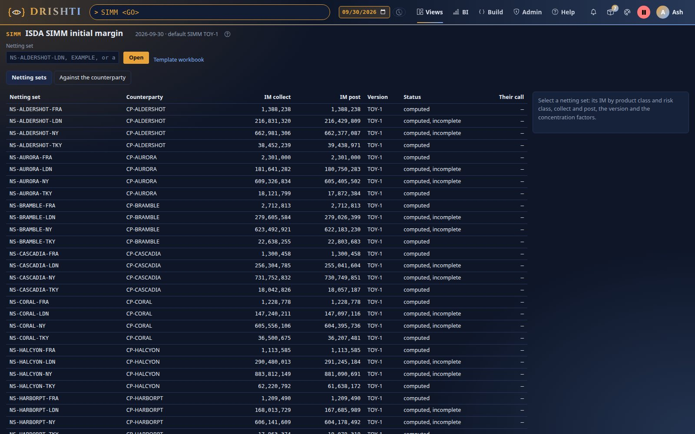
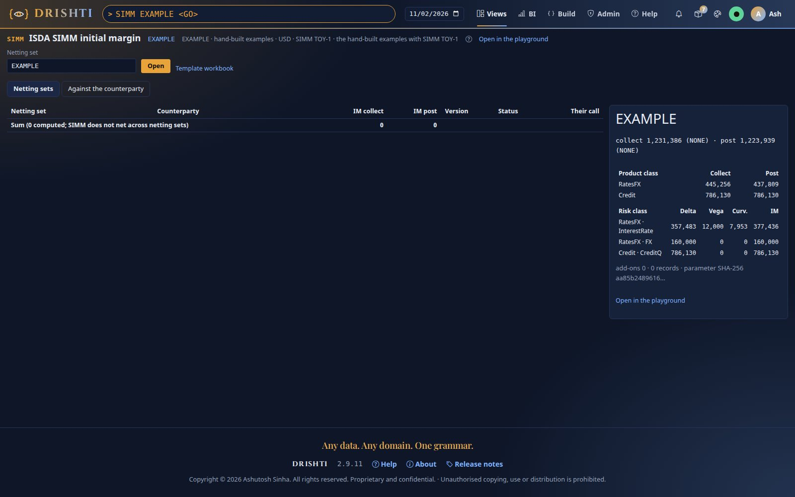
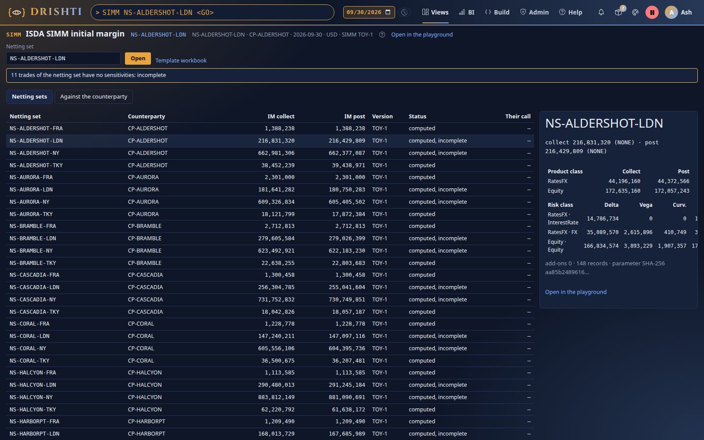
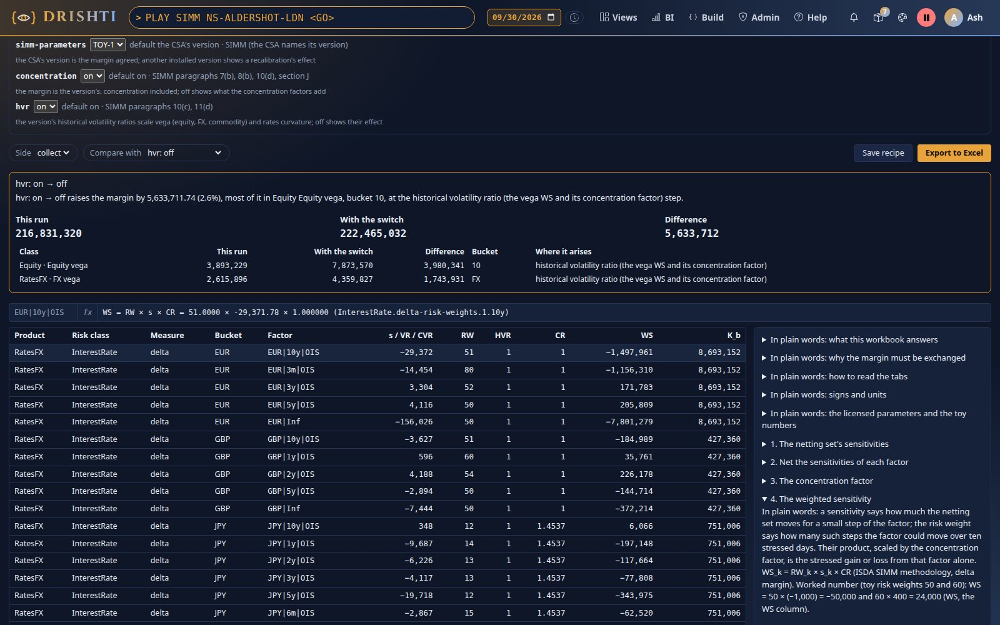
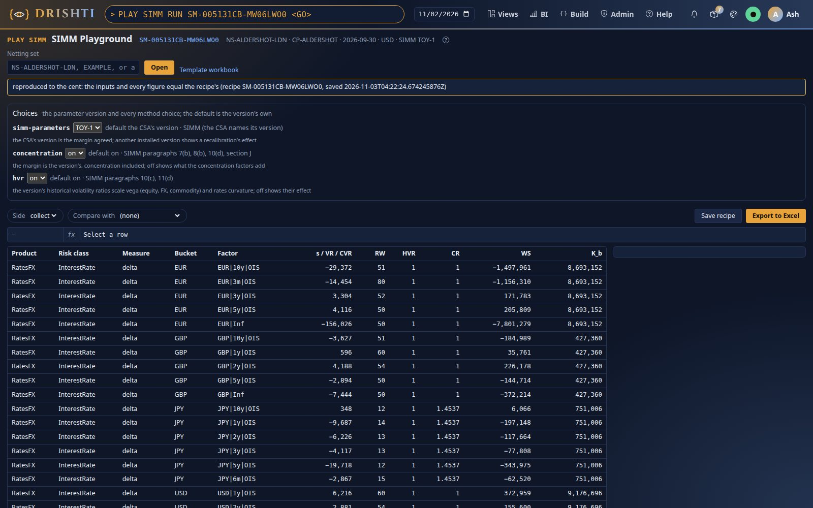
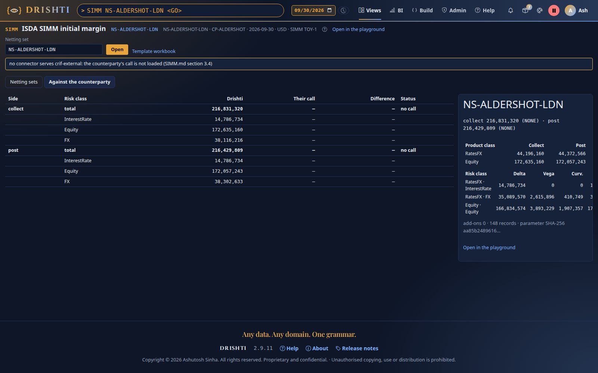

<!--
  Project Drishti · Any data. Any domain. One grammar.

  Copyright (c) 2026 Ashutosh Sinha <ajsinha@gmail.com>.
  All rights reserved.

  PROPRIETARY AND CONFIDENTIAL.

  This file is the confidential and proprietary property of Ashutosh Sinha.
  Unauthorised copying, use, modification, distribution or disclosure of this
  file, via any medium, is strictly prohibited except with the express prior
  written permission of the copyright holder.

  See the LICENSE file in the root of this repository for the full terms.
-->
# SIMM guide: ISDA SIMM initial margin per netting set, collect and post

Drishti computes ISDA SIMM the way it computes VaR and FRTB-SA: **from trade-grain inputs, when asked, never stored as a figure.** The input
is the same table of position sensitivities FRTB-SA reads; the factor dictionary maps each factor to SIMM's terms (the CRIF risk type,
qualifier, bucket and labels); the netting-set master gives each netting set its trades, and the CSA its SIMM version, regimes,
calculation currency and add-ons. **ISDA's numbers are licensed: Drishti ships none.** The bank installs its licensed parameter file, one
per SIMM version; until it does, no SIMM figure is computed. Every figure opens in a playground that shows the same calculation as
spreadsheet formulas, with the method choices as switches you can flip, compare and reproduce. The tutorial is
[the SIMM tutorial](SIMM_GUIDE.md); the data contract is [SIMM.md](../contracts/SIMM.md); the
design behind it is [SENSITIVITIES_AND_FRTB_SA.md section 8](#5-the-method).

## Contents

- [1. What SIMM answers](#1-what-simm-answers)
- [2. The figures at a glance](#2-the-figures-at-a-glance)
- [3. The inputs and their data contract](#3-the-inputs-and-their-data-contract)
- [4. The licensed parameter file](#4-the-licensed-parameter-file)
- [5. The method](#5-the-method)
- [6. Collect, post and the regimes](#6-collect-post-and-the-regimes)
- [7. Scopes and the SIMM screen](#7-scopes-and-the-simm-screen)
- [8. The SIMM Playground (PLAY SIMM)](#8-the-simm-playground-play-simm)
- [9. API, command line and settings](#9-api-command-line-and-settings)
- [10. The hand-built cases](#10-the-hand-built-cases)
- [11. Refusals and error codes](#11-refusals-and-error-codes)
- [12. What is not built yet](#12-what-is-not-built-yet)
- [13. SIMM data: every dataset the engine reads](#13-simm-data-every-dataset-the-engine-reads)

## 1. What SIMM answers

*How much initial margin should we collect from and post to this counterparty under this netting set today, what drives it, and why does
it differ from the counterparty's figure?* Initial margin (IM) is the collateral each side of uncleared derivatives holds against the
other, sized to cover the loss on the netting set's trades over the ten days it takes to replace them after a default. The BCBS-IOSCO
margin rules require it both ways; ISDA's Standard Initial Margin Model (SIMM) is the formula the industry agreed, so both sides get
nearly the same figure from the same sensitivities. A difference beyond the CSA's tolerance is a dispute.

SIMM starts from the netting set's sensitivities (how much it gains or loses when each factor moves a small step), multiplies each by a
risk weight and a concentration factor, adds the weighted figures up with ISDA's correlations, combines the risk classes within each
product class, and adds the product classes. The CSA's add-ons come on top.

## 2. The figures at a glance

| Figure | Meaning | Rule (SIMM 2.8+2512) |
|---|---|---|
| `s_k` | a factor's sensitivity, netted over the netting set's trades of one product class, in SIMM's units | paragraphs 7, 8 |
| `CR` | the concentration factor `max(1, √(|Σ s| / T_b))` at the rules' grain (section 5.1) | 7(b), 8(b), section J |
| `WS_k` | the weighted sensitivity `RW_k × s_k × CR` | 7, 8 |
| `K_b` | the bucket's margin `√(Σ WS² + Σ ρ_kl f_kl WS_k WS_l)`, `f_kl = min(CR_k, CR_l)/max(CR_k, CR_l)` (1 for rates) | 7(c), 8(c) |
| `S_b` | the bucket's net, **always** capped at ±K_b | 7(d), 8(d) |
| Delta, Vega | `√(Σ K_b² + Σ γ_bc g_bc S_b S_c) + K_residual` (g_bc for rates, the residual bucket outside the root) | 7(d), 8(d), 10 |
| Curvature | `max(Σ CVR + λ √(Σ K_b² + Σ γ² S_b S_c), 0)` + the residual alone; rates × HVR_IR⁻² | 11 |
| `IM_r` | a risk class's margin: delta + vega + curvature + base correlation | 5 |
| `SIMM_p` | a product class's margin `√(Σ_r Σ_s ψ_rs IM_r IM_s)` | 6, section K |
| SIMM | the four product classes **added**, with no correlation between them | 6 |
| IM | SIMM + the CSA's add-ons; collect and post computed separately | section L |

All money is in the CSA's calculation currency (USD unless the CSA says otherwise); every sensitivity is converted at the date's FX before
anything is added, and the thresholds (set in the parameter file's currency) are converted the same way.

## 3. The inputs and their data contract

The contract (the CRIF mapping, the CSA terms, the add-on lines, the counterparty's call, every check) is [SIMM.md](../contracts/SIMM.md).

| Input (kind) | What SIMM reads |
|---|---|
| [`position-sensitivity`](../contracts/samples/market-risk.md#position-sensitivity) ([contract](../contracts/packs/market-risk.md#sens-position-sensitivities-position-sensitivity)) (SENS) | the elements with measures `DV01`, `IE01`, `CS01`, `DELTA`, `VEGA` (with `IMPLIED_VOL`) and `BASE_CORR`; curvature revaluations and gammas are FRTB's and left out, counted |
| [`risk-factor`](../contracts/samples/market-risk.md#risk-factor) ([contract](../contracts/packs/market-risk.md#rfac-risk-factor-dictionary-risk-factor)) (RFAC) | each factor's `SIMM_RISK_CLASS`, `FACTOR_TYPE`, `SIMM_BUCKET`, `QUALIFIER`, `SIMM_LABEL1`, `SIMM_LABEL2`, `SENIORITY` |
| [`netting-set`](../contracts/samples/counterparty-risk.md#netting-set) ([contract](../contracts/packs/counterparty-risk.md#nset-netting-set-netting-set)) (NSET) | `NETTING_SET_ID`, `TRADE_IDS` (else `TRADES[].TRADE_ID`), `COUNTERPARTY`, `CSA` |
| `csa` (CSA) | the SIMM terms when present: `SIMM_VERSION`, `IM_COLLECT_REGIMES`, `IM_POST_REGIMES`, `IM_CALCULATION_CURRENCY` (else `CSA_CURRENCY`), `IM_MODEL` (`SIMM` or `SCHEDULE`), `IM_FIXED_ADDON`, `IM_PRODUCT_MULTIPLIERS`, `IM_ADDON_FACTORS`, `IM_DISPUTE_TOLERANCE` |
| `simm-addon` (optional) | `TRADE_ID`, `PRODUCT`, `NOTIONAL`, `CURRENCY`: the notional add-on lines |
| `crif-external` (optional) | the counterparty's call: `HEADER` rows with `NETTING_SET`, `DIRECTION`, `SOURCE`, `IM_TOTAL` and `IM_<RISKCLASS>` |
| `simm` (stored) | the stored figures, shown labelled *stored, not computed* for netting sets without sensitivities |
| [`fx-spot`](../contracts/samples/market-data.md#fx-spot) ([contract](../contracts/packs/market-data.md#fx-fx-spot-rate-fx-spot)) | the date's FX |

### 3.1 Units

SIMM takes the delivered units: `DV01`, `IE01`, `CS01` per basis point; `DELTA` per 1 % relative move. Vega risk:

```
rates and credit              VR = VEGA × 100 × IMPLIED_VOL                          (σ the implied volatility)
equity, FX and commodity      VR = HVR × VEGA × σ,  σ = RW_delta × √(365/14) / Φ⁻¹(99 %)   (σ from the delta risk weight)
```

### 3.2 The netting set's trades and the product classes

A sensitivity record belongs to the netting set its trades lie in (the record's `TRADE_ID` and `TRADE_IDS` against the netting sets'
trades on the date). A position record whose trades span two netting sets is left out of SIMM and counted (`DRS-5335`): such a source
must send by trade. A trade listed in two netting sets is kept in both and flagged (`DRS-5332`). The netting set's trades with no
sensitivities are counted; the answer is labelled *incomplete* (SIMM of the trades that have them).

### 3.3 Product classes

Each record's `PRODUCT_GROUP` maps to one product class (`drishti.simm.product-classes`; the built-in mapping: Rates, Inflation, Money
market, FX, Fixed income, Securities financing, Structured → `RatesFX`; Credit → `Credit`; Equity → `Equity`; Commodity → `Commodity`;
anything else → `drishti.simm.default-product-class`). Every risk of the trade stays in its product class: an equity swap's rates delta is
in `Equity` (paragraph 6).

## 4. The licensed parameter file

ISDA publishes SIMM's methodology; its calibrated numbers are licensed per version. The structure Drishti reads is
[`docs/architecture/capital-parameters/simm.yaml`](../architecture/capital-parameters/simm.yaml), **shipped with every number empty**.

**To install a version:** copy the structure once per version into `drishti.simm.parameters-dir` (default `./config/simm`), fill
`version`, `effective-from` and every `null` from the licensed methodology, and restart. At start the engine reads every `*.yaml` there,
checks every number and range (correlation matrices symmetric with a unit diagonal), and lists each file in `GET /api/v1/risk/simm/versions`:
installed with its SHA-256, or refused with every missing key (`DRS-5333`). A refused file never stops the server. A netting set is
computed with the version its CSA names; a CSA naming none (and an analytic scope) uses `drishti.simm.default-version`, else the installed
version with the latest effective date. A changed file is a new version; every answer, export and recipe carries the version and the
file's SHA-256, and a recipe keeps the file itself.

**Units in the file.** Rates and credit delta risk weights per bp; equity, commodity and FX delta risk weights per 1 % (as ISDA states
them: 25 for 25 %); vega risk weights, correlations and HVRs as fractions; concentration thresholds in the file's
`calculation-currency` per bp (rates, credit) or per 1 % (equity, commodity, FX) for delta and in the currency for vega. ISDA states the
thresholds in millions: multiply by 1,000,000.

**The keys.** Every number has a key, the one the playground's Config tab shows and an override names: `InterestRate.delta-risk-weights.1.5y`,
`InterestRate.tenor-correlation.5y.10y`, `InterestRate.concentration-thresholds.delta.<group>`, `CreditQ.correlation.different-issuer`,
`CreditQ.across-buckets.3.7`, `Equity.correlation.4`, `FX.delta-risk-weights.regular-high`, `risk-class-correlation.InterestRate.FX`.
`InterestRate.threshold-groups` and `FX.threshold-groups` list the currencies of each concentration group (any other: `other`);
`FX.high-volatility-currencies` lists the high-volatility currencies; `Equity.zero-curvature-buckets` names the volatility-index bucket.

**Licence.** The parameter values appear only in the bank's own answers, exports and recipes, never in a shared template, a sample or the
repository; the playground's export says it is confidential. The repository's tests use a **toy** file
(`modules/banking/banking-compute/src/test/resources/simm/simm-toy.yaml`, round illustrative numbers, not ISDA's): it proves the formulas, never the
licensed values.

## 5. The method

Per netting set, product class and risk class ([design section 8](#5-the-method), checked
against SIMM 2.8+2512 in its section 18).

### 5.1 Delta and the concentration grains

| Risk class | Factor | Bucket (the aggregation) | Concentration grain |
|---|---|---|---|
| InterestRate | currency × tenor × sub-curve; the currency's inflation; its cross-currency basis | the currency (its volatility group picks the risk weights) | the currency: every vertex and sub-curve, inflation in, basis out (and not scaled) |
| CreditQ, CreditNonQ | issuer and seniority × tenor (bond and CDS curves net) | SIMM's bucket; `Residual` outside the root | the issuer and seniority, over all its tenors |
| Equity | the name (spot) | SIMM's bucket; `Residual` outside the root | the name |
| Commodity | the commodity (its tenors added) | SIMM's bucket | the commodity |
| FX | the currency against the calculation currency (the calculation currency itself left out) | one group; ρ by the two currencies' groups and the calculation currency's | the currency |

Within a rates bucket ρ is the tenor correlation, times φ between two sub-curves; inflation and basis have their own ρ; `f = 1`. Across
currencies `γ × g_bc`, `g_bc = min(CR_b, CR_c)/max(CR_b, CR_c)`. Credit's ρ depends on whether two factors share the issuer; equity's and
commodity's on the bucket.

### 5.2 Vega

`VR_k` (section 3.1) netted per factor (rates: currency × expiry; credit: issuer × expiry; equity, commodity, FX: the name, commodity or
currency over its expiries), `WS = VRW × VR × VCR` with the vega concentration factor at the same grains against the vega thresholds; then
as delta (f_kl from the VCRs, g_bc for rates, the residual outside the root).

### 5.3 Curvature

From the same vegas: `CVR_k = Σ SF(t) × σ × ∂V/∂σ`, `SF(t) = 0.5 × min(1, 14 / t_days)` (365 days a year), no HVR, no concentration, zero for
equity bucket 12 (volatility indices). Within a bucket ρ²; across γ² with S_b capped; over the non-residual buckets
`θ = min(Σ CVR / Σ |CVR|, 0)`, `λ = (Φ⁻¹(99.5 %)² − 1)(1 + θ) − θ`, `max(Σ CVR + λ K, 0)`; the residual bucket the same on its own; the two
added; rates' curvature × HVR_IR⁻².

### 5.4 Base correlation, risk classes, product classes, add-ons

`BASE_CORR` elements (CreditQ only): `WS = RW × s` per index family, ρ between families, no concentration. `IM_r` adds a risk class's
four margins; within a product class the six risk classes combine with ψ; the four product classes add. The CSA's add-ons:
`fixed amount + Σ factor_product × |notional| + Σ_p (MS_p − 1) × SIMM_p`, each multiplier at least 1 (a smaller one refuses the run).

## 6. Collect, post and the regimes

| Figure | Rule |
|---|---|
| Collect | from the bank's sensitivities under the regimes the CSA lists for collection (`IM_COLLECT_REGIMES`); the first regime the version recognises is the binding one shown |
| Post | from the counterparty's side: every sensitivity negated, under `IM_POST_REGIMES` |
| No regime | `NONE` |
| Symmetry | delta and vega give the same margin both ways; curvature does not (θ and the floor), so collect and post differ for option-heavy netting sets |

A regime code the version does not recognise (its `regimes` list) is ignored and named (`DRS-5334`). Every regime's trades are the netting
set's SIMM trades until the trade master carries each trade's regime eligibility (section 12).

## 7. Scopes and the SIMM screen

| Scope | Meaning |
|---|---|
| a netting set (`NS-…`) | **the margin**: its trades, its CSA's version, regimes, currency and add-ons |
| `CPTY <id>` | the counterparty's netting sets, each computed alone and listed with their sum (SIMM never nets across netting sets) |
| any VaR scope (`DESK:DESK-RATES`, `BANK`, …) | an **analytic**: SIMM of those trades as one portfolio with the default version, no regime, USD; labelled *analytic, not a margin* |
| `EXAMPLE` | the hand-built examples of section 10 with the version asked for |

**`SIMM <GO>`** opens the SIMM screen (the decided mock-up A): every netting set of the date with its IM to collect and post, the
version and its status (*computed*, *computed, incomplete*, *stored, not computed*, or why not computed), the counterparty's call when
loaded, and the sums. Select a netting set: its IM by product class and by risk class (delta, vega, curvature), both sides, the add-ons
and the parameter file's checksum. **`SIMM <netting set>`** opens it selected; **`SIMM CPTY <id>`** lists one counterparty's netting sets.
The **Against the counterparty** tab (mock-up C) puts Drishti's IM beside the counterparty's call, the difference by risk class and the
status (*agreed*, *within tolerance*, *dispute*, *no call*); Drishti never recomputes the counterparty's figure. F1 opens this guide.

## 8. The SIMM Playground (PLAY SIMM)

**`PLAY SIMM <netting set> <GO>`** opens the playground on the VaR Playground's frame: the grid of weighted sensitivities, vega risks and
curvature risks bucket by bucket with RW, HVR, CR, WS and K_b; the formula bar shows the selected row's formula; the explanation beside it
opens the step that produced it.

### 8.1 Critique: the Choices panel

| Switch | Default | Alternatives | Rule |
|---|---|---|---|
| `simm-parameters` | the CSA's version | another installed version (a recalibration's effect) | the CSA |
| `concentration` | `on` (the version's thresholds) | `off` (every CR and VCR 1: what concentration adds) | 7(b), 8(b), 10(d), section J |
| `hvr` | `on` (the version's HVRs) | `off` (every HVR 1) | 10(c), 11(d) |
| side | `collect` | `post` (every sensitivity negated) | SIMM.md section 6.8 |
| overrides | none | any parameter by its key, `key=value` (`InterestRate.concentration-thresholds.delta.1=3000`) | not the regulatory figure |

**Compare with** flips one switch and shows both runs side by side: the totals and, per product class, risk class and measure, the
difference with the bucket and the step where it arises (the concentration factor, the weighted sensitivity, the bucket's K, the sum
across buckets, or the curvature), in words (the demo's NS-ALDERSHOT-LDN with the toy file): *"concentration: on → off lowers the margin by 158,874,416.12 (73.3%), most of
it in Equity Equity delta, bucket 8, at the concentration factor (WS) step."*

### 8.2 Reproduce: recipes

**Save recipe** keeps the run: the netting set and date, the knowledge time the inputs were read at, the digest of the engine's input,
the parameter file itself (its bytes and SHA-256; the bank's licensed file stays on the bank's server), the version, the switches and
overrides, the engine version and every figure of both sides. It gets an id (`SM-…`); **`PLAY SIMM RUN <id> <GO>`** (or
`drishti.py play simm --recipe <id>`) reads the inputs as known then, runs the recorded parameter file and choices, and compares:
*reproduced to the cent* when the input digest and every figure are equal, otherwise the differences named. Every export saves a recipe.

### 8.3 The workbook of live formulas

**Export to Excel** downloads the workbook for what is on screen (up to `drishti.simm.max-factors` factors):

| Tab | What |
|---|---|
| Main | per product class, risk class and measure the margin, the SIMM per product class, SIMM, the add-ons and IM, each beside the engine's collect and post figures with a check against the side Config is on; the switches as exported and as they stand; each one-switch alternative with the engine's IM and a check |
| Config | the switches `concentration`, `hvr` and `side` as drop-down cells; Φ⁻¹(99 %), Φ⁻¹(99.5 %) and the threshold FX; every parameter the netting set uses, by its key, with what it is |
| Data | the sensitivities in the calculation currency, their SIMM risk, the conversion (100 × σ, or RW × √(365/14) / Φ⁻¹(99 %)), the part of `s` (negated when the side is post), the curvature risk, SF(t) and the CVR part |
| WS | per factor: the netted `s` (`SUMIFS` over Data), RW, HVR, the grain's sum (`SUMIFS`), the threshold, CR, WS |
| Buckets | per bucket: the ρ·f matrix as formulas on Config and the CRs, the terms by `SUMPRODUCT`, K_b, the net and the capped S_b |
| Classes | per charge: γ (× g_bc for rates) across buckets, the terms, the root, the residual, the margin; per product class the IM per risk class, ψ and SIMM_p |
| Curvature | the CVRs (`SUMIFS` over Data), the buckets with ρ², the classes with γ², θ, λ, the residual and the HVR_IR⁻² scale |
| Add-ons | the fixed amount, the notional lines and the product-class multipliers |
| Explain, Provenance | the method in plain words; the inputs, batches, the CSA's terms, the version and its checksum, the recipe |

Flip a switch in Config, or the side, and the workbook recomputes **without Drishti**; Main then checks against the engine's own figure for
that alternative. The formulas use only functions Excel, LibreOffice and Google Sheets share. A test recalculates the workbook in
headless LibreOffice and compares it with the engine to the cent: two demo netting sets with both sides, each switch flipped, and the
hand-built examples with every add-on. **Template workbook** (`/api/simm/template.xlsx`) is the same workbook on the hand-built examples
with **every parameter cell empty**: the shared template never holds a licensed number.

## 9. API, command line and settings

| What | API | Command | CLI |
|---|---|---|---|
| A netting set's IM, collect and post | `GET /api/v1/risk/simm?nettingSet=…` | `SIMM <netting set>` | `drishti.py simm show <netting set>` |
| Every netting set (or a counterparty's) | `GET /api/v1/risk/simm/netting-sets?counterparty=…` | `SIMM`, `SIMM CPTY <id>` | `drishti.py simm list` |
| The steps | `GET /api/v1/risk/simm/explain?nettingSet=…&direction=post&class=Equity` | in SIMM | `drishti.py simm explain <netting set>` |
| Against the counterparty's call | `GET /api/v1/risk/simm/against?nettingSet=…` | the second tab | `drishti.py simm against <netting set>` |
| The installed versions | `GET /api/v1/risk/simm/versions` | | `drishti.py simm versions` |
| The playground, a comparison | `GET /api/v1/risk/simm/playground?nettingSet=…&compare=hvr=off&side=post` | `PLAY SIMM <netting set>` | `drishti.py play simm <netting set> --compare hvr=off` |
| The workbook | `GET /api/v1/risk/simm/playground.xlsx?nettingSet=…&side=…` | Export to Excel | `drishti.py play simm <netting set> --xlsx f.xlsx` |
| The empty template | `GET /api/v1/risk/simm/playground/template` | Template workbook | |
| Save a recipe; replay it | `POST /api/v1/risk/simm/playground/recipes?nettingSet=…`; `GET …/recipes/{id}` | Save recipe; `PLAY SIMM RUN <id>` | `--save`; `--recipe <id>` |

Every SIMM endpoint takes `version`, `concentration`, `hvr`, `override=key=value` (repeatable) and `asOf`; `nettingSet` is also `scope`.
The answer is the computed kind `simm-result` of [SIMM.md section 9.1](../contracts/SIMM.md#91-the-headline-and-the-computed-kind-simm-result):
`IM_COLLECT`, `IM_POST`, the binding regimes, `SIMM_*` and `ADDON_*`, `BY_PRODUCT_CLASS`, `BY_RISK_CLASS`, `SIMM_VERSION`,
`PARAMETER_SHA256`, `MISSING_TRADES`, `SWITCHES`, `OVERRIDES`, `REGULATORY` and the `PROVENANCE` (the date, the batches, the netting set,
the CSA's terms used, the version and the file's checksum, the choices, what was left out and why).

**Settings** (`drishti.simm.*` in the engine's own file `config/engines/simm.yaml`, all in [CONFIGURATION.md](../admin/CONFIGURATION.md)): the switch `drishti.engines.simm.enabled` (default true; the old name `drishti.simm.enabled` still works; off, every request answers
`404 DRS-1020` and SIMM disappears from the console, [OPERATIONS_GUIDE.md section 21](ADMIN_GUIDE.md#21-compute-engines-on-or-off)), `parameters-dir`, `default-version`, `netting-set-kind`, `csa-kind`, `add-on-kind`, `external-kind`, `stored-kind`,
`product-classes`, `default-product-class`, `max-factors` (1,500), `recipes-dir` (under the data folder), `cache-minutes`,
`playground-template`. The sensitivity and dictionary kinds are FRTB-SA's (`drishti.frtb.sensitivity-kind`, `factor-kind`).

## 10. The hand-built cases

With the **toy** parameter file (not ISDA's): each is a unit test of the engine to the cent; the worked netting set, the swaption and
case 11 together are the `EXAMPLE` scope.

| Case | Inputs (toy parameters) | Result |
|---|---|---|
| 6, the bucket | USD 5y DV01 −1,000 (RW 50) and 1y +400 (RW 60), ρ 0.8, CR 1 | K = √(50,000² + 24,000² − 2 × 0.8 × 50,000 × 24,000) = 34,000 |
| 6, the product class | rates IM 50,000 and CreditQ IM 30,000 in one product class, ψ 0.3 | SIMM_p = 65,574.39 |
| 11 | one credit bucket (T 1,000 per bp, RW 100, ρ 0.4 between issuers): issuer X nets −4,000 (CR 2), Y +1,000 (CR 1), f 0.5 | K = 786,129.76 (a bucket-level factor would give another figure) |
| SIMM.md section 15 | RatesFX: USD 5y +10,000, 10y −6,000 (RW 50, 51, ρ 0.94), EUR 2y +4,000 (RW 54), FX EUR +20,000 per 1 % (RW 8); γ 0.30, ψ(IR, FX) 0.25 | K_USD 236,634.74, S_USD 194,000, Delta_IR 357,483.43, Delta_FX 160,000, SIMM_RatesFX 426,606.46, collect = post |
| the same, USD threshold 3,000 | `InterestRate.concentration-thresholds.delta.1=3000` | CR_USD 1.154701, K_USD 273,242.26, g 0.866025, Delta_IR 382,700.58, SIMM 450,195.27 |
| the swaption | USD 1y expiry, VEGA 2,000 per point at 20 % (toy vega RW 0.3, HVR_IR 0.8) | VR 40,000, vega margin 12,000; CVR 767.12, θ 0, λ 5.634897, 5,089.78 × 0.8⁻² = 7,952.79 collect; posted θ −1, λ 1, curvature 0 |
| `EXAMPLE` | the three together | IM collect 1,231,385.86 (RatesFX 445,256.10 + Credit 786,129.76), post 1,223,938.71 |

## 11. Refusals and error codes

| Code | What | Outcome |
|---|---|---|
| `DRS-5331` | a factor with no SIMM mapping, a tenor or expiry not on SIMM's vertices, a bucket not in the version, an equity repo (left out: the version's CRIF rule is open), a measure the class does not have | the element is left out of SIMM, counted and named in the provenance |
| `DRS-5332` | a trade in two netting sets on the date | kept in both, flagged |
| `DRS-5333` | the CSA's version is not installed, or its file is incomplete (every missing key named); answered `422`, and the SIMM pages say that SIMM needs the licensed ISDA parameter files | the netting set is not computed |
| `DRS-5334` | a regime code the version does not recognise | ignored and listed |
| `DRS-5335` | a position record whose trades span netting sets | the record is left out of SIMM, counted |
| `DRS-5336` | a rates or credit vega without `IMPLIED_VOL` | the element is left out, counted |
| `DRS-5324` | no FX rate for an element's (or an add-on line's) currency | the element is left out, counted |

The sensitivity load's own refusals (`DRS-5321` to `DRS-5326`, [FRTB_SA_GUIDE.md section 11](FRTB_SA_GUIDE.md#11-refusals-and-error-codes))
hold. A switched-off engine answers `403` (`drishti.simm.enabled`); a schedule-IM CSA answers `400`.

## 12. What is not built yet

- The contributions and incremental IM of SIMM.md section 9.2 (the marginal IM of each trade, a candidate trade's IM).
- Regime eligibility per trade: each regime's trades are the netting set's SIMM trades; cleared trades and schedule-IM trades are not yet
  told apart on the trade master (the CSA's `IM_MODEL` refuses a schedule-IM netting set as a whole).
- The CRIF export of a netting set and the line-level comparison with the counterparty's CRIF (the comparison by risk class is built).
- The CSA's SIMM terms are read when the CSA records carry them; the `csa` contract does not list them yet (SIMM.md section 16, question 1).
- Equity repo (the version's CRIF rule), SIMM-only vertices (`2w`, `1m`) delivered as their own factors, credit look-through of indices.
- The official SIMM capture (a daily `simm-result` per netting set) and the retirement of the stored `simm` figures.

## 13. SIMM data: every dataset the engine reads

Every dataset the SIMM engine reads, what it is for, whether it is required, where its sample lives, and the links to its two homes: its **data contract** (the fields, the key, the rules: the pack's contract page and its `<kind>.contract.yaml`) and its **example** (a real record of the shipped synthetic test data, every field explained, on [docs/contracts/samples](../contracts/samples/README.md)). This guide copies neither. How files are named, dated and loaded is
[DATA_LAKE_GUIDE.md](DATA_LAKE_GUIDE.md#5-routing-business-dates-modes-repeats-and-undo).

<!-- The block below is generated by tools/docs/guide_data.py from tools/docs/guide_data.yaml: edit the spec, not the block. -->
<!-- guide-data:begin simm -->
### 13.1 At a glance

| Dataset (kind) | What it is for | Required? | Sample files (`data/testdata/…`) | Guide |
|---|---|---|---|---|
| [The parameter file](#132-the-parameter-file-isdas-risk-weights-and-correlations) | the risk weights, correlations and thresholds of the SIMM version | **yes** (the bank's licensed file) | no sample in the demo data | [4](#4-the-licensed-parameter-file) |
| [`position-sensitivity`](#133-position-sensitivity-the-sensitivities) | the delta and vega elements of each trade or position | **yes** | `market-risk/position-sensitivity/position-sensitivity.*.jsonl.gz` | [3](#3-the-inputs-and-their-data-contract) |
| [`risk-factor`](#134-risk-factor-the-factor-dictionary) | each factor's SIMM risk class, bucket and labels | **yes** | `market-risk/risk-factor/risk-factor.*.jsonl.gz` | [3](#3-the-inputs-and-their-data-contract) |
| [`netting-set`](#135-netting-set-the-netting-sets-and-their-trades) | which trades a netting set holds, its counterparty and CSA | **yes** | `counterparty-risk/netting-set/netting-set.*.jsonl.gz` | [3.2](#32-the-netting-sets-trades-and-the-product-classes) |
| [`csa`](#136-csa-the-simm-terms) | SIMM version, collect and post regimes, calculation currency, add-ons | optional (the SIMM terms when present) | `counterparty-risk/csa/csa.*.jsonl.gz` | [3](#3-the-inputs-and-their-data-contract) |
| [`simm-addon`](#137-simm-addon-the-notional-add-on-lines) | the notional add-on per trade | optional | no sample in the demo data | [3](#3-the-inputs-and-their-data-contract) |
| [`crif-external`](#138-crif-external-the-counterpartys-call) | the counterparty's own SIMM, for the comparison | optional | no sample in the demo data | [3](#3-the-inputs-and-their-data-contract) |
| [`simm`](#139-simm-the-stored-figures) | stored figures, shown *stored, not computed* for netting sets without sensitivities | optional | `counterparty-risk/simm/simm.*.jsonl.gz` | — |
| [`fx-spot`](#1310-fx-spot-the-dates-fx) | converting sensitivities and thresholds to the calculation currency | for other currencies | `market-data/fx-spot/fx-spot.*.jsonl.gz` | — |

### 13.2 The parameter file: ISDA's risk weights and correlations

The SIMM version's risk weights, correlations, concentration thresholds and the add-on settings. Drishti ships the file's shape only.

- **Data contract:** not a dataset kind; a YAML file the engine reads (`docs/architecture/capital-parameters/simm.yaml`).
- **Example:** none: the shipped file has every number empty, because ISDA's parameters are licensed; the bank installs its own
([section 4](#4-the-licensed-parameter-file)).

### 13.3 `position-sensitivity`: the sensitivities

The same records FRTB-SA reads: SIMM takes the elements with measures `DV01`, `IE01`, `CS01`, `DELTA`, `VEGA` and `BASE_CORR`;
curvature revaluations and gammas are FRTB's and left out, counted.

- **Data contract:** [`position-sensitivity`](../contracts/packs/market-risk.md#sens-position-sensitivities-position-sensitivity) (SENS), key `SENSITIVITY_ID`; 28 fields, 19 required; the file [`position-sensitivity.contract.yaml`](../../config/packs/banking/market-risk/contracts/position-sensitivity.contract.yaml).
- **Example:** [a real record of the test data, every field explained](../contracts/samples/market-risk.md#position-sensitivity) (files `data/testdata/market-risk/position-sensitivity/position-sensitivity.*.jsonl.gz`).

### 13.4 `risk-factor`: the factor dictionary

Each factor's `SIMM_RISK_CLASS`, `FACTOR_TYPE`, `SIMM_BUCKET`, `QUALIFIER`, `SIMM_LABEL1`, `SIMM_LABEL2` and `SENIORITY`.

- **Data contract:** [`risk-factor`](../contracts/packs/market-risk.md#rfac-risk-factor-dictionary-risk-factor) (RFAC), key `RISK_FACTOR`; 27 fields, 12 required; the file [`risk-factor.contract.yaml`](../../config/packs/banking/market-risk/contracts/risk-factor.contract.yaml).
- **Example:** [a real record of the test data, every field explained](../contracts/samples/market-risk.md#risk-factor) (files `data/testdata/market-risk/risk-factor/risk-factor.*.jsonl.gz`).

### 13.5 `netting-set`: the netting sets and their trades

A sensitivity record belongs to the netting set its trades lie in: `NETTING_SET_ID`, `TRADE_IDS` (else `TRADES[].TRADE_ID`),
`COUNTERPARTY` and `CSA`.

- **Data contract:** [`netting-set`](../contracts/packs/counterparty-risk.md#nset-netting-set-netting-set) (NSET), key `NETTING_SET_ID`; 19 fields, 18 required; the file [`netting-set.contract.yaml`](../../config/packs/banking/counterparty-risk/contracts/netting-set.contract.yaml).
- **Example:** [a real record of the test data, every field explained](../contracts/samples/counterparty-risk.md#netting-set) (files `data/testdata/counterparty-risk/netting-set/netting-set.*.jsonl.gz`).

### 13.6 `csa`: the SIMM terms

The CSA's SIMM terms when present: `SIMM_VERSION`, `IM_COLLECT_REGIMES`, `IM_POST_REGIMES`, `IM_CALCULATION_CURRENCY` (else
`CSA_CURRENCY`), `IM_MODEL`, the add-ons and the dispute tolerance.

- **Data contract:** [`csa`](../contracts/packs/counterparty-risk.md#csa-credit-support-annex-csa) (CSA), key `CSA_ID`; 18 fields, 18 required; the file [`csa.contract.yaml`](../../config/packs/banking/counterparty-risk/contracts/csa.contract.yaml).
- **Example:** [a real record of the test data, every field explained](../contracts/samples/counterparty-risk.md#csa) (files `data/testdata/counterparty-risk/csa/csa.*.jsonl.gz`).

### 13.7 `simm-addon`: the notional add-on lines

`TRADE_ID`, `PRODUCT`, `NOTIONAL`, `CURRENCY`: the notional add-on lines. None served: no notional add-on.

- **Data contract:** no data contract yet; the fields are listed in [SIMM.md](../contracts/SIMM.md).
- **Example:** no sample in the demo data.

### 13.8 `crif-external`: the counterparty's call

`HEADER` rows with `NETTING_SET`, `DIRECTION`, `SOURCE`, `IM_TOTAL` and `IM_<RISKCLASS>`. None served: the comparison says *no call*.

- **Data contract:** no data contract yet; the fields are listed in [SIMM.md](../contracts/SIMM.md).
- **Example:** no sample in the demo data.

### 13.9 `simm`: the stored figures

A netting set's initial margin as a source stored it: shown labelled *stored, not computed* where the netting set has no sensitivities.

- **Data contract:** [`simm`](../contracts/packs/counterparty-risk.md#simm-isda-simm-initial-margin-simm) (SIMM), key `CALC_ID`; 8 fields, 8 required; the file [`simm.contract.yaml`](../../config/packs/banking/counterparty-risk/contracts/simm.contract.yaml).
- **Example:** [a real record of the test data, every field explained](../contracts/samples/counterparty-risk.md#simm) (files `data/testdata/counterparty-risk/simm/simm.*.jsonl.gz`).

### 13.10 `fx-spot`: the date's FX

Today's rates: sensitivities in other currencies and the parameter file's thresholds are converted to the calculation currency.

- **Data contract:** [`fx-spot`](../contracts/packs/market-data.md#fx-fx-spot-rate-fx-spot) (FX), key `PAIR`; 11 fields, 11 required; the file [`fx-spot.contract.yaml`](../../config/packs/banking/market-data/contracts/fx-spot.contract.yaml).
- **Example:** [a real record of the test data, every field explained](../contracts/samples/market-data.md#fx-spot) (files `data/testdata/market-data/fx-spot/fx-spot.*.jsonl.gz`).
<!-- guide-data:end -->

## Tutorial: SIMM from the hand-built examples to a netting set

ISDA SIMM, the initial margin each side of uncleared derivatives holds against the other, computed by Drishti per netting set, collect
and post, from the same sensitivities FRTB-SA reads. In this tutorial you install a parameter version, run the hand-built examples (small
enough to check with a calculator), open a demo netting set both ways, read what concentration adds, flip a switch in the playground and
read the difference explained, download the workbook of live formulas and flip the side in it, save a recipe and replay it to the cent,
and put the margin beside the counterparty's call. Each step shows the UI, the command line and the YAML behind it; the reference is the
[SIMM guide](../guides/SIMM_GUIDE.md).

**About the numbers.** ISDA's SIMM parameters are licensed and Drishti ships none. This tutorial uses the **toy** parameter file of
Drishti's tests (round illustrative numbers, not ISDA's), so every figure below proves the arithmetic, never a real margin. With the
bank's licensed file installed the same steps give that version's margin.

### Time to complete

About 25 minutes.

### Before you start

- The position sensitivities and the factor dictionary in the lake (`drishti.py lake demo` loads `market-risk/position-sensitivity` and
  `market-risk/risk-factor` with the other risk kinds), and the counterparty-risk pack's netting sets and CSAs.
- An edition with the SIMM word and a role that sees the counterparty-risk and market-risk kinds.

### What you will learn

- where a SIMM version comes from and how the engine refuses an incomplete one;
- how the margin is built: netted sensitivities, concentration at the rules' grain, buckets, risk classes, product classes added;
- the SIMM screen (`SIMM`): every netting set with its IM to collect and post, a netting set's breakdown, the counterparty's call;
- the playground (`PLAY SIMM`): the switches, a comparison in words, the workbook with the side and the switches as live cells;
- recipes: a run saved and replayed to the cent (`PLAY SIMM RUN <id>`).

### Step 1 · Install a parameter version

**In the UI.** Type `SIMM <GO>`. With no version installed the screen says *no SIMM version is installed: the netting sets show the
stored figures until the bank's licensed parameter file is installed*, and each netting set with sensitivities reads *not computed:
DRS-5333 no SIMM version is installed …*.

**From the command line.** Install the toy file as a version (a bank copies its licensed file instead) and restart the server:

```bash
mkdir -p config/simm
cp modules/banking/banking-compute/src/test/resources/simm/simm-toy.yaml config/simm/
python3 tools/drishti.py simm versions
```

```text
/…/config/simm · default TOY-1
  TOY-1            simm-toy.yaml                installed, SHA-256 …
ISDA's SIMM parameters are licensed: Drishti ships none; the bank installs one file a version (docs/guides/SIMM_GUIDE.md section 4)
```

Copy the shipped structure `docs/architecture/capital-parameters/simm.yaml` beside it and restart: it is listed *refused: DRS-5333 SIMM (no
version) is refused: … is missing* (every number is empty on purpose); the server runs and TOY-1 stays the default.

**The YAML.** The folder is a setting; the file's numbers are keyed by the axes it names:

```yaml
drishti:
  simm:
    parameters-dir: ./config/simm        # one licensed file a SIMM version
    default-version: ""                  # blank: the installed version with the latest effective date
```

```yaml
InterestRate:
  tenors: [2w, 1m, 3m, 6m, 1y, 2y, 3y, 5y, 10y, 15y, 20y, 30y]
  delta-risk-weights:                    # per bucket, one per tenor (per bp): TOY, not ISDA's
    1: [100, 90, 80, 70, 60, 54, 52, 50, 51, 52, 53, 55]
  concentration-thresholds:
    delta: {1: 1000000, 2: 1000000, other: 20000}
```

**You should see** `TOY-1` listed as installed and the default in `simm versions`, and, after the restart, the SIMM screen's meta line reading *default SIMM TOY-1* above every netting set.



### Step 2 · The hand-built examples

`EXAMPLE` runs the contract's worked netting set (USD 5y +10,000 and 10y −6,000 per bp, EUR 2y +4,000, FX EUR +20,000 per 1 %), the
explanation's swaption (VEGA 2,000 per point at 20 %, one year to expiry) and the design's case 11 (two issuers in one credit bucket).

**In the UI.** Type `SIMM EXAMPLE <GO>`: the breakdown on the right reads collect 1,231,385.86, post 1,223,938.71.

**From the command line.**

```bash
python3 tools/drishti.py simm show EXAMPLE
```

```text
SIMM EXAMPLE · the hand-built examples with SIMM TOY-1 · the hand-built examples · USD · SIMM TOY-1
IM collect 1,231,385.86 (NONE) · IM post 1,223,938.71 (NONE) · add-ons 0.00 / 0.00
product class               collect                 post
RatesFX                  445,256.10           437,808.95
Credit                   786,129.76           786,129.76
product · risk class                  delta             vega        curvature                 IM
RatesFX · InterestRate           357,483.43        12,000.00         7,952.79         377,436.22
RatesFX · FX                     160,000.00             0.00             0.00         160,000.00
Credit · CreditQ                 786,129.76             0.00             0.00         786,129.76
```

Check two figures by hand. The USD bucket: WS 50 × 10,000 = 500,000 and 51 × (−6,000) = −306,000 with ρ 0.94, so
K = √(500,000² + 306,000² − 2 × 0.94 × 500,000 × 306,000) = 236,634.74; with EUR's K 216,000 and γ 0.30 on the capped nets 194,000 and
216,000, Delta_IR = 357,483.43. Case 11: issuer X nets −4,000 per bp against a threshold of 1,000, so CR_X = √4 = 2 and its WS doubles to
−800,000; with Y's 100,000, ρ 0.4 and f = 1/2, K = 786,129.76. The product classes add: 445,256.10 + 786,129.76 = 1,231,385.86. Collect and
post differ by the swaption's curvature (7,952.79 collect; posted, θ = −1 and λ = 1 make it 0) and RatesFX's ψ combination.

**The YAML.** Nothing to configure: `EXAMPLE` needs no data.

**You should see** collect 1,231,385.86 and post 1,223,938.71, RatesFX and Credit as the product classes, and the risk classes InterestRate, FX and CreditQ beneath.



### Step 3 · A netting set, both ways

**In the UI.** Type `SIMM <GO>`: every netting set of 2026-09-30, its IM to collect and post and its status. Select **NS-ALDERSHOT-LDN**:

| | Collect | Post |
|---|---|---|
| RatesFX | 44,196,160.25 | 44,372,565.60 |
| Equity | 172,635,159.90 | 172,057,243.48 |
| IM | 216,831,320.15 | 216,429,809.08 |

The status reads *computed, incomplete*: 11 of its 159 trades have no sensitivities. Each trade's risks stay in its product class
(paragraph 6): an equity trade's rates or FX sensitivity would be margined inside `Equity`, never offset against `RatesFX`.

**From the command line.**

```bash
python3 tools/drishti.py simm show NS-ALDERSHOT-LDN
python3 tools/drishti.py simm explain NS-ALDERSHOT-LDN --class FX --json
```

```text
SIMM NS-ALDERSHOT-LDN · CP-ALDERSHOT · 2026-09-30 · USD · SIMM TOY-1
IM collect 216,831,320.15 (NONE) · IM post 216,429,809.08 (NONE) · add-ons 0.00 / 0.00
product class               collect                 post
RatesFX               44,196,160.25        44,372,565.60
Equity               172,635,159.90       172,057,243.48
product · risk class                  delta             vega        curvature                 IM
RatesFX · InterestRate        14,786,733.98             0.00             0.00      14,786,733.98
RatesFX · FX                  35,089,570.30     2,615,896.04       410,749.46      38,116,215.80
Equity · Equity              166,834,574.41     3,893,228.65     1,907,356.84     172,635,159.90
11 trades of the netting set have no sensitivities: incomplete
```

The explanation's `concentration` list shows where the toy thresholds bind: FX EUR (net −539,871.57 per 1 % against 100,000: CR 2.323514),
CHF (CR 3.831517), CAD (CR 2.014499), and JPY's rates (net −42,267.16 per bp against 20,000: CR 1.453739, one factor for every JPY vertex).

**The YAML.** The CSA's SIMM terms, when its record carries them (here it does not: the version is the default, the regime `NONE`):

```yaml
# a csa record's SIMM terms (docs/contracts/SIMM.md section 4)
SIMM_VERSION: TOY-1
IM_COLLECT_REGIMES: [CFTC]
IM_POST_REGIMES: [EMIR]
IM_CALCULATION_CURRENCY: USD
IM_FIXED_ADDON: 1000000
IM_PRODUCT_MULTIPLIERS: {Equity: 1.1}
```

**You should see** NS-ALDERSHOT-LDN's IM of 216,831,320.15 to collect and 216,429,809.08 to post, RatesFX and Equity, and the status *computed, incomplete*.



### Step 4 · The playground: a switch flipped and explained

**In the UI.** Type `PLAY SIMM NS-ALDERSHOT-LDN <GO>`. The Choices panel holds `simm-parameters` (TOY-1), `concentration` and `hvr`, each
with its default, rule and why; the grid lists every weighted sensitivity with RW, HVR, CR, WS and its bucket's K. Select the first row:
the formula bar reads *WS = RW × s × CR = 51.0000 × -29,371.78 × 1.000000 (InterestRate.delta-risk-weights.1.10y)*. Choose **Compare with
→ hvr: off**:

*"hvr: on → off raises the margin by 5,633,711.74 (2.6%), most of it in Equity Equity vega, bucket 10, at the historical volatility ratio
(the vega WS and its concentration factor) step."*

**From the command line.**

```bash
python3 tools/drishti.py play simm NS-ALDERSHOT-LDN --compare concentration=off
```

The last line: *concentration: on → off lowers the margin by 158,874,416.12 (73.3%), most of it in Equity Equity delta, bucket 8, at the
concentration factor (WS) step.* The toy thresholds are small on purpose, so concentration dominates.

**The YAML.** An override is any key of the version, typed for analysis and marked *not the regulatory figure*:

```bash
python3 tools/drishti.py simm show EXAMPLE --override InterestRate.concentration-thresholds.delta.1=3000
```

USD's single concentration factor becomes √(4,000 / 3,000) = 1.154701, g(USD, EUR) = 0.866025, Delta_IR 382,700.58 and RatesFX
450,195.27.

**You should see** the Choices panel, the grid of weighted sensitivities, the formula bar filled for the selected row, and the comparison with `hvr: off` in words above the grid.



### Step 5 · The workbook of live formulas

**In the UI.** In the playground, **Export to Excel**. Open the workbook: Main's band reads **ALL CHECKS PASS**; each charge, each product
class, SIMM and IM stand beside the engine's collect and post figures. On Config, set **side** to `post`: Data negates every sensitivity,
the curvature recomputes, and Main's checks now compare against the engine's post column (still passing). Set **concentration** to `off`:
every CR becomes 1, the band reads *SWITCHES CHANGED: SEE THE ALTERNATIVES*, and the alternatives block's `concentration = off` row checks
the workbook's IM against the engine's own figure for that switch.

**From the command line.**

```bash
python3 tools/drishti.py play simm NS-ALDERSHOT-LDN --side post --xlsx aldershot-ldn.xlsx
```

**The YAML.** The template the workbook is built from is a setting (blank: the built-in one); its explanation is
`modules/banking/banking-service/src/main/resources/playground/simm/template/explain.txt`:

```yaml
drishti:
  simm:
    max-factors: 1500                    # the most factors one grid and workbook holds
    playground-template: ""              # a bank's workbook template folder
```

The playground's **Template workbook** link downloads the same workbook on the hand-built examples with every parameter cell empty: the
shared template never holds a licensed number.

**You should see** **ALL CHECKS PASS** on Main, still passing with the side set to `post`, and *SWITCHES CHANGED: SEE THE ALTERNATIVES* once concentration is off.

### Step 6 · A recipe, replayed to the cent

**In the UI.** In the playground, **Save recipe**: *Saved as recipe SM-…: PLAY SIMM RUN SM-… computes it again to the cent*. Type
`PLAY SIMM RUN SM-… <GO>`: the notice reads *reproduced to the cent: the inputs and every figure equal the recipe's*. The recipe kept the
parameter file itself, so it reproduces even after the version is replaced.

**From the command line.**

```bash
python3 tools/drishti.py play simm NS-ALDERSHOT-LDN --concentration off --save
python3 tools/drishti.py play simm --recipe SM-…        # exit 0 when reproduced, 1 otherwise
```

**The YAML.** Recipes are kept under the data folder:

```yaml
drishti:
  simm:
    recipes-dir: ${drishti.data.dir:./data}/simm/recipes
```

**You should see** the notice *Saved as recipe SM-…* and, on the replay, *reproduced to the cent*.



### Step 7 · Against the counterparty's call

**In the UI.** On the SIMM screen open the **Against the counterparty** tab with NS-ALDERSHOT-LDN selected: Drishti's IM to collect and
post and, per risk class, the counterparty's figure, the difference and the status. Without a `crif-external` connector it reads *no call*
and says the call is not loaded.

**From the command line.**

```bash
python3 tools/drishti.py simm against NS-ALDERSHOT-LDN
python3 tools/drishti.py simm list --counterparty CP-ALDERSHOT
```

**The YAML.** The counterparty's call is a kind of its own (SIMM.md section 3.4), one `HEADER` row per netting set and direction:

```yaml
NETTING_SET: NS-ALDERSHOT-LDN
SOURCE: COUNTERPARTY
DIRECTION: COLLECT
ROW_TYPE: HEADER
IM_TOTAL: 216500000
IM_EQUITY: 172400000
```

**You should see** Drishti's IM to collect and post beside the counterparty's figure per risk class, or, with no `crif-external` connector, *no call* and the note that the call is not loaded.



### Next steps

- The [SIMM guide](../guides/SIMM_GUIDE.md): every formula, the parameter file's keys, the refusal codes and what is not built yet.
- The [data contract](../contracts/SIMM.md): the CRIF mapping, the CSA's terms and the computed kind `simm-result`.
- [The FRTB-SA tutorial](FRTB_SA_GUIDE.md): FRTB-SA from the same sensitivities.
