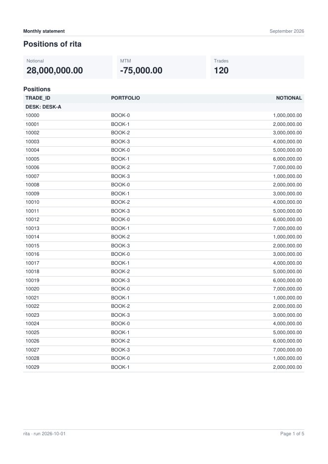
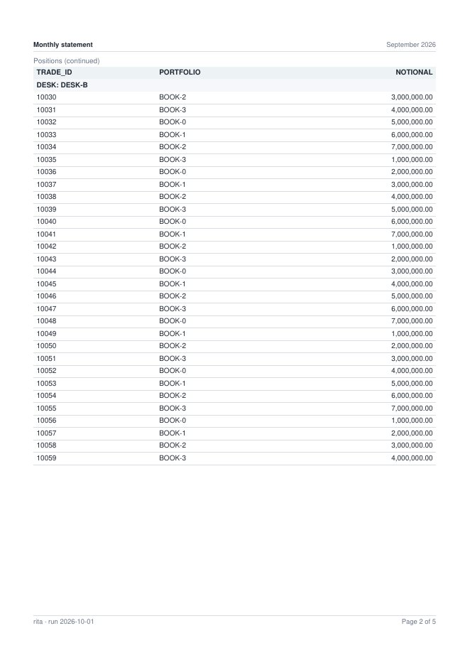

<!--
  Project Drishti · Any data. Any domain. One grammar.

  Copyright (c) 2026 Ashutosh Sinha <ajsinha@gmail.com>.
  All rights reserved.

  PROPRIETARY AND CONFIDENTIAL.

  This file is the confidential and proprietary property of Ashutosh Sinha.
  Unauthorised copying, use, modification, distribution or disclosure of this
  file, via any medium, is strictly prohibited except with the express prior
  written permission of the copyright holder.

  See the LICENSE file in the root of this repository for the full terms.
-->
# Statements: paginated reports, page-exact, one per reader

A **statement** is a report page laid out on paper (2.6.0, [BI_DESIGN.md §12.2](../architecture/BI_DESIGN.md#122-the-three-waves), wave D server item 1 and console
item 1): a monthly client statement, a desk's positions at month end, a regulatory schedule. Where a grid page is a screen that people slice, a statement page
is **page-exact**: a paper size and orientation, margins, a header and a footer with the page number and the run date on every page, explicit and automatic
page breaks, a table's column titles repeated on every page it runs onto, and groups of rows kept together. It is made as a **PDF** (and as an Excel
workbook set to print on the same paper), and a subscription **bursts** it: one statement per recipient, each made **as that recipient**, with their own masks
and row rules.

As boards became a report layout in 2.4.0 ([BOARDS.md](BOARDS.md)), a statement is a page with `layout: statement`; the report's `statement:` sets its paper.
Nothing new is stored: a statement is a report.

## Contents

1. [A statement in YAML](#1-a-statement-in-yaml)
2. [The paper: `statement:`](#2-the-paper-statement)
3. [How the pages are laid out](#3-how-the-pages-are-laid-out)
4. [The period, the date and the parameters](#4-the-period-the-date-and-the-parameters)
5. [The statement designer (BI Studio)](#5-the-statement-designer-bi-studio)
6. [PDF, Excel and bursting through subscriptions](#6-pdf-excel-and-bursting-through-subscriptions)
7. [The API and the command line](#7-the-api-and-the-command-line)
8. [Checks: DRS-9038](#8-checks-drs-9038)
9. [Settings](#9-settings)
10. [Built and not built](#10-built-and-not-built)

## 1. A statement in YAML

```yaml
rachana: 1
report: monthly-statement
title: Monthly statement
model: trades-basic@1
statement:                                   # the paper of every statement page (section 2)
  paper: A4
  orientation: portrait
  margins: { top: 15, right: 12, bottom: 15, left: 12 }        # millimetres
  header: { left: "{title}", center: "{period}", right: "For {reader}" }
  footer: { left: "Run {run-date}", right: "Page {page} of {pages}" }
  period: previous-month                      # what it covers (section 4)
  fontSize: 9
pages:
  - id: statement
    title: Statement
    layout: statement                         # this page is paper
    visuals:                                  # bands, top to bottom by row (at.y), side by side in a row by column (at.x, at.w)
      - { id: intro, type: text, at: { x: 0, y: 0, w: 12, h: 1 }, text: "Positions of {reader} for {period}", format: { size: heading } }
      - { id: notional, type: card, title: Notional, at: { x: 0, y: 1, w: 4, h: 2 }, wells: { values: [Notional] } }
      - { id: mtm, type: card, title: MTM, at: { x: 4, y: 1, w: 4, h: 2 }, wells: { values: [MTM] } }
      - { id: trades, type: card, title: Trades, at: { x: 8, y: 1, w: 4, h: 2 }, wells: { values: [Trades] } }
      - { id: positions, type: table, title: Positions, at: { x: 0, y: 3, w: 12, h: 8 },
          wells: { columns: [trade.DESK, trade.TRADE_ID, trade.PORTFOLIO, Notional, MTM] }, sort: { by: trade.TRADE_ID },
          format: { groupBy: trade.DESK } }                          # each desk's rows kept on one page when they fit
      - { id: books, type: matrix, title: By book and currency, at: { x: 0, y: 11, w: 12, h: 4 },
          wells: { rows: [trade.PORTFOLIO], columns: [trade.CURRENCY], values: [Notional] }, format: { pageBreak: before } }
```

A statement page's visuals are **bands**: `text`, `card`, `multirow-card`, `kpi`, `gauge`, `table` and `matrix`. A table, a matrix and a multirow card run over
pages, so each has its row to itself; text and cards share a row by their columns. A report may mix grid, board and statement pages: the grid pages are the
screen, the statement pages the paper. Every query is the visual's ordinary query, asked as the reader ([REPORTS.md section 7](REPORTS.md#7-how-a-visual-becomes-a-query)),
so a band shows exactly what the same visual shows on a grid page.



## 2. The paper: `statement:`

| Key | Meaning | Default |
|---|---|---|
| `paper` | `A4`, `A3`, `A5`, `Letter` or `Legal` | `drishti.distribution.statements.paper` (`A4`) |
| `orientation` | `portrait` or `landscape` (any case, as `paper`) | `portrait` |
| `margins` | `{ top, right, bottom, left }` in millimetres (0 to 60), or one number for all four | `{ top: 18, right: 15, bottom: 18, left: 15 }` |
| `header`, `footer` | `{ left, center, right }`: the text of each part, with tokens; `header: false` (or `{}`) for none | header `{title}` · `{period}`; footer `{reader} · run {run-date}` · `Page {page} of {pages}` |
| `period` | what the statement covers: `none`, `day`, `month`, `previous-month`, `quarter`, `previous-quarter`, `year`, `previous-year` (section 4) | `none` |
| `dates` | its queries read the period's last day (`end`, a snapshot at the period's end) or every day of it (`window`) | `end` |
| `fontSize` | the text size in points, 7 to 12 (headings and card numbers are larger) | `9` |

**Tokens** in the header, the footer, a text band and a visual's title: `{title}` (the report's), `{page}` and `{pages}` (counted once the statement is laid
out), `{run-date}` and `{run-time}` (when it was made, in the server's business time zone), `{period}` (*September 2026*, *2026-Q3*, *2026*, or the date),
`{from}` and `{to}` (the period's first and last day), `{as-of}` (the date the data is as of), `{reader}` (who it was made for) and `{param.<name>}` (a
parameter of the model, as the run has it: section 4). Each works in all four places; in a text band and a title `{page}` is the page the text is
printed on, so a table's *(continued)* title on page 3 reads `p3`. An unknown token, and a `{param.<name>}` that names no parameter of the report's model,
is refused (`DRS-9038`) when the report is checked.

A **band** adds to its own `format` (the Format pane's **Statement** group):

| Key | Meaning |
|---|---|
| `pageBreak` | `before` starts the band on a new page; `after` starts a new page after it; `none` (the default) |
| `keepTogether` | `true`: the band never splits; it moves to the next page whole when it does not fit in what is left and fits on one page |
| `repeatHeader` | a table's (or a matrix's) column titles on every page it runs onto, under its title marked *(continued)*: `true` by default; `false` starts the next page with rows |
| `groupBy` | a field the table or matrix shows: its rows are grouped by its value (each group under a heading *DESK: DESK-FX*, the column itself not repeated), and a group that fits on a page is never split |

## 3. How the pages are laid out

The server lays the pages out (`StatementLayout`), so the PDF, the preview and the Excel print setup agree: the browser never computes a page.

* Rows of bands go top to bottom; a row is as tall as its tallest band and is never split. Text that is taller than a page flows line by line.
* A **table** holds every row of its query, up to `drishti.distribution.statements.max-rows` (10,000), not the 5,000 rows one answer to the screen
  holds: the statement asks for them all. A longer table stops there and says so in a note above it (*The first 10,000 rows only: the table goes on*), in
  the preview's `cut`, the file's `X-Statement-Cut` headers, the Excel file's notes and `drishti.py bi statement`'s `cut:` lines; narrow it
  with filters or parameters, or raise `max-rows`.
* A table **sorted by a measure masked for the reader** is drawn in the query's own order, with the note *Not sorted: 'MTM' is masked for you, and its order
  would tell the masked figures* (never *No rows.*).
* A **card** with no value follows one rule in the preview, the PDF and Excel: **a count of nothing is `0`**, a value of nothing (a sum of no rows, a day
  with no data) is `–`, as a masked one reads its mask. A count is a measure that is one `count(...)` or `distinct(...)`; in Excel the `0` is a number and
  the dash a text cell. A date **later than the business date** is not read at all: every card, a count too, reads `–` under its whole note
  (*Not available: DRS-9020 the as-of date … is later than the business date …*), never a `0` that would read as "no trades".
* **Notes are never cut.** A card's note and a table's note (*Masked for you: MTM. Not sorted: …*) wrap over as many lines as they need, on the preview and
  the PDF; the card or the table grows to hold them.
* The preview's `rows` (and `drishti.py bi statement`'s *N rows*) counts the rows read: `0` when no band has data (the hint), not the empty cards.
* When **no band has data** for the run's dates, the preview's `hint`, the file's notes (and `X-Statement-Hint`) and `drishti.py bi statement`'s `hint:`
  line say which dates were read and where data is: *No data is held for 2026-10-25, the date this October 2026 statement reads: every band is empty. The
  nearest date with data is 2026-10-20 (before). Choose a date the data covers.* With `dates: end` only the period's last day is read, so the hint names
  that day, never the whole month; with `dates: window` it names the days read (*2026-10-01 to 2026-10-25*). The nearest dates come from what the
  connectors already keep (a lake's dates, a folder per date; nothing is read); a connector that can only tell its first and newest dates gives *The data
  held runs from … to …*. The console's preview shows the hint beside the page count.
* A **table** starts with its title (and a note: rows cut, values masked for the reader), then its column titles and its rows. It never leaves its title and
  column titles alone at the foot of a page: when the first row (or the first group) does not fit, the table starts on the next page. On each page it runs
  onto it repeats its column titles (`repeatHeader`).
* **Keep-together groups** (`groupBy`): when a group does not fit in what is left of the page but fits on a page, it moves to the next page whole, after the
  column titles. A group longer than a page runs over pages like any rows.
* A **matrix** is drawn as a table: its rows fields, then a column per value of its column field (and measure), its numbers to the right.
* **A figure is never cut.** A cut figure reads as another number (`-428,350,58…` reads a thousand times smaller than it is), so a number column is as
  wide as its widest figure (every row measured) and the text columns share what is left. When the figures do not fit, in this order:
  1. the table's font shrinks in half-point steps to a floor (three quarters of `fontSize`, at least 6 pt);
  2. the number columns go on **in parts below the table**, each part repeating the text columns (the row labels) and titled *MTM by desk and currency
     (part 2 of 2: NOK to NZD)*; the first part's note says *Too wide for the paper: the table is in 2 parts, its columns going on below.*;
  3. the text columns narrow to a few letters.

  A **card**'s value shrinks to the statement's font, then reads in compact units (`3.62tn`, `428.4m`, `12.5k`) with the exact figure in a line under it
  (*Exactly 3,617,068,619,773.12*). Only a figure wider than the paper itself is cut: the page then says *Cut: a figure is wider than the paper allows
  and is cut: print it on wider paper or landscape, or read the Excel file*, and the preview's `cut` (and `X-Statement-Cut`) lists it.
* **Text** (a label, a counterparty name) wider than its column is still cut with an ellipsis exactly where the column ends (the widths are the Helvetica
  fonts' own). Numbers: whole numbers with thousands separators, others with two decimals; a masked value reads `•••`, as on the screen.
* The header and the footer are written last, when the number of pages is known, on every page, in the top and bottom margins, each with a thin rule.
* A statement longer than `drishti.distribution.statements.max-pages` (500) is refused, never cut (`DRS-9038`): narrow it with filters or parameters.



## 4. The period, the date and the parameters

A statement has a **date**: the subscription's business date (`date: today`, `previous` or `load`, [DISTRIBUTION.md section 2](DISTRIBUTION.md#2-subscriptions)),
the date given to a preview or the command line, else the view state's `dates.to`, else the latest business date. Its `period` is worked out from it: a
statement dated 2026-10-01 with `period: previous-month` covers *September 2026*, 2026-09-01 to 2026-09-30. With `dates: end` (the default) every band
reads the snapshot of the period's last day (never a day after the statement's date); with `dates: window` every day of the period (for flows rather than
positions). With `period: none` a given date is the one day read.

**Parameters.** A report on a model reads the model's parameters (what-if values and field parameters, [REPORTS.md section 21](REPORTS.md#21-field-parameters-in-a-well-260)):
the run's view state carries them as `params` (a subscription's `target.state.params`, the preview's and the CLI's `--param name=value`), every band is asked
with them, and `{param.<name>}` writes them in the header or a text. A statement whose positions table names `param.breakdown` in a well is a statement by
desk or by portfolio as its subscription chooses.

## 5. The statement designer (BI Studio)

In the report designer, with no visual selected, **Format → Layout → statement** makes the page a statement. The **Paper** tab appears beside Canvas,
Phone, Tablet and YAML:

* **Paper**: size, orientation, the four margins, the text size; **Header** and **Footer**: the left, centre and right text, with the tokens listed under
  them; **Period**: what it covers and whether its queries read the last day or every day. Each control writes `statement:`; nothing needs the YAML tab.
* **Preview pages** lays the draft out on the server, as you (your masks and row rules), for the **Statement date** you choose: one sheet at a time with
  **‹** and **›** (or Page Up and Page Down, wherever the focus is but in a field), *Page 2 of 3 · Letter landscape* beside them. A change marks the
  preview *changed since: preview again*; a date no data covers adds *No data is held for …* there. When the tab is narrow (the Studio's side panels
  open on a laptop screen), the settings go above the preview, so the sheet keeps the tab's width.
* **PDF** and **Excel** download the saved draft, made as you.
* Each band's **Page break**, **Keep together**, **Repeat the column titles on every page** and **Keep rows together by** are in **Format → Statement** of
  the selected visual.


## 6. PDF, Excel and bursting through subscriptions

* **PDF** (`POST /api/v1/export/pdf` on a statement page, or `/api/v1/bi/reports/statement/file`): PDF 1.4 written by the server itself (the standard
  Helvetica fonts, no library, nothing downloaded), every page exactly the paper's size (`MediaBox`), the document's title set. The export of a statement
  page is always the statement; the export of a grid page is the picture it always was.
* **Excel**: the bands' tables as typed sheets (an *About* sheet first), each set to print on the statement's paper: its orientation and size, its margins,
  the header and footer in Excel's codes (`&P` the page, `&N` the pages, `&D` the date), and the column titles repeated on every printed page
  (`_xlnm.Print_Titles`). The file carries **every note the PDF has**: the *About* sheet lists the run's notes (the no-data hint, the period, the
  filters, what was cut) and, beside each sheet's rows, its **Notes** (*Masked for you: MTM.*, *Not sorted: 'MTM' is masked for you …*, *The first
  10,000 rows only …*); each sheet also has its note next to the table, to the right of the column titles (under the data when a chart sits there).
* **Bursting**: a subscription to a statement page (format `pdf` or `xlsx`) makes **one statement per recipient**: each is asked of the engine **as that
  recipient**, so two people's statements differ only by their masks and row rules (and their name). The file is named after the statement, its period and
  the recipient (*Monthly statement September 2026 hfx1.pdf*); each delivery in the history says `statement: true`, its `pages` and its `file`; the mail's subject ends with the page count (*· 1 page*, *· 3 pages*). A recipient
  who may not open the report is skipped with the reason in words (*may not open the report*), and a disabled user named in the subscription is listed as
  skipped (*the account is disabled*), as for any subscription ([DISTRIBUTION.md section 2](DISTRIBUTION.md#2-subscriptions)). A table sorted by a
  measure masked for a recipient is drawn unsorted for them, and the delivery's `notes` say so.

The acceptance (`StatementApiTest`): a monthly statement on a model bursts through one subscription to ten recipients of two roles; every PDF is A4 portrait,
has as many pages as its page tree counts and its footer says (*Page k of N* on each), the title, the period and the recipient in the header of every page,
the table's column titles on every page it runs onto and the matrix on a page of its own; a desk head's has only their desk's trades with MTM, an
analyst's every trade with MTM masked; and two recipients of the same role and desk get the same text but their name.

## 7. The API and the command line

| Method | Path | What it does |
|---|---|---|
| `POST` | `/api/v1/bi/reports/statement/preview` | body `{report: <id>` or `yaml: <draft>` (needs `bi-author`)`, page?, state?, date?}`: `{title, period, paper {size, orientation, margins}, width, height, pageCount, pages [{number, ops [...]}], tokens, rows, cut, hint}` (`cut`: each table that stops at `max-rows` and each figure that could not be drawn whole, in words; empty when none; `hint`: *No data is held for …* (the dates read and the nearest dates with data) when no band has data for the dates, else null); each op is a `text` (`x`, `y`, `size`, `bold`, `rgb`, `text`, `role`: `header`, `footer`, `title`, `head`, `group`, `cell`, `text`, `label`, `value`, `exact` (a card's exact figure under its compact units), `note`), a `rule` or a `fill`, in points from the page's lower left corner |
| `POST` | `/api/v1/bi/reports/statement/file` | the same body plus `format: pdf` (default) or `xlsx`: the file, made for the caller, with `X-Statement-Pages`, one `X-Statement-Cut` per line of the preview's `cut` and `X-Statement-Hint` when no data is held (the preview's text, URL-encoded UTF-8); any other format is `422 DRS-9038` *a statement is made as pdf or xlsx* |
| `POST` | `/api/v1/export/pdf` · `/xlsx` | a statement page as for any export (`{type: report, id, page, state?, date?}`): the statement |

Captured on the test stack of `drishti-console/tests/test_bi_wave_d_browser.py` with the report of tutorial 20
([monthly-statement.report.yaml](../tutorials/data/monthly-statement.report.yaml), `period: month`):

```
$ drishti.py bi statement preview bi-39eb12fe47 --date 2026-10-08
Monthly statement: 3 pages, A4 portrait, October 2026, 66 rows
  page 1: Monthly statement | October 2026 | For wes  ...  Run 2026-10-19 · by DESK | Page 1 of 3  (80 cells)
  page 2: Monthly statement | October 2026 | For wes  ...  Run 2026-10-19 · by DESK | Page 2 of 3  (160 cells)
  page 3: Monthly statement | October 2026 | For wes  ...  Run 2026-10-19 · by DESK | Page 3 of 3  (6 cells)
$ drishti.py bi statement preview bi-39eb12fe47 --date 2026-10-08 --param breakdown=trade.PORTFOLIO
Monthly statement: 3 pages, A4 portrait, October 2026, 66 rows
  page 1: Monthly statement | October 2026 | For wes  ...  Run 2026-10-19 · by PORTFOLIO | Page 1 of 3  (80 cells)
  ...
$ drishti.py bi statement file bi-39eb12fe47 --date 2026-10-08 -o statement.pdf
wrote statement.pdf (5,000 bytes)
$ drishti.py bi statement file bi-39eb12fe47 --date 2026-10-08 --format xlsx -o statement.xlsx
wrote statement.xlsx (7,823 bytes)
```

`--file report.yaml` makes the statement of a draft's YAML instead (a BI author). A date no data covers prints the hint after the first line, as the
designer shows it (`preview` and `file` alike); one page reads *1 page*, one cell *1 cell*. On the tutorial's report (its matrix starts a page of its own, so even an empty statement has two pages):

```
$ drishti.py bi statement preview bi-39eb12fe47 --date 9999-12-31
Monthly statement: 2 pages, A4 portrait, December 9999, 3 rows
  hint: No data is held for 9999-12-31, the date this December 9999 statement reads: every band is empty. The nearest date with data is 2026-10-20 (before). Choose a date the data covers.
  page 1: Monthly statement | December 9999 | For wes  ...  Run 2026-10-20 · by DESK | Page 1 of 2  (1 cell)
  page 2: Monthly statement | December 9999 | For wes  ...  Run 2026-10-20 · by DESK | Page 2 of 2  (1 cell)
```

([CLI_GUIDE.md](CLI_GUIDE.md#bi-statement), [API_GUIDE.md](API_GUIDE.md#statements-apiv1bireportsstatement-260).)

## 8. Checks: DRS-9038

The report schema checks a statement when it is validated, saved, proposed and published ([REPORTS.md section 9](REPORTS.md#9-checking-a-report-drs-9030-to-drs-9036)):

| Path | Refused |
|---|---|
| `statement.paper`, `statement.orientation` | not one of the paper sizes; not portrait or landscape |
| `statement.margins.<side>` | not 0 to 60 millimetres, or a side that is not top, right, bottom or left |
| `statement.header.<part>`, `.footer.<part>` | a part that is not left, center or right; an unknown token (`{nope}`), or `{param.<name>}` naming no parameter of the model |
| `pages[i].visuals[j].text`, `.title` | the same tokens in a text band or a title of a statement page |
| `statement.period`, `statement.dates`, `statement.fontSize` | not one of the periods; not end or window; not 7 to 12 |
| `pages[i].visuals[j].type` | a visual a statement does not draw (a chart: put it on a grid page and export that as a picture) |
| `pages[i].visuals[j].at` | a table, matrix or multirow card that shares its row |
| `pages[i].visuals[j].format.groupBy`, `.pageBreak` | a field the band does not show; not before, after or none |
| `pages[i].tooltip` | a statement page that is a tooltip page |

`statement:` without a statement page is a warning. When the margins leave too little paper, or the statement runs past the page limit, making it answers
`422 DRS-9038` with the reason.

## 9. Settings

`drishti.distribution.statements.*` ([CONFIGURATION.md](../admin/CONFIGURATION.md)): `max-pages` (500: a longer statement is refused), `max-rows` (10,000 rows
of one table band, all read even past `drishti.bi.query.json-max-rows`; past it the band says so above itself), `paper` (`A4`: the paper of a statement that names none), `band-queries` (2: the bands of one statement asked
at the same time, each as the reader, within the query limits). A statement is an export: `drishti.distribution.export.timeout` and `max-bytes` apply.

## 10. Built and not built

Built (2.6.0): statement pages and the `statement:` paper; the layout with automatic and explicit page breaks, repeated column titles, keep-together bands and
groups, headers and footers with page numbers, tokens; the period and parameters; page-exact PDF and Excel with its print setup; bursting through
subscriptions, one statement per recipient made as them; the preview and file endpoints, `drishti.py bi statement`; the statement designer (the Paper tab,
Format → Statement); the checks (`DRS-9038`).

Not built, and not faked: charts on a statement page (they belong on a grid page; its PDF export is a picture); fonts other than Helvetica (characters
outside Windows-1252 print as `?`); subtotals per group (a table band has the true total row of `format: { totals: true }` only on the screen); a page's
own orientation inside one statement (the paper is the report's); recipients outside the system (a statement is made as a user, so it goes to users and roles).
