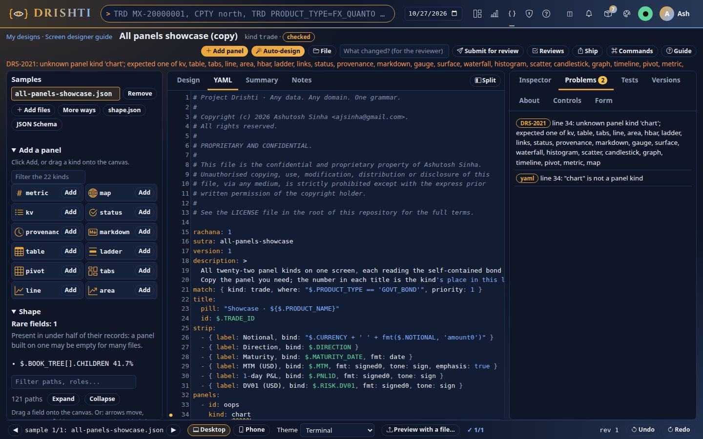
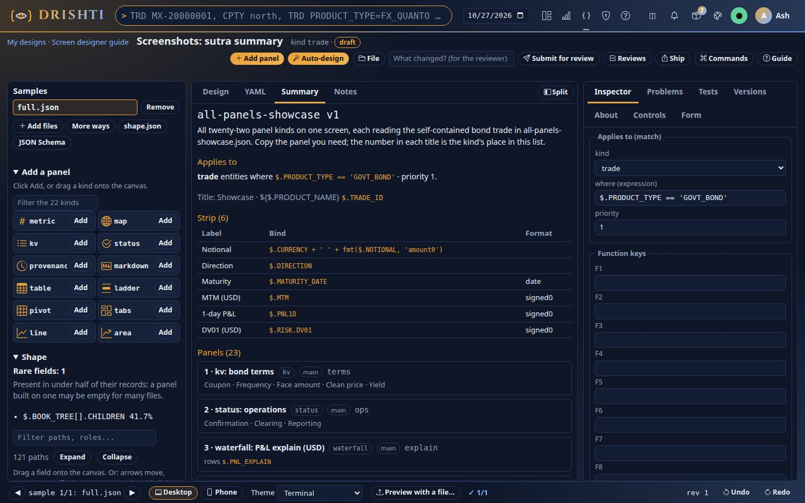
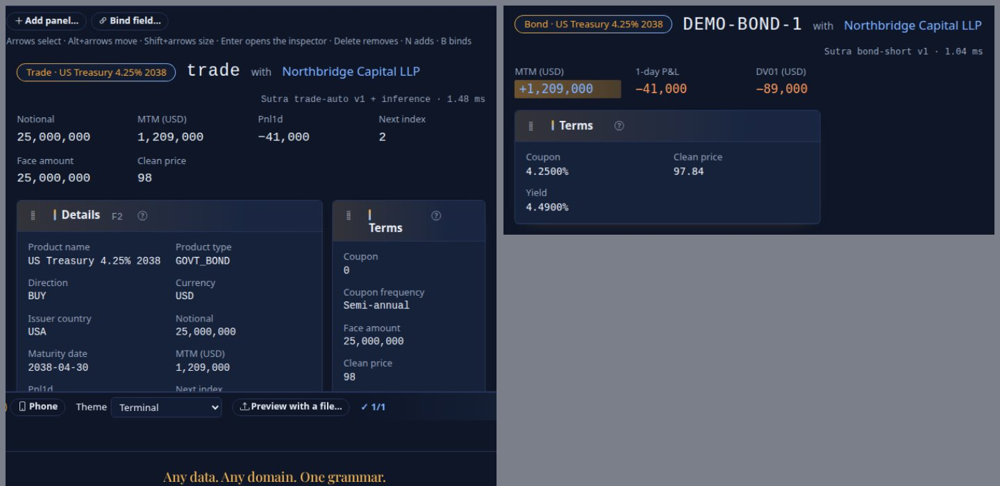
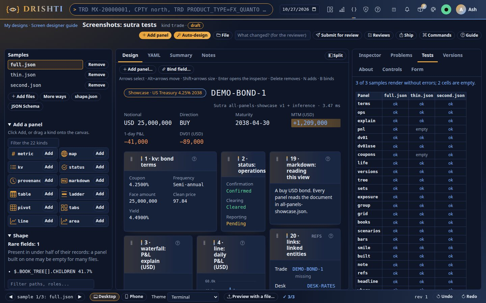
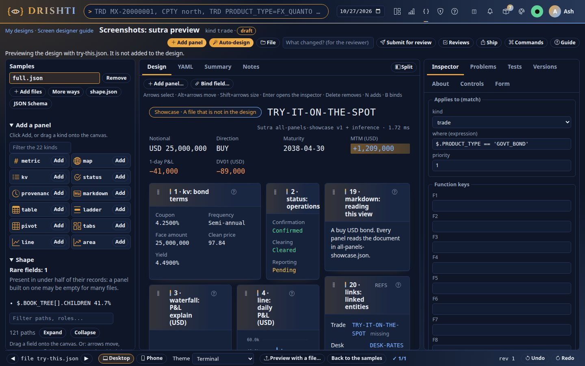

<!--
  Project Drishti · Any data. Any domain. One grammar.

  Copyright (c) 2026 Ashutosh Sinha <ajsinha@gmail.com>.
  All rights reserved.

  PROPRIETARY AND CONFIDENTIAL.

  This file is the confidential and proprietary property of Ashutosh Sinha.
  Unauthorised copying, use, modification, distribution or disclosure of this
  file, via any medium, is strictly prohibited except with the express prior
  written permission of the copyright holder.

  See the LICENSE file in the root of this repository for the full terms.
-->
# Sutra developer guide: writing Sutras, from your first panel to a tested, shipped screen

This guide teaches you to write **Sutras**, the layouts of Drishti's screen grammar Rachana, by doing. You start with a counterparty from the `core` pack, write a Sutra one step at a time and preview
each step; you then build a complete swap view over a trade booked in Murex, in the common schema every source system of the `trading` pack writes. After that it covers what a working author needs
next: how one Sutra is chosen among several (source system and product type), how the trading pack shares blocks between a hundred-odd product Sutras, labels, reading other entities with `source:`,
expandable row groups, dates and live data, controls, how inference and a Sutra share a screen, testing in CI, and the Build workbench. It ends with the mistakes everyone makes once, with their
problem codes, and a checklist.

Every Sutra on this page was previewed against the demo lakes of a fresh clone (`drishti.py lake demo`: the seven-day lakes of 2.5.0 ending 2026-10-16; the lakes hold sixty business days since 2.6.5), and every figure you are told to expect was read from
that preview. Figures that depend on the business date (a count of payments still to come) are marked as such; the sixty days of the demo lakes end on the day you build them.

**What this guide does not repeat.** One place owns each topic and this guide links to it:

| For | Go to |
|---|---|
| every key, option, format, tone, function and problem code | [Rachana reference](RACHANA_REFERENCE.md) |
| each of the 22 panel kinds: when to use it, its options, what it does when empty, masked or live | [Panel kinds](PANELS.md) |
| the Build workbench: canvas, inspector, YAML tab, tests, proposing | [Screen designer](SCREEN_DESIGNER.md) |
| what Drishti does with no Sutra, and how inference fills a Sutra's gaps | [Inference](../architecture/INFERENCE.md) |
| how a view keeps itself up to date | [Live updates](../architecture/LIVE.md) |
| adding a new panel kind | [Panel developer guide](PANELS.md#developing-a-panel-kind) |
| shipping Sutras in a pack | [Pack developer guide](PACK_DEVELOPER_GUIDE.md) |

Eleven small working Sutras, each with a self-contained JSON document and a note, are in [examples](examples/README.md): together they use all 22 panel kinds, nested pivot groups and tree rows. They
are teaching documents with their own small data (written in camel case, as such JSON often is); the shipped packs and everything below use the production attribute names in UPPER_SNAKE. In the
workbench every example opens as **your own copy** (Build → New screen → Examples), and **File → Open** loads any `.yaml` or `.json` of your own.

**What you need**

- the quick-start stack of [GETTING_STARTED.md](GETTING_STARTED.md): the demo lakes built (`drishti-console/.venv/bin/python tools/drishti.py lake demo`), the server on `http://localhost:18480` with
  the seven packs (`DRISHTI_PACKS=core,market-data,trading,counterparty-risk,market-risk,world-economy,news-and-markets`, the run configuration **Drishti server (demo lakes)**) and the console on
  `http://localhost:17480`;
- for the command-line checks, `curl` and `python3`, and a **personal API token**: sign in, open **My account → API tokens**, make one with the scope `design:write` (it reads everything you may read,
  and may call the preview and save a Sutra), and `export DRISHTI_TOKEN=drk_…`. The commands below use

  ```bash
  export DRISHTI=http://localhost:18480/api/v1
  AUTH="Authorization: Bearer $DRISHTI_TOKEN"
  ```

- a browser for the Build workbench (**Build → New screen**).

**Contents**

1. [What a Sutra is, and when one applies](#1-what-a-sutra-is-and-when-one-applies)
2. [Your first Sutra: a counterparty](#2-your-first-sutra-a-counterparty)
3. [Rachana-EL step by step](#3-rachana-el-step-by-step): paths, filters, functions, formats and tones
4. [A trade view, built step by step](#4-a-trade-view-built-step-by-step)
5. [Matching several Sutras](#5-matching-several-sutras): `match`, `where`, `priority`, and how one is chosen
6. [Saving: the workbench and governance](#6-saving-the-workbench-and-governance)
7. [How packs ship Sutras](#7-how-packs-ship-sutras): folders, shared blocks, `when:` and the coverage matrix
8. [Things to know before you write many Sutras](#8-things-to-know-before-you-write-many-sutras): labels and taxonomies
9. [Common mistakes and their messages](#9-common-mistakes-and-their-messages)
10. [The panel kinds](#10-the-panel-kinds): links into the catalogue
11. [Reading other entities: `source:`](#11-reading-other-entities-source)
    - [11a. Fragments, events, children, refresh and forms](#11a-fragments-events-children-refresh-and-forms): one master-detail screen in the Sutra Next grammar
12. [Expandable row groups: pivot `by` lists and tree tables](#12-expandable-row-groups-pivot-by-lists-and-tree-tables)
13. [Dates, live data and imperfect data](#13-dates-live-data-and-imperfect-data)
    - [13a. Controls: let the reader choose](#13a-controls-let-the-reader-choose-and-what-a-share-keeps), view state, and when a Sutra is not enough
14. [Sutra and inference together](#14-sutra-and-inference-together)
15. [Testing: `expect.yaml`, `sutra lint|test|preview`, CI](#15-testing-expectyaml-sutra-linttestpreview-ci)
16. [The Build workbench](#16-the-build-workbench)
17. [Checklist](#17-checklist)


## 1. What a Sutra is, and when one applies

A **Sutra** is one YAML file, `<name>.v<N>.sutra.yaml`, that holds one layout: which panels to draw, in which order, bound to which parts of a JSON document. Its first key is always `rachana: 1`, the
version of the Rachana language it is written in. It says nothing about pixels or code. One Sutra lays out a whole *family* of entities: every counterparty, or every Murex fixed/float swap.

Because a Sutra is ordinary YAML, ordinary YAML tools work on it: any editor that reads JSON Schema can complete and check it against the schema the server publishes (`GET /api/v1/rachana/schema`, see
[Editing outside the workbench](#editing-outside-the-workbench)), and linters and diff tools need nothing special.

When you open an entity (`CPTY CP-MERIDIAN-RE <GO>` in the terminal, or `/v/counterparty/CP-MERIDIAN-RE`), Drishti:

1. fetches its document (here from the `reference-store` Delta connector of the `core` pack);
2. looks for a Sutra whose `match.kind` is the entity's kind and whose `where` condition holds, highest `priority` first;
3. if it finds one, lays out the view by it, and lets **inference** fill only what it leaves out; if it finds none, lays out the whole view by inference (from the shape of the data; see
   [INFERENCE.md](../architecture/INFERENCE.md)).

The bottom panel of every view, *How this view was built*, tells you which case applied. So does the API:

```bash
curl -s -H "$AUTH" $DRISHTI/views/counterparty/CP-MERIDIAN-RE | python3 -c "import json,sys; print(json.load(sys.stdin)['provenance']['layout'])"
```

You should see `Sutra counterparty v1 + inference`: the `core` pack's Sutra `counterparty`, version 1, completed by inference (its *Linked entities* panel is always found at view time, which counts as
inference).

You write a Sutra when inference is not good enough: when the identifier, the headline figures, the formats or the choice of chart should be what a person who knows the domain would choose.

### Anatomy at a glance

A whole Sutra, with every part it can have. Sections 2 and 4 build each part up; this is the map to come back to.

```yaml
rachana: 1                           # the language version, always first
sutra: irs-fixfloat                  # name: lower-case kebab
version: 1
description: Exchanges fixed for floating RFR-compounded payments.
match: { kind: trade, where: "$.SOURCE_SYSTEM == 'MUREX' && $.PRODUCT_TYPE == 'IRS_FIXFLOAT'", priority: 10 }
title: { pill: "Rates · Interest rate swap (fixed/float)", id: $.TRADE_ID, with: "link($.COUNTERPARTY, 'counterparty')" }
strip: [ ... up to eight header figures ... ]
controls: [ ... up to twelve choices the reader makes ... ]
panels: [ ... the panels, in reading order (or { use: <block> } for shared ones) ... ]
keys: { F7: "link($.COUNTERPARTY, 'counterparty-trades')", F8: impact, F9: raw }
```

| Part | What it does |
|---|---|
| `rachana` | The Rachana language version: `1`. Without it, or with one this server does not read, the file is refused (`DRS-2009`). |
| `sutra`, `version` | The identity, `name@version`, unique. Keep old versions: saved views and history reproduce with the version they used. |
| `description`, `notes` | Plain text for people (not Markdown): one paragraph, and longer notes for the next author and the reviewer. Never change the view. |
| `match` | Which documents this Sutra lays out: a `kind`, an optional `where` over the document, and a `priority` ([section 5](#5-matching-several-sutras)). |
| `title` | The title line: a `pill`, the identifier (`id`), and `with` (usually the counterparty, as a link). |
| `strip` | The header figures, at most eight. `emphasis: true` highlights the one the desk watches. |
| `controls` | Dropdowns, date ranges, sliders and the like the reader sets; panels read them as `ctl.<id>` ([section 13a](#13a-controls-let-the-reader-choose-and-what-a-share-keeps)). |
| `panels` | The body. Each has an `id`, a `kind` and the options of that kind; `area: right` puts one in the side column. `{ use: legs@1 }` inserts a shared block ([section 7](#7-how-packs-ship-sutras)). |
| `keys` | Function keys: `F2`-`F12` go to panels (a panel's own `key:`), links (`link(...)`), `impact` (F8) or `raw` (F9). |

A Sutra lives in a Sutra folder of a pack (`config/packs/<pack>/sutras/`, any sub-folders) or of the site (`./sutras`, setting `drishti.rachana.dirs`). Problems report the file's own line and column.
Every key and its default is in the [reference](RACHANA_REFERENCE.md#top-level).

## 2. Your first Sutra: a counterparty

### Step 1: look at the data

Always start from the document itself.

**In the UI.** Open `CPTY CP-MERIDIAN-RE <GO>` and press **F9** (*Raw JSON*).

**From the command line.**

```bash
curl -s -H "$AUTH" $DRISHTI/entities/counterparty/CP-MERIDIAN-RE/raw | python3 -m json.tool
```

You should see the provenance and, under `data` (the netting sets and the hierarchy shortened):

```json
{
  "COUNTERPARTY_ID": "CP-MERIDIAN-RE",
  "NAME": "Meridian Reinsurance Ltd",
  "LEI": "549300HGCM5CFCB6ZB96",
  "RATING": "A",
  "SECTOR": "Insurance",
  "COUNTRY": "BM",
  "TYPE": "Insurer",
  "COUNTRY_OF_RISK": "BM",
  "UEN": "UEN0100407",
  "ECONOMY": "ECON-BMU",
  "NET_MTM": -191313445.24,
  "CREDIT_LIMIT": 3500000000,
  "NETTING_SETS": [
    { "ID": "NS-MERIDIAN-RE-FRA", "AGREEMENT": "AGR-MERIDIAN-RE-ISDA", "TRADES": 45, "NET_MTM": 10804024.63 },
    { "ID": "NS-MERIDIAN-RE-LDN", "AGREEMENT": "AGR-MERIDIAN-RE-ISDA", "TRADES": 191, "NET_MTM": -316071571.84 },
    …
  ],
  "KYC": { "STATUS": "Approved", "RISK_RATING": "Standard", "LAST_REVIEW": "2026-02-11", "EMIR_CLASSIFICATION": "FC", "PD_1Y": 0.0006 },
  "GROUP": "GRP-MERIDIAN",
  "CREDIT_LIMIT": "LIM-MERIDIAN-RE",
  "HIERARCHY": { "NODES": [ … ], "EDGES": [ … ] },
  "LEGAL_ENTITY": "LE-NY"
}
```

Read it the way a Sutra will: `$` is this whole document, `$.NAME` is `Meridian Reinsurance Ltd`, `$.KYC.STATUS` is `Approved`, `$.NETTING_SETS` is a list of four objects, and `$.NETTING_SETS[0].ID`
is `NS-MERIDIAN-RE-FRA`. Every kind of the seven packs writes its attributes in UPPER_SNAKE, as the production systems do; a path names them exactly (`$.net_mtm` is empty).

### Step 2: the smallest Sutra that works

A Sutra needs four things: the language version (`rachana: 1`), a name (`sutra:`), a version, and a `match` with a `kind`. Here is the smallest useful one, with a single panel:

```yaml
rachana: 1
sutra: counterparty-mine
version: 1
match: { kind: counterparty, priority: 20 }
panels:
  - id: identity
    kind: kv
    title: Identity
    columns:
      - { label: Name, bind: $.NAME }
      - { label: LEI, bind: $.LEI }
```

- `rachana: 1` comes first in every Sutra. It names the version of the language, so that a later version of Rachana can change the grammar without misreading today's files. Leave it out and you get
  `DRS-2009 missing 'rachana: 1' (the Rachana language version) at the top`.
- `sutra: counterparty-mine` is the name: lower-case letters, digits and hyphens, starting with a letter.
- `version: 1` is a plain integer. Later you publish `version: 2` and keep version 1 on disk.
- `match: { kind: counterparty, priority: 20 }` applies it to every counterparty, ahead of the `core` pack's `counterparty` Sutra (priority 10).
- `kind: kv` is a label/value grid; each column's `bind` says where its value comes from.

### Step 3: preview it

**In the UI.**

1. Open **Build → New screen**, bring `CP-MERIDIAN-RE` as a stored entity (kind `counterparty`, id `CP-MERIDIAN-RE`: see [SCREEN_DESIGNER §1](SCREEN_DESIGNER.md#1-start-bring-data)) and choose *an
   empty Sutra* as the start. The workbench opens with that counterparty as its sample.
2. Open the **YAML** tab and replace its text with the YAML above.
3. Press **Ctrl+Enter**.

You should see, in the **Design** tab, a view titled `CP-MERIDIAN-RE` with one panel, *Identity*, showing `Name Meridian Reinsurance Ltd` and `LEI 549300HGCM5CFCB6ZB96`. Nothing has been saved: a
preview always uses the text in the editor, whatever its `match` says, and writes no file.

**From the command line.** The workbench's preview is one call, `POST /api/v1/studio/preview` with the YAML, a kind and an id (it needs the `design:write` scope); save the Sutra as
`counterparty-mine.v1.sutra.yaml` and:

```bash
python3 -c "import json,sys; print(json.dumps({'yaml': open(sys.argv[1]).read(), 'kind': 'counterparty', 'id': 'CP-MERIDIAN-RE'}))" \
    counterparty-mine.v1.sutra.yaml > preview.json
curl -s -H "$AUTH" -H 'Content-Type: application/json' --data @preview.json $DRISHTI/studio/preview \
  | python3 -c "import json,sys; v=json.load(sys.stdin); [print(p['id'], [(f['label'], f.get('text')) for f in p['data'].get('fields', [])]) for p in v['panels']]"
```

You should see `identity [('Name', 'Meridian Reinsurance Ltd'), ('LEI', '549300HGCM5CFCB6ZB96')]`.



If the text has a problem, the **Problems** tab lists each one with its code, line and reason, for example `DRS-2021 line 7: unknown panel kind 'chart'`; click one to jump to the line, and the design
keeps its last good Sutra. The preview call answers `422` with the same list (`"code": "DRS-2002"`, and each problem under `problems`). The [mistakes section](#9-common-mistakes-and-their-messages)
lists the usual ones.

### Step 4: a title

The title line is `[pill] ID with <something>`. Without a `title:`, the identifier is `$.id` and, when the document has no `id` (none of the packs' documents has one: they carry `COUNTERPARTY_ID`,
`TRADE_ID`...), the entity's own id. Make it explicit:

```yaml
title: { pill: "Counterparty · ${$.SECTOR}", id: $.COUNTERPARTY_ID, with: $.NAME }
```

`pill` is a **template**: text in which `${…}` is replaced by the value of an expression. You should see the title `[Counterparty · Insurance] CP-MERIDIAN-RE with Meridian Reinsurance Ltd`.

### Step 4b: say what it is for: `description` and `notes`

A Sutra carries its own explanation in two optional plain-text keys, so the file is the whole story and nothing else needs to be kept in step with it:

```yaml
description: Counterparties for the credit desk.
notes: |
  Who the bank faces, how much is netted where, and the KYC state.
  Priority 20 puts it ahead of the core pack's own counterparty Sutra (priority 10).
```

- `description` is one paragraph: what the layout shows and for which entities. The workbench and the catalogue show it, and so does the *About this page* drawer on every view this Sutra draws (it is
  shown as written, never evaluated). Text that has to change with the entity, such as "VAR-EQD is 70% of its limit", is written in the pack's `config/about.yaml`, not here ([About text and
  glossary](PACK_MODELLING_GUIDE.md#about-text-and-glossary)).
- `notes` is longer text for the next author and for reviewers: why the panels are in this order, what was tried and dropped. Write it as a YAML block (`notes: |` and the lines indented under it); the
  line breaks are kept. It is plain text, not Markdown.
- A panel can have its own `description` too (`- { id: identity, kind: kv, description: Who they are, … }`) to say what that one panel is for.

None of these change the view. They must be text: `notes:` followed by a list is `DRS-2012 'notes' is plain text`.

### Step 5: a strip of headline figures

The strip is the row of up to eight figures under the title:

```yaml
strip:
  - { label: Rating, bind: $.RATING, emphasis: true }
  - { label: Country of risk, bind: $.COUNTRY_OF_RISK }
  - { label: UEN, bind: $.UEN }
  - { label: Net MTM, bind: $.NET_MTM, fmt: signed0, tone: sign }
  - { label: Credit limit, bind: $.CREDIT_LIMIT, fmt: compact }
  - { label: Netting sets, bind: "size($.NETTING_SETS) + ' sets, ' + fmt(sum($.NETTING_SETS, 'TRADES'), 'amount0') + ' trades'" }
```

You should see `Rating A` (highlighted), `Country of risk BM`, `UEN UEN0100407`, `Net MTM −191,313,445` in the negative colour, `PFE peak 3.1bn` and `Netting sets 4 sets, 596 trades`.

Four things just happened:

- `fmt: signed0` formatted `-191313445.24` with a sign, no decimals and a true minus `−`; `fmt: compact` made `3125658100` read `3.1bn`. Formats are named; the core set is `amount0`, `amount2`,
  `signed0`, `signed2`, `pct0`, `pct2`, `price2`, `compact`, `date`, `dmy` and `text`, and the packs add more (`pct4`, `price4`, `bp1`, …; [reference](RACHANA_REFERENCE.md#formats)).
- `tone: sign` coloured the figure by its sign.
- `"size($.NETTING_SETS) + ' sets, ' + …"` is a Rachana-EL expression: `size` counts the list, `sum($.NETTING_SETS, 'TRADES')` adds the `TRADES` of each element, `fmt(…, 'amount0')` formats inside an
  expression, and `+` joins text. It is in double quotes for YAML; the text inside the expression uses single quotes.
- `emphasis: true` highlights one figure. Use it once.

### Step 6: key/value panels, written and inferred

Replace *Identity* with two kv panels:

```yaml
  - id: identity
    kind: kv
    title: Identity and classification
    key: F2
    columns:
      - { label: LEI, bind: $.LEI }
      - { label: Type, bind: $.TYPE }
      - { label: Legal entity, bind: "link($.LEGAL_ENTITY, 'legal-entity')" }
      - { label: Probability of default (1y), bind: $.KYC.PD_1Y, fmt: pct2 }
  - id: kyc
    kind: kv
    title: KYC
    area: right
    rows: $.KYC
```

You should see *Identity and classification* with `LEI 549300HGCM5CFCB6ZB96`, `Type Insurer`, `Legal entity LE-NY` (a link: the `link(id, kind)` function makes any value navigable) and `Probability of
default (1y) 0.06%`; and on the right *KYC* with `Status Approved`, `Risk rating Standard`, `Last review 2026-02-11`, `EMIR classification FC` and `PD 1y 0`.

The second panel lists no columns. `rows: $.KYC` points it at an object, and inference fills in one field per scalar in that object, labelled from the field names in words (`RISK_RATING` → *Risk
rating*; the packs' acronym list spells `EMIR`). That is quick, and it picks up new fields when the source adds them; but look at `PD 1y 0`: inference shows `0.0006` with no format, and labels it as
best it can. List columns when you want to choose the labels, the order and the formats, as the first panel does for the same figure.

`key: F2` binds the F2 key to the panel: pressing it scrolls there. `area: right` puts the panel in the side column. Each column is a grid of 12 columns: `span: 6` would make a panel half as wide, so
two such panels share a row, and `height: 8` would give it a fixed height of 8 rows (it scrolls inside). Both are optional; users may also arrange a view for themselves in layout mode (`Alt+L`), which
never changes the Sutra ([reference](RACHANA_REFERENCE.md#keys-every-panel-takes)).

### Step 7: a table over a nested array, with links and totals

```yaml
  - id: sets
    kind: table
    title: "Netting sets (${size($.NETTING_SETS)})"
    key: F3
    rows: $.NETTING_SETS
    columns:
      - { label: Netting set, bind: "@.ID", link: true }
      - { label: Agreement, bind: "@.AGREEMENT", link: true }
      - { label: Trades, bind: "@.TRADES", fmt: amount0, total: true }
      - { label: Net MTM, bind: "@.NET_MTM", fmt: signed0, tone: sign, total: true }
```

Inside a table, `@` is the current row: `@.TRADES` is the row's `TRADES`. You should see the title `Netting sets (4)`, four rows from `NS-MERIDIAN-RE-FRA · AGR-MERIDIAN-RE-ISDA · 45 · +10,804,025` to
the Tokyo set, the ids as links that open `NSET NS-MERIDIAN-RE-FRA` and `AGR AGR-MERIDIAN-RE-ISDA`, and a `Total` row of `596` trades and `−191,313,445`.

`link: true` made the ids links: the packs declare that ids starting with `NS-` are netting sets and `AGR-` agreements (`graph.id-patterns`). A column bound to a plain path whose last field ends in
`_ID` or `_REF` (`@.TRADE_ID`, `$.BOOK_REF`) is linked without it; `@.ID` is too short a name for that rule, so it needs `link: true`.

A table can also offer its rows as an interactive pivot. Add one line, `pivot: true`, and the panel gets a **Table | Pivot** switch: under **Pivot**, a reader drags the table's columns into rows,
columns, values and filters, with totals, a chart and a drill-down to the rows under any cell ([USER_GUIDE.md](USER_GUIDE.md#the-pivot-tab-slice-a-table-your-way)). To choose the fields and how it
opens:

```yaml
    pivot:
      fields: [AGREEMENT, ID, TRADES, NET_MTM]      # row paths; they need not be columns
      rows: [AGREEMENT]
      values: [{ field: NET_MTM, agg: sum }]
```

Without `pivot:` there is no switch: a Sutra decides where a pivot helps ([reference](RACHANA_REFERENCE.md#pivot-a-pivot-tab-on-a-table-or-ladder)).

### Step 8: a chart

Net MTM by netting set is a label and a number per row, which is what horizontal bars are for:

```yaml
  - id: by-set
    kind: hbar
    title: Net MTM by netting set
    key: F4
    area: right
    rows: $.NETTING_SETS
    label: ID
    value: NET_MTM
    fmt: compact
    tone: sign
```

For an `hbar` (and a `line` or `area`), `label` and `value` are **field names** of each row, written exactly as the document writes them: not expressions (no `@.`), and `id` would not find `ID`. You
should see four bars: `NS-MERIDIAN-RE-FRA 10.8m`, `NS-MERIDIAN-RE-LDN −316.1m` in the negative colour, `NS-MERIDIAN-RE-NY 99.7m` and `NS-MERIDIAN-RE-TKY 14.3m`.

The key bar shows `F4 Net MTM`: a panel key is labelled with the first two words of the title, cut at ` (` or ` · `. Write titles whose first words make sense on their own (the *Identity and
classification* panel reads *F2 Identity and*).

### Step 9: linked entities, provenance and keys

```yaml
  - { id: refs, kind: links, title: Linked entities, code: REFS, area: right }
  - { id: built, kind: provenance, title: How this view was built }
keys: { F7: "link($.GROUP, 'counterparty-group')", F8: impact, F9: raw }
```

- `links` lists every entity the document refers to, found from the packs' reference fields: you should see `Economy ECON-BMU` with the badge `+1.89 % growth` (the world-economy pack), `Group
  GRP-MERIDIAN`, `Credit limit LIM-MERIDIAN-RE` and others, all links.
- `provenance` says how the view was built: `Layout Sutra counterparty-mine v1 + inference`, a fingerprint of the document's shape and `Source reference-store, gen …`.
- `keys` adds function keys that are not panels: `F7` opens the counterparty's group (`link(id, kind)`), `F8` the impact view, `F9` the raw JSON. Panel keys and these keys share F1–F12; F1 is the
  console's help.

### The whole counterparty Sutra

```yaml
rachana: 1
sutra: counterparty-mine
version: 1
description: Counterparties for the credit desk.
match: { kind: counterparty, priority: 20 }
title: { pill: "Counterparty · ${$.SECTOR}", id: $.COUNTERPARTY_ID, with: $.NAME }
strip:
  - { label: Rating, bind: $.RATING, emphasis: true }
  - { label: Country of risk, bind: $.COUNTRY_OF_RISK }
  - { label: UEN, bind: $.UEN }
  - { label: Net MTM, bind: $.NET_MTM, fmt: signed0, tone: sign }
  - { label: Credit limit, bind: $.CREDIT_LIMIT, fmt: compact }
  - { label: Netting sets, bind: "size($.NETTING_SETS) + ' sets, ' + fmt(sum($.NETTING_SETS, 'TRADES'), 'amount0') + ' trades'" }
panels:
  - id: identity
    kind: kv
    title: Identity and classification
    key: F2
    columns:
      - { label: LEI, bind: $.LEI }
      - { label: Type, bind: $.TYPE }
      - { label: Legal entity, bind: "link($.LEGAL_ENTITY, 'legal-entity')" }
      - { label: Probability of default (1y), bind: $.KYC.PD_1Y, fmt: pct2 }
  - id: sets
    kind: table
    title: "Netting sets (${size($.NETTING_SETS)})"
    key: F3
    rows: $.NETTING_SETS
    columns:
      - { label: Netting set, bind: "@.ID", link: true }
      - { label: Agreement, bind: "@.AGREEMENT", link: true }
      - { label: Trades, bind: "@.TRADES", fmt: amount0, total: true }
      - { label: Net MTM, bind: "@.NET_MTM", fmt: signed0, tone: sign, total: true }
  - { id: built, kind: provenance, title: How this view was built }
  - { id: by-set, kind: hbar, title: Net MTM by netting set, key: F4, area: right, rows: $.NETTING_SETS, label: ID, value: NET_MTM, fmt: compact, tone: sign }
  - { id: refs, kind: links, title: Linked entities, code: REFS, area: right }
  - { id: kyc, kind: kv, title: KYC, area: right, rows: $.KYC }
keys: { F7: "link($.GROUP, 'counterparty-group')", F8: impact, F9: raw }
notes: |
  Who the bank faces, how much is netted where, and the KYC state.
  Priority 20 puts it ahead of the core pack's own counterparty Sutra (priority 10).
```

You should see the key bar `F2 Identity and`, `F3 Netting sets`, `F4 Net MTM`, `F7 Counterparty group`, `F8 Impact`, `F9 Raw JSON`, and *How this view was built* reading `Sutra counterparty-mine v1 +
inference`. Preview it against another counterparty too (change the id box to `CP-NORTHPLAINS`): the same layout serves every counterparty.

## 3. Rachana-EL step by step

Every `bind`, `rows`, `where` and `highlight` is a Rachana-EL expression. This section builds them up against the Murex swap `MX-20000001` (look at it with `curl -s -H "$AUTH"
$DRISHTI/entities/trade/MX-20000001/raw | python3 -m json.tool`). A trade, from any source system, has 47 top-level attributes (`SOURCE_SYSTEM`, `TRADE_ID`, `TRADE_STATUS`, `PRODUCT_TYPE`,
`COUNTERPARTY`, `CURRENCY`…), a list of `LEGS`, each with its `CASH_FLOWS`, each of those with its `RESETS`, and a list of `EVENTS` ([PACKS.md](PACKS.md#trading)).

### Paths

| You write | You get | Why |
|---|---|---|
| `$.QUANTITY` | `242000000` | a field of the document |
| `$.COUNTERPARTY` | `CP-MERIDIAN-RE` | the counterparty's id (its name is on the counterparty's own document) |
| `$.LEGS[0].LEG_TYPE` | `FIXED` | `[0]` is the first element |
| `$.LEGS[-1].INDEX.NAME` | `AONIA` | `[-1]` is the last; `.` walks into objects |
| `$.LEGS[0].CASH_FLOWS[0].PAYMENT_DATE` | `2026-06-29` | as deep as the data goes |
| `$['TRADE_ID']` | `MX-20000001` | brackets: for a field whose name has a hyphen (`$['day-count']`; `$.day-count` would subtract) |
| `$.QUANTTY` | *(empty)* | a misspelt field is empty, never an error: check spelling in the preview |

### Rows: `@` and `#index`

Inside `rows:`, `each:` or a filter, `@` is the current element and `#index` its position (from 0).

| Before | After |
|---|---|
| `bind: $.LEGS[0].CASH_FLOWS[0].RATE`: always the first flow | `bind: "@.RATE"`: each row's own rate |
| `highlight: "#index == 0"`: the first row lit | `highlight: "@.PAYMENT_DATE == first($.EVENTS[?@.EVENT_DATE > today()]).EVENT_DATE"`: the next payment |
| `tabTitle: "'Leg ' + #index"`: `Leg 0`, `Leg 1` | `tabTitle: "'Leg ' + @.LEG_ID"`: `Leg 1`, `Leg 2` |

### Filters

`[?condition]` keeps the elements of a list for which the condition holds, with `@` set to each.

| Expression | Result for `MX-20000001` |
|---|---|
| `size($.EVENTS)` | `42` |
| `size($.EVENTS[?@.EVENT_TYPE == 'CASH_SETTLEMENT'])` | `35`: one per payment of either leg |
| `size($.EVENTS[?!nonblank(@.LEG_ID)])` | `7`: the deal's own events (booked, confirmed, cleared, amended…) |
| `size($.EVENTS[?nonblank(@.AMOUNT) && @.EVENT_DATE > today()])` | `29` on the business date 2026-10-16: the cash events still to come |
| `first($.LEGS[?@.LEG_TYPE == 'FLOAT']).INDEX.NAME` | `AONIA` |
| `$.LEGS[?@.LEG_TYPE == 'FLOAT'].INDEX.NAME` | *(empty)*: a filter gives a list; take an element first (`first(...)`, `[0]`) |
| `$.LEGS[*].LEG_ID` | the list `[1, 2]`: **projection**, a field of every element (what a control's `options` read) |
| `size(flatten($.LEGS[*].CASH_FLOWS))` | `35`: every leg's flows as one list (`flatten`) |
| `size(flatten($.LEGS[1].CASH_FLOWS[*].RESETS))` | `90`: every fixing of the floating leg |

The extracts of the source systems write a missing value as empty text (`"AMOUNT": ""`, `"LEG_ID": ""`), not as nothing. So test for a value with `nonblank(...)`, which treats empty text as missing,
not with `coalesce`, which keeps it.

### Functions

| Before | After | Shows |
|---|---|---|
| `bind: $.QUANTITY, fmt: amount0` | `bind: "$.CURRENCY + ' ' + fmt(first($.LEGS).NOTIONAL, 'amount0')"` | `AUD 242,000,000` |
| `bind: "$.LEGS[0].NOTIONAL + $.LEGS[1].NOTIONAL"` | `bind: "sum($.LEGS, 'NOTIONAL')", fmt: amount0` | `484,000,000` |
| `bind: "coalesce($.PACKAGE_ID, 'none')"` (empty text is kept: shows nothing) | `bind: "nonblank($.PACKAGE_ID, 'none')"` | `none` |
| `where: "$.TRADE_STATUS == 'amended'"` (never true: case matters) | `where: "lower($.TRADE_STATUS) == 'amended'"` | true for `AMENDED` |
| `where: "$.PRODUCT_SUB_TYPE == 'swap'"` | `where: "contains($.PRODUCT_SUB_TYPE, 'swap')"` | `contains` and `startsWith` ignore case |
| `bind: $.TRADER_ID` | `bind: "link($.TRADER_ID, 'trader', $.TRADER_FIRST_NAME + ' ' + $.TRADER_LAST_NAME)"` | `A. Shah`, a link to the trader |
| a total per year the data does not carry | `rows: "group($.EVENTS[?nonblank(@.AMOUNT) && nonblank(@.LEG_ID)], 'EVENT_DATE', 'AMOUNT', 'year')"` | one row a year, `2025 −3,713,969` first |
| days to maturity | `bind: "days(today(), $.MATURITY_DATE)"` | `2079` on 2026-10-16 |

The whole set is `link`, `size`, `sum`, `fmt`, `coalesce`, `nonblank`, `first`, `last`, `flatten`, `abs`, `min`, `max`, `upper`, `lower`, `contains`, `startsWith`, `matches`, `matchesCase`, `within`,
`oneOf`, `group`, `days` and `today`; there is no other function, and no list literal (`['AUD', 'NZD']` does not compile). See the [reference](RACHANA_REFERENCE.md#functions) for each.

### Formats and tones

`fmt:` decides how a value reads; `tone:` decides its colour.

| Value | `fmt` | `tone` | Shows |
|---|---|---|---|
| `242000000` | none | none | `242000000` |
| `242000000` | `amount0` | none | `242,000,000` |
| `242000000` | `signed0` | `sign` | `+242,000,000`, positive colour |
| `-155245` | `signed0` | `sign` | `−155,245`, negative colour (a true minus sign) |
| `0.040829` | `pct4` | | `4.0829%` |
| `0.040829` | `price4` | | `0.0408` (a price per unit: no scaling) |
| `0.83` | `pct0` | | `83%` |
| `242000000` | `compact` | | `242.0m` |
| `2025-07-25` | `dmy` | | `25 Jul 2025` |
| `AMENDED` | | `status` | `AMENDED`, `ok` colour |
| `Pending` | | `status` | `Pending`, `warn` colour |

`tone: status` reads the words: *fail*, *reject*, *dispute*, *breach* are bad; *pending*, *unmatched*, *warn* are a warning; anything else is fine. So it suits confirmation and settlement statuses and
a trade's `TRADE_STATUS`, but not every status: a credit rating's `CCC` would show in the *fine* colour. Leave such fields untoned.

### Conditions

Conditions combine with `&&`, `||` and `!`, and choose with `? :`:

```yaml
where: "$.SOURCE_SYSTEM == 'MUREX' && $.PRODUCT_TYPE == 'IRS_FIXFLOAT'"
bind: "$.BUY_SELL_CODE == 'B' ? 'Buy' : 'Sell'"
bind: "@.LEG_TYPE == 'FIXED' ? fmt(@.RATE, 'pct4') : @.INDEX.NAME + ' + ' + fmt(@.FLOAT_SPREAD, 'pct4')"
```

Three things to know:

- `<`, `>`, `<=`, `>=` compare numbers as numbers, and two texts that are not numbers as text, character by character, so ISO dates order correctly: `'2026-01-31' < '2026-02-01'` is true, and
  `@.PAYMENT_DATE < today()` tells a paid flow from one to come (the trading pack's legs block does exactly that). A number against text that is not a number, or anything against empty, is false.
- `||` gives `true` or `false`, not a value: `$.STRATEGY || 'n/a'` shows `true`. For a default, use `nonblank($.STRATEGY, 'n/a')`.
- `+` adds only when both sides are numbers; otherwise it joins text: `'Leg ' + 1` is `Leg 1`, `'1' + 1` is `11`. A missing value in arithmetic gives `NaN` (`$.QUANTTY * 2`); wrap it,
  `nonblank($.QUANTTY, 0) * 2`.

## 4. A trade view, built step by step

Now a bigger layout: the swap `MX-20000001`, booked in Murex and written, like every trade of the trading pack, in the common schema of all source systems (upper-snake attributes, `LEGS[]` ->
`CASH_FLOWS[]` -> `RESETS[]`, `EVENTS[]`; [PACKS.md](PACKS.md#trading)). Open the workbench on it (Build → New screen, the stored entity `trade` `MX-20000001`, an empty Sutra: see [Step
3](#step-3-preview-it)) and grow the Sutra one block at a time in the YAML tab, previewing each; or keep the file on disk and preview it with the `studio/preview` call of Step 3 (kind `trade`, id
`MX-20000001`).

### 4.1 Identity, title and strip

```yaml
rachana: 1
sutra: swap-desk
version: 1
description: Fixed/float swaps for the rates desk.
match:
  kind: trade
  where: "$.SOURCE_SYSTEM == 'MUREX' && $.PRODUCT_TYPE == 'IRS_FIXFLOAT'"
  priority: 20
title:
  pill: "${$.PRODUCT_GROUP} · ${$.PRODUCT_SUB_TYPE}"
  id: $.TRADE_ID
  with: "link($.COUNTERPARTY, 'counterparty')"
strip:
  - { label: Notional, bind: "$.CURRENCY + ' ' + fmt(first($.LEGS).NOTIONAL, 'amount0')" }
  - { label: Side, bind: "$.BUY_SELL_CODE == 'B' ? 'Buy' : 'Sell'" }
  - { label: Fixed rate, bind: $.PRICE, fmt: pct4 }
  - { label: Maturity, bind: $.MATURITY_DATE, fmt: date }
  - { label: Status, bind: "$.TRADE_STATUS + ' v' + $.TRADE_VERSION", tone: status, emphasis: true }
  - { label: Source, bind: $.SOURCE_SYSTEM }
  - { label: Trader, bind: "link($.TRADER_ID, 'trader', $.TRADER_FIRST_NAME + ' ' + $.TRADER_LAST_NAME)" }
  - { label: Portfolio, bind: "link($.PORTFOLIO, 'book')" }
panels: []
```

You should see `[Rates · Interest rate swap (fixed/float)] MX-20000001 with CP-MERIDIAN-RE` and the strip `Notional AUD 242,000,000 · Side Sell · Fixed rate 4.0829% · Maturity 2032-06-25 · Status
AMENDED v2 · Source MUREX · Trader A. Shah · Portfolio BOOK-RATES-3` (the status was captured on the seven-day lakes of 2.5.0. On the sixty-day lakes of 2.6.5 `MX-20000001` is cancelled part-way through: on its last seven business days it reads `CANCELLED`, version 7; on an earlier date it reads `AMENDED`). `with`, `Trader` and `Portfolio` are links. `panels: []` is valid: a Sutra may have no panels. A booking carries no
mark-to-market: the trade's MTM, P&L and DV01 are market-risk's trade valuation (`TVAL TVAL-MX-20000001`), a page of its own.

### 4.2 The ticket, and legs side by side

Replace `panels: []` with:

```yaml
panels:
  - id: terms
    kind: kv
    title: Deal ticket
    code: DES
    key: F2
    columns:
      - { label: Transaction, bind: $.TRANSACTION_ID }
      - { label: Trade date, bind: $.TRADE_DATE, fmt: date }
      - { label: Start, bind: $.START_DATE, fmt: date }
      - { label: Legal entity, bind: "link($.LEGAL_ENTITY, 'legal-entity')" }
      - { label: Discount curve, bind: "link($.LEGS[0].DISCOUNT_INDEX, 'ir-curve')" }
  - id: legs
    kind: tabs
    title: Legs
    key: F3
    each: $.LEGS
    layout: columns
    tabTitle: "'Leg ' + @.LEG_ID + ' · ' + @.LEG_ECONOMIC_TYPE + ' ' + @.LEG_TYPE"
    body:
      kind: kv
      columns:
        - { label: Index, bind: "nonblank(@.INDEX.NAME, 'Fixed')" }
        - { label: Notional, bind: "@.NOTIONAL", fmt: amount0 }
        - { label: Frequency, bind: "@.RESET_CONVENTION" }
        - { label: Periods, bind: "size(@.CASH_FLOWS)" }
```

You should see the *Deal ticket* (`Transaction 20000001002`, `Trade date 2025-07-25`, `Start 2025-07-28`, the legal entity `LE-NY` and the curve `CRV-AUD-OIS` as links) and two boxes side by side,
`Leg 1 · Receive FIXED` (`Index Fixed`, `Notional 242,000,000`, `Frequency Annual`, `Periods 7`) and `Leg 2 · Pay FLOAT` (`Index AONIA`, `Frequency Monthly`, `Periods 28`). With `layout: tabs` (the
default) they would be tabs instead. The `body` is a panel without an `id`; only its columns are used, and it must be a `kv`. To put whole panels in each leg (its notional profile, its fixings, its
cash flows opening to their resets), use `panels:` instead, as the trading pack's shared `legs` block does: [Panels inside a tab](RACHANA_REFERENCE.md#panels-inside-a-tab).

`nonblank(@.INDEX.NAME, 'Fixed')`: the fixed leg's index name is `""`, empty text, and `nonblank` skips it where `coalesce` would keep it.

### 4.3 Cash flows with totals and "more"

```yaml
  - id: cashflows
    kind: table
    title: "Cash flows · leg ${$.LEGS[0].LEG_ID}"
    key: F4
    rows: $.LEGS[0].CASH_FLOWS
    limit: 5
    moreLabel: "(size($.LEGS[0].CASH_FLOWS) - 5) + ' later flows'"
    totalLabel: Total
    columns:
      - { label: Flow, bind: "@.FLOW_ID" }
      - { label: Payment, bind: "@.PAYMENT_DATE", fmt: date }
      - { label: Rate, bind: "@.RATE", fmt: pct4 }
      - { label: Notional, bind: "@.NOTIONAL", fmt: amount0, total: true }
```

You should see five of the seven fixed periods (`20000001001 · 2026-06-29 · 4.0829% · 242,000,000` first), a total row (`Total` and `1,694,000,000` under *Notional*: the totals cover all seven rows,
not just the five shown; the label sits in the column just before the first total), and `2 later flows` under the table. Numeric columns (those with a format other than `date` or `text`) are
right-aligned.

### 4.4 A ladder of cash events

```yaml
  - id: schedule
    kind: ladder
    title: Cash events
    code: CF
    rows: "$.EVENTS[?nonblank(@.AMOUNT) && nonblank(@.LEG_ID)]"
    highlight: "#index == 0"
    columns:
      - { label: Date, bind: "@.EVENT_DATE", fmt: date }
      - { label: Leg, bind: "@.LEG_ID == 1 ? 'Fixed' : 'Float'" }
      - { label: Amount, bind: "@.AMOUNT", fmt: signed0, tone: sign, total: true }
```

You should see the 35 cash settlements of both legs in the document's order (the fixed leg's first: `2026-06-29 · Fixed · +8,987,302`), signed from the bank's side (received positive, paid negative),
the first highlighted, and their net, `+1,170,846`, under *Amount*. A ladder always shows every row (it takes no `limit`); use a table when you need to cut. To list only what is still to come, filter
on the view's business date: `rows: "$.EVENTS[?nonblank(@.AMOUNT) && nonblank(@.LEG_ID) && @.EVENT_DATE > today()]"`.

### 4.5 Charts: the trade's own data and another entity's

```yaml
  - id: notional
    kind: line
    title: Notional profile, leg 1
    area: right
    rows: $.LEGS[0].CASH_FLOWS
    x: START_DATE
    y: NOTIONAL
    step: true
    fmt: amount0
  - id: curve
    kind: line
    title: Discount curve
    code: CRV
    key: F5
    area: right
    source: "link($.LEGS[0].DISCOUNT_INDEX, 'ir-curve')"
    rows: $.POINTS
    x: TENOR
    y: ZERO_RATE
    mark: "'5Y'"
    fmt: price2
    unit: "%"
  - id: payments
    kind: hbar
    title: Payments by year (paid − / received +)
    code: PAY
    area: right
    rows: "group($.EVENTS[?nonblank(@.AMOUNT) && nonblank(@.LEG_ID)], 'EVENT_DATE', 'AMOUNT', 'year')"
    fmt: signed0
    tone: sign
```

You should see on the right: a flat step line at 242,000,000 over seven periods (the swap does not amortise); the AUD OIS curve from `1M` (3.5837) to `30Y` (4.2533) with the `5Y` point marked and `5Y
point 4.03%` under it, beside a `CRV-AUD-OIS` link; and one bar a year from 2025 to 2032, the net of what each leg pays and receives (`2025 −3,713,969`, `2027 +1,016,708`…). `group(list, key, value,
by)` sums a field by another (here by the year of the date) into rows of `label`, `value` and `count`, which are exactly the field names an `hbar` reads by default, so a chart needs no total the data
does not carry.

`source:` is what makes the second chart special: Drishti fetches the curve entity (with the same business date), and inside that panel `$` is the **curve's** document, so `rows: $.POINTS` reads the
curve's points (`TENOR`, `ZERO_RATE`, `DF`…). `mark` is evaluated against the trade.

### 4.6 Operations, a gauge, links and keys

```yaml
  - id: operations
    kind: status
    title: Booking
    code: OPS
    fields:
      - { label: Status, bind: $.TRADE_STATUS, tone: status }
      - { label: Last action, bind: "$.TRADE_ACTION + ' (version ' + $.TRADE_VERSION + ')'" }
      - { label: Delivery versus payment, bind: $.DELIVERY_VERSUS_PAYMENT }
      - { label: Transit, bind: $.TRANSIT }
  - { id: built, kind: provenance, title: How this view was built }
  - id: guideline
    kind: gauge
    title: Notional used of a 500m guideline
    area: right
    value: "first($.LEGS).NOTIONAL"
    max: "500000000"
  - { id: refs, kind: links, title: Linked entities, code: REFS, area: right }
keys:
  F7: "link($.COUNTERPARTY, 'counterparty-trades')"
  F8: impact
  F9: raw
```

You should see `Status AMENDED` in its colour, `Last action AMEND (version 2)`, `Delivery versus payment NO`, `Transit 00107`; a gauge 48% full reading `48%` (the gauge formats value ÷ max, with
`pct0` unless you say otherwise); the linked counterparty (with its rating `A` as a badge), legal entity, portfolio and trader; and the key bar `F2 Deal ticket`, `F3 Legs`, `F4 Cash flows`, `F5
Discount curve`, `F7 Counterparty trades`, `F8 Impact`, `F9 Raw JSON`. F7 opens the trading pack's *counterparty trades* page: every trade with that counterparty, from every source system.

### 4.7 What happened to the trade, and panels for one sub type

A trader also asks *what has happened to it so far*. `EVENTS` lists the deal's own events (no `LEG_ID`) and each leg's cash events; a `timeline` answers it, naming the leg:

```yaml
  - id: lifecycle
    kind: timeline
    title: Events by leg
    code: EVT
    key: F6
    rows: "$.EVENTS[?nonblank(@.EVENT_DATE)]"
    date: EVENT_DATE
    label: "@.EVENT_TYPE + (nonblank(@.LEG_ID) ? ' · leg ' + @.LEG_ID : ' · deal')"
```

You should see the events in date order, from *BOOKED · deal* and *CONFIRMED · deal* (2025-07-25), *CLEARED · deal*, *AMENDED · deal*, through each payment *CASH_SETTLEMENT · leg 1* or *leg 2*, to the
last of 2032-06-25. A timeline sorts by date on the server; its `label` (and `detail`) take a field name or, as here, an expression starting with `@`.

Some products book several sub types that read differently. An Endur `ComSwap` is a fixed-against-floating swap (`ENGY-SWAP`) or a basis swap of one index against another (`ENGY-B-SWAP`); an Endur
`Commodity` deal is physical gas at a hub (`NGX-COMM-PHYS`) or warehouse warrants in a vault (`COMM-WARRANTS-INV`). Keep **one** Sutra for the product type and show a sub type's own panels with
`when:`, an expression over the document; when it is not true the panel is left out, with no empty box. This is the shipped `endur-comswap` Sutra's pair:

```yaml
  - id: fixed-float
    kind: kv
    title: "Fixed against floating"
    code: SWAP
    when: "$.PRODUCT_SUB_TYPE == 'ENGY-SWAP'"
    columns:
      - { label: "Fixed price", bind: "$.LEGS[?@.LEG_TYPE == 'FIXED'][0].CASH_FLOWS[0].STRIKE_PRICE", fmt: price4 }
      - { label: "Floating index", bind: "nonblank($.LEGS[?@.LEG_TYPE == 'FLOAT'][0].INDEX.NAME, '–')" }
  - id: basis
    kind: kv
    title: "Basis: one index against another"
    code: BAS
    when: "$.PRODUCT_SUB_TYPE == 'ENGY-B-SWAP'"
    columns:
      - { label: "Index, leg 1", bind: "nonblank($.LEGS[0].INDEX.NAME, '–')" }
      - { label: "Index, leg 2", bind: "nonblank($.LEGS[1].INDEX.NAME, '–')" }
```

Open `TRD 1000001` (an `ENGY-SWAP`): its view has the panel `fixed-float` and no `basis`; `TRD 1000003` (an `ENGY-B-SWAP`) the other way round. The Admin coverage matrix ([section
7](#7-how-packs-ship-sutras)) lists, for each sub type in the data, which `when` panels it shows.

The other chart kinds work the same way: `waterfall` (a P&L explain, market-risk's `PNL`), `histogram` (a VaR scenario vector with VaR and ES lines), `scatter` (books' VaR against P&L), `candlestick`
(daily bars), `graph` (a counterparty's group, agreement and netting sets), `pivot` (MTM by book and currency, with totals), `metric` (a big number with its change) and `map` (a country). [Section
10](#10-the-panel-kinds) links to the entry of each of the 22 kinds in [PANELS.md](PANELS.md), which explains every kind: its options, what the server computes and what it does when empty, masked or
live.

### 4.8 Placing panels: `layout:`

Without `layout:` panels flow (main column, `area: right` column, `span` and `height`). To place them yourself, draw the screen as a
picture of named areas and put each panel in one (`area: trades`):

```yaml
layout: { areas: ["head head", "trades detail"], columns: [7, 5], split: { between: [trades, detail] }, tabs: [detail], phone: [head, detail, trades] }
```

Or keep the flow and group panels in folding **sections** (`layout.sections`, `section:` on a panel); `order:` sorts panels, and
`user-can-arrange: true` lets each reader drag and resize panels for themselves. `sutra lint` checks it (`DRS-2059`); every key is in
[RACHANA_REFERENCE.md](RACHANA_REFERENCE.md#layout-the-grid-areas-split-tabs-sections), and the designer's Outline mode
([SCREEN_DESIGNER.md](SCREEN_DESIGNER.md#outline)) writes sections, nesting and widths for you.

Put the blocks of 4.2 to 4.7 together under one `panels:` and you have a complete trade view. The [reference's annotated example](RACHANA_REFERENCE.md#a-complete-example-annotated) is the same layout
with every line commented, and the trading pack's `config/packs/trading/sutras/murex/irs-fixfloat.v1.sutra.yaml` is the one the server uses; it is built from shared blocks ([section
7](#7-how-packs-ship-sutras)).

## 5. Matching several Sutras

Many Sutras can apply to one kind: the trading pack alone has one per source system and product type. The engine takes the latest version of each Sutra of the kind, tries them by `priority` (highest
first, then by name), and uses the first whose `where` holds.

### Specific before general

There is no automatic "most specific wins": a longer `where` does not win by itself. Give the special case a higher priority:

```yaml
# irs-matured.v1.sutra.yaml: matured Murex swaps get a short layout
match: { kind: trade, where: "$.SOURCE_SYSTEM == 'MUREX' && $.PRODUCT_TYPE == 'IRS_FIXFLOAT' && $.TRADE_STATUS == 'MATURED'", priority: 30 }

# swap-desk.v1.sutra.yaml: every other Murex fixed/float swap
match: { kind: trade, where: "$.SOURCE_SYSTEM == 'MUREX' && $.PRODUCT_TYPE == 'IRS_FIXFLOAT'", priority: 20 }

# trade-fallback.v1.sutra.yaml: any trade at all
match: { kind: trade, priority: 0 }
```

`MX-20000001` is `AMENDED`, so `irs-matured` does not hold; `swap-desk` does. Without `swap-desk`, the trading pack's own `irs-fixfloat` (priority 10) would; a trade of a product no Sutra names falls
to `trade-fallback` (no `where` always holds) and, without a fallback, to inference.

Always name the **source system** with the product type. The same product type may come from two systems with different habits (Murex and Calypso both book bonds), and a Sutra that says only
`$.PRODUCT_TYPE == 'IRS_FIXFLOAT'` would also take the other system's documents. Good conditions are cheap and read stable fields: the source system, the product type, a flag. They run for every view
and on every live tick.

### Checking which Sutra applies

**From the command line**, the Sutras of a kind with their conditions:

```bash
curl -s -H "$AUTH" $DRISHTI/sutras | python3 -c "
import json, sys
for s in json.load(sys.stdin):
    if s['kind'] == 'trade' and 'MUREX' in (s['where'] or '') and 'SWAP' in (s['where'] or ''): print(s['priority'], s['name'], s['where'])" | head -3
```

You should see `10 accreting-swap $.SOURCE_SYSTEM == 'MUREX' && $.PRODUCT_TYPE == 'ACCRETING_SWAP'`, then `amort-swap` and `basis-swap` likewise. After you save `swap-desk` with priority 20, it is
listed too, and every Murex fixed/float swap's *How this view was built* says `Sutra swap-desk v1 + inference`.

**In the UI**, the last panel of every view, *How this view was built*, names the winner; and **Admin → Packs → trading → Sutra coverage** lists every combination of the data with the Sutra that lays
it out ([section 7](#7-how-packs-ship-sutras)).

### How one Sutra is chosen, worked through

The three Sutras above, tried against four trades (the rule is the matcher's: the latest version of each Sutra of that kind, highest `priority` first, equal priorities in name order, the first whose
`where` is true; the [reference](RACHANA_REFERENCE.md#matching-choosing-a-sutra-for-a-document) states it in full):

| Document | `irs-matured` (30) | `swap-desk` (20) | `trade-fallback` (0) | Chosen |
|---|---|---|---|---|
| `MUREX`, `IRS_FIXFLOAT`, `AMENDED` | `where` false | `where` true | not reached | `swap-desk` |
| `MUREX`, `IRS_FIXFLOAT`, `MATURED` | `where` true | not reached | not reached | `irs-matured` |
| `CALYPSO`, `GOVT_BOND` | false | false | no `where`: true | `trade-fallback` (or, without it, the pack's `govt-bond` at priority 10) |
| a `trade` with no `SOURCE_SYSTEM` | false (the missing field compares false, never an error) | false | true | `trade-fallback` |

Two habits keep this predictable. Give every kind a catch-all with a low priority, so a document with an unexpected shape still gets a layout you chose rather than a purely inferred one. And read the
winner off the screen (*How this view was built*) or the coverage matrix.



In the workbench the **Summary** tab states what the Sutra *applies to* (kind, `where`, priority) before you save it. A preview ignores `match`, so to see a Sutra win against its siblings, publish it
(or have it approved) and open entities in the terminal, or read `GET /api/v1/sutras` as above.

### Versions

`name@version` identifies a Sutra. To change a published Sutra, publish the next version (`swap-desk.v2.sutra.yaml` with `version: 2`); keep version 1 on disk. Matching uses only the **latest**
version of each name; the older one stays readable (`GET /api/v1/sutras/swap-desk/1/source`), so you can compare or roll back by removing version 2. Two files may not define the same `name@version`
(`DRS-2028`).

## 6. Saving: the workbench and governance

Designing is open to everyone; **saving to the registry** is the author right with studio saving on (`drishti.rachana.studio-save: true`, env `DRISHTI_STUDIO_SAVE`, which the quick-start run
configurations set), and with governance on a save is a **proposal**. Check what this server lets you do:

```bash
curl -s -H "$AUTH" $DRISHTI/studio/settings
```

You should see `{"save": true, "approve": true, "review": true, "author": true}` for the seeded administrator (`approve` is whether *you* may approve; `author` whether you may save).

1. In the workbench, type a note for the reviewer (*What changed?*) and press **Submit for review** (or **Ctrl+S**). The Sutra is checked as it stands; if it has problems they are listed and nothing
   is submitted. Otherwise the status line says `Submitted counterparty-mine v1 for review as <id>`. What the button says in each situation is in [SCREEN_DESIGNER
   §22](SCREEN_DESIGNER.md#22-saving-and-proposing).
2. An approver opens **Build → Govern → Reviews** (`/build/reviews`), sees the proposal with a diff against the live version (empty for a new Sutra), and approves or rejects it (a rejection needs a
   reason). Panel blocks that only changed place are listed as moves (*moved: Legs from position 1 to 2 (main → side)*), with the remaining edits as a line diff; **Full line diff** opens the plain
   diff.
3. With security on and `drishti.governance.four-eyes: true` (the default), the author cannot approve their own proposal (`DRS-2007`). If someone changed the live Sutra after you proposed, approval is
   refused (`DRS-2006`): propose again from the live version (the workbench's *base moved* flow does this, SCREEN_DESIGNER §21).
4. On approval the file is written to `<first site Sutra directory>/<domain>/<name>.v<N>.sutra.yaml` (here `./sutras/studio/counterparty-mine.v1.sutra.yaml`, unless the Sutra says `domain:`) and goes
   live at once.

**From the command line**, the same proposal is one call with the YAML as the body (`design:write` scope); an approver answers it with `POST /api/v1/sutras/proposals/{id}/approve` (`design:approve`
scope):

```bash
curl -s -H "$AUTH" -H 'Content-Type: text/yaml' --data-binary @counterparty-mine.v1.sutra.yaml $DRISHTI/sutras
```

You should see `202` and `{"proposal": {"id": …, "name": "counterparty-mine", "version": 1, "status": "pending"}}`. Every step is recorded in the audit log. With governance off, the button reads
**Save** and publishes directly. The governance rules in full are in the [reference](RACHANA_REFERENCE.md#governance).

You can also skip the workbench: put the file in a Sutra directory (`drishti.rachana.dirs`, `./sutras` by default; env `DRISHTI_SUTRAS`). The server notices within a quarter of a second and loads it;
an invalid file is reported and, if it had a valid version before, that version stays live:

```bash
curl -s -H "$AUTH" $DRISHTI/sutras/problems
```

You should see `{}` when everything loaded.

Only files named `*.sutra.yaml` (and shared blocks, `*.block.yaml`) are read. Any other `.yaml` or `.yml` file in a Sutra directory, and any old Markdown Sutra (`*.sutra.md`, the format before Drishti
1.11), is reported as `DRS-2004` with the fix: rename the YAML file, or convert the Markdown one, which keeps its comments and turns its prose into `notes:`:

```bash
python3 tools/rachana/md_to_yaml.py sutras/ --delete
```

`--delete` removes each `.sutra.md` once its `.sutra.yaml` is written; leave it out to keep both and compare first (the `.md` is still reported until you remove it).

### Editing outside the workbench

Any editor that reads JSON Schema can complete and check a Sutra as you type. The server publishes the schema of the language, with this server's entity kinds and format names filled in:

```bash
curl -s -H "$AUTH" $DRISHTI/rachana/schema | python3 -c "
import json, sys
s = json.load(sys.stdin)
print(s['title']); print(s['required']); print(len(s['properties']['match']['properties']['kind']['enum']), 'kinds')"
```

You should see `Rachana Sutra, language 1`, `['rachana', 'sutra', 'version', 'match']` and `69 kinds` (the kinds the seven packs serve). With the YAML extension of VS Code, for example, a first line

```text
# yaml-language-server: $schema=http://localhost:18480/api/v1/rachana/schema
```

gives completion of keys, panel kinds, options, formats and kinds, and marks unknown keys before you save (on a server with security on, save the schema to a file once with the `curl` above and point
the comment at the file). The schema is generated from the grammar, so it never disagrees with the parser, but the server's checks (expressions, duplicate ids and keys) remain the final word: `sutra
lint` (section 15) before you commit, `GET /api/v1/sutras/problems` after the file is live.

## 7. How packs ship Sutras

A pack is a folder under `config/packs/` with a `pack.yaml`. Its Sutras live in `sutras/` (or the folder its `sutras:` key names), in sub-folders of your choosing. **Folders are for people only**: the
directory is read recursively and Drishti infers nothing from a folder name; each Sutra's own `match:` alone decides what it lays out ([Folders mean
nothing](RACHANA_REFERENCE.md#folders-mean-nothing)). The trading pack, whose trades come from three source systems in one common schema, keeps:

```text
config/packs/trading/sutras/
  common/      deal-ticket, legs, flow-schedule, events, payments, deal-footer  (*.v1.block.yaml, shared panels)
  endur/       one Sutra per Endur product type (5): endur-comswap matches "$.SOURCE_SYSTEM == 'ENDUR' && $.PRODUCT_TYPE == 'ComSwap'"
  calypso/     one Sutra per Calypso product type (51): govt-bond, repo, fx-forward, cds-single …
  murex/       one Sutra per Murex product type (74): irs-fixfloat, basis-swap, cmd-swap, eq-barrier …
  pages/       counterparty-trades, portfolio-trades, legal-entity-trades, index-trades: pages over many trades
```

Each product Sutra is a title, a strip, the two controls of the events table, and its panels, most of them shared blocks: this is the shipped `irs-fixfloat`, its strip shortened:

```yaml
rachana: 1
sutra: irs-fixfloat
version: 1
description: "Exchanges fixed for floating RFR-compounded payments."
match: { kind: trade, where: "$.SOURCE_SYSTEM == 'MUREX' && $.PRODUCT_TYPE == 'IRS_FIXFLOAT'", priority: 10 }
title: { pill: "Rates · Interest rate swap (fixed/float)", id: $.TRADE_ID, with: "link($.COUNTERPARTY, 'counterparty')" }
strip:                          # (eight figures: source, side, notional, quantity, trade date, maturity, status, portfolio)
  - { label: Side, bind: "$.BUY_SELL_CODE == 'B' ? 'Buy' : ($.BUY_SELL_CODE == 'S' ? 'Sell' : nonblank($.BUY_SELL_CODE, '–'))" }
  - { label: Notional, bind: "$.CURRENCY + ' ' + fmt(first($.LEGS).NOTIONAL, 'amount0')", emphasis: true }
  - …
controls:                       # the events by leg and by date: a trader's 'what is paid when, on which leg'
  - { id: legs, kind: multi-select, label: Legs, options: "$.LEGS[*].LEG_ID", default: all, placement: header, panel: event-list, remember: user }
  - { id: when, kind: date-range, label: Between, placement: header, panel: event-list }
panels:
  - { use: deal-ticket@1, with: { rate-fmt: pct4, product: "Interest rate swap (fixed/float)" } }
  - { use: legs@1, with: { rate-fmt: pct4 } }
  - { use: flow-schedule@1, with: { rate-fmt: pct4 } }
  - { use: events@1 }
  - { use: payments@1 }
  - { use: deal-footer@1 }
keys: { F7: "link($.COUNTERPARTY, 'counterparty-trades')", F8: impact, F9: raw }
```

- **Shared blocks.** `{ use: legs@1, with: { rate-fmt: pct4 } }` is replaced by the panels of `common/legs.v1.block.yaml` (the legs side by side, each with its terms, notional profile, fixings and a
  cash-flow table opening to its resets), with every `%{rate-fmt}` in it filled in: `pct4` for a rate (a fraction a year), `price4` for a commodity price per unit, the block's default. `deal-ticket`
  is the DES ticket (deal, product, parties, dates, settlement), `flow-schedule` every flow of every leg in one table, `events` the timeline and the events table the two controls filter, `payments`
  the netted payment ladder and payments by month, `deal-footer` the provenance and linked entities. A block is a file `<name>.v<N>.block.yaml` with `block:`, `version:`, `params:` (each with its
  default) and `panels:`; the rules are in the [reference](RACHANA_REFERENCE.md#shared-panel-blocks-use). Change a block and every product Sutra that uses it changes; write `legs.v2.block.yaml` when
  some Sutras must not follow, and move them one at a time.
- **Sub types.** A product's sub types (Endur's `ComSwap` books `ENGY-SWAP` and `ENGY-B-SWAP`) are panels with `when: "$.PRODUCT_SUB_TYPE == '…'"` in the product's one Sutra ([section
  4.7](#47-what-happened-to-the-trade-and-panels-for-one-sub-type)), never a Sutra of their own, so every trade matches exactly one Sutra.
- **The coverage matrix.** **Admin → Packs → trading → Sutra coverage** (`GET /api/v1/packs/{name}/coverage`) lists every source system × product type × sub type in the data, with how many trades, an
  example id, the Sutra that lays it out and the `when` panels it shows, flagging *none* (laid out by inference) and *several* (two Sutras tie: raise one's priority).

  ```bash
  curl -s -H "$AUTH" $DRISHTI/packs/trading/coverage | python3 -c "
  import json, sys
  k = json.load(sys.stdin)['kinds'][0]
  print(k['kind'], k['combinations'], 'combinations, none', k['none'], 'several', k['several'])
  for r in k['rows']:
      if r['values']['SOURCE_SYSTEM'] == 'ENDUR': print(r['values'], r['count'], r['sutras'], r['shown'])"
  ```

  You should see `trade 132 combinations, none 0 several 0`, then the seven Endur combinations, for example `{'SOURCE_SYSTEM': 'ENDUR', 'PRODUCT_TYPE': 'ComSwap', 'PRODUCT_SUB_TYPE': 'ENGY-B-SWAP'}
  208 ['endur-comswap'] ['basis']` and the same product's `ENGY-SWAP` row showing `['fixed-float']` (the counts are the demo lakes' latest day).
- **Generated Sutras.** The trading pack's product Sutras begin `# Generated by tools/packgen/banking/make_sutras.py from the taxonomy. Edit the taxonomy, not this file.`: change the generator's
  taxonomy and run it, or your edit is lost at the next generation. The blocks in `common/` and the pages are written by hand.

Other rules:

- A pack's Sutras load when the pack is enabled (`drishti.packs.enabled`, env `DRISHTI_PACKS`), alongside the site's.
- A pack that `extends:` another may redefine one of its parent's Sutras with the same `name@version`; the more specific pack wins. A site file with the same `name@version` as a pack's keeps the
  site's and reports the pack's as `DRS-2028`; to change a pack's layout for your site, prefer a new name with a higher priority, or a higher version.
- Packs can also add formats (`config/formats.yaml`) that their Sutras use, such as `pct4`, `price4` and `bp1`, and semantics (`config/semantics.yaml`: acronyms and labels, section 8).

See [PACKS.md](PACKS.md) for the seven packs and [PACK_DEVELOPER_GUIDE.md](PACK_DEVELOPER_GUIDE.md) for writing a pack.

## 8. Things to know before you write many Sutras

- **Labels you leave out are filled in.** `{ bind: $.NET_MTM, fmt: signed0 }` reads *Net MTM*: the field name in words, with the packs' acronyms spelled right.
- **A field missing from one document is not an error.** The cell is empty; a panel whose data is missing says *No data available* (or the panel's own `empty:` words). One Sutra can serve documents
  with optional parts.
- **Empty text is not nothing.** The source systems' extracts write a missing value as `""`; `nonblank(...)` treats it as missing, `coalesce(...)` does not.
- **A markdown panel shows plain text.** `**bold**` is not rendered inside a panel. Explanations for the people who maintain the layout belong in `description` and `notes`, not in a panel.
- **Sizes are not fixed.** `highlight: "#index == size($.EVENTS) - 1"` lights the last row of any length; `#index == 19` lights row 20 only.
- **Options that are field names take no `@.`:** `x: TENOR`, `label: ID`, `value: NET_MTM` on a `line`, `area` or `hbar`, written exactly as the document writes the field. Options that are expressions
  take full paths: `rows: $.POINTS`. The later chart kinds (`waterfall` to `pivot`) take a field name, a dotted path or an `@` expression.

### Labels: name what you must, the rest names itself

Every strip item and column may have a `label`. Leave it out and the label is the name of the field it reads, in words: `bind: "@.PAYMENT_DATE"` reads as **Payment date**,
`$.COUNTERPARTY_COUNTRY_OF_RISK` as **Counterparty country of risk**. Where a label comes from, first match wins:

1. `label:` in the Sutra;
2. the **pack taxonomy**: `labels:` in the pack's `config/semantics.yaml` (`NET_MTM: Net MTM (USD)`);
3. the **global taxonomy**: `labels:` in the core semantics, or the site's replacement file;
4. the field name in words, with the packs' `acronyms:` spelled right: `UEN` → **UEN**, `KYC.EMIR_CLASSIFICATION` → **EMIR classification**, `PEAK_PFE` → **Peak PFE**.

So a pack teaches Drishti its vocabulary once, and every Sutra and every inferred screen in that pack uses it (the `core` pack's `config/semantics.yaml` lists the acronyms: MTM, PV, DV01, PFE, CVA,
KYC, EMIR, LEI, UEN…). The practical rule: write a `label:` only where this layout needs different words from the rest of the pack; fix a label that is wrong everywhere in the taxonomy, not in thirty
Sutras. How to add `labels:` and `acronyms:` to a pack is in [INFERENCE.md](../architecture/INFERENCE.md#adding-hints-for-your-pack); the label rules are in the
[reference](RACHANA_REFERENCE.md#labels). What a field *means* (for the *About this page* glossary) is the pack's `config/about.yaml`, which `sutra test` measures as *help coverage* (section 15).

## 9. Common mistakes and their messages

All the problems of a file are reported at once. `sutra lint` (section 15) and the server log give `<file>:<line> <code> <message>`; the workbench lists them as `<code> line <n>: <message>`, and `GET
/api/v1/sutras/problems` as a map from file to problems with line and column. Every message below is what `sutra lint` printed for the mistake, on a counterparty Sutra.

| You wrote | You see | Fix |
|---|---|---|
| `bind: @.ID` (unquoted) | `DRS-2001 YAML syntax: while scanning for the next token found character '@' that cannot start any token. (Do not use @ for indentation)` | quote it: `bind: "@.ID"` |
| `highlight: #index == 0` | no error, and no row is highlighted (`#` starts a YAML comment, so the option is empty) | `highlight: "#index == 0"` |
| `version: "2"` | `DRS-2020 version must be a positive integer up to 2147483647, not '2'` | `version: 2` |
| `sutra: Counterparty_Mine` | `DRS-2020 name 'Counterparty_Mine' must be lower-case kebab, 2-64 characters` | `sutra: counterparty-mine` |
| no `match:` | `DRS-2010 missing 'match' mapping with at least 'kind'` | `match: { kind: counterparty }` |
| `pannels:` | `DRS-2011 unknown key 'pannels' in top level` | `panels:` |
| `version:` written twice | `DRS-2033 duplicate key 'version' (first written at line 3): YAML would keep only the last, so write each key once` | one of each key |
| `kind: chart` | `DRS-2021 unknown panel kind 'chart'; expected one of kv, table, tabs, line, area, hbar, ladder, links, status, provenance, markdown, gauge, surface, waterfall, histogram, scatter, candlestick, graph, timeline, pivot, metric, map` | `kind: line` |
| a `table` without `rows` | `DRS-2022 'table' panel 'sets' needs option 'rows'` | add `rows: $.NETTING_SETS` |
| `limit: 5` on a `ladder` | `DRS-2023 option 'limit' is not valid for 'ladder' panels` | use a `table`, or drop `limit` |
| `body:` on a `kv` | `DRS-2023 only 'tabs' panels take a 'body'` | make it `kind: tabs` with `each:` |
| two panels with `id: sets` | `DRS-2024 duplicate panel id 'sets'` | rename one |
| `key: F3` on a panel and in `keys:` too | `DRS-2025 function key F3 is used twice` | one key per action |
| `key: F13` | `DRS-2025 'F13' is not a function key (F1-F12)` | `F2`–`F12` |
| nine strip items | `DRS-2026 the strip holds at most 8 figures, found 9` | move some into a `kv` panel |
| `area: left` | `DRS-2027 area must be 'main' or 'right'` | `area: right` |
| `span: 13` | `DRS-2030 span must be a whole number from 1 to 12 (columns of the 12-column grid), not '13'` | `span: 12` (or leave it out) |
| `pivot: { rows: [DESK] }` on a table with columns `@.ID` and `@.TRADES` | `DRS-2031 pivot rows name 'DESK', which is not one of its fields (ID, TRADES)` | use one of the names the message lists, or add the field to `fields` |
| `{ id: group, kind: graph, title: Group, agreements and netting sets, … }` | `DRS-2023 option 'agreements and netting sets' is not valid for 'graph' panels` (in `{ }` a comma ends the value) | quote it: `title: "Group, agreements and netting sets"` |
| `where: "@.ID == ctl.set"` with no control `set` | `DRS-2036 'ctl.set' reads a control the Sutra does not declare (it has no controls:)` | declare the control (section 13a) |
| `{ use: deal-ticket@3 }` | `DRS-2048 no block deal-ticket@3 (blocks: deal-footer, deal-ticket, events, legs, flow-schedule, payments)` | a version that exists, or `use: deal-ticket` for the newest |
| saving `counterparty@1` from the workbench | `DRS-2028 counterparty@1 is already defined in …/config/packs/core/sutras/…/counterparty.v1.sutra.yaml` | new name, or `version: 2` |
| no `rachana:` line | `DRS-2009 missing 'rachana: 1' (the Rachana language version) at the top` | add `rachana: 1` as the first key |
| `rachana: 2` | `DRS-2009 'rachana: 2' is not a language version this server reads (it reads 1)` | `rachana: 1` |
| `notes:` followed by a list | `DRS-2012 'notes' is plain text` | `notes: \|` and indented text |
| `counterparty-mine.v1.sutra.md` (an old Markdown Sutra) | `DRS-2004 Markdown Sutras are no longer read (Sutras are YAML since 1.11): convert it with python3 tools/rachana/md_to_yaml.py … --delete` | run the converter |
| `counterparty-mine.yaml` in a Sutra folder | `DRS-2004 a Sutra file is named <name>.v<N>.sutra.yaml; rename counterparty-mine.yaml` | `counterparty-mine.v1.sutra.yaml` |
| `bind: "size($.NETTING_SETS, 'TRADES')"` | `DRS-2101 expression 'size($.NETTING_SETS, 'TRADES')': size takes 1 argument(s), got 2 at 0` | `sum($.NETTING_SETS, 'TRADES')` |
| `bind: "round(@.TRADES)"` | `DRS-2101 expression 'round(@.TRADES)': unknown function 'round'; known: abs, coalesce, contains, days, first, flatten, fmt, group, last, link, lower, matches, matchesCase, max, min, nonblank, oneOf, size, startsWith, sum, today, upper, within at 0` | `fmt: amount0` does the rounding |
| `title: "Sets ${size($.NETTING_SETS)"` | `DRS-2101 template 'Sets ${size($.NETTING_SETS)': unclosed '${' at 5` | close the brace |
| `bind: $.net_mtm` | no error; the cell is empty | the field is `NET_MTM`: names are exact; preview catches these |
| `label: id` on an `hbar` over rows with `ID` | no error; no bars | `label: ID`: field names are exact on `line`, `area` and `hbar` |
| `where: "$.TRADE_STATUS == 'amended'"` | no error; the Sutra never matches (`AMENDED` ≠ `amended`) | `lower($.TRADE_STATUS) == 'amended'`, or the case the data uses |
| `where: "matches($.TRADE_ID, '^MX-\d+$')"` | `DRS-2001 YAML syntax: while scanning a double-quoted scalar … found unknown escape character d(100)`; without the YAML double quotes, no error and never true (Rachana-EL reads `\d` as the letter `d`) | `'^MX-[0-9]+$'` |
| `fmt: compact` on a gauge | the gauge reads `0.5` | leave `fmt` out (the gauge shows value ÷ max as `48%`) |
| a status field without `label` | the label reads `null` | give every status field a `label` |


## 10. The panel kinds

There are 22 panel kinds. Each has one catalogue entry in [PANELS.md](PANELS.md): what it shows, when to use it, its key options, what it does when its data is empty, in error, masked or live, a
complete YAML and a screenshot. The exhaustive option tables are in the [Rachana reference](RACHANA_REFERENCE.md#panel-kinds). This guide does not repeat either; pick a kind by what you need to show.

| You want to show | Kind | You want to show | Kind |
|---|---|---|---|
| fields as label/value pairs | [`kv`](PANELS.md#kv) | one number against a maximum | [`gauge`](PANELS.md#gauge) |
| one big figure with its change | [`metric`](PANELS.md#metric) | a grid over two axes | [`surface`](PANELS.md#surface) |
| rows, with totals and "N more" | [`table`](PANELS.md#table) | steps from a start to an end | [`waterfall`](PANELS.md#waterfall) |
| a dated schedule, the next row lit | [`ladder`](PANELS.md#ladder) | a distribution with marker lines | [`histogram`](PANELS.md#histogram) |
| one layout per element, as tabs or side by side | [`tabs`](PANELS.md#tabs) | two measures per row | [`scatter`](PANELS.md#scatter) |
| a curve over an axis | [`line`](PANELS.md#line) | daily bars with volume | [`candlestick`](PANELS.md#candlestick) |
| bands against a limit | [`area`](PANELS.md#area) | entities and their relations | [`graph`](PANELS.md#graph) |
| bars scaled to the largest, or a donut | [`hbar`](PANELS.md#hbar) | dated events in order | [`timeline`](PANELS.md#timeline) |
| the entities the document points to | [`links`](PANELS.md#links) | a total by one field across another | [`pivot`](PANELS.md#pivot) |
| states coloured by meaning | [`status`](PANELS.md#status) | a note with values in it | [`markdown`](PANELS.md#markdown) |
| how the view was built | [`provenance`](PANELS.md#provenance) | a country on the map, or its regions | [`map`](PANELS.md#map) |

To see the kinds working together, open an [example](examples/README.md) in the workbench: the all-panels showcase uses every kind on one bond trade, and the layout keys (`area`, `span`, `height`)
that arrange them are in the [reference](RACHANA_REFERENCE.md#keys-every-panel-takes). The shipped Sutras are the other place to look: the trading pack's blocks (tabs holding panels, tree tables,
timelines, donuts), `core`'s `counterparty` (a graph), `counterparty-risk`'s `netting-set` (an area against a limit, controls), `market-risk`'s `var` and `pnl-explain` (histogram, waterfall),
`market-data`'s vol surfaces.

## 11. Reading other entities: `source:`

A document usually points at others: a trade at its discount curve and its counterparty, a counterparty at its netting sets, a trade at its desk. `source:` lets a panel read the **linked** entity's
document instead of this one, so `$` inside that panel's options is the other entity. Every kind that reads data takes it; the reference table of the key is in [Keys every panel
takes](RACHANA_REFERENCE.md#keys-every-panel-takes).

```yaml
panels:
  # (the discount curve of section 4.5 is the first example: the trade holds only its id, CRV-AUD-OIS)

  # tabs: one tab per netting set, read from the counterparty
  - id: sets
    kind: tabs
    title: The counterparty's netting sets
    source: "link($.COUNTERPARTY, 'counterparty')"
    each: $.NETTING_SETS
    tabTitle: "@.ID"
    body:
      kind: kv
      columns:
        - { label: Agreement, bind: "@.AGREEMENT", link: true }
        - { label: Trades, bind: "@.TRADES", fmt: amount0 }
        - { label: Net MTM, bind: "@.NET_MTM", fmt: signed0, tone: sign }

  # a pivot over the desk's positions, again from a link (TT_GROUP is the trade's desk)
  - id: grid
    kind: pivot
    title: "The desk's MTM by book and family"
    source: "link($.TT_GROUP, 'desk')"
    rows: $.POSITIONS
    by: BOOK
    across: FAMILY
    value: MTM
    heat: true
    fmt: compact
    tone: sign
```

Previewed on `MX-20000001`, you should see four tabs, `NS-MERIDIAN-RE-FRA` to `NS-MERIDIAN-RE-TKY`, the London one with `Trades 191` and `Net MTM −316,071,572`; and the rates desk's
grid, three books (`BOOK-RATES-1` totalling `6.0bn`, `BOOK-RATES-2` `−1.5bn`, `BOOK-RATES-3` `−393.7m`) across `swap`, `linear`, `future`, `option` and `exotic`, the desk `4.1bn` in all. The runnable
version with its own small document is the [linked-sources example](examples/linked-sources.md).

What to know, in the order you will meet it:

- `source` is an expression that gives a `link(id, kind)`. After that, write `rows`, `each` and the other options as if the linked document were the page's own; `@` is still the row.
- The linked entity is read through the **same sources, business date and field masks** as the page, so the panel never shows a value the viewer may not see. A kind the viewer may not open is not
  fetched at all: the panel says *no access to <kind>*.
- The title line still reads this entity; only the panel's data moves.
- A missing link (the field is empty, or the entity does not exist) leaves the panel empty with a reason, not a broken view. If the linked document is slow, the other panels draw first.
- A `line` with a `source` also refreshes live when the linked entity changes; other kinds refresh with the view.
- `links` and `provenance` do not take `source`. **Sutra Next (2.7.0):** `source:` written as a mapping (`{ kind, id | where | search }`, read as `$src`, any enabled pack's kind), events (`emits:`, `@panel.event.field`, `waits:`, evaluated on the server per click) and child panels (`children:`: under the row, beside, below, as tabs) build master-detail screens across packs; see [SUTRA_NEXT.md sections 6 to 8](../architecture/SUTRA_NEXT.md#6-sources-over-several-packs) and [RACHANA_REFERENCE: Events, sources and children](RACHANA_REFERENCE.md#events-sources-and-children-sutra-next), worked through on the trading pack's book desk (`/v/portfolio-trades/BOOK-RATES-2?sutra=book-desk`).
- Entities of a pack that is not enabled cannot be read: `sutra test` needs the same `DRISHTI_PACKS` as the server (section 15).

## 11a. Fragments, events, children, refresh and forms

Every pack screen is now written in the **Sutra Next** grammar ([SUTRA_NEXT.md](../architecture/SUTRA_NEXT.md)): panels come from
the **Drishti UI kit** (`config/ui-kit/`, loaded whatever packs are enabled) or from a pack's own fragments, and they talk to each
other through events. The trading pack's book desk (`config/packs/trading/sutras/pages/book-desk.v1.sutra.yaml`, open it as
`/v/portfolio-trades/BOOK-RATES-2?sutra=book-desk`) shows all of it in one screen; shortened:

```yaml
panels:
  - use: row-picker@1                      # a UI-kit fragment, name@version; a pack's own is pack/name@N (trading/trade-table@1)
    with: { id: trades, title: Trades of the book, rows: $.TRADES, event: open, key: TRADE_ID, ref: COUNTERPARTY }
    refresh: 30                            # fetched again every 30 s (or { every: 30, user-can-pause: false })
    form: { key: trade_id, edit: beside, new: drawer, fields: [ ... ] }      # people may edit; saving keeps a draft
    children:                              # what a click on a row opens, under the row
      - place: expand-row
        source: { pack: trading, kind: trade, id: "@parent.open.id" }     # read the clicked trade: $src
        panels:
          - use: cashflow-ladder@1
            with: { id: flows, title: "Cash flows of ${@parent.open.id}", rows: $src.EVENTS, date: EVENT_DATE, amount: AMOUNT }
  - id: counterparty                       # another pack's record, filled when a trade is picked
    kind: kv
    area: right
    waits: Pick a trade to see its counterparty and credit limit
    source: { pack: core, kind: counterparty, id: "@trades.open.ref" }
    columns: [ { label: Name, bind: $src.NAME }, { label: Rating, bind: $src.RATING } ]
  - { use: data-provenance@1 }
```

(The shipped book desk has no `refresh:`; it is added here to show where it goes.)

- **Fragments.** `use: name@N` with `with:` parameters; every fragment carries a `doc:` docstring (summary, parameters, emits,
  expects, examples, since), checked strictly (`DRS-2055`). The kit's catalogue is `GET /api/v1/ui-kit`; writing one is in
  [PACK_DEVELOPER_GUIDE.md](PACK_MODELLING_GUIDE.md#fragments-and-docstrings) and [RACHANA_REFERENCE.md](RACHANA_REFERENCE.md#shared-panel-blocks-use).
- **Events and sources.** A panel `emits` an event (`open` on a row click, with a payload); another panel reads it as
  `@trades.open.ref` and, through its own `source:`, any enabled pack's kind (`$src`); until then it says its `waits:` text. A
  child reads its parent's event as `@parent.open.<field>`. Problems are `DRS-2057`; children nest at most three deep (`DRS-2056`),
  and pack screens use at most two levels.
- **Refresh and freshness.** `refresh:` on a panel, a use or the whole Sutra is acted on; each panel says how fresh it is and the
  reader may pause it or slow it ([SUTRA_NEXT.md section 9](../architecture/SUTRA_NEXT.md#9-live-panels-refresh-control-and-freshness)).
- **Placing panels.** `layout:` (section 4.8): areas, a split, tabs, sections, `user-can-arrange` (`DRS-2059`).
- **Forms.** `form:` lets people edit a table's records beside it, in its cells or in a New drawer, kept as drafts:
  [SUTRA_FORMS_GUIDE.md](SUTRA_FORMS_GUIDE.md) (`DRS-2058`).

Every key is in [RACHANA_REFERENCE: Events, sources and children](RACHANA_REFERENCE.md#events-sources-and-children-sutra-next).
You rarely need to write these by hand: the **Sutra designer** (section 16) writes them from plain choices, and
[tutorial 22](../tutorials/22-build-a-screen-with-the-designer.md) builds such a screen step by step.

## 12. Expandable row groups: pivot `by` lists and tree tables

Two features let rows hold rows. Both are opt-in in the Sutra; both open one level at a time with a ▸/▾ toggle, and the number of levels shown at first is `expand`.

**Row groups of a pivot.** `by` takes one field, or a **list** (at most six) for nested groups: a row for each book, carrying the subtotal of everything in it, and under it a row for each of its
product families.

```yaml
  - id: nested
    kind: pivot
    title: The desk's MTM by book, family and currency
    source: "link($.TT_GROUP, 'desk')"
    rows: $.POSITIONS
    by: [BOOK, FAMILY]            # two levels: the book, then its product families
    across: CURRENCY
    value: MTM
    fmt: compact
    tone: sign
    expand: 1                     # only the books, closed; 2 opens one level; all opens every level
```

You should see one row per book with its subtotal (`BOOK-RATES-1 6.0bn`), each opening to its families (`swap 6.2bn`, `linear −161.2m`…), across `EUR`, `USD`, `CHF`, `GBP`, `JPY` and `CAD`. The group
rows are aggregates of the underlying rows (an `avg` subtotal is the average of all its rows, not of its sub-groups). Heat shading is not drawn on nested pivots; use a flat pivot (`by: BOOK`) when you
want it. A string `by` keeps working; a number, an empty list or a list of non-names is `DRS-2029`.

**A tree table.** When each row *carries its own children*, say which with `children`, an expression over the row. A floating leg's cash flows each carry their resets:

```yaml
  - id: flows
    kind: table
    title: Floating leg, cash flows opening to their resets
    rows: $.LEGS[1].CASH_FLOWS
    children: "@.RESETS"          # the rows nested under this one, to any depth (limit 12)
    expand: 1
    columns:
      - { label: Flow / reset, bind: "nonblank(@.FLOW_ID, @.RESET_ID)" }
      - { label: Start, bind: "@.START_DATE", fmt: date }
      - { label: Payment / reset date, bind: "nonblank(@.PAYMENT_DATE, @.RESET_DATE)", fmt: date }
      - { label: Rate, bind: "@.RATE", fmt: pct4 }
```

You should see the 28 floating periods (`20000001008 · 2025-07-28 · 2025-09-29 · 3.5377%` first), each with a ▸ that opens its fixings (`R-1 · 2025-07-28 · 2025-07-28 · 3.5376%`, `R-2 …`). The child
rows are another kind of row (a reset has a reset date, a flow a payment date), so a column reads whichever field is there with `nonblank`. `total: true` sums only the rows **without** children, so
nothing counts twice. A tree table is not sorted, paged or given per-column filters, and its filter keeps the ancestors of the rows that match. `ladder` takes the same two keys.

When each level is a different thing with its own columns (a leg's cash flows, then each flow's resets), use **`levels`** instead: the table shows one level at a time with a breadcrumb back ([levels:
drill down level by level](RACHANA_REFERENCE.md#levels-drill-down-level-by-level)).

Which to use: a pivot **aggregates** rows by fields you name (the data is flat and you group it); a tree table or `levels` **shows** a hierarchy the document already has. Runnable, self-contained
versions: [pivot-row-groups](examples/pivot-row-groups.md) and [tree-table](examples/tree-table.md). The options and limits are in the reference ([`table`](RACHANA_REFERENCE.md#table),
[`pivot`](RACHANA_REFERENCE.md#pivot)); do not confuse the **`pivot` panel kind** with the **`pivot:` option** that gives a table a user-driven Pivot tab ([the
option](RACHANA_REFERENCE.md#pivot-a-pivot-tab-on-a-table-or-ladder)).

For documents that are trees all the way down (legs holding cash flows holding resets), the [nested documents tutorial](NESTED_DOCUMENTS.md) shows how paths, tables and tabs go as deep as the data.

## 13. Dates, live data and imperfect data

Most of this is **nothing to write**, and that is the design.

- **Business dates.** The top bar's date applies to every read. A Sutra never mentions dates: the same layout shows today's data or any past business day's snapshot (the demo lakes hold seven), and
  the footer says which. Dates *in* the document are data like any other: format them with `fmt: date` or `dmy`, compare them as ISO text (`@.PAYMENT_DATE < today()`), count days with `days(from,
  to)`. `today()` is the business date the view is built for, so a Sutra that says "still to come" answers for the date the reader picked.
- **Live.** When the source streams, strip figures and table cells update in place; nothing to declare. After a Sutra changes on disk every cached layout is dropped, so the next live tick uses the new
  one. How ticks travel is in [LIVE.md](../architecture/LIVE.md). A source that does not stream can be fetched again: `refresh: 30` (or `{ every: 30, user-can-pause: false }`) on a panel, a use or
  the Sutra; the reader may pause it or slow it, never speed it past `every` or the console's `views.refresh_min_seconds` ([SUTRA_NEXT.md, section 9](../architecture/SUTRA_NEXT.md#9-live-panels-refresh-control-and-freshness)).
- **Imperfect data.** A missing field shows a dash; a panel with no data says *No data available* (or its `empty:` text); a value of the wrong type is shown as text; an extract's empty text is nothing
  to `nonblank`. A Sutra never breaks a screen, which is also why a misspelt path is silent: preview against a thin document and a rich one, and read the Tests tab's *empty* cells (section 16).

## 13a. Controls: let the reader choose, and what a share keeps

A Sutra may declare up to 12 **controls** (`controls:` beside `panels:`): dropdowns, a multi-select, a date range, a slider, a top-N, a search box. The reader sets them on the screen; panels read the
values in expressions as `ctl.<id>`. Controls only choose: they never write data. The keys, the eleven kinds, the relative dates and the problem codes (`DRS-2034` to `DRS-2039`) are in the
[reference](RACHANA_REFERENCE.md#controls); this is how an author uses them.

Every trade Sutra of the trading pack declares two, for its events table (the shared `events` block's `event-list`): which legs, and between which dates. The shipped `netting-set` Sutra
(counterparty-risk pack) puts four in the header of its member-trades table. This is the real file, trimmed to the parts that matter:

```yaml
controls:
  - { id: asset, kind: dropdown, label: Asset class, options: "$.BY_ASSET[*].ASSET", placement: header, panel: trades }
  - { id: product, kind: multi-select, label: Product, options: "$.TRADES[*].PRODUCT", placement: header, panel: trades }
  - { id: minNotional, kind: slider, label: Notional at least, min: 0, max: "max($.TRADES[*].NOTIONAL)", step: 1000000, placement: header, panel: trades }
  - { id: status, kind: multi-select, label: Status, options: "$.TRADES[*].STATUS", default: all, placement: header, panel: trades }
panels:
  - id: trades
    kind: table
    title: "Member trades (${size($.TRADES)} of ${$.TRADE_COUNT})${ctl.asset ? ' · ' + ctl.asset : ''}"
    rows: $.TRADES
    where: "(ctl.asset == '' || @.ASSET_CLASS == ctl.asset) && oneOf(@.PRODUCT, ctl.product) && oneOf(@.STATUS, ctl.status) && (ctl.minNotional == '' || @.NOTIONAL >= ctl.minNotional)"
  - id: byAsset
    kind: hbar
    title: Net MTM by asset class
    rows: $.BY_ASSET
    on-select: { by: asset, field: ASSET, filter: [trades] }
    label: ASSET
    value: MTM
```

How to read it:

1. A control is `{ id, kind, label, ... }`. `options` is a list or an expression over the document (`"$.TRADES[*].PRODUCT"`: the `PRODUCT` of every trade, without repeats); `placement: header` with
   `panel: trades` puts it in that panel's header (the default, `strip`, puts it under the title; `side` is a bar at the page side).
2. A panel reads the value with `where:` (a condition on each row, `@` the row), `limit:`, `rows:` or a `${ctl.id}` in its `title`. The server computes the rows with the value; nothing is filtered in
   the browser. `oneOf(@.PRODUCT, ctl.product)` treats an empty multi-select as "everything"; `within(@.EVENT_DATE, ctl.when)` tests a date or number against a `from..to` range.
3. A dropdown value is text, a multi-select is a list, a `slider` with one handle is a **number** (`@.NOTIONAL >= ctl.minNotional` compares as numbers; it is empty when the slider has no scale), with
   `range: true` it is `from..to` text. A `top-n` is a whole number.
4. Use a control you did not declare and the Sutra is refused (`DRS-2036`); a default that does not fit the kind is `DRS-2039`.
5. `on-select: { by: asset, field: ASSET, filter: [trades] }` on a `table`, `ladder` or `hbar` lets a click on a row or bar set a control: click the *Rates* bar and the member trades show only rates.

**Try it.** **In the UI**, open `NSET NS-MERIDIAN-RE-NY <GO>`: the table reads *Member trades (343 of 343)* with a net of `+99,704,064`; choose *Asset class Rates* and set the slider to 250m, and the
title gains `· Rates` and the rows drop to the large rates trades. **From the command line**, the same view with the values in the address:

```bash
curl -s -H "$AUTH" "$DRISHTI/views/netting-set/NS-MERIDIAN-RE-NY?panels=trades&ctl.asset=Rates&ctl.minNotional=250000000" \
  | python3 -c "import json,sys; p=json.load(sys.stdin)['panels'][0]; print(p['title'], len(p['data']['rows']))"
```

You should see `Member trades (343 of 343) · Rates 55`.

**View state.** The values live in the address (`?ctl.asset=Rates&ctl.minNotional=250000000`, written once the reader has set one; a control left at its default is not written), so a link or the Share
button reproduces the screen. `remember: user` keeps the last choice in the browser. A **sent share** keeps the reader's view state, the control values and the column filters (`f.<panel>.<column>`),
up to `drishti.collab.share.max-view-state` characters (4000); the recipient opens the same view with the same values, under their own rights. The server serves it as `GET
/api/v1/views/{kind}/{id}?ctl.<id>=...` (add `&panels=a,b` for only those panels). Not built yet: options from a Rūpaka dataset, a Pivot tab or CSV export that follows the controls, and control values
stored with a scheduled subscription.

**Query by form** is not a Sutra feature: the search form of a kind (`FORM trading <GO>`) is declared in the pack's `form:` section, see
[PACK_DEVELOPER_GUIDE.md](PACK_DEVELOPER_GUIDE.md#form-the-search-form-of-a-kind).

**Tabs that hold panels.** A `tabs` panel with `each:` can hold whole panels per element (`panels:` instead of `body:`), so a deep trade shows each leg's terms, notional profile, fixings and cash
flows in its own tab, as the trading pack's `legs` block does; see section 4.2 and [Panels inside a tab](RACHANA_REFERENCE.md#panels-inside-a-tab).

**When a Sutra is not enough.** A Sutra is a fixed layout everyone sees. For a one-off question about the screen in front of you, press `Alt+C` for Calc, Python in the browser with the view's document
and tables already loaded ([PYTHON_CALC.md](PYTHON_CALC.md)). Calc is a power of a role (`calc`) and a pack must switch it on for its kinds; it never changes a Sutra. For questions across many
entities (every trade of a book, by date), use BI ([BI_GUIDE.md](BI_GUIDE.md)).

## 14. Sutra and inference together

A Sutra says what matters; inference fills in only what it leaves out:

- a `table` or `ladder` with `rows:` and no `columns:` gets columns from the data;
- a `kv` with `rows:` and no `columns:` gets the fields of the object (section 2, step 6);
- the body of a `tabs` panel with no columns gets the fields of the first element;
- a label nobody wrote reads as the field's name in words (section 8).

Inference never adds to columns you wrote: list one column and the panel shows exactly what you listed. The *How this view was built* panel says `Sutra irs-fixfloat v1 + inference` whenever inference
helped and an *inferred* tag on a panel says why; a document no Sutra matches is laid out entirely by inference. The rules, their scoring and the worked examples are in
[INFERENCE.md](../architecture/INFERENCE.md#sutra-and-inference-together); to start a Sutra from what inference made, use the workbench's **auto-design** ([SCREEN_DESIGNER
§7](SCREEN_DESIGNER.md#7-auto-design-and-its-alternatives)) or `sutra design` and `sutra gen` (section 15).



*Left: what inference makes of the all-panels showcase's bond document (the auto-design draft): every figure present, none chosen,
the coupon shown as `0` and the clean price as `98`. Right: a 17-line Sutra on the same document: the strip leads with MTM, P&L and DV01 in signed colours, and the terms read `4.2500%` and `97.84`.
The Sutra decides what matters; inference would still fill any panel of it that listed no columns.*

## 15. Testing: `expect.yaml`, `sutra lint|test|preview`, CI

How to test a Sutra (`expect.yaml`, the `tests/<sutra>/` samples, `sutra lint`, `sutra test`, `sutra preview` and CI wiring) is in
[SUTRA_TESTING_GUIDE.md](SUTRA_TESTING_GUIDE.md).

## 16. The Build workbench

You can write every Sutra in this guide in a text editor. The **Build workbench** (**Build → New screen**) is the same language with the engine in the loop: the screen you see is the real one, every
edit is an operation the server applies to the Sutra text (your comments and key order are kept), and the checks run as you type. Its full manual is [SCREEN_DESIGNER.md](SCREEN_DESIGNER.md); for a
guided build of complete screens, follow the [Build workbench tutorial](../tutorials/06-design-a-screen.md). What matters for a Sutra author:

| You are doing | In the workbench | Section |
|---|---|---|
| starting from data, a schema, an example or an existing Sutra | **Build → New screen** | [§1](SCREEN_DESIGNER.md#1-start-bring-data) |
| changing a live page in plain words (move, hide, columns, what a click opens, refresh, let people edit), or a screen from one line | the **Sutra designer** (`ui.designer: true`): **Customize** on the page, **Describe**, **Outline**, **Grid** | [§31](SCREEN_DESIGNER.md#31-the-sutra-designer-customize-describe-outline-and-grid), [tutorial 22](../tutorials/22-build-a-screen-with-the-designer.md) |
| writing the YAML by hand, with completion and a check as you type | the **YAML** tab (or **Split**, with the screen beside it) | [§9](SCREEN_DESIGNER.md#9-the-yaml-tab-the-split-view-and-the-summary) |
| seeing what is wrong, with the code and the line | the **Problems** tab | [§10](SCREEN_DESIGNER.md#10-problems) |
| checking every panel against every sample | the **Tests** tab: ok / empty / error / no access | [§11](SCREEN_DESIGNER.md#11-tests-as-you-type) |
| trying a layout on a document that is not a sample | **Preview with a file…** | [§12](SCREEN_DESIGNER.md#12-preview-with-a-file) |
| reading what the Sutra applies to, its strip and panels | the **Summary** tab | [§9](SCREEN_DESIGNER.md#9-the-yaml-tab-the-split-view-and-the-summary) |
| comparing with the live version, rebasing when it moved | **Versions** | [§21](SCREEN_DESIGNER.md#21-diff-and-versions) |
| going live | **Submit for review**, then an approver | [§22](SCREEN_DESIGNER.md#22-saving-and-proposing) |





(The pictures are taken on the all-panels showcase example, whose own document is a small camel-case bond.)

Two things the workbench does not do for you. A preview ignores `match`, so it never tells you whether this Sutra wins (section 5). And a green Tests tab means your *samples* render, not that every
real document will: keep a thin sample. The same checks run headless as `sutra lint` and `sutra test` (section 15), which is how you keep them true after the design leaves the workbench.

The workbench and the old Studio addresses: `/studio` no longer has a page; every old address redirects into the workbench ([SCREEN_DESIGNER
§19](SCREEN_DESIGNER.md#19-studio-users-where-things-went)).

## 17. Checklist

Before you propose a Sutra:

- `match.where` names the source system and the product type (or whatever makes the family), and `priority` is higher than any general Sutra for the kind; a low-priority catch-all exists.
- A product's sub types are `when:` panels in its one Sutra, and the coverage matrix shows *one* Sutra for every combination.
- Panels another product shares come from a block (`use:`), not a copy.
- The strip leads with what the reader checks first, and has at most eight figures.
- Every panel a user reaches often has a `key` (F2–F6); F7 opens the parent entity, F8 impact, F9 raw JSON.
- Money has `fmt: signed0` or `amount0`, and `tone: sign` where the sign matters; rates `pct4`, prices `price4`.
- Missing values from an extract are tested with `nonblank`, not `coalesce`.
- Labels are left to the taxonomy unless the Sutra needs different words.
- `source:` expressions give a `link(id, kind)`, and the packs of those kinds are enabled where the Sutra runs.
- `description` says what the layout is for; `notes` say why it is what it is.
- It previews against a thin document and a rich one; the Tests tab has no *error* and every `nonEmpty` panel is *ok*.
- `tests/<sutra>/` has samples and an `expect.yaml`, and `sutra lint` and `sutra test` pass.
- Problems is empty (`GET /api/v1/sutras/problems` returns `{}` after the file is live).

**Problem codes you will meet** (the full list is in the [reference](RACHANA_REFERENCE.md#problem-codes)): `DRS-2001` YAML syntax; `DRS-2004` a file in a Sutra folder that is not a `*.sutra.yaml`;
`DRS-2009` missing or unknown `rachana:` version; `DRS-2010` missing key; `DRS-2011` unknown key; `DRS-2012` wrong type; `DRS-2020` bad name or version; `DRS-2021` unknown panel kind;
`DRS-2022`/`DRS-2023` a missing or invalid panel option; `DRS-2024` duplicate panel id; `DRS-2025` function-key clash; `DRS-2026` strip longer than 8; `DRS-2027` bad area; `DRS-2028` `name@version`
defined twice; `DRS-2029` an option value of the wrong kind; `DRS-2030` bad `span`; `DRS-2031` a `pivot` the Pivot tab cannot use; `DRS-2033` a key written twice; `DRS-2034`-`DRS-2039` a control that
is malformed, duplicated, reads a missing parent or control, or has a default it cannot hold; `DRS-2048` a `use:` of a block that does not exist; `DRS-2101` an expression that does not compile.

## Where next

- [RACHANA_REFERENCE.md](RACHANA_REFERENCE.md): every key, panel kind, format, function and problem code.
- [PANELS.md](PANELS.md): the 22 panel kinds, one entry each, and [developing a panel kind](PANELS.md#developing-a-panel-kind) of your own.
- [SUTRA_FORMS_GUIDE.md](SUTRA_FORMS_GUIDE.md) (forms: edit records beside a table, in its cells, in a drawer); [SCREEN_DESIGNER.md](SCREEN_DESIGNER.md), [Build tutorial](../tutorials/06-design-a-screen.md).
- [INFERENCE.md](../architecture/INFERENCE.md): what Drishti does without a Sutra, and how to start a Sutra from inference.
- [LIVE.md](../architecture/LIVE.md): how a view you laid out keeps itself up to date.
- [PACK_DEVELOPER_GUIDE.md](PACK_DEVELOPER_GUIDE.md): packaging Sutras with mnemonics, links, formats and samples.
