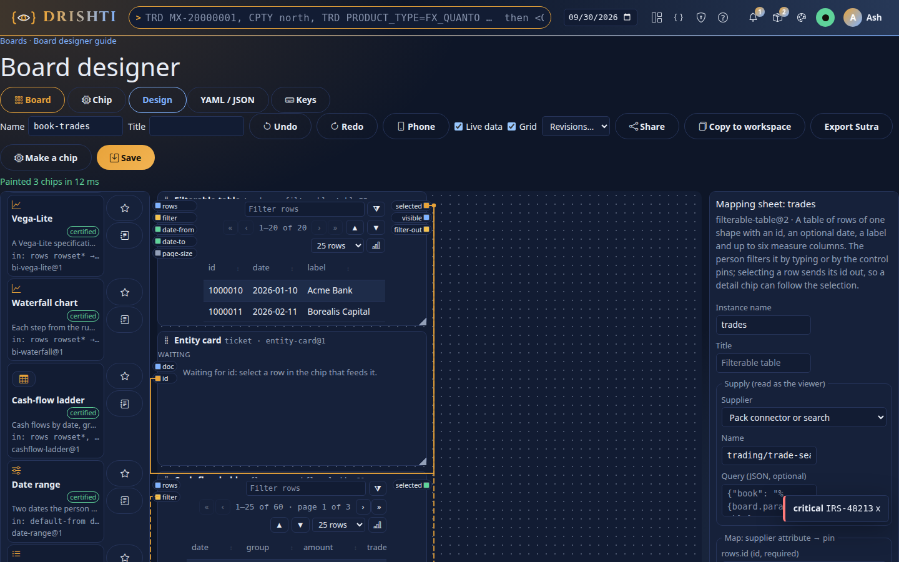
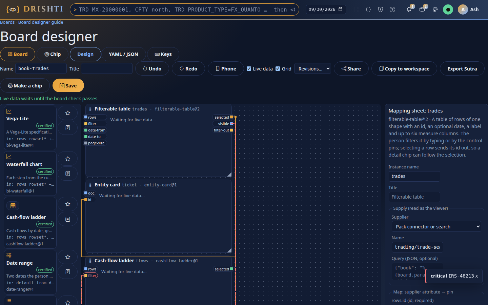
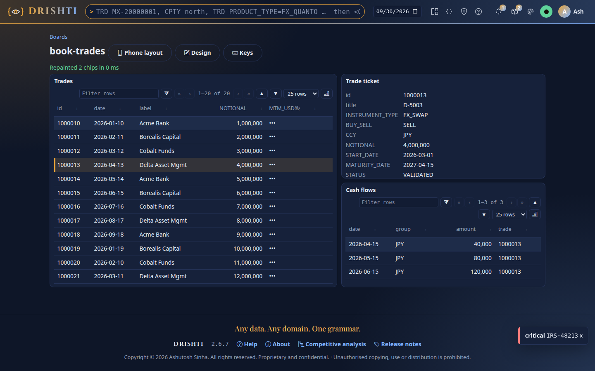
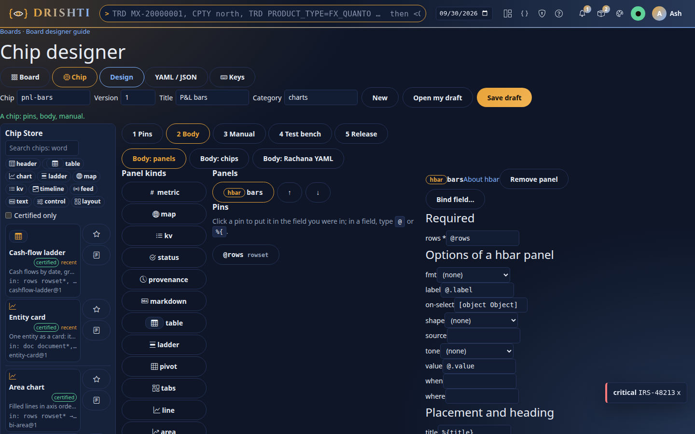
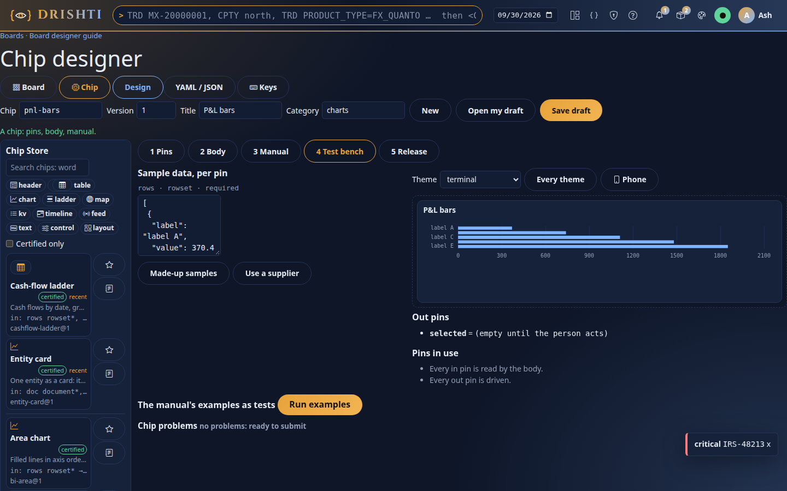
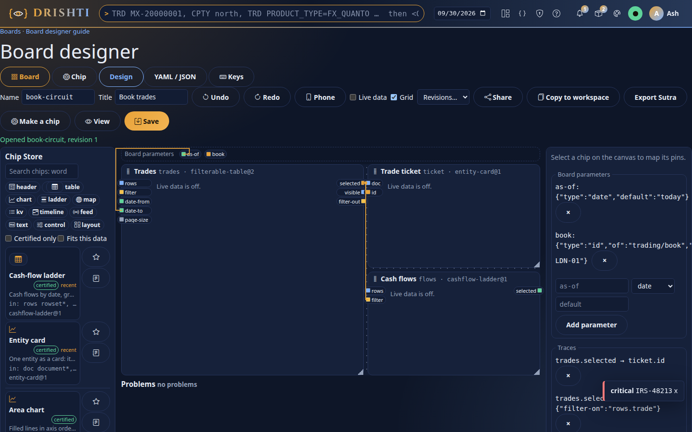
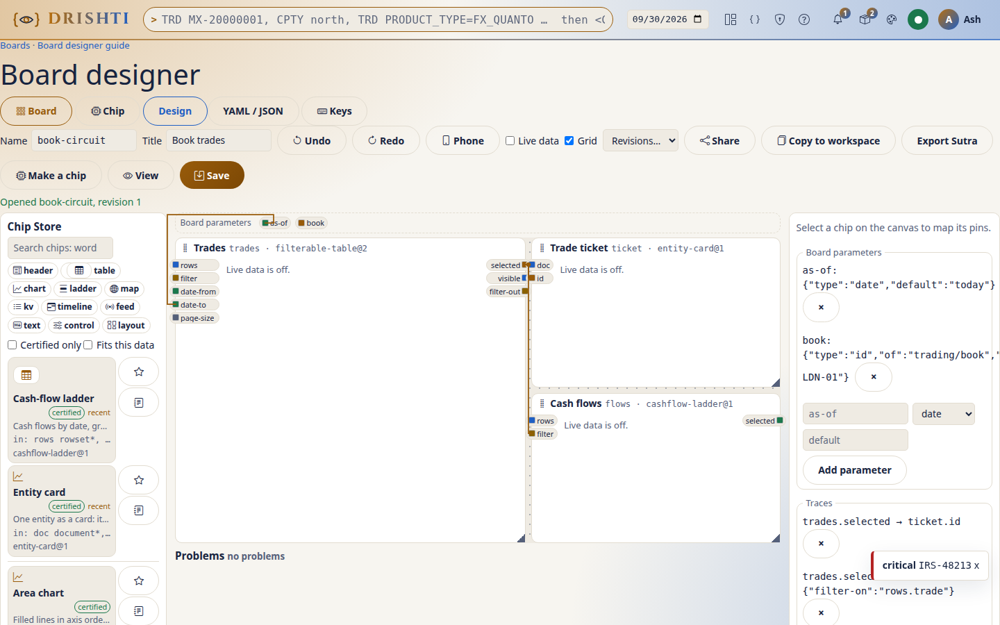

<!--
  Project Drishti · Any data. Any domain. One grammar.

  Copyright (c) 2026 Ashutosh Sinha <ajsinha@gmail.com>.
  All rights reserved.

  PROPRIETARY AND CONFIDENTIAL.

  This file is the confidential and proprietary property of Ashutosh Sinha.
  Unauthorised copying, use, modification, distribution or disclosure of this
  file, via any medium, is strictly prohibited except with the express prior
  written permission of the copyright holder.

  See the LICENSE file in the root of this repository for the full terms.
-->
# The Board designer (2.7.0)

A **board** is a screen wired from certified **chips** of the Chip Store: each chip has typed **pins**, a **supplier** feeds its data pins,
and **traces** carry one chip's out pin (a selection, a filter) into another chip's in pin. A board reads its data as whoever opens it:
their roles, row rules and masks, always. The design is [UI_BOARD.md](../architecture/UI_BOARD.md); the server routes are in
[API_GUIDE.md](API_GUIDE.md#ui-boards-and-the-chip-store-apiv1ui-270).

Every step below shows what you do in the console and the same thing in the board document (YAML), which the designer's
**YAML / JSON** tab edits directly. Both are one document: change either and the other follows.

**Where:** Build → **Designer** (`/build/new`) → **New board**, or Build → **Boards** (`/build`), the one list of your boards and your
screen designs. A board opens at `/build/board/<name>`; its viewer at `/ui/b/<name>`.



## 1. One designer, two modes

The designer has two modes in one shell, one palette area (the Chip Store) and one YAML / JSON tab:

* **Board**: the canvas, pins and traces, the mapping sheet, live data, the Problems list. This guide.
* **Chip**: authoring a chip: its pins, its body (panels, or chips inside), its manual, the test bench and the release steps. See
  [Chip mode](#chip-mode).

A screen design (`/build/d/<id>`) opens as a board with **Open as board** (in its header, or in the Boards list), converted by P5's converter
(`POST /api/v1/ui/convert/sutra`): a panel a seed chip carries whole becomes that chip, anything else a board-local chip (`local-<panel>`,
its bindings written over the record's pins, and a Chip Store candidate), the page header a board-local chip whose controls are traced
into the panels that read them; the status line names the board-local chips. **Export Sutra** paints a board of one record (a parameter
`id` of a kind) back into a Sutra for a pack (`POST /api/v1/ui/convert/board`), until 3.0.

## 2. Name the board

UI: type the name in **Name** (lower case, digits and dashes) and a **Title**.

```yaml
rachana: 1
board: book-trades
title: Book trades
```

## 3. Add chips from the Chip Store

UI: search the **Chip Store** on the left (see [Finding chips](#finding-chips); *Certified only* narrows it); the journal button opens a chip's datasheet and manual (pins, types,
behaviour, limits, examples). **Drag** a chip onto the grid, or focus it and press **Enter** (it goes below the others). In the mapping sheet
on the right, rename the instance (`trades`).

```yaml
chips:
  trades:
    use: filterable-table@2
layout:
  desktop:
    columns: 12
    areas:
      - { chip: trades, at: [1, 1], span: [7, 8] }
```

Move a box by dragging its heading (or the arrow keys), resize it from its corner (or Shift+arrows); Delete removes it.

## 4. Supply and map the pins

UI: in the mapping sheet choose the **Supplier** (*Pack connector or search*, *BI model*, *Live topic*), its **Name**, and an optional
**Query** (JSON). Then map each column of the chip's data pin to a supplier attribute: the lists offer **only compatible attributes** (an
`id` column offers ids, a `measure` column measures; a `many` column takes several).

```yaml
  trades:
    use: filterable-table@2
    supply:
      connector: trading/trade-search
      query: { book: "%{board.params.book}" }
    map:
      rows.id:       TRADE_ID
      rows.date:     TRADE_DATE
      rows.label:    COUNTERPARTY_NAME
      rows.measures: [NOTIONAL, MTM_USD]
```

The attributes come from the pack's search form, or from the BI model's measures and columns. When the console cannot list them, the sheet
takes typed names; the board check and the render have the last word.

## 5. Draw traces

UI: pins are square pads on each box: in pins on the left edge, out pins on the right, coloured by type; wires are routed as on a
circuit (see [A board looks like a circuit](#a-board-looks-like-a-circuit)). **Drag from an out pin to an in pin**; while
you drag, only the compatible in pins light up. By keyboard: Enter on the out pin, then Enter on the in pin (Esc cancels). A selection traced
into a `filter` pin gets its `filter-on` column by itself (the target's id column). Board parameters are out pins on the strip above the grid.

```yaml
traces:
  - from: trades.selected
    to:   ticket.id
  - from: trades.selected
    to:   flows.filter
    transform: { filter-on: rows.trade }
```

The traces list in the mapping sheet shows every trace with a remove button; clicking a wire selects it (Delete removes it).

## 6. Problems in red

The board check runs on every change. A problem paints its box, pin or wire red with its message, and the **Problems** list below the canvas
jumps to each one. **Save** stays disabled while errors remain.



```yaml
traces:
  - from: trades.visible     # BC-04: a rowset cannot feed the filter pin flows.filter
    to:   flows.filter
```

## 7. Live data while you design

UI: tick **Live data**. Every box paints its chip with real data, read **as you** through the render API (the same masks and rules a viewer
with your rights gets), after each change. A detail chip shows *Waiting for id* until its master has a selection; a BI question that becomes a
run shows a run card; a failing chip says its code and reason. Live data waits while the board check has errors.

## 8. Phone and desktop

UI: **Phone** shows the phone layout, one column: reorder with the arrows, tick *collapsed* for a chip shown as a heading the person opens.

```yaml
layout:
  phone:
    order: [trades, ticket, flows]
    collapsed: [flows]
```

## 9. Save, revisions, share, copy

* **Save** (Ctrl+S): a new board, or a new revision. Saving is compare-and-set: if someone saved meanwhile, the designer says *Changed
  elsewhere* with **Reload** (the server's `409 DRS-5057`); your text is still in the YAML tab to copy.
* **Revisions…** lists earlier saves; choosing one puts it in the YAML tab, and Save makes it current.
* **Undo / Redo** (Ctrl+Z, Ctrl+Y) step through your changes in this session.
* **Share** names people who may open your board read-only, as themselves; the link is `/ui/b/<board>?owner=<you>`.
* **Copy to workspace** copies it into a BI workspace, owned by you.

## 10. View the board

UI: **View**, or the board's name in Boards. The viewer paints the layout first, then each chip as its supplier answers. Select a row and the
chips that follow it repaint. Every table chip has **Chart** (K). **Phone layout** shows the phone version; on a phone it is the default.



## Chip mode

A chip is a Rachana-grammar Sutra with typed pins and its own manual: a pure function that paints UI. **Chip mode** is the same designer
(the **Chip** button, `/build/chip/<name>`, or Build → Designer → **New chip**), in five steps, with the chip's whole document in the
YAML / JSON tab. Any step's mistakes are red at once (the browser checks as you type) and listed under **Chip problems**, each a link to
where it is; the server's publish check runs on every pause and adds what only it can tell (CP-05, CP-06).



### Name it

UI: **Chip** (the name), **Version**, **Title** and **Category** in the toolbar; **New** starts over, **Open my draft** reads your saved
draft, **Save draft** (Ctrl+S) keeps it (compare-and-set: a draft saved elsewhere meanwhile is `409 DRS-5057`).

```yaml
rachana: 1
chip: pnl-bars
version: 1
title: P&L bars
category: charts
```

### 1. Pins

UI: **Add in pin** / **Add out pin**, then per row: the name, the role (**data**: rows or a document; **control**: filters, ids, dates,
numbers), the type (`id`, `text`, `number`, `bool`, `enum`, `date`, `datetime`, `period`, `measure`, `dimension`, `filter`, `selection`,
`document`, `rowset`), the columns of a rowset or document (`label:dimension!, value:measure`: `!` required, `*` many), the values of an
enum, the kind of an id (`of: trading/book`), **Required** and the default. A rowset pin without columns, an enum without values, a default
of the wrong type or outside the values: red, with why.

```yaml
pins:
  in:
    rows:  { role: data, type: rowset, required: true, shape: { label: { type: dimension, required: true }, value: { type: measure, required: true } } }
    order: { role: control, type: enum, values: [asc, desc], default: desc }
  out:
    selected: { type: dimension }
```

### 2. Body: panels

UI: **Body: panels** is the screen designer's own panel palette and inspector. **Panel kinds** adds a panel (a table, an hbar, a kv...);
its rows are your first data pin (`@rows`). The inspector's fields complete pins, not document paths: type `@` (`@rows`, `@.label` for a
column of the rowset) or `%{` (`%{order}`), or click a pin under **Pins** to put it in the field you were in. A reference that names no pin
is red (CP-02: `@trades` names no in pin), as is a source key (`connector`, `model`, `sql`...). **Body: Rachana YAML** is the body alone,
in the grammar, to edit as text.

```yaml
body:
  panels:
    - id: bars
      kind: hbar
      rows: "@rows"
      label: "@.label"
      value: "@.value"
      on-select: { emits: selected, value: "@.label" }    # drives the out pin (CP-03)
```

### 2b. Body: chips (a composite chip: a board with no connectors)

A chip can be built from other chips, like an electronic chip with chips inside. Its body **is a board, with no connector**: no supply
anywhere inside; its data enters only through its own pins.

UI: **Body: chips** → **Build the body from chips** → **Edit the inner board**: the designer shows Board mode's own canvas (the palette,
traces, the mapping sheet) for the inner board, with a banner *Inside the chip …*; the supplier pickers are disabled. Place and wire the inner
chips, then **Done**. Back in **Body: chips**, the table lists every inner pin: what feeds it (a trace, a constant, a chip pin) and
**Expose as the chip's pin**: name it and it becomes a chip pin of the same type. A required inner pin that nothing feeds is red (CP-07).
Adding a supply inside is refused at **Done** and by the publish check (CP-07: *a composite chip has no connector*). Chips nest three levels
deep at most.

```yaml
body:
  board:
    chips:
      search-box:       { use: search-box@1 }
      filterable-table: { use: filterable-table@2 }
    traces:
      - { from: search-box.filter-out, to: filterable-table.filter }
  wires:   { rows: filterable-table.rows }          # chip in pin  <- inner in pin
  exposes: { selected: filterable-table.selected }  # chip out pin <- inner out pin
pins:
  in:  { rows: { role: data, type: rowset, required: true, shape: { id: { type: id, required: true } } } }
  out: { selected: { type: id } }
```

### 3. Manual

UI: a field per manual key with the prompt of what it needs (purpose, behaviour, defaults, limits, not-for, accessibility), a line per pin,
and **Add example**, which writes a board fragment using this chip with its required columns mapped, to edit. Anything missing is red
(CP-01).

```yaml
manual:
  purpose: Horizontal bars of a value per label.
  pins: { rows: "The rows; empty shows nothing.", order: "asc or desc.", selected: "Out. The label clicked." }
  behaviour: Clicking a bar sends selected.
  defaults: All rows, descending.
  limits: Up to 50 bars.
  examples:
    - title: A book's P&L
      board: |
        chips:
          c: { use: pnl-bars@1, supply: { connector: trading/trade-search }, map: { rows.label: COUNTERPARTY_NAME, rows.value: NOTIONAL } }
  not-for: Time series (use a line).
  accessibility: Read as a list.
```

### 4. Test bench

UI: **Sample data, per pin**: rows or a document as JSON (made up from the pin's columns to start), a scalar typed; **Use a supplier** renders
the first example as you and takes its rows (your masks). The chip paints at once from the samples; **Theme** paints it in any theme, **Every
theme** in all ten in turn, **Phone** at a phone's width. Clicking in the chip shows the values on its out pins. **Pins in use** lists the
in pins the body never reads and the out pins nothing drives (CP-03). **Run examples** saves the draft, then runs each manual example as a
test: the board check (CP-05) and a real render, *passes* or *fails* with why. A composite chip is painted chip by chip through its pins.



### 5. Release

UI: the versions and their states, **Where used** (the boards on each version), and **Compatibility** against the latest released version:
what breaks (a pin removed or retyped). Then the steps of P2's lifecycle: **Submit** (the publish check runs on the server), **Approve** or
**Reject** by a reviewer other than you (four eyes: approving your own chip is `403 DRS-2007`), **Publish**, **Certify**. A compatible
version may claim `compatible-with` the earlier one, and boards follow it by themselves; a **breaking change is a new major version**: it may
not claim it (CP-06 at the check, `DRS-2078` at publish), so boards stay on their version until their owner moves them.

```yaml
version: 2
compatible-with: [1]     # only when nothing in 1 was removed or retyped
```

### Make a chip, and the candidates

* **Make a chip** (Board mode's toolbar): tick the wired chips to put inside and name the new chip. They become a composite chip draft;
  on the board they are replaced by one instance of it, **their supply staying outside** on that instance (its map renamed to the chip's
  pins) and the traces to the rest of the board rewired to its pins. Their unconnected pins are the new chip's pins.
* **Candidates** (Chip mode's palette): the board-local chips P5's converter made from pack screens (`local-*`). One opens as
  `<pack>-<name>@1` to be made generic: its pins named for any supplier, its manual completed, then submitted like any chip.
* A store chip picked in Chip mode opens as a copy (`<name>-mine@1`) to start from.

## Finding chips

The Chip Store palette searches the id, title, purpose, category and tags, and the pin types: `date`, `measure`, `rowset of trade`,
`id of book`; every word must match, title and id matches first. The category chips (header, table, chart, ladder, map, kv, timeline,
feed, text, control, layout) filter at once. **Fits this data** (Board mode): with a chip that has a supply selected, only the chips whose
required data pins its attributes can feed. Starred chips and your recent ones come first (kept in this browser). Each result shows its
title, a line of purpose, its pins, the certified badge and the manual button. `/` focuses the search, the arrows move, Enter adds.

## A board looks like a circuit

Traces are routed as on a schematic: straight runs with 90° bends round the boxes, a **hop** where two wires cross (they are not joined), a
**junction dot** where one out pin fans out to several in pins. Wires are thin, in the theme's accent; hover or select one to highlight it;
a bad wire is red and dashed. Pins are square pads on the box edge; **Grid** shows a faint grid of dots. With **Live data**, the wires into a
chip that just got new data show the current flowing for a moment (not when the system asks for reduced motion). Wires re-route as you move
a chip.





## Keys

| Keys | Does |
|---|---|
| / | Search the Chip Store; the arrows move through the results |
| Enter on a chip in the store | Adds it (Board mode) or opens a copy (Chip mode) |
| Arrows, Shift+arrows on a box | Move, resize |
| Enter on an out pin, then on an in pin | Draw a trace (Esc cancels) |
| Delete | Remove the box or the selected wire |
| Ctrl+Z, Ctrl+Y, Ctrl+S | Undo, Redo, Save (Save draft in Chip mode) |
| g b, g n, g c | Boards, a new board, a new chip |
| ? | The keys |
