<!--
  Project Drishti · Any data. Any domain. One grammar.

  Copyright (c) 2026 Ashutosh Sinha <ajsinha@gmail.com>.
  All rights reserved.

  PROPRIETARY AND CONFIDENTIAL.

  This file is the confidential and proprietary property of Ashutosh Sinha.
  Unauthorised copying, use, modification, distribution or disclosure of this
  file, via any medium, is strictly prohibited except with the express prior
  written permission of the copyright holder.

  See the LICENSE file in the root of this repository for the full terms.
-->
# User guide

This guide explains every part of the Drishti console, one feature at a time. Each section says what
the feature is for, then walks through an example: the exact text to type and what you should see.

If Drishti is not running yet, start with [OPERATIONS_GUIDE.md](OPERATIONS_GUIDE.md#2-install-and-run-on-one-machine) (ten minutes) or
[OPERATIONS_GUIDE.md](OPERATIONS_GUIDE.md#2-install-and-run-on-one-machine) (every step explained).

The examples use the seven default packs (`core`, `market-data`, `trading`, `counterparty-risk`, `market-risk`, `world-economy`, `news-and-markets`)
on the demo lakes of the quick start (`drishti.py lake demo`, business date 2026-10-16; [OPERATIONS_GUIDE.md](OPERATIONS_GUIDE.md#2-install-and-run-on-one-machine)), so ids such as
`MX-20000001`, `1000001` and `NS-SUMMIT-NY` exist and the counts are those of 15,000 trades from ENDUR, CALYPSO and MUREX. If your administrator loaded other packs, the
**Examples** list on the terminal page shows ids that work for you, and every pack's guide (*Help → Help
centre → Domain packs*) has a *Finding things* section with the same commands for its own kinds.

**Contents**

| Section | What you learn |
|---|---|
| [The pages at a glance](#the-pages-at-a-glance) | Every page and its address |
| [The top bar](#the-top-bar) | The menus and the round tools on the right; one sitemap draws every menu, the Admin tabs and the BI rail |
| [The Build home](#the-build-home-everything-you-build-in-one-place) | Everything you build in one place: the rail by kind with counts, what each item uses and what uses it, + New, one search |
| [The command line](#the-command-line) | Opening an entity, suggestions, what an error means |
| [Pick lists](#pick-lists-when-a-command-names-several-entities) | `TRD MX-200000`, `CPTY north`, `TRD PRODUCT_TYPE=FX_QUANTO`, `TRD` |
| [Tables: paging and the keyboard](#tables-sorting-filtering-paging-and-the-keyboard) | The pager, ▲ ▼, and the keys that walk a table |
| [Controls on a screen](#controls-on-a-screen-choose-what-a-panel-shows) | Dropdowns, date ranges and search that a screen offers: pick a leg or a period and only the panels that depend on it move; the choice is in the address |
| [A deep trade](#a-deep-trade-legs-cashflows-and-fixings) | A tab per leg; each leg's terms and cashflows, and a floating cashflow that opens to its fixings; live, and on a phone |
| [Filter a table like Excel](#filter-a-table-like-excel) | A funnel in every column heading: tick values or filter by a condition, in the address, with `Alt+Shift+X` to clear |
| [Reading a view](#reading-a-view) | Title, strip, panels, links, provenance |
| [About this page](#about-this-page) | `?`: what the page is, what each number means, where the data came from, why it looks like this |
| [Layout mode](#layout-mode-arrange-a-view-your-way) | `Alt+L`: drag, resize and hide panels for yourself; promote your layout to the Sutra |
| [Screens that respond](#screens-that-respond-clicks-refresh-editing-and-your-own-page) | A click that opens a panel, refresh and freshness, Pause all, editing a record (drafts), a screen you arrange, *Your page* |
| [Zoom a panel](#zoom-a-panel) | `Z`: one panel fills the view area; restore with `Esc`; shareable as `#zoom=<panel>` |
| [On a phone](#on-a-phone) | What a phone shows first, *More on this page*, *On desktop*, *Show everything*, the Domains menu |
| [Pivot](#pivot-slice-a-table-your-way) | Rows, columns, values and filters over a table or a search's results, by drag or by key; totals, drill-down, chart, export |
| [Tables and models](#tables-and-models-the-editors) | The editors of virtual tables, semantic models and Python-driven tables: live YAML, a preview as you, review before live |
| [Keyboard](#keyboard) | Every key in one table |
| [Search everything](#search-everything-altk) | `Alt+K`: one box over entities, commands, screens, Help and what you can build |
| [Live updates](#live-updates), [Business dates](#business-dates-live-or-a-day-in-the-past), [Compare](#compare-what-changed) | Ticking values, past dates, what changed |
| [Search by value](#search-by-value) | `where` searches, sorting and limits |
| [Calc: Python on a view](#altc--calc-python-on-a-view) | `Alt+C`: Python in your browser on what you are looking at |
| [Export, print and share](#export-print-and-share) | CSV, JSON Lines, JSON, PDF and links |
| [Share a view with a note](#share-a-view-with-a-note), [Your inbox](#your-inbox) | Send a view to colleagues; what they sent you |
| [Monitors](#monitors), [Alerts](#alerts), [Workspaces](#workspaces) | Watching many entities at once |
| [Approvals](#approvals) | Everything waiting for your four eyes, in one queue |
| [Your Home](#your-home) | The page you land on after signing in: Needs you, your role's cards, pin, hide and move them |
| [Your settings](#your-settings), [Themes](#themes), [Domain packs](#domain-packs-choosing-what-you-see) | Making the console yours |
| [The workbench](#the-workbench-changing-how-a-screen-looks) | Changing how a screen looks |
| [Administration](ADMIN_GUIDE.md#29-the-admin-pages-at-a-glance) | Users, roles, packs, audit, health, caches, capacity |
| [Query by form](#query-by-form) | `FORM <pack>`: the forms home, the inputs, the search a form writes, keeping and scheduling it, who decides what a form offers |
| [Calc: Python on any view](bi/CALC.md) | `Alt+C` in full: the `drishti` module, output and charts, packages, packs and roles, snippets, the runtime, limits, `drishti.quant`, the BI client |
| [The Notebook](#the-notebook) | Code over data: open a model as your masked extract, SQL cells run by the server, Python cells on its compute pool, notebooks, promote to a report or a Python item |

## The pages at a glance

| Page | Address | What it is for |
|---|---|---|
| Landing (Home) | `/` | The start page, with a button to open the terminal; signed in, the fact of the day and quick cards ([Home: the fact of the day](#home-the-fact-of-the-day)) |
| Terminal | `/t` | The command line, your pinned entities and example commands |
| View | `/v/<kind>/<id>` | One entity, laid out in full (for example `/v/trade/MX-20000001`) |
| Pick list and search results | `/s?q=…` | Entities a command names (`TRD MX-200000`) or a `where` search finds |
| Forms | `/forms`, `/form/<pack>` | Query by form: the forms home, and a pack's search form ([Search with a form](#search-with-a-form-form-pack)) |
| Pack overview | `/p/<pack>` | What a pack holds (type its code alone: `MKT <GO>`) |
| Compare | `/compare/<kind>/<id>` | What changed in an entity between two business dates |
| Impact | `/impact/<kind>/<id>` | What depends on an entity (F8) |
| Monitors | `/m` | Live watchlists |
| Alerts | `/alerts` | Your alerts on numbers, your alert rules and recent alerts (also **Reports**, *My alerts*) |
| Workspaces | `/w` | Several live views on one screen |
| Inbox | `/inbox` | Views and comments sent to you ([Your inbox](#your-inbox)) |
| Reports | `/reports` | Saved searches delivered as CSV on a schedule, and your subscriptions ([Scheduled reports](#scheduled-reports), [Export, and subscriptions](bi/DISTRIBUTION_AND_ALERTS.md#12-export)) |
| BI | `/bi`, `/bi/catalogue`, `/bi/w/me`, `/bi/r/<id>`, `/bi/models`, `/bi/datasets`, `/bi/designer`, `/bi/notebook`, `/bi/transform` | Rūpaka business intelligence, for people with the `bi` power: reports (a board is a report page; `/bi/b/<id>` opens it), BI Studio's designers, the Notebook and the Transform editor ([NOTEBOOK_AND_PYTHON.md](bi/NOTEBOOK_AND_PYTHON.md)) |
| Build | `/build`, `/build/new`, `/build/pack/designer` | Design layouts (Sutras) in the workbench, make a pack from schemas (proposed Sutras are approved in [Approvals](#approvals)) |
| Tables & models | `/build/tables` | The editors of virtual tables, semantic models and Python-driven tables, for people with the `bi` power ([Tables and models: the editors](#tables-and-models-the-editors)) |
| My account | `/account` | Your profile, settings and password |
| Servers | `/servers` | The Drishti servers this console may talk to ([Working with several servers](#working-with-several-servers)) |
| Admin | `/admin/users`, `/admin/roles`, `/admin/audit`, `/admin/packs`, `/admin/connectors`, `/admin/artifacts`, `/admin/loads`, `/admin/lakes`, `/admin/collab`, `/admin/embedding`, `/admin/net`, `/admin/health`, `/admin/caches` (and `/admin/ai`, `/admin/bi`, `/admin/tokens`, `/admin/access` where those features are on) | Users, roles, audit log, packs, connectors, installed artifacts, data loads, lakes (Delta, the default; Iceberg tables where configured: a **Format** column, and Iceberg maintenance with orphan-file removal, [OPERATIONS_GUIDE.md › Lake maintenance: Admin → Lakes → Maintain and `lake maintain`, section 8](OPERATIONS_GUIDE.md#163-iceberg-lakes)), collaboration moderation, embedding, Drishti\*net, health and caches (admins only) |
| Help | `/help` | Tutorials, guides and every reference |
| About | `/about` | The product page: features, measured performance, competitive analysis, technology, licence (system details for admins: `/admin/health`) |

## Your Home

After you sign in you land on **Your Home**, the page made for your role (`/home`); the functions list stays in the menu and in the command
line (`Ctrl+K` / `⌘K`). Your Home is a set of cards drawn from the figures the server already holds for you, so what you see follows your
roles and, like every table, your row rules and masks.

**What is on it**

- **A greeting and one line of freshness:** the business date and whether every daily load is in. A small amber mark means a daily load is late or failed.
- **Needs you:** alerts raised for you, approvals waiting in your inbox, late or failed data loads and the high exceptions of your Home. When
  nothing needs you the strip is not on the page at all. **Snooze for 4 hours** puts what it lists to sleep (it comes back when the time is up).
- **Your cards,** best first for your role. A risk manager sees firm VaR, expected shortfall, the backtest light, limit utilisation by desk and
  the biggest movers; a credit officer starts with exposure against limits; a trader with their desk's VaR. Every role also gets **Data loads**,
  **Pinned** (the entities you pinned) and **Recently used**. If you hold several roles you see the cards of all of them, ranked together.
- **Since your last visit:** what the server recorded since you were last here: data loads, limit moves, measures that moved (new variants in
  a cohort, a desk's VaR), and the alerts that fired. The panel's title says from when (**Since your last visit, 2026-11-26 18:00 UTC**), and
  the strip carries the same time. A refresh or a click on the page does not move that time, only coming back after more than half an hour
  does. The first time you come, there is no earlier visit and the panel reads since the Home's reference cut-off (**Since yesterday 17:00**).
- **A genomics Home** (for the genomicist roles): cohort samples, new variants since the cut-off, the strongest associations with a small
  association map (the tallest peak of each stretch of the genome, coloured by chromosome), ClinVar updates for the genes your cohorts carry,
  the genomics data loads (the ClinVar and Ensembl feeds and the files of your own that were read) and, under **Needs you**, any VCF file that failed validation.

**View as.** If you hold more than one role, the top of your Home has **View as**: **All** (the cards of every role, ranked together, as
before) and one button for each role you have (Risk manager, Credit officer, Genomicist ...). A button shows that role's Home alone, in
place: its cards, its order and its layout, without leaving the page, and the choice is remembered for you on the server (your next visit
opens the same way, on any browser). The buttons are the roles you really have, so nothing is offered that you could not see anyway;
`/home/role/<name>` still opens a role's own Home page. With a single role there is nothing to switch and the buttons are not shown. They
work from the keyboard (**Tab** to the row, **Enter** or **Space** to press one) and wrap onto a second line on a phone.

**The logo** at the top left always brings you back to Your Home.

**Two layouts.** Most roles get the calm layout: two cards across, room to read. Risk-manager roles get the cockpit: the same cards, denser,
the figures in one row first. On a phone the cards stack and Needs you comes first.

**Make it yours.** Each card has its own buttons in its header:

| Button | Does |
|---|---|
| **Explain** | opens the one Explain in a side panel: formula, inputs, why it moved |
| **Open** | runs the card's command (for example `VAR BANK`) |
| **Pin** / **Unpin** | keeps the card at the top, in the order you pinned (up to 8) |
| **Up**, **Down** | moves the card in your order |
| **Hide** | takes the card off your Home; **Show …** in the **Your Home** card at the bottom brings it back, **Reset my Home** puts your role's order back |

What you pin, hide, move or snooze, the role you view as and when you last visited are **your own setting** on the server (`homeCards`), so it follows you to every browser and is never seen
by anyone else. Light and dark follow your theme.

## Home: the fact of the day

Signed in, the landing page (Home) puts **Did you know** beside the headline *See what your data hasn't told you yet.*: one
surprising fact about your data on the business date you are on, worked out from the data itself. The tile shows:

- the domain and the date (**Fact of the day · Counterparty credit**, 2026-10-27);
- one sentence, its key figure highlighted, and a small picture (bars, or a filled bar for a share of a whole);
- **Why does that happen?**: opens a short explanation, with **Read more in Knowledge** (the Knowledge page section that explains it);
- **Open …**: the command that shows it (`EXP NS-NORTHPLAINS-NY`, `VAR NODE MGMT~BOOK-COMM-1`, `FUND PONAX`), and **WHAT …**, the
  term's glossary entry;
- **Another fact**: the next fact that holds today (it wraps round).

Every figure is computed from the server's answers as you, so you see only facts about data you may see, and only for packs you have
switched on. Nothing is written into a fact: a fact is shown only on a date its condition holds (a book over its VaR limit inside a
desk within its own; collateral that more than doubles a netting set's expected exposure; a counterparty whose peak PFE is over five
times its trades' VaR; the largest US funds owning a tenth or more of the company they hold most of; two funds of different managers
tracking one index and 80% or more the same; a fund whose holdings weigh over 120% of its net assets; a desk that adds VaR on paper but
whose removal would raise the bank's). The first fact changes with the business date; everyone on the same date sees the same one first.
On the demo data of 2026-10-27 the facts read:

| Domain | The fact | Opens |
|---|---|---|
| Market risk | BOOK-COMM-1 is at **259%** of its VaR limit, while its desk, Commodities, is within its own | `VAR NODE MGMT~BOOK-COMM-1` |
| Market risk | Take the **Commodities** desk out and the bank's VaR would rise by 10.7m, though the desk adds 3.0m to it on paper | `VAR DESK DESK-COMM` |
| Counterparty credit | Collateral made **NS-NORTHPLAINS-NY** more risky: EE at 2M is 129.7m with it and 55.6m without (+133%) | `EXP NS-NORTHPLAINS-NY` |
| Counterparty credit | Northern Plains Energy Canada's trades have a VaR of 37.4m but a peak PFE of **508.1m** (13.6× as large) | `EXP CP-NORTHPLAINS` |
| Funds and companies | 87 of the largest US funds hold Nvidia and own **21.19%** of its shares | `HELD NVDA` |
| Funds and companies | VOO and IVV, run by two different managers, are **99.3%** the same portfolio | `FUND VOO` |
| Funds and companies | PIMCO Income Fund (PONAX) holds investments weighing **150.01%** of its net assets | `FUND PONAX` |

The tile draws at once as a placeholder and fills when the facts are ready (the first visit of a business date computes them, a few
seconds at most on the demo data; later visits that day read them back). When no fact holds, or the server cannot be reached, the tile
is left out and the headline stands alone. Under the headline, **quick cards** open *Market risk* (`VAR BANK`), *Exposure* (`EXP BANK`),
*Funds and ETFs* (`FUND SPY`) and *Data map* (`DATAMAP`); a card whose pack is off is not shown. An administrator turns the tile off
with `ui.facts.enabled: false` (`DRISHTI_HOME_FACTS=false`) and sets the cards under `ui.home_cards` in the console's
`application.yaml`; a pack author adds facts as the [pack developer guide](BUILD_GUIDE.md#74-facts-for-home) describes.

### Home: the house

Below the headline and its animation, **One kernel. Modules plug in.** draws the product you are running as a house: the kernel in
the middle, and around it one room for each module this distribution has loaded and switched on (Drishti Risk: banking and market
data; Drishti All: every module the server loaded), with empty `.dmod` sockets where another module could plug in. A room's colour
stays the same in every distribution of the site. The sentence beside it names the product and its modules, the caption gives the
product's name and tagline (both from the distribution's `brand`), and **How it fits together** opens
[How Drishti fits together](../../HOW_IT_FITS.md#the-house). A module switched off, or not loaded, leaves its room out; the picture
follows the theme, and on a phone it sits under the text. An edition or lens can leave the section out with
`home.sections: { house: off }`.

## The top bar

Every page has the same top bar, on one row: **Views · Domains · Create · Admin · Help** and the landing page when you are signed in, and the public pages (signed out) in the same height, logo and
wordmark (set in Cinzel; the slogan is in the footer, which also carries Help, About, the competitive analysis and the release notes).

The **Drishti name and logo** at its left end always lead to the landing page, also when you are signed in. The
landing page then shows **← Back to …** (the view, Build, Admin or Help page you came from; `Alt+B`), so one click
takes you back where you were; *Open the terminal* goes to the terminal instead.

```text
◉ Drishti  > TRD MX-20000001, CPTY north …  [2026-09-30]   Views ▾  Domains ▾  Create ▾  Admin ▾  Help ▾   [bell] [box 12] [palette] (Live) (A) Ash ▾
```

**Beside the brand** (click it to go back to `/`) are the [command line](#the-command-line), which takes the
free space, and the [business date](#business-dates-live-or-a-day-in-the-past) box.
The round **search button** after the command line (or `Alt+K` anywhere) opens [the global search](#search-everything-altk).
Below 1100 pixels wide they move to a line of their own.

**Then the menus**: **Views** and **Help** for everyone, **Domains** (the subjects of the modules your site runs, risk included, each a column; with one domain active it is named after it: **Risk** in Drishti Risk, and it is not there when no domain module is active), **Create** (every designer and the BI tools in one menu: BI where you hold the `bi` power) and **Admin** only for administrators. Each menu is drawn from the modules' manifests and the distribution, so a distribution without a domain shows no Domains menu, and each entry follows your role. Each opens a panel
(a *mega menu*) in which every entry has an icon and one line saying what it does. The menu holding the page
you are on is highlighted.

| Menu | Column | Entries |
|---|---|---|
| **Views** | Look up | *Terminal* (`/t`), *Search & pick lists* (`/s`), *Forms* (`/forms`: the [forms home](#the-forms-home), query by form), *Functions* (`/func`, also `FUNC <GO>`: every command you can use, what it does and an example; administrators switch commands on or off there, [ADMIN_GUIDE.md (Functions)](ADMIN_GUIDE.md#20-functions-func-every-command-and-turning-one-on-or-off)), *Data map* (`/datamap`, also `DATAMAP <GO>`: every kind of data, how it joins and how much there is, [The data map](CLI_REFERENCE.md#205-the-data-map)), *Data* (`/data`, also `EXPORT <GO>`: every dataset and its dates, a simple selection, a day downloaded as `.jsonl.gz`, [Export data](CLI_REFERENCE.md#206-export-data)), *Reports* (`/reports`: every scheduled report and subscription, with a box to find one, and links to your alerts and the BI reports) |
| | Watch | *Workspaces* (`/w`), *Monitors* (`/m`), *Alerts* (`/alerts`), *Approvals* (`/approvals`: [the one queue](#approvals), with the number waiting) |
| **Domains** (named after its one domain when only one is active: **Risk**) | a column per menu a module brings (Blotter, Positions, Risk, Counterparties, Markets, Companies, Economies ...); Risk's columns are one per engine running, its command word in the head | **VaR** `VAR`: *VaR explorer* `VAR BANK`, *Why it moved* `VAR BANK EXPLAIN`, *VaR Playground* `PLAY VAR`, *Scenario matrix* `SMAT`, *Regulatory reports*, *Backtesting* `VAR BANK BACKTEST`, *Stress window* `SWIN BANK`, *VaR results* `VRES`, *Official records* `VOFF`, *Hierarchy limits* `VLIM` · **Exposure** `EXP`: *Exposure explorer* `EXP`, *A counterparty* `EXP CPTY …`, *A netting set* `EXP NSET …` (the pre-deal check `PREDEAL` is under **Counterparties**) · **FRTB-SA** `FRSA`: *FRTB-SA capital* `FRSA BANK`, *FRTB-SA Playground* `PLAY FRTB EXAMPLE` · **SIMM** `SIMM`: *Netting sets* `SIMM`, *SIMM Playground* `PLAY SIMM EXAMPLE`; administrators also see *Admin → Engines* and, at the foot, the engines not running on any server (greyed, never links) |
| **Create** (BI: people with the `bi` power) | Business intelligence | *Catalogue* (`/bi/catalogue`), *My workspace* (`/bi/w/me`), *My runs*, *Workspaces* |
| | Analyse | *Models*, *Datasets*, *Report designer* (`/bi/designer`), *Promotion (test to live)* (`/bi/environments`), *Notebook*, *Data prep* (`/bi/transform`) |
| | Administer | *BI settings* (administrators with `bi-admin`, [README.md](bi/README.md)) |
| | Create | *Build home* (`/build`: [the Build home](#the-build-home-everything-you-build-in-one-place)), *New screen* (`/build/new`), *New pack* (`/build/pack/designer`: schema files and/or JSON Lines in, a pack to download or deploy out; [Schema to pack](BUILD_GUIDE.md#8-the-pack-designer-create--new-pack)), *Tables & models* (`/build/tables`), *Examples* |
| | Learn | *Tutorials*, *Schema to pack*, *Screen designer guide*, *Screen developer guide*, *Panel kinds*, *Screen language reference*, *Packs and screens guide* |
| **Admin** (admins only) | People & access | *Users*, *Roles*, *API tokens*, *Who looked at what*, *Audit log*, *Saved VaR baskets* |
| | Data | *Packs*, *Connectors*, *Data loads*, *Lakes*, *Record edits*, *Data out*, *Installed items* |
| | Platform | *Configuration* ([the configuration editor](OPERATIONS_GUIDE.md#62-admin--configuration-the-configuration-editor)), *Engines*, *Python workers*, *Cluster* (Drishti\*net: [OPERATIONS_GUIDE.md](CLUSTER_GUIDE.md#1-several-servers-as-one-drishtinet)), *AI*, *Collaboration*, *Embedded views*, *Health*, *Caches*, *Capacity* |
| **Help** | Learn | *Help centre* (`/help`, also `F1`), *Knowledge* (`WHAT <GO>`), *Install and run*, *What's new*, *About* |

**One sitemap.** Every way round the product is drawn from one file, `drishti-console/config/sitemap.yaml`: the menus above, the tabs
along the top of every Admin page (the Admin menu, in its order), the BI rail (the BI menu), the sections of the help centre and the
footer. A page is listed once; the Admin tabs and the BI rail reach a page of another menu (*BI settings*, *Functions*, *My account*,
the *Pivot*, the *Build home*) without a second copy. What you see follows your role (an entry's requirements) and your lens (its own
menus), worked out on each page for you alone. An administrator adds, moves or renames an entry there (the file is read again when
it changes); a test holds every page of the console to an entry or to the page it opens from.

**The engines' pages live under Risk.** VaR, Why it moved, the VaR Playground, the scenario matrix, regulatory reports, backtesting, the stress window, VaR results and official records; the Exposure explorer, a counterparty or a netting set; FRTB-SA and SIMM with their playgrounds: each is an item of the **Risk** menu (a column per subject: VaR, Exposure, Capital and margin), its command on the right, and the Pivot stays under **Views**. Risk shows only the pages of engines running on a server of the cluster (an engine an administrator turns off in *Admin → Engines* leaves it, with its pages and help) and only those your role opens: a market-risk role sees VaR, FRTB-SA and SIMM, a credit-risk role Exposure and SIMM, an administrator every engine. The same rule holds on the command line: an engine's command words (`VAR`, `SMAT`, `SWIN`, `PLAY VAR`; `EXP`, `PLAY EXP`; `FRSA`, `PLAY FRTB`; `SIMM`, `PLAY SIMM`) are not offered in the type-ahead to a role that does not open the engine, and typing one says *VaR is not opened for your role; ask an administrator.* instead of running it. Help is not gated: every running engine's guide and tutorial stay open to everyone. Who opens which engine is its catalogue entry's `opens:` (`drishti-console/plugins/banking/engines.yaml`); the engines' switches and status are *Admin → Engines* only.

**In a distribution or a lens, the same five menus.** Every distribution draws **Views · Domains · Create · Admin · Help**; what differs is the columns of **Domains**, which come from the modules the distribution holds. Drishti Risk's Domains is named **Risk** (its one domain) with a column per engine running; Drishti Finance's Domains holds Blotter, Positions, Risk, Counterparties, Markets, Companies and Economies as columns; Drishti Genomics' is named **Genomics**. A lens or an edition only puts the columns it names first, in its order; it never takes a menu out of the bar. **Create** holds every designer and the BI tools, **Admin** is for administrators, and **Help** for everyone.

Each entry shows its command beside its name and runs it as if you had typed it, so a menu never holds anything the command line does not; an entry ending in `…` (*A counterparty*, *A country*) puts its words in the command line for you to type the id. An entry shows only when the edition keeps its command, and the VaR Playground and Backtesting entries only once those screens are on the server. Administrators set the menus in the edition's file ([LENSES.md](ADMIN_GUIDE.md#12-what-a-lens-is)).

**On a phone** the same five menus stay in the bar as finger-sized buttons; **Domains** opens as a list with a heading per column, each entry with its command beside it ([On a phone](#on-a-phone)).

**BI and the `BI` keyword (alias `RUPAKA`).** Where your roles hold the `bi` power, BI sits in the **Create** menu, and the reserved command
word `BI` goes there from the command line, in any case: `BI <GO>` the Build home (BI's own home, `/bi`, is folded into it), `BI WORKSPACE <GO>` your personal workspace, `BI CATALOGUE <GO>` the
catalogue, `BI SETTINGS <GO>` the BI settings (administrators with `bi-admin`), `BI <report-or-board> <GO>` a published item by id or title (a **report opens drawn**, with its slicers, drill-down and drill-through; type-ahead completes after `BI `; `RUPAKA` still works as an alias). Without the power the menu is not there and `BI <GO>`
says what is missing. No pack can define a mnemonic named `BI`, `RUPAKA`, `FORM`, `FUNC`, `WHAT`, `DATAMAP` or `DATA`. The BI page, its keys (`/`, `g h`, `g c`, `g w`, `?`) and what it can and cannot do yet:
[README.md](bi/README.md). **Using a report:** click a bar and the page filters to it, the buttons in a visual's header drill down, drill through to another page, show the rows behind it or open a trade in the terminal, and a slicer filters
what it can reach ([README.md](bi/README.md) section 14); **building one:** *Designer* in the BI rail, drag fields onto the canvas in BI Studio, with its Explorer, tabs and Problems and Query dock ([README.md](bi/README.md) sections 15 and 26, [the reports tutorial, Part A](bi/REPORTS.md#part-a--your-first-bi-report)); the YAML reference is [REPORT_FILE_FORMAT_STATEMENTS.md](bi/REPORT_FILE_FORMAT_STATEMENTS.md#1-the-report-file-pages-visuals-filters-and-slicers). The BI rail also opens *Analyse*, *Transforms* (Python data prep step by step) and the *Python console*.

**In a report:** a **parameter slicer** may switch *which* field or measure a visual draws (a field parameter: the chart breaks down
by desk, then by portfolio; it shows MTM, then notional), and the choice is yours alone, as any slicer's ([REPORT_FILE_FORMAT_STATEMENTS.md › Reports: the YAML, the visuals and how they behave, section 21](bi/REPORT_FILE_FORMAT_STATEMENTS.md#3-field-parameters)).
A report may also have **statement pages**: paper, page by page, with a header and footer, page numbers and a period, downloaded as PDF or
Excel made as you (your masks and row rules), and sent by a subscription as one statement per recipient; the reference is
[REPORT_FILE_FORMAT_STATEMENTS.md › Reports: the YAML, the visuals and how they behave, section 24](bi/REPORT_FILE_FORMAT_STATEMENTS.md#4-statements-paginated-reports-page-exact-one-per-reader), the walk-through [the reports tutorial, Part C](bi/REPORT_FILE_FORMAT_STATEMENTS.md#part-c--statements-and-field-parameters).

**On the right:** round tools, from left to right.

| Tool | Looks like | What it does |
|---|---|---|
| Live | the round button right of the theme switcher | Your choice and this page's stream in one: green while live (glowing while ticks arrive, an amber ring while it reconnects, steady on a page without a stream), red with pause bars while paused or on a picked date. Hover to read both, for example *Live updates on — click to pause · Live, built 1.92 ms*. A click switches ([Business dates](#business-dates-live-or-a-day-in-the-past)) |
| Alerts | a bell | Opens `/alerts`. A number on the bell counts alerts you have not seen ([Alerts](#alerts)), and BI runs that finished, failed or were started again (`BI RUNS <GO>` lists them: [LIVE_REPORTS_AND_BOARDS.md section 28](bi/LIVE_REPORTS_AND_BOARDS.md#3-background-runs-long-bi-questions)) |
| Packs | a box with a number | Appears when you may use more than one pack. The number is how many you have switched on; hover to read their names ([Domain packs](#domain-packs-choosing-what-you-see)) |
| Theme | a palette | Ten themes ([Themes](#themes)) |
| You | a round avatar with your initial and name | A menu: your name, desk and roles, a clock in your time zone (`NY` by default), **My account**, **Settings**, and **Sign out** when sign-in is on (when it is off, the menu says *Sign-in is off on this server* and links to how to turn it on) |

Worked example: find the audit log without typing an address.

1. Click **Admin** in the top bar. A panel opens with two columns, *People & access* and *Operations* (each with a line saying what the entry does).
2. Click **Audit log** (*Every sign-in and change, by whom*). The audit page opens and **Admin** stays
   highlighted.
3. Press `Esc`, or click anywhere outside, to close a menu without choosing.

If you do not see **Admin**, your account has no admin role; ask an administrator.

## The Build home: everything you build in one place

**Create → Build home** (`/build`) is the one place for everything you may build. The left rail lists every kind, grouped, each with
how many you may see:

| Group | Kinds |
|---|---|
| **Data** | *Connectors* and *Lakes* (administrators), *Tables & models* and *Python tables* (the `bi` power) |
| **Screens** | *Sutras* (screens), *Packs*, *UI kit* |
| **Analysis** | *Reports & boards* (the `bi` power), *Pivot views*, *Functions*, *VaR baskets* (where VaR is on) |
| **Work** | *My drafts* (the first list: your screen designs with *Rename*, *Duplicate* and *Delete*, then your other drafts), *Waiting for review*, *Recently changed* (the last two weeks) |

**For you** (with the `bi` power), at the top of the home: *Recent* (the BI items you opened lately), *Favourites* (those you
starred: the star beside any item adds or removes it), *Certified for you* and *Shared with me*. It is BI Studio's own home, folded in:
`/bi` and `BI <GO>` open the Build home.

Choose a kind and the middle lists it: name, kind, status with its version, what each item **uses** and what **uses it** (a table
uses a connector; a report uses a model; a model is used by six reports), and when it last changed and by whom. A name opens its
editor. **+ New** starts any kind (a screen, a pack, a table or model, a Python table, a report, a connector, a function, a basket).
The search box (or `/`) looks through every kind at once: `risk` finds the model *risk-by-desk*, the report *VaR by desk* and the
table that feeds them.

On your first visit four task tiles sit above the list: *Bring data in*, *Shape it*, *Show it* and *Package it*, each with how many
there are and opening its first kind, beside *Continue where you left off* and *Waiting for you*. *Hide these tiles* keeps them away
in this browser; *Show the task tiles* at the foot of the rail brings them back.

What you may build follows your role: a viewer sees no *Connectors*; a kind whose server does not answer in time shows a dash
instead of a count and says so when chosen. The old addresses keep working: `/studio` opens the Build home, and a Studio link with
a Sutra or an example opens it in the workbench as before.

## The command line

The box beside the brand in the top bar (press `/` anywhere to reach it): the form of a command, reserved words, knowledge, the data map, export, suggestions, aliases and what an error means. It is documented in one place, [CLI_REFERENCE.md › 20 The command line](CLI_REFERENCE.md#20-the-command-line-the-box-in-the-top-bar); [Pick lists](#pick-lists-when-a-command-names-several-entities) below stays here.

## Pick lists: when a command names several entities

On a Bloomberg terminal, a command that matches several securities shows a list to pick from. Drishti does
the same. After you press Enter:

- if your command names **exactly one** entity, that entity opens;
- otherwise you get a **pick list** at `/s?q=…`, headed *Pick a trade* (or *Pick a book*, …), with one row
  per match and the kind's **key fields** beside each id.

### The forms

| You type | You get | Real result on the demo lakes |
|---|---|---|
| `TRD MX-20000001` | That trade opens (an exact id) | the swap `MX-20000001` |
| `TRD MX-200000` | Trades whose id **starts with** `MX-200000`, or whose title **contains** it | `99 of 15000 trades match`: `MX-20000001` … `MX-20000099` |
| `CPTY north` | Counterparties whose id starts with, or title contains, `north` | `2 of 2 counterparties match` (`CP-NORTHBRIDGE`, `CP-NORTHPLAINS`); `CPTY northp` is one match, so `CP-NORTHPLAINS` opens at once |
| `TRD MX-2*0` | `*` stands for any text, anywhere in the id | `44 of 15000 trades match`: `MX-20000010`, `MX-20000020`, `MX-20000030`, … |
| `TRD PRODUCT_TYPE=FX_QUANTO` | Trades whose field has that value | `102 of 15000 trades match`: `CLY-3000079`, `CLY-3000080`, … |
| `TRD QUANTITY > 10m and CURRENCY = usd` | Trades matching a condition (no `where` needed) | `3646 of 15000 trades match; the first 100 are shown` |
| `TRD MX-2* CURRENCY=usd order by QUANTITY desc` | An id pattern and a condition together, sorted | `220 of 15000 trades match`, largest quantity first (`MX-20000066`) |
| `TRD` | Every trade, of the three source systems | `15000 of 15000 trades match; the first 100 are shown` |

Rules:

- **Case never matters**, for ids, names, field names and values: `trd t-100`, `CPTY NORTH`, `PRODUCT_TYPE=fx_quanto`
  and `trd product_type=FX_QUANTO` all work. Text compared with `=` or `!=` ignores case in every search.
- **A field the kind does not have is an error, not an empty list:** `TRD where nosuchfield > 1` says
  `DRS-4004 no trade has a field 'nosuchfield'; …`, and a near miss names the field you meant
  (`TRD prodct_type=FX_QUANTO`: `…; did you mean PRODUCT_TYPE?`).
- **A word without `*`** matches ids that **start** with it and titles that **contain** it. **A word with
  `*`** is a pattern on the id only (`*SUMMIT*` matches `NS-SUMMIT-NY`).
- **A bare word after a comparison is a value:** `PRODUCT_TYPE = FX_QUANTO` needs no quotes. Quote values that
  contain spaces: `STATUS = 'Early warning'`.
- **Everything from [Search by value](#search-by-value) works here** (`and`, `or`, `not`, `contains`, `250k`,
  `order by`, `limit`). `not TRADE_STATUS = matured` means *not (TRADE_STATUS = matured)*.
- **How many rows** you see is your *Search results* setting (100 unless you change it in
  [Your settings](#your-settings)), or `limit N` at the end of the command. The table then pages through them
  25 at a time ([Tables](#tables-sorting-filtering-paging-and-the-keyboard)).
- **Pick lists follow the date** in the top bar, like every other read.

### The columns

The first column is the id (a link). Then come:

1. the fields your command uses (`CURRENCY` and `QUANTITY` in `TRD MX-2* CURRENCY=usd order by QUANTITY desc`);
2. the kind's **key fields**, which the pack declares under `columns:` in its `pack.yaml`
   ([BUILD_GUIDE.md](BUILD_GUIDE.md#43-columns-the-key-fields-of-a-pick-list)). In the shipped packs:

   | Kind | Key fields shown |
   |---|---|
   | trade | Source system, Product type, Trade status, Trade date, Buy/sell code, Currency, Quantity, Maturity date, Portfolio, Counterparty |
   | counterparty | Name, Rating, Sector, Country of risk, UEN, Net MTM |
   | book | Name, Desk name, Trade count, MTM (USD), DV01 |

3. for a kind whose pack declares no key fields, the first plain fields of its documents, up to six columns
   in all, so a pick list always says more than the id.

A *Title* column appears only when titles say more than the id.

### Worked example: find the FX quanto trades

1. Press `/`, type `TRD PRODUCT_TYPE=FX_QUANTO` and press Enter.
2. You should see *Pick a trade*, the line `102 of 15000 trades match`, the time it took, and a table:

   ```text
   TRD          Source system  Product type  Trade status  Trade date  Buy/sell  Currency  Quantity     Maturity date  Portfolio  Counterparty
   CLY-3000079  CALYPSO        FX_QUANTO     AMENDED       2026-03-27  B         GBP       245,000,000  2027-12-04     BOOK-FX-2  CP-VERDANT
   CLY-3000080  CALYPSO        FX_QUANTO     VALIDATED     2024-06-10  S         USD        15,000,000  2027-02-22     BOOK-FX-3  CP-HARBORPT
   CLY-3000081  CALYPSO        FX_QUANTO     VALIDATED     2026-04-01  B         USD       237,000,000  2029-08-07     BOOK-FX-2  CP-VERDANT
   …
   ```

3. Press `↓` twice: the second row is selected. Press `Enter`: `CLY-3000080` opens.
4. Press `Alt+←` to come back to the list, and change the box at the top of the page to
   `TRD PRODUCT_TYPE=FX_QUANTO order by QUANTITY desc`. Press **Search**: the largest quantity is now first (`CLY-4000384`, 1,212,505,000).
5. **CSV** downloads the list; **Watch as a monitor** turns its first 50 rows into a live watchlist
   ([Monitors](#monitors)).

## Results everywhere behave the same

Every table of records of the console is one grid, whichever page it is on: the result of **Search with a form** and of a search (`TRD where ...`),
a kind's own list (`POS <GO>`, `TRD`, `NEWS`), a monitor, the rows behind a Pivot cell, the day's blotter on the trading Home, a dataset's or
transform's preview in BI and the answer of an AI question. In all of them you can:

- **open a row** to see it in the panel beside the grid: *Record* (its fields, read-only unless your role may edit and the site allows it), *History*
  (for a set of records) and **Raw JSON** (the whole record, collapsible, with Copy; masked values stay masked);
- **sort and filter** from the column headings, **group** from *Group by*, and send the same rows, filters and grouping to the Pivot with **Pivot ›**;
- **Chart** the rows you hold in the one chart dialog;
- see the rows **tick** when the kind is live (the chip says LIVE), and **Pause** them when you want to read.

Two kinds of result differ only in what they cannot do. A *set of records* (a search, a kind's list, a blotter) can tick and has an **Open** link to each
record's page. A *result without a record key* (an SQL answer, a preview, the rows behind a cell, a monitor) is **static**: the chip says STATIC, there is
no Pause and no Pivot ›, and the panel's last tab is **JSON**, the row as it is. A list of many records (`POS <GO>`) shows a page at a time; use the
pager under the grid, and the grid sorts and filters the page.

## Tables: sorting, filtering, paging and the keyboard

Every table in the console (pick lists, search results, the tables inside views, admin lists) sorts and filters,
has a pager in its heading, and can be walked with the keyboard.

```text
| Largest trades     [Filter rows   ] ⧩  « ‹ 1–10 of 10 · page 1 of 1 › »  ▲ ▼ [25 rows ▾]  F2 ⤓ ? |  <- the heading
| Trade ↕   Product ↕   Notional ▼   Maturity ↕   MTM ↕                                          |
| …                                                                                               |
```

Every control is in the table's heading, never under the table: in a panel, its heading bar; for a pick list,
a search or an admin list, the strip just above the table. The page buttons are always there, greyed when
there is nowhere to go.

- **Sort**: click a column heading (or focus it and press Enter). Once for ascending (▲), again for descending
  (▼), a third time for the original order. Numbers, amounts (`1.5m`, `−30,205,543`), percentages and dates sort
  as values; text alphabetically.
- **Filter rows**: type in the box in the table's heading (a table panel's heading bar, or the strip above a pick
  list or admin list); a row stays when any cell contains the text (any case). Every table has it (table and
  ladder panels too); a Sutra may turn it off for a panel (`search: false`).
- **Filter by column**: `⧩` shows a box under each heading. Text matches within that column; in a number column
  `>1m`, `<0`, `>=250k` or `=5` compare values. Example: on `TRD MX-2`, type `>200m` under *Notional* to keep the 18
  trades above 200 million.
- A pick list or search holds the rows the server sent (100 by default); sorting and filtering work on those. For
  all of a kind, sort or filter on the server instead: `TRD where QUANTITY > 200m order by QUANTITY desc` (4369 of 15000 trades).
- For Excel-style filtering (tick values, conditions, dates, top 10) use the funnel in each heading: [Filter a table like Excel](#filter-a-table-like-excel).
- Live tables keep their sort and filters when they update.

| Control | Does |
|---|---|
| `«` `‹` `›` `»` | First, previous, next and last page. Buttons that lead nowhere are greyed |
| `1–25 of 99 · page 1 of 4` | Which rows you are looking at |
| `7 of 35 rows (filtered)` | With a filter on: the rows that match, of all the table holds |
| `▲` `▼` | Select the previous / next row, turning the page when needed |
| *rows per page* | 25, 50, 100 or 250. Your choice is **remembered in this browser** and applies to every table, at once |

**The keyboard.** Click a row, or press `Tab` until the table has the focus, then:

| Key | Does |
|---|---|
| `↓` / `↑` | Select the next / previous row; at the end of a page the next page opens |
| `PgDn` / `PgUp` | Move the selection one page down / up |
| `Home` / `End` | Select the first / last row (of all pages) |
| `Enter` | Open the selected row's link (its id) |
| `K` | Chart the table ([Chart any table](#chart-any-table)) |

Worked example:

1. Type `TRD MX-200000` and press Enter. The pager reads `1–25 of 99 · page 1 of 4`.
2. Click the first row (`MX-20000001`), then press `End`. The last page opens with `MX-20000099` selected.
3. Press `PgUp`: the selection moves 25 rows up, to `MX-20000074`, on page 3.
4. Choose *50 rows*. The pager reads `51–99 of 99 · page 2 of 2`, still showing your selection.
5. Press `Enter`: `MX-20000074` opens. Open any other list: it shows 50 rows per page too.

Tables that update live (a monitor, a ticking table inside a view) keep their page and selection when
their rows change.

## Filter a table like Excel

Every column heading of every table, matrix (a table with rows that open) and pivot has a **funnel** button, and its menu
works as Excel's AutoFilter does: tick the values you want, or filter by a condition, in as many columns as you like.
Nothing is written anywhere: it only decides which rows you see. The *Filter rows* box above still searches every cell, and
both apply together.

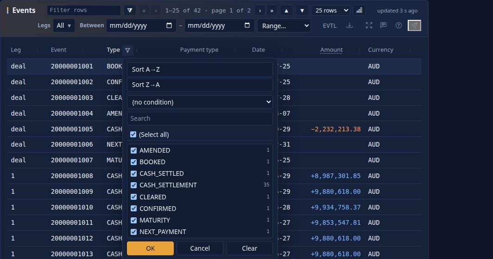

Point at a heading (on a phone the funnel is always shown, and 44 pixels wide) and press the funnel, or focus it with `Tab`
and press `Enter` or `Space`. The menu has, from the top:

- **Sort**: *A→Z* and *Z→A* for text, *smallest→largest* for numbers (`1.5m`, `−30,205,543`, `12%` sort as values),
  *oldest→newest* for dates. Clicking the heading itself still cycles the sort.
- **A condition**, offered by what the column holds (the type is read from its cells: a column that is at least 80% numbers is
  a number column, likewise dates written `2026-10-14`; anything else is text):

  | Type | Conditions |
  |---|---|
  | Numbers | equals, does not equal, greater than, greater than or equal to, less than, less than or equal to, between, **top N** and **bottom N** (N is a box, 10 to begin with), above average, below average (the average is the server's, its pivot engine's average of the column; no row is hidden while it is asked). A value may be written `1m`, `250k`, `12%` |
  | Dates | today, yesterday, this week (Monday to Sunday), last week, this month, last month, last 7 days, last 30 days, between, before, after. They count from today in your browser's calendar |
  | Text | equals, does not equal, contains, does not contain, begins with, ends with (any case) |

- **A search box over the values**: it lists the column's distinct values with **how many rows** have each one. Typing narrows
  the list and, as in Excel, leaves just those values ticked. *(Select all)* ticks or clears the values in view. *(Blanks)* is
  the rows whose cell is empty.
- **OK**, **Cancel** (or `Esc`) and **Clear** (removes this column's filter). A column uses either its ticked values or its
  condition, not both: choosing a condition sets the ticks aside, ticking a value clears the condition.

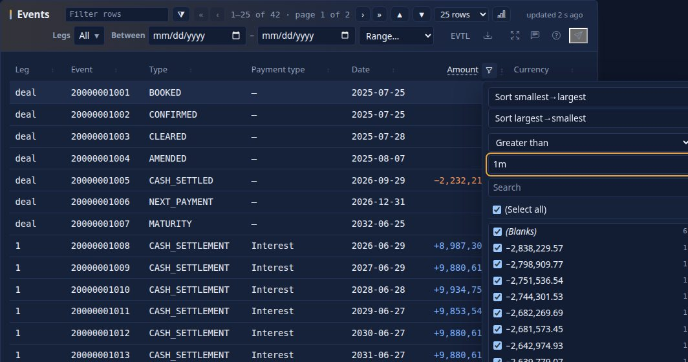

The list of a column shows only the values that the **other** columns' filters leave, so it answers "what is left?". A list
longer than 500 values shows the first 500 and says so; search to reach the rest.

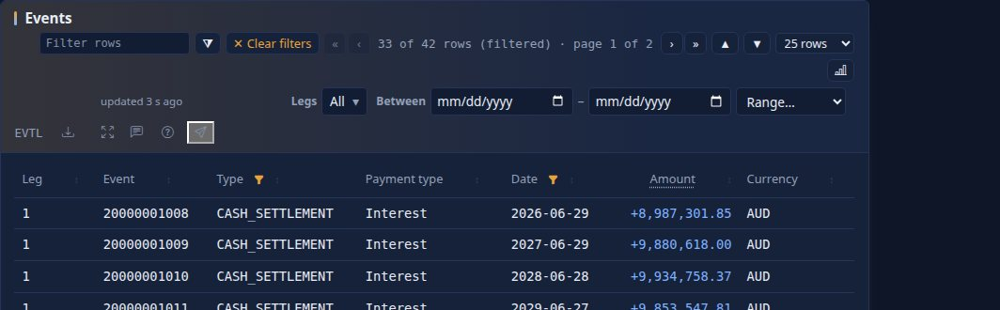

**What you see when a filter is on**

- the column's funnel is **filled and amber**; its tooltip says what it does (*Filtered: Greater than 1m*, *Filtered: 2 values:
  Equity, FX*, *Between 2026-01-01 and 2026-03-31*, *Top 10*);
- the pager reads `33 of 42 rows (filtered)` (the total is the rows the table holds, before any filter) and a **Clear filters**
  button appears next to the *Filter rows* box. A screen reader is told the same, politely, whenever the count changes;
- filters across columns **combine** (a row must pass all of them); paging, the sort and the zoomed table's *Fit* page size work on
  the rows that remain;
- **live tables keep their filters.** When a live update replaces the table, the filters are applied to the new rows again: a row
  that stops matching leaves, one that starts matching appears. A menu you have open stays open and applies to the new table.

**Clear everything.** *Clear filters* (in the heading), or `Alt`+`Shift`+`X` while a table has the focus, clears the column
filters, the *Filter rows* box and the per-column text boxes of that panel. (`Alt`+`Shift`+`X` with the focus outside any panel clears
every table on the page.)

**Share and reload.** Column filters are part of the address: `?f.<panel id>.<column heading>=<filter>`, for example
`/v/trade/MX-20000001?f.schedule.Type=in:Fixed&f.schedule.Amount=gt:1m`. Reload, send the link, or open the snapshot and the same rows
are shown. The filter is written compactly:

| In the address | Means |
|---|---|
| `in:Fixed,Float` | the ticked values (`,` and `~` inside a value are written `%2C` and `%7E`); `~b` in the list is *(Blanks)*, `~m` is *(masked)* |
| `eq:5` `ne:5` `gt:1m` `ge:` `lt:` `le:` | number or text comparisons |
| `bt:100k~1m` | between (two values joined by `~`) |
| `top:10` `bot:10` `avga` `avgb` | top / bottom N, above / below average |
| `today` `yest` `thisweek` `lastweek` `thismonth` `lastmonth` `last7` `last30` `bf:2026-10-01` `af:2026-10-01` | dates |
| `ct:x` `nc:x` `bw:x` `ew:x` | contains, does not contain, begins with, ends with |

A table with children (a tree) has a *Filter rows* box instead of the funnels; its words are in the address too:
`?tf.<panel id>=<words>`. A filter that names a column or panel that is not there is ignored. Inside `<drishti-view>` the filters are kept in the page's
memory only (the host's address is not touched). **Remembering** a user's filters between visits is **off**: nothing is stored unless
the page sets `data-remember-filters="on"` on `<body>` or this browser has `localStorage['drishti.rememberFilters'] = 'on'`; then the
filters of a table return when the address has none.

**Masked values.** If a column hides values from you (shown as `•••`), the menu never lists a masked value: all of them are one
entry, **(masked)**, with a count, and you can tick it to see those rows (which still show `•••`). A masked cell never satisfies a
condition (not even *does not equal*) and sorts after the rest. Row rules (which rows exist for you) apply before any of this.

**Matrices (rows that open).** A table whose rows have children filters its **rows of every level**: a row stays when it matches,
and so do its parents, shown open, so you can see where a match sits; a parent that does not match itself stays only because
something under it does. The count reads `2 of 7 rows (filtered)` (matches only). While a filter is on the ▸ ▾ buttons are held
open; clear it to open and close rows again. Sorting is not offered in a matrix, to keep the order of the hierarchy.

**Pivots.** A pivot panel by one field is a table: its heading cells (the field, each column) filter its rows. A pivot by several
fields, drawn as nested groups, and the **Pivot** screen of a table keeps its own tools: its **Filters** zone filters the
*source* fields before the rows are grouped (see [Pivot](#pivot-slice-a-table-your-way)), which is the Excel
pivot's report filter; the table's column filters do not reach into the tab.

**Large tables.** Every table today holds the rows the server sent (100 for a pick list), and a filter works on those; a
last line "*n* more rows" says when there are more. Nothing is paged by the server, so there is no server-side filter yet. When a
table is paged by the server the same filters will go to it as the address's `f.` values, and the page raises the
`drishti:column-filter` event for it to do so; until then, for all of a kind, filter in the query:
`TRD where QUANTITY > 200m`.

**On a phone.**

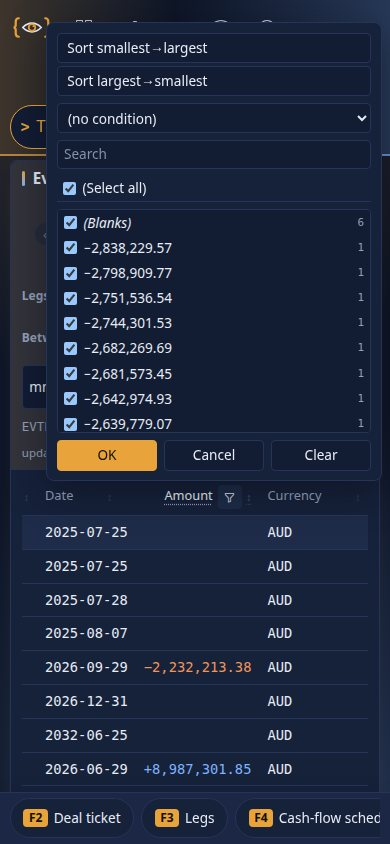

The funnel is always shown and 44 pixels wide; the menu fits the screen (its list scrolls inside it) and every row, button and box
in it is at least 44 pixels high.

| Key | Does |
|---|---|
| `Enter` / `Space` on a heading's funnel | Open its menu; the focus moves into it |
| `Tab` / `Shift`+`Tab` | Move within the menu (it does not leave until closed) |
| `↓` `↑` `Home` `End` in the list | Move between *(Select all)* and the values (from the search box, `↓` enters the list); `Space` ticks |
| letters in the list | Jump to the next value that begins with what you type |
| `Enter` | OK |
| `Esc` | Cancel and close the menu, and nothing more: a zoomed panel or a drawer stays; a second `Esc` leaves them |
| `Alt`+`Shift`+`X` | Clear all filters of the panel that has the focus |

## Chart any table

Every table can be drawn as a chart: the tables inside a view, search results and pick lists, admin lists, the days of a
history page, and a BI report's table and matrix visuals. Press the **chart button** in the table's heading (the bar-chart
icon beside the page size), or focus the table and press `K` (`Shift`+`K` on a history page, where `k` is *previous day*;
`K` on a focused BI table, while `K` elsewhere on a report still toggles kiosk). A wide dialog opens with the chart
**already drawn**; it is full screen on a phone. Close it with `Esc` or ✕: the focus goes back to the button.

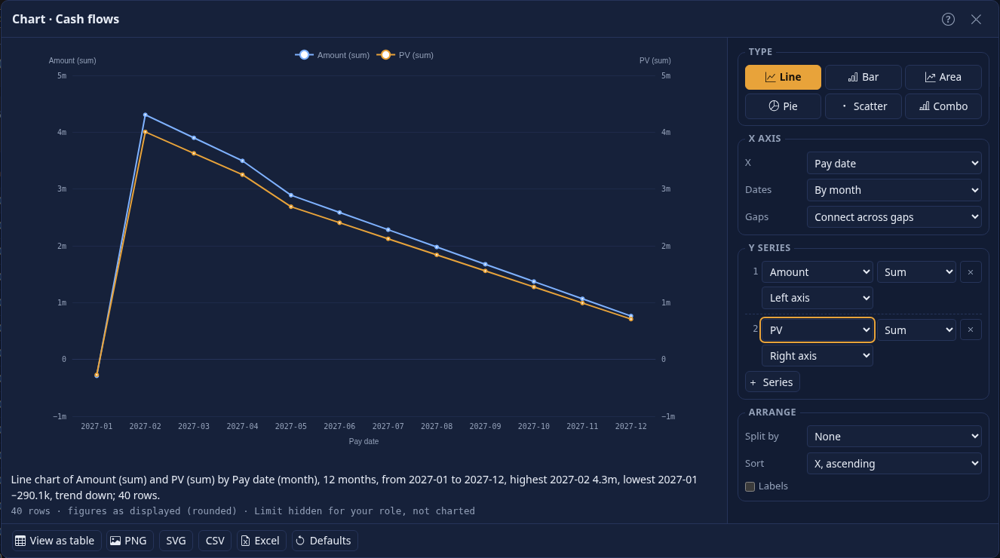

**What it draws first.** X is the first date column (a time axis), else the first text column (categories), else a number;
Y is the first numeric column that is not an id, summed (averaged for percentages, prices and rates); with no number at all
it counts rows. A date X is a line, a text X a bar chart, two numbers a scatter. With more than 30 categories it starts at the
top 20 and *Others*.

**The settings** sit beside the chart (under it on a phone, in a *Settings* section that folds away); every change redraws at
once, there is no Apply.

| Setting | Choices |
|---|---|
| Type | Line, Bar, Area, Pie (or donut), Scatter, Combo (bars and lines together); `1` to `6` pick them when the focus is not in a box. A type the columns cannot make is greyed with the reason (*A scatter needs two numeric columns*) |
| X | Any column; a date column also takes **Dates** (automatic, by day, week, month, quarter, year; automatic keeps days up to 500 points) and **Gaps** (connect across missing days, or break where a business day has no data) |
| Y series | Up to six: the column (or *Rows (count)*), the aggregation for a repeated X (sum, average, count, min, max; a scatter can plot the points themselves), the left or right axis (two axes for different units), and in a combo bar, line or area |
| Split by | A text or date column makes one series per value: at most 12 (the 11 largest and *Others*) |
| Sort | By X or by value, either way |
| Top N | Keep the N largest categories, with or without *Others* (a pie has at most 12 slices). Not on a time axis: it would cut dates out of a line |
| Stacked, 100%, Donut, Labels | Stack bars (and 100% of each stack), a donut instead of a pie, values on the marks |

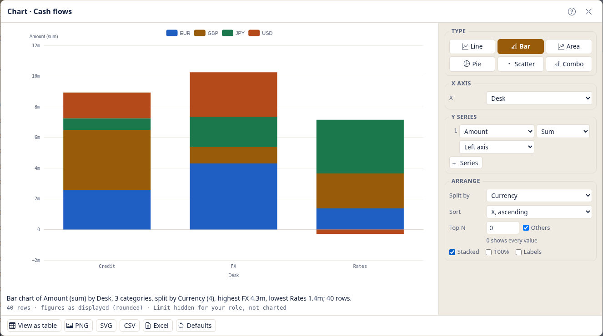

**What it charts.** The rows the table holds, after its filters (the filter box and every column filter), on the page's
business date; paging is ignored, so a table on page 2 charts all its filtered rows. The line under the chart says what was
charted: *Showing 30 of 500 rows*, *after the table's filters*, anything left out. Search results, history and BI tables
chart the **raw values** the server sent; other tables read the cells as displayed, and the line says *figures as displayed
(rounded)* (`1.5m` is charted as 1,500,000). A table whose panel also offers Pivot charts every row through the pivot engine on *Chart all N*.

**Masked values are never charted.** A column hidden for your role is listed greyed in every picker, *(hidden for your
role)*, and cannot be X, a series or a split; the status line names it. In a column only partly masked, the masked cells
are left out of every sum, average and count, and the line says how many. Exports carry only what is drawn.

**Chart all N.** When the table shows fewer rows than exist, **Chart all N rows** (or `A`) charts every row: a search whose
pack offers Pivot is aggregated by the pivot engine over every match of the business date (on the pack's pivot fields,
a date by day); a view's table that offers Pivot is aggregated by the pivot engine over all its rows (up to the server's limit, refused in words if over). Otherwise the
button is absent or greyed with the reason. **Chart the shown rows** goes back.

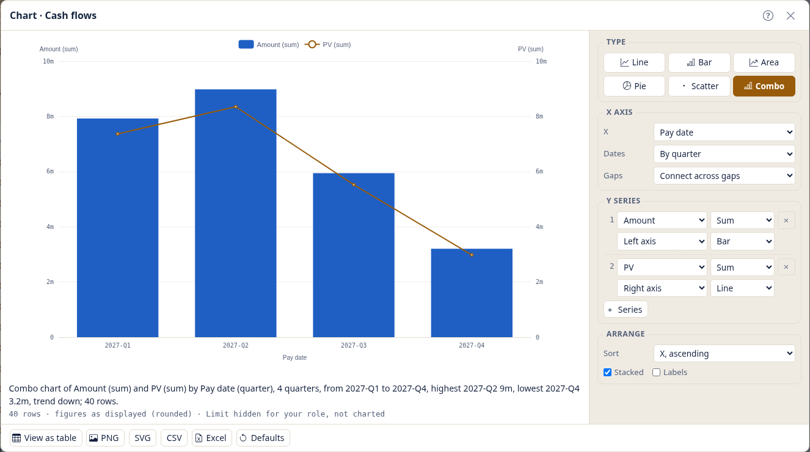

**Edges.** A table with no rows (or whose filters leave none) opens with *No rows to chart* and the settings still usable; a
single row draws one bar, point or a full pie, and the summary says *one row*; a pie refuses negative values and offers a bar
chart or the absolute values; a table with only identifiers or only hidden columns says *Nothing to chart* and why.

**Read it without the picture.** The sentence under the chart is the chart's summary (and what a screen reader reads):
*Line chart of Amount (sum) by Pay date (month), 12 months, from 2027-01 to 2027-12, highest 2027-02 4.3m, lowest 2027-01
−290.1k, trend down; 40 rows.* **View as table** (`T`) shows the chart's data as a table. Focus the chart and use `←` `→` to
step through the points (each one is read out), `↑` `↓` to change series, `Home` / `End` for the first and last.

**Export.** **PNG** and **SVG** save the picture in the theme's colours (no round trip to the server); **CSV**, **Excel** and **JSONL**
(JSON Lines, a row a line) save the chart's data as drawn: X, then one column per series, *Others* as a row. `E` moves to the export buttons.
**Defaults** puts back the chart the table opens with. Your settings are kept per table until you close the browser tab
(saving them for next time is planned).

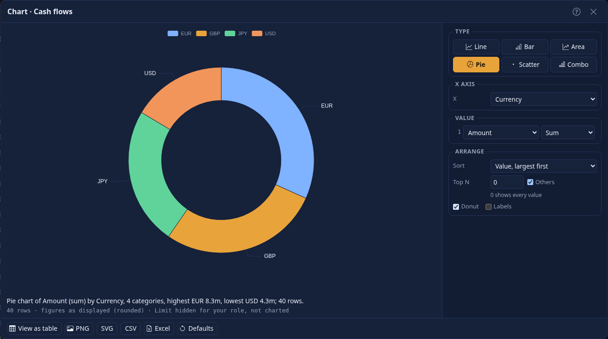

**Themes.** Every colour is the theme's: all ten themes, the three Terminal hues and the light theme included; changing
the theme redraws an open chart. Two series never share a colour, and past eight series lines get dashes and bars patterns.

**On a phone** the dialog fills the screen: the chart on top, its summary, then *Settings*; buttons are finger-sized and the
page never scrolls sideways.

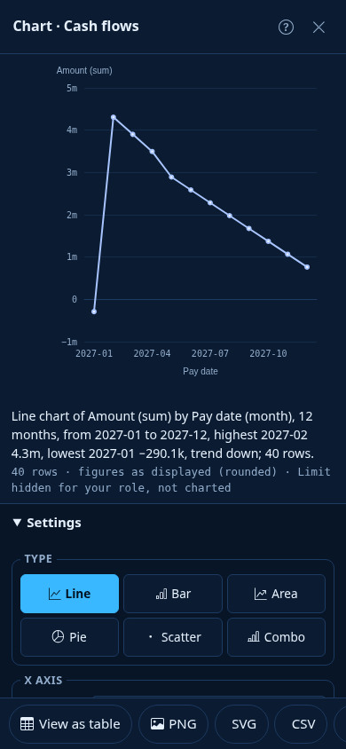

| Key | Does |
|---|---|
| `K` | On a focused table: open its chart (`Shift`+`K` on a history page) |
| `1`…`6` | Line, bar, area, pie, scatter, combo |
| `←` `→`, `Home` `End` | On the chart: the previous, next, first, last point, read out |
| `↑` `↓` | On the chart: the previous, next series |
| `T` | View as table, and back |
| `A` | Chart all N rows, and back (when offered) |
| `E` | Go to the export buttons |
| `?` | This section |
| `Esc` | Close; the focus returns to the chart button |

## Controls on a screen: choose what a panel shows

Some screens offer **controls**: a dropdown, a list of boxes to tick, a pair of dates, a search box. They are the Sutra's own (its author put
them where they help), and they are different from the funnels of [Filter a table like Excel](#filter-a-table-like-excel): a funnel filters
what a table already holds; a control changes what the *panel shows*, and it can change a title, a total, a chart and the rows together. Two
screens that ship with them: an interest-rate swap (`TRD MX-20000001 <GO>`: its **Events** by leg and by date range) and a netting set
(`NS-MERIDIAN-RE-NY`: its **Member trades** by asset class, product and how many to show).

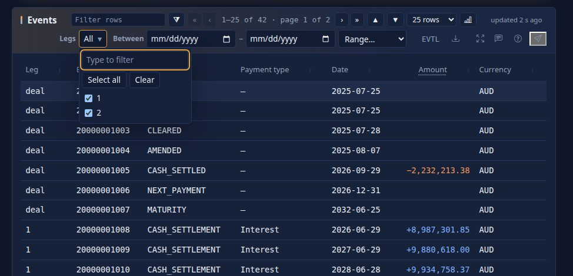

**Using them.** A control sits under the strip, in a panel's header or in a bar at the side of the screen, with its label. Change one and
**only the panels that read it** are rebuilt, in place (you keep your place, your zoom and your other filters); the rest of the screen does not
move, and a line for screen readers says what was updated. On the swap, the date presets (*Next 90 days*, *This month*, *Year to date* ...)
fill both dates for you; either date may be left empty (*from the start*, *to the end*).

| Control | How |
|---|---|
| a **dropdown** (also *cascading*: the second one's choices follow the first) | Pick a value; *(all)* clears it |
| a **list of boxes** (multi-select) | `Enter` or `Space` on its button opens the list; type to filter it, tick boxes, or *Select all* / *Clear*; `Esc` closes it. Nothing ticked means everything |
| a **switch** or **buttons** | Click, or `Space`; with buttons the arrow keys move and choose |
| **dates**, a **number range** | Type or pick; the panel follows when you leave the box (numbers: when you pause) |
| a **slider** | Drag the round handle (or press on the track), or focus it and use `←` `→` for one step, `PageUp` / `PageDown` for ten, `Home` / `End` for the ends; a slider with two handles sets a range, and the handles cannot cross. The number beside it says where it is; on a phone the handles are 44 pixels |
| **Show 10 / 25 / 50** (top-n) | Pick how many rows |
| **Find** (search) | Type; the panel follows when you pause |

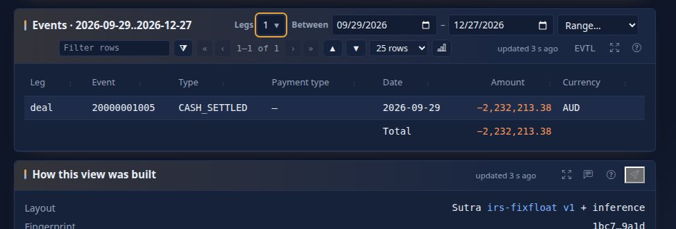

**The address remembers.** What you set is written to the address: `.../v/trade/MX-20000001?ctl.legs=1&ctl.when=2026-10-27..2027-01-24`
(a relative choice such as *Next 90 days* is written as the dates it meant). Send the link, bookmark it or press **Share**: whoever opens it sees
the same panels with the same controls. A control you have not touched is not in the address, so it starts at the author's default. A control
the author marked *remember* (Legs on the swap) also comes back as you last left it **in this browser** the next time you open the screen
with no address values; another browser, or another person, starts from the defaults.

**Click a row or a bar to choose.** On the netting set, *Net MTM by asset class* is a chart you can click: a click (or `Enter` on the focused bar)
sets **Asset class** and the *Member trades* table follows; the chosen bar is marked, and a second click on it clears the choice. The same
works on rows of a table where the author set it up. Everything a click does, the control does too.

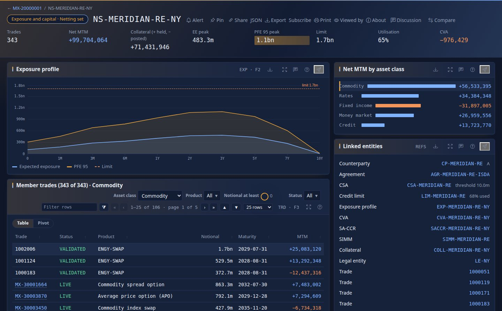

**Live screens keep your choice.** When the screen ticks, every update is built with your controls, so a filtered table stays filtered.

**On a phone.** Controls stack one to a row, each at least 44 pixels high, and the page does not scroll sideways; the list of boxes opens under its button.

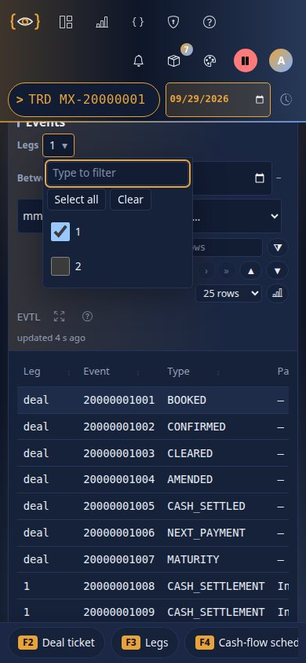

**What you may see.** A control offers only values you may see: for a field your role does not show (`•••`), a dropdown lists nothing, and a
search over it never finds anything. Controls only choose; they never change data.

**Sending it.** *Share with a note* keeps your controls and your [column filters](#filter-a-table-like-excel) with the share: the people you
send it to open the same view with the same choices, and a picture of the share (if you attach one) shows the filtered rows. The dialog says
*with your controls and filters* beside the date when there are any.

**Not yet.** Pivot and the CSV download of a panel read **every** row, not the ones the controls leave, and a scheduled export does not
carry the choices (there is no scheduled delivery yet). Authors add controls in the workbench's
[Controls tab](RACHANA_REFERENCE.md#the-controls-tab); the Sutra's side of it is in [RACHANA_REFERENCE.md](RACHANA_REFERENCE.md#controls).

## A deep trade: legs, cashflows and fixings

Real trades are not flat. A swap has **legs**, each leg has **cashflows**, and each floating cashflow has **fixings**: the
observations of the rate or price that set it. The trading pack's swaps, basis and cross-currency swaps, caps and floors, swaptions and
commodity swaps are all held that way (`LEGS` → `CASH_FLOWS` → `RESETS`, with `EVENTS` beside them), and their screens show it. Open
`TRD 1000001`, an ENDUR commodity swap (`ComSwap`, sub-type `ENGY-SWAP`): a fixed price leg against a floating aluminium index leg (`IDX-ALU-3M`),
36 monthly cash flows each.

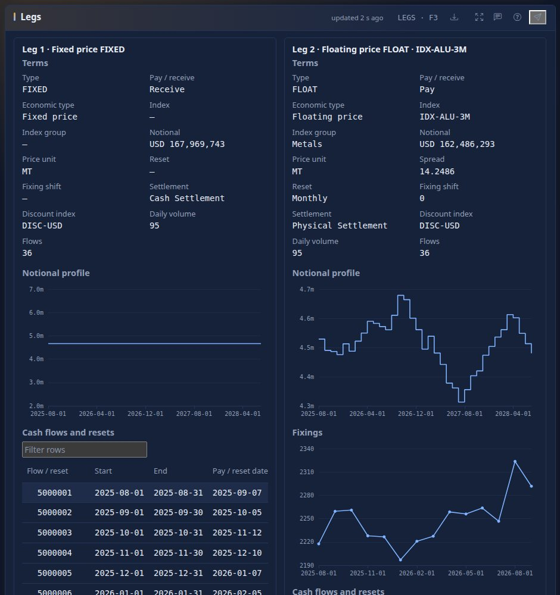

- **Fixed against floating** sums the trade up: fixed price `2,332.9131`, floating index `IDX-ALU-3M`, averaging *Monthly*, price unit `MT`, 36 periods.
- **Legs (F3), side by side.** `Leg 1 · Fixed price FIXED` and `Leg 2 · Floating price FLOAT · IDX-ALU-3M`: one column per leg on a wide screen, tabs
  on a narrow one (a cap has one leg, some swaps more). Each leg shows its **Terms** (type, pay or receive, economic type, index, notional
  `USD 167,969,743`, price unit, settlement, discount index, daily volume, flows), its **Notional profile** (a step line), its **Fixings** and its
  **Cash flows and resets**.
- **Cash-flow schedule, every leg (F4)**: one row per cash flow of every leg (72 here): flow id, start, end, payment, fixing date, notional,
  rate or price, and how many resets it has.
- **Floating cash flows open to their resets.** A row with a ▸ has resets (`5000037`, the floating leg's first flow, has one): press it (or Enter or
  Space on it) and the resets show under the cash flow, indented, with their dates and values. A fixed flow has no ▸. The box above the table
  filters rows and keeps the cash flows whose resets match.
- **Events by leg (F5)** and **Netted payments by date (F6)**: the trade's events linked to its legs, and the payments netted per date (paid −,
  received +: `+195,278` on 2025-07-22, `−211,665` on 2028-03-07).
- **Export.** The download link of a panel's heading saves every cell with its tab, panel and row, as CSV.

A MUREX interest-rate swap, `TRD MX-20000001`, reads the same way with two legs, `Leg 1 · Receive FIXED` and `Leg 2 · Pay FLOAT · AONIA`; the
floating leg's cash flows open to their resets:

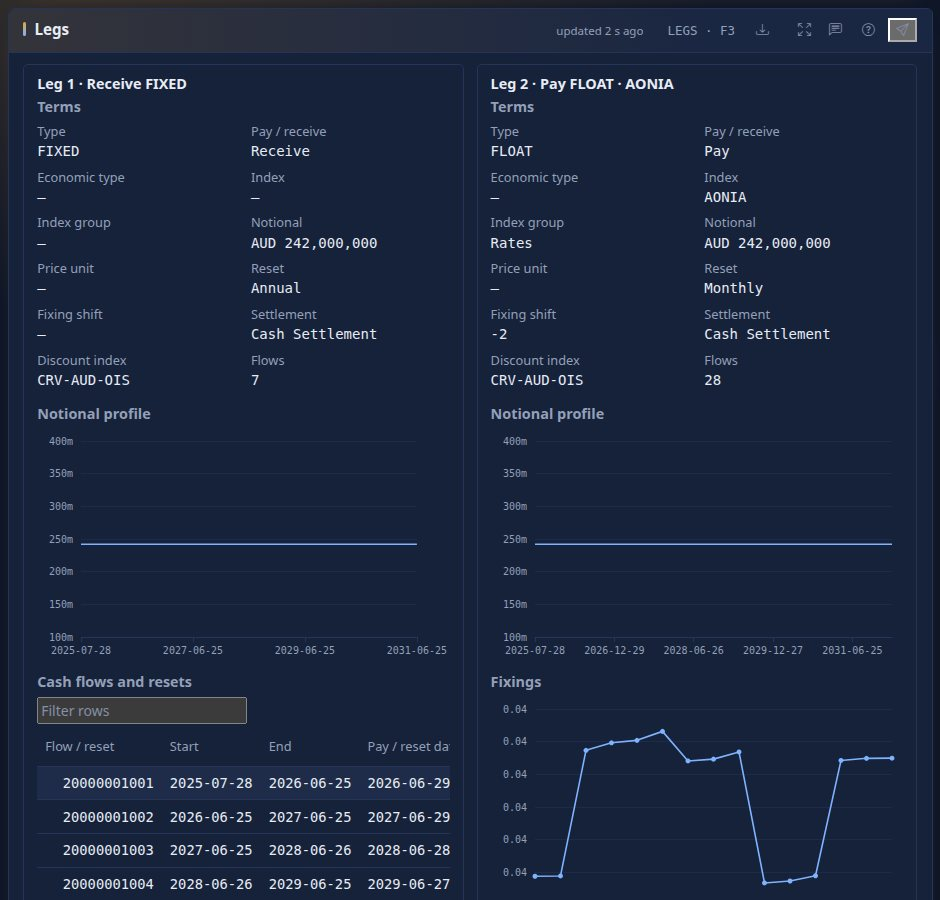

On a phone the legs become tabs that scroll along one line, the terms stack, and the table scrolls sideways inside its own box; the ▸ buttons are
44 px targets.

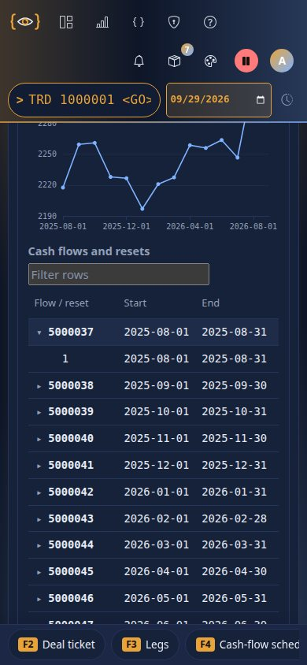

The same layout is what you get from **inference** for any document that holds lists inside a short list of records, even with no Sutra written
for it ([Inference](RACHANA_REFERENCE.md#the-rules)). To build such a screen see
[Panels inside a tab](RACHANA_REFERENCE.md#panels-inside-a-tab) and
[Modelling deep documents](BUILD_GUIDE.md#55-modelling-deep-documents-legs-cash-flows-and-fixings).

## Reading a view

Open `TRD MX-20000001`. A view has five parts.

### 1 · The title line

```text
[Rates · Interest rate swap (fixed/float)]  MX-20000001  with CP-MERIDIAN-RE   Alert
Pin  Share  JSON  Export  Subscribe  Print  Viewed by  About  Discussion  Compare
```

- The **pill** says what the entity is.
- The **id**, and the main party (**with …**), the trade's `COUNTERPARTY`. The party is a link: click it to open the counterparty.
- The buttons on the right are explained in [Export, print and share](#export-print-and-share),
  [Alerts](#alerts) and [Pinning](#your-settings). **Compare** appears there too when a past date is picked.

### 2 · The strip

The row of key figures under the title. For `MX-20000001` on 2026-10-16:

| Label | Value |
|---|---|
| Source | `MUREX` (the source system the trade comes from) |
| Side | `Sell` |
| **Notional** | `AUD 242,000,000` (highlighted: the figure the desk watches most) |
| Quantity | `242,000,000` |
| Trade date | `2025-07-25` |
| Maturity | `2032-06-25` |
| Status | `AMENDED v2` (the trade status and version) |
| Portfolio | `BOOK-RATES-3` (a link) |

A trade carries no MTM: its valuation does. `TVAL TVAL-MX-20000001` shows `MTM +1,876,068`, `P&L 1D +126,999`, `DV01 −155,245`
for the same trade.

Positive figures carry a `+` and the positive colour; negative ones a true minus sign (`−`) and the
negative colour.

### 3 · The panels

The main detail is on the left; context (charts, linked entities) is on the right. Each panel has a
header with:

- its **title** and, if it has one, its **function key** (`DES · F2` means press `F2` to jump here);
- an **inferred** tag when Drishti laid the panel out by itself (hover over it to read why);
- a **↓** button to download the panel: its menu offers **CSV** or **JSON Lines**;
- a **?** that explains this kind of panel.

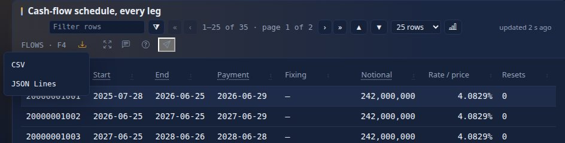

`MX-20000001` shows *Deal ticket* (F2), *Legs* (F3, the legs side by side), *Cash-flow schedule, every leg* (F4), *Events by leg* (F5),
*Events*, *Netted payments by date* (F6), *Payments by month*, *How this view was built* and *Linked entities*; F7 opens the counterparty's
trades, F8 the impact and F9 the raw JSON.

A page over many trades (`CTRD`, `PTRD`, `LTRD`, `ITRD`: a counterparty's, a portfolio's, a legal entity's, an index's trades) lists at
most 1,000 of them; the trade count, the notional, the payments in the next 7, 30 and 90 days and every other total cover all of
its trades, so a portfolio of 20,000 trades opens in well under a second. To work on every trade, search them (`TRD PORTFOLIO=…`) or
open the pack's BI reports.

Panel kinds you will meet:

| Kind | Looks like | Example |
|---|---|---|
| `kv` | label and value pairs | *Deal ticket* in `TRD MX-20000001` |
| `table` | rows and columns, totals for money | member trades in `NSET NS-SUMMIT-NY` |
| `tabs` | one tab (or column) per element of a list | *Legs* in `TRD MX-20000001` |
| `ladder` | dated rows, the next one highlighted | a ladder of dated flows (the panels catalogue) |
| `line` / `area` | a chart over tenors or dates | the curve in `CRV CRV-USD-OIS` |
| `hbar` | horizontal bars | *Netted payments by date* in `TRD MX-20000001` |
| `surface` | a grid as a heatmap, or a 3D surface you can rotate | `FXV FXV-EURUSD` (*Heatmap* / *3D* buttons) |
| `status`, `gauge`, `markdown` | a status list, a dial, formatted text | various packs |
| `links` | linked entities with badges | *Linked entities* everywhere |
| `provenance` | how the view was built | *How this view was built* |

The [panel kinds catalogue](RACHANA_REFERENCE.md#panels-the-twenty-two-kinds-and-developing-a-new-one) shows each one in detail.

**No data available.** A panel whose data is missing, or not in the expected shape, says *No data
available*. The rest of the view still renders. Real feeds are often incomplete; this is normal.

**Long labels in bars.** In an `hbar` panel a label longer than about two-fifths of the panel is cut with *…*; point at it to read it
whole. A long amount widens its own column. Either way the page never scrolls sideways, on a phone too.

**A candlestick's Data table** shows each price as the panel formats it (`74.00`, `120,000`), as the strip and tables do.

### 4 · Links

Every identifier in a view is a door. Click `BOOK-RATES-3` in the strip and the book opens. The
*Linked entities* panel lists everything the entity points to, each with a **badge** read from the
target (for example the rating `A` on the counterparty `CP-MERIDIAN-RE` of `TRD MX-20000001`). A badge that says *pending* means the target did not
answer in time; open it to see it.

**Ids in tables are links too.** A table column that shows an identifier (a column bound to a field whose
name ends in `Id`, `Ref` or `_id` in any case, such as `TRADE_ID`, `COUNTERPARTY_ID` or `BOOK_REF`) links each value to its
entity, as long as a pack recognises the id. Example: open `BOOK BOOK-RATES-1`; its *Largest trades* table
(`F2`) starts with the *Trade* column (`MX-30003150`, `MX-30004482`, …), and clicking `MX-30003150` opens that trade. With the table selected, `↓` to a row and
`Enter` does the same ([Tables](#tables-sorting-filtering-paging-and-the-keyboard)).

**Breadcrumbs** above the title (`← MX-20000001 / NS-MERIDIAN-RE-NY`) show the path you followed in this
browser tab. Click one to go back to it, or press `Alt+←`.

### 5 · How this view was built

The *How this view was built* panel answers "where did this come from?":

| Line | Example | Meaning |
|---|---|---|
| Layout | `Sutra irs-fixfloat v1 + inference` | A Sutra (a written layout) drew the screen; inference filled gaps. `inference only` means no Sutra matched |
| Fingerprint | `b7df…1372` | The shape of the data, used to cache the layout |
| Source | `murex-rates`, generation `1674` | Which system the document came from, and its version counter |
| Node | `drishti-b · forwarded from drishti-a` | Administrators only, when several servers work as one (Drishti*net): the server that built the view and how: `local`, `built here, data from <server>`, `forwarded from <server>`, or `scatter-gather from <servers>` (and any that were missing) for a page that groups records of several servers. Nobody else sees it |

The footer repeats the source and generation, and the business date when one is picked
(`trade-endur · gen 7 · as of 2026-09-29`).

## About this page

*What am I looking at, can I trust it, and why does it look like this?* Press `?` on any view (or `F1`, or the **About**
button beside the title). A drawer opens on the right; the page stays usable beside it. It is written for you: what it
says is worked out from the page **you** have, so a field hidden from your role is never explained with its value.

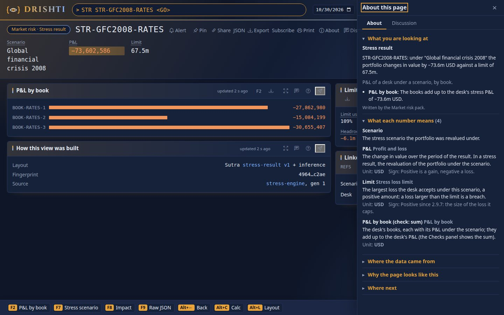

Each layer is a section you can fold; the first ones are open, and Drishti remembers which you folded (in this
browser only).

| Layer | What it tells you | Example |
|---|---|---|
| **What you are looking at** | One sentence about this entity, written by the domain pack and filled with its own numbers; the screen's description; notes on single panels; which pack wrote it | "STR-GFC2008-RATES: under \"Global financial crisis 2008\" the portfolio changes in value by −73.6m USD against a limit of −67.5m." |
| **Where the data came from** | The source, its health (`up`, `degraded`, `down`), the generation, when it was fetched and updated, whether it is fresh or stale, a snapshot or a live feed, and how many linked entities were fetched | "Source stress-engine · health up · fresh · a snapshot" |
| **Why the page looks like this** | Which Sutra (layout) was chosen and why; panels that were added by inference; panels with no data and the reason (missing, null, empty list, masked); fields hidden for your role; panels you may not open | "Layout: Sutra stress-result v1, the one that applies to this kind, priority 10." · "1 field hidden for your role: Limit (in strip)." |
| **Where next** | The keys on this page (F7 and F8), and one link per kind of panel on it, to the guide that explains how to read it | "The histogram panel: what it shows and how to read it" |

A layer with nothing to say is not shown. If you see **What each number means** (a layer that explains the figures one
by one: term, unit and sign), your pack has a glossary; it comes with the next stage of the feature, so older servers
do not show it.

### AI

AI is not in this release: no page, menu item or button of the console calls a model.

### The keys

| Key | Does |
|---|---|
| `?` | Open or close the drawer (anywhere on a view except in a text field) |
| `F1` | Open the drawer; `F1` again, inside it, or *The full guide to this screen*, opens this guide |
| `Esc` | Close the drawer; focus goes back to where you were |
| `Tab` | Move through the drawer. On a phone the drawer is a sheet that holds the focus until you close it |

On a phone the drawer is a bottom sheet (swipe down, or tap **×**, to close it):

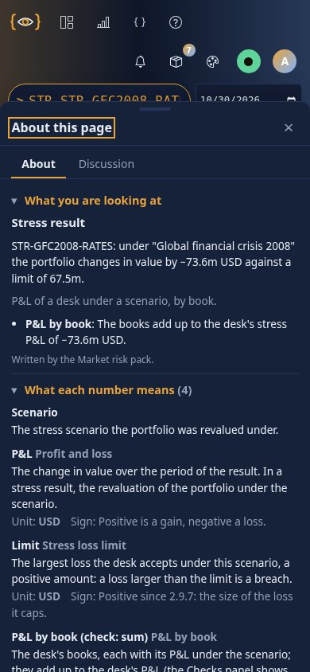

All the layers open, on the same view:

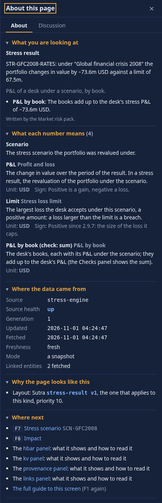

### Someone else sees less

Ask the same page as a user whose role hides a field and the drawer hides it too. In this picture the administrator
chose to mask `limit` for the *viewer* role (a **demo**: no standard setup masks it). The sentence reads "against a limit of
•••" and the glossary marks Limit *hidden for your role*:

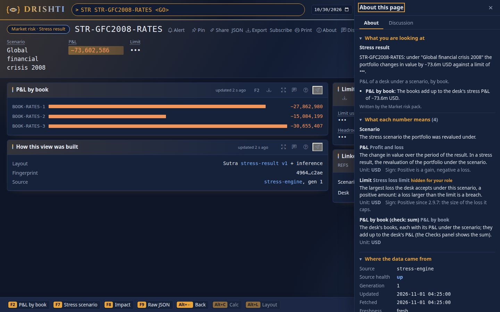

### Another domain

The words come from the pack, not from the program, so every domain explains itself in its own terms. An economy of the
world-economy pack (`ECON ECON-USA`), in that pack's words:

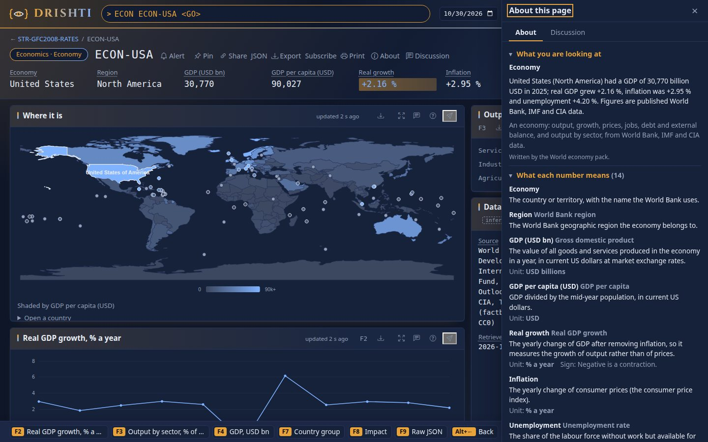

### Good to know

- The drawer is fetched the first time you open it, never with the page, so it does not slow a view down.
- When a live update brings a newer generation of the data, an open drawer asks again (at most once in two seconds).
- No text? A pack without an `about` entry for the kind still shows the other layers; the pack's author can add one
  ([how](BUILD_GUIDE.md#72-about-text-and-glossary); how it works inside is
  [HOW_IT_FITS.md](RACHANA_REFERENCE.md#about-this-page-end-to-end)).
- Hover hints on field labels and a help popover on each panel's `?` come with the glossary stage; today the panel `?`
  still opens that panel kind's page in this guide.
- If the drawer says "could not be loaded", try again; the page itself is not affected. Error numbers are in
  [OPERATIONS_GUIDE.md](OPERATIONS_GUIDE.md#21-troubleshooting).

## Layout mode: arrange a view your way

A Sutra decides where each panel of a view goes, for everyone. **Layout mode** lets you arrange the panels for
yourself: put the panels you read first at the top, give a table more width and a chart less, move a panel between the
main and the side column, or hide one you never read. Your arrangement is a **personal layout**: it is kept on the server
for you, it never changes the Sutra, and nobody else sees it.

A personal layout belongs to a **Sutra**, not to one entity: arrange `TRD MX-20000001` and every trade that the same Sutra
lays out (`irs-fixfloat` here: every interest rate swap, fixed against floating) opens your way. The footer says so: its **Layout** key shows a dot (`Alt+L Layout •`)
when you are looking at your own layout.

### Turning it on

Press `Alt+L` on a view (`Option+L` on a Mac), or click **Alt+L Layout** in the footer. A bar appears under the top bar
(*Layout mode · Drag a panel by its heading …*), every panel gets a dashed outline, a size badge at its bottom right
(`12/12`, `8/12 · 8 rows`), a **Hide** button in its heading, and two handles: one on its right edge (width) and one on
its bottom edge (height).

Each column of the view, the main one and the side one, is a **grid of 12 columns**. A panel is 1 to 12 columns wide
(12, the whole column, is the default) and either as tall as its content (the default) or 1 to 24 **rows** of 2.5 rem
(40 pixels at the usual text size); a panel with a set height scrolls inside.

### With the mouse, a pen or a finger

| Do | To |
|---|---|
| Drag a panel by its heading | Move it: a dashed box shows where it will land, in this column or the other one. Near the top or bottom of the window the page scrolls |
| Drag its right edge | Make it wider or narrower, a column at a time (not under 3 of 12: `layouts.min_span`); panels narrower than the column sit side by side |
| Drag its bottom edge | Give it a height in rows; double-click the edge for its natural height again |
| **Hide** / **Show** in its heading | Hide it from your view (in layout mode it stays, greyed, so you can show it again). The last visible panel cannot be hidden |

### With the keyboard

`Tab` moves between panels (each is outlined when it has the focus). On the focused panel:

| Key | Does |
|---|---|
| `↑` `↓` | Move it one place earlier or later in its column (in a row of narrow panels, earlier is to the left) |
| `←` `→` | Move it to the main column or to the side column |
| `Shift`+`←` `→` (or `-` `+`) | One column narrower or wider |
| `Shift`+`↑` `↓` | One row shorter or taller |
| `A` | Back to its natural height |
| `H` (or `Delete`) | Hide it, or show it again |
| `Ctrl`+`Enter` | Save (`Cmd`+`Enter` on a Mac) |
| `Esc` | Cancel: leave layout mode and put everything back as it was |

Every change is announced to screen readers (*Cashflows · Leg 1: 1 of 5 in the main column*, *Linked entities: 6 of
12 columns wide, 7 rows tall*).

### Save, cancel, reset

- **Save** (`Ctrl+Enter`) keeps the layout and leaves layout mode. Open another trade of the same Sutra, or reload the
  page: it is drawn your way.
- **Cancel** (`Esc`) leaves layout mode and undoes everything since you turned it on.
- **Reset to <Sutra>** arranges the panels as the Sutra has them; **Save** then forgets your layout.

### Worked example

On the demo lakes, open `TRD 1000001` (an ENDUR commodity swap, Sutra `endur-comswap`):

1. Press `Alt+L`.
2. Drag *Cash-flow schedule, every leg* by its heading above *Legs*, and let go: it is first in the main column.
3. Drag its right edge to about two thirds of the column: the badge reads `8/12`. Drag its bottom edge down until the
   badge reads `8/12 · 8 rows`.
4. Drag *Payments by month* from the side column into the main column, under the schedule, and narrow it to `4/12`.
5. Press `Tab` until *Linked entities* has the focus, press `←` (it moves to the main column), then `Shift`+`←` six
   times (`6/12`): it now sits beside *Payments by month*.
6. Focus *How this view was built* and press `H`.
7. Press `Ctrl+Enter`. Reload: the view keeps your layout, and the function keys (**F2** the ticket ... **F6** the charts) still work. The key
   of a panel you hid is greyed (*Hidden in your layout*) until you show the panel again.

### Who may, and what follows your layout

- Layout mode needs a role with the **layout** power. Every role has it unless an administrator says otherwise; the
  built-in `viewer` role does not ([Admin → Roles](ADMIN_GUIDE.md#292-admin--roles-what-a-role-may-do)). Without it the key is greyed with
  the reason. A view laid out by inference alone (*Layout: inference only*) has no Sutra to arrange, so the key is
  greyed there too.
- **Printing** follows your layout: your order and widths, hidden panels left out, every panel as tall as its content.
- **Workspace panes** show views with your layout too (layout mode itself is offered on the full view).
- **Live updates** keep your sizes. CSV and JSON exports, Calc and the API are unaffected: they read the data, not the
  arrangement.
- **When the Sutra changes**, your layout follows: panels the Sutra no longer has are dropped from it, and panels it
  gained appear at the end of their column, as the Sutra places them.
- You keep at most 50 layouts (one per Sutra).

### Promote to Sutra: offering your layout to everyone

If your role may author Sutras, the bar has **Promote to Sutra…**. It saves your layout and opens a panel that shows:

- the changes in words (*'refs' moves to the main column*, *'cashflows' is 8 of 12 columns wide*, *the main column
  reads cashflows, refs, dv01, leg2, legs, built*);
- the diff between the latest version of the Sutra and the **next version** your layout makes: the panels in your
  order, `area: right` where you put them in the side column, and the panel options `span` and `height`
  ([RACHANA_REFERENCE.md](RACHANA_REFERENCE.md#keys-every-panel-takes)) for your sizes. The rest of the Sutra (its
  comments, quoting and every other key) is kept as written;
- a tick box, **Remove the panels I hid from the Sutra**. Unticked, hidden panels stay in the Sutra for everyone else.

Write a note for the reviewer and press **Submit for review**. As with a save from the workbench, the new version is a
**proposal**: an approver opens it in *Views → Approvals* (the review shows the diff against the version before), and it
goes live only when approved. A panel your layout moved is listed in words, for example *moved: DV01 by tenor (USD)
from position 3 to 1 (side → main)*, and the line diff below it holds only the real edits (a width, a height, a
removed panel); the full line diff, where a move reads as a deleted block and an added one, is behind **Full line
diff**. The promote drawer shows the same before you submit ([Reviews](#reviews-approving-a-sutra)). With review switched off on the server the button
reads **Publish** and the new version is live at once.

## Resize panels and columns

A side panel and the main area of a screen are divided by a thin line, and so are the columns of a table, a tree or a grid: drag
the line to make one wider. The line shows when you point at it or move the focus to it.

- **Side panels**: the VaR explorer's Scopes, the exposure explorer's Scope, Help's contents list, the Build workbench's Data and
  Details, the pivot's Fields, the BI report designer's Filters, Visualizations and Fields panes, the BI model designer's Datasets
  and Inspector, and the Context column of a view. A panel stays between the least and the most width its screen allows.
- **Columns**: the VaR tree, the data tables of every view, BI grids and matrices, and the pivot grid. Drag the line at the right
  of a column's heading; the rows follow. A column is never narrower than about 40 pixels, so it cannot vanish. Columns made wider
  than the panel scroll sideways.
- **Kept for you**: the widths are kept in this browser for you alone, per screen and per mode. The VaR explorer keeps one set of
  widths with Parametric on and another with it off. Nobody else sees your widths.
- **Reset**: double-click a line, or focus it and press `Home`, to go back to the screen's own width.
- **The keyboard**: `Tab` to a line, then `←` and `→` move it by a small step and `Shift`+`←` or `→` by a larger one. A screen
  reader reads the line as a separator and its width.
- **Phones**: below 640 pixels wide there is nothing to resize; the screens keep their single column.

The dividers of a [workspace](#workspaces), of a screen laid out in areas and of the designer's grid work the
same way (drag, the arrow keys, a double-click or `Home` to reset). Their widths are kept with the workspace, the screen's layout or
the design, not in your browser.

## Screens that respond: clicks, refresh, editing and your own page

Newer screens (every pack screen is built from the same parts) can do more than show a document. What you meet:

- **A click opens more.** On a table with clickable rows (the book desk, `/v/portfolio-trades/BOOK-RATES-2?sutra=book-desk`) a click,
  or Enter or Space on a focused row, marks the row and opens what the screen says: the trade's cash flows under the row, its
  counterparty and credit limit beside it. A panel waiting for a click says so (*Pick a trade to see its counterparty and credit
  limit*). A new click replaces what opened. A panel that would follow a value masked for you says **Hidden for you** and is not
  looked up. If the server that drew the screen goes away, the next click says *Your selections were reset ... Pick again.*: click
  the row again.
- **Refresh and freshness.** A panel that refreshes says how fresh it is: *updated 12 s ago*, ticking; *stale* in amber when its
  source is behind; *trade-endur isn't answering; showing data from 10:42* when a refresh failed (it keeps what it showed). Its header
  has **pause/resume** and **every …** (only slower than the screen's own interval); **Pause all** above the panels pauses the page.
  Your choices are kept for you, per screen. A browser tab you are not looking at fetches nothing.
- **Editing a record.** Where a screen lets you, clicking a row opens a form beside the table, or a pencil on a column lets you edit
  in the cell, and **New …** opens a guided drawer. Fields you may not change say why; a wrong value is explained under its field.
  **Save draft** keeps a **draft** that only you see (*You have 2 drafts on this page* offers them again). The page asks before you
  leave with changes not saved. The reference is [USER_GUIDE.md › Approvals](#approvals).
- **Submitting a change (write-back).** Where editing is on, you hold the edit power and the form says where it goes (the book
  desk's trades do), **Submit…** opens a sheet: what you saw, what is there now and your change; where it goes (a correction kept beside
  the booking system's value, or an amendment sent to it); who approves (never you); what it recomputes; and the reason. After **Confirm**
  the sheet follows it: waiting for an approver, applied (everyone viewing the trade sees the new value at once, *How this view was built*
  says *Edited here*), or conflicted if the trade moved since you opened it (your draft is kept). Approvers decide in the **Approvals** queue
  (Views → Approvals, Admin → Record edits). Someone else's change to the record you are viewing shows *Changed by … just now*.
  The reference is [USER_GUIDE.md › Submitting a change](#submitting-a-change); a walk-through is
  [tutorial 11](../tutorials/11-correct-and-approve.md).
- **Screens laid out on a grid.** A screen with named areas may have a split you drag (its position kept for you), areas shown as
  tabs and panels that fold. Where the screen allows it, you may drag panels to another place and resize them, for yourself;
  **Reset layout** goes back. Such a screen does not offer layout mode (`Alt+L`): the grid replaces it.
- **Your page.** With the Sutra designer on, **Customize** in a page's header changes the page for you alone (move, hide, columns,
  what a click opens, refresh, letting people edit); the header then says *Your page*, whose link opens the pack's page.
  [RACHANA_REFERENCE.md › Screen designer and the Build workbench, section 3.31](RACHANA_REFERENCE.md#331-the-sutra-designer-customize-describe-outline-and-grid) and
  [tutorial 19 (the Sutra designer)](../tutorials/19-build-a-pack-and-a-screen.md#on-a-live-page-the-sutra-designer).

## Zoom a panel

A chart you want to read closely, a table with many columns, a pivot you are slicing: **zoom** expands one panel to fill
the view area, and **restore** puts it back. Nothing is saved to your layout and the Sutra is untouched.

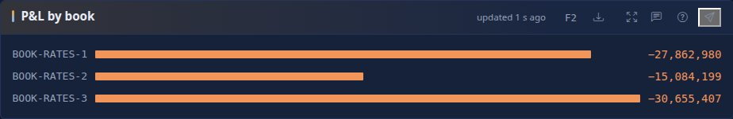

Every panel's heading has a **zoom button** (the arrows icon, *Expand Hypothetical P&L, last 60 days*) next to the
help (?) button. Click it, or press `Z` while the panel has the focus (use `F2` to `F6` to focus a panel, or `Tab`).

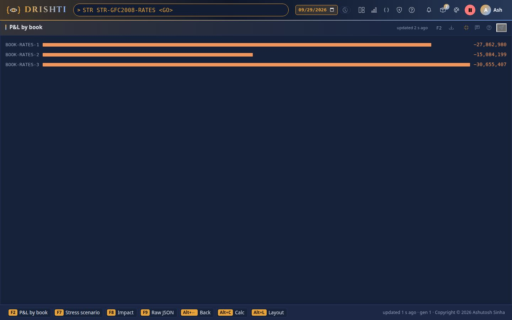

While a panel is zoomed:

- it fills the view area **below the top bar and above the function keys**; the page behind it does not scroll;
- the focus is in the panel, and the other panels are inert (neither focusable nor read by a screen reader) until you
  restore; only one panel is zoomed at a time;
- it stays **live**: ticking values, charts and tables keep updating, and a chart redraws at the larger size;
- a table **fits the height**: the pager's page size is set to the number of rows that fill the panel (the size box reads
  *Fit (37)*), so there is no scrollbar and no blank space under the rows, and the page keeps the row that was at its top.
  It is recomputed when the window is resized, when you switch a tab inside the panel and when live updates add or remove
  rows. Pick a size yourself and it is kept until you restore (choose *Fit* to go back); the fit is never saved, and
  restoring puts back your own page size and the page with the same top row. A pivot, ladder, surface or graph use the
  height as usual;
- the button now reads *Restore <title>* and is pressed; pressing it again, `Z`, or `Esc` restores the panel and puts
  the focus back on its button.

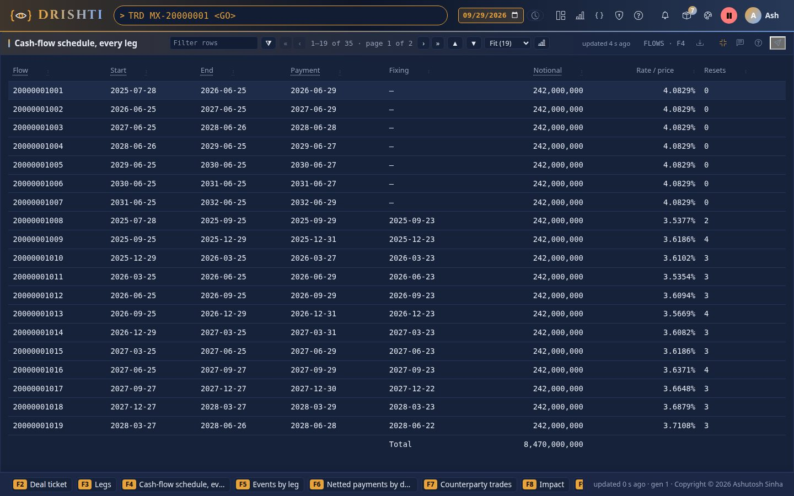

| Key | Does |
|---|---|
| `Z` | On a focused panel (not in a text field): zoom it. While zoomed: restore |
| `Shift`+`Z` | Zoom the panel and ask the browser for **true full screen**, for a wall display (nothing happens where the browser has no full screen) |
| `Esc` | Restore. An open drawer (About, raw JSON), popover or menu closes first; a second `Esc` restores |

**Share or reload a zoomed panel.** The address gains `#zoom=<panel id>` (for example `/v/var/VAR-EQD#zoom=pnl`):
reload the page, or send the link, and the panel opens zoomed. An id that is not on the page is ignored.

**Layout mode** (`Alt+L`) and zoom exclude each other: turning layout mode on restores a zoomed panel first, and the
zoom buttons are hidden while you arrange the view.

**On a phone** the zoomed panel fills the screen under the top bar, and the button is a finger-sized 44 pixel target.

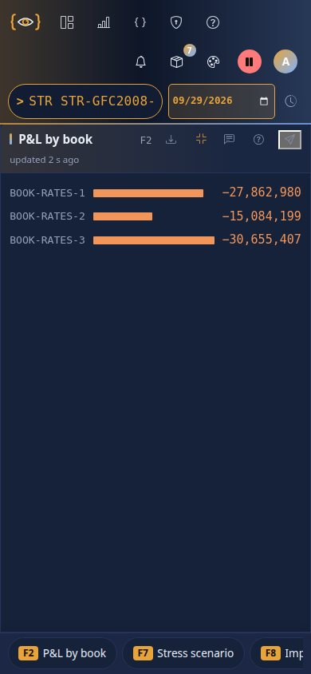

**Print** prints the zoomed panel alone.

**In another application.** Inside `<drishti-view>` the panel fills the element's own box, not the host page; the keys
work only while the focus is inside the element ([Drishti Elements, keyboard](INTEGRATION_GUIDE.md#15-the-elements-one-by-one)).

## Pivot: slice a table your way

A table or ladder whose Sutra says `pivot:`, and the results of a search whose kind's pack says `pivot:`, carry a **Pivot** button. It opens
the **pivot screen** (`PIVOT <GO>`; [PIVOT.md](bi/PIVOT.md), [the pivot tutorial, Part A](bi/PIVOT.md#part-a--the-pivot-engine-trades-by-product-legs-by-desk-then-var-by-desk)) on the table's own
rows (the same document, Sutra and business date as the page) or on every row of the kind, with the Sutra's or the pack's arrangement as the
view it opens with. It opens as the **View** picker in front of one compact line (Rows, Columns, Filters and Values, a picker behind each; a
hierarchy is one chip with a level stepper), with the Fields and Build panes behind **Customize ›** (`\`). Everything is computed by the
server's pivot engine: rows, columns, values and filters from their pickers (`R`, `C`, `V`, `F`) or by drag in the panes, each value's
function in plain words (only those valid for its field) and its show-as, nested rows opened lazily with + and −, totals made from their own rows (an average of a total is never an average of averages),
the provenance of every cell and its rows, a chart of a selection, Excel with outline levels and formulas only where a figure adds up, CSV
and Arrow.

**One analysis path: the Pivot, then a report.** The Pivot is the one grid for slicing: the risk cubes are its **presets** (the MR cube,
`MCUBE`, and the CCR cube, `CCUBE`; [PIVOT_SCALE_AND_CUBES.md section 28](bi/PIVOT_SCALE_AND_CUBES.md#6-presets-the-risk-cubes)), and a figure for other people is a
BI report. Code over a model is the [Notebook](#the-notebook).

| What | How |
|---|---|
| Open it | **Pivot** under a table or above a search's results; or `PIVOT <table>`, `PIVOT @owner/name` |
| Keep your arrangement | **Save view** (private) or **Share** (people or `role:<role>`): a saved view keeps the definition, never the numbers; a reader opens it with their own masks |
| Make it everyone's opening | an author's **promotion** (`POST /api/v1/pivot/promote` with the panel's view and its Sutra): the Sutra's next version with the panel's `pivot:` arrangement, through review when review is on ([Reviews](#reviews-approving-a-sutra)) |
| Masked fields | not read at all: they are not in the field list and cannot be grouped, summed or filtered |
| Limits | a page's table: at most `drishti.pivot.max-records` rows (50,000), more is refused in words; every view: the cell budget of the pivot engine (`drishti.pivot.max-cells`), refused with the count, never cut short |

## Tables and models: the editors

**Build › Tables & models** (`/build/tables`, also on BI's rail) edits the definitions every reader shares: virtual tables, semantic models
and Python-driven tables ([TABLES_AND_MODELS.md section 11](bi/TABLES_AND_MODELS.md#11-the-editors)). Three panes: the objects with a search; the editor
with its **live YAML** below it (a change on either side shows on the other, the line you edit highlighted, a problem marked at its line);
and a **preview read as you** with its checks and totals. **Visual**, **YAML** or **Both** is remembered for you. **+ New** walks you through
a table, a model or a Python-driven table in plain steps. **Save draft** keeps your work private to your workspace; **Propose for review**
asks a second person to approve it before anyone else reads it. Keys: Ctrl+S saves a draft, Ctrl+Enter validates, the arrow keys move
between a model's tabs; on a phone the panes stack.

## On a phone

On a phone (a screen narrower than 640 pixels) a page does not send you every panel. Each panel has a **phone tier**, and the page is
arranged by it:

| Tier | On a phone |
|---|---|
| **must** | shown in full, at the top: the header, the key figures, the status, the table the page is about |
| **glance** | shown in a compact form: a table's first five rows, a chart as a small line with its last value and its change, the first bars of a ranking, the first figures of a group. **Show all** (or **Show the chart**) under it brings the whole panel in its place |
| **more** | listed under **More on this page**; tap a row and that panel loads where the row was, as the desktop draws it |
| **desk** | named under **On desktop** (wide pivot grids, designers, the what-if editor); **Copy the link for a desktop** copies the page's address to open on a bigger screen |

The phone downloads only what it shows, so a heavy page opens quickly over a mobile network. A live page keeps ticking: a compact panel
stays compact as its values change, and a panel under *More* starts ticking once you open it.

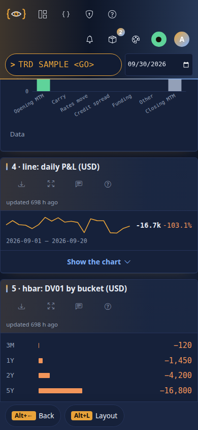

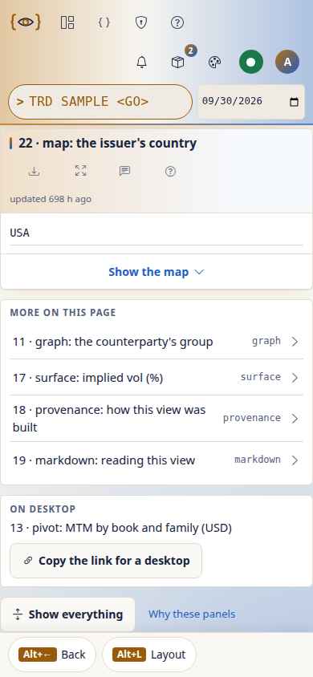

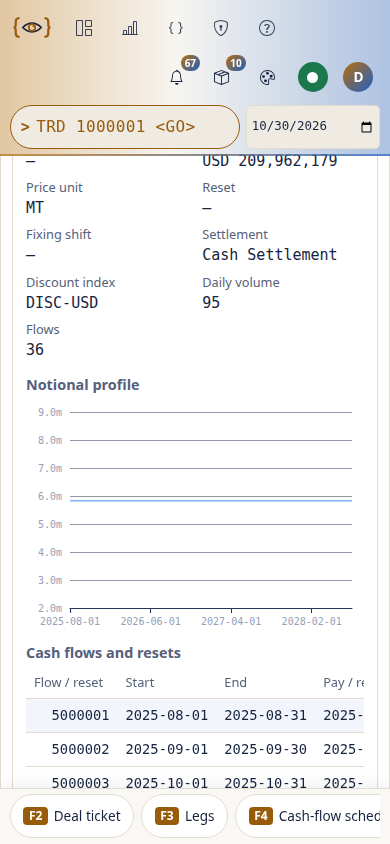

- **Show everything** gives you the whole page, as on a desktop, until you close the browser; **Phone view** at the top of the page
  returns to the phone page.
- **Why these panels** lists each panel with its tier and what set it (the kind of panel, the screen, the site, the edition), so "why is
  this not on my phone?" has an answer.
- **A tablet** (640 to 1000 pixels) keeps the page's own layout and shows every panel except the desk ones, which wait under *More on this
  page*.
- **Turning the phone** sideways redraws the page for the new width once. A desktop is never changed.

**The VaR and exposure pages and Home.** The same tiers apply. On the VaR page the headline tiles and the method line come first, then
the distribution of scenario P&L; the worst scenarios, the path, the history, contributions, captures, other currencies and the scope tree
wait under *More on this page* (a tap opens that tab); a tap on a tile opens its Explain as a sheet from the bottom; *What-if* and
*Construct your basket* are for the desktop. On the exposure page the tiles come first, then the profile; the tabs and the scope tree wait
under *More*. An
edition's Home keeps its command line, its tiles and its first card; other tables show five rows with *Show all*; charts, maps and the
quick links wait under *More*.

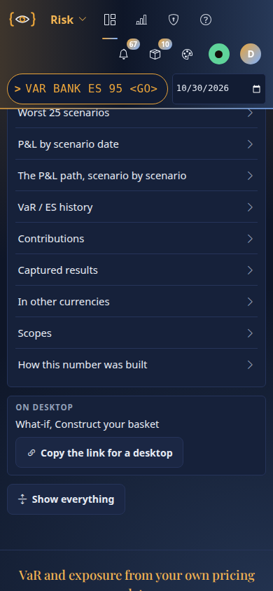

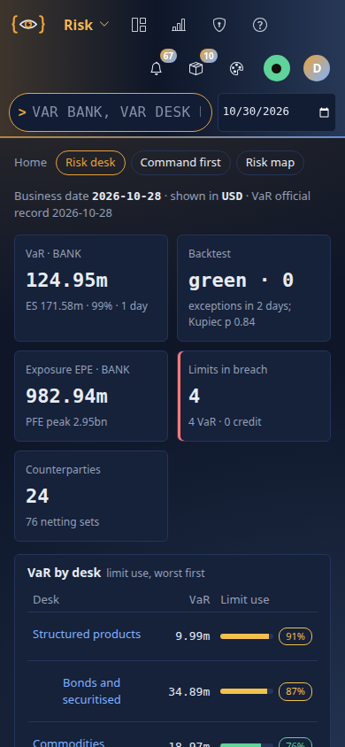

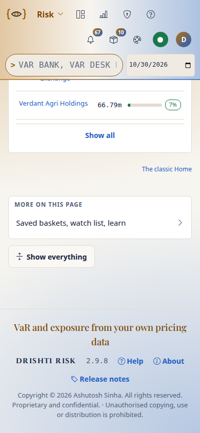

**The Domains menu on a phone** opens as a list with a heading per column (Blotter, Risk, Markets ...); each entry runs its command as on a desktop (44 px rows, the command on the right), and an entry ending in `…` puts its words in the command line for you to finish.

**Who decides.** Every tier is configured, never coded: a panel kind has a default (tables and charts at a glance, provenance and notes
under *More*, pivot grids on the desktop), a screen's author sets each panel's tier in its Sutra
([RACHANA_REFERENCE.md, phone](RACHANA_REFERENCE.md#phone-what-goes-to-a-phone)), and an administrator sets and caps tiers for the site
and the edition ([CONFIGURATION.md](../admin/CONFIGURATION.md), `ui.phone`; [LENSES.md](ADMIN_GUIDE.md#12-what-a-lens-is), `phone:`). A cap
wins: a site that says "never more than glance" for a heavy panel keeps it so, whatever a screen says.

## Keyboard

Press **`?`** on any screen (with the focus not in a text field) for **the keys of the screen you are on**, grouped: this screen's, those
of a panel or field, those of an open dialog, and those that work everywhere. `Esc` (or `?` again) closes the list and gives the focus
back. The **Keys** button in the footer opens the same list. On a view, `?` opens [About this page](#about-this-page) instead; its
footer's Keys button still lists the keys.

Every key belongs to one place, so two keys never fight: a dialog's own keys come first, then those of the panel or field that has the
focus, then the screen's, then the keys that work everywhere. **Keys never act while you type** in a text field, a drop-down or an
editor: typing `?` or `n` there types it (the few exceptions are named in the table, such as `Alt+K`, `Alt+C` and `Ctrl+S`).

| Key | Does |
|---|---|
| `?` | The keys of this screen (on a view: [About this page](#about-this-page)) |
| `Alt+K` | [Search everything](#search-everything-altk): entities, commands, screens, Help and what you can build; also from inside a field |
| `/` | Focus the command line, from anywhere |
| `↑` `↓` | In the command line: move through the suggestions. In a selected table: move the selected row |
| `Tab` | Complete the highlighted suggestion |
| `Enter` | Open the highlighted suggestion, or run the command (`<GO>`). In a table: open the selected row |
| `PgUp` `PgDn` | In a selected table: move the selection a page up or down |
| `Home` `End` | In a selected table: select the first or last row |
| `Esc` | Close the suggestions, a menu (a column's filter menu included), the raw JSON drawer, About this page or Calc; then restore a [zoomed panel](#zoom-a-panel) |
| `Z` | On a focused panel: [zoom](#zoom-a-panel) it, or restore it; `Shift`+`Z` also asks for full screen |
| `Alt`+`Shift`+`X` | Clear all [column filters](#filter-a-table-like-excel) (and the filter box) of the panel that has the focus |
| `K` | On a focused table: [chart it](#chart-any-table); `Shift`+`K` on a history page, where `k` is the previous day |
| `F1` | Help for the page you are on. On a view it opens [About this page](#about-this-page); `F1` again goes to the guide |
| `F2`–`F6` | Jump to the panel that shows that key in its header |
| `Alt`+`Shift`+`1`…`9`, `0` | The same as `F1`…`F9`, `F10` on a view. On Windows a laptop's F-keys are media keys unless `Fn` is held (or Fn Lock is on, often `Fn`+`Esc`), and Edge keeps `F9` for its Immersive Reader: these always work |
| `F7` | Open the main linked entity (for a trade: its netting set) |
| `F8` | Impact: what depends on this entity |
| `F9` | Raw JSON of the entity, with its source and generation |
| `Alt+←` | Back |
| `Alt+C` | Calc: Python on this view (where a pack offers it; `Option+C` on a Mac) |
| `Alt+L` | Layout mode: arrange this view's panels for yourself (`Option+L` on a Mac); in layout mode, [its keys](#with-the-keyboard) |
| `Alt+S` | Share this view (or panel) with people with a note; `Ctrl+Enter` sends, `Esc` closes |
| `Alt+N` | Discussion: the second tab of the side drawer ([Discussion](#discussion)) |
| `Alt+I` | Your inbox: what people sent you |
| `R` `C` `V` `F` | On the [pivot screen](#pivot-slice-a-table-your-way): open the Rows, Columns, Values or Filters picker; `Shift+V` the View picker; `Alt+↑` `Alt+↓` a hierarchy a level up or down; `\` the panes ([all its keys](bi/PIVOT.md#2-the-screen)) |
| `Ctrl+Enter` | In Calc: run the code (`Cmd+Enter` on a Mac) |
| `Alt+1`…`Alt+4` | In a workspace: move to pane 1 to 4, also while the focus is inside a pane |
| `Alt+0` | In a workspace: from a pane back to the workspace's bar |
| `←` `→` `Home` | On a panel's or a column's resize line: move it (`Shift`: further), or reset it ([Resize panels and columns](#resize-panels-and-columns)) |

The keys a view offers are also buttons along the bottom of the screen, so you can click them.

### Search everything (Alt+K)

`Alt+K` (`Option+K` on a Mac), or the round search button in the top bar, opens one search box over everything you may see. Type a
few letters: the answer comes as you type, **grouped** by kind, the best group first and the best match first in each group:

| Group | What it finds | Opens |
|---|---|---|
| **Entities** | Trades, counterparties, books and every other entity the server's type-ahead finds for you | The entity's view |
| **Commands** | Mnemonics and reserved words | The command's page |
| **Screens** | The pages of the top bar's menus that you see (`pick lists` finds *Views › Search & pick lists*) | The page |
| **Help pages** | Guides and tutorials whose text holds every word | The Help page |
| **Things you can build** | Published reports and boards, and your own designs | The report, board or design |

`↓` `↑` move through the results, `Enter` opens the highlighted one, `Esc` closes the list and a second `Esc` the search (the focus goes
back where it was). It shows only what you may open: your entitlements, your edition, your lens and the engines your role opens decide,
as they do for the menus and the command line; two people searching for the same word can see different answers. The command line's
suggestions and Help's search box are the same search, each over its own part (commands, Help pages).

### F9 · Raw JSON

Press `F9` in `TRD MX-20000001`. A drawer opens on the right with the full document, starting
`{"SOURCE_SYSTEM": "MUREX", "SOURCE_UPDATE_TIME": "2026-10-07T18:30:00Z", "TRADE_DATE": "2025-07-25", …, "TRADE_ID": "MX-20000001", …}`, and its
source (`trade-murex`) and generation, as the same foldable tree as the Raw document viewer (see [A number over time](#a-number-over-time));
**Tree** and **Raw** at its top switch between that tree and the document as plain JSON text (as the server sent it, indented, ready to paste anywhere); **Copy** puts the JSON on the clipboard and says *Copied*; **Search · copy · download** opens the full viewer. Press `Esc` to close it. If your role does not have raw access, fields such as `TRADER_ID` read `•••`, here
and everywhere else
(see [Masked fields](#masked-fields)).

### Masked fields

Your administrator can mask fields (`drishti.security.redact`; by default `TRADER_ID`, `TRADER_FIRST_NAME` and `TRADER_LAST_NAME`) for roles
without raw access. A masked field reads `•••` everywhere you could see or work out its value: the raw JSON, search
results and their CSV, compare and history, Calc, pivots (grouped under `•••`, never added up), and views: the header
strip, the title, tables and their totals, the pivot screen's rows, charts (masked points are left out), anything a
layout computes from the field, the live updates, monitors and the panel CSV export. Impact (`F8`) does not list what
is tied to the entity only through a masked field, and shows a masked measure and its total as `•••`. The
type-ahead neither shows nor matches a masked value, and an alert on a masked field never fires.

You cannot find a masked value by trying: a condition on a masked field is never true, sorting by it does not sort,
and typing it finds nothing. Fields under a masked one are masked too (with a counterparty's `KYC` masked,
`KYC.PD_1Y` reads `•••`).

### Alt+C · Calc: Python on a view

Press `Alt+C` on `VAR VAR-RATES`. A panel slides in from the right, like F9's, with a Python editor. The first time
in a tab, Python starts (*Python ready*, about a second). Pick **VaR and expected shortfall from the scenario P&L**
in **Snippets ▾** and press `Ctrl+Enter`: a table shows the VaR recomputed from the 500 scenario P&Ls
(**94,397,741**, the fifth-worst of the 500, the same as the strip's *VaR 99% 1D* `94.4m`), the expected shortfall, and a histogram. `view` is the screen (`view.doc` its
document, `view.tables` its tables as pandas DataFrames); `drishti.search("TRD where …")`, `drishti.get(kind, id)`,
`show()` and `chart()` are ready.

The code runs in your browser, never on a server, and reads only what you could open by clicking. The key is offered
where a pack switches Calc on (trading, counterparty-risk and market-risk do, through roles with `calc: true`: `trader`, `credit-risk`,
`market-risk`) and needs a role with the `calc` power; without
one it is shown greyed, with the reason. Everything about it, from the `drishti` module to the limits, is in
[Calc: Python on any view](bi/CALC.md).

### F8 · Impact

Impact answers "what depends on this, and how much is at stake?". Open `TRD MX-20000001` and press `F8`.
You should see *Impact of MX-20000001*:

- **Depends on it directly:** *Desk · 1*: `DESK-RATES`; *Netting set · 1*: `NS-MERIDIAN-RE-NY` with its net MTM (`+99,704,064`);
  *Trade valuation · 1*: `TVAL-MX-20000001` with its MTM (`+1,876,068`).
- **Rolls up into:** *Credit limit · 1*: `LIM-MERIDIAN-RE` via `CREDIT_LIMIT`, with the limit amount (`7.4bn`).

Each group has a total. Click any id to open it. With [masked fields](#masked-fields), Impact lists only what you
could find yourself, and a masked measure and its total read `•••`. See the
[Impact guide](#f8--impact).

## Live updates

Views of live entities tick: figures change in place and flash briefly. With the demo source on
(`DRISHTI_DEMO_ENABLED=true`; the demo lakes are daily snapshots and do not tick), open `TVAL TVAL-MX-20000001` and watch
**MTM** for a few seconds.

- The round **Live** button glows while the view streams (an amber ring while it reconnects). Hover over it to read
  how long the view took to build (`Live, built 1.92 ms`).
- All views, panes, the bell and monitors in **all the tabs of one browser** share **one** connection, so you can
  keep as many live tabs and workspaces open as you like (one per screen, say): new pages still load at once.
  A view open in several tabs is followed once. One browser follows at most 32 live things at a time; a view over
  that says *Static*, and why.
- The dot turns **amber** when the connection dropped or cannot be had (*Reconnecting…*): the page reconnects and
  repaints by itself, and everything else on the page keeps working meanwhile.
- It also turns amber when the tab was in the background for 10 seconds and gave its live updates back
  (*Paused while hidden*). Show the tab and it resumes. A tab left from before you signed in again (or picked
  another server) stays amber: reload it.
- It is **grey** on a view of a picked past date, which never ticks: it is a snapshot.

Screen readers hear the full state, including the server's rolling p99 (`Live, p99 2 ms`). To see the same
figures yourself, ask the server: `curl -s http://localhost:18480/api/v1/health/live`
([CLUSTER_GUIDE.md](../admin/BENCHMARK.md#212-how-to-measure-one-server)).

To turn off the flash, untick *Flash changed values* in [your settings](#your-settings).

## Live results and blotters

One engine shows any set of records **live**: a snapshot read from the durable store, then every change merged in by key and version as it
arrives. Blotters, FORM search results, bare mnemonics (`POS`, `TRD`, `NEWS`), monitors, drill-through and previews all run on it; a SQL or
BI table is the static case of the same grid. A blotter is a **declaration**, a YAML file; a new blotter (trades, positions, exposure,
inventory) is a configuration job, not a project. Drishti analyses and shows; it never acts on a source system: a blotter sends no orders. The engine is part of the platform, so FORM search, mnemonics
and blotters work in every distribution; the trade blotter and the source systems are the [trading module's](BANK_DATA_GUIDE.md#8-the-trading-module).

### One engine, and what uses it

A **live table** (Rachana's live tables, `rachana-live`, served on the Data Protocol at `/api/v1/rdp`) is the snapshot of a kind's records
from its durable store (Delta, Iceberg or files, through the bindings), plus the live changes of the kind's `live:` binding (Kafka,
RabbitMQ, ActiveMQ), merged **by key and version**, plus an optional edit path and an optional retention. Drishti's adapter
(`com.ash.drishti.server.live`) gives the engine its snapshots, streams, rights and write-back. What uses it:

| User | What it is |
|---|---|
| A blotter | a declaration (`<name>.live.yaml`) with columns, grouping, links and, optionally, edits |
| A FORM or the search page | the search compiled to a query on a table of the kind: a filter tree, an order and a limit; each row keeps the search's title (`_title`, shown as **Title** when it says more than the id) |
| A bare mnemonic (`POS <GO>`, `TRD`, `NEWS`) | the kind's own table; a default declaration is made from its contract; the page carries the as-of notices a search's answer carries (the sources answering from an earlier date) |
| A monitor, drill-through, a preview | the same table, opened from another page |
| A SQL or BI table | the static grid: the same component without the live channel |

The trading module's trade blotter is the first declaration ([the trading module](BANK_DATA_GUIDE.md#8-the-trading-module)).

### The page

The screen is the grid with the record's panel beside it: the Drishti Elements grid in its live mode, drawn from the API ([The API](#the-api)).

| Part | What it does |
|---|---|
| The grid | every record of the declaration's query, sorted, filtered and grouped; new rows ride in green, amended in amber, changed cells flash |
| The record's panel | the selected record: its fields, the reason, the four-eyes state, the version history, the links, and **Raw JSON** |
| Grouping | one field; the declaration's `subtotals:` are summed per group and stay current as records tick |
| The tray (**My changes**) | the person's changes waiting: awaiting an approver, sent to the source, applied, refused (with why) |
| **Pivot ›** | opens the Pivot on the same kind with the grid's filters, the grouping as rows and the numbers as sums |
| The live mark | the binding it ticks from, the messages per minute and the latency |

**Raw JSON** is the full stored record, including the fields the grid has no column for, as the person may see it (a masked field shows as
masked and is copied as the mask), with **Copy**, the version and sequence. A page of a kind fed by several source systems says when one is
switched off: `excludes ENDUR (switched off)`.

#### The page, step by step


Open a blotter from its module's menu (the trading module's is **Trading › Trade blotter**, `/live/trade`); any declaration has its page at `/live/<id>`.

1. **The bar.** The title, the live mark (`LIVE · 30 rows`; `PAUSED`, `RECONNECTING` and `ENDED` say what happened), **Group by** (one field; the
   declaration's `subtotals:` are summed per group and stay current as trades tick), **Pause** (rows that arrive are not applied; Resume reads
   the set again), **Pivot ›** and **My changes (n)**.
2. **Ticking.** A change to a trade arrives over the browser's one live channel and the changed cells flash; a replayed or older version is
   ignored. A table larger than the grid holds (5,000 rows) shows `5,000 of 120,000`; a change of a row it does not hold moves the count and **N new**.
3. **A record's panel.** Click a row. *Record*: the fields. With the edit power they are a form with a **Reason** (required or optional as the
   declaration says); without it they are plain text, with the words of why ("Read-only for you: ..."), and there is no edit control at all.
   Submit sends the change on the version you opened; the answer is in words (*waiting for 1 approver (four eyes)*, *on its way to the source*).
   If the trade moved meanwhile the panel says **Changed since you opened it**, and the server refuses an edit made on the old version, naming
   who changed it; **Reload** opens it again as it is now. *History*: every change with who, when, why and where it stands. *Raw JSON*: the whole
   stored record, including the fields the grid has no column for, collapsible, with **Copy**, the version and sequence; a field masked for your
   role shows as masked and is copied as the mask. The links (Explain, VaR, Limits) are the declaration's `links:`.
4. **My changes.** The tray lists your changes still open; click a trade to open it.
5. **Pivot ›.** Opens the Pivot on the same kind with the grid's filters, the grouping as rows and the numbers as sums, live when the trades are.


### Editing: configuration and rights

Never everyone. A blotter is editable for a person only when **both** allow it, checked on the server for every write (the screen only
reflects it):

| | Read-only when |
|---|---|
| The site's configuration | the declaration names no `edit:`; write-back is off (`edit.enabled`); the site switched this blotter's edits off (its name in `drishti.live-sets.edits-off`); the connector's command is missing, refused or its writes are off (Admin → Edits) |
| The person's rights | no **edit** power; the kind is not theirs to open; none of the form's fields is editable by their roles (`roles:`, `editable-by:`) |

**The edit power for trades** ships with the trading pack as the role **`trade-editor`** (`kinds: [trade]`, `edit: true`). The plain
`trader` role reads trades and never writes; give `trade-editor` beside it to the people who amend trades. The trade blotter's form
names it in `roles:`, so a trade-editor may change the book, price and quantity (the status stays with `middle-office` and `admin` by
`editable-by:`). A pack's role may carry `edit: true` like `approve:` or `calc:`; a site may still define its own roles in
`drishti.security.roles`.

A person who may not edit sees no edit controls (no `write` and `readOnly: <why>` in the schema the API gives them). A crafted
request is refused with `403 rdp.write.forbidden` and the reason, and audited (`write-refused`). Four eyes apply on top. Finer entitlements (per desk,
per field) come with the security release.

### Versions, conflicts, the outbox, four eyes and the audit

- **Versions.** The declaration's `version:` field is the guard. An edit carries `basedOn`, the version the person saw. If the record moved since,
  the answer is `409 rdp.write.conflict` naming the version, who changed it and when; **Reload** opens it again. The same guard runs again when the change is
  applied at the source, so a change that raced another is refused there too.
- **Outbox.** The change is recorded as pending in the same transaction that applies it, sent once per record in order, and resent after a failover with
  the **same change id**; the source treats a repeat as already applied.
- **Four eyes.** The site's policy (`config/edit/policy.yaml`, `source:`) asks for approvals for amendments sent to a source; nobody approves their own
  change; a form's `approval:` may ask for more, never fewer ([USER_GUIDE.md › Approvals](#approvals)).
- **One change id, end to end.** A write's `id` (the client's, 1 to 64 letters, digits, `-` or `_`) is the change's id in the write-back too: the
  approvals page, `GET /api/v1/changes/{id}`, the edit log and the source's message carry it. The same id again is answered with that change's
  answer (its state now: `held`, `queued`, `applied`, ...), never made twice, on any node and after a restart; from another person it is
  refused (`the change id ... is another's`).
- **Audit.** Every submit, approval, refusal (`edit-refused`), send and result is audited with who, when, why and the values. The person who made
  the change is the caller of every record: the table's (`live-write-submitted`, `live-write-held`, ... with the change id and its columns) and the
  write-back's (`edit-submitted` with the same id); a write the server cannot tie to a signed-in request is refused.
- **Write-back** goes to the record's own source system ([Writing back to the record's own source](#writing-back-to-the-records-own-source)).

### Row rules and per-person isolation

A role may restrict **which records of a kind** its holders see, by the record's fields and the person's attributes, in the configured roles:

```yaml
drishti:
  security:
    roles:
      rates-trader:
        kinds: [trade, position]
        edit: true
        rows:
          trade: "ASSET_CLASS = 'RATES' and DESK in $user.desks"
      endur-support:
        kinds: [trade]
        edit: true
        rows:
          trade: "SOURCE_SYSTEM = 'ENDUR'"
        edit-systems: [ENDUR]           # write-back only to Endur's records
```

A person sees a record when any of their roles that opens the kind passes it; a role without a rule for the kind opens every record of it; an
administrator sees all. `edit-systems` limits write-back to the listed source systems. Row rules restrict record views (live sets, search,
FORM, Raw JSON); aggregates such as VaR keep their own scope model. The rule is part of the viewer's audience, so two people with different
rules never share a filled set. Full text: [ACCESS_MODEL.md](../architecture/KERNEL_AND_MODULES.md) section 10. The rest of the isolation (masks, the
node answering, the embedding app) is in [The engine: snapshot, deltas, scale, retention](#the-engine-snapshot-deltas-scale-retention).

### The declaration

`blotters/<name>.live.yaml` in a module, or `config/blotters/` for a site's own: a Rachana live-table declaration
([LIVE_TABLES.md](https://github.com/drishti-platform/drishti-rachana/blob/main/docs/guides/LIVE_TABLES.md) section 2) with Drishti's profile
keys (`kind`, `links`, the edit's `roles`, `save` and `editable-by`). The trading module's
[`trade.live.yaml`](../../modules/trading/blotters/trade.live.yaml) in short:

```yaml
rachana: 1
live-table: trade                  # its name: /api/v1/rdp/tables/trade, the page /live/trade
title: Trade blotter
kind: trade                        # the kind it holds (its access, masks and row rules are the kind's)
snapshot: trade                    # the kind's durable records, through the bindings
stream: trade                      # the kind's live: binding (absent: a static table)
where: "@.TRADE_STATUS != 'CANCELLED'"   # the rows it holds (Rachana-EL over the row); absent: every record of the kind
key: TRADE_ID                      # the row's key: an edit names the row by it, so the edit form has no key field
version: TRADE_VERSION             # changes merge by it, and an edit on an older one is refused
changed-by: UPDATED_BY             # said when a stale edit is refused, with changed-at
changed-at: SOURCE_UPDATE_TIME
columns: [{name: TRADE_ID, label: Trade}, {name: PRICE, type: number, fmt: price4}, ...]   # type: string, integer, number, decimal, date, timestamp, list
subtotals: [QUANTITY]              # summed per group
sort: {col: SOURCE_UPDATE_TIME, dir: desc}
links: [{label: VaR, href: "/var?scope=book:{PORTFOLIO}"}]   # paths of the console, {FIELD} filled from the row
retention: {ttl: 1d, on: SOURCE_UPDATE_TIME, max-rows: 100000}   # the live side's age limit and row cap
tray: true                         # the person's pending changes, served as trade.changes
edit:                              # a Rachana form with save: (RACHANA_REFERENCE.md, forms): fields, checks, roles, where it goes
  edit: cells
  roles: [trade-editor, trader, middle-office, admin]
  fields: [{id: book, bind: PORTFOLIO, required: true, pattern: "BOOK-[A-Z0-9-]+"}, ...]
  save: {target: source, command: amend-trade, approval: none, reason: optional}
```

Every declaration is **checked at load**: Rachana checks its shape, its formats (each `fmt` a named format of `formats.yaml`, the bundled
one and the packs') and its edit form; Drishti adds that every column is in the kind's data contract (`contracts/<kind>.contract.yaml`
of the pack that owns the kind; a kind without a contract is checked for formats only), that a link is a path of this console, and that
an editable table's form says where its changes go (`save:`). A declaration with problems is set aside with every problem in words, listed
in Admin, and never served; the others load. The `edit:` form joins the Sutras' forms in the write-back under the name `live:<name>`, so
its checks, roles and approval rules are the write-back's own.

### The engine: snapshot, deltas, scale, retention

One engine behind every blotter and every FORM result: Rachana's live tables, with Drishti's adapter (`com.ash.drishti.server.live`):

1. **Snapshot, paged from the store**: a kind a lake keeps as columns (Delta, Iceberg or files, through the bindings) is never read into
   memory (the source's tier `columns`). For each order, filter and audience the table keeps an *index*: the keys of the rows that hold the
   condition, in order, with the sort column's values, read in one projection of the columns it lists. A page fetches only its own rows
   whole, by id; the total is the index's count. The index is read again when the store's version moves (a load). Other kinds are read
   whole in one pass (tier `whole`), up to `drishti.live-sets.default-max-rows` rows (the table says `capped`). An order by a field the
   lake does not keep as a column (the trade blotter's `SOURCE_UPDATE_TIME`) keeps the lake's records in key order **after** the live rows
   that carry the field: in a newest-first order the new and changed trades come first. Promote the field to a lake column to order the
   lake's own records by it too.
2. **Live deltas**: the kind's `live:` binding, subscribed to **before** the snapshot is read; what arrives meanwhile is applied after it.
   Every change merges **by key and version**: a newer version replaces the row, an older or equal one is dropped, a deletion or a row that
   no longer holds the table's `where` leaves. A binding whose broker is absent is `paused` with its reason, and the table keeps serving its
   snapshot.
3. **Who sees what** (session isolation: nothing of any person is kept in a shared table): every request is read through the person's
   **view** (the authoriser: their kind access, their row rule as a test of each row, their masks; their audience is everything that
   decides what they see). A table's rows are shared, and **every read is kept to the reader**: pages, totals, each stream (a row outside
   their scope is never sent; one that leaves it is a removal to them), one record whole and an edit's row. A filter or an order on a
   column masked for the reader is refused; a masked value never leaves the server. Changes are coalesced per row and flushed every
   `flush-ms` (50 ms).
4. **Scale**: pages of at most 5,000 rows (`offset`, `limit`, `sort`, `filter`: a filter tree on the columns as the reader sees them).
   The console's grid follows a table on the browser's one live channel: every patch of the table reaches it, merged by key and version;
   a row it does not hold (it shows a page of a larger table) moves the count and a **N new** button that reads the newest page again.
   This is by design: a paged grid never jumps under the reader's eyes (a row inserted at the top would move the row they are reading);
   they read the newest page when they choose. A
   windowed stream of the protocol (`POST /changes` with `window`; the reader names the keys it shows and `top` when its page starts at the
   first row of a newest-first order) is sent only the changes of those rows, new and changed rows on top, and the count of the others. A
   reader more than `window-capacity` (5,000) rows behind is sent one `gap` instead of a queue (back-pressure: a burst never queues without
   bound). 10,000 updates apply in well under a second and reach a viewer coalesced. At 100,000 records (a narrow kind) the first page takes
   about half a second (the index read once), a first sorted page under a second, every later page and a page after a live change a
   millisecond or two (`LiveTablesAdapterTest`); memory holds the keys and the sort column, never the records.
5. **Retention**: `retention:` trims the live side every 30 s (older than `ttl` by its field, else by arrival; beyond `max-rows`, oldest
   first); the durable store keeps its own.
6. A table nobody has read for ten minutes is closed (its declaration stays; it is read again when asked).
7. **A search is a query on a table**: a FORM's result and the search page's (`GET /api/v1/rdp/searches?q=`) are the search compiled
   once (`SearchFilter`: the search grammar's condition, its field names spelt as the kind spells them, text equality ignoring case,
   amounts expanded) into a **filter tree** (PROTOCOL 7, through Rachana's `FilterTree`), an order and a limit, read from a table of the kind
   that holds the columns the search needs (declared on first use, `q-<hash>`, shared by everyone who searches over those columns on that
   day). The answer is the table, the query, the first page and the search's summary; the next pages and the changes are the protocol's
   (`POST /tables/{t}/query`, `/changes` with the same filter). The rows, their count and their order are the search's (`FormResultsParityTest`).
   A condition outside the tree's subset (`matches`, `size`, a link) stays in the table itself (its `where:`); a condition on a field masked
   for the person matches no row, as the search does. An id pattern (`TRD MX-2*`) is a condition on the key column.
8. **As of a business date**: on the live business date the table follows the kind's changes; on any other day it is a static snapshot
   of that day (the lake's time travel: the bindings read the kind as of the date, the table has no stream) and says `live: false`.
9. **Across Drishti*net**: when other members hold records of the kind for the person (the cluster routing's scatter targets), the search's
   table spans them: this node's rows, then each member's share of the search (asked as the person, one hop, within the scatter budget),
   merged by key, the higher row version winning a key two members hold; each member's changes arrive over `GET /api/v1/net/changes/{kind}`
   (its own records, masked there for the person). Such a table is read whole and is the person's audience's own, so isolation holds
   across the members.
10. **A bare mnemonic is the kind's table**: `POS <GO>` opens the kind's own table a page at a time (`GET /api/v1/rdp/kinds/POS` names
   it). A module's declaration of the kind is used when there is one; otherwise a default is made from the kind's contract (its key fields
   as columns, else its promoted columns; the record's id as the key; read-only). No YAML per mnemonic is needed.

### Writing back to the record's own source

Edits go through the one write-back (APPROVALS_GUIDE.md): the lane, the approvals, the **outbox** (the change recorded as pending in the
same transaction that applies it, sent once per record in order, resent after a failover with the **same change id**) and the audit. The
connector says how; besides JDBC, **Kafka** writes:

```yaml
# config/connectors/trade-kafka.yaml (excerpt)
writes:
  amend-trade:
    kind: trade
    kafka:
      topic: trades.amend.v1          # where the change goes
      shape: command                  # command: {changeId, kind, entity, field, value, from, basedOn, by, reason, at}, keyed by the change id
                                      # document: the whole amended record (next version, change id, who, when) to the record's topic
      version-field: TRADE_VERSION    # the guard: sent only while the record is at the version the person saw
      changed-by: UPDATED_BY
      changed-at: SOURCE_UPDATE_TIME
      change-id-field: DRISHTI_CHANGE_ID   # the idempotency clause: a record already carrying the change id is a resend
    confirm: reply                    # the broker's acknowledgement (acks=all, an idempotent producer)
```

| | Kafka | JDBC |
|---|---|---|
| The guard | the record's version as the live binding holds it, before sending | the statement's `WHERE VERSION = :basedOn` and `expect-rows` |
| Idempotency | the message key is the change id (a command), the record's change-id field (a document); every message carries the header `drishti-change-id` | `already-applied` |
| Confirmed by | the broker's acknowledgement | the statement's reply, or the next load |

A change of several fields sends one message per field (`<id>#1`, `#2`); a document's later fields build on the earlier ones. The Delta,
Iceberg and file connectors never write per change.

### The API

The Data Protocol ([PROTOCOL.md](https://github.com/drishti-platform/drishti-rachana/blob/main/spec/1/data-protocol/PROTOCOL.md)) at `/api/v1/rdp`,
as the signed-in person:

| Method | Path | What it does |
|---|---|---|
| `GET` | `/api/v1/rdp/tables` | the tables the caller may read |
| `GET` | `/api/v1/rdp/tables/{name}` | the schema for this reader: columns (masked ones marked), key, `rowVersion`, `view`, `live` (`up` or `paused` with why), `write` (the columns they may change, with their rules) or `readOnly` (why not), the profile (`kind`, `links`), `tray`, `excludes` (the trading systems switched off that feed the kind) |
| `POST` | `/api/v1/rdp/tables/{name}/query` | a page: `{columns?, filter?, sort?, limit?, offset?, group?}`; `{columns, values, total, version}` |
| `POST` | `/api/v1/rdp/tables/{name}/write` | a change: `{id, op: update, key, basedOn, set, from?, reason?}`; `{change, state, message}` (`held` while it waits for four eyes); `403 rdp.write.forbidden` read-only (why), `409 rdp.write.conflict` stale (who changed it), `422 rdp.write.invalid` a field rule |
| `GET`, `POST` | `/api/v1/rdp/changes` | server-sent events of a table (`table`, `after`, `filter`, `window`): `msg` frames with a patch (`reset`, `remove`, `update`, `add`, `total`, `top`), `gap` when the reader must read again |
| `POST` | `/api/v1/rdp/changes/{sub}/window` | the rows a windowed stream sends: `{keys, top}`; only its own reader |
| `GET` | `/api/v1/rdp/searches?q=` | a search as a query on a table (FORM, the search page), on the person's business date: `{table, query, live, page, search, asOfNotices}` |
| `GET` | `/api/v1/rdp/kinds/{word}` | the table of a kind by its mnemonic or name (`POS <GO>`): `{table, asOfNotices}` |

A read the source cannot answer is `503 rdp.unavailable`; its `message` ends with what the source said and `source` holds those words, made
safe (one line of at most 300 characters, a file path cut to its file name, a credential in a URL or a `password=`/`token:` value as `***`).

The console passes these on as the person (`/api/rdp/...`); the changes are the console's channel (`/api/channel?s=live:{table}`, a FORM's
result `live:{table}~{filter}`, events `msg` and `gap`). The page is `/live/{name}`; the module's menu entry (`console/plugin.yaml`) links
to `/live/trade`. The component is the grid's live mode over the Data Protocol
([ELEMENTS.md](https://github.com/drishti-platform/drishti-elements/blob/main/docs/DESIGN.md) section 5.5), mounted by `js/drishti_records.js`.

### Settings

The modules' `blotters/` folders are read from each module's folder as the module boot gave it (a module's only while it is on).

<!-- settings:begin live-sets -->
| Setting | Default | Meaning |
|---|---|---|
| `drishti.live-sets.flush-ms` | `50` | how often each viewer's waiting changes are sent, coalesced per record (milliseconds, at least 10) |
| `drishti.live-sets.window-capacity` | `5000` | records waiting for one viewer before it is told to resync instead (back-pressure) |
| `drishti.live-sets.dir` | `<config>/blotters` | the site's own declarations (\*.live.yaml); a declaration with a problem is set aside (DRS-9307) and listed in Admin |
| `drishti.live-sets.edits-off` | `""` | declaration ids whose edits the site switches off (comma-separated): their grids are read-only |
| `drishti.live-sets.default-max-rows` | `250000` | the most records a kind's default set reads into memory when its store cannot page it (a kind a lake keeps as columns is paged from the lake, uncapped); beyond it the set says capped |
| `drishti.live-sets.store-timeout-seconds` | `120` | how long a set paged from the lake may take to read the columns it orders by, and a page's records |
<!-- settings:end -->

Every one is in [CONFIGURATION.md](../admin/CONFIGURATION.md) (`drishti.live-sets`), generated from the server's `application.yaml`.

### Make a new blotter

A new blotter is one file. An inventory blotter, complete:

```yaml
# modules/stores/blotters/stock.live.yaml: a warehouse's stock, one row per bin and item
rachana: 1
live-table: stock
title: Stock on hand
kind: stock                                   # a kind with a data contract (contracts/stock.contract.yaml)
snapshot: stock
stream: stock
where: "@.QTY_ON_HAND > 0"
key: BIN_ITEM_ID
version: ROW_VERSION
changed-by: UPDATED_BY
changed-at: UPDATED_AT
columns:
- { name: BIN_ITEM_ID, label: Bin/item, width: 140 }
- { name: WAREHOUSE, label: Warehouse }
- { name: SKU, label: SKU }
- { name: QTY_ON_HAND, label: On hand, type: number, fmt: amount0 }
- { name: REORDER_LEVEL, label: Reorder at, type: number }
- { name: STATUS, label: Status }
- { name: UPDATED_AT, label: Updated, type: timestamp }
group-by: [WAREHOUSE]
subtotals: [QTY_ON_HAND]
sort: { col: UPDATED_AT, dir: desc }
links:
- { label: Item, href: "/items/{SKU}" }
retention: { ttl: 2d, on: UPDATED_AT, max-rows: 200000 }
tray: true
edit:
  edit: cells
  roles: [stock-controller, admin]
  fields:
  - { id: qty, label: On hand, bind: QTY_ON_HAND, type: number, min: 0, required: true }
  - { id: level, label: Reorder at, bind: REORDER_LEVEL, type: number, min: 0 }
  save: { target: source, command: adjust-stock, approval: none, reason: required }
```

Then the module lists it (`blotters: {folder: blotters, list: [stock]}` in `module.yaml`), the site binds the kind (`read:` the store, `live:` the
messaging connector) and gives the connector the `adjust-stock` command under `writes:` ([Writing back to the record's own source](#writing-back-to-the-records-own-source)). No code is written: the page is at
`/live/stock`, the table at `/api/v1/rdp/tables/stock`, and the Pivot, the tray, the Raw JSON and the audit come with the engine.

### Retention in every store

`retention:` bounds the **live side** ([The engine: snapshot, deltas, scale, retention](#the-engine-snapshot-deltas-scale-retention)). The durable stores keep their own: the in-memory lake's tables carry
`retention: {ttl: 1d, on: SOURCE_UPDATE_TIME}` and drop older rows at compaction; Delta and Iceberg tables drop whole partitions older than the
period the lake's retention names, one partition at a time; the file store prunes its dated folders. The three behave alike
([DATA_LAKE_GUIDE.md](DATA_LAKE_GUIDE.md)).

### Tutorial: a Kafka feed, a ticking blotter, an edit with four eyes, written back, Pivot

The worked example is the trading module's trade blotter on the demo data. Each step says what you do in the UI, from a terminal (CLI)
and in the file (YAML). `$B` is the server's `/api/v1`, `$DRISHTI_TOKEN` a token of a trader.

**Step 1 · Bind the feed.** *YAML*, `config/bindings.yaml`: the kind reads its snapshot from the lake and its changes from Kafka.

```yaml
bindings:
  trade:
    read: [trade-endur, trade-murex]
    union: true
    live: trade-kafka
```

*UI*: Admin shows the kind with its live source. *CLI*: `drishti.py module list | grep trading` shows the module on.

**Step 2 · Watch it tick.** *UI*: open **Trading › Trade blotter**; the live mark reads `LIVE`. Publish an amended trade to the topic and its row
turns amber and its changed cells flash. *CLI*:

```bash
curl -s -H "Authorization: Bearer $DRISHTI_TOKEN" "$B/live/trade/rows?limit=3" | jq '{total, live, rows: [.rows[].id]}'
echo '{"TRADE_ID":"MX-20004163","TRADE_VERSION":8,"PRICE":101.25}' | kcat -P -b $BROKER -t trades.v1 -k MX-20004163
```

*YAML*: nothing more: the declaration's `columns:` and `sort:` decide what you see.

**Step 3 · Edit with a reason.** *UI*: click the trade; in the panel change Price, type the reason "booked at the wrong level: ticket 4411" and
**Submit**. The answer says *waiting for 1 approver (four eyes)* and the change appears in **My changes (1)**. *CLI*:

```bash
curl -s -X POST -H "Authorization: Bearer $DRISHTI_TOKEN" -H 'Content-Type: application/json' $B/live/trade/edit -d '{
  "entity": "MX-20004163", "basedOn": 8, "reason": "booked at the wrong level: ticket 4411",
  "items": [{"field": "PRICE", "from": 101.25, "to": 101.5}]}'
```

*YAML*: `save: {target: source, command: amend-trade, reason: optional}` in the declaration and `source: one` in `config/edit/policy.yaml`.

**Step 4 · Approve (another person).** *UI*: a second person opens **Approvals**, reads the old and new values and the reason, and approves; the
requester cannot (`self-approval: false`). *CLI*: the approvals commands of [USER_GUIDE.md › Approvals](#approvals). *YAML*: `approver-roles:` in the policy.

**Step 5 · Written back.** *UI*: the tray's line moves from *awaiting* to *sent to the source* to *applied*; the row ticks to version 9 when the
source's record comes back through the feed, and **History** in the panel lists who, when, why. *CLI*: the same guide lists a change's state.
*YAML*: the connector's `writes: amend-trade:` block ([Writing back to the record's own source](#writing-back-to-the-records-own-source)).

**Step 6 · Pivot ›.** *UI*: group the grid by **Book** (the subtotals tick), then press **Pivot ›**: the Pivot opens on the same kind with the
filters, the grouping as rows and the quantities as sums, live while the trades are. *CLI*: none; the Pivot is a console page.


## Business dates: live or a day in the past

The **Business date** box in the top bar says which day you are looking at.

- **Live** (the default) is today's business date on the New York calendar (`USNY`), streaming.
  Weekends and holidays count as the business day before.
- **A picked date** shows that day's end-of-day data as a static snapshot. The box turns amber.

The round **Live** button beside the box is a toggle, the same on a laptop and a phone:

| The button | Means | A click (or Enter or Space) |
|---|---|---|
| green, with a filled dot | live updates are on | pauses: the page becomes a static snapshot of the current business date |
| red, with two pause bars | paused, or a picked date | resumes live on today's business date |

You can still pick another date while paused. The choice is kept as you move between pages. A screen reader hears
*Live updates on — click to pause* or *Live updates paused — click to resume*, which is also its tooltip.

Step by step, with pictures (a past date, the same layout with that day's figures, a Saturday, back to Live): [tutorial 1, Part B](../tutorials/02-look-up-anything.md), step 14. It needs the sample history ([OPERATIONS_GUIDE.md](OPERATIONS_GUIDE.md#2-install-and-run-on-one-machine), Step 5).

What the banners mean:

| Banner | Meaning |
|---|---|
| *No data held for 2026-09-29: no dated store has … for that date. Shown instead: the current data of …* | No dated store holds the entity for the day you picked (for example, the history lake was not built, or does not reach back that far), so a source that keeps no dates answered. Its current data is shown as a still snapshot: it does not update and the top bar does not say *Live* |
| *Latest data on or before 2026-09-29 is from 2026-09-25* | Nothing was written for the day you picked; you see the last earlier day |
| *Pick a business date from 2021-09-30 to today.* | The date you typed is not a real date, is in the future, or is older than the server keeps. It was not taken: you stay on the date you had |
| *The business date you had picked cannot be used, so this is live. …* | A date remembered from earlier is no longer one the server accepts (for example after its history window moved on). The console has forgotten it and shows live |

### Known at: time travel

With a date picked, the clock field beside it (**Known at**) asks *as known when?*. Enter a time
(New York time) to see that business date as the system knew it at that moment: corrections made later
are left out. The **×** clears it and returns to the latest knowledge.

Use it to answer "what did we report at 6 pm, before the restatement?". Sources that keep versions
(Delta Lake, Iceberg) honour it. A dated store that keeps no versions (files, a database, Redis …) says so
instead (`DRS-1007 … keeps no earlier versions`) rather than showing today's data as if it were what was known then;
a search names it and says *partial*. Undated sources have only one version and show it.

## Compare: what changed

Compare lists every field that differs in one entity between two business dates.

Click **Compare** (it appears in the title line when you have picked a date): *What changed in MX-20000001* compares the picked date with the business day before. Each row shows the field's label and path, the value on each date and the
change for numbers; choose any two dates at the top to compare further apart, or give the earlier side a *known at* time to see what was restated on the same date; filter to *changed*, *added* or *removed*; **CSV** downloads
the comparison. Walk-through: [tutorial 1, Part B](../tutorials/02-look-up-anything.md), step 15.

Example rows for the valuation `TVAL-MX-20000001`, 2026-10-15 against 2026-10-16:

| Field | Path | Before | After | Change |
|---|---|---|---|---|
| MTM (USD) | `MTM` | 1,911,897 | 1,876,068 | −35,829 |
| DV01 | `DV01` | −155,791 | −155,245 | +546 |
| Valuation date | `VALUATION_DATE` | 2026-10-15 | 2026-10-16 | |

An amended trade compares the same way: `MX-20000022` between 2026-10-07 and 2026-10-16 shows *Trade status* `VALIDATED` → `AMENDED`,
*Trade action* `NEW` → `AMEND`, *Trade version* `1` → `2`, a new *Transaction ID* and *Source update time*.

Lists are matched by their identifiers or natural keys (a tenor such as `3M`, a date, a code), so an
inserted cash flow shows as one addition, not as every later cash flow changed: a path reads `LEGS[1].CASH_FLOWS[5000037]` (the
flow's id) rather than `LEGS[1].CASH_FLOWS[0]`.

The same comparison is available to programs:

```bash
curl -s -H "Authorization: Bearer $DRISHTI_TOKEN" "$DRISHTI_SERVER/api/v1/history/trade-valuation/TVAL-MX-20000001/diff?from=2026-10-15&to=2026-10-16"
```

It also takes `fromKnownAt` and `toKnownAt`. See [API_REFERENCE.md](API_REFERENCE.md).

## History: an entity over time

Type a range after the id (`TRD 1000015 30 <GO>`, see [The command line](CLI_REFERENCE.md#201-the-form-of-a-command)) and the screen becomes that entity
over time. The address is `/v/trade/1000015/history?days=30` (`?range=3M`, `?from=2026-09-01&to=2026-09-30`, `&diff=1`); the short
form `/v/trade/1000015?days=30` opens the same page. After an id, a space in the command line offers the ranges: `30`, `3M`, `YTD`,
`30 DIFF`.

**The header** names the entity, the range (*30 business days*), the first and last dates, how many days have data, how many changed,
how many were restated, and the days in the range with no data (hover *no data on 1 day* for the dates). *known: latest* means each day
is shown as it is known now. When a calendar range (`3M`, `FROM … TO …`) runs past the newest day the sources hold, the header says
*not loaded yet after 2026-10-16* rather than counting those days as missing.

**Trades and other documents** show one row per business day, newest first, with the kind's top-level fields as columns and each
list (legs, events) as a count with `▸`. A cell that differs from the day before is tinted and in bold, with `▲`/`▼` for numbers;
hover it for the value it had (*changed from 72K*). What stayed the same is dimmed, so the moves stand out. `⟲2` beside a date means the
store kept two versions of that day: the row is the latest. Masked fields read as the mask on every row, exactly as in the view.

**Equities, FX, curves and other market kinds** add the headline numbers of the chart's field (*Last*, *Chg*, *Chg %*, *High* and *Low*
with their dates, *Range*, *Avg*) and a chart in the theme's colours above the same table. The chart's crosshair follows the selected
row. The range buttons (`1M` `3M` `6M` `YTD` `1Y`) ask again; the address follows, so *Back* works and a link reproduces it.

**Diff** (`D`, or `DIFF` at the end of the command) turns the table into a change log: one block per day on which something changed,
each change on its own line (`Quantity 72,000 → 75,000`), with *Compare* (the full [compare page](#compare-what-changed) for that day
and the one before) and *Open the day*.

**Keys** (shown with `?`; ignored while you type in a field):

| Key | Does | Key | Does |
|---|---|---|---|
| `↑` `↓`, `j` `k` | previous, next day | `Home` `End`, `PgUp` `PgDn` | first, last, a page |
| `←` `→` | previous, next column (read aloud with its header) | `Enter`, double click | open the day's view, as it was that day |
| `C` | changes only: hide the days on which nothing moved (*7 of 30 days*) | `D` | diff, on and off |
| `R` | type a new range (`30`, `3M`, `YTD`, `FROM 2026-09-01`) | `1` `3` `6` `Y` `T` | 1M, 3M, 6M, 1Y, YTD |
| `E` | export: CSV, Excel, JSON Lines, JSON | `Alt+S` | copy a link to these rows |
| `Shift`+`K` | chart these days: any column by date ([Chart any table](#chart-any-table)) | | |
| `?` | the keys | `Esc` | back to today's view |

**Open the day.** `Enter` opens `/v/trade/1000015?asOf=2026-10-15&gen=59&via=history`: the normal view as of that day, with the pinned
banner (*as it was, from its history*, or *changed since the history read that day* when the data has moved on) and **Back to the
history**, which returns to the same range (the view's back link does too).

**Market kinds.** The table's numbers read in the chart field's format (`price2`: `21.66`), as the chart and the headline do. On a row from
the embedded series (a day before the stored documents), the parts' columns read `—` (*not read on this day*), not `0`. The chart's hover
label stays inside the chart and follows the selected row when the window is resized or zoomed; the crosshair's date is in the label and the
`⌖` line, not on the axis.

**Export** (`E`) downloads the table as shown, newest first: CSV (numbers as numbers, the formula guard, UTF-8 with BOM), Excel, JSON
Lines (a day a line, keyed as the CSV's header), or the server's JSON as served (its rows oldest first). Excel's dates are date cells (`yyyy-mm-dd`), so they sort and filter as dates. With
*changes only* on, only the changed days, in all three. Files are named `1000015-history-2026-09-07-2026-10-19.csv`.
Every export reads through the server, so it carries your masks.

**Link** (`Alt+S`) copies a link that pins the last date (`…/history?days=30&to=2026-10-19`), so a colleague sees the same rows a week
later; with *changes only* on it keeps `&only=1`. A link without `to` moves with the business date. The link is also shown, selected,
in a field under the toolbar, with *Copied* beside it: on a console opened by its plain-http LAN address the browser offers no clipboard
to the page, so Drishti copies from that field instead (and says *Select the link and copy it* if the browser refuses even that).

**When there is nothing to show** the page says why and offers today's view: an unknown entity (`DRS-1001`), a kind that keeps no daily
history here (`DRS-1012`), no data in the range (`DRS-1013`), a range larger than allowed (`DRS-4021`, with a link to the last 30 days)
or one that cannot hold (`FROM` after `TO`).

## Explain: one for every number

Every computed number has one **Explain**, the same on every screen: the VaR and ES tiles and the parametric figures of the VaR page, the
exposure page's tiles, a cell of the MR cube. Numbers that can be explained are underlined with dots.

- **Preview.** Hover the number (or focus it and press **?**): a small card with the answer in one line (*the 6th worst of 509 scenario
  P&Ls (2026-07-16)*), a few facts and links to the four parts.
- **The drawer.** Click the number (or focus it and press **E**; on the VaR and exposure pages **E** and **Explain ›** open the page's
  main figure): a drawer on the right, the page still visible, with four tabs:
  - **Formula**: the formula with the actual values (*k = ceil(509 × (1 − 0.99)) = 6*, the k-th worst scenario and its P&L), and the
    number as the Pivot, BI and Sutras name it (`var()`);
  - **Inputs & lineage**: what it was computed from: the scope as resolved, the positions and trades, those outside your view (counted,
    never named), the method, the engine, and the lineage: every input table's data version on the date, the batches, the scenario set;
  - **Why it moved**: since the previous business date (or the dates you choose), steps that add up exactly to the change, each with
    who drove it, in views (Waterfall, Matrix, Sentences for VaR);
  - **Workbook**: the live-formula Excel (the explanation's workbook, the playground's export) where one exists.
  Under the tabs, the **checks** (inputs complete; a check not built yet is marked *Under construction*). **Esc** or **✕** closes it and
  the focus goes back to the number. On a phone the drawer is a sheet from the bottom.
- **The page.** **Open as a page ›** (a button in the drawer's header, beside the title; it carries the scope, dates, compare date and tab) shows all four parts at once, for an auditor or for printing (**Print**); its address names the
  number (`/explain?kind=var&measure=es&scope=DESK:RATES`), so it can be sent. `VAR EXPLAIN <scope> [from] [to]` opens it at Why it moved.

Everything is computed and explained by the server for you, with your entitlements: an explanation never shows a row or an input you may
not see (a restricted person is told how many trades are outside the view, never which). A stored figure says it is stored. A part that is
not built yet for a kind of number says so (*Under construction*, and the release that builds it). The kinds explained today are VaR, ES,
parametric VaR and ES, the fat-tail gap (kind `var`), the exposure figures (peak PFE, CE, EPE, EEPE, peak EE, EAD: kind `exposure`) and a
pivot cell's move (kind `pivot`); `GET /api/v1/explain/kinds` lists them on your server
([API_REFERENCE.md, "Explain"](API_REFERENCE.md#18-explain-any-number)).

## How fresh is it

The footer of every view names the source and says how long ago it last received new data: *trade-murex ·
updated 42 min ago · gen 517 · as of 2026-10-16*. The age keeps counting while the page is open. When a source has received nothing for
longer than it should (its `stale-after`, set by your administrator), the view shows an amber banner at the top:
*trade-murex is behind: its last new data was 25 min ago, and it expects some within 15m. What you see may be out
of date.* Sources read on demand (a database) cannot tell, and show no age.

## A number over time

Click a number in a view (a strip value, a field, a cell of a table) and a window shows that field over the last 30
business days: a line chart, and the values day by day with the date the data is for and the connector it came from.
Choose 10, 30, 90 or 250 days at the top. Links still open what they name; a number that is a link opens the link.
The first line says where the value comes from: the path in the document, the connector, the business date the data
is for and the source's generation, with a link to the raw document. **Raw document** opens the document on the same page, in
a viewer: a tree you fold and unfold, with the field you clicked highlighted and scrolled to (`$.SLOPE_2S_10S` for the 2s10s of
`CRV-USD-OIS`). Search filters keys and values; **Copy JSON** copies the whole document and **Copy node** the selected one;
**Download** saves `<kind>-<id>-<date>.json` (`ir-curve-CRV-USD-OIS-2026-10-19.json`). Long lists show their first 50 items and a
*Show all*. Masked values read `•••`, as everywhere. `Esc` closes it and puts you back on the link; on a phone it fills the screen.
`Ctrl`+click (or a middle click) still opens the plain JSON in a new tab, and the `/api/raw/...` address keeps working.

Worked example: open `TVAL TVAL-MX-20000001`, click the MTM in the strip. You see *MTM (USD) · TVAL-MX-20000001 over time*, a line
over 30 business days, and below it the values, newest first, each with *Data for* and *Source* (`risk-store`, the demo lake of the
market-risk pack; `+1,876,068` on 2026-10-16, `+1,908,960` on 2026-10-07).
A *Data for* date in amber is earlier than the day it is listed under: the source carried its last value forward
(no data that day). An entity no dated source holds shows today's value with a note, since no history is kept.

**A pick list or search on two dates.** On the search page, set **Compare with** to an earlier business date and
press Search: each row shows today's value of every number with its change in brackets (`125  (+25)`), and entities
only one of the dates holds are marked *added* or *removed*.

The same through the API: `GET /api/v1/history/{kind}/{id}/series?path=$.MTM&days=30` and
`GET /api/v1/search/compare?q=…&from=2026-10-07&to=2026-10-16`.

## Asking in plain words

Type what you want in the command line, in words: `amended trades over 5m in BOOK-RATES-3, biggest first`, and press
Enter. When the words are not a command, Drishti shows the search they make and how it read each part; nothing runs
until you press **Run it**. The search page has the same box, **In words**.

```
amended trades over 5m in BOOK-RATES-3, biggest first
→ TRD where TRADE_STATUS = 'AMENDED' and QUANTITY > 5000000 and PORTFOLIO = 'BOOK-RATES-3' order by QUANTITY desc
   "trades" → Trade (TRD) · "amended" → trade status is AMENDED · "over 5m" → quantity > 5000000
   "BOOK-RATES-3" → portfolio is BOOK-RATES-3 · "biggest first" → sorted by quantity, largest first
```

It understands:

| You write | It means |
|---|---|
| a kind: `trades`, `counterparties`, `desk pnl`, a mnemonic | what to list |
| `over`, `above`, `more than`, `under`, `below`, `at least`, `at most` and a number (`5m`, `2.5 bn`, `10k`, `1,000,000`) | a comparison, on the field you name or the kind's main number (a trade's quantity, a valuation's MTM, an amount…) |
| `between 10m and 50m` | both bounds |
| `negative mtm`, `positive pnl` | below or above zero (`trade valuations with negative mtm` → `TVAL where MTM < 0`) |
| a value the data has: `amended`, `USD`, `BOOK-RATES-3` (optionally after `in`, `for`, `with`) | that field equals it |
| `maturing before 2028`, `traded after 2025`, `maturing in 2027`, `before 2026-12-31` | dates |
| `biggest`, `top 10`, `smallest 5 … by quantity`, `newest`, `sorted by` | the order, and how many |

**One entity over time, in words.** A kind, an id and a time phrase make a [history](#history-an-entity-over-time) command
instead of a search. When every word was read, it opens at once; otherwise the page shows *Read as …* with an **Open** button.

```text
trade 1000015 last month                    TRD 1000015 FROM 2026-09-01 TO 2026-09-30
equity EQ-CSCA last 3 months                EQ EQ-CSCA 3M
trade 1000015 last 30 days                  TRD 1000015 30
equity EQ-CSCA this year                    EQ EQ-CSCA YTD
trade 1000015 since 2026-10-01              TRD 1000015 FROM 2026-10-01
trade 1000015 since 2026-10-01 until 2026-10-10   TRD 1000015 FROM 2026-10-01 TO 2026-10-10
what changed on trade 1000015 this week     TRD 1000015 FROM 2026-10-19 DIFF
fx audusd since 2026-10-01                  FX FX-AUDUSD FROM 2026-10-01
1000015 30                                  TRD 1000015 30
BOOK-RATES-3 last week                      BOOK BOOK-RATES-3 FROM 2026-10-12 TO 2026-10-16
fx audusd                                   FX FX-AUDUSD (today's view)
```

Time phrases: `last` or `past N days|weeks|months|years`, `last week|month|year` (the whole previous one), `this week|month|quarter|year`,
`ytd`, `since <date>`, `from <date> to <date>` (or `since … until …`; two dates are put in order), `between <date> and <date>`. `changed` or `changes` anywhere adds `DIFF`. The id is the word
that names one entity of the kind (its id in any case, or the end of its id after a dash: `audusd` is `FX-AUDUSD`), even when it is also
a value of a field (`EQ-CSCA` is the equity's ticker); else the one word with a digit or a dash that is not a value of one of the kind's
fields, so `trades in BOOK-RATES-3 since 2026-01-01` stays a search (`BOOK-RATES-3` is no trade). Without a kind word, an id that names one
entity followed by a range (`1000015 30`, `1000015 3M DIFF`) or a time phrase (`BOOK-RATES-3 last week`) is that entity's history.
A kind and one id with no time phrase open the entity (`fx audusd`). A search is of one business date, so a time phrase in a search
(`trades in BOOK-RATES-3 last week`) is listed as *left out*, with how to ask for one entity over time instead (`BOOK-RATES-3 last week`),
and the search does not run on its own; `since <date>` in a search is a condition on the date.

It is deterministic: no AI service, only the server's own vocabulary (its kinds, and each kind's fields and the
values its documents have). Words it did not understand are listed as *Not understood, left out*, never guessed.
Change the words, or edit the search itself.

## Search by value

Add `where` after a mnemonic to find entities by what they contain.

```text
TVAL where MTM > 1m order by MTM desc limit 50
```

You should see a page headed *Search by value*, a summary line such as `3321 of 15000 trade valuations match; the first 50
are shown`, the time it took, and a table: one row per valuation, with a column for each field the query uses
(here **MTM (USD)**), then the kind's key fields. Click an id to
open it, or walk the table with the keyboard ([Tables](#tables-sorting-filtering-paging-and-the-keyboard)).

`where` is optional: `TVAL MTM > 1m` and `TRD PRODUCT_TYPE=FX_QUANTO` work as well, and come back as a
[pick list](#pick-lists-when-a-command-names-several-entities). The rest of this section applies to both.

### The parts of a search

```text
<MNEMONIC> [where <condition>] [order by <field> [desc]] [limit <N>]
```

| Part | Rules | Example |
|---|---|---|
| Mnemonic | Any mnemonic, or a kind name | `TRD`, `NSET`, [`trade-valuation`](../contracts/packs/market-risk.md#example-market-risk-trade-valuation) ([contract](../contracts/packs/market-risk.md#tval-trade-valuation-trade-valuation)) |
| Field | As named in the document, in any case; dots for nested fields, brackets for list items. A name no entity of the kind has is an error with the closest names | `MTM`, `mtm`, `KYC.PD_1Y`, `LEGS[0].NOTIONAL` |
| Compare | `=`  `!=`  `<`  `<=`  `>`  `>=`; text compared with `=` and `!=` ignores case | `PRODUCT_GROUP = 'Rates'` (also matches `rates`) |
| Text | `contains` and `startswith`, case-insensitive; `contains` also looks inside lists | `COUNTERPARTY contains 'MERIDIAN'` |
| Combine | `and`, `or`, `not`, brackets. `not` applies to the comparison after it | `MTM > 1m and not TRADE_STATUS = 'MATURED'` |
| Amounts | `k` thousand, `m` million, `bn` billion | `250k`, `1.5m`, `2bn` |
| Text values | in single quotes; a single word may go without | `'Early warning'`, `Rates` |
| Sort | `order by <field>`, add `desc` for largest first. Equal values come in id order and entities without the field last, so a `limit` keeps the same rows every time | `order by MTM desc` |
| Size | `limit N`, a whole number from 1 to 1000; anything else (`limit 0`, `limit 5000`) is an error that gives the range | `limit 20` |

Without `limit`, a search shows the number of results set in *My account → Settings* (100 unless you
change it).

### Examples to try

| Search | Matches on the demo lakes (business date 2026-10-16) |
|---|---|
| `TRD where QUANTITY >= 250m and PRODUCT_GROUP = 'Rates' order by QUANTITY desc limit 20` | 783 of 15000 trades (the first 20 shown) |
| `TRD where COUNTERPARTY contains 'MERIDIAN'` | 1291 of 15000 trades |
| `TVAL where MTM < -1m order by MTM` | 3154 of 15000 trade valuations, most negative first |
| `TRD where PRODUCT_GROUP = rates` | 1832 of 15000 trades (case ignored, no quotes needed) |
| `NSET where NET_MTM < -100m order by NET_MTM` | 10 of 76 netting sets, most negative first |
| `LIM where STATUS = 'Early warning'` | 2 of 24 credit limits |
| `ECON where GDP_USD_BN > 1000 order by GDP_USD_BN desc` | 21 of 213 economies |

A search whose condition matches exactly one entity still shows its one-row table; only a command typed
without `where` opens a single match directly.

### Good to know

- A search follows the business date in the top bar.
- It sees only what your role may see; a condition on a masked field never matches and sorting by one does not
  sort ([Masked fields](#masked-fields)).
- If the scan limit was reached, the page says *results may be incomplete*. If a source failed, did not answer
  in time, or could not list the kind, a banner says *Incomplete: 1 source could not be read* and names each source
  and why (for example a lake date in a format the server does not read): entities it holds are missing, so
  "0 matches" does not mean none exist.
- A mistake gives an error such as `DRS-4004 cannot read the condition: …` with the position. A condition that stops
  short (`TVAL where MTM >`) says `the condition ends early: something is missing after '>'`.
- **CSV** downloads the results. **Watch as a monitor** saves the first 50 results as a live monitor
  (see [Monitors](#monitors)).
- Where the kind's pack offers it, a **Table | Pivot** switch turns the results into a pivot over **every** match of
  the day, computed on the server ([Pivot](#pivot-slice-a-table-your-way)).

## Search with a form (`FORM <pack>`)

Type `FORM <pack>` (or open **Forms** in the Views menu) to fill in boxes instead of writing a search: the form writes the search, shows it and runs it. A field with more than 300 values (the counterparties of a large book) shows a box to find them as you type instead of one tick box each. The reference is [Query by form](#query-by-form) below; the walk-through is [tutorial 1, Part C](../tutorials/03-query-by-form.md).

## Export, print and share

The buttons in a view's title line, and the **↓** in each panel header.

| Action | Where | What you get |
|---|---|---|
| Panel as CSV or JSON Lines | **↓** in a panel header, then **CSV** or **JSON Lines** | Tables and ladders as they are; key/value panels as field and value; charts as one column per series; surfaces as a grid; bars as label and value |
| Search as CSV or JSON Lines | **CSV**, **JSONL** on the results page (and on a form's results) | One row per result |
| Pivot as Excel, CSV or Arrow | **Export** (`X`) on the [pivot screen](#pivot-slice-a-table-your-way) | The pivot as shown with Excel's own outline levels, SUM formulas only where a figure adds up and a Provenance sheet; CSV one row per cell and measure, or the grid; the cell's rows; the view as YAML (bi/README.md section 10) |
| Comparison as CSV or JSON Lines | **CSV** on the Compare page; the same address ending `.jsonl` | One row per change |
| View as PDF, PNG, Excel, CSV or JSON Lines | **Export** in the title line | The view as you see it, with the controls and filters you set |

**JSON Lines** (`.jsonl`, [DATA_GUIDE.md](DATA_GUIDE.md#2-data-formats-json-lines-is-the-standard)) is one JSON object a line, keyed by the CSV's column names, numbers as
numbers and no spreadsheet escaping: the form for scripts and other systems. It sits beside every CSV download; CSV, Excel, PDF and
PNG all stay.
| Document as JSON | **JSON** in the title line | The whole document, as your role may see it |
| Print or PDF | **Print** | A clean light page without the top bar and buttons; choose *Save as PDF* in the print dialog |
| Share | **Share** (`Alt+S`), or a panel's **send** icon | A [dialog](#share-a-view-with-a-note): send the view, or one panel, to people with a note; **Copy link** is in it |

Worked example (CSV): open `TRD MX-20000001` and click **↓** on *Cashflows*. You get a file whose first
lines are:

```text
Pay date,Leg,Type,Rate,Amount,PV
2025-09-29,2,Float,0.035377,-1403091,0
2025-12-31,2,Float,0.036186,-2310878,0
```

Numbers arrive as plain numbers (`-1403091`, `0.0425` for `4.25%`), so a spreadsheet can add them up.
File names carry the business date when one is picked. Each download also has a direct address, for
example `/export/trade/MX-20000001/schedule.csv` (`schedule` is the panel's id) or `/export/trade/MX-20000001.json`.

**Share** links:

- in Live, the link is the view's address, such as `http://localhost:17480/v/trade/MX-20000001`;
- with a date picked, the link carries it (`/v/trade/MX-20000001?asOf=2026-09-29&knownAt=…&gen=…`): the date, the
  *known at* moment if you set one, and the generation you saw. A colleague sees what you see, within their own
  permissions. If they are signed out, the sign-in page keeps the whole link and brings them back to it. The date applies
  to that page only: a *Pinned* banner says "You are seeing 29 Sep as known at …, as it was shared" (or that the source
  keeps no earlier versions so they see the latest for the date, or that the data has changed since, with *What changed*),
  and **Go live** drops it. Their own saved date, and their other tabs, are not changed.

### Share a view with a note

**Share** (or `Alt+S` on a view) opens a dialog. **Copy link** is the first thing in it, so the old one-click use is one
click plus `Enter`; the rest sends the view to people inside Drishti.

1. **What**: the whole view, or one panel (use the **send** icon in a panel's header to start with that panel chosen).
2. **As of**: shown, never typed. It is the date and *known at* moment you are looking at, so the people you send it to open
   exactly that; tick *send a live link instead* to send the live view. On a live page the link is live.
3. **To**: type two letters of a name or a role (`rav`, `risk`) and pick from the list with the arrow keys and `Enter`
   (or click). You can only find people who use at least one pack you use; a role stands for everyone in it (its size is
   shown). `Backspace` in the empty field removes the last name.
4. **Note**: plain text. Do not type the value of a hidden field: the server replaces it with `•••` for everyone who may
   not see it (you read your own text as written). If you can see hidden values yourself, you are warned when the note copies one; if you
   cannot, you are told nothing either way. A `{$.path}` quote is filled for each reader with the value they may see, in the app and in
   email.
5. **Also start a discussion on the view** (a tick under the note): the note also becomes the first comment of a thread on the view, written by
   you, so the conversation continues in the [Discussion](#discussion) tab. Whether it is ticked when the dialog opens is your administrator's
   setting (`drishti.collab.share.post-to-thread`); you can change it for each share.
6. **Include a picture** (a tick, shown only when your administrator allows pictures for this kind of view): the share carries a snapshot of the
   view, or of the panel you chose, with a watermark (who sent it, to how many people, when, the data's date and generation, and the link). Tick it
   and the dialog shows a **preview** for the people you chose. The picture shows only what *every* recipient may see: if any of them sees a hidden
   field as `•••`, so does the picture for all, and a panel any of them may not open is left out. Charts without a simple drawing appear as a labelled
   box that says to open the view. Recipients see it on the shared view's banner and, if email is on, as an attachment; it may show figures, only those every recipient may see, and it can never later show more than it did when you sent it.
7. **Send** (`Ctrl+Enter`). The dialog says who it reached ("Sent to 2") and who it did not and why ("Not sent to dkim:
   cannot open trade views"). `Esc` closes the dialog and puts the focus back where it was. On a phone the dialog is a full
   screen sheet.

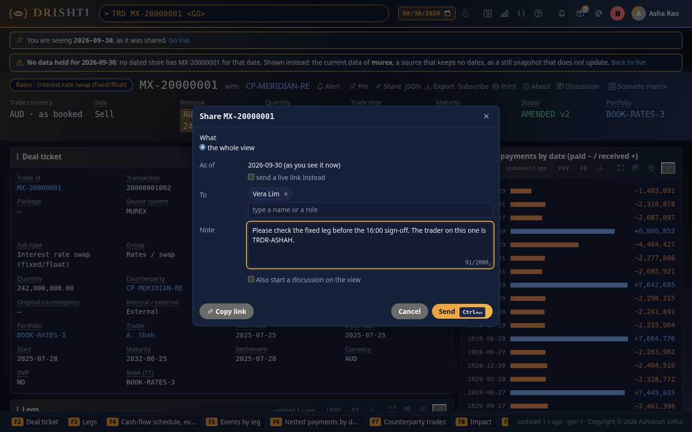

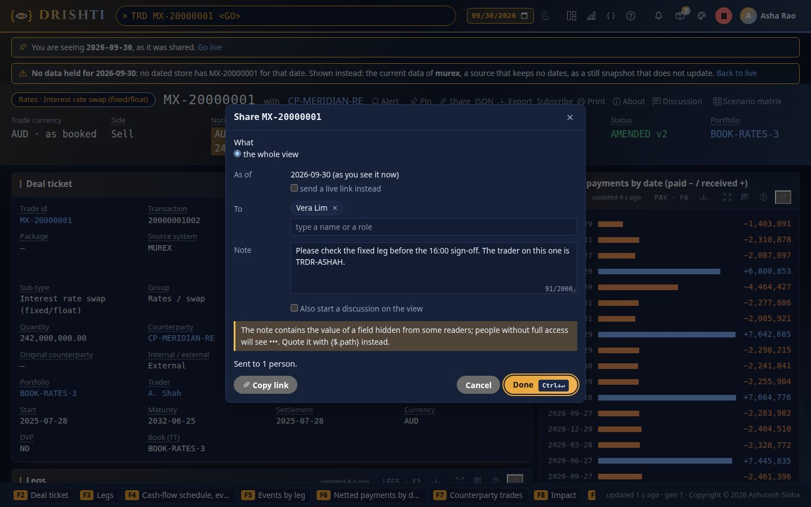

What the recipient gets: a notice on the **bell** within a second (a number on the bell, and a toast) and a row in
their [inbox](#your-inbox). Opening it goes to the view **as you sent it**: your date and *known at* moment, with a
banner "Shared by Ann Author", your note, and the usual *Pinned* banner. A shared panel is scrolled to and outlined. They
see the view with *their own* rights: a field hidden from their role stays `•••`, and the note reads `•••` where you typed
a hidden value.

**Reply.** Under the note, the sender and each person the share reached have a **Reply** box (`Ctrl+Enter` sends). Replies are listed under the
note, oldest first, and the other side gets a notice. A compliance officer who opens the share can read the replies but not write one.

**Times.** Every time the collaboration pages show (inbox rows, the share banner and its replies, the *known at* time in the Pinned banner,
comment times, the administration page) is in the same zone as the top bar's *known at* picker, with its name after it: `2026-09-30 10:02 New York`.

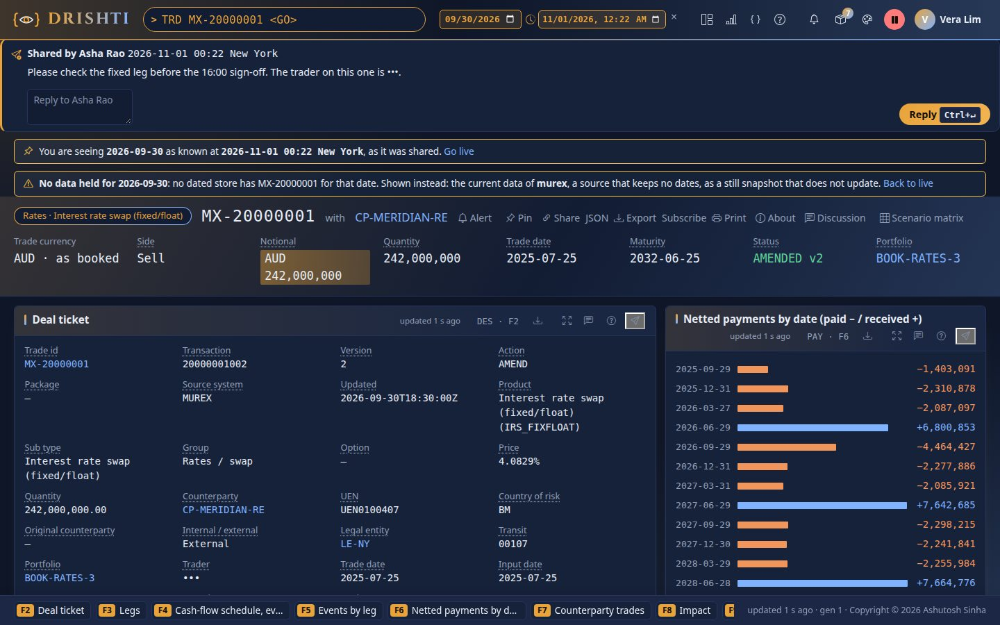

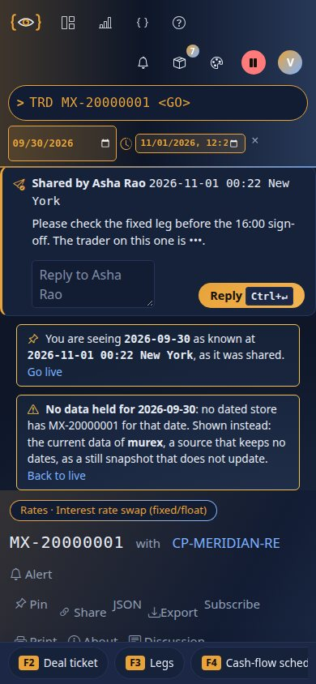

A person whose role does not open that kind of view (or who was sent it and then lost access) sees a plain page, "A shared
view you cannot open", with who sent it and when, and nothing about what it holds; their inbox keeps the notice. If the
reason is that the pack is switched off for them, the page offers **Switch on** *pack*. A link that was never sent to the
reader looks the same as a link that does not exist.

**Who can receive.** Only Drishti users: there is no sharing with an email address, and a mention or share never reaches a person whose
role may not open that kind of view (they are told nothing). Nothing is copied: a share holds your note and the pinned link, so when
someone's rights change, what they see changes with them.

**Email.** When your administrator has set email up, the people you share with (and mention) also get a mail: the kind of view and its id,
the panel, the date, and your note as *they* may read it (hidden values as `•••`, quoted values filled for them), with the link. For packs
whose ids are themselves sensitive the mail says only "… shared a view with you" and the link. Several notices that arrive for one person
within a few seconds come as one mail. Each person can switch share, mention and reply mail off on the *Account* page, under *Email me
when*; the bell always shows the notice.

### Your inbox

The **bell** in the top bar counts what is new for you (shares sent to you, and alerts as they fire); click it, or press
`Alt+I`, for the inbox page. Each row says when, what kind (Share), who, and the start of their note, as you may read it
now: a row about a view you can no longer open reads "(no access)" with no excerpt, and a retracted or hidden comment shows as such. Click a row to open it (opening marks it read), **Mark read** on a row, or **Mark all read**. Filter by *All*,
*Shares*, *Mentions* or *Replies* and *Unread only*; **Older** pages back. Rules that fired are on the
[Alerts](#alerts) page.


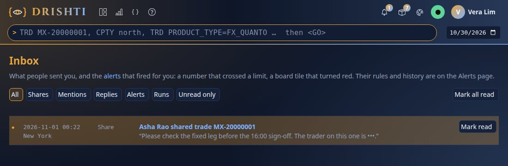

## Monitors

A monitor is a **live watchlist**: one row per entity, each row showing that entity's key figures (its
strip) as they tick. Rows can be of different kinds. It is the records grid in its static mode: the cells change in place as the stream
sends figures; open a row for *Open*, *Set an alert* and *Remove from the monitor*.

*Views → Monitors* in the top bar (`/m`) lists *Yours* and the *Starters* the packs offer. Opening a starter
saves a copy to your account. (None of the shipped packs offers a starter, so start from a search; the retired example packs
`finance` and `logistics` under `examples/packs/` offer *Credit watch* and *Fleet watch*.)

Step by step (a search, **Watch as a monitor**, adding an entity, removing a row), with pictures: [tutorial 1, Part C](../tutorials/03-query-by-form.md) (save a search and a monitor).

The monitor is saved on the server under your account, so it follows you to any browser. All rows share
one live connection.

## Scheduled reports

A report is a search that runs on its own, on a schedule, and delivers its result as a CSV or JSON Lines file (**Format**); **Reports** in the Views menu lists them with your subscriptions. Export and subscriptions are in the same place. The reference is [DISTRIBUTION_AND_ALERTS.md › Distribution: scheduled reports, export, subscriptions, alerts and embedding, section 0](bi/DISTRIBUTION_AND_ALERTS.md#11-the-reports-page-and-scheduled-searches); the walk-through is [the reports tutorial, Part E](bi/DISTRIBUTION_AND_ALERTS.md#part-e--scheduled-searches-and-subscriptions).

## Alerts

One alert engine watches everything you ask it to, on the server, whether or not anyone has Drishti open. An **alert rule** watches a
number (a visual of a BI report, a measure of a dataset or a model, a field of an entity) or a **rule on one entity** (a Rachana-EL
condition such as `$.TRADE_COUNT > 100`). When it breaks, an **alert is raised** for you; you acknowledge it, snooze it or resolve it, and it
resolves itself when the number comes back. Everything is on **Views → Alerts** (`/alerts`).

- The **server** looks at a rule on its schedule, after a data load of its kind, or live when its source changes.
- A rule raises an alert **once** when its condition becomes true, and re-arms when it turns false again (by the *hysteresis* you set);
  it does not raise again within its *cooldown* (30 minutes by default).
- A rule that is already true when you save it raises an alert straight away.
- A rule reads its number or its entity **as you**: with your row rules and your masks. A condition on a
  [masked field](#masked-fields) never becomes true, and no message ever carries a masked value.
- A raised alert shows as a **toast** and a count on the **bell** among the round tools of the top bar, on every page, and is in the
  **Alerts** tab of your [inbox](#your-inbox); the rule may also send it by email, to a chat bridge, to a webhook or by text.
  At most three toasts show at once; a burst adds one more toast, *+N more on the bell*, which opens the inbox. Only notices
  written after the page opened toast: older ones wait in the inbox and on the bell's count.

**The alerts raised for you.** *Raised for you*, at the top of the Alerts page, lists every alert raised and not yet resolved: its
severity, its **stage** and what it said.

| Stage | What it means | What you can do |
|---|---|---|
| raised | the condition broke; nobody has taken it | **Acknowledge** (it is yours now: you are its owner), **Snooze**, **Resolve** |
| acknowledged | someone owns it | **Snooze**, **Resolve** |
| resolved | the number came back by itself (*cleared*), or someone resolved it by hand (with a note) | nothing: *Show resolved too* lists it |

**Snooze** keeps an alert quiet for 1 hour, 4 hours or a day: a breach while it is snoozed is held, and raised when the snooze ends if it
still holds. *No longer* ends a snooze. Resolving by hand does not make a condition that still holds raise again: it raises again only
after the number comes back and breaks again. An administrator also sees the **platform alerts** (the server's own health: memory, disk,
sources down; [OPERATIONS_GUIDE.md section 13.6](OPERATIONS_GUIDE.md)) in the same list, and may **Assign** one to a colleague.

Worked example, a rule on one entity:

1. Open `NSET NS-SUMMIT-NY` and click **Alert** in the title line. The *Alerts* page opens with
   **Kind** [`netting-set`](../contracts/packs/counterparty-risk.md#example-counterparty-risk-netting-set) ([contract](../contracts/packs/counterparty-risk.md#nset-netting-set-netting-set)) and **Id** `NS-SUMMIT-NY` filled in under *New rule on one entity*.
2. Fill in **Name** `Summit size`, **When** `$.TRADE_COUNT > 100`, **Severity** `warn`, and **Message** `Summit is big` (the alert's title).
3. Click **Save rule**. It is an alert rule like any other (a field source whose field is your condition, the condition *holds*), looked
   at after each load of `netting-set`. The set already holds 1,274 trades on the demo lakes, so an alert is raised at once: a toast,
   the bell showing `1`, and a line under *Raised for you*.
4. Click **Acknowledge**, then **Resolve** with a note. *Your alert rules* lists the rule; **Edit and history** changes it (choose
   *when it changes* to watch it live, if its source pushes changes), **Delete** removes it.

### Writing conditions

A condition is a Rachana-EL expression over the entity's document. `$` is the document; `$.field`
reads a field.

```text
$.COLLATERAL < 0                               a netting set the bank has posted collateral to
$.MTM < -450000                                a trade valuation's MTM below −450k
$.NET_MTM < -1500000 && $.COLLATERAL < 0       both at once
$.STATUS == 'Early warning'                    a credit limit's status
```

In a rule (unlike a search) write `==` for equality, `&&` for and, `||` for or, and full numbers
(`1500000`, not `1.5m`). The full language is in [RACHANA_REFERENCE.md](RACHANA_REFERENCE.md). On the alert form the same rule is a
**Field** source with the condition **holds**.

A pack may suggest rules for its kinds (`alerts:` in its `pack.yaml`; none of the shipped packs does, the retired example pack
`finance` suggests *PFE near limit* and *MTM below −450k*); they appear on the Alerts page and fill the form when clicked.

> **Tip:** a condition that cannot be evaluated (a misspelled field, say) is skipped, not raised; the rule's history says why.
> Check a field's exact name with `F9` first.

Your rules, their state and their history are kept with your account. More in the [Monitors and alerts guide](#monitors).

### Alerts on numbers

Click **Alert me** (the bell in the corner of a visual of a BI report) or click a number on a view and choose **Alert me**: the form opens with that number filled in. Say when to tell you: when it goes **above** or **below** a limit,
**between** two numbers or **outside** them; when it **changes by** a percentage or an amount (against the previous look, or the previous business day); or when today's data **has not arrived by** a time. Say when to look (on a schedule,
after a data load, or when it changes), and how to tell you: your **inbox** and the bell, **email** to the address on your account, the **chat bridges** your administrator set up. *Check now* shows what it reads for you right now.

**It is your number.** The alert reads the number as you: with your row rules and your masks. If a number is masked for you the alert never judges it and never shows it. Once it fires it stays quiet until the number is back
inside the limit (by the *hysteresis* you set, if any) and does not fire again within the *cooldown* (30 minutes by default). Your rules are on the **Alerts** page (also **Reports**, *My alerts*): *Look now*, *Pause*, *Resume*,
*Edit and history* (what every look did, and what was sent where) and *Delete*; what they raised is under *Raised for you* and in the
**Alerts** tab of your inbox. If a board's author has made a tile notify, you are told when it turns red, on your own number.
Reference: [DISTRIBUTION_AND_ALERTS.md › Distribution: scheduled reports, export, subscriptions, alerts and embedding, section 4](bi/DISTRIBUTION_AND_ALERTS.md#2-alerts-on-numbers); walk-through: [the reports tutorial, Part D](bi/DISTRIBUTION_AND_ALERTS.md#part-d--bi-that-runs-itself).

## Workspaces

A workspace puts up to four live views on one screen. A pane can **follow** another: a link you click
in the followed pane opens in the following pane.

*Views → Workspaces* in the top bar (`/w`) lists yours and the starters. Starters come from packs that
define them (none of the shipped packs does; the retired example pack `finance` defines *Credit desk*, *Rates*, *Cross-asset*) and from
`drishti-console/config/workspaces.yaml`.

With any packs, start a blank workspace: type a name under **New workspace** on `/w` and press **Create** (or open
`/w/<name>` for a name you have not used and click **Create it**). It opens with two empty panes (the `blank` entry of
`drishti-console/config/workspaces.yaml`); type a command in each pane's box, then **Save**. When your packs bring no
starters, *Starters* says so.

Worked example (on the demo lakes, from a blank workspace):

1. Open `/w`, type `Credit desk` under **New workspace** and press **Create**. In the first pane type `NSET NS-NORTHPLAINS-NY` (the
   netting set), in the second `TRD 1000001`, and set the second pane to follow the first.
2. In the netting-set pane, click another member trade. Pane 2 follows pane 1, so it opens that trade.
3. Change **Layout** to *Two by two*, click **Pane** to add a fourth pane, and type `TRD MX-20000001` (a MUREX swap) in its
   **Entity for this pane** box.
4. Set its **follows** to `—` so it stays put.
5. Click **Save as…**, name it `My credit desk`, and click OK. It now appears under *Yours*.

| Control | Does |
|---|---|
| Layout | *Two columns*, *Three columns*, *Two by two*, *One large, two stacked* |
| Entity for this pane | A command or id (`TRD MX-20000001`, `NS-SUMMIT-NY`), then Enter |
| follows | Which pane this one follows, or `—` |
| Pane / × | Add a pane (up to four) / remove one |
| Drag a suggestion onto a pane | Type in the command line (`TRD MX-2`, or nothing for your recent ones), drag a suggestion onto a pane: the pane shows it. Click it without dragging to open it full screen as usual |
| Drag a pane's number onto another pane | The other pane shows the same view |
| Drag a divider | Share the width (or height) between two neighbouring columns (or rows); focus it with `Tab` and use the arrow keys (`Home`, or a double-click: equal) |
| Save / Save as… / Delete | Keep it under its name, sizes included / a new name / remove it |
| `Alt+1`…`Alt+4` | Move to pane 1 to 4, from anywhere: the workspace's bar or inside a pane (an empty pane: its box) |
| `Alt+0` | Back from a pane to the workspace's bar |

Workspaces are saved to your account (up to 50 each).

**If no starters are listed** (the shipped packs ship none: *Starters* then says so), start a blank workspace as above,
or an administrator can add one for everybody
to `drishti-console/config/workspaces.yaml`; it appears after the console restarts:

```yaml
templates:
  Counterparty credit:
    description: A netting set, the trade you pick in it, and the discount curve.
    layout: "1+2"
    panes:
      - { ref: { kind: netting-set, id: NS-SUMMIT-NY }, title: Netting set }
      - { ref: { kind: trade, id: MX-20000001 }, follows: 0, title: Selected trade }
      - { ref: { kind: ir-curve, id: CRV-USD-OIS }, title: Discount curve }
```

`follows: 0` means "follow the first pane". See the [Workspaces guide](#workspaces).

### Sharing a workspace

Open one of your saved workspaces and press **Share…**. Tick **Everyone**, or name roles (`risk, trader`) and people
(`ravi, tess`), and press **Share**. They find it on their Workspaces page under **Shared with you**, marked
*shared by you · read-only*. They see it as you keep it: when you change and save it, they see the change. Panes on
kinds a reader may not open stay hidden from that reader. A reader who wants to change it presses **Save a copy…**,
which makes it their own. **Stop sharing** (or deleting the workspace) takes it away from everyone.

## Discussion

Anyone who may open an entity can start a discussion on it: a comment thread on the whole view, on one panel or on one
field, for the next reader or for a colleague. Press **Discussion** in the view's header (or **Alt+N**). It opens in the
same side drawer as **About this page**, as a second tab: **?** and **F1** still open About, **Alt+N** opens
Discussion, the arrow keys move between the two tabs, and **Esc** closes the drawer and puts the focus back where it was.
On a phone the drawer is a sheet from the bottom edge.

- **Write.** The box at the bottom starts a new thread: choose what it is about (the view, a panel or a field), write,
  and press **Post** or **Ctrl+Enter**. Each thread has its own reply box. The panel's header carries a small comment
  icon beside its **?** with the number of comments; pressing it opens the drawer on that panel. A field with a
  discussion shows a small amber dot; in the history window of a number, **Discuss** writes about that field.
- **Mention people.** Type **@** and a few letters: the list offers colleagues and roles (`@risk` tells everyone with
  that role who may open the view). Arrow keys move, **Enter** picks. People you mention get a notice on their bell, and
  an email when your administrator has set one up (each person can switch the email off on the *Account* page, under
  *Email me when*; the bell always shows it). After you post, the drawer says how many people were told and, by name,
  who was not (for example a colleague whose role may not open this kind of view).
- **Quote a value.** Type **{** (or press **Quote a value**) and pick a field: the comment holds `{$.MTM}` and every reader
  sees the number *as they may see it*: a reader who may not see the field sees ••• instead. A number you type out by
  hand is checked too: if it copies a value that is hidden from some readers, those readers see ••• (you read your own text as written). If you can see hidden values yourself you get a warning; if you cannot, you are not told, so nobody can test guesses of a hidden value. Email and chat posts about the comment carry the quoted values as each recipient may see them, unless your administrator set the pack to link-only.
- **What the comment saw.** Every comment shows the data it was written against ("gen 1702 · 29 Sep"). When the page now
  shows other data, **Open as it was** opens the view at that date and time, as the writer saw it.
- **Edit, retract.** You can edit your comment for a short while after posting (15 minutes unless your administrator
  changed it); "(edited)" opens the earlier versions. After that you can only **Retract** it (press twice to confirm): it
  then reads "Retracted by the author". Nothing is deleted.
- **Resolve, follow, mute.** Anyone in the thread can **Resolve** and **Reopen** it. You follow threads you write in; **Follow**
  and **Mute** control whether you are told of replies. A reply on a thread you follow shows on your bell and a line is
  announced in the drawer ("1 new comment on VaR contribution").
- **Quoted values.** A quote (`{` then pick a field) shows the value as the page shows that field: `1,875,863`, not the stored `1875863`; a reader
  who may not see the field sees `•••`. If the page now shows newer data than the comment saw, the field's format is applied to the value the comment saw.
- **Moderation.** Administrators see **Hide** (with a reason; readers see "Hidden by a moderator: <reason>") and **Lock**
  (no new comments). Hidden comments are kept in the record. The whole set of moderation and compliance tools is on one page, **Admin > Collaboration**
  (see [USER_MANAGEMENT](ADMIN_GUIDE.md)).

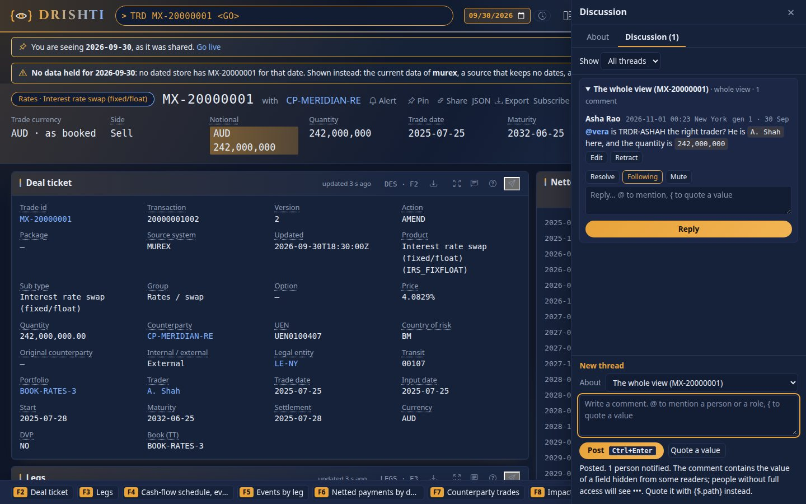

The same comment for a reader without access to the field: the typed id and the quoted field both read ••• and the quoted quantity stays,
because the reader may see it. *Open as it was* is offered because this page now shows other data.

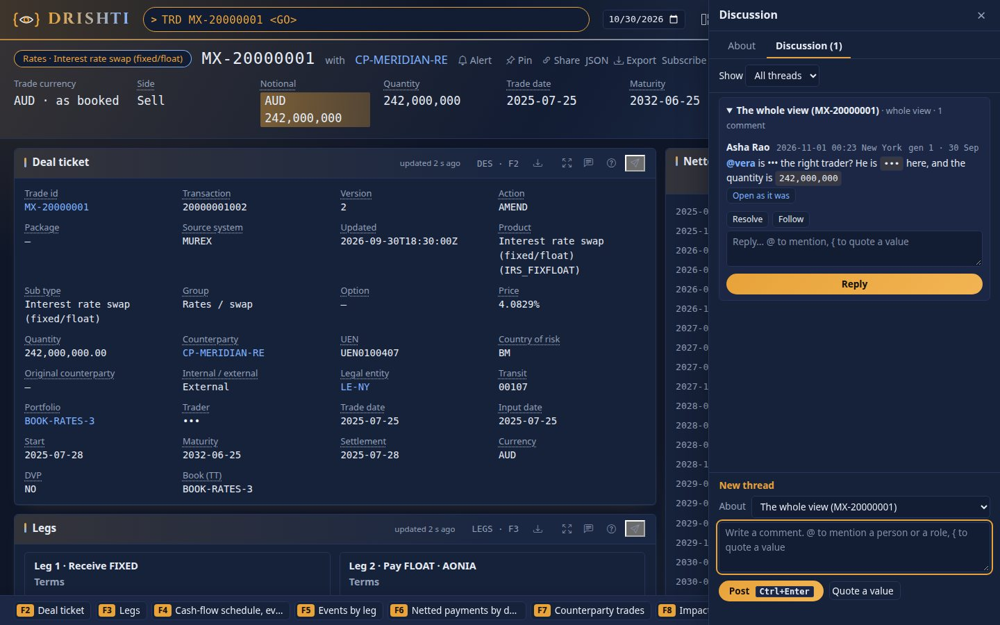

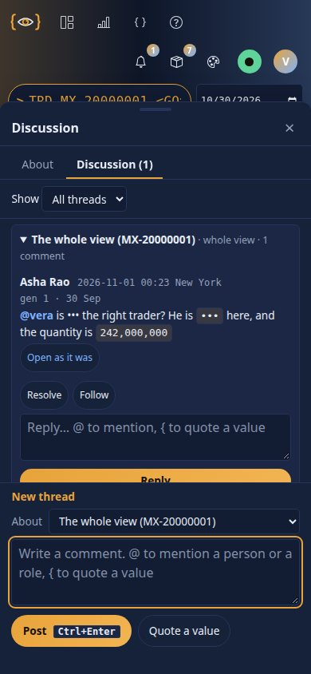

Older notes on an entity appear as one-comment threads. Every comment, edit, retraction and hide is in
the audit log, and every version of a comment is kept: retracting or hiding changes what readers see, never the record.
Discussions are kept on the server for every node of a cluster, so everyone sees the same ones.

## Working with several servers

Your organisation may run more than one Drishti server: an open one most people use, and others for a restricted desk
or a pre-production copy. When the console knows of several, the top bar shows the current one as a coloured dot and
a name. Click it to switch, or choose **All servers…** to see each one's state, version, how you sign in to it, and
whether you are signed in there.

Each server has its own users and data, so you sign in to each separately. You can be signed in to several at once and
switch without signing in again. **Sign out** signs you out of the current server only, and ends that session on the
server: the browser's cookie, or a copy of it, no longer signs anyone in. (Opening `/logout` by a link only asks; the
**Sign out** button does it; you land on the home page with a "Signed out" note.) With sign-in on, the home page shows a **Sign in** button when nobody is signed in, and your name with a menu (Open the terminal, My account, Sign out) when you are. A link someone shares opens on
the server it was made on (it carries `?srv=…`). A server not shown in the list can still be reached with the link
`/connect/<its id>` if you were given one.

### Servers that act as one cluster (Drishti\*net)

When your administrator runs several Drishti servers as one cluster, nothing changes for you: you sign in once, and every page and live view looks
and works the same whichever server holds the data. If the server your console uses stops, the console moves to another by itself; the page you are
on reloads its data, a live view reconnects, and you do not sign in again. A save made at the very moment a server stops says it did not save: save
again. When the server that holds what you asked for is down, the page says so (`DRS-5052 ... cannot be reached now`) instead of showing nothing.
A search covers every server's data; when one of them did not answer, the results say they are partial and name the server they are missing.
A page that groups many records (a counterparty's trades, a book's P&L) counts the records of every server; if one did not answer, the page
says it is partial and names the server.
Your saved searches, layouts, pivots and workspaces follow you to whichever server you are on. Alerts and scheduled reports stay on the server they
were made on (they act, and would act once per server).

## Your settings

*My account* (`/account`) shows your profile and roles, your settings, and a form to change your password.
To get there, click your avatar at the right of the top bar and choose **My account**, or **Settings** to
jump straight to the settings (`/account#settings`). Settings are kept on the server, so they follow you to
any browser.

| Setting | Choices | Example |
|---|---|---|
| Theme | *This browser's choice* or one of the ten themes | `Wallstreet` |
| After signing in, open | Any console address | `/t`, `/w/Rates`, `/m/High utilisation`, `/v/trade/MX-20000001` |
| Clock time zone | Default (NY) or a listed zone. Also the zone of every time in comments, shares, the inbox and revision history (labelled with the zone's city, e.g. `Kolkata`); a picture of a share is drawn on the server, in the business-date zone | `Europe/London` |
| Density | *Comfortable* or *Compact* (more on screen) | `Compact` |
| Flash changed values | On or off | off for a calmer screen |
| Search results | 10 to 1000 | `50` |

Click **Save settings**.

**Pinning.** **Pin** in a view's title line adds the entity to *Pinned* on the terminal home (`/t`), up
to 20. The button then reads **Pinned**; press it again to unpin.

**Changing your password.** Type the current password and the new one twice (at least 10 characters,
with letters and digits), then click **Change password**. When an administrator asked you to choose your own password
(at your first sign-in, or after they reset it), *My account* shows only this form, and every other page takes you
back to it until the password is changed; then the console opens the terminal home.

**When your access changes.** Your roles and whether your account is enabled are read from the server as you work,
not only when you sign in. If an administrator disables your account, every page sends you to the sign-in page within
a few seconds (`auth.recheck_seconds`, 10 by default); if they change your roles, what you may open changes as quickly.
An administrator resetting your password signs you out everywhere. Users, roles and password rules are covered
in [ADMIN_GUIDE.md](ADMIN_GUIDE.md).

## Themes

The palette among the round tools of the top bar offers ten themes (three of them the Terminal look in one dominant hue):

| Theme | Name in settings | Look |
|---|---|---|
| Terminal (default) | `terminal` | dark navy, amber accents |
| Parchment | `light` | light, warm paper |
| Blue | `blue` | light page; Sajha's blue: a navy-to-blue top bar with white text |
| Wall Street | `wallstreet` | dark, the Bloomberg colours: black, amber, yellow |
| Green | `green` | light page; Sajha's green: a deep-green top bar with white text |
| Crimson | `crimson` | light page; a crimson-deep to crimson to indigo top bar with white text, deep-crimson headings |
| Crimson dark | `crimson-dark` | the same crimson on a dark page |
| Green Terminal | `terminal-green` | dark: phosphor green with light lime on deep forest |
| Crimson Terminal | `terminal-crimson` | dark: crimson with blush on wine-black; text in the accent is dusty rose, buttons a deep crimson with white labels |
| Blue Terminal | `terminal-blue` | dark: azure with periwinkle on midnight |

**Choosing one.** Pick by the room and the screen, not by taste alone: a dark theme (Terminal, Wall Street, Crimson dark or one of the
three Terminal hues) for a trading floor, a wall screen or long sessions; a light one (Parchment, Blue, Green, Crimson) for a bright office,
a projector or anything you print or capture for a document. Wall Street is for people who read Bloomberg all day. A desk that wants its
screens told apart at a glance can give each its own Terminal hue. Your choice follows you (below); an administrator sets the default for
everyone with `ui.default_theme` ([CONFIGURATION.md](../admin/CONFIGURATION.md)), and *My account → Settings → Theme* or
`PATCH /api/v1/me/settings` (`"theme": "terminal-blue"`, [API_REFERENCE.md](API_REFERENCE.md)) set it too.

Each theme's colours shade the page, the top bar, view and panel headers and accent buttons; panel
bodies, tables and figures stay on solid colours so they read clearly. If your system asks for more
contrast or less transparency, the solid look is used. Signed in, your choice is saved to your account;
otherwise the browser remembers it.

**The contrast rule.** Every theme meets WCAG AA contrast, checked by a test on every theme (`drishti-console/tests/test_contrast.py`), not
by eye: all text, including faint notes, the footer, links and placeholders, reads at 4.5:1 or more on every background it is drawn on, and
accents and chart fills at 3:1. Buttons and pressed controls fill with `--d-fill` (and `--d-fill-strong` on hover), which is the accent
unless a theme gives buttons a colour of its own, and carry their label in `--d-on-fill` at 4.5:1 on both: Crimson Terminal, for one, fills
its buttons with a deep crimson under white labels rather than its bright text accent. The same test fails any stylesheet rule that fills a
button from the accent instead (the accent buttons' gradient runs from `--d-fill` to `--d-fill-strong`). A page that embeds Drishti's elements and sets the
`--d-*` values itself ([INTEGRATION_GUIDE.md](INTEGRATION_GUIDE.md#15-the-elements-one-by-one)) should keep the same rule.

These are the console's themes. A BI report has a theme of its own (the shipped *Corporate* and *Print*, or one made in the
theme designer), chosen by its author in BI Studio: [REPORT_FILE_FORMAT_STATEMENTS.md › Reports: the YAML, the visuals and how they behave, section 5.2](bi/REPORT_FILE_FORMAT_STATEMENTS.md#23-themes).

## Domain packs: choosing what you see

A pack brings one domain: its mnemonics, layouts and data. If you may use more than one pack, the round
**box** tool in the top bar shows how many you have switched on, for example `7`. Hover over it to read
their names (*Packs shown: core, market-data, …*).

Worked example: see only trading and counterparty risk.

1. Click the box. A menu opens headed *Show these packs*, with one line per pack: a tick box, the pack's
   title (*Core*, *Market data*, *Trading*, …) and one line on what it covers.
2. Click **none** (top right of the menu): every box is cleared.
3. Tick *Trading* and *Counterparty credit risk*.
4. Click **Apply**. The page reloads and the box shows `2`.
5. Type `E`. The suggestions no longer offer `ECON` (world economy), whose pack is now off.
6. To undo, open the box, click **all**, then **Apply**.

What changes when a pack is off for you:

- its mnemonics leave the suggestions, and its examples leave `/t`, the help centre and the search page;
- opening one of its entities is refused with `DRS-5002 … may not open … entities`;
- a pack's parents stay usable through it: with *Counterparty credit risk* on, a netting set still links to
  its trades and counterparties (see [BUILD_GUIDE.md](BUILD_GUIDE.md#314-who-sees-which-pack)).

**Apply** needs at least one ticked pack; with none ticked it does nothing. The choice is saved to your
account. You can choose only among the packs an administrator assigned to you, and only among packs that
are switched on for everyone ([Admin → Packs](ADMIN_GUIDE.md#293-admin--packs-switching-a-pack-off-for-everyone)).

## The workbench: changing how a screen looks

A **Sutra** is a layout: one YAML file (`<name>.v<N>.sutra.yaml`) that starts with `rachana: 1.2`, the version of
the layout language, followed by the layout. It may say what it is for in `description:` and carry longer notes for
reviewers in `notes:`; neither changes the screen. The **workbench** (*Create → New screen*, then the design's page) is
where you change one; it replaces the old Sutra Studio page, whose addresses (`/studio`, `/studio?sutra=…`) still work and
send you to the equivalent workbench screen. The [screen designer guide](RACHANA_REFERENCE.md#screen-designer-and-the-build-workbench) goes through it with a
picture of every step; this is the short version.

Designing is open to every signed-in user: the workbench, its preview against your files or a stored entity, **File → Open**
and the examples need no special role. Only **saving and proposing** need the *author* role (and saving switched on for the
server, `DRISHTI_STUDIO_SAVE=true`); without it **Save** is dimmed and says "Designing is open to everyone; saving needs the author right". Previewing
a *stored* entity, and any panel that reads another entity with `source:`, still follow the kinds your roles open: a panel whose source you may not open shows
"no access to <kind>" instead of its data.

A design is yours and is kept by the server (**Create → Build home → My drafts**). To start one:

- **Create → New screen**: bring JSON files, a schema or stored entities, and let auto-design draft a first screen;
- **Create → Examples**: each example opens as your own copy;
- an existing Sutra: *New screen → an existing Sutra* (the design then edits a copy, with that Sutra as its base).

The workbench has:

- the **Data** pane: the design's samples (add files, or stored entities), the shape found in them, and the palette of panel kinds;
- the **screen** in the middle, as **Design** (the real preview you drag panels and fields onto), **YAML** (the editor, which completes as you type: keys, panel kinds and the options each kind takes, formats, tones, entity kinds and expression functions, all from the server's schema of the language, `GET /api/v1/rachana/schema`) and **Summary** (the layout read back as a page);
- the **Inspector**, **Problems** (by line, while you type), **Tests** (every sample against the design) and **Versions** (the design against its base or an earlier version, with restore);
- **File** (open a `.yaml` or `.json` from your computer, or an example), **Save** or **Submit for review**, **Commands** (Ctrl+K), and Undo and Redo.

The keys Studio had are still there: `Ctrl+S` saves (or says why not), `Ctrl+Enter` previews. `Ctrl+K` opens a command palette.
Plain `/studio` opens a scratch design on the showcase example; use **Create → New screen** for your own data.

Worked example: add a one-day P&L figure to the swap's strip.

1. Choose *irs-fixfloat@1* under **Create → New screen → an existing Sutra** (or open `/studio?sutra=irs-fixfloat@1&kind=trade&id=MX-20000001`) and add
   `MX-20000001` as a stored entity). The YAML tab shows the Sutra; the preview shows `MX-20000001`. The entities you had kept as that Sutra's test entities in
   Studio are already among the samples.
2. Near the top, under `rachana: 1.2` and `sutra: irs-fixfloat`, change `version: 1` to `version: 2`.
3. Under `strip:`, after the `MTM (USD)` line, add the line shown below this list
   (same indentation as the other strip lines).
4. Press `Ctrl+Enter`. The preview's strip now has **P&L 1D (USD)**.
5. Make a mistake on purpose, such as `bind: $.pnl1d +`: the Problems tab names the line and the error. Undo it (Ctrl+Z).
6. Open **Versions** and compare with the base: you see the two lines you changed. Type a note in *What changed? (for the reviewer)*, such as `Adds 1-day P&L to the strip`, and click **Submit for review** (or **Save** when review is off).
   You should see `Submitted for review as …. An approver makes it live.`

The line to add in step 3:

```yaml
  - { label: P&L 1D (USD), bind: $.pnl1d, fmt: signed0, tone: sign }
```

Bump the version whenever you change a Sutra that is already live. The saved file goes into the site
Sutra folder (`./sutras/…/irs-fixfloat.v2.sutra.yaml`), and views use the highest version.

**Auto-design** (instead of Studio's *Start from inference*) drafts a complete Sutra from the design's samples, with a reason for every choice; it is a new
revision, and Undo brings the old text back.

The [screen designer guide](RACHANA_REFERENCE.md#screen-designer-and-the-build-workbench) (every pane, with pictures) and the
[Sutra developer guide](BUILD_GUIDE.md#11-what-a-sutra-is-and-when-one-applies) go much further.

### Reviews: approving a Sutra

With review on (the default), a save from the workbench is a **proposal**. Nothing changes for anyone until an
approver approves it, in the one [Approvals](#approvals) queue: open **Views → Approvals** (or **Approvals** in the workbench's toolbar),
choose the Sutra, read *What changes* (the diff, with the panels that moved named, and the workbench's evidence), then **Approve**,
or **Reject…** with a reason. The author can **Withdraw** their own.

Rules: approvers are users with the `approver` or `admin` role; with sign-in on, nobody approves their
own proposal (four eyes); a proposal whose live Sutra changed since it was made cannot be approved
(reject it and propose again); every step is in the audit log.

## Approvals

Drishti lets people change records from a screen's forms, from the command line (`drishti.py change`) and from the API. A change is a
**change request**: checked as the person who made it, approved by someone else where the policy says so, applied one at a time per
record, in order, and audited. It lands in one of three places: a **correction** kept in Drishti beside the source's value, a record
Drishti **owns**, or an **amendment** sent to the source system through its connector.

Everything that waits for a second person, corrections and every other four-eyes item (Sutra proposals, BI items, pivot functions,
stress windows, report sign-offs, compute packages), is decided in **one Approvals queue**.

This part is for the people who **use** forms and approve changes; the **administrator** who switches write-back on and runs it has [Write-back and approvals](ADMIN_GUIDE.md#28-write-back-and-approvals-switch-on-and-run). How to **design** a form (the `form:` YAML, editable cells, the drawer's steps, rules, hints, the Sutra designer and `sutra lint`) is in [BUILD_GUIDE.md](BUILD_GUIDE.md). The worked example with pictures is [tutorial 11](../tutorials/11-correct-and-approve.md). How it is built, and why, is [ARCHITECTURE.md, section 31](../architecture/ARCHITECTURE.md).

### The ways in

A screen that lets you change its records shows one of three ways in; the Sutra author chose which
([BUILD_GUIDE.md](BUILD_GUIDE.md) says how):

| Way | What you do |
|---|---|
| A form beside the table | Click a row: a form opens beside the table with typed fields |
| The table's cells | A ✎ marks the editable columns; type into the cells, like a spreadsheet |
| A guided drawer | **New** opens a drawer over the dimmed page, one step at a time |

Saving keeps a **draft** for you, on the server ([Drafts](#drafts)). A form that says where its changes go also has **Submit…**,
which turns the draft into a change request ([Submitting a change](#submitting-a-change)). A form without it keeps drafts only, and says so.

Nothing is editable as shipped: an administrator switches write-back on for the site, a Sutra author makes a form submit, and you need a
role with the **edit** power ([Switching write-back on](ADMIN_GUIDE.md#281-switching-write-back-on)).

### Correcting a record

#### A form beside the table

The trading pack's book desk carries a form on its trades. Open `/v/portfolio-trades/BOOK-RATES-2?sutra=book-desk` (or
`PTRD BOOK-RATES-2 <GO>`, then the Book desk screen) and click a trade:

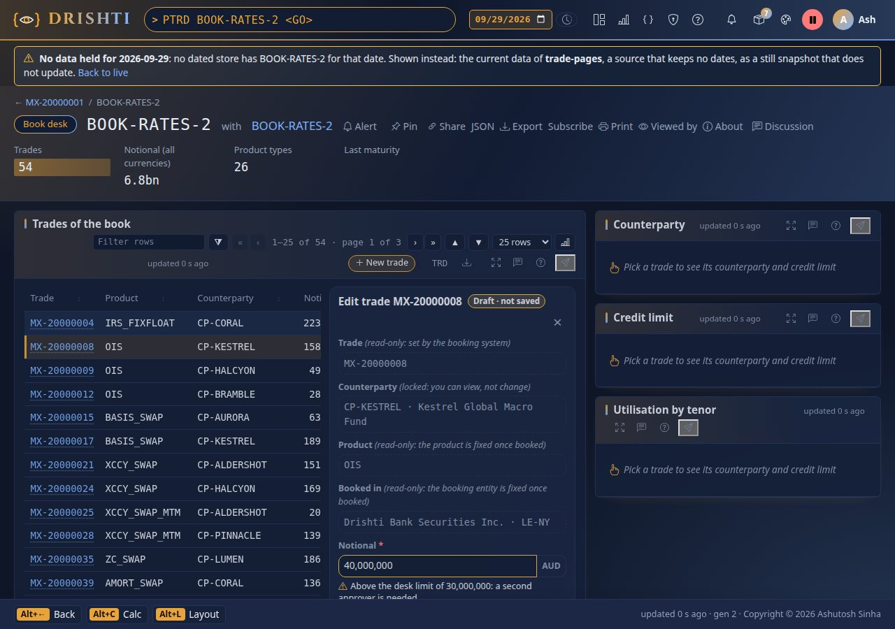

What you see:

- **Typed fields.** A number or an amount of money takes `40,000,000`, `40m` or `1.5bn`; a date opens the date picker; a fixed list is
  a list; a lookup lists what its source offers; a long text field takes several lines.
- **Locked fields say why.** A read-only field shows its value with the reason, *(read-only: set by the booking system)*, or *(locked:
  you can view, not change)* when no reason is given. A field your roles may not change is locked the same way. A field hidden from you
  says **Hidden for you** and is never editable.
- **Messages in words, under the field.** An error stops the draft; a warning is shown and kept with it, for example *Above the desk
  limit of 30,000,000: a second approver is needed.*
- **Draft · not saved** while you have changes; **Save draft** keeps them; **Discard** throws them away (and the saved draft too).
- Leaving the page with changes not saved asks first. A panel you are editing is not refreshed under your hands.

#### Money, dates and times, linked records and worked-out values

- **Money** is an amount and its currency. Type `1.5m`, `250k`, `2bn` or `1,000,000`; it shows grouped (`1,500,000`) once you leave the
  field. The currency sits beside it, fixed or following another field (it changes when you pick a currency). A value that does not read
  says *Notional is an amount (1,000,000, 1.5m or 250k)*.
- **A date and time** is entered with the browser's date and time picker; the time zone is shown beside it and with the value
  (*2026-10-23 14:05 Europe/London*).
- **A linked record** (for example the legal entity a trade is booked in) is a search box. Type part of a name or an id, pick with the
  arrows and **Enter** (or a click); the record's id is kept and its label shown (*Drishti Bank Europe AG · LE-FRA*), with **Open**
  beside it. The box searches the server as you type (*Searching…* meanwhile, *No match for "…"* when nothing holds the text), so every
  record of the kind can be found, read as you may see them; a record whose value is hidden from you is never offered. When the server
  cannot be reached, the choices the page brought still answer. On saving, an unknown id is refused: *Booked in: no legal entity
  'LE-NOWHERE' was found*.
- **A worked-out value** fills itself in a new record from the other fields as you type (*Worked out: notional * 0.001 · type to change
  it*) until you type over it. The server fills it too when a new record leaves it empty, so a draft saved by a script is the same.

#### Editing in the cells

A credit limit's buckets (`/v/credit-limit/LIM-ALDERSHOT`) are edited straight in the table:

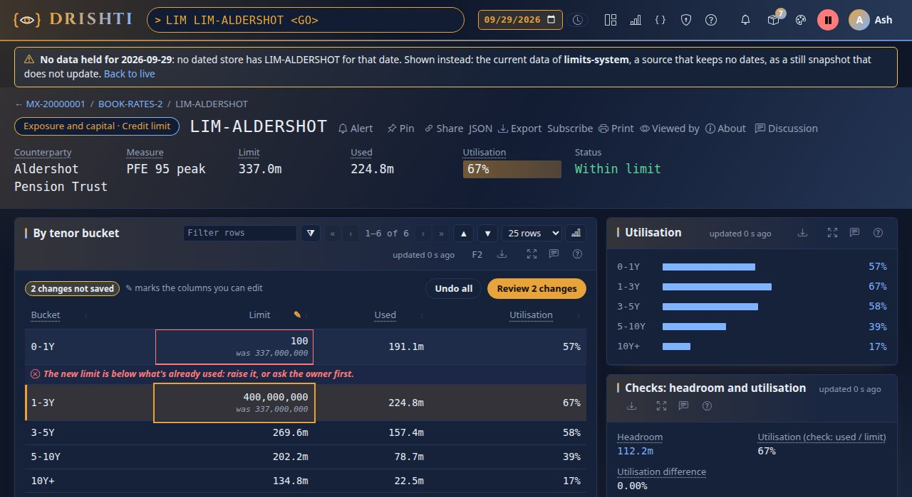

| Key | Does |
|---|---|
| **Enter**, **F2** or a click | open a cell |
| **Enter** | keep the value in the draft |
| **Esc** | undo the cell |
| **Tab** / **Shift+Tab** | keep the value and move to the next / previous editable cell |

A changed cell is tinted and says *was 337,000,000*; a bad one has a red border and the reason under its row. The bar above the table
counts *2 changes not saved*, with **Undo all** and **Review 2 changes**, which lists every change and saves the draft (it says *Fix 1
problem first* while one is wrong). A cell hidden from you says *Hidden for you*.

#### A new record in the guided drawer

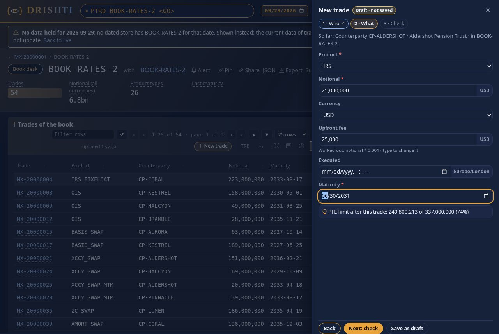

**New trade** (or the screen's own label) opens the drawer; the page stays visible behind it, dimmed. **Next** checks the step's fields
first (*Counterparty is required*); a finished step is ticked; **Back** returns; the last step, **Check**, shows what you entered and
every message. A hint is worked out as you type: *PFE limit after this trade: 102,400,000 of 120,000,000 (85%)*; a value it reads that is
hidden from you makes it say *Hidden for you*. **Save as draft** keeps the record from any step, checked up to that step.

### Drafts

Drafts are kept per person on the server. A page with drafts says **You have 2 drafts on this page**, with **Resume** (the form opens
again where it was: the row, the cells, the step) and **Discard** for each. Every save is checked again on the server with the same rules;
a value for a field hidden from you, or a change to a field you may not edit, is refused. Each save and discard is in the audit log.

### Submitting a change

#### Submit, then review and confirm

**Submit…** saves the draft, then opens the **review and confirm sheet**:

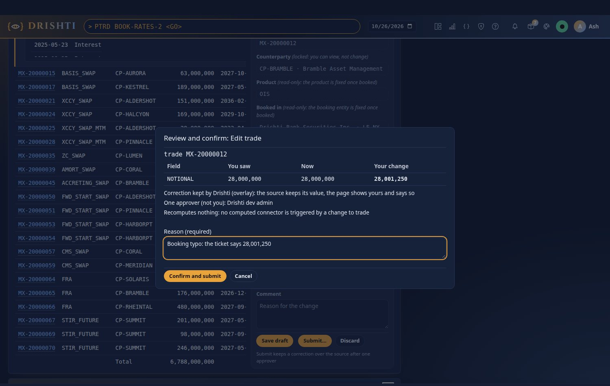

| The sheet shows | For example |
|---|---|
| For each record and field: what you saw, what is there now, your change | a field that moved since you opened the record is flagged here, before you send anything |
| Where it goes | *Correction kept … (overlay)*, *Amend in trade-murex (command amend-notional)* |
| Who must approve | *One approver (not you): K. Rao or M. Diaz* |
| What it will recompute | the computed panels whose triggers fire on a change to this kind of record, or *Recomputes nothing* |
| The reason | a box, required when the form asks for one |

**Confirm and submit** turns the draft into one change request per record. On a phone the sheet takes the whole screen.

#### After you submit

The sheet follows each change, and a toast says it too when the sheet is closed:

| State | Means |
|---|---|
| *Waiting for an approver* | it is in the [Approvals queue](#the-approvals-queue) with the change id |
| *Approved* | it has taken its place in its record's queue |
| *Applied* | it is written; your draft is closed with the change id; toast *Your change to trade MX-20000012 was applied* |
| *Pending at the source* | an amendment sent to the source system, until the source confirms it |
| *Conflicted: the record moved* | a field you changed has a newer value than the one you saw: nothing is written over it ([When the record moved](#when-the-record-moved-conflicted)) |
| *Refused* | with the reason, for example a rule that fails against the record as it is now, or a source that said no |

A conflicted or refused change keeps your draft, and the drafts bar says so, so you can edit it again. People watching the record see the
new value at once on its page (masked for them), with *Changed by … just now*; the name shows only to those who may see the edit
history. When the change triggers a recompute (a computed panel, such as a book's VaR), you see its progress and the stamp when it is
done; viewers of the result see the new number. A recompute that fails does not undo the change: the result is marked stale and catches
up on the next trigger or read.

#### Who may submit

- Editing is on for the site, and the form has `save:` (it shows **Submit…**).
- You hold the **edit** power on one of your roles (Admin → Roles: *Submit edits*). A personal API token also needs the **edit** scope,
  which no token has unless it was ticked when the token was made.
- Every field you change is editable for you: not hidden from you, not read-only, and your role is among those the field allows.
- You may edit only kinds of the packs you are given.
- A new record from the drawer can be submitted to an owned record or as a new record at the source, never as a correction (there is
  no source record to correct).

The server checks all of this again when you submit, and once more when the change is applied, against the record as it is then.

#### From the command line

The same requests, for the caller's token (with the **edit** scope) or `--user` with sign-in off:

Run these from the Drishti folder (the repository root, or the install folder of a release).

```bash
# propose a change to a record's fields (the same request as a form's Submit)
drishti.py change propose --kind trade --id MX-20000012 --set NOTIONAL=28001250 --from NOTIONAL=28000000 --reason "booking typo: ticket 4411"
# chg-01M5V881D3K33Z45TWEND1RJAM  trade MX-20000012  AWAITING (1 approval needed)

drishti.py change submit d-4ab964fa3060 --reason "booking typo"     # submit one of your form drafts
drishti.py change list --state awaiting --mine                       # changes, newest first
drishti.py change show chg-01M5V881D3K33Z45TWEND1RJAM                 # one change
drishti.py change history trade MX-20000012                          # a record's changes from the edit log
```

| `change propose` option | Means |
|---|---|
| `--set FIELD=VALUE` | the new value; repeat for several fields |
| `--from FIELD=VALUE` | the value you saw: a field that moved since is conflicted |
| `--reason` | why (required when the form asks for one) |
| `--sutra`, `--panel` | the form whose rules decide (default: the first form that edits the field) |
| `--date YYYY-MM-DD` | the business date; a past date is a restatement and needs the restate role |
| `--override` | *Apply mine anyway* over a newer value (needs the override role) |

`change list` filters by `--state` (`awaiting`, `queued`, `applying`, `applied`, `refused`, `conflicted`, `rejected`, `withdrawn`),
`--kind`, `--entity` and `--mine`. Every command takes `--json`. Exit codes: `0`; `1` when the change was refused or conflicted or the
server said no; `2` for a usage error. The change is decided with `drishti.py approvals` ([From the command line](#from-the-command-line-1)). The API is
`POST /api/v1/changes` and its siblings ([API_REFERENCE.md](API_REFERENCE.md)); [CLI_REFERENCE.md](CLI_REFERENCE.md) has every command.

#### When the record moved: conflicted

Two people open the same trade. The first changes the notional and it is applied. The second, still looking at the old value, changes it
too. Their change would overwrite the first without either knowing, so Drishti refuses it as **conflicted**:

```bash
drishti.py change show <its id>
# chg-…  trade MX-20000012  CONFLICTED  (overlay, by kim)
#   NOTIONAL: you saw 28000000, it is now 28001250, you wanted 28000500
```

The check is per field: a change to another field of the same record in between does not conflict. Changes to the source outside
Drishti (a load, a ticket in the booking system) are detected the same way. Open the record again and edit from what is there now; a
person with the override role may instead apply theirs anyway (`--override`), which is audited with the value it overwrote.

### Where a change goes

The form says where (the site's policy may only make it stricter):

| Target | What is written | Who sees it |
|---|---|---|
| **Correction** (`overlay`) | a correction kept in the Drishti database beside the source's value; the source is not changed | every page that reads the record (and the page row the form edited) shows the corrected value; *How this view was built* says **Edited here** with the change id, the field and who made it; Admin → Edits lists it under *Open overlays* with the source's value |
| **Owned** (`owned`) | the record's value itself, in the Drishti database (Drishti is its system of record) | every page that reads the record |
| **Source** (`source`) | a command of the connector's `writes:`, sent to the source system in its own transaction ([Writing to a source](ADMIN_GUIDE.md#284-writing-to-a-source-writes)) | the page shows the value as pending until the source confirms it; a refusal withdraws it and the page shows the source's value again |

The lake's files (Delta, Iceberg) are never written per change: pages read the correction from the Drishti database and lay it over the
source's record.

### The Approvals queue

#### What waits there

Everything that waits for a second person is in **one queue**: **Views → Approvals** (`/approvals`), with a count on the top bar's
approvals tool (the badge beside the bell).

| Kind | Area | Who decides | Where it is made |
|---|---|---|---|
| Sutra | Screens | an approver (four eyes) | a workbench save, a designed screen, a terminal layout promoted ([USER_GUIDE.md › Reviews](#reviews-approving-a-sutra)) |
| Correction | Data | an approver of changes (the policy may ask for several) | a form's Submit, `drishti.py change propose` ([Submitting a change](#submitting-a-change)) |
| BI item | Data | a bi-steward, or a member of the workspace with the approve power | *Propose for review* on a dataset, model, report or board ([TABLES_AND_MODELS.md](bi/TABLES_AND_MODELS.md)) |
| Pivot function | Data | an approver (a Java plug-in: an administrator); with a sharing scope | `pivot functions submit` |
| Stress window | Risk | someone who sees every node, never the proposer | *Freeze and propose* on `SWIN` |
| Report sign-off | Risk | the next step of the chain (maker, checker, approver); one person signs one step | `VAR REPORT <report> <period>`, *Generate* |
| Compute package | Access | an administrator (and the roles `compute.approval.roles` names) | a connector or pool that needs packages |

#### The list

*Waiting for me* is your inbox: everything you may decide now, never your own. Items with a due date near (a report run's filing date)
are **pinned on top** under *Due soon*; the rest are newest first. Filter by area (*Data · Screens · Risk · Access*) or by kind; *Mine
sent* lists what you asked for; *Done* what was decided. How near a due date pins an item is a setting (`drishti.approvals`).

#### One item

Click one:

- **What changes**: a diff, with the maker's reason (for a correction, each field from → to).
- **Effect if approved**: what changes downstream: the records and views that read a corrected record, the published reports a BI change
  breaks, a node's stressed VaR under each window, the files a signed run releases.
- **Rules**: why you may decide (and what you may not).
- *More facts*: checks, evidence, history.

#### Deciding

- **Approve.** Some kinds ask one more thing: a pivot function, who may use it (*everyone* or `group:<name>`); a BI dataset change,
  whether to update the reports that use renamed names, or, as a bi-admin, to approve over a breaking change; a report sign-off, the step
  you sign.
- **Reject…** with a reason in the comment box (a reason is required).
- **Withdraw** your own.
- **Ask a question**: a thread on the item. The maker is told (without the text) and answers in the same place, and whoever asked is
  told of the answer.

The maker never approves their own. Every decision and every question is in the audit log.

#### Approving a correction

A correction waits in the queue as kind *Correction* until it has the approvals it needs; only then does it take its place in its
record's queue, and it is checked against the record as it is then.

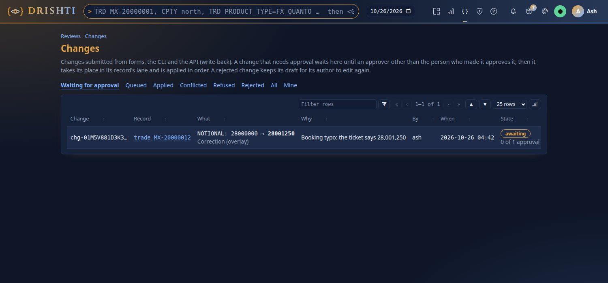

- The person who submitted sees it under *Mine sent*, with **Withdraw** and no Approve or Reject, and *0 of 1 approvals*.
- An approver opens it, reads what changes and its effect, and presses **Approve**. Approving your own change answers `403 DRS-9302`
  *you submitted this change: someone else approves it (four eyes)*.
- How many approvals each target needs, and who may approve, is the site's policy
  ([The approval policy](ADMIN_GUIDE.md#2813-the-approval-policy)); a form may ask for more, never fewer.

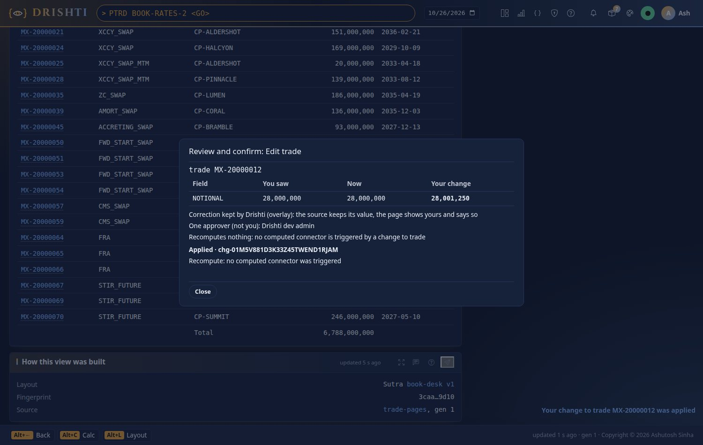

#### From the command line

```bash
drishti.py approvals list                                   # waiting for you, due soon first
drishti.py approvals list --box sent --group risk            # --box inbox|sent|done|all, --group data|screens|risk|access, --kind ...
drishti.py approvals show sutra P-000042                     # what changes, its effect, the rules, the questions
drishti.py approvals approve change chg-01M5V881D3K33Z45TWEND1RJAM --comment "checked against ticket 4411"
drishti.py approvals reject bi it-0042 --comment "name the columns"
drishti.py approvals withdraw change chg-01M5V881D3K33Z45TWEND1RJAM
drishti.py approvals approve function asha:wret@1 --comment reviewed --param scope=group:rates
drishti.py approvals approve var-report annual-report-var:FY2026:v1 --param step=checker
drishti.py approvals ask sutra P-000042 "Why the new title?"
```

The kinds are `sutra`, `change`, `bi`, `compute`, `function`, `stress-window` and `var-report`; the id is the item's id within its kind
(`approvals list` shows it). `--param NAME=VALUE` carries what a kind needs besides: `scope` (a pivot function), `step` (a report run),
`force` or `applyRenames` (a BI item). `approvals list` also names any area it could not read. Exit codes: `0`; `1` when the server said
no; `2` for a usage error. The API is `/api/v1/approvals` ([API_REFERENCE.md](API_REFERENCE.md)).


## Administration

Administrators have the **Admin** menu in the top bar. Every Admin page, its address and what you do there, the roles and their powers, packs,
connectors, artifacts and health are in [The Admin pages at a glance](ADMIN_GUIDE.md#29-the-admin-pages-at-a-glance).

## Help

- *Help → Help centre* in the top bar opens the help centre (`/help`). Its front door is a search box over all of Help
  (`/help/search?q=`), a row of the most used pages (*User guide*, *VaR guide*, *Tutorials*, *What's new*) and a tile per section:
  **Get started**, **Risk measures**, **Analytics and BI**, **Data**, **Build**, **Operate**, **Reference** and **Knowledge**, with
  **Internal** for administrators. Each tile says in one line what its section holds and how many pages you can open in it, and opens
  the section's own page (`/help/section/<id>`): its pages in groups, every guide on one row with its tutorial beside it, and a search
  box that searches that section only (*all of Help* beside it widens it). Help is documentation, not data: the pages of a compute engine show to anyone who can
  open Help, signed in or not, whatever their role, while the engine runs on a server; an administrator sees the pages of an
  engine that runs nowhere greyed, marked *not running on any server*. Every page keeps its address (`/help/<slug>`), and an old
  address of a section (`/help#cat-use`) opens the section that took it over. On a phone the search comes first, the most used row
  scrolls sideways and the tiles stand in one column. On a page, `F1` opens the guide for that page
  (`/help/context/<page>`: Build opens the screen designer guide, BI the BI guide, Admin the users and roles guide, Workspaces, Monitors, Alerts and the inbox their own guides); on a view, `F1` opens [About this page](#about-this-page).
- The **?** in each panel header explains that panel kind.
- *Help → Developer* (`/help/developer`) gathers the programming references: the server's REST API (OpenAPI), the renderer's TypeScript API, and the Java and Python API references generated from the code (the plugin and connector SPI, the shard machinery, the compute worker SDK, BI Python items, `drishti.py` and its client library, the pack and test-data generator helpers). When the console has none built, the page says how to build them.
- **About** (`/about`) is the product page (features, measured performance, competitive analysis, licence); loaded Sutras and source health are in *Admin → Health* (`/admin/health`).

## On a phone

Drishti works in Safari on iPhone and Chrome on Android, with no app to install. To put it on your home
screen, use *Share → Add to Home Screen* (iPhone) or *⋮ → Add to Home screen* (Android). It then opens
full-screen at the terminal.

- **Function keys** become a swipeable row of buttons at the bottom of every view: tap **F9 Raw JSON**,
  **F7 Netting set**, **← Back**.
- **Command line:** type a command and tap a suggestion.
- **Layout:** panels stack in one column, the strip shows two figures per row, and wide tables scroll
  sideways inside their panel. Workspace panes stack too. No page scrolls sideways on a screen 360 px wide or
  wider.
- **Top bar:** the menus and tools keep their icons on the first line (below 480 px the brand shows its mark
  only); the command line and the business date share the second, and **Live** is the same round green or red toggle as on a laptop.
- **Help:** screenshots fit the screen; tap one to open it full size.
- **Live values** keep ticking.
- The **workbench** is left out on phones; everything else, including help and administration, works.

## Query by form

Learn it by doing in [tutorial 1, Part C](../tutorials/03-query-by-form.md); this page is the reference.

If you would rather fill in boxes than write a search, type `FORM` and a pack on the command line. The page is a form for the pack's
kinds: one input for each field people search by, each suited to what the field holds. When you press **Search** the form writes the search
for you, shows it, and runs it as any other search ([Search by value](#search-by-value)), so what you may see is exactly what it was.

```text
FORM trading <GO>
```

Type-ahead helps: `FORM tra` completes to `FORM trading`, and after a space it lists the kinds you may open in that pack
(`FORM trading trade`). Only the packs and kinds you may open are offered. A pack with several kinds shows a row of them under its title;
pick one to switch forms. `FORM <GO>` alone, or **Forms** in the Views menu, opens the forms home.

### The forms home

`/forms` (**Forms** in the Views menu; or `FORM <GO>`) lists every pack that is switched on for you and declares a
`form:` section, each with its description and its kinds as links to `/form/<pack>?kind=<kind>` with the number of fields the form has. Only
what you may open is listed: the server leaves out kinds your roles cannot open and packs hidden by the sample-content policy. The
**filter box** (focused when you arrive, except on a phone) narrows packs and kinds as you type; `Esc` clears it. **Recent forms** are the
last eight forms you opened in this browser (kept in browser storage, per person); **Your saved searches** are the searches you saved from forms.
In the top bar **Views** is lit on `/forms` and on any form. The old address `/form` leads here.

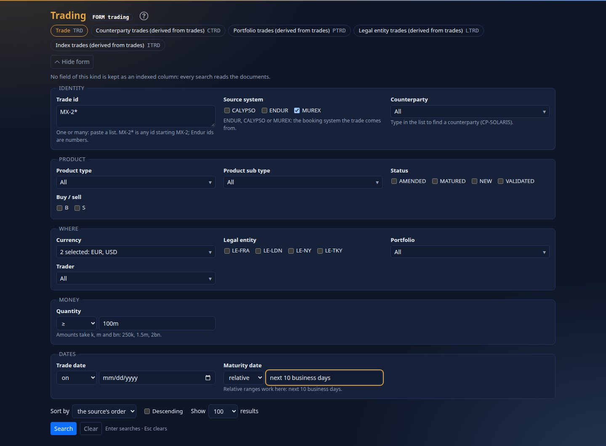

### The inputs

| The field holds | The input | What you can ask |
|---|---|---|
| text (a name, a description) | a box, an operator and *Match case* | equals, contains, starts with, matches a regular expression (case is ignored unless you tick *Match case*) |
| a number or an amount | one box, or two for *between* | `=`, between, `>`, `<`, `≥`, `≤`; amounts take `250k`, `1.5m`, `2bn` |
| a date | a date picker, two for *between*, or text for *relative* | on, between, before, after, or a range on the business-day calendar: `last 5 business days`, `next 10 business days`, `last 30 days`, `this week`, `month to date`, `year to date` |
| one of a few values (up to 6: direction, status) | a row of tick boxes, one for each value the data holds | is one of the ticked values |
| one of many values (asset class, product type, book, desk, currency) | **one dropdown the size of a select**, showing "All", the one value, or "3 selected: ABS, CORP_BOND, +1"; open it (`Enter` or `Space`) for a search box (type to filter), *Select all* / *Clear* (they act on the values the search leaves), and a tick box per value (`↓` `↑` move, `Space` ticks, a letter jumps, `Enter` or `Esc` closes). 44 pixels a row on a touch screen | is one of the ticked values; the address is the same as for tick boxes (`v.PRODUCT_TYPE=CORP_BOND&v.PRODUCT_TYPE=GOVT_BOND`) |
| one of very many values (over 300: counterparties, portfolios on a large book) | the values already chosen, ticked, and a box *Type to find among …* (the count of values): typing lists the values that contain the text (at most 50, with *… and N more: type more*), each with a tick box; ticked values stay when you type something else, so several can be chosen | is one of the ticked values; the same address as for tick boxes |
| an identifier | a box to paste a list: spaces, commas or lines | is one of them; `MX-2*` is any id starting `MX-2` |
| yes or no | Any, Yes, No | is |

The values of every list are kept by the server per field, business date and data version, so a form opens without reading the
data again; a load refreshes them, and a masked field's values are never kept. The form itself is kept the same way (per data
version, and per whether you see masked fields), so a search does not wait for it to be built.

Leave a field empty and it takes no part. A field marked **slower: not indexed** is not kept by the source as a column, so the documents are read to answer it:
fine for a few thousand, slow for a million. Below the fields choose how to **sort** and how many results to **show**.

### The search it made

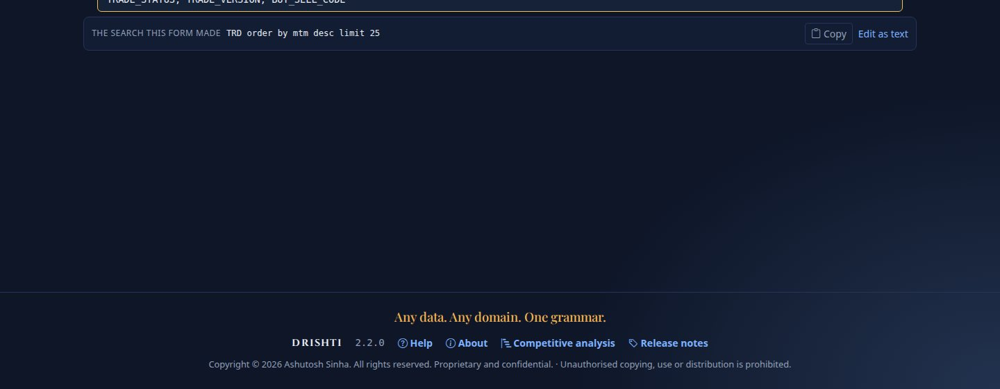

The line under the form is the search, in the grammar of [Search by value](#search-by-value). With **Currency** EUR and USD
ticked and **Quantity** `>= 100m`, on the quick-start server (the demo lakes):

```text
TRD where (CURRENCY = 'EUR' or CURRENCY = 'USD') and QUANTITY >= 100m limit 100
```

It matches 3,398 of the 15,000 trades of the three source systems; the table shows the first 100 (**Show** below the fields).

On a business date the sources hold no data for (a date not loaded yet, or before the first), the page does not just say "Nothing
matches": it says no trade data is loaded for that date, names the newest date that has data, and **Search on** that date runs the
same search there (the business date changes for the session, as in the top bar). The same note shows on the search page.

**The results are a live result set.** Where the kind has a live binding (trades from Kafka, news from its feed) and the business date is
today's, the table ticks: a record that changes is updated in place, a new match comes in, one that no longer matches leaves, and **Live**
shows beside the time it took. On another business date, or for a kind without a live binding, the results are as they were when you
pressed **Search**; pressing it again reads them afresh. The search page's results (`TRD where ...`) work the same way, and a mnemonic on its
own (`POS <GO>`, `TRD <GO>`) opens every record of the kind, a page at a time, with **Previous** and **Next** under the table.

**Copy** puts it on the clipboard (paste it into the command line or the search box); **Edit as text** opens it in the search box. The table is the
console's table: sort by a heading, filter each column with its funnel ([Filter a table like Excel](#filter-a-table-like-excel)), page and walk it by keyboard. The key
cell opens the view; **Alt+Left** brings you back to the form with your criteria in place and the results again, because everything you filled in is in the
page's address (`/form/trading?kind=trade&v.CURRENCY=EUR&v.CURRENCY=USD&op.QUANTITY=>=&v.QUANTITY=100m&run=1`): bookmark it or send it.

### Give the results the room: hide the form

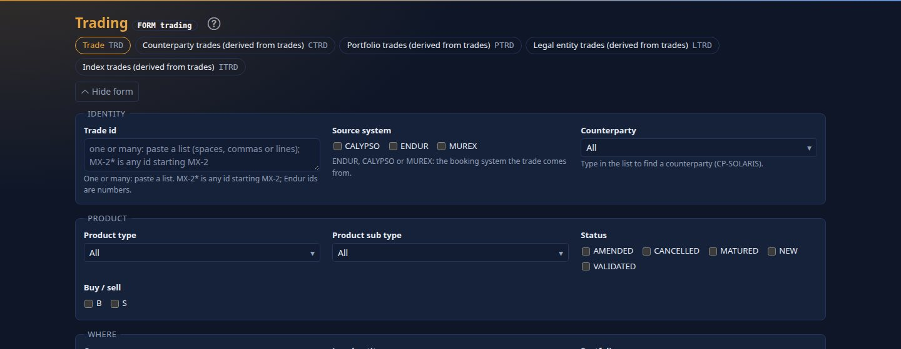

When results arrive the form folds to **one line of your criteria** (`Currency in EUR,USD · Quantity >= 100m`; beyond three criteria `· +2 more`) so the table gets the screen.
Click the line, press **Show form**, or press **Alt+F** to open it again with every box as you left it; **Hide form** (or Alt+F again) folds it. The button
carries `aria-expanded` and `aria-controls`, and on a phone it is a 44 px target. The state is in the page's address (`&form=hidden` or `&form=shown`), so a
link or **Alt+←** from a result returns to the form as it was; and in this tab a form you opened by hand stays open for the next Search. An administrator who
would rather the form stayed open sets `form.collapse_on_submit: false` in `config/application.yaml` (default `true`).

| Key | What it does on the form page |
|---|---|
| `Enter` | Search |
| `Esc` | Clear every field |
| `Ctrl+Enter` | Search from a list box |
| `Alt+F` | Hide the form or show it again |
| `Alt+←` | Back to the form from a result, criteria kept |

### Keep it: name it, watch it, schedule it, send it

Under the results: **Save as named search** (it appears under *Your saved searches* here and on `FORM`), **Watch as a monitor** (the first 50 results, live),
**Schedule a report** (the search delivered as CSV on a schedule, see [Scheduled reports](#scheduled-reports)) and **Share link** (copies the form's address, which
opens the same form with the same criteria for whoever has the right to see the pack).

### Regular expressions

*matches regex* uses a safe engine: it cannot be made to run for ever, whatever the pattern. It reads classes (`[A-Z]`, `\d`, `\w`), groups, `|`, `* + ? {n,m}`,
`^` and `$`. It refuses what cannot be done in linear time (back-references such as `(a)\1`, look-around such as `(?=x)`, atomic groups, possessive quantifiers, `\b`),
patterns over 200 characters, and anything too large once expanded, with a message that says which and the code `DRS-4010`; a pattern that takes over 50 ms on one value
stops with `DRS-4011`.

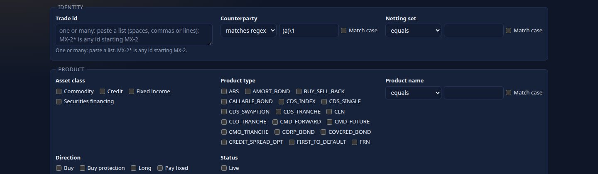

### Keyboard and phone

Tab walks the fields in reading order; **Enter** searches (in the list of ids, **Ctrl+Enter**); **Esc** clears every field. Everything is labelled for a screen reader.
On a phone the fields stack in one column and every control is at least 44 px.


### Who decides what the form offers

The pack's author writes the form (`form:` in `pack.yaml`, see the [Pack developer guide](BUILD_GUIDE.md#46-form-the-search-form-of-a-kind)); a pack that does not gets one
inferred from its search columns and screen. Authors can shape a kind's form in the workbench's [Form tab](RACHANA_REFERENCE.md#the-form-tab).

## Calc: Python on any view


Calc is a Labs feature (off as shipped) and runs in your browser. Its guide (the panel and its keys, the `drishti` module, reading data, packages,
roles, the security model, limits, troubleshooting, the snippet catalogue) is [The Notebook and Python, section 10](bi/CALC.md).
Code over a model that others can run is a [notebook](#the-notebook).

## The Notebook

The **Notebook** (`/bi/notebook`, the BI rail's *Notebook*) is the one place for code over data: SQL cells run by the server and Python cells
run on the server's compute pool, over an extract of the rows you may see. Everything about it (extracts, cells, saving, promoting, the profile,
limits and errors) is in [NOTEBOOK_AND_PYTHON.md](bi/NOTEBOOK_AND_PYTHON.md#2-the-notebook), with Python measures, visuals and data prep; the walk-through is
[the Notebook tutorial](bi/NOTEBOOK_AND_PYTHON.md). For Python in your own browser on a view's rows, see [Calc](bi/CALC.md).

## Sharing and discussion

Three ways to tell a colleague about a number without leaving Drishti. None of them sends data: what travels is your words and a link,
and the colleague sees the view **with their own permissions**.

| I want to | Do this | Keys |
|---|---|---|
| Send this view (or one panel) to people, with a note | **Share** in the view's title line, or the **send** icon in a panel's header | `Alt+S` |
| See what people sent me | the **bell** in the top bar: the inbox (shares, mentions, replies) | `Alt+I` |
| Talk about this view, a panel or one field, in the open | **Discussion** in the title line, or the comment icon in a panel's header | `Alt+N` |

### The short version

1. **Share.** Press `Alt+S`, type two letters of a name or a role, write the note, press `Ctrl+Enter`. The dialog says who was reached and who
   was not, and why. The date you are looking at travels with it: the people you send it to open the view *as you saw it*.
2. **Receive.** The bell counts it within a second. Open the inbox, click the row: the view opens on your colleague's screen at your date, with
   a banner ("Shared by ...") and your note. Anything their role may not see reads •••, including in your note if you typed it.
3. **Discuss.** Press `Alt+N`. Type `@` to mention a person or a role, `{` to quote a field: each reader sees the quoted number as they may
   see it. **Open as it was** takes a reader to the data the comment was written against.


Everything else (the recipient rules, the no-access page, edit and retract, resolve and follow, the email opt-outs on the account page,
moderation) is in the user guide: [Share a view with a note](/help/user-guide#share-a-view-with-a-note),
[Your inbox](/help/user-guide#your-inbox), [Discussion](/help/user-guide#discussion). If something did not arrive or
opened the wrong data, see [Troubleshooting](/help/operations#21-troubleshooting).
