<!--
  Project Drishti · Any data. Any domain. One grammar.

  Copyright (c) 2026 Ashutosh Sinha <ajsinha@gmail.com>.
  All rights reserved.

  PROPRIETARY AND CONFIDENTIAL.

  This file is the confidential and proprietary property of Ashutosh Sinha.
  Unauthorised copying, use, modification, distribution or disclosure of this
  file, via any medium, is strictly prohibited except with the express prior
  written permission of the copyright holder.

  See the LICENSE file in the root of this repository for the full terms.
-->
# User guide

This guide explains every part of the Drishti console, one feature at a time. Each section says what
the feature is for, then walks through an example: the exact text to type and what you should see.

If Drishti is not running yet, start with [GETTING_STARTED.md](GETTING_STARTED.md) (ten minutes) or
[GETTING_STARTED.md](GETTING_STARTED.md) (every step explained).

The examples use the seven default packs (`core`, `market-data`, `trading`, `counterparty-risk`, `market-risk`, `world-economy`, `news-and-markets`)
on the demo lakes of the quick start (`drishti.py lake demo`, business date 2026-10-16; [GETTING_STARTED.md](GETTING_STARTED.md)), so ids such as
`MX-20000001`, `1000001` and `NS-SUMMIT-NY` exist and the counts are those of 15,000 trades from ENDUR, CALYPSO and MUREX. If your administrator loaded other packs, the
**Examples** list on the terminal page shows ids that work for you, and every pack's guide (*Help → Help
centre → Domain packs*) has a *Finding things* section with the same commands for its own kinds.

**Contents**

| Section | What you learn |
|---|---|
| [The pages at a glance](#the-pages-at-a-glance) | Every page and its address |
| [The top bar](#the-top-bar) | The menus and the round tools on the right |
| [The command line](#the-command-line) | Opening an entity, suggestions, what an error means |
| [Pick lists](#pick-lists-when-a-command-names-several-entities) | `TRD MX-200000`, `CPTY north`, `TRD PRODUCT_TYPE=FX_QUANTO`, `TRD` |
| [Tables: paging and the keyboard](#tables-sorting-filtering-paging-and-the-keyboard) | The pager, ▲ ▼, and the keys that walk a table |
| [Controls on a screen](#controls-on-a-screen-choose-what-a-panel-shows) | Dropdowns, date ranges and search that a screen offers: pick a leg or a period and only the panels that depend on it move; the choice is in the address |
| [A deep trade](#a-deep-trade-legs-cashflows-and-fixings) | A tab per leg; each leg's terms and cashflows, and a floating cashflow that opens to its fixings; live, and on a phone |
| [Filter a table like Excel](#filter-a-table-like-excel) | A funnel in every column heading: tick values or filter by a condition, in the address, with `Alt+Shift+X` to clear |
| [Reading a view](#reading-a-view) | Title, strip, panels, links, provenance |
| [About this page](#about-this-page) | `?`: what the page is, what each number means, where the data came from, why it looks like this |
| [Layout mode](#layout-mode-arrange-a-view-your-way) | `Alt+L`: drag, resize and hide panels for yourself; promote your layout to the Sutra |
| [Screens that respond](#screens-that-respond-clicks-refresh-editing-and-your-own-page) | A click that opens a panel, refresh and freshness, Pause all, editing a record (drafts), a screen you arrange, *Your page* |
| [Zoom a panel](#zoom-a-panel) | `Z`: one panel fills the view area; restore with `Esc`; shareable as `#zoom=<panel>` |
| [The Pivot tab](#the-pivot-tab-slice-a-table-your-way) | Rows, columns, values and filters over a table or a search's results, by drag or by key; totals, drill-down, chart, export |
| [Keyboard](#keyboard) | Every key in one table |
| [Live updates](#live-updates), [Business dates](#business-dates-live-or-a-day-in-the-past), [Compare](#compare-what-changed) | Ticking values, past dates, what changed |
| [Search by value](#search-by-value) | `where` searches, sorting and limits |
| [Calc: Python on a view](#altc--calc-python-on-a-view) | `Alt+C`: Python in your browser on what you are looking at |
| [Export, print and share](#export-print-and-share) | CSV, JSON Lines, JSON, PDF and links |
| [Share a view with a note](#share-a-view-with-a-note), [Your inbox](#your-inbox) | Send a view to colleagues; what they sent you |
| [Monitors](#monitors), [Alerts](#alerts), [Workspaces](#workspaces) | Watching many entities at once |
| [Your settings](#your-settings), [Themes](#themes), [Domain packs](#domain-packs-choosing-what-you-see) | Making the console yours |
| [The workbench](#the-workbench-changing-how-a-screen-looks) | Changing how a screen looks |
| [Administration](#administration) | Users, roles, packs, audit, health, caches |
| [Query by form](#query-by-form) | `FORM <pack>`: the forms home, the inputs, the search a form writes, keeping and scheduling it, who decides what a form offers |
| [Calc: Python on any view](#calc-python-on-any-view) | `Alt+C` in full: the `drishti` module, output and charts, packages, packs and roles, snippets, the runtime, limits, `drishti.quant`, the BI client |
| [Analyse: slice, SQL and Python](#analyse-slice-sql-and-python) | BI's analyst bench: open a model as your masked extract, slice it, query it in SQL, script it in Python, notebooks, promote, the browser Python console |

## The pages at a glance

| Page | Address | What it is for |
|---|---|---|
| Landing (Home) | `/` | The start page, with a button to open the terminal; signed in, the fact of the day and quick cards ([Home: the fact of the day](#home-the-fact-of-the-day)) |
| Terminal | `/t` | The command line, your pinned entities and example commands |
| View | `/v/<kind>/<id>` | One entity, laid out in full (for example `/v/trade/MX-20000001`) |
| Pick list and search results | `/s?q=…` | Entities a command names (`TRD MX-200000`) or a `where` search finds |
| Forms | `/forms`, `/form/<pack>` | Query by form: the forms home, and a pack's search form ([Search with a form](#search-with-a-form-form-pack)) |
| Pack overview | `/p/<pack>` | What a pack holds (type its code alone: `MKT <GO>`) |
| Compare | `/compare/<kind>/<id>` | What changed in an entity between two business dates |
| Impact | `/impact/<kind>/<id>` | What depends on an entity (F8) |
| Monitors | `/m` | Live watchlists |
| Alerts | `/alerts` | Your alerts on numbers, your alert rules and recent alerts (also **Reports**, *My alerts*) |
| Workspaces | `/w` | Several live views on one screen |
| Inbox | `/inbox` | Views and comments sent to you ([Your inbox](#your-inbox)) |
| Reports | `/reports` | Saved searches delivered as CSV on a schedule, and your subscriptions ([Scheduled reports](#scheduled-reports), [Export, and subscriptions](DISTRIBUTION.md#export-and-subscriptions)) |
| BI | `/bi`, `/bi/catalogue`, `/bi/w/me`, `/bi/r/<id>`, `/bi/models`, `/bi/datasets`, `/bi/designer`, `/bi/explore`, `/bi/transform` | Rūpaka business intelligence, for people with the `bi` power: reports (a board is a report page; `/bi/b/<id>` opens it), BI Studio's designers, Analyse and the Transform editor ([BI_GUIDE.md](BI_GUIDE.md)) |
| Python console | `/pyconsole` | Your own Python in the browser on a masked extract of a BI model; promote it to the server (BI rail, *Python console*; [section 16](#16-the-browser-python-console)) |
| Build | `/build`, `/build/new`, `/build/pack/new`, `/build/reviews` | Design layouts (Sutras) in the workbench, make a pack from schemas, approve proposed Sutras |
| My account | `/account` | Your profile, settings and password |
| Servers | `/servers` | The Drishti servers this console may talk to ([Working with several servers](#working-with-several-servers)) |
| Admin | `/admin/users`, `/admin/roles`, `/admin/audit`, `/admin/packs`, `/admin/connectors`, `/admin/artifacts`, `/admin/loads`, `/admin/lakes`, `/admin/collab`, `/admin/embedding`, `/admin/net`, `/admin/health`, `/admin/caches` (and `/admin/ai`, `/admin/bi`, `/admin/tokens`, `/admin/access` where those features are on) | Users, roles, audit log, packs, connectors, installed artifacts, data loads, lakes (Delta, the default; Iceberg tables where configured: a **Format** column, and Iceberg maintenance with orphan-file removal, [LAKE_MAINTENANCE.md section 8](../admin/LAKE_MAINTENANCE.md#8-iceberg-lakes)), collaboration moderation, embedding, Drishti\*net, health and caches (admins only) |
| Help | `/help` | Tutorials, guides and every reference |
| About | `/about` | The product page: features, measured performance, competitive analysis, technology, licence (system details for admins: `/admin/health`) |

## Home: the fact of the day

Signed in, the landing page (Home) puts **Did you know** beside the headline *See what your data hasn't told you yet.*: one
surprising fact about your data on the business date you are on, worked out from the data itself. The tile shows:

- the domain and the date (**Fact of the day · Counterparty credit**, 2026-10-27);
- one sentence, its key figure highlighted, and a small picture (bars, or a filled bar for a share of a whole);
- **Why does that happen?**: opens a short explanation, with **Read more in Knowledge** (the Knowledge page section that explains it);
- **Open …**: the command that shows it (`EXP NS-NORTHPLAINS-NY`, `VAR NODE MGMT~BOOK-COMM-1`, `FUND PONAX`), and **WHAT …**, the
  term's glossary entry;
- **Another fact**: the next fact that holds today (it wraps round).

Every figure is computed from the server's answers as you, so you see only facts about data you may see, and only for packs you have
switched on. Nothing is written into a fact: a fact is shown only on a date its condition holds (a book over its VaR limit inside a
desk within its own; collateral that more than doubles a netting set's expected exposure; a counterparty whose peak PFE is over five
times its trades' VaR; the largest US funds owning a tenth or more of the company they hold most of; two funds of different managers
tracking one index and 80% or more the same; a fund whose holdings weigh over 120% of its net assets; a desk that adds VaR on paper but
whose removal would raise the bank's). The first fact changes with the business date; everyone on the same date sees the same one first.
On the demo data of 2026-10-27 the facts read:

| Domain | The fact | Opens |
|---|---|---|
| Market risk | BOOK-COMM-1 is at **259%** of its VaR limit, while its desk, Commodities, is within its own | `VAR NODE MGMT~BOOK-COMM-1` |
| Market risk | Take the **Commodities** desk out and the bank's VaR would rise by 10.7m, though the desk adds 3.0m to it on paper | `VAR DESK DESK-COMM` |
| Counterparty credit | Collateral made **NS-NORTHPLAINS-NY** more risky: EE at 2M is 129.7m with it and 55.6m without (+133%) | `EXP NS-NORTHPLAINS-NY` |
| Counterparty credit | Northern Plains Energy Canada's trades have a VaR of 37.4m but a peak PFE of **508.1m** (13.6× as large) | `EXP CP-NORTHPLAINS` |
| Funds and companies | 87 of the largest US funds hold Nvidia and own **21.19%** of its shares | `HELD NVDA` |
| Funds and companies | VOO and IVV, run by two different managers, are **99.3%** the same portfolio | `FUND VOO` |
| Funds and companies | PIMCO Income Fund (PONAX) holds investments weighing **150.01%** of its net assets | `FUND PONAX` |

The tile draws at once as a placeholder and fills when the facts are ready (the first visit of a business date computes them, a few
seconds at most on the demo data; later visits that day read them back). When no fact holds, or the server cannot be reached, the tile
is left out and the headline stands alone. Under the headline, **quick cards** open *Market risk* (`VAR BANK`), *Exposure* (`EXP BANK`),
*Funds and ETFs* (`FUND SPY`) and *Data map* (`DATAMAP`); a card whose pack is off is not shown. An administrator turns the tile off
with `ui.facts.enabled: false` (`DRISHTI_HOME_FACTS=false`) and sets the cards under `ui.home_cards` in the console's
`application.yaml`; a pack author adds facts as the [pack developer guide](PACK_DEVELOPER_GUIDE.md#facts-for-home) describes.

## The top bar

Every page has the same top bar, on one row: the terminal, the views, BI, Build, Admin, Help and the landing page when you are signed in, and the public pages (signed out) in the same height, logo and
wordmark (set in Cinzel; the slogan is in the footer, which also carries Help, About, the competitive analysis and the release notes).

The **Drishti name and logo** at its left end always lead to the landing page, also when you are signed in. The
landing page then shows **← Back to …** (the view, Build, Admin or Help page you came from; `Alt+B`), so one click
takes you back where you were; *Open the terminal* goes to the terminal instead.

```text
◉ Drishti  > TRD MX-20000001, CPTY north …  [2026-09-30]   Views ▾  BI ▾  Build ▾  Admin ▾  Help ▾   [bell] [box 12] [palette] (Live) (A) Ash ▾
```

**Beside the brand** (click it to go back to `/`) are the [command line](#the-command-line), which takes the
free space, and the [business date](#business-dates-live-or-a-day-in-the-past) box.
Below 1100 pixels wide they move to a line of their own.

**Then the menus**: **Views**, **Build** and **Help** for everyone, **BI** where you hold the `bi` power, **Admin** only for administrators. Below 1280 pixels they show as icons only. Each opens a wide panel
(a *mega menu*) in which every entry has an icon and one line saying what it does. The menu holding the page
you are on is highlighted.

| Menu | Column | Entries |
|---|---|---|
| **Views** | Look up | *Terminal* (`/t`), *Search & pick lists* (`/s`), *Forms* (`/forms`: the [forms home](#the-forms-home), query by form), *Functions* (`/func`, also `FUNC <GO>`: every command you can use, what it does and an example; administrators switch commands on or off there, [USER_MANAGEMENT.md (Functions)](../admin/USER_MANAGEMENT.md#functions-func-every-command-and-turning-one-on-or-off)), *Data map* (`/datamap`, also `DATAMAP <GO>`: every kind of data, how it joins and how much there is, [The data map](#the-data-map)), *Reports* (`/reports`: every scheduled report and subscription, with a box to find one, and links to your alerts and the BI reports) |
| | Watch | *Workspaces* (`/w`), *Monitors* (`/m`), *Alerts* (`/alerts`) |
| **BI** (people with the `bi` power) | Rupaka: business intelligence | *BI home* (`/bi`), *My workspace* (`/bi/w/me`), *Catalogue* (`/bi/catalogue`), then *Recent*: the three items you opened last. Administrators with `bi-admin` also see *BI settings* ([BI_GUIDE.md](BI_GUIDE.md)) |
| **Build** | Create | *New screen* (`/build/new`), *New pack* (`/build/pack/new`: schema files and/or JSON Lines in, a pack to download or deploy out; [Schema to pack](SCHEMA_TO_PACK.md)), *My designs* (`/build`), *Examples* |
| | Govern | *Reviews* (`/build/reviews`, with the number waiting) |
| | Learn | *Knowledge* (`/what`, also `WHAT <GO>`: [Knowledge](#knowledge-what-the-words-mean)), *Tutorials*, *Schema to pack*, *Screen designer guide*, *Sutra developer guide*, *Panel kinds*, *Rachana reference*, *Pack developer guide* |
| **Admin** (admins only) | People & access | *Users*, *Roles*, *Audit log* |
| | Operations | *Packs*, *Connectors*, *Artifacts*, *Commands* (opens Functions with the switches), *Data loads*, *Lakes*, *Collaboration*, *Embedding*, *Net* (Drishti\*net: [NET.md](../admin/NET.md)), *Health*, *Caches* |
| **Help** | Learn | *Help centre* (`/help`, also `F1`), *Knowledge* (`WHAT <GO>`), *Install and run*, *About* |

**BI and the `BI` keyword (alias `RUPAKA`).** Where your roles hold the `bi` power, a **BI** menu sits between **Views** and **Forms**, and the reserved command
word `BI` goes there from the command line, in any case: `BI <GO>` the BI home, `BI WORKSPACE <GO>` your personal workspace, `BI CATALOGUE <GO>` the
catalogue, `BI SETTINGS <GO>` the BI settings (administrators with `bi-admin`), `BI <report-or-board> <GO>` a published item by id or title (a **report opens drawn**, with its slicers, drill-down and drill-through; type-ahead completes after `BI `; `RUPAKA` still works as an alias). Without the power the menu is not there and `BI <GO>`
says what is missing. No pack can define a mnemonic named `BI`, `RUPAKA`, `FORM`, `FUNC`, `WHAT` or `DATAMAP`. The BI page, its keys (`/`, `g h`, `g c`, `g w`, `?`) and what it can and cannot do yet:
[BI_GUIDE.md](BI_GUIDE.md). **Using a report:** click a bar and the page filters to it, the buttons in a visual's header drill down, drill through to another page, show the rows behind it or open a trade in the terminal, and a slicer filters
what it can reach ([BI_GUIDE.md](BI_GUIDE.md) section 14); **building one:** *Designer* in the BI rail, drag fields onto the canvas in BI Studio, with its Explorer, tabs and Problems and Query dock ([BI_GUIDE.md](BI_GUIDE.md) sections 15 and 26, [tutorial 10](../tutorials/10-first-bi-report.md)); the YAML reference is [REPORTS.md](REPORTS.md). The BI rail also opens *Analyse*, *Transforms* (Python data prep step by step) and the *Python console*.

**Since 2.6.0, in a report:** a **parameter slicer** may switch *which* field or measure a visual draws (a field parameter: the chart breaks down
by desk, then by portfolio; it shows MTM, then notional), and the choice is yours alone, as any slicer's ([REPORTS.md section 21](REPORTS.md#21-field-parameters-in-a-well-260)).
A report may also have **statement pages**: paper, page by page, with a header and footer, page numbers and a period, downloaded as PDF or
Excel made as you (your masks and row rules), and sent by a subscription as one statement per recipient; the reference is
[REPORTS.md section 24](REPORTS.md#24-statements-paginated-reports-page-exact-one-per-reader), the walk-through [tutorial 20](../tutorials/20-statements-and-field-parameters.md).

**On the right:** round tools, from left to right.

| Tool | Looks like | What it does |
|---|---|---|
| Live | the round button right of the theme switcher | Your choice and this page's stream in one: green while live (glowing while ticks arrive, an amber ring while it reconnects, steady on a page without a stream), red with pause bars while paused or on a picked date. Hover to read both, for example *Live updates on — click to pause · Live, built 1.92 ms*. A click switches ([Business dates](#business-dates-live-or-a-day-in-the-past)) |
| Alerts | a bell | Opens `/alerts`. A number on the bell counts alerts you have not seen ([Alerts](#alerts)), and BI runs that finished, failed or were started again (`BI RUNS <GO>` lists them: [BI_GUIDE.md section 28](BI_GUIDE.md#28-background-runs-long-bi-questions)) |
| Packs | a box with a number | Appears when you may use more than one pack. The number is how many you have switched on; hover to read their names ([Domain packs](#domain-packs-choosing-what-you-see)) |
| Theme | a palette | Ten themes ([Themes](#themes)) |
| You | a round avatar with your initial and name | A menu: your name, desk and roles, a clock in your time zone (`NY` by default), **My account**, **Settings**, and **Sign out** when sign-in is on (when it is off, the menu says *Sign-in is off on this server* and links to how to turn it on) |

Worked example: find the audit log without typing an address.

1. Click **Admin** in the top bar. A panel opens with two columns, *People & access* and *Operations* (each with a line saying what the entry does).
2. Click **Audit log** (*Every sign-in and change, by whom*). The audit page opens and **Admin** stays
   highlighted.
3. Press `Esc`, or click anywhere outside, to close a menu without choosing.

If you do not see **Admin**, your account has no admin role; ask an administrator.

## The command line

The command line is the box beside the brand in the top bar. Press `/` anywhere to jump to it.

### The form of a command

```text
<MNEMONIC> <ID> <GO>
```

- The **mnemonic** names a kind of entity: `TRD` is a trade, `NSET` a netting set, `ECON` an economy.
- The **id** names one entity of that kind: `MX-20000001`.
- `<GO>` means "press Enter".

Examples:

```text
TRD MX-20000001      an interest rate swap (MUREX)
TRD 1000001          a commodity swap (ENDUR)
TRD CLY-3000025      an FX option (CALYPSO)
TRD CLY-3000157      a government bond (CALYPSO)
NSET NS-SUMMIT-NY    a netting set
CRV CRV-USD-OIS      the USD SOFR discount curve
CPTY CP-NORTHBRIDGE  a counterparty
ECON ECON-USA        an economy (world-economy)
```

**A bare id** works when its shape tells Drishti the kind. Type `MX-20000001` and press Enter: it opens
the same trade as `TRD MX-20000001`.

**Case** never matters: `trd mx-20000001` opens `MX-20000001`.

**One match opens; several give a pick list.** If what you typed names exactly one entity, it opens. If it
names several (`TRD MX-200000`, the start of an id), you get a table to pick from. See
[Pick lists](#pick-lists-when-a-command-names-several-entities).

**A range after the id shows the entity over time.** `TRD 1000015 30` opens the trade's
[History](#history-an-entity-over-time): one row per business day it has data, the last 30 such days.

```text
TRD 1000015 30            the last 30 business days on which the trade has data
EQ EQ-CSCA 3M             the last 3 months (also 30D, 2W, 1Y): every business day in the span that has data
FX FX-AUDUSD YTD          since 1 January (also MTD, QTD)
CRV CRV-USD-SOFR FROM 2026-09-01 TO 2026-09-30
TRD 1000015 30 DIFF       only what changed, day by day
```

The range is always the last words, never the first word after the mnemonic: `TRD 30` still opens trade `30`, and an id that really
contains the words (`BOND UST 2030`) opens as before. A search (`TRD desk=rates 30`, `TRD MX-2* 30`) stays a search. A prefix that names
several trades (`TRD MX-2000 30`) gives the pick list, and each of its rows opens that trade's history. Aliases keep the range:
`MYBOOK 30` is `BOOK BOOK-RATES-1 30`.

Mnemonics come from the packs that are switched on. Every command, with what it does and an example, is in
[COMMAND_CATALOG.md](COMMAND_CATALOG.md); the packs themselves are in [PACKS.md](PACKS.md#the-packs-that-ship). The most used ones, from the seven default packs:

| Mnemonic | Kind | Example |
|---|---|---|
| `TRD` | trade | `TRD MX-20000001` |
| `CPTY` | counterparty | `CPTY CP-NORTHBRIDGE` |
| `BOOK` | book | `BOOK BOOK-RATES-1` |
| `NSET` | netting set | `NSET NS-SUMMIT-NY` |
| `LIM` | credit limit | `LIM LIM-SUMMIT` |
| `CRV` | interest rate curve | `CRV CRV-USD-OIS` |
| `FXV` | FX volatility surface | `FXV FXV-EURUSD` |
| `VAR` | VaR / expected shortfall | `VAR VAR-RATES` |
| `TVAL` | trade valuation (MTM, P&L, DV01) | `TVAL TVAL-MX-20000001` |
| `ECON` | economy | `ECON ECON-USA` |

**VaR in another currency (2.9.4).** The VaR explorer (`VAR BANK`, `VAR DESK DESK-RATES`) has a **Reporting currency** select at the
right end of its status line: the configured currencies (USD, EUR, CAD, JPY, GBP by default) and **More…** for any other currency with
scenario FX on the date. Every figure of the page follows it (the tiles say `VaR 99% · 1 day · EUR`), the choice stays while you work in
that browser tab, and it goes into the page's link (`&ccy=EUR`), so a link you send opens in the same currency. Type it too: any VAR
command ends with `IN <currency>`, `VAR DESK DESK-RATES IN EUR <GO>`. The tab **In other currencies** (loaded when you open it) shows the
scope's VaR and ES in each configured currency side by side, with each one's VaR in the page's currency at today's rate; click a row to
move the page to it. A currency's VaR is never the USD VaR at a rate: the currency move on each scenario day is part of its risk
([VAR_GUIDE.md section 15.11](VAR_GUIDE.md#1511-reporting-currencies-built-ahead-per-trade-currency-totals-and-the-picker-as-built-294)).

**Construct your basket.** On the VaR page, **◫ Construct your basket** (or `Alt+B`) opens the basket tray across its top: the VaR
of any mix of portfolios, trades and counterparties; type for hints, **+ / −** each part, the selection's VaR live, a pre-deal what-if,
**Save basket and open VaR**. It is on the VaR page only (2.9.4: no longer in the top bar); what it holds stays in your browser, so it is
there when you come back ([VAR_GUIDE.md section 3.5](VAR_GUIDE.md#35-construct-your-basket)).

**One year or two; 99% or 95% (2.9.4).** The page's labels say the confidence the figures are at (*VaR 95% · 1 day* when the
server is set to 95%), and *How this number was built* says the scenario window (*newest 250 of 509 scenarios*);
`drishti.py var show BANK --window 250 --confidence 0.95` compares on the command line, never official.

**The top of the tree (2.9.4).** The VaR tree's top node shows the hierarchy data's name (*Drishti Bank* in the demo); an administrator
can set any name with `drishti.var.root-name` (or one per hierarchy with `drishti.var.root-names`), and the page, the command line and new
captures follow it ([CONFIGURATION.md](../admin/CONFIGURATION.md)).

**Hierarchies and limit letters (2.9.5).** The select above the tree lists the date's hierarchies by name: *Management*, *Legal
entities* and, in the demo, *Limit letters*: the letter of authority each trade's VaR limit is granted under, then its desks. A letter
may hold part of a book: its VaR is exactly that of its own trades. Choose one and the tree, the breadcrumbs and the contributions
follow it, and the link keeps it (`&hierarchy=LL`); a letter's limit bar reads its own limit (blank when it has none). Type a letter in
the scope box (`LL:LL-0003`, `LL:LL-0003/DESK-RATES`) or search for it. Which hierarchies exist, and from which columns, is set by an
administrator ([VAR_GUIDE.md section 15.14](VAR_GUIDE.md#1514-hierarchies-from-the-rows-or-from-the-trades-columns-as-built-295)).

**Any form, any grain (2.9.4).** *How this number was built* says, per source system, whether its figures came as scenario PVs or P&L
vectors, per trade or per position. A position its system sends whole answers `POS:<id>`; its trades have no VaR of their own on that
date (the trade page says so and links the position).

**Intraday (2.9.4).** When pricing systems re-send trades during the day (amended, new or cancelled), the VaR page applies them as they
land and shows an **intraday** badge in its status line (*intraday · 5 trades · 2026-09-30 11:00*): its figures are the morning run with
those trades updated; point at the badge for the batches. The official end-of-day records stay the morning run's. `drishti.py var
intraday` lists what each date holds; the updates may come as files or from a Kafka topic (the `pv-updates` connector, off by default:
an administrator's **Apply now** on its Admin page applies the waiting window at once) ([VAR_GUIDE.md section 8.4](VAR_GUIDE.md#84-what-if-pricing-and-intraday-recomputes-what-if-planned-intraday-updates-as-built-in-294)).

**Trade currency.** Every trade page's strip says **Trade currency**: the currency the trade's PVs come in (`EUR · as priced`) when the
VaR engine holds it as scenario PVs, else the trade's own currency (`USD · as booked`). Its **Risk** group adds where it comes from and
the trade's **Base PV** in it. (The strip holds eight figures: the source system moved from the strip to the deal ticket, F2 DES.) The
VaR explorer's contributions and worst scenarios, a position's trades and the trade tables of the counterparty, portfolio, legal
entity and index pages list it too.

### Reserved words

Six words are keywords of the console itself, not mnemonics of a pack, and no pack may define a mnemonic with
their name. They work in any case, and each has type-ahead.

| Type | You get | More |
|---|---|---|
| `WHAT <GO>` | Knowledge, the home of the [Knowledge pages](#knowledge-what-the-words-mean): what the words of your data mean and how the data connects | `WHAT PFE <GO>`, `WHAT netting set <GO>`, `WHAT value at risk <GO>` open the term's glossary entry (its long name or a synonym works too, any case); other words (`WHAT collateral posted <GO>`) search the Knowledge pages. The type-ahead lists the terms as you type |
| `FUNC <GO>` | Functions, `/func`: every command you can use, by pack, with what it does and an example ([USER_MANAGEMENT.md (Functions)](../admin/USER_MANAGEMENT.md#functions-func-every-command-and-turning-one-on-or-off)) | `FUNC exposure <GO>` opens it filtered (every word must appear in a command's code, title, description or its pack); `FUNC trading` lists one pack's commands. Click a command to open it with its example, a pack to open its search form |
| `DATAMAP <GO>` | the [data map](#the-data-map), `/datamap`: every kind of data your packs hold, how much of it there is, and how the kinds join | `DATAMAP trade <GO>` opens it on one kind (its name, mnemonic or label: `DATAMAP CPTY`), `DATAMAP organisation` or `DATAMAP counterparty-risk` on one domain; other words fill its Find box |
| `FORM <GO>` | the forms home, `/forms` | `FORM trading <GO>` opens the trading pack's search form, `FORM trading trade <GO>` its form for trades ([Search with a form](#search-with-a-form-form-pack)) |
| `BI <GO>` | the BI home, `/bi` (only with the `bi` power; otherwise the terminal says what is missing) | `BI WORKSPACE`, `BI CATALOGUE`, `BI SETTINGS`, `BI <report-or-board>` ([BI_GUIDE.md](BI_GUIDE.md)) |
| `RUPAKA <GO>` | the same as `BI`, the older name | everything that works after `BI` works after `RUPAKA` |

A pack's code typed alone (`MKT <GO>`) opens that pack's overview ([A pack at a glance](#a-pack-at-a-glance)). Anything else
that is not a command but reads as words (`live trades over 5m`) is offered as a question
([Asking in plain words](#asking-in-plain-words)).

### Knowledge: what the words mean

*See what your data hasn't told you yet.* The **Knowledge** section at the top of the help centre has one page per domain:
[Market risk](../knowledge/market-risk.md), [Counterparty credit risk](../knowledge/counterparty-credit-risk.md),
[Trades and products](../knowledge/trades-and-products.md), [Entities and ownership](../knowledge/entities-and-ownership.md),
[Market data](../knowledge/market-data.md), [Data and contracts](../knowledge/data-and-contracts.md),
[Economies](../knowledge/economies.md) and [Companies, funds and ETFs](../knowledge/companies-funds-and-etfs.md). Each says what the domain is in plain words, gives a glossary with the command that shows each
term, draws how the kinds connect (with their id conventions), works an example through on the demo data, lists ready-made questions to
ask your data, and clears up the common confusions (VaR against ES, why PFE does not add up, why posted collateral raises exposure).
The [Knowledge home](../knowledge/README.md) lists every term A to Z.

Reach it three ways: `WHAT <GO>` (or `WHAT <term> <GO>` for one entry), **Build → Learn → Knowledge** or **Help → Knowledge**, and
the **What does this mean?** link on a data page: the VaR explorer, `VRES` and `DESK` open Market risk; `CPTY`, `NSET`, `CSA` and the
exposure explorer open Counterparty credit risk. F1 and **?** still open the page's help as before.

### The data map

**Views → Data map** (`/datamap`, or `DATAMAP <GO>`) shows every kind of data your packs hold, how much of it there is on the business
date, and how the kinds join. Nothing on it is drawn by hand; it is inferred each time from what is loaded:

- **Domains and kinds** come from the packs switched on for you: each pack's kinds, titled by their data contracts
  (`config/packs/<pack>/contracts/<kind>.contract.yaml`). A kind whose contract says `class: computed` (VaR and ES, EE and PFE, the
  what-ifs) is drawn **dashed**: it is computed on demand and never stored, so it has no count.
- **Joins** are what the contracts declare: their `links:`, their fields' `link:` and the fields a pack's `graph.fields` names (the
  trade's `COUNTERPARTY` → counterparty, `PORTFOLIO` → book, `TRADER_ID` → trader; the P&L vector's and the exposure paths' `TRADE_ID`
  → trade). Each join is **checked against the data**: the server reads the field over the kind's rows (as columns where the lake keeps
  them so, else from the documents; at most 20,000 rows a kind, `drishti.datamap.max-rows`) and counts how many of the ids name an
  entity that exists, so a join reads *15,000 of 15,000 ids match (100%)*. A join under 95% is a **finding**, listed above the map and
  drawn in the warning colour: the contract promises a link the data does not keep.
- **Counts** are read from the lake when you open the page (the server keeps them for the business date for 15 minutes,
  `drishti.datamap.ttl`). The first visit of a day may say *Counting and checking the data*: the map fills in as the server goes.
- **Positions** come from an automatic layout: each domain a box, its kinds in a grid, the most joined first.

Two views share one selection, the domain chips and the **Find** box (a kind, a mnemonic or a field: `LEI`, `PORTFOLIO`); the view
and the selection are in the address, so a link opens the same picture.

- **Map** (the default): click a kind to light its joins and dim the rest. The side panel shows its join fields with their coverage,
  the kinds that join to it, the commands that open it (its example from Functions, its search form) and its *Data contract*, its pack's
  guide and its *WHAT* entry. Ctrl-click (Cmd-click) a kind to open it directly; Esc clears the selection. On a phone the map scrolls
  inside its box.
- **Cards**: one card per domain with its largest counts. Open one for a table of its kinds with their counts, joins (→ to, ← from,
  with the field) and the command that opens each, **Comes from** (the pack README's sources) and **Crosses into** (the other domains
  its joins reach, and through which fields).


Domains follow `drishti-console/config/datamap.yaml`, which is presentation only: their names, their order and which packs they hold
(and, rarely, a kind to draw dashed that its contract does not mark computed). A pack the file does not name appears as a domain of its
own under its pack title, with its kinds and joins, with no configuration at all.

### Suggestions as you type

The command line suggests as you type, in a dropdown, like the Bloomberg terminal. The dropdown holds up to
**25 suggestions** and scrolls when there are more than fit.

| You have typed | You see |
|---|---|
| nothing (click in the box) | the entities you opened recently, marked `recent ·` |
| `T` | mnemonics that start with T (`TFLOW` Trade flow, `TRD` Trade, `TRDR` Trader, `TRIAL` Clinical trial), then recent entities |
| `TRD ` (with a space) | trades: `MX-20000001`, `MX-20000002`, … |
| `TRD MX-2000010` | trades whose id starts that way: `MX-20000100`, `MX-20000101`, … |
| `NSET SUMMIT` | netting sets whose id or title contains it: `NS-SUMMIT-LDN`, `NS-SUMMIT-NY` |
| `XYZ Q` | `No matches for "XYZ Q"` |
| `B`, `BI` (with the `bi` power) | the `BI` keyword, then `BI ` lists *BI home*, *My workspace*, *Catalogue* and the published reports whose id or title match |
| `FORM `, then `FORM tra` | the packs you may open that have a form, then (after a space) their kinds: `FORM trading trade` |

Each suggestion shows the mnemonic, the id (the letters you typed are highlighted) and a subtitle, for
example:

```text
TRD   MX-20000002   Trade · MUREX · IRS_FIXFLOAT · CP-HALCYON · EUR 110.0m
```

If your role sees some fields masked ([Masked fields](#masked-fields)), the subtitle is the entity's view title as you
see it (`Rates · Interest rate swap (fixed/float) · •••` when the counterparty is masked), and typing a masked value
(`Meridian`) finds nothing through it.

| Key in the command line | Does |
|---|---|
| `↓` / `↑` | Highlight the next / previous suggestion (the list scrolls with you) |
| `Tab` | Copy the highlighted suggestion into the box (the first one if none is highlighted). For an entity the box then reads `CPTY CP-NORTHBRIDGE <GO>`; for a mnemonic it reads `TRD ` and the dropdown refreshes |
| `Enter` | With a suggestion highlighted: open it straight away. With none highlighted: run what you typed as a command (it opens one entity or a pick list) |
| `Esc` | Close the dropdown |

Worked example:

1. Press `/` and type `CPTY north`.
2. The dropdown shows one line: `CPTY  CP-NORTHBRIDGE  Counterparty · Northbridge Capital LLP`. Press `↓` to
   highlight it.
3. Press `Tab`: the box now reads `CPTY CP-NORTHBRIDGE <GO>`.
4. Press `Enter`: the counterparty opens.

Without steps 2 and 3, pressing `Enter` on `CPTY north` gives the same result: the command names one
counterparty, so it opens at once.

The number of suggestions is a server setting (`drishti.commands.suggest-limit`, environment
`DRISHTI_SUGGEST_LIMIT`, default 25). A program can ask for a different number, up to 50:
`curl -s 'http://localhost:18480/api/v1/command/suggest?q=TRD%20T-1&limit=50'`.

### Earlier commands and your own aliases

- **History.** Press `↑` in the empty command line to bring back your last command, again for the one before (up to
  50); `↓` goes forward. The server keeps your history, so it follows you to another browser. Only commands that
  could be read are kept.
- **Aliases.** On **My account → Aliases**, give a command a short word: `MYBOOK` for `BOOK BOOK-RATES-1`, or `REVS`
  for `TRD PRODUCT_TYPE=FX_QUANTO`. Typing `MYBOOK <GO>` then does the same as the command; anything you add after
  the word is kept (`MYBOOK F3`). A mnemonic or a pack code cannot be an alias. The same through the API:
  `GET` / `PUT /api/v1/command/aliases` and `GET /api/v1/command/history`.
- **A range that cannot be read.** After an id, what reads as a range but is none answers with its code and what to type, on the
  terminal page: `TRD 1000001 0` gives *DRS-4022 a history of 0 days is empty: ask for 1 or more (TRD 1000001 30)*; `-5`, `1.5M`,
  `3X`, `30.`, `1e3`, `FROM yesterday`, `FROM 2026-02-30`, `FROM 2026-10-01 TO` (*TO needs a date*), `TO 2026-10-01` (*TO follows
  FROM*), `DIFF DIFF`, a bare `DIFF`, `DIFF 30` (*DIFF follows a range: TRD 1000001 30 DIFF*) and two ranges (`30 30`) are `DRS-4022`
  too, and a number of days past the limit (`99999`) is `DRS-4021`. The same after a bare id (`1000015 -5`, `1000015 since yesterday`).
  Full-width digits are read as digits (`３0` is `30`). It never opens today's view as if the range was not typed, nor a search that
  drops the id. A lone word after the mnemonic stays an id, never a range (`TRD 0` looks up the id `0`).

### When a command does not work

| You see | Meaning | What to do |
|---|---|---|
| `DRS-4001 cannot read command 'XYZ MX-20000001'; type <MNEMONIC> <ID> <GO> with a mnemonic such as AGR, BOOK, CPTY, …` on the terminal page (the mnemonics are those of the packs loaded) | The first word is not a mnemonic, and the text is not an id any pack recognises | Type the first letter and pick from the suggestions; check the pack is switched on ([Domain packs](#domain-packs-choosing-what-you-see)) |
| A page headed *Pick a trade* that says `0 of 0 trades match` and *Nothing matches.* | The mnemonic is fine, but no trade's id starts with what you typed (`TRD MX-29999999`) and no title contains it | Type less of the id (`TRD MX-2`) and pick from the list |
| `DRS-1001 no source holds trade/MX-29999999` | You opened an address such as `/v/trade/MX-29999999` directly, and no source has that id | Check the id; use the command line to find it |
| `DRS-4004 'XYZ' is neither a mnemonic nor a kind; type it alone to see suggestions` | A pick list or search started with an unknown word | Type the first letter and pick a mnemonic |
| `DRS-4004 no trade has a field 'producttyp'; did you mean PRODUCT_TYPE, PRODUCT_GROUP?` | A pick list or search names a field the kind does not have (case does not matter, spelling does) | Use the name it suggests |
| `DRS-4004 limit must be a whole number from 1 to 1000, not '0'` | `limit` outside its range | A number from 1 to 1000 |
| `DRS-5002 <you> may not open trade-valuation entities` | Your roles, or the packs you have switched on, do not include that kind | Switch the pack on in the box menu; otherwise ask an administrator |
| A page that says **FRTB is not active on this server**, *Off since 2026-10-24* | An administrator turned the command off for everyone (on Functions, `FUNC`, [USER_MANAGEMENT.md (Functions)](../admin/USER_MANAGEMENT.md#functions-func-every-command-and-turning-one-on-or-off)). It is not active anywhere: typed, by its page, in search and type-ahead (it is not suggested), in exports and AI; a link to it on another page is struck through and says *not active*, and a panel that reads it says *not active (turned off by an administrator)* | Ask an administrator if you need it; an open page follows when it is turned on again |

### A pack at a glance

Type a pack's code alone, for example `MKT <GO>`, to see what the market-data pack holds: each kind with its mnemonic
(`CRV`, `FXV`, `IRV`, …), how many there are, an example you can open, and the fields its pick list shows. Click a
mnemonic to list that kind. Below the kinds, **What the pack holds** gives the pack README's summary, its data sources (with
any internal-only flag) and, folded, its *Data structures*: each kind's id rule, fields with an example and a description, and
nested structures by path, for the kinds you may open only. Every pack has a code (`CORE`, `MKT`, `TRDS`, `CCR`, `MRSK`, `WRLD`,
`NWMK`, … see [PACKS.md](PACKS.md#pack-codes)); the pack's name (`market-data`) works too.

## Pick lists: when a command names several entities

On a Bloomberg terminal, a command that matches several securities shows a list to pick from. Drishti does
the same. After you press Enter:

- if your command names **exactly one** entity, that entity opens;
- otherwise you get a **pick list** at `/s?q=…`, headed *Pick a trade* (or *Pick a book*, …), with one row
  per match and the kind's **key fields** beside each id.

### The forms

| You type | You get | Real result on the demo lakes |
|---|---|---|
| `TRD MX-20000001` | That trade opens (an exact id) | the swap `MX-20000001` |
| `TRD MX-200000` | Trades whose id **starts with** `MX-200000`, or whose title **contains** it | `99 of 15000 trades match`: `MX-20000001` … `MX-20000099` |
| `CPTY north` | Counterparties whose id starts with, or title contains, `north` | `2 of 2 counterparties match` (`CP-NORTHBRIDGE`, `CP-NORTHPLAINS`); `CPTY northp` is one match, so `CP-NORTHPLAINS` opens at once |
| `TRD MX-2*0` | `*` stands for any text, anywhere in the id | `44 of 15000 trades match`: `MX-20000010`, `MX-20000020`, `MX-20000030`, … |
| `TRD PRODUCT_TYPE=FX_QUANTO` | Trades whose field has that value | `102 of 15000 trades match`: `CLY-3000079`, `CLY-3000080`, … |
| `TRD QUANTITY > 10m and CURRENCY = usd` | Trades matching a condition (no `where` needed) | `3646 of 15000 trades match; the first 100 are shown` |
| `TRD MX-2* CURRENCY=usd order by QUANTITY desc` | An id pattern and a condition together, sorted | `220 of 15000 trades match`, largest quantity first (`MX-20000066`) |
| `TRD` | Every trade, of the three source systems | `15000 of 15000 trades match; the first 100 are shown` |

Rules:

- **Case never matters**, for ids, names, field names and values: `trd t-100`, `CPTY NORTH`, `PRODUCT_TYPE=fx_quanto`
  and `trd product_type=FX_QUANTO` all work. Text compared with `=` or `!=` ignores case in every search.
- **A field the kind does not have is an error, not an empty list:** `TRD where nosuchfield > 1` says
  `DRS-4004 no trade has a field 'nosuchfield'; …`, and a near miss names the field you meant
  (`TRD prodct_type=FX_QUANTO`: `…; did you mean PRODUCT_TYPE?`).
- **A word without `*`** matches ids that **start** with it and titles that **contain** it. **A word with
  `*`** is a pattern on the id only (`*SUMMIT*` matches `NS-SUMMIT-NY`).
- **A bare word after a comparison is a value:** `PRODUCT_TYPE = FX_QUANTO` needs no quotes. Quote values that
  contain spaces: `STATUS = 'Early warning'`.
- **Everything from [Search by value](#search-by-value) works here** (`and`, `or`, `not`, `contains`, `250k`,
  `order by`, `limit`). `not TRADE_STATUS = matured` means *not (TRADE_STATUS = matured)*.
- **How many rows** you see is your *Search results* setting (100 unless you change it in
  [Your settings](#your-settings)), or `limit N` at the end of the command. The table then pages through them
  25 at a time ([Tables](#tables-sorting-filtering-paging-and-the-keyboard)).
- **Pick lists follow the date** in the top bar, like every other read.

### The columns

The first column is the id (a link). Then come:

1. the fields your command uses (`CURRENCY` and `QUANTITY` in `TRD MX-2* CURRENCY=usd order by QUANTITY desc`);
2. the kind's **key fields**, which the pack declares under `columns:` in its `pack.yaml`
   ([PACK_DEVELOPER_GUIDE.md](PACK_DEVELOPER_GUIDE.md#columns-the-key-fields-of-a-pick-list)). In the shipped packs:

   | Kind | Key fields shown |
   |---|---|
   | trade | Source system, Product type, Trade status, Trade date, Buy/sell code, Currency, Quantity, Maturity date, Portfolio, Counterparty |
   | counterparty | Name, Rating, Sector, Country of risk, UEN, Net MTM |
   | book | Name, Desk name, Trade count, MTM (USD), DV01 |

3. for a kind whose pack declares no key fields, the first plain fields of its documents, up to six columns
   in all, so a pick list always says more than the id.

A *Title* column appears only when titles say more than the id.

### Worked example: find the FX quanto trades

1. Press `/`, type `TRD PRODUCT_TYPE=FX_QUANTO` and press Enter.
2. You should see *Pick a trade*, the line `102 of 15000 trades match`, the time it took, and a table:

   ```text
   TRD          Source system  Product type  Trade status  Trade date  Buy/sell  Currency  Quantity     Maturity date  Portfolio  Counterparty
   CLY-3000079  CALYPSO        FX_QUANTO     AMENDED       2026-03-27  B         GBP       245,000,000  2027-12-04     BOOK-FX-2  CP-VERDANT
   CLY-3000080  CALYPSO        FX_QUANTO     VALIDATED     2024-06-10  S         USD        15,000,000  2027-02-22     BOOK-FX-3  CP-HARBORPT
   CLY-3000081  CALYPSO        FX_QUANTO     VALIDATED     2026-04-01  B         USD       237,000,000  2029-08-07     BOOK-FX-2  CP-VERDANT
   …
   ```

3. Press `↓` twice: the second row is selected. Press `Enter`: `CLY-3000080` opens.
4. Press `Alt+←` to come back to the list, and change the box at the top of the page to
   `TRD PRODUCT_TYPE=FX_QUANTO order by QUANTITY desc`. Press **Search**: the largest quantity is now first (`CLY-4000384`, 1,212,505,000).
5. **CSV** downloads the list; **Watch as a monitor** turns its first 50 rows into a live watchlist
   ([Monitors](#monitors)).

## Tables: sorting, filtering, paging and the keyboard

Every table in the console (pick lists, search results, the tables inside views, admin lists) sorts and filters,
has a pager in its heading, and can be walked with the keyboard.

```text
| Largest trades     [Filter rows   ] ⧩  « ‹ 1–10 of 10 · page 1 of 1 › »  ▲ ▼ [25 rows ▾]  F2 ⤓ ? |  <- the heading
| Trade ↕   Product ↕   Notional ▼   Maturity ↕   MTM ↕                                          |
| …                                                                                               |
```

Every control is in the table's heading, never under the table: in a panel, its heading bar; for a pick list,
a search or an admin list, the strip just above the table. The page buttons are always there, greyed when
there is nowhere to go.

- **Sort**: click a column heading (or focus it and press Enter). Once for ascending (▲), again for descending
  (▼), a third time for the original order. Numbers, amounts (`1.5m`, `−30,205,543`), percentages and dates sort
  as values; text alphabetically.
- **Filter rows**: type in the box in the table's heading (a table panel's heading bar, or the strip above a pick
  list or admin list); a row stays when any cell contains the text (any case). Every table has it (table and
  ladder panels too); a Sutra may turn it off for a panel (`search: false`).
- **Filter by column**: `⧩` shows a box under each heading. Text matches within that column; in a number column
  `>1m`, `<0`, `>=250k` or `=5` compare values. Example: on `TRD MX-2`, type `>200m` under *Notional* to keep the 18
  trades above 200 million.
- A pick list or search holds the rows the server sent (100 by default); sorting and filtering work on those. For
  all of a kind, sort or filter on the server instead: `TRD where QUANTITY > 200m order by QUANTITY desc` (4369 of 15000 trades).
- For Excel-style filtering (tick values, conditions, dates, top 10) use the funnel in each heading: [Filter a table like Excel](#filter-a-table-like-excel).
- Live tables keep their sort and filters when they update.

| Control | Does |
|---|---|
| `«` `‹` `›` `»` | First, previous, next and last page. Buttons that lead nowhere are greyed |
| `1–25 of 99 · page 1 of 4` | Which rows you are looking at |
| `7 of 35 rows (filtered)` | With a filter on: the rows that match, of all the table holds |
| `▲` `▼` | Select the previous / next row, turning the page when needed |
| *rows per page* | 25, 50, 100 or 250. Your choice is **remembered in this browser** and applies to every table, at once |

**The keyboard.** Click a row, or press `Tab` until the table has the focus, then:

| Key | Does |
|---|---|
| `↓` / `↑` | Select the next / previous row; at the end of a page the next page opens |
| `PgDn` / `PgUp` | Move the selection one page down / up |
| `Home` / `End` | Select the first / last row (of all pages) |
| `Enter` | Open the selected row's link (its id) |
| `K` | Chart the table ([Chart any table](#chart-any-table)) |

Worked example:

1. Type `TRD MX-200000` and press Enter. The pager reads `1–25 of 99 · page 1 of 4`.
2. Click the first row (`MX-20000001`), then press `End`. The last page opens with `MX-20000099` selected.
3. Press `PgUp`: the selection moves 25 rows up, to `MX-20000074`, on page 3.
4. Choose *50 rows*. The pager reads `51–99 of 99 · page 2 of 2`, still showing your selection.
5. Press `Enter`: `MX-20000074` opens. Open any other list: it shows 50 rows per page too.

Tables that update live (a monitor, a ticking table inside a view) keep their page and selection when
their rows change.

## Filter a table like Excel

Every column heading of every table, matrix (a table with rows that open) and pivot has a **funnel** button, and its menu
works as Excel's AutoFilter does: tick the values you want, or filter by a condition, in as many columns as you like.
Nothing is written anywhere: it only decides which rows you see. The *Filter rows* box above still searches every cell, and
both apply together.


Point at a heading (on a phone the funnel is always shown, and 44 pixels wide) and press the funnel, or focus it with `Tab`
and press `Enter` or `Space`. The menu has, from the top:

- **Sort**: *A→Z* and *Z→A* for text, *smallest→largest* for numbers (`1.5m`, `−30,205,543`, `12%` sort as values),
  *oldest→newest* for dates. Clicking the heading itself still cycles the sort.
- **A condition**, offered by what the column holds (the type is read from its cells: a column that is at least 80% numbers is
  a number column, likewise dates written `2026-10-14`; anything else is text):

  | Type | Conditions |
  |---|---|
  | Numbers | equals, does not equal, greater than, greater than or equal to, less than, less than or equal to, between, **top N** and **bottom N** (N is a box, 10 to begin with), above average, below average. A value may be written `1m`, `250k`, `12%` |
  | Dates | today, yesterday, this week (Monday to Sunday), last week, this month, last month, last 7 days, last 30 days, between, before, after. They count from today in your browser's calendar |
  | Text | equals, does not equal, contains, does not contain, begins with, ends with (any case) |

- **A search box over the values**: it lists the column's distinct values with **how many rows** have each one. Typing narrows
  the list and, as in Excel, leaves just those values ticked. *(Select all)* ticks or clears the values in view. *(Blanks)* is
  the rows whose cell is empty.
- **OK**, **Cancel** (or `Esc`) and **Clear** (removes this column's filter). A column uses either its ticked values or its
  condition, not both: choosing a condition sets the ticks aside, ticking a value clears the condition.


The list of a column shows only the values that the **other** columns' filters leave, so it answers "what is left?". A list
longer than 500 values shows the first 500 and says so; search to reach the rest.


**What you see when a filter is on**

- the column's funnel is **filled and amber**; its tooltip says what it does (*Filtered: Greater than 1m*, *Filtered: 2 values:
  Equity, FX*, *Between 2026-01-01 and 2026-03-31*, *Top 10*);
- the pager reads `33 of 42 rows (filtered)` (the total is the rows the table holds, before any filter) and a **Clear filters**
  button appears next to the *Filter rows* box. A screen reader is told the same, politely, whenever the count changes;
- filters across columns **combine** (a row must pass all of them); paging, the sort and the zoomed table's *Fit* page size work on
  the rows that remain;
- **live tables keep their filters.** When a live update replaces the table, the filters are applied to the new rows again: a row
  that stops matching leaves, one that starts matching appears. A menu you have open stays open and applies to the new table.

**Clear everything.** *Clear filters* (in the heading), or `Alt`+`Shift`+`X` while a table has the focus, clears the column
filters, the *Filter rows* box and the per-column text boxes of that panel. (`Alt`+`Shift`+`X` with the focus outside any panel clears
every table on the page.)

**Share and reload.** Column filters are part of the address: `?f.<panel id>.<column heading>=<filter>`, for example
`/v/trade/MX-20000001?f.schedule.Type=in:Fixed&f.schedule.Amount=gt:1m`. Reload, send the link, or open the snapshot and the same rows
are shown. The filter is written compactly:

| In the address | Means |
|---|---|
| `in:Fixed,Float` | the ticked values (`,` and `~` inside a value are written `%2C` and `%7E`); `~b` in the list is *(Blanks)*, `~m` is *(masked)* |
| `eq:5` `ne:5` `gt:1m` `ge:` `lt:` `le:` | number or text comparisons |
| `bt:100k~1m` | between (two values joined by `~`) |
| `top:10` `bot:10` `avga` `avgb` | top / bottom N, above / below average |
| `today` `yest` `thisweek` `lastweek` `thismonth` `lastmonth` `last7` `last30` `bf:2026-10-01` `af:2026-10-01` | dates |
| `ct:x` `nc:x` `bw:x` `ew:x` | contains, does not contain, begins with, ends with |

A filter that names a column or panel that is not there is ignored. Inside `<drishti-view>` the filters are kept in the page's
memory only (the host's address is not touched). **Remembering** a user's filters between visits is **off**: nothing is stored unless
the page sets `data-remember-filters="on"` on `<body>` or this browser has `localStorage['drishti.rememberFilters'] = 'on'`; then the
filters of a table return when the address has none.

**Masked values.** If a column hides values from you (shown as `•••`), the menu never lists a masked value: all of them are one
entry, **(masked)**, with a count, and you can tick it to see those rows (which still show `•••`). A masked cell never satisfies a
condition (not even *does not equal*) and sorts after the rest. Row rules (which rows exist for you) apply before any of this.

**Matrices (rows that open).** A table whose rows have children filters its **rows of every level**: a row stays when it matches,
and so do its parents, shown open, so you can see where a match sits; a parent that does not match itself stays only because
something under it does. The count reads `2 of 7 rows (filtered)` (matches only). While a filter is on the ▸ ▾ buttons are held
open; clear it to open and close rows again. Sorting is not offered in a matrix, to keep the order of the hierarchy.

**Pivots.** A pivot panel by one field is a table: its heading cells (the field, each column) filter its rows. A pivot by several
fields, drawn as nested groups, and the **Pivot tab** over a table keep their own tools: the tab's **Filters** zone filters the
*source* fields before the rows are grouped (see [The Pivot tab](#the-pivot-tab-slice-a-table-your-way)), which is the Excel
pivot's report filter; the table's column filters do not reach into the tab.

**Large tables.** Every table today holds the rows the server sent (100 for a pick list), and a filter works on those; a
last line "*n* more rows" says when there are more. Nothing is paged by the server, so there is no server-side filter yet. When a
table is paged by the server the same filters will go to it as the address's `f.` values, and the page raises the
`drishti:column-filter` event for it to do so; until then, for all of a kind, filter in the query:
`TRD where QUANTITY > 200m`.

**On a phone.**


The funnel is always shown and 44 pixels wide; the menu fits the screen (its list scrolls inside it) and every row, button and box
in it is at least 44 pixels high.

| Key | Does |
|---|---|
| `Enter` / `Space` on a heading's funnel | Open its menu; the focus moves into it |
| `Tab` / `Shift`+`Tab` | Move within the menu (it does not leave until closed) |
| `↓` `↑` `Home` `End` in the list | Move between *(Select all)* and the values (from the search box, `↓` enters the list); `Space` ticks |
| letters in the list | Jump to the next value that begins with what you type |
| `Enter` | OK |
| `Esc` | Cancel and close the menu, and nothing more: a zoomed panel or a drawer stays; a second `Esc` leaves them |
| `Alt`+`Shift`+`X` | Clear all filters of the panel that has the focus |

## Chart any table

Every table can be drawn as a chart: the tables inside a view, search results and pick lists, admin lists, the days of a
history page, and a BI report's table and matrix visuals. Press the **chart button** in the table's heading (the bar-chart
icon beside the page size), or focus the table and press `K` (`Shift`+`K` on a history page, where `k` is *previous day*;
`K` on a focused BI table, while `K` elsewhere on a report still toggles kiosk). A wide dialog opens with the chart
**already drawn**; it is full screen on a phone. Close it with `Esc` or ✕: the focus goes back to the button.


**What it draws first.** X is the first date column (a time axis), else the first text column (categories), else a number;
Y is the first numeric column that is not an id, summed (averaged for percentages, prices and rates); with no number at all
it counts rows. A date X is a line, a text X a bar chart, two numbers a scatter. With more than 30 categories it starts at the
top 20 and *Others*.

**The settings** sit beside the chart (under it on a phone, in a *Settings* section that folds away); every change redraws at
once, there is no Apply.

| Setting | Choices |
|---|---|
| Type | Line, Bar, Area, Pie (or donut), Scatter, Combo (bars and lines together); `1` to `6` pick them when the focus is not in a box. A type the columns cannot make is greyed with the reason (*A scatter needs two numeric columns*) |
| X | Any column; a date column also takes **Dates** (automatic, by day, week, month, quarter, year; automatic keeps days up to 500 points) and **Gaps** (connect across missing days, or break where a business day has no data) |
| Y series | Up to six: the column (or *Rows (count)*), the aggregation for a repeated X (sum, average, count, min, max; a scatter can plot the points themselves), the left or right axis (two axes for different units), and in a combo bar, line or area |
| Split by | A text or date column makes one series per value: at most 12 (the 11 largest and *Others*) |
| Sort | By X or by value, either way |
| Top N | Keep the N largest categories, with or without *Others* (a pie has at most 12 slices). Not on a time axis: it would cut dates out of a line |
| Stacked, 100%, Donut, Labels | Stack bars (and 100% of each stack), a donut instead of a pie, values on the marks |


**What it charts.** The rows the table holds, after its filters (the filter box and every column filter), on the page's
business date; paging is ignored, so a table on page 2 charts all its filtered rows. The line under the chart says what was
charted: *Showing 30 of 500 rows*, *after the table's filters*, anything left out. Search results, history and BI tables
chart the **raw values** the server sent; other tables read the cells as displayed, and the line says *figures as displayed
(rounded)* (`1.5m` is charted as 1,500,000). A table whose panel also has a Pivot tab charts its raw rows.

**Masked values are never charted.** A column hidden for your role is listed greyed in every picker, *(hidden for your
role)*, and cannot be X, a series or a split; the status line names it. In a column only partly masked, the masked cells
are left out of every sum, average and count, and the line says how many. Exports carry only what is drawn.

**Chart all N.** When the table shows fewer rows than exist, **Chart all N rows** (or `A`) charts every row: a search whose
pack offers its Pivot tab is aggregated on the server over every match of the business date (on the pack's pivot fields,
a date by day); a view's table with a Pivot tab reads all its rows (up to the server's limit, said if reached). Otherwise the
button is absent or greyed with the reason. **Chart the shown rows** goes back.


**Edges.** A table with no rows (or whose filters leave none) opens with *No rows to chart* and the settings still usable; a
single row draws one bar, point or a full pie, and the summary says *one row*; a pie refuses negative values and offers a bar
chart or the absolute values; a table with only identifiers or only hidden columns says *Nothing to chart* and why.

**Read it without the picture.** The sentence under the chart is the chart's summary (and what a screen reader reads):
*Line chart of Amount (sum) by Pay date (month), 12 months, from 2027-01 to 2027-12, highest 2027-02 4.3m, lowest 2027-01
−290.1k, trend down; 40 rows.* **View as table** (`T`) shows the chart's data as a table. Focus the chart and use `←` `→` to
step through the points (each one is read out), `↑` `↓` to change series, `Home` / `End` for the first and last.

**Export.** **PNG** and **SVG** save the picture in the theme's colours (no round trip to the server); **CSV**, **Excel** and **JSONL**
(JSON Lines, a row a line) save the chart's data as drawn: X, then one column per series, *Others* as a row. `E` moves to the export buttons.
**Defaults** puts back the chart the table opens with. Your settings are kept per table until you close the browser tab
(saving them for next time is planned).


**Themes.** Every colour is the theme's: all ten themes, the three Terminal hues and the light theme included; changing
the theme redraws an open chart. Two series never share a colour, and past eight series lines get dashes and bars patterns.

**On a phone** the dialog fills the screen: the chart on top, its summary, then *Settings*; buttons are finger-sized and the
page never scrolls sideways.


| Key | Does |
|---|---|
| `K` | On a focused table: open its chart (`Shift`+`K` on a history page) |
| `1`…`6` | Line, bar, area, pie, scatter, combo |
| `←` `→`, `Home` `End` | On the chart: the previous, next, first, last point, read out |
| `↑` `↓` | On the chart: the previous, next series |
| `T` | View as table, and back |
| `A` | Chart all N rows, and back (when offered) |
| `E` | Go to the export buttons |
| `?` | This section |
| `Esc` | Close; the focus returns to the chart button |

## Controls on a screen: choose what a panel shows

Some screens offer **controls**: a dropdown, a list of boxes to tick, a pair of dates, a search box. They are the Sutra's own (its author put
them where they help), and they are different from the funnels of [Filter a table like Excel](#filter-a-table-like-excel): a funnel filters
what a table already holds; a control changes what the *panel shows*, and it can change a title, a total, a chart and the rows together. Two
screens that ship with them: an interest-rate swap (`TRD MX-20000001 <GO>`: its **Events** by leg and by date range) and a netting set
(`NS-MERIDIAN-RE-NY`: its **Member trades** by asset class, product and how many to show).


**Using them.** A control sits under the strip, in a panel's header or in a bar at the side of the screen, with its label. Change one and
**only the panels that read it** are rebuilt, in place (you keep your place, your zoom and your other filters); the rest of the screen does not
move, and a line for screen readers says what was updated. On the swap, the date presets (*Next 90 days*, *This month*, *Year to date* ...)
fill both dates for you; either date may be left empty (*from the start*, *to the end*).

| Control | How |
|---|---|
| a **dropdown** (also *cascading*: the second one's choices follow the first) | Pick a value; *(all)* clears it |
| a **list of boxes** (multi-select) | `Enter` or `Space` on its button opens the list; type to filter it, tick boxes, or *Select all* / *Clear*; `Esc` closes it. Nothing ticked means everything |
| a **switch** or **buttons** | Click, or `Space`; with buttons the arrow keys move and choose |
| **dates**, a **number range** | Type or pick; the panel follows when you leave the box (numbers: when you pause) |
| a **slider** | Drag the round handle (or press on the track), or focus it and use `←` `→` for one step, `PageUp` / `PageDown` for ten, `Home` / `End` for the ends; a slider with two handles sets a range, and the handles cannot cross. The number beside it says where it is; on a phone the handles are 44 pixels |
| **Show 10 / 25 / 50** (top-n) | Pick how many rows |
| **Find** (search) | Type; the panel follows when you pause |


**The address remembers.** What you set is written to the address: `.../v/trade/MX-20000001?ctl.legs=1&ctl.when=2026-10-27..2027-01-24`
(a relative choice such as *Next 90 days* is written as the dates it meant). Send the link, bookmark it or press **Share**: whoever opens it sees
the same panels with the same controls. A control you have not touched is not in the address, so it starts at the author's default. A control
the author marked *remember* (Legs on the swap) also comes back as you last left it **in this browser** the next time you open the screen
with no address values; another browser, or another person, starts from the defaults.

**Click a row or a bar to choose.** On the netting set, *Net MTM by asset class* is a chart you can click: a click (or `Enter` on the focused bar)
sets **Asset class** and the *Member trades* table follows; the chosen bar is marked, and a second click on it clears the choice. The same
works on rows of a table where the author set it up. Everything a click does, the control does too.


**Live screens keep your choice.** When the screen ticks, every update is built with your controls, so a filtered table stays filtered.

**On a phone.** Controls stack one to a row, each at least 44 pixels high, and the page does not scroll sideways; the list of boxes opens under its button.


**What you may see.** A control offers only values you may see: for a field your role does not show (`•••`), a dropdown lists nothing, and a
search over it never finds anything. Controls only choose; they never change data.

**Sending it.** *Share with a note* keeps your controls and your [column filters](#filter-a-table-like-excel) with the share: the people you
send it to open the same view with the same choices, and a picture of the share (if you attach one) shows the filtered rows. The dialog says
*with your controls and filters* beside the date when there are any.

**Not yet.** The Pivot tab and CSV download of a panel read **every** row, not the ones the controls leave, and a scheduled export does not
carry the choices (there is no scheduled delivery yet). Authors add controls in the workbench's
[Controls tab](SCREEN_DESIGNER.md#the-controls-tab); the Sutra's side of it is in [RACHANA_REFERENCE.md](RACHANA_REFERENCE.md#controls).

## A deep trade: legs, cashflows and fixings

Real trades are not flat. A swap has **legs**, each leg has **cashflows**, and each floating cashflow has **fixings**: the
observations of the rate or price that set it. The trading pack's swaps, basis and cross-currency swaps, caps and floors, swaptions and
commodity swaps are all held that way (`LEGS` → `CASH_FLOWS` → `RESETS`, with `EVENTS` beside them), and their screens show it. Open
`TRD 1000001`, an ENDUR commodity swap (`ComSwap`, sub-type `ENGY-SWAP`): a fixed price leg against a floating aluminium index leg (`IDX-ALU-3M`),
36 monthly cash flows each.


- **Fixed against floating** sums the trade up: fixed price `2,332.9131`, floating index `IDX-ALU-3M`, averaging *Monthly*, price unit `MT`, 36 periods.
- **Legs (F3), side by side.** `Leg 1 · Fixed price FIXED` and `Leg 2 · Floating price FLOAT · IDX-ALU-3M`: one column per leg on a wide screen, tabs
  on a narrow one (a cap has one leg, some swaps more). Each leg shows its **Terms** (type, pay or receive, economic type, index, notional
  `USD 167,969,743`, price unit, settlement, discount index, daily volume, flows), its **Notional profile** (a step line), its **Fixings** and its
  **Cash flows and resets**.
- **Cash-flow schedule, every leg (F4)**: one row per cash flow of every leg (72 here): flow id, start, end, payment, fixing date, notional,
  rate or price, and how many resets it has.
- **Floating cash flows open to their resets.** A row with a ▸ has resets (`5000037`, the floating leg's first flow, has one): press it (or Enter or
  Space on it) and the resets show under the cash flow, indented, with their dates and values. A fixed flow has no ▸. The box above the table
  filters rows and keeps the cash flows whose resets match.
- **Events by leg (F5)** and **Netted payments by date (F6)**: the trade's events linked to its legs, and the payments netted per date (paid −,
  received +: `+195,278` on 2025-07-22, `−211,665` on 2028-03-07).
- **Export.** The download link of a panel's heading saves every cell with its tab, panel and row, as CSV.

A MUREX interest-rate swap, `TRD MX-20000001`, reads the same way with two legs, `Leg 1 · Receive FIXED` and `Leg 2 · Pay FLOAT · AONIA`; the
floating leg's cash flows open to their resets:


On a phone the legs become tabs that scroll along one line, the terms stack, and the table scrolls sideways inside its own box; the ▸ buttons are
44 px targets.


The same layout is what you get from **inference** for any document that holds lists inside a short list of records, even with no Sutra written
for it ([Inference](../architecture/INFERENCE.md#the-rules)). To build such a screen see
[Panels inside a tab](RACHANA_REFERENCE.md#panels-inside-a-tab) and
[Modelling deep documents](PACK_DEVELOPER_GUIDE.md#modelling-deep-documents-legs-cashflows-and-fixings).

## Reading a view

Open `TRD MX-20000001`. A view has five parts.

### 1 · The title line

```text
[Rates · Interest rate swap (fixed/float)]  MX-20000001  with CP-MERIDIAN-RE   Alert
Pin  Share  JSON  Export  Subscribe  Print  Viewed by  About  Discussion  Compare
```

- The **pill** says what the entity is.
- The **id**, and the main party (**with …**), the trade's `COUNTERPARTY`. The party is a link: click it to open the counterparty.
- The buttons on the right are explained in [Export, print and share](#export-print-and-share),
  [Alerts](#alerts) and [Pinning](#your-settings). **Compare** appears there too when a past date is picked.

### 2 · The strip

The row of key figures under the title. For `MX-20000001` on 2026-10-16:

| Label | Value |
|---|---|
| Source | `MUREX` (the source system the trade comes from) |
| Side | `Sell` |
| **Notional** | `AUD 242,000,000` (highlighted: the figure the desk watches most) |
| Quantity | `242,000,000` |
| Trade date | `2025-07-25` |
| Maturity | `2032-06-25` |
| Status | `AMENDED v2` (the trade status and version) |
| Portfolio | `BOOK-RATES-3` (a link) |

A trade carries no MTM: its valuation does. `TVAL TVAL-MX-20000001` shows `MTM +1,876,068`, `P&L 1D +126,999`, `DV01 −155,245`
for the same trade.

Positive figures carry a `+` and the positive colour; negative ones a true minus sign (`−`) and the
negative colour.

### 3 · The panels

The main detail is on the left; context (charts, linked entities) is on the right. Each panel has a
header with:

- its **title** and, if it has one, its **function key** (`DES · F2` means press `F2` to jump here);
- an **inferred** tag when Drishti laid the panel out by itself (hover over it to read why);
- a **↓** button to download the panel: its menu offers **CSV** or **JSON Lines**;
- a **?** that explains this kind of panel.

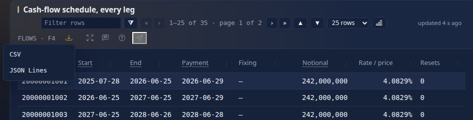

`MX-20000001` shows *Deal ticket* (F2), *Legs* (F3, the legs side by side), *Cash-flow schedule, every leg* (F4), *Events by leg* (F5),
*Events*, *Netted payments by date* (F6), *Payments by month*, *How this view was built* and *Linked entities*; F7 opens the counterparty's
trades, F8 the impact and F9 the raw JSON.

A page over many trades (`CTRD`, `PTRD`, `LTRD`, `ITRD`: a counterparty's, a portfolio's, a legal entity's, an index's trades) lists at
most 1,000 of them; the trade count, the notional, the payments in the next 7, 30 and 90 days and every other total cover all of
its trades, so a portfolio of 20,000 trades opens in well under a second. To work on every trade, search them (`TRD PORTFOLIO=…`) or
open the pack's BI reports.

Panel kinds you will meet:

| Kind | Looks like | Example |
|---|---|---|
| `kv` | label and value pairs | *Deal ticket* in `TRD MX-20000001` |
| `table` | rows and columns, totals for money | member trades in `NSET NS-SUMMIT-NY` |
| `tabs` | one tab (or column) per element of a list | *Legs* in `TRD MX-20000001` |
| `ladder` | dated rows, the next one highlighted | a ladder of dated flows (the panels catalogue) |
| `line` / `area` | a chart over tenors or dates | the curve in `CRV CRV-USD-OIS` |
| `hbar` | horizontal bars | *Netted payments by date* in `TRD MX-20000001` |
| `surface` | a grid as a heatmap, or a 3D surface you can rotate | `FXV FXV-EURUSD` (*Heatmap* / *3D* buttons) |
| `status`, `gauge`, `markdown` | a status list, a dial, formatted text | various packs |
| `links` | linked entities with badges | *Linked entities* everywhere |
| `provenance` | how the view was built | *How this view was built* |

The [panel kinds catalogue](PANELS.md) shows each one in detail.

**No data available.** A panel whose data is missing, or not in the expected shape, says *No data
available*. The rest of the view still renders. Real feeds are often incomplete; this is normal.

**Long labels in bars.** In an `hbar` panel a label longer than about two-fifths of the panel is cut with *…*; point at it to read it
whole. A long amount widens its own column. Either way the page never scrolls sideways, on a phone too (2.9.7).

**A candlestick's Data table** shows each price as the panel formats it (`74.00`, `120,000`), as the strip and tables do (2.9.7).

**Drawn by your browser (2.9.7, when your administrator turns it on).** With `ui.render` set to `client` the entity page is drawn in
your browser from the same data the server would have turned into HTML: it looks and works the same (links, the column funnels,
*Chart any table*, drill-downs and Back, the Pivot tab, *Customize*, layout mode, downloads, *About this page*, live updates). Add
`?render=server` to a page's address to see it drawn by the server, for a comparison.

### 4 · Links

Every identifier in a view is a door. Click `BOOK-RATES-3` in the strip and the book opens. The
*Linked entities* panel lists everything the entity points to, each with a **badge** read from the
target (for example the rating `A` on the counterparty `CP-MERIDIAN-RE` of `TRD MX-20000001`). A badge that says *pending* means the target did not
answer in time; open it to see it.

**Ids in tables are links too.** A table column that shows an identifier (a column bound to a field whose
name ends in `Id`, `Ref` or `_id` in any case, such as `TRADE_ID`, `COUNTERPARTY_ID` or `BOOK_REF`) links each value to its
entity, as long as a pack recognises the id. Example: open `BOOK BOOK-RATES-1`; its *Largest trades* table
(`F2`) starts with the *Trade* column (`MX-30003150`, `MX-30004482`, …), and clicking `MX-30003150` opens that trade. With the table selected, `↓` to a row and
`Enter` does the same ([Tables](#tables-sorting-filtering-paging-and-the-keyboard)).

**Breadcrumbs** above the title (`← MX-20000001 / NS-MERIDIAN-RE-NY`) show the path you followed in this
browser tab. Click one to go back to it, or press `Alt+←`.

### 5 · How this view was built

The *How this view was built* panel answers "where did this come from?":

| Line | Example | Meaning |
|---|---|---|
| Layout | `Sutra irs-fixfloat v1 + inference` | A Sutra (a written layout) drew the screen; inference filled gaps. `inference only` means no Sutra matched |
| Fingerprint | `b7df…1372` | The shape of the data, used to cache the layout |
| Source | `murex-rates`, generation `1674` | Which system the document came from, and its version counter |
| Node | `drishti-b · forwarded from drishti-a` | Administrators only, when several servers work as one (Drishti*net): the server that built the view and how: `local`, `built here, data from <server>`, `forwarded from <server>`, or `scatter-gather from <servers>` (and any that were missing) for a page that groups records of several servers. Nobody else sees it |

The footer repeats the source and generation, and the business date when one is picked
(`trade-endur · gen 7 · as of 2026-09-29`).

## About this page

*What am I looking at, can I trust it, and why does it look like this?* Press `?` on any view (or `F1`, or the **About**
button beside the title). A drawer opens on the right; the page stays usable beside it. It is written for you: what it
says is worked out from the page **you** have, so a field hidden from your role is never explained with its value.


Each layer is a section you can fold; the first ones are open, and Drishti remembers which you folded (in this
browser only).

| Layer | What it tells you | Example |
|---|---|---|
| **What you are looking at** | One sentence about this entity, written by the domain pack and filled with its own numbers; the screen's description; notes on single panels; which pack wrote it | "STR-GFC2008-RATES: under \"Global financial crisis 2008\" the portfolio changes in value by −73.6m USD against a limit of −67.5m." |
| **Where the data came from** | The source, its health (`up`, `degraded`, `down`), the generation, when it was fetched and updated, whether it is fresh or stale, a snapshot or a live feed, and how many linked entities were fetched | "Source stress-engine · health up · fresh · a snapshot" |
| **Why the page looks like this** | Which Sutra (layout) was chosen and why; panels that were added by inference; panels with no data and the reason (missing, null, empty list, masked); fields hidden for your role; panels you may not open | "Layout: Sutra stress-result v1, the one that applies to this kind, priority 10." · "1 field hidden for your role: Limit (in strip)." |
| **Where next** | The keys on this page (F7 and F8), and one link per kind of panel on it, to the guide that explains how to read it | "The histogram panel: what it shows and how to read it" |

A layer with nothing to say is not shown. If you see **What each number means** (a layer that explains the figures one
by one: term, unit and sign), your pack has a glossary; it comes with the next stage of the feature, so older servers
do not show it.

### Ask about this page (when your administrator has turned it on)

At the end of the drawer, a box **Ask about this page** answers a question in your own words ("is this number a loss?", "why is the
curve panel empty?"). It is not on unless your administrator switched it on for your pack; if you do not see it, it is off. The
answer comes from a language model that is given only this page's explanation (labels, definitions, the pack's guide), not the
document's values unless the administrator chose that, and never a field hidden from your role. It can be wrong: the layers above
are the reference. If it cannot be reached the box says "Ask is unavailable"; everything else in the drawer works. `Alt+?` jumps to the box.

### Ask the data, explain a number, describe a report (BI, when your administrator has turned AI on)

In BI ([BI_GUIDE.md section 29](BI_GUIDE.md#29-ai-in-bi-report-from-words-ask-the-data-explain-this-number)), a report page shows a box **Ask the data**: type "notional by desk" and you get a table, a chart that suits it and the query that was asked, answered from
what *you* may see (the same rows and masks as the report). The light bulb in a visual's header **explains** its number: where it comes from and what it is made of. In the designer,
**Describe a report** drafts a report from your words; you read it, use it and save it, or not. These are off unless your administrator switched them on; if you do not see the box and the bulb, they are off.

### The keys

| Key | Does |
|---|---|
| `?` | Open or close the drawer (anywhere on a view except in a text field) |
| `F1` | Open the drawer; `F1` again, inside it, or *The full guide to this screen*, opens this guide |
| `Esc` | Close the drawer; focus goes back to where you were |
| `Tab` | Move through the drawer. On a phone the drawer is a sheet that holds the focus until you close it |

On a phone the drawer is a bottom sheet (swipe down, or tap **×**, to close it):


All the layers open, on the same view:


### Someone else sees less

Ask the same page as a user whose role hides a field and the drawer hides it too. In this picture the administrator
chose to mask `limit` for the *viewer* role (a **demo**: no standard setup masks it). The sentence reads "against a limit of
•••" and the glossary marks Limit *hidden for your role*:


### Another domain

The words come from the pack, not from the program, so every domain explains itself in its own terms. An economy of the
world-economy pack (`ECON ECON-USA`), in that pack's words:


### Good to know

- The drawer is fetched the first time you open it, never with the page, so it does not slow a view down.
- When a live update brings a newer generation of the data, an open drawer asks again (at most once in two seconds).
- No text? A pack without an `about` entry for the kind still shows the other layers; the pack's author can add one
  ([how](PACK_DEVELOPER_GUIDE.md#about-text-and-glossary); how it works inside is
  [HOW_IT_FITS.md](../architecture/CONTEXT_HELP.md#about-this-page-end-to-end)).
- Hover hints on field labels and a help popover on each panel's `?` come with the glossary stage; today the panel `?`
  still opens that panel kind's page in this guide.
- If the drawer says "could not be loaded", try again; the page itself is not affected. Error numbers are in
  [TROUBLESHOOTING.md](TROUBLESHOOTING.md).

## Layout mode: arrange a view your way

A Sutra decides where each panel of a view goes, for everyone. **Layout mode** lets you arrange the panels for
yourself: put the panels you read first at the top, give a table more width and a chart less, move a panel between the
main and the side column, or hide one you never read. Your arrangement is a **personal layout**: it is kept on the server
for you, it never changes the Sutra, and nobody else sees it.

A personal layout belongs to a **Sutra**, not to one entity: arrange `TRD MX-20000001` and every trade that the same Sutra
lays out (`irs-fixfloat` here: every interest rate swap, fixed against floating) opens your way. The footer says so: its **Layout** key shows a dot (`Alt+L Layout •`)
when you are looking at your own layout.

### Turning it on

Press `Alt+L` on a view (`Option+L` on a Mac), or click **Alt+L Layout** in the footer. A bar appears under the top bar
(*Layout mode · Drag a panel by its heading …*), every panel gets a dashed outline, a size badge at its bottom right
(`12/12`, `8/12 · 8 rows`), a **Hide** button in its heading, and two handles: one on its right edge (width) and one on
its bottom edge (height).

Each column of the view, the main one and the side one, is a **grid of 12 columns**. A panel is 1 to 12 columns wide
(12, the whole column, is the default) and either as tall as its content (the default) or 1 to 24 **rows** of 2.5 rem
(40 pixels at the usual text size); a panel with a set height scrolls inside.

### With the mouse, a pen or a finger

| Do | To |
|---|---|
| Drag a panel by its heading | Move it: a dashed box shows where it will land, in this column or the other one. Near the top or bottom of the window the page scrolls |
| Drag its right edge | Make it wider or narrower, a column at a time (not under 3 of 12: `layouts.min_span`); panels narrower than the column sit side by side |
| Drag its bottom edge | Give it a height in rows; double-click the edge for its natural height again |
| **Hide** / **Show** in its heading | Hide it from your view (in layout mode it stays, greyed, so you can show it again). The last visible panel cannot be hidden |

### With the keyboard

`Tab` moves between panels (each is outlined when it has the focus). On the focused panel:

| Key | Does |
|---|---|
| `↑` `↓` | Move it one place earlier or later in its column (in a row of narrow panels, earlier is to the left) |
| `←` `→` | Move it to the main column or to the side column |
| `Shift`+`←` `→` (or `-` `+`) | One column narrower or wider |
| `Shift`+`↑` `↓` | One row shorter or taller |
| `A` | Back to its natural height |
| `H` (or `Delete`) | Hide it, or show it again |
| `Ctrl`+`Enter` | Save (`Cmd`+`Enter` on a Mac) |
| `Esc` | Cancel: leave layout mode and put everything back as it was |

Every change is announced to screen readers (*Cashflows · Leg 1: 1 of 5 in the main column*, *Linked entities: 6 of
12 columns wide, 7 rows tall*).

### Save, cancel, reset

- **Save** (`Ctrl+Enter`) keeps the layout and leaves layout mode. Open another trade of the same Sutra, or reload the
  page: it is drawn your way.
- **Cancel** (`Esc`) leaves layout mode and undoes everything since you turned it on.
- **Reset to <Sutra>** arranges the panels as the Sutra has them; **Save** then forgets your layout.

### Worked example

On the demo lakes, open `TRD 1000001` (an ENDUR commodity swap, Sutra `endur-comswap`):

1. Press `Alt+L`.
2. Drag *Cash-flow schedule, every leg* by its heading above *Legs*, and let go: it is first in the main column.
3. Drag its right edge to about two thirds of the column: the badge reads `8/12`. Drag its bottom edge down until the
   badge reads `8/12 · 8 rows`.
4. Drag *Payments by month* from the side column into the main column, under the schedule, and narrow it to `4/12`.
5. Press `Tab` until *Linked entities* has the focus, press `←` (it moves to the main column), then `Shift`+`←` six
   times (`6/12`): it now sits beside *Payments by month*.
6. Focus *How this view was built* and press `H`.
7. Press `Ctrl+Enter`. Reload: the view keeps your layout, and the function keys (**F2** the ticket ... **F6** the charts) still work. The key
   of a panel you hid is greyed (*Hidden in your layout*) until you show the panel again.

### Who may, and what follows your layout

- Layout mode needs a role with the **layout** power. Every role has it unless an administrator says otherwise; the
  built-in `viewer` role does not ([Admin → Roles](#admin--roles-what-a-role-may-do)). Without it the key is greyed with
  the reason. A view laid out by inference alone (*Layout: inference only*) has no Sutra to arrange, so the key is
  greyed there too.
- **Printing** follows your layout: your order and widths, hidden panels left out, every panel as tall as its content.
- **Workspace panes** show views with your layout too (layout mode itself is offered on the full view).
- **Live updates** keep your sizes. CSV and JSON exports, Calc and the API are unaffected: they read the data, not the
  arrangement.
- **When the Sutra changes**, your layout follows: panels the Sutra no longer has are dropped from it, and panels it
  gained appear at the end of their column, as the Sutra places them.
- You keep at most 50 layouts (one per Sutra).

### Promote to Sutra: offering your layout to everyone

If your role may author Sutras, the bar has **Promote to Sutra…**. It saves your layout and opens a panel that shows:

- the changes in words (*'refs' moves to the main column*, *'cashflows' is 8 of 12 columns wide*, *the main column
  reads cashflows, refs, dv01, leg2, legs, built*);
- the diff between the latest version of the Sutra and the **next version** your layout makes: the panels in your
  order, `area: right` where you put them in the side column, and the panel options `span` and `height`
  ([RACHANA_REFERENCE.md](RACHANA_REFERENCE.md#keys-every-panel-takes)) for your sizes. The rest of the Sutra (its
  comments, quoting and every other key) is kept as written;
- a tick box, **Remove the panels I hid from the Sutra**. Unticked, hidden panels stay in the Sutra for everyone else.

Write a note for the reviewer and press **Submit for review**. As with a save from the workbench, the new version is a
**proposal**: an approver opens it in *Build → Reviews* (the review shows the diff against the version before), and it
goes live only when approved. A panel your layout moved is listed in words, for example *moved: DV01 by tenor (USD)
from position 3 to 1 (side → main)*, and the line diff below it holds only the real edits (a width, a height, a
removed panel); the full line diff, where a move reads as a deleted block and an added one, is behind **Full line
diff**. The promote drawer shows the same before you submit ([Reviews](#reviews-approving-a-sutra)). With review switched off on the server the button
reads **Publish** and the new version is live at once.

## Screens that respond: clicks, refresh, editing and your own page

Newer screens (every pack screen is built from the same parts) can do more than show a document. What you meet:

- **A click opens more.** On a table with clickable rows (the book desk, `/v/portfolio-trades/BOOK-RATES-2?sutra=book-desk`) a click,
  or Enter or Space on a focused row, marks the row and opens what the screen says: the trade's cash flows under the row, its
  counterparty and credit limit beside it. A panel waiting for a click says so (*Pick a trade to see its counterparty and credit
  limit*). A new click replaces what opened. A panel that would follow a value masked for you says **Hidden for you** and is not
  looked up. If the server that drew the screen goes away, the next click says *Your selections were reset ... Pick again.*: click
  the row again.
- **Refresh and freshness.** A panel that refreshes says how fresh it is: *updated 12 s ago*, ticking; *stale* in amber when its
  source is behind; *trade-endur isn't answering; showing data from 10:42* when a refresh failed (it keeps what it showed). Its header
  has **pause/resume** and **every …** (only slower than the screen's own interval); **Pause all** above the panels pauses the page.
  Your choices are kept for you, per screen. A browser tab you are not looking at fetches nothing.
- **Editing a record.** Where a screen lets you, clicking a row opens a form beside the table, or a pencil on a column lets you edit
  in the cell, and **New …** opens a guided drawer. Fields you may not change say why; a wrong value is explained under its field.
  **Save draft** keeps a **draft** that only you see (*You have 2 drafts on this page* offers them again). The page asks before you
  leave with changes not saved. The reference is [WRITE_BACK.md](WRITE_BACK.md).
- **Submitting a change (2.8.0 write-back).** Where editing is on, you hold the edit power and the form says where it goes (the book
  desk's trades do), **Submit…** opens a sheet: what you saw, what is there now and your change; where it goes (a correction kept beside
  the booking system's value, or an amendment sent to it); who approves (never you); what it recomputes; and the reason. After **Confirm**
  the sheet follows it: waiting for an approver, applied (everyone viewing the trade sees the new value at once, *How this view was built*
  says *Edited here*), or conflicted if the trade moved since you opened it (your draft is kept). Approvers decide in **Review → Changes**
  (Build → Govern → Changes). Someone else's change to the record you are viewing shows *Changed by … just now*.
  The reference is [WRITE_BACK.md section 4a](WRITE_BACK.md#4a-submitting-a-change-280-write-back); a walk-through is
  [tutorial 24](../tutorials/24-correct-a-trade-and-approve-it.md).
- **Screens laid out on a grid.** A screen with named areas may have a split you drag (its position kept for you), areas shown as
  tabs and panels that fold. Where the screen allows it, you may drag panels to another place and resize them, for yourself;
  **Reset layout** goes back. Such a screen does not offer layout mode (`Alt+L`): the grid replaces it.
- **Your page.** With the Sutra designer on, **Customize** in a page's header changes the page for you alone (move, hide, columns,
  what a click opens, refresh, letting people edit); the header then says *Your page*, whose link opens the pack's page.
  [SCREEN_DESIGNER.md section 31](SCREEN_DESIGNER.md#31-the-sutra-designer-customize-describe-outline-and-grid) and
  [tutorial 22](../tutorials/22-build-a-screen-with-the-designer.md).

## Zoom a panel

A chart you want to read closely, a table with many columns, a pivot you are slicing: **zoom** expands one panel to fill
the view area, and **restore** puts it back. Nothing is saved to your layout and the Sutra is untouched.


Every panel's heading has a **zoom button** (the arrows icon, *Expand Hypothetical P&L, last 60 days*) next to the
help (?) button. Click it, or press `Z` while the panel has the focus (use `F2` to `F6` to focus a panel, or `Tab`).


While a panel is zoomed:

- it fills the view area **below the top bar and above the function keys**; the page behind it does not scroll;
- the focus is in the panel, and the other panels are inert (neither focusable nor read by a screen reader) until you
  restore; only one panel is zoomed at a time;
- it stays **live**: ticking values, charts and tables keep updating, and a chart redraws at the larger size;
- a table **fits the height**: the pager's page size is set to the number of rows that fill the panel (the size box reads
  *Fit (37)*), so there is no scrollbar and no blank space under the rows, and the page keeps the row that was at its top.
  It is recomputed when the window is resized, when you switch a tab inside the panel and when live updates add or remove
  rows. Pick a size yourself and it is kept until you restore (choose *Fit* to go back); the fit is never saved, and
  restoring puts back your own page size and the page with the same top row. A pivot, ladder, surface or graph use the
  height as usual;
- the button now reads *Restore <title>* and is pressed; pressing it again, `Z`, or `Esc` restores the panel and puts
  the focus back on its button.


| Key | Does |
|---|---|
| `Z` | On a focused panel (not in a text field): zoom it. While zoomed: restore |
| `Shift`+`Z` | Zoom the panel and ask the browser for **true full screen**, for a wall display (nothing happens where the browser has no full screen) |
| `Esc` | Restore. An open drawer (About, raw JSON), popover or menu closes first; a second `Esc` restores |

**Share or reload a zoomed panel.** The address gains `#zoom=<panel id>` (for example `/v/var/VAR-EQD#zoom=pnl`):
reload the page, or send the link, and the panel opens zoomed. An id that is not on the page is ignored.

**Layout mode** (`Alt+L`) and zoom exclude each other: turning layout mode on restores a zoomed panel first, and the
zoom buttons are hidden while you arrange the view.

**On a phone** the zoomed panel fills the screen under the top bar, and the button is a finger-sized 44 pixel target.


**Print** prints the zoomed panel alone.

**In another application.** Inside `<drishti-view>` the panel fills the element's own box, not the host page; the keys
work only while the focus is inside the element ([Drishti Elements, keyboard](../architecture/ELEMENTS.md#58-keyboard)).

## The Pivot tab: slice a table your way

Some tables can be turned into an **Excel-style pivot**: drag *Product* down the side, *Maturity bucket* across the
top, *Notional* into the cells, and read the totals; click any number to see the trades behind it. Such a table has a
**Table | Pivot** switch above it. Search results and pick lists of some kinds have one too.

The switch is there **only where it was asked for**: a Sutra author adds `pivot:` to a table or ladder
([RACHANA_REFERENCE.md](RACHANA_REFERENCE.md#pivot-a-pivot-tab-on-a-table-or-ladder)), or a pack adds it to a kind's
search results ([PACK_DEVELOPER_GUIDE.md](PACK_DEVELOPER_GUIDE.md#pivot-a-pivot-tab-on-search-results)), and chooses which fields you may use and
how it opens. Every other table stays a table. In the seven packs: a netting set's member trades (notional by product and maturity bucket, counterparty-risk), a desk's trades
(core), collateral balances, a counterparty's and a legal entity's trades (notional by product type and source system, trading), and trade
searches (the trading pack's `pivot:` on `trade`: source system, portfolio, currency, product group and type, side, status, counterparty).


### Opening it

Click **Pivot** above the table (or `Tab` to the switch and press `→`; `←` goes back to **Table**). The first time,
the console reads **every row** of the panel, not only the rows the table shows: a netting set table showing its first
four trades pivots all of them. The pivot opens as the Sutra (or pack) arranged it, or as you saved it last.

Under the switch: the **field list** and four **zones**, a toolbar, a status line (*42 rows · source records · 1 ms*)
and the grid.

### Fields and zones, with the mouse

| Zone | What a field there does |
|---|---|
| **Rows** | Its values go down the side, one group per value; a second field nests inside the first |
| **Columns** | Its values go across the top; a second field nests inside the first |
| **Values** | The numbers in the cells. Each has two choices: **sum**, **count**, **avg**, **min**, **max** or **distinct** (how many different values), and **value**, **% of row**, **% of column** or **% of total** |
| **Filters** | A chip reading *Currency: all*: click it for a pick list of the values (search box, **All**, **None**, tick what to keep) or, for numbers and dates, a **from** and **to**; **Apply** |

Drag a field from the list into a zone (the zone lights up where it will land), drag a chip to another zone or to
another place in its zone, or back to the field list to remove it. A field may be in Rows or Columns, not both, and a
numeric field can be in Values more than once (sum of MTM and count of MTM). At most 4 fields in Rows, 4 in Columns
and 6 values. Fields marked `#` are numbers.

### Fields and zones, with the keyboard

| Key | On | Does |
|---|---|---|
| `←` `→` (`Home`, `End`) | the Table / Pivot switch | Switch between the table and the pivot |
| `Tab`, then the arrows | the fields | Move between chips |
| `R` `C` `V` `F` | a chip | Put the field in Rows, Columns, Values or Filters |
| `Delete` (or `Backspace`) | a chip in a zone | Take it out of the zone |
| `Alt`+`↑` `↓` (or `←` `→`) | a chip in a zone | Move it earlier or later in its zone (outer or inner level) |
| `Enter` or `Space` | a chip in the field list | Add it: a number to Values, anything else to Rows |
| `Enter` | a value's chip | Go to its aggregation and show-as choices (`Esc` comes back) |
| `Enter` | a filter's chip | Open its pick list (`Esc` closes it) |
| arrows, `Home` `End`, `PgUp` `PgDn` | the grid | Move from cell to cell |
| `Enter` or `Space` | a cell | Show the rows under it |
| `Enter` or `Space` | a value's heading | Sort the rows by it: ascending, descending, then back to key order |
| `Esc` | the rows under a cell, the promote panel | Close it |

Every change is announced to screen readers (*Currency moved to Rows*, *Rows sorted by Sum of Notional, largest
first*).

### The grid

- **Totals.** Each group has a subtotal row (*Total GBP*) and column; the last row and column are the grand totals. Untick
  **Totals** to hide them. The totals cover every row, including groups beyond the grid's limits.
- **Groups open and close.** ▾ beside a group closes it to its total (▸ opens it); **Collapse all** and **Expand all**.
- **Sort.** Click a value's heading: within each group the rows are sorted by it, largest first or smallest first.
- **Group order.** Groups come in natural order: numbers by value, and `0-1Y`, `1-2Y`, `2-5Y`, `5-10Y`, `10Y+`,
  `BOOK-9` before `BOOK-10`; a missing value is *(blank)*, last. A number used as a group (a notional in Rows, say) is
  written plainly, as `42408726.01`, never `4.240872601E7`, and to at most 15 significant digits, the same in a panel's
  pivot and a search's.
- **Heat.** Tick **Heat** to shade each cell by its value: one colour for a range of positive numbers, two (gains and
  losses in the theme's colours) when the values have both signs. The number is always written; the shades keep the
  text readable in every theme.
- **Shares.** With **% of row**, **% of column** or **% of total**, a cell is its share of its row's total, its column's
  total or the grand total (the grand total itself reads 100%).

### Rows under a cell, the chart, export, print

- **Drill down.** Click any number (totals too), or press `Enter` on it: a dialog lists the rows behind it (*Rows under
  GBP · Equity barrier option*) with every field, ids as links that open the entity. `Esc` closes it.
- **Chart.** Choose **Bar chart**, **Line chart** or **Heatmap** in the toolbar (and which value, when there are
  several): a chart of the grid as it is now, in the theme's colours, redrawn when you change anything.
  To chart the table itself, with more types and two axes, use its chart button or `K` ([Chart any table](#chart-any-table)).
- **CSV**, **Excel** and **JSONL** (JSON Lines, a row a line keyed as the CSV's header) download the grid as shown: one column per row field, then one per column group and value, the
  subtotal and total rows labelled, numbers as numbers. The Excel file has a bold, frozen header row.
- **Print** prints the pivot and its chart alone, in the print palette.

### Save, reset, and what follows you

**Save** keeps your arrangement (rows, columns, values, filters, heat, chart) on the server, for you: it belongs to the
**Sutra and the panel**, so every netting set that Sutra lays out opens its Pivot tab your way, on any browser. A
search's pivot is kept per kind (every trade search). **Reset** goes back to the arrangement the Sutra or pack chose
and forgets yours. Nobody else's screen changes.

Keeping a pivot needs no special power: you may arrange the pivot of anything you may open, as you may sort a table.
When the Sutra changes, an arrangement that names a field it no longer offers is set aside, and the tab opens as the
Sutra says.

### Promote to Sutra

If your role may author Sutras (and saving is switched on), the toolbar has **Promote to Sutra…**. It saves your
arrangement and opens a panel with the changes in words (*the pivot of 'trades' opens with rows currency, product (was
product)*) and the diff of the **next version** of the Sutra: only that panel's `pivot:` changes, written as you
arranged it; its fields and everything else in the file stay as written. Add a note and **Submit for review**: an
approver reviews it as any save from the workbench ([Reviews](#reviews-approving-a-sutra)), and once approved everyone's Pivot tab
opens that way (those who saved their own keep theirs). With review off the button reads **Publish**.

### Search results: computed on the server

On a search or pick list whose kind offers a Pivot tab (`TVAL where MTM > 0`: 7579 of the 15000 trade valuations), the pivot is not limited to the 100
results the page lists: the server aggregates **every entity the search matches** on the business date and sends only
the cells. It reads the day's **columns**, the fields a large store keeps beside each document (a bank's trade table
keeps `PORTFOLIO`, `DESK`, `CURRENCY`, `MTM` and a dozen more), so a whole book pivots without a document being read.

- A field no source keeps as a column is marked **doc**. Using one, or searching a kind whose store keeps no columns
  (the sample data), the server says so instead of guessing: *no source of trade keeps its fields as columns here. Ask
  for a document read …*. **Read documents instead** computes from the documents themselves, at most 20,000 of them;
  when there were more, the status line says *partial: the first 20000 documents*.
- **Masked fields stay masked.** A field your role may not see (as in a search) groups under `•••` and is never added
  up, and so does a field under a masked one (`KYC.PD_1Y` when a counterparty's `KYC` is masked); the status line says
  *hidden from your role: Book*.
- The rows under a cell come from the server a page at a time (**Previous**, **Next**).


### Worked example

With the counterparty-risk pack, open `NSET NS-ALDERSHOT-LDN`:

1. On *Member trades*, click **Pivot**. You see notional by product down the side and maturity buckets across
   (`0-1Y` … `10Y+`), with totals: how much of the netting set's notional matures when.
2. Drag **Currency** into Rows, before *Product*: each currency is a group, with a *Total* row.
3. Drag **Asset class** into Columns: each asset class spans its maturity buckets, with its own total column.
4. Set the value's second choice to **% of total**: each cell is its share of the netting set's notional.
5. Drag **MTM (USD)** into Values: two numbers per cell.
6. Click *Currency: all* in Filters, **None**, tick `USD`, **Apply**.
7. Click the largest number: the trades behind it, with links. `Esc`.
8. Choose **Bar chart**; then **Excel** to download the grid.
9. **Save**, and open `NSET NS-ALDERSHOT-NY`: its Pivot tab opens the same way.

The same keyboard-only: `Tab` to the switch, `→`; `Tab` to *Currency* in the field list, `R`; to *Asset class*, `C`;
to *MTM (USD)*, `V`; to a cell, `Enter`.

### Limits

A panel's pivot reads at most 50,000 rows (*the first 50000 of N rows* when cut short); a pivot shows at most 2,000
innermost row groups and 200 column groups (further ones are still in the totals, and the status line says *more row
keys than shown*); a search's drill-down shows 50 rows a page. An administrator sets these (`drishti.pivot`,
[CONFIGURATION.md](../admin/CONFIGURATION.md#drishtipivot--the-pivot-tab)) and can switch every Pivot tab off.

## Keyboard

| Key | Does |
|---|---|
| `/` | Focus the command line, from anywhere |
| `↑` `↓` | In the command line: move through the suggestions. In a selected table: move the selected row |
| `Tab` | Complete the highlighted suggestion |
| `Enter` | Open the highlighted suggestion, or run the command (`<GO>`). In a table: open the selected row |
| `PgUp` `PgDn` | In a selected table: move the selection a page up or down |
| `Home` `End` | In a selected table: select the first or last row |
| `Esc` | Close the suggestions, a menu (a column's filter menu included), the raw JSON drawer, About this page or Calc; then restore a [zoomed panel](#zoom-a-panel) |
| `Z` | On a focused panel: [zoom](#zoom-a-panel) it, or restore it; `Shift`+`Z` also asks for full screen |
| `Alt`+`Shift`+`X` | Clear all [column filters](#filter-a-table-like-excel) (and the filter box) of the panel that has the focus |
| `K` | On a focused table: [chart it](#chart-any-table); `Shift`+`K` on a history page, where `k` is the previous day |
| `F1` | Help for the page you are on. On a view it opens [About this page](#about-this-page); `F1` again goes to the guide |
| `?` | On a view (focus not in a text field): open or close [About this page](#about-this-page) |
| `F2`–`F6` | Jump to the panel that shows that key in its header |
| `Alt`+`Shift`+`1`…`9`, `0` | The same as `F1`…`F9`, `F10` on a view. On Windows a laptop's F-keys are media keys unless `Fn` is held (or Fn Lock is on, often `Fn`+`Esc`), and Edge keeps `F9` for its Immersive Reader: these always work |
| `F7` | Open the main linked entity (for a trade: its netting set) |
| `F8` | Impact: what depends on this entity |
| `F9` | Raw JSON of the entity, with its source and generation |
| `Alt+←` | Back |
| `Alt+C` | Calc: Python on this view (where a pack offers it; `Option+C` on a Mac) |
| `Alt+L` | Layout mode: arrange this view's panels for yourself (`Option+L` on a Mac); in layout mode, [its keys](#with-the-keyboard) |
| `Alt+S` | Share this view (or panel) with people with a note; `Ctrl+Enter` sends, `Esc` closes |
| `Alt+N` | Discussion: the second tab of the side drawer ([Discussion](#discussion)) |
| `Alt+I` | Your inbox: what people sent you |
| `R` `C` `V` `F`, `Delete`, `Alt+↑` `↓` | On a field of a [Pivot tab](#the-pivot-tab-slice-a-table-your-way): move it to Rows, Columns, Values or Filters, remove it, reorder it ([all its keys](#fields-and-zones-with-the-keyboard)) |
| `Ctrl+Enter` | In Calc: run the code (`Cmd+Enter` on a Mac) |
| `Alt+1`…`Alt+4` | In a workspace: move to pane 1 to 4, also while the focus is inside a pane |
| `Alt+0` | In a workspace: from a pane back to the workspace's bar |

The keys a view offers are also buttons along the bottom of the screen, so you can click them.

### F9 · Raw JSON

Press `F9` in `TRD MX-20000001`. A drawer opens on the right with the full document, starting
`{"SOURCE_SYSTEM": "MUREX", "SOURCE_UPDATE_TIME": "2026-10-07T18:30:00Z", "TRADE_DATE": "2025-07-25", …, "TRADE_ID": "MX-20000001", …}`, and its
source (`trade-murex`) and generation, as the same foldable tree as the Raw document viewer (see [A number over time](#a-number-over-time));
**Search · copy · download** at its top opens that viewer. Press `Esc` to close it. If your role does not have raw access, fields such as `TRADER_ID` read `•••`, here
and everywhere else
(see [Masked fields](#masked-fields)).

### Masked fields

Your administrator can mask fields (`drishti.security.redact`; by default `TRADER_ID`, `TRADER_FIRST_NAME` and `TRADER_LAST_NAME`) for roles
without raw access. A masked field reads `•••` everywhere you could see or work out its value: the raw JSON, search
results and their CSV, compare and history, Calc, pivots (grouped under `•••`, never added up), and views: the header
strip, the title, tables and their totals, the Pivot tab's rows, charts (masked points are left out), anything a
layout computes from the field, the live updates, monitors and the panel CSV export. Impact (`F8`) does not list what
is tied to the entity only through a masked field, and shows a masked measure and its total as `•••`. The
type-ahead neither shows nor matches a masked value, and an alert on a masked field never fires.

You cannot find a masked value by trying: a condition on a masked field is never true, sorting by it does not sort,
and typing it finds nothing. Fields under a masked one are masked too (with a counterparty's `KYC` masked,
`KYC.PD_1Y` reads `•••`).

### Alt+C · Calc: Python on a view

Press `Alt+C` on `VAR VAR-RATES`. A panel slides in from the right, like F9's, with a Python editor. The first time
in a tab, Python starts (*Python ready*, about a second). Pick **VaR and expected shortfall from the scenario P&L**
in **Snippets ▾** and press `Ctrl+Enter`: a table shows the VaR recomputed from the 500 scenario P&Ls
(**94,397,741**, the fifth-worst of the 500, the same as the strip's *VaR 99% 1D* `94.4m`), the expected shortfall, and a histogram. `view` is the screen (`view.doc` its
document, `view.tables` its tables as pandas DataFrames); `drishti.search("TRD where …")`, `drishti.get(kind, id)`,
`show()` and `chart()` are ready.

The code runs in your browser, never on a server, and reads only what you could open by clicking. The key is offered
where a pack switches Calc on (trading, counterparty-risk and market-risk do, through roles with `calc: true`: `trader`, `credit-risk`,
`market-risk`) and needs a role with the `calc` power; without
one it is shown greyed, with the reason. Everything about it, from the `drishti` module to the limits, is in
[Calc: Python on any view](#calc-python-on-any-view).

### F8 · Impact

Impact answers "what depends on this, and how much is at stake?". Open `TRD MX-20000001` and press `F8`.
You should see *Impact of MX-20000001*:

- **Depends on it directly:** *Desk · 1*: `DESK-RATES`; *Netting set · 1*: `NS-MERIDIAN-RE-NY` with its net MTM (`+99,704,064`);
  *Trade valuation · 1*: `TVAL-MX-20000001` with its MTM (`+1,876,068`).
- **Rolls up into:** *Credit limit · 1*: `LIM-MERIDIAN-RE` via `CREDIT_LIMIT`, with the limit amount (`7.4bn`).

Each group has a total. Click any id to open it. With [masked fields](#masked-fields), Impact lists only what you
could find yourself, and a masked measure and its total read `•••`. See the
[Impact guide](#f8--impact).

## Live updates

Views of live entities tick: figures change in place and flash briefly. With the demo source on
(`DRISHTI_DEMO_ENABLED=true`; the demo lakes are daily snapshots and do not tick), open `TVAL TVAL-MX-20000001` and watch
**MTM** for a few seconds.

- The round **Live** button glows while the view streams (an amber ring while it reconnects). Hover over it to read
  how long the view took to build (`Live, built 1.92 ms`).
- All views, panes, the bell and monitors in **all the tabs of one browser** share **one** connection, so you can
  keep as many live tabs and workspaces open as you like (one per screen, say): new pages still load at once.
  A view open in several tabs is followed once. One browser follows at most 32 live things at a time; a view over
  that says *Static*, and why.
- The dot turns **amber** when the connection dropped or cannot be had (*Reconnecting…*): the page reconnects and
  repaints by itself, and everything else on the page keeps working meanwhile.
- It also turns amber when the tab was in the background for 10 seconds and gave its live updates back
  (*Paused while hidden*). Show the tab and it resumes. A tab left from before you signed in again (or picked
  another server) stays amber: reload it.
- It is **grey** on a view of a picked past date, which never ticks: it is a snapshot.

Screen readers hear the full state, including the server's rolling p99 (`Live, p99 2 ms`). To see the same
figures yourself, ask the server: `curl -s http://localhost:18480/api/v1/health/live`
([PERFORMANCE.md](../admin/PERFORMANCE.md#4-live-latency)).

To turn off the flash, untick *Flash changed values* in [your settings](#your-settings).

## Business dates: live or a day in the past

The **Business date** box in the top bar says which day you are looking at.

- **Live** (the default) is today's business date on the New York calendar (`USNY`), streaming.
  Weekends and holidays count as the business day before.
- **A picked date** shows that day's end-of-day data as a static snapshot. The box turns amber.

The round **Live** button beside the box is a toggle, the same on a laptop and a phone:

| The button | Means | A click (or Enter or Space) |
|---|---|---|
| green, with a filled dot | live updates are on | pauses: the page becomes a static snapshot of the current business date |
| red, with two pause bars | paused, or a picked date | resumes live on today's business date |

You can still pick another date while paused. The choice is kept as you move between pages. A screen reader hears
*Live updates on — click to pause* or *Live updates paused — click to resume*, which is also its tooltip.

Step by step, with pictures (a past date, the same layout with that day's figures, a Saturday, back to Live): [tutorial 2](../tutorials/02-look-up-anything.md), step 5. It needs the sample history ([GETTING_STARTED.md](GETTING_STARTED.md), Step 5).

What the banners mean:

| Banner | Meaning |
|---|---|
| *No data held for 2026-09-29: no dated store has … for that date. Shown instead: the current data of …* | No dated store holds the entity for the day you picked (for example, the history lake was not built, or does not reach back that far), so a source that keeps no dates answered. Its current data is shown as a still snapshot: it does not update and the top bar does not say *Live* |
| *Latest data on or before 2026-09-29 is from 2026-09-25* | Nothing was written for the day you picked; you see the last earlier day |
| *Pick a business date from 2021-09-30 to today.* | The date you typed is not a real date, is in the future, or is older than the server keeps. It was not taken: you stay on the date you had |
| *The business date you had picked cannot be used, so this is live. …* | A date remembered from earlier is no longer one the server accepts (for example after its history window moved on). The console has forgotten it and shows live |

### Known at: time travel

With a date picked, the clock field beside it (**Known at**) asks *as known when?*. Enter a time
(New York time) to see that business date as the system knew it at that moment: corrections made later
are left out. The **×** clears it and returns to the latest knowledge.

Use it to answer "what did we report at 6 pm, before the restatement?". Sources that keep versions
(Delta Lake, Iceberg) honour it. A dated store that keeps no versions (files, a database, Redis …) says so
instead (`DRS-1007 … keeps no earlier versions`) rather than showing today's data as if it were what was known then;
a search names it and says *partial*. Undated sources have only one version and show it.

## Compare: what changed

Compare lists every field that differs in one entity between two business dates.

Click **Compare** (it appears in the title line when you have picked a date): *What changed in MX-20000001* compares the picked date with the business day before. Each row shows the field's label and path, the value on each date and the
change for numbers; choose any two dates at the top to compare further apart, or give the earlier side a *known at* time to see what was restated on the same date; filter to *changed*, *added* or *removed*; **CSV** downloads
the comparison. Walk-through: [tutorial 2](../tutorials/02-look-up-anything.md), step 6.

Example rows for the valuation `TVAL-MX-20000001`, 2026-10-15 against 2026-10-16:

| Field | Path | Before | After | Change |
|---|---|---|---|---|
| MTM (USD) | `MTM` | 1,911,897 | 1,876,068 | −35,829 |
| DV01 | `DV01` | −155,791 | −155,245 | +546 |
| Valuation date | `VALUATION_DATE` | 2026-10-15 | 2026-10-16 | |

An amended trade compares the same way: `MX-20000022` between 2026-10-07 and 2026-10-16 shows *Trade status* `VALIDATED` → `AMENDED`,
*Trade action* `NEW` → `AMEND`, *Trade version* `1` → `2`, a new *Transaction ID* and *Source update time*.

Lists are matched by their identifiers or natural keys (a tenor such as `3M`, a date, a code), so an
inserted cash flow shows as one addition, not as every later cash flow changed: a path reads `LEGS[1].CASH_FLOWS[5000037]` (the
flow's id) rather than `LEGS[1].CASH_FLOWS[0]`.

The same comparison is available to programs:

```bash
curl -s -H "Authorization: Bearer $DRISHTI_TOKEN" "$DRISHTI_SERVER/api/v1/history/trade-valuation/TVAL-MX-20000001/diff?from=2026-10-15&to=2026-10-16"
```

It also takes `fromKnownAt` and `toKnownAt`. See [API_GUIDE.md](API_GUIDE.md).

## History: an entity over time

Type a range after the id (`TRD 1000015 30 <GO>`, see [The command line](#the-form-of-a-command)) and the screen becomes that entity
over time. The address is `/v/trade/1000015/history?days=30` (`?range=3M`, `?from=2026-09-01&to=2026-09-30`, `&diff=1`); the short
form `/v/trade/1000015?days=30` opens the same page. After an id, a space in the command line offers the ranges: `30`, `3M`, `YTD`,
`30 DIFF`.

**The header** names the entity, the range (*30 business days*), the first and last dates, how many days have data, how many changed,
how many were restated, and the days in the range with no data (hover *no data on 1 day* for the dates). *known: latest* means each day
is shown as it is known now. When a calendar range (`3M`, `FROM … TO …`) runs past the newest day the sources hold, the header says
*not loaded yet after 2026-10-16* rather than counting those days as missing.

**Trades and other documents** show one row per business day, newest first, with the kind's top-level fields as columns and each
list (legs, events) as a count with `▸`. A cell that differs from the day before is tinted and in bold, with `▲`/`▼` for numbers;
hover it for the value it had (*changed from 72K*). What stayed the same is dimmed, so the moves stand out. `⟲2` beside a date means the
store kept two versions of that day: the row is the latest. Masked fields read as the mask on every row, exactly as in the view.

**Equities, FX, curves and other market kinds** add the headline numbers of the chart's field (*Last*, *Chg*, *Chg %*, *High* and *Low*
with their dates, *Range*, *Avg*) and a chart in the theme's colours above the same table. The chart's crosshair follows the selected
row. The range buttons (`1M` `3M` `6M` `YTD` `1Y`) ask again; the address follows, so *Back* works and a link reproduces it.

**Diff** (`D`, or `DIFF` at the end of the command) turns the table into a change log: one block per day on which something changed,
each change on its own line (`Quantity 72,000 → 75,000`), with *Compare* (the full [compare page](#compare-what-changed) for that day
and the one before) and *Open the day*.

**Keys** (shown with `?`; ignored while you type in a field):

| Key | Does | Key | Does |
|---|---|---|---|
| `↑` `↓`, `j` `k` | previous, next day | `Home` `End`, `PgUp` `PgDn` | first, last, a page |
| `←` `→` | previous, next column (read aloud with its header) | `Enter`, double click | open the day's view, as it was that day |
| `C` | changes only: hide the days on which nothing moved (*7 of 30 days*) | `D` | diff, on and off |
| `R` | type a new range (`30`, `3M`, `YTD`, `FROM 2026-09-01`) | `1` `3` `6` `Y` `T` | 1M, 3M, 6M, 1Y, YTD |
| `E` | export: CSV, Excel, JSON Lines, JSON | `Alt+S` | copy a link to these rows |
| `Shift`+`K` | chart these days: any column by date ([Chart any table](#chart-any-table)) | | |
| `?` | the keys | `Esc` | back to today's view |

**Open the day.** `Enter` opens `/v/trade/1000015?asOf=2026-10-15&gen=59&via=history`: the normal view as of that day, with the pinned
banner (*as it was, from its history*, or *changed since the history read that day* when the data has moved on) and **Back to the
history**, which returns to the same range (the view's back link does too).

**Market kinds.** The table's numbers read in the chart field's format (`price2`: `21.66`), as the chart and the headline do. On a row from
the embedded series (a day before the stored documents), the parts' columns read `—` (*not read on this day*), not `0`. The chart's hover
label stays inside the chart and follows the selected row when the window is resized or zoomed; the crosshair's date is in the label and the
`⌖` line, not on the axis.

**Export** (`E`) downloads the table as shown, newest first: CSV (numbers as numbers, the formula guard, UTF-8 with BOM), Excel, JSON
Lines (a day a line, keyed as the CSV's header), or the server's JSON as served (its rows oldest first). Excel's dates are date cells (`yyyy-mm-dd`), so they sort and filter as dates. With
*changes only* on, only the changed days, in all three. Files are named `1000015-history-2026-09-07-2026-10-19.csv`.
Every export reads through the server, so it carries your masks.

**Link** (`Alt+S`) copies a link that pins the last date (`…/history?days=30&to=2026-10-19`), so a colleague sees the same rows a week
later; with *changes only* on it keeps `&only=1`. A link without `to` moves with the business date. The link is also shown, selected,
in a field under the toolbar, with *Copied* beside it: on a console opened by its plain-http LAN address the browser offers no clipboard
to the page, so Drishti copies from that field instead (and says *Select the link and copy it* if the browser refuses even that).

**When there is nothing to show** the page says why and offers today's view: an unknown entity (`DRS-1001`), a kind that keeps no daily
history here (`DRS-1012`), no data in the range (`DRS-1013`), a range larger than allowed (`DRS-4021`, with a link to the last 30 days)
or one that cannot hold (`FROM` after `TO`).

## How fresh is it

The footer of every view names the source and says how long ago it last received new data: *trade-murex ·
updated 42 min ago · gen 517 · as of 2026-10-16*. The age keeps counting while the page is open. When a source has received nothing for
longer than it should (its `stale-after`, set by your administrator), the view shows an amber banner at the top:
*trade-murex is behind: its last new data was 25 min ago, and it expects some within 15m. What you see may be out
of date.* Sources read on demand (a database) cannot tell, and show no age.

## A number over time

Click a number in a view (a strip value, a field, a cell of a table) and a window shows that field over the last 30
business days: a line chart, and the values day by day with the date the data is for and the connector it came from.
Choose 10, 30, 90 or 250 days at the top. Links still open what they name; a number that is a link opens the link.
The first line says where the value comes from: the path in the document, the connector, the business date the data
is for and the source's generation, with a link to the raw document. **Raw document** opens the document on the same page, in
a viewer: a tree you fold and unfold, with the field you clicked highlighted and scrolled to (`$.SLOPE_2S_10S` for the 2s10s of
`CRV-USD-OIS`). Search filters keys and values; **Copy JSON** copies the whole document and **Copy node** the selected one;
**Download** saves `<kind>-<id>-<date>.json` (`ir-curve-CRV-USD-OIS-2026-10-19.json`). Long lists show their first 50 items and a
*Show all*. Masked values read `•••`, as everywhere. `Esc` closes it and puts you back on the link; on a phone it fills the screen.
`Ctrl`+click (or a middle click) still opens the plain JSON in a new tab, and the `/api/raw/...` address keeps working.

Worked example: open `TVAL TVAL-MX-20000001`, click the MTM in the strip. You see *MTM (USD) · TVAL-MX-20000001 over time*, a line
over 30 business days, and below it the values, newest first, each with *Data for* and *Source* (`risk-store`, the demo lake of the
market-risk pack; `+1,876,068` on 2026-10-16, `+1,908,960` on 2026-10-07).
A *Data for* date in amber is earlier than the day it is listed under: the source carried its last value forward
(no data that day). An entity no dated source holds shows today's value with a note, since no history is kept.

**A pick list or search on two dates.** On the search page, set **Compare with** to an earlier business date and
press Search: each row shows today's value of every number with its change in brackets (`125  (+25)`), and entities
only one of the dates holds are marked *added* or *removed*.

The same through the API: `GET /api/v1/history/{kind}/{id}/series?path=$.MTM&days=30` and
`GET /api/v1/search/compare?q=…&from=2026-10-07&to=2026-10-16`.

## Asking in plain words

Type what you want in the command line, in words: `amended trades over 5m in BOOK-RATES-3, biggest first`, and press
Enter. When the words are not a command, Drishti shows the search they make and how it read each part; nothing runs
until you press **Run it**. The search page has the same box, **In words**.

```
amended trades over 5m in BOOK-RATES-3, biggest first
→ TRD where TRADE_STATUS = 'AMENDED' and QUANTITY > 5000000 and PORTFOLIO = 'BOOK-RATES-3' order by QUANTITY desc
   "trades" → Trade (TRD) · "amended" → trade status is AMENDED · "over 5m" → quantity > 5000000
   "BOOK-RATES-3" → portfolio is BOOK-RATES-3 · "biggest first" → sorted by quantity, largest first
```

It understands:

| You write | It means |
|---|---|
| a kind: `trades`, `counterparties`, `desk pnl`, a mnemonic | what to list |
| `over`, `above`, `more than`, `under`, `below`, `at least`, `at most` and a number (`5m`, `2.5 bn`, `10k`, `1,000,000`) | a comparison, on the field you name or the kind's main number (a trade's quantity, a valuation's MTM, an amount…) |
| `between 10m and 50m` | both bounds |
| `negative mtm`, `positive pnl` | below or above zero (`trade valuations with negative mtm` → `TVAL where MTM < 0`) |
| a value the data has: `amended`, `USD`, `BOOK-RATES-3` (optionally after `in`, `for`, `with`) | that field equals it |
| `maturing before 2028`, `traded after 2025`, `maturing in 2027`, `before 2026-12-31` | dates |
| `biggest`, `top 10`, `smallest 5 … by quantity`, `newest`, `sorted by` | the order, and how many |

**One entity over time, in words.** A kind, an id and a time phrase make a [history](#history-an-entity-over-time) command
instead of a search. When every word was read, it opens at once; otherwise the page shows *Read as …* with an **Open** button.

```text
trade 1000015 last month                    TRD 1000015 FROM 2026-09-01 TO 2026-09-30
equity EQ-CSCA last 3 months                EQ EQ-CSCA 3M
trade 1000015 last 30 days                  TRD 1000015 30
equity EQ-CSCA this year                    EQ EQ-CSCA YTD
trade 1000015 since 2026-10-01              TRD 1000015 FROM 2026-10-01
trade 1000015 since 2026-10-01 until 2026-10-10   TRD 1000015 FROM 2026-10-01 TO 2026-10-10
what changed on trade 1000015 this week     TRD 1000015 FROM 2026-10-19 DIFF
fx audusd since 2026-10-01                  FX FX-AUDUSD FROM 2026-10-01
1000015 30                                  TRD 1000015 30
BOOK-RATES-3 last week                      BOOK BOOK-RATES-3 FROM 2026-10-12 TO 2026-10-16
fx audusd                                   FX FX-AUDUSD (today's view)
```

Time phrases: `last` or `past N days|weeks|months|years`, `last week|month|year` (the whole previous one), `this week|month|quarter|year`,
`ytd`, `since <date>`, `from <date> to <date>` (or `since … until …`; two dates are put in order), `between <date> and <date>`. `changed` or `changes` anywhere adds `DIFF`. The id is the word
that names one entity of the kind (its id in any case, or the end of its id after a dash: `audusd` is `FX-AUDUSD`), even when it is also
a value of a field (`EQ-CSCA` is the equity's ticker); else the one word with a digit or a dash that is not a value of one of the kind's
fields, so `trades in BOOK-RATES-3 since 2026-01-01` stays a search (`BOOK-RATES-3` is no trade). Without a kind word, an id that names one
entity followed by a range (`1000015 30`, `1000015 3M DIFF`) or a time phrase (`BOOK-RATES-3 last week`) is that entity's history.
A kind and one id with no time phrase open the entity (`fx audusd`). A search is of one business date, so a time phrase in a search
(`trades in BOOK-RATES-3 last week`) is listed as *left out*, with how to ask for one entity over time instead (`BOOK-RATES-3 last week`),
and the search does not run on its own; `since <date>` in a search is a condition on the date, as before.

It is deterministic: no AI service, only the server's own vocabulary (its kinds, and each kind's fields and the
values its documents have). Words it did not understand are listed as *Not understood, left out*, never guessed.
Change the words, or edit the search itself.

## Search by value

Add `where` after a mnemonic to find entities by what they contain.

```text
TVAL where MTM > 1m order by MTM desc limit 50
```

You should see a page headed *Search by value*, a summary line such as `3321 of 15000 trade valuations match; the first 50
are shown`, the time it took, and a table: one row per valuation, with a column for each field the query uses
(here **MTM (USD)**), then the kind's key fields. Click an id to
open it, or walk the table with the keyboard ([Tables](#tables-sorting-filtering-paging-and-the-keyboard)).

`where` is optional: `TVAL MTM > 1m` and `TRD PRODUCT_TYPE=FX_QUANTO` work as well, and come back as a
[pick list](#pick-lists-when-a-command-names-several-entities). The rest of this section applies to both.

### The parts of a search

```text
<MNEMONIC> [where <condition>] [order by <field> [desc]] [limit <N>]
```

| Part | Rules | Example |
|---|---|---|
| Mnemonic | Any mnemonic, or a kind name | `TRD`, `NSET`, `trade-valuation` |
| Field | As named in the document, in any case; dots for nested fields, brackets for list items. A name no entity of the kind has is an error with the closest names | `MTM`, `mtm`, `KYC.PD_1Y`, `LEGS[0].NOTIONAL` |
| Compare | `=`  `!=`  `<`  `<=`  `>`  `>=`; text compared with `=` and `!=` ignores case | `PRODUCT_GROUP = 'Rates'` (also matches `rates`) |
| Text | `contains` and `startswith`, case-insensitive; `contains` also looks inside lists | `COUNTERPARTY contains 'MERIDIAN'` |
| Combine | `and`, `or`, `not`, brackets. `not` applies to the comparison after it | `MTM > 1m and not TRADE_STATUS = 'MATURED'` |
| Amounts | `k` thousand, `m` million, `bn` billion | `250k`, `1.5m`, `2bn` |
| Text values | in single quotes; a single word may go without | `'Early warning'`, `Rates` |
| Sort | `order by <field>`, add `desc` for largest first. Equal values come in id order and entities without the field last, so a `limit` keeps the same rows every time | `order by MTM desc` |
| Size | `limit N`, a whole number from 1 to 1000; anything else (`limit 0`, `limit 5000`) is an error that gives the range | `limit 20` |

Without `limit`, a search shows the number of results set in *My account → Settings* (100 unless you
change it).

### Examples to try

| Search | Matches on the demo lakes (business date 2026-10-16) |
|---|---|
| `TRD where QUANTITY >= 250m and PRODUCT_GROUP = 'Rates' order by QUANTITY desc limit 20` | 783 of 15000 trades (the first 20 shown) |
| `TRD where COUNTERPARTY contains 'MERIDIAN'` | 1291 of 15000 trades |
| `TVAL where MTM < -1m order by MTM` | 3154 of 15000 trade valuations, most negative first |
| `TRD where PRODUCT_GROUP = rates` | 1832 of 15000 trades (case ignored, no quotes needed) |
| `NSET where NET_MTM < -100m order by NET_MTM` | 10 of 76 netting sets, most negative first |
| `LIM where STATUS = 'Early warning'` | 2 of 24 credit limits |
| `ECON where GDP_USD_BN > 1000 order by GDP_USD_BN desc` | 21 of 213 economies |

A search whose condition matches exactly one entity still shows its one-row table; only a command typed
without `where` opens a single match directly.

### Good to know

- A search follows the business date in the top bar.
- It sees only what your role may see; a condition on a masked field never matches and sorting by one does not
  sort ([Masked fields](#masked-fields)).
- If the scan limit was reached, the page says *results may be incomplete*. If a source failed, did not answer
  in time, or could not list the kind, a banner says *Incomplete: 1 source could not be read* and names each source
  and why (for example a lake date in a format the server does not read): entities it holds are missing, so
  "0 matches" does not mean none exist.
- A mistake gives an error such as `DRS-4004 cannot read the condition: …` with the position. A condition that stops
  short (`TVAL where MTM >`) says `the condition ends early: something is missing after '>'`.
- **CSV** downloads the results. **Watch as a monitor** saves the first 50 results as a live monitor
  (see [Monitors](#monitors)).
- Where the kind's pack offers it, a **Table | Pivot** switch turns the results into a pivot over **every** match of
  the day, computed on the server ([The Pivot tab](#search-results-computed-on-the-server)).

## Search with a form (`FORM <pack>`)

Type `FORM <pack>` (or open **Forms** in the Views menu) to fill in boxes instead of writing a search: the form writes the search, shows it and runs it. A field with more than 300 values (the counterparties of a large book) shows a box to find them as you type instead of one tick box each. The reference is [Query by form](#query-by-form) below; the walk-through is [tutorial 3](../tutorials/03-query-by-form.md).

## Export, print and share

The buttons in a view's title line, and the **↓** in each panel header.

| Action | Where | What you get |
|---|---|---|
| Panel as CSV or JSON Lines | **↓** in a panel header, then **CSV** or **JSON Lines** | Tables and ladders as they are; key/value panels as field and value; charts as one column per series; surfaces as a grid; bars as label and value |
| Search as CSV or JSON Lines | **CSV**, **JSONL** on the results page (and on a form's results) | One row per result |
| Pivot as CSV, Excel or JSON Lines | **CSV**, **Excel**, **JSONL** in a [Pivot tab](#the-pivot-tab-slice-a-table-your-way) | The grid as shown: row fields, one column per column group and value, totals labelled; Excel with a bold frozen header |
| Comparison as CSV or JSON Lines | **CSV** on the Compare page; the same address ending `.jsonl` | One row per change |
| View as PDF, PNG, Excel, CSV or JSON Lines | **Export** in the title line | The view as you see it, with the controls and filters you set |

**JSON Lines** (`.jsonl`, [DATA_FORMATS.md](DATA_FORMATS.md)) is one JSON object a line, keyed by the CSV's column names, numbers as
numbers and no spreadsheet escaping: the form for scripts and other systems. It sits beside every CSV download; CSV, Excel, PDF and
PNG all stay.
| Document as JSON | **JSON** in the title line | The whole document, as your role may see it |
| Print or PDF | **Print** | A clean light page without the top bar and buttons; choose *Save as PDF* in the print dialog |
| Share | **Share** (`Alt+S`), or a panel's **send** icon | A [dialog](#share-a-view-with-a-note): send the view, or one panel, to people with a note; **Copy link** is in it |

Worked example (CSV): open `TRD MX-20000001` and click **↓** on *Cashflows*. You get a file whose first
lines are:

```text
Pay date,Leg,Type,Rate,Amount,PV
2025-09-29,2,Float,0.035377,-1403091,0
2025-12-31,2,Float,0.036186,-2310878,0
```

Numbers arrive as plain numbers (`-1403091`, `0.0425` for `4.25%`), so a spreadsheet can add them up.
File names carry the business date when one is picked. Each download also has a direct address, for
example `/export/trade/MX-20000001/schedule.csv` (`schedule` is the panel's id) or `/export/trade/MX-20000001.json`.

**Share** links:

- in Live, the link is the view's address, such as `http://localhost:17480/v/trade/MX-20000001`;
- with a date picked, the link carries it (`/v/trade/MX-20000001?asOf=2026-09-29&knownAt=…&gen=…`): the date, the
  *known at* moment if you set one, and the generation you saw. A colleague sees what you see, within their own
  permissions. If they are signed out, the sign-in page keeps the whole link and brings them back to it. The date applies
  to that page only: a *Pinned* banner says "You are seeing 29 Sep as known at …, as it was shared" (or that the source
  keeps no earlier versions so they see the latest for the date, or that the data has changed since, with *What changed*),
  and **Go live** drops it. Their own saved date, and their other tabs, are not changed.

### Share a view with a note

**Share** (or `Alt+S` on a view) opens a dialog. **Copy link** is the first thing in it, so the old one-click use is one
click plus `Enter`; the rest sends the view to people inside Drishti.

1. **What**: the whole view, or one panel (use the **send** icon in a panel's header to start with that panel chosen).
2. **As of**: shown, never typed. It is the date and *known at* moment you are looking at, so the people you send it to open
   exactly that; tick *send a live link instead* to send the live view. On a live page the link is live.
3. **To**: type two letters of a name or a role (`rav`, `risk`) and pick from the list with the arrow keys and `Enter`
   (or click). You can only find people who use at least one pack you use; a role stands for everyone in it (its size is
   shown). `Backspace` in the empty field removes the last name.
4. **Note**: plain text. Do not type the value of a hidden field: the server replaces it with `•••` for everyone who may
   not see it (you read your own text as written). If you can see hidden values yourself, you are warned when the note copies one; if you
   cannot, you are told nothing either way. A `{$.path}` quote is filled for each reader with the value they may see, in the app and in
   email.
5. **Also start a discussion on the view** (a tick under the note): the note also becomes the first comment of a thread on the view, written by
   you, so the conversation continues in the [Discussion](#discussion) tab. Whether it is ticked when the dialog opens is your administrator's
   setting (`drishti.collab.share.post-to-thread`); you can change it for each share.
6. **Include a picture** (a tick, shown only when your administrator allows pictures for this kind of view): the share carries a snapshot of the
   view, or of the panel you chose, with a watermark (who sent it, to how many people, when, the data's date and generation, and the link). Tick it
   and the dialog shows a **preview** for the people you chose. The picture shows only what *every* recipient may see: if any of them sees a hidden
   field as `•••`, so does the picture for all, and a panel any of them may not open is left out. Charts without a simple drawing appear as a labelled
   box that says to open the view. Recipients see it on the shared view's banner and, if email is on, as an attachment; it may show figures, only those every recipient may see, and it can never later show more than it did when you sent it.
7. **Send** (`Ctrl+Enter`). The dialog says who it reached ("Sent to 2") and who it did not and why ("Not sent to dkim:
   cannot open trade views"). `Esc` closes the dialog and puts the focus back where it was. On a phone the dialog is a full
   screen sheet.


What the recipient gets: a notice on the **bell** within a second (a number on the bell, and a toast) and a row in
their [inbox](#your-inbox). Opening it goes to the view **as you sent it**: your date and *known at* moment, with a
banner "Shared by Ann Author", your note, and the usual *Pinned* banner. A shared panel is scrolled to and outlined. They
see the view with *their own* rights: a field hidden from their role stays `•••`, and the note reads `•••` where you typed
a hidden value.

**Reply.** Under the note, the sender and each person the share reached have a **Reply** box (`Ctrl+Enter` sends). Replies are listed under the
note, oldest first, and the other side gets a notice. A compliance officer who opens the share can read the replies but not write one.

**Times.** Every time the collaboration pages show (inbox rows, the share banner and its replies, the *known at* time in the Pinned banner,
comment times, the administration page) is in the same zone as the top bar's *known at* picker, with its name after it: `2026-09-30 10:02 New York`.


A person whose role does not open that kind of view (or who was sent it and then lost access) sees a plain page, "A shared
view you cannot open", with who sent it and when, and nothing about what it holds; their inbox keeps the notice. If the
reason is that the pack is switched off for them, the page offers **Switch on** *pack*. A link that was never sent to the
reader looks the same as a link that does not exist.

### Your inbox

The **bell** in the top bar counts what is new for you (shares sent to you, and alerts as they fire); click it, or press
`Alt+I`, for the inbox page. Each row says when, what kind (Share), who, and the start of their note, as you may read it
now. Click a row to open it (opening marks it read), **Mark read** on a row, or **Mark all read**. Filter by *All*,
*Shares*, *Mentions* or *Replies* and *Unread only*; **Older** pages back. Rules that fired are on the
[Alerts](#alerts) page.


## Monitors

A monitor is a **live watchlist**: one row per entity, each row showing that entity's key figures (its
strip) as they tick. Rows can be of different kinds.

*Views → Monitors* in the top bar (`/m`) lists *Yours* and the *Starters* the packs offer. Opening a starter
saves a copy to your account. (None of the shipped packs offers a starter, so start from a search; the retired example packs
`finance` and `logistics` under `examples/packs/` offer *Credit watch* and *Fleet watch*.)

Step by step (a search, **Watch as a monitor**, adding an entity, removing a row), with pictures: [tutorial 3](../tutorials/03-query-by-form.md) (save a search and a monitor).

The monitor is saved on the server under your account, so it follows you to any browser. All rows share
one live connection.

## Scheduled reports

A report is a search that runs on its own, on a schedule, and delivers its result as a CSV or JSON Lines file (**Format**); **Reports** in the Views menu lists them with your subscriptions. Export and subscriptions are in the same place. The reference is [DISTRIBUTION.md section 0](DISTRIBUTION.md#0-scheduled-searches-and-the-reports-page); the walk-through is [tutorial 9](../tutorials/09-reports.md).

## Alerts

An alert rule watches **one entity** and tells you when a condition becomes true. (To be told when a **number** in a BI report, a dataset or a view crosses a limit, moves too far or does not arrive, see [Alerts on numbers](#alerts-on-numbers) at the end of this section; both are on the same **Alerts** page.)

- The **server** checks every rule on every change of its entity, even when nobody has Drishti open.
- A rule alerts **once** when its condition becomes true, and re-arms when it turns false again.
- A rule that is already true when you save it alerts straight away.
- A rule sees the entity as you may see it: a condition on a [masked field](#masked-fields) never becomes true, and a
  message shows a masked value as `•••`.
- New alerts show as a **toast** and a count on the **bell** among the round tools of the top bar, on every
  page. Click the bell to see them all, and to allow browser notifications. *Views → Alerts* opens the same page.
  At most three toasts show at once; a burst adds one more toast, *+N more on the bell*, which opens the inbox. Only notices
  written after the page opened toast: older ones wait in the inbox and on the bell's count.

Worked example:

1. Open `NSET NS-SUMMIT-NY` and click **Alert** in the title line. The *Alerts* page opens with
   **Kind** `netting-set` and **Id** `NS-SUMMIT-NY` filled in.
2. Fill in **Name** `Summit size`, **When** `$.TRADE_COUNT > 100`, **Severity** `warn`, and
   **Message** `${$.NETTING_SET_ID}: ${$.TRADE_COUNT} trades`.
3. Click **Save rule**. The set already holds 1,274 trades on the demo lakes, so you should at once see a toast, the
   bell showing `1`, and under *Recent alerts* a line `warn NS-SUMMIT-NY NS-SUMMIT-NY: 1274 trades`.
4. *Your rules* lists the rule; **Delete** removes it.

### Writing conditions

A condition is a Rachana-EL expression over the entity's document. `$` is the document; `$.field`
reads a field.

```text
$.COLLATERAL < 0                               a netting set the bank has posted collateral to
$.MTM < -450000                                a trade valuation's MTM below −450k
$.NET_MTM < -1500000 && $.COLLATERAL < 0       both at once
$.STATUS == 'Early warning'                    a credit limit's status
```

In a rule (unlike a search) write `==` for equality, `&&` for and, `||` for or, and full numbers
(`1500000`, not `1.5m`). The message is a template: `${…}` holds an expression, and `fmt(value, 'pct0')`,
`fmt(value, 'signed0')` or `fmt(value, 'compact')` format numbers. The full language is in
[RACHANA_REFERENCE.md](RACHANA_REFERENCE.md).

A pack may suggest rules for its kinds (`alerts:` in its `pack.yaml`; none of the shipped packs does, the retired example pack
`finance` suggests *PFE near limit* and *MTM below −450k*); they appear on the Alerts page and fill the form when clicked.

> **Tip:** a condition that cannot be evaluated (a misspelled field, say) is skipped, not alerted.
> Check a field's exact name with `F9` first.

Rules are kept with your account, and so are the alerts they fire: the newest 1,000 per user
(`drishti.alerts.keep`) are kept in the identity database, so they are still there after a server restart. More in the
[Monitors and alerts guide](#monitors).

### Alerts on numbers

Click **Alert me** (the bell in the corner of a visual of a BI report) or click a number on a view and choose **Alert me**: the form opens with that number filled in. Say when to tell you: when it goes **above** or **below** a limit,
**between** two numbers or **outside** them; when it **changes by** a percentage or an amount (against the previous look, or the previous business day); or when today's data **has not arrived by** a time. Say when to look (on a schedule,
after a data load, or when it changes), and how to tell you: your **inbox** and the bell, **email** to the address on your account, the **chat bridges** your administrator set up. *Check now* shows what it reads for you right now.

**It is your number.** The alert reads the number as you: with your row rules and your masks. If a number is masked for you the alert never judges it and never shows it. Once it fires it stays quiet until the number is back
inside the limit (by the *hysteresis* you set, if any) and does not fire again within the *cooldown* (30 minutes by default). Your alerts are on the **Alerts** page (also **Reports**, *My alerts*): *Look now*, *Pause*, *Resume*,
*Edit and history* (what every look did, and what was sent where) and *Delete*. What fired is in the **Alerts** tab of your inbox. If a board's author has made a tile notify, you are told when it turns red, on your own number.
Reference: [DISTRIBUTION.md section 4](DISTRIBUTION.md#4-alerts-on-numbers); walk-through: [tutorial 11](../tutorials/11-bi-that-runs-itself.md).

## Workspaces

A workspace puts up to four live views on one screen. A pane can **follow** another: a link you click
in the followed pane opens in the following pane.

*Views → Workspaces* in the top bar (`/w`) lists yours and the starters. Starters come from packs that
define them (none of the shipped packs does; the retired example pack `finance` defines *Credit desk*, *Rates*, *Cross-asset*) and from
`drishti-console/config/workspaces.yaml`.

With any packs, start a blank workspace: type a name under **New workspace** on `/w` and press **Create** (or open
`/w/<name>` for a name you have not used and click **Create it**). It opens with two empty panes (the `blank` entry of
`drishti-console/config/workspaces.yaml`); type a command in each pane's box, then **Save**. When your packs bring no
starters, *Starters* says so.

Worked example (on the demo lakes, from a blank workspace):

1. Open `/w`, type `Credit desk` under **New workspace** and press **Create**. In the first pane type `NSET NS-NORTHPLAINS-NY` (the
   netting set), in the second `TRD 1000001`, and set the second pane to follow the first.
2. In the netting-set pane, click another member trade. Pane 2 follows pane 1, so it opens that trade.
3. Change **Layout** to *Two by two*, click **Pane** to add a fourth pane, and type `TRD MX-20000001` (a MUREX swap) in its
   **Entity for this pane** box.
4. Set its **follows** to `—` so it stays put.
5. Click **Save as…**, name it `My credit desk`, and click OK. It now appears under *Yours*.

| Control | Does |
|---|---|
| Layout | *Two columns*, *Three columns*, *Two by two*, *One large, two stacked* |
| Entity for this pane | A command or id (`TRD MX-20000001`, `NS-SUMMIT-NY`), then Enter |
| follows | Which pane this one follows, or `—` |
| Pane / × | Add a pane (up to four) / remove one |
| Drag a suggestion onto a pane | Type in the command line (`TRD MX-2`, or nothing for your recent ones), drag a suggestion onto a pane: the pane shows it. Click it without dragging to open it full screen as usual |
| Drag a pane's number onto another pane | The other pane shows the same view |
| Drag a divider | Share the width (or height) between two neighbouring columns (or rows); focus it with `Tab` and use the arrow keys (`Home`, or a double-click: equal) |
| Save / Save as… / Delete | Keep it under its name, sizes included / a new name / remove it |
| `Alt+1`…`Alt+4` | Move to pane 1 to 4, from anywhere: the workspace's bar or inside a pane (an empty pane: its box) |
| `Alt+0` | Back from a pane to the workspace's bar |

Workspaces are saved to your account (up to 50 each).

**If no starters are listed** (the shipped packs ship none: *Starters* then says so), start a blank workspace as above,
or an administrator can add one for everybody
to `drishti-console/config/workspaces.yaml`; it appears after the console restarts:

```yaml
templates:
  Counterparty credit:
    description: A netting set, the trade you pick in it, and the discount curve.
    layout: "1+2"
    panes:
      - { ref: { kind: netting-set, id: NS-SUMMIT-NY }, title: Netting set }
      - { ref: { kind: trade, id: MX-20000001 }, follows: 0, title: Selected trade }
      - { ref: { kind: ir-curve, id: CRV-USD-OIS }, title: Discount curve }
```

`follows: 0` means "follow the first pane". See the [Workspaces guide](#workspaces).

### Sharing a workspace

Open one of your saved workspaces and press **Share…**. Tick **Everyone**, or name roles (`risk, trader`) and people
(`ravi, tess`), and press **Share**. They find it on their Workspaces page under **Shared with you**, marked
*shared by you · read-only*. They see it as you keep it: when you change and save it, they see the change. Panes on
kinds a reader may not open stay hidden from that reader. A reader who wants to change it presses **Save a copy…**,
which makes it their own. **Stop sharing** (or deleting the workspace) takes it away from everyone.

## Discussion

Anyone who may open an entity can start a discussion on it: a comment thread on the whole view, on one panel or on one
field, for the next reader or for a colleague. Press **Discussion** in the view's header (or **Alt+N**). It opens in the
same side drawer as **About this page**, as a second tab: **?** and **F1** still open About, **Alt+N** opens
Discussion, the arrow keys move between the two tabs, and **Esc** closes the drawer and puts the focus back where it was.
On a phone the drawer is a sheet from the bottom edge.

- **Write.** The box at the bottom starts a new thread: choose what it is about (the view, a panel or a field), write,
  and press **Post** or **Ctrl+Enter**. Each thread has its own reply box. The panel's header carries a small comment
  icon beside its **?** with the number of comments; pressing it opens the drawer on that panel. A field with a
  discussion shows a small amber dot; in the history window of a number, **Discuss** writes about that field.
- **Mention people.** Type **@** and a few letters: the list offers colleagues and roles (`@risk` tells everyone with
  that role who may open the view). Arrow keys move, **Enter** picks. People you mention get a notice on their bell, and
  an email when your administrator has set one up (each person can switch the email off on the *Account* page, under
  *Email me when*; the bell always shows it). After you post, the drawer says how many people were told and, by name,
  who was not (for example a colleague whose role may not open this kind of view).
- **Quote a value.** Type **{** (or press **Quote a value**) and pick a field: the comment holds `{$.MTM}` and every reader
  sees the number *as they may see it*: a reader who may not see the field sees ••• instead. A number you type out by
  hand is checked too: if it copies a value that is hidden from some readers, those readers see ••• (you read your own text as written). If you can see hidden values yourself you get a warning; if you cannot, you are not told, so nobody can test guesses of a hidden value. Email and chat posts about the comment carry the quoted values as each recipient may see them, unless your administrator set the pack to link-only.
- **What the comment saw.** Every comment shows the data it was written against ("gen 1702 · 29 Sep"). When the page now
  shows other data, **Open as it was** opens the view at that date and time, as the writer saw it.
- **Edit, retract.** You can edit your comment for a short while after posting (15 minutes unless your administrator
  changed it); "(edited)" opens the earlier versions. After that you can only **Retract** it (press twice to confirm): it
  then reads "Retracted by the author". Nothing is deleted.
- **Resolve, follow, mute.** Anyone in the thread can **Resolve** and **Reopen** it. You follow threads you write in; **Follow**
  and **Mute** control whether you are told of replies. A reply on a thread you follow shows on your bell and a line is
  announced in the drawer ("1 new comment on VaR contribution").
- **Quoted values.** A quote (`{` then pick a field) shows the value as the page shows that field: `1,875,863`, not the stored `1875863`; a reader
  who may not see the field sees `•••`. If the page now shows newer data than the comment saw, the field's format is applied to the value the comment saw.
- **Moderation.** Administrators see **Hide** (with a reason; readers see "Hidden by a moderator: <reason>") and **Lock**
  (no new comments). Hidden comments are kept in the record. The whole set of moderation and compliance tools is on one page, **Admin > Collaboration**
  (see [USER_MANAGEMENT](../admin/USER_MANAGEMENT.md)).


The same comment for a reader without access to the field: the typed id and the quoted field both read ••• and the quoted quantity stays,
because the reader may see it. *Open as it was* is offered because this page now shows other data.


Notes written before discussions existed appear as one-comment threads. Every comment, edit, retraction and hide is in
the audit log. Discussions are kept in the server's identity database, so everyone on that server sees the same ones;
another server has its own.

## Working with several servers

Your organisation may run more than one Drishti server: an open one most people use, and others for a restricted desk
or a pre-production copy. When the console knows of several, the top bar shows the current one as a coloured dot and
a name. Click it to switch, or choose **All servers…** to see each one's state, version, how you sign in to it, and
whether you are signed in there.

Each server has its own users and data, so you sign in to each separately. You can be signed in to several at once and
switch without signing in again. **Sign out** signs you out of the current server only, and ends that session on the
server: the browser's cookie, or a copy of it, no longer signs anyone in. (Opening `/logout` by a link only asks; the
**Sign out** button does it; you land on the home page with a "Signed out" note.) With sign-in on, the home page shows a **Sign in** button when nobody is signed in, and your name with a menu (Open the terminal, My account, Sign out) when you are. A link someone shares opens on
the server it was made on (it carries `?srv=…`). A server not shown in the list can still be reached with the link
`/connect/<its id>` if you were given one.

### Servers that act as one cluster (Drishti\*net)

When your administrator runs several Drishti servers as one cluster, nothing changes for you: you sign in once, and every page and live view looks
and works the same whichever server holds the data. If the server your console uses stops, the console moves to another by itself; the page you are
on reloads its data, a live view reconnects, and you do not sign in again. A save made at the very moment a server stops says it did not save: save
again. When the server that holds what you asked for is down, the page says so (`DRS-5052 ... cannot be reached now`) instead of showing nothing.
A search covers every server's data; when one of them did not answer, the results say they are partial and name the server they are missing.
A page that groups many records (a counterparty's trades, a book's P&L) counts the records of every server; if one did not answer, the page
says it is partial and names the server.
Your saved searches, layouts, pivots and workspaces follow you to whichever server you are on. Alerts and scheduled reports stay on the server they
were made on (they act, and would act once per server).

## Your settings

*My account* (`/account`) shows your profile and roles, your settings, and a form to change your password.
To get there, click your avatar at the right of the top bar and choose **My account**, or **Settings** to
jump straight to the settings (`/account#settings`). Settings are kept on the server, so they follow you to
any browser.

| Setting | Choices | Example |
|---|---|---|
| Theme | *This browser's choice* or one of the ten themes | `Wallstreet` |
| After signing in, open | Any console address | `/t`, `/w/Rates`, `/m/High utilisation`, `/v/trade/MX-20000001` |
| Clock time zone | Default (NY) or a listed zone. Also the zone of every time in comments, shares, the inbox and revision history (labelled with the zone's city, e.g. `Kolkata`); a picture of a share is drawn on the server, in the business-date zone | `Europe/London` |
| Density | *Comfortable* or *Compact* (more on screen) | `Compact` |
| Flash changed values | On or off | off for a calmer screen |
| Search results | 10 to 1000 | `50` |

Click **Save settings**.

**Pinning.** **Pin** in a view's title line adds the entity to *Pinned* on the terminal home (`/t`), up
to 20. The button then reads **Pinned**; press it again to unpin.

**Changing your password.** Type the current password and the new one twice (at least 10 characters,
with letters and digits), then click **Change password**. When an administrator asked you to choose your own password
(at your first sign-in, or after they reset it), *My account* shows only this form, and every other page takes you
back to it until the password is changed; then the console opens the terminal home.

**When your access changes.** Your roles and whether your account is enabled are read from the server as you work,
not only when you sign in. If an administrator disables your account, every page sends you to the sign-in page within
a few seconds (`auth.recheck_seconds`, 10 by default); if they change your roles, what you may open changes as quickly.
An administrator resetting your password signs you out everywhere. Users, roles and password rules are covered
in [USER_MANAGEMENT.md](../admin/USER_MANAGEMENT.md).

## Themes

The palette among the round tools of the top bar offers ten themes (three added in 2.6.0: the Terminal look in one dominant hue):

| Theme | Name in settings | Look |
|---|---|---|
| Terminal (default) | `terminal` | dark navy, amber accents |
| Parchment | `light` | light, warm paper |
| Blue | `blue` | light page; Sajha's blue: a navy-to-blue top bar with white text |
| Wall Street | `wallstreet` | dark, the Bloomberg colours: black, amber, yellow |
| Green | `green` | light page; Sajha's green: a deep-green top bar with white text |
| Crimson | `crimson` | light page; a crimson-deep to crimson to indigo top bar with white text, deep-crimson headings |
| Crimson dark | `crimson-dark` | the same crimson on a dark page |
| Green Terminal | `terminal-green` | dark: phosphor green with light lime on deep forest |
| Crimson Terminal | `terminal-crimson` | dark: crimson with blush on wine-black; text in the accent is dusty rose, buttons a deep crimson with white labels |
| Blue Terminal | `terminal-blue` | dark: azure with periwinkle on midnight |

**Choosing one.** Pick by the room and the screen, not by taste alone: a dark theme (Terminal, Wall Street, Crimson dark or one of the
three Terminal hues) for a trading floor, a wall screen or long sessions; a light one (Parchment, Blue, Green, Crimson) for a bright office,
a projector or anything you print or capture for a document. Wall Street is for people who read Bloomberg all day. A desk that wants its
screens told apart at a glance can give each its own Terminal hue. Your choice follows you (below); an administrator sets the default for
everyone with `ui.default_theme` ([CONFIGURATION.md](../admin/CONFIGURATION.md)), and *My account → Settings → Theme* or
`PATCH /api/v1/me/settings` (`"theme": "terminal-blue"`, [API_GUIDE.md](API_GUIDE.md)) set it too.

Each theme's colours shade the page, the top bar, view and panel headers and accent buttons; panel
bodies, tables and figures stay on solid colours so they read clearly. If your system asks for more
contrast or less transparency, the solid look is used. Signed in, your choice is saved to your account;
otherwise the browser remembers it.

**The contrast rule.** Every theme meets WCAG AA contrast, checked by a test on every theme (`drishti-console/tests/test_contrast.py`), not
by eye: all text, including faint notes, the footer, links and placeholders, reads at 4.5:1 or more on every background it is drawn on, and
accents and chart fills at 3:1. Buttons and pressed controls fill with `--d-fill` (and `--d-fill-strong` on hover), which is the accent
unless a theme gives buttons a colour of its own, and carry their label in `--d-on-fill` at 4.5:1 on both: Crimson Terminal, for one, fills
its buttons with a deep crimson under white labels rather than its bright text accent. The same test fails any stylesheet rule that fills a
button from the accent instead (the accent buttons' gradient runs from `--d-fill` to `--d-fill-strong`). A page that embeds Drishti's elements and sets the
`--d-*` values itself ([ELEMENTS.md](ELEMENTS.md)) should keep the same rule.

These are the console's themes. A BI report has a theme of its own (the shipped *Corporate* and *Print*, or one made in the
theme designer), chosen by its author in BI Studio: [REPORTS.md section 5.2](REPORTS.md#52-themes).

## Domain packs: choosing what you see

A pack brings one domain: its mnemonics, layouts and data. If you may use more than one pack, the round
**box** tool in the top bar shows how many you have switched on, for example `7`. Hover over it to read
their names (*Packs shown: core, market-data, …*).

Worked example: see only trading and counterparty risk.

1. Click the box. A menu opens headed *Show these packs*, with one line per pack: a tick box, the pack's
   title (*Core*, *Market data*, *Trading*, …) and one line on what it covers.
2. Click **none** (top right of the menu): every box is cleared.
3. Tick *Trading* and *Counterparty credit risk*.
4. Click **Apply**. The page reloads and the box shows `2`.
5. Type `E`. The suggestions no longer offer `ECON` (world economy), whose pack is now off.
6. To undo, open the box, click **all**, then **Apply**.

What changes when a pack is off for you:

- its mnemonics leave the suggestions, and its examples leave `/t`, the help centre and the search page;
- opening one of its entities is refused with `DRS-5002 … may not open … entities`;
- a pack's parents stay usable through it: with *Counterparty credit risk* on, a netting set still links to
  its trades and counterparties (see [PACKS.md](PACKS.md#who-sees-which-pack)).

**Apply** needs at least one ticked pack; with none ticked it does nothing. The choice is saved to your
account. You can choose only among the packs an administrator assigned to you, and only among packs that
are switched on for everyone ([Admin → Packs](#admin--packs-switching-a-pack-off-for-everyone)).

## The workbench: changing how a screen looks

A **Sutra** is a layout: one YAML file (`<name>.v<N>.sutra.yaml`) that starts with `rachana: 1`, the version of
the layout language, followed by the layout. It may say what it is for in `description:` and carry longer notes for
reviewers in `notes:`; neither changes the screen. The **workbench** (*Build → New screen*, then the design's page) is
where you change one; it replaces the old Sutra Studio page, whose addresses (`/studio`, `/studio?sutra=…`) still work and
send you to the equivalent workbench screen. The [screen designer guide](SCREEN_DESIGNER.md) goes through it with a
picture of every step; this is the short version.

Designing is open to every signed-in user: the workbench, its preview against your files or a stored entity, **File → Open**
and the examples need no special role. Only **saving and proposing** need the *author* role (and saving switched on for the
server, `DRISHTI_STUDIO_SAVE=true`); without it **Save** is dimmed and says "Designing is open to everyone; saving needs the author right". Previewing
a *stored* entity, and any panel that reads another entity with `source:`, still follow the kinds your roles open: a panel whose source you may not open shows
"no access to <kind>" instead of its data.

A design is yours and is kept by the server (**Build → My designs**). To start one:

- **Build → New screen**: bring JSON files, a schema or stored entities, and let auto-design draft a first screen;
- **Build → Examples**: each example opens as your own copy;
- an existing Sutra: *New screen → an existing Sutra* (the design then edits a copy, with that Sutra as its base).

The workbench has:

- the **Data** pane: the design's samples (add files, or stored entities), the shape found in them, and the palette of panel kinds;
- the **screen** in the middle, as **Design** (the real preview you drag panels and fields onto), **YAML** (the editor, which completes as you type: keys, panel kinds and the options each kind takes, formats, tones, entity kinds and expression functions, all from the server's schema of the language, `GET /api/v1/rachana/schema`) and **Summary** (the layout read back as a page);
- the **Inspector**, **Problems** (by line, while you type), **Tests** (every sample against the design) and **Versions** (the design against its base or an earlier version, with restore);
- **File** (open a `.yaml` or `.json` from your computer, or an example), **Save** or **Submit for review**, **Commands** (Ctrl+K), and Undo and Redo.

The keys Studio had are still there: `Ctrl+S` saves (or says why not), `Ctrl+Enter` previews. `Ctrl+K` opens a command palette.
Plain `/studio` opens a scratch design on the showcase example; use **Build → New screen** for your own data.

Worked example: add a one-day P&L figure to the swap's strip.

1. Choose *irs-fixfloat@1* under **Build → New screen → an existing Sutra** (or open `/studio?sutra=irs-fixfloat@1&kind=trade&id=MX-20000001`) and add
   `MX-20000001` as a stored entity). The YAML tab shows the Sutra; the preview shows `MX-20000001`. The entities you had kept as that Sutra's test entities in
   Studio are already among the samples.
2. Near the top, under `rachana: 1` and `sutra: irs-fixfloat`, change `version: 1` to `version: 2`.
3. Under `strip:`, after the `MTM (USD)` line, add the line shown below this list
   (same indentation as the other strip lines).
4. Press `Ctrl+Enter`. The preview's strip now has **P&L 1D (USD)**.
5. Make a mistake on purpose, such as `bind: $.pnl1d +`: the Problems tab names the line and the error. Undo it (Ctrl+Z).
6. Open **Versions** and compare with the base: you see the two lines you changed. Type a note in *What changed? (for the reviewer)*, such as `Adds 1-day P&L to the strip`, and click **Submit for review** (or **Save** when review is off).
   You should see `Submitted for review as …. An approver makes it live.`

The line to add in step 3:

```yaml
  - { label: P&L 1D (USD), bind: $.pnl1d, fmt: signed0, tone: sign }
```

Bump the version whenever you change a Sutra that is already live. The saved file goes into the site
Sutra folder (`./sutras/…/irs-fixfloat.v2.sutra.yaml`), and views use the highest version.

**Auto-design** (instead of Studio's *Start from inference*) drafts a complete Sutra from the design's samples, with a reason for every choice; it is a new
revision, and Undo brings the old text back.

The [screen designer guide](SCREEN_DESIGNER.md) (every pane, with pictures) and the
[Sutra developer guide](SUTRA_DEVELOPER_GUIDE.md) go much further.

### Reviews: approving a Sutra

With review on (the default), a save from the workbench is a **proposal**. Nothing changes for anyone until an
approver approves it.

1. Open **Build → Govern → Reviews** (`/build/reviews`; the menu shows how many wait). *Pending* proposals are listed with their Sutra,
   note, author and time.
2. Click one. You see *Changes against the live Sutra* (or *New version: the whole Sutra*) as a diff.
3. Add a **Comment** and click **Approve and publish**: the Sutra goes live, and the next view uses it.
   Or give a **Reason** and click **Reject**. The author can **Withdraw** their own.

Rules: approvers are users with the `approver` or `admin` role; with sign-in on, nobody approves their
own proposal (four eyes); a proposal whose live Sutra changed since it was made cannot be approved
(reject it and propose again); every step is in the audit log.

## Administration

Admins see the **Admin** menu in the top bar. The admin pages also share a row of tabs, so you can move
between them without the menu.

| Page | Address | What you do there |
|---|---|---|
| Users | `/admin/users` | Create users; set roles and the packs each user may use; enable, disable, reset passwords |
| Roles | `/admin/roles` | Define roles: the kinds each opens, and its powers |
| Packs | `/admin/packs` | Switch a domain pack off or on for everyone; deploy an archive; see which connectors a pack reads through (**Data source**, read only) |
| Artifacts | `/admin/artifacts` | Everything installed in one list (packs, connector files, shipped BI files): see what depends on each, **disable** it, **uninstall** it to an archive and **restore** it, install a BI file ([OPERATIONALISING.md section 18](OPERATIONALISING.md#18-admin--artifacts-install-and-uninstall-safely)) |
| Connectors | `/admin/connectors` | Where data comes from: one connector per YAML file in `config/connectors/`; create, edit, test, switch off and see which packs use each ([CONNECTOR_FILES.md](../connectors/CONNECTOR_FILES.md)) |
| Tokens | `/admin/tokens` | Every personal API token (never its secret): its owner, its scopes (*read only* or what it may write), when it was last used (in the console's time zone, named), and revoking any of them ([API_GUIDE.md (clients)](API_GUIDE.md#clients-scripts-notebooks-and-excel)) |
| Access | `/admin/access` | Who read which entity, filtered by user, action, kind, id and dates ([USER_MANAGEMENT.md](../admin/USER_MANAGEMENT.md)) |
| AI | `/admin/ai` | The AI layer: off by default; providers, models, MCP servers and a test call ([AI_PROVIDERS.md](../architecture/AI_PROVIDERS.md)) |
| Data loads | `/admin/loads` | What your ETL announced, what is due and what is late ([DATA_LOADS.md](DATA_LOADS.md)) |
| Collaboration | `/admin/collab` | Moderation of shares and threads, legal holds, export, the mail outbox and chat bridges ([COLLABORATION.md](../architecture/COLLABORATION.md)) |
| Embedding | `/admin/embedding` | Host applications that show Drishti views in their own pages ([ELEMENTS.md](../architecture/ELEMENTS.md)) |
| BI | `/admin/bi` | Powers per role and who creates workspaces (needs `bi-admin`; [BI_GUIDE.md](BI_GUIDE.md)) |
| Audit log | `/admin/audit` | Sign-ins, failures, lockouts, user, role and pack changes, Sutra proposals and approvals, cache purges |
| Health | `/admin/health` | Every connector and pack: up or down, reads, timings. Refreshes every 5 seconds |
| Caches | `/admin/caches` | Every cache with where it lives and its size against its limit (2.9.7); **Purge** one, **Purge a date**, or **Purge all**, on this server or the whole cluster (safe at any time) |

### Admin → Artifacts: install and uninstall safely

*Admin → Artifacts* lists every pack, connector file and shipped BI file, with its status, origin, version and problems, and a filter (name, kind, status,
origin; **/** focuses it). *Uninstall…* (here, and on the Packs, Connectors and BI pages) first asks what depends on the artifact. With nothing depending on it,
it **moves** the folder or file to `data/uninstalled/<time>-<kind>-<name>/`; with dependants it is refused and **Disable instead** (keep it, switch it off) is the
default; taking the dependants along needs the name typed. The **Uninstalled** tab restores an archive (refused if the name exists again, unless you replace it) or
deletes it for good (name typed); archives older than 30 days are removed. *Install* uploads a BI file with a dry run first. Every action is audited, and no API
token can do any of it. Full guide: [OPERATIONALISING.md section 18](OPERATIONALISING.md#18-admin--artifacts-install-and-uninstall-safely).

### Admin → Roles: what a role may do

A role says which **kinds** of entity its holders may open, and which **powers** they have. The table lists
every role with its kinds (or *every kind*), its powers, how many users hold it, and who changed it last.

| Power | Lets its holders |
|---|---|
| raw JSON | see every field: nothing is masked for them, in the raw JSON (`F9`, **JSON**) or anywhere else ([Masked fields](#masked-fields)) |
| author Sutras | save and propose Sutras from the workbench (designing and previewing there is open to everyone) |
| approve Sutras | approve proposed Sutras in Reviews |
| administer | use every admin page |
| Calc | use Calc (`Alt+C`): Python in the browser on what the role opens ([section 9](#9-roles-who-may-use-calc)) |
| BI (`bi`, `bi-author`, `bi-steward`, `bi-admin`) | four powers for Rūpaka, granted on roles ([BI_GUIDE.md](BI_GUIDE.md#3-who-may-do-what-the-four-powers), [USER_MANAGEMENT.md](../admin/USER_MANAGEMENT.md#bi-powers-rupaka)); the Roles form above lists only the first six powers |
| layouts | use [layout mode](#layout-mode-arrange-a-view-your-way) (`Alt+L`) and keep personal layouts. On for every role unless unticked; the built-in `viewer` role does not have it |

There is no power for the [Pivot tab](#the-pivot-tab-slice-a-table-your-way): anyone who may open a kind may arrange and save its pivots, as they
may sort a table; promoting one to a Sutra needs **author Sutras** (and goes through review).

Roles marked **built-in** come from the server's configuration and from packs (`viewer`, `author`,
`approver`, `admin`, and pack roles such as `trader`, `credit-risk` or `economist`). They are shown read-only.

Worked example: a role for credit analysts.

1. Open *Admin → Roles* and click **New role**.
2. **Name** `credit-analyst` (lower case, digits and hyphens); **Description** `Reads counterparties and
   credit exposure`.
3. Under *Add every kind of a pack*, click **Counterparty credit risk**: its kinds (`netting-set`,
   `credit-limit`, `cva`, …) fill the *Kinds it opens* box, one per line. Add `counterparty`
   on a line of its own.
4. Leave every power unticked, and click **Save**. The role appears in the table with `0` users.
5. Open *Admin → Users*, edit a user, tick `credit-analyst` and save. At that user's next click, netting sets
   open for them; a trade does not, and links to trades show disabled with the reason.

Changes apply at the holder's next request and are written to the audit log. **Delete** is greyed while
anyone holds the role (*Held by 1 user(s): take it away from them first*); the server answers `DRS-6009`
if asked anyway. Roles only matter when sign-in is on. More in [USER_MANAGEMENT.md](../admin/USER_MANAGEMENT.md).

### Admin → Packs: switching a pack off for everyone

*Admin → Packs* lists every pack in the server's packs folder, one row each:

| Column | Example |
|---|---|
| Pack | *Trading* `trading 1.0.0` |
| What it brings | its description |
| Builds on | `core, market-data`, and under it *needed by market-risk, counterparty-risk, …* |
| Kinds | `1 (TRD)`: the number of kinds and the first four mnemonics |
| Connectors | `trade-endur, trading-stream` |
| Status | **on**, **off**, or **not loaded**; under it, the problem if the pack's files could not be used (the last good version keeps running) |
| Changed | when and by whom it was last switched |

A **Sample** badge beside the title marks a demonstration pack. **Load** and **Unload** take effect at once, with no restart; a pack folder you add,
edit or delete on the server is picked up the same way (see [PACKS.md](PACKS.md#live-reload-the-packs-folder-is-watched)). Above the table, the
*Sample packs* section says who sees samples and offers **Hide samples from business users**: only authors and administrators then see sample
packs, everyone else has them filtered out as if switched off. *Hide samples from everyone* unloads them; *Show samples to everyone* brings them back.
The choice is saved, applied at once and recorded in the audit log (`pack-samples`).

Switching a pack **off** takes effect for every user at their next click: its kinds cannot be opened, its
mnemonics and suggestions disappear, and it leaves every pack menu. Switching it **on** brings it all back.
The choice is kept in the database, so it survives restarts, and each switch is in the audit log
(`pack-disabled`, `pack-enabled`).

Two safeguards keep packs consistent:

- **A pack another switched-on pack builds on cannot be switched off.** Its **Switch off** button is greyed
  with the reason (*Needed by market-risk, counterparty-risk: switch those off first*).
- **Switching a pack on switches on what it builds on.** If you switched off `counterparty-risk`, then
  `trading`, switching `counterparty-risk` on again switches `trading` (and anything it needs) on as well.

Worked example: take operational risk away for everyone.

1. Open *Admin → Packs*. The *News and markets* row says **on**; nothing builds on it.
2. Click **Switch off**. The status turns to **off**, and *Changed* shows the time and your name.
3. Type `TOPIC` in the command line: no suggestions come. In the box menu, the pack is gone.
4. Open *Admin → Audit log*: the newest line is `pack-disabled news-and-markets` by you.
5. Click **Switch on** to bring it back.

**Not loaded** packs are folders on disk that the server did not load at start-up. Press **Load**: the server
first checks the pack together with the loaded ones (a clash, such as the retired example pack `finance` beside `trading`, both defining `trade`, is refused
with the reason and nothing changes), then records it and puts it to use at once: no restart, nobody is signed out, and
open views carry on. The page confirms and refreshes. A pack loaded this way shows **Unload**, which takes it back the
same way (not while another loaded pack builds on it). See
[PACKS.md](PACKS.md#loading-a-pack-while-the-server-runs).

#### One pack: its own page

In the *Pack* column every title is a link (Tab to it, Enter opens it) to `/admin/packs/<name>`; *Builds on*, *needed by* and *Connectors* link to the
packs and connectors they name. The page gathers what the list can only hint at:


- **Summary:** title, version, code, description, the **Sample** badge, who changed it and when, and the status: **on**, **off**, **not loaded**, or **refused**
  (a pack whose files could not be used) with the reason and, when the server is trying again, *failed — next retry in Ns (attempt k)* and **Retry now**.
  **Builds on** and **Needed by** are links to the other packs' pages. **Switch on/off** and **Load/Unload** are the list's buttons, with the same safeguards.
- **Kinds and mnemonics:** each kind with its mnemonic, a link that **opens a record of the kind** (where the pack has one), a link to `FORM <pack>`
  for that kind, and its form fields (declared in the pack's `form:` section, or *inferred*).
- **Sutras:** the pack's Sutras with their versions, each with **Open in Build** (the Build workbench).
- **Connectors it names:** state and kinds for each, a link to its page, and, for a name nothing defines, **missing** with a **Create** button that opens the editor
  pre-filled from the pack's suggestion.
- **Query by form and About:** how many kinds declare a form, how many carry About text and how many glossary terms.
- **Data loads:** today's expectations and their state, the last load, and a link to the full [data loads page](DATA_LOADS.md).
- **Deploy history:** the pack's deployments and rollbacks with **Roll back to this** for each kept version.

#### One connector: its own page

In *Admin → Connectors* the connector name is a link to `/admin/connectors/<name>` (the *Used by* column links to the packs):


It shows the plugin, where the connector is defined (file, pack or the deprecated `application.yaml`), whether it is on, its **status** and the plugin's own health,
the time of its last update, and, when it failed, *next retry in Ns (attempt k)* with **Retry now**. **TLS** says whether it is on, which protocols, whether the
host name is checked and, for every certificate the settings name, **when it expires** (a warning under 30 days, *expired* in red). Below: the kinds it serves, the
packs and kinds that use it (links), the **settings in effect** with credentials masked as `***`, the file as read-only text and the kept earlier versions.
**Edit** opens the same editor as the list, **Test connection** opens it on the Test tab and runs the test, **Compare or restore** opens the History tab,
**Disable/Enable** and **Reset to pack default** (or **Delete**, for a file no pack suggests) work as on the list, with the same questions when packs use the connector.
Both pages are for administrators, work in both themes and on a phone, where every link and button is at least 44 px:

 

### Admin → Connectors → Index: reload type-ahead for a past day

Worked example: a trade was corrected in last Friday's data and type-ahead for that date still misses it.

1. Open *Admin → Connectors* and click the connector (for example `trading-lake`). Under **Index** every kind is listed by
   business day with where it is held (memory or disk), its ids, size and when it was built, and the line above says when the
   automatic check last ran, runs next and last found a change.
2. Click **Reload** on Friday's row (or **Reload kind** for the kind, or **Reload all**). The row changes to
   *rebuilding* with a progress message, then to *fresh* with a new build time. Type-ahead for that date keeps answering from
   the old day until the new one is ready.
3. If a reload of the connector is already running, the message says so; wait for it. If a day cannot be read, its row
   shows *failed* and the reason, and the old day stays in use.

*Admin → Health* has **Reload index** on each connector that keeps several days. Reloads are for administrators only and are
written to the audit log. See [OPERATIONS.md section 12.2](../admin/OPERATIONS.md#122-sizing-the-multi-day-type-ahead-index).

### Admin → Health: is everything up?

Worked example: check that every data source is up.

1. Open *Admin → Health* (`/admin/health`). At the top is the overall state, **OK**, **DEGRADED** or
   **DOWN**, and a summary. Below it, each connector (for example `trade-endur`, `market-store`, `demo`)
   shows its state, reads, errors and p50/p99 read times. A Delta Lake connector whose folder is missing
   shows `DOWN: no Delta tables under …`; one with a table or date it cannot read shows **DEGRADED** and names it
   (`DEGRADED: cannot read trade 2026-09-30: …`).
2. The page refreshes itself every 5 seconds. The same figures are at `GET /api/v1/admin/health` for
   external monitoring:

   ```bash
   curl -s localhost:18480/api/v1/admin/health | python3 -c 'import json,sys; d=json.load(sys.stdin); print(d["status"], d["summary"])'
   ```

   You should see:

   ```text
   OK {'packs': 12, 'sources': 18, 'sourcesDown': 0, 'failedToStart': 0, 'packsWithProblems': 0}
   ```

3. A shorter list of sources, with their kinds and health, needs no admin rights:

   ```bash
   curl -s localhost:18480/api/v1/sources
   ```

A connector whose plugin is installed but has no settings (a Kafka connector without `topics`, a feed without
`feed`) stays **idle**: it is not started and is not counted as failed. Anything else that is not **UP** is
explained in [runbooks/source-down.md](../admin/runbooks/source-down.md). A connector a pack names but that has no file shows as *not configured* (its kinds answer `DRS-1011`);
an administrator creates it in *Admin → Connectors*, and a connector file with a mistake is listed on Health as a bad file while the last good configuration keeps running.

Managing users and roles is explained in [USER_MANAGEMENT.md](../admin/USER_MANAGEMENT.md).

## Help

- *Help → Help centre* in the top bar, or `F1`, opens the help centre (`/help`): tutorials, guides, every reference
  document and each pack's guides, with search (`/help/search?q=`). On a page, `F1` opens the guide for that page
  (`/help/context/<page>`: Build opens the screen designer guide, BI the BI guide, Admin the users and roles guide, Workspaces, Monitors, Alerts and the inbox their own guides); on a view, `F1` opens [About this page](#about-this-page).
- The **?** in each panel header explains that panel kind.
- **About** (`/about`) is the product page (features, measured performance, competitive analysis, licence); loaded Sutras and source health are in *Admin → Health* (`/admin/health`).

## On a phone

Drishti works in Safari on iPhone and Chrome on Android, with no app to install. To put it on your home
screen, use *Share → Add to Home Screen* (iPhone) or *⋮ → Add to Home screen* (Android). It then opens
full-screen at the terminal.

- **Function keys** become a swipeable row of buttons at the bottom of every view: tap **F9 Raw JSON**,
  **F7 Netting set**, **← Back**.
- **Command line:** type a command and tap a suggestion.
- **Layout:** panels stack in one column, the strip shows two figures per row, and wide tables scroll
  sideways inside their panel. Workspace panes stack too. No page scrolls sideways on a screen 360 px wide or
  wider.
- **Top bar:** the menus and tools keep their icons on the first line (below 480 px the brand shows its mark
  only); the command line and the business date share the second, and **Live** is the same round green or red toggle as on a laptop.
- **Help:** screenshots fit the screen; tap one to open it full size.
- **Live values** keep ticking.
- The **workbench** is left out on phones; everything else, including help and administration, works.

## Query by form

Learn it by doing in [tutorial 3](../tutorials/03-query-by-form.md); this page is the reference.

If you would rather fill in boxes than write a search, type `FORM` and a pack on the command line. The page is a form for the pack's
kinds: one input for each field people search by, each suited to what the field holds. When you press **Search** the form writes the search
for you, shows it, and runs it as any other search ([Search by value](#search-by-value)), so what you may see is exactly what it was.

```text
FORM trading <GO>
```

Type-ahead helps: `FORM tra` completes to `FORM trading`, and after a space it lists the kinds you may open in that pack
(`FORM trading trade`). Only the packs and kinds you may open are offered. A pack with several kinds shows a row of them under its title;
pick one to switch forms. `FORM <GO>` alone, or the **Forms** icon in the top bar, opens the forms home.

### The forms home

`/forms` (the **Forms** icon in the top bar, then *All forms*; or `FORM <GO>`) lists every pack that is switched on for you and declares a
`form:` section, each with its description and its kinds as links to `/form/<pack>?kind=<kind>` with the number of fields the form has. Only
what you may open is listed: the server leaves out kinds your roles cannot open and packs hidden by the sample-content policy. The
**filter box** (focused when you arrive, except on a phone) narrows packs and kinds as you type; `Esc` clears it. **Recent forms** are the
last eight forms you opened in this browser (kept in browser storage, per person); **Your saved searches** are the searches you saved from forms.
In the top bar the **Forms** icon is lit on `/forms` and on any form. The old address `/form` leads here.

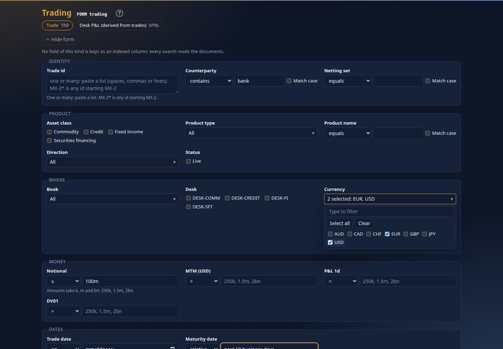

### The inputs

| The field holds | The input | What you can ask |
|---|---|---|
| text (a name, a description) | a box, an operator and *Match case* | equals, contains, starts with, matches a regular expression (case is ignored unless you tick *Match case*) |
| a number or an amount | one box, or two for *between* | `=`, between, `>`, `<`, `≥`, `≤`; amounts take `250k`, `1.5m`, `2bn` |
| a date | a date picker, two for *between*, or text for *relative* | on, between, before, after, or a range on the business-day calendar: `last 5 business days`, `next 10 business days`, `last 30 days`, `this week`, `month to date`, `year to date` |
| one of a few values (up to 6: direction, status) | a row of tick boxes, one for each value the data holds | is one of the ticked values |
| one of many values (asset class, product type, book, desk, currency) | **one dropdown the size of a select**, showing "All", the one value, or "3 selected: ABS, CORP_BOND, +1"; open it (`Enter` or `Space`) for a search box (type to filter), *Select all* / *Clear* (they act on the values the search leaves), and a tick box per value (`↓` `↑` move, `Space` ticks, a letter jumps, `Enter` or `Esc` closes). 44 pixels a row on a touch screen | is one of the ticked values; the address is the same as for tick boxes (`v.PRODUCT_TYPE=CORP_BOND&v.PRODUCT_TYPE=GOVT_BOND`) |
| one of very many values (over 300: counterparties, portfolios on a large book) | the values already chosen, ticked, and a box *Type to find among …* (the count of values): typing lists the values that contain the text (at most 50, with *… and N more: type more*), each with a tick box; ticked values stay when you type something else, so several can be chosen | is one of the ticked values; the same address as for tick boxes |
| an identifier | a box to paste a list: spaces, commas or lines | is one of them; `MX-2*` is any id starting `MX-2` |
| yes or no | Any, Yes, No | is |

The values of every list are kept by the server per field, business date and data version, so a form opens without reading the
data again; a load refreshes them, and a masked field's values are never kept. The form itself is kept the same way (per data
version, and per whether you see masked fields), so a search does not wait for it to be built.

Leave a field empty and it takes no part. A field marked **slower: not indexed** is not kept by the source as a column, so the documents are read to answer it:
fine for a few thousand, slow for a million. Below the fields choose how to **sort** and how many results to **show**.

### The search it made

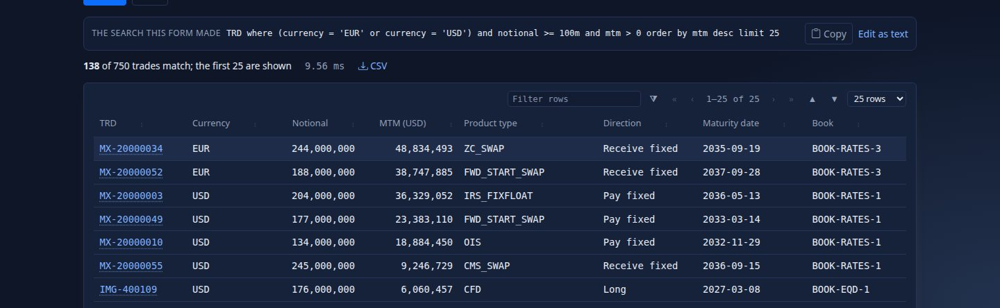

The line under the form is the search, in the grammar of [Search by value](#search-by-value). With **Currency** EUR and USD
ticked and **Quantity** `>= 100m`, on the quick-start server (the demo lakes):

```text
TRD where (CURRENCY = 'EUR' or CURRENCY = 'USD') and QUANTITY >= 100m limit 100
```

It matches 3,398 of the 15,000 trades of the three source systems; the table shows the first 100 (**Show** below the fields).

On a business date the sources hold no data for (a date not loaded yet, or before the first), the page does not just say "Nothing
matches": it says no trade data is loaded for that date, names the newest date that has data, and **Search on** that date runs the
same search there (the business date changes for the session, as in the top bar). The same note shows on the search page.

**Copy** puts it on the clipboard (paste it into the command line or the search box); **Edit as text** opens it in the search box. The table is the
console's table: sort by a heading, filter each column with its funnel ([Filter a table like Excel](#filter-a-table-like-excel)), page and walk it by keyboard. The key
cell opens the view; **Alt+Left** brings you back to the form with your criteria in place and the results again, because everything you filled in is in the
page's address (`/form/trading?kind=trade&v.CURRENCY=EUR&v.CURRENCY=USD&op.QUANTITY=>=&v.QUANTITY=100m&run=1`): bookmark it or send it.

### Give the results the room: hide the form

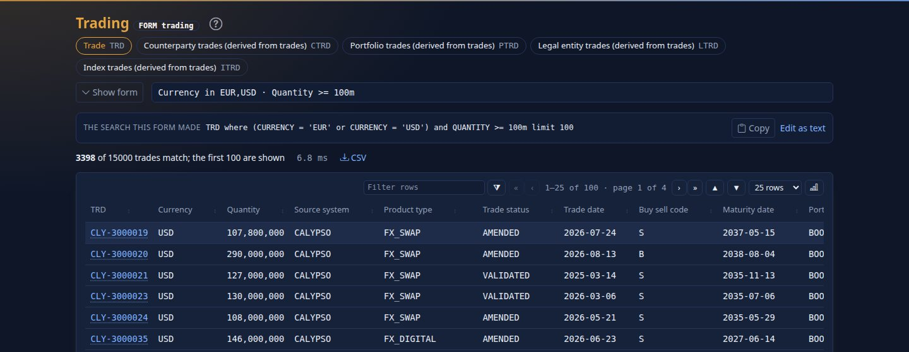

When results arrive the form folds to **one line of your criteria** (`Currency in EUR,USD · Quantity >= 100m`; beyond three criteria `· +2 more`) so the table gets the screen.
Click the line, press **Show form**, or press **Alt+F** to open it again with every box as you left it; **Hide form** (or Alt+F again) folds it. The button
carries `aria-expanded` and `aria-controls`, and on a phone it is a 44 px target. The state is in the page's address (`&form=hidden` or `&form=shown`), so a
link or **Alt+←** from a result returns to the form as it was; and in this tab a form you opened by hand stays open for the next Search. An administrator who
would rather the form stayed open sets `form.collapse_on_submit: false` in `config/application.yaml` (default `true`).

| Key | What it does on the form page |
|---|---|
| `Enter` | Search |
| `Esc` | Clear every field |
| `Ctrl+Enter` | Search from a list box |
| `Alt+F` | Hide the form or show it again |
| `Alt+←` | Back to the form from a result, criteria kept |

### Keep it: name it, watch it, schedule it, send it

Under the results: **Save as named search** (it appears under *Your saved searches* here and on `FORM`), **Watch as a monitor** (the first 50 results, live),
**Schedule a report** (the search delivered as CSV on a schedule, see [Scheduled reports](#scheduled-reports)) and **Share link** (copies the form's address, which
opens the same form with the same criteria for whoever has the right to see the pack).

### Regular expressions

*matches regex* uses a safe engine: it cannot be made to run for ever, whatever the pattern. It reads classes (`[A-Z]`, `\d`, `\w`), groups, `|`, `* + ? {n,m}`,
`^` and `$`. It refuses what cannot be done in linear time (back-references such as `(a)\1`, look-around such as `(?=x)`, atomic groups, possessive quantifiers, `\b`),
patterns over 200 characters, and anything too large once expanded, with a message that says which and the code `DRS-4010`; a pattern that takes over 50 ms on one value
stops with `DRS-4011`.

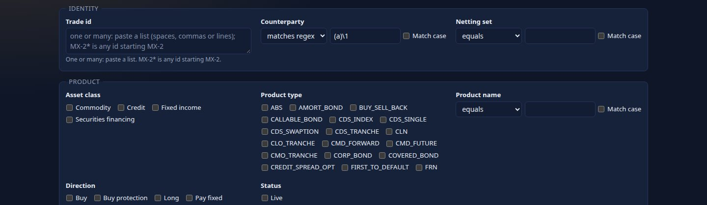

### Keyboard and phone

Tab walks the fields in reading order; **Enter** searches (in the list of ids, **Ctrl+Enter**); **Esc** clears every field. Everything is labelled for a screen reader.
On a phone the fields stack in one column and every control is at least 44 px.

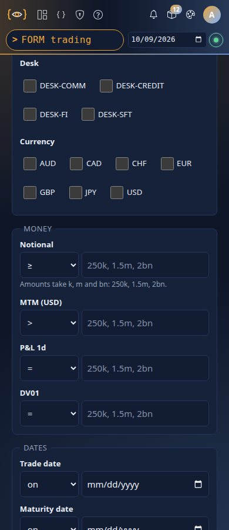

### Who decides what the form offers

The pack's author writes the form (`form:` in `pack.yaml`, see the [Pack developer guide](PACK_DEVELOPER_GUIDE.md#form-the-search-form-of-a-kind)); a pack that does not gets one
inferred from its search columns and screen. Authors can shape a kind's form in the workbench's [Form tab](SCREEN_DESIGNER.md#the-form-tab).

## Calc: Python on any view

Calc puts a Python prompt beside every view, the way BQuant sits beside a Bloomberg screen. Press `Alt+C` on a
trade, a netting set, a VaR result or a curve: a panel slides in with an editor, and the code you write there can
read the screen you are on, search Drishti, and draw tables and charts in the terminal's own style.

The code runs **in your browser**, in [Pyodide](https://pyodide.org) (CPython 3.14 compiled to WebAssembly), inside a
Web Worker, so a long calculation never freezes the page. numpy, pandas, scipy, statsmodels and matplotlib are
there. Nothing runs on the console or the server: every read your code makes is an ordinary read with your session,
so your roles and the field masking apply exactly as on the screen: a masked field reads `•••` in the document, the
strip, the tables, searches and columns alike.

---

### 1. When to use Calc, and when not

| You want to… | Use |
|---|---|
| Re-price a trade under a rate move, recompute a VaR, interpolate a curve, pivot a desk's P&L your own way, once | **Calc** |
| Try an idea on what is on the screen before asking for a panel | **Calc** |
| A figure everyone sees on a view, every time | a panel in the kind's Sutra ([Sutra developer guide](SUTRA_DEVELOPER_GUIDE.md)): computed on the server, cached, live |
| Find entities by value (`TRD where mtm > 1m`) | [search](#search-by-value), on the command line |
| Be told when a figure crosses a line | an [alert](#alerts): the server checks it on every change |
| The same search as a file every morning | a [scheduled report](DISTRIBUTION.md#scheduled-reports) |
| A long notebook, a model you keep in git, millions of rows, your own libraries | Python on your machine with a personal API token ([API_GUIDE.md (clients)](API_GUIDE.md#clients-scripts-notebooks-and-excel)) |

Calc is for questions that are yours, now, about the data in front of you. It is not a batch engine: it runs in one
browser tab, with that tab's memory, and it reads what you could read by clicking (see [Limits](#14-limits)).

### 2. Opening it

- Press **`Alt+C`** on a view, or click **Alt+C Calc** in the row of keys at the bottom of the screen. Press `Alt+C`
  or `Esc` again to close it. (On a Mac, `Option+C`.)
- The first time in a browser tab, Python starts: the status line says *Starting Python…* and then
  *Python ready · Pyodide 314.0.7 · 1.3 s*. Later opens in the same tab are instant; Python keeps running while the
  drawer is closed, and your variables are kept until you press **Stop** or leave the page.

`Alt+C` is chosen because the function keys belong to each view: a Sutra may bind any of `F2`–`F12` to its panels and
links (see [Keyboard](#keyboard)), and `Alt+` keys are the terminal's own (`Alt+←` back, `Alt+0`…`Alt+4`
workspace panes).

A view offers Calc when both hold:

1. **The pack that owns the view's kind switches Calc on** (`python: { enabled: true }` in its `pack.yaml`, see
   [section 8](#8-packs-switching-calc-on-and-starter-snippets)). Of the shipped packs, core, market-data, trading, counterparty-risk and
   market-risk do (the retired example pack `finance` too).
2. **One of your roles has the `calc` power** (see [section 9](#9-roles-who-may-use-calc)).

Without the role, the key is still shown, greyed, with the reason: *You do not have access: Calc needs a role with
calc (ask an administrator)*. On a kind whose pack does not switch Calc on, there is no key. Views inside workspace
panes have no Calc; open the view on its own.

### 3. The panel and its keys

```text
| Calc  Python · PNL-MX-20000274-HS-509   Done · 1.9 s · packages 373 ms · Python 1.5 s · memory 79 MB   ?  × |
| [▶ Run] [■ Stop] [Snippets ▾] Save  Delete  Clear                           Ctrl+Enter run · Esc close |
|  1 import numpy as np                                                                                 |
|  2 pnl = np.asarray(view.doc["PNL"], dtype=float)                                                     |
|  …                                                                                                    |
| Output | History                                                                                       |
| 2 rows                          [Filter rows] « ‹ 1–2 of 2 › » ▲ ▼ [25 rows]                           |
| measure       USD                                                                                     |
| VaR 99%     7,102                                                                                     |
| …                                                                                                     |
```

| Key or control | Does |
|---|---|
| `Alt+C` | Open or close Calc |
| `Ctrl+Enter` (`Cmd+Enter` on a Mac), **Run** | Run the code in the editor |
| **Stop** | End the Python worker at once (a loop that never ends, a calculation too slow) and start a fresh one. Variables from earlier runs are gone |
| `Tab`, `Shift+Tab` | Indent and outdent by four spaces |
| `Esc` | Close the panel (Python keeps running) |
| **Snippets ▾** | Load a snippet: *From the packs* for this kind, and *Mine* |
| **Save** | Save the code as one of your snippets (asks for a name; the name of the snippet you loaded is offered) |
| **Delete** | Delete the snippet of yours you loaded |
| **Clear** | Clear the output |
| **Output**, **History** | The output of the last run; your last 30 runs in this browser (click one to put its code back in the editor) |
| `?` | This guide |

The status line says what Python is doing (*Loading numpy, pandas…*, *Reading search…*, *Running…*) and, after a
run, how long it took, split into **packages** (loading libraries the code imports, the first time only) and
**Python** (your code), how many reads it made and how much they weighed, and the memory Python holds.

- **Each run clears the output** and runs the whole editor. Variables persist between runs (as in a notebook cell
  run again), so you can build on earlier results; **Stop** starts clean.
- **The last expression is shown**, as in a notebook: a DataFrame as a table, anything else as text.
- **An error** shows its message and the traceback from your code (Python's own machinery is left out), and the line
  is highlighted in the editor.
- **Your draft is kept** per kind in this browser: open Calc on another trade and the code you were writing is there.

### 4. A first session: VaR from the scenarios

1. Open a trade's P&L vector, `PNLV PNL-MX-20000274-HS-509 <GO>` (a short warrant position's trade: its P&L under the 509 scenario
   days the VaR engine uses), and press `Alt+C`. Wait for *Python ready*.
2. Type in the editor:

   ```python
   import numpy as np
   import pandas as pd

   pnl = np.asarray(view.doc["PNL"], dtype=float)
   worst = np.sort(pnl)
   n = len(pnl)
   k = int(np.ceil(n * 0.01))                     # the engine's rank: the 6th worst of 509
   var99 = -worst[k - 1]
   es975 = -worst[: int(np.ceil(n * 0.025))].mean()   # the mean of the 13 worst
   show(pd.DataFrame({"measure": ["VaR 99%", "ES 97.5%"], "USD": [var99, es975]}))
   chart(pd.DataFrame({"pnl": pnl}), kind="hist", y="pnl", bins=40, title="Scenario P&L")
   ```

3. Press `Ctrl+Enter`. The first run loads numpy and pandas (about 2 s); you should see **VaR 99% 7,102** and **ES 97.5% 7,094** (the
   same rule as the engine's, so `VAR TRD MX-20000274 <GO>` shows the same figures) and a histogram of the 509 scenarios.
4. Change `0.01` to `0.025` and run again: the 97.5% VaR, in a few milliseconds this time.

The VaR of a position, a portfolio, a desk or any set of trades is the engine's ([VAR_GUIDE.md section 3](VAR_GUIDE.md#3-the-explorer-screen-by-screen)); the stored desk
VaR records (`VAR VAR-RATES`) and the snippets that read them were retired in 2.8.0.

### 5. The `drishti` module

Every run starts with these names defined (no import needed): `view`, `drishti`, `show` and `chart`. In your own
modules or functions, `import drishti` works too, and `from drishti import view, show, chart`.

The pricing and risk maths the snippets share (Black-Scholes, Black-76, Garman-Kohlhagen, Bachelier, curves, bonds,
VaR, CVA, FRTB aggregation, …) is a submodule: `from drishti import quant as q` ([section 17](#17-the-drishtiquant-module)).

#### 5.1 `view`: the screen you ran from

| Attribute | Type | What it is |
|---|---|---|
| `view.kind`, `view.id` | str | The entity: `'pnl-vector'`, `'PNL-MX-20000274-HS-509'` |
| `view.title` | str | The title the view shows |
| `view.business_date` | str or None | The business date of the data (`'2026-09-30'`), or None for undated data |
| `view.provenance` | dict | Source, generation, business date, last update (as in the footer of the view) |
| `view.doc` | dict | The entity's document as your role may see it (the raw JSON of `F9`, masked fields read `•••`) |
| `view.strip` | dict | The strip at the top of the view: label → shown text (a masked field's text is `•••`) |
| `view.tables` | dict | Every panel that holds rows, as a pandas DataFrame, by the panel's title (masked cells and totals read `•••`) |
| `view.table(name)` | DataFrame | One panel's rows, by title or by panel id |
| `view.panels` | list | The view model's panels as the server sent them (`id`, `kind`, `title`, `data`) |

`view` is read fresh at every run: on a live view, run again and you get the latest figures.

How each panel kind becomes a DataFrame in `view.tables`:

| Panel kind | Columns |
|---|---|
| `table`, `ladder` | the panel's columns; numeric columns parsed to numbers (below) |
| `kv`, `status`, `provenance` | `label`, `value` |
| `line`, `area` | index `x`, a column per series |
| `bars` | `label`, `value` |
| `waterfall` | `label`, `value`, `from`, `to`, `total` |
| `histogram` | `from`, `to`, `count`, `label` |
| `scatter` | `label`, `group`, `x`, `y`, `size` |
| `pivot` | index the row labels, a column per pivot column |
| `candlestick` | `x`, `open`, `high`, `low`, `close`, `volume` |
| `timeline` | `date`, `label`, `detail`, `status` |
| `surface` | index `y`, a column per `x` |

Tables hold what the screen shows, so their numbers are **as formatted**: `"−1,234"` is read as `-1234.0`,
`"USD 1,300,000"` as `1300000.0`, `"1.5m"` as `1500000.0`, and `"4.08%"` as `4.08` (as written, not 0.0408).
`drishti.number(text)` does the same to any text. For exact values, read `view.doc`.

```python
trades = view.table("trades")      # NSET NS-NORTHPLAINS-NY (demo lakes): the panel titled "Member trades (698 of 698)", by its id
trades.groupby("Product")["MTM (USD)"].sum()
```

#### 5.2 Reading data

Each call is a request from your browser to the console with your session, exactly as when you click: your roles
decide what you may open, and fields masked for your role stay masked. A refused or failed read raises
`drishti.DrishtiError` with its `code` (`DRS-5002` not allowed, `DRS-1001` not found, …), `detail` and `status`.

**`drishti.get(kind, id, as_of=None) -> dict`**

An entity's document (as `F9` shows it to you). `as_of` is a business date (`'2026-09-25'` or a `date`); by default,
the date the screen shows.

```python
nset = drishti.get("netting-set", view.doc["nettingSet"])
nset["netMtm"], nset["utilisation"]
```

**`drishti.search(query, as_of=None) -> DataFrame`**

A structured search, as typed on the command line ([Search by value](#search-by-value)): a column `id`,
`title` when it says more than the id, then the fields the query names and the kind's key fields, without `$.`.
At most 1000 rows (`limit 1000`; the default is 100). When more matched, a note says how many; `df.attrs` holds
`matched`, `scanned` and `partial`.

```python
trades = drishti.search("TRD where counterparty.id = 'CP-NORTHBRIDGE' and nettingSet != '' limit 1000")
trades.groupby("nettingSet")["mtm"].agg(["count", "sum"])
```

A field appears as a column when the query names it, so name the fields you want to group by in the condition
(`and nettingSet != ''` above).

**`drishti.columns(kind, paths, as_of=None, limit=None) -> DataFrame`**

Every entity of a kind on the business date, with the fields a source keeps as columns (a Delta table laid out by its
pack, Aerospike's promoted bins, the PostgreSQL entity table): the whole day, without reading a document. Indexed by
id; `df.attrs` holds `businessDate`, `total` and `masked` (fields your role sees masked). `drishti.columns("TRD", [])`
lists the fields kept as columns.

```python
df = drishti.columns("TRD", ["mtm", "book", "desk", "risk.dv01", "counterparty.id"])
len(df)                                                   # 10000 with tools/load-delta.sh --trades 10000
df.groupby("desk")["risk.dv01"].sum()
```

It needs a source that keeps columns: on the demo samples (no lake) it answers *no source of trade keeps its fields
as columns here: use drishti.search()*. It returns at most `drishti.calc.max-column-rows` entities (250,000), the
first by id, with a note when cut; it needs the `calc` power and is recorded in the access log as a search.

**`drishti.history(kind, id, field, days=30) -> DataFrame`**

One field of an entity over the last `days` business days (2–260), oldest first, indexed by date: the same series as
clicking a value on a view ([A number over time](#a-number-over-time)).

```python
h = drishti.history("trade", view.id, "mtm", 60)
h["mtm"].diff().describe()
```

**Async variants: they work in every browser.** `get_async`, `search_async`, `columns_async` and `history_async`
take the same arguments and are awaited: `doc = await drishti.get_async("trade", "MX-20000001")`. Top-level `await`
works in Calc, and a last line that is an un-awaited read (`drishti.get_async("trade", "MX-20000001")`) is awaited for
you. The plain functions pause Python while the page fetches, which needs JavaScript Promise Integration (JSPI):
current Chrome, Edge and Firefox have it (verified in Firefox 155), Safari does not, and a browser can have it
switched off. Without it:

- the status line says *reads need await (see help)*, and a note beside the output tabs says *This browser cannot
  pause Python for a read: write await drishti.get_async(…), search_async, columns_async or history_async. view works
  as it is.*;
- `view` (the screen's document and tables) works as it is: it is read before the code runs;
- a plain call raises an error that spells the call out with `await`, for example *drishti.get() needs JavaScript
  Promise Integration … write `await drishti.get_async('trade', 'MX-20000001')` instead*;
- every starter snippet the packs ship runs: they read with the `_async` forms (a test keeps it so).

This was run in a real Firefox 155 with JSPI switched off (`javascript.options.wasm_js_promise_integration: false`),
on the sample data: the two snippets that read (`desk_pnl_by_book.py`, `mtm_concentration.py`) and the four that use
`view` only all finished.

**`drishti.help()`** prints this summary; **`drishti.LIMITS`** is the output budget (below).

### 6. Output: print, show, chart, figures

| You write | You get |
|---|---|
| `print(...)` | Text in the output (standard error in amber) |
| an expression on the last line | It is shown: a DataFrame as a table, anything else as text |
| `show(df, title=None)` | A table, sorted, filtered and paged like every Drishti table (25 rows a page, `Filter rows`, `▲ ▼`), numbers right-aligned with separators and negatives in the negative colour. A Series, a list of dicts, a dict and a numpy array work too; anything else is shown as text |
| `chart(df, kind="line", x=None, y=None, title=None, bins=30)` | A chart drawn by the page with the vendored ECharts in the current theme: `line`, `bar`, `scatter` or `hist`. `x` is a column (default the index); `y` a column or a list (default every numeric column). `hist` counts one column in `bins` bins |
| a matplotlib figure | A PNG image (the `agg` backend): every open figure is shown after the run, and closed. `show(fig)` shows one at once |

The output of one run is capped (`drishti.LIMITS`): 2,000 rows per table (and 200,000 cells), 5,000 points per chart
series (more are thinned, with a note), 8 MB in all, and 200,000 characters of text. Beyond a cap you get a note,
not an error: show a smaller piece (`df.head(50)`, a `groupby`).

### 7. Packages

| Package | Version | Loads when |
|---|---|---|
| The standard library | CPython 3.14.2 | Python starts (first open) |
| numpy, pandas (with python-dateutil, pytz, six) | 2.4.6, 3.0.2 | the code first uses data (`view.tables`, `search`, `show`, `chart`, `pd`, `np`, …) |
| scipy | 1.18.0 | the code imports it |
| statsmodels (with patsy, packaging) | 0.14.6 | the code imports it |
| matplotlib (with contourpy, cycler, fonttools, kiwisolver, pillow, pyparsing) | 3.10.8 | the code imports it |

Packages load once per tab and come from the console itself. Anything else (`import sklearn`) fails at once with
*No module named 'sklearn' (Calc has numpy, pandas, scipy, statsmodels, matplotlib and the standard library)*:
there is no `pip` and no internet in Calc.

### 8. Packs: switching Calc on, and starter snippets

A pack switches Calc on for the kinds it owns, and may ship snippets, in its `pack.yaml`:

```yaml
python:                         # Calc on this pack's kinds (Alt+C on a view)
  enabled: true
  snippets:                     # optional: starters offered in Snippets ▾
    - title: MTM under parallel rate moves
      description: The swap's MTM after parallel moves of -100 to +100 bp from its DV01.
      kinds: [trade]            # the kinds it is offered on; none: every kind of the pack
      code: |
        mtm, dv01 = view.doc["mtm"], view.doc["risk"]["dv01"]
        ...
  dir: python                   # optional: where snippet files are (default python/)
```

Snippets can also be files, `config/packs/<pack>/python/*.py`, read in name order after those in `pack.yaml`. A file starts
with comment lines naming it; what comes after them is the code (the copyright header above them is not):

```python
# title: Stress results: scenarios by desk, limits and the worst case
# description: Every stress result in one search, pivoted scenario by desk with totals; …
# kinds: stress-result, stress-scenario

import numpy as np
...
```

Rules:

- **Calc is offered on a kind's views when the pack that owns the kind enables it.** A pack's snippets are offered on
  the kinds they name (any kind, even one another pack owns) or, naming none, on the pack's own kinds; only packs
  that enable Calc offer snippets, and only the user's active packs.
- The server reads `python:` and the files at start-up (`GET /api/v1/packs` carries them to the console, with the
  pack's kinds); restart the server after changing them. A file larger than 64 KB is skipped; at most 100 snippets
  a pack.
- Snippets are starters, not programs: they are code the user sees, edits and runs, with the user's own rights.

#### The shipped packs' snippets

Five of the eight shipped packs ship **63 snippets** (core 9, counterparty-risk 12, market-data 27, market-risk 6, trading 9; world-economy,
news-and-markets and us-equities none), and the retired example pack `finance` **10** (two inline in its `pack.yaml`, eight files): curves,
FX, vol surfaces, options, bonds, credit, stress, FRTB, exposure, CVA, collateral, SA-CCR,
desks, books and counterparties, each written the way a trader or a quant would use it on that screen. The
[Snippet catalogue](#18-snippet-catalogue) lists every one, with the sample entity it was checked on and what it
computes.

The shipped ones are written by `tools/packgen/banking/make_packs.py` (the generator kept its name from the banking packs it began with) from their sources,
`tools/packgen/banking/snippets/<pack>/<name>.py` (read by `calc_snippets.py`; never edit the generated
`config/packs/<pack>/python/` files: change the source and run the generator, see
[PACK_DEVELOPER_GUIDE.md](PACK_DEVELOPER_GUIDE.md#how-the-shipped-packs-are-generated)). A source starts, after its copyright header, with

```python
# title: Key-rate DV01 by bump and reprice
# description: A 10Y receive-fixed swap at par (100m) repriced with each pillar moved 1 bp in turn, ...
# kinds: ir-curve
# example: CRV CRV-USD-OIS
```

`example` names the sample entity the snippet is checked on in a browser (it is not copied into the pack); the
generator refuses a source without the four lines or with more than 60 lines of code, and `make_packs.py --check`
fails when a generated file is stale or has no source. `finance` (a retired example pack) is hand-written: its files are
`examples/packs/finance/python/*.py`.

How they are written, so that each runs anywhere:

- **Reads use the `_async` forms** (`await drishti.search_async(...)`, `get_async`), so a snippet runs in every
  browser, not only those with JavaScript Promise Integration (section 5.2).
- **A search returns the fields its condition names**, so each names the fields it uses: `and pnl1d > -1000bn`
  names a field without dropping any row; a missing field reads as "not 0", so `and risk.dv01 != 0` keeps every trade.
- **The screen's own document first** (`view.doc`), then the entities it links to (`discountCurve`, `fxVolSurface`,
  `creditCurve`, …), then one search for book-wide work. No snippet needs a lake (`drishti.columns()`), so each runs
  on the samples as shipped.
- **Simplifications are said** in the description and a comment: single-curve swaps, flat cap vols, European pricing
  of American options, first-order stress, the FRTB and SIMM aggregation formulas without their full parameter sets.
- **The samples are synthetic**: some booked strikes sit far from spot, and some booked figures (MTM, DV01, Z-spread)
  do not follow from the market data. The option snippets then price at the money and say so; the others show their
  figure beside the booked one rather than hide the gap.

### 9. Roles: who may use Calc

Calc is a power of a role, like raw JSON or authoring Sutras: **`calc`**. A person may use Calc if any of their roles
has it. What their code may read is decided as always, call by call, by the kinds their roles open and the packs
they have.

Who has it out of the box:

| Role | From | `calc` |
|---|---|---|
| `admin`, `author`, `approver` | configuration (`drishti.security.roles`) | yes |
| `viewer` | configuration | **no** |
| `trader` (`trading`), `market-risk` (`market-risk`), `credit-risk` (`counterparty-risk`) | the shipped packs | yes |
| `trader`, `risk` (`finance`) | the retired example pack `finance`, when loaded from `examples/packs` | yes |
| roles of packs that do not enable Calc (`climate-analyst`, `economist`, `scientist`, `treasury`, `oprisk`, `retail`, `analyst` of world-economy, `ops` and `shipment` of logistics, `market-analyst` and `listed-company` of news-and-markets, `news-analyst` and `news-topic` of news-and-markets) | those packs | no (their kinds offer no Calc) |
| roles you define in Admin → Roles | the identity database | as you tick it |

Give it:

- **Admin → Roles**: tick *Use Calc: Python in the browser on what the role opens* in the role's dialog. The roles
  list shows **Calc** among each role's powers. It applies at the holder's next click (within a minute for the
  console's offer of the panel), and is audited (`role-updated … calc`).
- **Configuration or a pack**: `calc: true` on the role (`roles: { quant: { kinds: ["*"], calc: true } }`).
- **API**: `PUT /api/v1/admin/role-definitions/{name}` with `"calc": true` ([USER_MANAGEMENT.md](../admin/USER_MANAGEMENT.md#7-the-api)).

The power is kept in the identity database's `drishti_role_power` table (one row per role and power), which a
database made by an earlier release gains at the next start, without a migration.

### 10. Saving your own snippets

**Save** keeps the editor's code on the server as one of your snippets: a name (1–80 letters, digits, spaces and
`. _ ( ) -`), the code (at most 50,000 characters), and the kind you wrote it on. They follow you to any browser,
are listed under **Mine** in **Snippets ▾** on every view with Calc, and only you see them. Load one, change it and
**Save** again to replace it; **Delete** removes it.

They are kept with your other saved documents (workspaces, monitors) in the identity database
(`drishti_preference`, namespace `calc-snippets`), at most 50 per person, and deleted with the person.

### 11. Security model

| Question | Answer |
|---|---|
| Where does my code run? | In your browser, in a Web Worker: CPython compiled to WebAssembly. Never on the console or the server. Closing the tab ends it. `drishti.quant` is a file the worker fetches from the console's own `/static/calc/quant.py` the first time a cell names `quant`. |
| What can it read? | Only what you can: every read is a request from your page to the console with your session (`/api/view`, `/api/raw`, `/api/series`, `/api/calc/search`, `/api/calc/columns`), and the console asks the server as you. Your roles and packs decide; fields masked for your role (`drishti.security.redact`) stay masked. The worker's own reads are not requests at all: it asks the page by message, and the page fetches only those five routes, with arguments encoded into the path. Even if Calc code tried `pyfetch` or `js.fetch` to another console route, the worker's policy (next row) lets it reach nothing but static files and the runtime. |
| Can it reach the network? | No. The worker's Content Security Policy is `default-src 'none'; script-src 'self' 'wasm-unsafe-eval'; connect-src <host>/static/ <host>/pyodide/` (the host the browser used): scripts and data from two paths of the console's own origin only, so Calc code cannot call any other console route, `/api` included, though the browser would send your session cookie with it. The runtime and its packages are served by the console under `/pyodide/<version>/`, and Pyodide is told every location explicitly (index, packages, lock file, standard library), so it never looks at its default CDN. Measured: no request left the origin in any test run (section 13). |
| Can it change data? | No more than you can by clicking. The only writes Calc adds are your own snippets. |
| What else changed in the page's security? | The page's policy adds `worker-src 'self'`; `'wasm-unsafe-eval'` (compiling WebAssembly) is granted to the Calc worker's script alone, and `'unsafe-eval'` to nothing on the page. The one exception is the Graphic Walker frame of `drishti_bi.walk` ([section 19](#19-the-bi-client-and-graphic-walker)): a sandboxed frame with a policy of its own, that cannot reach the network or the console. |
| Is it recorded? | The reads are recorded as any read is ([access log](../admin/USER_MANAGEMENT.md#who-looked-at-what-the-access-log)): `view`, `raw`, `history`, and `search` for searches and for `drishti.columns()` (with the fields read). The code itself is not sent anywhere unless you save it. |
| Who may use it? | Roles with `calc` ([section 9](#9-roles-who-may-use-calc)); the server checks it on its Calc endpoints, the console on its own. |
| Can one user's code affect another's? | No: each tab has its own worker and memory. A loop that never ends uses one core of your machine until you press **Stop**. |

### 12. Installing the Python runtime

The runtime is not in git (53 MB, which `du -sh` shows as 51M). `tools/fetch-pyodide.sh` installs it once:

```bash
tools/fetch-pyodide.sh
```

You should see:

```text
downloading https://github.com/pyodide/pyodide/releases/download/314.0.7/pyodide-314.0.7.tar.bz2 (about 340 MB, once)
verified /home/you/.cache/drishti/pyodide-314.0.7.tar.bz2 (SHA-256 192b5864e6e6d30a…)
packages: contourpy, cycler, fonttools, kiwisolver, matplotlib, numpy, packaging, pandas, patsy, pillow, pyparsing, python-dateutil, pytz, scipy, six, statsmodels
installed Pyodide 314.0.7 in …/drishti-console/web/static/vendor/pyodide: 51M on disk, 23 files
```

What it does:

1. Downloads the pinned release (Pyodide **314.0.7**, the full distribution from the official GitHub releases) into
   `~/.cache/drishti/` (`--cache` elsewhere), once.
2. Checks its **SHA-256** against the one pinned in the script, and refuses any other file.
3. Unpacks only the core runtime (`pyodide.mjs`, `pyodide.asm.mjs`, `pyodide.asm.wasm`, `python_stdlib.zip`) and
   numpy, pandas, scipy, statsmodels and matplotlib with everything they depend on, and writes a lock file that lists
   only those (so an import of anything else fails at once instead of asking for a file).
4. Writes `drishti-pyodide.txt` (version, SHA-256, packages) and replaces the folder as a whole.

Run it again and it says *already installed*; `--force` unpacks again. It needs bash and python3, and curl, wget or
python3 to download.

| Situation | Do |
|---|---|
| A machine with internet | `tools/fetch-pyodide.sh` |
| An offline machine | download `pyodide-314.0.7.tar.bz2` elsewhere, copy it over, `tools/fetch-pyodide.sh --tarball pyodide-314.0.7.tar.bz2` (the hash is still checked) |
| The console Docker image | nothing: `deploy/docker/console.Dockerfile` runs the script in a build stage (it reuses a runtime already in the build context), so the image carries the runtime and a running console needs no internet |
| Upgrading Pyodide | change `VERSION` and `SHA256` in the script (the release's `.tar.bz2` digest), run it, restart the console. The URL names the version, so browsers fetch the new runtime at once |

Restart the console after installing: it mounts the runtime at `/pyodide/<version>/` at start-up, served with
`Cache-Control: public, max-age=31536000, immutable` (the version is in the URL), so a browser downloads it once.

Check it:

- `curl -s localhost:17480/healthz` says `{"status":"UP","pythonRuntime":"314.0.7"}`;
- **Help → About** shows *Python runtime (Calc): Pyodide 314.0.7 · 53.2 MB, served by this console*.

Without it, views still offer Calc to those allowed, and the panel says **Python runtime not installed: run
tools/fetch-pyodide.sh** (Run is disabled); `/healthz` and About say the same.

### 13. Sizes and performance, measured

Measured on 2026-10-01 with headless Chrome 154 on the development machine (24 cores), console and server on
localhost, the banking packs' sample data and a scratch lake of 10,000 trades a day (`tools/load-delta.sh --trades
10000`). Each figure is a fresh browser (an empty cache) unless it says *warm*.

| What | Measured |
|---|---|
| Runtime on disk | **53.2 MB** (51 MiB), 23 files: the core 13.4 MB (`pyodide.asm.wasm` 9.6 MB, `python_stdlib.zip` 2.5 MB, `pyodide.asm.mjs` 1.3 MB), numpy and pandas 7.9 MB with their dependencies, scipy 14.0 MB, statsmodels 8.2 MB, matplotlib 9.5 MB with its dependencies |
| First open, `Alt+C` to *Python ready* (core runtime) | **1.3 s** (the worker itself: 1.1 s) |
| After **Stop** (runtime from the browser's cache) | **1.0 s** |
| First run that uses data (numpy and pandas loaded and imported) | **1.9–2.0 s** (loading 0.37 s, first `import pandas` and the run 1.5–1.6 s) |
| First run with scipy and matplotlib (the curve snippet) | **5.0 s** (loading 1.3 s, imports and run 3.7 s) |
| First run with statsmodels | **5.5 s** (loading 1.3 s, imports and run 4.2 s) |
| The same runs again (warm) | VaR **7 ms**, rate shift **7 ms**, concentration 35–49 ms (one search), desk pivot **87 ms** (one search), curve with a figure **99 ms** |
| `drishti.columns()` of 10,000 trades × 5 fields | one read of 646 KB; the whole cell (read, two groupbys, a 50-bin histogram) **92 ms** warm |
| Memory Python holds (WebAssembly heap) | 31 MB started, **79 MB** with pandas, **163 MB** with scipy, matplotlib or statsmodels |
| Requests leaving the console's origin | **none**, in every run (page and worker requests recorded) |

Speed beside native CPython 3.14 on the same machine (best of three):

| Work | Native | Calc | Calc is |
|---|---|---|---|
| A pure-Python loop of a million steps | 20.8 ms | 78.8 ms | 3.8× slower |
| numpy: sort a million floats | 6.1 ms | 78.2 ms | 13× slower |
| numpy: 500 × 500 matrix product | 1.1 ms | 72.1 ms | 65× slower (no multithreaded BLAS, no SIMD) |
| pandas: groupby-sum of 200,000 rows | 8.8 ms | 13.6 ms | 1.5× slower |

### 14. Limits

- **Memory per tab.** Python's memory is WebAssembly memory in the tab: at most 4 GB, in practice 1–2 GB before the
  browser refuses to grow it. Every run's data stays until you drop it (`del df`) or press **Stop**; the status line
  shows what Python holds.
- **Speed.** Pure Python runs at a third to a quarter of native speed; vectorised pandas is close to native; heavy
  linear algebra is far slower (one thread, no SIMD). Calc is for seconds of work, not minutes.
- **Data volume.** A read moves JSON from the server through the console to the page and into Python: about 13 bytes
  a value for `drishti.columns()` (10,000 rows × 5 fields: 646 KB). 250,000 rows × 5 fields is about 16 MB, and a few
  seconds. Ask for the fields you need, aggregate with a search where you can, and use a script with a token
  ([API_GUIDE.md (clients)](API_GUIDE.md#clients-scripts-notebooks-and-excel)) for millions of rows.
- **Searches** return at most 1000 rows (`limit`), and read at most `drishti.search.max-scan` documents (20,000) when
  the source keeps no columns. `drishti.columns()` returns at most `drishti.calc.max-column-rows` (250,000).
- **Output** is capped per run ([section 6](#6-output-print-show-chart-figures)).
- **No network and no installs**: only the packages in [section 7](#7-packages).
- **One run at a time** per tab; **Stop** to interrupt one.
- **Browsers.** A current Chrome, Edge, Firefox or Safari runs Pyodide in a module worker; the plain (non-`await`)
  reads need JavaScript Promise Integration (current Chrome, Edge and Firefox; not Safari); the `_async` forms, and
  the starter snippets, work everywhere ([section 5.2](#52-reading-data)).

### 15. Configuration and API

| Setting | Default | Meaning |
|---|---|---|
| Server `drishti.calc.enabled` | `true` (`DRISHTI_CALC_ENABLED`) | Calc at all; off, nobody may use it and its endpoints refuse (`DRS-5002`) |
| Server `drishti.calc.max-column-rows` | `250000` | `drishti.columns()` returns at most this many entities |
| Server `drishti.calc.columns-budget` | `20s` | How long a columns read may wait for its source |
| Server `drishti.calc.max-snippet-chars` | `50000` | A saved snippet's code, at most (60,000 at most in any case) |
| Console `calc.enabled` | `true` (`DRISHTI_CALC_ENABLED`) | Off, no view offers Calc, whatever packs and roles say |

See [CONFIGURATION.md](../admin/CONFIGURATION.md#drishticalc--python-in-the-browser).

Server endpoints (under `/api/v1`, with a token as usual):

| Method | Path | Does |
|---|---|---|
| `GET` | `/calc/settings` | `{"enabled", "allowed", "maxColumnRows", "maxSnippetChars"}` for the caller |
| `GET` | `/me/calc-snippets` | The caller's snippets (needs `calc`) |
| `PUT` / `DELETE` | `/me/calc-snippets/{name}` | Save `{"code", "description", "kind"}` / delete one (needs `calc`) |
| `GET` | `/search/columns/{kind}?paths=mtm,book&limit=` | Whole columns of the business date (needs `calc` and the kind); without `paths`, the fields kept as columns |
| `GET` | `/packs` | Each pack now carries `python: {enabled, snippets: [{title, description, kinds, code, file}]}` |

The console's own (same-origin, for the page): `GET /api/calc/snippets?kind=`, `PUT` / `DELETE /api/calc/snippets/{name}`,
`GET /api/calc/search?q=`, `GET /api/calc/columns/{kind}?paths=&limit=`, each refusing users without `calc` (`403
DRS-5002`), and the runtime under `/pyodide/<version>/`.

### 16. Troubleshooting

| You see | Why | Do |
|---|---|---|
| No **Alt+C Calc** key on a view | The pack that owns the kind does not enable Calc, or the view is in a workspace pane | Enable it in the pack (`python: { enabled: true }`, [section 8](#8-packs-switching-calc-on-and-starter-snippets)), restart the server; open the view on its own |
| The key is greyed: *Calc needs a role with calc* | None of your roles has the `calc` power | Ask an administrator ([section 9](#9-roles-who-may-use-calc)) |
| *Python runtime not installed: run tools/fetch-pyodide.sh* | The console has no runtime folder | Run the script on the console's machine (or rebuild the image), restart the console ([section 12](#12-installing-the-python-runtime)) |
| *Python could not start: … Content Security Policy …* | A proxy in front of the console rewrites security headers | Let the console's own headers through for `/static/js/calc-worker.js` |
| *Python could not start: Failed to fetch* | The runtime was upgraded while the page was open | Reload the page |
| *No module named 'sklearn' (Calc has numpy, pandas, …)* | Only the packages of [section 7](#7-packages) exist | Use what is there, or a script with a token |
| *drishti.get() needs JavaScript Promise Integration … write `await drishti.get_async('trade', 'MX-20000001')` instead* | No JavaScript Promise Integration (Safari, or a browser with it switched off) | Write the call as the message says: `await drishti.get_async(...)` (and `search_async`, `columns_async`, `history_async`) |
| `DrishtiError: DRS-5002: tina may not open pnl-vector entities` | Your roles do not open that kind | As on the screen: ask for a role that opens it |
| `DrishtiError: DRS-5001: no source of trade keeps its fields as columns here` | `drishti.columns()` needs a laid-out source (a lake) | Use `drishti.search()`, or load the lake (`tools/load-delta.sh`) |
| `DrishtiError: DRS-5001: not kept as columns for trade: [notional]` | That field is not promoted | `drishti.columns("TRD", [])` lists those that are |
| A column of `•••` | Your role sees that field masked | As on the screen: `raw` access shows it |
| *output capped at 8 MB for one run* | The output budget ([section 6](#6-output-print-show-chart-figures)) | Show less: `df.head()`, a `groupby` |
| The run never ends | A loop that does not stop, or work too heavy | **Stop**, then run something smaller |
| The tab grows slow or crashes | Python's memory (the status line shows it) | `del` large frames, **Stop**, read fewer rows |
| *search: 1,000 of 1,234 matching shown* | A search returns at most 1000 rows | Narrow the condition, or `drishti.columns()` on a lake |

### 17. The `drishti.quant` module

`drishti.quant` is the pricing and risk maths the snippets share, in one file (`drishti-console/web/static/calc/quant.py`, about
780 lines of Python and numpy, no scipy, so it loads in a blink). The worker fetches it from the console the first time a
cell names `quant`; outside Calc it is an ordinary module.

```python
from drishti import quant as q

curve = q.ZeroCurve.from_points(view.doc["points"])          # CRV CRV-USD-OIS: zero rates in %, log-linear on DFs
par = q.par_swap_rate(curve, 10)                             # 0.038633: the 10Y par rate, annual fixed
q.swap_pv(curve.shifted(+1), par, 100e6, 10)                 # -84,732: receiving 100m at par loses this for +1 bp
q.black_scholes(100, 100, 1, 0.05, 0.2)                      # 10.4506
q.bs_greeks(100, 110, 0.75, 0.04, 0.3, q=0.01)["vega"]       # 33.91 per 1.00 of vol: 0.339 a vol point
q.implied_vol(12.3, lambda s: q.black_scholes(100, 105, 1, 0.03, s))   # 0.3299
q.historical_var(view.doc["PNL"], 0.99)   # PNLV PNL-MX-20000274-HS-509: 7,705 (the 5th worst of 509; the engine takes the 6th, 7,102)
```

Conventions: times in years (ACT/365F); rates, vols and yields as decimals (`0.035`, not `3.5`); zero rates
continuously compounded (`df = exp(-z t)`); spreads in bp where an argument says `_bp`. Pricing functions take
scalars or numpy arrays (broadcast) and return the same shape.

| Function | Does |
|---|---|
| **Dates and tenors** | |
| `tenor_years(tenor)` | `'3M'` 0.25, `'18M'` 1.5, `'10Y'` 10, `'1W'`, `'ON'`, `'1Y6M'`; a number is returned as it is |
| `month_code_years(code, as_of)` | A futures month code (`'X6'`: November 2026, `'Z27'`) as years from `as_of` to the middle of the month; 0 (never negative) in the contract month once its middle has passed |
| `year_fraction(start, end, basis)` | By the ISDA 2006 definitions: ACT/365F, ACT/360, 30/360 (US bond basis), 30E/360 (Eurobond: both 31sts become 30; 2026-01-15 to 2026-03-31 is 75/360), ACT/ACT ISDA (`ACT/ACT`, `AA`: each calendar year's days over 365 or 366; a calendar year is exactly 1.0) |
| **Root finding and the normal distribution** | |
| `brent(f, a, b, tol, maxiter)` | Brent's method on a bracket (raises `ValueError` if `f(a)`, `f(b)` share a sign) |
| `newton(f, fprime, x0)` | Newton's method |
| `norm_cdf(x)`, `norm_pdf(x)`, `norm_ppf(p)` | The standard normal: `math.erfc` exactly; the quantile by Acklam's approximation and a Halley step taken on the near tail (relative error below 1e-15 outside 0.4..0.6, absolute below 1e-14 everywhere, measured against 60-digit values) |
| **Curves** | |
| `ZeroCurve(times, zeros, method)` | A curve of continuously compounded zero rates: `'loglinear'` (linear in log DF, flat forwards: how OIS curves are built; the default), `'linear'` on zeros, `'cubic'` (a natural spline); flat outside the pillars |
| `ZeroCurve.from_points(points, tenor, rate, pct)` | From a document's points (`view.doc["points"]`, `["pillars"]`): tenor and zero rate in % |
| `ZeroCurve.from_dfs(times, dfs)` | From discount factors |
| `.zero(t)`, `.df(t)`, `.forward(t1, t2, simple)` | Zero rate, discount factor, forward rate (simple or continuously compounded) |
| `.shifted(bp, twist_bp, fly_bp, pivot, wing)` | A scenario curve: parallel; a twist pivoting at 5Y, linear in log maturity, scaled so 2s10s moves by `twist_bp`; a butterfly (wings up, belly down) |
| `.key_rate_bumped(i, bp)` | Pillar `i` alone moved (a triangular key-rate bump) |
| `df_from_zero`, `zero_from_df`, `forward_rate(df1, df2, t1, t2, simple)` | The conversions |
| `annuity(curve, maturity, freq, start)` | PV01 annuity of a fixed leg: sum of year fraction x DF |
| `par_swap_rate(curve, maturity, freq, start, projection)` | Par fixed rate, single-curve or with a projection curve for the forwards |
| `swap_pv(curve, fixed_rate, notional, maturity, freq, receive_fixed, start, projection)` | (fixed - par) x annuity x notional: a curve-risk tool (no stubs, fixings or accrued) |
| `bootstrap_par(maturities, par_rates, freq)` | Discount factors from par swap rates (the classic single-curve bootstrap) |
| **Bonds** | |
| `bond_cashflows(coupon, years, freq, face)` | Times, amounts and accrued of a bullet bond (a short first period when the years do not divide) |
| `bond_price(yld, coupon, years, freq, face, clean)` | Price from yield (street convention), clean by default |
| `bond_yield(price, ...)` | Yield from price (Brent) |
| `bond_risk(yld, coupon, years, freq, face)` | Macaulay and modified duration, convexity, DV01 per 100 face, dirty price |
| `z_spread(dirty_price, times, amounts, curve)` | The spread over a zero curve that reprices the cashflows |
| **Options** | |
| `black_scholes(S, K, T, r, sigma, q, call)`, `bs_greeks(...)` | Black-Scholes-Merton with a yield `q`; Greeks: price, delta, gamma, vega (per 1.00 of vol), theta (per year), rho |
| `black76(F, K, T, r, sigma, call)`, `black76_greeks(...)` | Options on forwards and futures. Black-Scholes, Black-76 and Bachelier at expiry (`T = 0`) or with no vol price the (discounted) intrinsic value of the forward, 0 at the money (not NaN) |
| `garman_kohlhagen(S, K, T, rd, rf, sigma, call)`, `gk_greeks(...)` | FX options (Black-Scholes with the foreign rate as the yield) |
| `bachelier(F, K, T, sigma_n, df, call)` | The normal model, for rates options quoted in normal vol |
| `implied_vol(price, pricer, lo, hi)` | The vol at which `pricer(vol)` equals `price` (Brent) |
| `fx_strike_from_delta(S, T, rd, rf, sigma, delta, call)` | The strike of a spot delta (premium unadjusted) |
| `smile_from_rr_bf(atm, rr, bf)` | 25-delta call and put vols from ATM, risk reversal and butterfly |
| `svi_total_variance(k, a, b, rho, m, sigma)` | Raw SVI total variance (fit it with `scipy.optimize.least_squares`) |
| **Realised volatility** | |
| `close_to_close_vol(close)`, `parkinson_vol(high, low)`, `garman_klass_vol(open, high, low, close)` | Annualised (252 days) |
| **Risk** | |
| `historical_var(pnl, confidence)`, `expected_shortfall(pnl, confidence)` | As positive losses: the k-th worst scenario, the mean of the worst |
| `parametric_var(sigma, confidence, mu, horizon_days)` | Normal VaR, square root of time |
| `kupiec_pof(exceptions, n, confidence)` | Kupiec's test: likelihood ratio, p-value, Basel traffic light scaled to 250 days |
| `max_drawdown(values)`, `sharpe(pnl, periods)`, `hhi(amounts)` | Drawdown (amount, peak, trough, series), annualised Sharpe, Herfindahl index |
| **Credit** | |
| `hazard_from_spread(spread_bp, recovery)` | The credit triangle, s / (1 - R) |
| `forward_hazards(times, term_hazards)` | Piecewise-flat hazards from term (flat-to-tenor) hazards |
| `survival(t, times, hazards)` | Survival under piecewise-flat hazards |
| `cva_from_profile(times, ee, hazard_times, hazards, recovery, discount, rate)` | (1 - R) x sum EE x DF x marginal PD, with contributions by period |
| **FRTB (sensitivities-based method)** | |
| `frtb_bucket_charge(ws, rho)` | K_b = sqrt(max(0, sum WS^2 + sum rho WS_k WS_l)) |
| `frtb_across_buckets(kb, sb, gamma)` | sqrt(sum K_b^2 + sum gamma S_b S_c), with the capped S_b when negative |

**Tests.** `drishti-console/tests/test_quant.py` checks it against textbook values: Black-Scholes 10.4506 and 5.5735 (S = K
= 100, one year, 5%, 20% vol) and Hull's 4.76 and 0.81, put-call parity with a yield, every Greek against finite
differences, Hull's Black-76 put (1.12) and Garman-Kohlhagen call (0.0430), Bachelier at the money and its parity,
implied vol round trips, a 25-delta strike's delta, curves reproducing their pillars (the natural spline against
scipy's), flat-curve par rates, annuities and swap PVs, a bootstrap of flat par rates, a par bond at 100 and the
5-year 8% bond's Macaulay duration 4.3121 and modified 3.9927, convexity and DV01 against finite differences,
Z-spread round trips, the three vol estimators on a simulated path, VaR and ES of the sample trade vector by the engine's rule, Kupiec
against the chi-squared distribution, survival, CVA and the FRTB formulas. The console's own tests skip it (the
console needs no numpy); run it with numpy and scipy installed:

```bash
python -m pytest drishti-console/tests/test_quant.py        # 34 test functions
```

### 18. Snippet catalogue

Every snippet the packs ship, by pack: **Snippets ▾** lists those for the view's kind. *On* is the kinds it is offered
on and, in brackets, the sample entity it was checked on (type it, `<GO>`, `Alt+C`, pick it). *Method* names the
`drishti.quant` functions, the libraries beyond numpy and pandas, and the reads it makes (`get`, `search`, `history`).
Where a formula is simplified, *Computes* says so.

All 85 were run in headless Chrome 154 (87 runs: one `finance` snippet on three curve types) against a scratch server and console with the samples as shipped (the five
packs with snippets together, then the retired `finance` on its own), each opened on its example view and run twice: all pass. The first run,
which loads numpy and pandas (and scipy, statsmodels or matplotlib where used), took 1.9 to 6.1 s (median 2.1 s); a
warm run 6 to 830 ms (median 39 ms; 64 of 87 runs under 100 ms; the slowest read every trade of a book).

#### `core` (9)

| Snippet · file | On | Computes | Method |
|---|---|---|---|
| **Book DV01 by currency and tenor, and the par-swap hedge** · `book_dv01_hedge.py` | `book` (`BOOK BOOK-RATES-2`) | Every trade of the book read for its bucketed DV01, summed by currency and tenor; then the hedge: for each bucket, the notional of a par swap at that tenor (on the currency's OIS curve, annual fixed, its DV01 from the annuity) that offsets the bucket's DV01, receive or pay. Each hedge is sized on its own bucket; the spill of a hedge's own risk into shorter buckets is ignored, a simplification. | quant: `ZeroCurve`, `annuity`, `par_swap_rate`, `tenor_years`; reads: search, get |
| **Counterparty capital: Basel IRB risk weight from PD** · `counterparty_irb.py` | `counterparty` (`CPTY CP-HALCYON`) | The counterparty's exposure at default from its netting sets' SA-CCR results, its one-year PD from KYC (floored at 0.03%), LGD 45% (foundation IRB, senior unsecured) and an effective maturity of 2.5 years: the Basel IRB corporate formula for capital (asset correlation, maturity adjustment, 99.9% conditional PD), risk-weighted assets, expected loss, and how capital moves with PD. The corporate curve for every counterparty, a simplification (banks and sovereigns have their own treatment). | quant: `norm_cdf`, `norm_ppf`; reads: get |
| **Currency exposure and maturity ladder** · `currency_exposure.py` | `desk`, `book`, `legal-entity` (`BOOK BOOK-RATES-1`) | The desk's or book's trades from one search, pivoted by currency and product family: MTM and notional; notional by currency and maturity bucket (a maturity ladder, 0-1Y to 30Y+), the notional-weighted average maturity per currency, and DV01 by currency where the trades carry it. | reads: search |
| **P&L by book: a pandas pivot** · `desk_pnl_by_book.py` | `desk` (`DESK DESK-RATES`) | The desk's positions pivoted by book and product family (MTM), and today's P&L by book and currency from the trades themselves (drishti.search_async()). | reads: search |
| **Top movers and P&L contribution** · `desk_top_movers.py` | `desk`, `book` (`DESK DESK-EQD`) | The desk's trades from one search: the ten best and worst by today's P&L, P&L by product with each product's share of the absolute move, and a Pareto view (how few trades make most of the day's P&L), with the desk's total against its derived P&L. | reads: search |
| **Counterparty group: members, exposure, expected loss** · `group_exposure.py` | `counterparty-group` (`GRP GRP-ALDERSHOT`) | The group's members read in full: rating, sector, net MTM, peak PFE (the exposure engine's, CPTY:<id>) and one-year PD; the group's exposure against its limit, each member's share, expected loss as PD x LGD 60% x peak PFE, a rating-weighted PD for the group, and the netting sets behind each member. | reads: get |
| **Issuer: bond spreads against CDS, the basis** · `issuer_bond_cds_basis.py` | `issuer` (`ISS ISS-GRANITE`) | The issuer's bonds read in full: yield, Z-spread over their benchmark curve recomputed from price (bullet, street convention), and the CDS spread at each bond's maturity interpolated on the issuer's credit curve; the CDS-bond basis (CDS less Z-spread, negative: the bond is cheap to the CDS), with the term structures drawn. Z-spread against a government curve, not the par-equivalent spread a desk would use: an approximation. | quant: `ZeroCurve`, `bond_cashflows`, `bond_yield`, `tenor_years`, `z_spread`; reads: get |
| **Legal entity: risk against return by book and desk** · `legal_entity_risk_return.py` | `legal-entity` (`LE LE-NY`) | The legal entity's books with their VaR, today's P&L and MTM: P&L per unit of VaR by book, books grouped by desk with VaR summed (no diversification, an upper bound) and the desk's P&L over VaR, the books in a risk-return scatter, and the entity's share of P&L and VaR by desk. | pandas |
| **A trader's book: mix, P&L and hit rate** · `trader_book.py` | `trader` (`TRDR TRDR-ASHAH`) | Every trade the trader booked (one search): count, notional and MTM by product and currency, today's P&L with the share of winning trades and the average win against the average loss, the ten largest positions by MTM, and how the trader's day compares with the desk's other traders. | reads: search |

#### `counterparty-risk` (12)

| Snippet · file | On | Computes | Method |
|---|---|---|---|
| **Collateral: haircuts, concentration and a haircut stress** · `collateral_haircuts.py` | `collateral-balance` (`COLL COLL-HALCYON-NY`) | The collateral balance's positions: market value, haircut and value after haircut (checked against the booked value), concentration of the collateral by asset (HHI), collateral issued by the counterparty itself (wrong-way collateral), and the collateral value when haircuts double and triple and market values fall 5%, against what the netting set's CSA requires (net MTM less the counterparty's threshold): the shortfall a stress would leave. | quant: `hhi`; reads: get |
| **Collateralised exposure by Monte Carlo: threshold, MTA and MPoR** · `collateral_mpor_mc.py` | `netting-set` (`NSET NS-ALDERSHOT-NY`) | A Monte Carlo of the netting set's value as a driftless Brownian motion whose volatility is read from the exposure engine's uncollateralised 1Y expected exposure (EE = sigma sqrt(t / 2 pi); exposure-result, computed from the paths), with daily margining under the CSA: the collateral follows the value less the threshold, moves only above the minimum transfer amount, and lags by the margin period of risk. EE and PFE 95% with and without collateral by tenor (2,000 paths, a fixed seed). A teaching model, not the engine's. | quant: `tenor_years`; reads: get |
| **Exposure concentration: HHI by name, sector, rating and country** · `concentration_hhi.py` | `credit-limit`, `counterparty-group`, `counterparty` (`LIM LIM-SUMMIT`) | Every counterparty's peak PFE 95% (the exposure engine's exposure-result at CPTY:<id>, computed from the paths; counterparties the run does not cover are left out) as the exposure measure: the Herfindahl-Hirschman index by counterparty, sector, rating and country (and the equivalent number of equal names, 1/HHI), the top five names' share, expected loss as PD x LGD 60% x peak PFE from each counterparty's one-year PD, and exposure by rating grade. Peak PFE overstates expected exposure; it is the limit measure. | quant: `hhi`; reads: search, get |
| **CVA from the computed exposure profile and the counterparty's spread** · `cva_from_ee.py` | `netting-set`, `exposure-result`, `cva` (`NSET NS-ALDERSHOT-NY`) | Unilateral CVA approximated as (1 - R) x sum of EE x discount factor x marginal default probability over the profile's periods, the EE being the exposure engine's (exposure-result of the netting set, computed from the paths): default probabilities from the counterparty's CDS curve when there is one (term hazards as forward hazards) or else from its one-year PD as a flat hazard; discounting on the USD OIS curve; CVA by period, its CS01 for a 1 bp spread bump, beside the stored CVA. EE at each period's end and no wrong-way risk: a simplification. | quant: `ZeroCurve`, `cva_from_profile`, `forward_hazards`, `tenor_years`; reads: get |
| **Exposure profile: EPE, effective EE and EEPE, checked** · `exposure_profile_stats.py` | `exposure-result` (`EXP NSET:NS-ALDERSHOT-FRA`) | From the exposure engine's profile of a scope (exposure-result, computed from the paths): expected exposure (EE), negative exposure and PFE at 95% and 99% by primary date; EPE (the time-weighted average of EE over the first year, or the scope's longest maturity when shorter), effective EE (EE never allowed to fall, the Basel rule) and effective EPE recomputed step by step and set beside the engine's own figures, the peak PFE and its date, and the profile drawn. | numpy, pandas |
| **Credit limit utilisation heatmap** · `limit_heatmap.py` | `credit-limit`, `counterparty` (`LIM LIM-SUMMIT`) | Every credit limit read in full: utilisation by counterparty and tenor bucket as a table and a heatmap (matplotlib), the buckets in breach (100% or more) or early warning (80% or more), headroom by bucket, and where this limit stands; limits sorted by their worst bucket. | matplotlib; reads: search, get |
| **Margin calls: status, disputes and ageing** · `margin_calls.py` | `margin-call`, `netting-set`, `csa` (`MC MC-SUMMIT-NY-1`) | Every margin call in one search: by status, direction and margin type, the amounts called and disputed and the dispute rate, the calls still open with their age in days, the largest disputes, and this netting set's calls; a bar of called and disputed amounts by netting set. | reads: search |
| **MTM concentration by product and netting set** · `mtm_concentration.py` | `netting-set`, `counterparty` (`NSET NS-MERIDIAN-RE-NY`) | The counterparty's trades from drishti.search_async(): MTM by product and by netting set, each one's share of gross MTM, and a Herfindahl index of how concentrated it is. | reads: search |
| **Netting benefit and collateral under the CSA** · `netting_collateral.py` | `netting-set` (`NSET NS-HALCYON-NY`) | The netting set's trades: positive and negative MTM, net MTM, the netting benefit and the net-to-gross ratio; then the CSA's terms (thresholds, minimum transfer amount, independent amount) turned into the collateral either side should hold, the call due today against what is held, and the exposure left after netting and collateral. Uses the trades shown on the netting set (the largest, when it lists only some). | reads: get |
| **SA-CCR exposure at default, recomputed** · `saccr_recompute.py` | `sa-ccr` (`SACCR SACCR-SUMMIT-NY`) | The SA-CCR calculation rebuilt from its parts: each hedging set's add-on as supervisory factor x effective notional, summed by asset class (no correlation inside a hedging set, a simplification for commodities and equities), the PFE multiplier min(1, 5% + 95% exp((V - C) / (2 x 95% x AddOn))), and EAD = alpha x (RC + multiplier x AddOn), set beside the engine's figures; the add-on by asset class drawn. | reads: get |
| **SIMM: initial margin across risk classes** · `simm_aggregation.py` | `simm` (`SIMM SIMM-SUMMIT`) | The SIMM result's initial margin by risk class, the simple sum against the reported total, the total aggregated across risk classes with a correlation matrix in the shape of ISDA SIMM's (illustrative values: use the published table of the version in force), the single flat correlation the reported total implies, the diversification benefit, and margin posted against received. | pandas |
| **Wrong-way risk flags on a counterparty's trades** · `wrong_way_flags.py` | `counterparty`, `netting-set` (`CPTY CP-SOLARIS`) | Every trade with the counterparty (search, then each trade): specific wrong-way risk where the trade references the counterparty itself or its group (as issuer, underlying or reference entity), general wrong-way risk where the reference issuer shares its sector or country, and protection sold or equity sold on names that move with it; flagged trades with their MTM, and the share of positive MTM they carry. Heuristic flags from reference data, not a model. | reads: search, get |

#### `market-data` (27)

| Snippet · file | On | Computes | Method |
|---|---|---|---|
| **Bond yield, duration, convexity and Z-spread** · `bond_analytics.py` | `bond` (`BND BND-GBGRAN031444`) | The bond's yield to maturity solved from its clean price (street convention, bullet, coupons on a regular schedule back from maturity), Macaulay and modified duration, convexity and DV01 per 1m face, set beside the security master's yield and duration, and its Z-spread over the benchmark curve (continuously compounded), beside the master's. | quant: `ZeroCurve`, `bond_cashflows`, `bond_price`, `bond_risk`, `bond_yield`, `z_spread`; reads: get |
| **Bond P&L under yield moves: duration, convexity and full repricing** · `bond_scenarios.py` | `bond` (`BND BND-US0UST151040`) | The bond repriced at yields from -200 to +200 bp against two approximations, duration alone and duration with convexity, with the error of each; and the 1-year horizon return (coupon carry plus price change) under each move, the breakeven yield rise that wipes out a year's carry. | quant: `bond_price`, `bond_risk`, `bond_yield` |
| **Cap prices from the normal-vol surface** · `cap_pricer.py` | `cap-vol-surface` (`CPV CPV-USD`) | Caps of 1Y to 10Y priced as strips of quarterly caplets with the Bachelier formula: forwards from the currency's projection curve, discounting on its OIS curve, each cap at its own flat normal vol from the surface (ATM at the cap's par rate, and the fixed strikes k2 to k5 read as 2% to 5%); premium in bp of notional and per 100m. Flat cap vols, not stripped caplet vols: a simplification. | quant: `ZeroCurve`, `bachelier`, `tenor_years`; reads: get |
| **CDS par spreads, risky annuity and upfront** · `cds_pricer.py` | `credit-curve` (`CDS CDS-GRANITE`) | Standard CDS of 1Y to 10Y priced on the curve's hazards (term hazards turned into piecewise-flat forward hazards), discounted on the currency's OIS curve: protection and premium legs (quarterly, accrual on default as half a period), RPV01, par spread against the quote, the upfront for a 100 bp (or 500 bp) coupon, and CS01 per 10m from a 1 bp spread bump (hazards moved by the credit triangle). | quant: `ZeroCurve`, `forward_hazards`, `survival`, `tenor_years`; reads: get |
| **Futures curve: contango, backwardation and roll yield** · `cmd_curve_roll.py` | `commodity-curve` (`CMDC CMDC-WTI`) | The futures strip by contract month: each month's spread to the next and to the front, the annualised roll yield ln(F1/F2)/(T2 - T1) that a long position earns (backwardation) or pays (contango) rolling forward, the 12-month carry, and the curve drawn with open interest beneath it. | quant: `month_code_years`; matplotlib |
| **Black-76 options on each futures month** · `cmd_options_b76.py` | `commodity-vol-surface` (`CMDV CMDV-WTI`) | For every contract month on the commodity vol surface: the future from the commodity curve, Black-76 prices of the ATM straddle and of 90% puts and 110% calls at the surface's vols, the Greeks (delta, gamma, vega per vol point, theta per day) per contract, and the skew; discounting at the USD OIS curve. Options are taken to expire at the middle of the contract month, a simplification. | quant: `ZeroCurve`, `black76`, `black76_greeks`, `month_code_years`; reads: get |
| **Hazard rates, survival and default probabilities** · `credit_hazard.py` | `credit-curve` (`CDS CDS-GRANITE`) | From the CDS spreads: hazard rates by the credit triangle (spread over one minus recovery, an approximation) beside the curve's term hazards, the forward (piecewise-flat) hazards between tenors, survival probabilities, and cumulative, period and conditional default probabilities, year by year. | quant: `forward_hazards`, `hazard_from_spread`, `survival`, `tenor_years`; matplotlib |
| **Carry and roll-down of receivers** · `curve_carry_roll.py` | `ir-curve` (`CRV CRV-USD-OIS`) | Three months' carry and roll-down of receiving par swaps along the curve, in bp and per 100m, and per unit of DV01: carry is the fixed rate against the 3M forward it is funded at, roll-down the fall in par rate as the swap ages on an unchanged curve. A simplified, curve-only view (no fixing, no bid-offer). | quant: `ZeroCurve`, `annuity`, `par_swap_rate` |
| **OIS curves across currencies, and swap spreads** · `curve_compare_ccy.py` | `ir-curve` (`CRV CRV-EUR-OIS`) | Every OIS discount curve (drishti.search_async, then each curve's pillars): 2Y, 5Y, 10Y and 30Y zero rates, 2s10s and 5s30s in bp, drawn together; and for this curve's currency, the OIS curve against the government curve (the swap spread by tenor). | quant: `ZeroCurve`; reads: search, get |
| **Zero, discount and forward curves** · `curve_forwards.py` | `ir-curve` (`CRV CRV-USD-OIS`) | From the curve's pillars: discount factors, 3M simple forwards and 1Y forwards on a quarterly grid under log-linear interpolation of discount factors (flat forwards between pillars), set beside the curve's own forwards. | quant: `ZeroCurve`, `tenor_years`; matplotlib |
| **Key-rate DV01 by bump and reprice** · `curve_key_rate_dv01.py` | `ir-curve` (`CRV CRV-USD-OIS`) | A 10Y receive-fixed swap at par (100m) repriced with each pillar of the curve moved 1 bp in turn (triangular key-rate bumps): DV01 by pillar, their sum against a parallel 1 bp move, and the convexity of a 25 bp move. | quant: `ZeroCurve`, `par_swap_rate`, `swap_pv`, `tenor_years` |
| **Par swap rates, annuities and curve slopes** · `curve_par_swaps.py` | `ir-curve` (`CRV CRV-USD-OIS`) | Par fixed rates and PV01 annuities of spot-starting swaps from 1Y to 30Y off the curve (single-curve, annual fixed leg), the par curve against the zero curve, and the 2s10s, 5s30s slopes and the 2s5s10s butterfly in bp. | quant: `ZeroCurve`, `annuity`, `par_swap_rate` |
| **Parallel, twist and butterfly scenarios** · `curve_scenarios.py` | `ir-curve` (`CRV CRV-USD-OIS`) | The curve moved in parallel, steepened and flattened (a twist pivoting at 5Y) and bent (a butterfly), and the full-revaluation P&L of receiving 2Y, 5Y, 10Y and 30Y par swaps (100m each) under every scenario, with the shocked curves drawn. Illustrative shapes, not a calibrated scenario set. | quant: `ZeroCurve`, `par_swap_rate`, `swap_pv`; matplotlib |
| **Interpolate the curve at any tenor** · `curve_tenor.py` | `ir-curve` (`CRV CRV-USD-OIS`) | Zero rates at tenors the curve does not quote: linear on zero rates, log-linear on discount factors (how the curve is built) and a cubic spline (scipy), with a matplotlib figure. | scipy, matplotlib |
| **Beta, correlation and return distribution against the index** · `eq_beta_returns.py` | `equity` (`EQ EQ-HLXP`) | Daily log returns of the stock and of its index from their price histories, aligned by date: an OLS regression with statsmodels (beta, alpha, R squared, the summary), the correlation, set beside the beta the security master holds, and the returns' skew, excess kurtosis and Jarque-Bera normality test (scipy). | scipy, statsmodels; reads: get |
| **Realised volatility: close-to-close, Parkinson, Garman-Klass** · `eq_realised_vol.py` | `equity`, `commodity` (`EQ EQ-NVTK`) | Annualised realised volatility from the daily bars by three estimators (close-to-close, Parkinson's high-low, Garman-Klass's OHLC; the range estimators ignore overnight gaps), a rolling 20-day volatility, and the gap to the front implied volatility of the linked surface: the volatility risk premium. | quant: `close_to_close_vol`, `garman_klass_vol`, `parkinson_vol`; reads: get |
| **SVI fit of the smile, expiry by expiry** · `eq_svi_fit.py` | `equity-vol-surface`, `commodity-vol-surface` (`EQV EQV-GRNT`) | A raw SVI curve (Gatheral) fitted to each expiry's total variance in log-moneyness with scipy's least squares: the five parameters, the fit error in vol points, a check of the wings against Lee's moment bound (total variance rising at most 2 per unit of log-moneyness), and the fitted smiles drawn over the quotes. Spot moneyness is used as forward moneyness, a simplification. | quant: `month_code_years`, `svi_total_variance`, `tenor_years`; scipy, matplotlib |
| **Equity vol surface: skew, term structure and arbitrage checks** · `eq_vol_arbitrage.py` | `equity-vol-surface` (`EQV EQV-SPX`) | The surface's smile per expiry and its ATM term structure; skew (90 less 110) and wings; a calendar check (total variance must not fall with expiry at any moneyness) and a butterfly check (undiscounted Black call prices must be convex and decreasing in strike). Moneyness is read as forward moneyness, a simplification. | quant: `black76`, `tenor_years`; matplotlib |
| **Overnight rate compounded in arrears** · `fixing_compounding.py` | `rate-fixing` (`FIX FIX-ESTR`) | The overnight fixings compounded in arrears (each rate weighted by the calendar days it applies, ACT/360, as SOFR and ESTR swaps and the published averages do) against their simple average, the annualised compounded rate over the window, the interest on 100m, and the rate and volume drawn. | pandas |
| **Cross rates and a triangular arbitrage check** · `fx_cross_triangle.py` | `fx-spot` (`FX FX-EURJPY`) | Every FX spot read once, each pair re-derived through USD (EUR/JPY from EUR/USD and USD/JPY, ...) and compared with its own mid in pips, and a check on bids and asks: buying through the two legs and selling the direct pair (and the reverse) must not make money. | reads: search, get |
| **Forward points, implied yield differential and basis** · `fx_forward_points.py` | `fx-forward-curve` (`FXF FXF-EURUSD`) | Outrights from spot and forward points, the yield differential the forwards imply (ln(F/S)/T, continuously compounded) against the two currencies' OIS curves, and the gap between them: a rough cross-currency basis (it ignores spot lag, day counts and the CSA). | quant: `ZeroCurve`, `tenor_years`; reads: get |
| **FX correlations and principal components** · `fx_pca.py` | `fx-spot` (`FX FX-EURUSD`) | Daily log returns of every currency against USD from the spot rates' price history, their correlation matrix (a heatmap), and a principal component analysis with numpy: how much the first component (the dollar factor) explains, each currency's loadings, and this pair's realised volatility. | matplotlib; reads: search, get |
| **FX smile: strikes from deltas, RR and BF checks** · `fx_smile.py` | `fx-vol-surface` (`FXV FXV-USDJPY`) | Each expiry's 10 and 25 delta vols turned into strikes (spot delta, premium unadjusted, Garman-Kohlhagen) with forwards from the forward curve and rates from the OIS curves, the quoted 25D risk reversal and butterfly checked against the vols, the ATM term structure and a calendar check on total variance; the smiles drawn against strike. | quant: `ZeroCurve`, `fx_strike_from_delta`, `tenor_years`; matplotlib; reads: get |
| **Price straddles, risk reversals and strangles on the surface** · `fx_vanilla_pricer.py` | `fx-vol-surface` (`FXV FXV-EURUSD`) | Garman-Kohlhagen premiums and Greeks, per expiry, of the ATM straddle, the 25 delta risk reversal and the 25 delta strangle on 10m of the base currency, at the surface's vols, with forwards from the forward curve and the quote currency's OIS rate: premium in quote currency, in pips and in % of base notional; delta, vega per vol point. | quant: `ZeroCurve`, `fx_strike_from_delta`, `gk_greeks`, `tenor_years`; reads: get |
| **Breakevens, forward inflation and real rates** · `inflation_breakeven.py` | `inflation-curve` (`INFC INFC-USCPI`) | The inflation curve's zero-coupon breakevens by tenor, forward breakevens between tenors (the 5y5y and its kin, from compounded breakevens), real rates as the currency's OIS zero rate less the breakeven (Fisher, ignoring the risk premium and convexity), the latest index fixings' year-on-year rate, and the seasonality the curve applies by month. | quant: `ZeroCurve`, `tenor_years`; reads: get |
| **Drawdown, worst days and the return histogram** · `price_drawdown.py` | `equity`, `equity-index`, `commodity`, `bond`, `fx-spot` (`EQX EQX-SPX`) | From the closes the view holds (daily bars, or the price history): cumulative return, the running drawdown from the high, the largest peak-to-trough fall and whether it has recovered, the five worst and best days, and a histogram of daily returns with the normal density of the same mean and volatility (matplotlib). | quant: `max_drawdown`, `norm_pdf`; matplotlib |
| **Swaption premiums from the normal-vol grid** · `swaption_cube.py` | `ir-vol-cube` (`IRV IRV-EUR`) | ATM payer swaptions for every expiry and swap tenor of the cube: the forward swap rate and its annuity from the currency's OIS curve (single-curve, annual fixed leg), the Bachelier premium at the grid's normal vol, in bp of notional and per 100m, and vega per bp of vol; the vol grid as a heatmap. | quant: `ZeroCurve`, `annuity`, `bachelier`, `norm_pdf`, `par_swap_rate`, `tenor_years`; matplotlib; reads: get |

#### `market-risk` (6)

| Snippet · file | On | Computes | Method |
|---|---|---|---|
| **FRTB GIRR delta charge from the book's trades (simplified SBM)** · `frtb_girr_delta.py` | `frtb-sensitivity`, `book` (`FRTB FRTB-RATES-1`) | The sensitivities-based method for interest-rate delta, built bottom-up: every trade of the book read, DV01 by tenor bucket summed by currency (a GIRR bucket is a currency), weighted by the Basel tenor risk weights, aggregated within each currency with the tenor correlation max(exp(-3% /Tk - Tl/ / min(Tk, Tl)), 40%) and across currencies at 50%, under the low, medium and high correlation scenarios. Simplified: one curve per currency, no basis or inflation risk factors, no reduced weights for major currencies. | quant: `frtb_across_buckets`, `frtb_bucket_charge`, `tenor_years`; reads: search, get |
| **FRTB charges across books: delta, vega, curvature** · `frtb_overview.py` | `frtb-sensitivity` (`FRTB FRTB-FX-1`) | Every book's FRTB standardised result (one search, then each document): delta, vega and curvature charges and the total by book and by risk class, each component's share, a check that the three components add up to the total, and the books ranked by charge with this one marked. | reads: search, get |
| **P&L attribution by factor across books and desks** · `pnl_attribution_mix.py` | `pnl-explain` (`PNL PNL-EQD-1`) | Every book's P&L attribution read in full and pivoted: factor by book, and summed by desk (the desk taken from each book's own record), with totals; each factor's share of the absolute explained P&L, and the desks' factor mix as a heatmap (matplotlib). | matplotlib; reads: search, get |
| **P&L explain quality across books** · `pnl_explain_quality.py` | `pnl-explain` (`PNL PNL-RATES-1`) | This book's explain as steps (carry, roll-down, deltas, vega, theta, new trades, unexplained) and every book's explain from one search: the unexplained P&L as a share of actual, books over a 10% threshold flagged, and actual against explained P&L as a scatter. A day's snapshot; FRTB's P&L attribution test runs on a year of daily figures. | reads: search |
| **Stress scenario P&L rebuilt from trade sensitivities** · `stress_from_sensitivities.py` | `stress-scenario` (`SCN SCN-GFC2008`) | The scenario's rate shocks applied to every trade's DV01 from the risk engine's trade valuations (one search over TVAL, every source system): a currency's rate move times the DV01 of the trades in that currency, and a 2Y/10Y twist interpolated by MATURITY_DATE; by desk and by source system, beside the engine's stress results. A trade valuation carries MTM, PNL_1D and DV01 only, so the scenario's other factors (spreads, equities, commodities, FX, vol) are listed as not rebuilt; first order, no convexity, cross effects or basis. | reads: search |
| **Stress results: scenarios by desk, limits and the worst case** · `stress_heatmap.py` | `stress-result`, `stress-scenario` (`STR STR-GFC2008-RATES`) | Every stress result in one search, pivoted scenario by desk with totals; each desk's worst scenario and its use of the stress limit (results read in full for their limits), the scenarios ranked by firm-wide loss, and a heatmap of the matrix (matplotlib). | matplotlib; reads: search, get |

#### `trading` (9)

Every snippet reads the production-shaped trade (the common UPPER_SNAKE schema of every source system: `LEGS`, `CASH_FLOWS`, `RESETS`, `STRIKE_PRICE`, `OPTION_TYPE` ...) and, for MTM and DV01, the risk engine's valuation `TVAL-<TRADE_ID>` (market-risk). That schema names no underlying instrument, spot or vol surface, so the model-specific option pricers of 2.2 (Black-76 on a commodity future, Black-Scholes on an equity, Garman-Kohlhagen, FX forward marking) and the P&L history snippet were retired; *Option P&L across the underlying and vol* covers every option, and *Payment ladder* replaces the P&L history.

| Snippet · file | On | Computes | Method |
|---|---|---|---|
| **Bond position: yield risk and scenarios** · `bond_position.py` | `trade` (`TRD CLY-3000157`) | The bond position's yield from its booked PRICE (clean, per 100), the coupon from its first interest flow's RATE and the coupon frequency from the flows' spacing, its modified duration and convexity, DV01 of the face held (the leg's NOTIONAL, long or short by BUY_SELL_CODE) against the risk engine's DV01 (TVAL-<TRADE_ID>), and the P&L of the position for yield moves of -100 to +100 bp by full repricing. | quant: `bond_price`, `bond_risk`, `bond_yield`; reads: get |
| **CDS position: mark, CS01 and jump to default** · `cds_trade.py` | `trade` (`TRD CLY-3000085`) | The single-name CDS marked on a credit curve (term hazards as forward hazards, quarterly premium with half-period accrual on default, discounting on the leg's DISCOUNT_INDEX curve): the running coupon from the premium flows' RATE, the par spread at MATURITY_DATE, the risky annuity, the MTM for protection bought (BUY_SELL_CODE B) or sold, CS01 for a 1 bp spread bump and jump to default at the curve's RECOVERY. The common trade schema names no reference entity, so the curve is REFERENCE below, else the counterparty's own (CDS-<name>), else CDS-UST. | quant: `ZeroCurve`, `forward_hazards`, `survival`, `tenor_years`; reads: get |
| **Option P&L across the underlying and vol (full revaluation)** · `option_scenario_grid.py` | `trade` (`TRD MX-20000187`) | Any trade with an OPTION_TYPE and a STRIKE_PRICE (equity, FX, commodity or rates options of every source system): Black-76 on the forward at zero rates (a scenario shape, not a booking price), with the forward at the strike unless FORWARD is set (the common trade schema names no underlying), expiry at MATURITY_DATE and QUANTITY units long or short by BUY_SELL_CODE; the P&L on a grid of forward moves (-20% to +20%) and vol moves (-10 to +10 points) against the delta-gamma approximation along the forward axis; a heatmap. | quant: `black76`, `black76_greeks`; matplotlib |
| **MTM under parallel rate moves** · `rate_shift.py` | `trade` (`TRD MX-20000001`) | The trade's MTM after parallel moves of -100 to +100 bp, first order from the risk engine's DV01 (market-risk trade-valuation TVAL-<TRADE_ID>: MTM, DV01, PNL_1D), the trade's notional ladder by leg beside it. | pandas; reads: get |
| **Swap key-rate DV01 by bump and reprice** · `swap_key_rate.py` | `trade` (`TRD MX-20000001`) | The trade's unsettled interest flows (LEGS[].CASH_FLOWS, fixed at their RATE, floating not fixed yet projected off the leg's DISCOUNT_INDEX curve) repriced with each pillar of the curve moved 1 bp in turn (triangular bumps, projection and discounting together): key-rate DV01 by pillar from full revaluation, their sum against a parallel bump, and the risk engine's DV01 (TVAL-<TRADE_ID>) beside them. | quant: `ZeroCurve`; reads: get |
| **Swap legs repriced off the curves** · `swap_reprice.py` | `trade` (`TRD MX-20000001`) | Every unsettled cash flow of the trade's LEGS: fixed flows at their booked RATE, floating flows not fixed yet re-projected as simple forwards off the leg's DISCOUNT_INDEX curve plus FLOAT_SPREAD (single-curve; a flow already fixing keeps its booked RATE), signed by LEG_ECONOMIC_TYPE (Pay or Receive) and discounted on the same curve (ACT/365F); each leg's PV, the net against the risk engine's MTM (trade-valuation TVAL-<TRADE_ID>), and a cash-flow ladder by year. | quant: `ZeroCurve`; reads: get |
| **Swaption: Bachelier price, DV01 and vega** · `swaption_bachelier.py` | `trade` (`TRD MX-20000097`) | The European swaption priced with the Bachelier (normal) model from its own underlying swap: expiry at MATURITY_DATE, the forward swap rate and the annuity from the fixed leg's flows (LEGS[].CASH_FLOWS start and end dates) on the leg's DISCOUNT_INDEX curve (single-curve), the strike STRIKE_PRICE, payer or receiver from OPTION_TYPE, the normal vol read off the currency's vol cube (IRV-<CURRENCY>) at its expiry and swap tenor (linear in both); premium, delta as DV01, gamma and vega per bp of vol for the position (BUY_SELL_CODE, QUANTITY), against the risk engine's MTM; a ladder of the premium against forward-rate moves. | quant: `ZeroCurve`, `bachelier`, `tenor_years`; reads: get |
| **Payment ladder: what the trade pays and receives, by month** · `trade_payment_ladder.py` | `trade` (`TRD 1000001`) | Every cash flow of the trade's LEGS with a PAYMENT_DATE, signed by the leg's LEG_ECONOMIC_TYPE (Pay or Receive; a blank side reads from BUY_SELL_CODE) at NOTIONAL x RATE x the accrual for interest and price flows and NOTIONAL for principal and settlement flows (an estimate where the extract leaves the amount out); the payments due in the next 7, 30 and 90 days, pay against receive by month as bars and the net as a running total. | pandas |
| **The trade among its peers** · `trade_vs_peers.py` | `trade` (`TRD MX-20000001`) | Every valuation of the same PRODUCT_TYPE across the source systems (drishti.search_async over the risk engine's trade valuations, TVAL): NOTIONAL, MTM, PNL_1D and MTM as a share of notional; where this trade ranks (percentiles) in each, the peers by PORTFOLIO and CURRENCY, and a scatter of MTM against notional with this trade marked. | reads: search, get |

#### `finance` (10, the retired example pack under `examples/packs/`)

Two inline in `pack.yaml`: *MTM under parallel rate moves* (`trade`, `TRD IRS-48213`) and *Member trades, summed
from the screen* (`netting-set`, `NS-NORTH-01`, from `view.tables`); and eight files, `examples/packs/finance/python/*.py`
(hand-written, not generated):

| Snippet · file | On | Computes | Method |
|---|---|---|---|
| **Swap repriced on the curve, with key-rate DV01** · `a_swap_key_rate.py` | `trade` | The swap's projected cashflows repriced on its discount curve's pillars (log-linear on discount factors): fixed amounts as booked, floating amounts projected from the curve's simple forwards; each leg's PV against the booked one, then key-rate DV01 by bumping each pillar 1 bp in turn (full revaluation), set beside the booked DV01 by tenor. | quant: `ZeroCurve`; reads: get |
| **Swaption: Bachelier price, implied normal vol and Greeks** · `b_swaption_bachelier.py` | `trade` | The swaption repriced with the Bachelier (normal) model from its own forward swap rate, annuity and normal vol; the normal vol implied by the booked MTM (Brent); delta (DV01), gamma and vega per bp of vol; and the premium across forward-rate and vol moves. | quant: `bachelier`, `implied_vol` |
| **FX swap: points, carry and mark to market** · `c_fx_swap.py` | `trade` | The FX swap's near and far legs; the booked swap points against today's points at the far date interpolated on the forward curve, the yield differential they imply (ln(F/S)/T) against the two OIS curves, the MTM recomputed from the cashflows (each currency discounted on its own curve, converted at spot), and the MTM for spot and points moves. | quant: `ZeroCurve`; reads: get |
| **Futures position: variation margin and the curve's roll** · `d_future_margin.py` | `trade` | The futures position's daily settlements: variation margin recomputed as lots x contract size x the settlement change, checked against the booked margin and the MTM; the value of a one-dollar move; and the futures curve it sits on: contango or backwardation month by month and the annualised roll yield from this contract to the next. | reads: get |
| **Netting set: EPE, EEPE, CVA and collateral** · `e_netting_set_cva.py` | `netting-set` | The netting set's exposure profile: EPE and effective EPE over the first year, peak PFE; CVA approximated as (1 - R) x sum of EE x discount factor x marginal PD with a flat hazard from the counterparty's one-year PD (recovery 40%, USD SOFR discounting; a simplification); and the CSA's terms turned into today's collateral position against the net MTM. | quant: `ZeroCurve`, `cva_from_profile`, `tenor_years`; reads: get |
| **Overnight index: compounded in arrears and averages** · `f_sofr_compounding.py` | `index` | The index's daily fixings compounded in arrears (each rate weighted by the calendar days it applies, ACT/360) against the simple average, over the whole window and over the last 30 calendar days (as the published 30-day averages), the daily spread between the 1st and 99th percentile of transactions, and the latest fixing against the discount curve's 1-month zero rate. | quant: `ZeroCurve`; reads: get |
| **Curve analytics: rates, futures or FX forwards** · `g_curve_analytics.py` | `curve` | Whatever the curve holds: for a rates curve, zero rates, discount factors, 3M forwards and par swap rates with their PV01 per 10m (log-linear on discount factors); for a futures strip, contango or backwardation and the annualised roll yield month by month; for an FX forward curve, outrights and the yield differential the points imply (ln(F/S)/T). | quant: `ZeroCurve`, `annuity`, `par_swap_rate` |
| **Credit limit: utilisation, headroom and the PFE profile** · `h_credit_limit.py` | `credit-limit` | The limit's buckets: used against limit, utilisation against the early-warning line, headroom; and the peak PFE of the counterparty's netting sets in each bucket's tenor range (their exposure profiles, read in full), set against the bucket's limit: how much a new trade could add before a bucket breaches. | quant: `tenor_years`; reads: search, get |

### 19. The BI client and Graphic Walker

Calc can ask the **BI engine** for a dataset's measures and groups and get a pandas DataFrame, then explore that frame with **Graphic Walker**. Both are modules of the worker, like `drishti`:

```python
import drishti_bi

drishti_bi.datasets()                                   # the datasets you may query: id, title, tables, measures, description
drishti_bi.describe("file:dataset:trades-basic")         # its fields (table.column, type, masked) and measures
df = await drishti_bi.query_async("file:dataset:trades-basic", measures=["MTM", "Trades"], by=["trade.desk"])
df = await drishti_bi.query_async("file:dataset:trades-basic", measures=["MTM"], by=["trade.desk", "trade.currency"],
                                  filters={"trade.desk": ["DESK-FX", "DESK-RATES"]}, dates=("2026-10-01", "2026-10-09"), limit=500)
show(df, "MTM by desk")
drishti_bi.walk(df, "MTM by desk and currency")          # Graphic Walker over the frame
```

| Call | Returns |
|---|---|
| `datasets()` / `datasets_async()` | a DataFrame of the datasets you may open |
| `describe(dataset)` / `describe_async` | a DataFrame: `kind` (`field` or `measure`), `name`, `type` (`python` for a Python measure), `masked`, `description` |
| `query(dataset, measures=None, by=None, filters=None, dates=None, limit=None)` / `query_async` | the engine's answer as a DataFrame, columns named as the engine names them (`trade.desk`, `MTM`) |
| `walk(df, title=None, limit=20000)` | draws Graphic Walker over the frame (below) |

`filters` is `{"table.column": [values]}` (an `in` filter for each) or a list of `{field, op, values}` (`eq ne lt le gt ge in not-in between contains starts-with is-null not-null`); `dates` is a date or `(from, to)`, the latest business day when omitted. The plain forms need JavaScript Promise Integration, like `drishti.get`; **write `await drishti_bi.query_async(...)`** to work in every browser (the error says how when it cannot pause).


The picture is real output of that cell on the sample trades dataset: ten desks, their MTM and trade counts (for instance `DESK-COMM` 16,954,390 over 90 trades). `df.attrs` carries what the engine added: `dataset`, `masked` (the masked columns), `asOf` (the business date), `layer` and `millis`.

**As you.** Each call is a message from the worker to the page, which asks the same route a report's visual does (a model query, `POST /bi/api/mq`, the console passing your session to the server): **your row rules apply, and a column masked for you comes back masked** (its name is in `df.attrs["masked"]`; the measures that read it are masked too). You need the BI power; without it the call fails with the server's code (`DRS-9002`) as any read does. The worker still holds no credential and cannot reach the network.

**Graphic Walker, not PygWalker.** [PygWalker](https://github.com/Kanaries/pygwalker) is a Jupyter package: it needs a Python server beside the notebook, installs a dozen dependencies Pyodide does not ship offline, and loads its front end from the internet. What it puts over a DataFrame is **[Graphic Walker](https://github.com/Kanaries/graphic-walker)** (Apache-2.0), a drag-and-drop chart builder: so Calc vendors Graphic Walker 0.5.3 itself and `walk` gives it your frame, with PygWalker's `walk(df)` shape. Drag fields to the axes, colour, size and filters; the chart is drawn; the *Data* tab shows the frame.


* **A frame of its own.** The walker runs in an `<iframe sandbox="allow-scripts">`: no `allow-same-origin`, so its origin is opaque (**no cookie, no storage, no way to call the console or reach the page**), no forms, no navigation. Its page (`/static/calc/walker.html`) is served with a policy of its own: `default-src 'none'; script-src 'self' 'unsafe-eval'; style-src 'self' 'unsafe-inline'; img-src data: blob:; font-src data:; worker-src blob:; connect-src 'none'; form-action 'none'; sandbox allow-scripts`. **That is the one place `unsafe-eval` and inline styles are allowed**, because Graphic Walker (through Vega) compiles chart expressions and writes its styles with JavaScript; it is why the walker is a separate, sandboxed page and not part of Calc's own. The rows go in by `postMessage` and nothing goes out: `connect-src 'none'`. Calc's own page and the Pyodide worker keep their policies.
* **Loaded on demand.** The 4.5 MB bundle loads when the frame opens, not before. `drishti_bi.py` is fetched into the worker the first time a cell names `drishti_bi`.
* **Vendored, offline, and patched.** The bundle is built from the npm package by `tools/vendor-js/build_walker.mjs` (pinned in [VENDOR.md](../../drishti-console/web/static/vendor/VENDOR.md)): the library's modules, its workers as inline blob workers, its Tailwind sheet as the library compiled it, and **no map**: its map chart uses `react-leaflet`, whose licence (Hippocratic-2.1) the product does not take in, so that package is replaced by an empty stand-in and the map chart draws nothing. The hosts Graphic Walker names for its own services (its AI features, sample data, an image, a map stylesheet, map tiles) point at `blocked.invalid`, so nothing is attempted; the frame's policy would refuse them anyway. Opening the frame can still log a refused stylesheet and image to the console: harmless.
* **Limits.** `walk` hands over at most 20,000 rows (`limit=`), and the run's output budget applies (`LIMITS`, section 14). Rows are plain values; dates are ISO strings.
* **Not built:** Graphic Walker over a **report visual** or an Analyse extract (it is a Calc cell's tool); saving a Graphic Walker chart back into a report (a vega-lite visual is the way to keep a chart: [REPORTS.md](REPORTS.md#35-vega-lite-visuals)); PygWalker's `to_html`, cloud sharing and `walk(...)` options.

## Analyse: slice, SQL and Python

**Analyse** (`/bi/explore`, the rail's *Analyse*) is the analyst's bench of Drishti BI. You open a dataset as an **extract**, the rows *you* may see (masked columns stay masked, row rules
apply), and work on it three ways: **Slice** (a drag-and-drop pivot), **SQL** (cells over the extract) and **Python** (pandas cells, with charts). You save the work as a **notebook**
(a BI item with versions and review like any other) and **promote** what is good: a Python cell becomes a Python Measure or Visual draft, a slice or a SQL cell becomes a **visual in a new or an existing report draft**.
**Nothing runs in your browser** (wave B, 2.3.0): the Slice is worked out by the console, SQL is Drishti SQL run by the server over the model, Python runs in
the console's sandbox ([PYTHON_BI.md section 7](PYTHON_BI.md#7-the-sandbox-exactly)). The page asks and draws. A **Profile** tab (2.4.0, [section 15](#15-profile)) shows
every column of the extract; your own Python **in the browser** is the [Python console](#16-the-browser-python-console) (2.4.0), which is not a BI page.

This is the reference. A walk-through is [tutorial 14](../tutorials/14-python-and-analyse.md); the design is [RUPAKA.md](../architecture/RUPAKA.md) section 20.9; the quant engine behind
`quant.price(...)` is [QUANT_SERVICE.md](../architecture/QUANT_SERVICE.md#16-the-consoles-quantengine-slot-built-lean).

### 1. At a glance

```
 dataset ──(your identity)──▶ server: masks columns, applies your row rules ──▶ extract (at most bi.explore.max_rows rows)
                                                                                    │
        ┌──────────────────────────────┬────────────────────────────────────────────┤
     Slice                           SQL                                         Python
  the console                   the server: Drishti SQL over the model    the console's sandbox
  (POST /bi/explore/pivot)      (a cell over `extract`: the console,       (a fork-server child per call)
                                one read-only SELECT in SQLite)
```

The extract is **rebuilt for you on every run** and never kept: the console holds nothing between calls, so a mask or a row rule changed on the server applies the next time you run a cell.

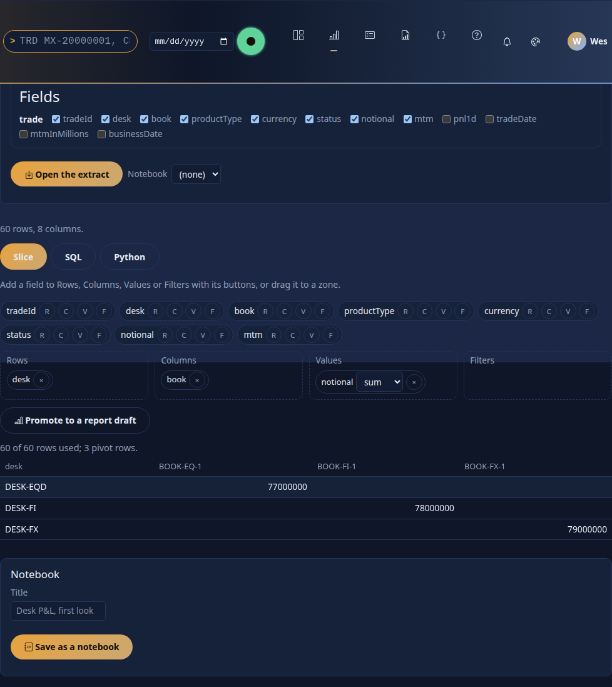

### 2. The extract

Choose a dataset, tick the fields (columns of its tables; `id` is added for you and dropped from the extract), and **Open the extract**. The line under the form tells you what you got:
`60 rows, 8 columns.` and, when something is masked for you, `Masked for you: MTM.` The rows are the table's *own* rows (not grouped), cut to `bi.explore.max_rows`
(10,000); a cut says so (`60 rows of 4,000 (cut to the row limit)`). Columns are named for the table's column (`DESK`, not `trade.DESK`); two columns of the same name keep their
table (`trade_DESK`).

**More than one extract.** *More extracts: join several datasets* (under the form) adds further extracts to the notebook, each a name, a dataset and fields, built for you by the server exactly as the first is (your row rules, your masks; `bi.explore.max_extracts`, 6, besides the first). A **Python** cell reads one as `extract("name")` (a pandas DataFrame; a copy, so changing it changes nothing else), or by the dataset it came from, and joins them in pandas; a **SQL** cell reads each as a table of that name. Real output of the sample notebook (below), with two extracts, the trades of `trading-risk` as `df` and the netting sets' computed exposure of `counterparty-exposure` (the official results, `set_exposure`) as `exposure`, joined in a Python cell:


```python
pnl = df.groupby("COUNTERPARTY", as_index=False)["PNL_1D"].sum().rename(columns={"COUNTERPARTY": "counterparty", "PNL_1D": "desk_pnl"})
ee = extract("exposure").groupby("counterparty", as_index=False)["PEAK_EE"].sum().rename(columns={"PEAK_EE": "ee_peak"})
joined = pnl.merge(ee, on="counterparty", how="left")
joined["pnl_per_exposure"] = joined["desk_pnl"] / joined["ee_peak"]
result = joined.sort_values("ee_peak", ascending=False).head(15)
```


Every extract is the reader's, so a join of two extracts shows **their** rows: the join key that the server masks for them (the counterparty id, for a reader without the raw power) arrives masked and the join finds nothing, which is the mask doing its job. Each extract counts toward the answer's `masked`, and each is cut to `bi.explore.max_rows` separately. Python in the browser cannot read further extracts (Pyodide gets the first only): a cell that calls `extract(...)` runs on the server.

Because the extract is cut, **Slice and SQL give the extract's totals, not the dataset's**. For true totals use a report.

An extract can also be a **report visual's data** (`POST /bi/explore/extract` with `{report, page, visual, state}`), the same rows the visual drew, masked the same way; the page's
form opens datasets, and a link *Analyse this* from a report is not built (section 12).

### 3. Slice

Fields appear as chips. Add one to **Rows**, **Columns**, **Values** or **Filters** with its small buttons (`R`, `C`, `V`, `F`, which work from the keyboard and on a phone) or drag it to a zone.
A value takes an aggregation (`sum`, `avg`, `count`, `min`, `max`; a text field starts as `count`); a filter keeps rows where the field equals one of its values. The pivot redraws at once.
The pivot is worked out by **the console** over your extract (`POST /bi/explore/pivot`: the extract is rebuilt for you, grouped, and the table and the
filters' values come back; at most 2,000 row or column keys, `DRS-9072` beyond). The line under the table says *Worked out by the console*. The table shows the
first 500 pivot rows. (Until 2.2 the pivot was DuckDB-Wasm or JavaScript in the page; the browser computes nothing since wave B.)


### 4. SQL

**Since 2.2.0 a SQL cell runs on the server by default** ([BI_DESIGN.md §3.4](../architecture/BI_DESIGN.md#34-drishti-sql-dsql-read-only-sql-over-models)):
the cell's engine choice says *Server: Drishti SQL over the model*, and the statement is **Drishti SQL over the model the extract reads** (a model, or a
dataset's implicit model), not over the extract. Its tables are the model's aliases, a measure is `MEASURE('name')`, `JOIN` needs no `ON` (the model's
relationships are used), and the server answers **as you**, with your row rules and masks, through the same plan as the model query it equals. A new
cell starts with a statement written from the model (the first text field you ticked and the model's first measure). Captured for an extract of the
model *SQL model* (trades and desks, one measure *Sum of MTM*):

```sql
SELECT trade.CURRENCY,
       MEASURE('Sum of MTM') AS "Sum of MTM"
FROM   trade
GROUP  BY trade.CURRENCY
LIMIT  20
```

The cell's footer says *3 rows in 4 ms · Drishti SQL, run by the server over sql-model@1 as you · plan p_825d3a8857*, with the masked columns when
there are any:

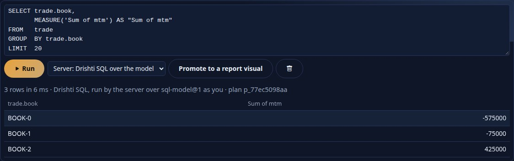 The console sends the cell to
`POST /bi/explore/dsql` (`{extract, sql}`), which asks the server's `POST /api/v1/bi/sql` with the model and the cell's row limit
(`bi.explore.sql_max_rows`, one more to say when it was cut); it never reads the SQL itself. Every source has a model since 2.2: a notebook saved
earlier that names a 2.1 dataset (`file:dataset:trades-basic`) reads the model the converter made of it (`trades-basic@1`), and so does its extract,
which is one model query (shape rows) like every other. **Over the extract** stays selectable in each cell until wave B, and a statement that reads the table `extract` (an older notebook)
still runs there whatever the choice.

Over the extract, a SQL cell is **one `SELECT`** (or `WITH ... SELECT`) over the table **`extract`** (and over a table for each further extract of the notebook, named as it is, so `SELECT ... FROM extract JOIN exposure ON ...`):

```sql
SELECT DESK, COUNT(*) AS trades, SUM(NOTIONAL) AS notional
FROM extract GROUP BY DESK ORDER BY notional DESC
```

A cell over the model is **Drishti SQL, run by the server** as you (section 4's first half). A cell that reads the table `extract` (a notebook of 2.2) runs
on the console in an in-memory SQLite database that is **read-only by construction**: an authorizer refuses everything but `SELECT`, reads and plain functions (so `INSERT`,
`UPDATE`, `DELETE`, `DROP`, `CREATE`, `ATTACH`, `PRAGMA` and `load_extension` are `DRS-9073`), a second statement is `DRS-9070`, text over `bi.explore.sql_max_chars` (20,000) and a query
running past `bi.explore.sql_max_seconds` (5) are `DRS-9072`, and at most `bi.explore.sql_max_rows` (5,000) rows come back (more are cut, and the result says so). A cell over `extract` speaks SQLite's dialect (`date()`, `strftime`, `||`, `LIMIT`); the line under the result says which ran it (*Drishti SQL, run by the
server over …* or *over the extract, run by the console*). *Run all* runs the cells in order.

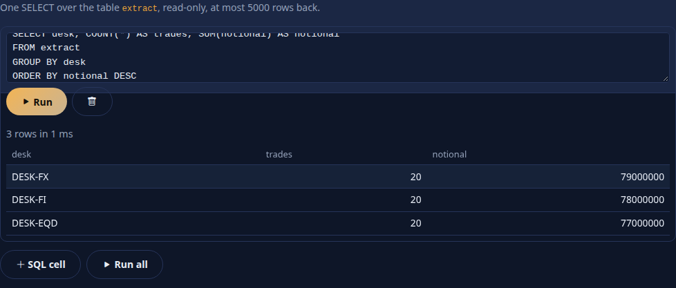

### 5. Python

A Python cell sees three names:

| Name | What |
|---|---|
| `df` | the extract as a pandas DataFrame |
| `extract(name)` | any other extract of the notebook (by its name, or by the dataset it came from) as a pandas DataFrame, for the same reader; `KeyError` names the extracts there are. **Server target only** |
| `params` | a dict (empty unless the call sends some) |
| `quant` | `quant.price(instrument, **parameters)`, `quant.instruments()`: the console's quant engine ([QUANT_SERVICE.md](../architecture/QUANT_SERVICE.md#16-the-consoles-quantengine-slot-built-lean)). **Server target only** |

What the cell prints (`print`) comes back as text. What it puts in **`result`** is drawn: a DataFrame or Series as a table (the first 200 rows), a dict as an **ECharts option**
(formatter keys are removed, as for a Python visual), SVG text or PNG bytes as an image, anything else as a value. `import` works for the packages on the allow-list
(`bi.python.packages`) that are installed, plus the safe standard library; the cell runs in the **same sandbox as a Python visual** ([PYTHON_BI.md](PYTHON_BI.md) section 7: no network, a
scratch folder, CPU, memory, time and output limits).

```python
g = df.groupby("DESK", as_index=False)["NOTIONAL"].sum()
print(round(quant.price("black_scholes", spot=100, strike=100, rate=0.05, vol=0.2, years=1), 4))   # 10.4506
result = {"title": {"text": "Notional by desk"}, "xAxis": {"type": "category", "data": list(g["DESK"])},
          "yAxis": {"type": "value"}, "series": [{"type": "bar", "data": [float(v) for v in g["NOTIONAL"]]}]}
```

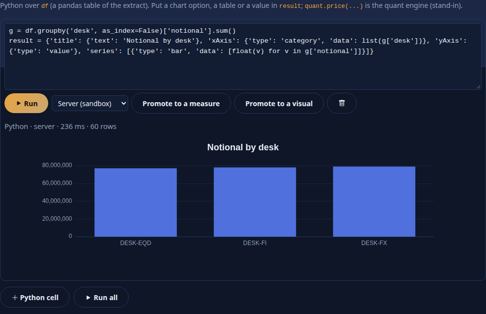

**Where it runs:** the console's sandbox, always (the line beside **Run** says *Runs on the console (sandbox)*): a child of the console's fork-server, with no
network, a scratch folder and CPU, memory, time and output limits. A notebook of 2.2 whose cell says `target: browser` runs there too. The Analyse page keeps
the **strict content-security policy**, with no WebAssembly. **Running Python needs the `bi-author` power**; Slice and SQL need only `bi`.

### 6. Notebooks

**Save as a notebook** stores the extract's definition, the slice and every cell as a BI item of kind **`notebook`**: in *My workspace* (or, if you opened a notebook you may edit, as a new version
of it). It has versions, diffs, review and publishing like any item ([BI_GOVERNANCE.md](BI_GOVERNANCE.md)); *Open in Analyse* on the item page (or `/bi/explore?item=<id>`, or the
notebook picker) reopens it: the extract is rebuilt for whoever opens it, so **a notebook shared with someone else shows *their* rows**. Outputs are not stored, only the code.

The body is YAML, checked by `POST /bi/explore/notebook/check` (unknown keys and bad cells are `DRS-9070`, naming the cell):

```yaml
rachana: 1
notebook: desk-notional-first-look
title: Desk notional, first look
dataset: mq:trades-basic@1       # the model it reads (mq:<model>@<major>, or dataset:<name> for a dataset's implicit model)
fields: [trade.TRADE_ID, trade.DESK, trade.PORTFOLIO, trade.NOTIONAL, trade.MTM]
extracts:                       # optional: further extracts, read by a cell as extract("name") and in SQL as a table of that name
  - { name: exposure, dataset: mq:counterparty-exposure@1, fields: [set_exposure.COUNTERPARTY, set_exposure.PEAK_EE] }   # the netting sets' computed exposure (2.9.0)
cells:
  - type: slice
    slice: { rows: [DESK], columns: [], values: [{ field: NOTIONAL, agg: sum }], filters: [] }
  - type: sql
    source: SELECT DESK, SUM(NOTIONAL) FROM extract GROUP BY DESK
  - type: python
    source: |
      result = df.groupby("DESK", as_index=False)["NOTIONAL"].sum()
    target: server
```

A notebook may also carry the catalogue's keys (`sample`, `tags`, `endorsement`, `owner`, `audience`); a shipped one is `config/bi/notebooks/pnl-vs-exposure-pandas.notebook.yaml`. Notebooks are **not run by the server** and have no lineage ([BI_GOVERNANCE.md](BI_GOVERNANCE.md) section 10); at most `bi.explore.max_cells` (60) cells.

### 7. Promote

Every promotion answers **beside the button you pressed** (one message, with an *Open the draft* link), not at the top of the page. Pressing the same promotion again for the same cell or slice does not make a duplicate: it offers **Update that draft** (the draft is written again) or **Save another**. A SQL cell promoted to a new report is titled *<dataset title> SQL* and gets a readable lower-case id. A notebook has one title: the item's title and the `title:` of its YAML always agree, whichever you rename; opening a notebook restores the Dataset and Notebook choices and the ticked fields.

Promoting writes a **draft** item in your workspace; nothing is published.

* **A Python cell that joins extracts to a Transform** (*Promote to a Transform*, shown greyed with "Add a second extract first" until the notebook has further extracts): each `extract("name")` becomes a parameter of `run(...)`, a use of `df` becomes the first extract, the cell's `result` is returned, and the draft's `inputs` are its parameters' names, in order (the inputs of the Python dataset that runs it). It is a draft **Python item with `interface: transform`** ([PYTHON_BI.md section 13](PYTHON_BI.md#13-transforms-a-table-in-a-table-out)); check it, publish it, then write the Python dataset that names it (`source: { python: <item>, inputs: { <name>: <a model query> } }`, [BI_MODEL_SPEC.md section 1.2](../architecture/BI_MODEL_SPEC.md#12-sources)): the promotion says so in its notes. `result` must be a pandas DataFrame with column names of letters, digits and underscore.


* **A Python cell to a Measure or a Visual** (the cell's buttons): the cell's `df` becomes the function's `table`, `result` is returned, the packages the cell imports go into the manifest
  ([PYTHON_BI.md](PYTHON_BI.md) section 3). Check it with *Check the Python* on the item page, edit the entry's contract (a measure returns one number per group, a visual an
  ECharts option, SVG or PNG), then publish. A measure also needs a dataset measure `{ python, inputs, by }` that names it.
* **A slice or a SQL cell to a report visual** (section 14): a visual, with its dataset, wells and filters, in a new report draft or added to one you already have.

### 8. Who sees what

The server decides, as everywhere in BI: the extract request is a model query, `POST /api/v1/bi/mq` (or the report's query), **as you**, so the same column masks and row rules as a
report apply, and a masked column arrives empty. SQL and Python only ever see that extract; the sandbox has no network and no way back to the server. A cell cannot widen access, and a
saved notebook holds code, not data. Python needs `bi-author` because arbitrary code runs in the console's worker pool (`bi.python.workers`).

### 9. Settings

The console's `bi.explore.*` ([CONFIGURATION.md](../admin/CONFIGURATION.md)):

| Setting | Default | Meaning |
|---|---|---|
| `max_rows` (`DRISHTI_BI_EXPLORE_MAX_ROWS`) | `10000` | most rows of an extract; 10 to 100,000 |
| `max_fields` | `60` | most columns of an extract |
| `sql_max_rows`, `sql_max_seconds`, `sql_max_chars` | `5000`, `5`, `20000` | the SQL cell's limits |
| `cell_timeout_seconds`, `cell_memory_mb`, `cell_max_chars` | `20`, `512`, `65536` | a Python cell's limits (also capped by `bi.python.max_timeout_seconds`, `max_memory_mb`) |
| `max_cells` | `60` | most cells in a notebook |
| `max_extracts` | `6` | most further extracts in a notebook, besides the first (`DRS-9072`) |
| `quant_engine` | `stand-in` | the engine behind `quant.price` |

The Python runner's own `bi.python.*` settings (workers, packages, limits) apply to cells too. **The server's `drishti.bi.report.python-packages` and the console's
`bi.python.packages` must list the same packages** (a test, `test_python_packages_agree_between_the_server_and_the_console`, fails the build otherwise).

### 10. Errors

Analyse uses the Python items' codes ([API_GUIDE.md](API_GUIDE.md) table; [TROUBLESHOOTING.md](TROUBLESHOOTING.md)):

| Code | HTTP | In Analyse |
|---|---|---|
| `DRS-9070` | 422 | the request is wrong (no fields, a bad name, a notebook that does not check, a SQL syntax error, two statements, a cell that does not parse) |
| `DRS-9071` | 422 | the Python cell raised (the traceback is shown to `bi-author`) |
| `DRS-9072` | 413 or 504 | a limit: SQL text, SQL time, cell size, memory, time, output, extract input |
| `DRS-9073` | 403 | refused: SQL that is not a plain SELECT, Python that needs the network, a file or a package it did not list, or Python without `bi-author` |
| `DRS-9074` | 503 | the runner is off, busy or lacks `pandas`/`pyarrow` |

The server's own refusals (`DRS-9001` no such dataset, `DRS-9020` series, a denied dataset) come through unchanged.

### 11. The routes

All are the console's own, JSON from its pages only (same-origin, `application/json`, the session cookie; no personal token): `GET /bi/explore`, `GET /bi/explore/status`, `POST /bi/explore/extract`,
`POST /bi/explore/sql`, `POST /bi/explore/python`, `POST /bi/explore/profile` (2.4.0), `POST /bi/explore/notebook/check`, `POST /bi/explore/promote`; and the
Python console's `GET /pyconsole`, `POST /pyconsole/extract`, `POST /pyconsole/promote` (2.4.0). Tables: [API_GUIDE.md](API_GUIDE.md) (console routes of Python in BI). Saving
uses the existing `POST /api/v1/bi/workspaces/me/items` and `PUT /api/v1/bi/items/{id}`.

### 12. Built and not built

**Built (phase 9, lean).** The extract, Slice, SQL cells, Python cells on the server (in the browser too until 2.3.0), notebooks as items, promotion of cells and slices, the `QuantEngine` slot with a stand-in.

**Built with several datasets (section 2, RUPAKA.md section 20.10).** Several masked extracts in one notebook, `extract("name")` in a Python cell and a table per extract in SQL, the notebook's `extracts:`, and the promotion of a join cell to a Python Transform draft.

**Not built, and not faked.**

* **Promoting a SQL cell the page cannot read** as a query over `extract` goes only as far as it can be read (section 14). (Until 2.3.0 the browser engine held the first extract only; since then every extract is the console's.)
* **Extracts of a million rows**, Perspective in Analyse, Graphic Walker over an extract (it is in Calc: [section 19](#19-the-bi-client-and-graphic-walker)), a *Data* tab (editing the extract), *Notes* cells, outputs saved with a notebook, scheduled notebook runs, parameters
  and widgets, sharing a notebook's outputs, a link *Analyse this* from a report visual or from a terminal view, cell tests, and an `extract(...)` of a **report visual** (further extracts are datasets).
* **Pivot extras**: grand totals and subtotals in the Slice (use a matrix in a report for true totals), sorting by a value, number formats.
* **Quant:** the real engine (QLRisk).

### 13. Where each cell runs: no WebAssembly in BI

Since 2.3.0 no BI page loads WebAssembly. Wave B made the servers compute every number and the browser draw ([BI_DESIGN.md](../architecture/BI_DESIGN.md) principle P3): DuckDB-Wasm
and the browser's Python (Pyodide) are no longer loaded by Analyse or any BI page, `bi.explore.browser_engine` and `browser_start_seconds` are gone (a
setting left in a configuration is ignored), and `tools/fetch-duckdb-wasm.sh` is gone. The Slice is the console's, SQL the server's (or the console's
for a cell over `extract`), Python the console's sandbox. Calc (the terminal's Python) still uses Pyodide in its own worker, and so does the
browser Python console of 2.4.0 ([section 16](#16-the-browser-python-console)), which is not a BI page.

### 14. Promote to a report visual

*Promote to a report draft* on the Slice tab and *Promote to a report visual* on a SQL cell make a **visual** from what you did. Choose where first, in the line above the tabs: **a new report draft**, or one of the report drafts you may edit (your workspace and the shared ones you contribute to), and optionally the page.


| From | The visual |
|---|---|
| a **slice** | a **matrix** (rows, one column field, values) when a value matches a measure of the model, else a **table** of the fields, else a **card**; the slice's **filters** become the visual's `filters` (`field`, `op: in`, `values`) |
| a **SQL cell** | read by a small reader (`core/promote_report.py`), not a SQL engine: the plain columns and `GROUP BY` columns become *rows* (or the table's columns), the aggregates `sum`, `avg`, `count`, `min`, `max` of a column become *values*, and simple `WHERE` conditions (`col = 'x'`, `<>`, `<`, `<=`, `>`, `>=`, `IN (...)`, `NOT IN`, `BETWEEN a AND b`, `IS [NOT] NULL`, joined by `AND`) become *filters* |

* **Values are measures.** A report shows the model's measures (`GET /models/<ref>/describe`), so an aggregate becomes a value only when the model has a measure that is exactly that (`sum(trade.MTM)`; `count(*)` is the measure `count(trade)`); the notes name each one that is missing so you add it to the model. Names are mapped from the extract's (`desk`) back to the model's (`trade.desk`).
* **What cannot be said is said.** A join or a sub-query, an expression (`NOTIONAL * 2`), `LIKE`, `OR`, `HAVING`, `count(distinct ...)` are left out and listed in the notes; `ORDER BY` and `LIMIT` are left out too (a visual sorts and limits in its own settings). Nothing is guessed.
* **The model.** A new report draft is `rachana: 2` with `model:` the model the extract was opened from (`trades-basic@1`). A report reads one model, so a slice of another model is not added to an existing report: `DRS-9070` says which model each reads; promote it to a new report instead.
* **An existing report** is read through the server's checker (`POST /bi/api/reports/validate`), the visual is added **below** what the page holds with a free id (`slice`, `sql`, then `slice-2` ...), and the report is written again by the designer's writer (`/reports/format`) and saved as the item's **draft** (`PUT /bi/api/items/<id>`). Comments in the report's YAML are **not kept** (the note says so); nothing is published. The target must be a report item you may edit: a shipped one, or one that is not a report, is `DRS-9070`.
* In both cases the draft is yours to finish in the designer, then check and publish like any report.

The route is the console's `POST /bi/explore/promote` with `{to: report, name, dataset, slice, filters}` or `{to: report, name, dataset, sql}`, plus `columns` and `qualified` (the extract's names and the dataset's), and `target` and `page` for an existing report; it answers `{kind: report, title, yaml, notes, target, visual}`.

### 15. Profile

*2.4.0.* The **Profile** tab shows every column of the extract: its type, what its text looks like (numbers or dates kept as text), empty values (count
and %), distinct values, whether it could be a key (every row its own value), min and max (and the mean of a number), the five most common values and a
histogram of a number. It is worked out by the console in its sandbox over the rows you may see (`POST /bi/explore/profile` with `{extract}`; no code of
yours runs), and drawn by the same panel as the [Transform editor](PYTHON_BI.md#175-profiling)'s. A column masked for you says so and profiles as empty.

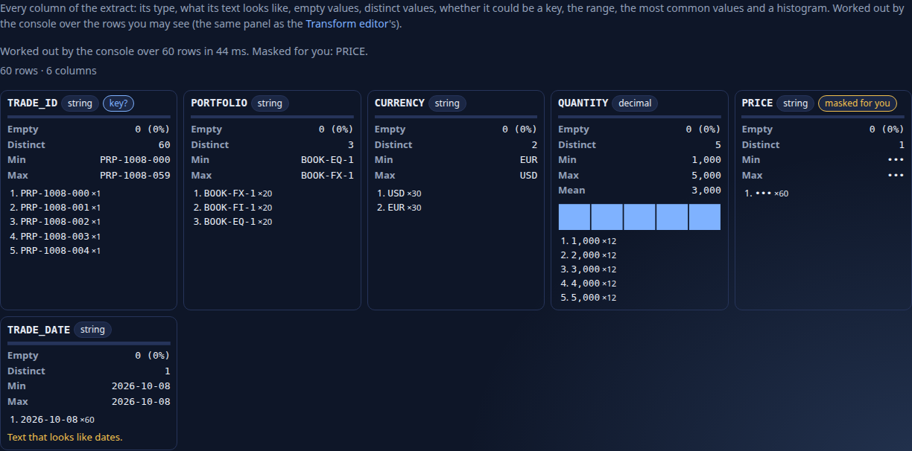

### 16. The browser Python console

*2.4.0* ([BI_DESIGN.md section 12.2, wave C](../architecture/BI_DESIGN.md#wave-c--authoring-and-analysis--240)). **BI → Python console** (`/pyconsole`)
is personal, just-in-time analysis: **your own Python, in your browser**, on a masked extract of a model, with nothing kept or shared until you promote a
result. It is deliberately **not a BI page** (principle P3: no BI page computes): Analyse and every `/bi` page still load no WebAssembly; the console is to a
model what Calc is to a terminal view, and runs your code in **Calc's Web Worker** (Pyodide, the one script allowed to compile WebAssembly; the page keeps
the strict policy).

1. **Extract.** Choose a model or a dataset, tick the fields, optionally a date, and *Open the extract*. The console asks the server for the rows **as
   you** (a model query of rows: your row rules; a masked column arrives masked and is named), at most `bi.pyconsole.max_rows` (20,000), and hands them to
   the page (`POST /pyconsole/extract`). The worker gets them once; it never fetches data and holds no credential.
2. **Python.** `df` is the extract as a pandas frame (fresh on every run; `df.attrs["masked"]` names the masked columns). `show(x, title)` draws a table,
   `chart(df, kind="bar", x=..., y=...)` a chart (line, bar, scatter, hist), `print` prints, and a value in `result` is shown when nothing else is.
   *Run in the browser* (Ctrl+Enter); *Stop* ends the worker. numpy, pandas, scipy, statsmodels and matplotlib load on first use.

   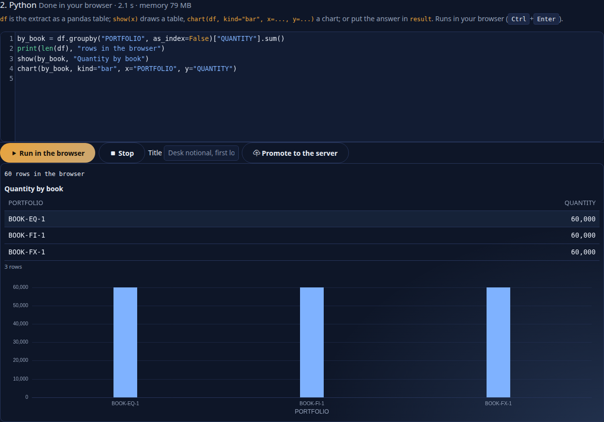

3. **Promote to the server.** When a result is worth keeping, give it a title and *Promote to the server* (bi-author): the console rebuilds the extract
   **for you** on the server side and runs the **same code on the console backend**, in the Analyse cell sandbox ([section 5](#5-python); `show()` is the
   cell's answer when it sets no `result`, `chart()` is skipped there), then compares the two answers (*The same answer as in your browser*, or not) and
   keeps the code as a **notebook draft** in your workspace (`POST /pyconsole/promote`). Open it in Analyse, share it, review and publish it like any
   notebook: whoever opens it gets **their own** rows. Code that fails on the backend is not kept.

   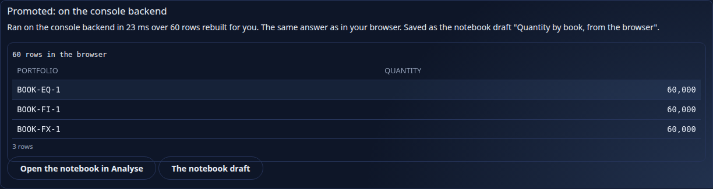

| Setting (console) | Default | Meaning |
|---|---|---|
| `bi.pyconsole.enabled` | `true` (`DRISHTI_BI_PYCONSOLE_ENABLED`) | false: no `/pyconsole` |
| `bi.pyconsole.max_rows` | `20000` (`DRISHTI_BI_PYCONSOLE_MAX_ROWS`) | most rows of an extract handed to the browser (10 to 100,000) |

It needs the BI power and Calc's runtime installed on the console (`tools/fetch-pyodide.sh`; no internet afterwards); promoting needs **bi-author**. What
the browser computes stays in that tab: a number shown to someone else always comes from the server or the console backend.
