<!--
  Project Drishti · Any data. Any domain. One grammar.

  Copyright (c) 2026 Ashutosh Sinha <ajsinha@gmail.com>.
  All rights reserved.

  PROPRIETARY AND CONFIDENTIAL.

  This file is the confidential and proprietary property of Ashutosh Sinha.
  Unauthorised copying, use, modification, distribution or disclosure of this
  file, via any medium, is strictly prohibited except with the express prior
  written permission of the copyright holder.

  See the LICENSE file in the root of this repository for the full terms.
-->
# VaR in Drishti: the complete guide

This is the one reference for Drishti's value at risk: what every number means and how it is computed, the explorer
screen by screen, positions, system baskets and any set of trades, captures, history and backtesting, what-if and VaR as a kind, who sees
what, the command line, the API and the settings (Part I); the data contract: every input column, formula, answer, error code, the
official results, retention and the decisions (Part II); how the engine holds a bank's vectors in memory and on local disk, its
sizing and benchmark, sharding, and what is still planned (Part III); and what sits around the engine: the VaR-related regulatory
reports of Canada and the US, the lenses and editions that show VaR, the configuration keys and the measured performance (Part IV).
It is **the one complete document on VaR**: methodology, the calculation worked step by step,
Drishti's implementation and the regulatory side; other documents link here. Anything described that is not in the code says
**design, not built** and names the plan row that will build it. The hands-on walk-through is
[tutorial 2, Part A](../tutorials/02-var-from-the-bank-to-a-trade.md#part-a--historical-var-from-the-bank-to-a-trade) (twelve steps on the test data). In the console, **F1** on the explorer
(or its **?**) opens this guide.

**Start here:** [Input, computed, cache and the official record](#input-computed-cache-and-the-official-record-compute-first) says in
one table what Drishti receives, what it computes, what it keeps only as a cache and what it records officially. The rest of the guide
keeps to those four words.

**Related documents:** [REGULATORY_VAR_REPORTING.md](REGULATORY_VAR_REPORTING.md) (the regulatory reports that need VaR) and [OVERSIGHT_LENS.md](../architecture/LENSES.md#5-oversight-lens) (what market risk oversight needs, why VaR moved, the proposed Oversight lens). For the proposed market risk cube on this engine (a pivot with correct non-additive totals, sensitivities, FRTB SA and IMA, pre-deal pricing, every data contract), see the design: [MR_CUBE_LENS.md](../architecture/LENSES.md#6-mr-cube-lens).

On 2026-10-26 this guide replaced five documents (this guide's first version, the explorer's page, the data contract `VAR.md`, the
engine design and the data model); they were deleted (in git at tag v2.9.5). Where a design said otherwise,
the code wins and the difference is marked **Design differs**.

Every number below that is not a hand-made example was read from a server over the committed test data: the market-risk pack's VaR
inputs of **2026-09-30** (`data/testdata/market-risk/`: the demo runs at **position grain**, every system's scenario PVs per position, as a bank's production batch sends them ([section 15.13](#1513-inputs-any-form-any-grain)): 7,993 position records, 7,984 positions summing 9,572 live trades (nine positions sit under two limit letters, one record per letter), 131 hierarchy nodes (88 MGMT and
LEGAL, 43 limit letters), 28 system basket
definitions, 509 scenario days), built into a lake with `drishti.py lake demo --as-of data`. The vectors are synthetic (a correlated,
fat-tailed factor market), not prices.

## Contents

**Part I · Using VaR**

1. [The question VaR answers](#1-the-question-var-answers)
2. [The measures, with worked numbers](#2-the-measures-with-worked-numbers)
3. [The explorer, screen by screen](#3-the-explorer-screen-by-screen)
4. [Positions: derived, never delivered](#4-positions-derived-never-delivered)
5. [Scopes, system baskets and baskets](#5-scopes-system-baskets-and-baskets)
6. [Captures and compare](#6-captures-and-compare)
7. [History and backtesting](#7-history-and-backtesting)
8. [What-if and VaR as a kind](#8-what-if-and-var-as-a-kind)
9. [Who sees what: entitlements and audit](#9-who-sees-what-entitlements-and-audit)
10. [The command line](#10-the-command-line)
11. [The API](#11-the-api)
12. [Settings](#12-settings)
13. [Troubleshooting](#13-troubleshooting)

**Part II · The data contract**

14. [The contract at a glance](#14-the-contract-at-a-glance)
15. [Inputs from upstream engines](#15-inputs-from-upstream-engines)
16. [Reference and master data read](#16-reference-and-master-data-read)
17. [Conventions specific to VaR](#17-conventions-specific-to-var)
18. [The computation](#18-the-computation)
19. [Official end-of-day results](#19-official-end-of-day-results)
20. [Validation, errors and data quality](#20-validation-errors-and-data-quality)
21. [Retiring the stored version](#21-var-is-computed-not-stored)
22. [Test data and generators](#22-test-data-and-generators)
23. [Decisions and open questions](#23-decisions-and-open-questions)

**Part III · How the engine works and stores data**

24. [Where the engine lives](#24-where-the-engine-lives)
25. [One business date in memory](#25-one-business-date-in-memory)
26. [The tiered memory and the hot file](#26-the-tiered-memory-and-the-hot-file)
27. [Sizes, performance and the benchmark](#27-sizes-performance-and-the-benchmark)
27a. [How scopes, parts and totals are computed (and why it scales)](#27a-how-scopes-parts-and-totals-are-computed-and-why-it-scales)
28. [Sharding across Drishti\*net](#28-sharding-across-drishtinet)
29. [The P&L vector in the lake](#29-the-pl-vector-in-the-lake)
30. [The design record](#30-the-design-record)
31. [Open items: designed, not built](#31-open-items-designed-not-built)

**Part IV · Around the engine**

32. [Regulatory reporting that needs VaR: Canada and the US](#32-regulatory-reporting-that-needs-var-canada-and-the-us)
33. [Where VaR is shown: editions and lenses](#33-where-var-is-shown-editions-and-lenses)
34. [Configuration keys](#34-configuration-keys)
35. [Measured performance](#35-measured-performance)
36. [VaR data: every dataset the engine reads](#36-var-data-every-dataset-the-engine-reads)

## Input, computed, cache and the official record (compute-first)

**The rule (product owner, 2026-10-31, implementation plan row B5): VaR is computed, not stored.** Drishti receives each trade's scenario
revaluations, computes everything else in memory when a date loads or a question arrives, keeps a disposable copy on local disk so a date
reopens fast, and writes only the **official record**. Four kinds of data, never confused:

| Kind | What | Where it lives | Who writes it | How long |
|---|---|---|---|---|
| **Input** | the sources' **scenario PVs** (`scenario-pv`, the preferred form) or **P&L vectors** (`pnl-vector`, the accepted alternative); the scenario set (`scenario-set`); limits (`var-limit`; the hierarchies are built from the rows' promoted columns); stored portfolios (`portfolio`); supplied scenario FX (`fx-scenario`); the trades; FX history (`fx-spot`, read, not watched) | the lake: Delta or Iceberg tables, `risk/...` and the packs' own ([section 15.1](#151-where-they-live)) | the bank's batch through the lake tools and loaders; an intraday batch from files or a Kafka window, appended **as received** (scenario PVs stay scenario PVs, `RUN_KIND: INTRADAY`, [section 8.4](#84-what-if-pricing-and-intraday-recomputes)) | the lake's own retention |
| **Computed** | each scenario-PV trade's **USD P&L** (the conversion below); the **derived positions** ([section 4](#4-positions-derived-never-delivered)); every node's and scope's vector (the totals); VaR, ES, components, contributions, diversification, the 10-day lenses, the books in other reporting currencies, the intraday layer | the server's memory: the heap and the memory-mapped hot file | the engine (`VarIntake`, `VarLoader`, `VarBook`, `VarCalc`) | while the date is open; **never written to Delta or Iceberg** |
| **Cache** | the **hot file** of a date (and of each reporting currency and each shard): float32 position rows, float64 node aggregates, columns, ids ([section 26.3](#263-the-hot-file)); the answers in the shared cache budget; the viewers' views | local disk under `drishti.var.tier.dir` (`./data/var/hot`, under the data folder) and memory; Admin → Caches shows and purges them (`VarCaches`) | the engine | disposable: deleted at shutdown unless `drishti.var.tier.keep-on-shutdown`, trimmed by `drishti.var.tier.disk-dates` and `drishti.var.tier.max-disk-gb`, rebuilt from the lake; its digest holds the inputs' versions, so a stale file is never read |
| **Official record** | the official end-of-day capture of every node of every hierarchy, the date's record and membership; the captures people make ([section 6](#6-captures-and-compare)); the published rows | the content store (`var/official/…`, `var/captures/…`) and the append-only table `risk-results/var-official` (Delta or Iceberg) with its JSON Lines ([section 19](#19-official-end-of-day-results)) | `VarOfficial` after a complete load, an administrator, a person's **Capture** | 7 years; immutable; a restatement adds a result version |

**Scenario PVs are the preferred input.** A pricing system's natural output is the trade revalued under each scenario and its base value,
in the trade's own currency. Drishti does the subtraction and the currency conversion itself, at load (`VarIntake`, `ScenarioFx.pnlFromPv`;
[section 15.9](#159-scenario-pv-scenario-pvs-per-trade-in-the-trades-currency)), for a trade in currency `c` with `FX_c` in
USD per unit of `c`:

```
P&L_USD(s) = PV(s) × FX_c(s) − PV(base) × FX_c(base)          s = 0 … N − 1, the scenario set's order
```

The scenario FX is the batch's own (`fx-scenario`) when sent, else derived from the FX history of each scenario day. A source that already
computes P&L sends **P&L vectors** instead (`pnl-vector`, [section 15.2](#152-pnl-vector-one-pl-vector-per-trade)); both forms
may sit side by side on one date (a trade in one form only), and nothing downstream knows which form a trade came in.

**Computed in memory and in the hot file, never written to Delta.** The derived P&L of a scenario-PV trade, the derived positions and every
total (a node's or a scope's vector) exist only in the server's memory and in the hot file, its disposable local copy. No table of derived
P&L, positions or totals exists in the lake, and nothing the engine computes is written back as an input: the positions are served as the
`position` kind by the `var-positions` connector with no figure stored on them, computed as their page opens. The only VaR figures that
reach a lake table are the **official record's** published rows (`risk-results/var-official`: one row per node and capture, VaR, ES and
their companions, no vectors), which no engine reads back. A capture keeps its scope's vector in the content store, as part of the record,
so that it reopens exactly as it was.

**Where this is tested.** `VarComputeFirstTest` runs the demo on **scenario PVs alone**: every one of its 8,233 P&L vectors, sent instead
as the scenario PVs a pricing system would send for it (the trade's value today and under each scenario), goes through the engine's own
conversion (`ScenarioFx.pnlFromPv`) and gives back its stored vector **exactly** in USD; the date built that way (those PVs and the
1,339 Endur trades' scenario PVs) has every one of its 88 nodes' vectors equal to the bit to the date built from the stored vectors, and
the bank's VaR 112,041,646 and ES 160,143,809. Sent in each trade's own currency at the batch's scenario FX, the PVs give back the stored
P&L to within 6e-8 USD (4e-16 of the trade's value) and every node's VaR to the cent. `VarComputeFirstGuardTest` checks that the engine's
code has exactly two lake writers, neither writing a derived figure: `VarPublisher` (the official record's published rows: scalar
figures per node, no vector) and `VarPvStream` (the PV topic's intraday records appended as received, an input in its own form); and
`VarStressApiTest` that loading a date's normal and stress sets, computing every node and capturing the official record leave every input
table's files as they were. `VarTestDataPrecisionTest` converts the demo's 1,339 scenario-PV trades as the intake does; `ScenarioFxTest`
covers the conversion and the cross through USD.

## Part I · Using VaR

## 1. The question VaR answers

*How much could this set of trades lose in one day, at 99% confidence, and where does that loss come from?* For risk managers (limits,
drill-down from the bank to a trade), traders (what a trade does to the desk's VaR) and auditors (every number reproducible from its
inputs and stamped with them).

Drishti answers it for **any** set of trades: the bank, a legal entity, a desk, a book, a position, one trade, a system basket, a
rule (*every short EUR position*), a basket you picked, or any union, difference or intersection of these. It never reprices anything.
An upstream risk batch values every live trade under each of **509 historical scenario days** (the market moves of the last two years,
applied to today's market), and delivers, per trade, its **P&L vector**: 509 numbers, the P&L the trade would make if the market moved as
it did on each of those days. Drishti adds vectors: the vector of a set of trades is the sum of its trades' vectors, element by element,
and every measure is read from that one vector of 509 numbers. It is computed when asked, never stored except as a capture.

Three consequences matter to every reader:

- **Longs and shorts net.** A long of 100 and a short of 40 of one instrument have the VaR of a long 60: the vectors cancel before the
  quantile is taken. A desk's VaR is never the sum of its trades' VaRs; the screens never sum VaRs and show the diversification instead.
- **Overlaps count once.** A trade in two terms of a scope (a desk and a portfolio holding part of it) is in the set once.
- **Every number is reproducible.** An answer names the vector table's data version, the batch id, the scenario set and the position
  rules it used; a capture keeps the vector itself.

**Methodology.** Historical simulation, equal weights, 1-day horizon (the Basel internal-models VaR; ES at 97.5% as in FRTB IMA, without
FRTB's liquidity horizons or stressed calibration). Age-weighted and filtered methods, 10-day VaR and stressed VaR are not built.

## 2. The measures, with worked numbers

In words, with the scope's vector `v` (N values, gains positive) and its scenarios sorted worst first (equal P&Ls, and **near-equal**
ones within a relative 1e-12 of the vector's largest P&L: the older scenario first, so the VaR date never depends on the last bits of a
sum, whichever path summed it: [HIGH_PERFORMANCE_NATIVE.md section 6.2](../architecture/HIGH_PERFORMANCE_NATIVE.md#62-precision-and-parity)).
The exact formulas are in [section 18](#18-the-computation).

| Measure | Definition | At N = 509 |
|---|---|---|
| **VaR(α)** | minus the k-th worst P&L, k = ⌈N (1 − α)⌉ | α = 99%: the **6th worst** (509 × 1% = 5.09, rounded up) |
| **ES(α)** (expected shortfall) | minus the mean of the k worst | α = 97.5%: the **mean of the 13 worst** (509 × 2.5% = 12.7, rounded up) |
| **Standalone VaR** of a part | the VaR of the part alone (its own sort) | |
| **Component VaR** of a part | minus the part's mean P&L over the scope's scenarios ranked k − 2 to k + 2, scaled so the parts add up to the scope's VaR (Euler allocation) | ranks 4 to 8 |
| **Component ES** | minus the part's mean over the scope's 13 worst scenarios (adds up to ES exactly) | |
| **Incremental VaR** | the scope's VaR minus its VaR without the part: the exact answer to *what does this trade do to my VaR?* | |
| **Marginal VaR** | component VaR ÷ \|size\| × 1,000,000 (size: a position's market value, a trade's PV) | per million |
| **Diversification** | Σ standalone VaR of the parts − the scope's VaR | |

VaR and ES are reported **positive for a loss**. A component is signed: a hedge has a negative component, and an incremental VaR below
zero means *taking this out would raise the VaR*.

### 2.1 By hand: ten scenarios

Real vectors have 509 values; here N = 10, so every step can be checked by hand. With N = 10 the 99% rank is the worst value (k = 1),
which shows little, so this example uses α = 80% for both measures (k = ⌈10 × 0.2⌉ = 2) and a component window of 3 (h = 1): the
settings `drishti.var.confidence: 0.80`, `es-confidence: 0.80`, `component-window: 3`. One book `BOOK-X` holds two positions: `P1`
(trades `T1` long and `T2` short, one instrument) and `P2` (trade `T3`). Scenario indices 0 to 9, oldest first; USD.

| Vector | 0 | 1 | 2 | 3 | 4 | 5 | 6 | 7 | 8 | 9 |
|---|---|---|---|---|---|---|---|---|---|---|
| `T1` | 5 | −8 | 3 | −12 | 6 | −2 | 4 | −5 | 7 | 1 |
| `T2` | −2 | 3 | −1 | 4 | −3 | 1 | −2 | 2 | −3 | 0 |
| `T3` = `P2` | −4 | 2 | −6 | 1 | −9 | 3 | −1 | 0 | 2 | −7 |
| `P1` = T1 + T2 | 3 | −5 | 2 | −8 | 3 | −1 | 2 | −3 | 4 | 1 |
| **Book** = P1 + P2 | −1 | −3 | −4 | **−7** | **−6** | 2 | 1 | −3 | 6 | **−6** |

The book sorted worst first: scenario 3 (−7), 4 (−6), 9 (−6, after 4: the older first), 2 (−4), 1 (−3), 7 (−3), 0 (−1), 6 (1), 5 (2), 8 (6).

| Figure | Computation | Value |
|---|---|---|
| VaR (k = 2) | minus the 2nd worst: −v[4] | **6** |
| ES (k = 2) | −(−7 − 6) / 2 | **6.5** |
| the component tail (ranks 1 to 3) | scenarios 3, 4, 9 | |
| smoothed VaR S | −(−7 − 6 − 6) / 3 | 6.3333 |
| scale c | 6 / 6.3333 | 0.947368 |
| component VaR of P1 | −(−8 + 3 + 1) / 3 × c = 1.3333 × c | **1.2632** |
| component VaR of P2 | −(1 − 9 − 7) / 3 × c = 5 × c | **4.7368** |
| their sum | 1.2632 + 4.7368 | **6 = the VaR** |
| component ES of P1, P2 | −(−8 + 3) / 2 = 2.5; −(1 − 9) / 2 = 4 | 2.5 + 4 = **6.5 = the ES** |
| standalone VaR of P1, P2 | the 2nd worst of P1 (−8, −5, …) is −5; of P2 (−9, −7, …) −7 | 5, 7 |
| diversification | 5 + 7 − 6 | **6** |
| incremental VaR of P1 | VaR(book) − VaR(P2) = 6 − 7 | **−1**: a hedge, removing it raises the VaR |
| incremental VaR of P2 | 6 − VaR(P1) = 6 − 5 | **1** |
| P1's trades (`by=trade`) | component of T1 = −(−12 + 6 + 1)/3 × c = 1.5789; of T2 = −(4 − 3 + 0)/3 × c = −0.3158 | they add up to P1's 1.2632 |

**An ad-hoc scope: the book minus one trade**, `BOOK:BOOK-X - TRD:T2` (canonical `BOOK:BOOK-X - TRD:T2`). The set covers no book whole,
so the planner ([section 25](#25-one-business-date-in-memory)) sums `T1` and `T3` in one pass; in a bank, `DESK:X - TRD:T2` covers the
desk's other books whole and the planner takes the desk's aggregate minus `T2` (1 missing trade ≤ max(16, covered/8)). Either way the
vector is:

| | 0 | 1 | 2 | 3 | 4 | 5 | 6 | 7 | 8 | 9 |
|---|---|---|---|---|---|---|---|---|---|---|
| Book − T2 = T1 + T3 | 1 | −6 | −3 | **−11** | −3 | 1 | 3 | −5 | 9 | **−6** |

Order: 3 (−11), 1 (−6), 9 (−6), 7 (−5), … → VaR = −v[1] = **6** (unchanged: T2's incremental VaR is 0) but ES = −(−11 − 6)/2 = **8.5**
(up from 6.5): the short hedged the worst day, which ES sees and VaR at this rank does not. At α = 99% (k = 1) the book's VaR would be
7, its worst value. With N = 509 the same steps use the 6th worst for VaR, the 13 worst for ES and ranks 4 to 8 for components. The
engine (`VarMath`, `VarCalc` and the what-if's `VarWhatIfMath`) is tested on exactly these numbers.

### 2.2 On the test data

The bank on 2026-09-30 (`drishti.py var show BANK`):

```text
VAR BANK  ·  Drishti Bank  ·  node  ·  2026-09-30
  VaR 99%   112,041,646 USD   (the 6th worst of 509)
  ES 97.5%   160,143,809 USD   (mean of the 13 worst)
  limit      150,000,000 USD   use 74.7%
  parts      2 division   standalone sum 130,101,896   diversification 18,060,250
  backtest   amber  5 exceptions in 249 days   Kupiec p 0.160   Christoffersen p 0.076
  9572 trades in 7993 positions
  pnl-vector and scenario-pv (1339 trades from scenario PVs) · batch B-2026-09-30-01 of 2026-09-30 · data version …
  in USD, crosses through USD; FX CAD supplied (0.719942 USD); EUR supplied (1.174 USD); USD base (1 USD)
  node aggregate (float64) · historical, equal weights, 1-day, k = 6th worst of 509 · 2 ms (miss)
  warning: 9 positions had trades under two nodes of a hierarchy built from columns and are split, one part per node (<position>@<value>)
```

Read it as: on the 6th worst of the 509 historical days the whole bank would lose 112.0 million USD; the 13 worst days lose 160.1 million
on average; the two divisions alone add up to 130.1 million, so holding them together saves 18.1 million (diversification); the VaR uses
74.7% of the bank's 150 million limit. The Endur trades came as scenario PVs (two of their currencies converted with the supplied FX,
[section 15.9](#159-scenario-pv-scenario-pvs-per-trade-in-the-trades-currency)); `--ccy EUR` asks the same bank in euros
([section 15.10](#1510-reporting-currency)).

The ten desks (the engine's VaR on 2026-09-30; [section 21.2](#212-the-desks-var-on-the-test-data)):

| Desk | VaR | Live trades |
|---|---|---|
| COMM | 17,514,512 | 2,141 |
| CREDIT | 130,670,864 | 943 |
| EQD | 35,827,767 | 1,201 |
| FI | 33,274,561 | 1,013 |
| FX | 24,060,533 | 1,164 |
| INFL | 24,933,130 | 314 |
| MM | 15,446,375 | 424 |
| RATES | 74,633,680 | 1,487 |
| SFT | 1,536,322 | 611 |
| STRUCT | 9,987,431 | 274 |

Their VaRs add up to 367.9 million; the bank's is 112.0 million. The credit desk alone has a larger VaR than the bank: other desks
gain on the credit desk's worst days.

**Components add up.** The rates desk by book (`drishti.py var parts DESK:RATES`):

```text
DESK:RATES  by book  VaR 74,633,680  ES 75,377,415  sum of components 74,633,680
Part          Standalone VaR  Component VaR  % of VaR  Incremental VaR  Component ES
------------  --------------  -------------  --------  ---------------  ------------
BOOK-RATES-1      33,153,425     30,612,282      41.0       -5,131,638    10,403,265
BOOK-RATES-2      30,872,370     25,280,825      33.9       21,654,002    20,263,766
BOOK-RATES-3      61,499,103     18,740,573      25.1       26,690,191    44,710,384
```

The components add up to the desk's VaR to the dollar. `BOOK-RATES-3` has the largest VaR alone (61.5 million) but the smallest share of
the desk's (18.7 million): its worst days are not the desk's. `BOOK-RATES-1`'s incremental VaR is **negative** (−5.1 million): take the
book out and the desk's VaR rises, so at the margin it hedges the other two, although its component is the largest.

**One trade.** `DESK:RATES - TRD:MX-30000121` has VaR **74,720,890**: the desk without that one swap has a VaR 87,210 USD higher, so the
swap's incremental VaR in the desk is −87,210.

**A position nets its trades.** `POS:POS-BOOK-EQD-2~SEC-WARRANT-USD-01` (nine trades of one equity warrant in `BOOK-EQD-2`) has a VaR of
**67,209**; its nine trades alone add up to 111,930: the buys and sells net (diversification 44,721).

**ES and VaR are different questions.** A scope's ES at 97.5% can be *below* its VaR at 99% (the basket of the rates desk's shorts in
[section 6](#6-captures-and-compare): VaR 282.4 million, ES 271.5 million): the 13 worst days at 97.5% average less than the 6th worst
at 99% when the tail is short. Both are shown; neither replaces the other.

## 3. The explorer, screen by screen

### 3.1 Open it

Type a command and press Enter (or `<GO>`):

| Command | Opens |
|---|---|
| `VAR BANK <GO>` | the whole bank |
| `VAR DESK DESK-RATES <GO>` | a desk (`VAR DESK RATES` works too) |
| `VAR LE LE-NY <GO>`, `VAR DIV MARKETS <GO>`, `VAR BOOK BOOK-RATES-1 <GO>` | a legal entity, a division, a book |
| `VAR POS POS-BOOK-EQD-2~SEC-WARRANT-USD-01 <GO>` | a position (a security held in a book; an OTC trade's is `POS-<book>~<trade>`) |
| `VAR TRD MX-30000121 <GO>` | one trade |
| `VAR CPTY CP-SUMMIT <GO>` | every trade with a counterparty |
| `VAR PORT PF-USD-RATES <GO>` | a system basket ([section 5.7](#57-system-baskets)) |
| `VAR SCOPE unwind <GO>` | your saved basket `unwind` (`VAR SCOPE asha/unwind` for one shared with you) |
| `VAR SCOPE DESK:DESK-RATES - TRD:MX-30000121 <GO>` | any scope written in the [grammar](#52-the-grammar) |
| `VAR CAPTURE CAP-20260930-12 <GO>` | a capture, reopened exactly as it was taken |
| `VAR DESK DESK-RATES IN EUR <GO>` | any of these in a reporting currency: the page in EUR, its link `&ccy=EUR` ([section 15.11](#1511-reporting-currencies-built-ahead-per-trade-currency-totals-and-the-picker)) |
| `VAR BANK 10D <GO>`, `VAR BANK 10D SUM <GO>`, `VAR BANK 10D SQRT <GO>` | the 10-day VaR by the default method (`ten-day-method`, √10), by the sum of 10 consecutive days, or by √10 ([section 18.6](#186-horizons-the-two-10-day-methods-and-the-confidence-chosen)) |
| `VAR BANK 95 <GO>`, `VAR BANK 10D SUM 97.5 <GO>`, `VAR BANK ES 95 <GO>` | another VaR confidence (the configured list), or ES's; any order, with `IN <currency>` too; the link `&h=10d&m=sum&q=0.975&esq=0.95` |

`VAR VAR-RATES <GO>` (a desk record's id, [section 21](#21-var-is-computed-not-stored)) opens the explorer at `DESK:RATES`
and says so; `VAR VN-MGMT~DESK-FX` opens `NODE:MGMT~DESK-FX`, and old links (`/v/var/VAR-RATES`) do the same. The page is
`/var?scope=<scope>`; every scope you move to is a browser history entry, so Back works, and every move repaints the panels in place,
never reloading the page.

**Horizon and Confidence.** Beside the **Reporting currency** in the header strip: **Horizon** (*1-day*, *10-day (√10)*,
*10-day (sum)*), **Confidence** (VaR's, from `drishti.var.confidences`; the default marked) and **ES** (its own). A choice redraws every
panel: the tiles (*VaR 99% · 10 days · USD*, *5th worst of 500 overlapping windows*), the method strip under them (*Horizon 10-day
[sum of days] · Confidence VaR 99%, ES 97.5% · each window adds 10 consecutive scenario days' P&L …*), the scopes tree, the P&L path
(at 10-day sum: the 500 windows, each dated by its last day, the table showing *first … last*), the VaR/ES history, the contributions,
the captured results and the other currencies. **Limit use** shows only at the limit's own horizon and confidence (1-day 99%), else the
tile says *limit is for 1-day 99%: not comparable* (the tree's limit column *n/c*); **backtest exceptions** only at 1 day (*backtesting is 1-day*), at 99% whatever the confidence shown. The choice goes into
the link (`?h=10d&m=sum&q=0.99&esq=0.975`) and the command (`VAR BANK 10D SUM`), and the person's settings remember it for the next visit.
On a phone the controls are full width. How each is computed: [section 18.6](#186-horizons-the-two-10-day-methods-and-the-confidence-chosen).

**Normal or Stressed.** The **Scenarios** picker beside Horizon: *Normal* (the date's own scenarios) or *Stressed* (today's positions
under the date's 12-month stress period, [section 18.8](#188-stressed-var)). Stressed redraws every panel from the stress set, in USD:
the tiles read *Stressed VaR 99% · 1 day · USD*, the third tile shows the **12-week average** of the node's official stressed VaR, the
method strip names the stress set (*HS-STRESS-2008 · 2008-07-01 … 2009-06-30 · synthetic*), limit use is not shown (a limit is set
against normal VaR) and the history replays the stress days with no backtest. Horizon and Confidence apply to either. The choice goes
into the link (`&set=stressed`) and the command (`VAR BANK SVAR 10D SUM`), and the person's settings remember it. A date without a stress
set says so in place of the figures.

### 3.2 The screen

Two columns and a toolbar, as the approved mock-ups (`docs/lenses/mockups/var/var-page.html`; the drop-downs from
`docs/lenses/mockups/var-layout/A.html`):

- **The status line** names the command, the business date and the scenario set; the long data-version text is behind **ⓘ data
  versions** (click it to read the versions the figures were computed from).
- **The toolbar**, one row: two searchable drop-downs for the baskets, **+ New basket**, **Include matured items**, **Backtest ›**,
  **MR cube ›**, **What-if…** and **Explain ›**.
  - **Backtest ›** opens the regulatory backtest of the scope in view, on the date in view (the same page as `VAR <scope> BACKTEST`,
    [REGULATORY_VAR_REPORTING.md section 4.6](REGULATORY_VAR_REPORTING.md#46-backtesting)): its VaR against the P&L of the last 250
    business days, the exceptions and the zone.
  - **System baskets** (key **B**): the bank's own baskets, kept in Drishti's basket store (the holders of `var:system-baskets` manage
    them; [section 5.7](#57-system-baskets)), each with its name, its description, its id, its owner and its type.
  - **My baskets** (key **M**): the baskets you saved, under *Mine*, then those shared with you, under *Shared with me*
    ([section 5.8](#58-baskets)), each with its name, its description and its id.
  - Each opens a search box over its list: type to search the name and the description (and the id, the type, the owner; several words
    each match), **↑ ↓** move, **Enter** opens the scope, **Esc** closes. The scope on the page is named on its drop-down's button. Each
    row keeps its actions: **+ basket** (into the sheet), **Edit** (a basket you own; an administrator's on everyone's), **Edit a copy**
    (a system basket, a basket shared with you read-only) and **Delete** (a basket you own), as described in
    [section 3.5](#35-construct-your-basket). Renaming and sharing a basket are done in its sheet (**Edit**, then a new name or *Share
    read-only with*, then Save). At the foot of My baskets, **+ New basket** opens the basket's sheet.
  - **+ New basket** (also **Alt+B**; the count of the parts your sheet holds beside it) opens **Construct your basket**, the sheet,
    across the top of the page ([section 3.5](#35-construct-your-basket)). The sheet is collapsed when the page opens; once you save, the
    new basket is in My baskets and the sheet collapses again.
  - **Explain ›** (key **E**) opens the Explain drawer of the scope's VaR over the right of the screen: the formula with its values,
    how the number was built, why it moved and the workbook ([section 3.6](#36-how-this-number-was-built)). Every figure tile has its
    own: hover it for a one-line preview, click it for the drawer.
- **Scopes** (left; the tree fills the column, with no panel under it). **The tree shows only the chosen scope:**
  - **the whole bank**: the whole tree;
  - **a node** (a division, a desk, a book): that node and everything below it, with a breadcrumb above the tree
    (*Drishti Bank › DIV-MARKETS › Equity derivatives*) whose links go back up; the rest of the bank is not shown;
  - **a system basket or a saved basket** (`PORT`, `BASKET`): the basket's own positions grouped by the hierarchy chosen in the selector
    (Management by default): the basket at the top, under it the nodes that hold any of its positions, each node's VaR and ES those of the
    basket's part in it (`(PORT:PF-EQD-DESK) & NODE:…`), computed by the VaR engine (`GET /api/v1/risk/var/tree?within=<scope>`,
    [section 11.4](#114-history-the-tree-and-the-status)); nodes are not shown with their limits there. **All of the bank** above the
    tree goes back;
  - a position, a trade or a part of a basket keeps the tree it was picked from.

  **Explain ›** is on every row: it shows as you point at the row and on the chosen row, and opens **Why it moved** of that row's VaR
  ([section 3.11](#311-why-it-moved-the-var-change-explained)).

  The hierarchy is the one chosen in the selector above it (Management: bank, division, desk, book; Legal entities: bank, legal
  entity, desk, book; and every configured hierarchy by its title, such as *Limit letters*: letter, desk; the choice kept
  in the link as `hierarchy=LL`; a node of rows with no value at its level is *(Blank)*, muted, its `?` saying how many trades and
  the fix: [section 15.14](#1514-hierarchies-from-promoted-columns)) with each
  node's VaR, ES and a bar of its limit use in the tone of the node's limit status as the server says it (`limitStatus`: *within*
  green, *near* amber, *breach* red; no tone without a status; *no limit* where the node has none). Click **▸** to open
  a node, click its name to see its VaR. A book opens to its positions (a LONG or SHORT chip, the
  quantity, VaR, ES, the component VaR in the book); a position opens to its trades. Every row has **+ basket** (shown as you point at it).
- **The scope** (the rest of the width): the breadcrumb, six tiles (VaR 99% 1-day, ES 97.5%, the sum of the children's standalone VaR, the
  diversification, the limit use in the tone of the scope's limit status, the backtest exceptions over 250 days with the Basel light),
  and the tabs. The page decides no limit status of its own: **near** starts at the one setting `drishti.risk.limit-near` (0.8 by
  default, in `config/engines/var.yaml`) and **breach** is over 100%, the same rule for every screen, the official record and the
  what-if ([section 11.2](#112-the-headline-get-scope-and-its-provenance), `limitStatus` and `limitNear`).
- The **?** in the status line opens this guide.

The keys **B**, **M** and **H** work anywhere on the page except while you type in a box or in the basket's sheet.

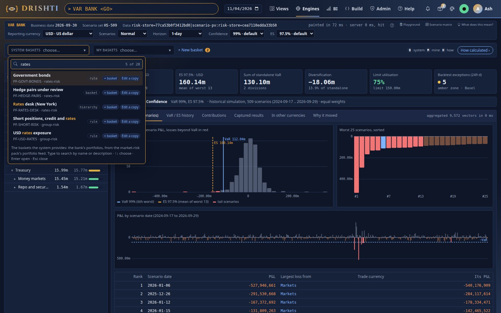
- **Reporting currency** (the status line's right end): USD, EUR, CAD, JPY, GBP (the configured ones) and **More…** (every
  other currency with scenario FX on the date). Every panel follows it, the tiles say it (`VaR 99% · 1 day · EUR`), the choice stays
  for the session and goes into the link; [section 15.11](#1511-reporting-currencies-built-ahead-per-trade-currency-totals-and-the-picker).

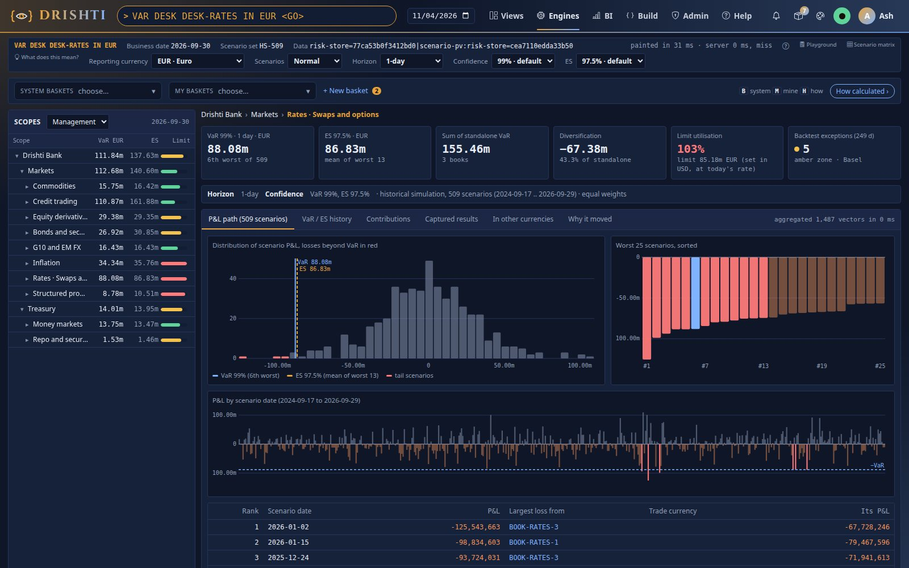

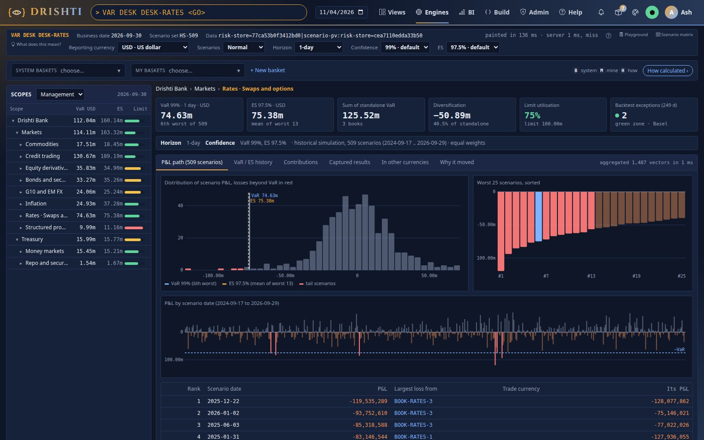

Every panel says *computing…* while it waits and is painted as soon as its answer arrives; the status line says how long the click
took (*painted in 14 ms · server 2 ms, hit*).

### 3.3 Drill down: bank, desk, book, position, trade

Click any row of the tree, any part of the breadcrumb, or any row of the Contributions tab: every panel moves to that scope. The
children of the node you are on are fetched while you read it, so the next click is answered from memory.

- **A position** is a holding of one instrument in one book; its trades build or reduce it (a buy adds, a sell takes away). Its vector
  is the sum of its trades' vectors, so a long of 100 and a short of 40 of one instrument have the VaR of 60: the position's VaR is never
  the sum of its trades' VaRs.
- **A trade** has its own vector: its VaR is exact, and so is its contribution to its position, its book and any basket.

A book opens to its positions, each with a LONG or SHORT chip, its quantity, its VaR and its component in the book:


### 3.4 The tabs

**P&L path** (509 scenarios): the distribution of the scope's scenario P&Ls with the VaR and ES lines (bins wholly beyond VaR in red);
the 25 worst scenarios sorted (the VaR scenario highlighted); the P&L by scenario date with the −VaR line; and the ranked table, 60 rows
a page (**Next page**), naming the part that lost most on each scenario. A click on a bar or a row opens **the contributors on that
date**: which children lost what that day.

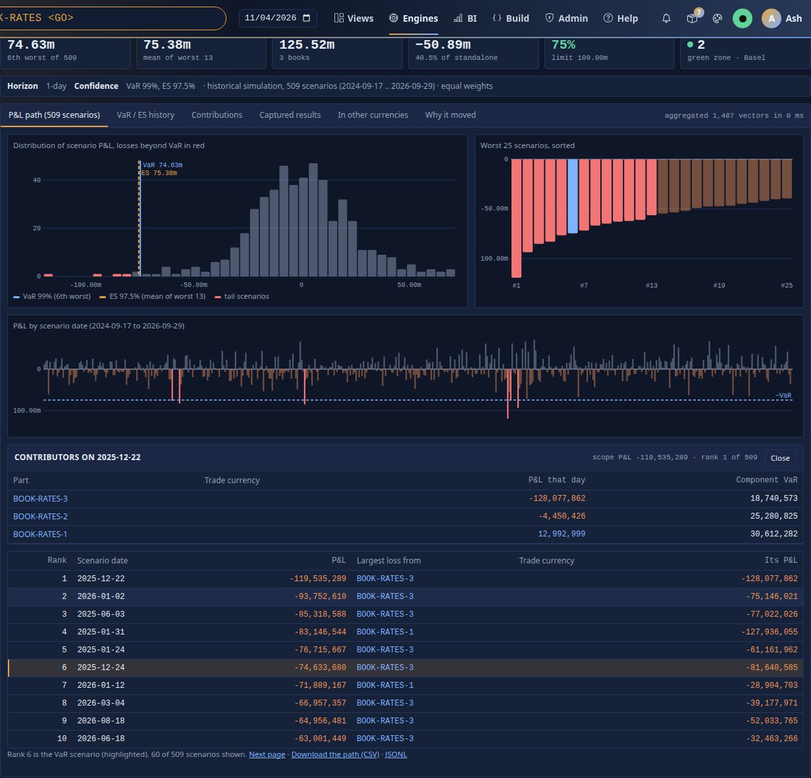

The ranked table from the command line (`drishti.py var path DESK:RATES --size 8`): rank 6 is the VaR scenario.

```text
DESK:RATES  VaR 74,633,680 (rank 6)  ES 75,377,415 (worst 13)
Rank  Scenario day  P&L           Lost most
----  ------------  ------------  -------------------------
1       2025-12-22  -119,535,289  BOOK-RATES-3 -128,077,862
2       2026-01-02   -93,752,610   BOOK-RATES-3 -75,146,021
3       2025-06-03   -85,318,588   BOOK-RATES-3 -77,022,026
4       2025-01-31   -83,146,544  BOOK-RATES-1 -127,936,055
5       2025-01-24   -76,715,667   BOOK-RATES-3 -61,161,962
6       2025-12-24   -74,633,680   BOOK-RATES-3 -81,640,585
7       2026-01-12   -71,889,167   BOOK-RATES-1 -28,904,703
8       2026-03-04   -66,957,357   BOOK-RATES-3 -39,177,971
```

**VaR / ES history**: −VaR and −ES lines over 250 days with the P&L, an exception as a red dot and a row chip, and the backtest: the count,
the Basel zone (green 0–4, amber 5–9, red 10+), Kupiec's and Christoffersen's p-values. A node shows its official end-of-day figures;
any other scope (a position, a trade, a basket) replays today's members, in-sample, and says so ([section 7](#7-history-and-backtesting)).

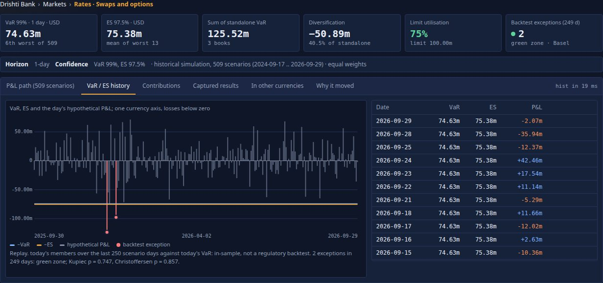

**Contributions**: the scope's children (a node's child nodes, a book's positions, a position's trades, a basket's parts: each
portfolio, counterparty, desk or trade you put in it), **By position** or **By trade**: standalone VaR, component VaR (they add up to the
scope's VaR) with its share and a bar, marginal VaR per million of market value, incremental VaR, component ES. A hedge has a negative
component. **+ basket** on a row adds it to your basket ([section 3.5](#35-construct-your-basket)); the row's own click still drills in.
By position and by trade, a desk's table has hundreds to thousands of rows: the page reads it as Apache Arrow (61 to 65% fewer
bytes than JSON, the same table cell for cell); everything else on the page stays JSON. `?tables=json` in the address makes it ask JSON
([DATA_GUIDE.md › Data formats: JSON Lines is the standard, section 6](DATA_GUIDE.md#6-arrow-to-the-browser-where-it-pays)).

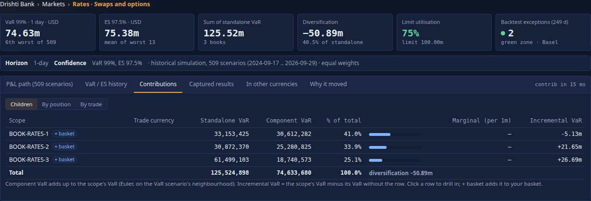

**Captured results**: the captures of this scope ([section 6](#6-captures-and-compare)).

**Why it moved**: the scope's VaR change since the previous business date (or between any two dates) in causes that add up exactly,
with who drove each; Waterfall, Matrix and Sentences views ([section 3.11](#311-why-it-moved-the-var-change-explained)).

**In other currencies** (loaded only when you open it): the scope's VaR 99% and ES 97.5% in each configured currency, each
computed from its PVs summed per trade currency with that currency's scenario FX, that VaR in the page's currency at today's rate, and
the difference from the page's VaR. The shown currency is marked; click another to move the page to it. The Contributions and the
ranked path also list each trade's or position's **Trade currency**.

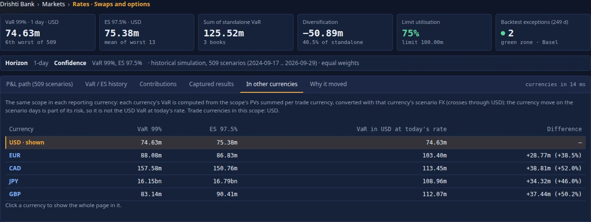

### 3.5 Construct your basket

*VaR of any mix of trades, positions, portfolios, books, desks, limit letters and counterparties, built in one sheet like Excel.* Ad-hoc
scopes and baskets are one thing, built one way: the basket's sheet, across the top of the explorer, opened by **+ New basket** in the
toolbar or at the foot of *My baskets* (with the count of its parts) or **Alt+B**. It lives on the VaR page only (the top bar has no
Basket button, and Alt+B does nothing elsewhere); what you put in it stays in this browser, so a basket built earlier is there when the
explorer opens, waiting behind the link's count: the sheet is collapsed when the page opens and opens only when asked (+ New basket,
Alt+B, **+ basket** on a row, **Edit**), never by itself, not even when the explorer opens a saved basket. Once saved, the basket is
listed in *My baskets* and the sheet collapses.

**The sheet.** A column per kind of part: **Trade** (`TRD`), **Position** (`POS`), **System basket** (`PORT`), **Book** (`BOOK`), **Desk**
(`DESK`), one column per configured hierarchy's word (the demo's **Limit letter**, `LL`) and **Counterparty** (`CPTY`), and the **Op**
column, **+** or **−**, for each row. One id a cell. It fills four ways:

- **Type in a cell.** Click it (or move with the arrows, Tab and Shift+Tab) and type; **Enter** keeps it and moves down, **Esc** drops
  the edit, **Delete** clears the cell. In the Op column a click, Space, **+** or **−** sets the row's sign.
- **Paste whole columns from Excel.** Select a cell and paste (Ctrl+V): Excel's columns fill downward from it, and rightward for several
  columns. A first row of headings (**Op**, **Trade**, `TRD`, *Trade (TRD)*, as the sheet's own workbook writes them) puts each pasted
  column under its heading wherever you paste. A sheet holds 20,000 rows; every column takes 10,000 ids and more.
- **Find and add.** The type-ahead above the sheet offers what the engine knows as you type: system baskets, saved baskets, desks, books,
  legal entities, divisions, counterparties, positions and trades, each with its type, id, name, trade count and standalone VaR (`pf usd`,
  `aldershot`, `MX-3000`, `rates`); **↓ ↑** and **Enter** pick, and the hint lands in its kind's column. **Add (+)** or **Take away (−)**
  above the sheet says which, and a leading **-** takes it away (`-MX-30000121`). Anything in the [grammar](#52-the-grammar) can be typed
  as written (`TRD:MX-30000121`).
- **+ basket** on any row of the tree, the contributions and the trades (By trade) adds that row to its column.

A cell may name its kind itself (`NODE:MGMT~DESK-RATES` in the Desk column, `BASKET:asha/unwind` in the System basket column); a rule
(`WHERE:`) has no column: open it as a scope from the command line ([section 5.4](#54-the-position-rule-language-where-and-rule-portfolios)).

**Take away by a minus.** The basket is everything added, then everything marked − taken away: a **−** in the Op column, or a leading
**-** on an id (`-TRD:XYZ` or `-XYZ` in the Trade column), as the scope grammar's `A + B - C` does. A minus on a desk or a book takes away
all its trades, whichever part added them. A minus that takes nothing away (none of its trades is in a part added) is flagged in words
on its cell.

**Start from the whole bank.** One checkbox above the sheet, never a row in it. Ticked, the basket is the whole bank (every trade you may
see, `BANK`) and the rows refine it: `BANK - DESK:COMM - TRD:XYZ` is the bank without the commodities desk and one trade. A **+** row then
adds nothing (the bank already holds it) and says so. A saved basket keeps the tick.

**Every cell checked by the server.** As you type or paste, the sheet goes to the server as lists, one per column; the server checks
every cell as you, on the page's date, and answers each one: **found** (green), **not found** (red, the reason in words as the cell's
tooltip and in the list under the sheet, for example *TRD:10000000 is not a live trade on 2026-10-26 (no P&L vector)*, *TRD:X is not live
on …: its status is CANCELLED*, *is outside your view: your role does not see its trades*, *cannot be used: the counterparty is masked
for your role*), or found but **adding or taking away nothing** (amber). A cell not found is left out of the figures and kept in the
sheet until you remove it: **Remove the not found** drops them all. Click a reason to go to its cell.

**Live figures, the server's.** Under the sheet: the basket's **VaR** and **ES**, the **sum of the parts** (each cell added, alone), the
**diversification** (the sum minus the basket's VaR) and its **trades** (a trade in two parts counts once), computed by the engine for
the basket the sheet composes; the console computes nothing. A basket with no trades says so, never a VaR of 0 that looks computed; so
does the explorer ([section 5.3](#53-resolution-rules)).

**What-if trades.** Under the figures: a pre-deal what-if, a copy of a booked trade (or of any scope, `BOOK:BOOK-RATES-3`) scaled by a
factor (−1: its unwind), added to the basket; the VaR and ES before → after and the incremental, by the server's VaR engine with no
compute workers ([section 8.5](#85-the-pre-deal-what-if-under-the-baskets-sheet)).

**Name, share, save and open.** **Save basket and open VaR** keeps it as a basket (private, or shared read-only with the users or roles
you name), its parts kept as the sheet's lists ([section 5.8](#58-baskets)), and opens `VAR SCOPE BASKET:<you>/<name>` in the full
explorer: the tree, the contributions by part (drill into any part, down to its trades), the P&L path, the history, captures. **Open
without saving** opens the ad-hoc scope (a basket too large for a link is saved first); **Clear** empties the sheet. **Download as .xlsx**
gives the sheet back to Excel: a *Basket* sheet with the Op column and each kind's column under its heading (paste it back to open the
basket again) and a *Checks* sheet with every cell that needs a word.

The state reads **unsaved basket** until you save, then **saved basket · \<owner>/\<name>**. **Opening a saved basket** (from *My baskets*,
`VAR SCOPE <name>`, a link, **Open a saved basket ▾**) loads it back into the sheet, column by column. While the explorer shows the
sheet's unsaved scope, it follows every change you make.

**Edit, amend and delete.** In the toolbar's drop-downs (*System baskets* for the bank's, *My baskets* for the saved baskets):

- a basket you own has **Edit**: it opens in the sheet, and **Save as version *n*** keeps its name as a new version (every version is
  kept); a changed name saves a new basket. Someone else's change since you opened it is not overwritten unseen: the save is refused
  (`409`) and you open it again;
- an **administrator** has Edit on everyone's basket at any time: the edit is saved under its owner, audited (`var-basket-edit`, *edited
  by administrator \<user>*) and the owner gets an inbox notice, as for a delete;
- a basket shared with you read-only, and every **system basket**, have **Edit a copy**: its copy opens in the sheet as your own unsaved
  basket, to save under a name of yours. A system basket belongs to the bank ([section 5.7](#57-system-baskets)): whoever holds the
  permission `var:system-baskets` also sees **System basket** under the sheet, filled with it, and changes the system basket itself there
  (**Save system basket**, the next version; **Retire**), audited, its owner told;
- **Delete**, on a basket you own (an administrator sees it on every basket listed), asks first, in a dialog that names the basket, its
  owner and whom it is shared with (they lose it too); **Keep it** or **Esc** keeps it, **Delete basket** deletes it.

After a delete the list refreshes at once, and when the explorer was showing that basket it says it was deleted (the scope now matches
nothing: *no such basket you may read: it was deleted, or it is not shared with you*). What you had in the sheet stays there as an unsaved
basket, so you can save it again. Captures taken of the basket are kept: each still opens with the scope and members it was taken with,
and says the basket no longer exists. Official end-of-day records never name a basket. A basket changed by its owner after you opened
the dialog is not deleted unseen: the dialog says it changed (`409`) and you look again. Administrators manage everyone's baskets in
**Admin → Ad-hoc scopes** (every owner's, filtered by owner, **Delete** with an optional reason that goes to the audit log and to the
owner's inbox; [OPERATIONS_GUIDE.md](OPERATIONS_GUIDE.md#126-deleting-peoples-var-baskets)). CLI: `drishti.py var basket-delete <name>`
(yours), `--owner <user> --reason <text>` (an administrator, anyone's). API: `POST /api/v1/risk/var/basket/sheet` (the checks and figures),
`GET /api/v1/risk/var/basket/sheet?scope=` (a basket, a system basket's copy or a scope laid into the sheet), `POST /api/v1/risk/var/basket/sheet.xlsx`,
`POST /api/v1/risk/var/baskets` (save, edit), `DELETE /api/v1/risk/var/baskets/<owner>/<name>` ([section 11](#11-the-api)).


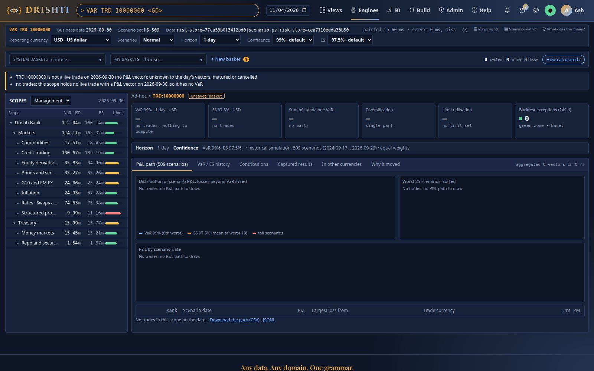

### 3.6 How this number was built

How a VaR figure was built is the **Explain** drawer's tab **Inputs & lineage** (the one Explain of every number,
[USER_GUIDE.md, "Explain: one for every number"](USER_GUIDE.md#explain-one-for-every-number)): **Explain ›** in the toolbar (or the key
**E**), or a click on the VaR or ES tile, slides the drawer over the right of the screen; **Esc** or **✕** closes it and the focus goes
back to where it was. It starts under the top bar, so the command line and the bar's menus stay in reach; on a phone it rises from the
bottom. Its four tabs are the same on every screen: **Formula** (the rank rule with the scope's numbers: N, k, the k-th worst scenario
and its P&L), **Inputs & lineage** (below), **Why it moved** ([section 3.11](#311-why-it-moved-the-var-change-explained)) and
**Workbook** (the explanation's .xlsx and the VaR Playground). **Open as a page** shows all four at once, for an auditor or for printing
(`/explain?kind=var&scope=…`). Everything is the server's, computed for you (the browser computes nothing).

The scope as resolved, the positions and trades included, those without a vector, those outside your entitlement, unknown ids, the
vector batch and data version, the scenario set and its window, the method and rank rule, the ES rule, how components are allocated,
the engine and its threads, your view, **the tier** the vector came from (a node's float64 aggregate, the date's memory-mapped hot file,
or memory: [section 26](#26-the-tiered-memory-and-the-hot-file)), the members' hash, the time taken and whether the cache answered. The
fields are those of the answer's provenance ([section 11.2](#112-the-headline-get-scope-and-its-provenance)); the lineage lists every input
table's data version on the date, the batches and the scenario set.

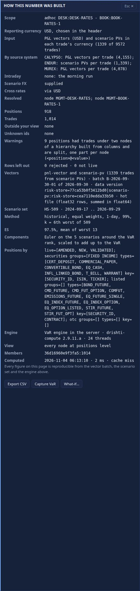

### 3.7 The portfolio and position pages

The `system-basket` (`PORT <id>`, the system baskets of [section 5.7](#57-system-baskets)) and `position` kinds have pages of their own (Sutras). They store no figure: the VaR, ES and contributions on them are
the engine's, computed as the page opens, as you (your view of the nodes):

- `PORT PF-RATES-DESK <GO>`: the strip (positions, longs, shorts, gross and net market value, VaR, ES, limit use); the positions table
  (filter any column, **Pivot** tab), a click on a position opens it and its trades beside; the portfolio's P&L distribution; the
  component VaR by product, by currency and long against short; the top contributors; the definition.
- `POS POS-BOOK-EQD-2~SEC-WARRANT-USD-01 <GO>`: the instrument, direction, quantity, market value, the rule that made it, VaR, ES and
  component VaR in its book; its trades with their own VaR and their component of the position's (a long and a short of one instrument
  have components of opposite signs); its P&L distribution (the UI kit fragment `pnl-distribution@1`).
- `DESK DESK-RATES <GO>`: the desk's VaR and limit use in its strip, from the engine.
- `LE LE-NY <GO>`: the legal entity's VaR (`LE:LE-NY`, the trades it books) and each of its books' VaR beside the record's book rows, from
  the engine; the record stores none.

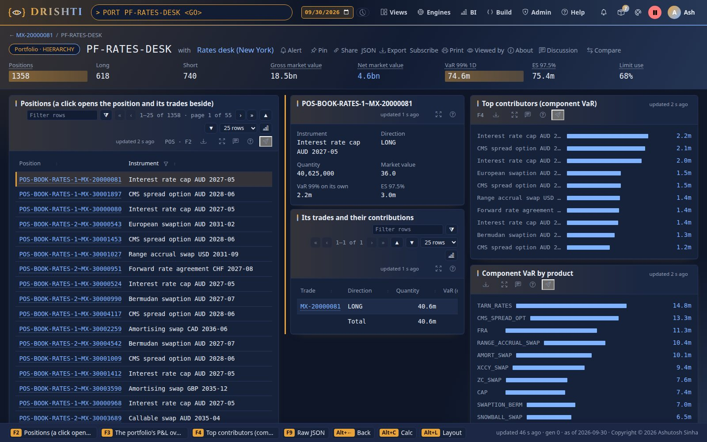

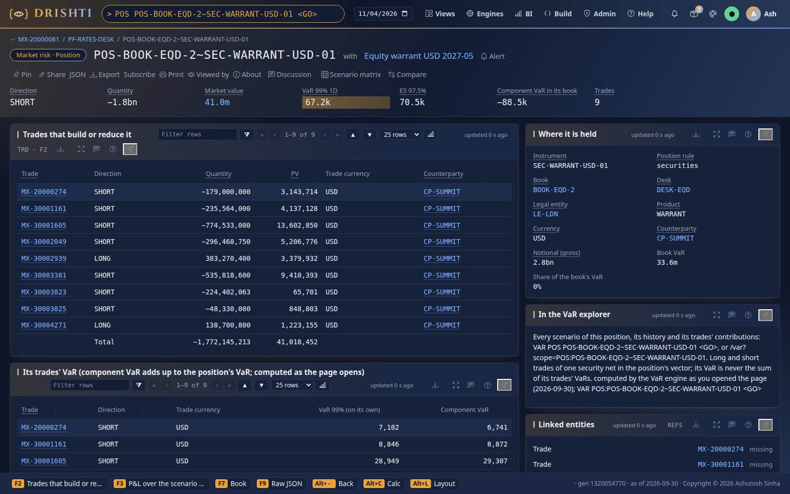

**How the figures get there.** No stored kind carries a VaR figure ([section 21.3](#213-what-is-not-stored)).
The server's view pipeline adds them under `VAR_ENGINE` (`VarFigures`, an engine `ViewAugmenter`) to the document the page draws, and to
an entity a panel sources by id (the position opened beside a portfolio's table), computed as the reader (their entitlements by node,
their field masks); the stored document (`/api/v1/entities/<kind>/<id>/raw`) never has them. When the engine cannot answer (off, no
vectors, the reader may not see VaR, no signed-in viewer) `VAR_ENGINE` says why, `{STATUS: unavailable, NOTE}`, and the page shows the
rest. The book's own page (`portfolio-trades`, *all trades*) is unchanged.

**A trade's page: Risk.** Every Endur, Calypso and Murex trade page has a small **Risk** group (the UI kit fragment
`risk-links@1`, panel code `RISK`): **P&L vector** (`PNLV PV-<trade>-HS-509`, the trade's vector over the scenario days), **VaR of this
trade** (`VRES TRD:<trade>`, the computed kind; `VAR TRD <trade>` opens it in the explorer) and **Exposure of this trade**
(`EXP TRD:<trade>`). They are real links: the engines set `PNL_VECTOR_ID`, `VAR_RESULT_ID` and `EXPOSURE_RESULT_ID` on the view of the
trade when the day's vectors and the exposure run hold it, and the packs' graphs name them, so they are listed with the linked entities
too. When they do not, the row says why: *not live on 2026-10-26: its status is CANCELLED; no P&L vector*, *no exposure paths on …*.
Opening a trade page never waits for the engines to load a date: until they have, the row says so and the load starts.

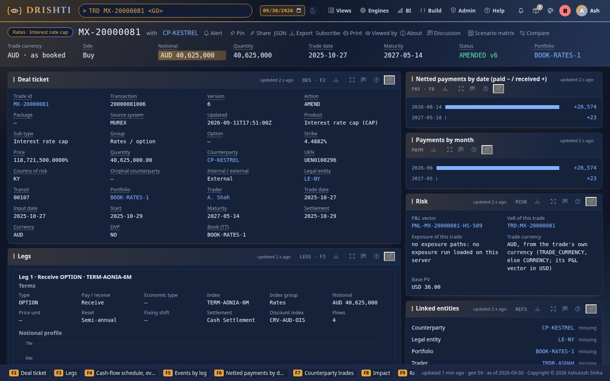

| Page | `VAR_ENGINE` |
|---|---|
| position (`POS:<id>`) | `STATUS`, `SCOPE`, `BUSINESS_DATE`, `VAR`, `ES`, `CONFIDENCE`, `ES_CONFIDENCE`, `NOTE`; `TRADES` (each trade's `TRADE_ID`, `QUANTITY`, `DIRECTION`, own `VAR`, `COMPONENT_VAR` in the position); `BOOK_VAR`, `COMPONENT_VAR` and `PCT_OF_BOOK_VAR` (the position in its book); `PNL` (its 509 P&Ls) |
| system basket (`PORT:<id>`) | the same headline with `LIMIT`, `LIMIT_USE`; `POSITIONS` (each position's instrument, direction, quantity, market value, currency, book, product, own `VAR`, `COMPONENT_VAR`, `PCT_OF_VAR`, `PARTIAL`), `POSITION_COUNT`, `LONG_COUNT`, `SHORT_COUNT`, `GROSS_MV`, `NET_MV`, `TOP_CONTRIBUTORS` (10), `BY_PRODUCT`, `BY_CURRENCY`, `BY_DIRECTION` (component VaR and net market value), `PNL` |
| desk (`DESK:<id>`) | the headline: `VAR`, `ES`, `LIMIT`, `LIMIT_USE` |
| legal entity (`LE:<id>`) | the headline of `LE:<id>` (`VAR`, `ES`, `LIMIT`, `LIMIT_USE` …: the trades the entity books) and `BOOKS`: the record's own book rows (`BOOK`, `DESK`, `PNL`, `MTM`, `TRADES`) each with the engine's `VAR` of `BOOK:<id>` (null when it cannot answer); the stored record keeps no VaR |

### 3.8 On a phone

The panels stack, with no sideways scrolling; the two basket drop-downs are full width, and the Explain drawer is a sheet that rises
from the bottom (Explain ›, or a tap on a tile):

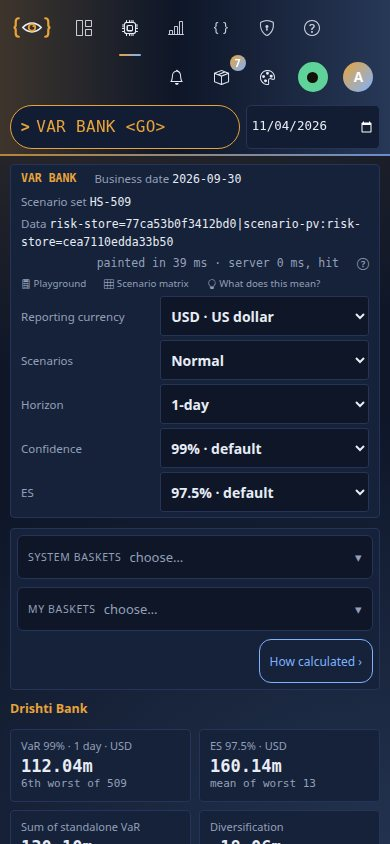

<a id="39-the-scenario-matrix-smat-297"></a>
### 3.9 The scenario matrix (SMAT)

The explorer shows one business date. The **scenario matrix** shows one trade, position or VaR node across its last N business dates:
the scenarios down (each labelled by its historical day), the dates across, and in each cell the scenario's P&L on that date in the
reporting currency. It answers *is this loss scenario new, or has it been in the tail all month?*, *did the VaR scenario move because
the book changed or because the window rolled?* and *which days did this trade's P&L under 2025-04-04 jump?*

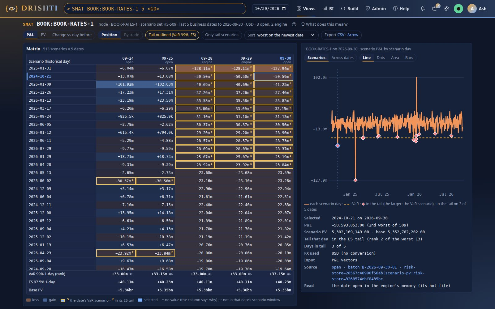

**Open it.** Type `SMAT <id> [N] <GO>`: N is the number of business dates (20 when you leave it out, at most
`drishti.var.smat.max-days`, 60). The id is anything the VaR engine holds:

| Command | Opens |
|---|---|
| `SMAT MX-30000121 <GO>`, `SMAT TRD MX-30000121 30 <GO>` | one trade (30 dates) |
| `SMAT POS-BOOK-EQD-2~SEC-WARRANT-USD-01 <GO>`, `SMAT POS <position> <GO>` | a position: a derived one, or one its source system sends whole (its own `POSITION_ID`) |
| `SMAT DESK:DESK-RATES 20 <GO>`, `SMAT DESK RATES <GO>`, `SMAT BOOK BOOK-RATES-1 <GO>` | a node of a hierarchy (desk, book, legal entity, division, `NODE:<id>`, any configured hierarchy's word) |
| `SMAT BANK <GO>` | the whole bank |
| `SMAT PNL-MX-30000121-HS-509 <GO>`, `SMAT SPV-<trade>-HS-509 <GO>` | a P&L vector's or scenario PV's own id: its trade or position |
| `SMAT DESK RATES 20 IN EUR <GO>` | any of these in a reporting currency |

The page is `/smat?id=<id>&days=N`. A **Scenario matrix** link opens it from a trade's, a position's, a P&L vector's (`PNLV`) and a
scenario PV's (`SPV`) page (beside Compare), and from the VaR explorer's header strip for the scope on screen. `FUNC` lists `SMAT` with
the market-risk pack's commands; the type-ahead offers it as you type `SMAT`.

**The matrix.** Each column header is a business date (`MM-DD`) with, under it, where its numbers came from (below). The cells are
coloured by value (losses in the theme's loss colour, gains in its gain colour, stronger the larger), and every cell shows its number. Three
summary rows stay at the foot of the table, per date: **VaR 99% 1-day** with its rank (`#6`: the 6th worst of 509), **ES 97.5% 1-day**
and the **base PV**. Each date's **tail** is outlined: the VaR scenario (rank k) carries a double outline and the marker **V**, every
other scenario in the ES tail (the 13 worst of 509) the outline and the marker **E**, so the tail never relies on colour alone (and the
cell's spoken label says which).

| Mark | Means |
|---|---|
| a number | the scenario's P&L on that date (or its PV, or its change, by the switch) |
| **V**, **E** | in that date's tail: the VaR scenario, or in ES's tail |
| **—** | no value: the column has a gap, the base PV is unknown (PV), or the date before has none (change); the cell's tooltip says which |
| **·** | the scenario day is not in that date's scenario window (the window rolls: a 509-day set moves on by a day each business day) |

A date with **no values** is never blank and never zeros: its header shows the code in red (`DRS-5203`) and its tooltip the reason; its
cells show `—`. The reasons are the engine's own: `DRS-5203` the date's inputs are not one run (refused), `DRS-1001` no P&L vector or
scenario PV of the trade that day (or not held), `DRS-5201` a wrong length or a trade not live (its status, its maturity), `DRS-5206` a
scenario that failed to price, `DRS-5207` no scenario FX for its currency, `DRS-5002` a kind or field your role may not read. The notice
above the matrix counts them.

**The controls.**

| Control | Does |
|---|---|
| **P&L** · **PV** · **Change vs day before** | the scenario P&L (default); the scenario PV, base PV plus the P&L (P&L = PV − BASE_PV, as the engine converts scenario PVs); each cell less the same scenario on the date before |
| **Position** · **By trade** | for a position whose trades are known (a derived position): its trades under the selected scenario across the dates, a row per trade, the position's total and its rank that day at the foot; a trade, a node or a position its source sends whole offers no trades (the button says why) |
| **Tail outlined** | the outline and markers on or off |
| **Only tail scenarios** | only the scenarios in some date's VaR or ES tail (often 20 to 40 of 509) |
| **Sort** | worst on the newest date (default), worst on any one date, or by scenario day |
| **Export CSV · Arrow** | the whole matrix (every row, every date), as you see it: CSV with the summary rows, each date's source and its gap (a gap's cells empty, never 0); or the Arrow IPC stream (the rows a record batch, the rest in its metadata) for Python, R or DuckDB |

**The chart** (the right-hand panel) has two views and four types:

| Control | Does |
|---|---|
| **Scenarios** (default) | the selected date's column: every scenario day (509 for HS-509) in the order of its date, oldest first, whatever the matrix's sort; the value in the switch's terms (scenario P&L, scenario PV or the change); the date's ES tail marked as diamonds (the VaR scenario the larger one); the selected scenario larger, on a dotted guide; the x axis in months (`Jan 25`, `Apr 25`; years when months do not fit). Click a point (or near it) to select that scenario: its row is selected and scrolled to in the matrix. The title says what it is: *Credit trading on 2026-10-28: scenario PV by scenario day*. Select a cell of another date to chart that date |
| **Across dates** | the selected row (a scenario, or a trade **By trade**, where it is the only view) across the business dates, the selected date's label highlighted; points beyond VaR are diamonds. It needs two or more dates: with one date open it writes the value beside its point and the reference beside its line, and says *Only 1 date is open; the chart needs two or more (20 asked)* |
| **Line** · **Dots** · **Area** · **Bars** | the chart type, for both views; one click switches, remembered in this browser. Area fills to the zero line for a P&L or a change and to the floor of the axis for a PV; Bars are one per point (thin with 509 scenario days) |

| Values | Reference line (dashed) | Also drawn |
|---|---|---|
| **P&L** | **−VaR** | the zero line; the axis includes zero |
| **PV** | **PV at VaR**: the date's base PV less its VaR (the scenario PV at the VaR loss) | the **base PV** (solid); the axis keeps the range of the PVs, not zero |
| **Change vs day before** | none | the zero line |

The legend under the chart names exactly what is drawn (the type's mark, the reference when there is one, the base PV in PV, the
diamonds), and every point's tooltip gives its date, value and reference. Next to the chart, the selected cell's details: its P&L and rank that
day (*2nd worst of 509*), the scenario PV against the base PV, the FX used, whether it is in that day's tail, the **days in the tail** (of
the dates with values) and the **source**: the batch id and data version, linked to the record (a trade's P&L vector or scenario PV, a
node's VaR page or its official capture) as of that date.

**Where each date's numbers come from** (the header's second line, and the details' *Read*):

| Source | When | How |
|---|---|---|
| `open` | the date is open in the engine's memory (its hot file mapped) | the scope's vector exactly as every VaR answer computes it |
| `lake` | a trade, or a position its source sends whole, on a date that is not open | its one record read from the lake **by id** (`PNL-<id>-<set>`, else `PV-<id>-<set>`; `SPV-<id>-<set>` for scenario PVs), checked as the intake checks it (status, maturity, set, length, failed scenarios); scenario PVs converted to USD P&L with the date's scenario FX; 509 numbers, never the whole date |
| `official` | a node on a date that is not open whose official end-of-day capture ([section 19](#19-official-end-of-day-results)) holds its vector, for a person who sees the whole node | the captured vector (the official record of that currency) |
| `engine` | anything else (a derived position, an ad-hoc scope, a node with no official record) | the engine opens the date (from its hot file when one was built), one date at a time |

A P&L vector in another currency than USD on a date not open is read by the engine too, so its conversion is the engine's own. The values
of a date read from the lake equal those the engine computes when the date is open (the server's tests compare them).

**Read as you.** The scope is resolved and checked by the engine as you, on the newest date: a role that sees a desk only in aggregate
cannot open a matrix of its positions or trades (`403 DRS-5002`), as on the explorer; the records are read with your roles and masks
(a masked counterparty shows `•••` in **By trade**).

**Parameters.** The answer carries the confidence, the ES confidence, the scenario window and the horizon it was computed with, and the
summary labels follow them (`VaR 95% 1-day`); the API takes `confidence`, `es-confidence`, `window` and `horizon`, so the VaR page's
horizon and confidence pickers can pass theirs. Only the 1-day horizon is computed today (another answers `400`).

**Fast.** The rows are virtualised (only those in view are in the table, so 509 rows by 60 dates scroll as smoothly as 20). A matrix of
more than about 4,000 cells travels as Arrow (the browser reads its columns as typed arrays), a small one as JSON
([DATA_GUIDE.md › Data formats: JSON Lines is the standard, section 6](DATA_GUIDE.md#2-data-formats-json-lines-is-the-standard)).

**On a phone** the page is the glance form: the chart (both views, every type), how many of the dates it is in the tail, a
scenario picker and the details; the full matrix is on a larger screen. Nothing scrolls sideways.

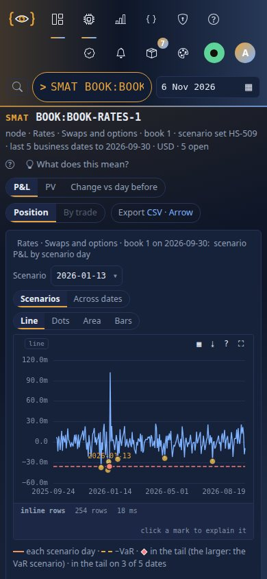

**Editions.** `SMAT` is part of Drishti Risk and Drishti Trading (`commands.words.SMAT: on`); Drishti Market and Drishti World leave it
out: the command answers `DRS-4023`, `/smat` and `/api/smat/...` answer 404, and no page offers the link ([LENSES.md](ADMIN_GUIDE.md#12-what-a-lens-is)).
From the command line: `drishti.py var matrix <id> [--days N] [--by trade] [--csv]` ([section 10](#10-the-command-line)); the API:
`GET /api/v1/risk/var/matrix` ([section 11.1](#111-the-endpoints)).

### 3.10 The VaR Playground (PLAY VAR)

The playground answers *how was this VaR worked out?* with the numbers themselves: every position's scenario P&L, the portfolio, its
rank, VaR, ES, the components, incremental VaR and both 10-day methods, in a spreadsheet-like grid with the explanation beside it, and
**exported as an Excel workbook of real formulas** whose figures equal the engine's to the cent. Change a PV in the workbook and every
figure moves; the check cells say whether the sheet still equals the engine. The workbook's tabs and every formula are in
[section 3.13](#313-the-var-playgrounds-workbook-cell-by-cell); the frame every metric's playground shares is [section 3.14](#314-the-playground-frame-every-metrics-playground).

**Open it.** `PLAY VAR <scope> <GO>` in the VaR explorer's words (`PLAY VAR DESK RATES`, `PLAY VAR BANK 10D SUM`,
`PLAY VAR DESK:DESK-RATES-NY IN EUR`), or `PLAY VAR <id> <id> ...` with up to 50 positions or trades (`PLAY VAR POS-10442 MX-20000274`);
or **Playground** in the VaR page's header strip, which opens the scope on screen on the page's date, with its currency, measure, horizon, confidences and scenario set.

**The screen** (the approved option A):

| Part | What it shows |
|---|---|
| Header | the scope, the date, the currency, the lens, the scenario count and dates, *500 of 18,412 positions* |
| Pickers | Horizon (1-day, 10-day √10, 10-day sum), Confidence and ES from `drishti.var.confidences` and `es-confidences`, Currency, Normal / Stressed; the grid's values: P&L (the PnL tab), Scenario PV (the Data tab) or FX |
| Formula bar | the selected cell's reference and its formula exactly as the workbook writes it |
| Grid | positions across (the largest by \|component VaR\| first), scenarios down; rows 1 to 6 are each position's id, kind, currency, base PV, base FX and input form (tinted: inputs); then one row a scenario with Portfolio, Rank and Mark (**V** the VaR scenario, **E** the ES tail) at the right; then standalone VaR, component VaR, % of VaR, incremental VaR (the top 50), component ES, standalone ES and the 10-day-sum component |
| Rest of scope | one column after the positions when the scope has more than 500: the summed P&L of every other position, in the reporting currency, so the portfolio is still the scope's and its VaR the VaR page's |
| Explanation | the headline, then the steps with the real numbers: the selected cell's P&L (PV × FX − base PV × base FX), the portfolio sum, the rank and k, VaR, ES, the selected position's component (window, scale), the two 10-day methods, every confidence; the check line |
| Export | a drop-down of 100, 500 (the default), 1,000, 10,000 or All positions, each with its estimated size, recalculation time and the applications that open it, stated before the download |

Selecting a cell (or moving with the arrow keys) moves the formula bar and the explanation. Only the cells in view are in the page, so 500
positions by 509 scenarios scroll smoothly. On a phone the page is the glance form: the headline and the explanation.

**The browser never shows more than 500 positions** (`drishti.var.playground.max-positions`, 500 by default and at most; a value above
is refused when the server starts). The workbook is built on the server and streamed, so it can hold more: up to 16,000 or so positions as
columns (Excel and LibreOffice Calc 7.4 or later: 16,384 columns), beyond that positions as rows (1,048,576 rows); Google Sheets opens up
to 10 million cells (about 9,500 positions at 509 scenarios); LibreOffice before 7.4 up to 1,024 columns. A choice no application opens,
or larger than `drishti.var.playground.export-max-cells` (20 million cells), is refused with the reason before anything is made.

**The workbook.** Main (the named inputs, the results beside the engine's figures with a check each, every confidence, every ES
confidence, the per-position table, the ALL CHECKS PASS band), Config (one row a position), Data (values only: scenario PVs in the
position's currency, or the P&L vector as delivered; Rest of scope), FX (one column a currency), PnL (every cell a formula), Explain and
Provenance. Every formula uses only functions Excel, LibreOffice and Google Sheets share, carries its cached result (a viewer that never
recalculates shows the numbers) and is recalculated on open. Copyright and product name come from the branding configuration.

**Where the figures come from.** The engine's own vectors on the date, read as the person (their nodes, roles and masks): each position's
USD rows, its USD value today and the currency its scenario PVs came in; its scenario PVs are recovered as `PV(s) = (p + P&L_USD(s)) /
FX_c(s)`, the same recovery as the per-currency totals ([section 15.11](#1511-reporting-currencies-built-ahead-per-trade-currency-totals-and-the-picker)), so the
workbook's chain of formulas gives back the engine's vector. A position priced by P&L vectors alone is input form PnL. A node's figure is
summed from the rows as read (float64) while the mapped tier stores the rows in float32: when the two differ by more than a millionth,
Rest of scope also holds that difference (zero positions, said in words), so the sheet's VaR is the VaR page's.

**Tested in the drill.** `VarPlaygroundWorkbookTest` writes the workbook **without cached values**, recalculates it with headless
LibreOffice and checks every result against the engine to the cent at 1, 50 and 500 positions (with Rest of scope), USD and EUR, both rank
rules, PV and PnL input forms, and positions as rows; `VarPlaygroundApiTest` does the same through the server on a 611-trade lake; every
formula is scanned for functions outside the common set.

From the command line: `drishti.py var playground <scope> [--ids ...] [--xlsx FILE] [--count N|all] [--estimate]`
([section 10](#10-the-command-line)); the API: `GET /api/v1/risk/var/playground`, `/playground.xlsx`, `/playground/estimate`,
`/playground/template` ([section 11.1](#111-the-endpoints)). **Editions:** `PLAY` is part of Drishti Risk and Drishti Trading
(`commands.words.PLAY: on`); off, the command answers `DRS-4023` and `/play` and `/api/play/...` answer 404.

### 3.11 Why it moved: the VaR change explained

VaR moved from one business date to the next; **Why it moved** says why, in causes that **add up exactly** to the change, and who drove
each one. It is the **Why it moved** tab of the VaR figure's Explain (the drawer, or the page `VAR EXPLAIN <scope> <GO>`, or
`VAR <scope> EXPLAIN [from] [to]`, or `VAR <scope> EXPLAIN vs <date>`, opens).

**Explain › everywhere VaR or ES is shown.** One control, drishti-insight's **Explain ›** (`Drishti.Explain.link`), sits beside every VaR
and ES: the explorer's tree rows and tiles, the regulatory reports (a cell's lineage, the period-end tile), Home's VaR tile, the Sutra
pages' engine figures (a system basket, a position, a desk, a book, a legal entity), a BI visual of one VaR or ES, the MR cube and the
pivots. It opens the drawer at Why it moved; the drawer's **Open as a page** gives the page below. A guard test
(`drishti-console/tests/test_var_explain_everywhere.py`) keeps every such figure carrying it.

**The page** (the approved mock-up `docs/lenses/mockups/var/why-it-moved.html`, layout A), top down:

1. **The compare line**: *compare 10 Nov 2026 with 09 Nov 2026* and four choices: **Previous day** (the default), **1 week**, **Month
   end** (the last day of the month before) and **Pick a date…**; the choice goes into the link (`from=`) and the engine compares with
   the newest business date it has on or before it. **Workbook**, **Print** and **Back to the screen** sit at the top right.
2. **Four figures**: the VaR on each date, the change (and in per cent), the tail scenario (the VaR scenario day now, and what it was).
3. **The waterfall, first and wide**: the earlier VaR, each step, the later VaR. **Click a step** and the right column lists its biggest
   contributors (the trades, books, children or scenario days that drove it) with a summary in plain words; the largest step is shown
   when the page opens.
4. **Formula**, **Inputs & lineage** (sources, versions, batches) and **Checks**, folded below; open them for an audit.

In the drawer the same answer has three views (**Waterfall**, **Matrix**: the scope and each child node, the steps across,
and **Sentences**) with the two dates to compare; it answers any scope the page answers (a node, a portfolio, a basket, an ad-hoc scope), and by default it compares the business date before the newest with the
newest. The design and its reasoning are in [OVERSIGHT_LENS.md section 4.1](../architecture/LENSES.md#531-ro1-var-change-explanation).

**In plain words.** Drishti moves **one thing at a time** from yesterday's state to today's (the corrections to yesterday's data, the
books that moved, the trades that left, the oldest day leaving the scenario window, the market, the newest day entering it, the new
trades) and recomputes VaR at each stage. Each step is the difference between two stages, which is why the steps always add up exactly to
the change. An illustration (figures invented to show the shape, not from the demo data):

| Step | What it means | Effect |
|---|---|---|
| Yesterday's VaR | | 10.0m |
| Restatement | yesterday's data corrected after the official run | +0.1m |
| Hierarchy and rules | a book moved into or out of the scope, no trade changing | 0.0m |
| Trades out | matured, cancelled or closed | −0.4m |
| Oldest scenario dropped | the window rolled; the oldest day left | −0.3m |
| Market | the same trades revalued on today's market | +1.6m |
| Newest scenario added | yesterday's move entered the window | +0.5m |
| Trades in | new trades | +1.0m |
| **Today's VaR** | the steps add up to +2.5m exactly | **12.5m** |

Each step then names who drove it: the trades in and out by their incremental VaR, each desk's or book's share of the market step, and
the scenario days that left or entered and whether they were among the worst days.

**The method: states, each a full VaR.** VaR is a quantile, not a sum, so a change cannot be split by adding parts. The explanation builds
a chain of **states**, each one a full VaR computation that changes one thing from the state before; a step's effect is one state's VaR
less the one before. Because each state starts where the last ended, the steps add up to the last VaR less the first with nothing left
over (a telescoping sum):

| State | Trades | Vectors | Scenario days | Hierarchy and rules |
|---|---|---|---|---|
| S0 | the earlier date's members | the earlier date's **as officially captured** (when the scope is an official node you see whole), else as now | the earlier set | the earlier date's |
| S1 | the same | the earlier date's **now** (a restated date: its data corrected after the official run) | the earlier set | the earlier date's |
| S2 | the earlier date's trades that are in the scope **by the later date's hierarchy and rules** | the earlier date's | the earlier set | the later date's |
| S3 | S2's trades **still live on the later date** | the earlier date's | the earlier set | the later date's |
| S4 | the same | the earlier date's | the **days common to both sets** (the oldest days dropped) | the later date's |
| S5 | the same | the **later date's** | the common days | the later date's |
| S6 | the same | the later date's | the **later set** (the newest days added) | the later date's |
| S7 | **the later date's members** (new trades in) | the later date's | the later set | the later date's |

| Step | Effect | Reads as |
|---|---|---|
| S1 − S0 | **Restatement** | the earlier date's data was corrected after its official run |
| S2 − S1 | **Hierarchy and rules** | the scope's membership changed with no trade changing (a book moved between desks, a rule changed) |
| S3 − S2 | **Trades out** | trades with no vector on the later date (matured, closed) or cancelled |
| S4 − S3 | **Oldest scenario dropped** | the window rolled: the earlier set's oldest days left |
| S5 − S4 | **Market** | the same trades revalued on the later date over the same days: market levels, time decay, sensitivities |
| S6 − S5 | **Newest scenario added** | the window rolled: the later set's newest days entered |
| S7 − S6 | **Trades in** | new trades |
| Σ | V(later) − V(earlier) | exactly |

When the trade feed marks amended trades (`TRADE_ACTION` or `TRADE_STATUS` AMEND or AMENDED on the later date) and
`drishti.var.explain.split-amendments` is on, they are two steps of their own: **Amendments: old terms out** after the trades out and
**Amendments: new terms in** after the trades in; otherwise an amendment is part of the market step (the screen says which). When the
scenario set was replaced rather than rolled (fewer than half its days in common), the window and the market are **one step**,
*Scenario set and market*. When the dates are further apart than one day (a month for the committee), the window steps cover every day
that left and entered, and trades out and in are the net churn between the two dates.

**Only the churn is summed.** S1 and S7 are the scope's own vectors on each date (the engine holds them already); the others are those
totals plus or minus the summed vectors of the trades that moved (out, in, moved by the hierarchy, amended), so the cost is bounded by
the churn, not by the book. Both dates are opened through the engine (each counts towards `drishti.var.hot-dates`; the least recently
used date leaves first, [section 26.8](#268-dates-in-memory-over-years-of-history)), so a second date open is cheap.

**The order is a setting.** Any split of a quantile's change depends on the order the causes are applied in, so the order is stated on
the screen and set by `drishti.var.explain.order` (default `restatement, hierarchy, trades-out, window, market, trades-in`: restatement
first because it corrects yesterday, trades last because the desk decides them). Restatement and trades out come before the market (they
have only the earlier date's vectors), trades in after it (only the later date's), the window next to the market; hierarchy and rules may
go anywhere. A bad order refuses the start in words. Another order gives other step sizes with the same total. An order-free **Shapley**
variant (each cause's effect averaged over every order) is **planned**; `method=shapley` answers 400 in words.

**Who drove each step.**

| Step | Its drivers |
|---|---|
| Trades out, trades in, amendments | each trade's **incremental VaR**: the state's VaR with it less without it (in the state that holds it); the top 10 (`drishti.var.explain.top`), then one line, *the others and the interaction*, that closes the step exactly (incremental VaRs do not add up) |
| Hierarchy and rules | the books whose trades moved in or out of the scope, each group's incremental VaR, and *the interaction* |
| Oldest scenario dropped, newest added | each day that left or entered: its P&L, its rank in the state and whether it was in the tail (rank ≤ k). At the same k, a day leaving can only lower VaR or leave it; a day entering can only raise it or leave it |
| Market | each child's (a node's child nodes, else each book's) **component VaR** before and after: components add up to each state's VaR ([section 18.3](#183-decomposition-of-a-scope-into-parts)), so the changes add up to the step |
| Every state | the **VaR scenario's date** (the day of rank k); when a step changes it, the answer says so in words: *at the newest scenario added step the VaR scenario changed from 2026-09-23 to 2026-09-16* |

**The order-free view.** Beside the steps, each child's component VaR on the later date less on the earlier (each date's own hierarchy;
a child that left or arrived shows its whole component), with a *restatement since the official run* line when S0 is a capture: it also
adds up exactly to the change, with no order at all. The **limit-use line** splits the change of limit use into the VaR's part
(ΔVaR / the earlier limit) and the limit's own part (the later VaR × the change of 1 / limit) for a node with a limit on both dates.

**The screen: one tab, three views.** A switch, **Waterfall · Matrix · Sentences**, over one answer; the choice is kept in the address
(`view=matrix`) and in your settings, so a link without `view=` opens the one you chose last, else Waterfall. The From and To dates and
**Download the working (.xlsx)** are shared by the three.

| View | What it draws |
|---|---|
| **Waterfall** (the default) | four tiles (VaR on each date, the change, limit use or the VaR scenario); the waterfall from the earlier VaR to the later (a rise in VaR orange, a fall blue: more risk is not a gain); the steps as a table whose rows open their drivers; the selected step's drivers; how it was worked out (the order, the start, the notes); the states (trades, vectors, days, scenarios, VaR, the VaR scenario, the step), and the order-free view |
| **Matrix** | the bridge of every node: the scope and each child node down, VaR before, every step across, VaR after and the change; a row opens its sentence and its steps as bars, and a bar opens that node's waterfall |
| **Sentences** | the answer in words, and each cause's step with the Shapley column marked planned |

It is drawn with the standard panel kinds (`metric`, `waterfall`, `table`, `hbar`, `markdown`) by the console's one renderer, so it
behaves like every other screen (themes, the Data table under each chart, phone widths). **On a phone** the answer in words comes first
(must), the steps as horizontal bars (glance, a tap opens the step's drivers) and the drivers under them (more); the states and the matrix
are for the desk. **F1** opens this section.

**A worked example.** A desk on two business dates, 12 scenario days at 90% (k = 2, so every number can be checked by hand). The desk
holds trade A; trade B (a hedge) matures; trade C is new; book M moves into the desk from another; the window rolls one day (2026-09-14
leaves, 2026-09-30 enters); the market scales every P&L by 1.1:

| State | After | Days | VaR | VaR scenario | Step |
|---|---|---|---|---|---|
| S0 | the earlier date | 12 | 20.00 | 2026-09-14 | |
| S1 | Restatement (none: the data did not change) | 12 | 20.00 | 2026-09-14 | +0.00 |
| S2 | Hierarchy and rules (book M moved in) | 12 | 30.00 | 2026-09-23 | +10.00 |
| S3 | Trades out (B matured: it was a hedge) | 12 | 50.00 | 2026-09-23 | +20.00 |
| S4 | Oldest scenario dropped (2026-09-14, rank 3: not in the tail) | 11 | 50.00 | 2026-09-23 | +0.00 |
| S5 | Market (× 1.1) | 11 | 55.00 | 2026-09-23 | +5.00 |
| S6 | Newest scenario added (2026-09-30, rank 1: in the tail) | 12 | 66.00 | 2026-09-16 | +11.00 |
| S7 | Trades in (C) | 12 | 55.00 | 2026-09-16 | −11.00 |
| | | | | **Σ** | **+35.00 = 55.00 − 20.00** |

Read as: VaR rose by 35; the largest causes were the hedge that matured (+20), the new loss day that entered the window (+11) and the
book moved in (+10); the new trade C offset 11. The newest day became the worst day (rank 1), so the VaR scenario (rank 2) moved from
2026-09-23 to 2026-09-16.

**On the demo data.** The test data holds three business dates, 2026-09-28 to 2026-09-30 ([section 22.1](#221-what-the-repository-ships-verified-2026-10-25-version-13)),
so the tab compares 2026-09-29 with 2026-09-30 by default. The engine's answers (99%, 1-day, the default order; `GET
/api/v1/explain?kind=var&part=why` on a lake built with `lake demo --as-of data`), USD:

| Step | BANK 2026-09-29 → 09-30 | BANK 2026-09-28 → 09-29 | DESK:CREDIT 09-28 → 09-29 | DESK:FI 09-28 → 09-29 |
|---|---|---|---|---|
| Earlier VaR | 112,575,052 | 112,405,919 | 147,794,310 | 13,634,471 |
| Restatement | 0 | 0 | 0 | 0 |
| Hierarchy and rules | 0 | 0 | −12,532,037 | +19,620,151 |
| Trades out | −531,668 (37 trades) | −866,479 (31 trades) | −2,023,539 | −273,893 |
| Oldest scenario dropped | 0 | 0 | 0 | 0 |
| Market | −1,738 | +1,035,612 | 0 | +281,266 |
| Newest scenario added | 0 | 0 | 0 | 0 |
| Trades in | 0 | 0 | 0 | 0 |
| **Later VaR** | **112,041,646** (−533,406) | **112,575,052** (+169,133) | **133,238,734** (−14,555,576) | **33,261,995** (+19,627,524) |

Read as: the bank's VaR fell by 533,406 from 2026-09-29 to 2026-09-30, almost all of it the 37 trades that matured or were cancelled
(the largest, Endur ComSwap 1002610 of BOOK-COMM-1, alone 840,196 of incremental VaR). The VaR scenario is 2026-07-16 on every date, and
neither the day leaving the window nor the day entering it is in the tail, so both window steps are nil. No trade is booked on these
days (the trades feed's newest trade date is 2026-09-25), so *trades in* is nil. The demo's trades carry no `TRADE_ACTION`, so the
amended trades are part of the market step (the screen says so). From 2026-09-28 to 2026-09-29 book `BOOK-FI-3` moves from the credit
desk to the fixed income desk: the hierarchy step takes it out of `DESK:CREDIT` and into `DESK:FI`, and the bank, which holds both, shows
no hierarchy effect.

From the command line (`drishti.py var explain DESK:RATES`, [section 10](#10-the-command-line)) the same answer prints as text, the
waterfall as aligned lines:

```text
VaR of Rates rose by 35, from 20 on 2026-09-29 to 55 on 2026-09-30; the steps below add up to it exactly.
The largest causes: trades out +20, newest scenario added +11, trades in −11.
At the hierarchy and rules step the VaR scenario changed from 2026-09-14 to 2026-09-23.
At the newest scenario added step the VaR scenario changed from 2026-09-23 to 2026-09-16.

VaR 2026-09-29                         20
Restatement                            +0
Hierarchy and rules                   +10  ++++++++++++++++
Trades out                            +20  ++++++++++++++++++++++++++++++++
Oldest scenario dropped                +0
Market                                 +5  ++++++++
Newest scenario added                 +11  ++++++++++++++++++
Trades in                             -11  ------------------
VaR 2026-09-30                         55
change                                +35  the steps add up: yes
```

**The working as a workbook.** The Explain drawer's **Workbook** tab (`drishti.py var explain <scope> --xlsx FILE`, `GET
/api/v1/risk/var/explain.xlsx`) writes the explanation on the VaR Playground's frame ([section 3.10](#310-the-var-playground-play-var)): **Main**
(the inputs Confidence and RankRule; each state's VaR worked from its column, N, k, the VaR scenario's date, the engine's VaR beside it and
a check; each step as the difference of two state cells beside the engine's; the add-up check; the last state checked against the later
date's scope; the order), **Data** (values only: the two dates' scope P&L by scenario day on one axis of both sets' days, and the churn's
sums: captured, earlier now, moved in and out, trades out, amended, later, trades in), **States** (one P&L column per state, each a
formula over the state before it and Data, and its ranks), **Drivers** (the engine's contributors and the order-free view), **Explain**
(every step and term in plain words) and **Provenance**. Every formula uses only the functions Excel, LibreOffice and Google Sheets share;
`VarExplainApiTest` recalculates it with headless LibreOffice and checks every state's VaR and VaR scenario against the engine to the cent.

**Settings** (`drishti.var.explain.*`, [section 12](#12-settings)): `enabled` (true), `order`, `window-lines` (`two`, or `one` window-roll
line), `split-amendments` (true), `top` (10), `drivers-max` (2,000 trades per step whose incremental VaR is computed, the largest by their
share of the state's tail), `cache-minutes` (10: answers are kept, never stored), `cache-mb` (32, weighed in bytes) and `matrix-max` (60
child nodes). The API: `GET /api/v1/explain?kind=var&scope=…&from=…&to=…&part=why` (`view=matrix` for the Matrix view;
[API_REFERENCE.md, "Explain"](API_REFERENCE.md#18-explain-any-number)) and `GET /api/v1/risk/var/explain.xlsx` ([section 11.1](#111-the-endpoints)); the
same entitlements as the scope's VaR (a scope is resolved as you on each date).

### 3.12 Parametric VaR beside historical (PVAR)

The explorer's **Parametric** toggle (beside the tiles) adds, beside historical VaR as always, **parametric VaR**: the normal
distribution fitted to the scope's own scenario P&L vector (z·σ − μ; [section 18.15](#1815-parametric-var-and-es-a-cross-check)). It is a
**cross-check, never the official VaR**: limits, limit use, backtesting, official records and regulatory reports stay historical, and
every parametric figure says so. The toggle is kept in the link (`pm=1`); the command **PVAR `<scope>`** is an alias that opens the
explorer with it on, reading the scope and lens words as VAR does: `PVAR DESK DESK-RATES 10D SUM 95`, `PVAR BANK IN EUR`. Off, the
explorer is historical only.

With the toggle on:

| Where | What it shows |
|---|---|
| **Tiles** | parametric VaR, parametric ES and the **fat-tail gap** = historical − parametric, with skew and excess kurtosis |
| **The tree** | the **Parametric** and **Gap** columns beside each node's VaR, ES and limit |
| **The P&L path** | the **normal curve** over the histogram, the historical marker (solid) and the parametric one (dashed), both tails lightly shaded and the gap bracket between the markers |

**The ? on every parametric figure** (a tile, a tree cell) is its Explain: hover it for the preview, click it for the drawer, whose
**Formula** is the server's own lines: the method, the window, the weighting, the confidence and z, the horizon, n, μ and σ, the formula
with the scope's numbers, ES, historical VaR beside it and the gap with its reading. Every number comes from the answer (the browser
computes nothing); on a phone the drawer is a bottom sheet.

**The Normal curve toggle** (key **N**) hides the curve, the parametric marker, its tail and the gap bracket; the choice is remembered
for you and in the link (`nc=0`). **Worked in the playground** (and the Explain drawer's Workbook tab) opens the VaR Playground's **Parametric tab**
on the scope ([section 3.10](#310-the-var-playground-play-var)): the figures, the steps, each position's μᵢ, σᵢ, cov(Pᵢ, P), ρᵢ and the
Euler components that add up to the parametric VaR, and the workbook's Parametric tab. The MR cube and the pivot offer `pvar()` beside
`var()` and `comp_var()`. [Tutorial 2, Part B](../tutorials/02-var-from-the-bank-to-a-trade.md#part-b--parametric-var-beside-historical-the-fat-tail-gap) walks through it on the demo data.

### 3.13 The VaR Playground's workbook, cell by cell

**Inputs, as the person.** The playground's endpoint builds its inputs with the person's entitlements and masks, from the same date,
batch, scenario window and scenario set the engine used, and says so in the Provenance tab: the **scenario PVs** of each position in its
own currency (`scenario-pv`, the preferred input; [section 15.9](#159-scenario-pv-scenario-pvs-per-trade-in-the-trades-currency)) or
its **P&L vector** (`pnl-vector`, flagged *input form PnL*, base PV *n/a*); the **scenario FX** per currency and its base rate
(`fx-scenario` as supplied, or derived from the FX history: each currency's column says *supplied* or *derived*); the scenario dates,
window, set id and stress flag; the rank rule, component window, confidences, horizon and 10-day method (`drishti.var.*` and the
pickers, written to Main as inputs); and the engine's own figures for the same scope and pickers (Main's check cells). A trade or position
the engine refused (a missing PV, an unknown currency) is listed in Provenance with its DRS code and left out, as the engine leaves it
out; never zero-filled. A position whose trades came in different currencies is shown in USD. Stressed VaR (USD only) shows every
position as input form PnL on the stress set's scenarios; a date with no stress set says so, never zeros.

**Which figures for which positions.** Standalone and component VaR and ES for every position (a sum over the scope's tail scenarios);
**incremental VaR for the top 50 by |component VaR|** (`drishti.var.playground.incremental-positions`), because each needs its own
re-ranked portfolio column (the others say *not computed (top 50 only)*); diversification for the scope.

**Size and layout.** 500 positions × 509 scenarios is about 12 MB and recalculates in headless LibreOffice in about 10 seconds; 50
positions about 1.3 MB; one position about 140 KB. The estimate the export states before the download comes from these measurements
(about 11 bytes a value cell and 30 a formula cell, compressed); while it writes, the server holds the chosen positions' scenario values
(about 8 bytes a cell), which `export-max-cells` caps. Positions are columns while the PnL tab's columns fit (label, positions, Rest of
scope, nine series and the 50 incremental helpers within 16,384 columns: about 16,300 positions); beyond that positions are rows and
scenarios columns, the same formulas through the other orientation.

**The template: in git, built into each export.** The look and the words are a template kept in the repository as text, under
`drishti-banking/src/main/resources/playground/var/template/`: `template.properties` (name, version, every cell format by name, the check
colours), `xl/styles.xml` (the look), `docProps/core.xml` and `docProps/app.xml` (with `{{PRODUCT}}`, `{{COPYRIGHT}}`, `{{OWNER}}` and
`{{TEMPLATE_VERSION}}` filled from the branding configuration) and `explain.txt` (the Explain tab's steps; `{Name}` a cell reference,
`{Name:v}` its value). The sheets, the named cells and every formula are written by the generator (`VarPlaygroundBook`) for exactly the
positions chosen, streamed row by row onto the response; each formula cell is checked against the common function set and carries its
**cached result** from `VarPlaygroundModel` (the same arithmetic as the formulas), and the workbook asks to be recalculated on open
(`fullCalcOnLoad`). A bank's own house style is a folder named by `drishti.var.playground.template` that keeps every style name of
`template.properties` (checked at start: a missing name or file refuses it, listed). The **empty workbook**
(`GET /api/v1/risk/var/playground/template?positions=10`) has every formula in place over blank Data, Config and FX: paste scenario PVs,
fill the rates and it calculates offline. The template's version is in every tab's footer and the document properties.

**The tabs.** Positions are columns and scenarios rows, oldest first, in every tab.

| Tab | What it holds | Typed or formula |
|---|---|---|
| **Main** | the title band (product name, scope, date, currency, horizon, confidence); the named inputs (`Confidence`, `EsConfidence`, `Horizon`, `TenDayMethod`, `RankRule`, `ComponentWindow`, `ReportingCurrency`, `ScenarioCount`); the results (VaR, ES, the VaR scenario's rank and date, 10-day √10 and 10-day sum VaR and ES, every configured confidence and ES confidence, and per position standalone VaR and ES, component VaR and ES, % of VaR, incremental VaR, diversification), each beside the engine's figure with a check; the ALL CHECKS PASS band | inputs typed; results formulas |
| **Config** | one row a position: id, kind, currency, base PV in its own currency, base FX (USD per unit), input form `PV` or `PnL`, its source, its value today in USD | typed; the last column a formula |
| **Data** | values only, the one place data is pasted: each position's scenario PVs in its own currency (form PV) or its P&L vector as delivered (form PnL); Rest of scope's P&L in the reporting currency | values |
| **FX** | one column a currency (not a position): each scenario's rate (USD per unit), the base rate and *supplied* or *derived* in header rows; USD is 1 throughout | values |
| **PnL** | every cell a formula: each position's P&L in USD and then in the reporting currency, the portfolio, its tie-broken rank, the V and E marks, the 10-day sums, the incremental helper columns | formulas |
| **Explain** | the calculation in plain language (what VaR answers, how to read the tabs, signs and units), then ten steps, each in plain words with its formula and cells, then every term of every tab: what it is, why it matters, what changing it does, its cell and value | text with references |
| **Parametric** | the parametric cross-check ([section 18.16](#1816-parametric-var-signs-the-gap-the-decomposition-and-a-worked-example)): a row a scenario (its weight, the portfolio P&L, its deviation and square), a column a position (its deviation and the product with the portfolio's), under them μᵢ, cov(pᵢ, v), ρᵢ, component VaR and ES, standalone VaR; the sums and the checks | formulas |
| **Provenance** | date, batch, data versions, scenario set id and dates, window, stress flag, source per position, refused items with DRS codes, engine and template versions, who exported it and when, the scope's full position count | values |

**The formulas** mirror the engine (`ScenarioFx` and the ranking of [section 18](#18-the-computation)). A position's P&L in USD:
`PV(s) × FX_c(s) − PV(base) × FX_c(base)` for input form PV (for a USD position `PV(s) − PV(base)`); the vector as delivered for form PnL
in USD, converted at each scenario's rate otherwise. Into the reporting currency, with `p` the position's USD value today and `FX_r` the
reporting currency's USD-per-unit rates: `P&L_r(s) = (p + P&L_USD(s)) / FX_r(s) − p / FX_r(base)`, every cross through USD. The Config
flag switches the PnL formula, so a person can see and flip it. Positions as columns, item `i` in column `B + i` of Data and PnL, Config
row `2 + i`, scenario `j` in row `4 + j`:

| Cell | Formula |
|---|---|
| PnL, a position | `=(Config!$H$c+IF(Config!$F$c="PV",Data!Bj*INDEX(FX!$B$j:$X$j,Config!$I$c)-Config!$H$c,IF(Config!$C$c="USD",Data!Bj,Data!Bj*INDEX(FX!$B$j:$X$j,Config!$I$c))))/FX!$R$j-Config!$H$c/FX!$R$2` (`Config!H` the value today in USD, `= base PV × base FX`; `Config!I` the position's FX column, `=MATCH(currency, FX!$B$1:$X$1, 0)`; `FX!R` the reporting currency's rate) |
| PnL, Rest of scope | `=Data!x` (already in the reporting currency) |
| Portfolio `v(s)` | `=SUM(B j:… j)` across the positions and Rest of scope |
| Rank, worst first, ties by index | `=SUMPRODUCT(($P$4:$P$512<Pj)*1)+SUMPRODUCT(($P$4:$P(j−1)=Pj)*1)+1` |
| `k` (kth-worst) | `=MAX(1, MIN(N, ROUNDUP(N*(1-Confidence) - 1E-9, 0)))` |
| Mark, VaR window, ES tail | `=IF(Rank=VarRank,"V",IF(Rank<=EsRank,"E",""))`; `=(Rank>=VarLo)*(Rank<=VarHi)`; `=(Rank<=EsRank)*1` |
| VaR (`VaROneDay`) | `=IF(RankRule="interpolated",-((1-IW)*SMALL(PF,ILo)+IW*SMALL(PF,IHi)),-SMALL(PF,VarRank))` |
| ES (`ESOneDay`) | `=-SUMPRODUCT(ES tail,PF)/EsRank` |
| Tail window, scale | ranks `k−h … k+h`, `h = ROUNDDOWN(ComponentWindow/2, 0)`, clamped to 1..N; `Scale = VaR / S`, `S = −mean over the window of v` (1 when the scaling is off or `S` is 0) |
| Component VaR, ES | `=-Scale*SUMPRODUCT(VaR window,p)/(VarHi-VarLo+1)`; `=-SUMPRODUCT(ES tail,p)/EsRank` |
| Standalone ES, every ES confidence | with no rank column: `=-(SUMPRODUCT((x<SMALL(x,k))*x)+(k-SUMPRODUCT((x<SMALL(x,k))*1))*SMALL(x,k))/k` |
| Incremental helpers (top 50) | `=Pj − position j`: the portfolio without the position, its own rank and kth-worst; incremental VaR `= VaR(v) − VaR(v − p)` |
| Diversification | `Σ standalone VaR − VaR` |
| 10-day sum, its rank | `=SUM(P(j−9):Pj)` from the 10th scenario (509 scenarios give 500 windows); ranked, VaR and ES as the 1-day figures |
| 10-day weights | for each scenario, how many of the 10-day VaR window's (and ES tail's) windows contain it: `=SUMPRODUCT((R10 range>=TenLo)*(R10 range<=TenHi))` over the windows that end in `j … j+9`, so a position's 10-day component is `−TenScale × SUMPRODUCT(weights, its 1-day column) / (TenHi − TenLo + 1)` with no 10-day column per position |
| Headline | `=IF(Horizon="1D",VaROneDay,IF(TenDayMethod="SUM",VaRTenSum,VaROneDay*SQRT(10)))` |

Main's derived named cells (`VarRank`, `EsRank`, `VarLo`, `VarHi`, `IPos`, `ILo`, `IHi`, `IW`, `VaROneDay`, `ESOneDay`, `Smoothed`,
`Scale` and their 10-day twins `TenCount`, `TenRank`, `TenEsRank`, `TenLo`, `TenHi`, `TenPos`, `TenILo`, `TenIHi`, `TenIW`, `VaRTenSum`,
`ESTenSum`, `TenSmoothed`, `TenScale`) sit under the inputs with their formula in words; no name looks like a cell reference. Every
confidence and ES confidence has its own row of results on Main (a different rank of the same ranked vector).

**The Parametric tab's formulas** (`W` the weights, `PF` the portfolio column, `Pᵢ` a position's):

| Cell | Formula |
|---|---|
| weight `w_j` | equal: `=1/N`; EWMA: `=(1-PLambda)*PLambda^(N-j)/(1-PLambda^N)` |
| `PMu`, `PSigma` | `=SUMPRODUCT(W, PF)`; equal: `=SQRT(SUMPRODUCT((PF-PMu)^2)/(N-1))`, EWMA: `=SQRT(SUMPRODUCT(W,(PF-PMu)^2))` |
| `PZ`, `PEsFactor` | `=NORM.S.INV(PConfidence)`; `=EXP(-(NORM.S.INV(PEsConfidence)^2)/2)/SQRT(2*PI())/(1-PEsConfidence)` (the brackets matter: without them a spreadsheet squares the negated value) |
| `PVaR`, `PES` | `=PZ*PSigma-PMu`; `=PSigma*PEsFactor-PMu` |
| μᵢ, cov(pᵢ, v), ρᵢ | `=SUMPRODUCT(W, Pᵢ)`; equal: `=SUMPRODUCT((Pᵢ-μᵢ)*(PF-PMu))/(N-1)`, EWMA: `=SUMPRODUCT(W,(Pᵢ-μᵢ)*(PF-PMu))`; `=covᵢ/(σᵢ*PSigma)` |
| component VaR, ES; standalone | `=PZ*covᵢ/PSigma-μᵢ`; `=PEsFactor*covᵢ/PSigma-μᵢ`; `=PZ*σᵢ-μᵢ` |
| 10-day | the lens's vector: √10 × the 1-day results (`sqrt10`), or μ and σ of the PnL tab's 10-day sum column (`sum`) |

Main also holds the parametric inputs as named cells (`PConfidence`, `PEsConfidence`, `PWeighting`, `PLambda`) and results beside the
engine's figures, historical VaR and the gap beside them. Rest of scope takes part as one more position, so the portfolio is the scope's.

**Check cells.** Portfolio VaR and ES (every confidence, both 10-day methods) equal the engine's figure written beside them to the cent
(`ABS(sheet − engine) < 0.005`); Σ component VaR = VaR, Σ component ES = ES and Σ 10-day-sum components = the 10-day sum VaR; every
position's component VaR, component ES, 10-day component and incremental VaR equal the engine's; positions shown + Rest of scope = the
scope's count; `COUNT` of each Data column = `ScenarioCount`; every position's currency has an FX column; on the Parametric tab `PVaR`,
`PES` to the cent, `PMu`, `PSigma` to 10⁻⁶, Σ components = `PVaR` and `PES`, Σ weights = 1. The **ALL CHECKS PASS** band sits at the top
of Main (row 3), green, or red naming the failed check. A person who changes a PV sees the engine checks turn red (the engine's figure is
for the original inputs) while the *adds up* checks stay green. The engine's figures are its calculator's (`VarCalc`, `VarLens`) on its
own scope vector and the positions' vectors.

**The look.** One font family; a navy title band, light-blue headings, inputs light yellow with blue figures, formula figures black,
losses red; colour-blind-safe markers as well (*V* on the VaR scenario, *E* on the ES tail); thousands separators and two decimals for
money; frozen headers, set widths, landscape print fit to width. Copyright and product name in the footer of every tab and in the
properties, **only from the branding configuration** (`drishti.branding.*`). The look's mock-ups:
[Main](../architecture/mockups/var-playground/workbook-main.png), [Config](../architecture/mockups/var-playground/workbook-config.png),
[Data](../architecture/mockups/var-playground/workbook-data.png), [FX](../architecture/mockups/var-playground/workbook-fx.png),
[PnL](../architecture/mockups/var-playground/workbook-pnl.png), [Explain](../architecture/mockups/var-playground/workbook-explain.png),
[Provenance](../architecture/mockups/var-playground/workbook-provenance.png); the screen: [option A](../architecture/mockups/var-playground/A.png).

**Excel, LibreOffice and Google Sheets: one file.** Formulas use only the functions the three share: `SUM`, `SUMPRODUCT`, `SMALL`,
`LARGE`, `AVERAGE`, `COUNT`, `INDEX`, `MATCH`, `ROUNDDOWN`, `ROUNDUP`, `SQRT`, `IF`, `ABS`, `MAX`, `MIN`, `AND`, `OR`, `ISNUMBER`,
`EXP`, `SUMIF`, `SUMIFS`, `NORM.S.INV`, `PI` (the list is `XlsxFormulas.ALLOWED`; a formula naming anything else is refused when it is written). Never
Excel-365-only dynamic arrays (`FILTER`, `SORT`, `SEQUENCE`, `LET`, `LAMBDA`, `XLOOKUP`), structured references, volatile `INDIRECT` or
`OFFSET`, or macros. Cached values ride with every formula, so a viewer that never recalculates (a browser preview, a mail client) shows
the right numbers.

**Tests.** `VarPlaygroundWorkbookTest` writes the workbook without cached values, recalculates it with `soffice --headless` and compares
every result row, every confidence row and every position's component VaR, component ES, 10-day component and incremental VaR to the
engine's calculator to the cent: 1 position (USD), 50 (EUR reporting, the interpolated rank rule, the 10-day sum headline) and 500 with
Rest of scope (USD, √10), PV and PnL input forms, positions as rows. `VarPlaygroundApiTest` does it through the server on a 611-trade lake
(scenario PVs in EUR and GBP, USD P&L vectors); `PvarPlaygroundWorkbookTest` does the same for the Parametric tab (equal and EWMA, USD and
EUR). A bank template missing a style is refused with the list; every formula is scanned for functions outside the common set. The
LibreOffice harness skips where LibreOffice is absent and runs one LibreOffice at a time. The screen: `test_play.py` and
`test_play_browser.py` (the windowed grid, the formula bar, the explanation, the arrow keys, the export's estimate, at 1280 and 390 px).

### 3.14 The playground frame: every metric's playground

**The rule: every metric calculation ships with its playground, in the same release as the metric.** A metric is not done without
`PLAY <METRIC> <ids|scope>`; the screen (the inputs grid with the tall explanation panel and real numbers); the export from a
version-controlled template with Main, Config, Data (values only), formula tabs, Explain and Provenance; every derived cell a formula;
check cells (sheet = engine to the cent); the look of [section 3.13](#313-the-var-playgrounds-workbook-cell-by-cell); copyright from the
branding configuration; one file for Excel, LibreOffice and Google Sheets; a test that recalculates it in headless LibreOffice. Where a
metric's core is a large simulation (exposure paths, projected IM or capital), the simulation's output is **data** and everything after it
is **formulas**, and the sheet says so on Main and in Explain; VaR's core is a sum and a rank, so every step after the scenario PVs is a
formula. Critique and reproduce (a Choices panel of named method switches, compare, saved recipes) are part of the frame as the FRTB-SA
and SIMM playgrounds use them ([FRTB_SA_GUIDE.md section 8](FRTB_SA_GUIDE.md#8-the-frtb-sa-playground-play-frtb)).

**How a metric plugs in.** In `drishti-server`:

| Piece | Where | What a metric does with it |
|---|---|---|
| `PlaygroundTemplate` | `server/playground` | `PlaygroundTemplate.builtIn("<metric>", STYLES)` reads `playground/<metric>/template/` (copy VaR's folder) and refuses a bank's folder missing a style |
| `WorkbookStream`, `SheetStream` | `server/playground` | the zip written onto the response, sheet by sheet and row by row: `sheet`, `row`, `text`, `number`, `formula(col, f, cached, style)`, `formulaText`, `freeze`, `width`, `merge`, `checks`, the branding footer, `name(...)` for the named cells |
| `SeriesLayout` | `server/playground` | items (positions, netting sets, trades) by points (scenarios, time steps) as columns or as rows: every formula reference comes from it, so one generator serves both orientations |
| `ExportSizing` | `server/playground` | the estimate of a count: columns, rows, cells, size, recalculation time, the applications that open it, or why not |
| `XlsxFormulas`, `XlsxWriter.formula` | `server/dist` | the common function set, the check of every formula written, the scan of a finished file |
| `LibreOfficeRecalc` | the tests' `server/playground` | `recalc(xlsx, work)` and `cells(file, sheet)`: the headless recalculation, one LibreOffice at a time |
| The screen | `drishti-console`: `play_routes.py`, `terminal/play.html`, `drishti_var-playground.js`, `drishti_var-playground.css` | `PLAY <METRIC>` (the word added to `METRICS`); the windowed grid, formula bar and explanation take the metric's columns, rows and steps |

A metric adds its model (the formulas' arithmetic, for the cached values: VaR's `VarPlaygroundModel`), its generator (VaR's
`VarPlaygroundBook`), its inputs as the person (VaR's `VarPlayground`), its endpoints (`/api/v1/risk/<metric>/playground`, `.xlsx`,
`/estimate`, `/template`) and its recalculation test at its own sizes.

| Playground | Metric | Status |
|---|---|---|
| VaR (`PLAY VAR`) | VaR, ES, components, incremental, 10-day, stressed; parametric on its Parametric tab | built |
| FRTB SA (`PLAY FRTB`) | SBM, DRC, RRAO ([FRTB_SA_GUIDE.md section 8](FRTB_SA_GUIDE.md#8-the-frtb-sa-playground-play-frtb)) | built |
| SIMM (`PLAY SIMM`) | IM per netting set and regime ([SIMM_GUIDE.md section 8](SIMM_GUIDE.md#8-the-simm-playground-play-simm)) | built |
| Exposure | EE, EPE, PFE for one netting set (the paths as data) | proposed |
| SA-CCR | EAD by CRE52 (replacement cost, add-ons, the multiplier) | proposed, with the engine |
| FVA | EPE and ENE × funding spread | proposed |
| CVA, BA-CVA, SA-CVA | CVA (EE × DF × ΔPD × LGD), its capital | proposed |
| FRTB IMA | ES by liquidity horizon, stressed calibration | proposed |
| MVA, KVA | from projected IM and capital (as data) | proposed |

### 3.15 The parametric curve and the ? line by line

**The curve on the P&L histogram.** The P&L path's histogram (`histogram {edges, counts}`, `drishti.var.histogram-bins` equal bins) gains
an overlay that the server computes point by point; the browser draws the polyline it is given and computes nothing. `GET /scope/path`
carries a `parametric` block with `mu`, `sigma`, `n`, `var`, `es`, `z`, `zSigma`, `gap`, `gapPct` as the headline's, and:

| Field | Meaning |
|---|---|
| `curve {x, y}` | `curve-points` (121) points evenly from the first edge to the last; `y = n × binWidth × φ((x − μ)/σ)/σ`, the expected days per bin, so the curve sits on the bars' scale |
| `expected` | days the normal expects in each bin, `n·(Φ((b − μ)/σ) − Φ((a − μ)/σ))` for bin [a, b) |
| `markers {historical, parametric}` | the x of each VaR line: `−var` (historical) and `μ − z·σ` (parametric) |
| `binWidth` | the width of one bin |

The chart draws the bars (bins wholly beyond historical VaR in the loss colour), the fitted normal (blue, 2 px), the historical marker
(solid, loss colour, *historical 158.5m*) and the parametric marker (dashed, *parametric 126.4m*), each tail lightly shaded in its colour,
and the **fat-tail gap** bracket between the markers (*fat-tail gap 32.1m (+25%)*, in the warning colour). Hovering the curve reads
*Fitted normal N(μ, σ²) · n · μ · σ · at P&L x: y days expected per bin · VaR = z·σ − μ*. With EWMA weights the bars stay unweighted counts
and the curve is the weighted fit; the legend says so.

**The ? on a parametric figure** (a tile, a tree cell, a component, the curve) opens on click (and on hover on a desktop), stays open
until closed, and is a bottom sheet on a phone. Every number in it comes from the answer's `parametric` block and its `describe` lines,
built in the server:

| Line | Content (a desk of the worked example, [section 18.16](#1816-parametric-var-signs-the-gap-the-decomposition-and-a-worked-example)) |
|---|---|
| Title | *Parametric VaR 99% · 1 day · Rates (DESK-RATES)* |
| Status | *A cross-check, not the official VaR. The official figure is historical: 84,051,284.* |
| Method | *normal (variance–covariance) on this scope's own scenario P&L vector: the same 509 values historical VaR ranks* |
| Window | *509 scenario days, the date's set HS-509, ending 2026-09-29* (stressed: the stress set and its period) |
| Weighting | *equal (1/n each)*, or *EWMA, λ = 0.94: the newest day weighs 6.0%, half the weight in the newest 11 days* |
| Confidence, horizon | *99% → z = 2.3263*; *1 day*, *10 days: σ and μ × √10*, or *10 days: 500 overlapping windows (about 50 independent periods)* |
| n, μ, σ | *509 · 156,350 · 30,464,843 (sample, n − 1)* |
| Formula | *VaR = z·σ − μ = 2.3263 × 30,464,843 − (156,350) = 70,871,822 − 156,350 = 70,715,472*; on an ES figure the ES formula with `esFactor` |
| Component (on a component) | *z·cov(Pᵢ, P)/σ_P − μᵢ = z·ρ·σᵢ − μᵢ; cov = 1.3639·10¹⁵ USD², σ_P = 54,240,760, ρ = 0.8254 → 58,341,667 (46.2% of the bank); the five components add up to the bank's 126,394,284 exactly* |
| Historical beside it, the gap | *Historical VaR (6th worst of 509): 84,051,284 · Fat-tail gap = historical − parametric = +13,335,812 (+18.9%): the real tail is heavier than a normal with the same σ (skew −1.00, excess kurtosis +5.78), so the normal understates the loss* |
| Foot | *Computed in the server, never in the browser · provenance · Worked in the playground · Guide* |

The screen options it was chosen from are mock-ups under [docs/lenses/mockups/parametric-var/](../lenses/mockups/parametric-var/A.html)
(A, the toggle and columns on the explorer, is what the explorer shows; B and C are the options not taken; `phone.html` the phone sheet).

## 4. Positions: derived, never delivered

Nobody sends positions: Drishti **derives** them each time it loads a date, from the date's trades and the market-risk pack's
`positions:` rules (configuration in `pack.yaml`, never code):

```yaml
positions:
  live-statuses: [NEW, VALIDATED, AMENDED]
  rules:
    - name: securities                  # bonds, notes, bills, shares and warrants: by book and security
      groups: [Fixed income]
      types: [EQ_CASH, WARRANT, CONVERTIBLE_BOND, INFL_LINKED_BOND, T_BILL, COMMERCIAL_PAPER, CERT_DEPOSIT]
      key: [SECURITY_ID, ISIN, TICKER]
    - name: listed                      # exchange-traded futures and options: by book and contract
      types: [BOND_FUTURE, STIR_FUTURE, STIR_FUT_OPT, EQ_FUTURE_SINGLE, EQ_INDEX_FUTURE, EQ_OPTION_LISTED, EQ_INDEX_OPTION, CMD_FUTURE,
              CMD_FUT_OPTION, ComFut, EMISSIONS_FUTURE]
      key: [SECURITY_ID, CONTRACT]
    - name: otc                         # everything else: one position per trade
```

| Rule | A position is | Its id |
|---|---|---|
| **live** | only trades with a live status (`NEW`, `VALIDATED`, `AMENDED`; a row with no status counts) and not matured before the date | |
| **securities** | every trade of one book in one security (the first of `SECURITY_ID`, `ISIN`, `TICKER` the trade carries) | `POS-<book>~<security>` |
| **listed** | every trade of one book in one exchange contract (`SECURITY_ID`, `CONTRACT`) | `POS-<book>~<contract>` |
| **otc** | one trade (a swap, an FX forward, an OTC option; a security without a key too) | `POS-<book>~<trade>` |

The first rule whose `groups` hold the trade's `PRODUCT_GROUP` or whose `types` hold its `PRODUCT_TYPE` takes it. The **quantity is
signed** (bought positive, sold negative), so a position's quantity is the net of its trades; its direction is `LONG`, `SHORT` or
`FLAT`; `POSITION_TYPE` says `fungible` (several trades) or `single-trade`. On 2026-09-30 the rules give **7,984 positions**: 359
securities, 212 listed, 7,413 OTC; 476 are fungible and 111 net buys against sells. The engine counts 7,993: nine positions whose
trades sit under two limit letters are split in two ([section 15.14](#1514-hierarchies-from-promoted-columns)). Example: `POS-BOOK-EQD-2~SEC-WARRANT-USD-01` is
nine trades of one warrant in `BOOK-EQD-2`, with a VaR of 67,209 against 111,930 for the trades alone. The bond future of tutorial 2, Part A is
in `POS-BOOK-RATES-1~XCH-BOND_FUTURE-AUD-02` (the *listed* rule).

The same trades and rules always give the same positions, and every official capture records them (each position with its trades, the
rules' text and digest), so an official figure can be recomputed years later. The positions are served as the `position` kind
(`POS <id> <GO>`) by the `var-positions` connector, with no figure stored on them: their page shows the engine's, computed as it opens.
Every column and rule of the derivation is in [section 15.6](#156-positions-derived-by-drishti).

## 5. Scopes, system baskets and baskets

Any set of trades is written as text. The same text is the explorer's address (`/var?scope=…`), the `scope` parameter of every endpoint,
the `var-result` kind's id, a basket's definition, and a cache key once canonical. It is parsed by `ScopeExpr.parse` and resolved on one
date by `ScopeResolver` to a set of trade ordinals.

### 5.1 Terms

| Term | Argument | Resolves to |
|---|---|---|
| `BANK` | none (`BANK:x` is accepted and `x` ignored) | node `MGMT~BANK`, the Management tree's root |
| `LE:<id>` | a legal entity (`LE-NY` or `NY`) | the trades whose booking `LEGAL_ENTITY` is it ([section 5.5](#55-scope-words-by-a-trades-attribute)); the node `LEGAL~<id>` (else `LEGAL~LE-<id>`) gives its children, limit and history |
| `DIV:<id>` | a division | `MGMT~<id>`, else `MGMT~DIV-<id>` |
| `DESK:<id>` | a desk | `MGMT~<id>`, `MGMT~DESK-<id>`, then a leaf-id LEGAL's `LEGAL~<id>`, `LEGAL~DESK-<id>` (first found; the pack's LEGAL has path ids: its desks are `NODE:LEGAL~LE-NY/DESK-RATES`) |
| `BOOK:<id>` | a book | `MGMT~<id>`, else `MGMT~BOOK-<id>` |
| `NODE:<node id>` | a full node id | that node (as written, then upper case) |
| `POS:<id>[,<id>…]` | position ids | every trade of each position |
| `TRD:<id>[,<id>…]` | trade ids | those trades (an id as written, else the one id equal to it ignoring case) |
| `CPTY:<id>[,<id>…]` | counterparty ids | every trade whose `COUNTERPARTY` is one of them (compared ignoring case) |
| `PORT:<id>` | a system basket | its definition's scope ([section 5.7](#57-system-baskets)), resolved recursively |
| `BASKET:<owner>/<name>` | a saved basket the caller may read | its scope, resolved recursively |
| `CAPTURE:<id>` | a capture the caller may read | `TRD:` of its members (resolved on the request's date) |
| `WHERE:<rule>` | a position rule ([section 5.4](#54-the-position-rule-language-where-and-rule-portfolios)) | every trade of each matching position |
| `A + B`, `A - B`, `A & B`, `( … )` | | union, difference, intersection; `&` binds first; operators stand between spaces |

A node term's members are the trades of the node's books. `DESK:RATES`, `DESK:DESK-RATES` and `NODE:MGMT~DESK-RATES` are the same node.
A hyphen inside an id is part of the id (`DESK:RATES - TRD:MX-30000121`).

### 5.2 The grammar

As the parser accepts it:

```
scope    := union
union    := and ( SP ('+' | '-') SP and )*          left to right; '+' and '-' have the same precedence
and      := atom ( SP '&' SP atom )*                '&' binds before '+' and '-'
atom     := '(' union ')' | ref
ref      := WORD | WORD ':' arg | 'WHERE' ':' rule
WORD     := a letter, then letters, digits or '_', case-insensitive: BANK LE DIV DESK BOOK NODE POS TRD CPTY PORT BASKET CAPTURE WHERE,
            and each configured hierarchy's word (LL, section 15.14)
arg      := characters up to whitespace, '(' or ')'; for POS, TRD and CPTY, whitespace next to a comma is allowed ("a, b")
rule     := characters up to an unmatched ')', or up to whitespace + one of '+', '-', '&' + whitespace, outside quotes and parentheses
SP       := whitespace (or, before an operator, a closing ')'; after it, an opening '(')
```

| Rule | Detail |
|---|---|
| Operators | `+` union, `-` difference, `&` intersection; an operator must stand between spaces (or after `)` / before `(`): `MX-20000001` is an id, `A -B` is an error |
| Precedence | `A + B - C` = (A ∪ B) − C; `A - B + C` = (A − B) ∪ C; `A + B & C` = A ∪ (B ∩ C); parentheses group |
| Case | words are case-insensitive; arguments are **upper-cased**, except `BASKET` and `CAPTURE` arguments and the ids of `POS`, `TRD` and `CPTY` (kept as written, matched exactly, else ignoring case: decided 2026-10-25), so `trd:mx-30000121` works |
| Lists | only `POS`, `TRD` and `CPTY` split their argument on commas; for other words a comma is part of the id |
| Quoting | only inside `WHERE` rules: text literals in single quotes, `''` for a quote |
| Canonical text | words upper case; `POS`/`TRD`/`CPTY` ids sorted and unique (as written); the terms of a union sorted; `A - B` written `A - (B)` when B is a combination; `&` operands in parentheses unless a term or another `&` |
| Depth | `PORT`, `BASKET` and `CAPTURE` may refer to each other at most 8 deep; deeper: *the scope refers to itself* (`400`) |
| Errors | empty scope, an unknown word, a word without `:` and argument, an empty argument, an unmatched `(`, trailing text, a rule that does not parse: `400 DRS-5001` with the reason |
| Configured words | a hierarchy's `word` ([section 15.14](#1514-hierarchies-from-promoted-columns)) names a node of it: `LL:LL-0003` is the node `LL~LL-0003`, `LL:0003` too, `LL:LL-0003/DESK-RATES` a path; `NODE:LL~LL-0003/DESK-RATES` names it by id. Kept as written in the canonical text; a word no hierarchy has is *not a scope word* |

### 5.3 Resolution rules

| Rule | Behaviour |
|---|---|
| Unknown ids | an id, node, system basket, basket or capture the date or the caller does not have resolves to nothing and is listed in `provenance.unknown` (*Unknown ids*), never silently dropped, and said in words in `provenance.notices`: *TRD:10000000 is not a live trade on 2026-10-26 (no P&L vector)*; a trade the load left out names why (*… is not live on …: its status is CANCELLED*, *… it matured on …*); a rule that matches no position too. The answer is still `200`; an empty scope answers `empty: true` with VaR 0, and the explorer and the basket's sheet show **No trades** and the notices, never a VaR of 0 that looks computed |
| Overlap | set algebra on trade ordinals: a trade in two terms of a union counts once |
| Rules and positions | `WHERE:` and `POS:` take whole positions; `TRD:` takes single trades (a position held in part is a *partial* part) |
| Entitlements | the resolved set is intersected with the trades the viewer may see; the rest are counted (`hidden`). A scope that names `POS`, `TRD`, `CPTY`, `WHERE`, `BASKET`, `CAPTURE` or a `PORT:` of a basket-type system basket is refused (`403 DRS-5002`) unless every resolved trade is at `positions` level for the viewer; `CPTY:` is refused to a viewer who sees `COUNTERPARTY` masked |
| Warnings | data-quality findings about what was resolved, in `provenance.warnings`: a legal entity's trades outside its `LEGAL` node, a `LEGAL` node holding another entity's trades ([section 5.5](#55-scope-words-by-a-trades-attribute)) |
| Kind of a scope | `node` (exactly one node term, `LE:` included when its `LEGAL` node exists, a configured word's node too), `position`, `trade` (exactly one id), `portfolio`, `basket`, `capture`, `rule`, `counterparty`, [`legal-entity`](../contracts/samples/core.md#legal-entity) ([contract](../contracts/packs/core.md#le-bank-legal-entity-legal-entity)) (one term of that word), else `adhoc` |
| Date | resolved on the request's date: a `CAPTURE:` or a basket of trades holds ids; trades the date does not have are `unknown` |

**Aggregate-only access** ([section 9](#9-who-sees-what-entitlements-and-audit)): a scope that is a node or a hierarchy or rule system basket
is allowed and computed over the visible trades; parts below the node's level are not listed. `PORT:` of a basket-type system basket is
treated like `BASKET:`: an aggregate-only viewer cannot probe a stored basket of single trades.

### 5.4 The position rule language (`WHERE:` and RULE portfolios)

The same grammar in `PositionRule` (Java) and `tools/packgen/var/rules.py` (the generator), so a rule has the same members in both: a
small part of DEL ([RACHANA_REFERENCE.md › Rachana-EL expressions](RACHANA_REFERENCE.md#rachana-el-expressions)) evaluated over the positions' columns.

```
rule  := or
or    := and ( 'or' and )*                 and   := not ( 'and' not )*
not   := 'not' not | '(' or ')' | cmp
cmp   := FIELD op LIT | FIELD 'in' '(' LIT (',' LIT)* ')' | LIT 'in' FIELD
op    := '==' | '!=' | '<' | '<=' | '>' | '>='
LIT   := digits ['.' digits]  (no sign: negative numbers are not supported) | 'text' ('' for a quote)
FIELD := [A-Za-z_][A-Za-z0-9_.]*           keywords and, or, not, in are case-insensitive
```

| Semantics | Detail |
|---|---|
| Fields | the position columns of [section 25](#25-one-business-date-in-memory) (`POSITION_TEXTS`, `POSITION_NUMBERS`: `PRODUCT_GROUP`, `CURRENCY`, `DIRECTION`, `MARKET_VALUE`, `QUANTITY`, `DESK`, `TT_BOOK`, `TAGS`, `POSITION_RULE` …); any other field is missing |
| Missing field | compares unequal to everything: `!=` is true, every other comparison false; `in` false |
| Numbers | a number literal compares numerically (a text value that parses as a number is converted) |
| Text | `==`, `<` … compare text by code point (Java `compareTo`) |
| `'x' in FIELD` | true when the list field holds `x` (`TAGS`) |
| Examples | `PRODUCT_GROUP == 'Rates' and CURRENCY in ('USD', 'CAD')`; `'hedge' in TAGS or not DIRECTION == 'LONG'`; `MARKET_VALUE > 1000000` |

Membership of a rule is evaluated per date against that date's positions: the same rule may hold more positions on one day than the next.

### 5.5 Scope words by a trade's attribute

| Term | Meaning | Reads |
|---|---|---|
| `LE:<id>` | **the bank's legal entity (decided 2026-10-25, open question 14):** the trades whose booking `LEGAL_ENTITY` is the entity (`LE:NY` is `LE-NY` too). The `LEGAL` hierarchy rolls up by books; when its node `LEGAL~<id>` misses some of the entity's trades or holds another entity's, the answer is still the trades' entity and the difference is a data-quality warning in `provenance.warnings`. The node, when it exists, gives the scope its children, limit and official history | `LEGAL_ENTITY` of the trade vectors |
| `CPTY:<id>[,<id>…]` | the trades with that counterparty, across books and positions (compared ignoring case); refused to an aggregate-only viewer and to a viewer who sees `COUNTERPARTY` masked | `COUNTERPARTY` of the trade vectors |
| `GROUP:<id>` | **PARKED** (product owner, 2026-10-25: fundamentals and VaR only): the trades with any member of a connected group (GLEIF parents) | `counterparty`, [`lei-entity`](../contracts/samples/gleif.md#lei-entity) ([contract](../contracts/packs/gleif.md#lei-lei-legal-entity-lei-entity)) |
| `NSET:<id>` | **PARKED**: the trades of a netting set | [`netting-set`](../contracts/samples/counterparty-risk.md#netting-set) ([contract](../contracts/packs/counterparty-risk.md#nset-netting-set-netting-set)) (`TRADE_IDS`) |

### 5.6 Examples on the test data

On the default demo lake (`drishti.py lake demo`, which moves the test data's sixty business days to end today), business date
**2026-10-26**, batch `B-2026-10-26-01` (`drishti.py var show <scope>`):

| Scope | VaR | Trades |
|---|---|---|
| `BANK` | 126,537,611 | 8,566 |
| `LE:NY` | 135,903,940 | 5,542 |
| `DESK:RATES` | 64,434,451 | 1,281 |
| `BANK - DESK:CREDIT` | 60,252,392 | 7,623 |
| `DESK:RATES - TRD:MX-30000121` | 64,605,209 | 1,280 |
| `PORT:PF-USD-RATES` | 33,031,967 | 842 |
| `WHERE:CURRENCY == 'EUR' and DIRECTION == 'SHORT'` | 127,307,698 | 609 |
| `DESK:RATES & WHERE:DIRECTION == 'SHORT'` (saved as `BASKET:rita/rates-short`) | 253,470,623 | 677 |
| `POS:POS-BOOK-EQD-2~SEC-WARRANT-USD-01` | 67,209 | 9 |

The rest of this guide reads the lake built on the data's own date (`--as-of data`, 2026-09-30), where the bank's VaR is 112,041,646 on
9,572 trades. Both are built from the same test data but do not hold the same live trades: moving the business dates does not move the trades'
maturities, so on 2026-10-26 the trades that mature in between are no longer live (8,566 instead of 9,572), and the bank's worst days
change with them.

### 5.7 System baskets

A **system basket** (`PORT <id> <GO>`, the scope `PORT:<id>`) is one of the bank's own baskets: the desks, legal entities, books, rules
and hand-picked sets risk management reports on, the same for everyone who may open VaR. It is a **definition kept in Drishti**, never
read from a data feed (the `portfolio` kind of earlier releases is gone: a load of a `portfolio` file is refused, saying so): the basket
store keeps it under the **system scope**, `var/system-baskets/<ID>.json` in the content store, beside people's own baskets
(`var/baskets/<owner>/`, [section 5.8](#58-baskets)); every version is kept, and an edit on one server is read at the next request on every
server of a cluster ([DATA_ARCHITECTURE.md section 5](../architecture/DATA_ARCHITECTURE.md#5-the-content-store-user-content-every-node-reaches)).
Its figures are always the engine's.

| Type | Definition | Becomes the scope | Demo |
|---|---|---|---|
| `hierarchy` | a node of a hierarchy (`node`) | `NODE:<node>` | `PF-RATES-DESK` … one per desk and legal entity, `PF-COMM-BOOK-1` |
| `rule` | a condition on the positions' columns (`rule`, [section 5.4](#54-the-position-rule-language-where-and-rule-portfolios)) | `WHERE:<rule>` | `PF-USD-RATES`, `PF-EUR-ALL`, `PF-SHORT-RISK`, `PF-GOVT-BONDS`, `PF-LISTED`, `PF-OPTIONS`, `PF-FX-CROSSES`, `PF-LARGE-LONGS` |
| `basket` | positions and trades someone picked (`members`) | `POS:<ids>` and/or `TRD:<ids>` joined by ` + ` (a trade member is that trade only) | `PF-ASHA-UNWIND`, `PF-NETTED-FLOW`, `PF-HEDGE-PAIRS`, `PF-TOP-SECURITIES`, `PF-PARTIAL-FILLS` |

| Field | Meaning |
|---|---|
| `id` | the id `PORT:<id>` names: 1 to 64 upper-case letters, digits, dots, dashes or underscores (`PF-RATES-DESK`) |
| `name`, `description` | its display name and what it is for |
| `owner` | who keeps its definition (a person or a team); told in their inbox when someone else changes it |
| `type` | `hierarchy`, `rule` or `basket`, with its `node`, `rule` or `members` (`{position: POS-…}` or `{trade: …}` each) |
| `rollsUpTo` | `{kind, id}`: the node it reports under (bank, division, legal-entity, desk, book) |
| `validFrom`, `validTo` | the business dates it applies to (`validTo` empty: open-ended); on any other date `PORT:<id>` is *no system basket* |
| `version`, `createdAt`, `updatedAt`, `updatedBy`, `retiredBy` | the store's history: every change is the next version |

Its **VaR limit** is a `var-limit` row of `HIERARCHY` `PORTFOLIO` whose `NODE_ID` is its id ([section 15.15](#1515-var-limit-the-nodes-var-limits)).

**Who changes them.** Everyone who may open VaR reads every system basket (the System baskets drop-down, key `B`; `PORT <GO>`;
`GET /api/v1/risk/var/system-baskets`). Creating, editing and retiring one needs the permission **`var:system-baskets`**: a role that
lists it (Admin → Roles → *Permissions*, or `permissions: [var:system-baskets]` of a configured role,
[ACCESS_MODEL.md section 8](../architecture/ACCESS_MODEL.md#8-as-built-the-backend-phase-1-of-the-split)), or an administrator. It is
done in the basket sheet itself ([section 3.5](#35-construct-your-basket)): a holder of the permission sees **System basket** under the
sheet, the basket's fields; *Edit a copy* on a system basket fills them with it. **Save system basket** saves a `basket` from the sheet's
position and trade columns, a `hierarchy` from its node (or the one node the sheet holds) and a `rule` from its condition; the same id is
the next version (`409` when it changed since it was opened). **Retire** sets `validTo` (by default the day before the page's business
date): the basket stays for the dates before, and is gone from the list and `PORT:<id>` after. A system basket is never deleted.

**Checks on save** (`422 DRS-5220`, the reason in words): an id that is not of the form above or exists already (on a create); a type that
is not one of the three; a hierarchy without its node, or a node no hierarchy holds on the date; a rule that does not read, or that names
a column the positions do not have; a basket without members, or a position or trade the date does not hold; a member of the sheet that
is not a position or a trade added (`+`); a date that is not `YYYY-MM-DD`, or `validTo` before `validFrom`. A stored entry that does not
read as a system basket (edited by hand in the store) is listed under `skipped` of the list and left out of everything, never an error.

**Audit and control.** Every change is one audit entry: `var-system-basket-create`, `-edit`, `-retire` (with the version, type, scope,
owner and dates), and `var-system-basket-import` for an import (one more entry per basket it wrote). When the person changing it is not
its owner, the owner gets an inbox notice. The server has no reusable four-eyes flow for records of the content store (its maker-checker
flows are each their own: the stress window's proposals, the report sign-off, setting proposals), so a change takes effect at once and
the audit trail and the owner's notice are its control.

**YAML: import and export only.** The system baskets are not configuration: YAML is a way in and out, never their home.

```bash
drishti.py var baskets export --scope system > baskets.yaml   # every system basket, retired ones too (--scope mine: your own baskets)
drishti.py var baskets import baskets.yaml                    # the diff: add, change (each field from, to), same, invalid (why); nothing written
drishti.py var baskets import baskets.yaml --apply            # writes the adds and changes (the permission var:system-baskets), audited
```

From a script, the API token needs the scope `risk:system-baskets` (its user still needs the permission).

```yaml
system-baskets:
  - id: PF-RATES-DESK
    name: Rates desk (New York)
    owner: rates-risk
    type: hierarchy
    node: MGMT~DESK-RATES
    rolls-up-to: {kind: desk, id: DESK-RATES}
    valid-from: '2026-01-02'
  - id: PF-USD-RATES
    name: USD rates exposure
    owner: group-risk
    type: rule
    rule: "PRODUCT_GROUP in ('Rates', 'Fixed income', 'Money market') and CURRENCY == 'USD'"
    rolls-up-to: {kind: division, id: DIV-MARKETS}
    valid-from: '2026-01-02'
  - id: PF-HEDGE-PAIRS
    name: Hedge pairs
    owner: rates-risk
    type: basket
    members: [{position: POS-BOOK-RATES-1~MX-20000002}, {trade: CLY-3000087}]
    valid-from: '2026-01-02'
```

An import checks every entry as a save does (on the business date `--date`, else the newest) and never writes an invalid one; a basket in
Drishti the file does not name is kept as it is (an import never retires or removes one). The command exits 1 when an entry is invalid.

**The demo's 28** are the market-risk pack's **seed**, `config/packs/banking/market-risk/seeds/system-baskets.yaml` (named by the pack's
`system-baskets: {seed: …}`, written by `tools/packgen/var/make_var_data.py`): imported once into an empty system scope at the first start
while `drishti.var.system-baskets.seed` is on (`DRISHTI_VAR_SYSTEM_BASKETS_SEED`, which follows `DRISHTI_DEMO_ENABLED`), audited as
`var-system-basket-create` by `system (seed)`, and never read again. A bank's installation turns the seed off and imports its own file.

`PORT:PF-USD-RATES` (*USD rates exposure*, a rule): 918 trades in 563 positions, VaR 28,968,862, 69.0% of its 42 million limit. The 28
system baskets overlap on purpose: a position belongs to one leaf of each hierarchy and to any number of rule and basket ones; each one's
vector is the sum over its own members, and a union is computed as a set first, so a position in both counts once (two overlapping
baskets' vectors cannot simply be added, and a table of overlapping baskets never shows a total row). The VaR, ES and limit use of each of
the 28 on the demo date, and the page of `PORT PF-RATES-DESK`, are the same as when they were a data feed (the golden test
`SystemBasketGoldenTest`).

| Word | Means |
|---|---|
| `PORT <id> <GO>` | the system basket's page (the `system-basket` kind, [section 3.7](#37-the-portfolio-and-position-pages)); an old `/v/portfolio/<id>` link opens it |
| `PORT <GO>` | the system baskets to pick from |
| `PORT:<id>` | the scope, in any scope text, the sheet's System basket column, SMAT, Explain, captures and the pre-deal what-if |
| `VAR PORT <id> <GO>` | the explorer at `PORT:<id>` |
| `BASKET:<owner>/<name>` | a person's own basket ([section 5.8](#58-baskets)), never a system basket |

An unknown id, or one not valid on the date, answers `404 DRS-5221` *no system basket <id> on <date>*.

### 5.8 Baskets

A **basket** is a scope you save under a name (on the VaR explorer: **Construct your basket**, then **Save basket and open VaR**,
[section 3.5](#35-construct-your-basket); CLI: `drishti.py var basket`; API: `POST /api/v1/risk/var/baskets`). A basket built in the sheet is
kept as the **sheet's lists**, one per column, never as one long scope text: `sheet` holds `wholeBank` (Start from the whole bank), `op`
(the Op column, `+` or `-` a row) and each filled column (`TRD`, `POS`, `PORT`, `BOOK`, `DESK`, a configured hierarchy's word such as
`LL`, `CPTY`), aligned by row. Its scope is composed from them whenever it is read: the parts added joined by ` + ` (the ids of a kind as
one list, `TRD:a,b`), or `BANK` when the whole bank is ticked, then each part taken away after a ` - `
(`TRD:MX-1,MX-2 + PORT:PF-USD-RATES + DESK:DESK-FX - TRD:MX-30000121`), so it computes like any scope and stays computable as the data
changes. A basket saved from scope text (the CLI, the API) keeps its `scope`. Opening a basket in the sheet lays it out column by column:
the sheet's own lists, or a scope's top-level terms, the parts added first and those taken away below them
(`GET /api/v1/risk/var/basket/sheet?scope=`).

A basket of two parts or more is broken down **by part** (`by=part`, the default child of a basket or an ad-hoc union): each part's
standalone VaR is the part alone inside the basket, its component VaR the part's trades not already in an earlier part, so the components
add up to the basket's VaR and a trade in two parts counts once. It is a RULE when it is a single rule (the scope starts with `WHERE:` and
has no ` + `), else a BASKET; private unless you share it read-only with users or roles (*Share read-only with*: each reader sees it
through their own entitlements). Baskets are stored in the **content store** ([DATA_ARCHITECTURE.md](../architecture/DATA_ARCHITECTURE.md#5-the-content-store-user-content-every-node-reaches)) at `var/baskets/<owner>/<name>.json`, so
they follow their owner across the servers of a cluster and every version is kept; they are listed in the explorer's *My baskets* drop-down (yours, then those shared with you)
and opened as `BASKET:<owner>/<name>` or `VAR SCOPE <name> <GO>`. A basket of nodes and rules is **dynamic** (what matches on the date
you look at); one of ids is **static** (a later date may not hold them: *unknown*). Every save, edit and delete is audited.

| Field | Type | Meaning |
|---|---|---|
| `id` | string | `<owner>/<name>` |
| `name` | string | the title given (`title`), else the name |
| `description` | string | |
| `type` | string | `RULE` or `BASKET`, as above |
| `sheet` | object | a basket built in the sheet: `wholeBank` (boolean), `op` (`+` or `-` a row) and a list per filled column, aligned by row, at most 20,000 rows |
| `parts` | integer | a sheet's filled cells |
| `scope` | string | the scope text: as saved (must parse), or composed from `sheet` when read (never stored with it) |
| `owner` | string | the user who saved it |
| `editedBy` | string | the administrator whose edit made this version, when one did |
| `sharedWith` | string list | user names, or role names (optionally `role:<name>`): read-only |
| `createdAt`, `updatedAt` | string | ISO-8601 instants |
| `version` | integer | 1, then +1 on every save under the same name |

**Name:** slugged to lower case (`[^a-z0-9._-]` → `-`), 1 to 64 characters `[a-z0-9][a-z0-9._-]{0,63}`; `<owner>` is the content
store's form of the user name. **Who may read:** the owner, a named user, or a holder of a named role. **Save, edit:** the owner, under the
same name a new version (`version` in the body, when given, is the version the editor opened: changed since, `409`); an administrator
edits anyone's (`owner` in the body names whose): saved under its owner, audited as `var-basket-edit`, the owner told in their inbox;
anyone else naming another person's basket gets `404`. **Delete:** the owner, or an administrator (`204`; anything else `404`). A
**system basket** is the bank's ([section 5.7](#57-system-baskets)): it is kept beside people's baskets, under the system scope, and
changed only by the holders of `var:system-baskets` (System basket under the sheet); everyone else's *Edit a copy* saves its parts as
their own basket.

**The sheet's checks** (`POST /api/v1/risk/var/basket/sheet`, the body the sheet itself or `{"sheet": {...}}`, with `asOf` and `ccy`) answer
`cells` (only the cells that need a word: `column`, `row`, `text`, `word`, `id`, `op`, `status` `not-found`, `adds-nothing` or
`takes-nothing`, `reason`), the counts `found`, `notFound`, `flagged`, `takesNothing`, and the basket's `var`, `es`, `sumOfParts`,
`diversification`, `trades`, `takenAway`, `partsAdded`, `confidence`, `esConfidence`, `currency`, `businessDate`, `scope` (composed from
every readable cell; the figures leave the cells not found out), `columns` (each column's `key` and `title`), `empty` and a `notice` in
words when there is nothing to compute. A trade or position cell is looked up directly (a run of ordinals), so 10,000 ids in a column
are checked in well under a second on the demo. A cell is one id: spaces, commas or brackets in it, a column the sheet does not have or
more than 20,000 rows are refused in words (`400`, `413`); a role that may not name trades one by one gets `403` for a sheet that does.

## 6. Captures and compare

**Capture VaR** (the *Captured results* tab, with a note) stores an immutable record of the answer as it is now:

- the numbers: VaR, ES, the rank rule, each part's component VaR, the 25 worst scenarios, and the full vector (whole dollars);
- the members: the trades the scope resolved to;
- the provenance: the scope as written and resolved, the business date, the data version of the vectors, the scenario set and its
  dates, the method, the engine, you, the time, your note.

A capture never changes: restate the batch, change the basket, and it still reopens with the numbers it had (**Reopen**). **Compare
with now** puts it beside the same scope computed on the newest date: VaR and ES change, members added and removed, the components
that moved most; two captures of a scope compare the same way. **CSV** downloads the vector by scenario date or, with
`?part=components`, the components. Captures are listed per scope, newest first; `VAR CAPTURE <id> <GO>` reopens one. Each capture is
an audit entry.

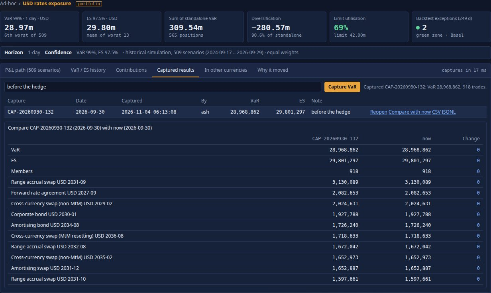

From the command line, a basket saved, captured and compared (real output):

```text
$ drishti.py var basket rates-short "DESK:RATES & WHERE:DIRECTION == 'SHORT'" --title 'Rates shorts'
{ "id": "rita/rates-short", "name": "Rates shorts", "type": "BASKET", "scope": "DESK:RATES & WHERE:DIRECTION == 'SHORT'",
  "owner": "rita", "sharedWith": [], "version": 1, ... }
$ drishti.py var capture BASKET:rita/rates-short --note 'before the unwind'
{ "id": "CAP-20260930-89", "capturedAt": "2026-10-26T05:12:54.392356455Z", "var": 282428035, "es": 271474611, "memberCount": 800 }
$ drishti.py var compare CAP-20260930-89
{ "a": { "id": "CAP-20260930-89", "label": "Rates shorts", "var": 282428035, "es": 271474611, "memberCount": 800, ... },
  "b": { "id": "now", "var": 282428035, "es": 271474611, "memberCount": 800, ... },
  "varChange": 0.0, "esChange": 0.0, "membersAdded": [], "membersRemoved": [],
  "components": [ { "key": "POS-BOOK-RATES-2~MX-30000951", "label": "Forward rate agreement CHF 2027-08", "a": 2783132, "b": 2783132,
                    "change": 0.0 }, ... ] }
```

**The record.** In the content store at `var/captures/<owner>/<id>.json`. **Id:** `CAP-<yyyymmdd of the business date>-<n>`, `n` from
the content store's sequence `var/captures-seq`. Written once (`create`; an existing id is refused); there is no update, share or delete
endpoint (`sharedWith` is always empty today).

| Field | Type | Meaning |
|---|---|---|
| `id` | string | `CAP-20260930-7` |
| `scope`, `canonical`, `label`, `kind` | string | as in the headline |
| `businessDate`, `capturedAt` | string | the date answered; the instant written |
| `owner`, `sharedWith`, `note` | string, list, string | the capturer; `[]`; the note (at most 1,000 characters) |
| `var`, `es`, `k`, `esCount`, `confidence`, `esConfidence`, `limit`, `sumStandalone`, `diversification` | as the headline | |
| `components`, `componentsBy` | list, string | the contribution rows (`by=child`) and their kind |
| `worst` | list | the 25 worst scenarios `{rank, index, date, pnl}` |
| `vector` | integer[N] | the scope's vector, **rounded to whole units** |
| `scenarioSet`, `scenarioDates` | string, string[N] | |
| `members`, `memberCount` | string list, integer | every member trade id (visible to the capturer) |
| `dataVersion` | string | the vector table's stamp for the date |
| `provenance` | object | [section 11.2](#112-the-headline-get-scope-and-its-provenance) |

**List** (`GET /captures`): `[{id, scope, canonical, label, businessDate, capturedAt, owner, note, var, es}]`, newest first.
**Compare** (`GET /compare?a=&b=`): `a`, `b` (each `{id, scope, label, businessDate, capturedAt, owner, note, var, es, memberCount,
dataVersion}` where present; `b=now` recomputes the capture's scope on the newest date), `varChange`, `esChange` (b − a),
`membersAdded`, `membersRemoved` (sorted, at most 200 each), `components` `[{key, label, a, b, change}]` by \|change\| descending.

**CSV** (`GET /captures/{id}/csv`, `text/csv`, attachment `<id>[-<part>].csv`): first the lines `# <field>: <value>` for `id`,
`scope`, `label`, `businessDate`, `capturedAt`, `owner`, `note`, `var`, `es`, `dataVersion`, `scenarioSet`; then

| `part` | Header | Rows |
|---|---|---|
| (none) | `scenario_date,pnl` | N rows in scenario order |
| `components` | `key,label,standalone_var,component_var,component_es,pct_of_var,incremental_var` | one per component row (text with a comma or quote is quoted) |

The **official** end-of-day captures are captures too (owner `drishti`, marked *official*), listed under a node's *Captured results*
for a viewer who sees every node, and the source of the node history ([section 19](#19-official-end-of-day-results)).

## 7. History and backtesting

The *VaR / ES history* tab and `GET /api/v1/risk/var/scope/history` answer in one of two modes (`VarViews.history`):

| Mode | When | Rows | Backtest |
|---|---|---|---|
| **official** | the scope is exactly one node, you see every node at `positions` level, and the node has official end-of-day records ([section 19](#19-official-end-of-day-results)) on more than one day up to the date | the node's official figures, oldest first, a row per date (each date's latest result version), at most `history-days` (250) | each day's hypothetical P&L (`HYPO_PNL`) against the **previous** row's VaR |
| **replay** | anything else | today's members over the last `min(history-days, N)` scenario days of the scope's **today's** vector | each day's scenario P&L against **today's** VaR: in-sample, labelled *not a regulatory backtest* |

A day is an **exception** when its P&L is a loss larger than the VaR it is tested against. Over the days:

- **The Basel traffic light**: green for up to 4 exceptions in 250 days, amber 5 to 9, red 10 or more.
- **Kupiec's test** (proportion of failures): is the share of exceptions consistent with 1%? A p-value below 0.05 says no (too many or
  too few).
- **Christoffersen's test** (independence): do exceptions cluster (an exception more likely the day after one)? A p-value below 0.05
  says they do.

The formulas are in [section 18.4](#184-history-and-backtest).

**Short histories (decided 2026-10-25, open question 13: kept, documented).** The light scales its limits with the days it has
(`round(4 × days/250)`, `round(9 × days/250)`): with 4 days, `round(4 × 0.016) = 0`, so a single exception is already **red**; below 14
days one exception is red, below 32 one is amber. The screens show the light *with its days*, and it is not a regulatory zone before
250 days.

The FX desk replayed (`drishti.py var history DESK:FX`, the last rows):

```text
history (replay): today's members over the last 250 scenario days against today's VaR: in-sample, not a regulatory backtest
  green  3 exceptions in 249 days   Kupiec LR 0.099 (p 0.753)   Christoffersen LR 0.073 (p 0.786)
Date        VaR         ES          P&L          Exception
----------  ----------  ----------  -----------  ---------
2026-09-22  24,060,533  25,240,488   31,198,624
2026-09-23  24,060,533  25,240,488   11,195,465
2026-09-29  24,060,533  25,240,488     -818,954
```

Three exceptions in 249 days is fewer than the 2.5 expected: green, and neither test rejects. The bank replayed shows 5 exceptions
(amber; Kupiec p 0.160, Christoffersen p 0.076). The official mode begins with the second official date: each day's official VaR, ES and
hypothetical P&L. **The hypothetical P&L of an official record** (`HYPO_PNL`) is the node's P&L under the newest scenario day of its
date's set (the move of the business day before, applied to the date's members): a bank delivering a hypothetical P&L table of its own
does not replace it: the bank's actual and hypothetical P&L (`desk-pnl`, [section 15.16](#1516-desk-pnl-the-banks-actual-and-hypothetical-pl))
feed the regulatory backtest of [section 18.11](#1811-backtesting-for-regulation), where this figure is shown beside them as the
**risk-theoretical P&L**.

## 8. What-if and VaR as a kind

The **computed kind** `var-result` of the market-risk pack makes VaR an ordinary kind, served by a reactive connector (`plugin: reactive`,
[REACTIVE_CONNECTOR.md](../connectors/types/reactive/README.md)): by command (`VRES DESK:RATES <GO>`), link (`/v/var-result/DESK:RATES`),
the entities and compute APIs, the CLI (`drishti.py compute run var-engine var-result DESK:RATES`), search and the AI tools, with the
explorer's entitlements (computed as the person asking: their nodes, masks and audit entry; cached per view signature). Names decided
(open question 12): `var-result`, fields `VAR` with `CONFIDENCE` (never `VAR_99`); the retired kind name `var` is not reused. The
designs' `var-contribution`, `var-path` and `var-history` are not separate kinds: a `var-result` carries the parts (`CHILDREN`), the
worst scenarios and the vector, and the explorer and the API serve paths and histories. Contract:
`config/packs/banking/market-risk/contracts/var-result.contract.yaml` (class `computed`). The **pre-deal what-if** is the same engine's, asked
through the VaR API (`POST /api/v1/risk/var/what-if`, [section 8.2](#82-the-what-if-the-java-engine)), not a kind.

**Ids.** The id is the scope text. Like every computed id ([ComputeRef](../connectors/types/reactive/README.md#reading-a-computed-kind)), a
`~` inside it is written `%7E` (`NODE:MGMT%7EDESK-RATES`; prefer `DESK:RATES`, which needs none), `=` `%3D` (a `WHERE:` rule's `==`),
and parameters ride after a `~` (`DESK:RATES~ccy=EUR`). A scope with a `/` (a basket) is read through the compute API's body,
not a link.

### 8.1 `var-result`: the Java engine

`VRES <scope> <GO>`: connector `var-engine`, Java engine `com.ash.drishti.banking.var.VarResultEngine` (in the server, over `VarService`);
triggers: the data versions of the four inputs (`affects: all`); answers wait up to 5 s.

```text
$ drishti.py compute run var-engine var-result DESK:RATES
var-engine DESK:RATES  READY  (req-mvosw177-c6042d15feb9)
  SCOPE        DESK:RATES
  SCOPE_KIND   node
  LABEL        Rates · Swaps and options
  NODE         MGMT~DESK-RATES
  BUSINESS_DATE 2026-09-30
  VAR          74633680
  ES           75377415
  K            6
  LIMIT_USE    0.7463368
  SUM_STANDALONE 125524898
  DIVERSIFICATION 50891218
  computed 2026-10-26T05:12:54.554938067Z by java:var-engine@2.7.0, pin pin-e0cd3fe57e54607c, sha256:fd1912ea94a8fb93f1acb005507655d3
```

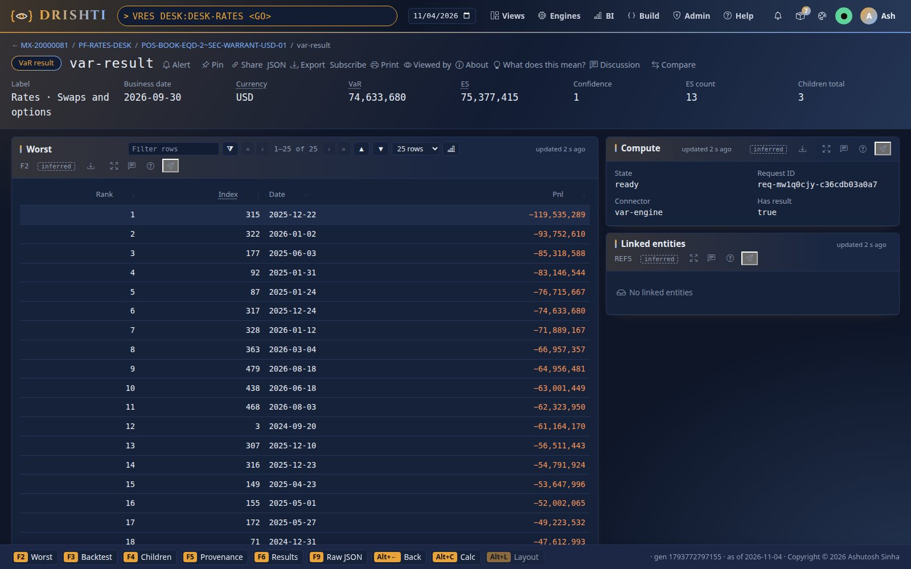

| Field | Type | Meaning |
|---|---|---|
| `SCOPE`, `CANONICAL`, `SCOPE_KIND`, `LABEL`, `NODE` | text | as the headline's `scope`, `canonical`, `kind`, `label`, `node` ([section 11.2](#112-the-headline-get-scope-and-its-provenance)) |
| `BUSINESS_DATE` | date | the date answered |
| `VAR`, `ES` | amount (USD, whole units) | at `CONFIDENCE`, `ES_CONFIDENCE` |
| `CONFIDENCE`, `ES_CONFIDENCE`, `K`, `ES_COUNT`, `SCENARIOS` | number | |
| `LIMIT`, `LIMIT_USE`, `SUM_STANDALONE`, `DIVERSIFICATION` | amount, ratio | null when none |
| `BACKTEST` | record | `DAYS`, `EXCEPTIONS`, `LIGHT`, `KUPIEC_LR`, `KUPIEC_P_VALUE`, `CHRISTOFFERSEN_LR`, `CHRISTOFFERSEN_P_VALUE` |
| `CHILDREN` | record list | per default part: `KEY`, `SCOPE`, `LABEL`, `KIND`, `STANDALONE_VAR`, `COMPONENT_VAR`, `COMPONENT_ES`, `INCREMENTAL_VAR`, `PCT` |
| `WORST` | record list | 25 × `RANK`, `INDEX`, `DATE`, `PNL` |
| `PNL` | vector | the scope's vector, unrounded |
| `PROVENANCE` | record | the headline's provenance in UPPER_SNAKE (`TIER` included) |

Tables with the answer: `children` and `worst` (for panels). A scope that does not parse, or a role that may not see VaR, is the
engine's refusal in words (`failed` with the reason); a role that may not open the kind is `refused`.

### 8.2 The what-if: the Java engine

`POST /api/v1/risk/var/what-if`: a scope's VaR, ES and stressed VaR **before and after hypothetical trades**, and each trade's figures,
computed by the server's VaR engine (`VarWhatIf` over `VarWhatIfMath`, the same rules as every other VaR answer: the confidence, the
rank rule, the component window and its scale, [section 18](#18-the-computation)). Nothing else is needed: no compute workers, no
sandbox, so it answers on every server, the compute workers on or off. A hypothetical trade is one of:

- **a copy** of what is booked, `{"copyOf": "MX-30000121", "factor": -1}`: a trade id, or any scope (`BOOK:BOOK-RATES-3` for a hedge
  shaped like a book), its P&L vector read as you (a trade you may not see one by one is refused), times the factor (1 the same again,
  −1 its unwind, 0.5 half);
- **a trade priced elsewhere**, `{"label": "new swap", "pnl": [509 numbers], "factor": 1}`: one P&L per scenario day, in the answer's
  reporting currency.

Taking trades out is the scope's own algebra (`DESK:RATES - TRD:X`), so it is exact. At most 50 trades; `ccy` in the body (or the query)
answers in a reporting currency, `asOf` on another business date.

```bash
drishti.py var whatif DESK:RATES --copy BOOK:BOOK-RATES-3=-0.5
```

```text
what-if on DESK:RATES  2026-09-30  in USD  (Java VaR engine (the server))
  VaR                 74,633,680 ->       47,599,220   change -27,034,460
  ES                  75,377,415 ->       56,247,260   change -19,130,155
  stressed VaR        85,318,588 ->       59,556,766
  -0.5 × BOOK:BOOK-RATES-3: standalone 34,296,045, incremental -27,034,460, component -32,542,151
```

The hedge (half of `BOOK-RATES-3`, sold) takes 27.0 million out of the desk's VaR; its component in the desk after the trade is
negative, as a hedge's is. `--trades FILE.json` sends trades priced elsewhere (`[{"LABEL": …, "PNL": [509 numbers], "FACTOR": 1}]`);
`--json` prints the answer as it comes.

| Field | Type | Meaning |
|---|---|---|
| `scope`, `canonical`, `businessDate`, `currency` | text, text, date, text | the scope asked, as the engine reads it, the date and the reporting currency |
| `confidence`, `esConfidence` | number | the VaR and ES confidences (the labels a screen shows) |
| `before`, `after` | record | `var`, `es` and `stressedVar` (whole units): the scope as booked and with the trades added |
| `change` | record | `var` and `es`: after minus before |
| `items` | record list | per trade in the order given: `label`, `factor`, `standaloneVar` (its own VaR), `incrementalVar` (the change it makes after the ones before it), `incrementalAlone` (the change it makes added alone to the scope), `componentVar` (its share of the scope's VaR after) |
| `engine`, `note` | text | who computed it, and how in words |

**The stressed VaR** here is the largest VaR over every run of 250 consecutive scenario days of the date's scenario set (all of them
when the set is shorter): a stressed period chosen from the scenarios the batch delivered, before and after the trades. It is not the
stressed VaR on a stress scenario set ([section 18.8](#188-stressed-var)).

A scope with no trades, a copy without a vector on the date (*not live*), a priced trade whose vector has another length (*what-if item …
has 3 scenario P&Ls; the scope has 509*) or a factor that is not a number is `400` in words. Every what-if is audited (`var-whatif`).

### 8.3 Where it runs: the Java engine

Every VaR figure is computed by the server, in Java (`drishti-compute`, `drishti-server`): resolving a scope, summing vectors over the
hot store, the node aggregates, the explorer's answers, contributions by any part or trade column, the what-if, the API, captures and
the official records. Additions of stored vectors and a sort of N numbers per answer, on a bounded pool. The console and the command
line only show what the server answers.

**Not built (parked):** pricing an amended or new trade over the scenarios from its terms (QLRisk, when its API is stable): a what-if
trade is a copy of a booked trade or a vector priced elsewhere today; methods beyond equal-weight historical (age-weighted, filtered),
ES backtests.

### 8.4 What-if pricing and intraday recomputes

The design ([section 30](#30-the-design-record)). What-if pricing is not built; **intraday updates from the pricing
systems are built** (the subsection *Intraday updates* below).

**What-if changes.** A sandbox is a person's private what-if: a base scope and a list of changes; only its owner sees or changes it
([DATA_ARCHITECTURE.md › Reactive connectors, section 9](../architecture/DATA_ARCHITECTURE.md#9-isolation-two-users-never-see-each-others-answers)).

| Change | How its vector is obtained | Pricing needed |
|---|---|---|
| **Unwind** a position (all of it) | subtract its stored vector | **no** (built: the scope's own algebra) |
| **Partly unwind** a linear position (a cash bond, a future, an FX spot or forward, a vanilla swap scaled by notional) | scale its stored vector | **no**, if the product is marked linear in the pack's pricer mapping; otherwise priced |
| **Amend** a trade (notional, strike, maturity, rate …) | price the amended trade over the 509 scenarios; subtract the stored vector, add the new one | **yes** |
| **Add** a hypothetical trade (from a form, a copy of an existing trade, or a template) | price it over the 509 scenarios; add (built: a copy of a booked trade or scope, or a vector priced elsewhere, [section 8.2](#82-the-what-if-the-java-engine)) | **yes** |
| **Move** a position to another book | no vector change; the scopes it belongs to change | **no** |

**Pricing over the scenario days.** The pricer receives the trade, the base market of the business date (assembled by the server as
AI_GUIDE.md › Server-side pricing: the quant service (proposed), section 7 describes) and the scenario set's market moves, and returns the 509 P&Ls. QLRisk's
`MarketRiskEngine.scenario_pnl` is the default path ([NOTEBOOK_GUIDE.md section 9.2](../architecture/ARCHITECTURE.md#298-pricing-engines-planned)),
QuantLib-Java the Java alternative. The pricer's scenario moves must be the **same moves the batch used**; a **reprice check** proves it:
for a sample of existing trades in the scope the engine reprices them and compares with their stored vectors, and shows the agreement on
the what-if panel (*parity with the batch: 0.02%*); a scope whose check fails beyond tolerance shows its what-if numbers in amber with
the reason. For the sandbox the engine returns before and after VaR, ES and limit use; each change's incremental VaR (in the order
listed, and standalone); the new trade's component VaR in the scope; overlaid distributions; and a waterfall from before to after.
*Book via write-back…* turns a sandbox's change into a change request ([APPROVALS_GUIDE.md](../architecture/ARCHITECTURE.md#31-collaboration-write-back-and-approvals)); once applied,
the event trigger recomputes the real scopes; the sandbox is left as it was. Without QLRisk declared stable, what-if offers only the
changes that need no pricing.

**Intraday events.** Overnight vectors describe the morning's positions; the design keeps an **intraday layer** on top of them,
recomputed on the reactive connectors' triggers ([DATA_ARCHITECTURE.md › Reactive connectors, section 7](../architecture/DATA_ARCHITECTURE.md#7-triggers-computing-on-events)):

| Event | Trigger | Effect on the intraday layer |
|---|---|---|
| a trade amended or booked through Drishti's write-back | `write-back` (change applied) | the trade is priced over the 509 scenarios; its intraday vector replaces the stored one |
| a trade booked or amended in the source system, seen on Kafka | `live` | the same |
| a trade cancelled | `write-back` or `live` | its vector is removed |
| the overnight batch publishes new vectors | `data-version` | the intraday layer of that date is dropped: the batch's vectors include the day's trades |

An event changes the vector of the trade's book and every node above it by (new − old), and every saved basket holding the trade;
nothing else is recomputed ([DATA_ARCHITECTURE.md › Reactive connectors, section 10.2](../architecture/DATA_ARCHITECTURE.md#102-incremental-recompute)). An
intraday result says which events it includes (`L17:3412`, `trade-kafka p3:182277`) and is labelled *intraday*; the official numbers
come only from the batch. The submitter of a write-back receives their own change's incremental VaR, computed against the state just
before their event, under their change id; everyone watching the scope receives the new shared number
([DATA_ARCHITECTURE.md › Reactive connectors, section 9.2](../architecture/DATA_ARCHITECTURE.md#92-two-traders-two-amendments-the-same-second)). Until a
pricer is available an amended or booked trade gets no intraday vector (*intraday change not reflected: pricing unavailable*);
cancellations, which need no pricing, are applied. A trade moved between books moves its vector to another ancestor chain, with no
repricing.

#### Intraday updates

During the day a pricing
system sends **only the changed trades** (amended, new or cancelled), priced over the **same scenario set** as the morning run, in each
trade's own currency (scenario PVs) or as P&L vectors; a full resend of the day still works (a reload).

**The marker.** An intraday row says `RUN_KIND: INTRADAY` (the contract's new field, [section 15.9](#159-scenario-pv-scenario-pvs-per-trade-in-the-trades-currency));
a full run's rows say `FULL` or nothing. Each intraday batch has its own `BATCH_ID` and a `COMPUTED_AT` later than the morning run's,
and goes to the lake **appended** (`lake build --mode append`, `drishti.py var intraday --load FILE`), its row id the morning id with
the batch (`SPV-<trade>-<set>-<BATCH_ID>`). On an Iceberg risk lake the batch is an Iceberg append to the kind's table, made by
the pricing system's own Iceberg writer (Drishti's `lake build --format iceberg` replaces whole dates, so it is not the tool for a
batch) or by the Kafka stream below; the engine applies it exactly as on Delta (`VarFormatEqualityTest`: file batches applied live from
Iceberg equal Delta to the cent). The rules:

| Case | What the engine does |
|---|---|
| an intraday row of the date's scenario set | its trade's P&L replaced by the row's: USD from its native PVs with the **morning run's scenario FX**, or its P&L vector |
| the same trade in several batches (files or Kafka windows) | the **latest `COMPUTED_AT` wins**, across every batch of the day; an equal one keeps the first (a redelivery changes nothing) |
| `COMPUTED_AT` before the morning run's | ignored, counted (`intraday.beforeMorningIgnored`) |
| a cancel: an intraday row whose `TRADE_STATUS` is not live (`CANCELLED`), its PVs empty | the trade's P&L removed; it is in no scope from then on |
| a new trade | its book from `TT_BOOK`, its position by the position rules (an existing position takes it; else a position of its own) |
| an amended trade in another book or position | its old ordinal cancelled, the trade added in its new book and position |
| another `SCENARIO_SET_ID` | the row refused (`DRS-5203` in `intraday.rejections`), never applied; the date stays as it is |
| a failed scenario, no FX, a wrong length | the row refused as in the morning run (`DRS-5206`, `DRS-5207`, `DRS-5201`) |
| a full run of the date (overwrite: a new morning `BATCH_ID` or `COMPUTED_AT`, an intraday batch gone, or a signal with no new intraday batch) | the date reloads: restated, its intraday layer dropped |

**Applying (incremental, DATA_ARCHITECTURE.md › Reactive connectors, section 10.2).** The data-load signal of a `scenario-pv` or `pnl-vector` batch on a
loaded date reads the date's rows once, keeps the new intraday batches' latest row per trade, and applies them on the loaded book
**without a reload** (`VarIntraday`): each updated trade's difference (new − old) is added to its book and every node above it in both
hierarchies, to the per-trade-currency totals ([section 15.11](#1511-reporting-currencies-built-ahead-per-trade-currency-totals-and-the-picker)),
and to every reporting currency already built (only that trade reconverted); a saved basket holding the trade is computed again on its
next ask (the answers' cache is keyed by the layer). A reporting currency keeps its **morning run** per date and data version and puts
the USD date's layer on it as the USD date holds it at the time of the answer, so a currency is never left on an older layer: not
by the official capture (which reads every currency as the morning run), nor by a batch applied while the currency was being built. A
date whose updates could not be read is answered from its morning run **with a warning saying so** on every answer, until the next
data-load signal reads them. Signals of one date apply one at a time, and a batch's layer is published only over the very date it was
built on: when the date is reloaded meanwhile (another input's signal, an administrator), the signal says `superseded` and the date, as
loaded again, reads its updates from the lake, this batch included once. Nothing else is recomputed, and the morning hot file is never changed: an updated
row is the stored row plus its difference, a new trade is appended after the morning's. The old P&L subtracted is the morning row exactly
as received (on the heap its row; with the tiered memory, its float32 copy is not exact, so the row is read back from the lake by its id),
so a node is equal to the cent to the same final data loaded as one run. Only the current P&L per trade is kept, never the batches: the
work of a batch does not grow with the batches before it. A date not loaded yet loads with its updates (the morning run, then every
intraday batch at once), and so does a restart: the lake is the record, not the server.

**Labels.** Every answer whose figures include updates says so: `intraday: {updates, trades, amended, added, cancelled, lastAt,
batches (the newest 20, in one stable order: by each batch's newest COMPUTED_AT, then by BATCH_ID, oldest first, whatever order the
signals applied them in), batchCount, olderIgnored, beforeMorningIgnored, morningAt, rejections, note}` on the headline, the path, the
contributions and the tree, and in the provenance; the VaR page shows an **intraday** badge in its status line (*intraday · 5 trades ·
2026-09-30 11:00*), its tooltip the batches; `drishti.py var show` adds an `intraday` line, `drishti.py var intraday` lists each loaded
date's layer and `drishti.py var status` says it per date. **The official records are the morning run's**: the end-of-day capture and
publishing read the date without its layer, and an intraday batch never restates them.

**Measured** (`VarIntradayApiTest`, 200 batches of 3 trades on one date): the incremental result equals the same final data loaded as one
run, to the cent, on every node, and a restart (the morning run and the 200 batches at once) equals it too; the time a batch takes does
not grow with the batches before it (the first 50 and the last 50 the same, the lake's 1-second refresh dominating).

**A connector file from an older template.** The engine reads a record's `RUN_KIND`, `COMPUTED_AT`, `VALUE_TYPE`, `GRAIN`,
`SOURCE_SYSTEM` and `POSITION_ID` as promoted columns of the risk lake's connector. A connector file written from the pack's template
at an earlier first start (`config/connectors/risk-store.yaml`) lacks them: **at start the server adds the template's new columns to
its `layout.pnl-vector.columns` and `layout.scenario-pv.columns` by itself** (connector template updates, `template-updates:
additive`, the default; DATA_GUIDE.md section 9, *Template updates*): the connector's own columns are kept, the file as it was is kept beside
it as `risk-store.yaml.before-<time>.bak`, one line is logged and the change is listed under Admin → Connectors → Template updates.
With `template-updates: notify` or `off` it is listed only: press **Add missing kinds** there. Until the columns are promoted the server
logs *VaR: the connector does not promote …* once, and the records cannot say what they are (`DRS-5208`, or `DRS-5202` for an
intraday row read twice), never a mix of runs.

**A batch in both kinds.** A batch may carry scenario PVs and P&L vectors under one `BATCH_ID`, each kind loaded on its own with its own
signal: the engine tracks each kind of a batch apart (`<kind>|<BATCH_ID>`), so the second load applies too and is not taken for a full
run.

#### Intraday updates from Kafka

A pricing system may publish the same updates to a **PV topic** instead of writing files; the two channels mix on one date, the latest
`COMPUTED_AT` per trade winning across both. The market-risk pack's connector **`pv-updates`** (plugin `var-pv-stream`, **off by
default**: `DRISHTI_VAR_PV_STREAM=true`) reads it like the Kafka connector (every partition from the beginning, no consumer group, its
`bootstrap-servers`, security and `client.*` settings; [KAFKA_CONNECTOR.md section 17](../../plugins/drishti-plugin-kafka/README.md#the-var-pv-topic-var-pv-stream)).

```text
pricing system ──► PV topic (each message's value JSONL text: one or more records; the key not read)
                     │  var-pv-stream: a window of drishti.var.intraday.kafka.window (5m), the latest record per trade
                     │  (COMPUTED_AT, then partition, offset and line)
                     │  flushed early at `max-trades` (500) or by an administrator's "apply now"
                     ▼
               the guards (date, morning run, held update, scenario set, a finite vector of the set's length)
                     ▼
               ONE intraday batch in the lake (RUN_KIND INTRADAY, BATCH_ID K-<date>-<time>-<n>), Drishti's lake writer
                     ▼
               the data-load signal: the intraday layer applies it as it applies a file
```

| Case | What the stream does |
|---|---|
| a message of another business date than the newest loaded | ignored, counted (`otherDate`) |
| `COMPUTED_AT` before the morning run, or not later than the update the date holds for the trade (a redelivery; the topic replayed after a restart) | ignored, counted (`beforeMorning`, `notNewer`): nothing is applied twice |
| a cancel line (`TRADE_STATUS: CANCELLED`, its vector null), as in the files | the trade cancelled; a tombstone (a null value) carries no record: ignored, counted |
| a blank line | skipped |
| a line that is not a JSON object with a `TRADE_ID` | rejected, `DRS-5201`, with its partition, offset and line number (`p0:12 line 2`); the message's other lines are applied |
| another `SCENARIO_SET_ID` | rejected, `DRS-5203`; listed in the stream's status and the date's `intraday.rejections` (the provenance's `intradayRejections`) |
| a null, non-numeric or infinite value, the wrong length, no `BASE_PV` | rejected, `DRS-5206` or `DRS-5201`, with its place; never filled with zero |

The window's rows are written with the trades' table layout of the loaded pack and announced as a data load of the kind (one signal a
window). The window goes to the lake in the lake's own format: one Delta commit on a Delta risk lake or, when the
kind's table is an Iceberg table (`<lake>/risk/<kind>/metadata`, no `_delta_log`), one Iceberg append (`LakeAppends`: nothing replaced,
the vector as `list<double>`; the connector's `lake` must then name the Iceberg root, e.g. `<data>/iceberg` after `build_demo_lakes.py
--store risk=iceberg`, which switches `risk-store.yaml` but not `pv-updates`); either way the intraday layer applies it the same ([section 29.3](#293-how-the-lake-tools-and-the-delta-plugin-carry-a-vector)). The lake is the record: a restart rebuilds the layer from the lake, and the stream reading the topic again writes nothing it
already holds.

**The message.** A message's value is **JSONL text**, UTF-8: one or more PV records, one JSON object a line, each exactly a row of the
`scenario-pv` or `pnl-vector` contract (the same rows as the files); one message may carry one trade or many, both forms and cancels.
The key is not read: it may be absent or name a batch. An example message of three lines (cut: a record carries every field and all
509 values):

```text
{"VALUE_TYPE":"PV","GRAIN":"TRADE","TRADE_ID":"1002344","CURRENCY":"USD","SOURCE_SYSTEM":"ENDUR","SCENARIO_PV_ID":"SPV-1002344-HS-509-I-2026-09-30-001","SECURITY_ID":"XCH-ComFut-USD-03","INSTRUMENT":"ENGY-EXCH-FUT USD 2026-09","BUSINESS_DATE":"2026-09-30","SCENARIO_SET_ID":"HS-509","TRADE_VERSIONS":"v6","TRADE_STATUS":"AMENDED","MATURITY_DATE":"2026-09-30","LEGAL_ENTITY":"LE-NY","DIVISION":"DIV-MARKETS","DESK":"DESK-COMM","TT_BOOK":"BOOK-COMM-3","LIMIT_LETTER":"LL-0003","PORTFOLIO":"BOOK-COMM-3","STRATEGY":"","PRODUCT_GROUP":"Commodity","PRODUCT_TYPE":"ComFut","COUNTERPARTY":"CP-METROEX","DIRECTION":"SHORT","QUANTITY":-5900.0,"TAGS":"","BASE_PV":-302670.0,"VALUATION_DATE":"2026-09-30","BASE_VALUATION_DATE":"2026-09-30","SCENARIO_PV":[-208989.8,-396009.18,-356724.62],"STATUS":"ok","PRICER":"demo-factor-model","MODEL_VERSION":"demo-2","COMPUTED_AT":"2026-09-30T06:05:00Z","BATCH_ID":"I-2026-09-30-001","RESTATEMENT":0,"RUN_KIND":"INTRADAY"}
{"VALUE_TYPE":"PNL","GRAIN":"POSITION","POSITION_ID":"POS-BOOK-COMM-1~XCH-CMD_FUTURE-USD-03","CURRENCY":"USD","SOURCE_SYSTEM":"MUREX","VECTOR_ID":"PNL-POS-BOOK-COMM-1~XCH-CMD_FUTURE-USD-03-HS-509","BUSINESS_DATE":"2026-09-30","SCENARIO_SET_ID":"HS-509","TRADE_STATUS":"AMENDED","LEGAL_ENTITY":"LE-NY","DIVISION":"DIV-MARKETS","DESK":"DESK-COMM","TT_BOOK":"BOOK-COMM-1","LIMIT_LETTER":"LL-0001","PORTFOLIO":"BOOK-COMM-1","STRATEGY":"","PRODUCT_GROUP":"Commodity","PRODUCT_TYPE":"CMD_FUTURE","SECURITY_ID":"XCH-CMD_FUTURE-USD-03","INSTRUMENT":"Commodity future USD 2027-09","MATURITY_DATE":"2027-09-10","COUNTERPARTY":"CP-SUMMIT","DIRECTION":"LONG","QUANTITY":122.0,"TAGS":"","TRADE_CURRENCY":"USD","REPORTING_CCY":"USD","PV":1595886,"PNL":[-471736.0,508921.0,273690.0],"STATUS":"ok","PRICER":"demo-factor-model","MODEL_VERSION":"demo-2","COMPUTED_AT":"2026-09-30T06:00:00Z","BATCH_ID":"B-2026-09-30-01","RESTATEMENT":0,"RUN_KIND":"FULL","TRADE_IDS":["MX-20000291","MX-30002954"]}
{"VALUE_TYPE":"PV","GRAIN":"TRADE","TRADE_ID":"1000414","CURRENCY":"USD","SOURCE_SYSTEM":"ENDUR","SCENARIO_PV_ID":"SPV-1000414-HS-509-I-2026-09-30-001","SECURITY_ID":null,"INSTRUMENT":"ENGY-SWAP USD 2026-11","BUSINESS_DATE":"2026-09-30","SCENARIO_SET_ID":"HS-509","TRADE_VERSIONS":"v8","TRADE_STATUS":"CANCELLED","MATURITY_DATE":"2026-11-30","LEGAL_ENTITY":"LE-NY","DIVISION":"DIV-MARKETS","DESK":"DESK-COMM","TT_BOOK":"BOOK-COMM-1","LIMIT_LETTER":"LL-0001","PORTFOLIO":"BOOK-COMM-1","STRATEGY":"","PRODUCT_GROUP":"Commodity","PRODUCT_TYPE":"ComSwap","COUNTERPARTY":"CP-NORTHPLAINS","DIRECTION":"LONG","QUANTITY":96000.0,"TAGS":"","BASE_PV":581788.0,"VALUATION_DATE":"2026-09-30","BASE_VALUATION_DATE":"2026-09-30","SCENARIO_PV":null,"STATUS":"ok","PRICER":"demo-factor-model","MODEL_VERSION":"demo-2","COMPUTED_AT":"2026-09-30T06:05:04Z","BATCH_ID":"I-2026-09-30-001","RESTATEMENT":0,"RUN_KIND":"INTRADAY"}
```

| Setting | Default | |
|---|---|---|
| `drishti.var.intraday.kafka.window` | `${DRISHTI_VAR_INTRADAY_KAFKA_WINDOW:5m}` | the window: everything received in it becomes one intraday batch, every five minutes |
| `drishti.var.intraday.kafka.max-trades` | `${DRISHTI_VAR_INTRADAY_KAFKA_MAX_TRADES:500}` | an earlier flush once this many trades wait |
| connector `pv-updates` `enabled` | `${DRISHTI_VAR_PV_STREAM:false}` | the stream on |
| its `bootstrap-servers` | `${DRISHTI_KAFKA_BOOTSTRAP:localhost:9092}` | the brokers |
| its `topic` | `${DRISHTI_VAR_PV_TOPIC:drishti.risk.pv-updates}` | the PV topic |
| its `lake` | `${DRISHTI_DELTA_ROOT:./data/delta/demo}` | the risk lake's root (an Iceberg risk lake: the root holding `risk/<kind>/metadata`) |

**Admin.** `GET /api/v1/risk/var/intraday/streams` (the topic, state, waiting trades, offsets, counts, the last ten windows and the newest 20
rejections) and `POST /api/v1/risk/var/intraday/streams/{connector}/apply` (administrators: the waiting window now); the connector's page
in Admin has an **Apply now** button.

**Sizing.** A record is 4–8 KB (509 numbers as JSON text): 10,000 updates a day are 40–80 MB on the topic, whatever the records per
message; a window of a few hundred trades is written and applied in about a second. **Tested** (`VarPvStreamTest`, in-process Kafka): a
message of several records with the latest of a trade winning, a message mixing trades, a cancel line and a malformed line (rejected
with its place, the others applied), a tombstone ignored, an early flush, the guards, files and windows mixed equal to the same final
data loaded as one run to the cent in USD, EUR and CAD, and the topic replayed after a restart writing nothing.

### 8.5 The pre-deal what-if under the basket's sheet

The what-if is the basket's ([section 3.5](#35-construct-your-basket)), under its sheet: **+ What-if trade** (or **What-if…** in the
explorer's right column, which puts the scope you are on in the sheet) takes a booked trade (or any scope) and a factor; the hypothetical trade is a
**copy of that trade's P&L vector scaled by the factor** (1 the same again, −1 its unwind, 0.5 half), added to the basket. It shows the basket's
VaR 99% and ES 97.5% **before → after** and the **incremental** change, and each hypothetical trade's standalone VaR, its incremental VaR
in the order listed and its component in the basket after. Several may be added; **×** removes one. Good for pre-deal (*what does this
trade do to my desk's VaR?*) and for VaR (*which unwind takes the most out?*).

It is `POST /api/v1/risk/var/what-if {"scope": "BASKET:asha/unwind", "items": [{"copyOf": "MX-30000121", "factor": -1}]}`, computed by
the server's VaR engine as you ([section 8.2](#82-the-what-if-the-java-engine)): each copied trade's vector is read as you (a trade you
may not see one by one is refused). The answer: `before`, `after` and `change` (`var`, `es`; `stressedVar` before and after), `items`
(`label`, `factor`, `standaloneVar`, `incrementalVar`, `incrementalAlone`, `componentVar`), `engine`, `note`. A scope with no trades, a
copied trade without a vector on the date (*not live*), or a factor that is not a number is `400` in words, shown under the sheet. It needs
no compute workers. Pricing a new trade from its terms is not built ([section 8.4](#84-what-if-pricing-and-intraday-recomputes)): the
copy of a booked trade's vector stands in for it.

## 9. Who sees what: entitlements and audit

The engine reads as the server and answers as you:

- a role that may not open the vector kind `pnl-vector` (`Entitlements.mayOpen`) sees no VaR at all (403);
- a role with no entry under `drishti.var.access` sees every node at **positions** level (numbers, children, positions, trades);
- `drishti.var.access.<role>[<node>]: positions | aggregate` restricts a role to some nodes: **aggregate** gives a node's numbers and
  those of every node beneath it, never a position or a trade (the tree stops at books, *By position* is refused); a scope is computed
  over the trades you may see and the rest counted (*Outside your view: 4 trades not included*, `hidden`); a node of no entry is not
  seen at all;
- a scope naming positions, trades, counterparties, a rule, a basket, a capture or a basket-type system basket may only name trades you see at
  positions level (403 otherwise: a rule could probe single trades through aggregates);
- field masks apply: a masked counterparty reads `•••` in trade rows, and `CPTY:` is refused to a role that sees it masked;
- answers are cached per date, data version, view and scope: two people with different rights never share one; the computed kinds key
  their cache by the same view signature;
- tokens need `risk:write` to save baskets and captures; reloads and official captures are for administrators only;
- the system baskets ([section 5.7](#57-system-baskets)) are read by everyone who may open VaR, each through their own view; creating,
  editing, retiring and importing them needs the permission `var:system-baskets` (a role that lists it, or an administrator; `403`
  otherwise); one person's own baskets are never another's unless shared;
- every headline, capture, basket change, reload and official run is an audit entry (Admin → Audit).

```yaml
# config/application.yaml (or -D on the command line)
drishti:
  var:
    access:
      division-head: { "[MGMT~DIV-MARKETS]": aggregate }     # brackets keep the node id whole
      rates-risk:    { "[MGMT~DESK-RATES]": positions }
```

As a user of `rates-risk`, `VAR BANK` shows the bank computed over the rates desk only: *View: restricted by node (… trades outside your
entitlement)*, the bank's 9,572 trades less the desk's 1,487 (8,085 outside), and the bank's VaR equal to the desk's.

| Rule | Behaviour |
|---|---|
| No entry for any of the caller's roles | every node at `positions` level (no restriction) |
| Several roles | their entries are merged; `positions` beats `aggregate` for the same node. A role without entries does **not** widen the others |
| Visible trades | the union of the members of the listed nodes (either level); the answer is computed over them, the rest counted as `hidden` |
| Positions level | the union of the members of the `positions` nodes; scopes naming positions, trades, counterparties, rules, baskets, basket-type system baskets or captures must stay inside it |
| Tree | a node is listed when the caller sees at least one of its trades; `expandable` when it has children or the caller sees its positions |
| History | the official node history only for a viewer at full `positions` level; others get the replay, with a note. The official captures and records likewise |
| Cache | answers are keyed by the view's signature, so two viewers with different rights never share one |
| Masks | a contribution row's attribute the viewer sees masked reads `•••` (`drishti.security.redact`, the platform's masks: `COUNTERPARTY` in trade rows); `CPTY:` is refused to a viewer who sees the counterparty masked; the page figures ([section 3.7](#37-the-portfolio-and-position-pages)) are computed as the viewer |
| Tokens | writes (`POST /baskets`, `DELETE /baskets/*/*`, `DELETE /baskets/*`, `POST /captures`) need the token scope `risk:write` (an administrator's token deletes anyone's basket, as its user may); `POST /reload` and `POST /official` are never open to a token |

The per-node levels are kept in Drishti (`drishti.var.access`), not read from the bank's entitlement system (decided, [section 23.2](#232-the-designs-questions-and-their-decisions)).

**Audit** (`AuditLog.record(user, action, target, detail)`; best effort, a failure never hides an answer):

| Action | Written by | Target | Detail |
|---|---|---|---|
| `var-view` | every headline (`GET /scope`, `/scopes/{scope}`; also inside a capture, a compare with now, a page's figures and an official capture, as `drishti`) | the canonical scope | `date=<d> version=<stamp> view=<all or restricted> var=<n> es=<n> trades=<n> hidden=<n> members=<digest> ms=<n>` |
| `var-capture` | `POST /captures` | the canonical scope | the same, then `capture=<id>` |
| `var-basket-save` | `POST /baskets` | `<owner>/<name>` | `version=<n> scope=<text> sharedWith=[…]` |
| `var-basket-delete` | `DELETE /baskets/{owner}/{name}`, `DELETE /baskets/{name}` (the deleter is the actor) | `<owner>/<name>` | *deleted by its owner* or *deleted by administrator <user>*, then `version=<n> sharedWith=[…]` and `reason=<text>` when one was given |
| `var-reload` | `POST /reload`; the data-load signal (as `drishti`) | `all dates`, or the date | *an administrator's reload*; *the data-load signal of <kind>* |
| `var-official` | an official capture run (as `drishti`) | the business date | `resultVersion=<n> nodes=<n> trades=<n> inputs={…}` |

Path, history and contributions are not audited (they read what a headline already audited). Audit entries follow the site's audit
retention; official numbers are kept 7 years ([section 19](#19-official-end-of-day-results)).

## 10. The command line

`drishti.py var …` (`tools/varcli.py`) asks the server's `/api/v1/risk/var` as your token's user ([CLI_REFERENCE.md section 5.12](CLI_REFERENCE.md#var-the-var-engine),
[CLI_REFERENCE.md](CLI_REFERENCE.md#var-the-var-engine)):

| Command | Does |
|---|---|
| `var show <scope> [--date D] [--ccy CCY]` | the headline (VaR, ES, limit, parts, backtest, provenance); `--ccy` (every command but `status`, `basket`, `baskets`, `compare` and `reload`): in a reporting currency ([section 15.10](#1510-reporting-currency)) |
| `var parts <scope> [--by child\|node\|position\|trade\|desk\|book] [--scenario D] [--top N]` | contributions |
| `var path <scope> [--size N] [--page P]` | the ranked P&L path |
| `var history <scope>` | history and backtest |
| `var tree [--hierarchy MGMT\|LEGAL]` | every node's VaR, ES, limit use |
| `var status` | settings, tiers, loaded dates |
| `var basket <name> <scope>`, `var baskets` | save and list baskets |
| `var baskets export [--scope system\|mine]`, `var baskets import FILE [--apply] [--date D]` | the system baskets as YAML: export them; import a file (the diff, nothing written; `--apply` writes, the permission `var:system-baskets`; exit 1 when an entry is invalid) ([section 5.7](#57-system-baskets)) |
| `var capture <scope> [--note]`, `var captures`, `var compare <a> [b]` | captures |
| `var official [--capture] [--date D]`, `var reload [--date D]` | the official record; a reload of every date or one (administrators) |
| `var official --synthetic-history DAYS` | a demo server's synthetic official history before its oldest record (administrators; [section 18.10](#1810-period-statistics)) |
| `var backtest [SCOPE] [--date D] [--xlsx FILE]` | the regulatory backtest of a node: the counts at 99% and 97.5%, the zone, the multiplier, the exceptions and the desks ([section 18.11](#1811-backtesting-for-regulation)) |
| `var stats [SCOPE] [--period FY2026] [--measure var]` | period end, average, high and low over the official records, the 60-day and 12-week stressed averages ([section 18.10](#1810-period-statistics)) |
| `var report list`, `var report run REPORT [PERIOD]`, `var report show REPORT PERIOD`, `var report narrative REPORT PERIOD --narrative TEXT` (each step is signed with `approvals approve var-report REPORT:PERIOD:vN --param step=S`), `var report file REPORT PERIOD --format xlsx\|csv\|pdf [--draft]` | report runs, their sign-off and files ([section 18.14](#1814-regulatory-reports-definitions-runs-checks-and-sign-off)) |
| `var intraday [--date D]`, `var intraday --load FILE.jsonl [--date D] [--lake DIR] [--no-signal] [--dry-run]` | each loaded date's intraday layer (updates, trades, batches, what was ignored or refused); `--load` appends an intraday batch file (scenario PVs or P&L vectors, one kind a file) to the lake with `lake build --mode append` and raises its data-load signal (a Delta lake: `lake build --format iceberg` only replaces dates, so on an Iceberg risk lake the pricing system appends with its own Iceberg writer, or publishes to the PV topic), `--date` moving its rows to another business date ([section 8.4](#84-what-if-pricing-and-intraday-recomputes)) |
| `var whatif <scope> [--copy TRADE=FACTOR ...] [--trades FILE]` | the pre-deal what-if: copies of booked trades or scopes scaled (`--copy MX-30000121=-1`, `--copy BOOK:BOOK-RATES-3=-0.5`), or trades priced elsewhere from a JSON file ([section 8.2](#82-the-what-if-the-java-engine)) |
| `--horizon 1d\|10d [--method sqrt10\|sum] [--confidence Q] [--es-confidence Q]` | on `show`, `parts`, `path`, `history`, `tree` and `capture`: the answer through that lens ([section 18.6](#186-horizons-the-two-10-day-methods-and-the-confidence-chosen)); `drishti.py var show BANK --horizon 10d --method sum`, `drishti.py var show BANK --confidence 95` |
| `--stressed` | on the same commands: stressed VaR, the scope on the date's stress scenario set, in USD; `show` prints the 12-week average of a node's official stressed VaR ([section 18.8](#188-stressed-var)); `drishti.py var show BANK --stressed --horizon 10d --method sum` |
| `var stress-window [scope] [--length N] [--propose [--first D]] [--proposals]` | the stress window selection ([section 18.9](#189-choosing-the-stress-window)): the current and the worst window, the alert, the candidates, each node; freeze and propose; decide |
| `var matrix <id> [--days N] [--date D] [--by trade [--scenario D]] [--confidence Q] [--window N] [--csv]` | the scenario matrix ([section 3.9](#39-the-scenario-matrix-smat)) of a trade, position or node over its last N business dates: each date's source, VaR (rank), ES, base PV and gap, then the scenarios worst on the newest date (`*` in a tail, `—` no value); `--csv` the whole matrix as the page's export |
| `var explain <scope> [--from D] [--to D] [--confidence Q] [--matrix] [--xlsx FILE]` | why VaR moved ([section 3.11](#311-why-it-moved-the-var-change-explained)): the change between two business dates (default the one before the newest, and the newest) in steps that add up exactly, printed as sentences, the waterfall as aligned lines, the states, each step's top drivers and the order-free view; `--matrix` the scope and each child node, the steps across; `--xlsx` the working as a workbook of formulas |
| `var playground <scope> [--ids A,B] [--xlsx FILE] [--count N\|all] [--estimate]` | the VaR Playground ([section 3.10](#310-the-var-playground-play-var)): the headline, the checks and the largest positions' figures; `--xlsx` writes the workbook of real formulas (500 positions by default, the rest in Rest of scope); `--estimate` each export size's file size, recalculation time and applications |

Add `--json` for the server's answer as it is. For example `drishti.py var show 'BANK - DESK:CREDIT' --date 2026-09-30` or
`drishti.py var parts DESK:RATES --by position --top 10`. The computed kinds are read like any kind
(`/api/v1/compute/var-engine/var-result`, `/api/v1/views/var-result/<scope>`, `VRES <scope> <GO>`). A scope with spaces goes in quotes:

```text
$ drishti.py var show 'BANK - DESK:CREDIT'
VAR BANK - DESK:CREDIT  ·  BANK - DESK:CREDIT  ·  adhoc  ·  2026-09-30
  VaR 99%   76,605,857 USD   (the 6th worst of 509)
  ES 97.5%   76,775,085 USD   (mean of the 13 worst)
  parts      7050 position   standalone sum …   diversification …
  backtest   green  4 exceptions in 249 days   Kupiec p 0.377   Christoffersen p 0.717
  8629 trades in 7050 positions
  pnl-vector and scenario-pv (1339 trades from scenario PVs) · batch B-2026-09-30-01 of 2026-09-30 · data version risk-store=45b0c2684ba974e6|scenario-pv:risk-store=f553206cd6f510f0
  in USD, crosses through USD; FX CAD supplied (0.719942 USD); EUR supplied (1.174 USD); USD base (1 USD)
  hot file (float32 rows, summed in float64) · historical, equal weights, 1-day, k = 6th worst of 509 · 1 ms (miss)
  warning: 9 positions had trades under two nodes of a hierarchy built from columns and are split, one part per node (<position>@<value>)
```

(*7050 position*: an ad-hoc scope's parts are its positions, all of them; the standalone sum and the diversification are over every one, [section 27a](#27a-how-scopes-parts-and-totals-are-computed-and-why-it-scales).) A bad scope is refused in
words: `drishti.py var show 'DESK:('` answers *the server said 400 DRS-5001: DRS-5001 DESK: names nothing*. The tree of the Legal
hierarchy (`drishti.py var tree --hierarchy LEGAL`, the first rows):

```text
LEGAL on 2026-09-30, in USD
Node                             VaR          ES           Limit use  Trades
-------------------------------  -----------  -----------  ---------  ------
Drishti Bank                     112,041,646  160,143,809      74.7%    9572
  LE-FRA                           1,536,322    1,665,992      66.8%     611
    Repo and securities lending    1,536,322    1,665,992      61.5%     611
  LE-LDN                          48,350,793   53,764,068      63.6%    2679
    Equity derivatives            35,827,767   34,901,016      77.9%    1201
  LE-NY                          144,262,258  174,617,643      80.1%    6008
    Credit trading               130,670,864  189,194,564      65.3%     943
```

## 11. The API

### 11.1 The endpoints

Base `/api/v1/risk/var`, JSON, as the caller (security on: the token's user or the console's session;
[API_REFERENCE.md](API_REFERENCE.md#19-var-engine-apiv1riskvar)). Every scope endpoint takes `scope` and the platform's `asOf=YYYY-MM-DD` (or the
`X-Drishti-As-Of` header; default, and when later than the newest date with vectors: the newest; a date that is not one run answers
the date before it, with a warning). Errors are RFC 7807 problems with a `code` ([section 20](#20-validation-errors-and-data-quality)).

| Method and path | Parameters | Answer |
|---|---|---|
| `GET /scope` | `scope`, `asOf`, `ccy` | the headline ([section 11.2](#112-the-headline-get-scope-and-its-provenance)); `ccy` (here and on `/scopes`, `/scope/path`, `/scope/history`, `/scope/contributions`, `/hints`, `/tree`, `/what-if`, `/captures` and `/official`): the reporting currency, USD by default, said in every answer's `currency` ([section 15.10](#1510-reporting-currency)) |
| every answer of a scope, `/tree`, `POST /captures` (body) | `horizon` (`1d`, `10d`), `method` (`sqrt10`, `sum`; none: `ten-day-method`), `confidence`, `esConfidence` (fractions or percentages, from the configured lists) | the answer through that lens, named in `horizon`, `method`, `confidence`, `esConfidence` and `lens`; limit use only when comparable (`limitComparable`, `limitNote`); `backtest.applicable: false` at 10 days ([section 18.6](#186-horizons-the-two-10-day-methods-and-the-confidence-chosen)); not offered: `400` |
| every answer of a scope, `/tree`, `POST /captures` (body `"set"`) | `set` (`normal`, `stressed`) | stressed VaR ([section 18.8](#188-stressed-var)): the scope on the date's stress scenario set, in USD, with the same `horizon`, `method` and confidences; the answer says `set` (`NORMAL`, `STRESSED`), `lens.stressSet` and, stressed, `stressAverage` (the 12-week average of a node's official stressed VaR); no limit use; `backtest.applicable: false`; no stress set on the date: `404` in words; another `ccy`, `window` or `es-confidence`: `400` |
| `GET /scopes/{scope}` | `{scope}` in the path (no slash), `asOf` | the same |
| `GET /scope/path` | `scope`, `page` (0), `size` (0 → `path-page`; at most 509), `asOf` | the P&L path ([section 11.3](#113-path-and-contributions)) |
| `GET /scope/history` | `scope`, `asOf` | history and backtest ([section 11.4](#114-history-the-tree-and-the-status)) |
| `GET /scope/contributions` | `scope`, `by` (`child` default, `node`, `part`, `position`, `trade`, `desk`, `book`, `attribute:<COLUMN>`), `scenario` (a scenario date), `asOf` | the parts ([section 11.3](#113-path-and-contributions)); `part`: the scope's terms ([section 5.8](#58-baskets)), each row with `term`, `word`, `trades`, `allocated`, `alone`; `attribute:TRADER_ID`: VaR by a trade column, every trade in its value's group ([section 11.3](#113-path-and-contributions)) |
| `GET /hints` | `q` (typed text), `limit` (8, at most 25), `asOf` | the basket sheet's type-ahead: `[{type, id, name, scope, trades, var, notice}]` (system baskets, your baskets, desks, books, legal entities, divisions, counterparties, positions, trades; a typed `WORD:id` as written, with its notice when it matches nothing), as you |
| `POST /what-if` | body `{scope, items: [{copyOf, factor, label}]}` (or `{pnl: [N numbers], factor, label}`: priced elsewhere), `ccy`, `asOf` | the pre-deal what-if by the server's engine ([section 8.2](#82-the-what-if-the-java-engine)): `before`, `after`, `change`, `items`, `engine`, `note` |
| `GET /tree` | `hierarchy` (default `MGMT`), `asOf` | the nodes the caller sees with their figures, and the system baskets valid on the date |
| `GET /scope/currencies` | `scope`, `asOf`, `ccy` | the explorer's tab *In other currencies*: per listed currency `var`, `es`, `varInPage` (that VaR in `ccy` at today's rate), `difference`, `differencePct`, `shown`; `tradeCurrencies`; from the per-trade-currency totals ([section 15.11](#1511-reporting-currencies-built-ahead-per-trade-currency-totals-and-the-picker)) |
| `GET /currencies` | `asOf` | the picker's list: `listed` (`drishti.var.currencies`), `available` (every currency with scenario FX on the date), `ready` (built already) |
| `GET /status` | | settings (with the position rules and the official captures), the tiers (hot files open and on disk) and loaded dates (with any refused) |
| `POST /reload` | | administrators only: drops the loaded dates (after a new load): `{"reloaded": true}` (audited `var-reload`) |
| `GET /official` | `asOf` | a date's official end-of-day record ([section 19](#19-official-end-of-day-results)), for a viewer who sees every node (`403` otherwise; `404` when the date has none) |
| `POST /official` | `asOf` | administrators only: captures the date officially now: `{businessDate, status: captured, restated, unchanged or skipped, reason, resultVersion, nodes, published, publishError}` |
| `GET /backtesting` | `scope` (a node: `BANK`, `DESK:RATES`, `LE:LE-NY`, `NODE:<id>`), `asOf` (the last day tested), `format=xlsx` | the regulatory backtest ([section 18.11](#1811-backtesting-for-regulation)): `days`, `from`, `to`, `counts` (per confidence: `actual`, `hypothetical`, `riskTheoretical`, `expected`, the zones), `zone`, `multiplier`, `rule`, `tests`, `rows` (each day), `exceptions` (with `drivers`), `untested`, `parts` (the node and every desk below it); `403` for a viewer who does not see every node |
| `GET /statistics` | `scope`, `period` (`FY2026`, `FY2026Q1`, `2026-01-01..2026-03-31`; none: the current fiscal year), `measure` (`var`, `es`, `svar`, `ses`) | `periodEnd`, `average`, `high`, `low` (each with its date, result version and capture), `records`, `missing`, `average60`, `stressedAverage`, `preview` ([section 18.10](#1810-period-statistics)) |
| `GET /reports` | | the report definitions and each one's newest run of its current period ([section 18.14](#1814-regulatory-reports-definitions-runs-checks-and-sign-off)) |
| `POST /reports/{report}/runs` | `period` | generates and freezes the next run: its cells with their lineage, the checks, the facts; with its sign-off record |
| `GET /reports/{report}/runs/{period}` | `version` (the newest) | a run with its sign-off record and the versions of the period |
| `POST /reports/{report}/runs/{period}/narrative` | body `{version, narrative}` | the maker's text, before the maker signs; the run with its sign-off record |
| `POST /api/v1/approvals/var-report/{report}:{period}:v{n}/approve` · `/reject` | `{comment, params: {step}}` | a sign-off step in the one Approvals queue (reject sends the run back to the maker); refused (`409`) in words: not the next step, the same person twice, a failed check, a check needing the maker's note |
| `GET /reports/{report}/runs/{period}/file` | `format` (`xlsx`, `csv`, `pdf`), `version`, `draft` | the file; released after the last approval (`409` before), a draft marked so on request |
| `POST /official/synthetic-history` | `days` (259) | administrators, on a demo server (`drishti.regulatory.synthetic-history`): seeds synthetic official records ([section 18.10](#1810-period-statistics)) |
| `GET /baskets`, `POST /baskets` | body `{name, title, description, scope or sheet, sharedWith, version, owner}` | baskets ([section 5.8](#58-baskets)): a list (without the sheets' lists, `fromSheet` on those), or a save; `version` the one the editor opened (`409` when changed since), `owner` someone else's basket an administrator edits (audited, the owner told) |
| `POST /basket/sheet` | body the sheet `{wholeBank, op, TRD, POS, PORT, BOOK, DESK, LL, CPTY}` (lists aligned by row), `asOf`, `ccy` | every cell checked as you (`cells`: those not found or adding or taking away nothing, with the reason in words) and the basket's `var`, `es`, `sumOfParts`, `diversification`, `trades` ([section 5.8](#58-baskets)) |
| `GET /basket/sheet` | `scope`, `asOf` | a scope laid into the sheet: a saved basket's lists (`basket` with `editable`), a system basket's definition as a copy (`portfolio`: its `note`, and for a holder of `var:system-baskets` `mayManage` and the `systemBasket` itself), an ad-hoc scope's terms (`unplaced`: those with no column) |
| `POST /basket/sheet.xlsx` | body `{name, sheet}`, `asOf`, `ccy` | the sheet as a workbook: the *Basket* sheet (Op and the columns) and the *Checks* sheet |
| `GET /baskets/{owner}/{name}` | | one basket you may read |
| `DELETE /baskets/{owner}/{name}`, `DELETE /baskets/{name}` (your own) | `reason`, `version` (optional; query or body) | deletes a basket (`204`): its owner their own, an administrator anyone's; anyone else `404`; `409 DRS-5007` when `version` is not the basket's now ([section 3.5](#35-construct-your-basket)) |
| `GET /admin/baskets` | `owner` (optional, contained, any case) | administrators: every person's baskets with `owner`, `scope`, `sharedWith`, `createdAt`, `updatedAt`, `version`, `bytes` |
| `GET /system-baskets` | `asOf`, `all` (retired and future ones too) | everyone who may open VaR: `{businessDate, mayManage, permission, baskets: [{id, name, description, owner, type, node \| rule \| members, rollsUpTo, validFrom, validTo, scope, version, createdAt, updatedAt, updatedBy, limit, validOnDate}], skipped}` ([section 5.7](#57-system-baskets)) |
| `GET /system-baskets/{id}` | | one system basket, with `mayManage`; `404 DRS-5221` when there is none |
| `POST /system-baskets` | body: the fields above (`members`, or `sheet` for a basket's positions and trades or a hierarchy's one node), `version` to edit (absent: create), `asOf` | the permission `var:system-baskets`: the basket as saved (`checkedOn` the date it was checked on); `422 DRS-5220` with the reason, `409` when it changed since `version`, `403` without the permission; audited, the owner told |
| `POST /system-baskets/{id}/retire` | body `{validTo?, version?, reason?}` | the permission: valid until `validTo` (default the day before `asOf`), audited |
| `GET /system-baskets/export` | | the YAML file, `system-baskets: [...]` (`application/yaml`) |
| `POST /system-baskets/import` | body: the YAML file; `apply` (default `false`), `asOf` | the permission: `{applied, add, change, same, invalid, keptNotInFile, baskets: [{id, action, changes \| reason, version}], checkedOn}` |
| `GET /system-baskets/fields` | | the words the fields take (`types`, `rollsUpKinds`), the `permission` and `mayManage` (the sheet's System basket shows when true) |
| `POST /captures` | body `{scope, note}`, `asOf` | `201` `{id, capturedAt, var, es, memberCount}` ([section 6](#6-captures-and-compare)) |
| `GET /captures` | `scope` (optional, compared in canonical form) | the captures the caller may read, newest first |
| `GET /captures/{id}`, `GET /captures/{id}/csv`, `/jsonl` | `part` (`components`, else the vector) | one capture; CSV; JSON Lines (the CSV's rows, one a line) |
| `GET /compare` | `a` (capture id), `b` (capture id, or `now`/empty) | the comparison |
| `GET /matrix` | `id` (a trade, a position, a P&L vector's or scenario PV's id, or a scope), `days` (20; at most `smat.max-days`, 60), `asOf` (the newest date), `ccy`, `by` (`trade`, with `scenario`), `confidence`, `es-confidence`, `window`, `horizon` (1) | the scenario matrix ([section 3.9](#39-the-scenario-matrix-smat)): `scope`, `kind`, `entity`, `supplied`, `labels`, `dates` (oldest first: `date`, `source` `open`/`lake`/`official`/`engine`, `sourceNote`, `scenarioSet`, `var`, `es`, `k`, `esCount`, `varScenario`, `basePv`, `valueType`, `fx`, `batch`, `dataVersion`, `link`, `tail` [{`scenario`, `rank`, `pnl`}], `gap` and `code`), `rows` (a scenario day each: its P&L per date, `null` outside the date's window or on a gap); by trade: a row per trade under `scenario`, each date's `total` and `rank`. `Accept: application/vnd.apache.arrow.stream`: the rows as Arrow |
| `GET /playground` | `scope` or `ids` (up to `playground.max-ids`), `asOf`, `ccy`, `horizon`, `method`, `confidence`, `esConfidence`, `set`, `view` (`pnl`, `pv`) | the VaR Playground ([section 3.10](#310-the-var-playground-play-var)): `positions` (at most `playground.max-positions`, the largest by \|component VaR\|: `id`, `currency`, `basePv`, `baseFx`, `form`, `source`, `pnl` per scenario, `pv` with `view=pv`, their figures and the engine's), `rest` (Rest of scope), `portfolio`, `rank`, `mark`, `fx`, `figures` (k, VaR, ES, the window, the scale, both 10-day methods, every confidence), `engine`, `checks`, `formulas` (the formula bar's), `export.choices` (each count's estimate), `provenance` |
| `GET /playground/estimate` | `scope` or `ids`, `asOf`, `ccy`, `set` | the export's choices for the scope: `positions`, `layout`, `columns`, `rows`, `cells`, `formulas`, `bytes`, `size`, `recalc`, `apps`, `refused` (why it cannot be made) |
| `GET /playground.xlsx` | as `/playground`, and `count` (`100`, `500` the default, `1000`, `10000`, `all`) | the workbook, streamed (`X-Drishti-Positions`, `X-Drishti-Estimated-Bytes`); a size no application opens, or above `playground.export-max-cells`: `400` in words before a byte is sent |
| `GET /playground/template` | `positions` (10; 1 to 500), `scenarios` (509; 20 to 5,000) | the empty workbook: every formula in place, to paste PVs into and recalculate offline |
| `GET /explain.xlsx` | `scope`, `from`, `to`, `confidence` | why VaR moved as a workbook of formulas, checked against the engine (the explanation itself: `GET /api/v1/explain?kind=var`, [API_REFERENCE.md, "Explain"](API_REFERENCE.md#18-explain-any-number)) |

```
GET  /api/v1/risk/var/scope?scope=DESK:DESK-RATES               headline, ancestors, backtest summary, provenance
GET  /api/v1/risk/var/scope/path?scope=…&page=0&size=60          histogram, worst 25, the 509 values, a page of the ranked table
GET  /api/v1/risk/var/scope/history?scope=…                      250 days of VaR, ES, hypothetical P&L, exceptions, backtest
GET  /api/v1/risk/var/scope/contributions?scope=…&by=child|node|position|trade|desk|book&scenario=2025-01-31
GET  /api/v1/risk/var/tree?hierarchy=MGMT                        every node you see with its figures, and the system baskets
POST /api/v1/risk/var/baskets {"name": "unwind", "scope": "POS:… + TRD:…", "sharedWith": ["risk"]}
POST /api/v1/risk/var/captures {"scope": "BASKET:asha/unwind", "note": "before the unwind"}
GET  /api/v1/risk/var/captures/{id}/csv?part=components          GET /api/v1/risk/var/compare?a=CAP-20260930-1&b=now
POST /api/v1/risk/var/official?asOf=2026-09-30                   an administrator's official capture of a date
```

**`by` and truncation (decided 2026-10-25, open question 9).** `by=node` lists a node's child nodes; on a scope that is not a
node, or a node without children, it answers `400 DRS-5001` with the reason. When a scope has more positions or trades than
`max-parts`, the largest `max-parts` by gross size are computed (a position's absolute market value when the scope holds it whole, else
its trades' absolute PV, else their absolute quantities), kept in their order; the answer says `truncated: true`, `total` and
`shown`. **`max-parts` limits only the rows listed, never a total.** `sumStandalone`, `sumComponent` and `diversification`
(of the contribution table and of the headline) are always over **every** part of the scope: when the rows are cut, the server sums
them in one pass over all the scope's positions (or trades), each part's vector made as the listed rows' are, through the answer's lens.
The headline's `children` is likewise the number of all the parts. How, and what it costs:
[section 27a](#27a-how-scopes-parts-and-totals-are-computed-and-why-it-scales).

**The computed kind:** `POST /api/v1/compute/var-engine/var-result` (`{id, params, asOf, wait}`), or
`GET /api/v1/views/var-result/DESK:RATES`. For example, with a token in `DRISHTI_TOKEN`:

```bash
curl -s -H "Authorization: Bearer $DRISHTI_TOKEN" "http://localhost:18480/api/v1/risk/var/scope?scope=DESK:DESK-RATES" | python3 -m json.tool
curl -s -H "Authorization: Bearer $DRISHTI_TOKEN" -H "Content-Type: application/json" \
     -d '{"scope": "TRD:MX-30000121,MX-30000565", "note": "two swaps"}' http://localhost:18480/api/v1/risk/var/captures
curl -s -H "Authorization: Bearer $DRISHTI_TOKEN" \
  "http://localhost:18480/api/v1/risk/var/scope?scope=DESK:RATES%20-%20TRD:MX-30000121"
```

The last answers:

```json
{"scope": "DESK:RATES - TRD:MX-30000121", "canonical": "DESK:RATES - TRD:MX-30000121", "kind": "adhoc", "businessDate": "2026-09-30",
 "var": 74720890, "es": 75093413, "k": 6, "esCount": 13, "scenarios": 509, "confidence": 0.99, "esConfidence": 0.975,
 "children": 1348, "childKind": "position", "sumStandalone": 738294628, "diversification": 663573738, "limit": null,
 "backtest": {"days": 249, "exceptions": 2, "light": "green", "kupiecPValue": 0.7466, "christoffersenPValue": 0.8569},
 "provenance": {"resolved": ["node MGMT~DESK-RATES"], "trades": 1486, "positions": 1348, "hidden": 0, "unknown": [],
   "tier": "hot file (float32 rows, summed in float64)",
   "inputs": {"pnl-vector": "risk-store=dc731161ff617ac4", "var-limit": "risk-store=5e04cd896a85d342",
              "scenario-set": "risk-store=403c7f5e83f6df91", "scenarioSet": "HS-509",
              "batchIds": ["B-2026-09-30-01"], "positionRules": "ab645dcc102d6a9a"},
   "computeMs": 6, "cache": "miss", ...}}
```

### 11.2 The headline (`GET /scope`) and its provenance

| Field | Type | Meaning |
|---|---|---|
| `scope` | string | as asked |
| `canonical` | string | canonical text ([section 5.2](#52-the-grammar)) |
| `kind` | string | `node`, `position`, `trade`, `portfolio`, `basket`, `capture`, `rule` or `adhoc` |
| `label` | string | node name; `<POSITION_ID> · <INSTRUMENT>`; `<TRADE_ID> · <PRODUCT_TYPE>`; portfolio or basket name; else the canonical text |
| `node` | string or null | the node id when the scope is exactly one node |
| `businessDate` | string | the date answered (the date asked, or the newest when later) |
| `var`, `es` | integer | VaR and ES, USD, positive for a loss |
| `k`, `esCount` | integer | the VaR rank (6) and the ES count (13) |
| `scenarios` | integer | N |
| `confidence`, `esConfidence` | number | 0.99, 0.975 |
| `children`, `childKind` | integer, string | the number of default parts (all of them, never cut by `max-parts`) and their kind (`division`, `desk`, `book`, `position`, `trade`, `part` for a basket or ad-hoc union of two terms or more; empty for an aggregate-only viewer below a node) |
| `trades`, `empty` | integer, boolean | the trades counted; `true` when none (the VaR of 0 is then no figure: the screens say **No trades**) |
| `terms` | list | a basket or ad-hoc scope only: its top-level parts `[{op: "+" or "-", scope, word}]` (a saved basket's from its definition) |
| `basket` | object | a saved basket only: `{id, name, owner, scope, sharedWith, version}` |
| `sumStandalone` | integer or null | Σ standalone VaR of every default part ([section 11.1](#111-the-endpoints): never cut by `max-parts`) |
| `diversification` | integer or null | `sumStandalone − var` (two parts or more) |
| `limit`, `limitUse` | integer, number, or null | the node's or the portfolio's VaR limit (its `var-limit` row); `var / limit` |
| `limitStatus`, `limitNear` | text or null, number | where the VaR stands against the limit: `within`, `near` (from `limitNear`, the setting `drishti.risk.limit-near`, 0.8) or `breach` (over 100%); null without a comparable limit. The official record's nodes carry it too (read with the record), and the what-if's `limit` gives the scope's limit, `useBefore`, `useAfter`, `statusBefore` and `status`. Screens show it; none computes its own |
| `backtest` | object | `{days, exceptions, light, kupiecLr, kupiecPValue, christoffersenLr, christoffersenPValue}` ([section 18.4](#184-history-and-backtest)) |
| `ancestors` | list | `[{label, scope}]` from the MGMT root to the node (a position or trade: its book's path, then its position) |
| `provenance` | object | below |

**Provenance** (every headline, and inside each capture):

| Field | Type | Meaning |
|---|---|---|
| `scope` | string | canonical text |
| `resolved` | list of strings | how each term resolved (`node MGMT~DESK-RATES`, `rule matched 16 positions`, `system basket PF-X = NODE:…`, `basket a/b`, `the members of capture …`) |
| `trades`, `positions` | integer | members counted (visible; positions as derived) |
| `failed` | integer | the date's rows with no vector (whole date, not the scope) |
| `hidden` | integer | trades of the scope outside the viewer's entitlement |
| `unknown` | list of strings | ids and terms the date or caller does not have |
| `notices` | list of strings | what the scope names but cannot count, in words: *TRD:x is not a live trade on … (no P&L vector)*, *… is not live on …: its status is CANCELLED*, a rule that matches no position, and *no trades* for an empty scope |
| `vectors` | string | `pnl-vector · batch <BATCH_ID> of <date> · data version <stamp>` |
| `scenarioSet` | string | `HS-509 · <first scenario date> .. <last>` |
| `method` | string | `historical, equal weights, 1-day, k = 6th worst of 509` (or *interpolated between the order statistics*) |
| `es` | string | `97.5%, mean of worst 13` |
| `components` | string | `Euler on the 5 scenarios around the VaR rank, scaled to add up to the VaR` |
| `engine` | string | `VaR engine in the server · drishti-compute <version> · <threads> threads` |
| `view` | string | `every node at positions level`, or `restricted by node (<hidden> trades outside your entitlement)` |
| `tier` | string | where the vector came from ([section 26](#26-the-tiered-memory-and-the-hot-file)): `node aggregate (float64)`, `hot file (float32 rows, summed in float64)` or `memory (float64 rows)` (1.4) |
| `membershipHash` | string | the set's digest ([section 25](#25-one-business-date-in-memory)) |
| `computedAt` | string | ISO-8601 instant of this answer |
| `computeMs`, `cache`, `loadedMs` | integer, `hit`/`miss`, integer | time of this answer, cache use, the date's load time |
| `inputs` | object | every input table's data version on the date (`pnl-vector`, `scenario-pv`, `scenario-set`, `var-limit`), `scenarioSet`, `batchIds`, `positionRules` (the rules' digest): the shared rules' *input tables' versions and batch ids* ([README.md section 11](../contracts/README.md#11-what-drishti-answers-computed-kinds-the-api-captures)) |
| `rejected`, `rejections` | integer, list | rows of the date rejected at load and the first 20 reasons (`DRS-5201 <trade>: <why>`) |
| `excluded` | integer | rows of the date left out as not live (status, maturity) |
| `positionRules` | string | the position rules the date was built with ([section 15.6](#156-positions-derived-by-drishti)) |
| `warnings` | list of strings | the date answered in place of one that could not load (`DRS-5203`), and the scope's data-quality findings ([section 5.3](#53-resolution-rules)) |

### 11.3 Path and contributions

**`GET /scope/path`:** `canonical`, `var`, `es`, `k`, `esCount`; `histogram` `{edges: integer[bins+1], counts: integer[bins]}` (equal
bins from the smallest to the largest value, bin *i* = [edges[i], edges[i+1]), the last closed); `worst`: the 25 worst
`[{rank, index, date, pnl}]`; `series`: integer[N] in scenario order; `dates`: [first, last]; `scenarioDates`: string[N]; `page`,
`pageSize`, `total` (N); `rows`: a page of the ranked scenarios `[{rank, index, date, pnl, from, fromScope, fromPnl}]` (`from*`: the
default part that lost most on that scenario); `computeMs`.

**`GET /scope/contributions`:** `canonical`; `by` (the parts' kind); `var`, `es`; `sumStandalone`, `sumComponent`, `diversification`;
`truncated` (boolean), `total` (the parts there were), `shown` (the rows listed; the three sums are over all `total` parts); with `scenario`: `scenario`, `scenarioPnl`, `scenarioRank`; `rows`; `computeMs`.
Rows are sorted by `componentVar` descending, or by `scenarioPnl` ascending when a scenario is given.

| Row field | Type | Meaning |
|---|---|---|
| `key`, `scope`, `label`, `kind`, `level` | string | the part, the scope that opens it, its name, its kind |
| `standaloneVar`, `standaloneEs`, `componentVar`, `componentEs`, `incrementalVar` | integer | [section 18.3](#183-decomposition-of-a-scope-into-parts) |
| `pct` | number | component VaR ÷ the scope's VaR |
| `marginalPer1m` | integer or null | [section 18.3](#183-decomposition-of-a-scope-into-parts) |
| `scenarioPnl` | integer | the part's P&L on `scenario` (when given) |
| position parts | | `instrument`, `direction`, `quantity`, `marketValue`, `currency`, `book`, `productType`, `securityId`, `rule`, `trades`, `partial` |
| trade parts | | `direction`, `quantity`, `productType`, `counterparty`, `position`, `book`, `pv` |
| masks | | a row attribute the viewer sees masked (`counterparty` when `COUNTERPARTY` is in `drishti.security.redact`) reads `•••` (open question 11) |

Default parts (`by=child`): a node with children → its child nodes the viewer sees; a childless node (a book) → its positions; a position
→ its trades; a trade → none; any other scope → its positions. Positions and trades are listed only to a viewer at `positions` level.

**VaR by a trade column (`by=attribute:<COLUMN>`).** Every trade of the scope goes into the group of its value of the column, and each
group's vector is summed over **all** its trades in the server (never only the largest: `max-parts` does not cut the groups), so the
groups partition the scope and their component VaR adds up to the scope's VaR. The first use is `by=attribute:TRADER_ID`, the Trading
landing's VaR by trader. The column is the VaR book's own (a column of the P&L vectors' rows such as `COUNTERPARTY` or `STRATEGY`, a
hierarchy's level column such as `LIMIT_LETTER`) or else one the trade valuations keep (`drishti.var.kinds.valuation`, `trade-valuation`:
`TRADER_ID`, `NETTING_SET`, `BUY_SELL_CODE` …), joined by `TRADE_ID` on the business date. A trade without a value is in the group
*no TRADER_ID* (key empty). The answer has `by: attribute`, `attribute` (the column), `masked` (false), and per row `key` (the value),
`label`, `kind: attribute`, `trades` (the group's trade count) and the figures of the table above; `truncated` is false and `total` the
number of groups. A column that is neither is `400` in words; more than 10,000 values is `400` (*ask by=trade*).

The column's field mask is honoured as for the valuations: a role that sees it masked (`drishti.security.redact` names it and the role
has no `raw`) gets the scope's `var` and `es`, `masked: true`, no rows and the note *TRADER_ID is masked for your role: VaR by TRADER_ID
needs a role that sees it*.

```bash
curl -s -H "Authorization: Bearer $DRISHTI_TOKEN" "http://localhost:18480/api/v1/risk/var/scope/contributions?scope=DESK:DESK-RATES&by=attribute:TRADER_ID"
```

### 11.4 History, the tree and the status

**`GET /scope/history`:** `mode` (`official`, `replay`), `note`, `backtest` `{days, exceptions, light, kupiecLr, kupiecPValue,
christoffersenLr, christoffersenPValue}`, `rows` `[{date, var, es, pnl, exception}]` oldest first ([section 7](#7-history-and-backtesting)).

**`GET /tree`:** `hierarchy`, `hierarchies` (the roots' hierarchy names), `businessDate`, `nodes` `[{id, scope, name, level, parent,
depth, var, es, limit, limitUse, trades, hidden, expandable}]` in depth-first order (a node is left out when the caller sees none of its
trades), `portfolios` `[{id, scope, name, type, owner, description}]` (the system baskets valid on the date, [section 5.7](#57-system-baskets)).

**`GET /status`:** `enabled`, `confidence`, `esConfidence`, `rankRule`, `componentWindow`, `threads`, `memoryBudgetMb`, `hotDates`,
`tier` `{mode, diskDates, keepOnShutdown, closeGraceSeconds, mapping, built, reopened, files, open, diskBytes}` (1.4), `kinds` (string[5]),
`positionRules`, `official` `{enabled, publish, retentionYears, dates}`, `loaded` `[{businessDate, trades, positions, nodes, vectorBytes,
tier, aggregateBytes, hotFile, loadMs, version, rejected, excluded, batchIds}]` (`vectorBytes`: float64 rows on the heap, or the hot
file's float32 matrices; `hotFile`: the file under the tier folder) and `{businessDate, refused}` for a date that could not load. An
example is in [section 26.7](#267-what-the-status-shows).

### 11.5 The `parametric` block

While parametric VaR is enabled ([section 18.15](#1815-parametric-var-and-es-a-cross-check)), every answer that carries historical
figures carries a `parametric` block beside them, computed from the same vector in the same request; the historical fields are unchanged.
There is no new endpoint and no new mode parameter (`method` is the 10-day method). `parametric=false` leaves the block out;
`matrix=true` on contributions adds the correlation matrix.

| Endpoint | What it gains |
|---|---|
| `GET /scope`, `/scopes/{scope}` | `parametric` (below); `provenance.parametric`: *normal, equal weights, z 2.3263, σ with N − 1, 1-day lens · cross-check, not official* |
| `GET /tree` | per node `parametric {var, es, gap, gapPct}` |
| `GET /scope/path` | `parametric` with `curve`, `expected`, `markers` and `binWidth` ([section 3.15](#315-the-parametric-curve-and-the--line-by-line)) |
| `GET /scope/contributions` | per row `pComponentVar`, `pComponentEs`, `pStandaloneVar`, `pIncrementalVar`, `pMarginalPer1m`, `pPct`, `rho`, `sigma`, `mu`; totals `pSumComponent`, `pSumStandalone`, `pDiversification`; with `matrix=true`: `matrix {keys, labels, correlation, covariance, truncated, sigmaCheck, engine}`; Arrow: the same as columns |
| `POST /captures`, `GET /captures/{id}` | the capture keeps its `parametric` block; `/compare` shows both |
| `GET /status` | `parametric {enabled, weighting, lambda, confidences, esConfidences, horizonRule, curvePoints}` |
| `GET /playground…` | `measure=parametric`: the Parametric tab's data |

The block of a headline:

| Field | Type | Meaning |
|---|---|---|
| `var`, `es` | integer | parametric VaR at `confidence`, ES at `esConfidence`, positive for a loss |
| `mu`, `sigma`, `n` | number, number, integer | μ and σ of the lens's vector; scenarios (or 10-day windows) used |
| `z`, `zEs`, `esFactor`, `zSigma` | number | Φ⁻¹(c), Φ⁻¹(c_ES), φ(z_ES)/(1 − c_ES), z·σ (so the ? prints the formula without the browser multiplying) |
| `weighting`, `lambda`, `horizonRule` | string, number or null, string | `equal` or `ewma` with λ; `lens` or `square-root-of-time` |
| `skew`, `excessKurtosis` | number | the shape |
| `gap`, `gapPct`, `esGap` | integer, number, integer | historical − parametric, against this answer's `var` and `es` |
| `beyond`, `expectedBeyond` | integer, number | scenarios whose P&L is below −`var`; n·(1 − c) |
| `sumStandalone`, `diversification` | integer or null | over the default parts |
| `official` | boolean | always `false` |
| `describe`, `notes` | list of strings | the ?'s lines, built in the server; *σ = 0: the normal is a point*, *10-day sum: 500 overlapping windows*, *ewma: the histogram is unweighted, the curve weighted* |

**Errors.** Switched off: no block, and `parametric=true` answers `403 DRS-5002` in words (*parametric VaR is switched off on this
server*); `matrix=true` on a scope without parts is `400`. Entitlements are historical VaR's (an aggregate-only viewer gets node-level
figures, never positions or trades). The computed kind `VRES` (`POST /api/v1/compute/var-engine/var-result`) carries the same figures as
the optional fields `PARAMETRIC_VAR`, `PARAMETRIC_ES`, `PARAMETRIC_MU`, `PARAMETRIC_SIGMA`, `PARAMETRIC_Z`, `PARAMETRIC_N`,
`PARAMETRIC_WEIGHTING`, `PARAMETRIC_LAMBDA`, `PARAMETRIC_HORIZON_RULE`, `PARAMETRIC_SKEW`, `PARAMETRIC_EXCESS_KURTOSIS`, `FAT_TAIL_GAP`,
`FAT_TAIL_GAP_PCT`, `FAT_TAIL_ES_GAP` and `PARAMETRIC_OFFICIAL` (always false) ([the generated contract](../contracts/packs/market-risk.md#vres-var-of-a-scope-computed-var-result));
`"params": {"parametric": false}` leaves them out. The words: `VAR BANK PARAM`, `VAR DESK RATES PARAM 10D SUM 95`, `VAR BANK PARAM BY DESK`;
`VRES BANK~parametric=true`.

## 12. Settings

`drishti.var.*` in the engine's own file, `config/engines/var.yaml` (its switch `drishti.engines.var.enabled`; [OPERATIONS_GUIDE.md section 21](ADMIN_GUIDE.md#21-compute-engines-on-or-off)) ([CONFIGURATION.md](../admin/CONFIGURATION.md#drishtivar--the-var-engine)), bound
by `VarProperties` (`@ConfigurationProperties("drishti.var")`); `GET /api/v1/risk/var/status` shows the effective values.

| Setting | application.yaml | Default when unset or invalid | Meaning |
|---|---|---|---|
| `drishti.var.enabled` | `${DRISHTI_VAR_ENABLED:true}` | `true` | the engine, its API and its computed kinds; off: every VaR request answers `403 DRS-5002` (*the VaR engine is switched off on this server*), the explorer included, and no official capture runs |
| `drishti.var.confidence` | `${DRISHTI_VAR_CONFIDENCE:0.99}` | 0.99 (refused at start outside (0.5, 1)) | VaR's α: 0.99 or 0.95; every label follows it; limits are set against it ([section 18.5](#185-the-scenario-window-and-the-confidences)) |
| `drishti.var.es-confidence` | `${DRISHTI_VAR_ES_CONFIDENCE:0.975}` | 0.975 (refused outside (0.5, 1)) | ES's α |
| `drishti.var.confidences` | `[0.95, 0.975, 0.99, 0.995]` | the same | the VaR confidences a page, a command or the API may choose; `confidence` is always in and is the default ([section 18.6](#186-horizons-the-two-10-day-methods-and-the-confidence-chosen)) |
| `drishti.var.es-confidences` | `[0.95, 0.975, 0.99]` | the same | ES's; `es-confidence` always in |
| `drishti.var.ten-day-method` | `${DRISHTI_VAR_TEN_DAY_METHOD:sqrt10}` | `sqrt10` | what a 10-day answer without a method means: `sqrt10` (the 1-day × √10, the conservative common practice) or `sum` (10 consecutive days, overlapping windows); refused at start otherwise |
| `drishti.var.scenario-window` | `${DRISHTI_VAR_SCENARIO_WINDOW:250}` | 250 | N ≥ 20, the newest N scenarios of each date's set (250: one year, the Basel minimum), or `all` (the whole set, 509 in the demo); backtesting keeps `history-days` ([section 18.5](#185-the-scenario-window-and-the-confidences)) |
| `drishti.var.explain.*` | `explain:` block | enabled, the default order, `two` window lines, amendments split, top 10, 2,000 drivers, 10 minutes, 32 MB, 60 children | why VaR moved ([section 3.11](#311-why-it-moved-the-var-change-explained)): `order` (the causes in sequence; a bad order refuses the start), `window-lines`, `split-amendments`, `top`, `drivers-max`, `cache-minutes`, `cache-mb`, `matrix-max`; off: the tab, the command and the API answer 403 in words |
| `drishti.var.rank-rule` | `kth-worst` | `kth-worst`; any value starting `interp` is `interpolated` | k = ceil(N (1 − a)): the 6th worst of 509; or `interpolated` ([section 18.1](#181-var)) |
| `drishti.var.component-window` | `5` | 5 (below 1) | the scenarios around the VaR rank component VaR averages over |
| `drishti.var.component-scale-to-var` | `true` | `true` | scale components to add up to VaR (else to the smoothed VaR) |
| `drishti.var.threads` | `${DRISHTI_VAR_THREADS:0}` | every core (0 or less) | the sum pool's threads |
| `drishti.var.parallel-rows` | `4096` | 4096 | fewest rows a sum splits across threads |
| `drishti.var.memory-budget-mb` | `${DRISHTI_VAR_MEMORY_MB:0}` | a quarter of the JVM's max heap (0 or less) | the heap tier (`tier.mode: heap`) only: most bytes of float64 vectors **one date** may hold ([section 27.1](#271-bytes-per-date)); over it the date answers `503 DRS-5204`, never loaded in part. The mapped tier (the default) is bounded by the disk (a hard limit) and the page cache (advisory), not by the heap ([section 26.8](#268-dates-in-memory-over-years-of-history)) |
| `drishti.var.rows-per-chunk` | `65536` | 65,536 | rows per `double[]` chunk of the vector store |
| `drishti.var.hot-dates` | `${DRISHTI_VAR_HOT_DATES:10}` | 10 | business dates kept open: the least recently used leaves first; the date just used, the newest business date and the dates pinned in memory always stay ([section 26.8](#268-dates-in-memory-over-years-of-history)) |
| `drishti.var.refusal-ttl-seconds` | `300` | 300 (0: not remembered) | a date refused for room (capacity, disk) is remembered this long: asked again, `503` at once with `Retry-After`, no lake read; forgotten sooner when room is freed or the inputs change |
| `drishti.var.open-heap-mb` | `${DRISHTI_VAR_OPEN_HEAP_MB:0}` | automatic: 0.4 × heap − 512 MB − `load-threads` × 1.6 GB, at least a tenth of the heap | the byte safety net over every open book's heap; over it the least recently used dates' currency books, then stress books, then whole dates leave (never a protected one) |
| `drishti.var.fiscal-year-end` | `${DRISHTI_FISCAL_YEAR_END:}` | none | the bank's fiscal year-end, `MM-DD` (for example `10-31`), for the `fiscal-year-end` pin |
| `drishti.var.pinned.*` | every rule `{ back: 0, keep: disk }`, `dates: []`, `dates-keep: disk` | off | the pinned dates: `month-end`, `quarter-end`, `year-end`, `fiscal-year-end`, `stress-window` (each `back`: how many, newest first; `keep`: `disk` or `memory`) and named `dates` ([section 26.8](#268-dates-in-memory-over-years-of-history)) |
| `drishti.var.history-days` | `250` | 250 (1 or less) | history and backtest window |
| `drishti.var.histogram-bins` | `42` | 42 (below 5) | bins of the P&L histogram |
| `drishti.var.max-parts` | `5000` | 5,000 | most rows a contribution table lists; more: the largest by gross size, and said; every total is over all the parts ([section 27a](#27a-how-scopes-parts-and-totals-are-computed-and-why-it-scales)) |
| `drishti.var.path-page` | `60` | 60 | rows per page of the ranked P&L path |
| `drishti.var.smat.max-days` | `${DRISHTI_VAR_SMAT_MAX_DAYS:60}` | 60 | the most business dates one scenario matrix reads ([section 3.9](#39-the-scenario-matrix-smat)); more asked: this many, and the answer says so |
| `drishti.var.playground.enabled` | `${DRISHTI_VAR_PLAYGROUND_ENABLED:true}` | true | the VaR Playground: the screen, `PLAY VAR` and the export ([section 3.10](#310-the-var-playground-play-var)) |
| `drishti.var.playground.max-positions` | `500` | 500 (above 500: refused at start) | positions the screen shows as their own columns, the largest by \|component VaR\|; the rest in Rest of scope |
| `drishti.var.playground.incremental-positions` | `50` | 50 | positions that get incremental VaR (each needs its own re-ranked column) |
| `drishti.var.playground.max-ids` | `50` | 50 | ids `PLAY VAR <id> ...` takes |
| `drishti.var.playground.template` | blank | the built-in template | a bank's own workbook template: a folder with the built-in one's files and style names (a missing one refuses it, listed) |
| `drishti.var.playground.export-choices`, `export-default` | `[100, 500, 1000, 10000, 0]`, `500` | the same | the export's drop-down (0: All) and the choice selected first |
| `drishti.var.playground.export-max-cells` | `${DRISHTI_VAR_PLAYGROUND_EXPORT_MAX_CELLS:20000000}` | 20,000,000 | the most cells one export may hold on the server; larger is refused in words |
| `drishti.var.kinds.vector`, `.position`, `.scenario-set`, `.system-basket`, `.limit` | the market-risk kinds | `pnl-vector`, `position`, `scenario-set`, `system-basket`, `var-limit` | the kinds read (and `position`, `system-basket`: the kinds the derived positions and the system baskets are served as) |
| `drishti.var.system-baskets.seed` (`DRISHTI_VAR_SYSTEM_BASKETS_SEED`) | follows `DRISHTI_DEMO_ENABLED` (`true`) | `true` | import a loaded pack's seed of system baskets once into an empty system scope at start ([section 5.7](#57-system-baskets)); a bank's installation sets `false` |
| `drishti.var.kinds.scenario-pv`, `.fx-scenario`, `.fx-spot` | `scenario-pv`, `fx-scenario`, `fx-spot` | the same | scenario PVs, supplied scenario FX, the FX history derived FX comes from ([section 15.9](#159-scenario-pv-scenario-pvs-per-trade-in-the-trades-currency)) |
| `drishti.var.currencies` | `${DRISHTI_VAR_CURRENCIES:USD,EUR,CAD,JPY,GBP}` | `[USD, EUR, CAD, JPY, GBP]` (USD always first) | the reporting currencies **built ahead**: after a date's USD book loads, each listed currency's book is built in the background into its own hot file, so a VaR in it never waits on its first ask; the console's picker lists them ([section 15.11](#1511-reporting-currencies-built-ahead-per-trade-currency-totals-and-the-picker)) |
| `drishti.var.root-name` | `${DRISHTI_VAR_ROOT_NAME:}` | blank: the hierarchy data's `NAME` | the name of every hierarchy's root node (the top of the tree, breadcrumbs, headline, CLI, `var-result`, captures and new official records; older records keep theirs); applied when a date loads and part of the hot file's digest, so a running server shows it after a restart or a reload of the dates |
| `drishti.var.inputs` | none | `default: {form: any, grain: any}` | an optional pin per source system (`{ENDUR: {form: pv, grain: position}}`): a record that disagrees is refused (`DRS-5209`); read at start ([section 15.13](#1513-inputs-any-form-any-grain)) |
| `drishti.var.root-names` | none | none | one hierarchy's root name (`{MGMT: "Group", LEGAL: "Group legal entities"}`), over `root-name` |
| `drishti.var.hierarchies` | none (commented example) | a loaded pack's `hierarchies:` block, else none | the hierarchies, any number, each from the trades' promoted columns: id to `{title, levels, level-names, root, ids, word, limits, empty-label}`; wins over the pack's block; refused at start when not valid (`DRS-5213`) ([section 15.14](#1514-hierarchies-from-promoted-columns)) |
| `drishti.var.hierarchy.empty-label` | `(Blank)` | `DRISHTI_VAR_HIERARCHY_EMPTY_LABEL` | the name of a (Blank) node, the node of rows with an empty (or unpromoted) level value; a hierarchy's own `empty-label` wins ([section 15.14](#1514-hierarchies-from-promoted-columns)) |
| `drishti.var.kinds.limit` | `var-limit` | `var-limit` | the kind the nodes' VaR limits come from, for a hierarchy whose `limits` names it ([section 15.15](#1515-var-limit-the-nodes-var-limits)) |
| `drishti.var.currency-retention-dates` | `${DRISHTI_VAR_CURRENCY_RETENTION_DATES:5}` | 5 (below 1) | the newest business dates whose listed currencies are built ahead and kept on disk; older dates' listed-currency hot files are deleted (built again on first ask) |
| `drishti.var.official.currencies` | `[USD]` | `[USD]` (USD always first) | the reporting currencies captured officially; only USD is published ([section 15.10](#1510-reporting-currency)) |
| `drishti.var.access` | `{}` | no restriction | per role and node: `positions` or `aggregate` ([section 9](#9-who-sees-what-entitlements-and-audit)) |
| `drishti.var.positions.live-statuses`, `.rules` | `[NEW, VALIDATED, AMENDED]`, `[]` | the same | the position rules when no loaded pack has a `positions:` section ([section 15.6](#156-positions-derived-by-drishti)) |
| `drishti.var.official.enabled`, `.publish`, `.root`, `.retention-years`, `.on-start`, `.jsonl` | `${DRISHTI_VAR_OFFICIAL:true}`, `true`, `${DRISHTI_DELTA_ROOT:…/delta}`, `7`, `true`, `true` | the same | the official end-of-day captures and their published results ([section 19](#19-official-end-of-day-results)) |
| `drishti.var.official.format` | `${DRISHTI_VAR_OFFICIAL_FORMAT:delta}` | `delta`; anything else but `iceberg` is refused at start | the published table's format, Delta (Drishti's lake writer) or Iceberg (Drishti's Iceberg engine); a table keeps the format it was created in ([section 19](#19-official-end-of-day-results)) |
| `drishti.var.official.storage` | `{}` | none: the default AWS credential chain | the `s3.*` settings for an `s3://` root (`s3.region`, `s3.endpoint`, `s3.access-key`/`s3.secret-key`, `s3.path-style`) |
| `drishti.var.intraday.kafka.window` | `${DRISHTI_VAR_INTRADAY_KAFKA_WINDOW:5m}` | 5 minutes | the PV topic's window: everything received in it is one intraday batch ([section 8.4](#84-what-if-pricing-and-intraday-recomputes)) |
| `drishti.var.intraday.kafka.max-trades` | `${DRISHTI_VAR_INTRADAY_KAFKA_MAX_TRADES:500}` | 500 | a window is applied earlier once this many trades wait |
| `drishti.var.tier.mode` | `${DRISHTI_VAR_TIER:mapped}` | `mapped` (anything but `heap`) | `mapped`: each loaded date a memory-mapped hot file ([section 26](#26-the-tiered-memory-and-the-hot-file)); `heap`: float64 rows on the heap |
| `drishti.var.tier.dir` | `${DRISHTI_VAR_HOT_DIR:${drishti.data.dir:./data}/var/hot}` | `<data folder>/var/hot` | the hot files, one folder per business date; put it on fast local disk |
| `drishti.var.tier.disk-dates` | `60` | 60 (below 1) | hot files kept on disk; the least recently used beyond it are deleted |
| `drishti.var.tier.max-disk-gb` | `0` (half the disk) | 0 (below 0) | the most disk every hot file (dates, currencies, shard books) takes; the least recently used beyond go, never an open one; a build that would leave the disk under the guard is refused (`DRS-5218`) |
| `drishti.var.tier.keep-on-shutdown` | `false` | `false` | keep the hot files when the server stops for the next start (reused when their digest matches; else they are deleted then, and any left over at start) |
| `drishti.var.tier.close-grace-seconds` | `60` | 60 (below 0) | how long an evicted date stays mapped for the requests still reading it |

VaR needs no compute workers: every figure, the what-if included, is the server's ([section 8.3](#83-where-it-runs-the-java-engine)).
`drishti.var.kinds.valuation` (`trade-valuation`) names the trade valuations a VaR by a trade column the vectors do not carry joins
([section 11.3](#113-path-and-contributions)).

## 13. Troubleshooting

| You see | Why | Do |
|---|---|---|
| *no P&L vectors in any connector* (404 `DRS-1001`) | the lake has no `pnl-vector` table, or the market-risk pack is off | build the lake (`drishti.py lake demo`); enable the pack |
| *no connector keeps pnl-vector.PNL as a vector column* (502 `DRS-1003`) | the connector's layout lacks `vectors: [PNL]` | regenerate the pack (`tools/packgen/banking/make_packs.py`) or add it to your connector file |
| *… names nothing*, *an unknown word*, *trailing text* (400 `DRS-5001`) | the scope does not parse | check the grammar ([section 5.2](#52-the-grammar)); operators stand between spaces |
| *your role may not see VaR*, *… only in aggregate*, *Not for your role* (403 `DRS-5002`) | your role may not open the vectors, or sees the scope in aggregate only ([section 9](#9-who-sees-what-entitlements-and-audit)) | ask for the level you need |
| *Rows left out* in the provenance (`DRS-5201`) | rows of the wrong length, with a null or NaN, in another currency, or failed with a vector | fix the batch's rows and restate the date |
| *two P&L vectors on one business date* (422 `DRS-5202`) | a trade id twice in the date's batch | restate the date with one row per trade |
| a warning that the date before was answered (`DRS-5203`) | the date's rows come from two runs or scenario sets | restate the date as one run; the signal reloads it |
| *… need N MB; the vector store's budget is M MB* (503 `DRS-5204`) | a heap-tier date exceeds `drishti.var.memory-budget-mb` | raise the budget or the heap, or use the mapped tier |
| *the VaR hot file of … needs about X GB more, Y GB free in …* (503 `DRS-5204`) | the disk ran out while the date's rows streamed in (mapped tier) | free disk in `drishti.var.tier.dir`, lower other folders' caps, or purge a date (Admin → Caches); asked again within `refusal-ttl-seconds` the date is refused at once with `Retry-After` |
| *TRD:… is not a live trade on … (no P&L vector)*, **No trades** | the id is not in the day's vectors: unknown, matured or cancelled (a status or maturity the load left out is named) | check the id and the business date; a matured or cancelled trade has no VaR |
| *the VaR hot folder … cannot be written* | `tier.dir` missing, read-only or full | point `DRISHTI_VAR_HOT_DIR` at writable local disk with room for `disk-dates` files |
| *the hot file … is not usable* in the log | a damaged or old-format file | nothing: the date is read from the lake and the file rebuilt |
| *the vectors of … were unloaded while this answer was computed; ask again* | a request outlived its date's eviction plus the grace | ask again; raise `close-grace-seconds` or `hot-dates` if it recurs |
| the first request of a date is slow | the date is read from the lake and its hot file built | expected once per date and set of inputs; later requests map the file |
| disk fills up | many dates kept, or a million-trade bank (about 2.4 GB a date) | lower `disk-dates`; keep `keep-on-shutdown: false` |
| *TRADER_ID is masked for your role: VaR by TRADER_ID needs a role that sees it* | VaR by a trade column the role sees masked | a role with `raw`, or a column that is not in `drishti.security.redact` |
| *X is not a column of the VaR book's trades (…) nor a column the trade valuations (trade-valuation) keep* | `by=attribute:X` names a column neither keeps | a column the message lists, or promote it in the connector's layout |
| *Unknown ids* in the provenance | ids not in the date's batch (matured, cancelled, typed wrong) | check them; nothing else changes |
| the history says *Replay* | the scope is not one node, you see the node in part, or it has one official date | as designed: the replay is in-sample |
| other numbers than this guide's | the lake was built with `--as-of today`: trades matured since 2026-09-30 drop out | rebuild with `--as-of data` |

The server's log names every load, hot file built or reopened, and refusal; `GET /api/v1/risk/var/status` shows what is open and on disk.
More codes: [OPERATIONS_GUIDE.md](OPERATIONS_GUIDE.md#21-troubleshooting).

## Part II · The data contract

## 14. The contract at a glance

*Contract version 1.5 · 2026-10-27 · Shared rules: [the contracts' README](../contracts/README.md).* This part is the data contract of
Drishti's VaR engine: what an upstream risk batch delivers, what Drishti builds from it, and what Drishti answers. Every column, type,
key and formula was checked against the code and the committed test data on 2026-10-25. Where the designs say otherwise, the code wins
and the difference is noted (**Design differs**). The shared rules of every contract (the common risk lake, keys, types, dates, signs,
vectors, delivery, validation, answers, entitlements, versioning, retirement) are in the contracts' README; this part states only where
VaR differs or adds to them. Other contracts reuse VaR's model (the scope grammar, captures, entitlements, the planner) and cite this
guide's sections.

**Sources of truth checked:** `tools/packgen/var/make_var_data.py`, `positions.py`, `portfolios.py`, `factors.py`, `varmath.py`, `rules.py`;
`config/packs/banking/market-risk/pack.yaml`, `config/packs/banking/market-risk/config/about.yaml`, the pack's `samples/`; the test data in
`data/testdata/market-risk/` and its entries in `data/testdata/testdata.yaml`; `drishti-compute` (packages
`com.ash.drishti.compute.vector` and `com.ash.drishti.banking.compute.var`); `drishti-server` (package `com.ash.drishti.banking.var`); the Delta
plugin's vector reader (`DeltaTable.vectors`, `DeltaSourcePlugin.vectorColumns`); `tools/lake/stage.py` and `tools/lake/writers.py`;
`drishti.var` in `config/engines/var.yaml` (and its jar copy); the market-risk pack's `positions:` section.

**Commands and pages.** `VAR <word> <id> <GO>` opens the VaR explorer at a scope (`VAR DESK RATES <GO>`, `VAR BANK <GO>`,
`VAR CAPTURE CAP-20260930-1 <GO>`); `POS` and `PORT` open the position and system basket pages; `VRES` the computed kind; the
API is `/api/v1/risk/var`.

**Status.** The engine is **built** and tested: there is no stored `var` or `var-node` kind, no input or fundamental kind carries a VaR figure, positions are
derived by Drishti, the test data holds every live trade, official end-of-day captures are taken and published, the data-load signal
reloads the engine, the risk lake keeps 7 years, the gaps of section 20 are closed; each loaded date is a memory-mapped float32
hot file with the aggregates in float64, history dates open from their file, the benchmark is measured and extrapolated, and VaR is
also served as the computed kind `var-result` through a reactive connector; the what-if is the same engine's. What is still
**PLANNED** is marked so (names may still change; the decisions are in
[section 23](#23-decisions-and-open-questions)).

| Part | Status | Where |
|---|---|---|
| Trade-grain P&L vectors in a `list<double>` column (`pnl-vector`), every row checked at load | Built | §15.2, §20 |
| Scenario set, hierarchies (MGMT, LEGAL, LL) from the trades' columns | Built | §15.3–15.4 |
| System baskets (hierarchy, rule, basket) kept in Drishti's basket store, managed with `var:system-baskets`, imported and exported as YAML | Built | §5.7 |
| **Positions derived by Drishti** when a date loads, by the market-risk pack's `positions:` rules (securities: book + security; listed: book + contract; OTC: book + trade); signed quantity; live statuses only; served as the `position` kind by the `var-positions` connector | Built | §4, §15.6 |
| The in-memory engine: vector store, trade ordinals, node aggregates, planner, parallel sums | Built | §25 |
| VaR, ES, standalone, component, incremental, marginal, diversification; backtest | Built | §18 |
| Scope grammar `BANK LE DIV DESK BOOK NODE POS TRD CPTY PORT BASKET CAPTURE WHERE`, `+ - &`; `LE:` by the trades' legal entity; ids in any case | Built | §5 |
| API `/api/v1/risk/var`, baskets and captures in the content store, entitlements by node, field masks, audit | Built | §11, §9 |
| Retire the stored `var` kind: `VAR-*` ids and `/v/var/<id>` open the explorer at the matching scope | Built | §21 |
| Retire the stored `var-node` kind: a node's history is the engine's **official end-of-day captures** | Built | §19, §21 |
| No computed column on `position`, `system-basket` or the core pack's `desk`: their pages show the engine's figures, computed as they open (`VAR_ENGINE`) | Built | §3.7, §21.3 |
| Official end-of-day captures of every node of MGMT and LEGAL, published to `risk-results/var-official` | Built | §19 |
| The data-load signal reloads the date and captures it (decided, open question 5) | Built | §15.8 |
| 7 years of vectors and their time travel (Delta log and removed files; lake maintenance never goes below) | Built | §15.1 |
| The full trade set (9,572 live trades) in the test data, and the 28 system baskets of the pack's seed | Built | §22, §5.7 |
| An optional "risk position" grouping for viewing (book × product × currency × underlying × maturity quarter) | PLANNED | §15.6 |
| Tiered memory: each loaded date a memory-mapped local hot file (float32 position rows in hierarchy order, the trades of fungible positions, float64 aggregates; Delta stays float64), the heap holding aggregates, columns and links; history dates opened lazily from their file; rebuilt when the inputs change; cleaned on eviction and shutdown | Built | §26 |
| The benchmark 1 M trades × 50 dates (`VarTierBenchmark`, opt-in): measured at 100,000 trades × 5 dates, extrapolated | Built (measured locally; the full run is for a server) | [BENCHMARK.md section 5.2](../admin/BENCHMARK.md#52-the-tiered-store-vartierbenchmark) |
| Sharding the hot store across Drishti*net nodes | Built (off by default: the pack's `sharding:` block) | §28, [DATA_ARCHITECTURE.md section 13](../architecture/DATA_ARCHITECTURE.md#13-var-sharding-how-it-is-built) |
| The common risk lake (domain `risk`, one connector `risk-store` for every risk pack) | PLANNED (VaR's tables already there) | §15.1 |
| The computed kind `var-result` (`VRES`, the Java engine through the reactive connector `var-engine`) and the pre-deal what-if (`POST /api/v1/risk/var/what-if`, the same engine: copies of booked trades or scopes, trades priced elsewhere, the stressed window) | Built | §8 |
| VaR by a trade column (`by=attribute:TRADER_ID`), summed over every trade of the scope, the column's mask honoured | Built | §11.3 |
| The command line `drishti.py var` (show, parts, path, history, tree, status, captures, baskets, official, reload, whatif) | Built | §10 |
| What-if pricing of amended or new trades over the scenarios (QLRisk) | PLANNED (parked until QLRisk's API is stable; a what-if trade's vector is supplied) | §8.4 |
| Scope words `GROUP:` and `NSET:` | Not built | §5.5 |
| **Scenario PVs** in each trade's currency (`scenario-pv`) beside or instead of P&L vectors, converted to USD P&L at load; scenario FX supplied (`fx-scenario`) or derived from the FX history (`fx-spot`); crosses through USD; a failed scenario `DRS-5206`, no FX `DRS-5207` | Built | §15.9 |
| **Reporting currency** `ccy=` on every answer, `--ccy` on the command line; USD built at load, other currencies on first ask, kept per date on the tiered memory; official records per `drishti.var.official.currencies` | Built (the console's picker: mock-ups first) | §15.10 |

## 15. Inputs from upstream engines

Every dataset below, whether it is required and the links to its data contract and its example (a real record, every field explained): [section 36](#36-var-data-every-dataset-the-engine-reads).

### 15.1 Where they live

All VaR inputs are tables in the **common risk lake**, domain `risk`, one table per kind, served by the market-risk pack's
connector `risk-store` (`plugin: delta`, `root: ${DRISHTI_DELTA_ROOT:${drishti.data.dir:./data}/delta/demo}`, `domain: risk`). Delta is the
default; the same tables may be Iceberg tables, read by the same connector switched to `plugin: iceberg`
(`build_demo_lakes.py --store risk=iceberg` writes both the tables and the file; [section 29.3](#293-how-the-lake-tools-and-the-delta-plugin-carry-a-vector)),
with the same VaR to the cent. The engine reads the kinds named by `drishti.var.kinds` (defaults below), whichever connector the kind
is routed to. The official results it
publishes live beside them, never read back ([section 19](#19-official-end-of-day-results)).

```
${DRISHTI_DELTA_ROOT}/
├── risk/                                        the inputs (engines read these)
│   ├── pnl-vector/   business_date=YYYY-MM-DD/part-*.parquet    one row per trade per date: the P&L vector and the trade's terms
│   ├── scenario-pv/  business_date=YYYY-MM-DD/                  one row per trade per date: its scenario PVs and base PV (its currency)
│   ├── fx-scenario/  business_date=YYYY-MM-DD/                  one row per currency per date: its rate today and per scenario
│   ├── scenario-set/ business_date=YYYY-MM-DD/                  one row per scenario set per date
│   ├── var-limit/    business_date=YYYY-MM-DD/                  one row per node with a VaR limit (section 15.15)
└── risk-results/
    └── var-official/ business_date=YYYY-MM-DD/                  the official end-of-day figures, a row per node and result version
```

Positions are not a table: Drishti derives them when it loads a date ([section 15.6](#156-positions-derived-by-drishti)). The
`position` and `var-node` tables are not inputs ([section 15.7](#157-tables-that-are-not-inputs-position-and-var-node)).

**The physical table** (every kind, `tools/lake/writers.py`): `id` STRING (the kind's key value), `doc` STRING (the whole document as
JSON), `business_date` DATE (the partition), the **promoted columns** of the pack's `layout.<kind>.columns` (DOUBLE when every value of
the column is a number, else STRING) and the **vector columns** of `layout.<kind>.vectors` (`list<double>`; the document keeps the
marker `{"$vector": "PNL"}` in their place). A field not promoted lives only inside `doc`. Which fields a kind
promotes, and every field's type, is its data contract (each section below links it). How the vector column is written and read is
[section 29](#29-the-pl-vector-in-the-lake).

| Kind | `drishti.var.kinds` key (default) | Lake key (`id`) | Promoted columns (pack.yaml) | Vector columns |
|---|---|---|---|---|
| [`pnl-vector`](../contracts/samples/market-risk.md#pnl-vector) ([contract](../contracts/packs/market-risk.md#pnlv-pl-vector-509-scenarios-pnl-vector)) | `vector` (`pnl-vector`) | `VECTOR_ID` | 23 ([section 15.2](#152-pnl-vector-one-pl-vector-per-trade)) | `PNL` |
| [`scenario-pv`](../contracts/samples/market-risk.md#scenario-pv) ([contract](../contracts/packs/market-risk.md#spv-scenario-pvs-of-a-trade-509-scenarios-its-currency-scenario-pv)) | `scenario-pv` (`scenario-pv`) | `SCENARIO_PV_ID` | 24 ([section 15.9](#159-scenario-pv-scenario-pvs-per-trade-in-the-trades-currency)) | `SCENARIO_PV` |
| [`fx-scenario`](../contracts/samples/market-risk.md#fx-scenario) ([contract](../contracts/packs/market-risk.md#fxs-scenario-fx-of-a-currency-509-scenarios-fx-scenario)) | `fx-scenario` (`fx-scenario`) | `FX_SCENARIO_ID` | `CURRENCY`, `RATE`, `SCENARIO_SET_ID` | none (`RATES` stays in the document) |
| [`fx-spot`](../contracts/samples/market-data.md#fx-spot) ([contract](../contracts/packs/market-data.md#fx-fx-spot-rate-fx-spot)) (market-data pack, read for derived FX) | `fx-spot` (`fx-spot`) | `PAIR` | (the market-data pack's) | none |
| [`scenario-set`](../contracts/samples/market-risk.md#scenario-set) ([contract](../contracts/packs/market-risk.md#sset-scenario-set-scenario-set)) | `scenario-set` (`scenario-set`) | `SCENARIO_SET_ID` | none | none |
| [`var-limit`](../contracts/samples/market-risk.md#var-limit) ([contract](../contracts/packs/market-risk.md#vlim-var-limit-of-a-hierarchy-node-var-limit)) | `limit` (`var-limit`) | `LIMIT_ID` | `LIMIT_ID`, `HIERARCHY`, `NODE_ID`, `LIMIT_VAR`, `CURRENCY` | none |
| `position` (served, not stored) | `position` (`position`) | `POSITION_ID` | (the `var-positions` connector) | none |

The connector's layout in the market-risk pack (`config/packs/banking/market-risk/pack.yaml`):

```yaml
connectors:
  risk-store:
    plugin: delta
    settings:
      domain: risk
      layout:
        pnl-vector:
          columns: [TRADE_ID, SECURITY_ID, INSTRUMENT, LEGAL_ENTITY, DIVISION, DESK, TT_BOOK, PORTFOLIO, ..., QUANTITY, PV, TRADE_STATUS,
                    MATURITY_DATE, STATUS, REPORTING_CCY, SCENARIO_SET_ID, BATCH_ID]
          vectors: [PNL]
```

**Partitioning, sort and files.** Partitioned by `business_date` only. `lake build` sorts rows by `id` within each batch of
at most 50,000 rows (`--batch-rows`, also bounded by `--batch-mb`, 128) and writes one commit per table with Drishti's Java writer
(or one per date and batch with `deltalake`); the market-risk layouts set no `sort-by`, `file-rows` or `row-group-rows` for these
kinds. The engine does not depend on the lake's order: it sorts a date into hierarchy order in memory ([section 25](#25-one-business-date-in-memory)).
Encoding: the writers' defaults (Snappy; no `BYTE_STREAM_SPLIT`). **Design differs:** the design ([section 29.2](#292-the-layout-the-design-chose-and-what-is-built))
proposed partitions by `BUSINESS_DATE` and `SCENARIO_SET_ID`, rows sorted by legal entity, desk, book and position, files of about 512
MB, row groups of about 64 MB, `BYTE_STREAM_SPLIT` and ZSTD for `PNL`; none of these is built. The sort and the partition by scenario
set remain planned; file sizing is open question 7.

**Retention: 7 years (open question 10).** Every table `lake build` creates in the domains `risk` and `risk-results`
keeps its Delta log and its removed files 7 years (`delta.logRetentionDuration` and `delta.deletedFileRetentionDuration` of `interval
2557 days`; both writers), so its time travel reaches back that far; the published `var-official` table is created the same way by the
server (`drishti.var.official.retention-years`, 7). Lake maintenance (`lake maintain`, Admin → Lakes) never vacuums a file nor deletes
a business date of those domains younger than 7 years, whatever a table's settings say: a lower `vacuum-hours` or `keep-business-days`
is raised (61,368 hours; 1,827 business days) and the run says so (`retention-floor`); a lake's `retain-years:` changes it per domain
([OPERATIONS_GUIDE.md](OPERATIONS_GUIDE.md#16-lake-maintenance-and-scheduling)). The connector only reads, and never vacuums.

**The common risk lake (planned).** The VaR tables are already in domain `risk` behind `risk-store`. Every risk pack reads
the same lake through that one connector ([README.md section 2](../contracts/README.md#2-the-common-risk-lake)); nothing changes for
VaR's tables.

### 15.2 `pnl-vector`: one P&L vector per trade

**Grain:** one row per **trade**, business date and scenario set. **Key:** `VECTOR_ID` (unique per date); the natural key is
(`BUSINESS_DATE`, `SCENARIO_SET_ID`, `TRADE_ID`): a trade id twice on a date refuses the date (`DRS-5202`, [section 20](#20-validation-errors-and-data-quality)).
**Row count:** every live trade the batch valued; test data 9,572 on 2026-09-30. **Design differs:** the design proposed one row per
*position*; the product owner chose the trade (2026-10-24, [section 29.1](#291-the-vector-grain-the-trade)). A bank whose batch values
positions may send one row per position, its `TRADE_ID` the position's id (an OTC rule then makes it a position of its own).

The engine reads a field as a column when the table keeps it promoted (`LEGAL_ENTITY`, `DESK` and `TT_BOOK` must be, or the load
fails); some it reads only for the checks of section 20; the rest are kept for people, links and audit.

**Fields and example.** Every field (its type, whether it is required, its unit, its meaning and the checks on it) is the kind's data contract, [`pnl-vector.contract.yaml`](../../config/packs/banking/market-risk/contracts/pnl-vector.contract.yaml), published as [PNLV: `pnl-vector`](../contracts/packs/market-risk.md#pnlv-pl-vector-509-scenarios-pnl-vector); a real record of the test data with every field explained is its [example](../contracts/samples/market-risk.md#pnl-vector).

`POSITION_ID` and `INSTRUMENT_ID` are not delivered: the engine derives them; an upstream value is not read. A per-risk-class
split (`PNL_BY_RISK_CLASS`, `{IR, FX, CR, EQ, CO}` vectors adding up to `PNL`) is designed and not built.

**The engine's read.** `VarLoader` asks the connector for the date's rows through `SourceRouter.vectors(kind, "PNL", columns, asOf,
sink)`: `TRADE_ID`, the engine's columns of `VarBook.TRADE_TEXTS` and `TRADE_NUMBERS`, every key field a position rule names, and the
check columns (`TRADE_STATUS`, `MATURITY_DATE`, `BATCH_ID`, `SCENARIO_SET_ID`, `REPORTING_CCY`, `STATUS`), each read when the table
keeps it promoted (`SourceRouter.columnar`); a connector that cannot say is asked for the engine's own columns only. The vector is
streamed into the vector store; no document is parsed. Each row passes `VarIntake` ([section 20.3](#203-what-the-load-checks)):
not live, it is left out (counted as `excluded`); a wrong length, a null or NaN, another currency or a failed row with a vector is
rejected (`DRS-5201`, counted and listed in the provenance); otherwise it gets its position and joins the store. A null `PNL` is a
**failed** row: counted (`provenance.failed`), never taken as zero.

**The vector** ([README.md section 8](../contracts/README.md#8-vectors-and-other-arrays)):

| Property | Contract |
|---|---|
| Type | `list<double>` (Parquet LIST of DOUBLE), float64; JSON array of numbers in the test data |
| Length | N = the scenario set's `SCENARIO_COUNT` (509), the same for every row of the date |
| Order | element *i* is the P&L under the move of `SCENARIO_DATES[i]` of the scenario set of the same `BUSINESS_DATE`; oldest first |
| Currency | the record's `CURRENCY` (USD in the demo; another converted per scenario); amounts in currency units, not thousands; the test data's are whole USD. A trade priced in another currency is sent as scenario PVs instead ([section 15.9](#159-scenario-pv-scenario-pvs-per-trade-in-the-trades-currency)); answers in another currency are asked with `ccy` ([section 15.10](#1510-reporting-currency)) |
| Sign | gain positive, loss negative, from the bank's point of view |
| Horizon | 1 day (`HORIZON_DAYS` of the scenario set) |
| Missing | no `null`, `NaN` or infinity inside a vector; a trade the batch could not value has `STATUS: failed` and `PNL` null |

### 15.3 `scenario-set`: the scenario days

**Grain:** one row per scenario set and business date. **Key:** `SCENARIO_SET_ID` (with `business_date`). **Row count:** 1 per date, or 2
when the batch sends a **stress set** for stressed VaR (`SET_TYPE: STRESS`, [section 18.8](#188-stressed-var)). A date with two normal sets
is not loaded (`DRS-5203`), nor one whose `SCENARIO_DATES` are not strictly increasing or not all before the business date; two stress
sets refuse the stress set alone.

**Fields and example.** Every field (its type, whether it is required, its unit, its meaning and the checks on it) is the kind's data contract, [`scenario-set.contract.yaml`](../../config/packs/banking/market-risk/contracts/scenario-set.contract.yaml), published as [SSET: `scenario-set`](../contracts/packs/market-risk.md#sset-scenario-set-scenario-set); a real record of the test data with every field explained is its [example](../contracts/samples/market-risk.md#scenario-set).

Scenario days are business days of the USNY calendar (`tools/packgen/var/make_var_data.py`, `business_days`). The set is itself dated,
so the meaning of index *i* is never ambiguous: each date moves the window by one day (the oldest scenario day drops out, the newest
enters) and, under full revaluation, every value of every vector changes.

### 15.4 The trees: built from the trades' columns

There is no hierarchy feed. The trees (MGMT: bank, division, desk, book; LEGAL: bank, legal entity, desk, book; LL: the limit letters;
and any other a bank configures) are built by the server from the promoted columns every scenario-PV and P&L row carries (`DIVISION`,
`LEGAL_ENTITY`, `DESK`, `TT_BOOK`, `LIMIT_LETTER`), as the pack's `hierarchies:` block configures them: 88 MGMT and LEGAL nodes and 43
limit-letter nodes in the test data. Their limits are `var-limit` rows ([section 15.15](#1515-var-limit-the-nodes-var-limits)). How they
are configured, the promoted-columns rule, the (Blank) nodes and the display names: [section 15.14](#1514-hierarchies-from-promoted-columns).

### 15.5 System baskets: not an input

The bank's own baskets (`PORT:<id>`: a hierarchy node, a rule or a list of positions and trades) are **not data**: no upstream system
sends them, and there is no `portfolio` kind (a file of it is refused at load: `the portfolio kind is removed …`). They are kept in
Drishti's basket store and managed there by the holders of `var:system-baskets`, or imported from YAML ([section 5.7](#57-system-baskets)).
What does come from upstream is each one's **VaR limit**, a `var-limit` row of `HIERARCHY` `PORTFOLIO` ([section 15.15](#1515-var-limit-the-nodes-var-limits)).
A system basket is served as the `system-basket` kind (the `var-system-baskets` connector) for its page, its figures the engine's
([section 3.7](#37-the-portfolio-and-position-pages), [section 21.3](#213-what-is-not-stored)); its data contract is
[`system-basket.contract.yaml`](../../config/packs/banking/market-risk/contracts/system-basket.contract.yaml), published as
[PORT: `system-basket`](../contracts/packs/market-risk.md#port-system-basket-the-banks-baskets-kept-in-drishti-system-basket).

A `basket`'s position members name derived positions: `POS-<TT_BOOK>~<security>` or `POS-<TT_BOOK>~<TRADE_ID>`.

### 15.6 Positions derived by Drishti

Drishti derives positions itself, on the server, each time it loads a business date (product owner, 2026-10-25), from the date's
`pnl-vector` rows (the trades as the batch priced them) and the **position rules** ([section 4](#4-positions-derived-never-delivered)
shows them).

| Rule | Contract |
|---|---|
| Live trades | `TRADE_STATUS` one of the live statuses (`NEW`, `VALIDATED`, `AMENDED`; configurable); a row with no status counts (the batch valued it); `MATURITY_DATE` before the business date: not live. A row not live is left out of the date (`provenance.excluded`) |
| Signed quantity | `QUANTITY` as delivered: `abs(QUANTITY)` when bought, `−abs(QUANTITY)` when sold (`BUY_SELL_CODE` starting with `S`): the batch applies it, as the demo generator does |
| Which rule | the first rule whose `groups` hold the trade's `PRODUCT_GROUP` or whose `types` hold its `PRODUCT_TYPE` (compared ignoring case; a rule naming neither takes every trade); configuration, never code |
| Securities | (`TT_BOOK`, the first of `SECURITY_ID`, `ISIN`, `TICKER` the trade carries): `POSITION_ID = POS-<TT_BOOK>~<security>` |
| Listed derivatives | (`TT_BOOK`, the first of `SECURITY_ID`, `CONTRACT`): `POSITION_ID = POS-<TT_BOOK>~<contract>` |
| OTC | (`TT_BOOK`, `TRADE_ID`): one position per trade; `POSITION_ID = POS-<TT_BOOK>~<TRADE_ID>`, `INSTRUMENT_ID` = the trade id. A securities or listed trade without a key field is OTC too |
| Direction | `LONG` when the net signed quantity > 0, `SHORT` < 0, `FLAT` = 0 |
| Position columns | the first trade's instrument, hierarchy, product and currency; the counterparty when every trade shares one (else empty); the union of the trades' tags; `QUANTITY` the signed sum, `NOTIONAL` the gross, `MARKET_VALUE` the trades' PV, `TRADE_COUNT`, `LONG_TRADES`, `SHORT_TRADES`; `POSITION_RULE` (`securities`, `listed`, `otc`), `SECURITY_ID`, `POSITION_TYPE` (`fungible`, `single-trade`), `STATUS` (`open`, `flat`) |
| Netting | only within one book and one instrument: a long in one book and a short in another stay two positions (different desks and limits); their P&Ls offset when a scope holds both |
| Risk positions | an optional second grouping for viewing only (book × product type × currency × underlying × maturity quarter): **PLANNED** |

**The rules** are the market-risk pack's `positions:` section (in `pack.yaml`, kept in `tools/packgen/banking/kept/market-risk.yaml`);
when no loaded pack has one, the server's `drishti.var.positions` ([section 12](#12-settings); default: the live statuses, no rule, so
one position per trade).

**Where positions live (decided, open question 2).** In memory, with their date: rebuilt from the date's trades and the rules every time
the date is loaded, so the same inputs and rules always give the same positions (reproducible). They are not stored in the lake nor in a
database. Each **official end-of-day capture** records the membership the rules derived (every position with its trades, by book, and
each node's books) and the rules' text and digest ([section 19](#19-official-end-of-day-results)), so an official figure can be
recomputed from its inputs years later. They are served as the `position` kind by the market-risk pack's `var-positions` connector
(`plugin: var-positions`, the engine's memory; `POS <id>`, `/v/position/<id>`, search), with no figure on them: the position page shows
the engine's ([section 3.7](#37-the-portfolio-and-position-pages)). Positions link to trades (`graph.fields.TRADE_IDS` → `trade`), so the
links open the trade, book, desk, legal entity and counterparty from a position page.

The served document: `POSITION_ID`, `BUSINESS_DATE`, `POSITION_RULE`, `SECURITY_ID`, `INSTRUMENT_ID`, `INSTRUMENT`, `POSITION_TYPE`,
`DIRECTION`, `QUANTITY`, `GROSS_QUANTITY`, `TRADE_COUNT`, `LONG_TRADES`, `SHORT_TRADES`, `TRADE_IDS`, `TRADES` (`TRADE_ID`, `QUANTITY`,
`DIRECTION`, `PV`, `PRODUCT_TYPE`, `COUNTERPARTY` each), `LEGAL_ENTITY`, `DIVISION`, `DESK`, `TT_BOOK`, `PORTFOLIO`, `STRATEGY`,
`COUNTERPARTY`, `PRODUCT_GROUP`, `PRODUCT_TYPE`, `CURRENCY`, `COUNTERPARTIES`, `MARKET_VALUE`, `NOTIONAL`, `TAGS`, `STATUS`,
`SCENARIO_SET_ID`, `VAR_SCOPE` (`POS:<id>`), `DERIVED_BY`.

**The test data (decided, open question 3).** The committed trades carry no security id: the demo risk batch
(`tools/packgen/var/positions.py`) gives every trade of a securities or listed rule keyed by `SECURITY_ID` a deterministic synthetic id,
a few per product type and currency (about six trades each, chosen by a hash of the trade id): `SEC-<PRODUCT_TYPE>-<CURRENCY>-<nn>` for
securities, `XCH-…` for listed. On 2026-09-30: 2,159 trades in 358 securities; 7,984 positions (359 securities, 212 listed, 7,413 OTC),
476 of them fungible and 111 netting buys and sells. A bank's batch copies the trade's own security id.

### 15.7 Tables that are not inputs: `position` and `var-node`

**`position`.** No `position` table is delivered (positions grouped by product type,
currency, underlying and maturity quarter, with VaR figures on them; ids like `POS-BOOK-RATES-1~CMS_SPREAD_OPT-AUD-2028Q2` and
`INSTRUMENT_ID` `INS-<product>-<currency>[-<underlying>]-<maturity quarter>`): positions are derived by Drishti
([section 15.6](#156-positions-derived-by-drishti)), and no position carries a stored figure.

**`var-node`.** No node's VaR, ES or hypothetical P&L is stored as an input
(`var-node`: `VAR_NODE_ID` `VN-<node>`, `NODE_ID`, `VAR_99`, `ES_975`, `HYPO_PNL`, `EXCEPTION`, `PREVIOUS_VAR`, `LIMIT`, `LIMIT_USE`,
counts; `PNL` and `EXCEPTIONS_250` on the last date): a node's history is
its **official end-of-day captures** ([section 19](#19-official-end-of-day-results)), and `VN-<NODE_ID>` opens the explorer at
`NODE:<NODE_ID>` ([section 21](#21-var-is-computed-not-stored)). The designed `pnl-hypothetical` kind (per position and date) is not
built: a node's backtest reads its official `HYPO_PNL`; any other scope replays its members.

### 15.8 Cadence, delivery and the load signal

```
 upstream risk batch (nightly)                 the risk lake (Delta)                     Drishti
 ─────────────────────────────                 ─────────────────────                     ───────
 values every live trade × 509 scenarios ───►  risk/pnl-vector/business_date=D/      ─┐
 the scenario days of the set ─────────────►  risk/scenario-set/business_date=D/     ─┼──► the VaR engine loads D:
 the nodes' VaR limits ────────────────────►  risk/var-limit/business_date=D/       ─┤      checks every row, derives positions,
 portfolio definitions ────────────────────►  risk/portfolio/business_date=D/        ─┘      writes D's hot file, maps it
 POST /api/v1/packs/market-risk/loads ───────────────────────────────────────────────────►  the load signal: D is reloaded and
                                                                                            captured officially (every node)
                                               risk-results/var-official/  ◄──────────────  the official figures, appended
```

| Item | Contract |
|---|---|
| Producer | **the bank's batch** (decided); Drishti loads the vectors (the demo's come from a synthetic factor model) |
| Cadence | once per business date (USNY calendar), after the close |
| Due time | **to be agreed** (no `loads:` expectation in the market-risk pack today; open question 4) |
| Complete when | every live trade booked on the date has a `pnl-vector` row (`ok`, `proxied` or `failed`), the scenario set is written, and the limits and portfolios of the date are present |
| One run | all rows of a date carry one `BATCH_ID` and the scenario set's `SCENARIO_SET_ID`; otherwise the date is not loaded (`DRS-5203`) and the date before it is answered, with a warning |
| Restatement | rewrite the whole date (`lake build` replaces a business date); `RESTATEMENT` + 1; a new `BATCH_ID` |
| Intraday | the changed trades only, appended (`lake build --mode append`), `RUN_KIND: INTRADAY`, each batch its own `BATCH_ID` and a later `COMPUTED_AT`, the morning run's scenario set; applied on the loaded date without a reload ([section 8.4](#84-what-if-pricing-and-intraday-recomputes)) |

**Sequence**, following the shared delivery rules ([README.md section 9](../contracts/README.md#9-delivery-writing-a-business-date)):

```
 upstream batch                                   Drishti
 ──────────────                                   ───────
 1 write scenario-set row for D ───────────────►  (lake)
 2 write pnl-vector rows for D (one BATCH_ID) ──►  (lake)
 3 write var-limit / portfolio rows for D ──────►  (lake; when changed)
 4 POST /api/v1/packs/market-risk/loads           drops the connector caches of the kind, verifies the date, runs alerts, tells
   {kind, businessDate, status, rows, batchId}    people (DATA_GUIDE.md); for pnl-vector, scenario-set, var-limit, portfolio
   (or drishti.py data landed)                    (and trade): the VaR engine drops date D, then captures D officially (§19)
 5 the next VaR request for D (or the newest) ──►  loads D: scenario set, vectors (checked, positions derived), the trees from
                                                   the rows' columns, limits, portfolios; sorts, sums every node; answers
```

**Reload on load (open question 5).** A `ready` load of an input kind (`drishti.var.kinds`: `pnl-vector`, `scenario-set`,
`var-limit`) or of `trade` (`LoadService.onReady`) drops that date from the engine (the same as
`POST /api/v1/risk/var/reload` for the date, audited `var-reload`), so a restated date is never stale, then captures the date officially in
the background ([section 19](#19-official-end-of-day-results)): a date whose inputs are unchanged is not captured again, a restated one
gets the next result version. A **new** date is picked up without a signal (each request asks the connector for the newest date with
vectors); a **restated** open date is too, within `drishti.var.version-check` (30 s, the version watch: reloaded in the
background, the old figures answered meanwhile with a warning; a date with intraday updates applied is left to its signal); at start the server captures the newest date when it has no official record (`drishti.var.official.on-start`). **Hot dates:**
at most `drishti.var.hot-dates` (10) dates stay open, the least recently used leaving first; the date just used, the newest business date
and the dates pinned in memory always stay ([section 26.8](#268-dates-in-memory-over-years-of-history)); a closed date's cached answers go too. **Restatements:** a batch that rewrites a date changes the vector table's data version; the signal reloads the date, a new
hot file is built (its name is the digest of the new inputs, [section 26](#26-the-tiered-memory-and-the-hot-file)) and the official
capture is taken again with the next result version; the earlier one is kept. Time travel (*the VaR of a date as it was known on a later
day*) reads the table at that instant, within the 7 years kept.

### 15.9 `scenario-pv`: scenario PVs per trade, in the trade's currency

A bank's batch may send a trade's scenario P&L in a second form (product owner, 2026-10-27): the trade **revalued under each scenario**
and its **base PV** of the same run, both in the trade's own currency, instead of the P&L vector. Drishti computes the P&L itself when it
loads the date, in USD, and from there in any reporting currency ([section 15.10](#1510-reporting-currency)). The two forms
live side by side: a date may hold P&L vectors for some trades and scenario PVs for others (the demo sends every system's positions as
scenario PVs, section 15.13); a trade is in one form only (a trade id in both refuses the date, `DRS-5202`). The P&L-vector form of section 15.2 is
unchanged.

**The decisions (product owner, 2026-10-27):** (1) PVs are in **each trade's own currency**, its `CURRENCY`; one stated currency for a
whole file is the same thing; (2) scenario FX is **derived** from the FX history of each scenario's date, unless the batch **supplies** it
(then the supplied rates are used); (3) every cross rate goes **through USD**; (4) the holding period stays **1 day**.

**The conversion at load** (`VarIntake`, `ScenarioFx.pnlFromPv`), for a trade in currency `c`, with `FX_c` in USD per unit of `c`:

```
P&L_USD(s) = PV(s) × FX_c(s) − PV(base) × FX_c(base)          s = 0 … 508, the scenario set's order
```

The trade's USD value today, `PV(base) × FX_c(base)`, becomes its `PV` (the position's market value, the size of its marginal VaR), as a
P&L vector's `PV`. A USD trade's P&L is `PV(s) − PV(base)`. Converted, the trade joins the store like any vector; positions, nodes,
scopes, captures and the official record do not know which form it came in (the provenance counts them: `scenarioPvTrades`).

**Grain:** one row per trade, business date and scenario set. **Key:** `SCENARIO_PV_ID` (`SPV-<TRADE_ID>-<SCENARIO_SET_ID>`), command
`SPV`. **Table:** `risk/scenario-pv/`, the vector column `SCENARIO_PV` (`list<double>`), the same promoted trade columns as `pnl-vector`
plus `CURRENCY`, `BASE_PV` and the valuation dates.

**Fields and example.** Every field (its type, whether it is required, its unit, its meaning and the checks on it) is the kind's data contract, [`scenario-pv.contract.yaml`](../../config/packs/banking/market-risk/contracts/scenario-pv.contract.yaml), published as [SPV: `scenario-pv`](../contracts/packs/market-risk.md#spv-scenario-pvs-of-a-trade-509-scenarios-its-currency-scenario-pv); a real record of the test data with every field explained is its [example](../contracts/samples/market-risk.md#scenario-pv).

**What the load checks** (each a rejected row, counted and listed in `provenance.rejections`, never padded): a `null` or `NaN` in
`SCENARIO_PV` is a **scenario that failed to price**: `DRS-5206 <trade>: 1 scenario failed to price: 312 (2025-11-21); the trade is not
loaded (never filled with zero)`; a currency with no scenario FX on the date: `DRS-5207 <trade>: its PVs are in CHF and the date has no
CHF scenario FX (…)`; a length other than the set's, no `BASE_PV`, a `VALUATION_DATE` and `BASE_VALUATION_DATE` that differ, or either
not the business date: `DRS-5201`. Every trade uses the scenario set's order: the order is the set's `SCENARIO_DATES`, the same for both
forms, and its length is checked.

**FX: `fx-scenario` (supplied) or `fx-spot` (derived).** For each currency met, the engine takes, in this order:

| Source | Kind | What | Rates |
|---|---|---|---|
| supplied | `fx-scenario` (`FXS`, market-risk pack, `risk/fx-scenario/`) | one row per currency and date: `CURRENCY`, `RATE` (today), `RATES` (509, the scenario set's order), always **USD per one unit**, `SCENARIO_SET_ID`, `BATCH_ID` | as sent |
| derived | `fx-spot` (`FX`, market-data pack) | each pair against USD (`FX-EURUSD`, `FX-USDJPY`): today's `MID` and its `HISTORY` (`DATE`, `MID`) | `FX(s) = FX(base) × H(d_s) / H(d_s − 1)`: today's rate moved by the scenario day's 1-day relative move, `d_s − 1` the history's previous date |

Cross pairs (`FX-EURGBP`) are never read: every cross goes through USD, units of `B` per unit of `A` being `FX_A / FX_B`. A currency with
neither, or whose history does not cover every scenario day and the day before the first, has no rates on the date; the provenance's
`fx` says per currency where its rates came from (`supplied`, `derived`) and today's rate. The market-data pack's demo history is 30
days, so the demo **supplies** its scenario FX (AUD, CAD, CHF, EUR, GBP, JPY); a bank with 510 days of FX history needs to send none.
`scenario-pv` and `fx-scenario` are inputs (their data-load signal reloads the date, and they enter the hot file's digest); `fx-spot` is
read when a date loads, not watched.

**Fields and example of `fx-scenario`.** Every field is its data contract, [`fx-scenario.contract.yaml`](../../config/packs/banking/market-risk/contracts/fx-scenario.contract.yaml), published as [FXS: `fx-scenario`](../contracts/packs/market-risk.md#fxs-scenario-fx-of-a-currency-509-scenarios-fx-scenario); a real record of the test data with every field explained is its [example](../contracts/samples/market-risk.md#fx-scenario).

**On the test data.** The Endur trades (1,339: 1,089 USD, 246 EUR, 4 CAD) come as scenario PVs: a factor-model move,
valued in the trade's currency (`tools/packgen/var/scenario_fx.py`). A USD trade's P&L from its scenario PVs is its P&L
vector **exactly**; a EUR or CAD trade's adds the move of its currency on its value, as a bank's revaluation would. The bank on
2026-09-30 moves from VaR 112,035,906 and ES 160,132,107 (every trade a P&L vector) to **112,041,646** and **160,143,809**
(+5,740 and +11,702); only the nodes holding those 250 trades change (the commodity desk 17,523,118 → 17,514,512, its books, LE-NY,
Markets, the bank). On the default demo lake (2026-10-26, 8,566 live trades) the bank moves from 126,544,583 and 172,580,660 to
126,537,611 and 172,532,570. `tools/packgen/var/make_var_data.py` prints both figures.

### 15.10 Reporting currency

Every answer of the engine takes a **reporting currency**, `ccy=EUR` (none: USD), and says it in `currency`: the headline and its
provenance, the path, the contributions, the history, the tree, the hints, captures and compare, the pre-deal what-if, `var-result`
(the parameter `ccy`: `VRES DESK:RATES~ccy=EUR`), and the official record (`GET /official?ccy=EUR`). The command line takes
`--ccy` ([section 10](#10-the-command-line)); the console's **Reporting currency** picker and `VAR … IN EUR`, the currencies built ahead and
the per-trade-currency totals are [section 15.11](#1511-reporting-currencies-built-ahead-per-trade-currency-totals-and-the-picker).

**The conversion.** The USD book is built when the date loads; a book in another currency `r` is built from it after the USD book for
the listed currencies (`drishti.var.currencies`, section 15.11), and **the first time it is asked** for any other, every trade converted with its USD value today `p` (its `PV`) and the scenario FX of `r` (`CurrencyBook`, `ScenarioFx.convert`):

```
P&L_r(s) = (p + P&L_USD(s)) / FX_r(s) − p / FX_r(base)
```

the trade's USD value under the scenario at the scenario's rate, less today's value at today's rate. For a scenario-PV trade in `c` this
is exactly `PV(s) × FX_c(s)/FX_r(s) − PV(base) × FX_c(base)/FX_r(base)`, the cross through USD. **The currency move is part of the risk:**
the same trades give a different VaR in each currency, never the USD VaR at today's rate. A trade with no `PV` converts its P&L alone
(counted: `fx.rates.<CCY>.tradesWithoutPv`). Limits convert at today's rate (every `var-limit` row is set in USD).

**Kept like the USD book.** The book in `r` has the same trades, positions and nodes in the same order (a scope resolves to the same
members in every currency); with the tiered memory it is its own hot file under `<hot>/<date>-<CCY>/` (digest: the USD book's, the
currency and the FX versions), opened again from it like a history date, and it leaves memory with its date. `GET /status` lists the
books in other currencies (`loaded[].currency`). A currency without rates on the date answers `422 DRS-5207` in words (*no CHF FX for the
scenarios of 2026-09-30: …; the currencies with FX on the date: AUD, CAD, CHF …*); a `ccy` that is not three letters, `400 DRS-5001`.

**Official records.** `drishti.var.official.currencies` (default `[USD]`) lists the currencies captured officially: USD always, first,
and the only one published to `risk-results/var-official`; each other one is captured from the date's book in that currency into the
content store (`var/official/<CCY>/<date>.json`, its own result versions), read by `GET /official?ccy=` and by a node's history in that
currency. A node's history in a currency without official records replays today's members, as for any scope.

**On the test data** (2026-09-30; `tools/packgen/var` FX, `VarTestDataPrecisionTest` prints them):

| Currency | Bank VaR 99% | Bank ES 97.5% |
|---|---|---|
| USD | 112,041,646 | 160,143,809 |
| EUR | 111,837,045 | 137,631,546 |
| GBP | 104,139,554 | 125,595,958 |
| CHF | 113,028,100 | 127,541,032 |
| CAD | 189,801,404 | 230,680,413 |
| AUD | 221,227,565 | 241,623,693 |
| JPY | 20,883,226,318 | 23,578,418,999 |

At today's rates the USD VaR would be 95.4 million EUR or 155.6 million CAD: the difference is the bank's net value (3.65 billion USD)
moving against each currency on the scenario days, a risk a euro-based owner carries and a dollar-based one does not.

### 15.11 Reporting currencies built ahead, per-trade-currency totals and the picker

The product owner's decisions of 2026-10-27: pricing systems always send PVs in the trade's own currency, kept as received; the
reporting currencies a bank uses are **built ahead**; every node keeps its P&L **summed per trade currency**; the console's page has a
**Reporting currency** picker (mock-up A) and a tab **In other currencies** (mock-up C's table).

**Built ahead.** `drishti.var.currencies` (default `USD, EUR, CAD, JPY, GBP`; USD always) lists them. When a date's USD book has
loaded, a background thread (one, low priority, so a USD answer never waits for it) builds each listed currency's book from it, one
after the other, into its own hot file (`<hot>/<date>-<CCY>/`, section 26), exactly as the first ask of section 15.10 builds it. A request
in a currency not built yet joins the build in progress, or builds it itself (the first-ask path). Only with the tiered memory
(`tier.mode: mapped`): on the heap tier every currency's vectors would sit on the heap, so there they stay first-ask. A listed currency
without scenario FX on the date is said in the status (`not built: no JPY FX …`), never an error of the date. `GET /status` →
`currencies.builtAhead` says, per date and currency, `built ahead in 148 ms, 21399944 bytes`, `built on first ask` or why not, and
`tier.currencies` the files and bytes on disk.

**Retention.** `drishti.var.currency-retention-dates` (default **5**): the newest five business dates with trades are built ahead; after
each build the listed currencies' hot files of older dates are deleted (unless a request has them open; a currency asked on an older
date is built again on first ask). The USD books keep following `tier.disk-dates`. Why five: the explorer is used on today and the days
before it (day-over-day, the week's comparisons in the captures), the hot dates are two, and a week of business dates costs about 21 MB a
currency a date on the demo (four currencies: 0.43 GB on disk), 5.0 GB at 100k trades, far below the 60 dates the disk tier keeps. The
native inputs (`scenario-pv`, `fx-scenario`) stay in the lake.

**Measured on the demo lake** (2026-10-27, 8,566 live trades, 1,199 of them scenario PVs; a 24-core workstation, mapped tier):

| | per currency | four listed currencies (EUR, CAD, JPY, GBP) | per 100k trades (extrapolated, linear) |
|---|---|---|---|
| disk, one date | 21.4 MB (the USD hot file: 21.9 MB) | 85.6 MB | 250 MB a currency, 1.0 GB for four |
| disk, the 5 retained dates | 107 MB | 428 MB | 5.0 GB |
| build time, one date | 58 to 148 ms | 0.37 s (the USD load: 0.58 s) | about 4.3 s, in the background |

**Per-trade-currency totals.** Every node keeps, for each currency its trades are priced in (`c`: a scenario-PV row's `CURRENCY`; a
P&L vector counts as USD), the sum of their **native** PVs under each scenario and today, `PVsum_c(s)` and `PVbase_c` (`CurrencyTotals`,
built with the USD book from the rows as read, float64; kept in the hot file's `CTOT` section). A node's P&L in any reporting
currency `X` is then exact and cheap:

```
P&L_X(s) = Σ_c [ PVsum_c(s) × FX_c→X(s) − PVbase_c × FX_c→X(base) ]        FX_c→X = FX_c / FX_X (USD per unit: the cross through USD)
```

The conversion is linear in the PVs, so this is the sum of the trades each converted on its own, to the cent (`CurrencyTotalsTest`:
every node of a synthetic bank in USD, EUR, CAD, JPY and GBP, heap and mapped; `VarTestDataPrecisionTest`: every node of the test data
in six currencies, against the book converted trade by trade; `VarCurrencyAheadTest`: the server's answers). **The headline VaR and
ES in any currency other than USD, and the tab below, come from these totals**; any other scope sums its trades per currency first
(`CurrencyTotals.of`). The rest of the page (contributions by part, the P&L path's worst part) reads the book in that currency.
The provenance's `tier` says `per-trade-currency totals of the USD book (float64), converted with the scenario FX of EUR`.

**On the demo lake** (2026-10-27): the bank 126,537,611 / 172,532,570 USD is **110,448,804 / 144,379,703 EUR**. On the test data
(2026-09-30) the figures of section 15.10 are unchanged (the totals equal the converted book).

**The picker (the console, mock-up A).** The VaR page's header strip has **Reporting currency**: the listed currencies, then
**More…**, which adds every other currency with scenario FX on the date (`GET /api/v1/risk/var/currencies`: `listed`, `available`,
`ready`). The whole page follows it: the tiles (`VaR 99% · 1 day · EUR`), the limit (`set in USD, at today's rate`), the P&L path,
the history, the contributions, the scope tree (`VaR EUR`), captures and the basket's sheet. The choice stays for the browser tab's session
and goes into the link (`/var?scope=DESK:DESK-RATES&ccy=EUR`); the command line says the same, **`VAR DESK DESK-RATES IN EUR`** (any
VAR command ends with `IN <currency>`). The provenance says the reporting currency, the input form (`P&L vectors (USD) and scenario PVs
in each trade's currency (1199 of 8566 trades)`), the scenario FX (`supplied`, `derived`) and `Cross rates: via USD`.

**The tab In other currencies** (mock-up C's table, loaded **only when opened**): `GET /api/v1/risk/var/scope/currencies?scope=&ccy=`, one
row per listed currency (and the page's own when it is not listed): its VaR 99% and ES 97.5% from the totals, that VaR in the page's
currency at today's rate, and the difference from the page's VaR (`+3.2%`). The shown currency is marked; a click on another switches
the page to it. The difference is the currency move on the scenario days: a euro-based owner carries a risk a dollar-based one does not.

**Trade currency.** Every trade page's strip says **Trade currency**: the currency its PVs come in (`EUR · as priced`, from the engine's
scenario-PV row) or, for a trade sent as a P&L vector or one the engine has not loaded, its own `CURRENCY` (`USD · as booked`). The
strip holds eight figures at most (`DRS-2026`): Trade currency takes the place of Source, which stays in the deal ticket (DES). The
trade's **Risk** group (`risk-links@1`) adds **Trade currency** (and where it comes from) and **Base PV** in that currency
(`RISK_LINKS.TRADE_CURRENCY`, `TRADE_CURRENCY_FROM`, `BASE_PV`, set by `VarTradeLinks`). The VaR page's contributions and the
worst-scenario rows list it (`tradeCurrency`, `fromCurrency`); a position's trades (`TRADES[].TRADE_CURRENCY`, the position page) too;
the counterparty, portfolio, legal-entity and index pages' trade tables label their currency column **Trade currency**. Position and
portfolio figures stay in USD.

### 15.12 Producing P&L vectors and scenario PVs

A pricing system sends a business day's trades in either form, side by side: **P&L vectors** in USD (`pnl-vector`, section 15.2) or
**scenario PVs** in each trade's own currency with its base PV (`scenario-pv`, section 15.9), with the **scenario FX** (`fx-scenario`)
when it has it; during the day, only the changed trades (section 8.4); per trade or per position (section 15.13; the demo, and most banks' batches, per position). **This is the
contract a pricing system sends:** every record leads with what it is (`VALUE_TYPE`, `GRAIN`, its id, `CURRENCY`, `SOURCE_SYSTEM`); JSONL, one
JSON object per line, UTF-8, a file `.jsonl` (or `.jsonl.gz`), each line exactly the fields of its kind's contract
(`config/packs/banking/market-risk/contracts/{scenario-pv,pnl-vector,fx-scenario}.contract.yaml`, which say the same), no other. Sample lines
(the vector cut to its first 3 values here: a row carries all 509):

```text
# scenario PVs of a trade, the morning run (VALUE_TYPE PV, GRAIN TRADE: its TRADE_ID; CURRENCY the PVs' own)
{"VALUE_TYPE":"PV","GRAIN":"TRADE","TRADE_ID":"1000054","CURRENCY":"EUR","SOURCE_SYSTEM":"ENDUR","SCENARIO_PV_ID":"SPV-1000054-HS-509","SECURITY_ID":null,"INSTRUMENT":"ENGY-SWAP EUR 2026-09","BUSINESS_DATE":"2026-09-30","SCENARIO_SET_ID":"HS-509","TRADE_VERSIONS":"v2","TRADE_STATUS":"VALIDATED","MATURITY_DATE":"2026-09-30","LEGAL_ENTITY":"LE-NY","DIVISION":"DIV-MARKETS","DESK":"DESK-COMM","TT_BOOK":"BOOK-COMM-1","LIMIT_LETTER":"LL-0001","PORTFOLIO":"BOOK-COMM-1","STRATEGY":"","PRODUCT_GROUP":"Commodity","PRODUCT_TYPE":"ComSwap","COUNTERPARTY":"CP-NORTHPLAINS","DIRECTION":"SHORT","QUANTITY":-18000.0,"TAGS":"","BASE_PV":14997.44,"VALUATION_DATE":"2026-09-30","BASE_VALUATION_DATE":"2026-09-30","SCENARIO_PV":[139808.35,-108734.24,-56739.35],"STATUS":"ok","PRICER":"demo-factor-model","MODEL_VERSION":"demo-2","COMPUTED_AT":"2026-09-30T06:00:00Z","BATCH_ID":"B-2026-09-30-01","RESTATEMENT":0,"RUN_KIND":"FULL"}
# scenario PVs of a position its source system sends whole (GRAIN POSITION: its POSITION_ID, placed by its book, naming its trades)
{"VALUE_TYPE":"PV","GRAIN":"POSITION","POSITION_ID":"POS-BOOK-COMM-1~XCH-ComFut-EUR-03","CURRENCY":"EUR","SOURCE_SYSTEM":"ENDUR","SCENARIO_PV_ID":"SPV-POS-BOOK-COMM-1~XCH-ComFut-EUR-03-HS-509","BUSINESS_DATE":"2026-09-30","SCENARIO_SET_ID":"HS-509","TRADE_STATUS":"AMENDED","LEGAL_ENTITY":"LE-NY","DIVISION":"DIV-MARKETS","DESK":"DESK-COMM","TT_BOOK":"BOOK-COMM-1","LIMIT_LETTER":"LL-0001","PORTFOLIO":"BOOK-COMM-1","STRATEGY":"","PRODUCT_GROUP":"Commodity","PRODUCT_TYPE":"ComFut","SECURITY_ID":"XCH-ComFut-EUR-03","INSTRUMENT":"ENGY-EXCH-FUT EUR 2026-11","MATURITY_DATE":"2026-12-31","COUNTERPARTY":"","DIRECTION":"LONG","QUANTITY":8750.0,"TAGS":"","BASE_PV":8252.13,"VALUATION_DATE":"2026-09-30","BASE_VALUATION_DATE":"2026-09-30","SCENARIO_PV":[-94382.46,93080.07,58121.8],"STATUS":"ok","PRICER":"demo-factor-model","MODEL_VERSION":"demo-2","COMPUTED_AT":"2026-09-30T06:00:00Z","BATCH_ID":"B-2026-09-30-01","RESTATEMENT":0,"RUN_KIND":"FULL","TRADE_IDS":["1001385","1001840","1004234"]}
# a P&L vector of a trade (VALUE_TYPE PNL: CURRENCY the values' currency, USD here; TRADE_CURRENCY the trade's own)
{"VALUE_TYPE":"PNL","GRAIN":"TRADE","TRADE_ID":"MX-20000274","CURRENCY":"USD","SOURCE_SYSTEM":"MUREX","VECTOR_ID":"PNL-MX-20000274-HS-509","SECURITY_ID":"SEC-WARRANT-USD-01","INSTRUMENT":"Equity warrant USD 2027-05","BUSINESS_DATE":"2026-09-30","SCENARIO_SET_ID":"HS-509","TRADE_VERSIONS":"v4","TRADE_STATUS":"AMENDED","MATURITY_DATE":"2027-05-26","LEGAL_ENTITY":"LE-LDN","DIVISION":"DIV-MARKETS","DESK":"DESK-EQD","TT_BOOK":"BOOK-EQD-2","LIMIT_LETTER":"LL-0008","PORTFOLIO":"BOOK-EQD-2","STRATEGY":"","PRODUCT_GROUP":"Equity","PRODUCT_TYPE":"WARRANT","COUNTERPARTY":"CP-SUMMIT","DIRECTION":"SHORT","QUANTITY":-179000000.0,"TAGS":"","TRADE_CURRENCY":"USD","REPORTING_CCY":"USD","PV":3143714,"PNL":[4169,-3347,-1306],"STATUS":"ok","PRICER":"demo-factor-model","MODEL_VERSION":"demo-2","COMPUTED_AT":"2026-09-30T06:00:00Z","BATCH_ID":"B-2026-09-30-01","RESTATEMENT":0,"RUN_KIND":"FULL"}
# a P&L vector of a position
{"VALUE_TYPE":"PNL","GRAIN":"POSITION","POSITION_ID":"POS-BOOK-COMM-1~XCH-CMD_FUTURE-USD-03","CURRENCY":"USD","SOURCE_SYSTEM":"MUREX","VECTOR_ID":"PNL-POS-BOOK-COMM-1~XCH-CMD_FUTURE-USD-03-HS-509","BUSINESS_DATE":"2026-09-30","SCENARIO_SET_ID":"HS-509","TRADE_STATUS":"AMENDED","LEGAL_ENTITY":"LE-NY","DIVISION":"DIV-MARKETS","DESK":"DESK-COMM","TT_BOOK":"BOOK-COMM-1","LIMIT_LETTER":"LL-0001","PORTFOLIO":"BOOK-COMM-1","STRATEGY":"","PRODUCT_GROUP":"Commodity","PRODUCT_TYPE":"CMD_FUTURE","SECURITY_ID":"XCH-CMD_FUTURE-USD-03","INSTRUMENT":"Commodity future USD 2027-09","MATURITY_DATE":"2027-09-10","COUNTERPARTY":"CP-SUMMIT","DIRECTION":"LONG","QUANTITY":122.0,"TAGS":"","TRADE_CURRENCY":"USD","REPORTING_CCY":"USD","PV":1595886,"PNL":[-471736.0,508921.0,273690.0],"STATUS":"ok","PRICER":"demo-factor-model","MODEL_VERSION":"demo-2","COMPUTED_AT":"2026-09-30T06:00:00Z","BATCH_ID":"B-2026-09-30-01","RESTATEMENT":0,"RUN_KIND":"FULL","TRADE_IDS":["MX-20000291","MX-30002954"]}
# an intraday amendment (RUN_KIND INTRADAY, its own BATCH_ID, a later COMPUTED_AT)
{"VALUE_TYPE":"PV","GRAIN":"TRADE","TRADE_ID":"1002344","CURRENCY":"USD","SOURCE_SYSTEM":"ENDUR","SCENARIO_PV_ID":"SPV-1002344-HS-509-I-2026-09-30-001","SECURITY_ID":"XCH-ComFut-USD-03","INSTRUMENT":"ENGY-EXCH-FUT USD 2026-09","BUSINESS_DATE":"2026-09-30","SCENARIO_SET_ID":"HS-509","TRADE_VERSIONS":"v6","TRADE_STATUS":"AMENDED","MATURITY_DATE":"2026-09-30","LEGAL_ENTITY":"LE-NY","DIVISION":"DIV-MARKETS","DESK":"DESK-COMM","TT_BOOK":"BOOK-COMM-3","LIMIT_LETTER":"LL-0003","PORTFOLIO":"BOOK-COMM-3","STRATEGY":"","PRODUCT_GROUP":"Commodity","PRODUCT_TYPE":"ComFut","COUNTERPARTY":"CP-METROEX","DIRECTION":"SHORT","QUANTITY":-5900.0,"TAGS":"","BASE_PV":-302670.0,"VALUATION_DATE":"2026-09-30","BASE_VALUATION_DATE":"2026-09-30","SCENARIO_PV":[-208989.8,-396009.18,-356724.62],"STATUS":"ok","PRICER":"demo-factor-model","MODEL_VERSION":"demo-2","COMPUTED_AT":"2026-09-30T06:05:00Z","BATCH_ID":"I-2026-09-30-001","RESTATEMENT":0,"RUN_KIND":"INTRADAY"}
# an intraday cancel: TRADE_STATUS CANCELLED, the vector null
{"VALUE_TYPE":"PV","GRAIN":"TRADE","TRADE_ID":"1000414","CURRENCY":"USD","SOURCE_SYSTEM":"ENDUR","SCENARIO_PV_ID":"SPV-1000414-HS-509-I-2026-09-30-001","SECURITY_ID":null,"INSTRUMENT":"ENGY-SWAP USD 2026-11","BUSINESS_DATE":"2026-09-30","SCENARIO_SET_ID":"HS-509","TRADE_VERSIONS":"v8","TRADE_STATUS":"CANCELLED","MATURITY_DATE":"2026-11-30","LEGAL_ENTITY":"LE-NY","DIVISION":"DIV-MARKETS","DESK":"DESK-COMM","TT_BOOK":"BOOK-COMM-1","LIMIT_LETTER":"LL-0001","PORTFOLIO":"BOOK-COMM-1","STRATEGY":"","PRODUCT_GROUP":"Commodity","PRODUCT_TYPE":"ComSwap","COUNTERPARTY":"CP-NORTHPLAINS","DIRECTION":"LONG","QUANTITY":96000.0,"TAGS":"","BASE_PV":581788.0,"VALUATION_DATE":"2026-09-30","BASE_VALUATION_DATE":"2026-09-30","SCENARIO_PV":null,"STATUS":"ok","PRICER":"demo-factor-model","MODEL_VERSION":"demo-2","COMPUTED_AT":"2026-09-30T06:05:04Z","BATCH_ID":"I-2026-09-30-001","RESTATEMENT":0,"RUN_KIND":"INTRADAY"}
# fx-scenario: a currency's rate today and under each scenario, USD per one unit
{"FX_SCENARIO_ID":"FXS-EUR-HS-509","BUSINESS_DATE":"2026-09-30","SCENARIO_SET_ID":"HS-509","CURRENCY":"EUR","QUOTE":"USD per 1 EUR","RATE":1.174,"RATES":[1.1717623212,1.1782367396,1.1795979081],"SOURCE":"demo-factor-model","BATCH_ID":"B-2026-09-30-01"}
```

**The stand-in pricing system** (`tools/pvgen`, each a standalone script with `--help`, `--dry-run`, a `.sh` beside it and a `.ps1` in
`tools/windows`; pure Python with the console's environment, kafka-python for Kafka): the demo's factor model
(`tools/packgen/var/make_var_data.py`, `scenario_fx.py`) valuing every live trade of the test data, never a copy of the committed files.

| Script | Does | Example |
|---|---|---|
| `tools/pvgen/morning.py` (`morning.sh`, `tools\windows\pvgen-morning.ps1`) | a full day: `scenario-pv` for `--pv-systems` (default ENDUR), `pnl-vector` for the others (`--pnl-systems`; `--all-vectors`: every trade a P&L vector), `fx-scenario`; `--date` moves it to another business date; `--lake` writes it into the lake (replacing the date), `--server` signals | `tools/pvgen/morning.sh --date 2026-10-27 --lake data/delta/demo --server http://127.0.0.1:18480` |
| `tools/pvgen/intraday.py` (`intraday.sh`, `pvgen-intraday.ps1`) | N small batches (`--batches 20 --trades-per-batch 15`) of amended, new and cancelled trades (`--mix amend=70,new=15,cancel=15`, or `--plan amend,new,cancel`), each its own `BATCH_ID` (`I-<date>-001`; a second run on the same date goes on with `--first 21` and a later `--start`), `RUN_KIND: INTRADAY`, a `COMPUTED_AT` a minute after the batch before; each update as scenario PVs or a P&L vector by its system; `--seed` makes the same batches; `--lake` appends each batch, `--server` signals it, `--every 30s` drips them | `tools/pvgen/intraday.sh --date 2026-10-27 --batches 5 --lake data/delta/demo --server http://127.0.0.1:18480 --every 30s` |
| `tools/pvgen/publish_kafka.py` (`publish-kafka.sh`, `pvgen-publish-kafka.ps1`) | the same updates to the PV topic, each message's value JSONL text of `--per-message` records (default 10), one row of the contract a line; a cancel a cancel line; the key names the message, never a trade; `--rate`, `--seconds`, `--seed` as `tools/samplegen/stream.py`; `--save` keeps every record sent as JSONL | `tools/pvgen/publish-kafka.sh --bootstrap localhost:9092 --rate 5 --seconds 60 --save data/pvgen/sent.jsonl` |
| `tools/pvgen/check.py` (`check.sh`, `pvgen-check.ps1`) | recomputes from the files what the engine should show (each trade's USD P&L, scenario PVs through the engine's own formula `engine_pnl`, the latest `COMPUTED_AT` per trade, cancels removed) and compares the bank's and every desk's VaR and ES with `GET /api/v1/risk/var/scope`; exit 1 on a difference | `tools/pvgen/check.sh --morning data/pvgen/morning-2026-10-27 --intraday data/pvgen/intraday-2026-10-27 --server http://127.0.0.1:18480` |

The files go under `<data folder>/pvgen/` by default (`morning-<date>/`, `intraday-<date>/`). The morning run of the test data's date is
the engine's to the unit (`check.py` on it: VaR 112,041,646, ES 160,143,809; with `--all-vectors` 112,035,906 and 160,132,107).
The committed intraday sample (`config/packs/banking/market-risk/samples/intraday/scenario-pv.2026-09-30.jsonl`: three amended Endur trades,
one new, one cancelled) loads with `drishti.py var intraday --load <file> --date <the lake's date>`. `make_var_data.py` takes the same
`--pv-systems`, `--pnl-systems` and `--all-vectors`: the P&L-vector generation is whole, for any system.

### 15.13 Inputs: any form, any grain

Source systems cannot be made to change, so the engine takes any of four inputs and lets a system switch between them from one date to
the next: the **form** (scenario PVs, or a path of P&L) times the **grain** (one record a trade, or one a position the system sends
whole).

| | Per trade (`GRAIN: TRADE`, `TRADE_ID`) | Per position (`GRAIN: POSITION`, `POSITION_ID`) |
|---|---|---|
| **Scenario PVs** (`VALUE_TYPE: PV`, kind `scenario-pv`) | each trade's 509 PVs and `BASE_PV` in its own `CURRENCY`; its position derived by the rules | a position's PVs (its trades' summed, one currency) placed by its book; never derived |
| **P&L vectors** (`VALUE_TYPE: PNL`, kind `pnl-vector`) | each trade's P&L path in its `CURRENCY` (USD, or another converted per scenario); `TRADE_CURRENCY` the trade's own | a position's P&L path in its `CURRENCY` |

**Every record says what it is**, leading with `VALUE_TYPE`, `GRAIN`, its id (`TRADE_ID` or `POSITION_ID`), `CURRENCY` and
`SOURCE_SYSTEM`, in files and in Kafka lines alike (section 15.12 has a line of each; the value fields keep their names: `SCENARIO_PV`,
`BASE_PV`, `PNL`). A position record carries what places it without a trade master: `LEGAL_ENTITY`, `DESK`, `TT_BOOK`, `COUNTERPARTY`
when it has one, `CURRENCY`, the identifiers the position rules use (`SECURITY_ID`, `PRODUCT_TYPE`), and optionally `TRADE_IDS`, the
trades it aggregates.

| Refused | Code | Where |
|---|---|---|
| a record without `VALUE_TYPE`, `GRAIN`, its id, `CURRENCY` or `SOURCE_SYSTEM`; a `VALUE_TYPE` that is not its payload (PVs or a P&L array); a `GRAIN` that is not its id | `DRS-5208` | the record is refused and listed (`provenance.rejections`; a Kafka line with its partition, offset and line); the rest loads |
| a record that disagrees with its system's pin (`drishti.var.inputs`) | `DRS-5209` | refused and listed, naming the system, the pin and what the record says |
| one system sending two forms or two grains on one date; a supplied position naming in `TRADE_IDS` a trade also sent on its own | `DRS-5210` | the date is refused (nothing would say which counts: never a double count); an intraday update in another form or grain than the system's morning run is refused and listed, never mixed in |

**The pin (optional).** Either the record's fields or a pin is enough to know what a record is; the fields are required, and a pin is a
cross-check: when both exist they must agree.

```yaml
drishti:
  var:
    inputs:                       # optional: a record that disagrees with its system's pin is refused (DRS-5209)
      ENDUR:   { form: pv,  grain: position }
      CALYPSO: { form: pnl, grain: trade }
      MUREX:   { form: pv,  grain: trade }
      default: { form: any, grain: any }
```

The record's `SOURCE_SYSTEM` selects its pin (`default` for the rest; `any` accepts whatever arrives). The pins are read at start: a
change applies after a restart, from the next date loaded; a date loaded before keeps what it was read with (its provenance says it), and
a restated date is read with the pins in force then. `make_var_data.py --inputs-config` prints the pins matching the data it makes.

**Switching between days just works.** Each business date is read as it stands: a system that sent P&L per trade yesterday and PVs per
position today needs no change. One date, one system: one form and one grain. Different systems on one date may differ (Endur per
position as PVs beside Murex per trade as P&L vectors).

**What still adds up.** A supplied position is one row of the date, its id its `POSITION_ID`, placed in its book's nodes in both
hierarchies: the tree, portfolios, `LE:`, `DESK:`, `BOOK:`, `CPTY:` (when the record has one), baskets and what-if at position level,
captures, official records, the reporting currencies and the per-currency node totals, intraday files and Kafka (keyed by
`POSITION_ID`, the latest `COMPUTED_AT` winning). **What degrades, in words:** `TRD:<id>` of a supplied position counts as the position and says so (*counted as POS:<id>*), and the trade inside it answers *in the position …, which its source system sends whole (position grain): ask POS:<id>*; contributions by trade list it as the position it is; a trade page of such a
system says *its source system sends PVs per position: the trade is in the supplied position …* and links the position (when
`TRADE_IDS` names it); the position page lists the named trades without trade-level figures; Trade currency on a trade page is not
shown for them.

**The currency of a P&L vector.** On a P&L record `CURRENCY` is the currency the values are in: a vector in CAD is converted
to USD per scenario with that scenario's FX (`P&L_USD(s) = P&L_CAD(s) × FX_CAD(s)`), its `PV` at today's rate; a currency with no
scenario FX on the date rejects the row (`DRS-5207`). The trade's own currency, when it is not the P&L's, is the optional
`TRADE_CURRENCY` (what scopes, rules and the pages' Trade currency read). `REPORTING_CCY` is a deprecated alias of `CURRENCY`: when
present it must say the same (`DRS-5208`). **The currency caveat:** scenario PVs in their own currency convert exactly into any reporting
currency with each scenario's FX (section 15.11); a P&L vector's conversion is approximate, since the currency move inside the trade is
already folded into the vector, so `inputsBySystem.<system>.tradesWithoutPv` counts the records that limit multi-currency exactness.

**Loading production position-level scenario PVs.** What the owner's batch must carry, per record of `scenario-pv` (JSONL, one object per line):

| Field | Required | What |
|---|---|---|
| `VALUE_TYPE` `PV`, `GRAIN` `POSITION`, `POSITION_ID` | yes | what the record is; `POSITION_ID` unique on the date |
| `CURRENCY`, `SCENARIO_PV`, `BASE_PV`, `VALUATION_DATE`, `BASE_VALUATION_DATE` | yes | the PVs, in one currency (`TRADE_CURRENCY` when the position's own differs: USD PVs of an EUR position), with `fx-scenario` for every non-USD `CURRENCY` |
| `SOURCE_SYSTEM` | yes | selects its pin below |
| `BUSINESS_DATE`, `SCENARIO_SET_ID`, `BATCH_ID`, `COMPUTED_AT`, `RUN_KIND` `FULL` | yes | the run; one `BATCH_ID` a date, `SCENARIO_SET_ID` `HS-509` (509 values) or the configured window (250) |
| `LEGAL_ENTITY`, `DIVISION`, `DESK`, `TT_BOOK`, `LIMIT_LETTER` | yes | every hierarchy level column promoted: the book placement and tree are read from the record, never derived |
| `TRADE_STATUS`, `MATURITY_DATE`, `PRODUCT_GROUP`, `PRODUCT_TYPE`, `SECURITY_ID`, `COUNTERPARTY`, `DIRECTION`, `QUANTITY`, `TAGS` | as available | scopes, baskets, rules |
| `TRADE_IDS` | optional | the trades the position sums: their pages then link it, and `TRD:<trade>` answers in words |

Rules: **one form and one grain per system per date** (`DRS-5210`: a date holding a system's positions and trades, or PVs and P&L vectors, is refused). A position under two nodes of a hierarchy is **one record per node**, its id `<position>@<level value>` (the demo: `POS-BOOK-RATES-1~XCH-BOND_FUTURE-AUD-01@DIV-MARKETS/LL-0010`), so every record has one value per level column. Pin it (`drishti.var.inputs`): `ENDUR: {form: pv, grain: position}` and the same for each system; `make_var_data.py --inputs-config` prints the demo's. Then load it (a `.ready` beside the file; [DATA_LAKE_GUIDE.md](DATA_LAKE_GUIDE.md), section 3.1), with `fx-scenario` and `scenario-set` for the date.

**Visibility.** Every answer's provenance carries `inputsBySystem`: per source system on the date, `form`, `grain`, `rows`,
`decidedBy` (*record fields*, or *record fields, agreeing with the pin pv, position*) and `tradesWithoutPv`; `GET /api/v1/risk/var/status`
lists it per loaded date; the VaR page shows it in the Explain drawer's *Inputs & lineage*.

**Files without the fields.** The fields are required on every PV or vector record: a file without them is refused (`DRS-5208`). `drishti.py var convert
FILE --set VALUE_TYPE=PNL --set GRAIN=TRADE --set CURRENCY=USD --set SOURCE_SYSTEM=MUREX` adds them (`--infer` takes `VALUE_TYPE` from
the payload and `GRAIN` from the id); the generator and the PV scripts always write them. A connector file written from the pack's
template of an older installation (`config/connectors/risk-store.yaml`) must promote them (section 8.4, *A connector file from an older template*).
`drishti.py var intraday --load` routes a mixed file by `VALUE_TYPE`. The scripts make either grain: `make_var_data.py --position-systems
MUREX`, `tools/pvgen/morning.py --grain position` (or `--position-systems`), the same on `intraday.py` and `publish_kafka.py`;
`check.py` reads both. **Tested:** `VarInputsApiTest` (the same trades as their positions give the same node VaR and ES in all four
combinations, a system switching grain between dates, two grains on one date refused, records refused with their codes, an intraday
update in another grain refused), `VarInputsTest` (fields, pins, the per-system rule), `VarPvStreamTest` (a Kafka message mixing all four
of four systems, a pin disagreeing, a field missing), `test_pvgen.py` (per position equal to per trade to the cent).

#### Matured items

An item past its maturity on the business date (`MATURITY_DATE` before the date) is handled at the grain the source sends:

- **A record that has matured** (a trade's or a position's own row) is excluded when the date loads. Explain's **Inputs & lineage** says how many, per source system and grain: *"14 records were excluded because they had matured by 2026-11-09."*
- **A matured trade inside a live position** (`GRAIN: POSITION`) cannot be taken out: the source sends the position's PVs whole. When the position names its trades in `TRADE_IDS`, each one's `MATURITY_DATE` is read from the trade feed once, at the date's load, and the position is flagged: *"39 positions contain 72 trades past their maturity; their PVs are included, because the source sends each position whole."* The list opens under the sentence, each position linking to its page. This is a flag only: it never changes a figure.

Without `TRADE_IDS` or a trade feed holding the maturities, the commentary says the trades **could not be checked**, never zero. Nothing is said when there is nothing to report. The counts are for the scope when each flagged position can be placed in it, otherwise for the whole date (the sentence says so). A position outside what the reader may see one by one is counted, not named. The same counts are on Admin → Health and in `provenance.matured` of `/api/v1/risk/var/scope`; `/api/v1/risk/var/scope/matured` pages the list.

**Include matured items (the explorer's switch).** One switch beside Explain, **Include matured positions** on a date sent at position grain, **Include matured trades** at trade grain (**items** when the systems differ). It is off whenever the page opens and is never kept or put in the link. On, the server adds the matured records of the scope back, at the grain they came in, and every figure it changes says so:

- the VaR and ES tiles show the figure with them, tagged *INCLUDES MATURED · official 41.19m*, and a band under the toolbar says *"This view includes 14 matured positions. It is not the official figure"* with the official figure, the difference and **Back to official**;
- the method strip under the tiles starts with *"Includes 14 matured positions."*;
- the tree shows each node's VaR with them and an **of which matured** column;
- the P&L path and its CSV and JSON Lines downloads are the path with them: a `SCOPE` column on each row and the scope line of the CSV say *"Includes 14 matured positions (not the official figure)"*.

What ignores the switch: the official record, captures and sign-off, limit use and breaches (always on the official figure), the contributions, the history and the other currencies tab. A matured trade inside a live position is flagged only, as above, and stays in the figure either way. Stressed VaR never adds them.

How it is computed: the load keeps each excluded matured record (its id, grain, hierarchy columns and its USD P&L vector as float32), only when the date is loaded whole on one server (not a sharded date, not the stress set); a mapped date keeps them in its hot-file header too, so a date opened again has them. The first request with the switch on builds a small book of them with the date's hierarchies; the same scope is resolved on it as the person sees it (roles apply), its vector added to the scope's 1-day vector, then the horizon and confidences.

**Memory.** About 2.3 KB of heap a matured record at 509 scenarios, plus about 2.7 KB in a mapped date's hot-file header, against about 0.72 KB of heap a live position on the mapped tier (the 1,000,000-position benchmark above) and 4.1 KB on the heap tier. A date whose matured records are more than 1% of its records keeps none and the switch says why, so the records cost at most about 7% of a mapped date's heap and 1% of a heap-tier date's. The small book is built on the switch's first use of a date (a few dates kept). The demo dates have none: 0 bytes.

**Production loading checklist:** ask each source whether it removes matured trades from a position's PVs before sending. When it does not, the flag above shows how many are still inside, and send `TRADE_IDS` so that it can.

### 15.14 Hierarchies: from promoted columns

Every hierarchy of the VaR and exposure engines (the trees the scopes, limits, official records and the explorer's tree walk) is built by
the server from the trades' own **promoted columns**: there is no hierarchy feed. A hierarchy names its level columns, top first; every
distinct path of values on the date's rows is a node under one root, and a node's members are the rows whose values start with its path.
Any number of hierarchies may be configured; the market-risk pack ships three:

| Hierarchy | Levels | Node ids | What it is |
|---|---|---|---|
| `MGMT` | `DIVISION > DESK > TT_BOOK` | leaf (`MGMT~DESK-RATES`, `MGMT~BOOK-RATES-1`) | management: bank, division, desk, book. The **primary hierarchy**: the planner and the history use it |
| `LEGAL` | `LEGAL_ENTITY > DESK > TT_BOOK` | path (`LEGAL~LE-NY`, `LEGAL~LE-NY/DESK-RATES`, `LEGAL~LE-NY/DESK-RATES/BOOK-RATES-1`) | legal entities: bank, legal entity, desk, book; a desk booking into two legal entities is a node under each |
| `LL` | `LIMIT_LETTER > DESK` | path (`LL~LL-0003`, `LL~LL-0003/DESK-RATES`) | the **limit letters**: the letter of authority each trade's VaR limit is granted under |

**Where they are configured.** The market-risk pack's manifest, `hierarchies:` beside `positions:` (generated from
`tools/packgen/banking/kept/market-risk.yaml`); `drishti.var.hierarchies` in the server's settings, when set, wins over it. With
neither (no pack that declares hierarchies, no setting), the engines build **no** tree: `BANK`, positions, trades, baskets and the
scope words over columns (`DESK:`, `LE:`, `BOOK:`, `WHERE:`) still answer; the explorer's tree and the official records' nodes are
empty. MGMT and LEGAL are the pack's, never a built-in of the engine. The exposure engine builds the same hierarchies
([EXPOSURE_GUIDE.md](EXPOSURE_GUIDE.md)).

```yaml
hierarchies:
  MGMT: { title: Management, levels: "DIVISION > DESK > TT_BOOK", level-names: "division > desk > book", ids: leaf,
          root: { id: BANK, name: Drishti Bank }, limits: var-limit }
  LEGAL: { title: Legal entities, levels: "LEGAL_ENTITY > DESK > TT_BOOK", level-names: "legal-entity > desk > book", ids: path,
           root: { id: BANK, name: Drishti Bank }, limits: var-limit }
  LL: { title: Limit letters, levels: "LIMIT_LETTER > DESK", word: LL, limits: var-limit }
```

| Key | Default | Meaning |
|---|---|---|
| `title` | the id | what the explorer's selector and the tree call it |
| `levels` | none (required) | the level columns, top first: `"DIVISION > DESK > TT_BOOK"` or a list. Each must be a promoted column of every source the engine reads (below) |
| `level-names` | each column in lower case (`limit-letter`, `desk`) | the level of each column's nodes (`division > desk > book`); also the **reference kind** a node's display name is read from (below) |
| `root` | `{id: BANK, name: <title>}` | the root's own id (the node `MGMT~BANK`) and name; `drishti.var.root-name` (every hierarchy) and `drishti.var.root-names` (one) win over it |
| `ids` | `path` | `path`: a node's id is its path (`LL~LL-0003/DESK-RATES`); `leaf`: its own value (`MGMT~DESK-RATES`), refused at load (`DRS-5213`) when a value sits under two parents on the date (use `ids: path` for a hierarchy where that may happen) |
| `word` | none | the scope word naming the hierarchy's nodes: `LL:LL-0003`, `LL:LL-0003/DESK-RATES`, `LL:0003` (the word's own prefix, as `DESK:RATES`). Not one of the engine's words (`BANK LE DIV DESK BOOK NODE POS TRD CPTY PORT BASKET WHERE CAPTURE NSET GROUP`). Every node is also `NODE:<id>` |
| `limits` | none | the kind the nodes' VaR limits come from: `var-limit` ([section 15.15](#1515-var-limit-the-nodes-var-limits)). A node without a row has no limit (blank, never zero) |
| `empty-label` | `drishti.var.hierarchy.empty-label` (`(Blank)`) | the name of a (Blank) node (below) |

Ids, words and level columns are checked at start (a duplicate id or word, a reserved word, a hierarchy without levels, the removed
`source:` setting: refused, `DRS-5213`).

**The promoted-columns rule.** A level column is read from the rows' promoted columns only, never from inside the record's document:
`layout.scenario-pv.columns`, `layout.pnl-vector.columns` (and `layout.exposure-path.columns` for exposure) of the connector must list
it, and the pricing systems send it on every row. The pack's layouts promote `DIVISION`, `LEGAL_ENTITY`, `DESK`, `TT_BOOK` and
`LIMIT_LETTER` for every source kind. When a date loads, each level column is checked against each source's promoted columns:

| Case | What happens |
|---|---|
| promoted by every source | the hierarchy is built from it |
| not promoted by one source (a connector file written before the column was added) | a **warning** (`DRS-5211`), naming the hierarchy, the column, the kind and the fix (*promote LIMIT_LETTER in layout.pnl-vector.columns of the connector and send it on every row*): every row of that kind sits under the (Blank) node at that level. In the date's `provenance.warnings`, in Admin → Health (*Hierarchy warnings*) and in the log. The date, every hierarchy and the official capture go on |
| promoted by no source, and named by no loaded pack's layout | a typo: the date is refused (`DRS-5213`), naming the hierarchy, the column and the layouts to fix |

**(Blank) nodes: nothing is dropped.** As in Power BI, a row whose level column is empty (an empty text and a missing value alike) sits
under a **(Blank)** node at that level, under its real parent, and the deeper levels continue beneath it. A row with `DIVISION` RATES,
no `DESK` and `TT_BOOK` B1 is `BANK › RATES › (Blank) › B1`; with several empty levels there is one (Blank) per level
(`BANK › (Blank) › (Blank) › B4`), so every level of the tree keeps its meaning. Every row counts once and a parent is the sum of its
children: the totals are complete.

| | |
|---|---|
| Name | the hierarchy's `empty-label`, else `drishti.var.hierarchy.empty-label` (default `(Blank)`) |
| Id | always a **path**, even in an `ids: leaf` hierarchy, each empty value written `~`: `MGMT~DIV-MARKETS/~` (the (Blank) desk of DIV-MARKETS), `MGMT~~` (the (Blank) division), `MGMT~~/~`. Two (Blank) desks under two divisions never collide. `~` is reserved: never a level value |
| Scope | `NODE:MGMT~DIV-MARKETS/~`, as any node; the hierarchy's word with the path (`LL:~`) |
| Limit | none (blank) unless a `var-limit` row names its id |
| On the screens | the tree, the explorer, the selectors and the captures show the label muted and in italics, with a `?`: *rows with no DESK value: 3 trades; fix: send DESK on every row and promote it in the connector's layout.<kind>.columns* |
| In the provenance | one warning per highest (Blank) node: its trades by source kind (`(Blank) LL~~ (LL, level limit-letter): 1 trades with no LIMIT_LETTER value (pnl-vector 1, scenario-pv 0); fix: …`) |

A lake whose P&L vectors and scenario PVs do not promote `LIMIT_LETTER`, read by a pack that configures the limit letters (LL): the date
loads, MGMT and LEGAL answer, and every row sits under LL's (Blank) letter, muted with its `?`; Admin → Health says *Hierarchy warning*
with the fix.

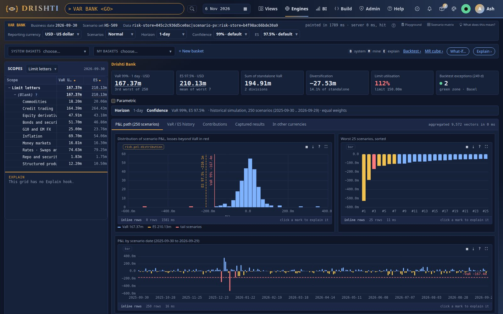

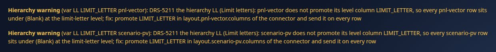

**Display names from the reference entities.** A node's name is its reference entity's `NAME`: the level's name is the kind and the
value the id (`desk` `DESK-RATES` is *Rates · Swaps and options*; `book` `BOOK-RATES-1` is *Rates · book 1*; `legal-entity` `LE-NY`
is *Drishti Bank Securities Inc.*), read once per load from the connector serving the kind; a level with no such kind (`division`,
`limit-letter`) or a value with no entity is named by the value itself. The order of a node's children is its children's ids. There is
no second source of names or of tree shape.

**Members are rows, not books.** A node's members are the trades whose values start with its path: a letter may hold part of a book
(two of the demo's books are split between two letters). The engine sums every **cell** once when the date loads (a run of trades of
one book with the same values of every level column; [section 25](#25-one-business-date-in-memory)) and a node's aggregate from its cells; a
node that holds every cell of a book holds the book's run itself, so MGMT's and LEGAL's books are summed exactly once, as before.

**A position under two nodes is split** (decision D4): its trades in each node are a position of their own, `<position>@<value>`
(`POS-BOOK-RATES-1~SEC-GOVT_BOND-USD-03@LL-0004`), and the date's provenance says how many were split. `POS:<position>` names the parts by
their ids; the trades are unchanged.

**A re-organisation is in the rows.** Each date's hierarchy is that date's rows' columns: a book moved to another desk carries the new
`DESK` on its rows from the move on, and a past date keeps its own rows, so a past date's VaR uses that date's hierarchy, never today's.
The demo's `BOOK-FI-3` sits under `DESK-CREDIT` on 2026-09-28 and under `DESK-FI` from 2026-09-29. Restating a past date's hierarchy
means reloading that date's rows. **Across two dates** (the explanation's hierarchy step,
[section 3.11](#311-why-it-moved-the-var-change-explained)), the earlier date's trades are mapped to the later date's hierarchy by
trade id: a trade on both dates counts where the later date's rows put it, and a trade only on the earlier date is a trade out.

**Add your own hierarchy in YAML.** Say the bank reports by region and desk, with a `REGION` column on its trades:

1. The pricing systems send `REGION` on every scenario-PV and P&L row (and the exposure simulator on every path row).
2. The connector promotes it: add `REGION` to `layout.scenario-pv.columns` and `layout.pnl-vector.columns` of `risk-store`
   (`config/connectors/risk-store.yaml`), and to `layout.exposure-path.columns` of `exposure-store` for exposure.
3. Add the hierarchy beside the others (in the pack's `hierarchies:`, or `drishti.var.hierarchies` in the server's settings, which then
   holds every hierarchy):

   ```yaml
   REGION: { title: Regions, levels: "REGION > DESK", word: REG, limits: var-limit }
   ```

4. Optionally give it limits: `var-limit` rows with `HIERARCHY: REGION` and `NODE_ID: REGION~EMEA` (or `REGION~EMEA/DESK-RATES`).
5. Restart (or reload the pack): the explorer's selector lists *Regions*, `VAR REG:EMEA <GO>` answers, the official capture records its
   nodes, and the MR cube offers `REGION.REGION` and `REGION.DESK` as dimensions. A row without a region sits under *(Blank)*.

The tutorial [Value at risk from the bank to a trade](../tutorials/02-var-from-the-bank-to-a-trade.md) walks it on the UI, the CLI and
the YAML.

**The golden test** (`HierarchyEquivalenceTest`, the 8,233 + 1,339 rows of 2026-09-30): the MGMT, LEGAL and LL trees built from the
promoted columns equal the golden record `var/hierarchy-golden-2026-09-30.json` field by field: node ids, parents, levels, children and
members, the aggregates to the bit, VaR, ES, the worst scenarios and the children's component VaR as exact doubles, and every node's
limit from `var-limit`, in USD and in EUR. `BlankNodeTest` covers the (Blank) nodes (an empty value, a column a source does not keep,
several empty levels, the leaf-id collision avoided, the totals, the label setting); `HierarchyColumnMissingTest` the warning on a
server; `VarHierarchyApiTest` a fourth tree, the words and the limits.

### 15.15 `var-limit`: the nodes' VaR limits

**Grain:** one row per node with a limit and business date. **Key:** `LIMIT_ID` = `VL-<NODE_ID>`. **Row count:** 157 in the test data
(41: the 43 nodes of LL but two letter-desk nodes left without one; the 88 MGMT and LEGAL nodes; the 28 system baskets, hierarchy
`PORTFOLIO`, `NODE_ID` the system basket's id: every VaR limit lives here, with its currency, decision 8 of
[DATA_ARCHITECTURE.md section 12](../architecture/DATA_ARCHITECTURE.md#12-computed-and-derived-attributes)). Read for the hierarchies whose `limits` names the kind
(`drishti.var.kinds.limit`, `var-limit`) and for the system baskets (`HIERARCHY` `PORTFOLIO`); JSON Lines, one row a line.

**Fields and example.** Every field (its type, whether it is required, its unit, its meaning and the checks on it) is the kind's data contract, [`var-limit.contract.yaml`](../../config/packs/banking/market-risk/contracts/var-limit.contract.yaml), published as [VLIM: `var-limit`](../contracts/packs/market-risk.md#vlim-var-limit-of-a-hierarchy-node-var-limit); a real record of the test data with every field explained is its [example](../contracts/samples/market-risk.md#var-limit).

**A row and its node.** `NODE_ID` is the id the engine builds from the promoted columns (`MGMT~DESK-RATES`, `LL~LL-0003/DESK-RATES`):
the bank's own desk, legal-entity or letter code, one to one. A row whose node is not on the date is told apart:

| The row | Shown as |
|---|---|
| a node of a configured hierarchy that its levels can build, but with no positions on the date | **limit, no positions**: listed with the hierarchy's tree (`limitsNoPositions` of `GET /api/v1/risk/var/tree`) and in the date's provenance; the limit is kept, never "unused" |
| a node its hierarchy cannot build (the hierarchy is not configured, or the id has more values than the hierarchy has levels) | unused, and said with the reason: `DRS-5212` in `provenance.warnings` |

Everything else about limits is unchanged: limit use, `limitStatus` and `limitNear` ([section 11.2](#112-the-headline-get-scope-and-its-provenance)), the bars, the pre-deal check,
the captures and the system baskets' limits (hierarchy `PORTFOLIO`, [section 5.7](#57-system-baskets)). A (Blank) node has no limit unless a row names its id.

The kind is an input: its data version is part of a date's hot-file digest, and its data-load signal reloads the date.

### 15.16 `desk-pnl`: the bank's actual and hypothetical P&L

**What it is.** The P&L the regulatory backtest compares the official VaR with ([section 18.11](#1811-backtesting-for-regulation)): per desk
and business date, **actual P&L** from finance and **hypothetical P&L** from front office. It is never an input of the VaR engine (no
figure of VaR reads it), and Drishti's own P&L of a node, the official record's `hypoPnl` ([section 7](#7-history-and-backtesting)), is
not this kind: it is the risk model's P&L, shown beside these two as the **risk-theoretical P&L**. Contract `DPNL`
([docs/contracts/packs/market-risk.md](../contracts/packs/market-risk.md)); served by `risk-store` like the other inputs.

**Grain:** one row per desk (and its legal entity) per business date. **Key:** `DESK_PNL_ID` = `DPNL-<DESK_ID>-<BUSINESS_DATE>`.
**Row count:** 2,600 in the test data (10 desks × 260 business days to 2026-09-30). JSON Lines, one row a line.

**Fields and example.** Every field (its type, whether it is required, its unit, its meaning and the checks on it) is the kind's data contract, [`desk-pnl.contract.yaml`](../../config/packs/banking/market-risk/contracts/desk-pnl.contract.yaml), published as [DPNL: `desk-pnl`](../contracts/packs/market-risk.md#dpnl-desk-pl-actual-and-hypothetical-daily-desk-pnl); a real record of the test data with every field explained is its [example](../contracts/samples/market-risk.md#desk-pnl).

**On the test data** (`tools/packgen/var/desk_pnl.py`, generated by `make_var_data.py`): a desk's risk-theoretical P&L of a date is its
scenario P&L of the scenario day before it (today's trades under that day's move: the official record's convention); the hypothetical
P&L adds a front-office pricing difference (4% of the desk's daily deviation), the actual P&L the day's new business and position
changes (12%); the fees are recorded beside. A desk missing on a date is named by the backtest, never read as zero; the kind's data-load
signal makes the backtest read the date again.

## 16. Reference and master data read

**The server engine reads no master directly** (decided 2026-10-25): everything it needs is denormalised onto the `pnl-vector` rows (the
trade's terms as the batch priced them: the hierarchy columns, product, security, status, maturity, quantity); the trees are built from
those columns. Positions are derived from those rows, not from the trade master: one read per date, the version the batch priced
(`TRADE_VERSIONS`), no join across the three booking systems at load. Masters are read by the demo generator and by the pages' links.

| Master (kind) | Key | Read by | What for |
|---|---|---|---|
| `trade` (ENDUR, CALYPSO, MUREX connectors; TRD) | `TRADE_ID` | the generator (the batch's copy of each trade); the pages' links | live trades, status, maturity, book, signed quantity, product and currency, version; the security id a bank's batch copies |
| `desk` (core pack; DESK) | `DESK_ID`, `BOOKS[].ID` | generator | book → desk, desk → legal entity, desk names; the hierarchies |
| `book` (BOOK) | `TT_BOOK` | pages (links) | |
| [`legal-entity`](../contracts/samples/core.md#legal-entity) ([contract](../contracts/packs/core.md#le-bank-legal-entity-legal-entity)) (LE) | `LEGAL_ENTITY` | generator (via desks); pages | `LE:` reads the trades' own `LEGAL_ENTITY` ([section 5.5](#55-scope-words-by-a-trades-attribute)) |
| [`trade-valuation`](../contracts/samples/market-risk.md#trade-valuation) ([contract](../contracts/packs/market-risk.md#tval-trade-valuation-trade-valuation)) (TVAL) | `VALUATION_ID` = `TVAL-<TRADE_ID>` | generator | `MTM` → `PV` |
| `counterparty` (CPTY) | `COUNTERPARTY` | pages (links) | `CPTY:` reads the trades' own `COUNTERPARTY` |
| [`lei-entity`](../contracts/samples/gleif.md#lei-entity) ([contract](../contracts/packs/gleif.md#lei-lei-legal-entity-lei-entity)) (LEI), `netting-set` (NSET) | `LEI`, `NETTING_SET` | `GROUP:` and `NSET:` scopes (parked) | |

Positions link to trades (`graph.fields.TRADE_IDS` → `trade`); the explorer links each trade row to `TRD:<id>` and each node to its
`NODE:` scope.

## 17. Conventions specific to VaR

| Convention | Rule |
|---|---|
| P&L sign | gain positive, loss negative ([README.md section 7](../contracts/README.md#7-currencies-units-and-signs)) |
| VaR, ES | **reported as positive numbers** for a loss (VaR = −(k-th worst P&L)); a scope whose k-th worst scenario is a gain has a **negative** VaR, shown as such |
| Component VaR | signed: a hedge has a negative component; components add up to the scope's VaR |
| Currency | USD for every vector and every figure (`REPORTING_CCY`); no FX conversion in the engine |
| Rounding | the API and captures round figures to whole currency units (`Math.round`; `NaN` and infinity become `0`); `pct`, `limitUse`, `confidence` and the test statistics are unrounded doubles |
| Confidence | VaR 99% (`drishti.var.confidence`), ES 97.5% (`drishti.var.es-confidence`); a value outside (0.5, 1) falls back to the default |
| Rank rule | `kth-worst`: k = ⌈N (1 − α) − 10⁻⁹⌉, clamped to [1, N]. N = 509: k = 6 at 99% (509 × 0.01 = 5.09 → 6), 13 at 97.5% (12.725 → 13) |
| Ties | scenarios with equal P&L are ordered by index, the older scenario first (the same rule in `VarMath.order` and `varmath.order`) |
| Horizon | the inputs are 1-day (`HORIZON_DAYS` 1); 10-day VaR is computed from them on request, by √10 or the sum of overlapping 10-day windows ([section 18.6](#186-horizons-the-two-10-day-methods-and-the-confidence-chosen)); official records stay 1-day (`HORIZON` `1D`) |
| Quantity | positive long, negative short; `DIRECTION` says the same in words |
| Ids | case: the ids of `POS`, `TRD` and `CPTY` are kept as written and matched exactly, else ignoring case (a booking system's ids are text and may be lower case; two ids that differ only in case are ambiguous and match neither); the other words' arguments are upper case, except basket names and capture ids ([section 5.2](#52-the-grammar)) |

## 18. The computation

The parameters are the `drishti.var` settings of [section 12](#12-settings).

### 18.1 VaR

With `v` the scope's vector (length N), `o` the scenario indices ordered worst first (ties by index), α = `confidence`:

```
kth-worst     k = clamp(ceil(N·(1−α) − 1e-9), 1, N)          VaR = −v[o[k−1]]
interpolated  pos = N·(1−α); lo = max(1, floor(pos)); hi = min(N, lo+1); w = clamp(pos − lo, 0, 1)
              VaR = −((1−w)·v[o[lo−1]] + w·v[o[hi−1]])
```

The **VaR scenario** is `o[k−1]` (reported as `k` and by the path's rank). An empty vector has VaR 0. The rank rule was the design's open
question 3: the 6th worst of 509 was decided, configurable (`drishti.var.rank-rule: interpolated`).

### 18.2 ES

```
k_ES = clamp(ceil(N·(1−α_ES) − 1e-9), 1, N)        ES = −(1/k_ES)·Σ_{r=1..k_ES} v[o[r−1]]
```

At N = 509, α_ES = 97.5%: the mean of the 13 worst. ES is not interpolated under either rank rule.

### 18.3 Decomposition of a scope into parts

A scope's **parts** are its children (child nodes of a node; positions of a book or of an ad-hoc scope; trades of a position:
[section 11.3](#113-path-and-contributions)) or the grouping asked (`by=position|trade|desk|book`). For a part with vector `p` and size
`s` (a position's `MARKET_VALUE`, a trade's `PV`; none for nodes and groups), `h = floor(window/2)`:

| Figure | Formula (as `VarCalc` and `VarMath` implement it) |
|---|---|
| tail | `T = o[max(1,k−h)−1 .. min(N,k+h)−1]`: the scope's scenarios ranked k−h to k+h (ranks 4 to 8 at k = 6, window 5) |
| smoothed VaR | `S = −mean_{j∈T} v[j]` |
| scale | `c = VaR / S` when `component-scale-to-var` and \|S\| > 10⁻⁹, else 1 |
| standalone VaR, ES | VaR and ES of `p` alone (its own order) |
| component VaR | `CVaR(p) = −c · mean_{j∈T} p[j]`; Σ over parts that partition the scope = VaR exactly (= S when c = 1) |
| component ES | `CES(p) = −mean_{r=1..k_ES} p[o[r−1]]` (the scope's ES scenarios); Σ = ES exactly |
| pct | `CVaR(p) / VaR` (0 when VaR = 0) |
| incremental VaR | `VaR(v) − VaR(v − p)`: the scope's VaR minus its VaR without the part, recomputed with its own order |
| marginal VaR | `CVaR(p) / abs(s) × 1,000,000` (per million of market value or PV); null without a size or for size 0 |
| diversification | `Σ standalone VaR(parts) − VaR(scope)`; null for fewer than two parts in the headline |

Parts need not partition the scope (a selection): their components then do not add up. A partial position (a scope holding some of a
position's trades) is a part whose vector is the sum of the trades it holds, its quantity theirs, `partial: true`. **Design differs:**
the design defined marginal VaR per unit of notional or PV by product; the code uses market value for positions and PV for trades, per
million. The design listed `age-weighted` (each scenario weighted by λ^age, λ 0.99 or the set's `WEIGHTS`) and `filtered` (each
scenario rescaled by today's volatility over that day's, EWMA) methods, unsmoothed single-scenario components as a choice, and stressed
VaR over an `SVAR-250` set: not built.

### 18.4 History and backtest

The two modes (`official`, `replay`) are in [section 7](#7-history-and-backtesting). **Backtest** (`Backtest.of(pnl[], var[], α)`), both
arrays oldest first:

```
for i in 1..n−1 (skipping NaN):  days += 1;  exception_i = pnl[i] < −var[i−1];  x = Σ exception_i      (day 0 is never an exception)
light:   s = min(1, days/250);   green if x ≤ round(4·s);  amber if x ≤ round(9·s);  else red
Kupiec (proportion of failures), p = 1 − α, p̂ = x/days:
         LR_POF = max(0, −2·[ (days−x)·ln(1−p) + x·ln p − ( x·ln p̂ + (days−x)·ln(1−p̂) ) ])     (0·ln 0 taken as 0)
Christoffersen (independence), transitions over i = 2..n−1 of (exception_{i−1}, exception_i):
         n00, n01, n10, n11;  π0 = n01/(n00+n01);  π1 = n11/(n10+n11);  π = (n01+n11)/(n00+n01+n10+n11)
         LR_IND = max(0, −2·[ (n00+n10)·ln(1−π) + (n01+n11)·ln π − (n00·ln(1−π0) + n01·ln π0 + n10·ln(1−π1) + n11·ln π1) ])
p-value: P(χ²₁ > LR) = erfc(sqrt(LR/2))   (Numerical Recipes' erfc, |error| < 1.2e−7)
```

Not built: ES backtests (the design's Acerbi–Székely tests), and the cross-check against QLRisk's backtesting.

### 18.5 The scenario window and the confidences

**The window.** `drishti.var.scenario-window` (`${DRISHTI_VAR_SCENARIO_WINDOW:250}`) is a number N, **250 as shipped** (one year, the
Basel minimum): the **newest N scenarios** of the date's set, or `all`, the whole scenario set of each date (its length, 509 in the demo) (its `SCENARIO_DATES` are strictly increasing, so
the last N). Every row is cut to the same N at load: P&L vectors and scenario PVs alike, and the scenario FX supplied or derived; the
rank, the ES count and the component window follow N: k = ceil(N·(1 − α)), the 3rd worst of 250 at 99%, ES the mean of the 7 worst at
97.5%. A set shorter than N is used whole, with a warning in the provenance; N below 20 is refused at start. The provenance says
*scenario window: newest 250 of 509 (2025-09-.. … 2026-09-29)* (`scenarioWindow`); the hot file's digest and the currency books include
N, so a change is never masked by a file built before; official records state it (`SCENARIO_WINDOW`): a change gives the next official
capture the new window, the records already captured keep theirs.

**Choosing the window.** One year (250 scenarios) is the regulatory minimum for historical-simulation VaR and reacts faster to a
changed market; two years (about 500) put more days in the tail (the 5th or 6th worst rather than the 3rd at 99%), so the figure moves
less from one day's scenario dropping out. The bank's lake can keep receiving longer histories: the window decides what the engine uses.
**Backtesting is separate** (`drishti.var.history-days`, 250): the window does not change it.

**The confidences.** `drishti.var.confidence` (`${DRISHTI_VAR_CONFIDENCE:0.99}`: 99%, or 95%) and `drishti.var.es-confidence`
(`${DRISHTI_VAR_ES_CONFIDENCE:0.975}`); a value outside (0.5, 1) is refused at start. Every answer carries `confidence` and
`esConfidence`, and the console, the CLI and the Home facts label their figures from them (*VaR 95% · 1 day*), never from a fixed
99%. **Limits** are set against VaR at the configured confidence: changing the confidence changes limit use. **Backtesting** stays at
its own setting: the Basel traffic light is defined at 99%.

**Asked per request.** `GET /api/v1/risk/var/scope?scope=BANK&window=250&confidence=0.95&es-confidence=0.975` (`drishti.py var show BANK
--window 250 --confidence 0.95`) recomputes the headline's VaR and ES from the same vector on the newest 250 scenarios or at another
confidence, to compare one year with two or 95% with 99%: the answer says so (`override`: `window`, `of`, `from`, `to`, the
confidences, `official: false`, a note) and is never official or captured; a window longer than the date's is used whole, with a
warning; a confidence outside (0.5, 1) answers `400`. **Tested:** `VarWindowApiTest` (a window of 25 on a set of 40 equal to a set of
only those 25, for the bank and every node; the provenance; the per-request window and confidence; the rank at 95%; refusals; the
digest).

<a id="186-horizons-the-two-10-day-methods-and-the-confidence-chosen-as-built-297"></a>
### 18.6 Horizons, the two 10-day methods and the confidence chosen

Every answer can be read through a **lens**: the **horizon** (1 day, the default, or 10 days), the **10-day method** and the
**confidences** of VaR and ES. Nothing new is fed or stored: every lens is computed on demand from the same 1-day scenario P&L vector
the sources already send (P&L vectors or scenario PVs, [section 15](#15-inputs-from-upstream-engines)). The official records stay
1-day at the configured confidence ([section 19](#19-official-end-of-day-results)).

**The two 10-day methods.**

| Method | How it is computed | Scenarios | When it is right | Its limits |
|---|---|---|---|---|
| **√10** (`sqrt10`, the default) | every scenario P&L of the 1-day vector × √10 (3.1623); VaR and ES are the 1-day figures × √10 exactly (the order of the scenarios does not change, so the same rank is read), components, contributions and the P&L path are the 1-day ones × √10 | the same 509 | the conservative common practice and what most regulators accept for a 10-day figure from a 1-day model (Basel 2.5's "may scale"); a book whose daily P&Ls are independent and whose value is close to linear in the market | assumes **independent days** (no trend, no clustering, no mean reversion) and a **linear** book: an option book's 10-day loss is not √10 of its 1-day loss (gamma grows with the move, vega with time), so √10 understates a short-gamma book and overstates a long one |
| **10-day sum** (`sum`) | each 10-day scenario is the **sum of 10 consecutive 1-day scenario P&Ls**, in the scenario set's date order: window *i* adds scenarios *i … i+9* (`out[i] = v[i] + … + v[i+9]`, added left to right); VaR, ES, components, contributions and the P&L path are computed on the windows | N − 9 **overlapping** windows: 509 give **500**, 250 give **241** (`scenario-window` first cuts the set, then the windows are formed) | captures what √10 cannot: trends, volatility clustering and moves that revert, in the scope's own history; the regulators' "overlapping 10-day periods" | **positions as of today** (no ageing, no rebalancing, no theta over the 10 days); today's sensitivities, so options are still not revalued at the 10-day move; overlapping windows are **not independent** (two neighbours share 9 days), so 500 windows hold about 50 independent 10-day periods and the tail is noisier than its count suggests |

**Sums for any scope come first.** A scope's 10-day vector is the windowed sum of its **1-day vector**, which the engine sums from the
position rows (the hot file's float32 rows in float64, or a node's float64 aggregate) in the fixed reduction order
([CLUSTER_GUIDE.md section 6.7](CLUSTER_GUIDE.md#15-sizing-memory-cpu-and-disk)). The windowing is a fixed left-to-right sum of ten values, so
a node's 10-day vector is **equal to the bit** whatever the shards and threads that summed its 1-day vector
([DATA_ARCHITECTURE.md section 13](../architecture/DATA_ARCHITECTURE.md#13-var-sharding-how-it-is-built): the partials stay the 1-day vectors, never windows). **Tested:**
`VarLensTest` (√10 equals the 1-day VaR and ES × √10 exactly at every confidence; the windows by hand on `1, 2, … 14` give `55, 65, 75,
85, 95`; 509 → 500, 250 → 241; the ranks; ES; components adding up; the 10-day vector of four scopes the same bits on 1, 2, 3, 8 and 24
threads), `ShardAssemblyTest` (23 scopes over six shards, three held and three through an owner: the 10-day vectors, VaR and ES
exactly the whole date's), `VarTestDataPrecisionTest` (the demo figures below).

**Worked figures on the demo data** (the bank, 2026-09-30, USD, `VarTestDataPrecisionTest`):

| Lens | VaR | rank | ES (97.5%) | ES count |
|---|---:|---|---:|---:|
| 1-day, 99% (the official figure) | **112,041,646** | 6th worst of 509 | 160,143,809 | 13 |
| 10-day √10, 99% | **354,306,794** | 6th worst of 509 (× √10) | 506,419,190 | 13 |
| 10-day sum, 99% | **274,544,283** | 5th worst of 500 windows | 303,557,727 | 13 windows |
| 1-day, 95% | 68,355,411 | 26th worst of 509 | 160,143,809 | 13 |
| 1-day, 97.5% | 93,720,716 | 13th worst of 509 | 160,143,809 | 13 |
| 1-day, 99.5% | 167,372,692 | 3rd worst of 509 | 160,143,809 | 13 |
| 10-day √10, 95% | 216,158,788 | 26th worst of 509 (× √10) | 506,419,190 | 13 |
| 10-day sum, 95% | 140,321,405 | 25th worst of 500 windows | 303,557,727 | 13 windows |
| 10-day sum, 97.5% | 177,047,980 | 13th worst of 500 windows | 303,557,727 | 13 windows |

Here the 10-day sum is **23% below √10** (274.5m against 354.3m, a ratio of 2.45 to the 1-day VaR where √10 is 3.16): in the demo's
synthetic two years, ten consecutive days of the bank's P&L partly offset each other (a bad day is often followed by a better one), so
the worst 10-day windows lose less than √10 times the worst day; a book in a trending or clustered market would show the opposite.
Neither figure is "right": √10 is the convention, the sum is the scope's own history.

**The confidence chosen.** VaR's confidence is picked from `drishti.var.confidences` (default 95%, 97.5%, 99%, 99.5%; the configured
`confidence`, 99%, is the default and always offered) and ES's from `drishti.var.es-confidences` (default 95%, 97.5%, 99%; 97.5% the
default). The rank follows the rank rule ([section 18.1](#181-var)): k = ceil(N·(1 − α)), so at 99% of 509 the 6th worst, at 95% the
26th, at 99.5% the 3rd; at 95% of the 500 windows the 25th; `interpolated` interpolates between the order statistics around N·(1 − α).
It is **another rank of the same sorted vector**: no extra data, nothing stored. A confidence that is not configured is refused in words
(`400`: *confidence 0.9 is not offered; the configured ones: [95%, 97.5%, 99%, 99.5%]*). The comparison remains: with `window` (or a
confidence outside the list and no lens), the headline is recomputed and labelled `override` ([section 18.5](#185-the-scenario-window-and-the-confidences)).

**Limits are compared only like for like.** A VaR limit is set for a horizon and a confidence: the `var-limit` row's `HORIZON` (1D by
default) and `CONFIDENCE` (0.99 by default) ([section 15.15](#1515-var-limit-the-nodes-var-limits)). **Limit use** is shown
only when the answer's horizon and confidence are the limit's own; otherwise it is empty (`limitUse: null`, `limitComparable: false`)
and the tile says *limit is for 1-day 99%: not comparable*. Changing ES's confidence never touches limit use.

**Backtesting is 1-day.** Basel counts 1-day exceptions against the 1-day VaR, so at 10 days the history replays today's members over
the newest windows (or scaled days) against today's 10-day VaR with no exceptions counted (`backtest.applicable: false`), and the tile
says *backtesting is 1-day*. At 1 day and another confidence the history and the backtest stay at the configured confidence (99%: the
Basel light is defined there), the official history for a node, and the answer says so.

**Where to choose it.** The VaR page's header ([section 3](#3-the-explorer-screen-by-screen)): **Horizon** (1-day, 10-day (√10), 10-day
(sum)), **Confidence** and **ES**, beside the Reporting currency; every panel follows, the method strip under the tiles names the
horizon, the method and the confidences, the link keeps them (`?h=10d&m=sum&q=0.99&esq=0.975`) and the person's settings remember them
(`varView`). Commands: `VAR BANK 10D` (the default method), `VAR BANK 10D SUM`, `VAR BANK 10D SQRT`, `VAR BANK 95`,
`VAR BANK 10D SUM 97.5`, `VAR BANK ES 95`, in any order and with `IN <currency>`; the type-ahead offers them once a scope is typed. The
API ([section 11](#11-the-api)): `horizon`, `method`, `confidence`, `esConfidence` on `/scope`, `/scope/path`, `/scope/history`,
`/scope/contributions`, `/scope/currencies`, `/tree` and a capture's body. The CLI ([section 10](#10-the-command-line)): `--horizon`,
`--method`, `--confidence`, `--es-confidence`. VRES: `VRES BANK~horizon=10d~method=sum~confidence=0.95`. Every answer names its lens
(`horizon`, `method`, `confidence`, `esConfidence`, the lens's `describe`), and so do captures, the path's CSV and the provenance's *Method*.

**The default 10-day method** is `drishti.var.ten-day-method` (`${DRISHTI_VAR_TEN_DAY_METHOD:sqrt10}`): `sqrt10`, the conservative
common practice, or `sum`. It decides what `VAR BANK 10D` and `horizon=10d` without a method mean.

**The full-revaluation slot (designed, not built).** The honest 10-day figure for an option book revalues every position at the 10-day
moves. The slot for it is a **second vector set**: the sources send a 10-day P&L vector (or 10-day scenario PVs) per trade, marked
`HORIZON: 10D` in the input contract (`pnl-vector` and `scenario-pv` gain the optional `HORIZON`, 1D by default), loaded into its own
section of the same hot file (as `CTOT` and `CELL` were added), summed exactly as the 1-day set; a third method `full` reads it
(`METHOD: FULL` on answers and official records). Until a source sends it, `full` is not offered. Official records already carry
`HORIZON` (`1D`) and `METHOD` (null) so a future 10-day official record is never mistaken for a 1-day one
([REGULATORY_VAR_REPORTING.md section 4.2](REGULATORY_VAR_REPORTING.md#42-var-es-and-the-10-day-horizon)).

### 18.7 The whole chain, step by step

Historical simulation in Drishti is seven steps, from what the sources send to the figure of record. Each step names the section that
gives it in full; the ten-scenario example of [section 2.1](#21-by-hand-ten-scenarios) works steps 3 to 5 by hand.

| Step | What happens | Formula | Where |
|---|---|---|---|
| 1. **Intake** | each trade's scenario PVs become a USD P&L vector (a P&L vector is taken as sent); its USD value today becomes its `PV` | `P&L_USD(s) = PV(s)·FX_c(s) − PV(base)·FX_c(base)` | `VarIntake`, `ScenarioFx.pnlFromPv`; [15.9](#159-scenario-pv-scenario-pvs-per-trade-in-the-trades-currency) |
| 2. **Window** | every vector cut to the newest N scenarios when `drishti.var.scenario-window` is a number | `v ← v[len − N … len − 1]` | [18.5](#185-the-scenario-window-and-the-confidences) |
| 3. **Positions and totals** | trades summed into derived positions, positions into the nodes of every hierarchy (float64 aggregates in the hot file), any other scope summed by the planner from rows and aggregates | `v_scope(s) = Σ_{t ∈ scope} v_t(s)` | [4](#4-positions-derived-never-delivered), [25](#25-one-business-date-in-memory), [26.4](#264-how-a-sum-reads-it) |
| 4. **Rank** | the scope's vector sorted worst first (ties: the older scenario first); k from the confidence | `k = ⌈N·(1 − α)⌉`, `VaR = −v[o[k−1]]`, `ES = −mean of the k_ES worst` | [18.1](#181-var), [18.2](#182-es) |
| 5. **Decompose** | components on the tail around rank k (scaled to add up to VaR), component ES on the ES tail, standalone, incremental, marginal, diversification | the table of [18.3](#183-decomposition-of-a-scope-into-parts) | `VarCalc`, `VarMath` |
| 6. **Lens and currency** | 10-day by √10 or the windowed sum, another confidence, another reporting currency | `v_10d = √10·v` or `w_i = Σ_{j=i..i+9} v_j`; `P&L_r(s) = (p + P&L_USD(s))/FX_r(s) − p/FX_r(base)` | [18.6](#186-horizons-the-two-10-day-methods-and-the-confidence-chosen), [15.10](#1510-reporting-currency) |
| 7. **Record** | after a complete load, every node captured officially and the rows published | | [19](#19-official-end-of-day-results) |

**Step 1 by hand** (a hand-made example, not the test data). A EUR swap with a base PV of 1,000,000 EUR and today's EUR rate 1.0800 USD
is worth 1,080,000 USD: its `PV`. Under scenario *s* the pricing system revalues it at 990,000 EUR and the scenario's EUR rate is 1.0700:

```
P&L_USD(s) = 990,000 × 1.0700 − 1,000,000 × 1.0800 = 1,059,300 − 1,080,000 = −20,700 USD
```

Of the loss, 10,800 USD is the swap's own move (−10,000 EUR at 1.08) and 9,900 USD the euro's move on what it is then worth (990,000 ×
−0.01): the currency is part of the risk. A USD trade's P&L is simply `PV(s) − PV(base)`.

**Steps 3 to 6 on the test data** (the bank on 2026-09-30, 509 scenarios; `VarTestDataPrecisionTest` and [section 2.2](#22-on-the-test-data)):
the bank's vector is the sum of 7,993 positions; at 99% k = ⌈509 × 0.01⌉ = 6, so the 1-day VaR is minus the 6th worst P&L,
**112,041,646**; ES at 97.5% is minus the mean of the 13 worst, **160,143,809**; at 95% k = 26 and VaR is **68,355,411**; the 10-day
VaR is **354,306,794** by √10 and **274,544,283** by the sum of the 500 overlapping windows.

### 18.8 Stressed VaR

**What it is, in plain words.** Stressed VaR is the same historical simulation as VaR, run on **today's positions** with the market
moves of a **fixed 12-month stress period** (a year in which markets were very bad, such as 2008-07 to 2009-06) instead of the moves
of the last one or two years. It answers *what would today's book lose on a bad day if the worst year we know came back?* It is **not**
the value of the positions as they were in that period: the trades are today's, their sizes and sensitivities are today's, and only the
market moves are taken from the stress period. A bond bought last month has a stressed P&L for 2008-10-10 although it did not exist then:
it is today's bond, revalued as if rates had moved on today's curve as they did on that day.

**A small worked example** (made by hand, not the test data). A book holds one 10-year bond worth **10,000,000 USD today**. The pricing
system takes the yield move of each day of the stress period, applies it to today's curve and reprices today's bond:

| Stress day | The day's move (applied to today's curve) | Today's bond repriced, PV(s) | P&L(s) = PV(s) − PV(base) |
|---|---|---:|---:|
| 2008-09-15 | yield +31 bp | 9,744,000 | −256,000 |
| 2008-10-10 | yield +22 bp | 9,817,000 | −183,000 |
| 2008-11-20 | yield −18 bp | 10,151,000 | +151,000 |
| … 247 more days | | | |

With **250 stress days** at 99%, the rank is k = ⌈250 × 0.01⌉ = 3: the stressed VaR is minus the **3rd worst** of the 250 P&Ls; stressed
ES at 97.5% is minus the mean of the k_ES = ⌈250 × 0.025⌉ = **7 worst**. If the seven worst P&Ls are −256,000, −241,000, −233,000,
−205,000, −198,000, −190,000 and −183,000, the stressed VaR is **233,000** and the stressed ES is (256 + 241 + 233 + 205 + 198 + 190 +
183) / 7 × 1,000 = **215,143**. The book's normal VaR on its 509 recent days might be 90,000: the stress period's moves are larger.

**The second scenario set: what the pricing system sends.** The stress set is a **second scenario set of the business date**, fed
through the same feed and the same contracts as the normal set ([section 15](#15-inputs-from-upstream-engines)):

| Input | The normal set | The stress set |
|---|---|---|
| [`scenario-set`](../contracts/samples/market-risk.md#scenario-set) ([contract](../contracts/packs/market-risk.md#sset-scenario-set-scenario-set)) | one row, e.g. `HS-509`: the date's recent days | one more row, its own `SCENARIO_SET_ID` (`HS-STRESS-2008`), **`SET_TYPE: STRESS`**, `SCENARIO_DATES` the stress period's days in date order; optionally `SYNTHETIC: true` and a `DESCRIPTION` |
| [`scenario-pv`](../contracts/samples/market-risk.md#scenario-pv) ([contract](../contracts/packs/market-risk.md#spv-scenario-pvs-of-a-trade-509-scenarios-its-currency-scenario-pv)) (preferred) | each trade's (or position's) PVs under the normal scenarios, in its own currency, with its base PV | the same trade's PVs under the **stress** scenarios, the **same base PV** (one valuation today), `SCENARIO_SET_ID` the stress set's |
| [`pnl-vector`](../contracts/samples/market-risk.md#pnl-vector) ([contract](../contracts/packs/market-risk.md#pnlv-pl-vector-509-scenarios-pnl-vector)) (accepted) | each trade's P&L vector in USD | its P&L vector under the stress scenarios, `SCENARIO_SET_ID` the stress set's |
| [`fx-scenario`](../contracts/samples/market-risk.md#fx-scenario) ([contract](../contracts/packs/market-risk.md#fxs-scenario-fx-of-a-currency-509-scenarios-fx-scenario)) | each currency's rate today and under each normal scenario | each currency's rates under each **stress** scenario, `SCENARIO_SET_ID` the stress set's |

The rows sit in the same tables: the engine tells them apart by `SCENARIO_SET_ID` (so the connector must promote that column, as the
market-risk pack does), and a set is the stress set when its `SET_TYPE` is `STRESS` or, when it does not say, when its id starts with
`drishti.var.stress.id-prefix` (`HS-STRESS-`). The normal set's book never sees a stress row, and the stress book never sees a normal row.
The P&L is derived exactly as for the normal set ([Input, computed, cache and the official record](#input-computed-cache-and-the-official-record-compute-first)):

```
P&L_USD(s) = PV(s) × FX_c(s) − PV(base) × FX_c(base)          s = each stress day, in the stress set's order
```

with `FX_c(s)` the stress set's own supplied scenario FX (`fx-scenario` rows of that set). The FX of a stress day is never taken from the
normal set; when a currency's stress rates are not supplied and the FX history does not reach the stress period, that currency's trades
are refused for the stress set (`DRS-5207`), never valued at zero. A date has at most one stress set; two refuse the stress set's load
(`DRS-5203`) and leave the normal set as it is.

**What is the same as normal VaR.** The engine, every rule and every screen:

- the historical simulation itself: the rank rule, VaR at the chosen confidence (99% by default; any offered one), ES, the components
  and contributions, diversification, incremental and marginal VaR ([sections 18.1 to 18.3](#181-var));
- 1-day and 10-day, by √10 and by the sum of 10 consecutive days (250 stress days give **241** overlapping windows; [section 18.6](#186-horizons-the-two-10-day-methods-and-the-confidence-chosen));
- the positions the rules derive, every hierarchy and its nodes, ad-hoc scopes (`BANK - DESK:CREDIT`, `WHERE:`…), portfolios and
  baskets, the totals over every position of a scope ([section 27a](#27a-how-scopes-parts-and-totals-are-computed-and-why-it-scales));
- entitlements, the P&L path, the contributions table, captures and the provenance; computed in memory and in its own hot file, never
  written to the lake (compute-first).

**What differs.**

| | Normal VaR | Stressed VaR |
|---|---|---|
| The scenario days | the date's recent history (509 in the demo), cut to `drishti.var.scenario-window` when set | the stress period, **used whole** (about 250 days); the scenario window does not apply |
| Choosing the period | rolls forward every day | **fixed**, reviewed periodically: the period that is worst for today's portfolio. The stress window selection ([section 18.9](#189-choosing-the-stress-window)) shows which period that is and records the choice; the stress set's days are what the pricing system's batch sends, recorded on every answer and record (`STRESS_SET_ID`) |
| Proxies | not needed: every risk factor existed | a risk factor that did not exist in the stress period (a newer index, a currency, a curve) needs a **proxy**: that is the pricing system's job when it revalues today's trades; Drishti records which scenario set was used |
| Reporting currency | any currency with scenario FX | **USD** (the stress set's own currency); a request in another currency is refused in words |
| Limits | limit use when the limit's horizon and confidence match | **no limit use**: a VaR limit is set against normal VaR (*limit is for 1-day 99% VaR: stressed VaR is not compared with it*) |
| Backtesting | exceptions and the Basel light | **not backtested** (the history panel replays today's members over the stress days and says so) |
| Intraday updates | applied to the morning run | the stress set is the **morning run**; intraday batches update the normal set |
| The capital use | VaR's 60-business-day average | the capital rule takes the **larger of the previous day's stressed VaR and a multiplier × its average over the last 12 weeks (about 60 business days)**; Drishti gives the average from the official records (below) |

**The 12-week average.** Every official end-of-day record ([section 19](#19-official-end-of-day-results)) of a date with a stress set
carries each node's stressed VaR and ES beside its VaR and ES, at the configured horizon and confidences (`svar`, `ses`, `stressSet`;
published as `SVAR`, `SES` and `STRESS_SET_ID`). A stressed answer of a node gives `stressAverage`: the mean of the node's official
stressed VaR over the `drishti.var.stress.average-weeks` weeks (12) ending on the date, how many official records it is the mean of, their
dates, and the official dates in the period **without** a stressed VaR (named, never counted as zero). A scope that is not a node has no
official record and says so. A date without a stress set records none (`stressSet: null` and a `stressNote` saying why).

**A date without a stress set** answers in words, never with zeros: *no stress scenario set on 2026-09-29: stressed VaR is not available for
this date* (`404`, `DRS-1001`); its normal VaR is unaffected.

**Choosing Normal or Stressed.**

| Where | How |
|---|---|
| The VaR page | **Scenarios: Normal / Stressed**, beside Horizon, Confidence and ES; every panel follows; the tiles read *Stressed VaR 99% · 1 day · USD*, the third tile the 12-week average; the method strip names the stress set (*HS-STRESS-2008 · 2008-07-01 … 2009-06-30 · synthetic*); the link keeps it (`&set=stressed`) and the person's settings remember it (`varView.set`) |
| Commands | `VAR BANK SVAR`, `VAR BANK SVAR 10D`, `VAR BANK SVAR 10D SUM`, `VAR DESK DESK-RATES SVAR 10D SQRT 97.5`; the type-ahead offers them once a scope is typed |
| The API | `set=stressed` on `/scope`, `/scopes/{scope}`, `/scope/path`, `/scope/history`, `/scope/contributions`, `/tree` and a capture's body (`"set": "stressed"`); every answer says `set` (`NORMAL` or `STRESSED`) and, stressed, `lens.stressSet` (its id, first and last day, scenario count, description, `synthetic`). `window` and `es-confidence` (the per-request recomputes of [section 18.5](#185-the-scenario-window-and-the-confidences)) are for the normal set and are refused with `set=stressed` |
| The CLI | `drishti.py var show BANK --stressed`, `--stressed --horizon 10d --method sum`; `parts`, `path`, `history`, `tree` take `--stressed` too |
| VRES | `VRES BANK~set=stressed` (`SET` in the result) |

**Configuration** ([CONFIGURATION.md](../admin/CONFIGURATION.md#drishtivarstress)):

| Key | Default | What it does |
|---|---|---|
| `drishti.var.stress.enabled` (`DRISHTI_VAR_STRESS_ENABLED`) | `true` | offers Normal / Stressed; off, a stressed request is refused in words (the stress set's rows are still kept out of the normal set) |
| `drishti.var.stress.id-prefix` | `HS-STRESS-` | a scenario set without `SET_TYPE` is the stress set when its id starts with this |
| `drishti.var.stress.average-weeks` | `12` | the period of the stressed VaR average over the official records |

**Where it lives.** The stress set's book is loaded when stressed VaR is first asked of a date open on the server (`VarLoader.loadStress`,
`VarService.stressed`), kept while the date is open and dropped with it; with the tiered memory it has its own hot file
(`<data>/var/hot/<date>-STRESS/`, its digest naming the stress set), so a date's normal and stressed books are never confused. On a
sharded cluster ([section 28](#28-sharding-across-drishtinet)) the stress set (about half the width of the normal set) is
loaded whole by the member that answers; its sums follow the same fixed reduction order, so every member gives the same figures.

**The demo's stress set** is **synthetic**: `HS-STRESS-2008`, the **250 business days of 2008-07-01 to 2009-06-30** (the New York
calendar), made by the test-data generator `tools/packgen/var/stress.py` (run by `make_var_data.py`): every demo trade revalued, keeping
its size and factor loadings, under 2008-like moves of the same forty factors as the normal set: Student-t shocks with GARCH clustering
at 2.2 times the normal set's volatility, correlations raised, an acute episode from 2008-09-15 to 2008-11-28 at 1.5 times that, and six
crash days on which everything falls (2008-09-15, 2008-09-29, 2008-10-09, 2008-10-15, 2008-12-01, 2009-01-20). The moves are **not market
history**: the set says so (`SYNTHETIC: true`, its description) and so does every stressed answer. Its rows are in their own files beside
the normal set's, under the same table and date (`stress-cob…` in the 2026-09-30 folder of `data/testdata/market-risk/<kind>/`).

**Worked figures on the demo data** (the bank, 2026-09-30, USD; `VarComputeFirstTest`):

| Lens | Normal VaR (509 days) | Stressed VaR (250 stress days) | rank (stressed) | Stressed ES (97.5%) |
|---|---:|---:|---|---:|
| 1-day, 99% | 112,041,646 | **213,637,794** | 3rd worst of 250 | 222,810,303 (mean of 7) |
| 10-day √10, 99% | 354,306,794 | **675,582,023** | 3rd worst of 250 (× √10) | 704,588,045 |
| 10-day sum, 99% | 274,544,283 | **293,280,315** | 3rd worst of 241 windows | 282,705,323 |
| 1-day, 95% | 68,355,411 | **147,807,462** | 13th worst of 250 | 222,810,303 |

The stressed 1-day VaR is 1.9 times the normal one. Note that with 250 days, ES at 97.5% (the mean of the 7 worst) is close to VaR at
99% (the 3rd worst) and may fall either side of it, as it does for a normal distribution (2.34 σ against 2.33 σ).

**Not to be confused with** the what-if's **stressed VaR** ([section 8.2](#82-the-what-if-the-java-engine)): the largest VaR
over every run of 250 consecutive days **inside the date's own (normal) scenario set**, an analysis of the recent history
that cannot reach a 2008 or 2020 period unless that set holds it. Stressed VaR uses a separate scenario set of the stress period, sent by
the pricing system.

**Tested:** `VarStressApiTest` (the normal and stressed answers each from their own set's rows, for the bank and every node; 10-day by √10
and by the 21 windows of 30 stress days; no limit use and no backtest; a date without a stress set answers `404` in words; another
currency and an unknown set refused; the stress book's own hot file; the official record's `svar`, `ses` and the 12-week average; no
input table changed by any of it), `VarComputeFirstTest` (the demo figures above), `test_stress_data.py` (the committed stress set:
250 days, every trade once in its own form, its base PV and FX), the console's `test_var_routes.py` (`SVAR`, `set=stressed`, the picker).

### 18.9 Choosing the stress window

**In plain words.**

- **What it is.** Stressed VaR asks: *how much could today's portfolio lose on a bad day, if markets behaved as they did in the worst
  year we know?* The answer depends entirely on **which year** is used: the *stress window*. Regulators (Basel 2.5 stressed VaR, and
  the FRTB reduced-set stress period) require the bank to use the 12-month period that is **most painful for the portfolio it holds
  today**, and to show, periodically and with evidence, that the chosen period is still the right one. As the portfolio changes (a
  desk grows its commodity book, rates exposure flips sign), a different crisis can become the worst one: 2008 for credit, 2022 for
  rates, 2020 for equities.
- **What the screen shows.** Today's positions, replayed through every business day since 2007. For **every possible 250-day
  window** (2007-01-02 to 2007-12-28, then one day later, and so on) it computes the stressed VaR that window would give. The chart
  is that figure against the window's first day: peaks are the periods that hurt today's portfolio most. The **worst** window and the
  **current** window (the one the stressed VaR uses now) are marked. The dashed line is today's normal VaR, for scale.
- **The question it answers.** *Is our current stress window still the worst for what we hold?* If another window gives a stressed
  VaR more than 5% higher (the threshold is configurable), the screen raises an **alert**. That is the trigger to review the window
  and possibly change it.
- **The data it uses.** One input: the **long-history P&L of each hierarchy node** (kind `pnl-history`, `PNLH`). Today's portfolio,
  revalued by the pricing system under each historical day's market moves, summed to each node (bank, division, desk). It is
  about 5,000 numbers per node, produced monthly, not per trade. In the demo this history is **synthetic** (see below), so the
  periods and figures show how the tool works, not real market history.
- **Where it is useful.**
  1. **The periodic stress-period review** that market risk and model validation owe the regulator: an evidenced, repeatable
     analysis instead of a spreadsheet.
  2. **Early warning:** the alert says when the portfolio has drifted towards a different crisis.
  3. **Per desk:** each desk can see which crisis hurts *it* most (the **By node** table), even though one window is approved
     for the whole bank.
  4. **Governance:** *Freeze and propose* keeps the exact analysis with its inputs, and a second person approves it
     (maker-checker). The approved window instructs the pricing system's next stress scenario set, and every step is audited.
- **How to read the example screen** (`SWIN BANK`, 250 days): the worst window starts 2007-11-30 (Bear Stearns into the autumn
  of 2008) at 249m against the current window's 214m: **+16.8%**, above the 5% threshold, hence the alert. The next candidates
  (late 2008 to 2010, the 2022 rates shock, the 2011 euro crisis) are all lower than the current window. **Window** switches to
  125 or 500 days; the node chips (or `SWIN DESK DESK-STRUCT`, `SWIN LE LE-NY LEGAL`) repeat the analysis for one desk or legal
  entity. A desk's own worst period often differs from the bank's.

**In detail.**

Stressed VaR (section 18.8) values today's portfolio over **one fixed 12-month stress period**. Which period? The rule is the one that is
worst for **today's** portfolio, reviewed periodically. The **stress window selection** answers it: today's portfolio revalued over a
long history (2007 to the day before the business date in the demo), every window of 250 consecutive days valued as a stressed VaR, the
worst windows that do not overlap listed against the window in use, an alert when another window is worse by more than a threshold, and
the choice frozen with its inputs and approved by a second person.

**The input: the long-history P&L of each node** (kind `pnl-history`, command `PNLH`;
[its data contract](../contracts/packs/market-risk.md)). One row per hierarchy node and positions date: `HISTORY_DATES` (every business
day of the history, increasing) and `PNL` (today's portfolio at that node under each day's market moves, USD, gains positive), with
`HIERARCHY`, `NODE_ID`, `NAME`, `LEVEL`, `FIRST_DAY`, `LAST_DAY`, `DAY_COUNT`, `SYNTHETIC`. A node's values are the sum of its children's.
The pricing system produces it the way it produces a scenario set (today's trades revalued under each historical day's moves), monthly at
least, at the node grain: about 5,000 values per node instead of 5,000 per trade. The days of the date's stress set should carry the stress
set's own P&L, so the configured window's figure is the node's stressed VaR to the cent. It is read from the risk store like every input,
once per date and data version, and never written back.

**The calculation.** For a node with history `P[0..N-1]`, a window length `L` (250) and the confidence `a` (99%):

```
rolling VaR of the window starting on day s:   W(s) = VaR_a( P[s], P[s+1], ..., P[s+L-1] )        s = 0 .. N - L
VaR_a by the engine's rank rule:               the k-th worst value, k = ceil(L (1 - a))       (the 3rd worst of 250 at 99%)
the current window:                            c = the index of the stress set's first day (WINDOW_START)
the worst window:                              w = the s with the largest W(s); ties: the earlier s
the candidates:                                the largest W(s), the largest first, no two closer than L days
the gap:                                       W(w) / W(c) - 1           the alert when gap > alert-threshold (5%)
today's VaR:                                   VaR_a of the last M days, M the normal set's length (509): the node's VaR today
10-day √10:                                    W(s) × √10
```

The candidates are kept **apart** (their first days at least `L` days from each other) so the list names different periods, not the same
crisis shifted by a day; the current window is always shown, in its place by VaR, even when it overlaps a candidate. Each node of the
hierarchy has its own worst window (the **By node** table); one window is chosen for the bank.

**Worked figures on the demo data** (positions of 2026-09-30, USD, 99% 1-day, windows of 250 days; the history is **synthetic**, made
by `tools/packgen/var/pnl_history.py`: the stress set's 250 days and the normal set's 509 days carried as they are, every other day of
2007-01-02 to 2026-09-29 made from each book's own volatility with episodes shaped like the crises since 2007; **not market history**):

| Window | Stressed VaR of the bank | Against the current window |
|---|---:|---:|
| 2007-11-30 to 2008-11-28 (the worst: Bear Stearns, then the autumn of 2008) | 249,444,106 | +16.8% |
| 2008-07-01 to 2009-06-30 (the current window, `HS-STRESS-2008`) | 213,637,794 | 0.0% |
| 2008-12-01 to 2009-11-30 | 198,969,552 | −6.9% |
| 2009-12-01 to 2010-11-30 | 195,313,164 | −8.6% |
| 2021-10-08 to 2022-10-06 (the rates shock of 2022) | 187,951,560 | −12.0% |
| 2011-05-02 to 2012-04-30 (the euro-area crisis) | 174,582,910 | −18.3% |

The current window's 213,637,794 is the bank's stressed VaR of section 18.8, and the last 509 days give 112,041,646, the bank's VaR
today. The gap of 16.8% is above the 5% threshold: the tool raises the alert. By node, the commodity, credit and rates desks are worst
in a window that starts in 2007 or 2008 too; the structured desk's own worst starts 2007-05-31 (28.47m against 13.77m in the current
window).

**On screen: `SWIN <scope> <GO>`** (`SWIN BANK`, `SWIN DESK DESK-RATES`, `SWIN LE LE-NY LEGAL`) opens `/var/stress-window`:

| Panel | What it shows |
|---|---|
| Header and controls | the positions date, the history (first and last day, *synthetic* when it is), the window length and the rank; a chip per node of the hierarchy; Hierarchy; Window (250, 125, 500 days); **Export CSV** (every window's first day and stressed VaR); **Freeze and propose for sign-off** |
| Alert | *the window starting 2007-11-30 gives a stressed VaR +16.8% against the current window …; the threshold is 5% (`drishti.var.stress-window.alert-threshold`)*, or that the current window is within the threshold |
| Chart | the stressed VaR of today's portfolio for every window start; the worst and the current window marked, the other candidates labelled, today's VaR as a dashed line; hover for a window's figure, click to select a window |
| Top candidates | the windows apart from one another, by stressed VaR: the window, its VaR, the change against the current, *worst* and *current* tags, the worst day in it; click a row to select it |
| By node | each node's VaR in the current window, its own worst window and when it starts, the gap |
| Current against proposed | window, stressed VaR 1-day and 10-day √10, scenarios, the worst day in each; who approved the current window |
| Proposals | the frozen analyses, newest first: id, node, window, VaR, status, who proposed and who decided; **Decide in Approvals** for another person (approved or rejected in the one Approvals queue) |

The page needs a role that sees every node of the VaR hierarchies (the history is node-level P&L of the whole bank); another role is
refused in words. The page lives under the `VAR` command word: an edition or a lens without `VAR` does not offer it.

**Freeze, propose and approve.** *Freeze and propose* keeps the analysis of the node as a record (`SWP-000001`, in the content store
under `var/stress-window/proposals/`): the positions date, the node, the window length, the confidence, the history's facts and **data
version**, the stress set and its window, the current and the proposed window with their figures, the candidates, the alert, the note,
who proposed it and when. A **second person** approves or rejects it with a note (maker-checker: the proposer is refused, `DRS-2007`; a
decided proposal is not decided again, `DRS-2006`). Every step is audited. An approved window is the instruction for the pricing
system's next stress scenario set; once a date's stress set covers it, the tool names the approval beside the current window. Stressed
VaR itself always uses the stress set the date holds.

**From the command line:** `drishti.py var stress-window BANK` (the analysis as text), `--propose --first 2007-11-30 --note "..."`, `--proposals` (it is decided in the queue: `drishti.py approvals approve stress-window SWP-000001`) ([section 10](#10-the-command-line)).

**The API** (every endpoint in [API_REFERENCE.md](API_REFERENCE.md)):

| Call | What |
|---|---|
| `GET /api/v1/risk/var/stress-window?scope=BANK&hierarchy=MGMT&length=250&confidence=0.99&asOf=2026-09-30` | the analysis: `node`, `nodes`, `hierarchies`, `history`, `length`, `confidence`, `rank`, `stressSet`, `current`, `worst`, `today`, `alert`, `candidates`, `series` (`starts`, `var`), `byNode`, `approval` |
| `POST /api/v1/risk/var/stress-window/proposals` | freeze and propose: `{"scope", "hierarchy", "date", "length", "confidence", "first", "note"}` (`first`: the window's first day; none: the worst) |
| `GET /api/v1/risk/var/stress-window/proposals` and `/proposals/{id}` | the proposals, newest first; one proposal |
| `POST /api/v1/approvals/stress-window/{id}/approve` | `{"decision": "approve" \| "reject", "note"}` by another person |

A date without long-history rows answers `404` in words; a node without a row `404` naming the nodes that have one; a window shorter than
20 days or longer than the history `400`; a row whose dates and values differ in length, or whose dates do not increase, `400`. A date
without a stress set still answers (no current window, said in `currentNote`).

**Configuration** ([CONFIGURATION.md](../admin/CONFIGURATION.md#drishtivarstress-window)):

| Key | Default | What it does |
|---|---|---|
| `drishti.var.stress-window.enabled` (`DRISHTI_VAR_STRESS_WINDOW_ENABLED`) | `true` | the tool and its API |
| `drishti.var.stress-window.kind` | `pnl-history` | the kind of the long-history rows |
| `drishti.var.stress-window.length` | `250` | the days of a window (a request may ask for another, at least 20) |
| `drishti.var.stress-window.top` | `5` | the candidate windows listed |
| `drishti.var.stress-window.alert-threshold` | `0.05` | the alert's threshold: the worst window above the current one by more than this |

**Where it lives.** `StressWindows` (drishti-compute: the rolling VaR, the candidates, the worst day) by the engine's own rank rule
(`VarMath`), so the current window's figure is the stressed VaR to the bit; `VarStressWindow`, `VarStressProposals` and
`VarStressWindowController` in the server; the page `terminal/stress_window.html` with `drishti_stress-window.js`. A position-level full run
(every trade over the whole history) is not part of the tool: the node grain is what the monthly review needs.

**Tested:** `StressWindowsTest` (every window the VaR of its own days to the bit, the third worst of 250 at 99%, candidates apart,
ties), `VarStressWindowApiTest` (the analysis against hand-computed windows, the current window from the stress set, the alert at 20%,
candidates apart, today's VaR from the last days, the node table, refusals in words, a role that does not see every node refused,
freeze and propose with the data version, the proposer refused, another person approves, a second decision refused, the approval named
beside the current window), `test_stress_data.py` (the committed history: every node above the books, every day since 2007, the stress
and normal days giving 213,637,794 and 112,041,646, a node the sum of its children), the console's `test_stress_window_routes.py` and `test_stress_window_browser.py` (the page drawn across its width, with no script error).

### 18.10 Period statistics

A node's **period end, average, high and low** of `var`, `es`, `svar` or `ses` over a fiscal year, quarter or any dates, the
**60-business-day average** of VaR and the **12-week average** of stressed VaR, computed on request from the official records
([section 19](#19-official-end-of-day-results)) and never stored (`VarPeriodStats`; `VAR <scope> STATS <period>`, `drishti.py var stats`,
`GET /api/v1/risk/var/statistics`). Missing records are named, never skipped; a demo server may seed a synthetic year of records
(`drishti.regulatory.synthetic-history`). On the demo, FY2026: period end 112,041,646, average 151,812,526, high 167,372,692, low
87,874,268. The formulas, periods, settings and the synthetic history: [REGULATORY_VAR_REPORTING.md section 4.4](REGULATORY_VAR_REPORTING.md#44-period-statistics).

### 18.11 Backtesting for regulation

The official VaR of the day before against the **bank's** actual and hypothetical P&L (`desk-pnl`,
[section 15.16](#1516-desk-pnl-the-banks-actual-and-hypothetical-pl)) and Drishti's own risk-theoretical P&L, at 99% and 97.5%, for the
bank, a division, a legal entity or a desk, over 250 days: exceptions, the Basel zone, the capital multiplier, the desks that drove each
exception, Kupiec and Christoffersen (`VarBacktesting`; `VAR <scope> BACKTEST`, `drishti.py var backtest`,
`GET /api/v1/risk/var/backtesting`). On the demo the bank has 3 exceptions at 99% against actual and against hypothetical P&L: green,
multiplier 3.00. The rule, the US and Canadian multiplier tables, the settings, the screen and the playground:
[REGULATORY_VAR_REPORTING.md section 4.6](REGULATORY_VAR_REPORTING.md#46-backtesting).

### 18.12 Delta-gamma-vega VaR, on request (design, not built: parked)

**What it is.** Full-revaluation VaR (everything above) takes each position's scenario P&L from the pricing system: the position
revalued under each historical day's market. **Delta-gamma-vega (DGV) VaR** approximates the same scenario P&L from the position's
**sensitivities** instead, by a second-order Taylor expansion around today's market, and then applies exactly the same percentile, ES,
confidences and 10-day forms (sections 18.1, 18.2, 18.6). Drishti computes both and shows them side by side, so the difference is visible.

**The formula.** For position *p* and scenario day *s*, with risk factors *i* (rates, spreads, FX rates, equity and commodity prices)
and volatilities *k*:

```
P&L_DGV(p, s) =  Σᵢ δᵢ(p) · Δxᵢ(s)              delta: first-order sensitivity × the factor's move
              + ½ Σᵢ Γᵢ(p) · Δxᵢ(s)²            gamma: curvature, the second-order term
              +  Σₖ νₖ(p) · Δσₖ(s)              vega: sensitivity to the volatility × the volatility's move
```

Δx(s) is the move of each factor on historical day *s* (an absolute move for rates and spreads, a relative move for prices and FX rates,
as the factor dictionary states per factor), applied to today's level, exactly as the historical scenarios of full revaluation are built.
The sum over a scope's positions gives the scope's DGV P&L vector; VaR is its *k*-th worst value, ES the mean of its tail, by the same
rules and tie-breaks as section 18.1. Cross-gammas (Γᵢⱼ between two different factors) are used when the source supplies them and
taken as zero otherwise; the answer says which.

**On request, never ahead.** DGV VaR is computed only when someone presses **Compute DGV VaR** on the VaR screen (or asks the API or
the command line for it): a point-in-time answer for the scope, date, currency and lens on screen. Nothing is computed in advance, on a
schedule or for the official run. The answer is kept until the date's data version changes, so asking again is instant.

**What the screen shows.**

| Panel | Contents |
|---|---|
| Side by side | full-revaluation VaR and DGV VaR, ES, every confidence, 1-day and the two 10-day forms, and the difference (amount and percent) |
| By risk class | DGV VaR of the delta, gamma and vega terms and of each risk class (rates, credit, FX, equity, commodity, volatility), standalone and as contribution |
| By position | each position's full-revaluation and DGV P&L on the VaR scenario and their difference, largest gaps first (at most 500 rows, "N of M shown") |
| Provenance | the input set (its name, owner and version), the scenario set, whether cross-gammas were supplied, positions without sensitivities (left out and named, never zero) |

**Reading the difference.** A small gap means the book is close to linear-quadratic in its factors over the scenario moves. A large
gap points to what the expansion cannot see: options far from the money or near a barrier, large moves where higher orders matter,
jumps and defaults, cross-gammas not supplied, a factor that moves a position but is missing from its sensitivities, or stale
sensitivities. The by-position panel names where the gap comes from.

**Inputs, given on the screen.** DGV needs two inputs that scenario PVs do not carry: each position's **sensitivities** and each
factor's **move on each scenario day**. Neither changes the PV contract or the lake: both are given in the DGV panel, as an **input set**.

| Step | What happens |
|---|---|
| **Download template** | a CSV or xlsx pre-filled with the scope's position ids, the factor ids of the factor dictionary and the scenario dates, ready to fill |
| **Upload or paste** | the filled sensitivities and factor shocks (CSV, JSON Lines or xlsx), checked before anything is computed: unknown positions, factors without shocks and scenario dates outside the set are listed; a position without sensitivities is left out and named, never taken as zero |
| **Use demo inputs** | on the demo, both generated on the fly from the demo's own 40-factor model, consistently with its scenario P&L |
| **Keep it** | the input set is saved in the content store under its owner (for example *DGV inputs, 2026-10-30, Rates book*), reusable, shareable and deletable like a basket; it is never written to the lake |

| Input | One row per | Fields |
|---|---|---|
| Sensitivities | position and risk factor | the position id, the factor id, `DELTA`, `GAMMA`, `VEGA` (by the factor's vega bucket), the currency and units of each |
| Factor shocks | factor and scenario day | the factor id, the scenario date, the move and whether it is absolute or relative |

The computation uses the input set chosen when the button is pressed; the answer names the set and its version in its provenance.

**Cost.** Positions × factors per position × scenarios multiply-adds, on vectors: at 2.3 million positions, about ten factors each and
509 scenarios, about 12 billion operations, a few seconds on one server (estimate); no pricing call is made.

**Uses.** A check on full revaluation (a gap is a question for the pricing or the data); the risk-theoretical P&L that P&L attribution
and backtesting compare against; VaR by risk class and by Greek; quick what-if (change a delta and see VaR move).

**Its playground.** The VaR Playground's workbook gains a **Sensitivities** tab: each position's deltas, gammas and vegas, the factor
shocks per scenario day, and every DGV P&L cell written as the expansion above in formulas, with a check cell against the engine's DGV
VaR to the cent ([section 3.13](#313-the-var-playgrounds-workbook-cell-by-cell)).

### 18.13 Statistical factor VaR, estimated from scenario P&L (design, not built: parked)

**What it is.** A **statistical estimation** that needs no input beyond the scenario PVs and P&L vectors Drishti already holds. It finds
the few common drivers behind the scope's scenario P&L and expresses every position through them, the way delta-gamma-vega VaR
(section 18.12) expresses positions through named market factors. The drivers are statistical, not named market factors, and the screen
says so on every panel: **"Statistical estimation from scenario P&L: the drivers are not market risk factors."**

**The method.**

1. The scope's positions' scenario P&L form a matrix *X* (positions × scenario days), each position's vector centred on its mean.
2. Its principal components give *K* drivers *fₖ(s)* (scenario-day series) and each position's loadings *βₖ(p)*, with *K* the smallest
   number that explains a configured share of the variance (proposed: 95%, at most 10 drivers, both settings), computed by a randomised partial decomposition so the cost grows with positions × days × *K*.
3. Each position is fitted on its drivers with a curvature term, by least squares:
   `P&L(p, s) ≈ Σₖ βₖ(p)·fₖ(s) + ½ Σₖ γₖ(p)·fₖ(s)²`; the fit's R² per position is kept.
4. The fitted P&L summed over the scope gives the **factor VaR** and ES by the rules of sections 18.1 and 18.2, beside full VaR.

**On request, never ahead.** Computed only when someone presses **Estimate factor VaR** on the VaR screen (or asks the API or the
command line): a point-in-time answer for the scope, date, currency and lens on screen, kept until the date's data version changes.

**What the screen shows.**

| Panel | Contents |
|---|---|
| Banner | *Statistical estimation from scenario P&L: the drivers are not market risk factors* |
| Side by side | full VaR and factor VaR, ES, the confidences, 1-day and the two 10-day forms, the difference |
| Drivers | each driver's share of variance, its VaR alone, its contribution, its scenario-day series (chart), and the positions' attributes that load most on it (asset class, currency, desk) as a hint of what it resembles, never as its name |
| Positions | each position's loadings, curvature and R²; the least well explained first (a low R² marks a position the drivers do not capture: idiosyncratic or strongly non-linear) |
| Concentration | how much of the scope's variance the first driver carries, and the positions that dominate it |
| Provenance | the scenario set, the variance share and number of drivers, the positions included and any left out (no vector), the method's settings |

**What it is for, and what it is not.** It is good for **concentration** (how much of the risk is one common driver), for finding
**non-linear or idiosyncratic positions** (low R²), and for **decomposing VaR** into a few drivers without any extra data. It is fitted on
the same scenarios it explains, so it is **not an independent check** of full revaluation, its drivers have no market names, and it is
not a regulatory VaR. Statistical factor models of this kind (principal components of returns or P&L) are a common tool in risk
analysis for concentration and decomposition, used beside, not instead of, the full-revaluation figure.

**Cost.** Positions × scenario days × drivers for the decomposition and the fit: at 2.3 million positions, 509 days and 10 drivers,
about 12 billion operations, seconds on one server (estimate).

**Its playground.** The VaR Playground's workbook gains a **Factors** tab: the drivers' series as data (the decomposition itself is not
a spreadsheet formula), each position's loadings and curvature as data, and every fitted P&L cell, the factor VaR and the R² as formulas,
with a check cell against the engine's factor VaR to the cent.

### 18.14 Regulatory reports: definitions, runs, checks and sign-off

Reports are produced **automatically, with human sign-off**: one YAML definition per report in `config/reports/banking/`
(`drishti.regulatory.reports-dir`), a run that reads the official records, fills every cell, runs the checks and **freezes** the result
with each cell's lineage, a maker-checker-approver sign-off (one person a step), and files in xlsx, csv and PDF released after the last
approval (`VarReports`, `VarReportSignoff`; `VAR REPORT <report> <period>`, `drishti.py var report`). The pilot pack is
`annual-report-var` and `var-backtesting-chart`. Definitions, checks, runs, sign-off, restatements, files and screens:
[REGULATORY_VAR_REPORTING.md section 6](REGULATORY_VAR_REPORTING.md#6-controls-definitions-checks-frozen-runs-and-sign-off).

### 18.15 Parametric VaR and ES (a cross-check)

For any scope, the server fits a normal distribution to the scope's own summed scenario P&L vector, the very vector historical VaR ranks
(the lens's: 1-day, 10-day √10, or the 10-day windows), and reads VaR and ES from it (`ParametricVar` in drishti-compute;
the signs, the decomposition and a worked example are in [section 18.16](#1816-parametric-var-signs-the-gap-the-decomposition-and-a-worked-example)). **Not official**, never a limit's measure;
no new input.

| Figure | Formula |
|---|---|
| μ | `(1/N) Σ vⱼ` (equal weights), or `Σ wⱼ vⱼ` with EWMA weights `wⱼ = (1−λ)λ^(N−j)/(1−λ^N)` (the newest the largest; λ = 0.94) |
| σ | `√(Σ (vⱼ − μ)² / (N − 1))` (equal: Excel's STDEV.S), or `√(Σ wⱼ (vⱼ − μ)²)` (EWMA) |
| z | `Φ⁻¹(c)`: 2.3263 at 99%, 1.6449 at 95% (Acklam's approximation refined to the double's precision) |
| **parametric VaR** | `z·σ − μ`, positive for a loss (a scope that made money on average has a lower one); never floored |
| **parametric ES** | `σ·φ(z_ES)/(1 − c_ES) − μ` (at 97.5%: σ × 2.3378 − μ) |
| **fat-tail gap** | `historical VaR − parametric VaR` (and the ES gap): positive when the scope's tail is heavier than a normal with the same σ |
| shape | skewness and excess kurtosis (a normal: 0 and 0), shown to explain the gap |
| component VaRᵢ | `z·cov(Pᵢ, P)/σ − μᵢ`: Σ cov = σ² and Σ μᵢ = μ, so the components of parts that partition the scope **add up to the parametric VaR exactly** (the −μᵢ term is what makes them); component ES the same with φ(z_ES)/(1 − c_ES) |
| standalone, incremental | `z·σᵢ − μᵢ`; `VaR(P) − VaR(P − Pᵢ)` |
| correlation matrix | the parts' covariance `XᵀX` (X the centred, weighted N × k matrix), one `dgemm` through the BLAS seam (OpenBLAS where loaded, Java otherwise; HIGH_PERFORMANCE_NATIVE.md); the components never come from it |

**Horizon follows the lens** (`horizon-rule: lens`): under `sqrt10` μ and σ scale by √10 with the vector; under `sum` they are the 500
overlapping windows' (about 50 independent periods, said in the notes). `square-root-of-time` (μ × 10, σ × √10 from the 1-day vector) is
the setting's other value. The stressed set, the window and the reporting currency apply as for historical VaR.

**Where it shows:** the explorer's Parametric toggle, which `PVAR` opens on ([section 3.12](#312-parametric-var-beside-historical-pvar)); the answers' `parametric` block
([section 11](#11-the-api)): `/scope`, `/tree` (each node), `/scope/path` (the curve, the expected counts per bin, both markers),
`/scope/contributions` (`pComponentVar`, `pComponentEs`, `pStandaloneVar`, `pIncrementalVar`, `pMarginalPer1m`, `pPct`, `rho`, `sigma`,
`mu`, the totals; `matrix=true` adds the correlation matrix), `parametric=false` leaving it out; `/status`'s `parametric`; VRES 1.3's optional
`PARAMETRIC_*` and `FAT_TAIL_GAP*` fields; `pvar()` in the pivot and the MR cube; `drishti.py var show` (`--no-parametric`),
`var parts --matrix`, `var playground --measure parametric`; the VaR Playground's **Parametric tab** (its figures and the workbook's
Parametric tab: named `PMu`, `PSigma`, `PZ` = `NORM.S.INV(PConfidence)`, `PEsFactor`, `PVaR`, `PES` beside the engine's with checks, a row
a scenario, a row a position; recalculated by LibreOffice it equals the engine to the cent).

**Settings** (`drishti.var.parametric.*` in `config/engines/var.yaml`; [CONFIGURATION.md](../admin/CONFIGURATION.md)): `enabled` (true; off:
no block, the toggle shows a notice, the playground's Parametric tab and `parametric=true` are refused in words), `weighting` (`equal` or `ewma`), `lambda` (0.94),
`horizon-rule` (`lens` or `square-root-of-time`), `curve-points` (121), `matrix-max-parts` (60), `show-curve` (true). Not in the official
end-of-day records (a capture keeps it on demand).

### 18.16 Parametric VaR: signs, the gap, the decomposition and a worked example

**What it is for.** A cross-check of the official historical figure (a large gap points to a few extreme scenario days carrying the VaR:
fat tails, skew, a jump; a small one to a book whose P&L is close to normal); a smooth decomposition (covariance components are stable
from day to day, where historical components depend on the scenarios around the VaR rank); the correlations between desks behind the
diversification; and a teaching device. It is not factor-level parametric VaR (sensitivities × a factor covariance matrix, usable before
a deal), which belongs with the parked delta-gamma-vega inputs ([section 18.12](#1812-delta-gamma-vega-var-on-request-design-not-built-parked)).

**Signs.** `v` is P&L (a gain positive), so a loss is the left tail and the normal's c-quantile loss is `−(μ − z·σ) = z·σ − μ`. A scope
that made money on average (μ > 0) has a lower VaR, one that lost on average a higher one; VaR is not floored at zero (a scope whose μ
exceeds z·σ shows a negative VaR, and the answer says so). **σ = 0** (a constant vector): VaR = ES = −μ, every component is −μᵢ, and
the ? says *no spread: the normal is a point*; an empty scope has no figure (*No trades*). **The shape**, shown to explain the gap and
not used in the VaR: skewness `(1/N) Σ (v−μ)³ / ((1/N) Σ (v−μ)²)^{3/2}` and excess kurtosis `(1/N) Σ (v−μ)⁴ / ((1/N) Σ (v−μ)²)² − 3`
(weighted the same way under EWMA).

**The fat-tail gap** `= VaR_historical − VaR_parametric` (same scope, date, currency, lens and confidence), `gap % = gap / VaR_parametric`,
and the ES gap likewise. Positive: the scenario tail is heavier than the normal predicts, so the normal understates the loss (the usual
case for trading books); negative: the worst days were milder than a normal with that σ. The gap compares one order statistic (the 6th
worst of 509) with a quantile of a fitted curve, so one extreme day moves it.

**The lens.** Parametric reads the very vector historical VaR reads:

| Lens | The vector | Effect |
|---|---|---|
| 1-day | the 1-day vector | as above |
| 10-day `sqrt10` | the 1-day vector × √10 | μ and σ both × √10, so VaR and ES are the 1-day figures × √10 exactly |
| 10-day `sum` | the N − 9 overlapping 10-day window sums (500 of 509) | μ and σ of the windows, estimated from about 50 independent periods |

The textbook square-root-of-time rule scales μ by 10 and σ by √10; the `sqrt10` lens scales μ by √10 because it scales the whole vector.
The difference, `(10 − √10)·μ`, is small next to z·σ√10 for a trading book (0.4% on the worked example below); `horizon-rule:
square-root-of-time` chooses the textbook form (the `sum` lens is then not offered). Window, stressed set (μ and σ of the stress set's
scenarios) and reporting currency apply unchanged. EWMA's λ = 0.94 puts 95% of the weight in the newest 49 days, so the curve can differ
sharply from the bars.

**The decomposition.** A scope's parts are historical VaR's parts ([section 18.3](#183-decomposition-of-a-scope-into-parts)). For part i
with vector `pᵢ` (Σ pᵢ = v when the parts partition the scope), with the weights and normalisation of σ:

```
cov(pᵢ, v)       = (1/(N−1)) Σ_j (p_ij − μᵢ)(v_j − μ)     (equal)   or   Σ_j w_j (p_ij − μᵢ)(v_j − μ)   (EWMA)
ρᵢ               = cov(pᵢ, v) / (σᵢ · σ)                  the part's correlation with the scope
βᵢ               = cov(pᵢ, v) / σ²                        its share of the scope's variance (Σ βᵢ = 1)
component VaRᵢ   = z · cov(pᵢ, v)/σ − μᵢ  = z·ρᵢ·σᵢ − μᵢ
component ESᵢ    = (φ(z_ES)/(1 − c_ES)) · cov(pᵢ, v)/σ − μᵢ
standalone VaRᵢ  = z·σᵢ − μᵢ
incremental VaRᵢ = VaR(v) − VaR(v − pᵢ)                   (μ and σ of v − pᵢ recomputed)
marginal VaRᵢ    = component VaRᵢ / |sᵢ| × 1,000,000      per million of market value or PV; null without a size
diversification  = Σ standalone VaRᵢ − VaR(v)
```

Σ cov(pᵢ, v) = σ² and Σ μᵢ = μ, so the components add up to z·σ − μ exactly, and the same for ES; the **−μᵢ term is what makes them**
(z·cov/σ alone adds up to z·σ). Parts that do not partition the scope (a selection) do not add up. For nodes and groups (no size) the
marginal is shown *per +1% of the part*, `0.01 × component VaRᵢ`. The **correlation matrix** of up to `matrix-max-parts` (60) parts is
`C = XᵀX` with X the centred N × k matrix (`X_ji = √w_j·(p_ij − μᵢ)`), one `dgemm` through the BLAS seam
([HIGH_PERFORMANCE_NATIVE.md](../architecture/HIGH_PERFORMANCE_NATIVE.md)), `R_il = C_il / √(C_ii·C_ll)`, `σ² = Σ C` returned as a
check; beyond 60 parts the largest by |component VaR|, `truncated: true`. The components never come from the matrix: each is one `ddot` of
its centred vector with the scope's, in index order, so the figures never depend on which BLAS answered.

**A worked example** (a synthetic bank of five desks over 509 scenario days, a fat-tailed sample):

| Figure | Value |
|---|---:|
| μ; σ (sample, N − 1) | −211,407; 54,240,760 |
| z (99%); z·σ | 2.326348; 126,182,877 |
| **parametric VaR 99%** = z·σ − μ | **126,394,284** |
| **parametric ES 97.5%** = 54,240,760 × 2.337803 + 211,407 | **127,015,607** |
| historical VaR 99% (6th worst); historical ES 97.5% (mean of the 13 worst) | 158,495,340; 166,821,647 |
| **fat-tail gap** | **+32,101,056 (+25.4%)** |
| skew, excess kurtosis | −0.73, +3.20 |
| scenario days beyond the parametric VaR | 9 (the normal expects 5.09) |

| Desk | σᵢ | μᵢ | ρᵢ | Component VaR | Standalone VaR | Historical VaR |
|---|---:|---:|---:|---:|---:|---:|
| Rates | 30,464,843 | 156,350 | 0.8254 | 58,341,667 | 70,715,472 | 84,051,284 |
| Credit | 13,729,034 | −630,809 | 0.7489 | 24,550,841 | 32,569,318 | 38,206,986 |
| FX | 12,361,674 | 192,864 | 0.1354 | 3,699,951 | 28,564,691 | 32,992,760 |
| Equity derivatives | 18,967,232 | −133,035 | 0.7347 | 32,550,423 | 44,257,414 | 55,876,274 |
| Commodities | 8,808,345 | 203,223 | 0.3638 | 7,251,401 | 20,288,052 | 24,216,953 |
| **Σ** | | **−211,407** | | **126,394,284** = the bank | 196,394,947 | |

Rates in full: cov(Rates, bank) = 1.3639·10¹⁵ USD², so z·cov/σ = 2.326348 × 1.3639·10¹⁵ / 54,240,760 = 58,498,017; minus μ_Rates 156,350
gives **58,341,667**, 46.2% of the bank. Diversification: 196,394,947 − 126,394,284 = 70,000,663.

**Where it runs, cost and precision.** In the server's VaR engine (`ParametricVar` in drishti-compute, pure functions on `double[]`,
called by the request path that ranks the vector); sharded dates need nothing new, as it reads the scope's assembled vector. μ and σ cost
2N operations on a vector already in hand; the tree one more pass a node; contributions one `ddot` a part; the matrix one `dgemm` of N × k
(509 × 60 × 60, under a millisecond); nothing is stored beyond the answer cache. Two passes in float64 in scenario order give the same
bits on any number of threads or shards; Σ components equals the VaR to about 10⁻⁶ USD. Φ⁻¹ is Acklam's rational approximation refined by
one Halley step (relative error under 10⁻¹⁵); φ and Φ by the standard series and `erfc`. Tests: `ParametricVarTest` (μ, σ, VaR, ES by
hand and against BigDecimal; z at 95, 97.5, 99 and 99.5% against tables to 10⁻¹²; EWMA weights; the shape), `ParametricEulerTest`
(components add up to the cent on desks, 1,000 positions, a basket, `by=attribute:TRADER_ID`, μ ≠ 0, EWMA), `ParametricLensTest`,
`ParametricDeterminismTest` (1 to 24 threads, six shards), `ParametricMatrixTest` (Java and native BLAS against a plain loop),
`ParametricCurveTest`, `VarParametricApiTest` (every endpoint, off, entitlements, historical fields byte-identical with and without the
block) and `PvarPlaygroundWorkbookTest`.

## 19. Official end-of-day results

**Official end-of-day captures.** When a date's inputs are complete (the date loads as one run, with trades and hierarchy
nodes), the server captures **every node of every hierarchy** (MGMT, LEGAL and the limit letters; 131 nodes in the test data) as the **official** record,
as the server itself (every node at positions level; every **configured** hierarchy, the limit letters' too: 131 nodes in the
test data, [section 15.14](#1514-hierarchies-from-promoted-columns)): after the data-load signal of an input kind ([section 15.8](#158-cadence-delivery-and-the-load-signal)),
at start for the newest date without a record (`drishti.var.official.on-start`), and by an administrator (`POST /official`,
`drishti.py var official --capture`). One capture runs at a time, in the background (`VarOfficial`, its own thread); a date captured
from the same inputs (the same versions and batch ids) is not captured again (`unchanged`); a restated date is captured anew with the
next **result version**, the earlier captures kept. Kept 7 years, like the vectors (decided, open question 10): the content store keeps
every version, and nothing deletes them. `VarOfficialStore` serves the node history from them.

**In other reporting currencies.** The record above is the USD one, and the only one published. Each other currency of
`drishti.var.official.currencies` (default `[USD]`; for example `[USD, EUR]`) is captured in the same run, from the date's book in that currency, under
`var/official/<CCY>/<date>.json` with its own result versions; every capture and record says its `currency`
([section 15.10](#1510-reporting-currency)).

| Record | Key in the content store | Content |
|---|---|---|
| A node's official capture | `var/captures/official/<CAP-id>.json` | the capture document of [section 6](#6-captures-and-compare) with `official: true`, `owner: drishti`, `node`, `resultVersion`, `hypoPnl`, the components (the 50 largest; `componentCount` says how many there were), the worst 25, the vector (whole units), `membership` (the date's membership record), `memberCount`, `membershipHash`, `inputs`, `provenance`. No member list of its own: `CAPTURE:<id>` resolves the node's trades from the membership record |
| The date's record | `var/official/<YYYY-MM-DD>.json` | `businessDate`, `resultVersion`, `computedAt`, `contractVersion`, `inputs` (versions, batch ids, rules digest), `positionRules`, `membership`, `published` or `publishError`, and `nodes`: per node `captureId`, `hierarchy`, `level`, `name`, `parent`, `var`, `es`, `hypoPnl`, `limit`, `limitUse`, `sumStandalone`, `diversification`, `trades`, `positions`, `exceptions250`, `light`, and `varAt` (the node's VaR at each
other confidence of `drishti.regulatory.backtesting.confidences`, `{"0.975": …}`, for the regulatory backtest of [section 18.11](#1811-backtesting-for-regulation)). A restatement writes a new version of it (the store keeps the old) |
| The date's membership | `var/official/<YYYY-MM-DD>-membership-v<n>.jsonl` | JSON Lines: a header line (the position rules' text and digest, trade and position counts), then every derived position with its trades and book, and each node's books, one a line. With a hierarchy built from columns also one `{"row": "cell", cell, book, values, positions}` a cell, and a column node lists its cells as its `books` (`CAPTURE:<id>` of such a node reads its cells' positions). Records written as `.json`, one document, are read as they are |
| The published rows as JSON Lines | `<root>/risk-results/jsonl/var-official/<date>/var-official-v<n>.jsonl` (a file beside the official table, on the same storage: a folder or `s3://`; `<n>` the Delta version or the Iceberg sequence number of the commit) | the rows of each publish commit, one a line (`drishti.var.official.jsonl`, on by default) |

The rates desk's entry in the official record of 2026-09-30:

```json
{"captureId": "CAP-20260930-72", "hierarchy": "MGMT", "level": "desk", "name": "Rates · Swaps and options", "parent": "MGMT~DIV-MARKETS",
 "var": 74633680, "es": 75377415, "hypoPnl": -2066043, "limit": 100000000, "limitUse": 0.7463368, "sumStandalone": 125524898,
 "diversification": 50891218, "trades": 1487, "positions": 1349, "exceptions250": 0, "light": "green"}
```

The node history ([section 7](#7-history-and-backtesting), mode `official`) reads the dates' records: each date's latest result version.
`GET /captures?scope=<a node>` lists the node's official captures (a date's latest result version each) beside people's, for a viewer
who sees every node. The backtest of a record counts exceptions over the official history up to the day before plus the day
(`exceptions250`, `light`). Captures remain the only stored copy of a computed figure
([README.md section 11](../contracts/README.md#11-what-drishti-answers-computed-kinds-the-api-captures)). These are the numbers of record:
each can be recomputed from its inputs (the same vectors, the same engine version) at any later date.

**Published official results.** Each official capture run is also appended to
`<root>/risk-results/var-official/` (`drishti.var.official.root`, by default `${DRISHTI_DELTA_ROOT}`) for other systems, by
`VarPublisher` through an `OfficialSink`, one commit per run: one row per node of every hierarchy per business date and result version.
The format is **Delta by default** (`drishti.var.official.format: delta`, Drishti's own lake writer) or **Iceberg**
(`drishti.var.official.format: iceberg`, Drishti's Iceberg engine; the table `risk-results.var-official` under the root), and the root
is a folder or an object store (`s3://bucket/prefix`, with `drishti.var.official.storage` holding the `s3.*` settings: endpoint,
region, keys or the default credential chain, `s3.path-style`). The table is **append-only** either way, so nothing is ever overwritten:
a restated date adds rows with the next `RESULT_VERSION`, and the latest version of a date is the rows with the highest. A table keeps
the format it was created in: with the format changed and the root not, the publish is refused in words (`publishError`), so give the
new format another root. The readers follow by themselves: with `format: iceberg` the server reads the market-risk pack's `var-results`
template (BI's reader, `plugin: delta` in the pack) as `plugin: iceberg` over `${drishti.var.official.root}` with `engine: native` and
the `s3.*` settings of `drishti.var.official.storage` (`OfficialReaders`). The file generated at start says so; a file never edited
follows when the format changes (back to Delta too); an edited file is kept and the change of plugin listed under Template updates.
`drishti.py lake demo` and `build_demo_lakes.py` leave `var-results.yaml` and `exposure-results.yaml` to the server (they read where the
server publishes, not the demo lake); a file an earlier `lake demo` wrote (first line *Written by drishti.py lake demo*, no stamp) is
moved to `<data>/connectors/history/` by the next build, and the server writes the stamped one at its next start. An Iceberg reader of `risk-results` is allowed as the Delta one is: read only, computed kinds only (`tools/test_contracts.py`).

| Format | Append-only | 7 years |
|---|---|---|
| Delta | `delta.appendOnly=true`; each commit file on S3 an exclusive create (a conditional PUT through drishti-lakeio), so two servers publishing at once both land, the second on the next version | `delta.logRetentionDuration`, `delta.deletedFileRetentionDuration`: `interval 2557 days` |
| Iceberg | append commits only; `drishti.append-only=true` on the table | `history.expire.max-snapshot-age-ms` of 2,557 days; `write.metadata.delete-after-commit.enabled=false` (every metadata file kept) |

```yaml
drishti:
  var:
    official:
      root: s3://bank-risk-lake/prod          # the table: s3://bank-risk-lake/prod/risk-results/var-official
      format: iceberg                         # delta (the default) or iceberg
      storage:                                # the s3.* settings of the connectors (ICEBERG_CONNECTOR.md, DELTA_CONNECTOR.md)
        s3.region: us-east-1                  # no keys: the default AWS credential chain (an instance or task role)
```

No engine reads it (a guard test,
`tools/test_contracts.py`, fails the build when a connector other than a read-only Delta or Iceberg connector of computed kinds, such as BI's
`var-results`, points at `risk-results`, or when a reactive connector reads or triggers on those kinds). A publish that fails (storage refused, a disk)
is recorded in the date's record (`publishError`, naming the format and the table) and logged; the capture stands. An
`s3://` root is published like a local folder.

| Column | Type | Meaning |
|---|---|---|
| `business_date` | DATE (partition) | the business date (`BUSINESS_DATE` of the shared rules' section 11: Delta's column names are case-insensitive, so the partition column is it) |
| `id`, `doc` | STRING | `<NODE_ID>@<date>#v<RESULT_VERSION>`; the row as JSON |
| `HIERARCHY`, `NODE_ID`, `NODE_NAME`, `PARENT_ID`, `LEVEL` | STRING | the node |
| `CAPTURE_ID` | STRING | the official capture the row was written from |
| `RESULT_VERSION` | BIGINT | 1, then 2, 3 … on a restatement |
| `INPUT_VERSIONS` | STRING | the inputs' versions, batch ids and position rules' digest, as JSON text |
| `COMPUTED_AT`, `CONTRACT_VERSION` | STRING | UTC instant; the contract version the rows carry (`1.4`; `1.3` before) |
| `VAR` | DOUBLE | VaR at `CONFIDENCE`, USD, positive |
| `ES` | DOUBLE | expected shortfall at `ES_CONFIDENCE`, USD, positive |
| `CONFIDENCE`, `ES_CONFIDENCE` | DOUBLE | `0.99`, `0.975` (`drishti.var.*`) |
| `SCENARIO_SET_ID` | STRING | `HS-509` |
| `STANDALONE_SUM`, `DIVERSIFICATION` | DOUBLE | the sum of the children's VaR (positions for a book), and that sum minus `VAR` |
| `HYPO_PNL` | DOUBLE | the node's hypothetical P&L for the date, USD (the backtest's input, [section 7](#7-history-and-backtesting)) |
| `LIMIT`, `LIMIT_USE` | DOUBLE | the node's VaR limit from the hierarchy, and `VAR / LIMIT` |
| `TRADE_COUNT`, `POSITION_COUNT` | BIGINT | the members counted |
| `EXCEPTIONS_250`, `TRAFFIC_LIGHT` | BIGINT, STRING | backtest exceptions over the official history (up to 250 days), and the Basel zone |
| `HORIZON`, `METHOD` | STRING | (contract 1.4): `1D` and null: official records are 1-day at `CONFIDENCE`; a future 10-day record says `10D` and `SQRT10`, `SUM` or `FULL` ([section 18.6](#186-horizons-the-two-10-day-methods-and-the-confidence-chosen)). An older table keeps its columns (the lake writer adds none): the rows' `doc` carries them |

| `SVAR`, `SES`, `STRESS_SET_ID` | DOUBLE, DOUBLE, STRING | contract 1.5: the node's stressed VaR and ES at `CONFIDENCE`, `ES_CONFIDENCE` and `HORIZON` on the date's stress set, and that set's id; null when the date has none, never zero ([section 18.8](#188-stressed-var)). A table written before keeps its columns: the rows' `doc` carries them |

No vectors and no trade or position rows are published; the capture itself keeps the node's vector for audit.

**In BI.** The published table is also the read-only kind `var-official` (`VOFF`) of the market-risk pack, served by the Delta
connector `var-results` for BI and other readers (still no engine reads it; the guard allows only a read-only connector of computed
kinds). The sample report **Market risk: VaR** (`config/bi/reports/banking/market-risk-var.report.yaml`, model `market-risk-var`;
[REPORTS_GUIDE.md](REPORTS_GUIDE.md)) shows the bank's VaR and ES, VaR by desk and by legal entity, the bank and a desk over time, and every node
with its limit use, from the latest result version of each date; it never adds VaRs across nodes.

## 20. Validation, errors and data quality

### 20.1 At `lake build`

`tools/lake/stage.py` rejects a document (counted per reason, the first 50 kept with file and line) with no key, no business date, a
date that is not a date, a document that is not an object, or a vector field that is not a list of numbers (`the vector field 'PNL' is
not a list of numbers`). A `null` element inside a vector is accepted and stays null (the engine rejects the row, section 20.3).

### 20.2 Errors the engine answers

| HTTP | Code | When | Message (abridged) |
|---|---|---|---|
| 400 | `DRS-5001` | no `scope` | *give a scope: scope=BANK, DESK:RATES, POS:<id>, TRD:<id>, PORT:<id> …* |
| 400 | `DRS-5001` | the scope does not parse ([section 5.2](#52-the-grammar)) | the parser's reason and position |
| 400 | `DRS-5001` | `by` not one of the accepted values; `by=node` on a scope without child nodes; `scenario` not a scenario date | *by is child, node, position, trade, desk or book*; *by=node lists a node's child nodes; … is not a node*; *<date> is not a scenario date of HS-509* |
| 400 | `DRS-5001` | a basket name or an empty basket scope; a capture id that exists | *a basket's name is 1-64 letters …*; *a basket has a scope …* |
| 403 | `DRS-5002` | the engine is off | *the VaR engine is switched off on this server (drishti.var.enabled)* |
| 403 | `DRS-5002` | the caller may not open `pnl-vector` | *your role may not see VaR (the kind pnl-vector)* |
| 403 | `DRS-5002` | a `POS`/`TRD`/`CPTY`/`WHERE`/`BASKET`/`CAPTURE` scope, or `PORT:` of a basket-type system basket, over trades seen only in aggregate; `by=position` or `by=trade` for such a viewer | *… your role sees some of these only in aggregate* |
| 403 | `DRS-5002` | `CPTY:` for a viewer who sees `COUNTERPARTY` masked | *the counterparty is masked for your role …* |
| 403 | `DRS-5002` | `POST /reload` or `POST /official` by a non-administrator; `GET /official` by a viewer who does not see every node; a token without `risk:write` on a write | |
| 404 | `DRS-1001` | no P&L vectors in any connector; no scenario set for the date; no such hierarchy; no basket or capture the caller may read; no official record of the date | *no P&L vectors in any connector (kind pnl-vector): build the demo lake …*; *no scenario set for <date>* |
| 422 | `DRS-5202` | the same `TRADE_ID` twice on the date | *the P&L vectors of <date> are not loaded: the trade <id> has two P&L vectors on one business date …* |
| 422 | `DRS-5203` | the date is not one run and no earlier date has vectors (else the earlier date is answered, with the warning); intraday rows (`RUN_KIND: INTRADAY`) are not a second run | *the VaR inputs of <date> are not loaded: the vectors come from 2 runs (BATCH_ID …)* |
| 502 | `DRS-1003` | the vectors cannot be read; no connector keeps `pnl-vector.PNL` as a vector column with the columns asked | *the P&L vectors of <date> could not be read: …*; *no connector keeps pnl-vector.PNL as a vector column with the columns …* |
| 503 | `DRS-5204` | a date's vectors exceed `memory-budget-mb` (capacity: decided, open question 9) | *<n> vectors of 509 values need <m> MB; the vector store's budget is <b> MB …: the engine has no room for this date now; raise …* |
| 422 | `DRS-5207` | `ccy` names a currency with no scenario FX on the date | *no CHF FX for the scenarios of <date>: CHF: no scenario rates supplied and no FX history to derive them from; the currencies with FX on the date: …* |
| 400 | `DRS-5001` | `ccy` is not a three-letter code; a compare of two captures in different currencies | *ccy is a currency's ISO code (USD, EUR, CAD ...), not EURO*; *… is in EUR and … in USD: a compare reads two captures in one currency* |
| 422 | `DRS-5210` | one source system sent two forms or grains on the date, or a supplied position covers a trade also sent on its own (section 15.13) | *the inputs of 2026-09-30 are not loaded: MUREX sent {PNL/POSITION=1, PNL/TRADE=7}; one source system sends one form and one grain on one date* |
| 422 | `DRS-5213` | the hierarchies' configuration is not valid (the removed `source:` setting among the reasons), a level column no source promotes and no pack's layout names (a typo), or a hierarchy with `ids: leaf` has a value under two parents on the date | *the VaR inputs of <date> are not loaded: the hierarchy MGMT names its nodes by their own value (ids: leaf), but DESK-X sits under both … : use ids: path* |
| 404 | `DRS-5214` | `GET /tree?hierarchy=<id>` of a hierarchy the date has not | *no hierarchy NOPE on <date> (it has LL, LEGAL, MGMT)* |
| 422 | `DRS-5220` | a system basket that cannot be saved or imported as given ([section 5.7](#57-system-baskets)): its id, type, node, rule, members, dates, or an id that exists | *PF-X: the node MGMT~DESK-NOPE is not a node of a hierarchy on 2026-09-30* |
| 404 | `DRS-5221` | `PORT:<id>` alone (or an edit) of a system basket the date does not have | *no system basket PF-NOPE on 2026-09-30: PORT <GO> lists the system baskets* |
| 403 | `DRS-5002` | creating, editing, retiring or importing a system basket without the permission `var:system-baskets` | *rita does not hold the permission var:system-baskets (Admin -> Roles: a role with it)* |

`DRS-5208` (a record that does not say what it is, or contradicts itself) and `DRS-5209` (a record against its system's pin) name a
refused record in `provenance.rejections` (an intraday one in `intraday.rejections` too). `DRS-5201`, `DRS-5206` and (for a trade) `DRS-5207` are not HTTP answers: they name a rejected row in `provenance.rejections` (section 20.3).
An intraday row of another scenario set is refused as `DRS-5203` in `intraday.rejections`; the date is not. A level column a source
does not promote is said as `DRS-5211` in `provenance.warnings` (its rows sit under (Blank)), with each (Blank) node's count of trades;
a `var-limit` row of a node with no positions on the date is said as *limit, no positions*, one naming a node its hierarchy cannot
build as `DRS-5212`, both in `provenance.warnings`; a position split between two nodes is counted there too.

### 20.3 What the load checks

`VarIntake` checks every row as it streams in, and `VarLoader` the date as a whole. A **rejected row** is not loaded, never padded: it is
counted (`provenance.rejected`, `GET /status`) and its reason listed (`provenance.rejections`, the first 20: `DRS-5201 <trade>: <why>`).

| Check | Rule | Outcome |
|---|---|---|
| Live | `TRADE_STATUS` one of the live statuses (none: live); `MATURITY_DATE` on or after the date | not live: left out (`excluded`), not an error |
| Vector length | `len(PNL) = SCENARIO_COUNT` of the date's set | row rejected (`DRS-5201`) |
| Finiteness | no `null`, `NaN` or infinity in `PNL` | row rejected (`DRS-5201`) |
| Failed rows | `STATUS = failed` with a vector | row rejected (`DRS-5201`); a null `PNL` is a failed row, counted (`failed`) |
| Currency | `CURRENCY` has scenario FX on the date when it is not USD; `REPORTING_CCY`, when present, equals `CURRENCY` | row rejected (`DRS-5207`, `DRS-5208`) |
| Scenario PVs | every `SCENARIO_PV` finite (a null or NaN is a scenario that failed to price) | row rejected (`DRS-5206`, the scenarios listed), never zero-filled |
| Scenario FX | the row's `CURRENCY` has scenario FX on the date (supplied or derived) | row rejected (`DRS-5207`) |
| Valuation dates | `VALUATION_DATE` = `BASE_VALUATION_DATE` = the business date (when promoted); `BASE_PV` present; length = `SCENARIO_COUNT` | row rejected (`DRS-5201`) |
| Unique trade | one row per (`BUSINESS_DATE`, `SCENARIO_SET_ID`, `TRADE_ID`) | the date is not loaded (`422 DRS-5202`) |
| One run | one `BATCH_ID` across the date's vectors; every `SCENARIO_SET_ID` equals the set's | the date is not loaded (`DRS-5203`); the date before it is answered with the reason in `provenance.warnings`, until the date's vectors change |
| Scenario set | one set per date; `SCENARIO_DATES` strictly increasing and all before `BUSINESS_DATE` | the date is not loaded (`DRS-5203`), as above |
| Memory | the date's vectors within `memory-budget-mb` | `503 DRS-5204` (capacity) |
| Level columns | every level column of every hierarchy promoted by each source and set on each row | a column a source does not promote: its rows sit under (Blank) at that level (`DRS-5211` in `provenance.warnings`); a row without a value: under (Blank), counted; a column no source promotes and no pack names: the date refused (`DRS-5213`) |
| Limits | every `var-limit` row of a hierarchy reading them names a node of the date | a node with no positions on the date: *limit, no positions*; a node its hierarchy cannot build: unused, `DRS-5212` in `provenance.warnings` |

**Still not checked (planned):** a `TRADE_ID` live in the trade master and a `TT_BOOK` in exactly one leaf of each hierarchy (`unmapped`
in provenance); one root per hierarchy, every `PARENT_ID` existing, a node's `BOOKS` the union of its children's; a RULE portfolio naming
known fields (a missing field compares unequal: section 5.4) and a BASKET's members existing (unknown members are listed in
`provenance.unknown`); completeness of the batch against the trades booked; a `TT_BOOK` in no hierarchy node (the trade is in no node,
summed only by scopes naming it); more than 100,000 hierarchy nodes or portfolios on a connector that cannot list a date whole (only the
first 100,000 are read).

## 21. VaR is computed, not stored

### 21.1 The `var` kind: id mapping

A desk's VaR record id has the form `VAR-<desk>` (`RESULT_ID`; there is no stored `var` kind with `VAR_99`, `ES_975`, `SVAR`, `LIMIT`, `EXCEPTIONS`,
`SCENARIO_PNL` of 500 values, `PNL_SERIES`, `CONTRIBUTIONS`, `DESK`): every such id and link opens the explorer at the
matching scope (the console: `VAR <id>`, `/v/var/<id>`; `drishti-console/plugins/banking/routes/var_routes.py`):

| Id | Scope | Node |
|---|---|---|
| `VAR-COMM` | `DESK:COMM` | `MGMT~DESK-COMM` |
| `VAR-CREDIT` | `DESK:CREDIT` | `MGMT~DESK-CREDIT` |
| `VAR-EQD` | `DESK:EQD` | `MGMT~DESK-EQD` |
| `VAR-FI` | `DESK:FI` | `MGMT~DESK-FI` |
| `VAR-FX` | `DESK:FX` | `MGMT~DESK-FX` |
| `VAR-INFL` | `DESK:INFL` | `MGMT~DESK-INFL` |
| `VAR-MM` | `DESK:MM` | `MGMT~DESK-MM` |
| `VAR-RATES` | `DESK:RATES` | `MGMT~DESK-RATES` |
| `VAR-SFT` | `DESK:SFT` | `MGMT~DESK-SFT` |
| `VAR-STRUCT` | `DESK:STRUCT` | `MGMT~DESK-STRUCT` |

General rule: `VAR-<x>` → `DESK:<x>`; the explorer says where the id was opened, and an id with no matching node opens it at `BANK`
with a notice. `/v/var/<anything else>` opens `BANK` with the notice. The `VAR` mnemonic is the explorer's word only (a reserved word of
the command line). `VAR-COMM` is the desk `DESK-COMM` (its `DESK` field), and the scope word for a division is `DIV:`.

**`var-node`:** `VN-<NODE_ID>` → `NODE:<NODE_ID>` (`VAR VN-…`, `/v/var-node/VN-…`), its history from the official captures
([section 19](#19-official-end-of-day-results)).

### 21.2 The desks' VaR on the test data

| Desk | Engine VaR (2026-09-30, every live trade) | Live trades in the desk |
|---|---|---|
| COMM | 17,523,118 | 2,141 |
| CREDIT | 130,670,864 | 943 |
| EQD | 35,827,767 | 1,201 |
| FI | 33,274,561 | 1,013 |
| FX | 24,060,533 | 1,164 |
| INFL | 24,933,130 | 314 |
| MM | 15,446,375 | 424 |
| RATES | 74,633,680 | 1,487 |
| SFT | 1,536,322 | 611 |
| STRUCT | 9,987,431 | 274 |

Every figure is historical simulation over the scenario P&Ls of real (synthetic) trades, longs and shorts netting; no desk carries a
stored VaR figure ([section 21.3](#213-what-is-not-stored)).

### 21.3 What is not stored

| Item | Not stored |
|---|---|
| `var` kind | `pack.yaml` kind, mnemonic, route, form, badge and id pattern `^VAR-` (now: the explorer), `graph.fields.VAR_RESULT`; `samples/var.jsonl`; `data/testdata/market-risk/var/`; `sutras/market-risk/var.v1.sutra.yaml` and its Sutra tests; the about sections (English and French); the Calc snippets reading it (`var_es.py`, `var_tails.py`, `var_methods.py`, `var_component.py`, `var_backtest.py`, `var_limits.py`, `var_factor_regression.py`, and the core pack's `desk_performance.py`); the generator's VaR part of `market_results`; its contract |
| `var-node` kind | kind, route, layout, mnemonic `VNODE`, id pattern `^VN-`; samples and test data; `Demo.var_nodes()`; `VarLoader.history` and `VarBook.NodeHistory` (replaced by official captures); `drishti.var.kinds.node`; its contract |
| Computed fields on `position` | `VAR_99`, `ES_975`, `COMPONENT_VAR` (also from the layout's promoted columns), `BOOK_VAR`, `PCT_OF_BOOK_VAR`, `TRADE_QUANTITIES[].VAR_99`, `TRADE_QUANTITIES[].COMPONENT_VAR`, `PNL`: the page reads the engine's ([section 3.7](#37-the-portfolio-and-position-pages)) |
| `portfolio` kind | the feed of stored portfolio definitions: its contract, samples, test data (`data/testdata/market-risk/portfolio/`), lake tables, routes and Sutra tests; `drishti.var.kinds.portfolio`. The bank's own baskets are the system baskets of the basket store ([section 5.7](#57-system-baskets)) |
| Computed fields on `system-basket` (the stored portfolio record's figures) | `VAR_99`, `ES_975`, `LIMIT_USE`, `POSITION_COUNT`, `TRADE_COUNT`, `LONG_COUNT`, `SHORT_COUNT`, `GROSS_MV`, `NET_MV`, `POSITIONS[]`, `BY_*[]`, `TOP_CONTRIBUTORS`, `ALL_TRADES`, `PNL` (and the promoted `VAR_99`, `ES_975`, `POSITION_COUNT`, the vector `PNL`): the page reads the engine's |
| The `position` input table | positions are derived by Drishti ([section 15.6](#156-positions-derived-by-drishti)), served by `var-positions` |
| The core pack's `desk` | `VAR_99` and `VAR_RESULT` on each desk record: the desk page's VaR is the engine's (`DESK:<id>`) |
| The core pack's `legal-entity` | `BOOKS[].VAR`, a stored book VaR left on each legal entity's book rows (BOOK-SFT-1 read 70.8m against LE-FRA's computed 1.8m): the page's VaR is the engine's, `VAR_ENGINE.VAR` (`LE:<id>`) and each book's `VAR_ENGINE.BOOKS[].VAR` (`BOOK:<id>`), which the risk-return scatter and the Calc snippet `legal_entity_risk_return.py` read |
| Guard test | `tools/test_contracts.py` (`TheRetiredStoredVersions`) fails the build when `var` or `var-node` returns (a pack's kind, route, mnemonic, sample, contract, Sutra, Sutra test, test-data folder or dataset), when a figure removed from `position`, `desk`, `portfolio` or `legal-entity` returns, when an input, fundamental or Drishti-owned kind's contract or data carries a column the VaR engine produces (`tools/contracts.policy.yaml`, `engine-columns`: `VAR_99`, `ES_975`, `COMPONENT_VAR`, `BOOK_VAR`, `PCT_OF_BOOK_VAR`, `PCT_OF_VAR`, `HYPO_PNL`, `EXCEPTIONS_250`, `VAR_RESULT`, `VAR_ENGINE`, and the path `BOOKS[].VAR`), and when an engine's connector reads `risk-results` (only a read-only Delta connector of computed kinds, BI's `var-results`, may) |

### 21.4 The bank's stress P&L by scenario (derived)

The stress results stay stored (one per desk and scenario, `STR`, with a positive `LIMIT`). What is added from them is
derived, not stored: `stress-scenario-pnl` (`SSPNL`, connector `mr-derived` of the market-risk pack) adds the desks' results of one
scenario once per business date: the bank's P&L, the number of desks, the worst desk, each desk's limit use and the breaches. The
stress-scenario page shows it in two panels, **Bank P&L under this scenario** and **Desks under this scenario**
([DATA_ARCHITECTURE.md section 12](../architecture/DATA_ARCHITECTURE.md#12-computed-and-derived-attributes) section 13). It does not touch VaR: `VAR BANK` on 2026-09-30 stays
112,041,646.

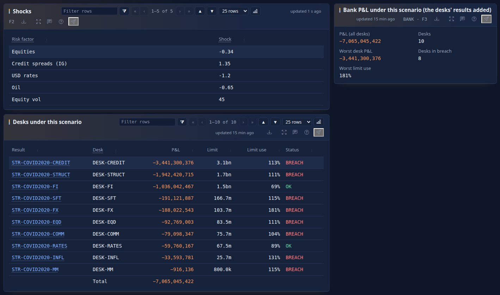

## 22. Test data and generators

### 22.1 What the repository ships (verified 2026-10-25, version 1.3)

`tools/packgen/var/make_var_data.py` (run by `tools/testdata/make_testdata.py`) writes `data/testdata/market-risk/<kind>/` and the
pack's reference samples and Sutra tests. Counts from the files and `data/testdata/testdata.yaml` (`dated-by: BUSINESS_DATE`: every row's date
is its file's; `lake demo` loads each folder in one run by the load rules, every date moved with the business dates).

**Three business dates.** The VaR inputs are written for the last three business dates of the test data, **2026-09-28, 2026-09-29 and
2026-09-30**, each in files of its own (`<kind>.<date>.jsonl.gz`, or a tar's `<kind>/<date>/` folder), so *Why it moved* ([section 3.11](#311-why-it-moved-the-var-change-explained))
and the scenario matrix have real dates to compare. Each date is built as a bank's batch of that date would be: its positions from that
date's trades (the 60 days of trades replayed to it: the trades that matured or were cancelled since the date before are gone, the
amended ones carry their new terms), its scenario window a day further on (the oldest day leaves, the date before's move enters; a day's
move is the same on every date that holds it), and its hierarchy: book `BOOK-FI-3` sits under the credit desk on 2026-09-28 and moves to
the fixed income desk on 2026-09-29 (both LE-NY, Markets), the hierarchy step of the explanation. The VaR limits are the newest date's on
every date. The stress set ([section 18.8](#188-stressed-var)), the desks' P&L history and the long P&L
history of the stress window selection are the newest date's only.

| Date | Live trades | Positions | P&L vectors | Scenario PVs | Bank VaR 99% 1-day | ES 97.5% | Scenario window |
|---|---|---|---|---|---|---|---|
| 2026-09-28 | 9,640 | 8,041 | 8,291 | 1,349 | 112,405,919 | 156,769,106 | 2024-09-13 to 2026-09-25 |
| 2026-09-29 | 9,609 | 8,015 | 8,267 | 1,342 | 112,575,052 | 155,792,404 | 2024-09-16 to 2026-09-28 |
| 2026-09-30 | 9,572 | 7,984 | 8,233 | 1,339 | 112,041,646 | 160,143,809 | 2024-09-17 to 2026-09-29 |

From 2026-09-28 to 2026-09-29, 31 trades leave (matured or cancelled); from 2026-09-29 to 2026-09-30, 37. The trades feed books no
new trade on these three days (its newest trade date is 2026-09-25), so *trades in* is empty on the demo.

The kinds, on the newest date (each of the other two dates has the same files):

| Kind | Folder files | Dated | Documents on 2026-09-30 | Bytes (gzip), 2026-09-30 |
|---|---|---|---|---|
| [`pnl-vector`](../contracts/samples/market-risk.md#pnl-vector) ([contract](../contracts/packs/market-risk.md#pnlv-pl-vector-509-scenarios-pnl-vector)) | `pnl-vector-<date>.tar`: `pnl-vector/<date>/cob.part-001.jsonl.gz` … `part-010` | 2026-09-28 to 2026-09-30 | **8,233** trades (CALYPSO 4,155, MUREX 4,078; all `ok`), every vector 509 values (the Endur trades moved to `scenario-pv`) | 13,451,636 |
| [`scenario-pv`](../contracts/samples/market-risk.md#scenario-pv) ([contract](../contracts/packs/market-risk.md#spv-scenario-pvs-of-a-trade-509-scenarios-its-currency-scenario-pv)) | `scenario-pv-<date>.tar`: `scenario-pv/<date>/cob.part-001.jsonl.gz` … `part-003` | 2026-09-28 to 2026-09-30 | **1,339** Endur trades (USD 1,089, EUR 246, CAD 4), 509 scenario PVs and a base PV each, in cents of the trade's currency ([section 15.9](#159-scenario-pv-scenario-pvs-per-trade-in-the-trades-currency)) | 2,770,923 |
| [`fx-scenario`](../contracts/samples/market-risk.md#fx-scenario) ([contract](../contracts/packs/market-risk.md#fxs-scenario-fx-of-a-currency-509-scenarios-fx-scenario)) | `fx-scenario.tar`: `fx-scenario/<date>/cob.jsonl.gz` | 2026-09-28 to 2026-09-30 | 6 currencies (AUD, CAD, CHF, EUR, GBP, JPY): today's `fx-spot` mid and 509 scenario rates moved by the factor model's FX factors | 16,315 |
| [`scenario-set`](../contracts/samples/market-risk.md#scenario-set) ([contract](../contracts/packs/market-risk.md#sset-scenario-set-scenario-set)) | `scenario-set.tar`: `scenario-set/<date>/cob.jsonl.gz` | 2026-09-28 to 2026-09-30 | 1 (`HS-509`, 2024-09-17 to 2026-09-29) | 1,399 |
| `portfolio` | `portfolio.<date>.jsonl.gz` | 2026-09-28 to 2026-09-30 | **28** definitions | 1,643 |
| [`var-limit`](../contracts/samples/market-risk.md#var-limit) ([contract](../contracts/packs/market-risk.md#vlim-var-limit-of-a-hierarchy-node-var-limit)) | `var-limit.<date>.jsonl.gz` | 2026-09-28 to 2026-09-30 | **157** limits | 1,858 |

The data's 30 books hold every live trade of the date (9,572; open question 1), over 10 desks and 4 legal entities (`LE-FRA`, `LE-LDN`,
`LE-NY`, `LE-TKY`). The rules derive 7,984 positions. The 28 portfolios: one HIERARCHY portfolio per desk (`PF-<DESK>-DESK`, 10)
and per legal entity (`PF-LE-<x>`, 4) and `PF-COMM-BOOK-1`; RULE portfolios `PF-USD-RATES`, `PF-EUR-ALL`, `PF-SHORT-RISK`,
`PF-GOVT-BONDS`, `PF-LISTED`, `PF-OPTIONS`, `PF-FX-CROSSES`, `PF-LARGE-LONGS`; BASKET portfolios `PF-ASHA-UNWIND`, `PF-NETTED-FLOW`,
`PF-HEDGE-PAIRS`, `PF-TOP-SECURITIES`, `PF-PARTIAL-FILLS` (single trades of fungible positions); they overlap on purpose. Engine VaR on
2026-09-30: the bank 112,041,646 (ES 160,143,809; 112,035,906 and 160,132,107 when every trade is a P&L vector: the
difference is the FX translation of the Endur trades in EUR and CAD, section 15.9). No position, `var` or `var-node` folder, and no VaR figure on any document. The
security ids on securities and listed trades are synthetic too. The node history starts with the first official capture.

**Repository size:** the committed vectors are 48.93 MB (gzip) for the three dates, about 16.3 MB a date, and the stress set's
8.93 MB on the newest date.

**Into a lake.** `drishti.py lake demo` builds the market-risk pack's VaR tables with every other table, or alone:

```bash
python3 tools/drishti.py lake demo --as-of data \
  --only market-risk/pnl-vector,market-risk/scenario-pv,market-risk/fx-scenario,market-risk/scenario-set,market-risk/portfolio,market-risk/var-limit
```

`--as-of data` keeps the test data's own dates (2026-09-28 to 2026-09-30), so the numbers are this guide's; `--as-of today` (the
default) moves the dates to end on your today and the trades that have matured since drop out. Sizing sets of more trades are generated locally by the benchmarks
([section 27](#27-sizes-performance-and-the-benchmark)), never committed.

### 22.2 How it is made

| Step | Rule |
|---|---|
| Trades | the committed trades of the 60 business dates (ENDUR, CALYPSO, MUREX), replayed to the last date; live = the pack's live statuses (`VALIDATED`, `AMENDED`, `NEW`), maturity on or after the date, book known to a desk: **9,572** trades, every one valued (`--budget 0`, the default) |
| Security ids | for a trade whose position rule keys by `SECURITY_ID` (securities, listed): a synthetic id, a few per product type and currency (about six trades each, by a hash of the trade id) |
| Positions | the pack's `positions:` rules, as the server applies them (`positions.Rules`): 7,984 (476 fungible, 111 netting buys and sells); for the market model, the samples and the portfolios' members only: they are not written |
| Market | about forty correlated factors over 509 + 1 days (`factors.py`): global and group factors, Student-t (4 degrees of freedom) shocks, GARCH(1,1), a 20-day stress episode at 2.5× volatility, four crash days; Python's own `Random`, seeded by text (deterministic everywhere) |
| A trade's vector | `round(q × per_unit × unit[j] + 0.06 × abs(q) × per_unit × t_j)` for j = 0..509 (`q` signed quantity, `per_unit` = a lognormal risk size by product group ÷ the position's gross quantity, `unit` the position's factor path with a short-gamma term for options, `t_j` the trade's own Student-t draws); the first 509 are `PNL` |
| Limits | a node's and a portfolio's VaR limit (an input a risk manager sets) are its VaR today × a headroom (most green, a few tight) at two significant figures |
| Portfolios | `tools/packgen/var/portfolios.py`: definitions only |
| Files | gzip level 9, `mtime` 0, split into parts of about 1.2 MB compressed; the vectors sorted by legal entity, desk, book and trade |

**`make_var_data.py --check`** regenerates into a temporary folder and fails (exit 1) when a committed file's decompressed content or a
sample differs, or a retired folder or sample is still there: *VaR demo data out of date; run tools/packgen/var/make_var_data.py*.
`tools/packgen/var/test_var_data.py` checks every live trade once with 509 finite values from one run, the securities shared and the
fungible positions the rules derive, no VaR figure on any input and the retired tables gone, the portfolios (25 to 30, all three types,
resolving and overlapping, the legal entities covering the bank), the samples being the server's derived positions, the rule language,
the position rules and the measures.

## 23. Decisions and open questions

### 23.1 Open questions of the contract

| # | Question | Context |
|---|---|---|
| 1 | **Decided (product owner, 2026-10-25): every live trade, no budget.** *Live* = status `NEW`, `VALIDATED` or `AMENDED` (the pack's `live-statuses`) and maturity on or after the date, book known to a desk: 9,572 trades on 2026-09-30 (10,399 by status alone; 12,076 trade valuations, which include matured and cancelled trades). The vectors are 15.7 MB compressed | §22 |
| 2 | **Decided (2026-10-25): in memory**, rebuilt from the date's trades and the rules on every load (reproducible); each official capture records the date's membership and the rules (audit). No database or lake table | §15.6 |
| 3 | **Decided (2026-10-25):** the demo risk batch adds a deterministic synthetic `SECURITY_ID` to securities and listed trades (the trade master is unchanged); *securities* and *listed* are the pack's `positions:` rules (by product group and type), configuration not code | §15.6 |
| 4 | Due time of the batch (for example 06:00 New York the next business day) and the completeness rule per book | §15.8 |
| 5 | **Decided (product owner, 2026-10-25): yes.** The data-load signal of `pnl-vector`, `scenario-pv`, `scenario-set`, `var-limit`, `portfolio` (and `trade`) reloads that date in the engine automatically (the same as `POST /api/v1/risk/var/reload` for the date), so a restated date is never stale, then captures it officially. Built | §15.8 |
| 6 | Several scenario sets on one date (a stressed set `SVAR-250`): select by `SCENARIO_SET_ID` (a scope or request parameter), and which is the default? | §15.3 |
| 7 | Lake layout for the vectors at bank scale: sort by hierarchy and partition by scenario set (both designed, not built); file and row-group sizes; `BYTE_STREAM_SPLIT` + ZSTD | §15.1, §29 |
| 8 | **Decided and built (2026-10-26): keep `TMAT`, for the trades of positions of more than one trade only.** A trade alone in its position is its position's row; the others' rows are in the file, read only on a drill or a trade scope (a lake read per drill would scan a whole date) | §26 |
| 9 | **Decided and built (2026-10-25):** `by=node` accepted (`400` off a node); the memory budget answers `503 DRS-5204` (capacity); the largest parts by gross size when they exceed `max-parts` | §11.1, §20 |
| 10 | **Decided (product owner, 2026-10-25): vectors are kept for 7 years** in the lake (Delta `VACUUM` and log retention set so that 7 years of dates and their time travel stay readable). Official end-of-day captures follow the same 7 years. Built: the lake writers set 7-year log and file retention on `risk` and `risk-results` tables, and `lake maintain` never vacuums them below it ([section 15.1](#151-where-they-live)) | §19 |
| 11 | **Decided and built (2026-10-25):** the platform's field masks apply to contribution rows (`•••`); `CPTY:` is refused to a viewer who sees the counterparty masked | §9 |
| 12 | **Decided and built (2026-10-26):** `var-result` (`VRES`); fields `VAR` and `ES` with `CONFIDENCE` and `ES_CONFIDENCE`, never `VAR_99`; paths and histories are not separate kinds | §8 |
| 13 | **Decided (2026-10-25): kept and documented**: the light scales with the days it has; screens show its days, and it is not a regulatory zone before 250 days | §7 |
| 14 | **Decided (product owner, 2026-10-25): `LE:` is the bank's legal entity.** The trade's booking `LEGAL_ENTITY` is the source of truth; the `LEGAL` hierarchy rolls up from it, and a trade whose `LEGAL_ENTITY` disagrees with its book's place in the `LEGAL` hierarchy is reported as a data-quality warning in the answer's provenance | §5.5 |

### 23.2 The designs' questions and their decisions

The engine design (2026-10-24) and the data model asked the product owner these questions; the decisions (the design's
recommended defaults unless the product owner said otherwise):

| Question | Decision |
|---|---|
| Engine 1. Which pack (the market-risk pack, or a new `var` pack)? | the **market-risk** pack |
| Engine 2. The existing `var` kind: keep it beside the engine or retire it? | kept beside the engine in V0 to V3; **retired** in part 1 ([section 21](#21-var-is-computed-not-stored)): `VAR VAR-RATES` opens the explorer at `DESK:RATES` |
| Engine 3. Rank rule for N = 509 at 99%: the 6th worst, the 5th, or interpolated? | **the 6th worst of 509** (k = ceil(N (1 − a))), configurable (`drishti.var.rank-rule: interpolated`) |
| Engine 4 and data model 6. Precision of the hot cache: float64 everywhere (8.1 GB a day for 2 million positions) or float32 with float64 sums? | V0 to V3: **float64** in the lake, in memory and in sums; part 2 (approved 2026-10-25): **float32 position rows in the hot file, float64 aggregates and sums**, the lake float64 ([section 26.6](#266-precision-float32-rows-float64-sums)) |
| Engine 5. A per-risk-class vector (`PNL_BY_RISK_CLASS`) ? | **not built** |
| Engine 6 and data model 3 and 4. Retention of vectors and official numbers; the reproducibility horizon | **7 years** of vectors and their time travel, and of official captures (product owner, 2026-10-25) |
| Engine 7. 10-day vectors from the batch, or √10 scaling? | decided 2026-10-30: both √10 and the 10-day sum from the 1-day set, computed on request (section 18.6); 10-day vectors from the batch stay a designed slot (full revaluation) |
| Engine 8 and data model 2. Who produces vectors (and positions) in production? | **the bank's batch** produces the vectors; Drishti loads them and **derives the positions itself** (product owner, 2026-10-25) |
| Engine 9. Entitlement source: Drishti or the bank's system? | **in Drishti** (`drishti.var.access`) |
| Engine 10 and data model 8. Committed demo data size (about 200 positions over 60 days, about 21 MB) | **15.7 MB** from part 1: one business date of vectors for every live trade (9,572); 3.5 MB before (1,673 trades and 250 days of node figures) |
| Data model 1. Position grain: OTC by trade, fungible by book × instrument; net across books? group OTC trades? | **vectors at trade grain** (2026-10-24); a position is a holding of one instrument in one book netting its trades, derived by the pack's rules ([section 29.1](#291-the-vector-grain-the-trade)); no netting across books, no OTC grouping |
| Data model 5. Hierarchies besides management; who maintains them? | MGMT, LEGAL and the limit letters, built from the trades' promoted columns as the pack configures them; a regulatory or product tree is another `hierarchies:` entry over the columns the rows carry ([section 15.14](#1514-hierarchies-from-promoted-columns)) |
| Data model 7. Cube dimensions to precompute | not built ([section 30](#30-the-design-record)) |
| Data model 9. Roaring bitmaps as a new dependency? | **not added**: a plain bitmap of the date's rows (`java.util.BitSet`) is small enough |

### 23.3 Where the code and the designs disagree

| Topic | Design | Code (wins) |
|---|---|---|
| Vector grain | per position | per trade (decided 2026-10-24) |
| Position grain | OTC one per trade; fungible book × instrument | as designed: derived by Drishti by the pack's rules ([section 15.6](#156-positions-derived-by-drishti)) |
| `POSITION_TYPE` values | `otc`, `fungible` | `single-trade`, `fungible`; the rule (`otc`, `securities`, `listed`) is `POSITION_RULE` |
| Lake layout | partitions by date and scenario set, sorted by hierarchy, 512 MB files, `BYTE_STREAM_SPLIT` + ZSTD | partitioned by date only, sorted by `id` per batch, writer defaults |
| Data version (the pin) | the Delta table version | a SHA-256 stamp of the date partition's files |
| Bitmaps | Roaring, over positions | `java.util.BitSet`, over trades |
| Marginal VaR | per unit of notional or PV | per million of market value (positions) or PV (trades) |
| Audit | basket changes audited | as designed ([section 9](#9-who-sees-what-entitlements-and-audit)) |
| `by` values | API_REFERENCE.md: `child`, `node`, `position`, `trade` | `child`, `node`, `position`, `trade`, `desk`, `book` |
| Truncated parts | the largest by gross exposure | as designed (by gross size) |
| Provenance | the input tables' versions and batch ids | as designed (`provenance.inputs`) |
| Load signal | the shared rules' section 9: the signal reloads the date (confirmed 2026-10-25) | as designed (and the date is captured officially) |
| `VAR-COMM` mapping | the shared rules' section 14: `DIVISION:COMM` | the record is the desk `DESK-COMM`; the division word is `DIV:` |
| Scope sections | the shared rules' sections 4 and 8 pointed to *VAR.md section 9* (scopes) and *section 11* (memory) | scopes are [section 5](#5-scopes-system-baskets-and-baskets) of this guide and memory [section 26](#26-the-tiered-memory-and-the-hot-file) |
| Hot file (proposed in 1.3) | `<data folder>/var/hot/<date>/<SCENARIO_SET_ID>.vhot`, a `STRS` section of every dictionary, `NODE` with member runs over position rows, `TMAT` of every trade | `<date>/inputs-<16 hex of the inputs' digest>.vhot` (the set id is in the header); each column section carries its dictionaries; `NODE` holds books (runs come from `BOOK`); `META`, `SCEN`, `AKEY`, `TMAP` added; `TMAT` holds only the trades of fungible positions |
| Sharding | each node maps the shards it owns | built ([section 28](#28-sharding-across-drishtinet)): each owner builds and maps only its shards; every member holds the date's skeleton and node aggregates |
| Computed kinds | `var-result`, `var-contribution`, `var-path`, `var-history`, `what-if` | `var-result`; parts and worst scenarios inside `var-result`; the what-if is the VaR API's (`POST /what-if`) |
| Where the engine runs | a reactive connector `var-engine` over a Python package `compute/drishti-var` | every figure in the server's JVM (additions and sorts next to the data), the what-if included; the reactive connector `var-engine` serves the computed kind ([section 24](#24-where-the-engine-lives)) |
| The explorer | a Sutra of the market-risk pack, opened by `VARX <scope>` | a console page (`/var`), opened by `VAR` ([section 24](#24-where-the-engine-lives)) |
| API paths | `/api/v1/risk/var/scopes/{scope}`, `/path`, `/history`, `/contributions?by=child\|position\|risk-class`, `PATCH /baskets/{id}`, `/sandboxes` | `GET /scope?scope=` (and `/scopes/{scope}` for a scope without a slash) with `/scope/path`, `/scope/history`, `/scope/contributions`; baskets by owner and name; `POST /what-if` ([section 11](#11-the-api)) |

## Part III · How the engine works and stores data

## 24. Where the engine lives

The product owner's ask (2026-10-24): an enterprise-grade, fully generic VaR engine: **any scope** (one position, a book, a desk, a
portfolio, a legal entity, the bank, or an artificial portfolio of any trades a person put together, and any combination); **precomputed
path P&L** (each trade's P&L under about 509 historical scenario days computed once by the overnight risk batch and stored, so base VaR
never reprices: it adds vectors); **what-if** as the only place computation comes in; **full drill-down** at any level (the P&L path as a
table and charts, VaR and ES history, bank to desk to book to position, any ad-hoc scope); performance, audit, entitlements and scale
first class. Its principles: vectors, not prices; one engine for every scope (a hierarchy node is only a scope that happens to be
precomputed); additive where it can be, honest where it cannot (P&L vectors and ES contributions add up, VaR does not: the screens show
diversification); every number reproducible (each result carries its stamp: input versions, scenario set, method, engine,
[DATA_ARCHITECTURE.md › Reactive connectors, section 8](../architecture/DATA_ARCHITECTURE.md#8-point-in-time-stamping-ordering-and-idempotence)); entitled
as the viewer; packs stay declarative.

| Part | Implementation |
|---|---|
| the pack | the **market-risk** pack: the kinds `position`, `system-basket`, `pnl-vector`, `scenario-pv`, `scenario-set`, `var-limit` (`tools/packgen/banking/var_kinds.py`, written into `pack.yaml` by `make_packs.py`), routed to `risk-store`, `position` to the `var-positions` connector (the engine's derived positions) and `system-basket` to `var-system-baskets` (the basket store's system scope); its seed of system baskets (`seeds/system-baskets.yaml`); the computed kind `var-result` on the reactive connector `var-engine`; mnemonics `POS`, `PORT`, `PNLV`, `SPV`, `SSET`, `VLIM`, `VRES`; the hierarchies in its `hierarchies:` block; Sutras for `system-basket` and `position` |
| the stored data | `risk-store` (Delta), the vectors in a `list<double>` column (`layout.<kind>.vectors: [PNL]`); demo data from `tools/packgen/var/make_var_data.py` |
| the engine | **in the server, in Java**: the generic vector store, ordinal sets, parallel sums and the VaR maths in the module `drishti-compute` beside the compute workers (`com.ash.drishti.compute.vector`, `com.ash.drishti.banking.compute.var`); loading, entitlements, baskets, captures, official records and the API in `drishti-banking` (`com.ash.drishti.banking.var`). Base VaR is additions and sorts, which Java does next to the data without moving vectors to a worker |
| the what-if | `VarWhatIf` (`drishti-server`) over `VarWhatIfMath` (`drishti-compute`): copies of booked trades or scopes and vectors priced elsewhere added to a scope, before and after ([section 8.2](#82-the-what-if-the-java-engine)) |
| the explorer | a console page (`/var`, `drishti-console/plugins/banking/routes/var_routes.py`, `drishti-console/plugins/banking/static/js/drishti_var-explorer.js` on drishti-risk's grid and chart presets, `drishti-console/plugins/banking/static/css/drishti_var.css`) over `/api/v1/risk/var`, not a Sutra: a Sutra's `source:` reads a kind, and the parametrised sources a VaR panel needs came with reactive connectors. The portfolio and position pages are Sutras, with the UI kit fragment `pnl-distribution@1` |

**The compute boundary.** Base VaR is sums of stored vectors and measures over the sums, in the server's JVM on a bounded pool
(`drishti.var.threads`). The heavy work that needs Python or a pricer (what-if pricing over the scenarios, intraday repricing:
[section 8.4](#84-what-if-pricing-and-intraday-recomputes)) is a separate request of whole trades to price, which the compute
workers of [NOTEBOOK_GUIDE.md](NOTEBOOK_GUIDE.md) serve: any number of workers (their count is configuration, never
code), one trade or a batch each, the 509 values each returns joining as a vector. Nothing in the engine assumes one worker or calls
one in its request path. Moving gigabytes of vectors into a Python worker for every query would be too slow; every VaR figure is the
server's.

## 25. One business date in memory

The structures below are those of every loaded date (`VarBook`, immutable, shared by every request). Where its **vectors** live is the
tier ([section 26](#26-the-tiered-memory-and-the-hot-file)): in the server as shipped (`drishti.var.tier.mode: mapped`) the trade rows are
not on the heap but in the date's memory-mapped hot file, served position by position; with `mode: heap` they are the `VectorStore`
described here.

`VarLoader.load(date)` reads the scenario set (checked), streams the vectors through `VarIntake` (each row checked, left out when not
live, given its position by the rules: sections 15.6 and 20), reads the hierarchy nodes and the portfolios, checks the date is one run,
then `VarBook.Builder.build`:

```
 pnl-vector rows (lake order)                   VarBook (immutable, shared by every request)
 ─────────────────────────────                  ─────────────────────────────────────────────────────────────
 TRADE_ID, its columns, PNL[509] ──VarIntake──► VectorStore   rows = trades in hierarchy order, row-major double[] chunks
   checked; POSITION_ID derived                 tradeIds[]    ordinal → TRADE_ID;  tradeOrdinal: TRADE_ID → ordinal (and in upper case)
                     sort by LEGAL_ENTITY,      trades        Columns: 17 text columns (int code + dictionary), 2 number columns
                     DESK, TT_BOOK,             positionOf[]  ordinal → position index
                     POSITION_ID, TRADE_ID      posFrom[], posTo[]   each position = one run [from, to) of ordinals
                     (stable merge sort)        positions     Columns: POSITION_TEXTS (18), POSITION_NUMBERS (6), derived from the runs
                                                bookRange     TT_BOOK → run [from, to)
 hierarchies' levels ─────────────────────►    nodes         id, hierarchy, level, name, parent, children, books or cells, limit,
                                                              members (OrdinalSet: the union of its books' or cells' runs)
                                                aggregates    every book's and every node's vector (double[N]), summed at load
 portfolio rows       ─────────────────────►    portfolios    id → {name, type, owner, scope text, limit}  (in VarDate)
```

| Structure | Exact content |
|---|---|
| **Trade order** | sorted by `LEGAL_ENTITY`, `DESK`, `TT_BOOK`, the cell columns (below), `POSITION_ID` (text order of the values; null as empty) then `TRADE_ID`: each position, each cell and each book is a contiguous run of ordinals, so summing a position or a book is one sequential scan. The sort and the permutation of the vectors happen once per load (both copies held during the permutation) |
| **Cells** | the **cell columns** are every level column of every hierarchy ([section 15.14](#1514-hierarchies-from-promoted-columns)) but `TT_BOOK` (`DIVISION`, `DESK`, `LEGAL_ENTITY`, `LIMIT_LETTER` in the demo), kept as trade columns after `TRADE_TEXTS`; a **cell** is a run of one book's trades with the same values of them, named `<book>\|<value>\|<value>` (`Cells`). Each cell is summed once into its own aggregate, as a book is; a node's `books` are its cells, or the book itself when the node holds every cell of it. With no level column but the book there are no cells: the book is the unit. A position never crosses a cell: one that would is split, `<position>@<value>`, and counted |
| **Trade columns** (`TRADE_TEXTS`) | `POSITION_ID` (derived), `LEGAL_ENTITY`, `DIVISION`, `DESK`, `TT_BOOK`, `PORTFOLIO`, `PRODUCT_GROUP`, `PRODUCT_TYPE`, `CURRENCY`, `COUNTERPARTY`, `DIRECTION`, `INSTRUMENT_ID` (derived), `SECURITY_ID`, `INSTRUMENT`, `STRATEGY`, `TAGS`, `POSITION_RULE` (int code per row, −1 for null, one dictionary per column: `Columns`); `TRADE_NUMBERS`: `QUANTITY`, `PV` (`double`, NaN for none) |
| **Position columns** | derived from each run ([section 15.6](#156-positions-derived-by-drishti)): `POSITION_TEXTS`: `INSTRUMENT_ID`, `INSTRUMENT`, `DIRECTION`, `LEGAL_ENTITY`, `DIVISION`, `DESK`, `TT_BOOK`, `PORTFOLIO`, `PRODUCT_GROUP`, `PRODUCT_TYPE`, `CURRENCY`, `COUNTERPARTY`, `STRATEGY`, `TAGS` (stored joined by a vertical bar, read as a list), `STATUS`, `SECURITY_ID`, `POSITION_RULE`, `POSITION_TYPE`; `POSITION_NUMBERS`: `QUANTITY`, `MARKET_VALUE`, `NOTIONAL`, `TRADE_COUNT`, `LONG_TRADES`, `SHORT_TRADES` |
| **Nodes** | derived at build from the distinct paths of each hierarchy's level values over the cells, in id order, each listing its cells (or whole books); an empty value is a (Blank) node at its level; a node's name is its reference entity's |
| **Aggregates** | every book's and every cell's vector (one parallel pass per run), then every node's bottom-up from the roots (a leaf node sums its books or cells; others their children). Keyed by book name, cell name and node id. The planner walks MGMT (else the first hierarchy) |
| **Position vectors** | summed on first use from the position's run and cached for the date's life (unbounded: at most one `double[N]` per position) |
| **Failed** | count of rows with a null vector |

**The vector store** (`VectorStore`, heap tier): `width` = N; rows in `double[]` chunks of `rows-per-chunk` rows (65,536 × 509 doubles =
267 MB a chunk; the last chunk cut to its rows; no object per row, nothing boxed); row *r* at
`chunks[r / rowsPerChunk][(r % rowsPerChunk) × N ..]`. Row-major because the core operation is *add these rows' vectors*: each addition
walks 509 contiguous doubles in a plain Java loop the JIT vectorises (no incubating Vector API needed). Only rows of exactly N finite
values reach it (the rest are rejected first, section 20). Immutable after build; any number of readers.

**Ordinal sets** (`OrdinalSet`): one of two forms with one meaning. A set built bit by bit (a rule, a basket, ids looked up) is a
`java.util.BitSet` over the date's trade ordinals, one bit per trade (2 million trades: 250 KB). A set made of runs (a node: the union of
its books' or cells' runs; a position; the whole date) is a sorted list of `from, to` pairs, eight bytes a run, whatever the date's size:
a node of a 1,000,000-trade date costs a few bytes, not a 125 KB bitmap. Every query and operation answers the same in both forms
(property-tested in `OrdinalSetRunsTest`): runs with runs stay runs, runs minus anything stay runs (a node minus the cancelled trades of
an intraday layer), and an operation with a bitmap makes a new bitmap. A scope resolves to one set, so union, difference and intersection
are exact and overlaps never double count. `digest()` = a 64-bit hash of the bitmap's words in hex, `:`, the member count (the
`membershipHash` of an answer), the same in either form. **Design differs:** the design proposed Roaring bitmaps of *position*
ordinals.

**Parallel sums** (`ParallelSums`): a fixed pool of `threads` daemon threads (`drishti-vector-sum-<n>`). **In a fixed
reduction order** (decision PO-7): a set under 1,024 rows is summed in row order into one float64 accumulator; a larger one is cut into
blocks aligned to the absolute ordinal, of a size chosen from the set's size alone (about 64 blocks, a power of two, at least 1,024
rows), each block summed in row order from zero, the blocks' partials added in block order. The threads only decide which blocks run at
once (on the caller's thread for a set below `parallel-rows`, 4,096, or with one thread), so **any scope's VaR is equal to the bit
whatever the server's core count**.
Nodes are unaffected (their aggregates).

**The planner** (`VarBook.vector(set)`), over the **MGMT** hierarchy:

```
if no book is wholly covered by the set:            one parallel pass over the set's rows (a basket, a rule)
else walk MGMT from the root:
    node not touched                    → skip
    node wholly covered (has aggregate) → + aggregate
    node missing m ≤ max(16, covered/8) → + aggregate − (the missing rows, summed from the gaps between the set's runs)
    book (or childless node)            → + the set's runs in its books
    otherwise                           → recurse into children
then + the set's trades in no MGMT book (none in a consistent batch)
```

A scope that is exactly one node is answered from that node's aggregate without planning. *Markets minus three trades* costs four
vector operations, whatever the size of the nodes. The plan never changes the result (tested against brute force in `VarBookTest`);
whole-number vectors give the same bits.

**Answer cache** (`VarService`): Caffeine, at most **512** answers (resolved set, vector, measures). Key: `businessDate | dataVersion |
viewSignature | canonical scope | membershipHash`. The data version is the plugin's stamp of the date's files (Delta: a SHA-256 of the
partition's file paths and sizes, not the Delta table version; Iceberg: a fingerprint of the date's data files in the current snapshot),
so a commit of another date keeps the answers. Views are cached per date, version and role levels (`VarAccess`).

**Load and memory.** A date's load runs once (concurrent requests share it); a failed load is retried by the next request. The budget
`memory-budget-mb` bounds the rows of **one** date on the heap tier (N × 8 bytes a row); a date that would exceed it is refused whole
with the reason (`503 DRS-5204`). The mapped tier is bounded by the disk instead: a first build reserves at least 256 MB, then the disk is
checked every 64 MB while the rows stream in, and a date that would leave the disk under its guard is refused (`503 DRS-5204`, naming the
bytes needed and free) with nothing left behind. Up to `hot-dates` dates are open at once (section 26.8). On the
heap, total vector memory is up to `hot-dates` × budget, plus a second copy of one date during its permutation; mapped, the heap holds
no vector at all (the load streams the rows to a spill file) and the vectors take the operating system's page cache, only the pages in
use. A date that is not one run (`DRS-5203`) is remembered with its vector table's version and not read again until that version
changes; the date before it is answered meanwhile, with the reason in `provenance.warnings`.

## 26. The tiered memory and the hot file

A bank's vectors are large: 509 values per trade, 4,072 bytes in float64, **4.07 GB a day for a million trades**. Approved by the product
owner, built by `VarLoader`, `VarTier`, `VarBook.Builder`, `VarHotFile`,
`RowSpill`, `MappedMatrix`, `GroupedVectors` and `FileMaps`. The format below is **fixed** (format 1; format 2 adds the
optional `CTOT` section: a format-1 file is not read, the date is built again from the lake; format 3 is format 2 with the `CELL`
section, written only for a date with cells: a date without cells is still format 2, so earlier files stay valid).

### 26.1 The tiers

| Tier | Holds | Precision | When read |
|---|---|---|---|
| **The lake** (Delta) | every trade's vector, every date, seven years | **float64**, as delivered (unchanged) | once per date and set of inputs: the first load streams the date's rows to the load's spill file |
| **The hot file**, one per loaded date, on local disk, memory-mapped | one row per **position** in hierarchy order, the rows of the trades of fungible positions, every book's and node's aggregate, the columns, ids, runs, nodes and the load's record | rows **float32**, aggregates **float64** | memory-mapped; written by the first load; a date not open is **mapped again from its file** when asked (no lake read: the **disk tier**); never at start |
| **The heap** | the open dates' columns, ids, links and nodes (their members as runs), the index of their aggregates, the last answers | every sum in **float64** accumulators | on demand |
| **The page cache** | the mapped pages a sum touches | float32 | resident while used; the operating system keeps or drops them |

`drishti.var.tier.mode: heap` keeps vectors on the heap instead: every trade's vector in float64 on the heap
([section 25](#25-one-business-date-in-memory)).

### 26.2 The life of a date

1. **First request for a date.** The engine computes the digest of the date's inputs (the data versions of `pnl-vector`,
   `scenario-pv` and `scenario-set`, the hierarchies' configuration, the reference kinds that name the nodes, and the position rules). If `<data folder>/var/hot/<date>/inputs-<digest>.vhot` exists, it is
   **mapped** and the date is open: no lake read (23 ms for a 100,000-trade date on a workstation). Otherwise the rows stream from the
   lake to a local spill file (float64, the heap holds no vector), the trades are sorted into hierarchy order, every book and node is
   summed in float64, every position's row is written once as float32, and the file is moved into place and mapped.
2. **Requests.** A node is answered from its float64 aggregate (under 1 ms); any other scope sums float32 position rows into float64
   accumulators on every core; a trade is read only when a scope needs it alone (a drill below a position, `TRD:`, a basket of trades, a
   position held in part).
3. **Eviction.** At most `hot-dates` (10) dates are open, the least recently used leaving first (section 26.8). An evicted date is unmapped after
   `close-grace-seconds` (60) so requests still reading it finish; its file stays on disk, so asking for the date again maps it. At most
   `disk-dates` (60) files are kept: the least recently used beyond are deleted (never one that is open); a file built from inputs that
   have since changed (a restatement, new position rules) is deleted when the date's new file opens.
4. **Shutdown and start.** At shutdown every date is unmapped and, unless `keep-on-shutdown`, every file deleted; at start the files a
   stopped server left are deleted (the `.part` and `.f64` temporary files always; the hot files unless kept, in which case they are
   reused when their digest still matches). No hidden files: visible names, everything under `drishti.var.tier.dir`
   (`<data folder>/var/hot`); the spill and the part file are made by the server's temporary-file service (`TempFiles`) in the date's
   folder.

```
 request for date D
   │  the inputs' digest = SHA-256(format | D | data versions of pnl-vector, scenario-pv, scenario-set | position rules' digest
   │                               | the hierarchies' configuration, the naming reference kinds' and var-limit's versions)
   ├─ <data folder>/var/hot/D/inputs-<16 hex of the digest>.vhot exists and its header has that digest
   │     → map it (the small sections onto the heap, checked; the matrices mapped) and read the portfolios: the date is open
   └─ else read the lake: scenario set (checked) → every vector row through VarIntake → appended to D/spill-*.f64 (float64, lake order;
         the heap holds no vector) → sort the trades into hierarchy order (the columns, on the heap) → book and node aggregates summed in
         float64 from the spill through a permuted view → every position's row = float64 sum of its trades' rows, written once as float32
         (a batch of 1,024 positions at a time, summed on the pool) → the rows of trades of positions of several trades, float32 → the
         file written as D/build-*.part, forced to disk and moved to its name → the spill deleted → the file mapped
```

**Unmapping safely.** Reading an unmapped page would crash the JVM, so every read of a matrix enters a guard (`MappedMatrix`): closing
marks the matrix and unmaps it only when no reader is inside; a reader arriving after that gets *the vectors of … were unloaded while
this answer was computed; ask again*, never a crash. The mapping is compiled for Java 21: on Java 22 and later it is a shared `Arena`'s,
looked up at run time (closing it unmaps; a stray read fails with an exception); on Java 21 a `MappedByteBuffer` released through the
JDK's cleaner; `GET /status` names the method. On Windows the file itself is released when its date is evicted.

### 26.3 The hot file

`VarHotFile`, format 2: `<tier dir>/<YYYY-MM-DD>/inputs-<16 hex>.vhot` (a reporting currency's book: `<YYYY-MM-DD>-<CCY>/`),
little-endian, written once, never changed.

```
offset  bytes  field
0       8      magic "DRSHVAR1"
8       4      format version (2)
12      4      flags: bit 0 float32 matrices, bit 1 trade matrix present
16      4      business date as yyyymmdd (int32)
20      4      N, the vector width (509)
24      4      P, positions (rows of PMAT)
28      4      T, trades
32      4      M, aggregates (books and nodes)
36      4      S, sections
40      32     SCENARIO_SET_ID (UTF-8, zero padded)
72      64     the inputs' digest (SHA-256, hex): the file's name holds its first 16
136     32     BATCH_ID (UTF-8, zero padded)
168     8      written at (epoch milliseconds)
176     8      failed rows (no vector)
184     4      Q, rows of TMAT
188     68     reserved (zero)
256     S×32   section table: {id int32 (four ASCII letters), reserved int32, offset int64, length int64, crc32c int32, pad int32}
```

| Section | Content |
|---|---|
| `META` | the server's record of the load (JSON): what the intake counted (`rejected`, `rejections`, `excluded`, `batchIds`, `scenarioSets`, the rules and their digest) and the inputs' data versions |
| `SCEN` | the scenario days: count, then each as an epoch day (int32) |
| `TIDS` | trade ids in the trade order (count, then per id: length int32 and UTF-8; a null is length −1) |
| `TCOL` | the trade columns: rows; per text column its name, dictionary and an int32 code per row (−1 none); per number column its name and a float64 per row |
| `PIDS`, `PRUN`, `PCOL` | position ids; per position its run of trades (`from`, `to`, int32); the position columns (as `TCOL`) |
| `BOOK` | per book its run of trades |
| `BOOK` (format 3) | the cells' runs too, after the books' (a cell's name has a `\|`, a book's never) |
| `NODE` | per node id, hierarchy, level, name, parent, limit (float64) and its books (a column node: its cells) |
| `CELL` | format 3: the positions split at a cell's edge (int32), then the cell columns (count, names) |
| `AKEY`, `AGGS` | the aggregates' keys (books and nodes), then **float64 M × N**, summed from the lake's float64 rows (exact, independent of the float32 copy). `AGGS` is **mapped** when the file opens, like `PMAT`: the heap keeps only the key-to-row index, and a node's vector is a copy of its row, the same float64 bits (at 1,000,000 positions, 642 MB a date that no longer sits on the heap) |
| `TMAP` | per trade its row in `TMAT`, −1 when its position has one trade (its row is the position's) |
| `CTOT` | a USD book only: every node's per-trade-currency totals (section 15.11): count; per node its id and currencies, each with its trade count (int32), today's native PV sum and the N scenarios' (float64) |
| `PMAT` | **float32 P × N, row-major**, positions in hierarchy order (legal entity, desk, book, position), 64-byte aligned |
| `TMAT` | **float32 Q × N**: the trades of positions of more than one trade (decided, open question 8), 64-byte aligned; absent when every position is one trade |

Every section has a CRC32C: the small sections (all but `AGGS`, `PMAT` and `TMAT`) are checked when the file is opened (a damaged one is refused: *the hot file's … section is
damaged (checksum)*, and the date is read from the lake again); the matrices (`AGGS`, `PMAT`, `TMAT`) by `VarHotFile.verify`.

### 26.4 How a sum reads it

`GroupedVectors`: a run of trade ordinals that covers whole positions is summed from their `PMAT` rows (one row per position, however
many trades it has); only the edges of a position held in part read `TMAT` rows. A node is its float64 aggregate; the planner of
[section 25](#25-one-business-date-in-memory) is unchanged. **Trade vectors** are read only when a scope needs a trade on its own (a drill
below a position, `TRD:`, a basket naming trades, a position held in part); everything at position level and above reads position rows.

### 26.5 What the design proposed, and what was built

| Design | Implementation |
|---|---|
| a local copy after the first load under `<data dir>/compute/vectors/<COB>/` (raw little-endian doubles plus an index, memory-mappable), so a restart reloads at disk speed | the **hot file** `<data folder>/var/hot/<date>/inputs-<digest>.vhot` (`drishti.var.tier.dir`): float32 matrices, float64 aggregates, columns, ids, runs, nodes and the load's record, a CRC32C per section; rebuilt when the inputs' digest changes; not the restart cache by default (`keep-on-shutdown: false` deletes the files at shutdown) |
| vectors on the heap in `double[]` chunks; an off-heap variant optional (`ByteBuffer.allocateDirect`), no FFM | the rows are never on the heap when mapped: the load streams them to a spill file and writes the hot file from it; the heap holds the columns, ids, links and nodes (about 0.55 KB a position measured at 10,000 positions, `VarHeapPerDateTest`); the aggregates are mapped |
| position vectors in the store | one float32 row per position (the float64 sum of its trades, rounded once) and the rows of the trades of positions of more than one trade; a single-trade position's trade is its position's row |
| float32 precision estimated (±4,000 USD on 10⁹ over 2 million positions), an opt-in `vectors.hot-precision: float32` | the bound proven and measured ([section 26.6](#266-precision-float32-rows-float64-sums)); float32 is the default |
| sharding by legal entity and desk, two replicas | built ([section 28](#28-sharding-across-drishtinet)): a shard is its own hot file (the same format, a `RANG` section) built from its key range of the lake, not a byte range of one date's `PMAT` |

### 26.6 Precision: float32 rows, float64 sums

Each stored value is rounded once to float32 (a relative error of at most 2⁻²⁴ ≈ 6 × 10⁻⁸); every sum is float64; and VaR and ES are
order statistics, so moving every scenario's P&L by at most *E* moves them by at most *E*. Hence:

- a **node's** VaR and ES are the lake's **to the bit** (its float64 aggregate);
- **any other scope**: |VaR(hot) − VaR(lake)| ≤ 2⁻²⁴ × the date's gross P&L of its worst scenario (Σ over trades of \|P&L\|).

Measured (`VarTestDataPrecisionTest`, `VarHotFileTest`):

| Data | Scopes checked | Largest VaR difference | Bound |
|---|---|---|---|
| the committed test data (9,572 trades, 2026-09-30) | 88 nodes, 12 ad-hoc scopes, all 7,984 positions | **0 USD**: the vectors are whole dollars and every position's P&L is below 2²⁴, so float32 holds them exactly | 919.5 USD |
| the same trades × 1,000.37 (bank VaR 112,077,359,285 USD) | 5 ad-hoc scopes, all positions | **340.93 USD, 5.86 × 10⁻⁸ of the VaR** | 919,868 USD |
| the synthetic bank of the engine's tests (1,800 trades) | 9 scopes, 30 random sets, every position and trade | 0 USD | 1.4 USD |

The tests state the tolerance: within the bound on every scenario, and VaR within 1 USD and 10⁻⁷ of itself on the test data (10⁻⁶
scaled). The answer says which tier it came from (`provenance.tier`): `node aggregate (float64)`, `hot file (float32 rows, summed in
float64)` or `memory (float64 rows)`.

### 26.7 What the status shows

`drishti.py var status` (test data, one date open):

```text
  "tier": { "mode": "mapped", "diskDates": 60, "keepOnShutdown": false, "closeGraceSeconds": 60,
            "mapping": "shared arena (unmapped on close)", "built": 5, "reopened": 0, "files": 5, "open": 5, "diskBytes": 121569900,
            "currencies": { "files": 4, "bytes": 96688112 } },
  "loaded": [ { "businessDate": "2026-09-30", "trades": 9572, "positions": 7993, "nodes": 131, "vectorBytes": 20465872, "tier": "mapped",
                "aggregateBytes": 785896, "hotFile": "2026-09-30/inputs-438361ce8f808055.vhot", "loadMs": 646, ... }, ... ]
```

The test date is a 24.9 MB hot file in USD (20.5 MB of float32 rows: 7,993 positions and the 2,059 trades of fungible ones, 20,465,872
bytes), each currency built ahead a file of its own, against 39.0 MB of float64 vectors on the heap tier (38,977,184 bytes). An administrator's `drishti.py var reload` drops the open
dates; the next request maps the same file again (`reopened` goes up) without reading the lake.

### 26.8 Dates in memory over years of history

A bank keeps VaR data for years and its people move between dates freely: today's VaR, then the same desk a year ago, then back. Memory
never grows with the years kept; it grows only with the dates **open at once**, which is a setting.

**Where a date is, and what it costs.**

| Where | What it holds | Bounded by | Cost of a date of 1,000,000 positions (measured, Java 21, G1) |
|---|---|---|---|
| **open in memory** | the mapped hot file and the date's structures on the heap; its currency books built ahead and its stress book | the dates in memory (below) | the hot file 3.14 GB, resident only while read; about 0.72 GB of heap for the date's structures (0.6 to 0.9 GB, [section 27.1](#271-bytes-per-date)) |
| **a hot file on local disk** | the built file of a date not open | `drishti.var.tier.disk-dates` (60) and `drishti.var.tier.max-disk-gb` | about 3 GB of disk, no memory; opening maps it again without reading the lake |
| **the lake** (Delta or Iceberg) | every date, for the years kept | the bank's retention (7 years) | about 1.4 GB of storage; opening builds the hot file once (about 20 s at this size, measured) |
| **the official record** | each date's figures of every node (VaR, ES, P&L, the backtest) | retention | a few KB a node; history, backtesting, statistics and the regulatory reports read it, never the vectors |

**Which dates stay in memory.** The product owner's rule, built (`OpenDates`, shared by the VaR and exposure engines):

1. **A configured number of dates in memory**, `drishti.var.hot-dates`, default **10** (two weeks of business dates).
2. **Least recently used out first.** Every request stamps the date it reads (not only its load). A date asked for and not open is
   opened; when that makes one more than the number, the date used longest ago is closed.
3. **Always kept (protected):** the date just used, the newest business date, and the dates pinned in memory (below; counted within the
   number). When the protected dates alone exceed the number, it is exceeded and `GET /api/v1/risk/var/status` says so (`memory.warnings`).
4. **A date's books go together:** its reporting-currency books (`drishti.var.currencies`), its stress book and its intraday layers close
   with it; and when room is short (next point) a date's currency books, then its stress book, close first, before any date. They are
   reopened from their hot files on the next ask.
5. **A byte budget is the safety net** (`drishti.var.open-heap-mb`; 0, the default, is automatic: 0.4 × the heap − 512 MB −
   `load-threads` × 1.6 GB, at least a tenth of the heap). Every book reports the heap it holds (`VarBook.heapBytes()`: its nodes' runs,
   aggregates, currency totals, columns, ids, indexes and runs). Over the net, the least recently used dates' currency books leave, then
   their stress books, then whole dates, least recently used first, never a protected one and **never a date read in the last
   `-Ddrishti.open-dates.net-grace-seconds` (120)**: a date in use stays open even over the net, since closing it would only load it again
   at once (two dates asked in turn by many users would otherwise close and reload each other). Idle dates still leave, and a new load
   without room is still refused (`DRS-5204`). Memory therefore stays bounded by the dates in use and the net, whatever the number.
6. **Exposure follows the same rule** (`drishti.ccr.exposure.hot-dates`, default 10, and its own `refusal-ttl-seconds`, `open-heap-mb`,
   `fiscal-year-end` and `pinned`); it has no currency or stress books, so only whole dates leave.

Closing a date unmaps its hot file once the requests still reading it finish (`drishti.var.tier.close-grace-seconds`, 60 s), drops its
cached answers and leaves its hot file on disk for the next time; the operating system takes back the page cache.

**Room: the disk is a hard limit, the page cache advisory.** The mapped tier's rows are on disk, never on the heap, so no share of the
heap bounds them (`memory-budget-mb` applies to the heap tier only). Before a build, the tier reserves three times its largest hot file
(at least 256 MB when there is none yet) under `max-disk-gb` and the free-space guard (`DRS-5218` when it cannot); while the rows stream
in, the disk is checked every 64 MB, and a date that would leave the disk under the guard is refused with `503 DRS-5204` (*the VaR hot
file of … needs about X GB more, Y GB free in …*), its spill and part file deleted. The page cache the open hot files may take is compared
with the machine's memory beside the heap and shown in the status (`memory.mappedBytes`, `memory.pageCacheRoomBytes`) with a warning when
it is exceeded: only the pages read stay resident.

**A refusal is remembered.** A date refused for room (`DRS-5204` or `DRS-5218`) is remembered for `drishti.var.refusal-ttl-seconds`
(300): a request for it meanwhile is answered at once with the same code and `Retry-After` (the seconds left), and the lake is not read
again (fifty requests at once make one load). It is forgotten sooner when room is freed (a date or book closed, a reload, a purge of
`var.refusals` in Admin → Caches), when the date's inputs change (a new version) or when the settings that decide room change. The status
lists them (`refusedForRoom`). The exposure engine does the same for `DRS-5445` and `DRS-5218`.

**Pinned dates (product owner, 2026-11-01).** The dates a bank comes back to are known in advance: month-ends, quarter-ends,
year-ends, the fiscal year-end, the stress window. Drishti finds them from the calendar and keeps them ready (`PinnedDates`,
`PinKeeper`):

| Rule | Which date | Example (USNY+CATO, Gregorian) |
|---|---|---|
| `month-end` | the last business day of each month in **every** calendar named (a holiday in New York or Toronto moves it back) | 2026-05-29 (Friday; the 31st is a Sunday); 2027-05-28 (the 31st is Memorial Day in New York) |
| `quarter-end` | the last business day of March, June, September and December | 2026-09-29 (the 30th is Toronto's National Day for Truth and Reconciliation); 2024-03-28 (the 29th is Good Friday in Toronto) |
| `year-end` | the last business day of December | 2026-12-31 |
| `fiscal-year-end` | the last business day of the bank's fiscal year (`drishti.var.fiscal-year-end`, for example `10-31`) | 2026-10-30 (the 31st is a Saturday) |
| `stress-window` | the first and last dates of the stressed VaR window in use (known once a stress book is open) | |
| `dates` | any date the bank names (a crisis day, an audit date), kept as `dates-keep` says | |

Each rule says how far back it reaches (`back`: how many of its dates, newest first, on or before the newest business date; 0 is off,
the default) and how it is kept (`keep`):

- **`disk`** (the default): after each official record, a pinned date without a hot file has one built in the background (one at a
  time, on a low-priority thread) and closed again; its file is never trimmed by `disk-dates` or `max-disk-gb`, so it opens in seconds
  whenever asked, a year later included;
- **`memory`**: the date is opened after the official record and stays open, protected and counted within `hot-dates` (for example the
  latest month-end and quarter-end).

```yaml
drishti:
  business-date:
    calendar: USNY+CATO
  var:
    fiscal-year-end: "10-31"
    pinned:
      month-end: { back: 13, keep: disk }
      quarter-end: { back: 8, keep: disk }
      year-end: { back: 7, keep: disk }
      fiscal-year-end: { back: 7, keep: disk }
      stress-window: { back: 1, keep: disk }
      dates: [2020-03-16]
      dates-keep: disk
```

The calendars are those of the business date (`drishti.business-date.calendar`); a date pinned by two rules is kept once, with both
reasons, in memory when either says so. `GET /api/v1/risk/var/status` (`pinned`) lists every pinned date with its reasons, how
it is kept, whether it is open, whether its hot file is built and the state of its build (`queued`, `building`, `built in … ms`, or *not
built:* and why), and `GET /api/v1/risk/exposure/status` the same for exposure; Admin → Caches counts them (`var.hot-files`: `pinned`) and names the protected dates (`var.dates`).

**Opening a date, by where it is.** Open: no cost. A hot file on disk: mapped again, seconds. Only in the lake: built once, then on disk.
For dates people return to (a year-end, the stress window), raise `disk-dates` and `max-disk-gb` or pin them; at 1,000,000 positions a
year of business dates is about 800 GB of hot files on local NVMe disk (3.14 GB a date, measured).

**Sizing.** The heap holds the dates in memory times their heap each, plus the skeleton and caches; the page
cache holds what is read of their hot files. At 1,000,000 positions `-Xmx6g` held two dates and 200 users (heap after GC 2.4 GB);
add about 1.2 GB of `-Xmx` a further date kept open ([section 27.1](#271-bytes-per-date),
[BENCHMARK.md section 4.8](../admin/BENCHMARK.md#48-1000000-positions-the-heap-and-what-the-formula-missed)).

### 26.9 Faster paths and their precision (planned)

A Java 25 build will use accelerated implementations automatically (memory-mapped access through `MemorySegment`, SIMD sums, BLAS through
OpenBLAS for many scopes at once) where their needs are met, and a Java 21 build today's code; a native mode setting (auto or off)
chooses ([HIGH_PERFORMANCE_NATIVE.md section 2.8](../architecture/HIGH_PERFORMANCE_NATIVE.md#28-two-builds-one-code-base-the-baseline-and-the-accelerated-path-side-by-side)).
Every faster path must give today's answers ([section 6.2 of that document](../architecture/HIGH_PERFORMANCE_NATIVE.md#62-precision-and-parity)):

- **SIMD sums: bit-exact** against a plain-Java twin that adds in the same order;
- **BLAS:** each scenario total within a **relative 10⁻¹²** of today's (twelve significant digits; on a total of 100 million, a
  ten-thousandth of a cent), and **the same scenario selected** as the k-th worst, so VaR's date and every component VaR are unchanged
  (a near tie goes to the lower scenario index on both paths);
- a path that breaks the rule at the start-up check or in the release drill is switched off, back to today's code, with the reason shown.

Order of addition is why paths can differ at all: in float64, adding a million rows one by one can be off by up to n × 1.1 × 10⁻¹⁶ of
their absolute sum, typically √n × 1.1 × 10⁻¹⁶; adding in tiles, as SIMD and BLAS do, is more accurate than one by one. The rows' own
precision (float32, section 26.6) is the larger term, and a float64 hot file is planned as a setting for banks that want it
(`drishti.var.tier.precision`).

## 27. Sizes, performance and the benchmark

Every measurement of the VaR engine (the tiered store and the heap tier, a date's first open, the cost per request, the 200,000-position
run on one server and a three-node cluster) and the extrapolations to 2.3M and 10M positions, with the design's reference bank, are in
[BENCHMARK.md](../admin/BENCHMARK.md) sections [4](../admin/BENCHMARK.md#4-the-200000-position-var-and-cluster-run),
[5](../admin/BENCHMARK.md#5-var-the-store-a-dates-first-open-and-the-cost-per-request) and
[12](../admin/BENCHMARK.md#12-scaling-fits-and-extrapolation-to-23m-and-10m-positions). What a date holds:

### 27.1 Bytes per date

Heap tier, N = 509:

| Per 1,000 trades | Bytes | Note |
|---|---|---|
| vectors (float64) | 4,072,000 (3.88 MiB) | 509 × 8 per trade; the budget's measure |
| vectors during load | + 4,072,000 | the unsorted copy while permuting |
| trade columns | 84,000 | 17 × 4-byte codes + 2 × 8-byte numbers per trade, plus the dictionaries |
| trade ids and index | about 98,000 | `String` per id and 8 bytes of two sorted indexes, exact and any case; measured at 100,000 trades, two dates open: 117 MB of heap (CLUSTER_GUIDE.md 14.22) |
| position index | 4 per trade + per position about 120 bytes of columns, 8 of run, an id and 8 bytes of two sorted indexes | |
| ordinal set | 125 per set | one bit per trade of the date |
| aggregates | 4,072 per book and per node | 88 nodes + 30 books in the demo: 0.48 MB |
| position vector cache | up to 4,072 per position used | |
| a whole date | about **4.4 MB per 1,000 trades** + 4 KB per node | demo: 9,572 trades in 7,984 positions, 39 MB of vectors |

**Mapped (the default).** No vector and no aggregate on the heap; the hot file about 2.1 MB per 1,000 trades (float32 position rows,
2,036,000 bytes when every trade is its own position, plus the trades of fungible positions, the float64 aggregates and the small
sections), resident only while used. The heap of one open book (`VarBook.heapBytes()`, what Admin → Caches `var.dates` adds up):

```
H_book ≈ 8·R                          node members as runs (R: the runs of every node's books and cells)
       + ~150·(B + K + N)             names, book and cell runs, nodes and their book lists
       + 64·A                         the index of the aggregates (A = B + K + N rows, mapped from the hot file)
       + 108·T + 136·P                code and number columns, position runs, positionOf, the id indexes
       + 72·(2T + 3P)                 trade and position ids and the high-cardinality dictionaries
       + 8·(S + 1)·N·C                the per-trade-currency totals of every node (CTOT, a USD book only)
       + the portfolio definitions    about 30 MB at 1,000,000 positions (15,000 portfolios, 2 million basket members)
H_date ≈ H_book × (1 + currency books built ahead + the stress book) + about 5 MB and the updates per intraday layer
```

T trades, P positions, B books, K cells, N nodes, S scenarios, C trade currencies a node. At T = P = 1,000,000, N = 27,024, B + K =
130,000, S = 509, C = 1: 244 MB + 360 MB + 110 MB + about 25 MB of names + 2 MB of runs + 30 MB ≈ **0.77 GB a book**. **Confirmed
by the 1,000,000-position benchmark** (single server, Java 21, G1, `-Xmx6g`; [BENCHMARK.md section 4.8](../admin/BENCHMARK.md#48-1000000-positions-the-heap-and-what-the-formula-missed)):
the two dates took 0.58 and 0.86 GB of heap after GC, **0.72 GB a date on average**; the heap after GC was 0.77 GB at start, 2.2 GB with
both dates open and 2.4 GB after 200 users, and the resident memory 6.9 GB with both dates open (11.2 GB after the users, the page cache
of the two mapped hot files included). So **`-Xmx6g` serves 1,000,000 positions with two dates in use**; each further date kept open adds
about 0.75 GB of heap after GC (about 1.2 GB of `-Xmx`), and each currency or stress book built ahead about one book more. Measured at 10,000 positions (`VarHeapPerDateTest`, 1,026 nodes, 2,026
aggregates): 5.7 MB a date, `heapBytes()` 5.4 MB, the formula 6.3 MB; the same date held about 14.8 MB with bitmaps and heap
aggregates. The rest of the heap is the columns and ids (`108·T + 136·P` and `72·(2T + 3P)`); the page cache and the disk hold
`P·S·4 + Q·S·4 + A·S·8 + N·C·(S+1)·8 + about 120·T` a book (2.9 GB at 1,000,000).

These formulas, term by term, with the heap to set, the RAM, the disk by folder and the settings for your own sizes, are in the planner
workbook ([CLUSTER_GUIDE.md section 9.7](CLUSTER_GUIDE.md#155-the-sizing-planner)).

A memory budget applies to the heap tier (`drishti.var.memory-budget-mb`: float64 rows, 8 bytes a value); a date over it answers
`503 DRS-5204`. The mapped tier's rows are bounded by the disk (a hard limit) and the page cache (advisory), section 26.8; its heap by
the byte safety net `drishti.var.open-heap-mb`.

<a id="272-the-heap-tier-measured"></a><a id="273-the-tiered-store-measured-and-extrapolated"></a><a id="274-a-large-bank-the-designs-reference-sizing"></a>

## 27a. How scopes, parts and totals are computed (and why it scales)

A VaR answer about a scope (a node, a portfolio, a basket, an ad-hoc expression) needs three things: **which trades the scope holds**,
**the scope's own vector** (VaR and ES), and, for the headline and the contribution table, **the scope's parts** (its child nodes, its
positions or its trades) with their figures and totals. This section says how each is computed, what it costs per request, and why the
cost does not grow with the size of the date.

### 27a.1 Scope membership: ordinals, sets and position runs

**Ordinals.** A business date's trades are numbered 0 to N − 1 (their *ordinals*), sorted by the hierarchy's cells and position
([section 25](#25-one-business-date-in-memory)), so **a position's trades are one contiguous run** `[from, to)`. Trades an intraday batch
adds come after the morning's ordinals and are listed with their position.

**A scope is a set of ordinals**: one bit a trade (N ÷ 8 bytes: 25 KB at 200,000 trades, 290 KB at 2.3M). Union, difference and
intersection are word-by-word operations on the bits; a node is one run.

**Is a position whole in the scope?** The scope holds the position whole exactly when the first ordinal at or after `from` that is *not*
in the scope is at `to` or beyond (`nextClearBit(from) ≥ to`). That is a scan of the position's own bits, (to − from) ÷ 64 words, and
nothing is allocated. **Which of its trades does the scope hold?** The scope's runs within `[from, to)`. A position with trades added
during the day is walked as its run plus its added trades, the cancelled skipped.

*Example.* Position P holds ordinals 120 to 123 (`[120, 124)`). Scope A holds 100 to 130: the first ordinal from 120 not in A is 130,
130 ≥ 124, so A holds P whole. Scope B holds 120, 121 and 123: the first ordinal from 120 not in B is 122 < 124, so B holds P in part, and
its trades in B are the runs `[120, 122)` and `[123, 124)`.

**Cost.** Per position: a binary search over the scope's runs (a node, a position) or a scan of the position's own bits (at most its
trades ÷ 64 words; never `nextClearBit(from)` alone, which inside a long run of the scope would scan to that run's end), whatever the
date's size. Per scope: its runs and its positions. The totals over a scope's parts (27a.3) walk the scope **run by run**: the ordinals of
one run of the scope that fall in one position are one step, so a node of 1,000,000 trades is walked in its runs and positions, never
ordinal by ordinal.

### 27a.2 The headline and the contribution table

**The headline** (`GET /api/v1/risk/var/scope`) answers the scope's VaR and ES from the scope's own vector (the aggregates and the planned sum
of [section 25](#25-one-business-date-in-memory)), and three figures about its default parts: `children` (how many), `sumStandalone`
(Σ standalone VaR) and `diversification` (`sumStandalone − var`, with two parts or more). For a node the default parts are its child nodes
(their aggregates). For a scope whose default parts are positions (a leaf node, a portfolio, a basket, an ad-hoc scope) or trades (a
position), **the headline builds no list of parts**: it counts them and sums their standalone VaR in one pass (27a.3).

**The contribution table** (`GET /api/v1/risk/var/scope/contributions`) lists rows: each part's standalone VaR and ES, component VaR and ES,
incremental and marginal VaR. It lists at most `max-parts` rows (27a.4); its totals `sumStandalone`, `sumComponent` and `diversification`
are over **every** part.

### 27a.3 Totals over every part

**Σ standalone VaR.** A whole position's standalone VaR does not depend on the scope that holds it, so it is computed once per book (a
date, a currency, an intraday snapshot) and lens (horizon, 10-day method, confidence, rank rule), the first time a scope holds the
position, and kept. A scope's sum is then one pass over its positions in ordinal order: the kept value for each position it holds whole,
and, for a position it holds in part, the VaR of the sum of its trades in the scope, computed on the fly. Positions missing from the cache
are computed in parallel on the engine's sum threads when there are 256 or more.

- **Memory:** 8 bytes a position and lens: 1.6 MB at 200,000 positions, 18 MB at 2.3M. The cache (`var.standalones` in Admin → Caches)
  is weighed in bytes, joins the one cache budget (the `small` pool, 64 MB at most), and is released with its book (a reloaded or evicted
  date) or after an hour unused; a purge empties it.
- **Intraday:** each intraday snapshot is a book of its own, so its positions' values are computed again on first use (positions a batch
  did not touch could carry over: design, not built).
- **A standalone VaR** needs only the scope's worst values: the k worst (k = 6 for 99% of 509 scenarios) are kept in a buffer of k while
  the vector is read once, O(S × k) for S scenarios, with exactly the value a full sort of the scenarios gives.

**Σ component VaR** needs no pass at all. The parts partition the scope, so their components add up to the scope's own component: minus the
mean of the scope's P&L over its tail scenarios (the scenarios around the VaR rank), times the components' scale; with
`component-scale-to-var` (the default) it is the scope's VaR.

**Diversification** is `sumStandalone − var`.

*Example.* A basket of three positions with standalone VaRs of 100, 80 and 50 and a VaR of 170: `sumStandalone` 230,
`diversification` 60, `sumComponent` 170. With `max-parts: 2` the table lists the two largest positions by gross size and says
`truncated: true`, `total: 3`, `shown: 2`; the three totals stay 230, 170 and 60.

### 27a.4 `max-parts`: a display limit

`drishti.var.max-parts` (5,000) limits only the rows a contribution table lists and the parts other views list. When a scope has more
positions or trades, the rows are the largest by gross size (a position's absolute market value when the scope holds it whole, else its
trades' absolute PV, else their absolute quantities; ties to the first), kept in ordinal order, chosen with a heap of `max-parts` entries:
O(P log max-parts) for P parts. The answer says `truncated`, `total` (all the parts) and `shown` (the rows listed). No total depends on it.
Wherever rows are limited, the count is said in words with the real numbers: the explorer's contributions show **"5,000 of 18,567
positions shown (the largest by gross size); totals are over all 18,567"** above the table; the scenario matrix by trade says the same
beside its size; `varcli` prints it after the header; a capture keeps `componentsTruncated`, `componentsTotal` and `componentsShown`, and
its components CSV starts with the same line as a comment; the `var-result` kind carries `CHILDREN_TOTAL`, `CHILDREN_TRUNCATED` and
`CHILDREN_NOTE`.

### 27a.5 In a sharded cluster

A scope's vector is summed shard by shard: each shard's part by the member holding its rows (here or an owner), the partial vectors added
in shard order, so the answer is bit-equal to one server's ([section 28](#28-sharding-across-drishtinet)). The totals over the
parts are computed by the member answering, from each position's vector (read from its own shards, else from an owner), and cached as on
one server. **Design, not built:** each owner returns its shard's partial Σ standalone over the scope's whole positions from its own cache
(the sums are additive across shards; added in shard order they are the same on every member).

### 27a.6 A date's first open

A date's first open reads its vectors from the lake, then sorts, sums and writes the hot file (section 26). The read is Parquet decoding
(the vector column's record assembly and `BYTE_STREAM_SPLIT` values), and it decodes on several threads at once while the load takes the
rows in order:

1. **Pieces.** The connector lists the date's data files (only those a shard's key range may hold, section 28) in file order. The Delta
   connector on its native engine (the default) cuts each file into runs of whole row groups of about the buffer's share (below), from the
   file's footer (cached); on the Hadoop engine, and on Iceberg, a piece is a whole data file. Only the columns the load uses are read: the
   id, the vector and the trade's text columns, never the stored document.
2. **Decode.** Up to `drishti.var.read.threads` pieces decode at once, each on a thread of its own (`drishti-vector-read-*`, a pool per
   load that ends with it), into chunks of copied rows: the ids, the texts and the values, each value copied as decoded (a `float` widened
   to a `double` exactly, a missing element NaN, a row without a vector kept as one).
3. **In order.** The load's own thread replays the chunks to the intake: every row of the first piece, then the second, and so on. The
   intake, the spill and the build see exactly the rows one thread reading the files would give, in the same order, so the book, its
   aggregates, its hot file and every answer are the same to the bit (`VarParallelReadTest`, `DeltaParallelVectorsTest`,
   `IcebergParallelVectorsTest`).
4. **Bounded.** At most `threads` pieces are in flight, each with at most three chunks queued and one being filled; a decode whose queue is
   full waits for the load. The decoded rows waiting take at most `drishti.var.read.buffer-mb` (64 MB, never more than a thirty-second of
   the heap), outside the date's memory budget and the cache pools, and are gone when the read ends.
5. **Failure.** A piece that cannot be read fails the load with its error (`DRS-1003`, the source failed), as one thread would: the rows
   before it were given in order, nothing after it is, the other decodes stop at their next chunk and the half-built date is discarded.

| Setting | Default | Meaning |
|---|---|---|
| `drishti.var.read.threads` | 0: half the cores, at most 8 | pieces decoded at once for one load; 1 reads on the load's own thread |
| `drishti.var.read.buffer-mb` | 64 | decoded rows waiting for one load, at most |

**Cost.** CPU is unchanged (the same decode, spread over threads, plus one copy of each row into a chunk, about 4 KB a 509-value row);
wall time for the read falls with the threads until the load's own thread, which takes the rows into the intake and the spill, is the
limit (measured: [BENCHMARK.md section 5.4](../admin/BENCHMARK.md#54-a-dates-first-open)). A date of more positions has more row groups, and the read keeps every thread busy up to `threads`; memory beyond the
buffer does not grow with the date. Several dates loading at once (`drishti.var.load-threads`, 2) each have their own decoders.

### 27a.7 Cost per request

P is the scope's positions, T its trades, S the scenarios (509), N the date's trades. Measured at 50,000 positions and extrapolated to
2.3M: [BENCHMARK.md section 5.5](../admin/BENCHMARK.md#55-the-cost-per-request).

| Answer | Work |
|---|---|
| The headline of a node (its child nodes) | the scope's vector + one aggregate a child |
| The headline of a scope of positions (the bank minus a desk, a portfolio, a basket) | one pass over P positions, a cached value each; the first request of a book and lens computes the missing values, O(P × S) on the sum threads |
| Contributions by position (up to `max-parts` rows listed) | the totals as above + the ranking O(P log max-parts) + each listed row's vector and figures, O(max-parts × S) |
| Contributions by position of a desk, all listed | O(P × S): grows with the desk's positions, not the date's |

Scope membership itself adds nothing that grows with the date: a position costs its own trades.

## 28. Sharding across Drishti\*net

Deploying a sharded cluster (owners and coordinators per role, shard sizes, zones, drains, failure timings): [CLUSTER_GUIDE.md](CLUSTER_GUIDE.md).

**Off by default.** With no `sharding:` block in the market-risk pack and no `drishti.var.sharding.enabled`, every server holds whole dates
as in sections 25 to 27. Switched on, a date's rows are spread over the Drishti\*net members (how it is built:
[DATA_ARCHITECTURE.md section 13](../architecture/DATA_ARCHITECTURE.md#13-var-sharding-how-it-is-built)). In short:

- **A shard map per date**: the date's rows counted per legal entity and desk (columns only, no vector), cut into contiguous ranges near
  `target-shard-mb` (a desk never split), the same on every member that reads the same data (`ShardMap`).
- **Owners by rendezvous hashing** of each shard's range over the members that may own shards (alive, sharding on, not `coordinator-only`,
  not draining), the top `replicas`; the view moves only once the membership has been stable for `stable-seconds`; no consensus protocol.
- **Each owner builds only its shards** from the lake (the connector skips files whose statistics hold none of the range's keys; every row
  checked), each its own hot file (`<hot>/<date>-shard-<i>/`, the same format with a `RANG` section).
- **Every member puts the date together** from its own shards and the others' skeletons (the hot file without its matrices): the same
  trades, positions and nodes as one server, **every node's aggregate to the bit**, so `VAR BANK` and the desks answer at once everywhere.
- **Any other scope**: the planner's rows split by shard, each part summed by one ready owner (`POST /api/v1/risk/var/partial`, signed, one hop,
  as the caller), exactly one answer per shard, added in shard order, VaR and ES taken once. No live owner of a needed shard: `503
  DRS-5215`, never a partial VaR. The answer's `provenance.shards` says how many shards were asked and who answered.
- **Handover**: a new owner builds its shards from the lake and announces them ready in its capability digest; the old owner keeps
  serving until the new one has been ready for `grace-seconds`. A member drains before it stops (`drishti.py var shards --drain`).
- **Intraday**: each member reads the day's updates from the lake on its own data-load signal and applies them on the date it put
  together; `provenance.intraday.batches` says which batches an answer includes, in the same order on every member (section 8.4). A client
  that must see a batch everywhere polls `provenance.intraday.batches` on each member until it lists the batch.
- **API tokens**: `POST /api/v1/risk/var/partial` (the members' signed channel) and `POST /api/v1/risk/var/shards/drain` (administrators) are in
  `token-never`.

Measured equal to one server **to the cent** (VaR, ES, contributions, the P&L path, the tree, intraday, the official record) on three
members in USD and EUR, on Delta and Iceberg inputs (`VarShardClusterTest`). `GET /api/v1/risk/var/shards?asOf=`
and `drishti.py var shards` show the map, the owners and who is ready.

**Bit-equality, and why.** Every member sums the same rows in the same fixed order: a shard's partial is summed in row order, the partials
are added in shard order, and VaR and ES are taken once from the total. Each book's float64 aggregate is the one its shard's owner summed
and sent in the skeleton, and every node's is summed from them bottom-up exactly as one server sums it, so the bank's VaR is the same
bits on every member. A book (or, with a hierarchy built from columns, a position) under
two shards would break this, so such a date is refused (`422 DRS-5217`) rather than answered differently from one server.

**Operating it**: switching it on, how many shards and where (`target-shard-mb`, `replicas`, `coordinator-only`, `zone-tag`), the
hand-over timings, stopping a member safely with a drain, and what each failure looks like and what to do are in
[DATA_ARCHITECTURE.md, VaR sharding for operators](../architecture/DATA_ARCHITECTURE.md#14-var-sharding-for-operators); every setting
with its default is in [CONFIGURATION.md](../admin/CONFIGURATION.md).

The shard books are hot files too: caches, rebuilt from the lake, under the same disk budget ([section 26](#26-the-tiered-memory-and-the-hot-file)).
What sharding costs and gives on one machine is measured in [BENCHMARK.md section 4](../admin/BENCHMARK.md#4-the-200000-position-var-and-cluster-run).

## 29. The P&L vector in the lake

### 29.1 The vector grain: the trade

The product owner (2026-10-24): *a position is not a trade*. A position is a holding: an instrument, a signed quantity (LONG or SHORT),
and the trades that build or reduce it; VaR must be exact for a trade, a position, a book, a portfolio and any basket of trades or
positions. **P&L vectors are stored per trade** (`pnl-vector`, one row per trade per business date, `VECTOR_ID = PV-<trade>-HS-509`). A
position's vector is the sum of its trades' (P&L adds), a book's the sum of its positions', and so on up. Why the trade, not the
position the design proposed:

- **Trade-level VaR is exact** for every product, linear or not; a position's is exact too, by additivity. Storing positions only
  would make a trade's VaR exact for linear holdings alone (the design scaled a fungible position's vector by trade quantity ÷ position
  quantity, `LINEAR` holdings only) and unavailable for an option.
- **Long and short net by construction:** the long and the short trades of one instrument add up in the position's vector; positions
  net in a portfolio the same way.
- **Baskets of trades and of positions** are both sets of trade ordinals: a basket naming one trade of a ten-trade position holds that
  trade's part, exactly.
- **The cost:** more rows than positions (9,572 trades in 7,984 positions in the demo). In memory a
  position is a run of consecutive trade ordinals, so summing a position or a book is one sequential scan; a bank whose batch values
  positions can store one row per position (one "trade" each) with nothing else changing.

### 29.2 The layout the design chose, and what is built

The design compared four layouts for one date of the reference bank (2 million rows × 509 = 1.018 billion values):

| | **A. Long** (a row per position × scenario) | **B. Wide** (509 columns `S001…S509`) | **C. Vector** (`PNL list<double>`): chosen | **D. Blob** (`PNL` as 4,072 bytes) |
|---|---|---|---|---|
| rows per date | 1.018 billion | 2 million | 2 million | 2 million |
| bytes per value before compression | ~8 + ~2–4 (key, scenario index after encoding) | 8 | 8 + a few bits of repetition levels | 8 |
| size per date, float64, compressed (estimate) | ~9–11 GB | ~5.5–6.5 GB | ~5.5–6.5 GB | ~6–7 GB (ZSTD on raw doubles, no byte-stream split) |
| sum a scope's vectors (the core operation) | a group-by over hundreds of millions of rows: seconds to tens of seconds | read 509 column chunks per row group, add row by row | read one column, decode into one contiguous array per row group, add | read one column, copy bytes, add |
| read one scenario for all rows | filter on the scenario index: good | read one column: best | read the whole column (509× more than needed) | the whole column |
| schema | 3 columns, stable | 509 columns; the scenario count is in the schema; footers and statistics grow | 1 column, the length is data (checked = the set's count) | 1 opaque column |
| readable by other tools (Spark, DuckDB, Trino, pandas) | yes | yes | yes (arrays are standard) | no: byte order and length are a private convention |

**C** keeps one row per trade, one column for the vector (the schema does not depend on the scenario count, which differs between
`HS-509` and `SVAR-250`), is standard Parquet and Delta, and the core operation reads exactly one column sequentially; its one weakness,
a single scenario across all rows, is served from memory, never from Parquet. Long was rejected for size and aggregation cost, wide for
schema coupling and footer bloat, blob for interoperability.

| Choice | The design | Implementation |
|---|---|---|
| partitions | `BUSINESS_DATE`, then `SCENARIO_SET_ID`; `LEGAL_ENTITY` too only above about 5 million positions (400 desks would make ~15 MB partitions) | `business_date` only (open question 7) |
| order within a date | sorted by `LEGAL_ENTITY`, `DESK`, `TT_BOOK`, `POSITION_ID`, so every node is a contiguous run of rows (Z-order on `PRODUCT_GROUP`, `CURRENCY` optional); a `--sort-by` option of `lake build` | by `id` per batch; the engine sorts in memory ([section 25](#25-one-business-date-in-memory)) |
| files, row groups | about 512 MB files (about 12 a date for the reference bank), about 64 MB row groups (~16,000 rows); min/max statistics on the hierarchy columns, none on `PNL` | the writers' defaults |
| encoding | `PNL` without dictionary, `BYTE_STREAM_SPLIT` then ZSTD (level 3), about 70–80% of raw; other columns dictionary and ZSTD | Snappy, default encodings |
| deletion vectors | avoided: the Delta reader falls back from columns to documents for files with deletion vectors (`DeltaTable.java`), which would make vector reads slow; restatements rewrite the affected files; `OPTIMIZE` only after restatements that appended small files | none written |
| precision | float64 in the lake; integer cents (int64) rejected for the canonical store (the batch's values are floats); sums always in float64 | float64 in the lake (the demo's P&Ls are whole USD) |

**The rolling window.** Each date the scenario window moves by one day and, under full revaluation, every value of every vector changes
(under sensitivity-based revaluation the base sensitivities change daily too), so nothing can be reused by shifting. The design chose an
**append-only daily snapshot** (the batch writes a new partition `BUSINESS_DATE = D` with every live trade's vector; earlier dates are
untouched; one commit per date, history and time travel for free, readers of D−1 never disturbed) over a full rewrite of a "current
window" table (gigabytes rewritten for nothing, history lost, readers blocked during the swap) and over shift-and-append (wrong under
full revaluation, and fragile). Removing a date is a Delta delete of the partition, a metadata-only commit.

**Versions and restatements.** A restatement (the batch reruns a date, or some failed rows are repriced) is a new commit: for a whole
date an overwrite of its partition (`lake build`), for some rows the affected files rewritten; every row carries `BATCH_ID` and
`RESTATEMENT` (0, 1, …), and a rerun with the same `BATCH_ID` is idempotent. A restated date moves the data version, so its answers and
official records are recomputed ([section 15.8](#158-cadence-delivery-and-the-load-signal)), keeping the original and the restated numbers.
Time travel needs the old files: the design archived superseded files to a cold location with a manifest; the 7-year retention
keeps them in place ([section 15.1](#151-where-they-live)).

### 29.3 How the lake tools and the Delta plugin carry a vector

Arrays kept inside a lake table's `doc` JSON text would cost about 5 KB of text per vector to parse for every read,
the whole bank's vectors as 10 GB of JSON a date, usable for a few desk-level arrays and not at bank scale. Vectors are columns instead:

| Where | How |
|---|---|
| the pack's `layout:` | a third promoted type, a **vector**: `layout.pnl-vector.vectors: [PNL]` |
| the test data | the vector stays a JSON array of numbers in the JSON Lines (P&Ls in whole units); the generator writes the kinds deterministically and lists them in `testdata.yaml` ([section 22](#22-test-data-and-generators)) |
| `tools/lake/stage.py`, `tools/lake/writers.py`, `tools/lake/build.py` | `lake build --vector` and both writers write a vector column as `list<double>` (pyarrow `pa.list_(pa.float64())` for the `deltalake` engine; type `vector` in Drishti's Java `LakeWriter`), the document keeping `{"$vector": "PNL"}` (the vector not stored twice); Snappy and default encodings (no `BYTE_STREAM_SPLIT` yet) |
| the Delta plugin (`DeltaTable`, `DeltaSourcePlugin`) | streams a date's vectors (`SourcePlugin.vectors`, `VectorSink`, through `SourceRouter.vectors`) one buffer per read, reused for every row, so a date of millions of vectors is never held there; puts a vector back into a fetched document, so a page shows the P&L path unchanged; reading goes through Delta Kernel's own list reader (no custom fast path yet) |
| Iceberg (`--store iceberg`) | **built.** `lake build --format iceberg` and `build_demo_lakes.py --store risk=iceberg` write the same `list<double>` column; the Iceberg plugin implements `vectors()`, `documents()`, `tableIdentity()`, `inventory()` and `refreshVersions()`, so VaR and exposure read their inputs from an Iceberg risk lake as from Delta. The same day on both formats gives VaR, ES, component VaR, the limit-letter nodes, intraday and the official records equal to the cent in USD and EUR (`VarFormatEqualityTest`), exposure too (`ExposureFormatEqualityTest`). Delta stays the default |
| the data pattern | unchanged ([DATA_GUIDE.md section 11](DATA_GUIDE.md#11-the-demo-data)): `data/testdata/<domain>/<kind>/*.jsonl.gz` → `lake demo` (`tools/lake/demo.py`, each day with `lake build`) → Delta → the connector `risk-store`, with `DRISHTI_LAKE_ENABLED` as for every pack and the demo connector off; in production the bank's batch writes Parquet or JSON Lines and the loader (`lake build`, `lake publish`) builds the same tables |
| tests | a vector round trip (JSON Lines → Delta → `double[]` → document) equal to the bit: `DeltaVectorColumnTest`, `tools/lake/test_vectors.py` |

## 30. The design record

What the engine design and the data model (2026-10-24) proposed beyond what is built, kept here because the code and the plans cite it.

**Pre-aggregated vectors (cubes).** Because P&L vectors add, precomputed sums turn most queries into a handful of additions. Built: node
and book aggregates at load ([section 25](#25-one-business-date-in-memory)). Designed, not built: **cube cells** on secondary dimensions
(`var-cube`, e.g. desk × product group, legal entity × currency × risk class; a 400 desks × 30 product groups cube is at most 12,000
cells = 49 MB), configured (`vectors.cubes`) with Admin → Compute showing how often each answered; **rule portfolio vectors** (4 KB each,
overnight for portfolios used in the last 30 days); an **intraday overlay** of deltas `new − old` per changed position, added to each
ancestor node and cube cell and keyed by the edit-log watermark, never written into the date's aggregates (an intraday number is always
*overnight + overlay*). The designed planner chose by cost between exact cover by aggregates, cover with subtraction (*desk minus three
trades*: (1 + removed) × 509 additions) and leaves only (|B| × 509), using an aggregate only when valid for the request (same date,
scenario set and pin) and when the viewer sees the whole node; whichever plan, the same vector to the last bit in the same order, within
1e-9 relative in any order (a property test over random scopes).

**The overnight precomputation (not built).** After the batch's vectors land (the `data-version` trigger), a batch-class job would build
the position index and load the date, sum every node bottom-up (each position read once: ≈ 1 s per 2 million positions per server) and
write `var-node` records, compute each node's VaR, ES and backtest, components across the bank in one strided pass per scenario band, and
warm every saved dynamic basket someone opened in the last 30 days: minutes, not hours, for 2 to 5 million positions, dominated by
reading the vectors once (2 M positions: about 6 GB of Parquet, minutes on one server, about one minute sharded on four). The
engine sums every node when a date loads, and the official captures ([section 19](#19-official-end-of-day-results)) are the numbers of
record.

**The explorer as a Sutra (not built).** The design made the explorer an ordinary Sutra of the market-risk pack built from UI kit
fragments, reading the reactive kinds through `source:` with `params:`
([DATA_ARCHITECTURE.md › Reactive connectors, section 12](../architecture/DATA_ARCHITECTURE.md#12-one-screen-many-connectors)), with new fragments (a
distribution histogram with marked lines, a sorted-tail chart, a hierarchy tree with measures). Three static mock-ups were made (the
explorer, the what-if panel, the write-back review with its recompute status), shared with the product owner and kept outside the
repository; the explorer was built as a console page from the first. On a phone the design made the hierarchy a drop-down; the
columns stack.

```yaml
panels:
  - use: kpi-tiles@1
    with: { id: headline, rows: $src }
    source: { kind: var-result, id: ctl.scope, params: { confidence: ctl.confidence, method: ctl.method } }
  - use: distribution@1                                     # a UI kit fragment the design proposed
    with: { id: dist, rows: $src.PATH, value: PNL, marks: { VaR: $src.VAR, ES: $src.ES } }
    source: { kind: var-path, id: ctl.scope }
    emits: [ { name: pick, on: bar-click, payload: { date: "@.SCENARIO_DATE" } } ]
  - use: ranked-bars@1
    with: { id: at-date, title: "Contributors on ${@dist.pick.date}", rows: $src, label: NAME, value: PNL }
    source: { kind: var-contribution, id: ctl.scope, params: { by: child, scenario: "@dist.pick.date" } }
```

**Design examples.** A scope *RATES-NY minus two trades, plus Asha's basket* on a date of the reference bank: the bitmap is the desk's
range minus two ordinals plus 37 basket ordinals (3 already inside); the plan is the desk's node vector minus two vectors plus 34 basket
leaves: 37 vector additions, about 20 µs, regardless of the desk's 18,412 positions. A rule portfolio *USD rates hedges* over 2 million
positions: the rule runs over the position index (three columns) in about 15 ms and yields 8,420 ordinals over 60 desks; no node is
wholly inside, so 8,420 leaves are summed (about 34 MB, about 10 ms); the stamp records the rule's version and the membership hash.

**The phased delivery.**

| Step | Delivers | Status |
|---|---|---|
| V0 | the stored kinds in the market-risk pack; vector columns in the lake tools and the Delta plugin; deterministic demo data in `data/testdata/market-risk/`; the Delta tables and `risk-store` routes; a local generator for sizing sets. Accepted: the demo lake builds with the demo connector off; node vectors equal the sum of their positions | built |
| V1 | the engine: scope algebra, VaR, ES, path, contributions by child; the VaR explorer. Accepted: any node and any scope of the grammar shows headline, path (table and charts) and contributions; components add up | built (in the server, not as a reactive connector) |
| V2 | history and backtesting: exceptions, traffic light, Kupiec and Christoffersen. Accepted: the history tab shows 250 days for any node with exceptions marked | built (from part 1 on official captures) |
| V3 | baskets, entitlements by node (`positions`, `aggregate`), audit entries, official numbers; captures (new, product owner 2026-10-24). Accepted: an aggregate-only viewer sees a division's numbers and never a position; every answer is audited | built |
| *VaR complete* parts 1 and 2 | retired stored kinds, derived positions, official captures and their publication, 7-year retention (part 1); the tiered memory, the benchmark, the computed kind, the what-if, `drishti.py var` (part 2) | built |
| V4 | what-if: sandboxes, unwind and linear scaling, the reprice check; pricing through QLRisk if its API is stable; the QuantLib-Java parity. Accepted: a sandbox removing three trades matches the scope minus those trades exactly; with QLRisk, a new swap's incremental VaR in under 3 s | partly: copies of booked trades and vectors priced elsewhere ([section 8.2](#82-the-what-if-the-java-engine)); pricing planned ([section 8.4](#84-what-if-pricing-and-intraday-recomputes)) |
| V5 | intraday: `write-back` and `data-version` triggers, the intraday layer, per-event impacts, pushes ([APPROVALS_GUIDE.md › The design and its reasons, section 18](../architecture/ARCHITECTURE.md#317-the-applied-event-triggers-and-viewers)). Accepted: two traders' amendments to one book: each sees their own impact, both see one shared number stamped with both events | planned |
| V6 | scale: sharding across Drishti\*net, the targets measured on a real server. Accepted: the measured numbers published; any target missed has a stated reason and plan | the hot store built (part 2); sharding built ([section 28](#28-sharding-across-drishtinet)) |

**Tests.** The design asked for: additivity (a scope's vector equals the sum of its trades'; node vectors equal their children's sums);
algebra (canonical forms of equal scopes are equal; union, difference and intersection against brute force); measures against textbook
cases and QLRisk's `var()` and `es()` when stable, component ES summing exactly to ES; what-if (unwinding equals the difference scope;
the reprice check flags a wrong scenario set); entitlements (an aggregate-only viewer's every response free of position ids; two viewers
never share a cached result); intraday (incremental equals full recompute); the data pattern with the demo connector off; Windows
(everything but QuantLib-Java). Built:

- `drishti-compute`: `VarMathTest` (hand-made vectors: the 6th worst and the mean of 13, ties, components adding up to VaR and ES, a long
  and a short netting), `VectorStoreTest` (sums against brute force across chunks, parallel equal to serial, set algebra, the budget),
  `VarBookTest` (hierarchy order, node vectors equal the sums of their positions, the planner equal to brute force for random scopes,
  overlaps counted once, trade, position and desk VaR consistent; derived positions, ids in any case, `LE:`, `CPTY:`, duplicates),
  `ScopeAndRuleTest`, `BacktestTest`, `MappedVectorsTest` (float32 and float64 matrices across mappings, parallel sums equal to the heap,
  grouped rows against brute force, the permuted view, the spill and its budget, readers racing a close), `VarHotFileTest` (heap and
  mapped dates: the same trades, positions, nodes and float64 aggregates to the bit; every scope within the float32 bound; a reopened
  file answers the same; a damaged section refused; closing unmaps and deletes), `VarTestDataPrecisionTest` (the committed test data:
  exact; scaled × 1,000.37: within 5.86 × 10⁻⁸ of the VaR), `VarScaleBenchmark` and `VarTierBenchmark` (opt-in);
  `VarWhatIfMathTest` (the what-if: the Python engine's answers on the demo's DESK-RATES, frozen in `var/whatif-parity.json`, given
  again to the cent; the worked example's hedge put back; the stressed window; refusals).
- `plugins/drishti-plugin-delta`: `DeltaVectorColumnTest` (a vector column written and read back to the bit, in bulk and in a document);
  `tools/lake/test_vectors.py`, `tools/lake/test_retention.py`; `LakeWriterTest` (the lake writer's table properties).
- `drishti-server`: `VarApiTest` (a hand-computed lake: every measure, portfolios and overlaps, contributions, history, entitlements,
  baskets, a capture read back after the data changes; official captures, publishing and restatement, the load signal, page figures, a
  date that is not one run, duplicates; the date's hot file under the data folder, reopened after a reload, `provenance.tier`, no hidden
  files; `var-result` read as two viewers, refusals; the what-if by hand), `VarByAttributeApiTest` (VaR by trader: the groups add up
  to the scope's VaR over more trades than the page, the column joined from the trade valuations, a masked role), `ViewPipelineTest`
  (augmenters).
- `tools/test_contracts.py` (`TheRetiredStoredVersions`), `tools/packgen/var/test_var_data.py`, `tools/test_varcli.py`;
  `drishti-console/tests/test_var_routes.py` (old ids) and `test_var_explorer_browser.py` (the command, a drill from bank to trade in
  place with the paint time, the tabs, an ad-hoc basket saved and captured, the portfolio and position pages, a phone), with the demo
  connector off.

## 31. Open items: designed, not built

Everything in this list is **design, not built**; the plan row that builds it is named where one exists.

| Item | Status and where it is described |
|---|---|
| Sharding the stress set (today it is loaded whole by the member that answers) and stressed VaR in other reporting currencies | [section 18.8](#188-stressed-var), no row |
| Stressed VaR fields in the BI model of the official records (`SVAR`, `SES` are published; the BI datasets do not read them yet) | [section 18.8](#188-stressed-var), no row |
| **Delta-gamma-vega VaR on request** (sensitivities × factor shocks, beside full revaluation, by risk class and position, its playground tab) | parked ([section 18.12](#1812-delta-gamma-vega-var-on-request-design-not-built-parked)) |
| **Statistical factor VaR on request** (drivers estimated from scenario P&L, labelled a statistical estimation, beside full VaR, its Factors tab) | parked ([section 18.13](#1813-statistical-factor-var-estimated-from-scenario-pl-design-not-built-parked)) |
| The regulatory report packs (Pillar 3 MR1 and MR2, FFIEC 102, §217.212, Volcker) on the report framework | planned ([section 32](#32-regulatory-reporting-that-needs-var-canada-and-the-us); the framework and the pilot pack are built, [section 18.14](#1814-regulatory-reports-definitions-runs-checks-and-sign-off)) |
| Full 10-day revaluation (a second vector set, `HORIZON: 10D`, method `full`) | a slot designed in [section 18.6](#186-horizons-the-two-10-day-methods-and-the-confidence-chosen), no row |
| VaR by risk type (`PNL_BY_RISK_CLASS` vectors and the diversification line) | gap G6 of [REGULATORY_VAR_REPORTING.md](REGULATORY_VAR_REPORTING.md#45-var-by-risk-type-and-diversification) |
| What-if **pricing** of amended or new trades over the scenarios through QLRisk, only when its API is declared stable, with the reprice check, *Book via write-back…* and the QuantLib-Java alternative | V4, [section 8.4](#84-what-if-pricing-and-intraday-recomputes); QLRisk pre-deal is proposed |
| Intraday recomputes from **write-backs** and per-event impacts (the intraday updates from files and Kafka are built) | V5, section 8.4 |
| The full 1 M × 50 benchmark on a real server; the 2.3M-position figures are extrapolated | V6, [BENCHMARK.md sections 5.2 and 12](../admin/BENCHMARK.md#52-the-tiered-store-vartierbenchmark) |
| The lake layout at bank scale: the sort by hierarchy, the partition by scenario set, file and row-group sizes, `BYTE_STREAM_SPLIT` + ZSTD | open question 7, [section 29.2](#292-the-layout-the-design-chose-and-what-is-built) |
| Age-weighted and filtered methods; ES backtests (Acerbi–Székely) | [section 18.3](#183-decomposition-of-a-scope-into-parts), [section 18.4](#184-history-and-backtest) |
| The batch's due time and completeness rule; the load checks still not made | open question 4, [section 20.3](#203-what-the-load-checks) |
| An optional *risk position* grouping for viewing; cubes and the overnight precomputation | [section 30](#30-the-design-record); the market risk cube in [MR_CUBE_LENS.md](../architecture/LENSES.md#6-mr-cube-lens) |
| The common risk lake for every risk pack; the scope words `GROUP:` and `NSET:` | parked, [section 15.1](#151-where-they-live) |

Built since this list was first written: regulatory backtesting, period statistics and the report framework with its pilot pack
(sections 18.10, 18.11 and 18.14), stressed VaR (section 18.8), the compute-first test (the demo run on scenario PVs alone), 10-day
VaR and the confidence pickers (section 18.6), the scenario matrix `SMAT` (section 3.9), intraday updates from files and Kafka (section
8.4), sharding (section 28).

## Part IV · Around the engine

## 32. Regulatory reporting that needs VaR: Canada and the US

The one document on it is [REGULATORY_VAR_REPORTING.md](REGULATORY_VAR_REPORTING.md): the regimes (OSFI CAR chapter 9 and FRTB, BCAR, Pillar 3, the annual report; 12 CFR 217 subpart
F, FFIEC 102, FR Y-9C, §217.212, Volcker), every report item by item with its formula, inputs and demo figure, the calculations
(statistics, backtesting, capital), the controls, the data the bank supplies with its contracts, and what Drishti produces today and
next ([section 1](REGULATORY_VAR_REPORTING.md#1-what-drishti-produces-today), [section 8](REGULATORY_VAR_REPORTING.md#8-coverage-and-roadmap)). In short: Canada's VaR report is the
annual report's trading VaR table (built); the US needs 10-day VaR and stressed VaR with their averages and the backtest's multiplier
(built) and the capital totals (designed).

## 33. Where VaR is shown: editions and lenses

| Where | Status | What it shows of VaR |
|---|---|---|
| **The full product** (no edition) | built | the VaR explorer (`VAR BANK <GO>`, [section 3](#3-the-explorer-screen-by-screen)) with the Horizon, Confidence, ES and Reporting currency pickers; the position and portfolio pages; the computed kind `VRES` and the what-if under the basket's sheet; the scenario matrix `SMAT`; the official records (`VOFF`); BI's VaR datasets; the API and the CLI |
| **Drishti Risk** (edition `risk`, risk managers) | built | the same engine and commands (`VAR`, `VRES`, `VOFF`, `VLIM`, `PORT`, `POS`, `PNLV`, `SPV`, `FXS`, `SSET`, `SMAT`); the three landings: the Risk desk's VaR and ES tiles, the backtest and VaR by desk with limit use; the command landing's VaR chips and baskets; the risk map's hierarchy with VaR and limit use per node ([LENSES.md](ADMIN_GUIDE.md#161-drishti-risk), [RISK_LENS.md](../architecture/LENSES.md#12-what-it-answers-today)) |
| **Drishti Trading** (edition `trading`, traders and desk heads) | built | "my book's" VaR, path and contributions; VaR limits; `SMAT`; the **new-trade check** from one VaR what-if and one pre-deal check ([TRADING_LENS.md](../architecture/LENSES.md#222-the-new-trade-check)); no `SPV`, `FXS`, `SSET` or `VOFF` |
| **Drishti Market** and **Drishti World** | built | no VaR (`VAR` and `SMAT` off) |
| A phone | built | the explorer's phone layout ([section 3.8](#38-on-a-phone)); the configured phone tiers are a design ([MOBILE_DISPLAY.md](BUILD_GUIDE.md#32-designing-for-phones)) |
| **Oversight**, **CRO** and **CIO** lenses; the **market risk cube** | design, not built | why VaR moved, breaches and escalation, the committee pack ([OVERSIGHT_LENS.md](../architecture/LENSES.md#5-oversight-lens)); the CRO's VaR against risk appetite ([CRO_LENS.md](../architecture/LENSES.md#8-cro-lens)); the CIO's view of whether the risk data behind VaR is on time and trustworthy: the 7am risk-ready time, official captures, the hot files' disk ([CIO_LENS.md](../architecture/LENSES.md#9-cio-lens)); a pivot with correct non-additive VaR totals ([MR_CUBE_LENS.md](../architecture/LENSES.md#6-mr-cube-lens)) |

Under every edition the engine is the same: any scope, any currency, intraday, official records, the what-if, the API and the CLI. The
lens gaps that concern VaR (stressed VaR on the landings, horizon and confidence there, backtesting on the bank's P&L, why it moved) are
listed in [RISK_LENS.md section 5](../architecture/LENSES.md#13-gaps-and-proposals) and
[TRADING_LENS.md section 5](../architecture/LENSES.md#23-gaps-and-proposals).

## 34. Configuration keys

Every key is in the one configuration document, [CONFIGURATION.md](../admin/CONFIGURATION.md#drishtivar--the-var-engine) (generated and
checked; also in the console under Help → Configuration); [section 12](#12-settings) of this guide explains each with its effect on
the figures. By purpose:

| Purpose | Keys |
|---|---|
| the measures | `drishti.var.confidence`, `drishti.var.es-confidence`, `drishti.var.confidences`, `drishti.var.es-confidences`, `drishti.var.ten-day-method`, `drishti.var.scenario-window`, `drishti.var.rank-rule`, `drishti.var.component-window`, `drishti.var.component-scale-to-var` |
| stressed VaR | `drishti.var.stress.enabled`, `drishti.var.stress.id-prefix`, `drishti.var.stress.average-weeks` ([section 18.8](#188-stressed-var)) |
| the stress window selection | `drishti.var.stress-window.enabled`, `.kind`, `.length`, `.top`, `.alert-threshold` ([section 18.9](#189-choosing-the-stress-window)) |
| history and backtest | `drishti.var.history-days` |
| regulatory backtesting, period statistics and reports | `drishti.regulatory.fiscal-year-end`, `drishti.regulatory.pnl-kind`, `drishti.regulatory.average-days`, `drishti.regulatory.reports-dir`, `drishti.regulatory.synthetic-history`, `drishti.regulatory.backtesting.window`, `.confidences`, `.green`, `.amber`, `.multipliers`, `.count` (sections 18.10, 18.11, 18.14) |
| memory, the hot file and its disk (the cache) | `drishti.var.tier.mode`, `drishti.var.tier.dir`, `drishti.var.tier.disk-dates`, `drishti.var.tier.max-disk-gb`, `drishti.var.tier.keep-on-shutdown`, `drishti.var.memory-budget-mb`, `drishti.var.hot-dates`, `drishti.var.threads`, `drishti.var.load-threads`, `drishti.var.view-cache-mb`, `drishti.memory.cache-share` |
| reporting currencies | `drishti.var.currencies`, `drishti.var.currency-retention-dates` |
| the official record | `drishti.var.official.enabled`, `drishti.var.official.format`, `drishti.var.official.root`, `drishti.var.official.currencies` |
| intraday | `drishti.var.intraday.kafka.window`, `drishti.var.intraday.kafka.max-trades`, `drishti.var.version-check` |
| the scenario matrix | `drishti.var.smat.max-days` |
| sharding | the pack's `sharding:` block and `drishti.var.sharding.*` ([section 28](#28-sharding-across-drishtinet)) |
| who sees what | `drishti.var.access` ([section 9](#9-who-sees-what-entitlements-and-audit)) |
| positions | the market-risk pack's `positions:` rules ([section 4](#4-positions-derived-never-delivered)) |

## 35. Measured performance

Every VaR measurement is in [BENCHMARK.md](../admin/BENCHMARK.md): the 200,000-position run on one server and a three-node sharded cluster
with 50, 100 and 200 users, Java 21 and 25, G1 and ZGC ([section 4](../admin/BENCHMARK.md#4-the-200000-position-var-and-cluster-run)); the
store, a date's first open and the cost per request ([section 5](../admin/BENCHMARK.md#5-var-the-store-a-dates-first-open-and-the-cost-per-request));
the loaders ([section 7](../admin/BENCHMARK.md#7-the-loaders)); and the extrapolations to 2.3M and 10M positions
([section 12](../admin/BENCHMARK.md#12-scaling-fits-and-extrapolation-to-23m-and-10m-positions)).

## 36. VaR data: every dataset the engine reads

Every dataset historical VaR uses, what it is for, whether it is required, where its sample lives, and the links to its two homes: its **data contract** (the fields, the key, the rules: the pack's contract page and its `<kind>.contract.yaml`) and its **example** (a real record of the shipped synthetic test data, every field explained, on [docs/contracts/samples](../contracts/samples/README.md)). This guide copies neither. The engine itself, its computations and its
screens are in the sections above; how files are named, dated and loaded is
[DATA_LAKE_GUIDE.md](DATA_LAKE_GUIDE.md#5-routing-business-dates-modes-repeats-and-undo).

The sample data is synthetic (a 40-factor model, labelled with source systems such as ENDUR, CALYPSO and MUREX); the demo lake moves its
dates to the latest business days when it is built, so a file dated 2026-09-30 appears on a recent business date in the console.

<!-- The block below is generated by tools/docs/guide_data.py from tools/docs/guide_data.yaml: edit the spec, not the block. -->
<!-- guide-data:begin var -->
### 36.1 At a glance

| Dataset (kind) | What it is for | Required? | Sample files (`data/testdata/…`) | Guide |
|---|---|---|---|---|
| [`scenario-set`](#362-scenario-set-the-scenario-days) | the ordered scenario days every vector lines up with | **yes** | `market-risk/scenario-set/scenario-set.tar` | [15.3](#153-scenario-set-the-scenario-days) |
| [`scenario-pv`](#363-scenario-pv-scenario-pvs-per-trade-preferred) | each trade's base PV and its PV under each scenario; Drishti computes the P&L | **one of the two**, per trade | `market-risk/scenario-pv/scenario-pv-*.tar` | [15.9](#159-scenario-pv-scenario-pvs-per-trade-in-the-trades-currency) |
| [`pnl-vector`](#364-pnl-vector-pl-vectors-per-trade-accepted) | each trade's scenario P&L, computed by the source | **one of the two**, per trade | no sample in the demo data | [15.2](#152-pnl-vector-one-pl-vector-per-trade) |
| [`fx-scenario`](#365-fx-scenario-scenario-fx-rates) | each currency's rate on each scenario day, to convert scenario PVs to USD | when scenario PVs are in other currencies (else derived from `fx-spot`) | `market-risk/fx-scenario/fx-scenario.tar` | [15.9](#159-scenario-pv-scenario-pvs-per-trade-in-the-trades-currency) |
| [`fx-spot`](#366-fx-spot-fx-history) | FX history: today's rates, reporting currencies, scenario FX when not supplied | for other currencies | `market-data/fx-spot/fx-spot.*.jsonl.gz` | [15.10](#1510-reporting-currency) |
| [`var-limit`](#367-var-limit-var-limits) | a node's or a system basket's VaR limit (the Limit column, limit use) | optional | `market-risk/var-limit/var-limit.*.jsonl.gz` | [15.15](#1515-var-limit-the-nodes-var-limits) |
| [`desk-pnl`](#368-desk-pnl-actual-and-hypothetical-pl-for-backtesting) | actual and hypothetical P&L of each desk, per day | for backtesting | `market-risk/desk-pnl/desk-pnl.tar` | [15.16](#1516-desk-pnl-the-banks-actual-and-hypothetical-pl) |
| [`pnl-history`](#369-pnl-history-the-long-history-of-each-node) | a node's P&L over many years | for stressed VaR and long-history views | `market-risk/pnl-history/pnl-history.*.jsonl.gz` | — |
| [`trade-valuation`](#3610-trade-valuation-each-trades-value-today) | each trade's MTM today and its attributes | optional (the position page, What-if) | `market-risk/trade-valuation/trade-valuation.*.jsonl.gz` | — |
| [The trades](#3611-the-trades-trade_murex-trade_endur-trade_calypso) | the trades themselves, linked from every position | optional for the number, used by the screens | `trades/murex/trade_murex.*.jsonl.gz` | — |

**The minimum for a VaR number:** `scenario-set`, and for every trade either a `scenario-pv` row or a `pnl-vector` row carrying its
hierarchy columns (`DIVISION`, `LEGAL_ENTITY`, `DESK`, `TT_BOOK`, `LIMIT_LETTER`: the trees are built from them, [15.14](#1514-hierarchies-from-promoted-columns)). Everything else adds a feature: currencies, limits, backtesting, the trade pages.

### 36.2 `scenario-set`: the scenario days

The ordered list of historical days the scenarios are taken from, the same for every trade on a business date: position *s* of every P&L
vector and every scenario PV is the market move of `SCENARIO_DATES[s]`. One row per set per business date. `SCENARIO_COUNT` is the set's
length (509 in the sample); the engine uses the newest `drishti.var.scenario-window` of them (250 as shipped).

- **`SCENARIO_DATES`:** strictly increasing; the newest N are the window. Every vector names its set in `SCENARIO_SET_ID`.

- **Data contract:** [`scenario-set`](../contracts/packs/market-risk.md#sset-scenario-set-scenario-set) (SSET), key `SCENARIO_SET_ID`; 13 fields, 10 required; the file [`scenario-set.contract.yaml`](../../config/packs/banking/market-risk/contracts/scenario-set.contract.yaml).
- **Example:** [a real record of the test data, every field explained](../contracts/samples/market-risk.md#scenario-set) (files `data/testdata/market-risk/scenario-set/scenario-set.tar`).

### 36.3 `scenario-pv`: scenario PVs per trade (preferred)

What a pricing system naturally produces: the trade's value today (`BASE_PV`) and its value under each scenario (`SCENARIO_PV`, one per
scenario day, in the trade's currency `CURRENCY`). Drishti computes the USD P&L at load: **P&L(s) = PV(s) × FX(s) − BASE_PV × FX(base)**.
The other columns place the trade in the hierarchies (legal entity, division, desk, book, limit letter, portfolio, product, counterparty),
so a trade's position is known without reading the trade itself.

- **`SCENARIO_PV_ID`:** `SPV-<trade>-<set>`, one per trade per date ([36.14](#3614-from-an-input-row-to-a-position)).
- **`STATUS`:** `ok`, or a pricing failure the completeness checks show.
- **`BATCH_ID`, `RESTATEMENT`, `RUN_KIND`:** which run produced it; a restatement replaces the earlier row.

- **Data contract:** [`scenario-pv`](../contracts/packs/market-risk.md#spv-scenario-pvs-of-a-trade-509-scenarios-its-currency-scenario-pv) (SPV), key `SCENARIO_PV_ID`; 40 fields, 28 required; the file [`scenario-pv.contract.yaml`](../../config/packs/banking/market-risk/contracts/scenario-pv.contract.yaml).
- **Example:** [a real record of the test data, every field explained](../contracts/samples/market-risk.md#scenario-pv) (files `data/testdata/market-risk/scenario-pv/scenario-pv-*.tar`).

### 36.4 `pnl-vector`: P&L vectors per trade (accepted)

For a source that already computes scenario P&L: the trade's P&L on each scenario day (`PNL`, in `CURRENCY`, usually USD), used as it is.
Same placement columns as a scenario PV. A trade arrives in one form only; both forms may sit side by side on one date, and nothing
downstream knows which form a trade came in.

- **`VECTOR_ID`:** `PNL-<trade>-<set>`.
- **`GRAIN`:** `TRADE`, or a coarser grain (a position or a book) when the source aggregates ([15.13](#1513-inputs-any-form-any-grain)).
- **`PV`:** today's value, shown beside the P&L.

- **Data contract:** [`pnl-vector`](../contracts/packs/market-risk.md#pnlv-pl-vector-509-scenarios-pnl-vector) (PNLV), key `VECTOR_ID`; 39 fields, 27 required; the file [`pnl-vector.contract.yaml`](../../config/packs/banking/market-risk/contracts/pnl-vector.contract.yaml).
- **Example:** no sample in the demo data.

### 36.5 `fx-scenario`: scenario FX rates

One row per currency per business date: the currency's rate (`QUOTE`, USD per one unit) today (`RATE`) and on each scenario day
(`RATES`, in the scenario set's order). Used to turn scenario PVs in other currencies into USD P&L. When it is not sent, the engine
derives the same rates from `fx-spot` history of each scenario day.

- **Data contract:** [`fx-scenario`](../contracts/packs/market-risk.md#fxs-scenario-fx-of-a-currency-509-scenarios-fx-scenario) (FXS), key `FX_SCENARIO_ID`; 9 fields, 9 required; the file [`fx-scenario.contract.yaml`](../../config/packs/banking/market-risk/contracts/fx-scenario.contract.yaml).
- **Example:** [a real record of the test data, every field explained](../contracts/samples/market-risk.md#fx-scenario) (files `data/testdata/market-risk/fx-scenario/fx-scenario.tar`).

### 36.6 `fx-spot`: FX history

Market data: each currency pair's quote today and its recent history (`HISTORY`). VaR reads it for reporting currencies (the page's
Reporting currency picker), for today's conversion, and to derive scenario FX when `fx-scenario` is not supplied. It is read, never
watched: a change during the day does not recompute VaR.

- **Data contract:** [`fx-spot`](../contracts/packs/market-data.md#fx-fx-spot-rate-fx-spot) (FX), key `PAIR`; 11 fields, 11 required; the file [`fx-spot.contract.yaml`](../../config/packs/banking/market-data/contracts/fx-spot.contract.yaml).
- **Example:** [a real record of the test data, every field explained](../contracts/samples/market-data.md#fx-spot) (files `data/testdata/market-data/fx-spot/fx-spot.*.jsonl.gz`).

### 36.7 `var-limit`: VaR limits

A node's VaR limit with its horizon and confidence: the **Limit** column and limit use on the VaR screen. A limit is compared only at its
own horizon and confidence (the screen says *not comparable* otherwise). A system basket's limit is a row of `HIERARCHY` `PORTFOLIO`
whose `NODE_ID` is the basket's id ([5.7](#57-system-baskets)): the system baskets themselves are kept in Drishti, not data.

- **Data contract:** [`var-limit`](../contracts/packs/market-risk.md#vlim-var-limit-of-a-hierarchy-node-var-limit) (VLIM), key `LIMIT_ID`; 10 fields, 7 required; the file [`var-limit.contract.yaml`](../../config/packs/banking/market-risk/contracts/var-limit.contract.yaml).
- **Example:** [a real record of the test data, every field explained](../contracts/samples/market-risk.md#var-limit) (files `data/testdata/market-risk/var-limit/var-limit.*.jsonl.gz`).

### 36.8 `desk-pnl`: actual and hypothetical P&L for backtesting

Each desk's real P&L per day, from finance: **actual** (with intraday trading and fees), **hypothetical** (today's positions held still)
and fees. The backtest compares each day's VaR with these to count exceptions and set the traffic-light zone (Backtest ›).

- **Data contract:** [`desk-pnl`](../contracts/packs/market-risk.md#dpnl-desk-pl-actual-and-hypothetical-daily-desk-pnl) (DPNL), key `DESK_PNL_ID`; 10 fields, 8 required; the file [`desk-pnl.contract.yaml`](../../config/packs/banking/market-risk/contracts/desk-pnl.contract.yaml).
- **Example:** [a real record of the test data, every field explained](../contracts/samples/market-risk.md#desk-pnl) (files `data/testdata/market-risk/desk-pnl/desk-pnl.tar`).

### 36.9 `pnl-history`: the long history of each node

A node's P&L over many years (`HISTORY_DATES`, `PNL`), e.g. from 2007, so a stressed window (2008) can be found and long-history views
drawn. The sample's history is synthetic (`SYNTHETIC: true`), anchored to the stress set and HS-509.

- **Data contract:** [`pnl-history`](../contracts/packs/market-risk.md#pnlh-long-history-pl-of-a-hierarchy-node-stress-window-selection-pnl-history) (PNLH), key `HISTORY_ID`; 16 fields, 10 required; the file [`pnl-history.contract.yaml`](../../config/packs/banking/market-risk/contracts/pnl-history.contract.yaml).
- **Example:** [a real record of the test data, every field explained](../contracts/samples/market-risk.md#pnl-history) (files `data/testdata/market-risk/pnl-history/pnl-history.*.jsonl.gz`).

### 36.10 `trade-valuation`: each trade's value today

The trade's MTM today with its attributes (desk, portfolio, counterparty, netting set, trader). Shown on a position's page and used by
What-if; not needed for the VaR number itself, which comes from the vectors.

- **Data contract:** [`trade-valuation`](../contracts/packs/market-risk.md#tval-trade-valuation-trade-valuation) (TVAL), key `VALUATION_ID`; 21 fields, 20 required; the file [`trade-valuation.contract.yaml`](../../config/packs/banking/market-risk/contracts/trade-valuation.contract.yaml).
- **Example:** [a real record of the test data, every field explained](../contracts/samples/market-risk.md#trade-valuation) (files `data/testdata/market-risk/trade-valuation/trade-valuation.*.jsonl.gz`).

### 36.11 The trades: `trade_murex`, `trade_endur`, `trade_calypso`

The trades themselves (one kind per source system: `trade_murex`, `trade_endur`, `trade_calypso`, under
`data/testdata/trades/<system>/`), in the source system's names. VaR does not need them for the number (the vectors carry the placement
columns), but every position links to its trade, and hierarchies may be built from the trades' columns. The record below shows the main
fields; a real trade also carries its `LEGS` and `EVENTS` (cash flows, fixings).

- **Data contract:** [`trade`](../contracts/packs/trading.md#trd-trade-trade) (TRD), key `TRADE_ID`; 47 fields, 25 required; the file [`trade.contract.yaml`](../../config/packs/banking/trading/contracts/trade.contract.yaml).
- **Example:** [a real record of the test data, every field explained](../contracts/samples/trades.md#murex) (files `data/testdata/trades/murex/trade_murex.*.jsonl.gz`).
<!-- guide-data:end -->

### 36.14 From an input row to a position

An input row's id names **the row** (one trade, or one position its source sends whole, for one scenario set); it is never a position id.
Positions are derived by Drishti from the rows' columns ([section 15.6](#156-positions-derived-by-drishti)):

```text
input row        SCENARIO_PV_ID  SPV-1000003-HS-509   = "SPV-" + TRADE_ID + "-" + SCENARIO_SET_ID
                 VECTOR_ID       PNL-CLY-3000267-HS-509 = "PNL-" + TRADE_ID + "-" + SCENARIO_SET_ID   (the P&L-vector form)
                    │  TRADE_ID 1000003, TT_BOOK BOOK-COMM-1, PRODUCT_GROUP Commodity, SECURITY_ID none
                    ▼
position         POSITION_ID     POS-BOOK-COMM-1~1000003   (OTC: one position per trade, keyed by book and trade)
                    ▼
hierarchy        BOOK-COMM-1 → DESK-COMM → DIV-MARKETS (MGMT) / LE-NY (LEGAL) → the bank
```

| The row's trade is… | Position id | So |
|---|---|---|
| OTC (swaps, repos, commodity swaps) | `POS-<TT_BOOK>~<TRADE_ID>` | one position per trade |
| a security (bonds, equities) | `POS-<TT_BOOK>~<SECURITY_ID, ISIN or TICKER>` | trades in the same security and book net into one position |
| a listed derivative | `POS-<TT_BOOK>~<SECURITY_ID or CONTRACT>` | the same, by contract |
| sent whole as a position (`GRAIN: POSITION`) | its own `POSITION_ID` | the row is the position |

- **A position's P&L vector** is the sum of its trades' USD P&L vectors (scenario PVs converted first).
- **Netting** happens only within one book and one instrument: a long in one book and a short in another stay two positions (different
  desks and limits); their P&Ls offset when a scope holds both.
- **Positions live in memory**, rebuilt each time a date loads from the same rows and rules (reproducible); each official capture records
  the membership (every position with its trades), so an official figure can be recomputed later. `POS <id> <GO>` opens one, linked to its
  trades; basket members (section 36.8) are position ids.

### 36.15 What the engine computes and never stores

None of these is an input, and none is written back to the lake (VAR_GUIDE [section 1](#contents) and [15.6](#156-positions-derived-by-drishti)):

| Computed | From |
|---|---|
| a scenario-PV trade's USD P&L vector | `scenario-pv`, `fx-scenario` or `fx-spot` |
| **positions** (one per trade per book, or as the source's grain) | the vectors' placement columns |
| every node's and scope's vector (the totals) | the positions and the hierarchies' (columns) / `portfolio` membership |
| VaR, ES, components, contributions, diversification, parametric VaR, the 10-day lenses, other reporting currencies | the vectors, `var-limit`, `fx-spot` |
| backtest exceptions and zone | the day's VaR and `desk-pnl` |

The only VaR figures written to a table are the **official record** (`risk-results/var-official`: one row per node and capture with its
VaR, ES and companions, no vectors), described in [VAR_GUIDE section 19](#contents).
