<!--
  Project Drishti · Any data. Any domain. One grammar.

  Copyright (c) 2026 Ashutosh Sinha <ajsinha@gmail.com>.
  All rights reserved.

  PROPRIETARY AND CONFIDENTIAL.

  This file is the confidential and proprietary property of Ashutosh Sinha.
  Unauthorised copying, use, modification, distribution or disclosure of this
  file, via any medium, is strictly prohibited except with the express prior
  written permission of the copyright holder.

  See the LICENSE file in the root of this repository for the full terms.
-->
# VaR in Drishti: the complete guide

Built in 2.8.0. This is the one reference for Drishti's value at risk: what every number means and how it is computed, the explorer
screen by screen, positions, portfolios and any set of trades, captures, history and backtesting, what-if and VaR as a kind, who sees
what, the command line, the API and the settings (Part I); the data contract: every input column, formula, answer, error code, the
official results, retention and the change table (Part II); how the engine holds a bank's vectors in memory and on local disk, its
sizing and benchmark, and what is still planned (Part III). The hands-on walk-through is
[tutorial 25](../tutorials/25-var-from-the-bank-to-a-trade.md) (twelve steps on the test data). In the console, **F1** on the explorer
(or its **?**) opens this guide.

On 2026-10-26 this guide replaced five documents (this guide's first version, the explorer's page, the data contract `VAR.md`, the
engine design and the data model); they are kept as history in the [archive](../archive/README.md). Where a design said otherwise,
the code wins and the difference is marked **Design differs**.

Every number below that is not a hand-made example was read from a server over the committed test data: the market-risk pack's VaR
inputs of **2026-09-30** (`data/testdata/market-risk/`: 9,572 live trades, 7,984 derived positions, 88 hierarchy nodes, 28 portfolio
definitions, 509 scenario days), built into a lake with `drishti.py lake demo --as-of data`. The vectors are synthetic (a correlated,
fat-tailed factor market), not prices.

## Contents

**Part I · Using VaR**

1. [The question VaR answers](#1-the-question-var-answers)
2. [The measures, with worked numbers](#2-the-measures-with-worked-numbers)
3. [The explorer, screen by screen](#3-the-explorer-screen-by-screen)
4. [Positions: derived, never delivered](#4-positions-derived-never-delivered)
5. [Scopes, portfolios and baskets](#5-scopes-portfolios-and-baskets)
6. [Captures and compare](#6-captures-and-compare)
7. [History and backtesting](#7-history-and-backtesting)
8. [What-if and VaR as a kind](#8-what-if-and-var-as-a-kind)
9. [Who sees what: entitlements and audit](#9-who-sees-what-entitlements-and-audit)
10. [The command line](#10-the-command-line)
11. [The API](#11-the-api)
12. [Settings](#12-settings)
13. [Troubleshooting](#13-troubleshooting)

**Part II · The data contract**

14. [The contract at a glance](#14-the-contract-at-a-glance)
15. [Inputs from upstream engines](#15-inputs-from-upstream-engines)
16. [Reference and master data read](#16-reference-and-master-data-read)
17. [Conventions specific to VaR](#17-conventions-specific-to-var)
18. [The computation](#18-the-computation)
19. [Official end-of-day results](#19-official-end-of-day-results)
20. [Validation, errors and data quality](#20-validation-errors-and-data-quality)
21. [Retiring the stored version](#21-retiring-the-stored-version)
22. [Test data and generators](#22-test-data-and-generators)
23. [Decisions, open questions and the change table](#23-decisions-open-questions-and-the-change-table)

**Part III · How the engine works and stores data**

24. [Where the engine lives](#24-where-the-engine-lives)
25. [One business date in memory](#25-one-business-date-in-memory)
26. [The tiered memory and the hot file](#26-the-tiered-memory-and-the-hot-file)
27. [Sizes, performance and the benchmark](#27-sizes-performance-and-the-benchmark)
28. [Sharding across Drishti\*net (planned)](#28-sharding-across-drishtinet-planned)
29. [The P&L vector in the lake](#29-the-pl-vector-in-the-lake)
30. [The design record](#30-the-design-record)
31. [Open items](#31-open-items)

## Part I · Using VaR

## 1. The question VaR answers

*How much could this set of trades lose in one day, at 99% confidence, and where does that loss come from?* For risk managers (limits,
drill-down from the bank to a trade), traders (what a trade does to the desk's VaR) and auditors (every number reproducible from its
inputs and stamped with them).

Drishti answers it for **any** set of trades: the bank, a legal entity, a desk, a book, a position, one trade, a stored portfolio, a
rule (*every short EUR position*), a basket you picked, or any union, difference or intersection of these. It never reprices anything.
An upstream risk batch values every live trade under each of **509 historical scenario days** (the market moves of the last two years,
applied to today's market), and delivers, per trade, its **P&L vector**: 509 numbers, the P&L the trade would make if the market moved as
it did on each of those days. Drishti adds vectors: the vector of a set of trades is the sum of its trades' vectors, element by element,
and every measure is read from that one vector of 509 numbers. It is computed when asked, never stored except as a capture.

Three consequences matter to every reader:

- **Longs and shorts net.** A long of 100 and a short of 40 of one instrument have the VaR of a long 60: the vectors cancel before the
  quantile is taken. A desk's VaR is never the sum of its trades' VaRs; the screens never sum VaRs and show the diversification instead.
- **Overlaps count once.** A trade in two terms of a scope (a desk and a portfolio holding part of it) is in the set once.
- **Every number is reproducible.** An answer names the vector table's data version, the batch id, the scenario set and the position
  rules it used; a capture keeps the vector itself.

**Methodology.** Historical simulation, equal weights, 1-day horizon (the Basel internal-models VaR; ES at 97.5% as in FRTB IMA, without
FRTB's liquidity horizons or stressed calibration). Age-weighted and filtered methods, 10-day VaR and stressed VaR are not built.

## 2. The measures, with worked numbers

In words, with the scope's vector `v` (N values, gains positive) and its scenarios sorted worst first (equal P&Ls: the older scenario
first). The exact formulas are in [section 18](#18-the-computation).

| Measure | Definition | At N = 509 |
|---|---|---|
| **VaR(α)** | minus the k-th worst P&L, k = ⌈N (1 − α)⌉ | α = 99%: the **6th worst** (509 × 1% = 5.09, rounded up) |
| **ES(α)** (expected shortfall) | minus the mean of the k worst | α = 97.5%: the **mean of the 13 worst** (509 × 2.5% = 12.7, rounded up) |
| **Standalone VaR** of a part | the VaR of the part alone (its own sort) | |
| **Component VaR** of a part | minus the part's mean P&L over the scope's scenarios ranked k − 2 to k + 2, scaled so the parts add up to the scope's VaR (Euler allocation) | ranks 4 to 8 |
| **Component ES** | minus the part's mean over the scope's 13 worst scenarios (adds up to ES exactly) | |
| **Incremental VaR** | the scope's VaR minus its VaR without the part: the exact answer to *what does this trade do to my VaR?* | |
| **Marginal VaR** | component VaR ÷ \|size\| × 1,000,000 (size: a position's market value, a trade's PV) | per million |
| **Diversification** | Σ standalone VaR of the parts − the scope's VaR | |

VaR and ES are reported **positive for a loss**. A component is signed: a hedge has a negative component, and an incremental VaR below
zero means *taking this out would raise the VaR*.

### 2.1 By hand: ten scenarios

Real vectors have 509 values; here N = 10, so every step can be checked by hand. With N = 10 the 99% rank is the worst value (k = 1),
which shows little, so this example uses α = 80% for both measures (k = ⌈10 × 0.2⌉ = 2) and a component window of 3 (h = 1): the
settings `drishti.var.confidence: 0.80`, `es-confidence: 0.80`, `component-window: 3`. One book `BOOK-X` holds two positions: `P1`
(trades `T1` long and `T2` short, one instrument) and `P2` (trade `T3`). Scenario indices 0 to 9, oldest first; USD.

| Vector | 0 | 1 | 2 | 3 | 4 | 5 | 6 | 7 | 8 | 9 |
|---|---|---|---|---|---|---|---|---|---|---|
| `T1` | 5 | −8 | 3 | −12 | 6 | −2 | 4 | −5 | 7 | 1 |
| `T2` | −2 | 3 | −1 | 4 | −3 | 1 | −2 | 2 | −3 | 0 |
| `T3` = `P2` | −4 | 2 | −6 | 1 | −9 | 3 | −1 | 0 | 2 | −7 |
| `P1` = T1 + T2 | 3 | −5 | 2 | −8 | 3 | −1 | 2 | −3 | 4 | 1 |
| **Book** = P1 + P2 | −1 | −3 | −4 | **−7** | **−6** | 2 | 1 | −3 | 6 | **−6** |

The book sorted worst first: scenario 3 (−7), 4 (−6), 9 (−6, after 4: the older first), 2 (−4), 1 (−3), 7 (−3), 0 (−1), 6 (1), 5 (2), 8 (6).

| Figure | Computation | Value |
|---|---|---|
| VaR (k = 2) | minus the 2nd worst: −v[4] | **6** |
| ES (k = 2) | −(−7 − 6) / 2 | **6.5** |
| the component tail (ranks 1 to 3) | scenarios 3, 4, 9 | |
| smoothed VaR S | −(−7 − 6 − 6) / 3 | 6.3333 |
| scale c | 6 / 6.3333 | 0.947368 |
| component VaR of P1 | −(−8 + 3 + 1) / 3 × c = 1.3333 × c | **1.2632** |
| component VaR of P2 | −(1 − 9 − 7) / 3 × c = 5 × c | **4.7368** |
| their sum | 1.2632 + 4.7368 | **6 = the VaR** |
| component ES of P1, P2 | −(−8 + 3) / 2 = 2.5; −(1 − 9) / 2 = 4 | 2.5 + 4 = **6.5 = the ES** |
| standalone VaR of P1, P2 | the 2nd worst of P1 (−8, −5, …) is −5; of P2 (−9, −7, …) −7 | 5, 7 |
| diversification | 5 + 7 − 6 | **6** |
| incremental VaR of P1 | VaR(book) − VaR(P2) = 6 − 7 | **−1**: a hedge, removing it raises the VaR |
| incremental VaR of P2 | 6 − VaR(P1) = 6 − 5 | **1** |
| P1's trades (`by=trade`) | component of T1 = −(−12 + 6 + 1)/3 × c = 1.5789; of T2 = −(4 − 3 + 0)/3 × c = −0.3158 | they add up to P1's 1.2632 |

**An ad-hoc scope: the book minus one trade**, `BOOK:BOOK-X - TRD:T2` (canonical `BOOK:BOOK-X - TRD:T2`). The set covers no book whole,
so the planner ([section 25](#25-one-business-date-in-memory)) sums `T1` and `T3` in one pass; in a bank, `DESK:X - TRD:T2` covers the
desk's other books whole and the planner takes the desk's aggregate minus `T2` (1 missing trade ≤ max(16, covered/8)). Either way the
vector is:

| | 0 | 1 | 2 | 3 | 4 | 5 | 6 | 7 | 8 | 9 |
|---|---|---|---|---|---|---|---|---|---|---|
| Book − T2 = T1 + T3 | 1 | −6 | −3 | **−11** | −3 | 1 | 3 | −5 | 9 | **−6** |

Order: 3 (−11), 1 (−6), 9 (−6), 7 (−5), … → VaR = −v[1] = **6** (unchanged: T2's incremental VaR is 0) but ES = −(−11 − 6)/2 = **8.5**
(up from 6.5): the short hedged the worst day, which ES sees and VaR at this rank does not. At α = 99% (k = 1) the book's VaR would be
7, its worst value. With N = 509 the same steps use the 6th worst for VaR, the 13 worst for ES and ranks 4 to 8 for components. The
engine's Python twin (`drishti_compute.var.measures`) and the Java engine (`VarMath`) are tested on exactly these numbers.

### 2.2 On the test data

The bank on 2026-09-30 (`drishti.py var show BANK`):

```text
VAR BANK  ·  Drishti Bank  ·  node  ·  2026-09-30
  VaR 99%   112,035,906 USD   (the 6th worst of 509)
  ES 97.5%   160,132,107 USD   (mean of the 13 worst)
  limit      150,000,000 USD   use 74.7%
  parts      2 division   standalone sum 130,105,348   diversification 18,069,442
  backtest   amber  5 exceptions in 249 days   Kupiec p 0.160   Christoffersen p 0.076
  9572 trades in 7984 positions
  pnl-vector · batch B-2026-09-30-01 of 2026-09-30 · data version risk-store=dc731161ff617ac4
  node aggregate (float64) · historical, equal weights, 1-day, k = 6th worst of 509 · 1 ms (hit)
```

Read it as: on the 6th worst of the 509 historical days the whole bank would lose 112.0 million USD; the 13 worst days lose 160.1 million
on average; the two divisions alone add up to 130.1 million, so holding them together saves 18.1 million (diversification); the VaR uses
74.7% of the bank's 150 million limit.

The ten desks (the engine's VaR on 2026-09-30; the stored figures they replaced are in [section 21.2](#212-reconciliation-stored-var-comm-4469-m-against-the-engines-197-m)):

| Desk | VaR | Live trades |
|---|---|---|
| COMM | 17,523,118 | 2,141 |
| CREDIT | 130,670,864 | 943 |
| EQD | 35,827,767 | 1,201 |
| FI | 33,274,561 | 1,013 |
| FX | 24,060,533 | 1,164 |
| INFL | 24,933,130 | 314 |
| MM | 15,446,375 | 424 |
| RATES | 74,633,680 | 1,487 |
| SFT | 1,536,322 | 611 |
| STRUCT | 9,987,431 | 274 |

Their VaRs add up to 367.9 million; the bank's is 112.0 million. The credit desk alone has a larger VaR than the bank: other desks
gain on the credit desk's worst days.

**Components add up.** The rates desk by book (`drishti.py var parts DESK:RATES`):

```text
DESK:RATES  by book  VaR 74,633,680  ES 75,377,415  sum of components 74,633,680
Part          Standalone VaR  Component VaR  % of VaR  Incremental VaR  Component ES
------------  --------------  -------------  --------  ---------------  ------------
BOOK-RATES-1      33,153,425     30,612,282      41.0       -5,131,638    10,403,265
BOOK-RATES-2      30,872,370     25,280,825      33.9       21,654,002    20,263,766
BOOK-RATES-3      61,499,103     18,740,573      25.1       26,690,191    44,710,384
```

The components add up to the desk's VaR to the dollar. `BOOK-RATES-3` has the largest VaR alone (61.5 million) but the smallest share of
the desk's (18.7 million): its worst days are not the desk's. `BOOK-RATES-1`'s incremental VaR is **negative** (−5.1 million): take the
book out and the desk's VaR rises, so at the margin it hedges the other two, although its component is the largest.

**One trade.** `DESK:RATES - TRD:MX-30000121` has VaR **74,720,890**: the desk without that one swap has a VaR 87,210 USD higher, so the
swap's incremental VaR in the desk is −87,210.

**A position nets its trades.** `POS:POS-BOOK-EQD-2~SEC-WARRANT-USD-01` (nine trades of one equity warrant in `BOOK-EQD-2`) has a VaR of
**67,209**; its nine trades alone add up to 111,930: the buys and sells net (diversification 44,721).

**ES and VaR are different questions.** A scope's ES at 97.5% can be *below* its VaR at 99% (the basket of the rates desk's shorts in
[section 6](#6-captures-and-compare): VaR 282.4 million, ES 271.5 million): the 13 worst days at 97.5% average less than the 6th worst
at 99% when the tail is short. Both are shown; neither replaces the other.

## 3. The explorer, screen by screen

### 3.1 Open it

Type a command and press Enter (or `<GO>`):

| Command | Opens |
|---|---|
| `VAR BANK <GO>` | the whole bank |
| `VAR DESK DESK-RATES <GO>` | a desk (`VAR DESK RATES` works too) |
| `VAR LE LE-NY <GO>`, `VAR DIV MARKETS <GO>`, `VAR BOOK BOOK-RATES-1 <GO>` | a legal entity, a division, a book |
| `VAR POS POS-BOOK-EQD-2~SEC-WARRANT-USD-01 <GO>` | a position (a security held in a book; an OTC trade's is `POS-<book>~<trade>`) |
| `VAR TRD MX-30000121 <GO>` | one trade |
| `VAR CPTY CP-SUMMIT <GO>` | every trade with a counterparty |
| `VAR PORT PF-USD-RATES <GO>` | a stored portfolio |
| `VAR SCOPE unwind <GO>` | your saved basket `unwind` (`VAR SCOPE asha/unwind` for one shared with you) |
| `VAR SCOPE DESK:DESK-RATES - TRD:MX-30000121 <GO>` | any scope written in the [grammar](#52-the-grammar) |
| `VAR CAPTURE CAP-20260930-12 <GO>` | a capture, reopened exactly as it was taken |

`VAR VAR-RATES <GO>` (the retired stored record's id, [section 21](#21-retiring-the-stored-version)) opens the explorer at `DESK:RATES`
and says so; `VAR VN-MGMT~DESK-FX` opens `NODE:MGMT~DESK-FX`, and old links (`/v/var/VAR-RATES`) do the same. The page is
`/var?scope=<scope>`; every scope you move to is a browser history entry, so Back works, and every move repaints the panels in place,
never reloading the page.

### 3.2 The screen

Three columns, as the approved mock-up:

- **Scopes** (left): the hierarchy (Management: bank, division, desk, book; or Legal entity: bank, legal entity, desk, book) with each
  node's VaR, ES and a bar of its limit use (green, amber at 75%, red at 90%). A book opens to its positions (a LONG or SHORT chip, the
  quantity, VaR, ES, the component VaR in the book); a position opens to its trades. Below: *Ad-hoc scopes*, the stored portfolios and
  your baskets, and **+ New scope**.
- **The scope** (middle): the breadcrumb, six tiles (VaR 99% 1-day, ES 97.5%, the sum of the children's standalone VaR, the
  diversification, the limit use, the backtest exceptions over 250 days with the Basel light), and the tabs.
- **How this number was built** (right, [section 3.6](#36-how-this-number-was-built)), **Export CSV** (the scope's path) and **Capture
  VaR**. The **?** in the status line opens this guide.

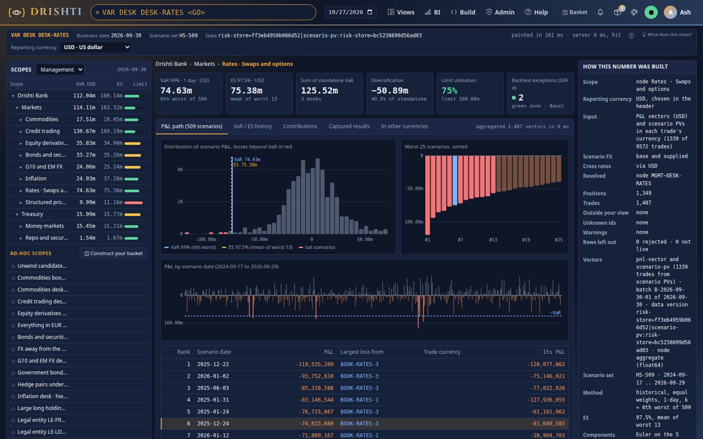

Every panel says *computing…* while it waits and is painted as soon as its answer arrives; the status line says how long the click
took (*painted in 14 ms · server 2 ms, hit*).

### 3.3 Drill down: bank, desk, book, position, trade

Click any row of the tree, any part of the breadcrumb, or any row of the Contributions tab: every panel moves to that scope. The
children of the node you are on are fetched while you read it, so the next click is answered from memory.

- **A position** is a holding of one instrument in one book; its trades build or reduce it (a buy adds, a sell takes away). Its vector
  is the sum of its trades' vectors, so a long of 100 and a short of 40 of one instrument have the VaR of 60: the position's VaR is never
  the sum of its trades' VaRs.
- **A trade** has its own vector: its VaR is exact, and so is its contribution to its position, its book and any basket.

A book opens to its positions, each with a LONG or SHORT chip, its quantity, its VaR and its component in the book:


### 3.4 The tabs

**P&L path** (509 scenarios): the distribution of the scope's scenario P&Ls with the VaR and ES lines (bins wholly beyond VaR in red);
the 25 worst scenarios sorted (the VaR scenario highlighted); the P&L by scenario date with the −VaR line; and the ranked table, 60 rows
a page (**Next page**), naming the part that lost most on each scenario. A click on a bar or a row opens **the contributors on that
date**: which children lost what that day.

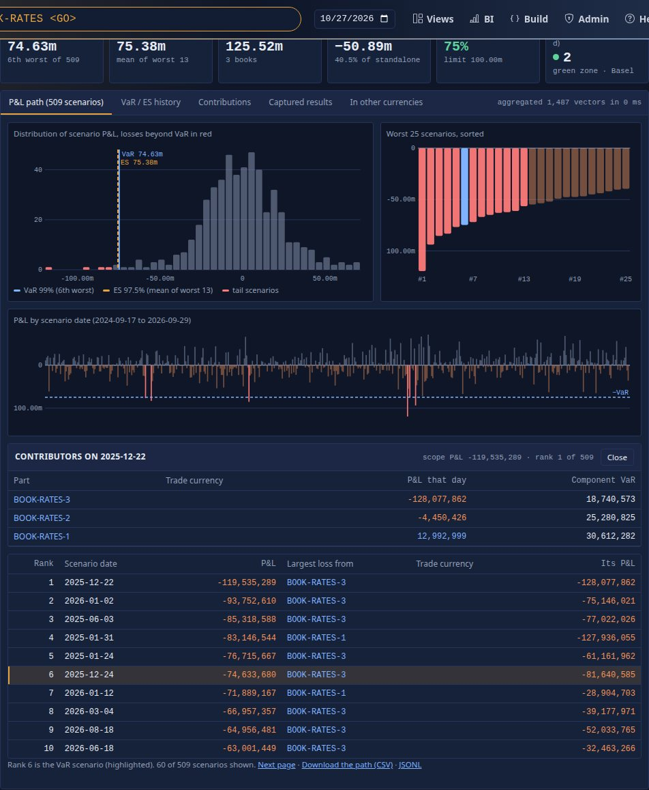

The ranked table from the command line (`drishti.py var path DESK:RATES --size 8`): rank 6 is the VaR scenario.

```text
DESK:RATES  VaR 74,633,680 (rank 6)  ES 75,377,415 (worst 13)
Rank  Scenario day  P&L           Lost most
----  ------------  ------------  -------------------------
1       2025-12-22  -119,535,289  BOOK-RATES-3 -128,077,862
2       2026-01-02   -93,752,610   BOOK-RATES-3 -75,146,021
3       2025-06-03   -85,318,588   BOOK-RATES-3 -77,022,026
4       2025-01-31   -83,146,544  BOOK-RATES-1 -127,936,055
5       2025-01-24   -76,715,667   BOOK-RATES-3 -61,161,962
6       2025-12-24   -74,633,680   BOOK-RATES-3 -81,640,585
7       2026-01-12   -71,889,167   BOOK-RATES-1 -28,904,703
8       2026-03-04   -66,957,357   BOOK-RATES-3 -39,177,971
```

**VaR / ES history**: −VaR and −ES lines over 250 days with the P&L, an exception as a red dot and a row chip, and the backtest: the count,
the Basel zone (green 0–4, amber 5–9, red 10+), Kupiec's and Christoffersen's p-values. A node shows its official end-of-day figures;
any other scope (a position, a trade, a basket) replays today's members, in-sample, and says so ([section 7](#7-history-and-backtesting)).

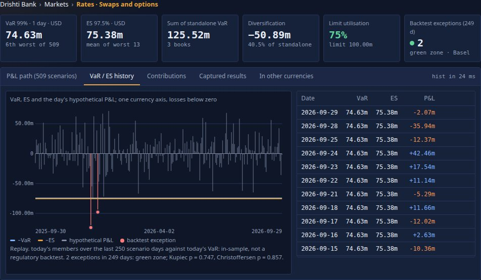

**Contributions**: the scope's children (a node's child nodes, a book's positions, a position's trades, a basket's positions), **By
position** or **By trade**: standalone VaR, component VaR (they add up to the scope's VaR) with its share and a bar, marginal VaR per
million of market value, incremental VaR, component ES. A hedge has a negative component. Tick rows and **Add to basket** to start an
ad-hoc scope from them.

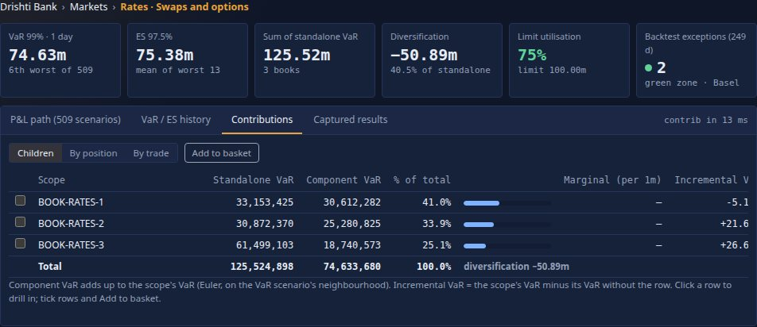

**Captured results**: the captures of this scope ([section 6](#6-captures-and-compare)).

### 3.5 + New scope

**+ New scope** opens the builder; the screen follows every change (the VaR is recomputed as you type, about 0.35 s after you stop):

- **Paste ids** (trades and positions, separated by commas, spaces or new lines) and **Add ids**: positions start with `POS-`.
- **Add rule**: a condition over the positions' columns, `CURRENCY == 'EUR' and DIRECTION == 'SHORT'`.
- **Combine**: pick any node, portfolio or basket and **+ union** or **− minus** it.
- **Add to basket** from rows ticked in the Contributions tab.
- Or type the scope directly (the [grammar](#52-the-grammar)).

Overlaps never count twice: a position in two of the terms is in the scope once. Until you save it the scope is *ad-hoc · unsaved*;
**Save** keeps it as a basket ([section 5.8](#58-baskets)).

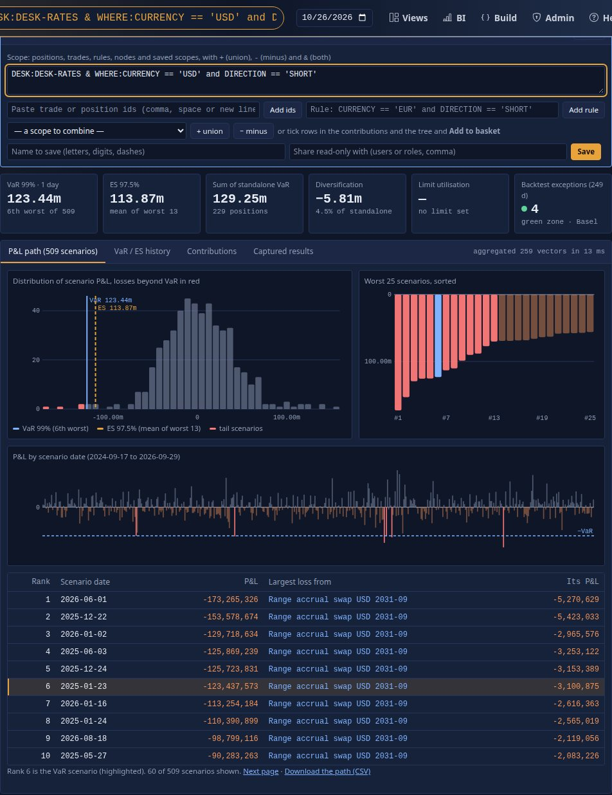

### 3.6 How this number was built

The scope as resolved, the positions and trades included, those without a vector, those outside your entitlement, unknown ids, the
vector batch and data version, the scenario set and its window, the method and rank rule, the ES rule, how components are allocated,
the engine and its threads, your view, **the tier** the vector came from (a node's float64 aggregate, the date's memory-mapped hot file,
or memory: [section 26](#26-the-tiered-memory-and-the-hot-file)), the members' hash, the time taken and whether the cache answered. The
fields are those of the answer's provenance ([section 11.2](#112-the-headline-get-scope-and-its-provenance)).

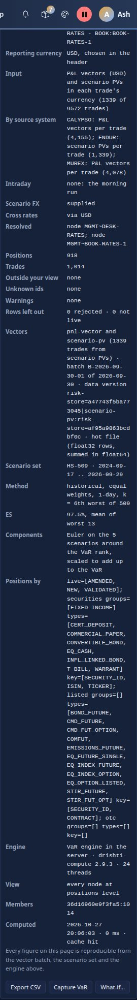

### 3.7 The portfolio and position pages

The `portfolio` and `position` kinds have pages of their own (Sutras). They store no figure: the VaR, ES and contributions on them are
the engine's, computed as the page opens, as you (your view of the nodes):

- `PORT PF-RATES-DESK <GO>`: the strip (positions, longs, shorts, gross and net market value, VaR, ES, limit use); the positions table
  (filter any column, **Pivot** tab), a click on a position opens it and its trades beside; the portfolio's P&L distribution; the
  component VaR by product, by currency and long against short; the top contributors; the definition.
- `POS POS-BOOK-EQD-2~SEC-WARRANT-USD-01 <GO>`: the instrument, direction, quantity, market value, the rule that made it, VaR, ES and
  component VaR in its book; its trades with their own VaR and their component of the position's (a long and a short of one instrument
  have components of opposite signs); its P&L distribution (the UI kit fragment `pnl-distribution@1`).
- `DESK DESK-RATES <GO>`: the desk's VaR and limit use in its strip, from the engine.

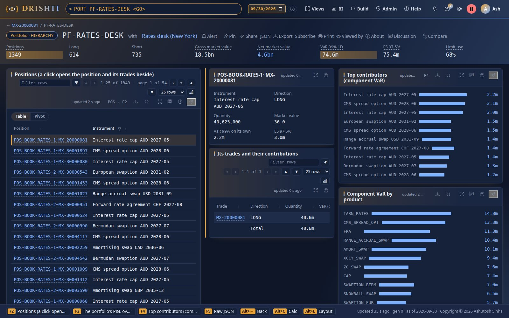

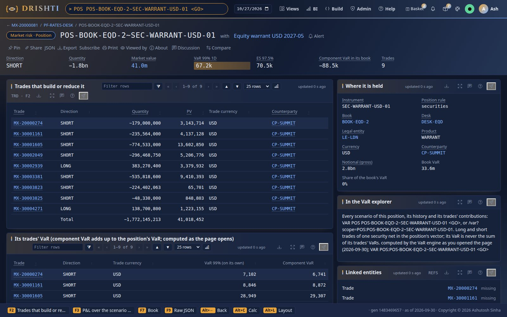

**How the figures get there (as built).** No stored kind carries a VaR figure ([section 21.3](#213-what-is-removed-as-built-in-the-same-release)).
The server's view pipeline adds them under `VAR_ENGINE` (`VarFigures`, an engine `ViewAugmenter`) to the document the page draws, and to
an entity a panel sources by id (the position opened beside a portfolio's table), computed as the reader (their entitlements by node,
their field masks); the stored document (`/api/v1/entities/<kind>/<id>/raw`) never has them. When the engine cannot answer (off, no
vectors, the reader may not see VaR, no signed-in viewer) `VAR_ENGINE` says why, `{STATUS: unavailable, NOTE}`, and the page shows the
rest. The book's own page (`portfolio-trades`, *all trades*) is unchanged.

| Page | `VAR_ENGINE` |
|---|---|
| position (`POS:<id>`) | `STATUS`, `SCOPE`, `BUSINESS_DATE`, `VAR`, `ES`, `CONFIDENCE`, `ES_CONFIDENCE`, `NOTE`; `TRADES` (each trade's `TRADE_ID`, `QUANTITY`, `DIRECTION`, own `VAR`, `COMPONENT_VAR` in the position); `BOOK_VAR`, `COMPONENT_VAR` and `PCT_OF_BOOK_VAR` (the position in its book); `PNL` (its 509 P&Ls) |
| portfolio (`PORT:<id>`) | the same headline with `LIMIT`, `LIMIT_USE`; `POSITIONS` (each position's instrument, direction, quantity, market value, currency, book, product, own `VAR`, `COMPONENT_VAR`, `PCT_OF_VAR`, `PARTIAL`), `POSITION_COUNT`, `LONG_COUNT`, `SHORT_COUNT`, `GROSS_MV`, `NET_MV`, `TOP_CONTRIBUTORS` (10), `BY_PRODUCT`, `BY_CURRENCY`, `BY_DIRECTION` (component VaR and net market value), `PNL` |
| desk (`DESK:<id>`) | the headline: `VAR`, `ES`, `LIMIT`, `LIMIT_USE` |

### 3.8 On a phone

The three columns stack, with no sideways scrolling:

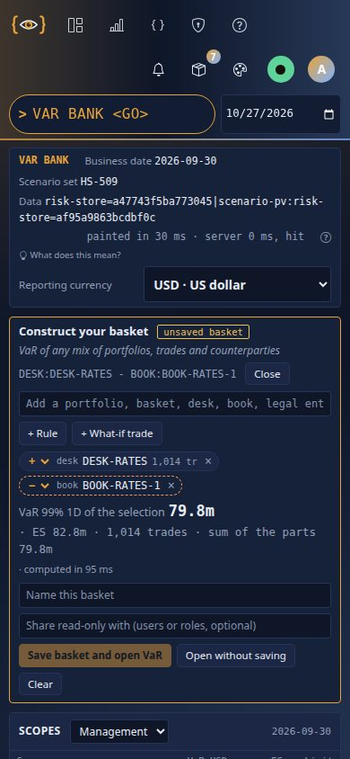

## 4. Positions: derived, never delivered

Nobody sends positions: Drishti **derives** them each time it loads a date, from the date's trades and the market-risk pack's
`positions:` rules (configuration in `pack.yaml`, never code):

```yaml
positions:
  live-statuses: [NEW, VALIDATED, AMENDED]
  rules:
    - name: securities                  # bonds, notes, bills, shares and warrants: by book and security
      groups: [Fixed income]
      types: [EQ_CASH, WARRANT, CONVERTIBLE_BOND, INFL_LINKED_BOND, T_BILL, COMMERCIAL_PAPER, CERT_DEPOSIT]
      key: [SECURITY_ID, ISIN, TICKER]
    - name: listed                      # exchange-traded futures and options: by book and contract
      types: [BOND_FUTURE, STIR_FUTURE, STIR_FUT_OPT, EQ_FUTURE_SINGLE, EQ_INDEX_FUTURE, EQ_OPTION_LISTED, EQ_INDEX_OPTION, CMD_FUTURE,
              CMD_FUT_OPTION, ComFut, EMISSIONS_FUTURE]
      key: [SECURITY_ID, CONTRACT]
    - name: otc                         # everything else: one position per trade
```

| Rule | A position is | Its id |
|---|---|---|
| **live** | only trades with a live status (`NEW`, `VALIDATED`, `AMENDED`; a row with no status counts) and not matured before the date | |
| **securities** | every trade of one book in one security (the first of `SECURITY_ID`, `ISIN`, `TICKER` the trade carries) | `POS-<book>~<security>` |
| **listed** | every trade of one book in one exchange contract (`SECURITY_ID`, `CONTRACT`) | `POS-<book>~<contract>` |
| **otc** | one trade (a swap, an FX forward, an OTC option; a security without a key too) | `POS-<book>~<trade>` |

The first rule whose `groups` hold the trade's `PRODUCT_GROUP` or whose `types` hold its `PRODUCT_TYPE` takes it. The **quantity is
signed** (bought positive, sold negative), so a position's quantity is the net of its trades; its direction is `LONG`, `SHORT` or
`FLAT`; `POSITION_TYPE` says `fungible` (several trades) or `single-trade`. On 2026-09-30 the rules give **7,984 positions**: 359
securities, 212 listed, 7,413 OTC; 476 are fungible and 111 net buys against sells. Example: `POS-BOOK-EQD-2~SEC-WARRANT-USD-01` is
nine trades of one warrant in `BOOK-EQD-2`, with a VaR of 67,209 against 111,930 for the trades alone. The bond future of tutorial 25 is
in `POS-BOOK-RATES-1~XCH-BOND_FUTURE-AUD-02` (the *listed* rule).

The same trades and rules always give the same positions, and every official capture records them (each position with its trades, the
rules' text and digest), so an official figure can be recomputed years later. The positions are served as the `position` kind
(`POS <id> <GO>`) by the `var-positions` connector, with no figure stored on them: their page shows the engine's, computed as it opens.
Every column and rule of the derivation is in [section 15.6](#156-positions-derived-by-drishti-as-built).

## 5. Scopes, portfolios and baskets

Any set of trades is written as text. The same text is the explorer's address (`/var?scope=…`), the `scope` parameter of every endpoint,
the `var-result` kind's id, a basket's definition, and a cache key once canonical. It is parsed by `ScopeExpr.parse` and resolved on one
date by `ScopeResolver` to a set of trade ordinals.

### 5.1 Terms

| Term | Argument | Resolves to |
|---|---|---|
| `BANK` | none (`BANK:x` is accepted and `x` ignored) | node `MGMT~BANK`, the Management tree's root |
| `LE:<id>` | a legal entity (`LE-NY` or `NY`) | the trades whose booking `LEGAL_ENTITY` is it ([section 5.5](#55-scope-words-by-a-trades-attribute)); the node `LEGAL~<id>` (else `LEGAL~LE-<id>`) gives its children, limit and history |
| `DIV:<id>` | a division | `MGMT~<id>`, else `MGMT~DIV-<id>` |
| `DESK:<id>` | a desk | `MGMT~<id>`, `MGMT~DESK-<id>`, `LEGAL~<id>`, `LEGAL~DESK-<id>` (first found) |
| `BOOK:<id>` | a book | `MGMT~<id>`, else `MGMT~BOOK-<id>` |
| `NODE:<node id>` | a full node id | that node (as written, then upper case) |
| `POS:<id>[,<id>…]` | position ids | every trade of each position |
| `TRD:<id>[,<id>…]` | trade ids | those trades (an id as written, else the one id equal to it ignoring case) |
| `CPTY:<id>[,<id>…]` | counterparty ids | every trade whose `COUNTERPARTY` is one of them (compared ignoring case) |
| `PORT:<id>` | a stored portfolio | its definition's scope ([section 5.7](#57-stored-portfolios)), resolved recursively |
| `BASKET:<owner>/<name>` | a saved basket the caller may read | its scope, resolved recursively |
| `CAPTURE:<id>` | a capture the caller may read | `TRD:` of its members (resolved on the request's date) |
| `WHERE:<rule>` | a position rule ([section 5.4](#54-the-position-rule-language-where-and-rule-portfolios)) | every trade of each matching position |
| `A + B`, `A - B`, `A & B`, `( … )` | | union, difference, intersection; `&` binds first; operators stand between spaces |

A node term's members are the trades of the node's books. `DESK:RATES`, `DESK:DESK-RATES` and `NODE:MGMT~DESK-RATES` are the same node.
A hyphen inside an id is part of the id (`DESK:RATES - TRD:MX-30000121`).

### 5.2 The grammar

As the parser accepts it:

```
scope    := union
union    := and ( SP ('+' | '-') SP and )*          left to right; '+' and '-' have the same precedence
and      := atom ( SP '&' SP atom )*                '&' binds before '+' and '-'
atom     := '(' union ')' | ref
ref      := WORD | WORD ':' arg | 'WHERE' ':' rule
WORD     := letters only, case-insensitive: BANK LE DIV DESK BOOK NODE POS TRD CPTY PORT BASKET CAPTURE WHERE
arg      := characters up to whitespace, '(' or ')'; for POS, TRD and CPTY, whitespace next to a comma is allowed ("a, b")
rule     := characters up to an unmatched ')', or up to whitespace + one of '+', '-', '&' + whitespace, outside quotes and parentheses
SP       := whitespace (or, before an operator, a closing ')'; after it, an opening '(')
```

| Rule | Detail |
|---|---|
| Operators | `+` union, `-` difference, `&` intersection; an operator must stand between spaces (or after `)` / before `(`): `MX-20000001` is an id, `A -B` is an error |
| Precedence | `A + B - C` = (A ∪ B) − C; `A - B + C` = (A − B) ∪ C; `A + B & C` = A ∪ (B ∩ C); parentheses group |
| Case | words are case-insensitive; arguments are **upper-cased**, except `BASKET` and `CAPTURE` arguments and the ids of `POS`, `TRD` and `CPTY` (kept as written, matched exactly, else ignoring case: decided 2026-10-25), so `trd:mx-30000121` works |
| Lists | only `POS`, `TRD` and `CPTY` split their argument on commas; for other words a comma is part of the id |
| Quoting | only inside `WHERE` rules: text literals in single quotes, `''` for a quote |
| Canonical text | words upper case; `POS`/`TRD`/`CPTY` ids sorted and unique (as written); the terms of a union sorted; `A - B` written `A - (B)` when B is a combination; `&` operands in parentheses unless a term or another `&` |
| Depth | `PORT`, `BASKET` and `CAPTURE` may refer to each other at most 8 deep; deeper: *the scope refers to itself* (`400`) |
| Errors | empty scope, an unknown word, a word without `:` and argument, an empty argument, an unmatched `(`, trailing text, a rule that does not parse: `400 DRS-5001` with the reason |

### 5.3 Resolution rules

| Rule | Behaviour |
|---|---|
| Unknown ids | an id, node, portfolio, basket or capture the date or the caller does not have resolves to nothing and is listed in `provenance.unknown` (*Unknown ids*), never silently dropped; the answer is still `200` (an empty scope has VaR 0) |
| Overlap | set algebra on trade ordinals: a trade in two terms of a union counts once |
| Rules and positions | `WHERE:` and `POS:` take whole positions; `TRD:` takes single trades (a position held in part is a *partial* part) |
| Entitlements | the resolved set is intersected with the trades the viewer may see; the rest are counted (`hidden`). A scope that names `POS`, `TRD`, `CPTY`, `WHERE`, `BASKET`, `CAPTURE` or a `PORT:` of a BASKET-type portfolio is refused (`403 DRS-5002`) unless every resolved trade is at `positions` level for the viewer; `CPTY:` is refused to a viewer who sees `COUNTERPARTY` masked |
| Warnings | data-quality findings about what was resolved, in `provenance.warnings`: a legal entity's trades outside its `LEGAL` node, a `LEGAL` node holding another entity's trades ([section 5.5](#55-scope-words-by-a-trades-attribute)) |
| Kind of a scope | `node` (exactly one node term, `LE:` included when its `LEGAL` node exists), `position`, `trade` (exactly one id), `portfolio`, `basket`, `capture`, `rule`, `counterparty`, `legal-entity` (one term of that word), else `adhoc` |
| Date | resolved on the request's date: a `CAPTURE:` or a basket of trades holds ids; trades the date does not have are `unknown` |

**Aggregate-only access** ([section 9](#9-who-sees-what-entitlements-and-audit)): a scope that is a node or a HIERARCHY or RULE portfolio
is allowed and computed over the visible trades; parts below the node's level are not listed. `PORT:` of a BASKET-type portfolio is
treated like `BASKET:` (as built, 2026-10-25): an aggregate-only viewer cannot probe a stored basket of single trades.

### 5.4 The position rule language (`WHERE:` and RULE portfolios)

The same grammar in `PositionRule` (Java) and `tools/packgen/var/rules.py` (the generator), so a rule has the same members in both: a
small part of DEL ([EXPRESSIONS.md](EXPRESSIONS.md)) evaluated over the positions' columns.

```
rule  := or
or    := and ( 'or' and )*                 and   := not ( 'and' not )*
not   := 'not' not | '(' or ')' | cmp
cmp   := FIELD op LIT | FIELD 'in' '(' LIT (',' LIT)* ')' | LIT 'in' FIELD
op    := '==' | '!=' | '<' | '<=' | '>' | '>='
LIT   := digits ['.' digits]  (no sign: negative numbers are not supported) | 'text' ('' for a quote)
FIELD := [A-Za-z_][A-Za-z0-9_.]*           keywords and, or, not, in are case-insensitive
```

| Semantics | Detail |
|---|---|
| Fields | the position columns of [section 25](#25-one-business-date-in-memory) (`POSITION_TEXTS`, `POSITION_NUMBERS`: `PRODUCT_GROUP`, `CURRENCY`, `DIRECTION`, `MARKET_VALUE`, `QUANTITY`, `DESK`, `TT_BOOK`, `TAGS`, `POSITION_RULE` …); any other field is missing |
| Missing field | compares unequal to everything: `!=` is true, every other comparison false; `in` false |
| Numbers | a number literal compares numerically (a text value that parses as a number is converted) |
| Text | `==`, `<` … compare text by code point (Java `compareTo`) |
| `'x' in FIELD` | true when the list field holds `x` (`TAGS`) |
| Examples | `PRODUCT_GROUP == 'Rates' and CURRENCY in ('USD', 'CAD')`; `'hedge' in TAGS or not DIRECTION == 'LONG'`; `MARKET_VALUE > 1000000` |

Membership of a rule is evaluated per date against that date's positions: the same rule may hold more positions on one day than the next.

### 5.5 Scope words by a trade's attribute

| Term | Meaning (as built) | Reads |
|---|---|---|
| `LE:<id>` | **the bank's legal entity (decided 2026-10-25, open question 14):** the trades whose booking `LEGAL_ENTITY` is the entity (`LE:NY` is `LE-NY` too). The `LEGAL` hierarchy rolls up by books; when its node `LEGAL~<id>` misses some of the entity's trades or holds another entity's, the answer is still the trades' entity and the difference is a data-quality warning in `provenance.warnings`. The node, when it exists, gives the scope its children, limit and official history | `LEGAL_ENTITY` of the trade vectors |
| `CPTY:<id>[,<id>…]` | the trades with that counterparty, across books and positions (compared ignoring case); refused to an aggregate-only viewer and to a viewer who sees `COUNTERPARTY` masked | `COUNTERPARTY` of the trade vectors |
| `GROUP:<id>` | **PARKED** (product owner, 2026-10-25: fundamentals and VaR only): the trades with any member of a connected group (GLEIF parents) | `counterparty`, `lei-entity` |
| `NSET:<id>` | **PARKED**: the trades of a netting set | `netting-set` (`TRADE_IDS`) |

### 5.6 Examples on the test data

On the default demo lake (`drishti.py lake demo`, which moves the test data's sixty business days to end today), business date
**2026-10-26**, batch `B-2026-10-26-01` (`drishti.py var show <scope>`):

| Scope | VaR | Trades |
|---|---|---|
| `BANK` | 126,544,583 | 8,566 |
| `LE:NY` | 135,906,338 | 5,542 |
| `DESK:RATES` | 64,434,451 | 1,281 |
| `BANK - DESK:CREDIT` | 60,228,839 | 7,623 |
| `DESK:RATES - TRD:MX-30000121` | 64,605,209 | 1,280 |
| `PORT:PF-USD-RATES` | 33,031,967 | 842 |
| `WHERE:CURRENCY == 'EUR' and DIRECTION == 'SHORT'` | 126,453,445 | 609 |
| `DESK:RATES & WHERE:DIRECTION == 'SHORT'` (saved as `BASKET:rita/rates-short`) | 253,470,623 | 677 |
| `POS:POS-BOOK-EQD-2~SEC-WARRANT-USD-01` | 67,209 | 9 |

The rest of this guide reads the lake built on the data's own date (`--as-of data`, 2026-09-30), where the bank's VaR is 112,035,906 on
9,572 trades. Both are built from the same test data but do not hold the same live trades: moving the business dates does not move the trades'
maturities, so on 2026-10-26 the trades that mature in between are no longer live (8,566 instead of 9,572), and the bank's worst days
change with them.

### 5.7 Stored portfolios

A **portfolio** (`PORT <id> <GO>`) is a definition, an input of the batch ([section 15.5](#155-portfolio-stored-portfolio-definitions-as-built));
its figures are always the engine's:

| Type | Definition | Becomes the scope (`VarDate.Portfolio.of`) | Test data |
|---|---|---|---|
| `HIERARCHY` | a node of a hierarchy | `NODE:<node>` | `PF-RATES-DESK` … one per desk and legal entity, `PF-COMM-BOOK-1` |
| `RULE` | a condition on the positions' columns | `WHERE:<rule>` | `PF-USD-RATES`, `PF-EUR-ALL`, `PF-SHORT-RISK`, `PF-GOVT-BONDS`, `PF-LISTED`, `PF-OPTIONS`, `PF-FX-CROSSES`, `PF-LARGE-LONGS` |
| `BASKET` | positions and trades someone picked | `POS:<ids>` and/or `TRD:<ids>` joined by ` + ` (a `TRADE_ID` member is that trade only; an empty basket is `TRD:NONE`) | `PF-ASHA-UNWIND`, `PF-NETTED-FLOW`, `PF-HEDGE-PAIRS`, `PF-TOP-SECURITIES`, `PF-PARTIAL-FILLS` |

`PORT:PF-USD-RATES` (*USD rates exposure*, a rule): 918 trades in 563 positions, VaR 28,968,862, 69.0% of its 42 million limit. The 28
portfolios overlap on purpose: a position belongs to one leaf of each hierarchy and to any number of rule portfolios and baskets; each
portfolio's vector is the sum over its own members, and a union of portfolios is computed as a set first, so a position in both counts
once (two overlapping portfolios' vectors cannot simply be added, and a table of overlapping portfolios never shows a total row).

### 5.8 Baskets

A **basket** is a scope you save under a name (explorer: **+ New scope**, then **Save**; CLI: `drishti.py var basket`; API:
`POST /api/v1/var/baskets`). It is a RULE when it is a single rule (the scope starts with `WHERE:` and has no ` + `), else a BASKET;
private unless you share it read-only with users or roles (*Share read-only with*: each reader sees it through their own entitlements).
Baskets are stored in the **content store** ([CONTENT_STORE.md](../architecture/CONTENT_STORE.md)) at `var/baskets/<owner>/<name>.json`, so
they follow their owner across the servers of a cluster and every version is kept; they are listed under *Ad-hoc scopes* as `★ name`
and opened as `BASKET:<owner>/<name>` or `VAR SCOPE <name> <GO>`. A basket of nodes and rules is **dynamic** (what matches on the date
you look at); one of ids is **static** (a later date may not hold them: *unknown*). Every save and delete is audited.

| Field | Type | Meaning |
|---|---|---|
| `id` | string | `<owner>/<name>` |
| `name` | string | the title given (`title`), else the name |
| `description` | string | |
| `type` | string | `RULE` or `BASKET`, as above |
| `scope` | string | the scope text as saved (must parse) |
| `owner` | string | the user who saved it |
| `sharedWith` | string list | user names, or role names (optionally `role:<name>`): read-only |
| `createdAt`, `updatedAt` | string | ISO-8601 instants |
| `version` | integer | 1, then +1 on every save under the same name |

**Name:** slugged to lower case (`[^a-z0-9._-]` → `-`), 1 to 64 characters `[a-z0-9][a-z0-9._-]{0,63}`; `<owner>` is the content
store's form of the user name. **Who may read:** the owner, a named user, or a holder of a named role. **Delete:** the owner only
(`204`; anything else `404`).

## 6. Captures and compare

**Capture VaR** (the right column, or the *Captured results* tab with a note) stores an immutable record of the answer as it is now:

- the numbers: VaR, ES, the rank rule, each part's component VaR, the 25 worst scenarios, and the full vector (whole dollars);
- the members: the trades the scope resolved to;
- the provenance: the scope as written and resolved, the business date, the data version of the vectors, the scenario set and its
  dates, the method, the engine, you, the time, your note.

A capture never changes: restate the batch, change the basket, and it still reopens with the numbers it had (**Reopen**). **Compare
with now** puts it beside the same scope computed on the newest date: VaR and ES change, members added and removed, the components
that moved most; two captures of a scope compare the same way. **CSV** downloads the vector by scenario date or, with
`?part=components`, the components. Captures are listed per scope, newest first; `VAR CAPTURE <id> <GO>` reopens one. Each capture is
an audit entry.

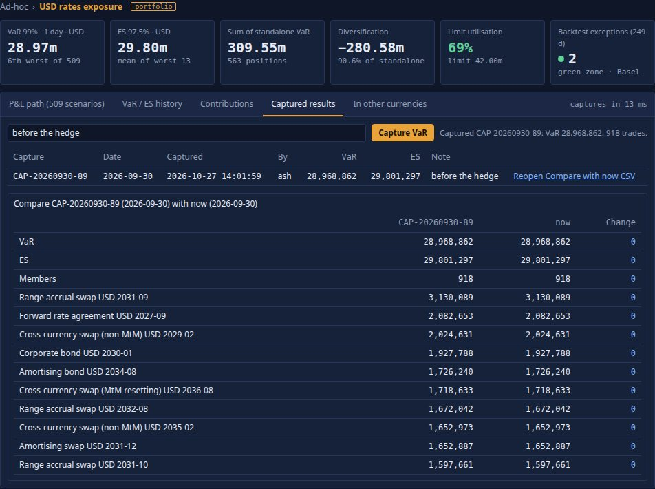

From the command line, a basket saved, captured and compared (real output):

```text
$ drishti.py var basket rates-short "DESK:RATES & WHERE:DIRECTION == 'SHORT'" --title 'Rates shorts'
{ "id": "rita/rates-short", "name": "Rates shorts", "type": "BASKET", "scope": "DESK:RATES & WHERE:DIRECTION == 'SHORT'",
  "owner": "rita", "sharedWith": [], "version": 1, ... }
$ drishti.py var capture BASKET:rita/rates-short --note 'before the unwind'
{ "id": "CAP-20260930-89", "capturedAt": "2026-10-26T05:12:54.392356455Z", "var": 282428035, "es": 271474611, "memberCount": 800 }
$ drishti.py var compare CAP-20260930-89
{ "a": { "id": "CAP-20260930-89", "label": "Rates shorts", "var": 282428035, "es": 271474611, "memberCount": 800, ... },
  "b": { "id": "now", "var": 282428035, "es": 271474611, "memberCount": 800, ... },
  "varChange": 0.0, "esChange": 0.0, "membersAdded": [], "membersRemoved": [],
  "components": [ { "key": "POS-BOOK-RATES-2~MX-30000951", "label": "Forward rate agreement CHF 2027-08", "a": 2783132, "b": 2783132,
                    "change": 0.0 }, ... ] }
```

**The record.** In the content store at `var/captures/<owner>/<id>.json`. **Id:** `CAP-<yyyymmdd of the business date>-<n>`, `n` from
the content store's sequence `var/captures-seq`. Written once (`create`; an existing id is refused); there is no update, share or delete
endpoint (`sharedWith` is always empty today).

| Field | Type | Meaning |
|---|---|---|
| `id` | string | `CAP-20260930-7` |
| `scope`, `canonical`, `label`, `kind` | string | as in the headline |
| `businessDate`, `capturedAt` | string | the date answered; the instant written |
| `owner`, `sharedWith`, `note` | string, list, string | the capturer; `[]`; the note (at most 1,000 characters) |
| `var`, `es`, `k`, `esCount`, `confidence`, `esConfidence`, `limit`, `sumStandalone`, `diversification` | as the headline | |
| `components`, `componentsBy` | list, string | the contribution rows (`by=child`) and their kind |
| `worst` | list | the 25 worst scenarios `{rank, index, date, pnl}` |
| `vector` | integer[N] | the scope's vector, **rounded to whole units** |
| `scenarioSet`, `scenarioDates` | string, string[N] | |
| `members`, `memberCount` | string list, integer | every member trade id (visible to the capturer) |
| `dataVersion` | string | the vector table's stamp for the date |
| `provenance` | object | [section 11.2](#112-the-headline-get-scope-and-its-provenance) |

**List** (`GET /captures`): `[{id, scope, canonical, label, businessDate, capturedAt, owner, note, var, es}]`, newest first.
**Compare** (`GET /compare?a=&b=`): `a`, `b` (each `{id, scope, label, businessDate, capturedAt, owner, note, var, es, memberCount,
dataVersion}` where present; `b=now` recomputes the capture's scope on the newest date), `varChange`, `esChange` (b − a),
`membersAdded`, `membersRemoved` (sorted, at most 200 each), `components` `[{key, label, a, b, change}]` by \|change\| descending.

**CSV** (`GET /captures/{id}/csv`, `text/csv`, attachment `<id>[-<part>].csv`): first the lines `# <field>: <value>` for `id`,
`scope`, `label`, `businessDate`, `capturedAt`, `owner`, `note`, `var`, `es`, `dataVersion`, `scenarioSet`; then

| `part` | Header | Rows |
|---|---|---|
| (none) | `scenario_date,pnl` | N rows in scenario order |
| `components` | `key,label,standalone_var,component_var,component_es,pct_of_var,incremental_var` | one per component row (text with a comma or quote is quoted) |

The **official** end-of-day captures are captures too (owner `drishti`, marked *official*), listed under a node's *Captured results*
for a viewer who sees every node, and the source of the node history ([section 19](#19-official-end-of-day-results)).

## 7. History and backtesting

The *VaR / ES history* tab and `GET /api/v1/var/scope/history` answer in one of two modes (`VarViews.history`):

| Mode | When | Rows | Backtest |
|---|---|---|---|
| **official** | the scope is exactly one node, you see every node at `positions` level, and the node has official end-of-day records ([section 19](#19-official-end-of-day-results)) on more than one day up to the date | the node's official figures, oldest first, a row per date (each date's latest result version), at most `history-days` (250) | each day's hypothetical P&L (`HYPO_PNL`) against the **previous** row's VaR |
| **replay** | anything else | today's members over the last `min(history-days, N)` scenario days of the scope's **today's** vector | each day's scenario P&L against **today's** VaR: in-sample, labelled *not a regulatory backtest* |

A day is an **exception** when its P&L is a loss larger than the VaR it is tested against. Over the days:

- **The Basel traffic light**: green for up to 4 exceptions in 250 days, amber 5 to 9, red 10 or more.
- **Kupiec's test** (proportion of failures): is the share of exceptions consistent with 1%? A p-value below 0.05 says no (too many or
  too few).
- **Christoffersen's test** (independence): do exceptions cluster (an exception more likely the day after one)? A p-value below 0.05
  says they do.

The formulas are in [section 18.4](#184-history-and-backtest).

**Short histories (decided 2026-10-25, open question 13: kept, documented).** The light scales its limits with the days it has
(`round(4 × days/250)`, `round(9 × days/250)`): with 4 days, `round(4 × 0.016) = 0`, so a single exception is already **red**; below 14
days one exception is red, below 32 one is amber. The screens show the light *with its days*, and it is not a regulatory zone before
250 days.

The FX desk replayed (`drishti.py var history DESK:FX`, the last rows):

```text
history (replay): today's members over the last 250 scenario days against today's VaR: in-sample, not a regulatory backtest
  green  3 exceptions in 249 days   Kupiec LR 0.099 (p 0.753)   Christoffersen LR 0.073 (p 0.786)
Date        VaR         ES          P&L          Exception
----------  ----------  ----------  -----------  ---------
2026-09-22  24,060,533  25,240,488   31,198,624
2026-09-23  24,060,533  25,240,488   11,195,465
2026-09-29  24,060,533  25,240,488     -818,954
```

Three exceptions in 249 days is fewer than the 2.5 expected: green, and neither test rejects. The bank replayed shows 5 exceptions
(amber; Kupiec p 0.160, Christoffersen p 0.076). The official mode begins with the second official date: each day's official VaR, ES and
hypothetical P&L. **The hypothetical P&L of an official record** (`HYPO_PNL`) is the node's P&L under the newest scenario day of its
date's set (the move of the business day before, applied to the date's members): a bank delivering a hypothetical P&L table of its own
replaces it (planned).

## 8. What-if and VaR as a kind

Two **computed kinds** of the market-risk pack make VaR an ordinary kind, served by reactive connectors (`plugin: reactive`,
[REACTIVE_CONNECTOR.md](../connectors/REACTIVE_CONNECTOR.md)): by command (`VRES DESK:RATES <GO>`), link (`/v/var-result/DESK:RATES`),
the entities and compute APIs, the CLI (`drishti.py compute run var-engine var-result DESK:RATES`, `drishti.py var whatif`), search and the
AI tools, with the explorer's entitlements (each is computed as the person asking: their nodes, masks and audit entry; cached per view
signature). Names decided (open question 12): `var-result` and `var-whatif`, fields `VAR` with `CONFIDENCE` (never `VAR_99`); the
retired kind name `var` is not reused. The designs' `var-contribution`, `var-path` and `var-history` are not separate kinds: a
`var-result` carries the parts (`CHILDREN`), the worst scenarios and the vector, and the explorer and the API serve paths and histories.
Contracts: `config/packs/market-risk/contracts/var-result.contract.yaml` and `var-whatif.contract.yaml` (class `computed`).

**Ids.** The id is the scope text. Like every computed id ([ComputeRef](../connectors/REACTIVE_CONNECTOR.md#reading-a-computed-kind)), a
`~` inside it is written `%7E` (`NODE:MGMT%7EDESK-RATES`; prefer `DESK:RATES`, which needs none), `=` `%3D` (a `WHERE:` rule's `==`),
and parameters ride after a `~` (`DESK:RATES~stress-window=120`). A scope with a `/` (a basket) is read through the compute API's body,
not a link.

### 8.1 `var-result`: the Java engine

`VRES <scope> <GO>`: connector `var-engine`, Java engine `com.ash.drishti.server.var.VarResultEngine` (in the server, over `VarService`);
triggers: the data versions of the four inputs (`affects: all`); answers wait up to 5 s.

```text
$ drishti.py compute run var-engine var-result DESK:RATES
var-engine DESK:RATES  READY  (req-mvosw177-c6042d15feb9)
  SCOPE        DESK:RATES
  SCOPE_KIND   node
  LABEL        Rates · Swaps and options
  NODE         MGMT~DESK-RATES
  BUSINESS_DATE 2026-09-30
  VAR          74633680
  ES           75377415
  K            6
  LIMIT_USE    0.7463368
  SUM_STANDALONE 125524898
  DIVERSIFICATION 50891218
  computed 2026-10-26T05:12:54.554938067Z by java:var-engine@2.7.0, pin pin-e0cd3fe57e54607c, sha256:fd1912ea94a8fb93f1acb005507655d3
```

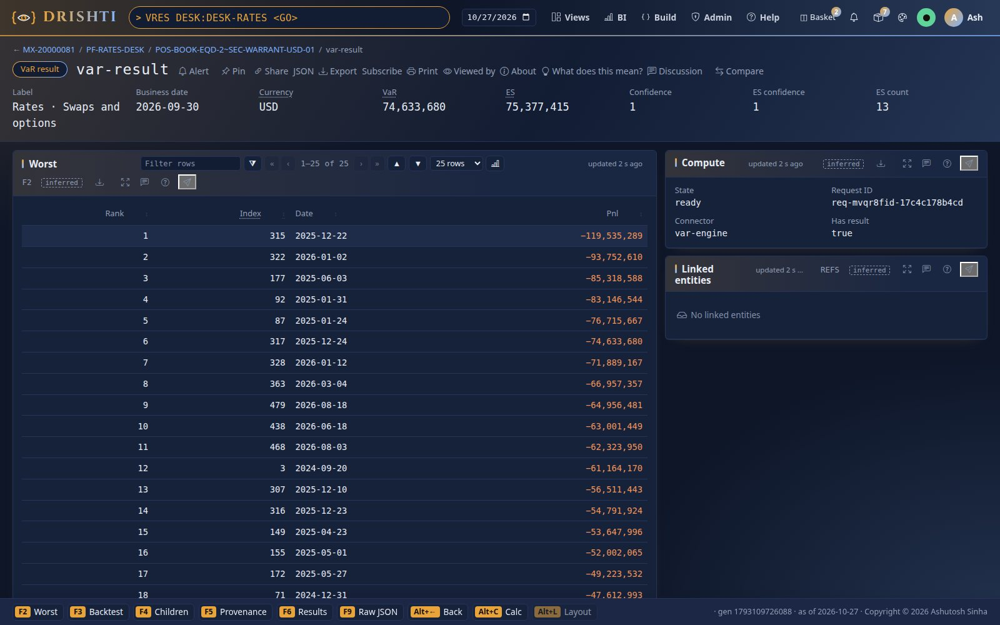

| Field | Type | Meaning |
|---|---|---|
| `SCOPE`, `CANONICAL`, `SCOPE_KIND`, `LABEL`, `NODE` | text | as the headline's `scope`, `canonical`, `kind`, `label`, `node` ([section 11.2](#112-the-headline-get-scope-and-its-provenance)) |
| `BUSINESS_DATE` | date | the date answered |
| `VAR`, `ES` | amount (USD, whole units) | at `CONFIDENCE`, `ES_CONFIDENCE` |
| `CONFIDENCE`, `ES_CONFIDENCE`, `K`, `ES_COUNT`, `SCENARIOS` | number | |
| `LIMIT`, `LIMIT_USE`, `SUM_STANDALONE`, `DIVERSIFICATION` | amount, ratio | null when none |
| `BACKTEST` | record | `DAYS`, `EXCEPTIONS`, `LIGHT`, `KUPIEC_LR`, `KUPIEC_P_VALUE`, `CHRISTOFFERSEN_LR`, `CHRISTOFFERSEN_P_VALUE` |
| `CHILDREN` | record list | per default part: `KEY`, `SCOPE`, `LABEL`, `KIND`, `STANDALONE_VAR`, `COMPONENT_VAR`, `COMPONENT_ES`, `INCREMENTAL_VAR`, `PCT` |
| `WORST` | record list | 25 × `RANK`, `INDEX`, `DATE`, `PNL` |
| `PNL` | vector | the scope's vector, unrounded |
| `PROVENANCE` | record | the headline's provenance in UPPER_SNAKE (`TIER` included) |

Tables with the answer: `children` and `worst` (for panels). A scope that does not parse, or a role that may not see VaR, is the
engine's refusal in words (`failed` with the reason); a role that may not open the kind is `refused`.

### 8.2 `var-whatif`: the Python engine

`VWIF <scope> <GO>`: connector `var-whatif`, the **Python VaR engine** `drishti_compute.var.whatif:VarWhatIfEngine` in the compute pool
`var`: the scope's VaR before and after hypothetical trades, and its stressed window. Java keeps the additive aggregation (it reads the
scope's `var-result` as the viewer, input `base`); Python does what does not add. The hypothetical trades live in your private
**sandbox** (parameter `sandbox`, type `sandbox-ref`: `POST /api/v1/compute/sandboxes {connector: var-whatif, items: [{LABEL, PNL: [N
numbers], FACTOR}]}`, input `sandbox`), each with its P&L over the 509 scenario days (priced elsewhere, or copied from a booked trade's
vector) and a `FACTOR`; taking trades out is the scope's own algebra (`DESK:RATES - TRD:X`), so it is exact. Parameters: `stress-window`
(int, 250; 0 none: the largest VaR over every run of that many consecutive scenario days), `component-window` (int, 5). A trigger never
recomputes a sandbox. It needs the compute workers (`DRISHTI_COMPUTE_ENABLED=true`).

```bash
drishti.py var whatif DESK:RATES --trades new-hedge.json --stress-window 250
```

`new-hedge.json` is a list of trades: `[{"LABEL": "hedge of BOOK-RATES-3 (half)", "PNL": [509 numbers], "FACTOR": -0.5}]` (here the
vector of `BOOK-RATES-3`, read with `VRES BOOK:BOOK-RATES-3`, sold at half). The command makes the sandbox and asks the engine:

```text
what-if on DESK:RATES  READY  (req-mvot2fc8-0c51138d9548)
  BEFORE_VAR           74,633,680
  AFTER_VAR            47,599,220
  CHANGE_VAR           -27,034,460
  BEFORE_ES            75,377,415
  AFTER_ES             56,247,260
  CHANGE_ES            -19,130,155
  STRESSED_VAR_BEFORE  85,318,588
  STRESSED_VAR_AFTER   59,556,766
```

The `items` table of the same answer (`--json`): the hedge alone has a VaR of 34,296,045; its incremental VaR is −27,034,460 (the
change); its component in the desk after the trade is −32,542,151 (a hedge's component is negative). The engine ran on one worker of
the pool `var` in 22 ms.

| Field | Type | Meaning |
|---|---|---|
| `SCOPE`, `CANONICAL`, `BUSINESS_DATE` | text, text, date | the base scope |
| `ITEMS` | integer | hypothetical trades (0 without a sandbox) |
| `BEFORE_VAR`, `AFTER_VAR`, `CHANGE_VAR`, `BEFORE_ES`, `AFTER_ES`, `CHANGE_ES` | amount (USD) | the scope's VaR and ES before and after the trades, and the change |
| `LIMIT`, `LIMIT_USE_BEFORE`, `LIMIT_USE_AFTER` | amount, ratio | |
| `CONFIDENCE`, `ES_CONFIDENCE` | number | the base's |
| `STRESS_WINDOW`, `STRESSED_VAR_BEFORE`, `STRESSED_VAR_AFTER`, `STRESSED_FROM` | integer, amount, amount, integer | the largest VaR over every run of `STRESS_WINDOW` consecutive scenario days, before and after, and the run's first day (index) |

Tables: `items` (`LABEL`, `FACTOR`, `STANDALONE_VAR`, `STANDALONE_ES`, `INCREMENTAL_VAR` in the order listed, `INCREMENTAL_ALONE` added
alone to the base, `COMPONENT_VAR`, `COMPONENT_ES` in the scope after) and `pnl` (`DAY`, `BEFORE`, `AFTER`). A trade whose vector has
another length is refused in words (*what-if item … has 3 scenario P&Ls; the scope has 509*). The compute workers are off as shipped
(`compute.enabled`); with them off the kind answers `refused` with the reason. In the UI, `VWIF DESK:RATES` (no sandbox) opens the desk's
stressed window; with a sandbox the id carries it (`DESK:RATES~sandbox=sbx-…`); the sandbox is yours alone (`drishti.py compute sandboxes`).

### 8.3 Where it runs: the Java engine and the Python engine (as built, 2.8.0)

**The Java engine** (the server's JVM: `drishti-compute`, `drishti-server`) keeps everything that adds: resolving a scope, summing
vectors over the hot store, the node aggregates, the explorer's answers, the API, captures and the official records. Additions of stored
vectors and a sort of N numbers per answer, on a bounded pool; no Python on that path.

**The Python VaR engine** (`drishti-compute/src/main/python/drishti_compute/var`: `measures.py` with the same rules as `VarMath` and
`VarCalc`, and the engine `whatif.py`) runs in the compute workers, pool `var` of `config/compute/compute.yaml` (workers
`DRISHTI_COMPUTE_VAR_WORKERS`, 4; standard library only, so no environment to approve), behind the reactive connector `var-whatif`. It
receives only the few vectors it needs and does what does not add: a scope's VaR **before and after hypothetical trades** (each with its
vector, priced elsewhere, scaled by a factor), each trade's incremental VaR in the order listed and alone, their component VaR and ES in
the scope after, and the **stressed window** (the largest VaR over every run of `stress-window` consecutive scenario days, a stressed
period chosen from the scenario set the batch delivered). The boundary as built:

| From Java to Python | From Python to Java |
|---|---|
| the scope's `var-result` read as the viewer (an Arrow table: `PNL` as a fixed-size `float64` vector of N, `VAR`, `ES`, `CONFIDENCE`, `ES_CONFIDENCE`, `LIMIT`, `CANONICAL`, `BUSINESS_DATE`; nested records are left out) | one row with the measures (`var-whatif`, [section 8.2](#82-var-whatif-the-python-engine)), and the tables `items` and `pnl` |
| the person's sandbox: one item per hypothetical trade, `PNL` (N numbers), `FACTOR`, `LABEL` | |

**Not built (parked):** pricing an amended or new trade over the scenarios (QLRisk, when its API is stable): a what-if trade's vector is
supplied in the sandbox today; methods beyond equal-weight historical (age-weighted, filtered), a stressed scenario set (`SVAR-250`,
open question 6), ES backtests.

### 8.4 What-if pricing and intraday recomputes (planned)

The design (wave V4 and V5, [section 30](#30-the-design-record)); none of it is built in 2.8.0.

**What-if changes.** A sandbox is a person's private what-if: a base scope and a list of changes; only its owner sees or changes it
([REACTIVE_CONNECTORS.md section 9](../architecture/REACTIVE_CONNECTORS.md#9-isolation-two-users-never-see-each-others-answers)).

| Change | How its vector is obtained | Pricing needed |
|---|---|---|
| **Unwind** a position (all of it) | subtract its stored vector | **no** (built: the scope's own algebra) |
| **Partly unwind** a linear position (a cash bond, a future, an FX spot or forward, a vanilla swap scaled by notional) | scale its stored vector | **no**, if the product is marked linear in the pack's pricer mapping; otherwise priced |
| **Amend** a trade (notional, strike, maturity, rate …) | price the amended trade over the 509 scenarios; subtract the stored vector, add the new one | **yes** |
| **Add** a hypothetical trade (from a form, a copy of an existing trade, or a template) | price it over the 509 scenarios; add (built: a vector supplied in the sandbox) | **yes** |
| **Move** a position to another book | no vector change; the scopes it belongs to change | **no** |

**Pricing over the scenario days.** The pricer receives the trade, the base market of the business date (assembled by the server as
QUANT_SERVICE.md section 7 describes) and the scenario set's market moves, and returns the 509 P&Ls. QLRisk's
`MarketRiskEngine.scenario_pnl` is the default path ([PYTHON_COMPUTE.md section 9.2](../architecture/PYTHON_COMPUTE.md#92-qlrisk-default-python)),
QuantLib-Java the Java alternative. The pricer's scenario moves must be the **same moves the batch used**; a **reprice check** proves it:
for a sample of existing trades in the scope the engine reprices them and compares with their stored vectors, and shows the agreement on
the what-if panel (*parity with the batch: 0.02%*); a scope whose check fails beyond tolerance shows its what-if numbers in amber with
the reason. For the sandbox the engine returns before and after VaR, ES and limit use; each change's incremental VaR (in the order
listed, and standalone); the new trade's component VaR in the scope; overlaid distributions; and a waterfall from before to after.
*Book via write-back…* turns a sandbox's change into a change request ([WRITE_BACK.md](../architecture/WRITE_BACK.md)); once applied,
the event trigger recomputes the real scopes; the sandbox is left as it was. Without QLRisk declared stable, what-if offers only the
changes that need no pricing.

**Intraday events.** Overnight vectors describe the morning's positions; the design keeps an **intraday layer** on top of them,
recomputed on the reactive connectors' triggers ([REACTIVE_CONNECTORS.md section 7](../architecture/REACTIVE_CONNECTORS.md#7-triggers-computing-on-events)):

| Event | Trigger | Effect on the intraday layer |
|---|---|---|
| a trade amended or booked through Drishti's write-back | `write-back` (change applied) | the trade is priced over the 509 scenarios; its intraday vector replaces the stored one |
| a trade booked or amended in the source system, seen on Kafka | `live` | the same |
| a trade cancelled | `write-back` or `live` | its vector is removed |
| the overnight batch publishes new vectors | `data-version` | the intraday layer of that date is dropped: the batch's vectors include the day's trades |

An event changes the vector of the trade's book and every node above it by (new − old), and every saved basket holding the trade;
nothing else is recomputed ([REACTIVE_CONNECTORS.md section 10.2](../architecture/REACTIVE_CONNECTORS.md#102-incremental-recompute)). An
intraday result says which events it includes (`L17:3412`, `trade-kafka p3:182277`) and is labelled *intraday*; the official numbers
come only from the batch. The submitter of a write-back receives their own change's incremental VaR, computed against the state just
before their event, under their change id; everyone watching the scope receives the new shared number
([REACTIVE_CONNECTORS.md section 9.2](../architecture/REACTIVE_CONNECTORS.md#92-two-traders-two-amendments-the-same-second)). Until a
pricer is available an amended or booked trade gets no intraday vector (*intraday change not reflected: pricing unavailable*);
cancellations, which need no pricing, are applied. A trade moved between books moves its vector to another ancestor chain, with no
repricing.

## 9. Who sees what: entitlements and audit

The engine reads as the server and answers as you:

- a role that may not open the vector kind `pnl-vector` (`Entitlements.mayOpen`) sees no VaR at all (403);
- a role with no entry under `drishti.var.access` sees every node at **positions** level (numbers, children, positions, trades);
- `drishti.var.access.<role>[<node>]: positions | aggregate` restricts a role to some nodes: **aggregate** gives a node's numbers and
  those of every node beneath it, never a position or a trade (the tree stops at books, *By position* is refused); a scope is computed
  over the trades you may see and the rest counted (*Outside your view: 4 trades not included*, `hidden`); a node of no entry is not
  seen at all;
- a scope naming positions, trades, counterparties, a rule, a basket, a capture or a BASKET portfolio may only name trades you see at
  positions level (403 otherwise: a rule could probe single trades through aggregates);
- field masks apply: a masked counterparty reads `•••` in trade rows, and `CPTY:` is refused to a role that sees it masked;
- answers are cached per date, data version, view and scope: two people with different rights never share one; the computed kinds key
  their cache by the same view signature;
- tokens need `risk:write` to save baskets and captures; reloads and official captures are for administrators only;
- every headline, capture, basket change, reload and official run is an audit entry (Admin → Audit).

```yaml
# config/application.yaml (or -D on the command line)
drishti:
  var:
    access:
      division-head: { "[MGMT~DIV-MARKETS]": aggregate }     # brackets keep the node id whole
      rates-risk:    { "[MGMT~DESK-RATES]": positions }
```

As a user of `rates-risk`, `VAR BANK` shows the bank computed over the rates desk only: *View: restricted by node (… trades outside your
entitlement)*, the bank's 9,572 trades less the desk's 1,487 (8,085 outside), and the bank's VaR equal to the desk's.

| Rule | As built |
|---|---|
| No entry for any of the caller's roles | every node at `positions` level (no restriction) |
| Several roles | their entries are merged; `positions` beats `aggregate` for the same node. A role without entries does **not** widen the others |
| Visible trades | the union of the members of the listed nodes (either level); the answer is computed over them, the rest counted as `hidden` |
| Positions level | the union of the members of the `positions` nodes; scopes naming positions, trades, counterparties, rules, baskets, BASKET portfolios or captures must stay inside it |
| Tree | a node is listed when the caller sees at least one of its trades; `expandable` when it has children or the caller sees its positions |
| History | the official node history only for a viewer at full `positions` level; others get the replay, with a note. The official captures and records likewise |
| Cache | answers are keyed by the view's signature, so two viewers with different rights never share one |
| Masks | as built (open question 11): a contribution row's attribute the viewer sees masked reads `•••` (`drishti.security.redact`, the platform's masks: `COUNTERPARTY` in trade rows); `CPTY:` is refused to a viewer who sees the counterparty masked; the page figures ([section 3.7](#37-the-portfolio-and-position-pages)) are computed as the viewer |
| Tokens | writes (`POST /baskets`, `DELETE /baskets/*/*`, `POST /captures`) need the token scope `risk:write`; `POST /reload` and `POST /official` are never open to a token |

The per-node levels are kept in Drishti (`drishti.var.access`), not read from the bank's entitlement system (decided, [section 23.2](#232-the-designs-questions-and-their-decisions)).

**Audit** (`AuditLog.record(user, action, target, detail)`; best effort, a failure never hides an answer):

| Action | Written by | Target | Detail |
|---|---|---|---|
| `var-view` | every headline (`GET /scope`, `/scopes/{scope}`; also inside a capture, a compare with now, a page's figures and an official capture, as `drishti`) | the canonical scope | `date=<d> version=<stamp> view=<all or restricted> var=<n> es=<n> trades=<n> hidden=<n> members=<digest> ms=<n>` |
| `var-capture` | `POST /captures` | the canonical scope | the same, then `capture=<id>` |
| `var-basket-save`, `var-basket-delete` | `POST /baskets`, `DELETE /baskets/{owner}/{name}` | `<owner>/<name>` | `version=<n> scope=<text> sharedWith=[…]`; *deleted by its owner* |
| `var-reload` | `POST /reload`; the data-load signal (as `drishti`) | `all dates`, or the date | *an administrator's reload*; *the data-load signal of <kind>* |
| `var-official` | an official capture run (as `drishti`) | the business date | `resultVersion=<n> nodes=<n> trades=<n> inputs={…}` |

Path, history and contributions are not audited (they read what a headline already audited). Audit entries follow the site's audit
retention; official numbers are kept 7 years ([section 19](#19-official-end-of-day-results)).

## 10. The command line

`drishti.py var …` (`tools/varcli.py`) asks the server's `/api/v1/var` as your token's user ([TOOLS.md section 5.12](TOOLS.md#512-var),
[CLI_GUIDE.md](CLI_GUIDE.md#var-the-var-engine-280)):

| Command | Does |
|---|---|
| `var show <scope> [--date D]` | the headline (VaR, ES, limit, parts, backtest, provenance) |
| `var parts <scope> [--by child\|node\|position\|trade\|desk\|book] [--scenario D] [--top N]` | contributions |
| `var path <scope> [--size N] [--page P]` | the ranked P&L path |
| `var history <scope>` | history and backtest |
| `var tree [--hierarchy MGMT\|LEGAL]` | every node's VaR, ES, limit use |
| `var status` | settings, tiers, loaded dates |
| `var basket <name> <scope>`, `var baskets` | save and list baskets |
| `var capture <scope> [--note]`, `var captures`, `var compare <a> [b]` | captures |
| `var official [--capture] [--date D]`, `var reload` | the official record; a reload (administrators) |
| `var whatif <scope> --trades FILE [--stress-window N]` | the Python engine's what-if |

Add `--json` for the server's answer as it is. For example `drishti.py var show 'BANK - DESK:CREDIT' --date 2026-09-30` or
`drishti.py var parts DESK:RATES --by position --top 10`. The computed kinds are read like any kind
(`/api/v1/compute/var-engine/var-result`, `/api/v1/views/var-result/<scope>`, `VRES <scope> <GO>`). A scope with spaces goes in quotes:

```text
$ drishti.py var show 'BANK - DESK:CREDIT'
VAR BANK - DESK:CREDIT  ·  BANK - DESK:CREDIT  ·  adhoc  ·  2026-09-30
  VaR 99%   76,607,919 USD   (the 6th worst of 509)
  ES 97.5%   76,758,288 USD   (mean of the 13 worst)
  parts      5000 position   standalone sum 2,598,894,398   diversification 2,522,286,479
  backtest   green  4 exceptions in 249 days   Kupiec p 0.377   Christoffersen p 0.717
  8629 trades in 7041 positions
  pnl-vector · batch B-2026-09-30-01 of 2026-09-30 · data version risk-store=dc731161ff617ac4
  hot file (float32 rows, summed in float64) · historical, equal weights, 1-day, k = 6th worst of 509 · 1 ms (miss)
```

(*5000 position*: an ad-hoc scope's parts are its positions, at most `max-parts`, the largest by gross size.) A bad scope is refused in
words: `drishti.py var show 'DESK:('` answers *the server said 400 DRS-5001: DRS-5001 DESK: names nothing*. The tree of the Legal
hierarchy (`drishti.py var tree --hierarchy LEGAL`, the first rows):

```text
Node                             VaR          ES           Limit use  Trades
-------------------------------  -----------  -----------  ---------  ------
Drishti Bank                     112,035,906  160,132,107      53.4%    9572
  LE-FRA                           1,536,322    1,665,992      66.8%     611
    Repo and securities lending    1,536,322    1,665,992      61.5%     611
  LE-LDN                          48,350,793   53,764,068      63.6%    2679
    Equity derivatives            35,827,767   34,901,016      77.9%    1201
  LE-NY                          144,267,105  174,614,379      80.1%    6008
    Credit trading               130,670,864  189,194,564      65.3%     943
```

## 11. The API

### 11.1 The endpoints

Base `/api/v1/var`, JSON, as the caller (security on: the token's user or the console's session;
[API_GUIDE.md](API_GUIDE.md#var-engine-apiv1var-280)). Every scope endpoint takes `scope` and the platform's `asOf=YYYY-MM-DD` (or the
`X-Drishti-As-Of` header; default, and when later than the newest date with vectors: the newest; a date that is not one run answers
the date before it, with a warning). Errors are RFC 7807 problems with a `code` ([section 20](#20-validation-errors-and-data-quality)).

| Method and path | Parameters | Answer |
|---|---|---|
| `GET /scope` | `scope`, `asOf` | the headline ([section 11.2](#112-the-headline-get-scope-and-its-provenance)) |
| `GET /scopes/{scope}` | `{scope}` in the path (no slash), `asOf` | the same |
| `GET /scope/path` | `scope`, `page` (0), `size` (0 → `path-page`; at most 509), `asOf` | the P&L path ([section 11.3](#113-path-and-contributions)) |
| `GET /scope/history` | `scope`, `asOf` | history and backtest ([section 11.4](#114-history-the-tree-and-the-status)) |
| `GET /scope/contributions` | `scope`, `by` (`child` default, `node`, `position`, `trade`, `desk`, `book`), `scenario` (a scenario date), `asOf` | the parts ([section 11.3](#113-path-and-contributions)) |
| `GET /tree` | `hierarchy` (default `MGMT`), `asOf` | the nodes the caller sees with their figures, and the stored portfolios |
| `GET /status` | | settings (with the position rules and the official captures), the tiers (hot files open and on disk) and loaded dates (with any refused) |
| `POST /reload` | | administrators only: drops the loaded dates (after a new load): `{"reloaded": true}` (audited `var-reload`) |
| `GET /official` | `asOf` | a date's official end-of-day record ([section 19](#19-official-end-of-day-results)), for a viewer who sees every node (`403` otherwise; `404` when the date has none) |
| `POST /official` | `asOf` | administrators only: captures the date officially now: `{businessDate, status: captured, restated, unchanged or skipped, reason, resultVersion, nodes, published, publishError}` |
| `GET /baskets`, `POST /baskets` | body `{name, title, description, scope, sharedWith}` | baskets ([section 5.8](#58-baskets)) |
| `GET /baskets/{owner}/{name}`, `DELETE /baskets/{owner}/{name}` | | one basket; delete one's own (`204`) |
| `POST /captures` | body `{scope, note}`, `asOf` | `201` `{id, capturedAt, var, es, memberCount}` ([section 6](#6-captures-and-compare)) |
| `GET /captures` | `scope` (optional, compared in canonical form) | the captures the caller may read, newest first |
| `GET /captures/{id}`, `GET /captures/{id}/csv` | `part` (`components`, else the vector) | one capture; CSV |
| `GET /compare` | `a` (capture id), `b` (capture id, or `now`/empty) | the comparison |

```
GET  /api/v1/var/scope?scope=DESK:DESK-RATES               headline, ancestors, backtest summary, provenance
GET  /api/v1/var/scope/path?scope=…&page=0&size=60          histogram, worst 25, the 509 values, a page of the ranked table
GET  /api/v1/var/scope/history?scope=…                      250 days of VaR, ES, hypothetical P&L, exceptions, backtest
GET  /api/v1/var/scope/contributions?scope=…&by=child|node|position|trade|desk|book&scenario=2025-01-31
GET  /api/v1/var/tree?hierarchy=MGMT                        every node you see with its figures, and the stored portfolios
POST /api/v1/var/baskets {"name": "unwind", "scope": "POS:… + TRD:…", "sharedWith": ["risk"]}
POST /api/v1/var/captures {"scope": "BASKET:asha/unwind", "note": "before the unwind"}
GET  /api/v1/var/captures/{id}/csv?part=components          GET /api/v1/var/compare?a=CAP-20260930-1&b=now
POST /api/v1/var/official?asOf=2026-09-30                   an administrator's official capture of a date
```

**`by` and truncation (as built, decided 2026-10-25, open question 9).** `by=node` lists a node's child nodes; on a scope that is not a
node, or a node without children, it answers `400 DRS-5001` with the reason. When a scope has more positions or trades than
`max-parts`, the largest `max-parts` by gross size are computed (a position's absolute market value when the scope holds it whole, else
its trades' absolute PV, else their absolute quantities), kept in their order; the answer says `truncated: true` and `total`.

**The computed kinds:** `POST /api/v1/compute/var-engine/var-result` and `/api/v1/compute/var-whatif/var-whatif` (`{id, params, asOf,
wait}`), or `GET /api/v1/views/var-result/DESK:RATES`. For example, with a token in `DRISHTI_TOKEN`:

```bash
curl -s -H "Authorization: Bearer $DRISHTI_TOKEN" "http://localhost:18480/api/v1/var/scope?scope=DESK:DESK-RATES" | python3 -m json.tool
curl -s -H "Authorization: Bearer $DRISHTI_TOKEN" -H "Content-Type: application/json" \
     -d '{"scope": "TRD:MX-30000121,MX-30000565", "note": "two swaps"}' http://localhost:18480/api/v1/var/captures
curl -s -H "Authorization: Bearer $DRISHTI_TOKEN" \
  "http://localhost:18480/api/v1/var/scope?scope=DESK:RATES%20-%20TRD:MX-30000121"
```

The last answers:

```json
{"scope": "DESK:RATES - TRD:MX-30000121", "canonical": "DESK:RATES - TRD:MX-30000121", "kind": "adhoc", "businessDate": "2026-09-30",
 "var": 74720890, "es": 75093413, "k": 6, "esCount": 13, "scenarios": 509, "confidence": 0.99, "esConfidence": 0.975,
 "children": 1348, "childKind": "position", "sumStandalone": 738294628, "diversification": 663573738, "limit": null,
 "backtest": {"days": 249, "exceptions": 2, "light": "green", "kupiecPValue": 0.7466, "christoffersenPValue": 0.8569},
 "provenance": {"resolved": ["node MGMT~DESK-RATES"], "trades": 1486, "positions": 1348, "hidden": 0, "unknown": [],
   "tier": "hot file (float32 rows, summed in float64)",
   "inputs": {"pnl-vector": "risk-store=dc731161ff617ac4", "risk-hierarchy": "risk-store=5e04cd896a85d342",
              "scenario-set": "risk-store=403c7f5e83f6df91", "portfolio": "risk-store=efcc196b8cbfb4a8", "scenarioSet": "HS-509",
              "batchIds": ["B-2026-09-30-01"], "positionRules": "ab645dcc102d6a9a"},
   "computeMs": 6, "cache": "miss", ...}}
```

### 11.2 The headline (`GET /scope`) and its provenance

| Field | Type | Meaning |
|---|---|---|
| `scope` | string | as asked |
| `canonical` | string | canonical text ([section 5.2](#52-the-grammar)) |
| `kind` | string | `node`, `position`, `trade`, `portfolio`, `basket`, `capture`, `rule` or `adhoc` |
| `label` | string | node name; `<POSITION_ID> · <INSTRUMENT>`; `<TRADE_ID> · <PRODUCT_TYPE>`; portfolio or basket name; else the canonical text |
| `node` | string or null | the node id when the scope is exactly one node |
| `businessDate` | string | the date answered (the date asked, or the newest when later) |
| `var`, `es` | integer | VaR and ES, USD, positive for a loss |
| `k`, `esCount` | integer | the VaR rank (6) and the ES count (13) |
| `scenarios` | integer | N |
| `confidence`, `esConfidence` | number | 0.99, 0.975 |
| `children`, `childKind` | integer, string | the number of default parts and their kind (`division`, `desk`, `book`, `position`, `trade`; empty for an aggregate-only viewer below a node) |
| `sumStandalone` | integer or null | Σ standalone VaR of the parts |
| `diversification` | integer or null | `sumStandalone − var` (two parts or more) |
| `limit`, `limitUse` | integer, number, or null | the node's `LIMIT_VAR` or the portfolio's; `var / limit` |
| `backtest` | object | `{days, exceptions, light, kupiecLr, kupiecPValue, christoffersenLr, christoffersenPValue}` ([section 18.4](#184-history-and-backtest)) |
| `ancestors` | list | `[{label, scope}]` from the MGMT root to the node (a position or trade: its book's path, then its position) |
| `provenance` | object | below |

**Provenance** (every headline, and inside each capture):

| Field | Type | Meaning |
|---|---|---|
| `scope` | string | canonical text |
| `resolved` | list of strings | how each term resolved (`node MGMT~DESK-RATES`, `rule matched 16 positions`, `portfolio PF-X = NODE:…`, `basket a/b`, `the members of capture …`) |
| `trades`, `positions` | integer | members counted (visible; positions as derived) |
| `failed` | integer | the date's rows with no vector (whole date, not the scope) |
| `hidden` | integer | trades of the scope outside the viewer's entitlement |
| `unknown` | list of strings | ids and terms the date or caller does not have |
| `vectors` | string | `pnl-vector · batch <BATCH_ID> of <date> · data version <stamp>` |
| `scenarioSet` | string | `HS-509 · <first scenario date> .. <last>` |
| `method` | string | `historical, equal weights, 1-day, k = 6th worst of 509` (or *interpolated between the order statistics*) |
| `es` | string | `97.5%, mean of worst 13` |
| `components` | string | `Euler on the 5 scenarios around the VaR rank, scaled to add up to the VaR` |
| `engine` | string | `VaR engine in the server · drishti-compute <version> · <threads> threads` |
| `view` | string | `every node at positions level`, or `restricted by node (<hidden> trades outside your entitlement)` |
| `tier` | string | where the vector came from ([section 26](#26-the-tiered-memory-and-the-hot-file)): `node aggregate (float64)`, `hot file (float32 rows, summed in float64)` or `memory (float64 rows)` (as built, 1.4) |
| `membershipHash` | string | the set's digest ([section 25](#25-one-business-date-in-memory)) |
| `computedAt` | string | ISO-8601 instant of this answer |
| `computeMs`, `cache`, `loadedMs` | integer, `hit`/`miss`, integer | time of this answer, cache use, the date's load time |
| `inputs` | object | every input table's data version on the date (`pnl-vector`, `risk-hierarchy`, `scenario-set`, `portfolio`), `scenarioSet`, `batchIds`, `positionRules` (the rules' digest): the shared rules' *input tables' versions and batch ids* ([README.md section 11](../contracts/README.md#11-what-drishti-answers-computed-kinds-the-api-captures)) |
| `rejected`, `rejections` | integer, list | rows of the date rejected at load and the first 20 reasons (`DRS-5201 <trade>: <why>`) |
| `excluded` | integer | rows of the date left out as not live (status, maturity) |
| `positionRules` | string | the position rules the date was built with ([section 15.6](#156-positions-derived-by-drishti-as-built)) |
| `warnings` | list of strings | the date answered in place of one that could not load (`DRS-5203`), and the scope's data-quality findings ([section 5.3](#53-resolution-rules)) |

### 11.3 Path and contributions

**`GET /scope/path`:** `canonical`, `var`, `es`, `k`, `esCount`; `histogram` `{edges: integer[bins+1], counts: integer[bins]}` (equal
bins from the smallest to the largest value, bin *i* = [edges[i], edges[i+1]), the last closed); `worst`: the 25 worst
`[{rank, index, date, pnl}]`; `series`: integer[N] in scenario order; `dates`: [first, last]; `scenarioDates`: string[N]; `page`,
`pageSize`, `total` (N); `rows`: a page of the ranked scenarios `[{rank, index, date, pnl, from, fromScope, fromPnl}]` (`from*`: the
default part that lost most on that scenario); `computeMs`.

**`GET /scope/contributions`:** `canonical`; `by` (the parts' kind); `var`, `es`; `sumStandalone`, `sumComponent`, `diversification`;
`truncated` (boolean), `total` (the parts there were); with `scenario`: `scenario`, `scenarioPnl`, `scenarioRank`; `rows`; `computeMs`.
Rows are sorted by `componentVar` descending, or by `scenarioPnl` ascending when a scenario is given.

| Row field | Type | Meaning |
|---|---|---|
| `key`, `scope`, `label`, `kind`, `level` | string | the part, the scope that opens it, its name, its kind |
| `standaloneVar`, `standaloneEs`, `componentVar`, `componentEs`, `incrementalVar` | integer | [section 18.3](#183-decomposition-of-a-scope-into-parts) |
| `pct` | number | component VaR ÷ the scope's VaR |
| `marginalPer1m` | integer or null | [section 18.3](#183-decomposition-of-a-scope-into-parts) |
| `scenarioPnl` | integer | the part's P&L on `scenario` (when given) |
| position parts | | `instrument`, `direction`, `quantity`, `marketValue`, `currency`, `book`, `productType`, `securityId`, `rule`, `trades`, `partial` |
| trade parts | | `direction`, `quantity`, `productType`, `counterparty`, `position`, `book`, `pv` |
| masks | | a row attribute the viewer sees masked (`counterparty` when `COUNTERPARTY` is in `drishti.security.redact`) reads `•••` (as built, open question 11) |

Default parts (`by=child`): a node with children → its child nodes the viewer sees; a childless node (a book) → its positions; a position
→ its trades; a trade → none; any other scope → its positions. Positions and trades are listed only to a viewer at `positions` level.

### 11.4 History, the tree and the status

**`GET /scope/history`:** `mode` (`official`, `replay`), `note`, `backtest` `{days, exceptions, light, kupiecLr, kupiecPValue,
christoffersenLr, christoffersenPValue}`, `rows` `[{date, var, es, pnl, exception}]` oldest first ([section 7](#7-history-and-backtesting)).

**`GET /tree`:** `hierarchy`, `hierarchies` (the roots' hierarchy names), `businessDate`, `nodes` `[{id, scope, name, level, parent,
depth, var, es, limit, limitUse, trades, hidden, expandable}]` in depth-first order (a node is left out when the caller sees none of its
trades), `portfolios` `[{id, scope, name, type, owner}]`.

**`GET /status`:** `enabled`, `confidence`, `esConfidence`, `rankRule`, `componentWindow`, `threads`, `memoryBudgetMb`, `hotDates`,
`tier` `{mode, diskDates, keepOnShutdown, closeGraceSeconds, mapping, built, reopened, files, open, diskBytes}` (1.4), `kinds` (string[5]),
`positionRules`, `official` `{enabled, publish, retentionYears, dates}`, `loaded` `[{businessDate, trades, positions, nodes, vectorBytes,
tier, aggregateBytes, hotFile, loadMs, version, rejected, excluded, batchIds}]` (`vectorBytes`: float64 rows on the heap, or the hot
file's float32 matrices; `hotFile`: the file under the tier folder) and `{businessDate, refused}` for a date that could not load. An
example is in [section 26.7](#267-what-the-status-shows).

## 12. Settings

`drishti.var.*` in the server's `application.yaml` ([CONFIGURATION.md](../admin/CONFIGURATION.md#drishtivar--the-var-engine)), bound
by `VarProperties` (`@ConfigurationProperties("drishti.var")`); `GET /api/v1/var/status` shows the effective values.

| Setting | application.yaml | Default when unset or invalid | Meaning |
|---|---|---|---|
| `drishti.var.enabled` | `${DRISHTI_VAR_ENABLED:true}` | `true` | the engine, its API and its computed kinds; off: every VaR request answers `403 DRS-5002` |
| `drishti.var.confidence` | `0.99` | 0.99 (outside (0.5, 1)) | VaR's α |
| `drishti.var.es-confidence` | `0.975` | 0.975 | ES's α |
| `drishti.var.rank-rule` | `kth-worst` | `kth-worst`; any value starting `interp` is `interpolated` | k = ceil(N (1 − a)): the 6th worst of 509; or `interpolated` ([section 18.1](#181-var)) |
| `drishti.var.component-window` | `5` | 5 (below 1) | the scenarios around the VaR rank component VaR averages over |
| `drishti.var.component-scale-to-var` | `true` | `true` | scale components to add up to VaR (else to the smoothed VaR) |
| `drishti.var.threads` | `${DRISHTI_VAR_THREADS:0}` | every core (0 or less) | the sum pool's threads |
| `drishti.var.parallel-rows` | `4096` | 4096 | fewest rows a sum splits across threads |
| `drishti.var.memory-budget-mb` | `${DRISHTI_VAR_MEMORY_MB:0}` | a quarter of the JVM's max heap (0 or less) | most bytes of vectors **one date** may hold ([section 27.1](#271-bytes-per-date)): float64 rows on the heap (8 bytes a value), or the float32 hot copy when mapped (4 bytes a value); over it the date answers `503 DRS-5204`, never loaded in part |
| `drishti.var.rows-per-chunk` | `65536` | 65,536 | rows per `double[]` chunk of the vector store |
| `drishti.var.hot-dates` | `2` | 2 | business dates kept open |
| `drishti.var.history-days` | `250` | 250 (1 or less) | history and backtest window |
| `drishti.var.histogram-bins` | `42` | 42 (below 5) | bins of the P&L histogram |
| `drishti.var.max-parts` | `5000` | 5,000 | most parts a contribution table computes; more: the largest by gross size ([section 11.1](#111-the-endpoints)) |
| `drishti.var.path-page` | `60` | 60 | rows per page of the ranked P&L path |
| `drishti.var.kinds.vector`, `.position`, `.hierarchy`, `.scenario-set`, `.portfolio` | the market-risk kinds | `pnl-vector`, `position`, `risk-hierarchy`, `scenario-set`, `portfolio` | the kinds read (and `position`: the kind the derived positions are served as) |
| `drishti.var.access` | `{}` | no restriction | per role and node: `positions` or `aggregate` ([section 9](#9-who-sees-what-entitlements-and-audit)) |
| `drishti.var.positions.live-statuses`, `.rules` | `[NEW, VALIDATED, AMENDED]`, `[]` | the same | the position rules when no loaded pack has a `positions:` section ([section 15.6](#156-positions-derived-by-drishti-as-built)) |
| `drishti.var.official.enabled`, `.publish`, `.root`, `.retention-years`, `.on-start` | `${DRISHTI_VAR_OFFICIAL:true}`, `true`, `${DRISHTI_DELTA_ROOT:…/delta}`, `7`, `true` | the same | the official end-of-day captures and their published results ([section 19](#19-official-end-of-day-results)) |
| `drishti.var.tier.mode` | `${DRISHTI_VAR_TIER:mapped}` | `mapped` (anything but `heap`) | `mapped`: each loaded date a memory-mapped hot file ([section 26](#26-the-tiered-memory-and-the-hot-file)); `heap`: float64 rows on the heap (as before 2.8.0) |
| `drishti.var.tier.dir` | `${DRISHTI_VAR_HOT_DIR:${drishti.data.dir:./data}/var/hot}` | `<data folder>/var/hot` | the hot files, one folder per business date; put it on fast local disk |
| `drishti.var.tier.disk-dates` | `60` | 60 (below 1) | hot files kept on disk; the least recently used beyond it are deleted |
| `drishti.var.tier.keep-on-shutdown` | `false` | `false` | keep the hot files when the server stops for the next start (reused when their digest matches; else they are deleted then, and any left over at start) |
| `drishti.var.tier.close-grace-seconds` | `60` | 60 (below 0) | how long an evicted date stays mapped for the requests still reading it |

The compute pool `var` of `config/compute/compute.yaml` (workers `DRISHTI_COMPUTE_VAR_WORKERS`, 4) runs the Python engine:

```yaml
pools:
  var:
    type: python
    engines: [drishti_compute.var.whatif:VarWhatIfEngine]
    environment: system            # standard library only: no package to approve
    workers: { min: 0, max: ${DRISHTI_COMPUTE_VAR_WORKERS:4} }
```

## 13. Troubleshooting

| You see | Why | Do |
|---|---|---|
| *no P&L vectors in any connector* (404 `DRS-1001`) | the lake has no `pnl-vector` table, or the market-risk pack is off | build the lake (`drishti.py lake demo`); enable the pack |
| *no connector keeps pnl-vector.PNL as a vector column* (502 `DRS-1003`) | the connector's layout lacks `vectors: [PNL]` | regenerate the pack (`tools/packgen/banking/make_packs.py`) or add it to your connector file |
| *… names nothing*, *an unknown word*, *trailing text* (400 `DRS-5001`) | the scope does not parse | check the grammar ([section 5.2](#52-the-grammar)); operators stand between spaces |
| *your role may not see VaR*, *… only in aggregate*, *Not for your role* (403 `DRS-5002`) | your role may not open the vectors, or sees the scope in aggregate only ([section 9](#9-who-sees-what-entitlements-and-audit)) | ask for the level you need |
| *Rows left out* in the provenance (`DRS-5201`) | rows of the wrong length, with a null or NaN, in another currency, or failed with a vector | fix the batch's rows and restate the date |
| *two P&L vectors on one business date* (422 `DRS-5202`) | a trade id twice in the date's batch | restate the date with one row per trade |
| a warning that the date before was answered (`DRS-5203`) | the date's rows come from two runs or scenario sets | restate the date as one run; the signal reloads it |
| *… need N MB; the vector store's budget is M MB* (503 `DRS-5204`) | the date exceeds `drishti.var.memory-budget-mb` | raise the budget or the heap (mapped: it counts 4 bytes a value) |
| *the VaR hot folder … cannot be written* | `tier.dir` missing, read-only or full | point `DRISHTI_VAR_HOT_DIR` at writable local disk with room for `disk-dates` files |
| *the hot file … is not usable* in the log | a damaged or old-format file | nothing: the date is read from the lake and the file rebuilt |
| *the vectors of … were unloaded while this answer was computed; ask again* | a request outlived its date's eviction plus the grace | ask again; raise `close-grace-seconds` or `hot-dates` if it recurs |
| the first request of a date is slow | the date is read from the lake and its hot file built | expected once per date and set of inputs; later requests map the file |
| disk fills up | many dates kept, or a million-trade bank (about 2.4 GB a date) | lower `disk-dates`; keep `keep-on-shutdown: false` |
| `var-whatif` answers *could not start* | the compute workers are off or the pool `var` has no worker | `DRISHTI_COMPUTE_ENABLED=true`; Admin → Compute |
| *Unknown ids* in the provenance | ids not in the date's batch (matured, cancelled, typed wrong) | check them; nothing else changes |
| the history says *Replay* | the scope is not one node, you see the node in part, or it has one official date | as designed: the replay is in-sample |
| other numbers than this guide's | the lake was built with `--as-of today`: trades matured since 2026-09-30 drop out | rebuild with `--as-of data` |

The server's log names every load, hot file built or reopened, and refusal; `GET /api/v1/var/status` shows what is open and on disk.
More codes: [TROUBLESHOOTING.md](TROUBLESHOOTING.md).

## Part II · The data contract

## 14. The contract at a glance

*Contract version 1.4 · 2026-10-26 · Shared rules: [the contracts' README](../contracts/README.md).* This part is the data contract of
Drishti's VaR engine: what an upstream risk batch delivers, what Drishti builds from it, and what Drishti answers. Every column, type,
key and formula was checked against the code and the committed test data on 2026-10-25. Where the designs say otherwise, the code wins
and the difference is noted (**Design differs**). The shared rules of every contract (the common risk lake, keys, types, dates, signs,
vectors, delivery, validation, answers, entitlements, versioning, retirement) are in the contracts' README; this part states only where
VaR differs or adds to them. Other contracts reuse VaR's model (the scope grammar, captures, entitlements, the planner) and cite this
guide's sections.

**Sources of truth checked:** `tools/packgen/var/make_var_data.py`, `positions.py`, `portfolios.py`, `factors.py`, `varmath.py`, `rules.py`;
`config/packs/market-risk/pack.yaml`, `config/packs/market-risk/config/about.yaml`, the pack's `samples/`; the test data in
`data/testdata/market-risk/` and its entries in `data/testdata/testdata.yaml`; `drishti-compute` (packages
`com.ash.drishti.compute.vector` and `com.ash.drishti.compute.var`); `drishti-server` (package `com.ash.drishti.server.var`); the Delta
plugin's vector reader (`DeltaTable.vectors`, `DeltaSourcePlugin.vectorColumns`); `tools/lake/stage.py` and `tools/lake/writers.py`;
`drishti.var` in `drishti-server/src/main/resources/application.yaml`; the market-risk pack's `positions:` section. Rechecked for version
1.3 (the build "VaR complete, part 1", 2026-10-25) and for version 1.4 (the build "VaR complete, part 2", 2026-10-26: the tiered memory,
`VarHotFile`, `MappedMatrix`, `VarTier`, the benchmark `VarTierBenchmark`, the computed kinds `var-result` and `var-whatif`,
`drishti_compute.var`, `drishti.py var`).

**Commands and pages.** `VAR <word> <id> <GO>` opens the VaR explorer at a scope (`VAR DESK RATES <GO>`, `VAR BANK <GO>`,
`VAR CAPTURE CAP-20260930-1 <GO>`); `POS` and `PORT` open the position and portfolio pages; `VRES` and `VWIF` the computed kinds; the
API is `/api/v1/var`.

**Release and status.** 2.8.0. Waves V0 to V3 and the builds *VaR complete, part 1* (2026-10-25) and *part 2* (2026-10-26) are **AS
BUILT** and tested: the stored `var` and `var-node` kinds are retired, no input or fundamental kind carries a VaR figure, positions are
derived by Drishti, the test data holds every live trade, official end-of-day captures are taken and published, the data-load signal
reloads the engine, the risk lake keeps 7 years, the gaps of section 20 are closed (part 1); each loaded date is a memory-mapped float32
hot file with the aggregates in float64, history dates open from their file, the benchmark is measured and extrapolated, and VaR is
also served as the computed kinds `var-result` (Java) and `var-whatif` (Python) through reactive connectors (part 2). What is still
**PLANNED** is marked so; the product owner approved it on 2026-10-25 (names may still change; each change is recorded in
[section 23](#23-decisions-open-questions-and-the-change-table)).

| Part | Status | Where |
|---|---|---|
| Trade-grain P&L vectors in a `list<double>` column (`pnl-vector`), every row checked at load | AS BUILT | §15.2, §20 |
| Scenario set, risk hierarchies (MGMT, LEGAL), portfolio definitions (HIERARCHY, RULE, BASKET) | AS BUILT | §15.3–15.5 |
| **Positions derived by Drishti** when a date loads, by the market-risk pack's `positions:` rules (securities: book + security; listed: book + contract; OTC: book + trade); signed quantity; live statuses only; served as the `position` kind by the `var-positions` connector | AS BUILT | §4, §15.6 |
| The in-memory engine: vector store, trade ordinals, node aggregates, planner, parallel sums | AS BUILT | §25 |
| VaR, ES, standalone, component, incremental, marginal, diversification; backtest | AS BUILT | §18 |
| Scope grammar `BANK LE DIV DESK BOOK NODE POS TRD CPTY PORT BASKET CAPTURE WHERE`, `+ - &`; `LE:` by the trades' legal entity; ids in any case | AS BUILT | §5 |
| API `/api/v1/var`, baskets and captures in the content store, entitlements by node, field masks, audit | AS BUILT | §11, §9 |
| Retire the stored `var` kind: `VAR-*` ids and `/v/var/<id>` open the explorer at the matching scope | AS BUILT | §21 |
| Retire the stored `var-node` kind: a node's history is the engine's **official end-of-day captures** | AS BUILT | §19, §21 |
| No computed column on `position`, `portfolio` or the core pack's `desk`: their pages show the engine's figures, computed as they open (`VAR_ENGINE`) | AS BUILT | §3.7, §21.3 |
| Official end-of-day captures of every node of MGMT and LEGAL, published to `risk-results/var-official` | AS BUILT | §19 |
| The data-load signal reloads the date and captures it (decided, open question 5) | AS BUILT | §15.8 |
| 7 years of vectors and their time travel (Delta log and removed files; lake maintenance never goes below) | AS BUILT | §15.1 |
| The full trade set (9,572 live trades) and 28 portfolios in the test data | AS BUILT | §22 |
| An optional "risk position" grouping for viewing (book × product × currency × underlying × maturity quarter) | PLANNED | §15.6 |
| Tiered memory: each loaded date a memory-mapped local hot file (float32 position rows in hierarchy order, the trades of fungible positions, float64 aggregates; Delta stays float64), the heap holding aggregates, columns and links; history dates opened lazily from their file; rebuilt when the inputs change; cleaned on eviction and shutdown | AS BUILT | §26 |
| The benchmark 1 M trades × 50 dates (`VarTierBenchmark`, opt-in): measured at 100,000 trades × 5 dates, extrapolated | AS BUILT (measured locally; the full run is for a server) | §27.3 |
| Sharding the hot store across Drishti*net nodes | PLANNED (the mechanism is not built) | §28 |
| The common risk lake (domain `risk`, one connector `risk-store` for every risk pack) | PLANNED (VaR's tables already there) | §15.1 |
| The computed kinds `var-result` (`VRES`, the Java engine through the reactive connector `var-engine`) and `var-whatif` (`VWIF`, the Python VaR engine in the compute pool `var` through `var-whatif`: hypothetical trades from a private sandbox, the stressed window) | AS BUILT | §8 |
| The command line `drishti.py var` (show, parts, path, history, tree, status, captures, baskets, official, reload, whatif) | AS BUILT | §10 |
| What-if pricing of amended or new trades over the scenarios (QLRisk) | PLANNED (parked until QLRisk's API is stable; a what-if trade's vector is supplied) | §8.4 |
| Scope words `GROUP:` and `NSET:` | PARKED (product owner, 2026-10-25: fundamentals and VaR only) | §5.5 |

## 15. Inputs from upstream engines

### 15.1 Where they live

All VaR inputs are Delta tables in the **common risk lake**, domain `risk`, one table per kind, served by the market-risk pack's
connector `risk-store` (`plugin: delta`, `root: ${DRISHTI_DELTA_ROOT:${drishti.data.dir:./data}/delta}`, `domain: risk`). The engine
reads the kinds named by `drishti.var.kinds` (defaults below), whichever connector the kind is routed to. The official results it
publishes live beside them, never read back ([section 19](#19-official-end-of-day-results)).

```
${DRISHTI_DELTA_ROOT}/
├── risk/                                        the inputs (engines read these)
│   ├── pnl-vector/   business_date=YYYY-MM-DD/part-*.parquet    one row per trade per date: the P&L vector and the trade's terms
│   ├── scenario-set/ business_date=YYYY-MM-DD/                  one row per scenario set per date
│   ├── risk-hierarchy/ business_date=YYYY-MM-DD/                one row per hierarchy node per date
│   └── portfolio/    business_date=YYYY-MM-DD/                  one row per portfolio definition per date
└── risk-results/
    └── var-official/ business_date=YYYY-MM-DD/                  the official end-of-day figures, a row per node and result version
```

Positions are not a table: Drishti derives them when it loads a date ([section 15.6](#156-positions-derived-by-drishti-as-built)). The
retired `position` and `var-node` tables are gone ([section 15.7](#157-retired-input-tables-position-and-var-node)).

**The physical table** (every kind, `tools/lake/writers.py`): `id` STRING (the kind's key value), `doc` STRING (the whole document as
JSON), `business_date` DATE (the partition), the **promoted columns** of the pack's `layout.<kind>.columns` (DOUBLE when every value of
the column is a number, else STRING) and the **vector columns** of `layout.<kind>.vectors` (`list<double>`; the document keeps the
marker `{"$vector": "PNL"}` in their place). A field not promoted lives only inside `doc`. In the column tables below, *Delta* is the
promoted column's type, or `doc` when the field is only in the document. How the vector column is written and read is
[section 29](#29-the-pl-vector-in-the-lake).

| Kind | `drishti.var.kinds` key (default) | Lake key (`id`) | Promoted columns (pack.yaml) | Vector columns |
|---|---|---|---|---|
| `pnl-vector` | `vector` (`pnl-vector`) | `VECTOR_ID` | 23 ([section 15.2](#152-pnl-vector-one-pl-vector-per-trade-as-built)) | `PNL` |
| `scenario-set` | `scenario-set` (`scenario-set`) | `SCENARIO_SET_ID` | none | none |
| `risk-hierarchy` | `hierarchy` (`risk-hierarchy`) | `NODE_ID` | `NODE_ID`, `HIERARCHY`, `LEVEL`, `PARENT_ID`, `NAME`, `LIMIT_VAR` | none |
| `portfolio` | `portfolio` (`portfolio`) | `PORTFOLIO_ID` | `PORTFOLIO_ID`, `NAME`, `TYPE`, `OWNER`, `LIMIT_VAR` | none |
| `position` (served, not stored) | `position` (`position`) | `POSITION_ID` | (the `var-positions` connector) | none |

The connector's layout in the market-risk pack (`config/packs/market-risk/pack.yaml`):

```yaml
connectors:
  risk-store:
    plugin: delta
    settings:
      domain: risk
      layout:
        pnl-vector:
          columns: [TRADE_ID, SECURITY_ID, INSTRUMENT, LEGAL_ENTITY, DIVISION, DESK, TT_BOOK, PORTFOLIO, ..., QUANTITY, PV, TRADE_STATUS,
                    MATURITY_DATE, STATUS, REPORTING_CCY, SCENARIO_SET_ID, BATCH_ID]
          vectors: [PNL]
```

**Partitioning, sort and files (as built).** Partitioned by `business_date` only. `lake build` sorts rows by `id` within each batch of
at most 50,000 rows (`--batch-rows`, also bounded by `--batch-mb`, 128) and writes one commit per table with Drishti's Java writer
(or one per date and batch with `deltalake`); the market-risk layouts set no `sort-by`, `file-rows` or `row-group-rows` for these
kinds. The engine does not depend on the lake's order: it sorts a date into hierarchy order in memory ([section 25](#25-one-business-date-in-memory)).
Encoding: the writers' defaults (Snappy; no `BYTE_STREAM_SPLIT`). **Design differs:** the design ([section 29.2](#292-the-layout-the-design-chose-and-what-is-built))
proposed partitions by `BUSINESS_DATE` and `SCENARIO_SET_ID`, rows sorted by legal entity, desk, book and position, files of about 512
MB, row groups of about 64 MB, `BYTE_STREAM_SPLIT` and ZSTD for `PNL`; none of these is built. The sort and the partition by scenario
set remain planned; file sizing is open question 7.

**Retention: 7 years (as built; decided, open question 10).** Every table `lake build` creates in the domains `risk` and `risk-results`
keeps its Delta log and its removed files 7 years (`delta.logRetentionDuration` and `delta.deletedFileRetentionDuration` of `interval
2557 days`; both writers), so its time travel reaches back that far; the published `var-official` table is created the same way by the
server (`drishti.var.official.retention-years`, 7). Lake maintenance (`lake maintain`, Admin → Lakes) never vacuums a file nor deletes
a business date of those domains younger than 7 years, whatever a table's settings say: a lower `vacuum-hours` or `keep-business-days`
is raised (61,368 hours; 1,827 business days) and the run says so (`retention-floor`); a lake's `retain-years:` changes it per domain
([LAKE_MAINTENANCE.md](../admin/LAKE_MAINTENANCE.md)). The connector only reads, and never vacuums.

**The common risk lake (planned).** The VaR tables are already in domain `risk` behind `risk-store`. From 2.8.0 every risk pack reads
the same lake through that one connector ([README.md section 2](../contracts/README.md#2-the-common-risk-lake)); nothing changes for
VaR's tables.

### 15.2 `pnl-vector`: one P&L vector per trade (AS BUILT)

**Grain:** one row per **trade**, business date and scenario set. **Key:** `VECTOR_ID` (unique per date); the natural key is
(`BUSINESS_DATE`, `SCENARIO_SET_ID`, `TRADE_ID`): a trade id twice on a date refuses the date (`DRS-5202`, [section 20](#20-validation-errors-and-data-quality)).
**Row count:** every live trade the batch valued; test data 9,572 on 2026-09-30. **Design differs:** the design proposed one row per
*position*; the product owner chose the trade (2026-10-24, [section 29.1](#291-the-vector-grain-the-trade)). A bank whose batch values
positions may send one row per position, its `TRADE_ID` the position's id (an OTC rule then makes it a position of its own).

"Engine" says whether the server engine reads the field: **R** (read as a column when the table keeps it promoted; `LEGAL_ENTITY`,
`DESK` and `TT_BOOK` must be promoted or the load fails), **C** (read for a check of section 20 when promoted), **–** (kept for people,
links and audit).

| Column | JSON | Delta | Req. | Engine | Unit | Meaning | Example |
|---|---|---|---|---|---|---|---|
| `VECTOR_ID` | id | `id` STRING | required | – | | `PV-<TRADE_ID>-<SCENARIO_SET_ID>`; the lake key | `PV-MX-20000274-HS-509` |
| `TRADE_ID` | id | STRING | required | R | | the booking system's trade id (text even when all digits). When null the engine uses the row's `id` | `MX-20000274` |
| `SECURITY_ID` | id | STRING | for securities and listed products | R | | the security or exchange contract the trade is in: a position rule's key (section 15.6). The test data's are synthetic | `SEC-WARRANT-USD-01` |
| `ISIN`, `TICKER`, `CONTRACT` | id | STRING | optional | R (when a rule names them) | | other keys a rule may name, read when promoted | |
| `INSTRUMENT` | text | STRING | optional | R | | the instrument's name, the position's label | `Equity warrant USD 2027-05` |
| `BUSINESS_DATE` | date | `business_date` DATE | required | R | | the close of business the vector belongs to | `2026-09-30` |
| `SCENARIO_SET_ID` | id | STRING | required | C | | the scenario set whose `SCENARIO_DATES` order the vector; another set's id refuses the date (`DRS-5203`) | `HS-509` |
| `SOURCE_SYSTEM` | text | doc | optional | – | | booking system | `MUREX` |
| `TRADE_VERSIONS` | text | doc | optional | – | | the trade version the batch priced (`v<TRADE_VERSION>`) | `v4` |
| `TRADE_STATUS` | text | STRING | optional | R | | the trade's status the batch priced: only the live statuses count; none: it counts | `AMENDED` |
| `MATURITY_DATE` | date | STRING | optional | R | | a trade matured before the business date does not count | `2027-05-26` |
| `LEGAL_ENTITY` | id | STRING | required | R | | the bank's legal entity that booked the trade: `LE:` (section 5.5), 1st sort key in memory | `LE-LDN` |
| `DIVISION` | id | STRING | optional | R | | division of the desk | `DIV-MARKETS` |
| `DESK` | id | STRING | required | R | | desk (2nd sort key) | `DESK-EQD` |
| `TT_BOOK` | id | STRING | required | R | | book (3rd sort key); a trade without a book is in no node | `BOOK-EQD-2` |
| `PORTFOLIO` | text | STRING | optional | R | | booking portfolio on the trade | `BOOK-EQD-2` |
| `STRATEGY` | text | STRING | optional | R | | trading strategy | `""` |
| `PRODUCT_GROUP` | text | STRING | optional | R | | product group: picks the position rule | `Equity` |
| `PRODUCT_TYPE` | text | STRING | optional | R | | product type as booked: picks the position rule | `WARRANT` |
| `CURRENCY` | ccy | STRING | optional | R | | the trade's currency (not the vector's) | `USD` |
| `COUNTERPARTY` | id | STRING | optional | R | | counterparty id: `CPTY:` (section 5.5) | `CP-SUMMIT` |
| `DIRECTION` | text | STRING | optional | R | | `LONG` (quantity ≥ 0) or `SHORT` | `SHORT` |
| `QUANTITY` | amount | DOUBLE | optional | R | units or notional | signed quantity: positive bought, negative sold (the batch applies the sign of `BUY_SELL_CODE`) | `-179000000.0` |
| `TAGS` | text | STRING | optional | R | | the trade's tags joined by `\|` (`internal`, `option`): a position's are the union | `""` |
| `REPORTING_CCY` | ccy | STRING | required | C | | the vector's currency; another than `USD` rejects the row (`DRS-5201`) | `USD` |
| `PV` | amount | DOUBLE | optional | R | USD | present value on the business date (a position's market value; the size behind a trade's marginal VaR) | `3143714` |
| `PNL` | vector | `list<double>` | required | R | USD | the trade's P&L under each scenario, in `SCENARIO_DATES` order, gain positive; length = `SCENARIO_COUNT` | `[4169, -3347, -1306, …]` (509) |
| `STATUS` | text | STRING | required | C | | `ok`, `proxied` (priced by a proxy) or `failed` (then `PNL` null; a failed row with a vector is rejected, never silently zero) | `ok` |
| `PRICER` | text | doc | optional | – | | pricer used | `demo-factor-model` |
| `MODEL_VERSION` | text | doc | optional | – | | pricer version | `demo-2` |
| `COMPUTED_AT` | timestamp | doc | optional | – | UTC | when the batch valued the trade | `2026-09-30T22:30:00Z` |
| `BATCH_ID` | id | STRING | required | C | | the run: one per date (several refuse the date, `DRS-5203`) | `B-2026-09-30-01` |
| `RESTATEMENT` | integer | doc | optional | – | | 0 for the first run, 1, 2, … for restatements | `0` |

`POSITION_ID` and `INSTRUMENT_ID` are no longer delivered: the engine derives them; an upstream value is not read. A per-risk-class
split (`PNL_BY_RISK_CLASS`, `{IR, FX, CR, EQ, CO}` vectors adding up to `PNL`) was designed and is not in 2.8.0.

**The engine's read.** `VarLoader` asks the connector for the date's rows through `SourceRouter.vectors(kind, "PNL", columns, asOf,
sink)`: `TRADE_ID`, the engine's columns of `VarBook.TRADE_TEXTS` and `TRADE_NUMBERS`, every key field a position rule names, and the
check columns (`TRADE_STATUS`, `MATURITY_DATE`, `BATCH_ID`, `SCENARIO_SET_ID`, `REPORTING_CCY`, `STATUS`), each read when the table
keeps it promoted (`SourceRouter.columnar`); a connector that cannot say is asked for the engine's own columns only. The vector is
streamed into the vector store; no document is parsed. Each row passes `VarIntake` ([section 20.3](#203-what-the-load-checks-as-built)):
not live, it is left out (counted as `excluded`); a wrong length, a null or NaN, another currency or a failed row with a vector is
rejected (`DRS-5201`, counted and listed in the provenance); otherwise it gets its position and joins the store. A null `PNL` is a
**failed** row: counted (`provenance.failed`), never taken as zero.

**The vector** ([README.md section 8](../contracts/README.md#8-vectors-and-other-arrays)):

| Property | Contract |
|---|---|
| Type | `list<double>` (Parquet LIST of DOUBLE), float64; JSON array of numbers in the test data |
| Length | N = the scenario set's `SCENARIO_COUNT` (509), the same for every row of the date |
| Order | element *i* is the P&L under the move of `SCENARIO_DATES[i]` of the scenario set of the same `BUSINESS_DATE`; oldest first |
| Currency | USD (`REPORTING_CCY`); amounts in currency units, not thousands; the test data's are whole USD |
| Sign | gain positive, loss negative, from the bank's point of view |
| Horizon | 1 day (`HORIZON_DAYS` of the scenario set) |
| Missing | no `null`, `NaN` or infinity inside a vector; a trade the batch could not value has `STATUS: failed` and `PNL` null |

### 15.3 `scenario-set`: the scenario days (AS BUILT)

**Grain:** one row per scenario set and business date. **Key:** `SCENARIO_SET_ID` (with `business_date`). **Row count:** 1 per date.
A date with two scenario sets is not loaded (`DRS-5203`; several sets per date are open question 6), nor one whose `SCENARIO_DATES` are
not strictly increasing or not all before the business date.

| Column | JSON | Delta | Req. | Engine | Meaning | Example |
|---|---|---|---|---|---|---|
| `SCENARIO_SET_ID` | id | `id` STRING | required | R | the set; stamped on every answer (`SVAR-250` would be a stressed set, not built) | `HS-509` |
| `BUSINESS_DATE` | date | `business_date` DATE | required | R | the date whose vectors the set orders | `2026-09-30` |
| `SCENARIO_DATES` | date list | doc | required | R | the N scenario days, oldest first, strictly increasing; index *i* of every vector | `["2024-09-17", …, "2026-09-29"]` (509) |
| `SCENARIO_COUNT` | integer | doc | required | – | N = length of `SCENARIO_DATES` | `509` |
| `WINDOW_START` | date | doc | required | – | `SCENARIO_DATES[0]` | `2024-09-17` |
| `WINDOW_END` | date | doc | required | – | `SCENARIO_DATES[N-1]`: the business day before `BUSINESS_DATE` | `2026-09-29` |
| `HORIZON_DAYS` | integer | doc | required | – | 1 (10-day vectors, where a batch makes them, would be a separate set) | `1` |
| `REVALUATION` | text | doc | optional | – | `full` or `sensitivities` (Taylor), as the batch did it | `full` |
| `WEIGHTS` | number list | doc | optional | – | age weights for a weighted method (not used: equal weights) | `null` |
| `SOURCE_BATCH` | id | doc | optional | – | the batch that produced the set and its vectors | `B-2026-09-30-01` |
| `DESCRIPTION` | text | doc | optional | – | | `Historical simulation, 509 business days, equal weights` |

Scenario days are business days of the USNY calendar (`tools/packgen/var/make_var_data.py`, `business_days`). The set is itself dated,
so the meaning of index *i* is never ambiguous: each date moves the window by one day (the oldest scenario day drops out, the newest
enters) and, under full revaluation, every value of every vector changes.

### 15.4 `risk-hierarchy`: the trees and their limits (AS BUILT)

**Grain:** one row per node and business date. **Key:** `NODE_ID` = `<HIERARCHY>~<node>`. **Row count:** 88 in the test data (MGMT:
1 bank, 2 divisions, 10 desks, 30 books; LEGAL: 1 bank, 4 legal entities, 10 desks, 30 books). MGMT is the **primary hierarchy**: the
planner and the history use it. The demo's MGMT tree is generated from the core pack's `desk` and `legal-entity` records (books under
desks) with a `DIV-MARKETS` division added; nothing contradicts them.

| Column | JSON | Delta | Req. | Engine | Unit | Meaning | Example |
|---|---|---|---|---|---|---|---|
| `NODE_ID` | id | STRING (also `id`) | required | R | | `<HIERARCHY>~<id>` | `LEGAL~LE-NY` |
| `HIERARCHY` | text | STRING | required | R | | `MGMT` or `LEGAL` (any name works; scope words look in these two) | `LEGAL` |
| `LEVEL` | text | STRING | required | R | | `bank`, `division`, `legal-entity`, `desk`, `book` | `legal-entity` |
| `PARENT_ID` | id | STRING | required (null at the root) | R | | parent node; the engine builds children from it | `LEGAL~BANK` |
| `NAME` | text | STRING | required | R | | display name | `LE-NY` |
| `REF` | record | doc | optional | – | | the master the node is: `{KIND, ID}` | `{"KIND": "legal-entity", "ID": "LE-NY"}` |
| `CHILDREN` | id list | doc | optional | – | | child node ids (informational; the engine uses `PARENT_ID`) | `["LEGAL~DESK-COMM", …]` |
| `BOOKS` | id list | doc | required | R | | **every** book beneath the node (a book node lists itself); the node's members are these books' trades | `["BOOK-COMM-1", …]` (15) |
| `LIMIT_VAR` | amount | DOUBLE | optional | R | USD | the node's 1-day 99% VaR limit | `8500000` |
| `BUSINESS_DATE` | date | `business_date` DATE | required | R | | | `2026-09-30` |
| `VALID_FROM`, `VALID_TO` | date | doc | optional | – | | validity of the node (informational) | `2026-01-02`, `null` |

A past date's VaR uses that date's hierarchy, never today's: a book moved to another desk last month counts under its old desk for dates
before the move.

### 15.5 `portfolio`: stored portfolio definitions (AS BUILT)

**Grain:** one row per portfolio and business date. **Key:** `PORTFOLIO_ID` (`PF-…`). **Row count:** 28 in the test data. A portfolio
is a **definition**: its positions, VaR, ES and contributions are the engine's, computed when asked (the portfolio page, `PORT:<id>`,
[section 3.7](#37-the-portfolio-and-position-pages)). The figures the demo generator used to store on it were removed in 2.8.0
([section 21.3](#213-what-is-removed-as-built-in-the-same-release)). How a definition becomes a scope is in
[section 5.7](#57-stored-portfolios).

| Column | JSON | Delta | Req. | Engine | Meaning | Example |
|---|---|---|---|---|---|---|
| `PORTFOLIO_ID` | id | STRING (also `id`) | required | R | the portfolio; scope `PORT:<id>` | `PF-RATES-DESK` |
| `NAME` | text | STRING | required | R | | `Rates desk (New York)` |
| `OWNER` | text | STRING | required | R | user or team | `rates-risk` |
| `TYPE` | text | STRING | required | R | `HIERARCHY`, `RULE` or `BASKET` | `HIERARCHY` |
| `DEFINITION` | record | doc | required | R | `{NODE: <NODE_ID>}`, `{RULE: <rule text>}` ([section 5.4](#54-the-position-rule-language-where-and-rule-portfolios)) or `{MEMBERS: [{POSITION_ID} or {TRADE_ID}, …]}` | `{"NODE": "MGMT~DESK-RATES"}` |
| `ROLLS_UP_TO` | record | doc | optional | – | `{KIND, ID}` the portfolio reports under | `{"KIND": "desk", "ID": "DESK-RATES"}` |
| `LIMIT_VAR` | amount | DOUBLE | optional | R | the portfolio's VaR limit, USD (an input a risk manager sets) | `106000000` |
| `BUSINESS_DATE`, `VALID_FROM`, `VALID_TO` | date | `business_date` / doc | required / optional | – | | `2026-09-30`, `2026-01-02`, `null` |

A BASKET's `POSITION_ID` members name derived positions: `POS-<TT_BOOK>~<security>` or `POS-<TT_BOOK>~<TRADE_ID>`. Rule portfolios and
baskets saved by people live in the content store ([section 5.8](#58-baskets)); the stored `portfolio` kind holds the demo's (and a
bank's own) definitions.

### 15.6 Positions derived by Drishti (AS BUILT)

Drishti derives positions itself, on the server, each time it loads a business date (product owner, 2026-10-25), from the date's
`pnl-vector` rows (the trades as the batch priced them) and the **position rules** ([section 4](#4-positions-derived-never-delivered)
shows them). This replaces the demo grouping of `tools/packgen/var/positions.py` before 2.8.0.

| Rule | Contract (as built) |
|---|---|
| Live trades | `TRADE_STATUS` one of the live statuses (`NEW`, `VALIDATED`, `AMENDED`; configurable); a row with no status counts (the batch valued it); `MATURITY_DATE` before the business date: not live. A row not live is left out of the date (`provenance.excluded`) |
| Signed quantity | `QUANTITY` as delivered: `abs(QUANTITY)` when bought, `−abs(QUANTITY)` when sold (`BUY_SELL_CODE` starting with `S`): the batch applies it, as the demo generator does |
| Which rule | the first rule whose `groups` hold the trade's `PRODUCT_GROUP` or whose `types` hold its `PRODUCT_TYPE` (compared ignoring case; a rule naming neither takes every trade); configuration, never code |
| Securities | (`TT_BOOK`, the first of `SECURITY_ID`, `ISIN`, `TICKER` the trade carries): `POSITION_ID = POS-<TT_BOOK>~<security>` |
| Listed derivatives | (`TT_BOOK`, the first of `SECURITY_ID`, `CONTRACT`): `POSITION_ID = POS-<TT_BOOK>~<contract>` |
| OTC | (`TT_BOOK`, `TRADE_ID`): one position per trade; `POSITION_ID = POS-<TT_BOOK>~<TRADE_ID>`, `INSTRUMENT_ID` = the trade id. A securities or listed trade without a key field is OTC too |
| Direction | `LONG` when the net signed quantity > 0, `SHORT` < 0, `FLAT` = 0 |
| Position columns | the first trade's instrument, hierarchy, product and currency; the counterparty when every trade shares one (else empty); the union of the trades' tags; `QUANTITY` the signed sum, `NOTIONAL` the gross, `MARKET_VALUE` the trades' PV, `TRADE_COUNT`, `LONG_TRADES`, `SHORT_TRADES`; `POSITION_RULE` (`securities`, `listed`, `otc`), `SECURITY_ID`, `POSITION_TYPE` (`fungible`, `single-trade`), `STATUS` (`open`, `flat`) |
| Netting | only within one book and one instrument: a long in one book and a short in another stay two positions (different desks and limits); their P&Ls offset when a scope holds both |
| Risk positions | an optional second grouping for viewing only (book × product type × currency × underlying × maturity quarter): **PLANNED** |

**The rules** are the market-risk pack's `positions:` section (in `pack.yaml`, kept in `tools/packgen/banking/kept/market-risk.yaml`);
when no loaded pack has one, the server's `drishti.var.positions` ([section 12](#12-settings); default: the live statuses, no rule, so
one position per trade).

**Where positions live (decided, open question 2).** In memory, with their date: rebuilt from the date's trades and the rules every time
the date is loaded, so the same inputs and rules always give the same positions (reproducible). They are not stored in the lake nor in a
database. Each **official end-of-day capture** records the membership the rules derived (every position with its trades, by book, and
each node's books) and the rules' text and digest ([section 19](#19-official-end-of-day-results)), so an official figure can be
recomputed from its inputs years later. They are served as the `position` kind by the market-risk pack's `var-positions` connector
(`plugin: var-positions`, the engine's memory; `POS <id>`, `/v/position/<id>`, search), with no figure on them: the position page shows
the engine's ([section 3.7](#37-the-portfolio-and-position-pages)). Positions link to trades (`graph.fields.TRADE_IDS` → `trade`), so the
links open the trade, book, desk, legal entity and counterparty from a position page.

The served document: `POSITION_ID`, `BUSINESS_DATE`, `POSITION_RULE`, `SECURITY_ID`, `INSTRUMENT_ID`, `INSTRUMENT`, `POSITION_TYPE`,
`DIRECTION`, `QUANTITY`, `GROSS_QUANTITY`, `TRADE_COUNT`, `LONG_TRADES`, `SHORT_TRADES`, `TRADE_IDS`, `TRADES` (`TRADE_ID`, `QUANTITY`,
`DIRECTION`, `PV`, `PRODUCT_TYPE`, `COUNTERPARTY` each), `LEGAL_ENTITY`, `DIVISION`, `DESK`, `TT_BOOK`, `PORTFOLIO`, `STRATEGY`,
`COUNTERPARTY`, `PRODUCT_GROUP`, `PRODUCT_TYPE`, `CURRENCY`, `COUNTERPARTIES`, `MARKET_VALUE`, `NOTIONAL`, `TAGS`, `STATUS`,
`SCENARIO_SET_ID`, `VAR_SCOPE` (`POS:<id>`), `DERIVED_BY`.

**The test data (decided, open question 3).** The committed trades carry no security id: the demo risk batch
(`tools/packgen/var/positions.py`) gives every trade of a securities or listed rule keyed by `SECURITY_ID` a deterministic synthetic id,
a few per product type and currency (about six trades each, chosen by a hash of the trade id): `SEC-<PRODUCT_TYPE>-<CURRENCY>-<nn>` for
securities, `XCH-…` for listed. On 2026-09-30: 2,159 trades in 358 securities; 7,984 positions (359 securities, 212 listed, 7,413 OTC),
476 of them fungible and 111 netting buys and sells. A bank's batch copies the trade's own security id.

### 15.7 Retired input tables: `position` and `var-node`

**`position` (RETIRED in 2.8.0).** Until 2.8.0 the demo generator wrote a `position` table (positions grouped by product type,
currency, underlying and maturity quarter, with VaR figures on them; ids like `POS-BOOK-RATES-1~CMS_SPREAD_OPT-AUD-2028Q2` and
`INSTRUMENT_ID` `INS-<product>-<currency>[-<underlying>]-<maturity quarter>`). It is gone: positions are derived by Drishti
([section 15.6](#156-positions-derived-by-drishti-as-built)), and no position carries a stored figure.

**`var-node` (RETIRED in 2.8.0).** Until 2.8.0 the demo generator stored every node's VaR, ES and hypothetical P&L over 250 days
(`var-node`: `VAR_NODE_ID` `VN-<node>`, `NODE_ID`, `VAR_99`, `ES_975`, `HYPO_PNL`, `EXCEPTION`, `PREVIOUS_VAR`, `LIMIT`, `LIMIT_USE`,
counts; `PNL` and `EXCEPTIONS_250` on the last date). The table, its samples, generator and mnemonic `VNODE` are gone: a node's history is
its **official end-of-day captures** ([section 19](#19-official-end-of-day-results)), and `VN-<NODE_ID>` opens the explorer at
`NODE:<NODE_ID>` ([section 21](#21-retiring-the-stored-version)). The designed `pnl-hypothetical` kind (per position and date) is not
built: a node's backtest reads its official `HYPO_PNL`; any other scope replays its members.

### 15.8 Cadence, delivery and the load signal

```
 upstream risk batch (nightly)                 the risk lake (Delta)                     Drishti
 ─────────────────────────────                 ─────────────────────                     ───────
 values every live trade × 509 scenarios ───►  risk/pnl-vector/business_date=D/      ─┐
 the scenario days of the set ─────────────►  risk/scenario-set/business_date=D/     ─┼──► the VaR engine loads D:
 the hierarchies (MGMT, LEGAL) and limits ──►  risk/risk-hierarchy/business_date=D/   ─┤      checks every row, derives positions,
 portfolio definitions ────────────────────►  risk/portfolio/business_date=D/        ─┘      writes D's hot file, maps it
 POST /api/v1/packs/market-risk/loads ───────────────────────────────────────────────────►  the load signal: D is reloaded and
                                                                                            captured officially (every node)
                                               risk-results/var-official/  ◄──────────────  the official figures, appended
```

| Item | Contract |
|---|---|
| Producer | **the bank's batch** (decided); Drishti loads the vectors (the demo's come from a synthetic factor model) |
| Cadence | once per business date (USNY calendar), after the close |
| Due time | **to be agreed** (no `loads:` expectation in the market-risk pack today; open question 4) |
| Complete when | every live trade booked on the date has a `pnl-vector` row (`ok`, `proxied` or `failed`), the scenario set is written, and the hierarchy and portfolios of the date are present |
| One run | all rows of a date carry one `BATCH_ID` and the scenario set's `SCENARIO_SET_ID`; otherwise the date is not loaded (`DRS-5203`) and the date before it is answered, with a warning |
| Restatement | rewrite the whole date (`lake build` replaces a business date); `RESTATEMENT` + 1; a new `BATCH_ID` |

**Sequence**, following the shared delivery rules ([README.md section 9](../contracts/README.md#9-delivery-writing-a-business-date)):

```
 upstream batch                                   Drishti
 ──────────────                                   ───────
 1 write scenario-set row for D ───────────────►  (lake)
 2 write pnl-vector rows for D (one BATCH_ID) ──►  (lake)
 3 write risk-hierarchy / portfolio rows for D ─►  (lake; when changed)
 4 POST /api/v1/packs/market-risk/loads           drops the connector caches of the kind, verifies the date, runs alerts, tells
   {kind, businessDate, status, rows, batchId}    people (DATA_LOADS.md); for pnl-vector, scenario-set, risk-hierarchy, portfolio
   (or drishti.py data landed)                    (and trade): the VaR engine drops date D, then captures D officially (§19)
 5 the next VaR request for D (or the newest) ──►  loads D: scenario set, vectors (checked, positions derived), hierarchy,
                                                   portfolios; sorts, sums every node; answers
```

**As built (decided, open question 5).** A `ready` load of an input kind (`drishti.var.kinds`: `pnl-vector`, `scenario-set`,
`risk-hierarchy`, `portfolio`) or of `trade` (`LoadService.onReady`) drops that date from the engine (the same as
`POST /api/v1/var/reload` for the date, audited `var-reload`), so a restated date is never stale, then captures the date officially in
the background ([section 19](#19-official-end-of-day-results)): a date whose inputs are unchanged is not captured again, a restated one
gets the next result version. A **new** date is picked up without a signal (each request asks the connector for the newest date with
vectors); at start the server captures the newest date when it has no official record (`drishti.var.official.on-start`). **Hot dates:**
at most `drishti.var.hot-dates` (2) dates stay loaded, the newest first; the date just used always stays; a dropped date's cached
answers go too. **Restatements:** a batch that rewrites a date changes the vector table's data version; the signal reloads the date, a new
hot file is built (its name is the digest of the new inputs, [section 26](#26-the-tiered-memory-and-the-hot-file)) and the official
capture is taken again with the next result version; the earlier one is kept. Time travel (*the VaR of a date as it was known on a later
day*) reads the table at that instant, within the 7 years kept.

## 16. Reference and master data read

**The server engine reads no master directly** (decided 2026-10-25): everything it needs is denormalised onto the `pnl-vector` rows (the
trade's terms as the batch priced them: hierarchy, product, security, status, maturity, quantity) and the `risk-hierarchy` rows (books
per node). Positions are derived from those rows, not from the trade master: one read per date, the version the batch priced
(`TRADE_VERSIONS`), no join across the three booking systems at load. Masters are read by the demo generator and by the pages' links.

| Master (kind) | Key | Read by | What for |
|---|---|---|---|
| `trade` (ENDUR, CALYPSO, MUREX connectors; TRD) | `TRADE_ID` | the generator (the batch's copy of each trade); the pages' links | live trades, status, maturity, book, signed quantity, product and currency, version; the security id a bank's batch copies |
| `desk` (core pack; DESK) | `DESK_ID`, `BOOKS[].ID` | generator | book → desk, desk → legal entity, desk names; the hierarchies |
| `book` (BOOK) | `TT_BOOK` | pages (links) | |
| `legal-entity` (LE) | `LEGAL_ENTITY` | generator (via desks); pages | `LE:` reads the trades' own `LEGAL_ENTITY` ([section 5.5](#55-scope-words-by-a-trades-attribute)) |
| `trade-valuation` (TVAL) | `VALUATION_ID` = `TVAL-<TRADE_ID>` | generator | `MTM` → `PV` |
| `counterparty` (CPTY) | `COUNTERPARTY` | pages (links) | `CPTY:` reads the trades' own `COUNTERPARTY` |
| `lei-entity` (LEI), `netting-set` (NSET) | `LEI`, `NETTING_SET` | `GROUP:` and `NSET:` scopes (parked) | |

Positions link to trades (`graph.fields.TRADE_IDS` → `trade`); the explorer links each trade row to `TRD:<id>` and each node to its
`NODE:` scope.

## 17. Conventions specific to VaR

| Convention | Rule |
|---|---|
| P&L sign | gain positive, loss negative ([README.md section 7](../contracts/README.md#7-currencies-units-and-signs)) |
| VaR, ES | **reported as positive numbers** for a loss (VaR = −(k-th worst P&L)); a scope whose k-th worst scenario is a gain has a **negative** VaR, shown as such |
| Component VaR | signed: a hedge has a negative component; components add up to the scope's VaR |
| Currency | USD for every vector and every figure (`REPORTING_CCY`); no FX conversion in the engine |
| Rounding | the API and captures round figures to whole currency units (`Math.round`; `NaN` and infinity become `0`); `pct`, `limitUse`, `confidence` and the test statistics are unrounded doubles |
| Confidence | VaR 99% (`drishti.var.confidence`), ES 97.5% (`drishti.var.es-confidence`); a value outside (0.5, 1) falls back to the default |
| Rank rule | `kth-worst`: k = ⌈N (1 − α) − 10⁻⁹⌉, clamped to [1, N]. N = 509: k = 6 at 99% (509 × 0.01 = 5.09 → 6), 13 at 97.5% (12.725 → 13) |
| Ties | scenarios with equal P&L are ordered by index, the older scenario first (the same rule in `VarMath.order` and `varmath.order`) |
| Horizon | 1 day; no √10 scaling anywhere (10-day VaR is not built; the screens say *1 day*) |
| Quantity | positive long, negative short; `DIRECTION` says the same in words |
| Ids | case: the ids of `POS`, `TRD` and `CPTY` are kept as written and matched exactly, else ignoring case (a booking system's ids are text and may be lower case; two ids that differ only in case are ambiguous and match neither); the other words' arguments are upper case, except basket names and capture ids ([section 5.2](#52-the-grammar)) |

## 18. The computation

The parameters are the `drishti.var` settings of [section 12](#12-settings).

### 18.1 VaR

With `v` the scope's vector (length N), `o` the scenario indices ordered worst first (ties by index), α = `confidence`:

```
kth-worst     k = clamp(ceil(N·(1−α) − 1e-9), 1, N)          VaR = −v[o[k−1]]
interpolated  pos = N·(1−α); lo = max(1, floor(pos)); hi = min(N, lo+1); w = clamp(pos − lo, 0, 1)
              VaR = −((1−w)·v[o[lo−1]] + w·v[o[hi−1]])
```

The **VaR scenario** is `o[k−1]` (reported as `k` and by the path's rank). An empty vector has VaR 0. The rank rule was the design's open
question 3: the 6th worst of 509 was decided, configurable (`drishti.var.rank-rule: interpolated`).

### 18.2 ES

```
k_ES = clamp(ceil(N·(1−α_ES) − 1e-9), 1, N)        ES = −(1/k_ES)·Σ_{r=1..k_ES} v[o[r−1]]
```

At N = 509, α_ES = 97.5%: the mean of the 13 worst. ES is not interpolated under either rank rule.

### 18.3 Decomposition of a scope into parts

A scope's **parts** are its children (child nodes of a node; positions of a book or of an ad-hoc scope; trades of a position:
[section 11.3](#113-path-and-contributions)) or the grouping asked (`by=position|trade|desk|book`). For a part with vector `p` and size
`s` (a position's `MARKET_VALUE`, a trade's `PV`; none for nodes and groups), `h = floor(window/2)`:

| Figure | Formula (as `VarCalc` and `VarMath` implement it) |
|---|---|
| tail | `T = o[max(1,k−h)−1 .. min(N,k+h)−1]`: the scope's scenarios ranked k−h to k+h (ranks 4 to 8 at k = 6, window 5) |
| smoothed VaR | `S = −mean_{j∈T} v[j]` |
| scale | `c = VaR / S` when `component-scale-to-var` and \|S\| > 10⁻⁹, else 1 |
| standalone VaR, ES | VaR and ES of `p` alone (its own order) |
| component VaR | `CVaR(p) = −c · mean_{j∈T} p[j]`; Σ over parts that partition the scope = VaR exactly (= S when c = 1) |
| component ES | `CES(p) = −mean_{r=1..k_ES} p[o[r−1]]` (the scope's ES scenarios); Σ = ES exactly |
| pct | `CVaR(p) / VaR` (0 when VaR = 0) |
| incremental VaR | `VaR(v) − VaR(v − p)`: the scope's VaR minus its VaR without the part, recomputed with its own order |
| marginal VaR | `CVaR(p) / abs(s) × 1,000,000` (per million of market value or PV); null without a size or for size 0 |
| diversification | `Σ standalone VaR(parts) − VaR(scope)`; null for fewer than two parts in the headline |

Parts need not partition the scope (a selection): their components then do not add up. A partial position (a scope holding some of a
position's trades) is a part whose vector is the sum of the trades it holds, its quantity theirs, `partial: true`. **Design differs:**
the design defined marginal VaR per unit of notional or PV by product; the code uses market value for positions and PV for trades, per
million. The design listed `age-weighted` (each scenario weighted by λ^age, λ 0.99 or the set's `WEIGHTS`) and `filtered` (each
scenario rescaled by today's volatility over that day's, EWMA) methods, unsmoothed single-scenario components as a choice, and stressed
VaR over an `SVAR-250` set: not built.

### 18.4 History and backtest

The two modes (`official`, `replay`) are in [section 7](#7-history-and-backtesting). **Backtest** (`Backtest.of(pnl[], var[], α)`), both
arrays oldest first:

```
for i in 1..n−1 (skipping NaN):  days += 1;  exception_i = pnl[i] < −var[i−1];  x = Σ exception_i      (day 0 is never an exception)
light:   s = min(1, days/250);   green if x ≤ round(4·s);  amber if x ≤ round(9·s);  else red
Kupiec (proportion of failures), p = 1 − α, p̂ = x/days:
         LR_POF = max(0, −2·[ (days−x)·ln(1−p) + x·ln p − ( x·ln p̂ + (days−x)·ln(1−p̂) ) ])     (0·ln 0 taken as 0)
Christoffersen (independence), transitions over i = 2..n−1 of (exception_{i−1}, exception_i):
         n00, n01, n10, n11;  π0 = n01/(n00+n01);  π1 = n11/(n10+n11);  π = (n01+n11)/(n00+n01+n10+n11)
         LR_IND = max(0, −2·[ (n00+n10)·ln(1−π) + (n01+n11)·ln π − (n00·ln(1−π0) + n01·ln π0 + n10·ln(1−π1) + n11·ln π1) ])
p-value: P(χ²₁ > LR) = erfc(sqrt(LR/2))   (Numerical Recipes' erfc, |error| < 1.2e−7)
```

Not built: ES backtests (the design's Acerbi–Székely tests), and the cross-check against QLRisk's backtesting.

## 19. Official end-of-day results

**Official end-of-day captures (as built).** When a date's inputs are complete (the date loads as one run, with trades and hierarchy
nodes), the server captures **every node of every hierarchy** (MGMT and LEGAL; 88 nodes in the test data) as the **official** record,
as the server itself (every node at positions level): after the data-load signal of an input kind ([section 15.8](#158-cadence-delivery-and-the-load-signal)),
at start for the newest date without a record (`drishti.var.official.on-start`), and by an administrator (`POST /official`,
`drishti.py var official --capture`). One capture runs at a time, in the background (`VarOfficial`, its own thread); a date captured
from the same inputs (the same versions and batch ids) is not captured again (`unchanged`); a restated date is captured anew with the
next **result version**, the earlier captures kept. Kept 7 years, like the vectors (decided, open question 10): the content store keeps
every version, and nothing deletes them. `VarOfficialStore` serves the node history from them.

| Record | Key in the content store | Content |
|---|---|---|
| A node's official capture | `var/captures/official/<CAP-id>.json` | the capture document of [section 6](#6-captures-and-compare) with `official: true`, `owner: drishti`, `node`, `resultVersion`, `hypoPnl`, the components (the 50 largest; `componentCount` says how many there were), the worst 25, the vector (whole units), `membership` (the date's membership record), `memberCount`, `membershipHash`, `inputs`, `provenance`. No member list of its own: `CAPTURE:<id>` resolves the node's trades from the membership record |
| The date's record | `var/official/<YYYY-MM-DD>.json` | `businessDate`, `resultVersion`, `computedAt`, `contractVersion`, `inputs` (versions, batch ids, rules digest), `positionRules`, `membership`, `published` or `publishError`, and `nodes`: per node `captureId`, `hierarchy`, `level`, `name`, `parent`, `var`, `es`, `hypoPnl`, `limit`, `limitUse`, `sumStandalone`, `diversification`, `trades`, `positions`, `exceptions250`, `light`. A restatement writes a new version of it (the store keeps the old) |
| The date's membership | `var/official/<YYYY-MM-DD>-membership-v<n>.json` | every derived position with its trades, by book; each node's books; the position rules' text and digest; trade and position counts |

The rates desk's entry in the official record of 2026-09-30:

```json
{"captureId": "CAP-20260930-72", "hierarchy": "MGMT", "level": "desk", "name": "Rates · Swaps and options", "parent": "MGMT~DIV-MARKETS",
 "var": 74633680, "es": 75377415, "hypoPnl": -2066043, "limit": 100000000, "limitUse": 0.7463368, "sumStandalone": 125524898,
 "diversification": 50891218, "trades": 1487, "positions": 1349, "exceptions250": 0, "light": "green"}
```

The node history ([section 7](#7-history-and-backtesting), mode `official`) reads the dates' records: each date's latest result version.
`GET /captures?scope=<a node>` lists the node's official captures (a date's latest result version each) beside people's, for a viewer
who sees every node. The backtest of a record counts exceptions over the official history up to the day before plus the day
(`exceptions250`, `light`). Captures remain the only stored copy of a computed figure
([README.md section 11](../contracts/README.md#11-what-drishti-answers-computed-kinds-the-api-captures)). These are the numbers of record:
each can be recomputed from its inputs (the same vectors, the same engine version) at any later date.

**Published official results (as built; decided 2026-10-25).** Each official capture run is also appended to
`${DRISHTI_DELTA_ROOT}/risk-results/var-official/` (`drishti.var.official.root`) for other systems, by Drishti's own lake writer
(`VarPublisher`), one Delta commit per run: one row per node of `MGMT` and `LEGAL` per business date and result version. The table is
created **append-only** (`delta.appendOnly`) with 7 years of log and removed files (`delta.logRetentionDuration`,
`delta.deletedFileRetentionDuration`: `interval 2557 days`), so nothing is ever overwritten: a restated date adds rows with the next
`RESULT_VERSION`, and the latest version of a date is the rows with the highest. No engine reads it (a guard test,
`tools/test_contracts.py`, fails the build when a connector other than a read-only Delta connector of computed kinds, such as BI's
`var-results`, points at `risk-results`, or when a reactive connector reads or triggers on those kinds). A publish that fails (an `s3://` root, a disk)
is recorded in the date's record (`publishError`) and logged; the capture stands.

| Column | Type | Meaning |
|---|---|---|
| `business_date` | DATE (partition) | the business date (`BUSINESS_DATE` of the shared rules' section 11: Delta's column names are case-insensitive, so the partition column is it) |
| `id`, `doc` | STRING | `<NODE_ID>@<date>#v<RESULT_VERSION>`; the row as JSON |
| `HIERARCHY`, `NODE_ID`, `NODE_NAME`, `PARENT_ID`, `LEVEL` | STRING | the node |
| `CAPTURE_ID` | STRING | the official capture the row was written from |
| `RESULT_VERSION` | BIGINT | 1, then 2, 3 … on a restatement |
| `INPUT_VERSIONS` | STRING | the inputs' versions, batch ids and position rules' digest, as JSON text |
| `COMPUTED_AT`, `CONTRACT_VERSION` | STRING | UTC instant; the contract version the rows carry (`1.3`) |
| `VAR` | DOUBLE | VaR at `CONFIDENCE`, USD, positive |
| `ES` | DOUBLE | expected shortfall at `ES_CONFIDENCE`, USD, positive |
| `CONFIDENCE`, `ES_CONFIDENCE` | DOUBLE | `0.99`, `0.975` (`drishti.var.*`) |
| `SCENARIO_SET_ID` | STRING | `HS-509` |
| `STANDALONE_SUM`, `DIVERSIFICATION` | DOUBLE | the sum of the children's VaR (positions for a book), and that sum minus `VAR` |
| `HYPO_PNL` | DOUBLE | the node's hypothetical P&L for the date, USD (the backtest's input, [section 7](#7-history-and-backtesting)) |
| `LIMIT`, `LIMIT_USE` | DOUBLE | the node's VaR limit from the hierarchy, and `VAR / LIMIT` |
| `TRADE_COUNT`, `POSITION_COUNT` | BIGINT | the members counted |
| `EXCEPTIONS_250`, `TRAFFIC_LIGHT` | BIGINT, STRING | backtest exceptions over the official history (up to 250 days), and the Basel zone |

No vectors and no trade or position rows are published; the capture itself keeps the node's vector for audit.

**In BI (2.9.0).** The published table is also the read-only kind `var-official` (`VOFF`) of the market-risk pack, served by the Delta
connector `var-results` for BI and other readers (still no engine reads it; the guard allows only a read-only connector of computed
kinds). The sample report **Market risk: VaR** (`config/bi/reports/market-risk-var.report.yaml`, model `market-risk-var`;
[BI_GUIDE.md](BI_GUIDE.md)) shows the bank's VaR and ES, VaR by desk and by legal entity, the bank and a desk over time, and every node
with its limit use, from the latest result version of each date; it never adds VaRs across nodes.

## 20. Validation, errors and data quality

### 20.1 At `lake build` (as built)

`tools/lake/stage.py` rejects a document (counted per reason, the first 50 kept with file and line) with no key, no business date, a
date that is not a date, a document that is not an object, or a vector field that is not a list of numbers (`the vector field 'PNL' is
not a list of numbers`). A `null` element inside a vector is accepted and stays null (the engine rejects the row, section 20.3).

### 20.2 Errors the engine answers (as built)

| HTTP | Code | When | Message (abridged) |
|---|---|---|---|
| 400 | `DRS-5001` | no `scope` | *give a scope: scope=BANK, DESK:RATES, POS:<id>, TRD:<id>, PORT:<id> …* |
| 400 | `DRS-5001` | the scope does not parse ([section 5.2](#52-the-grammar)) | the parser's reason and position |
| 400 | `DRS-5001` | `by` not one of the accepted values; `by=node` on a scope without child nodes; `scenario` not a scenario date | *by is child, node, position, trade, desk or book*; *by=node lists a node's child nodes; … is not a node*; *<date> is not a scenario date of HS-509* |
| 400 | `DRS-5001` | a basket name or an empty basket scope; a capture id that exists | *a basket's name is 1-64 letters …*; *a basket has a scope …* |
| 403 | `DRS-5002` | the engine is off | *the VaR engine is switched off on this server (drishti.var.enabled)* |
| 403 | `DRS-5002` | the caller may not open `pnl-vector` | *your role may not see VaR (the kind pnl-vector)* |
| 403 | `DRS-5002` | a `POS`/`TRD`/`CPTY`/`WHERE`/`BASKET`/`CAPTURE` scope, or `PORT:` of a BASKET portfolio, over trades seen only in aggregate; `by=position` or `by=trade` for such a viewer | *… your role sees some of these only in aggregate* |
| 403 | `DRS-5002` | `CPTY:` for a viewer who sees `COUNTERPARTY` masked | *the counterparty is masked for your role …* |
| 403 | `DRS-5002` | `POST /reload` or `POST /official` by a non-administrator; `GET /official` by a viewer who does not see every node; a token without `risk:write` on a write | |
| 404 | `DRS-1001` | no P&L vectors in any connector; no scenario set for the date; no such hierarchy; no basket or capture the caller may read; no official record of the date | *no P&L vectors in any connector (kind pnl-vector): build the demo lake …*; *no scenario set for <date>* |
| 422 | `DRS-5202` | the same `TRADE_ID` twice on the date | *the P&L vectors of <date> are not loaded: the trade <id> has two P&L vectors on one business date …* |
| 422 | `DRS-5203` | the date is not one run and no earlier date has vectors (else the earlier date is answered, with the warning) | *the VaR inputs of <date> are not loaded: the vectors come from 2 runs (BATCH_ID …)* |
| 502 | `DRS-1003` | the vectors cannot be read; no connector keeps `pnl-vector.PNL` as a vector column with the columns asked | *the P&L vectors of <date> could not be read: …*; *no connector keeps pnl-vector.PNL as a vector column with the columns …* |
| 503 | `DRS-5204` | a date's vectors exceed `memory-budget-mb` (capacity: decided, open question 9) | *<n> vectors of 509 values need <m> MB; the vector store's budget is <b> MB …: the engine has no room for this date now; raise …* |

`DRS-5201` is not an HTTP answer: it names a rejected row in `provenance.rejections` (section 20.3).

### 20.3 What the load checks (as built)

`VarIntake` checks every row as it streams in, and `VarLoader` the date as a whole. A **rejected row** is not loaded, never padded: it is
counted (`provenance.rejected`, `GET /status`) and its reason listed (`provenance.rejections`, the first 20: `DRS-5201 <trade>: <why>`).

| Check | Rule | Outcome |
|---|---|---|
| Live | `TRADE_STATUS` one of the live statuses (none: live); `MATURITY_DATE` on or after the date | not live: left out (`excluded`), not an error |
| Vector length | `len(PNL) = SCENARIO_COUNT` of the date's set | row rejected (`DRS-5201`) |
| Finiteness | no `null`, `NaN` or infinity in `PNL` | row rejected (`DRS-5201`) |
| Failed rows | `STATUS = failed` with a vector | row rejected (`DRS-5201`); a null `PNL` is a failed row, counted (`failed`) |
| Currency | `REPORTING_CCY = USD` (when promoted) | row rejected (`DRS-5201`) |
| Unique trade | one row per (`BUSINESS_DATE`, `SCENARIO_SET_ID`, `TRADE_ID`) | the date is not loaded (`422 DRS-5202`) |
| One run | one `BATCH_ID` across the date's vectors; every `SCENARIO_SET_ID` equals the set's | the date is not loaded (`DRS-5203`); the date before it is answered with the reason in `provenance.warnings`, until the date's vectors change |
| Scenario set | one set per date; `SCENARIO_DATES` strictly increasing and all before `BUSINESS_DATE` | the date is not loaded (`DRS-5203`), as above |
| Memory | the date's vectors within `memory-budget-mb` | `503 DRS-5204` (capacity) |

**Still not checked (planned):** a `TRADE_ID` live in the trade master and a `TT_BOOK` in exactly one leaf of each hierarchy (`unmapped`
in provenance); one root per hierarchy, every `PARENT_ID` existing, a node's `BOOKS` the union of its children's; a RULE portfolio naming
known fields (a missing field compares unequal: section 5.4) and a BASKET's members existing (unknown members are listed in
`provenance.unknown`); completeness of the batch against the trades booked; a `TT_BOOK` in no hierarchy node (the trade is in no node,
summed only by scopes naming it); more than 100,000 hierarchy nodes or portfolios on a connector that cannot list a date whole (only the
first 100,000 are read).

## 21. Retiring the stored version

### 21.1 The `var` kind: id mapping (as built)

The stored `var` kind held 10 desk records (`RESULT_ID` `VAR-<desk>`, with `VAR_99`, `ES_975`, `SVAR`, `LIMIT`, `EXCEPTIONS`,
`SCENARIO_PNL` of 500 values, `PNL_SERIES`, `CONTRIBUTIONS`, `DESK`). It is retired; every old id and link opens the explorer at the
matching scope (the console: `VAR <id>`, `/v/var/<id>`; `drishti-console/routes/var_routes.py`):

| Old id | New scope | Node |
|---|---|---|
| `VAR-COMM` | `DESK:COMM` | `MGMT~DESK-COMM` |
| `VAR-CREDIT` | `DESK:CREDIT` | `MGMT~DESK-CREDIT` |
| `VAR-EQD` | `DESK:EQD` | `MGMT~DESK-EQD` |
| `VAR-FI` | `DESK:FI` | `MGMT~DESK-FI` |
| `VAR-FX` | `DESK:FX` | `MGMT~DESK-FX` |
| `VAR-INFL` | `DESK:INFL` | `MGMT~DESK-INFL` |
| `VAR-MM` | `DESK:MM` | `MGMT~DESK-MM` |
| `VAR-RATES` | `DESK:RATES` | `MGMT~DESK-RATES` |
| `VAR-SFT` | `DESK:SFT` | `MGMT~DESK-SFT` |
| `VAR-STRUCT` | `DESK:STRUCT` | `MGMT~DESK-STRUCT` |

General rule: `VAR-<x>` → `DESK:<x>`; the explorer says where the old id was opened, and an id with no matching node opens it at `BANK`
with a notice. `/v/var/<anything else>` opens `BANK` with the notice. The `VAR` mnemonic is the explorer's word only (a reserved word of
the command line). **Note:** the shared rules' section 14 once gave the example *`VAR-COMM` opens `VAR DIVISION:COMM`*; in the data
`VAR-COMM` was the desk `DESK-COMM` (its `DESK` field), and the scope word for a division is `DIV:`, so the mapping above is the one
built.

**`var-node`:** `VN-<NODE_ID>` → `NODE:<NODE_ID>` (`VAR VN-…`, `/v/var-node/VN-…`), its history from the official captures
([section 19](#19-official-end-of-day-results)).

### 21.2 Reconciliation: stored `VAR-COMM` 446.9 m against the engine's 1.97 m

| Desk | Stored `VAR_99` (test data, snapshot 2026-07-08) | Engine VaR (2026-09-30, 1.0: a sample of 60 trades a book) | Engine VaR (2026-09-30, 1.3: every live trade) | Live trades in the desk (all valued from 1.3) |
|---|---|---|---|---|
| COMM | 446,852,430 | 1,969,387 | 17,523,118 | 2,141 |
| CREDIT | 6,053,623,202 | 3,482,878 | 130,670,864 | 943 |
| EQD | 138,121,543 | 2,701,078 | 35,827,767 | 1,201 |
| FI | 2,266,982,845 | 1,086,363 | 33,274,561 | 1,013 |
| FX | 245,660,869 | 3,386,166 | 24,060,533 | 1,164 |
| INFL | 37,530,125 | 1,165,062 | 24,933,130 | 314 |
| MM | 1,301,510 | 1,407,930 | 15,446,375 | 424 |
| RATES | 94,397,741 | 3,012,892 | 74,633,680 | 1,487 |
| SFT | 109,399,249 | 169,638 | 1,536,322 | 611 |
| STRUCT | 2,698,312,800 | 2,625,449 | 9,987,431 | 274 |

**Why they differ** (from the data and the generators, 2026-10-25):

1. **A different model.** The stored figure is not historical simulation. `tools/packgen/banking/data_results.py` (`market_results`)
   set each book's VaR to `2.33 × sqrt(Σ_trades (|MTM| × 0.004 + Σ|sensitivities| × 0.6)²)`, absolute values with no netting of longs and
   shorts and no correlation, and the desk's to `0.85 × sqrt(Σ book VaR²)`; ES = 1.13 × VaR and sVaR = 1.9 × VaR by construction; the
   500-value `SCENARIO_PNL` was drawn to match. The engine sums real (synthetic) scenario P&Ls with long and short trades netting.
2. **Different trades and sizes.** The stored figure covers the banking generator's whole desk book, whose cloned trades carry amounts
   scaled by 0.2 to 5 (`tools/testdata/universe.py`); the engine's demo of 1.0 valued a sample of 60 trades per book (180 of COMM's
   2,141 live trades) with a per-position risk size of about 210,000 USD a day for commodities.
3. **A different date.** The stored records are the snapshot of 2026-07-08 (every later change file is empty); the engine's are of
   2026-09-30. The pack's own `samples/var.jsonl` held yet another value for the same id (`VAR-COMM` 10,946,782): the test data rescales
   the samples.

So the two numbers measure different things and no factor relates them; the engine's figure is the one the inputs support. With the
full trade set (1.3) every live trade is valued and each position has its own risk size, so the engine's desk figures grew (the bank
from 9.9 m to 112.0 m); the release notes restate them.

### 21.3 What is removed (as built, in the same release)

| Item | Removed |
|---|---|
| `var` kind | `pack.yaml` kind, mnemonic, route, form, badge and id pattern `^VAR-` (now: the explorer), `graph.fields.VAR_RESULT`; `samples/var.jsonl`; `data/testdata/market-risk/var/`; `sutras/market-risk/var.v1.sutra.yaml` and its Sutra tests; the about sections (English and French); the Calc snippets reading it (`var_es.py`, `var_tails.py`, `var_methods.py`, `var_component.py`, `var_backtest.py`, `var_limits.py`, `var_factor_regression.py`, and the core pack's `desk_performance.py`); the generator's VaR part of `market_results`; its contract |
| `var-node` kind | kind, route, layout, mnemonic `VNODE`, id pattern `^VN-`; samples and test data; `Demo.var_nodes()`; `VarLoader.history` and `VarBook.NodeHistory` (replaced by official captures); `drishti.var.kinds.node`; its contract |
| Computed fields on `position` | `VAR_99`, `ES_975`, `COMPONENT_VAR` (also from the layout's promoted columns), `BOOK_VAR`, `PCT_OF_BOOK_VAR`, `TRADE_QUANTITIES[].VAR_99`, `TRADE_QUANTITIES[].COMPONENT_VAR`, `PNL`: the page reads the engine's ([section 3.7](#37-the-portfolio-and-position-pages)) |
| Computed fields on `portfolio` | `VAR_99`, `ES_975`, `LIMIT_USE`, `POSITION_COUNT`, `TRADE_COUNT`, `LONG_COUNT`, `SHORT_COUNT`, `GROSS_MV`, `NET_MV`, `POSITIONS[]`, `BY_*[]`, `TOP_CONTRIBUTORS`, `ALL_TRADES`, `PNL` (and the promoted `VAR_99`, `ES_975`, `POSITION_COUNT`, the vector `PNL`): the page reads the engine's |
| The `position` input table | positions are derived by Drishti ([section 15.6](#156-positions-derived-by-drishti-as-built)), served by `var-positions` |
| The core pack's `desk` | `VAR_99` and `VAR_RESULT` on each desk record: the desk page's VaR is the engine's (`DESK:<id>`) |
| The core pack's `legal-entity` (2.9.2) | `BOOKS[].VAR`, a stored book VaR left on each legal entity's book rows (BOOK-SFT-1 read 70.8m against LE-FRA's computed 1.8m): the page's VaR is the engine's, `VAR_ENGINE.VAR` (`LE:<id>`) and each book's `VAR_ENGINE.BOOKS[].VAR` (`BOOK:<id>`), which the risk-return scatter and the Calc snippet `legal_entity_risk_return.py` read |
| Guard test | `tools/test_contracts.py` (`TheRetiredStoredVersions`) fails the build when `var` or `var-node` returns (a pack's kind, route, mnemonic, sample, contract, Sutra, Sutra test, test-data folder or dataset), when a figure removed from `position`, `desk`, `portfolio` or `legal-entity` returns, when an input, fundamental or Drishti-owned kind's contract or data carries a column the VaR engine produces (`tools/contracts.policy.yaml`, `engine-columns`: `VAR_99`, `ES_975`, `COMPONENT_VAR`, `BOOK_VAR`, `PCT_OF_BOOK_VAR`, `PCT_OF_VAR`, `HYPO_PNL`, `EXCEPTIONS_250`, `VAR_RESULT`, `VAR_ENGINE`, and the path `BOOKS[].VAR`), and when an engine's connector reads `risk-results` (only a read-only Delta connector of computed kinds, BI's `var-results`, may) |

## 22. Test data and generators

### 22.1 What the repository ships (verified 2026-10-25, version 1.3)

`tools/packgen/var/make_var_data.py` (run by `tools/testdata/make_testdata.py`) writes `data/testdata/market-risk/<kind>/` and the
pack's reference samples and Sutra tests. Counts from the files and `data/testdata/testdata.yaml` (`dated-by: BUSINESS_DATE`: `lake demo`
loads each folder in one run, every date moved with the business dates):

| Kind | Folder files | Dated | Documents | Bytes (gzip) |
|---|---|---|---|---|
| `pnl-vector` | `cob-2026-09-30.part-001.jsonl.gz` … `part-012` | 2026-09-30 | **9,572** trades (CALYPSO 4,155, MUREX 4,078, ENDUR 1,339; LONG 4,887, SHORT 4,685; AMENDED 4,781, VALIDATED 4,682, NEW 109; all `ok`), every vector 509 values; 2,159 of them in 358 securities | 15,735,874 |
| `scenario-set` | `cob-2026-09-30.jsonl.gz` | 2026-09-30 | 1 (`HS-509`, 2024-09-17 to 2026-09-29) | 1,399 |
| `risk-hierarchy` | `cob-2026-09-30.jsonl.gz` | 2026-09-30 | **88** nodes | 2,133 |
| `portfolio` | `cob-2026-09-30.jsonl.gz` | 2026-09-30 | **28** definitions | 1,756 |

The data's 30 books hold every live trade of the date (9,572; open question 1), over 10 desks and 4 legal entities (`LE-FRA`, `LE-LDN`,
`LE-NY`, `LE-TKY`). The rules derive 7,984 positions. The 28 portfolios: one HIERARCHY portfolio per desk (`PF-<DESK>-DESK`, 10)
and per legal entity (`PF-LE-<x>`, 4) and `PF-COMM-BOOK-1`; RULE portfolios `PF-USD-RATES`, `PF-EUR-ALL`, `PF-SHORT-RISK`,
`PF-GOVT-BONDS`, `PF-LISTED`, `PF-OPTIONS`, `PF-FX-CROSSES`, `PF-LARGE-LONGS`; BASKET portfolios `PF-ASHA-UNWIND`, `PF-NETTED-FLOW`,
`PF-HEDGE-PAIRS`, `PF-TOP-SECURITIES`, `PF-PARTIAL-FILLS` (single trades of fungible positions); they overlap on purpose. Engine VaR on
2026-09-30: the bank 112,035,906 (ES 160,132,107). No position, `var` or `var-node` folder, and no VaR figure on any document. The
security ids on securities and listed trades are synthetic too. The node history starts with the first official capture.

**Repository size (as built):** the committed test data and packs grew by 11.96 MB (gzip): the vectors went from 2.20 MB to 15.74 MB;
the retired `position` (0.39 MB), `var-node` (0.83 MB) and `var` (0.03 MB) folders went; the desks lost two fields (0.02 MB). Before
part 1 the demo held 1,673 trades in 196 positions (up to 60 trades a book) and 250 days of node figures: 3.5 MB (the design had proposed
about 200 positions over 60 dates, about 21 MB compressed).

**Into a lake.** `drishti.py lake demo` builds the market-risk pack's VaR tables with every other table, or alone:

```bash
python3 tools/drishti.py lake demo --as-of data \
  --only market-risk/pnl-vector,market-risk/scenario-set,market-risk/risk-hierarchy,market-risk/portfolio
```

`--as-of data` keeps the test data's own date (2026-09-30), so the numbers are this guide's; `--as-of today` (the default) moves the
date to your today and the trades that have matured since drop out. Sizing sets of more trades are generated locally by the benchmarks
([section 27](#27-sizes-performance-and-the-benchmark)), never committed.

### 22.2 How it is made

| Step | Rule (as built) |
|---|---|
| Trades | the committed trades of the 60 business dates (ENDUR, CALYPSO, MUREX), replayed to the last date; live = the pack's live statuses (`VALIDATED`, `AMENDED`, `NEW`), maturity on or after the date, book known to a desk: **9,572** trades, every one valued (`--budget 0`, the default) |
| Security ids | for a trade whose position rule keys by `SECURITY_ID` (securities, listed): a synthetic id, a few per product type and currency (about six trades each, by a hash of the trade id) |
| Positions | the pack's `positions:` rules, as the server applies them (`positions.Rules`): 7,984 (476 fungible, 111 netting buys and sells); for the market model, the samples and the portfolios' members only: they are not written |
| Market | about forty correlated factors over 509 + 1 days (`factors.py`): global and group factors, Student-t (4 degrees of freedom) shocks, GARCH(1,1), a 20-day stress episode at 2.5× volatility, four crash days; Python's own `Random`, seeded by text (deterministic everywhere) |
| A trade's vector | `round(q × per_unit × unit[j] + 0.06 × abs(q) × per_unit × t_j)` for j = 0..509 (`q` signed quantity, `per_unit` = a lognormal risk size by product group ÷ the position's gross quantity, `unit` the position's factor path with a short-gamma term for options, `t_j` the trade's own Student-t draws); the first 509 are `PNL` |
| Limits | a node's and a portfolio's VaR limit (an input a risk manager sets) are its VaR today × a headroom (most green, a few tight) at two significant figures |
| Portfolios | `tools/packgen/var/portfolios.py`: definitions only |
| Files | gzip level 9, `mtime` 0, split into parts of about 1.2 MB compressed; the vectors sorted by legal entity, desk, book and trade |

**`make_var_data.py --check`** regenerates into a temporary folder and fails (exit 1) when a committed file's decompressed content or a
sample differs, or a retired folder or sample is still there: *VaR demo data out of date; run tools/packgen/var/make_var_data.py*.
`tools/packgen/var/test_var_data.py` checks every live trade once with 509 finite values from one run, the securities shared and the
fungible positions the rules derive, no VaR figure on any input and the retired tables gone, the portfolios (25 to 30, all three types,
resolving and overlapping, the legal entities covering the bank), the samples being the server's derived positions, the rule language,
the position rules and the measures.

## 23. Decisions, open questions and the change table

### 23.1 Open questions of the contract

| # | Question | Context |
|---|---|---|
| 1 | **Decided (product owner, 2026-10-25): every live trade, no budget.** *Live* = status `NEW`, `VALIDATED` or `AMENDED` (the pack's `live-statuses`) and maturity on or after the date, book known to a desk: 9,572 trades on 2026-09-30 (10,399 by status alone; 12,076 trade valuations, which include matured and cancelled trades). Built in 2.8.0; the vectors are 15.7 MB compressed | §22 |
| 2 | **Decided (2026-10-25): in memory**, rebuilt from the date's trades and the rules on every load (reproducible); each official capture records the date's membership and the rules (audit). No database or lake table | §15.6 |
| 3 | **Decided (2026-10-25):** the demo risk batch adds a deterministic synthetic `SECURITY_ID` to securities and listed trades (the trade master is unchanged); *securities* and *listed* are the pack's `positions:` rules (by product group and type), configuration not code | §15.6 |
| 4 | Due time of the batch (for example 06:00 New York the next business day) and the completeness rule per book | §15.8 |
| 5 | **Decided (product owner, 2026-10-25): yes.** The data-load signal of `pnl-vector`, `scenario-set`, `risk-hierarchy`, `portfolio` (and `trade`) reloads that date in the engine automatically (the same as `POST /api/v1/var/reload` for the date), so a restated date is never stale, then captures it officially. Built in 2.8.0 | §15.8 |
| 6 | Several scenario sets on one date (a stressed set `SVAR-250`): select by `SCENARIO_SET_ID` (a scope or request parameter), and which is the default? | §15.3 |
| 7 | Lake layout for the vectors at bank scale: sort by hierarchy and partition by scenario set (both designed, not built); file and row-group sizes; `BYTE_STREAM_SPLIT` + ZSTD | §15.1, §29 |
| 8 | **Decided and built (2.8.0, 2026-10-26): keep `TMAT`, for the trades of positions of more than one trade only.** A trade alone in its position is its position's row; the others' rows are in the file, read only on a drill or a trade scope (a lake read per drill would scan a whole date) | §26 |
| 9 | **Decided and built (2026-10-25):** `by=node` accepted (`400` off a node); the memory budget answers `503 DRS-5204` (capacity); the largest parts by gross size when they exceed `max-parts` | §11.1, §20 |
| 10 | **Decided (product owner, 2026-10-25): vectors are kept for 7 years** in the lake (Delta `VACUUM` and log retention set so that 7 years of dates and their time travel stay readable). Official end-of-day captures follow the same 7 years. Built in 2.8.0: the lake writers set 7-year log and file retention on `risk` and `risk-results` tables, and `lake maintain` never vacuums them below it ([section 15.1](#151-where-they-live)) | §19 |
| 11 | **Decided and built (2026-10-25):** the platform's field masks apply to contribution rows (`•••`); `CPTY:` is refused to a viewer who sees the counterparty masked | §9 |
| 12 | **Decided and built (2.8.0, 2026-10-26):** `var-result` (`VRES`) and `var-whatif` (`VWIF`); fields `VAR` and `ES` with `CONFIDENCE` and `ES_CONFIDENCE`, never `VAR_99`; paths and histories are not separate kinds | §8 |
| 13 | **Decided (2026-10-25): kept and documented**: the light scales with the days it has; screens show its days, and it is not a regulatory zone before 250 days | §7 |
| 14 | **Decided (product owner, 2026-10-25): `LE:` is the bank's legal entity.** The trade's booking `LEGAL_ENTITY` is the source of truth; the `LEGAL` hierarchy rolls up from it, and a trade whose `LEGAL_ENTITY` disagrees with its book's place in the `LEGAL` hierarchy is reported as a data-quality warning in the answer's provenance | §5.5 |

### 23.2 The designs' questions and their decisions

The engine design (2026-10-24) and the data model asked the product owner these questions; the decisions as built (the design's
recommended defaults unless the product owner said otherwise):

| Question | Decision |
|---|---|
| Engine 1. Which pack (the market-risk pack, or a new `var` pack)? | the **market-risk** pack |
| Engine 2. The existing `var` kind: keep it beside the engine or retire it? | kept beside the engine in V0 to V3; **retired** in part 1 ([section 21](#21-retiring-the-stored-version)): `VAR VAR-RATES` opens the explorer at `DESK:RATES` |
| Engine 3. Rank rule for N = 509 at 99%: the 6th worst, the 5th, or interpolated? | **the 6th worst of 509** (k = ceil(N (1 − a))), configurable (`drishti.var.rank-rule: interpolated`) |
| Engine 4 and data model 6. Precision of the hot cache: float64 everywhere (8.1 GB a day for 2 million positions) or float32 with float64 sums? | V0 to V3: **float64** in the lake, in memory and in sums; part 2 (approved 2026-10-25): **float32 position rows in the hot file, float64 aggregates and sums**, the lake float64 ([section 26.6](#266-precision-float32-rows-float64-sums)) |
| Engine 5. A per-risk-class vector (`PNL_BY_RISK_CLASS`) in 2.8.0? | **not in 2.8.0** |
| Engine 6 and data model 3 and 4. Retention of vectors and official numbers; the reproducibility horizon | **7 years** of vectors and their time travel, and of official captures (product owner, 2026-10-25) |
| Engine 7. 10-day vectors from the batch, or √10 scaling? | not built; the screens say *1 day* |
| Engine 8 and data model 2. Who produces vectors (and positions) in production? | **the bank's batch** produces the vectors; Drishti loads them and **derives the positions itself** (product owner, 2026-10-25) |
| Engine 9. Entitlement source: Drishti or the bank's system? | **in Drishti** (`drishti.var.access`) |
| Engine 10 and data model 8. Committed demo data size (about 200 positions over 60 days, about 21 MB) | **15.7 MB** from part 1: one business date of vectors for every live trade (9,572); 3.5 MB before (1,673 trades and 250 days of node figures) |
| Data model 1. Position grain: OTC by trade, fungible by book × instrument; net across books? group OTC trades? | **vectors at trade grain** (2026-10-24); a position is a holding of one instrument in one book netting its trades, derived by the pack's rules ([section 29.1](#291-the-vector-grain-the-trade)); no netting across books, no OTC grouping |
| Data model 5. Hierarchies besides management; who maintains them? | MGMT and LEGAL, delivered as `risk-hierarchy` rows by the batch (a regulatory or product tree is a third `HIERARCHY` value) |
| Data model 7. Cube dimensions to precompute | not built ([section 30](#30-the-design-record)) |
| Data model 9. Roaring bitmaps as a new dependency? | **not added**: a plain bitmap of the date's rows (`java.util.BitSet`) is small enough |

### 23.3 Where the code and the designs disagree (recorded 2026-10-25)

| Topic | Design | Code (wins) |
|---|---|---|
| Vector grain | per position | per trade (decided 2026-10-24) |
| Position grain | OTC one per trade; fungible book × instrument | as designed, from 2.8.0: derived by Drishti by the pack's rules ([section 15.6](#156-positions-derived-by-drishti-as-built)) |
| `POSITION_TYPE` values | `otc`, `fungible` | `single-trade`, `fungible`; the rule (`otc`, `securities`, `listed`) is `POSITION_RULE` |
| Lake layout | partitions by date and scenario set, sorted by hierarchy, 512 MB files, `BYTE_STREAM_SPLIT` + ZSTD | partitioned by date only, sorted by `id` per batch, writer defaults |
| Data version (the pin) | the Delta table version | a SHA-256 stamp of the date partition's files |
| Bitmaps | Roaring, over positions | `java.util.BitSet`, over trades |
| Marginal VaR | per unit of notional or PV | per million of market value (positions) or PV (trades) |
| Audit | basket changes audited | as designed, from 2.8.0 ([section 9](#9-who-sees-what-entitlements-and-audit)) |
| `by` values | API_GUIDE.md: `child`, `node`, `position`, `trade` | `child`, `node`, `position`, `trade`, `desk`, `book` (2.8.0) |
| Truncated parts | the largest by gross exposure | as designed, from 2.8.0 (by gross size) |
| Provenance | the input tables' versions and batch ids | as designed, from 2.8.0 (`provenance.inputs`) |
| Load signal | the shared rules' section 9: the signal reloads the date (confirmed 2026-10-25) | as designed, from 2.8.0 (and the date is captured officially) |
| `VAR-COMM` mapping | the shared rules' section 14: `DIVISION:COMM` (corrected in 2.8.0 to `DESK:COMM`) | the record is the desk `DESK-COMM`; the division word is `DIV:` |
| Scope sections | the shared rules' sections 4 and 8 pointed to *VAR.md section 9* (scopes) and *section 11* (memory) | scopes are [section 5](#5-scopes-portfolios-and-baskets) of this guide and memory [section 26](#26-the-tiered-memory-and-the-hot-file) |
| Hot file (proposed in 1.3) | `<data folder>/var/hot/<date>/<SCENARIO_SET_ID>.vhot`, a `STRS` section of every dictionary, `NODE` with member runs over position rows, `TMAT` of every trade | `<date>/inputs-<16 hex of the inputs' digest>.vhot` (the set id is in the header); each column section carries its dictionaries; `NODE` holds books (runs come from `BOOK`); `META`, `SCEN`, `AKEY`, `TMAP` added; `TMAT` holds only the trades of fungible positions |
| Sharding | each node maps the shards it owns | not built: each server holds whole dates ([section 28](#28-sharding-across-drishtinet-planned)) |
| Computed kinds | `var-result`, `var-contribution`, `var-path`, `var-history`, `what-if` | `var-result` and `var-whatif`; parts and worst scenarios inside `var-result` |
| Where the engine runs | a reactive connector `var-engine` over a Python package `compute/drishti-var` | base VaR in the server's JVM (additions and sorts next to the data); the reactive connectors and the Python engine (part 2) serve the computed kinds ([section 24](#24-where-the-engine-lives)) |
| The explorer | a Sutra of the market-risk pack, opened by `VARX <scope>` | a console page (`/var`), opened by `VAR` ([section 24](#24-where-the-engine-lives)) |
| API paths | `/api/v1/var/scopes/{scope}`, `/path`, `/history`, `/contributions?by=child\|position\|risk-class`, `PATCH /baskets/{id}`, `/sandboxes` | `GET /scope?scope=` (and `/scopes/{scope}` for a scope without a slash) with `/scope/path`, `/scope/history`, `/scope/contributions`; baskets by owner and name; sandboxes are the compute API's ([section 11](#11-the-api)) |

### 23.4 The change table

| Version | Date | Change |
|---|---|---|
| 1.0 | 2026-10-25 | First version: waves V0 to V3 as built, checked against the code and the test data; the rest of 2.8.0 as the planned contract |
| 1.1 | 2026-10-25 | Product owner's decisions: the data-load signal reloads the engine automatically; vectors kept 7 years; `LE:` is the bank's legal entity (the trade's booking `LEGAL_ENTITY`) |
| 1.2 | 2026-10-25 | Official end-of-day captures published to `risk-results/var-official` for other systems (product owner); official captures kept 7 years |
| 1.3 | 2026-10-25 | **AS BUILT (2.8.0, VaR complete part 1):** the stored `var` and `var-node` kinds retired (§21); computed figures removed from `position`, `portfolio` and `desk`, the pages show the engine's (§3.7), with a guard test; positions derived by Drishti by configured rules (§15.6); every live trade valued (9,572; open question 1); 28 portfolio definitions; official end-of-day captures of every node, published append-only (§19); the data-load signal reloads and captures (§15.8); 7-year retention (§15.1); the load's checks and `DRS-5201` to `DRS-5204` (§20); `by=node`, the largest parts, masks, BASKET portfolios refused to aggregate-only viewers, basket and reload audit, input versions and batch ids in provenance, ids in any case; scope words `LE:` (the trades' legal entity) and `CPTY:` (§5.5) |
| 1.4 | 2026-10-26 | **AS BUILT (2.8.0, VaR complete part 2):** the tiered memory (§26: each date a memory-mapped float32 hot file, aggregates float64, history dates mapped again from their file, eviction, cleaning, safe unmapping; the hot file's format 1 fixed; precision bound and measurements); `drishti.var.tier.*` (§12); the budget measured on the float32 copy; `provenance.tier`, the status's `tier` (§11.2, §11.4); the benchmark measured at 100,000 × 5 and extrapolated to 1 M × 50, with the full command (§27.3); the computed kinds `var-result` and `var-whatif` through reactive connectors, the Python VaR engine in the pool `var` (§8); `drishti.py var` (§10); open questions 8 and 12 decided; sharding documented as planned, not built (§28) |

**2026-10-26, no change to the contract:** the contract (formerly the contracts folder's VAR.md, now [archived](../archive/VAR.md) as history) was merged with the user guide, the
explorer's page, the engine design and the data model into this guide (product owner: one VaR reference and one tutorial); the section
numbers above are this guide's. The contract stays at version 1.4; the published rows still carry `CONTRACT_VERSION` `1.3`.

## Part III · How the engine works and stores data

## 24. Where the engine lives

The product owner's ask (2026-10-24): an enterprise-grade, fully generic VaR engine: **any scope** (one position, a book, a desk, a
portfolio, a legal entity, the bank, or an artificial portfolio of any trades a person put together, and any combination); **precomputed
path P&L** (each trade's P&L under about 509 historical scenario days computed once by the overnight risk batch and stored, so base VaR
never reprices: it adds vectors); **what-if** as the only place computation comes in; **full drill-down** at any level (the P&L path as a
table and charts, VaR and ES history, bank to desk to book to position, any ad-hoc scope); performance, audit, entitlements and scale
first class. Its principles: vectors, not prices; one engine for every scope (a hierarchy node is only a scope that happens to be
precomputed); additive where it can be, honest where it cannot (P&L vectors and ES contributions add up, VaR does not: the screens show
diversification); every number reproducible (each result carries its stamp: input versions, scenario set, method, engine,
[REACTIVE_CONNECTORS.md section 8](../architecture/REACTIVE_CONNECTORS.md#8-point-in-time-stamping-ordering-and-idempotence)); entitled
as the viewer; packs stay declarative.

| Part | As built (2.8.0) |
|---|---|
| the pack | the **market-risk** pack: the kinds `position`, `portfolio`, `pnl-vector`, `scenario-set`, `risk-hierarchy` (`tools/packgen/banking/var_kinds.py`, written into `pack.yaml` by `make_packs.py`), routed to `risk-store`, and `position` to the `var-positions` connector (the engine's derived positions); the computed kinds `var-result` and `var-whatif` on the reactive connectors `var-engine` and `var-whatif`; mnemonics `POS`, `PORT`, `PNLV`, `SSET`, `HIER`, `VRES`, `VWIF` (`VNODE` and the `var-node` kind retired in 2.8.0); Sutras for `portfolio` and `position` |
| the stored data | `risk-store` (Delta), the vectors in a `list<double>` column (`layout.<kind>.vectors: [PNL]`); demo data from `tools/packgen/var/make_var_data.py` |
| the engine | **in the server, in Java**: the generic vector store, ordinal sets, parallel sums and the VaR maths in the module `drishti-compute` beside the compute workers (`com.ash.drishti.compute.vector`, `com.ash.drishti.compute.var`); loading, entitlements, baskets, captures, official records and the API in `drishti-server` (`com.ash.drishti.server.var`). Base VaR is additions and sorts, which Java does next to the data without moving vectors to a worker |
| the Python engine | `drishti_compute.var` in the compute pool `var`, for what does not add ([section 8.3](#83-where-it-runs-the-java-engine-and-the-python-engine-as-built-280)) |
| the explorer | a console page (`/var`, `drishti-console/routes/var_routes.py`, `web/static/js/var-explorer.js`, `var-charts.js`, `web/static/css/var.css`) over `/api/v1/var`, not a Sutra: a Sutra's `source:` reads a kind, and the parametrised sources a VaR panel needs came with reactive connectors. The portfolio and position pages are Sutras, with the UI kit fragment `pnl-distribution@1` |

**The compute boundary.** Base VaR is sums of stored vectors and measures over the sums, in the server's JVM on a bounded pool
(`drishti.var.threads`). The heavy work that needs Python or a pricer (what-if pricing over the scenarios, intraday repricing:
[section 8.4](#84-what-if-pricing-and-intraday-recomputes-planned)) is a separate request of whole trades to price, which the compute
workers of [PYTHON_COMPUTE.md](../architecture/PYTHON_COMPUTE.md) serve: any number of workers (their count is configuration, never
code), one trade or a batch each, the 509 values each returns joining as a vector. Nothing in the engine assumes one worker or calls
one in its request path. Moving gigabytes of vectors into a Python worker for every query would be too slow; the Python engine receives
only the small vectors it needs.

## 25. One business date in memory

The structures below are those of every loaded date (`VarBook`, immutable, shared by every request). Where its **vectors** live is the
tier ([section 26](#26-the-tiered-memory-and-the-hot-file)): in the server as shipped (`drishti.var.tier.mode: mapped`) the trade rows are
not on the heap but in the date's memory-mapped hot file, served position by position; with `mode: heap` they are the `VectorStore`
described here.

`VarLoader.load(date)` reads the scenario set (checked), streams the vectors through `VarIntake` (each row checked, left out when not
live, given its position by the rules: sections 15.6 and 20), reads the hierarchy nodes and the portfolios, checks the date is one run,
then `VarBook.Builder.build`:

```
 pnl-vector rows (lake order)                   VarBook (immutable, shared by every request)
 ─────────────────────────────                  ─────────────────────────────────────────────────────────────
 TRADE_ID, its columns, PNL[509] ──VarIntake──► VectorStore   rows = trades in hierarchy order, row-major double[] chunks
   checked; POSITION_ID derived                 tradeIds[]    ordinal → TRADE_ID;  tradeOrdinal: TRADE_ID → ordinal (and in upper case)
                     sort by LEGAL_ENTITY,      trades        Columns: 17 text columns (int code + dictionary), 2 number columns
                     DESK, TT_BOOK,             positionOf[]  ordinal → position index
                     POSITION_ID, TRADE_ID      posFrom[], posTo[]   each position = one run [from, to) of ordinals
                     (stable merge sort)        positions     Columns: POSITION_TEXTS (18), POSITION_NUMBERS (6), derived from the runs
                                                bookRange     TT_BOOK → run [from, to)
 risk-hierarchy rows  ─────────────────────►    nodes         id, hierarchy, level, name, parent, children, books, limit,
                                                              members (OrdinalSet: the union of its books' runs)
                                                aggregates    every book's and every node's vector (double[N]), summed at load
 portfolio rows       ─────────────────────►    portfolios    id → {name, type, owner, scope text, limit}  (in VarDate)
```

| Structure | Exact content |
|---|---|
| **Trade order** | sorted by `LEGAL_ENTITY`, `DESK`, `TT_BOOK`, `POSITION_ID` (text order of the values; null as empty) then `TRADE_ID`: each position and each book is a contiguous run of ordinals, so summing a position or a book is one sequential scan. The sort and the permutation of the vectors happen once per load (both copies held during the permutation) |
| **Trade columns** (`TRADE_TEXTS`) | `POSITION_ID` (derived), `LEGAL_ENTITY`, `DIVISION`, `DESK`, `TT_BOOK`, `PORTFOLIO`, `PRODUCT_GROUP`, `PRODUCT_TYPE`, `CURRENCY`, `COUNTERPARTY`, `DIRECTION`, `INSTRUMENT_ID` (derived), `SECURITY_ID`, `INSTRUMENT`, `STRATEGY`, `TAGS`, `POSITION_RULE` (int code per row, −1 for null, one dictionary per column: `Columns`); `TRADE_NUMBERS`: `QUANTITY`, `PV` (`double`, NaN for none) |
| **Position columns** | derived from each run ([section 15.6](#156-positions-derived-by-drishti-as-built)): `POSITION_TEXTS`: `INSTRUMENT_ID`, `INSTRUMENT`, `DIRECTION`, `LEGAL_ENTITY`, `DIVISION`, `DESK`, `TT_BOOK`, `PORTFOLIO`, `PRODUCT_GROUP`, `PRODUCT_TYPE`, `CURRENCY`, `COUNTERPARTY`, `STRATEGY`, `TAGS` (stored joined by a vertical bar, read as a list), `STATUS`, `SECURITY_ID`, `POSITION_RULE`, `POSITION_TYPE`; `POSITION_NUMBERS`: `QUANTITY`, `MARKET_VALUE`, `NOTIONAL`, `TRADE_COUNT`, `LONG_TRADES`, `SHORT_TRADES` |
| **Nodes** | from `risk-hierarchy`; a node's books are those of its `BOOKS` the date has trades in; children from `PARENT_ID` |
| **Aggregates** | every book's vector (one parallel pass per book run), then every node's bottom-up from the roots (a leaf node sums its books; others their children). Keyed by book name and by node id |
| **Position vectors** | summed on first use from the position's run and cached for the date's life (unbounded: at most one `double[N]` per position) |
| **Failed** | count of rows with a null vector |

**The vector store** (`VectorStore`, heap tier): `width` = N; rows in `double[]` chunks of `rows-per-chunk` rows (65,536 × 509 doubles =
267 MB a chunk; the last chunk cut to its rows; no object per row, nothing boxed); row *r* at
`chunks[r / rowsPerChunk][(r % rowsPerChunk) × N ..]`. Row-major because the core operation is *add these rows' vectors*: each addition
walks 509 contiguous doubles in a plain Java loop the JIT vectorises (no incubating Vector API needed). Only rows of exactly N finite
values reach it (the rest are rejected first, section 20). Immutable after build; any number of readers.

**Ordinal sets** (`OrdinalSet`): a `java.util.BitSet` over the date's trade ordinals, one bit per trade (2 million trades: 250 KB); a
scope resolves to one, so union, difference and intersection are exact and overlaps never double count; a run of a node is a run of
bits. `digest()` = a 64-bit hash of the words in hex, `:`, the member count (the `membershipHash` of an answer). **Design differs:** the
design proposed Roaring bitmaps of *position* ordinals.

**Parallel sums** (`ParallelSums`): a fixed pool of `threads` daemon threads (`drishti-vector-sum-<n>`). A set below `parallel-rows`
(4,096), a single thread, or a one-chunk store with a set below 4 × `parallel-rows` is summed on the caller's thread run by run;
otherwise the ordinal range from the set's first member is cut into `min(2 × threads, size / parallel-rows)` slices, each summed into
its own float64 accumulator, the accumulators added in slice order: the same set gives the same bits every time.

**The planner** (`VarBook.vector(set)`), over the **MGMT** hierarchy:

```
if no book is wholly covered by the set:            one parallel pass over the set's rows (a basket, a rule)
else walk MGMT from the root:
    node not touched                    → skip
    node wholly covered (has aggregate) → + aggregate
    node missing m ≤ max(16, covered/8) → + aggregate − (the missing rows, summed from the gaps between the set's runs)
    book (or childless node)            → + the set's runs in its books
    otherwise                           → recurse into children
then + the set's trades in no MGMT book (none in a consistent batch)
```

A scope that is exactly one node is answered from that node's aggregate without planning. *Markets minus three trades* costs four
vector operations, whatever the size of the nodes. The plan never changes the result (tested against brute force in `VarBookTest`);
whole-number vectors give the same bits.

**Answer cache** (`VarService`): Caffeine, at most **512** answers (resolved set, vector, measures). Key: `businessDate | dataVersion |
viewSignature | canonical scope | membershipHash`. The data version is the Delta plugin's stamp of the date's files (a SHA-256 of the
partition's file paths and sizes), not the Delta table version. Views are cached per date, version and role levels (`VarAccess`).

**Load and memory.** A date's load runs once (concurrent requests share it); a failed load is retried by the next request. The budget
`memory-budget-mb` bounds the rows of **one** date (N × 8 bytes a row on the heap; N × 4 bytes a row of the float32 hot copy when
mapped); a date that would exceed it is refused whole with the reason (`503 DRS-5204`). Up to `hot-dates` dates are open at once. On the
heap, total vector memory is up to `hot-dates` × budget, plus a second copy of one date during its permutation; mapped, the heap holds
no vector at all (the load streams the rows to a spill file) and the vectors take the operating system's page cache, only the pages in
use. A date that is not one run (`DRS-5203`) is remembered with its vector table's version and not read again until that version
changes; the date before it is answered meanwhile, with the reason in `provenance.warnings`.

## 26. The tiered memory and the hot file

A bank's vectors are large: 509 values per trade, 4,072 bytes in float64, **4.07 GB a day for a million trades**. Approved by the product
owner (2026-10-25), built in *VaR complete, part 2* (2026-10-26) by `VarLoader`, `VarTier`, `VarBook.Builder`, `VarHotFile`,
`RowSpill`, `MappedMatrix`, `GroupedVectors` and `FileMaps`. The format below is **fixed** (format 1).

### 26.1 The tiers

| Tier | Holds | Precision | When read |
|---|---|---|---|
| **The lake** (Delta) | every trade's vector, every date, seven years | **float64**, as delivered (unchanged) | once per date and set of inputs: the first load streams the date's rows to the load's spill file |
| **The hot file**, one per loaded date, on local disk, memory-mapped | one row per **position** in hierarchy order, the rows of the trades of fungible positions, every book's and node's aggregate, the columns, ids, runs, nodes and the load's record | rows **float32**, aggregates **float64** | memory-mapped; written by the first load; a date not open is **mapped again from its file** when asked (no lake read: the **disk tier**); never at start |
| **The heap** | the open dates' aggregates, columns, ids and links, the last 512 answers | every sum in **float64** accumulators | on demand |
| **The page cache** | the mapped pages a sum touches | float32 | resident while used; the operating system keeps or drops them |

`drishti.var.tier.mode: heap` keeps the behaviour before 2.8.0 instead: every trade's vector in float64 on the heap
([section 25](#25-one-business-date-in-memory)).

### 26.2 The life of a date

1. **First request for a date.** The engine computes the digest of the date's inputs (the data versions of `pnl-vector`,
   `risk-hierarchy` and `scenario-set`, and the position rules). If `<data folder>/var/hot/<date>/inputs-<digest>.vhot` exists, it is
   **mapped** and the date is open: no lake read (23 ms for a 100,000-trade date on a workstation). Otherwise the rows stream from the
   lake to a local spill file (float64, the heap holds no vector), the trades are sorted into hierarchy order, every book and node is
   summed in float64, every position's row is written once as float32, and the file is moved into place and mapped.
2. **Requests.** A node is answered from its float64 aggregate (under 1 ms); any other scope sums float32 position rows into float64
   accumulators on every core; a trade is read only when a scope needs it alone (a drill below a position, `TRD:`, a basket of trades, a
   position held in part).
3. **Eviction.** At most `hot-dates` (2) dates are open (the newest first; the date just used stays). An evicted date is unmapped after
   `close-grace-seconds` (60) so requests still reading it finish; its file stays on disk, so asking for the date again maps it. At most
   `disk-dates` (60) files are kept: the least recently used beyond are deleted (never one that is open); a file built from inputs that
   have since changed (a restatement, new position rules) is deleted when the date's new file opens.
4. **Shutdown and start.** At shutdown every date is unmapped and, unless `keep-on-shutdown`, every file deleted; at start the files a
   stopped server left are deleted (the `.part` and `.f64` temporary files always; the hot files unless kept, in which case they are
   reused when their digest still matches). No hidden files: visible names, everything under `drishti.var.tier.dir`
   (`<data folder>/var/hot`); the spill and the part file are made by the server's temporary-file service (`TempFiles`) in the date's
   folder.

```
 request for date D
   │  the inputs' digest = SHA-256(format | D | data versions of pnl-vector, risk-hierarchy, scenario-set | position rules' digest)
   ├─ <data folder>/var/hot/D/inputs-<16 hex of the digest>.vhot exists and its header has that digest
   │     → map it (the small sections onto the heap, checked; the matrices mapped) and read the portfolios: the date is open
   └─ else read the lake: scenario set (checked) → every vector row through VarIntake → appended to D/spill-*.f64 (float64, lake order;
         the heap holds no vector) → sort the trades into hierarchy order (the columns, on the heap) → book and node aggregates summed in
         float64 from the spill through a permuted view → every position's row = float64 sum of its trades' rows, written once as float32
         (a batch of 1,024 positions at a time, summed on the pool) → the rows of trades of positions of several trades, float32 → the
         file written as D/build-*.part, forced to disk and moved to its name → the spill deleted → the file mapped
```

**Unmapping safely.** Reading an unmapped page would crash the JVM, so every read of a matrix enters a guard (`MappedMatrix`): closing
marks the matrix and unmaps it only when no reader is inside; a reader arriving after that gets *the vectors of … were unloaded while
this answer was computed; ask again*, never a crash. The mapping is compiled for Java 21: on Java 22 and later it is a shared `Arena`'s,
looked up at run time (closing it unmaps; a stray read fails with an exception); on Java 21 a `MappedByteBuffer` released through the
JDK's cleaner; `GET /status` names the method. On Windows the file itself is released when its date is evicted.

### 26.3 The hot file

`VarHotFile`, format 1: `<tier dir>/<YYYY-MM-DD>/inputs-<16 hex>.vhot`, little-endian, written once, never changed.

```
offset  bytes  field
0       8      magic "DRSHVAR1"
8       4      format version (1)
12      4      flags: bit 0 float32 matrices, bit 1 trade matrix present
16      4      business date as yyyymmdd (int32)
20      4      N, the vector width (509)
24      4      P, positions (rows of PMAT)
28      4      T, trades
32      4      M, aggregates (books and nodes)
36      4      S, sections
40      32     SCENARIO_SET_ID (UTF-8, zero padded)
72      64     the inputs' digest (SHA-256, hex): the file's name holds its first 16
136     32     BATCH_ID (UTF-8, zero padded)
168     8      written at (epoch milliseconds)
176     8      failed rows (no vector)
184     4      Q, rows of TMAT
188     68     reserved (zero)
256     S×32   section table: {id int32 (four ASCII letters), reserved int32, offset int64, length int64, crc32c int32, pad int32}
```

| Section | Content |
|---|---|
| `META` | the server's record of the load (JSON): what the intake counted (`rejected`, `rejections`, `excluded`, `batchIds`, `scenarioSets`, the rules and their digest) and the inputs' data versions |
| `SCEN` | the scenario days: count, then each as an epoch day (int32) |
| `TIDS` | trade ids in the trade order (count, then per id: length int32 and UTF-8; a null is length −1) |
| `TCOL` | the trade columns: rows; per text column its name, dictionary and an int32 code per row (−1 none); per number column its name and a float64 per row |
| `PIDS`, `PRUN`, `PCOL` | position ids; per position its run of trades (`from`, `to`, int32); the position columns (as `TCOL`) |
| `BOOK` | per book its run of trades |
| `NODE` | per node id, hierarchy, level, name, parent, limit (float64) and its books |
| `AKEY`, `AGGS` | the aggregates' keys (books and nodes), then **float64 M × N**, summed from the lake's float64 rows (exact, independent of the float32 copy) |
| `TMAP` | per trade its row in `TMAT`, −1 when its position has one trade (its row is the position's) |
| `PMAT` | **float32 P × N, row-major**, positions in hierarchy order (legal entity, desk, book, position), 64-byte aligned |
| `TMAT` | **float32 Q × N**: the trades of positions of more than one trade (decided, open question 8), 64-byte aligned; absent when every position is one trade |

Every section has a CRC32C: the small sections are checked when the file is opened (a damaged one is refused: *the hot file's … section is
damaged (checksum)*, and the date is read from the lake again); the matrices by `VarHotFile.verify`.

### 26.4 How a sum reads it

`GroupedVectors`: a run of trade ordinals that covers whole positions is summed from their `PMAT` rows (one row per position, however
many trades it has); only the edges of a position held in part read `TMAT` rows. A node is its float64 aggregate; the planner of
[section 25](#25-one-business-date-in-memory) is unchanged. **Trade vectors** are read only when a scope needs a trade on its own (a drill
below a position, `TRD:`, a basket naming trades, a position held in part); everything at position level and above reads position rows.

### 26.5 What the design proposed, and what was built

| Design | As built |
|---|---|
| a local copy after the first load under `<data dir>/compute/vectors/<COB>/` (raw little-endian doubles plus an index, memory-mappable), so a restart reloads at disk speed | the **hot file** `<data folder>/var/hot/<date>/inputs-<digest>.vhot` (`drishti.var.tier.dir`): float32 matrices, float64 aggregates, columns, ids, runs, nodes and the load's record, a CRC32C per section; rebuilt when the inputs' digest changes; not the restart cache by default (`keep-on-shutdown: false` deletes the files at shutdown) |
| vectors on the heap in `double[]` chunks; an off-heap variant optional (`ByteBuffer.allocateDirect`), no FFM | the rows are never on the heap when mapped: the load streams them to a spill file and writes the hot file from it; the heap holds about 0.8 KB a trade (columns, ids, links) |
| position vectors in the store | one float32 row per position (the float64 sum of its trades, rounded once) and the rows of the trades of positions of more than one trade; a single-trade position's trade is its position's row |
| float32 precision estimated (±4,000 USD on 10⁹ over 2 million positions), an opt-in `vectors.hot-precision: float32` | the bound proven and measured ([section 26.6](#266-precision-float32-rows-float64-sums)); float32 is the default |
| sharding by legal entity and desk, two replicas | not built ([section 28](#28-sharding-across-drishtinet-planned)); the file keeps rows contiguous by legal entity and desk so a shard can be a byte range of `PMAT` |

### 26.6 Precision: float32 rows, float64 sums

Each stored value is rounded once to float32 (a relative error of at most 2⁻²⁴ ≈ 6 × 10⁻⁸); every sum is float64; and VaR and ES are
order statistics, so moving every scenario's P&L by at most *E* moves them by at most *E*. Hence:

- a **node's** VaR and ES are the lake's **to the bit** (its float64 aggregate);
- **any other scope**: |VaR(hot) − VaR(lake)| ≤ 2⁻²⁴ × the date's gross P&L of its worst scenario (Σ over trades of \|P&L\|).

Measured (`VarTestDataPrecisionTest`, `VarHotFileTest`):

| Data | Scopes checked | Largest VaR difference | Bound |
|---|---|---|---|
| the committed test data (9,572 trades, 2026-09-30) | 88 nodes, 12 ad-hoc scopes, all 7,984 positions | **0 USD**: the vectors are whole dollars and every position's P&L is below 2²⁴, so float32 holds them exactly | 919.5 USD |
| the same trades × 1,000.37 (bank VaR 112,077,359,285 USD) | 5 ad-hoc scopes, all positions | **340.93 USD, 5.86 × 10⁻⁸ of the VaR** | 919,868 USD |
| the synthetic bank of the engine's tests (1,800 trades) | 9 scopes, 30 random sets, every position and trade | 0 USD | 1.4 USD |

The tests state the tolerance: within the bound on every scenario, and VaR within 1 USD and 10⁻⁷ of itself on the test data (10⁻⁶
scaled). The answer says which tier it came from (`provenance.tier`): `node aggregate (float64)`, `hot file (float32 rows, summed in
float64)` or `memory (float64 rows)`.

### 26.7 What the status shows

`drishti.py var status` (test data, one date open):

```text
  "tier": { "mode": "mapped", "diskDates": 60, "keepOnShutdown": false, "closeGraceSeconds": 60,
            "mapping": "shared arena (unmapped on close)", "built": 1, "reopened": 0, "files": 1, "open": 1, "diskBytes": 23770624 },
  "loaded": [ { "businessDate": "2026-09-30", "trades": 9572, "positions": 7984, "nodes": 88, "vectorBytes": 20457728, "tier": "mapped",
                "aggregateBytes": 480496, "hotFile": "2026-09-30/inputs-a9df6dd969f2a9c2.vhot", "loadMs": 572, ... } ]
```

The test date is a 23.8 MB hot file (20.5 MB of float32 rows: 7,984 positions and the 2,064 trades of fungible ones, 20,457,728 bytes)
against 39.0 MB of float64 vectors on the heap before 2.8.0 (38,977,184 bytes). An administrator's `drishti.py var reload` drops the open
dates; the next request maps the same file again (`reopened` goes up) without reading the lake.

## 27. Sizes, performance and the benchmark

### 27.1 Bytes per date

Heap tier, as built, N = 509:

| Per 1,000 trades | Bytes | Note |
|---|---|---|
| vectors (float64) | 4,072,000 (3.88 MiB) | 509 × 8 per trade; the budget's measure |
| vectors during load | + 4,072,000 | the unsorted copy while permuting |
| trade columns | 84,000 | 17 × 4-byte codes + 2 × 8-byte numbers per trade, plus the dictionaries |
| trade ids and index | about 150,000 | `String` per id and a `HashMap` entry (JVM-dependent, estimate) |
| position index | 4 per trade + per position about 120 bytes of columns, 8 of run, an id and two map entries | |
| ordinal set | 125 per set | one bit per trade of the date |
| aggregates | 4,072 per book and per node | 88 nodes + 30 books in the demo: 0.48 MB |
| position vector cache | up to 4,072 per position used | |
| a whole date | about **4.4 MB per 1,000 trades** + 4 KB per node | demo: 9,572 trades in 7,984 positions, 39 MB of vectors |

**Mapped (the default).** Per 1,000 trades: no vector on the heap; the columns, ids and links about 0.8 MB on the heap (measured: 80 MB
per open date of 100,000 trades, `VarTierBenchmark`); the hot file about 2.1 MB (float32 position rows, 2,036,000 bytes when every trade
is its own position, plus the trades of fungible positions and the small sections), resident only while used.

| Per date | 100,000 trades (measured) | 1,000,000 trades (extrapolated) |
|---|---|---|
| vectors in the lake (float64) | 407 MB | 4.07 GB |
| the hot file (float32 positions + columns + aggregates; one trade a position) | 237.7 MB | about 2.25 GB of rows and aggregates; about 2.4 GB with the columns |
| the heap of an open date (columns, ids, links, aggregates) | about 80 MB | about 0.8 GB |
| the first load (spill, sort, aggregates, the file), after the lake read | 0.8 to 1.2 s | about 10 to 12 s |
| reopening a date from its file | 23 ms | about 0.25 s |
| a node (VaR, ES) | 0.48 ms | the same |
| the bank minus a desk | 1.1 ms | a few ms |
| the whole bank summed from its float32 rows (resident) | 3.4 ms, about 60 GB/s | about 34 ms |
| a basket of 50,000 scattered positions | 2.6 ms | about the same (it reads only its rows) |

**Fifty dates of a million trades** hold about 113 GB of hot files on local disk (about 120 GB with the columns) and only the pages in
use in memory; with `hot-dates: 2` the heap holds about 1.6 GB, against 8.1 GB of float64 vectors in the heap tier. A memory budget still
applies (`drishti.var.memory-budget-mb`): in the mapped tier it measures the float32 copy (4 bytes a value); a date over it answers
`503 DRS-5204`.

### 27.2 The heap tier, measured

`drishti-compute/src/test/java/com/ash/drishti/compute/var/VarScaleBenchmark.java` (opt-in): **500,000 positions and 1,000,000 trades held
in memory** (4.07 GB of vectors, never written to disk; `-Ddrishti.var.scale.positions=500000 -Ddrishti.var.scale.trades-per-position=2`),
one workstation (24 hardware threads, 61 GB, JDK 25), and the explorer's Playwright test on the demo data
(`drishti-console/tests/test_var_explorer_browser.py`). The targets are the design's (p95, warm); the product owner set 300 ms click to
painted. A workstation run is limited to 10,000 positions on disk.

| Operation | Target (p95, warm) | Measured | Extrapolated |
|---|---|---|---|
| VaR, ES and headline of a node | 100 ms | under 1 ms from the node's aggregate | independent of the bank's size |
| the bank minus one desk (aggregates minus a run); a scope of nodes plus or minus up to 1,000 positions | 500 ms | 2.6 ms | |
| the whole bank summed from its trades (a filter that cuts across every node) | | 58 ms for 1 M trades (about 70 GB/s on 24 threads) | 2 M: about 0.12 s on one server, 0.03 s on four; 5 M: about 0.29 s on one, 0.07 s on four (target 0.14 s on four for 2 M) |
| P&L path (509 rows) of a node; explorer, click to painted (a desk) | 100 ms; 300 ms | 9 to 14 ms with answers fetched ahead, 30 to 35 ms without | |
| contributions of a node's children (target: up to 500 parts) | 300 ms | 148 ms for a desk's **5,000** positions (standalone, component, incremental each) | linear in the parts |
| an ad-hoc scope of 50,000 positions (any shape) | 250 ms | 52 ms: 43 ms reading the 50,000 ids, 9 ms to sum and measure | about the same at 5 M (the sum reads only the basket's rows) |
| loading a date (sort into hierarchy order, permute, sum every node) | | 3.4 s for 1 M trades after reading; the demo's 1,673 trades 0.6 s from the lake | minutes for 5 M |
| the same bank of 100,000 trades | | whole bank 6.6 ms (0.41 GB of float64, 62 GB/s); basket 52.5 ms with resolving | |

### 27.3 The tiered store: measured and extrapolated (as built, 2.8.0)

**The benchmark** (`drishti-compute/src/test/java/com/ash/drishti/compute/var/VarTierBenchmark.java`, opt-in: never part of the
default test run): T synthetic trades over D business dates, each date built through its spill into a float32 hot file and mapped, as
the server does (synthetic vectors: 40 correlated factors, longs and shorts; 100 desks, 1,000 books). A million-trade run once took the
workstation down, so it was **measured at 100,000 trades × 5 dates** (one workstation: 24 hardware threads, 61 GB, JDK 25, NVMe; the
files in the page cache) and **extrapolated** to 1 M × 50; the full run is for a server:

```bash
# measured here
./mvnw -o test -pl drishti-compute -Dtest=VarTierBenchmark -Ddrishti.var.tier.trades=100000 -Ddrishti.var.tier.dates=5 -DargLine=-Xmx4g
# the full benchmark, on a server with about 130 GB of free local disk and 16 GB of heap
./mvnw -o test -pl drishti-compute -Dtest=VarTierBenchmark -Ddrishti.var.tier.trades=1000000 -Ddrishti.var.tier.dates=50 \
    -Ddrishti.var.tier.dir=/local/var-bench -DargLine=-Xmx16g
```

| Measure | 100,000 trades × 5 dates (measured) | 1 M trades × 50 dates (extrapolated) | Basis of the extrapolation |
|---|---|---|---|
| hot file per date | 237.7 MB (203.6 MB of float32 position rows; the rest aggregates of 2,100 books and nodes, columns, ids) | about 2.25 GB; **about 113 GB for 50 dates** (the lake: 4.07 GB of float64 a date) | linear in trades; aggregates fixed |
| first load of a date (generate and spill, sort, aggregates, hot file) | 0.8 to 1.2 s (the first 1.2 s, then 0.75 to 0.85 s) | about 9 to 12 s a date after reading the lake (sort n log n: a little more than linear); about 8 to 10 min for 50 dates; the spill takes 4.07 GB of local disk while a date loads | linear, the sort slightly more |
| reopening a history date (map its file, its small sections onto the heap) | 23 ms; the bank's first answer then 1.45 ms | about 0.25 s (the ids and columns of a million trades) | linear in trades |
| a node's VaR and ES (its float64 aggregate) | 0.48 ms | 0.5 ms | independent of the bank |
| the bank minus one desk (aggregates minus a desk) | 1.1 ms | about 2 ms | the desk's aggregate, not its rows |
| the whole bank from its rows | 3.4 ms (203.6 MB of float32: about 60 GB/s on 24 threads) | about 35 ms with the pages resident; about 0.7 s the first time from NVMe (2.04 GB at 3 GB/s) | memory or disk bandwidth |
| an ad-hoc basket of 50,000 scattered positions (sum and measures) | 2.6 ms (resolving the 50,000 ids: about 45 ms more, as on the heap tier) | about 3 ms + the ids | the basket's rows, not the bank's |
| a drill to a position's trades (their vectors and VaR) | 0.02 to 0.03 ms | the same | one or a few rows |
| heap held by the open dates (`hot-dates` 2) | 161 MB (about 80 MB a date: columns, ids, links, aggregates of 8.6 MB) | about 1.6 GB for 2 open dates (heap tier: 8.1 GB of vectors + 1.6 GB) | linear in trades |
| the same bank on the heap tier (`VarScaleBenchmark`, 100,000 trades) | whole bank 6.6 ms (0.41 GB of float64, 62 GB/s); basket 52.5 ms with resolving | | |

With two trades per position (100,000 trades in 50,000 positions) the file is 331.8 MB (the trades of fungible positions in `TMAT`), the
whole bank reads only the 50,000 position rows (3.2 ms), and a drill to a position's two trades 0.03 ms.

**The targets** of section 27.2 are met at the measured size and, by the extrapolation, at 1 M trades on one server: a node under 1 ms, a
scope of nodes plus or minus positions in a few ms, the whole bank in tens of ms once resident. **Still to measure on a real server:** the
full 1 M × 50 run above, a cold first touch of a history date from its file, and (when built) the sharded store.

### 27.4 A large bank: the design's reference sizing

The design sized a **reference bank** of 2,000,000 positions (trades) a day, 509 scenarios, 5,000 hierarchy nodes (bank, 20 legal
entities, divisions, 400 desks, 4,500 books), 300 concurrent interactive users and 60 business days of vectors kept hot (the lake keeps
more). Storage per day: 2,000,000 × 509 × 8 bytes = **8.1 GB** of float64 vectors (about 6 GB in Parquet with byte-stream split and
ZSTD: P&L values compress poorly); node vectors 5,000 × 509 × 8 bytes = 20 MB.

| Positions | Values (× 509) | float64 in memory | float32 in memory | float64 in the lake (≈ 0.75 × raw) |
|---|---|---|---|---|
| 1,000,000 | 0.509 billion | 4.07 GB | 2.04 GB | ~3.1 GB |
| 2,000,000 | 1.018 billion | 8.14 GB | 4.07 GB | ~6.1 GB |
| 5,000,000 | 2.545 billion | 20.36 GB | 10.18 GB | ~15.3 GB |

The position index adds about 0.3 KB per position (0.6 GB for 2 million); node and cube vectors are tens of megabytes. **In the lake per
year** (252 dates): about 0.8 TB, 1.5 TB and 3.9 TB of vectors for 1, 2 and 5 million positions; 60 hot dates are about 0.18, 0.37 and
0.92 TB. **In memory**, the two most-used dates hot: about 8 GB, 16 GB and 41 GB (float64) across the servers, doubled by two
replicas: for 5 million positions, four servers with 32 GB each for vectors, or float32 on two. As built (2.8.0) the hot copy is float32
in a memory-mapped file on local disk and in the page cache, none of it on the heap (section 27.3).

**Time to aggregate the whole bank** is bandwidth-bound. With a sustained 15 GB/s of memory bandwidth per server (a conservative figure
for a two-socket server under many threads):

| Positions | float64 bytes | 1 server | 4 servers (sharded) | float32, 4 servers |
|---|---|---|---|---|
| 1,000,000 | 4.07 GB | ~0.27 s | ~0.07 s | ~0.04 s |
| 2,000,000 | 8.14 GB | ~0.54 s | ~0.14 s | ~0.07 s |
| 5,000,000 | 20.36 GB | ~1.36 s | ~0.34 s | ~0.17 s |

These are the costs of a **filter** that cuts across every node; a node, or anything the planner covers with aggregates, costs
microseconds. From the lake, cold (decoding Parquet at roughly 0.5–1 GB/s per core), the same whole-bank pass is 10 to 40 seconds on one
server: acceptable for an overnight load, not for an interactive question, which is why loaded dates are served from memory.

**An ad-hoc scope of 50,000 positions**, as the design budgeted it: resolving to a bitmap (ids or a rule on the position index) 1–20 ms;
the planner under 1 ms; summing the uncovered leaves (50,000 × 4,072 bytes = 204 MB, scattered, at about 5 GB/s effective) about 40 ms
on one server, 10–15 ms sharded; sending the vectors to a Python worker as Arrow about 5 ms; quantiles, ES and components 5–10 ms;
stamping, caching and answering about 5 ms: **about 100 ms against a target of 250 ms at p95 warm**, 1 s if the date's position index
must first be loaded. As built the Java engine does it in 52 ms on the heap tier and 2.6 ms plus about 45 ms of ids on the mapped tier.

The design's other targets, not measured: a filter scope over the whole bank (all 2 million positions considered) 3 s on a three-node
cluster; VaR and ES history of a precomputed node (250 days) 300 ms; the history of an ad-hoc scope of up to 10,000 positions 60 s as a
visible job ([BI_RUNS.md](../architecture/BI_RUNS.md)), then cached; position-level component VaR for the whole bank 30 s as a job;
what-if of one vanilla trade priced over 509 scenarios 3 s (QLRisk to be measured), of 100 trades 60 s with progress; an applied
write-back reflected in the shared VaR on every watcher's screen 2 s after the change applies.

## 28. Sharding across Drishti\*net (planned)

The design shards the hot store by node of the hierarchy across Drishti\*net: each member maps the shards it owns, contiguous ranges of
positions aligned to legal entities and desks (a desk is never split), about equal in bytes, two replicas each (a member leaving costs no
reload on the critical path), and a sum over the bank is a scatter-gather of partial sums: the query's coordinator (the owner of the
request key, [REACTIVE_CONNECTORS.md section 14](../architecture/REACTIVE_CONNECTORS.md#14-several-servers-drishtinet)) sends each owner
its part of the set and receives a partial sum (N doubles, 4 KB), then adds the partials. Sums are exact to add in any order in float64
to well within a currency unit at this scale.

**The mechanism is not in place**: Drishti\*net routes entities and compute requests to members (`NetComputePeers` fans a reactive
computation's chunks out to the peers of a pool), but nothing assigns ranges of a VaR date to members, replicates hot files, or gathers
partial vectors. So it is **not built in 2.8.0**; each server holds whole dates. The plan, unchanged: (1) a shard map per date (ranges of
`PMAT` rows by legal entity and desk, two owners each) published with the date's digest; (2) each owner builds and maps only its ranges
(the same file format, a `RANGE` header field); (3) `VarBook.vector` sends the set's ranges to their owners
(`POST /api/v1/var/partial` with the ordinal set's runs) and adds the partial float64 vectors in a fixed order; (4) a node's aggregate
stays on every member (M × N doubles: 20 MB for 5,000 nodes). The hot file's format already keeps rows contiguous by legal entity and
desk, so a shard is a byte range of `PMAT`.

## 29. The P&L vector in the lake

### 29.1 The vector grain: the trade

The product owner (2026-10-24): *a position is not a trade*. A position is a holding: an instrument, a signed quantity (LONG or SHORT),
and the trades that build or reduce it; VaR must be exact for a trade, a position, a book, a portfolio and any basket of trades or
positions. **P&L vectors are stored per trade** (`pnl-vector`, one row per trade per business date, `VECTOR_ID = PV-<trade>-HS-509`). A
position's vector is the sum of its trades' (P&L adds), a book's the sum of its positions', and so on up. Why the trade, not the
position the design proposed:

- **Trade-level VaR is exact** for every product, linear or not; a position's is exact too, by additivity. Storing positions only
  would make a trade's VaR exact for linear holdings alone (the design scaled a fungible position's vector by trade quantity ÷ position
  quantity, `LINEAR` holdings only) and unavailable for an option.
- **Long and short net by construction:** the long and the short trades of one instrument add up in the position's vector; positions
  net in a portfolio the same way.
- **Baskets of trades and of positions** are both sets of trade ordinals: a basket naming one trade of a ten-trade position holds that
  trade's part, exactly.
- **The cost:** more rows than positions (9,572 trades in 7,984 positions in the demo from 2.8.0 part 1; 1,673 in 196 before). In memory a
  position is a run of consecutive trade ordinals, so summing a position or a book is one sequential scan; a bank whose batch values
  positions can store one row per position (one "trade" each) with nothing else changing.

### 29.2 The layout the design chose, and what is built

The design compared four layouts for one date of the reference bank (2 million rows × 509 = 1.018 billion values):

| | **A. Long** (a row per position × scenario) | **B. Wide** (509 columns `S001…S509`) | **C. Vector** (`PNL list<double>`): chosen | **D. Blob** (`PNL` as 4,072 bytes) |
|---|---|---|---|---|
| rows per date | 1.018 billion | 2 million | 2 million | 2 million |
| bytes per value before compression | ~8 + ~2–4 (key, scenario index after encoding) | 8 | 8 + a few bits of repetition levels | 8 |
| size per date, float64, compressed (estimate) | ~9–11 GB | ~5.5–6.5 GB | ~5.5–6.5 GB | ~6–7 GB (ZSTD on raw doubles, no byte-stream split) |
| sum a scope's vectors (the core operation) | a group-by over hundreds of millions of rows: seconds to tens of seconds | read 509 column chunks per row group, add row by row | read one column, decode into one contiguous array per row group, add | read one column, copy bytes, add |
| read one scenario for all rows | filter on the scenario index: good | read one column: best | read the whole column (509× more than needed) | the whole column |
| schema | 3 columns, stable | 509 columns; the scenario count is in the schema; footers and statistics grow | 1 column, the length is data (checked = the set's count) | 1 opaque column |
| readable by other tools (Spark, DuckDB, Trino, pandas) | yes | yes | yes (arrays are standard) | no: byte order and length are a private convention |

**C** keeps one row per trade, one column for the vector (the schema does not depend on the scenario count, which differs between
`HS-509` and `SVAR-250`), is standard Parquet and Delta, and the core operation reads exactly one column sequentially; its one weakness,
a single scenario across all rows, is served from memory, never from Parquet. Long was rejected for size and aggregation cost, wide for
schema coupling and footer bloat, blob for interoperability.

| Choice | The design | As built |
|---|---|---|
| partitions | `BUSINESS_DATE`, then `SCENARIO_SET_ID`; `LEGAL_ENTITY` too only above about 5 million positions (400 desks would make ~15 MB partitions) | `business_date` only (open question 7) |
| order within a date | sorted by `LEGAL_ENTITY`, `DESK`, `TT_BOOK`, `POSITION_ID`, so every node is a contiguous run of rows (Z-order on `PRODUCT_GROUP`, `CURRENCY` optional); a `--sort-by` option of `lake build` | by `id` per batch; the engine sorts in memory ([section 25](#25-one-business-date-in-memory)) |
| files, row groups | about 512 MB files (about 12 a date for the reference bank), about 64 MB row groups (~16,000 rows); min/max statistics on the hierarchy columns, none on `PNL` | the writers' defaults |
| encoding | `PNL` without dictionary, `BYTE_STREAM_SPLIT` then ZSTD (level 3), about 70–80% of raw; other columns dictionary and ZSTD | Snappy, default encodings |
| deletion vectors | avoided: the Delta reader falls back from columns to documents for files with deletion vectors (`DeltaTable.java`), which would make vector reads slow; restatements rewrite the affected files; `OPTIMIZE` only after restatements that appended small files | none written |
| precision | float64 in the lake; integer cents (int64) rejected for the canonical store (the batch's values are floats); sums always in float64 | float64 in the lake (the demo's P&Ls are whole USD) |

**The rolling window.** Each date the scenario window moves by one day and, under full revaluation, every value of every vector changes
(under sensitivity-based revaluation the base sensitivities change daily too), so nothing can be reused by shifting. The design chose an
**append-only daily snapshot** (the batch writes a new partition `BUSINESS_DATE = D` with every live trade's vector; earlier dates are
untouched; one commit per date, history and time travel for free, readers of D−1 never disturbed) over a full rewrite of a "current
window" table (gigabytes rewritten for nothing, history lost, readers blocked during the swap) and over shift-and-append (wrong under
full revaluation, and fragile). Removing a date is a Delta delete of the partition, a metadata-only commit.

**Versions and restatements.** A restatement (the batch reruns a date, or some failed rows are repriced) is a new commit: for a whole
date an overwrite of its partition (`lake build`), for some rows the affected files rewritten; every row carries `BATCH_ID` and
`RESTATEMENT` (0, 1, …), and a rerun with the same `BATCH_ID` is idempotent. A restated date moves the data version, so its answers and
official records are recomputed ([section 15.8](#158-cadence-delivery-and-the-load-signal)), keeping the original and the restated numbers.
Time travel needs the old files: the design archived superseded files to a cold location with a manifest; as built, the 7-year retention
keeps them in place ([section 15.1](#151-where-they-live)).

### 29.3 How the lake tools and the Delta plugin carry a vector (as built)

Before 2.8.0 a lake table kept a document's arrays inside the `doc` JSON text: about 5 KB of text per vector to parse for every read,
the whole bank's vectors as 10 GB of JSON a date, usable for a few desk-level arrays and not at bank scale. What was built:

| Where | As built |
|---|---|
| the pack's `layout:` | a third promoted type, a **vector**: `layout.pnl-vector.vectors: [PNL]` |
| the test data | the vector stays a JSON array of numbers in the JSON Lines (P&Ls in whole units); the generator writes the kinds deterministically and lists them in `testdata.yaml` ([section 22](#22-test-data-and-generators)) |
| `tools/lake/stage.py`, `tools/lake/writers.py`, `tools/lake/build.py` | `lake build --vector` and both writers write a vector column as `list<double>` (pyarrow `pa.list_(pa.float64())` for the `deltalake` engine; type `vector` in Drishti's Java `LakeWriter`), the document keeping `{"$vector": "PNL"}` (the vector not stored twice); Snappy and default encodings (no `BYTE_STREAM_SPLIT` yet) |
| the Delta plugin (`DeltaTable`, `DeltaSourcePlugin`) | streams a date's vectors (`SourcePlugin.vectors`, `VectorSink`, through `SourceRouter.vectors`) one buffer per read, reused for every row, so a date of millions of vectors is never held there; puts a vector back into a fetched document, so a page shows the P&L path unchanged; reading goes through Delta Kernel's own list reader (no custom fast path yet) |
| Iceberg (`--store iceberg`) | the same `list<double>` column, so mixed storage keeps working |
| the data pattern | unchanged ([DEMO_DATA.md](../connectors/DEMO_DATA.md)): `data/testdata/<domain>/<kind>/*.jsonl.gz` → `lake demo` (`tools/lake/demo.py`, each day with `lake build`) → Delta → the connector `risk-store`, with `DRISHTI_LAKE_ENABLED` as for every pack and the demo connector off; in production the bank's batch writes Parquet or JSON Lines and the loader (`lake build`, `lake publish`) builds the same tables |
| tests | a vector round trip (JSON Lines → Delta → `double[]` → document) equal to the bit: `DeltaVectorColumnTest`, `tools/lake/test_vectors.py` |

## 30. The design record

What the engine design and the data model (2026-10-24) proposed beyond what is built, kept here because the code and the plans cite it.

**Pre-aggregated vectors (cubes).** Because P&L vectors add, precomputed sums turn most queries into a handful of additions. Built: node
and book aggregates at load ([section 25](#25-one-business-date-in-memory)). Designed, not built: **cube cells** on secondary dimensions
(`var-cube`, e.g. desk × product group, legal entity × currency × risk class; a 400 desks × 30 product groups cube is at most 12,000
cells = 49 MB), configured (`vectors.cubes`) with Admin → Compute showing how often each answered; **rule portfolio vectors** (4 KB each,
overnight for portfolios used in the last 30 days); an **intraday overlay** of deltas `new − old` per changed position, added to each
ancestor node and cube cell and keyed by the edit-log watermark, never written into the date's aggregates (an intraday number is always
*overnight + overlay*). The designed planner chose by cost between exact cover by aggregates, cover with subtraction (*desk minus three
trades*: (1 + removed) × 509 additions) and leaves only (|B| × 509), using an aggregate only when valid for the request (same date,
scenario set and pin) and when the viewer sees the whole node; whichever plan, the same vector to the last bit in the same order, within
1e-9 relative in any order (a property test over random scopes).

**The overnight precomputation (not built).** After the batch's vectors land (the `data-version` trigger), a batch-class job would build
the position index and load the date, sum every node bottom-up (each position read once: ≈ 1 s per 2 million positions per server) and
write `var-node` records, compute each node's VaR, ES and backtest, components across the bank in one strided pass per scenario band, and
warm every saved dynamic basket someone opened in the last 30 days: minutes, not hours, for 2 to 5 million positions, dominated by
reading the vectors once (2 M positions: about 6 GB of Parquet, minutes on one server, about one minute sharded on four). As built the
engine sums every node when a date loads, and the official captures ([section 19](#19-official-end-of-day-results)) are the numbers of
record.

**The explorer as a Sutra (not built).** The design made the explorer an ordinary Sutra of the market-risk pack built from UI kit
fragments, reading the reactive kinds through `source:` with `params:`
([REACTIVE_CONNECTORS.md section 12](../architecture/REACTIVE_CONNECTORS.md#12-one-screen-many-connectors)), with new fragments (a
distribution histogram with marked lines, a sorted-tail chart, a hierarchy tree with measures). Three static mock-ups were made (the
explorer, the what-if panel, the write-back review with its recompute status), shared with the product owner and kept outside the
repository; the explorer was built as a console page from the first. On a phone the design made the hierarchy a drop-down; as built the
columns stack.

```yaml
panels:
  - use: kpi-tiles@1
    with: { id: headline, rows: $src }
    source: { kind: var-result, id: ctl.scope, params: { confidence: ctl.confidence, method: ctl.method } }
  - use: distribution@1                                     # a UI kit fragment the design proposed
    with: { id: dist, rows: $src.PATH, value: PNL, marks: { VaR: $src.VAR, ES: $src.ES } }
    source: { kind: var-path, id: ctl.scope }
    emits: [ { name: pick, on: bar-click, payload: { date: "@.SCENARIO_DATE" } } ]
  - use: ranked-bars@1
    with: { id: at-date, title: "Contributors on ${@dist.pick.date}", rows: $src, label: NAME, value: PNL }
    source: { kind: var-contribution, id: ctl.scope, params: { by: child, scenario: "@dist.pick.date" } }
```

**Design examples.** A scope *RATES-NY minus two trades, plus Asha's basket* on a date of the reference bank: the bitmap is the desk's
range minus two ordinals plus 37 basket ordinals (3 already inside); the plan is the desk's node vector minus two vectors plus 34 basket
leaves: 37 vector additions, about 20 µs, regardless of the desk's 18,412 positions. A rule portfolio *USD rates hedges* over 2 million
positions: the rule runs over the position index (three columns) in about 15 ms and yields 8,420 ordinals over 60 desks; no node is
wholly inside, so 8,420 leaves are summed (about 34 MB, about 10 ms); the stamp records the rule's version and the membership hash.

**The phased delivery.**

| Step | Delivers | Status |
|---|---|---|
| V0 | the stored kinds in the market-risk pack; vector columns in the lake tools and the Delta plugin; deterministic demo data in `data/testdata/market-risk/`; the Delta tables and `risk-store` routes; a local generator for sizing sets. Accepted: the demo lake builds with the demo connector off; node vectors equal the sum of their positions | built |
| V1 | the engine: scope algebra, VaR, ES, path, contributions by child; the VaR explorer. Accepted: any node and any scope of the grammar shows headline, path (table and charts) and contributions; components add up | built (in the server, not as a reactive connector) |
| V2 | history and backtesting: exceptions, traffic light, Kupiec and Christoffersen. Accepted: the history tab shows 250 days for any node with exceptions marked | built (from part 1 on official captures) |
| V3 | baskets, entitlements by node (`positions`, `aggregate`), audit entries, official numbers; captures (new, product owner 2026-10-24). Accepted: an aggregate-only viewer sees a division's numbers and never a position; every answer is audited | built |
| *VaR complete* parts 1 and 2 | retired stored kinds, derived positions, official captures and their publication, 7-year retention (part 1); the tiered memory, the benchmark, the computed kinds and the Python engine, `drishti.py var` (part 2) | built (2.8.0) |
| V4 | what-if: sandboxes, unwind and linear scaling, the reprice check; pricing through QLRisk if its API is stable; the QuantLib-Java parity. Accepted: a sandbox removing three trades matches the scope minus those trades exactly; with QLRisk, a new swap's incremental VaR in under 3 s | partly: hypothetical vectors in a sandbox; pricing planned ([section 8.4](#84-what-if-pricing-and-intraday-recomputes-planned)) |
| V5 | intraday: `write-back` and `data-version` triggers, the intraday layer, per-event impacts, pushes ([WRITE_BACK.md section 18](../architecture/WRITE_BACK.md#18-280-saving-through-connectors-triggers-and-viewers)). Accepted: two traders' amendments to one book: each sees their own impact, both see one shared number stamped with both events | planned |
| V6 | scale: sharding across Drishti\*net, the targets measured on a real server. Accepted: the measured numbers published; any target missed has a stated reason and plan | the hot store built (part 2); sharding planned ([section 28](#28-sharding-across-drishtinet-planned)) |

**Tests.** The design asked for: additivity (a scope's vector equals the sum of its trades'; node vectors equal their children's sums);
algebra (canonical forms of equal scopes are equal; union, difference and intersection against brute force); measures against textbook
cases and QLRisk's `var()` and `es()` when stable, component ES summing exactly to ES; what-if (unwinding equals the difference scope;
the reprice check flags a wrong scenario set); entitlements (an aggregate-only viewer's every response free of position ids; two viewers
never share a cached result); intraday (incremental equals full recompute); the data pattern with the demo connector off; Windows
(everything but QuantLib-Java). As built:

- `drishti-compute`: `VarMathTest` (hand-made vectors: the 6th worst and the mean of 13, ties, components adding up to VaR and ES, a long
  and a short netting), `VectorStoreTest` (sums against brute force across chunks, parallel equal to serial, set algebra, the budget),
  `VarBookTest` (hierarchy order, node vectors equal the sums of their positions, the planner equal to brute force for random scopes,
  overlaps counted once, trade, position and desk VaR consistent; derived positions, ids in any case, `LE:`, `CPTY:`, duplicates),
  `ScopeAndRuleTest`, `BacktestTest`, `MappedVectorsTest` (float32 and float64 matrices across mappings, parallel sums equal to the heap,
  grouped rows against brute force, the permuted view, the spill and its budget, readers racing a close), `VarHotFileTest` (heap and
  mapped dates: the same trades, positions, nodes and float64 aggregates to the bit; every scope within the float32 bound; a reopened
  file answers the same; a damaged section refused; closing unmaps and deletes), `VarTestDataPrecisionTest` (the committed test data:
  exact; scaled × 1,000.37: within 5.86 × 10⁻⁸ of the VaR), `VarScaleBenchmark` and `VarTierBenchmark` (opt-in);
  `drishti-compute/src/test/python/test_var_engine.py` (the worked example's numbers, the what-if, the stressed window, refusals).
- `plugins/drishti-plugin-delta`: `DeltaVectorColumnTest` (a vector column written and read back to the bit, in bulk and in a document);
  `tools/lake/test_vectors.py`, `tools/lake/test_retention.py`; `LakeWriterTest` (the lake writer's table properties).
- `drishti-server`: `VarApiTest` (a hand-computed lake: every measure, portfolios and overlaps, contributions, history, entitlements,
  baskets, a capture read back after the data changes; official captures, publishing and restatement, the load signal, page figures, a
  date that is not one run, duplicates; the date's hot file under the data folder, reopened after a reload, `provenance.tier`, no hidden
  files; `var-result` read as two viewers, refusals), `ViewPipelineTest` (augmenters).
- `tools/test_contracts.py` (`TheRetiredStoredVersions`), `tools/packgen/var/test_var_data.py`, `tools/test_varcli.py`;
  `drishti-console/tests/test_var_routes.py` (old ids) and `test_var_explorer_browser.py` (the command, a drill from bank to trade in
  place with the paint time, the tabs, an ad-hoc basket saved and captured, the portfolio and position pages, a phone), with the demo
  connector off.

## 31. Open items

Still planned or parked after 2.8.0, each described above:

- what-if **pricing** of amended or new trades over the scenarios through QLRisk, only when its API is declared stable, with the reprice
  check, *Book via write-back…* and the QuantLib-Java alternative (V4, [section 8.4](#84-what-if-pricing-and-intraday-recomputes-planned));
- **intraday** recomputes from write-backs and feeds, the intraday layer and per-event impacts (V5, section 8.4);
- **sharding** the hot store across Drishti\*net and the full 1 M × 50 benchmark on a real server (V6, [section 28](#28-sharding-across-drishtinet-planned), [section 27.3](#273-the-tiered-store-measured-and-extrapolated-as-built-280));
- the lake layout at bank scale: the sort by hierarchy, the partition by scenario set, file and row-group sizes, `BYTE_STREAM_SPLIT` +
  ZSTD (open question 7, [section 29.2](#292-the-layout-the-design-chose-and-what-is-built));
- several scenario sets on one date and a stressed set `SVAR-250` (open question 6); age-weighted and filtered methods; 10-day VaR; ES
  backtests; a bank's own hypothetical P&L table;
- the batch's due time and completeness rule (open question 4); the load checks still not made ([section 20.3](#203-what-the-load-checks-as-built));
- an optional *risk position* grouping for viewing; cubes and the overnight precomputation ([section 30](#30-the-design-record));
- the common risk lake for every risk pack ([section 15.1](#151-where-they-live)); the scope words `GROUP:` and `NSET:` (parked).
