<!--
  Project Drishti · Any data. Any domain. One grammar.

  Copyright (c) 2026 Ashutosh Sinha <ajsinha@gmail.com>.
  All rights reserved.

  PROPRIETARY AND CONFIDENTIAL.

  This file is the confidential and proprietary property of Ashutosh Sinha.
  Unauthorised copying, use, modification, distribution or disclosure of this
  file, via any medium, is strictly prohibited except with the express prior
  written permission of the copyright holder.

  See the LICENSE file in the root of this repository for the full terms.
-->
# World and public data: funds, external feeds, public sector

The public data of the world packs: companies, economies, funds and ETFs, entities and news, and the government data and free news of the public
sector. Each part says what the data is, where it comes from, how to refresh it and what it may be used for. The last two parts are
the tutorials, on the committed data.

## Contents

- [Funds and ETFs](#funds-and-etfs)
- [External data feeds](#external-data-feeds)
- [Public sector: government data and free news](#public-sector-government-data-and-free-news)
- [Tutorial: world data: economies, companies, funds, entities and news](#tutorial-world-data-economies-companies-funds-entities-and-news)
- [Tutorial: public sector data and free news](#tutorial-public-sector-data-and-free-news)


## Funds and ETFs

The `funds` pack puts the **200 largest US mutual funds and ETFs** by net assets on the terminal, with their holdings, from
SEC public data: what each fund holds and how much (Form N-PORT), who runs, holds and audits it (Form N-CEN), what it costs and how
it did (the prospectus risk/return summary). The funds link to the rest of Drishti: a holding opens its company (`USEQ`), a company
lists the funds that hold it (`HELD`), an index lists the funds that track it (`TRACK`), an LEI opens its GLEIF record (`LEI`).

This guide has three parts. **Part I** is how to use it: the FUND page and its tabs, the funds holding a company, the funds tracking an
index, the commands, the command line and the API, worked through on the committed data. **Part II** is the data contract of every
kind: every column with its type, key, source in the SEC's tables and an example. **Part III** is where the data comes from: each
source and its licence, how the 200 are chosen, the refresh script on Linux and Windows, the gzipped snapshot and offline use. The
hands-on companion is [the world data tutorial, Part C](WORLD_DATA_GUIDE.md#part-c--funds-and-etfs); the words (NAV, share class, look-through, active share, overlap)
are explained in [Knowledge: Companies, funds and ETFs](../knowledge/world.md#1-companies-funds-and-etfs).

All figures below are from the committed snapshot: N-PORT reports dated 2026-05-31 to 2026-07-31 (the SEC's 2026 Q3 data set), retrieved
on 2026-10-26.

### Contents

Part I · Using it

1. [Turning the pack on](#1-turning-the-pack-on)
2. [The FUND page: the fact sheet](#2-the-fund-page-the-fact-sheet)
3. [The Look-through holdings tab](#3-the-look-through-holdings-tab)
4. [The fund against its index](#4-the-fund-against-its-index)
5. [Held by funds: HELD and the company page](#5-held-by-funds-held-and-the-company-page)
6. [Funds tracking an index: TRACK and the index page](#6-funds-tracking-an-index-track-and-the-index-page)
7. [Commands, search, command line and API](#7-commands-search-command-line-and-api)

Part II · The data contracts

8. [fund](#8-fund)
9. [fund-holder](#9-fund-holder)
10. [index-funds](#10-index-funds)
11. [Validation and conventions](#11-validation-and-conventions)

Part III · Where the data comes from

12. [The sources and their licences](#12-the-sources-and-their-licences)
13. [How the 200 are chosen](#13-how-the-200-are-chosen)
14. [How the documents are built](#14-how-the-documents-are-built)
15. [The refresh script](#15-the-refresh-script)
16. [The gzipped snapshot and offline use](#16-the-gzipped-snapshot-and-offline-use)
17. [What is not included](#17-what-is-not-included)
18. [Funds data: every dataset the pages read](#18-funds-data-every-dataset-the-pages-read)

## Part I · Using it

### 1. Turning the pack on

The pack is **off by default**, like `us-equities` and `gleif`, and needs `us-equities` (its holdings link to the companies there; with
`gleif` on, the LEIs open their records too). Load it and build its tables into the lake:

```bash
export DRISHTI_PACKS=core,market-data,trading,counterparty-risk,market-risk,world-economy,news-and-markets,us-equities,gleif,funds
python3 tools/drishti.py lake demo                    # every table; or: python3 tools/build_demo_lakes.py --only funds
```

On Windows, `bin\start-server.cmd --demo` loads the public-data packs including `funds`, and
`python tools\build_demo_lakes.py --only funds` builds its three tables. The demo cluster (`deploy/stack/stack.yaml`) loads it on
every node. Type `FUNDS` and press Enter: the pack's overview lists its three commands with their counts (200 funds, 586 companies
held, 3 indexes tracked).

The pack's data is served by its Delta connector `funds-store` from the lake, never by the demo connector: a server with
`DRISHTI_DEMO_ENABLED=false` opens every page.

### 2. The FUND page: the fact sheet

`FUND QQQ` opens Invesco QQQ. The page is the **fact sheet** (the main view), with two tabs under it: **Look-through holdings** and
**vs Nasdaq-100** (section 3 and 4), the pattern of the exposure explorer.

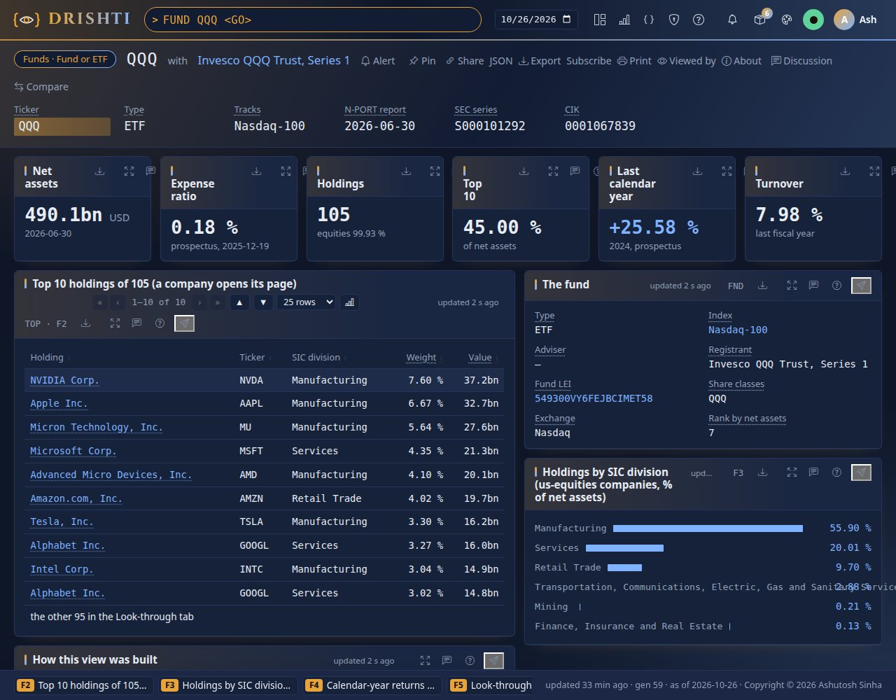

From top to bottom:

- **The strip**: ticker, type, the index it tracks, the date of its N-PORT report, its SEC series and CIK.
- **The tiles**: net assets (490.1bn USD on 2026-06-30), the expense ratio (0.18%, from the prospectus of 2025-12-19), holdings (105,
  equities 99.93%), the top 10's weight (45.00%), the last calendar-year return (+25.58% in 2024) and turnover (7.98%). A tile with no
  filed value (a unit investment trust files no prospectus summary) is left out, not shown empty.
- **Top 10 holdings** (F2): each holding links to its us-equities company (`USEQ NVDA`), or to another fund of the pack (a fund of
  funds); the line under it points to the other 95 in the Look-through tab.
- **The fund**: type, index (opens `IDX NDX`), adviser and fund LEI (open `LEI` when the gleif pack is on), registrant, every share
  class ticker, the exchange, the ETF's creation unit and authorised participants, its rank by net assets.
- **Holdings by SIC division** (F3): the us-equities companies held, by SIC division, in percent of net assets.
- **Calendar-year returns** (F4), **Flows and returns, three months** (sales, redemptions, net flow and the class's monthly return;
  totals) and **Service providers** (custodian, auditor, administrator, transfer agent, sub-advisers, the census period).

The types: **ETF**; **Mutual fund**; **Mutual fund with an ETF share class** (Vanguard's funds: `FUND VOO` is the Vanguard 500 Index
Fund, whose share classes are VOO, VFINX, VFIAX and VFFSX); **ETF (unit investment trust)** (SPY, DIA). The fund's ticker is its ETF
class where it has one, else its oldest class; `FUND VFIAX` opens VOO (section 7).

`FUND VOO` is the second-largest fund: 1,671.2bn of net assets, 520 holdings, expense ratio 0.03%, +17.84% in 2025, flows of +28.5bn,
+15.8bn and −8.5bn in April to June 2026, custodian State Street Bank and Trust Company, auditor PricewaterhouseCoopers.

### 3. The Look-through holdings tab

The first tab is the look-through: what the fund holds, all of it, and who it is exposed to.

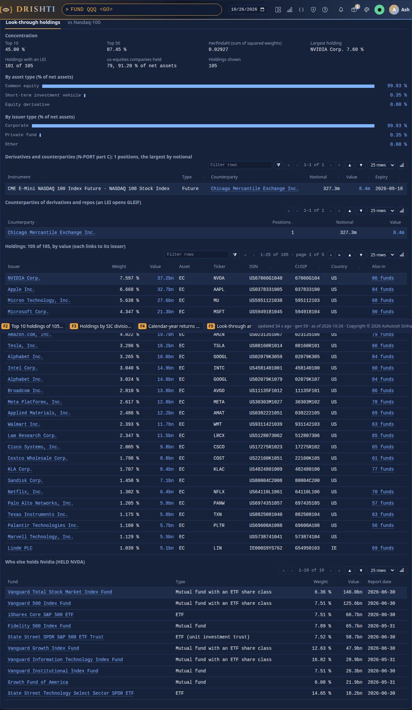

- **Concentration**: top 10 and top 50 weights, the Herfindahl index (the sum of squared weights: 0.029 for QQQ), the largest holding,
  how many holdings carry an issuer LEI (101 of 105), the us-equities companies held and their weight, and how many holdings are shown.
- **By asset type** and **By issuer type**: N-PORT's asset categories (common equity, debt, repo, derivatives ...) and issuer types
  (corporate, US Treasury, municipal, registered fund ...).
- **Derivatives and counterparties**: the largest 50 positions by notional, each with its counterparty (an LEI opens GLEIF) and
  expiry. QQQ holds one: a NASDAQ-100 future, 327.3m notional, cleared at the Chicago Mercantile Exchange. A bond fund (`FUND PONAX`,
  the PIMCO Income Fund) shows the largest of its 1,730 swaps and forwards, with 38 counterparties.
- **Counterparties of derivatives and repos**: per counterparty, positions, notional and value.
- **Holdings**: every holding kept (a fund keeps its 600 largest by value, every S&P 500 fund whole; the line above says how many
  others there are and their weight), paged and filterable: issuer (a link to its company, fund or LEI), weight, value, asset category,
  ticker, ISIN, CUSIP, country, and **Also in**: how many other funds of the pack hold the same company (opens `HELD`).
- **Who else holds** the fund's largest us-equities company: the ten other funds holding it the most (QQQ: NVIDIA).

### 4. The fund against its index

The second tab compares the fund with the index it tracks; an equity fund that tracks none of the pack's indexes is compared with the
S&P 500 for reference (`FUND AGTHX`, the Growth Fund of America: active share 44%), and the tab's title says so.

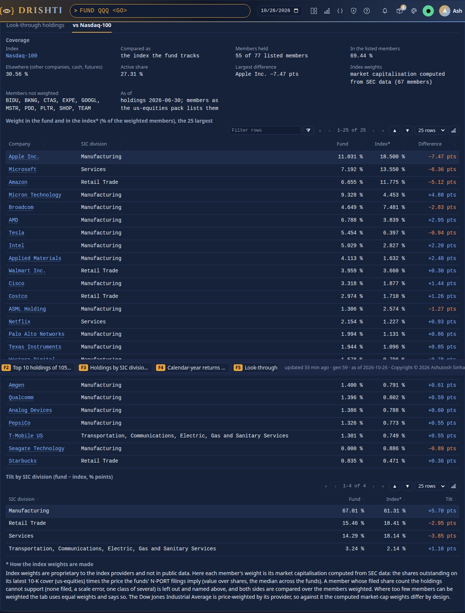

- **Coverage**: the index, members held of those listed, the weight in the listed members and elsewhere, the **active share** (half
  the sum of the weight differences), the largest difference, how the index weights are made and which members are not weighted.
- **Weights** of the 25 largest companies in the fund and in the index, and the difference.
- **Tilt by SIC division**: fund, index and the difference in percentage points.

**Index weights are proprietary** to the index providers and not in public data. The tab computes them from SEC data: each member's
market capitalisation is its shares outstanding on its latest 10-K cover (us-equities `SHARES_OUTSTANDING`) times the price the funds'
N-PORT filings imply (value over shares, the median across the funds). A member whose filed share count the holdings cannot support
(none filed, a scale error, one class of several: the funds would own under 0.2% or over 80% of it) is left out and named, and both
sides are compared over the members weighted; with fewer than 70% weighted, equal weights are used and the tab says so. The
Nasdaq-100 caps its largest members (its published method: a member over 24% is cut to 20%, and members over 4.5% that weigh more than
48% together are cut to 40%), and the tab applies the same caps; the Dow Jones Industrial Average weighs its members by share price,
and so does the tab (`FUND DIA`: active share 1.8%). The members are the us-equities pack's: what the index's tracking ETF (SPY, QQQ,
DIA) reported holding in its newest N-PORT. An S&P 500 fund still shows an active share of about 5.3% rather than 0 (`FUND VOO`
holds 493 of the 495 members) because 41 members have no share count the filings support (Alphabet, Meta, Berkshire Hathaway among
them) and are left out of the weights; `FUND QQQ` shows 11.2% for the same reason (15 of its 99 members). Wikidata's member lists are
from Wikidata, whose lists were out of date (QQQ then showed 26.75%).

### 5. Held by funds: HELD and the company page

`HELD AAPL` lists every fund of the pack that holds Apple, by value, counting every holding (not only the 600 a fund page keeps):

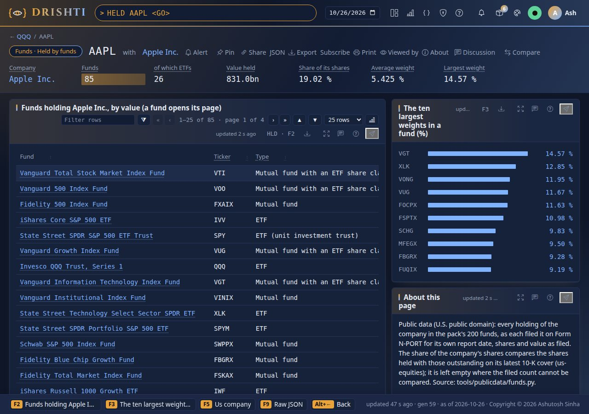

The strip: 85 funds (26 ETFs) hold 831.0bn of Apple, **19.02% of its shares outstanding**, at an average weight of 5.425% and at most
14.57% (a technology sector fund). The table: fund (opens it), type, Apple's weight in it, value, shares and the report date; on the
right, the ten largest weights. The share of shares outstanding is left empty for a company whose filed share count cannot be compared.

With the funds pack on, the company page `USEQ AAPL` has two tabs under its financials and filings: **Held by funds** (the same table)
and **Fund ownership** (the strip's figures, with a link to `HELD AAPL`). They read the funds pack's `fund-holder` record as their
source; with the pack off they say so.

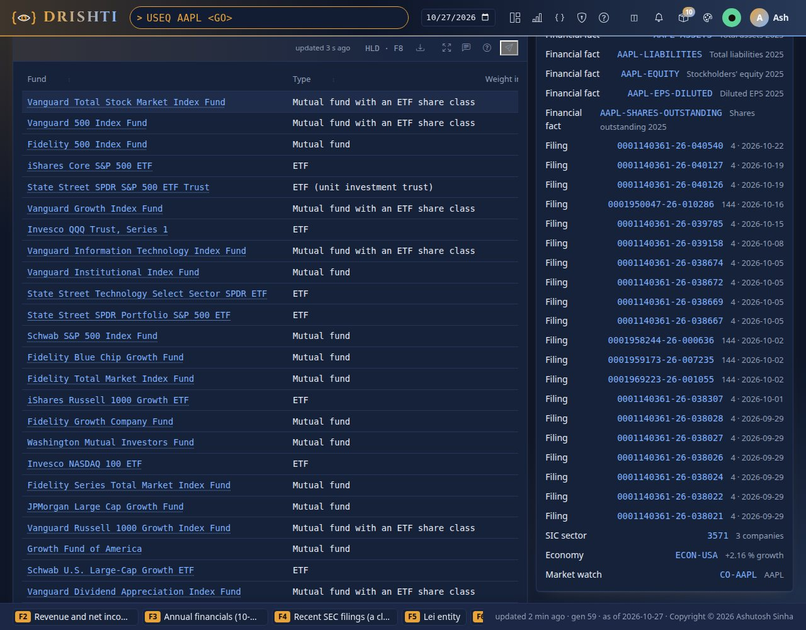

### 6. Funds tracking an index: TRACK and the index page

`TRACK SP500` lists the funds that track the S&P 500 by net assets: seven, four of them ETFs, 4,821.3bn together, with each one's
expense ratio, members held and active share against the computed index weights.

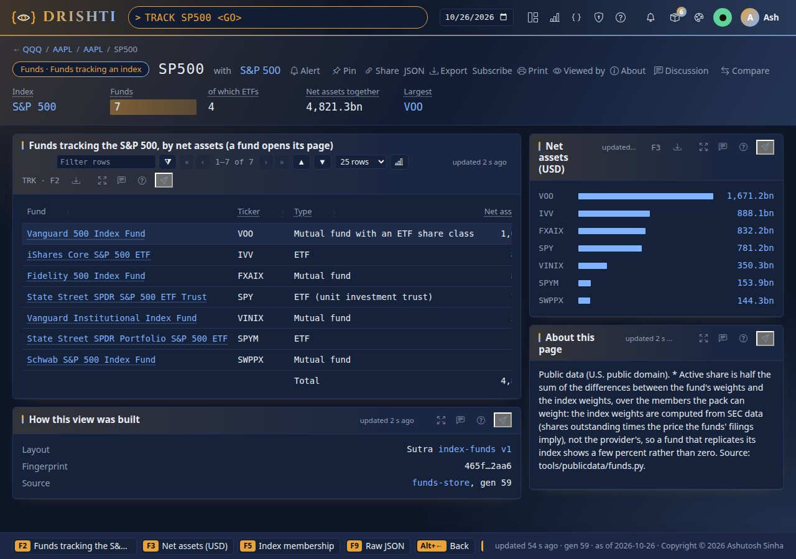

A fund tracks an index when its name names it (`S&P 500`, `500 Index`, `Nasdaq-100`, `QQQ`, `Dow Jones Industrial`), without a style
or a screen (Growth, Value, Equal Weight, ESG ...); N-CEN says whether a fund is an index fund, but not which index. `TRACK NDX` has
QQQ, QQQM and TQQQ (leveraged, but tracking the Nasdaq-100); `TRACK DJIA` has DIA. The index page `IDX SP500` shows the same list on
the right, **ETFs and funds tracking it** (F4); the bank lists (`IDX BANKS-US` ...) have none.

### 7. Commands, search, command line and API

| Type | Opens | Examples |
|---|---|---|
| `FUNDS` | the pack's overview | `FUNDS` |
| `FUND <ticker>` | a fund: the fact sheet and its tabs; any share class ticker opens its fund | `FUND QQQ`, `FUND VTI`, `FUND VTSAX` (opens VTI), `FUND SPY`, `FUND AGG` |
| `FUND <field>=<value>` | a pick list of funds | `FUND INDEX_ID=SP500`, `FUND TYPE=ETF`, `FUND EXPENSE_RATIO<0.05`, `FUND NET_ASSETS>500bn` |
| `HELD <ticker>` | the funds holding a us-equities company | `HELD AAPL`, `HELD NVDA` |
| `TRACK <index>` | the funds tracking a us-equities index | `TRACK SP500`, `TRACK NDX`, `TRACK DJIA` |
| `FORM funds` | the pack's search form (ticker, name, share class tickers, type, adviser, index, net assets, expense ratio, holdings) | |

Typing `FUND vang` offers the Vanguard funds; `FUND VTSAX` offers VTI (the type-ahead matches every share class ticker, `TICKERS`), and
pressing Enter on it opens VTI. The function keys of the FUND page: F2 top holdings, F3 sectors, F4 returns, F5 the tabs, F6 the funds
holding the largest company, F7 the funds tracking the index, F9 the raw document.

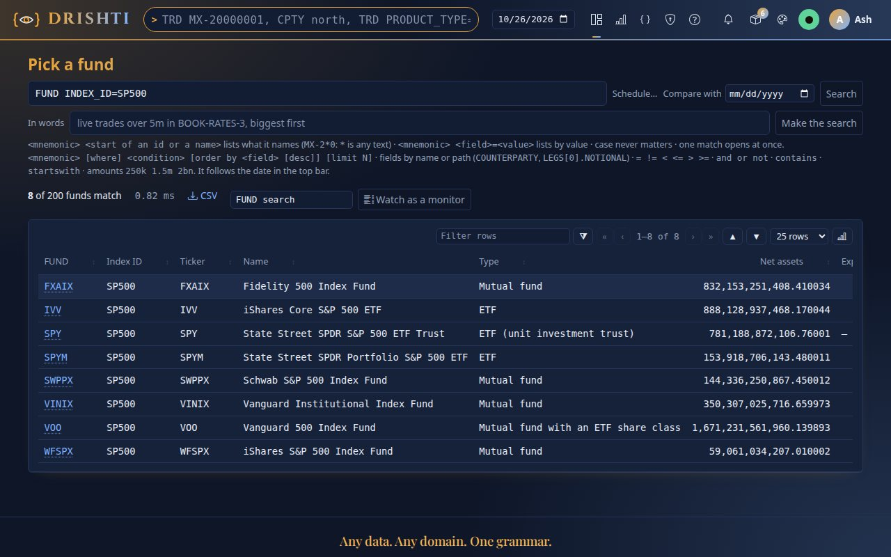

**Command line** (`DRISHTI_SERVER` and `DRISHTI_TOKEN` set, or `--user` with sign-in off):

```bash
python3 tools/drishti.py view get fund/QQQ              # the page as text: tiles, tables, tabs
python3 tools/drishti.py view get fund-holder/AAPL
python3 tools/drishti.py view get index-funds/SP500
python3 tools/contracts.py show FUND                    # the kind's contract
```

```text
$ drishti.py view get index-funds/SP500
Funds · Funds tracking an index  SP500  with S&P 500   [TRACK]

Key figures
  figure               value
  -------------------  ---------
  Index                S&P 500
  Funds                7
  of which ETFs        4
  Net assets together  4,821.3bn
  Largest              VOO

Funds tracking the S&P 500, by net assets (a fund opens its page)  (table, trackers, F2)
  Fund                                     Ticker  Type                                 Net assets  Expense ratio  Members held  Active share*
  Vanguard 500 Index Fund                  VOO     Mutual fund with an ETF share class   1,671.2bn         0.03 %           493         5.29 %
  iShares Core S&P 500 ETF                 IVV     ETF                                     888.1bn         0.03 %           493         5.29 %
  Fidelity 500 Index Fund                  FXAIX   Mutual fund                             832.2bn         0.01 %           487         5.41 %
  ...
```

**API**: `GET /api/v1/views/fund/QQQ` (the page), `GET /api/v1/entities/fund/QQQ/raw` (the document), `GET
/api/v1/search?q=FUND%20INDEX_ID%3DSP500` (a search), `GET /api/v1/command/suggest?q=FUND%20VTSAX` (the type-ahead), as the
[API guide](API_REFERENCE.md) describes; every call takes the caller's token and the business date.

## Part II · The data contracts

The contracts are `config/packs/capitalmarkets/funds/contracts/<kind>.contract.yaml` (checked by `python3 tools/contracts.py check`, published as
[docs/contracts/packs/funds.md](../contracts/packs/funds.md)); each column's meaning is the pack's glossary,
`config/packs/capitalmarkets/funds/config/about.yaml`, written by `tools/packgen/funds/make.py` from `tools/packgen/funds/fundsglossary.py`. Every column's
type, key, meaning (with its unit) and source is the contract; a real record of the snapshot with every field explained is the kind's
example on [docs/contracts/samples/funds.md](../contracts/samples/funds.md). The sources are the SEC data sets' tables and columns:
**N-PORT** `FUND_REPORTED_INFO`, `FUND_REPORTED_HOLDING`, `IDENTIFIERS`, `MONTHLY_TOTAL_RETURN`, the derivative tables of part C.11;
**N-CEN** `FUND_REPORTED_INFO`, `ETF`, `ADVISER`, `CUSTODIAN`, `AUTHORIZED_PARTICIPANT` ...; the **risk/return summary**'s XBRL tags
in `num.tsv`.

### 8. fund

One document per fund, keyed by `TICKER` (command `FUND`), 200 documents; stored as the Delta table `<root>/funds/fund/` with the
promoted columns `TICKER, NAME, TYPE, TICKERS, ADVISER, INDEX_ID, NET_ASSETS, EXPENSE_RATIO, HOLDING_COUNT, REPORT_DATE, RANK` (the
search form and the type-ahead read them; the type-ahead also `NAME` and `TICKERS`). Links: a holding's `COMPANY` to `USEQ`
(us-company), `FUND` to another `FUND`, `LEI`, `ADVISER_LEI`, `CUSTODIAN_LEI` and a counterparty's `CPTY_LEI` to `LEI` (gleif's
lei-entity), `INDEX_ID` to `IDX` (index-membership).

**Fields and example.** Every field (its type, whether it is required, its unit, its meaning and the checks on it) is the kind's data contract, [`fund.contract.yaml`](../../config/packs/capitalmarkets/funds/contracts/fund.contract.yaml), published as [FUND: `fund`](../contracts/packs/funds.md#fund-fund-or-etf-fund); a real record of the test data with every field explained is its [example](../contracts/samples/funds.md#fund).

### 9. fund-holder

One document per us-equities company held by at least one fund, keyed by the company's `TICKER` (command `HELD`), 586 documents. Built
from every holding of every fund (not only those a fund page keeps): a holding is the company when its ticker is the company's, else
(an equity) when its CUSIP is one some fund filed with the company's ticker, its issuer LEI is the company's, or its issuer name is the
company's (legal suffixes and punctuation aside).

**Fields and example.** Every field (its type, whether it is required, its unit, its meaning and the checks on it) is the kind's data contract, [`fund-holder.contract.yaml`](../../config/packs/capitalmarkets/funds/contracts/fund-holder.contract.yaml), published as [HELD: `fund-holder`](../contracts/packs/funds.md#held-funds-holding-a-company-fund-holder); a real record of the test data with every field explained is its [example](../contracts/samples/funds.md#fund-holder).

### 10. index-funds

One document per us-equities index that at least one fund tracks, keyed by `INDEX` (command `TRACK`): SP500, NDX, DJIA.

**Fields and example.** Every field (its type, whether it is required, its unit, its meaning and the checks on it) is the kind's data contract, [`index-funds.contract.yaml`](../../config/packs/capitalmarkets/funds/contracts/index-funds.contract.yaml), published as [TRACK: `index-funds`](../contracts/packs/funds.md#track-funds-tracking-an-index-index-funds); a real record of the test data with every field explained is its [example](../contracts/samples/funds.md#index-funds).

### 11. Validation and conventions

- **Units.** Amounts are US dollars as N-PORT reports them (`CURRENCY_VALUE`, net assets, flows); weights, ratios and returns are in
  percent as filed (a weight of 7.1 is 7.1% of net assets; an expense ratio of 0.03 is 0.03%). A holding's `BALANCE` is in its `UNIT`
  and a derivative's `NOTIONAL` in the currency filed; neither is converted.
- **Dates.** `REPORT_DATE` is the date the N-PORT report is as of; funds' dates differ (their fiscal quarters end in different
  months), so a comparison across funds compares reports a month or two apart. The snapshot is the same on every business day of the
  lake (`dated-by: snapshot`).
- **Checks.** `tools/contracts.py check` fails when a contract and its pack or data disagree; `tools/packgen/funds/make.py --check`
  fails when the committed snapshot, samples, README, glossary or pack guide differ from what the generator writes;
  `tools/testdata/test_testdata.py` fails when a committed data file is not gzipped or is over 5 MB.
- **Empty values.** An optional column is left out where the fund did not file it: N-CEN facts for a fund whose census is not among
  the four quarters read (7 of 200, among them QQQ, newly reorganised), fees and calendar-year returns for a fund without a
  risk/return summary (the unit investment trusts SPY and DIA), a tile with no value is not shown.

## Part III · Where the data comes from

### 12. The sources and their licences

| Source (`SOURCE` of the refresh script) | What it gives | Where | Licence |
|---|---|---|---|
| `nport` · SEC Form N-PORT data sets | holdings with CUSIP, ISIN, LEI, asset and issuer type, value and weight; derivatives with notional, expiry and counterparties; repos; flows; monthly returns per share class | `https://www.sec.gov/data-research/sec-markets-data/form-n-port-data-sets`, quarterly ZIP (about 450 MB; 32 tab-delimited tables documented in the data set's `nport_readme.htm` and the SEC's N-PORT readme PDF) | public domain (U.S. Government work) |
| `ncen` · SEC Form N-CEN data sets | ETF flag and facts (creation unit, exchange), index-fund flag, adviser, sub-advisers, custodian, administrator, transfer agent, auditor, authorised participants, share classes | `https://www.sec.gov/data-research/sec-markets-data/form-n-cen-data-sets`, quarterly ZIP (6 to 16 MB) | public domain |
| `rr` · SEC mutual fund prospectus risk/return summary data sets | net and gross expense ratio, management fee, portfolio turnover, calendar-year returns (`NetExpensesOverAssets`, `ExpensesOverAssets`, `ManagementFeesOverAssets`, `PortfolioTurnoverRate`, `AnnualReturnPercent` / `AnnlRtrPct`) | `https://www.sec.gov/data-research/sec-markets-data/mutual-fund-prospectus-riskreturn-summary-data-sets`, quarterly ZIP (25 to 80 MB) | public domain |
| `tickers` · SEC ticker files | share class tickers with their series and class ids (`company_tickers_mf.json`); a unit investment trust's ticker (`company_tickers_exchange.json`) | `https://www.sec.gov/files/` | public domain |
| `nasdaq` · Nasdaq Trader symbol directory | which tickers are ETFs, and where they list | `https://www.nasdaqtrader.com/dynamic/SymDir/` | public directory files |
| `gleif` · GLEIF golden copy, level 2 | a fund's relationships: managed by, sub-fund of (its umbrella), feeder to | `https://goldencopy.gleif.org` (reused from the gleif pack's cache when present) | CC0 1.0 |

The prospectus risk/return summary data sets were checked: they are published quarterly and carry the expense ratio, turnover and
the bar chart's calendar-year returns as XBRL facts per share class, so the pack uses them (1,032 share classes and series of the 200 funds have a
summary in the four quarters read; a few fund families file the bar chart under a custom tag and show no returns). The pack also reads
the committed us-equities snapshot (companies, their SIC divisions, LEIs and shares outstanding; index members). SEC asks for a
descriptive User-Agent with a contact and at most 10 requests a second: the refresh script uses exactly the us-equities pack's setting
(`DRISHTI_FEEDS_USER_AGENT`, else the default in `tools/packgen/us_equities/fetch.py`) and one request at a time. The External data page,
[WORLD_DATA_GUIDE.md](WORLD_DATA_GUIDE.md#funds), lists every source of every pack.

### 13. How the 200 are chosen

From the newest N-PORT data set: every fund's newest report in the quarter (an amendment wins over the report it amends; a notice of
late filing is skipped), ranked by **net assets** (`FUND_REPORTED_INFO.NET_ASSETS`). A fund needs a ticker: a share class in
`company_tickers_mf.json` (the fund's series id), or, for a unit investment trust without a series id (SPY, DIA), the listed ticker of
its registrant in `company_tickers_exchange.json`. The 200 largest with a ticker are kept: 117 mutual funds, 50 ETFs, 31 mutual funds
with an ETF share class and 2 unit investment trusts, from the Vanguard Total Stock Market Index Fund (2,297.8bn) to the Fidelity
Advisor Growth Opportunities Fund (35.3bn). Money market funds file Form N-MFP, not N-PORT, so none is among them; interval and
private-credit funds without a ticker are skipped. `--scope FUNDS:<n>` takes more or fewer.

### 14. How the documents are built

`tools/packgen/funds/make.py` builds every document offline from the downloads (`fundsread.py` streams the tables, `fundsbuild.py` builds):

1. The N-PORT tables are read once, in order: `SUBMISSION`, `REGISTRANT` and `FUND_REPORTED_INFO` choose the 200; then only their rows
   of `FUND_REPORTED_HOLDING` (411,796 of 5.6 million), `IDENTIFIERS` (ticker, ISIN), the derivative tables and `MONTHLY_TOTAL_RETURN`.
2. N-CEN (the newest four quarters, the newest report of each fund) and the risk/return summaries (the newest four quarters, the
   newest filing of each share class) add the census and the fees; GLEIF's relationship file adds the fund's manager and umbrella.
3. A holding is linked to its us-equities company (by ticker, else CUSIP, LEI or name), to another fund of the pack (by ticker), and
   to its LEI. The holdings are sorted by value; a fund keeps its 600 largest (`--scope HOLDINGS:<n>`), with the count, weight and
   value of the rest.
4. The groupings (asset type, issuer type, country, SIC division), concentration, flows and counterparties are worked out; then the
   reverse look-through (`fund-holder`) from every holding of every fund; then the index weights and each fund's comparison (section
   4); then the funds tracking each index.
5. `tools/testdata/publicsnap.py` writes each kind as gzipped JSON Lines, the fund kind in parts of about 1.2 MB, and lists them in
   `data/testdata/testdata.yaml`; the generator also writes `samples/` (QQQ, AAPL and NDX as reference documents), the README, the
   glossary and the pack guide.

### 15. The refresh script

`drishti.py feed run funds` (with `tools/feeds/feed.sh run funds` and `tools\windows\publicdata-funds.ps1`) takes the same commands and
options as every public-data script: `status`, `refresh --dry-run`, `refresh [SOURCE ...]`, with `--since YEAR`, `--years N`,
`--scope FUNDS:<n>,HOLDINGS:<n>`, `--offline`, `--cache DIR`, `--max-age HOURS` (a week by default), `--pause`, `--no-check`,
`--into-pack`.

On Linux and macOS:

```bash
tools/feeds/feed.sh run funds status                                # offline: the committed funds, each source's licence, last refresh, cache size
tools/feeds/feed.sh run funds --dry-run                     # the quarters and files a refresh would fetch; changes nothing
tools/feeds/feed.sh run funds --snapshot                               # download (about 700 MB the first time), build, check
tools/feeds/feed.sh run funds --snapshot --offline                     # rebuild from the downloads only
tools/feeds/feed.sh run funds --snapshot ncen rr --since 2025          # every census and summary quarter since 2025
tools/feeds/feed.sh run funds --snapshot --scope FUNDS:300,HOLDINGS:1000   # a wider build in <data>/datafeeds/sources/funds
python3 tools/drishti.py lake demo                              # then rebuild the lake
```

```text
$ tools/feeds/feed.sh run funds status
committed pack: 200 funds in 5 parts, data retrieved 2026-10-26
SOURCE   LICENCE                                           USE          LAST REFRESHED       CACHED
tickers  Public domain (U.S. Government work); SEC fair a  committable  2026-10-26T19:37:15  1.7 MB
nasdaq   Public symbol directory files (Nasdaq Trader)     committable  2026-10-26T19:37:15  871.4 KB
nport    Public domain (U.S. Government work); SEC fair a  committable  2026-10-26T19:12:40  441.0 MB
ncen     Public domain (U.S. Government work); SEC fair a  committable  2026-10-26T19:37:15  36.4 MB
rr       Public domain (U.S. Government work); SEC fair a  committable  2026-10-26T19:37:15  187.4 MB
gleif    CC0 1.0                                           committable  2026-10-26T19:37:15  23.4 MB
```

On Windows (PowerShell, from the repository folder; Python only, nothing to install):

```powershell
.\tools\windows\publicdata-funds.ps1 status
.\tools\windows\publicdata-funds.ps1 refresh --dry-run
.\tools\windows\publicdata-funds.ps1 refresh
python tools\build_demo_lakes.py --only funds
```

The dry run names every request and writes nothing:

```text
$ tools/feeds/feed.sh run funds --dry-run
dry run: funds, sources tickers, nasdaq, nport, ncen, rr, gleif
  tickers (Public domain (U.S. Government work); SEC fair access policy; committable): 2 request(s), cache <data>/datafeeds/sources/cache/funds
    https://www.sec.gov/files/company_tickers_mf.json
    https://www.sec.gov/files/company_tickers_exchange.json
  nport (Public domain (U.S. Government work); SEC fair access policy; committable): 3 request(s), cache <data>/datafeeds/sources/cache/funds
    https://www.sec.gov/files/dera/data/form-n-port-data-sets/2026q3_nport.zip
    https://www.sec.gov/files/dera/data/form-n-port-data-sets/2026q2_nport.zip
    https://www.sec.gov/files/dera/data/form-n-port-data-sets/2026q1_nport.zip
  ...
  then: tools/packgen/funds/make.py -> config/packs/capitalmarkets/funds and data/testdata; then make.py --check
```

A quarterly source tries the newest quarters first and takes the published ones (N-PORT one, N-CEN and the summaries four); a quarter
not yet published answers 404 and is passed over. The downloads go to `<data>/datafeeds/sources/cache/funds` (`DRISHTI_DATA_DIR`, else the
repository's git-ignored `data/`), each recorded in `cache-index.json` with its URL, time, size and checksum; the run is recorded in
`<data>/datafeeds/sources/funds/manifest.json`. A widened build goes to `<data>/datafeeds/sources/funds` (`packs/funds`, `testdata/funds`); only
`--into-pack` writes it over the committed pack.

### 16. The gzipped snapshot and offline use

The committed data is small and gzipped, so a clone (and a Windows checkout) stays light: `data/testdata/funds/fund/fund.tar` holds five
parts of about 1 MB (`fund/2026-10-26/snapshot.part-01.jsonl.gz` to `part-05`: a tar of date folders, the load rules' form for a date in
several files), `fund-holder/` and `index-funds/` one file each (`fund-holder.2026-10-26.jsonl.gz`), **5.6 MB in all**.
`tools/testdata/test_testdata.py` fails if any data file under `data/testdata` is not gzipped JSON Lines (alone or in a tar) or a file of
rows is over 5 MB. The downloads
(about 700 MB) never enter git.

Offline, nothing is fetched: `python3 tools/drishti.py lake demo` builds the three tables from the committed snapshot (86 tables in the whole demo lake), and the server reads them with offline mode on. `refresh --offline` rebuilds the pack from the downloads already in
the cache; without them, `python3 tools/packgen/funds/make.py --check` checks the committed snapshot against what it derives (the
samples, README, glossary and guide).

### 17. What is not included

- **Prices and NAV history.** There is no free official source; the pack needs none (the index weights use the prices the filings
  imply). Yahoo Finance prices exist only through the us-equities pack's internal-only, off-by-default connector.
- **Index weights** (proprietary): computed from SEC data, as section 4 says.
- **Non-US funds, money market funds** (Form N-MFP), and funds without a ticker.
- **More than 600 holdings a fund** in the fund documents (the reverse look-through counts them all); `--scope HOLDINGS:<n>` keeps
  more in a widened build.

### 18. Funds data: every dataset the pages read

Every dataset the funds pages reads, what it is for, whether it is required, where its sample lives, and the links to its two homes: its **data contract** (the fields, the key, the rules: the pack's contract page and its `<kind>.contract.yaml`) and its **example** (a real record of the shipped synthetic test data, every field explained, on [docs/contracts/samples](../contracts/samples/README.md)). This guide copies neither. How files are named, dated and loaded is
[DATA_LAKE_GUIDE.md](DATA_LAKE_GUIDE.md#5-routing-business-dates-modes-repeats-and-undo).

<!-- The block below is generated by tools/docs/guide_data.py from tools/docs/guide_data.yaml: edit the spec, not the block. -->
<!-- guide-data:begin funds -->
#### 18.1 At a glance

| Dataset (kind) | What it is for | Required? | Sample files (`data/testdata/…`) | Guide |
|---|---|---|---|---|
| [`fund`](#182-fund-the-funds-fact-sheet-and-holdings) | the FUND page, its holdings and look-through | **yes** | `funds/fund/fund.tar` | [8](#8-fund) |
| [`fund-holder`](#183-fund-holder-who-holds-a-company) | the funds holding each issuer | for HELD and the company page | `funds/fund-holder/fund-holder.*.jsonl.gz` | [9](#9-fund-holder) |
| [`index-funds`](#184-index-funds-funds-tracking-an-index) | the funds tracking each index | for TRACK and the index page | `funds/index-funds/index-funds.*.jsonl.gz` | [10](#10-index-funds) |

#### 18.2 `fund`: the fund's fact sheet and holdings

One document per fund: its identity, share classes, fees, returns and its holdings, the FUND page and the Look-through holdings tab.

- **Data contract:** [`fund`](../contracts/packs/funds.md#fund-fund-or-etf-fund) (FUND), key `TICKER`; 88 fields, 60 required; the file [`fund.contract.yaml`](../../config/packs/capitalmarkets/funds/contracts/fund.contract.yaml).
- **Example:** [a real record of the test data, every field explained](../contracts/samples/funds.md#fund) (files `data/testdata/funds/fund/fund.tar`).

#### 18.3 `fund-holder`: who holds a company

One row per held company: the funds that hold it and how much, read by HELD and the company page's Held by funds panel.

- **Data contract:** [`fund-holder`](../contracts/packs/funds.md#held-funds-holding-a-company-fund-holder) (HELD), key `TICKER`; 16 fields, 14 required; the file [`fund-holder.contract.yaml`](../../config/packs/capitalmarkets/funds/contracts/fund-holder.contract.yaml).
- **Example:** [a real record of the test data, every field explained](../contracts/samples/funds.md#fund-holder) (files `data/testdata/funds/fund-holder/fund-holder.*.jsonl.gz`).

#### 18.4 `index-funds`: funds tracking an index

One row per index: the funds that track it, read by TRACK and the index page.

- **Data contract:** [`index-funds`](../contracts/packs/funds.md#track-funds-tracking-an-index-index-funds) (TRACK), key `INDEX`; 8 fields, 8 required; the file [`index-funds.contract.yaml`](../../config/packs/capitalmarkets/funds/contracts/index-funds.contract.yaml).
- **Example:** [a real record of the test data, every field explained](../contracts/samples/funds.md#index-funds) (files `data/testdata/funds/index-funds/index-funds.*.jsonl.gz`).
<!-- guide-data:end -->

## External data feeds

How Drishti pulls external data (GLEIF, the SEC, the IMF, the World Bank, central banks, news) and loads it into its lakes, every day,
from the command line or a scheduler. One module does it all, **drishti-feeds**: a feed pulls its source in Python, writes what it
pulled as JSON Lines, one gzipped file per dataset and business date, and hands the files to the loaders Drishti already has.

Sections 1 to 10 run, schedule, watch and write the feeds; sections 11 to 16 are the sources themselves: each external source of
every pack, its licence, whether it may leave the organisation, what its feed writes and how to check it. The lakes, the `.ready`
file and the data inbox are the [data lake guide](DATA_LAKE_GUIDE.md).

!!! warning "Internal use only: IMF data and Yahoo prices"
    Two kinds of external data are for **internal demonstrations only**: the **IMF World Economic Outlook** figures in the
    world-economy pack (the IMF's terms need its permission for commercial reuse) and anything from **Yahoo Finance** (quotes and
    price history: Yahoo's terms forbid redistribution), together with the **Google News** headlines (they belong to their publishers).
    Their feeds (`world-economy`, `news-and-markets`, `yahoo-prices`) are marked internal only: they load the bank's own lakes, and
    `--snapshot` never writes them into a committed folder unless you pass `--internal-ok`. Raise it with the owner before any client
    or external use, or pull without them (`drishti.py feed run world-economy -- --no-imf`; leave `yahoo-prices` off).

### Contents

1. [The module](#1-the-module)
2. [The feeds](#2-the-feeds)
3. [Run a feed](#3-run-a-feed)
4. [Loading: three routes](#4-loading-three-routes)
5. [Run it every day](#5-run-it-every-day)
6. [Monitor: status, the ledger, Admin → Feeds, alerts](#6-monitor-status-the-ledger-admin--feeds-alerts)
7. [The feed file, every key](#7-the-feed-file-every-key)
8. [Writing a feed](#8-writing-a-feed)
9. [Licences and internal-only data](#9-licences-and-internal-only-data)
10. [Tests](#10-tests)
11. [Every external source at a glance](#11-every-external-source-at-a-glance)
12. [A source's own options](#12-a-sources-own-options)
13. [Worked examples](#13-worked-examples)
14. [How external data reaches the server](#14-how-external-data-reaches-the-server)
15. [The sources, pack by pack](#15-the-sources-pack-by-pack)
16. [Not covered](#16-not-covered)

### 1. The module

drishti-feeds is the Python package `tools/feeds/` beside the other command-line tools, with one feed file per feed in
`config/feeds/`. It is a package of the tools rather than a Maven module because the pull is Python (every source is an HTTP API or a
bulk file that Python reads with its standard library) and the load is not new code at all: the module calls `drishti.py lake build`,
which runs the parallel loader in the server's jar, or drops files into the data inbox. Nothing in it writes a lake.

| Part | File | Does |
|---|---|---|
| the Feed base class, the feed file, one run's files | `tools/feeds/feedbase.py` | section 8; checks `config/feeds/<feed>.yaml` (section 7) |
| one run end to end, the run ledger | `tools/feeds/feedrunner.py` | lock → pull → files → check → load → state → ledger → one log line |
| the three load routes | `tools/feeds/feedload.py` | section 4 |
| the schedule entries | `tools/feeds/feedschedule.py` | section 5 |
| the command line | `tools/feeds/cli.py` | `drishti.py feed list|run|status|schedule` |
| the polite HTTP client and download cache | `tools/feeds/pullkit.py` | User-Agent, pause, retries with back-off, `Retry-After`, the cache |
| each source's pull | `tools/feeds/sources/<module>.py` | one module per source (a feed file's `class:`) |
| the wrappers | `tools/feeds/feed.sh`, `tools/windows/feed.ps1` | what cron, systemd and Task Scheduler run |

Every external source of the packs is pulled this way: each pack's source module in `tools/feeds/sources/` (gleif, us-equities, funds,
world-economy, news-and-markets, market-data) is a feed's pull, and the same module refreshes its pack's committed demo snapshot with
`feed run <feed> --snapshot` (section 3.4). There is one way to pull external data.

**Where things are written**, all under the data folder (`DRISHTI_DATA_DIR`, else `./data`; never committed):

```text
data/datafeeds/
├── ledger.jsonl                                    one line per run, every feed (section 6)
└── gleif/
    ├── state.json                                  what the feed has pulled (section 3.2)
    ├── cache/                                      the downloads as served, with cache-index.json (a broken run resumes from it)
    ├── 2026-11-07/
    │   ├── manifest.json                           the files with their rows and SHA-256, the licence, the run
    │   ├── lei-entity.2026-11-07.jsonl.gz          <table>.<YYYY-MM-DD>.jsonl.gz: the load rules' name (table and date)
    │   ├── lei-relationship.2026-11-07.jsonl.gz
    │   └── lei-mapping.2026-11-07.jsonl.gz
    └── loads/<run>/                                the loader's summaries of each run
```

### 2. The feeds

| Feed | Source | Datasets (pack: kinds) | Lake | Use | Daily at |
|---|---|---|---|---|---|
| `gleif` | GLEIF golden copy, LEI API, mapping files | gleif: lei-entity, lei-relationship, lei-mapping | `referencelake` | CC0, redistributable | 05:30 |
| `funds` | SEC Form N-PORT, N-CEN, risk/return summaries; Nasdaq Trader; GLEIF | funds: fund, fund-holder, index-funds | `capitalmarket` | public domain | 06:15 |
| `world-economy` | World Bank WDI (read from the world-development feed's output, never the API), WGI and country list; IMF WEO, UNDP HDI, CIA Factbook | world-economy: economy, macro-indicator, economic-forecast, labour-market, fiscal-position, region-economy, jurisdiction, party, office-holder, election, region, social-indicator | `worldlake` | **internal only** (the IMF forecasts) | 06:45 |
| `us-equities` | SEC EDGAR; index members from SPY, DIA, QQQ and IWM N-PORT holdings (S&P 500, Dow 30, Nasdaq-100, Russell 2000); Nasdaq Trader; GLEIF; Wikidata | us-equities: us-company, index-membership, filing-feed, filing, financial-fact | `capitalmarket` | public domain, CC0 | 07:00 |
| `news-and-markets` | Yahoo Finance quotes, Google News headlines (through Drishti's own live connectors) | news-and-markets: quote, news | `newslake` | **internal only** | 07:30 |
| `market-data` | ECB euro reference rates, US Treasury par curve, SOFR, euro short-term rate | market-data: fx-spot, ir-curve, rate-fixing (each under its own date) | `capitalmarket` | attribution | weekdays 18:30 |
| `yahoo-prices` | Yahoo Finance daily prices of the us-equities companies (through a running server's connector) | us-equities: price-history | `capitalmarket` | **internal only**, off as shipped | weekdays 22:30 |

Each source has one fetcher: the World Bank's development indicators (WDI) are pulled only by the public sector's world-development
feed, which takes every `kind: wdi` code of `tools/realdata/sources.yaml` (and the World Bank's world, region and income-group
aggregates) into its development-series. world-economy, and its committed demo snapshot (`--snapshot`), read them from that feed's
latest output in `<data>/datafeeds/world-development/<date>/` and never call the WDI API; with no such output the run fails in words:
`run feed run world-development first`. Feeds run in the order of their schedule, so world-development (06:30) runs before
world-economy (06:45), as funds runs before us-equities: its N-PORT download cache gives us-equities its index members.

`drishti.py feed list` prints the same from the feed files. Each feed's source, data contract (with JSON examples) and licence are its
pack's README and the [External data](WORLD_DATA_GUIDE.md) page.

### 3. Run a feed

```bash
python3 tools/drishti.py feed run gleif
```

```text
fetch golden
...
  loaded lei-entity 2026-11-07: 1,204 rows into lake referencelake (java)
2026-11-07T06:30:41-05:00 feed ok exit=0 feed=gleif date=2026-11-07 files=3 rows=4,377 load=java loaded=4,377 seconds=41.2
```

The last line is the run's **one log line**: what a scheduler's mail or the journal shows. The same in PowerShell:
`.\tools\windows\feed.ps1 run gleif`.

| Option | Means |
|---|---|
| `<feed>` or `--all` | one feed, or every enabled feed one after another |
| `--date YYYY-MM-DD` | the business date (default today) |
| `--since YYYY-MM-DD` | pull history from this date (default: the day after the state's last date; section 3.2) |
| `--load java\|python\|inbox\|none` | the load route (default: the feed file's `load:`, `java` as shipped; section 4) |
| `--lake NAME` | load into this lake instead of the feed file's |
| `--dry-run` | say what would be fetched and loaded; nothing changes, no ledger line |
| `--snapshot` | refresh the committed demo snapshot instead (section 3.4) |
| `--offline` | the download cache only; nothing is fetched |
| `--set NAME=VALUE` | override an option of the feed file (`--set indicators='["NY.GDP.MKTP.CD"]'`) |
| `-- ARGS` | arguments for the source itself (`feed run gleif -- --scope GROUP:784F5XWPLTWKTBV3E584`) |
| `--inbox DIR`, `--lake-root DIR`, `--jar`, `--java`, `--signal URL`, `--token-file` | for the load routes (section 4) |
| `--json` | the run's ledger entry as JSON |

#### 3.1 Exit codes

| Code | Means | A scheduler should |
|---|---|---|
| 0 | ok: pulled, written, loaded | nothing |
| 1 | failed: the pull (after its retries), the feed's check or the load; the error in words | alert (Drishti already did, section 6) |
| 2 | refused: a bad feed file, a key's variable not set, an unknown feed, internal-only data into a committed folder | fix the setting |
| 3 | another run of the feed holds its lock (`data/datafeeds/<feed>/run.lock`) | nothing; the next day's run |
| 4 | partial: some feeds of `--all` failed, or the load rejected rows | look at `feed status` |

#### 3.2 Incremental pulls, resume and re-runs

- **State.** `data/datafeeds/<feed>/state.json` records, per dataset, the last business date pulled. The next run asks the source only for
  what is newer (`run.window()`, section 8). The state is saved **only when the whole run succeeded**, so a failed run is pulled again
  from the same point. The first run of a feed pulls `history.first-run-days` (30) days; `--since` pulls any history.
- **Resume.** Every download goes through the cache `data/datafeeds/<feed>/cache/` (`cache-hours`, 12 by default); a run that broke half way
  reuses what it fetched and asks only for the rest.
- **Re-runs are idempotent.** A run writes each date's files to a work folder and then replaces the date's folder whole; every route
  loads with replace-by-date. Running the same date twice leaves the same files and the same rows in the lake.
- **Rate limits.** `source.pause` seconds between requests; `source.retries` retries after 2, 4, 8 … seconds on 429, 5xx and network
  errors, or after the server's `Retry-After`.

#### 3.3 The User-Agent and keys

Every request carries one User-Agent: `DRISHTI_FEEDS_USER_AGENT`, else the default `Drishti ajsinha@gmail.com` (Drishti and a contact,
as the SEC asks of everyone who reads EDGAR; GLEIF and the other sources get the same). Set it to your organisation's contact in
production:

```bash
export DRISHTI_FEEDS_USER_AGENT="Example Bank market data team marketdata@bank.example"
```

A key (an API key, a token) is only ever an environment variable named in the feed file (`keys:`, section 7); a key written in a file
is refused, and a feed whose key's variable is not set exits 2 naming it.

#### 3.4 `--snapshot`: the committed demo snapshot

A feed whose pack ships a committed snapshot (the demo data in `data/testdata/<pack>/`) refreshes it with `--snapshot`: the pack's
generator writes its files where they live (the samples and guide, `data/testdata/<pack>/`), its check runs, nothing is loaded. Internal-only data
(section 9) is written into the repository only with `--internal-ok`.

```bash
python3 tools/drishti.py feed run gleif --snapshot          # config/packs/core/gleif (samples, guide) and data/testdata/gleif
python3 tools/drishti.py lake demo                          # then rebuild the demo lake from it
```

### 4. Loading: three routes

None of the routes writes a lake itself; each hands the run's files to what Drishti already has, and each replaces the business dates it
loads.

| Route | What runs | Needs | Use it when |
|---|---|---|---|
| `java` (default) | `drishti.py lake build --engine java`: the parallel loader `com.ash.drishti.lakeload.LakeLoad` from the server's exec jar (`-Dloader.main`), under the lake's lock, one commit per business date | Java 21 and the jar (`DRISHTI_JAR` or `kernel/drishti-server/target`) | always, unless one of the others fits better |
| `python` | `drishti.py lake build` with its default writer | the console's Python and the jar | a machine where the parallel loader is not wanted |
| `inbox` | the files dropped into the data inbox with their `.ready` files; the server loads them at its next cycle | the server running with the inbox on | the server should load (one place for every load, its Admin → Data loads screen) |

**The java and python routes** load one dataset of one date at a time (`--mode overwrite-dates`), into the lake the feed file names;
a table the lake file does not describe yet gets its pack's recommended entry first. `--lake-root DIR` writes a scratch copy;
`--signal URL` tells a server the data landed.

**The inbox route** drops into `<data>/dataload/inbox/` (`DRISHTI_DATALOAD_DIR`, or `--inbox DIR`):

- one dataset of one date: the file and its `.ready`:

  ```yaml
  # lei-mapping.2026-11-07.jsonl.gz.ready
  lake: referencelake
  pack: gleif
  kind: lei-mapping
  table: lei-mapping
  business-date: '2026-11-07'
  mode: replace
  sha256: 9c1f...
  rows: 3
  ```

- anything more: **one tar** of `<table>/<YYYY-MM-DD>/` folders, which the inbox loads completely or not at all:

  ```text
  gleif-2026-11-07.tar
  ├── lei-entity/2026-11-07/lei-entity.2026-11-07.jsonl.gz
  ├── lei-mapping/2026-11-07/lei-mapping.2026-11-07.jsonl.gz
  └── lei-relationship/2026-11-07/lei-relationship.2026-11-07.jsonl.gz
  ```

  ```yaml
  # gleif-2026-11-07.tar.ready
  lake: referencelake
  folders: {lei-entity: gleif, lei-mapping: gleif, lei-relationship: gleif}
  mode: replace
  sha256: 41d2...
  rows: 4377
  ```

The data file is written under a `.part` name and renamed when complete; the `.ready` file comes last. The inbox checks the SHA-256 and
the rows before anything is written ([DATA_LAKE_GUIDE.md section 4](DATA_LAKE_GUIDE.md#4-the-ready-file-every-key)).

### 5. Run it every day

`drishti.py feed schedule` prints ready-to-use daily entries, one per enabled feed, at the time its feed file's `schedule:` gives
(local time). Every entry runs the wrapper of its system, so the Python is the console's.

**Linux and macOS, cron:**

```bash
python3 tools/drishti.py feed schedule --cron
```

```text
# Drishti data feeds: daily (crontab -e, then paste; the times are this machine's local time)
# mkdir -p $HOME/drishti-feeds-logs   (one log file per feed; each run appends its one log line and any messages)
SHELL=/bin/bash
30 5 * * * /opt/drishti/tools/feeds/feed.sh run gleif --trigger schedule >> $HOME/drishti-feeds-logs/gleif.log 2>&1
```

**Linux, systemd** (a missed day runs at the next boot):

```bash
python3 tools/drishti.py feed schedule --systemd
```

```ini
# ---- drishti-feed-gleif.service
[Unit]
Description=Drishti data feed gleif: GLEIF legal entities, ownership and identifier mappings
Wants=network-online.target
After=network-online.target

[Service]
Type=oneshot
WorkingDirectory=/opt/drishti
ExecStart=/opt/drishti/tools/feeds/feed.sh run gleif --trigger schedule
Nice=10

# ---- drishti-feed-gleif.timer
[Unit]
Description=Run the Drishti data feed gleif daily

[Timer]
OnCalendar=*-*-* 05:30:00
Persistent=true
RandomizedDelaySec=120

[Install]
WantedBy=timers.target
```

Save each block under `~/.config/systemd/user/`, then `systemctl --user daemon-reload && systemctl --user enable --now
drishti-feed-gleif.timer`; `journalctl --user -u drishti-feed-gleif` shows each run's log line.

**Windows, Task Scheduler** (run the printed commands in a command prompt as the user the feeds run as; `--root` names the Drishti
folder on that machine when you print them elsewhere):

```bash
python3 tools/drishti.py feed schedule --windows --root 'C:\drishti'
```

```text
schtasks /Create /F /TN "Drishti feed gleif" /SC DAILY /ST 05:30 /TR "powershell.exe -NoProfile -ExecutionPolicy Bypass -File \"C:\drishti\tools\windows\feed.ps1\" run gleif --trigger schedule"
```

Task Scheduler's *Last Run Result* is the exit code (section 3.1). One task for every feed instead: `feed.ps1 run --all` (the feeds run
one after another in the order of their schedule times). `--trigger schedule` only marks the run in the ledger as the schedule's.

### 6. Monitor: status, the ledger, Admin → Feeds, alerts

```bash
python3 tools/drishti.py feed status
```

```text
FEED   LAST RUN             STATUS  LAST SUCCESS         DATE        ROWS   SECONDS  FAILURES
gleif  2026-11-07T05:30:12  ok      2026-11-07T05:30:12  2026-11-07  4,377  41.2     0
ledger: data/datafeeds/ledger.jsonl
```

`--runs N` adds the last N runs; `--json` gives the same for scripts. It exits 1 when a feed's last run failed.

**The ledger**, `data/datafeeds/ledger.jsonl`, has one JSON line per run, kept for ever:

```json
{"at": "2026-11-07T05:30:12-05:00", "feed": "gleif", "run": "20261107T103012-drishti-main-41822", "trigger": "schedule",
 "businessDate": "2026-11-07", "since": null, "lake": "referencelake", "status": "ok", "exit": 0, "files": 3, "rows": 4377,
 "dates": ["2026-11-07"], "datasets": {"lei-entity": {"rows": 1204, "table": "lei-entity"}},
 "load": {"route": "java", "status": "ok", "rows": 4377, "rejected": 0, "count": 3}, "licence": "CC0 1.0 (attribution appreciated)",
 "internalOnly": false, "seconds": 41.2}
```

**Admin → Data loads → Feeds** (`/admin/loads/feeds`, administrators) shows the same from the server's side: every feed with its lake,
schedule, last run and status, last success with its business date and rows, the duration, the failures since the last success, the
last error in words and the licence (internal only marked), then the latest runs of the ledger. Both tables are console tables (sort,
filter, keyboard). **Run now** starts `tools/drishti.py feed run <feed> --trigger admin` on the server's machine in the background,
with the server's data folder (its output in `data/datafeeds/<feed>/admin-run.log`); while a run of the feed holds its lock it says so
instead. The same over REST: `GET /api/v1/admin/feeds`, `POST /api/v1/admin/feeds/{feed}/run` (audited `feed.run`). The server finds
the feed files, the tools and Python by `drishti.feeds.config`, `drishti.feeds.root` and `drishti.feeds.python`
([CONFIGURATION.md](../admin/CONFIGURATION.md)).

**Alerts.** A failed (or refused, or partial) last run sets the gauge `drishti.datafeed.failed{feed}` to 1, and the platform alert rule
`data-feed-failed` (`config/alerts/platform-alerts.yaml`) opens an alert in the one alert engine: the administrators are told in their
inbox, Admin → Health and Alerts list it, and it closes by itself at the feed's next successful run. The server reads the ledger every
`drishti.feeds.sample-seconds` (60), so a failure of a cron run is seen as surely as one of Run now. The same rule for a site's
Prometheus is `DrishtiDataFeedFailed` (`deploy/prometheus/drishti-alerts.yaml`).

### 7. The feed file, every key

`config/feeds/<feed>.yaml`, named after the feed. An unknown key is refused, naming the keys there are.

```yaml
feed: gleif                            # the name: lower case, digits, dashes; the file's name
title: GLEIF legal entities, ownership and identifier mappings
description: >-                        # optional: what it holds, in a sentence or two
  The Global LEI Foundation's golden copy ...
class: gleif.GleifFeed                 # <module>.<Class>: tools/feeds/sources/<module>.py (or a module beside the feed file)
source:
  provider: GLEIF
  url: https://www.gleif.org
  pause: 1.0                           # seconds between requests (default 0.5): the rate limit
  retries: 3                           # retries after 2, 4, 8 s on 429, 5xx, network errors (default 3)
  timeout: 90                          # seconds a request may take
  cache-hours: 20                      # a download younger than this is reused (default 12)
lake: referencelake                    # the lake it loads (config/lakes/<lake>.yaml)
load: java                             # java | python | inbox | none (default java)
enabled: true                          # false: left out of --all and the schedule
schedule: {at: "05:30", days: daily}   # HH:MM local time; daily | weekdays
licence:
  name: CC0 1.0 (attribution appreciated)
  url: https://www.gleif.org/en/meta/lei-data-terms-of-use
  redistribution: allowed              # allowed | attribution | internal-only
  internal-only: false                 # true: never redistributed (section 9)
  attribution: "Contains LEI data from GLEIF, CC0 1.0"
keys:                                  # API keys: environment variables only, never values
  api_key: ${FRED_API_KEY}             # required: the run exits 2 when it is not set
  token: {env: "${SOME_TOKEN}", required: false}
history: {first-run-days: 30}          # the first run, without a state, pulls this many days
datasets:                              # each: the rows' pack and kind, and the table they load into
  lei-entity:       {pack: gleif, kind: lei-entity, key: LEI}
  lei-relationship: {pack: gleif, kind: lei-relationship, key: RELATIONSHIP_ID}
  lei-mapping:      {pack: gleif, kind: lei-mapping, key: IDENTIFIER, table: lei-mapping, dated: run}
options:                               # free settings the feed's class reads with run.option(name); --set NAME=VALUE overrides
  args: []
snapshot:                              # optional: what --snapshot does (args for the source; a note)
  note: refreshes config/packs/core/gleif and data/testdata/gleif
```

| Dataset key | Means |
|---|---|
| `pack`, `kind` | the pack and kind of the rows: their layout, id and contract (required) |
| `table` | the table (and the files' name); default the kind, as the demo lake names its tables |
| `key` | the rows' id field: given to the load (`--key`), so a lake entry without an id takes it; an entry with one must agree |
| `dated` | `run` (default): every row under the run's business date (a snapshot such as GLEIF's); `source`: the date the feed gives each emit (a time series) |
| `description` | a line for `feed list --json` and the docs |

### 8. Writing a feed

A feed is a feed file (section 7) and one class. The class pulls; the base class does everything else: the cache, the retries, the
dated files and their manifest, the state, the lock, the ledger, the load.

```python
# tools/feeds/sources/worldbank.py
from feedbase import Feed, FeedError

BASE = "https://api.worldbank.org/v2"


class WorldBank(Feed):
    def plan(self, run):                                       # what --dry-run prints
        start, end = run.window("indicator")
        return [f"{BASE}/country/all/indicator/{c}?date={start.year}:{end.year}" for c in run.option("indicators", [])]

    def pull(self, run):
        start, end = run.window("indicator")                   # --since; else the day after the state's last date; else history
        for code in run.option("indicators", []):
            doc = run.get_json(f"{BASE}/country/all/indicator/{code}?date={start.year}:{end.year}&format=json&per_page=20000",
                               name=f"wdi-{code}-{start.year}-{end.year}.json")
            if doc is None:
                raise FeedError(f"{code}: no answer")          # a failed request also fails the run by itself
            rows = [{"INDICATOR": code, "COUNTRY": x["countryiso3code"], "YEAR": int(x["date"]), "VALUE": x["value"]}
                    for x in doc[1] or [] if x.get("value") is not None]
            run.emit("indicator", rows)                        # under the run's business date (dated: run)
        run.mark("indicator", end)                             # saved only when the whole run succeeds
```

```yaml
# config/feeds/worldbank.yaml
feed: worldbank
title: World Bank World Development Indicators
class: worldbank.WorldBank
source: {provider: World Bank, url: "https://data.worldbank.org", pause: 0.5}
lake: worldlake
schedule: {at: "06:00", days: daily}
licence: {name: CC BY 4.0, url: "https://www.worldbank.org/en/about/legal/terms-of-use-for-datasets", redistribution: attribution,
          attribution: "The World Bank: World Development Indicators"}
datasets:
  indicator: {pack: world-economy, kind: indicator, key: INDICATOR}
options:
  indicators: [NY.GDP.MKTP.CD, SP.POP.TOTL]
```

**The API** (stable; `tools/feeds/feedbase.py`):

| Call | Gives |
|---|---|
| `run.business_date` | the run's business date (`--date`, else today) |
| `run.since` | `--since`, else `None` |
| `run.window(dataset)` | `(first, last)` dates to pull: `--since`; else the day after the dataset's last date in the state; else `last - history.first-run-days` |
| `run.option(name, default)` | the feed file's `options:` value, overridden by `--set name=value` (JSON values) |
| `run.key(name)` | a key's value from its environment variable; exits the run with 2 when a required one is not set |
| `run.get_json(url, name=None, headers=None)` | the parsed JSON, through the cache (`name`: its file name in the cache; default a hash of the URL); `None` after the retries |
| `run.get_text(...)`, `run.get_bytes(...)` | the same as text or bytes (CSV, XML, RSS, zip) |
| `run.emit(dataset, rows, business_date=None)` | rows (dicts) of a dataset of the feed file, appended to that date's file; returns how many |
| `run.mark(dataset, last)` | records the last business date pulled (saved with the state when the run succeeds) |
| `run.state` | the feed's `state.json` as a dict, for anything more (a cursor, an ETag); saved only on success |
| `run.log(text)` | a line to the run's output |
| `run.dry_run`, `run.offline` | what the command line asked |

A class may also implement `check(run)` (problems with what it wrote, in words: the run fails with them) and `snapshot(run)` (for
`--snapshot`). Rules that keep feeds alike:

- **JSON Lines only**, contract fields only: the rows are what the pack's kind contract says, nothing Drishti-internal.
- **Keys only via `run.key()`**: never logged, never written; pass them in `headers=` (the cache never stores request headers).
- **Pull, do not load.** A feed never writes a lake or the inbox itself; the route is the operator's choice.
- **Recorded fixtures for tests** (section 10), never the network.

### 9. Licences and internal-only data

Every feed file records its source's licence: its name, its terms' URL, whether the data may be redistributed and whether it is for
internal use only. It is copied into every date's `manifest.json` and every ledger line, and `feed list` shows it. A feed marked
`internal-only: true` (Yahoo's prices, the IMF's forecasts, news headlines) loads into the bank's own lakes like any other, which are
never committed or shipped; `--snapshot` writes it into the repository only with `--internal-ok`, for internal demos.


A source whose terms do not allow redistribution is never written into a committed folder of the repository unless you pass
`--internal-ok` (with `--snapshot`); without it the feed refuses (exit 2) and explains why in words:

```text
refused: .../config/packs/economy/world-economy is a committed folder of the repository, and these sources may not be redistributed:
  - IMF World Economic Outlook (DataMapper): the IMF's terms allow reuse with attribution, but commercial reuse needs the IMF's permission; ...
Write them to the data folder instead (leave out --out, or point it outside the repository), or pass --internal-ok
if the result stays inside your organisation (internal demos only).
```

The committed world-economy pack carries the IMF forecasts, and the committed news-and-markets snapshot carries Yahoo and Google
News data: both were the owner's choice for internal demos ([the world-economy data in detail](#the-world-economy-data-in-detail), `data/testdata/README.md`). The
us-equities pack ships **no** prices: its Yahoo price connector is off as shipped. Before any external or client use, rebuild without
them (`drishti.py feed run world-economy -- --no-imf`) or get permission.

### 10. Tests

`tools/feeds/tests/` runs every feed against **recorded responses** (`tools/feeds/tests/fixtures/`), never the network: the feed file's
checks, a pull with its dated files, manifest and state, the next run pulling only what is new, an idempotent re-run, retries with
back-off, the lock, the ledger and status, the inbox route's `.ready` and tar, the java and python routes into a temporary lake (with the
server's jar), the command line and the schedule output. One `--live` smoke per feed is for a person to run by hand:

```bash
python3 -m pytest tools/feeds/tests/test_live.py --live -k gleif        # the real source, into a scratch data folder
```
### 11. Every external source at a glance

| Pack | `SOURCE` | Where it comes from | Licence | Use |
|---|---|---|---|---|
| world-economy | `worldbank` | World Bank WGI and the country list, `https://api.worldbank.org/v2`; WDI from the world-development feed's output | CC BY 4.0 | committable, with attribution |
| world-economy | `imf` | IMF World Economic Outlook, DataMapper, `https://www.imf.org/external/datamapper/api/v1` | IMF terms: reuse with attribution, commercial reuse needs the IMF's permission | IMF data: **internal only** |
| world-economy | `undp` | UNDP Human Development Index, `https://hdr.undp.org/data-center/documentation-and-downloads` | CC BY 3.0 IGO | committable, with attribution |
| world-economy | `factbook` | CIA World Factbook, the factbook.json mirror at a pinned commit, `https://github.com/factbook/factbook.json` | public domain (mirror CC0 1.0) | committable |
| news-and-markets | `quote` | Yahoo Finance quotes and daily history, through the yfinance connector, `https://finance.yahoo.com` | Yahoo terms: no redistribution | Yahoo prices: **internal only** |
| news-and-markets | `news` | Google News RSS headlines, through the news connector, `https://news.google.com/rss` | headlines belong to their publishers | Google News: **internal only** |
| market-data | `ecb-fx` | ECB euro reference FX rates, `https://www.ecb.europa.eu/stats/eurofxref/eurofxref-hist.zip` | ECB: free reuse with the source acknowledged | committable, with attribution |
| market-data | `us-treasury` | US Treasury daily par yield curve, `https://home.treasury.gov/resource-center/data-chart-center/interest-rates` | public domain (US Government work) | committable |
| market-data | `sofr` | SOFR, Federal Reserve Bank of New York, `https://markets.newyorkfed.org/api/rates/secured/sofr` | NY Fed terms of use: reuse with attribution | committable, with attribution |
| market-data | `estr` | Euro short-term rate, ECB, `https://data-api.ecb.europa.eu/service/data/EST` | ECB: free reuse with the source acknowledged | committable, with attribution |
| us-equities | `wikidata` | Wikidata: company facts (headquarters, founded, website, LEI) and the date a member joined its index, `https://query.wikidata.org/sparql` | CC0 1.0 | committable |
| us-equities | `trackers` | SEC Form N-PORT of SPY, QQQ, DIA and IWM: the S&P 500, Nasdaq-100, Dow and Russell 2000 members (read from the funds cache, no download) | public domain (US Government work) | committable |
| us-equities | `nasdaq` | Nasdaq Trader symbol directory, `https://www.nasdaqtrader.com/dynamic/SymDir/` | public symbol directory files | committable |
| us-equities | `sec` | SEC EDGAR: tickers, submissions, XBRL company facts, `https://data.sec.gov` | public domain (US Government work); EDGAR fair access policy | committable |
| us-equities | `gleif` | GLEIF LEI records, `https://api.gleif.org/api/v1` | CC0 1.0 | committable |
| us-equities | `prices` | Yahoo Finance daily prices, through the us-equities-prices connector | Yahoo terms: no redistribution | Yahoo prices: **internal only** |
| gleif | `golden` | GLEIF golden copy, level 2: relationship records and reporting exceptions, `https://goldencopy.gleif.org` | CC0 1.0 (attribution appreciated) | committable |
| gleif | `api` | GLEIF LEI API: LEI records, legal forms, countries, LEI issuers, `https://api.gleif.org/api/v1` | CC0 1.0 | committable |
| gleif | `mapping` | GLEIF mapping files: BIC, ISIN, MIC, OpenCorporates to LEI, `https://mapping.gleif.org` | CC0 1.0 | committable |
| gleif | `golden-lei` | GLEIF golden copy, level 1 bulk file, for full-country pulls (never by default) | CC0 1.0 | data folder only (its size, not its licence) |
| funds | `tickers` | SEC ticker files: fund share classes and listed trusts, `https://www.sec.gov/files/company_tickers_mf.json`, `company_tickers_exchange.json` | public domain (US Government work) | committable |
| funds | `nasdaq` | Nasdaq Trader symbol directory (which tickers are ETFs), `https://www.nasdaqtrader.com/dynamic/SymDir/` | public symbol directory files | committable |
| funds | `nport` | SEC Form N-PORT data sets (holdings, derivatives, counterparties, flows, monthly returns; about 450 MB a quarter), `https://www.sec.gov/data-research/sec-markets-data/form-n-port-data-sets` | public domain (US Government work); SEC fair access policy | committable (the downloads stay in the data folder) |
| funds | `ncen` | SEC Form N-CEN data sets (ETF facts, service providers, authorised participants), `https://www.sec.gov/data-research/sec-markets-data/form-n-cen-data-sets` | public domain (US Government work) | committable |
| funds | `rr` | SEC mutual fund prospectus risk/return summary data sets (expense ratio, turnover, calendar-year returns), `https://www.sec.gov/data-research/sec-markets-data/mutual-fund-prospectus-riskreturn-summary-data-sets` | public domain (US Government work) | committable |
| funds | `gleif` | GLEIF golden copy level 2: fund relationships (managed by, sub-fund of, feeder to), `https://goldencopy.gleif.org` | CC0 1.0 | committable |
| world-development | `wdi` | World Bank World Development Indicators, `https://api.worldbank.org/v2` (the world-development feed, the one fetcher of WDI) | CC BY 4.0 | redistributable, with attribution |
| central-banks | `fred` | FRED, Federal Reserve Bank of St. Louis, `https://api.stlouisfed.org/fred` (key: `DRISHTI_FRED_API_KEY`) | FRED API terms; the default series are US government works | redistributable (default series) |
| central-banks | `boc` | Bank of Canada Valet API, `https://www.bankofcanada.ca/valet` | Bank of Canada terms: free use with attribution | redistributable, with attribution |
| national-statistics | `statcan` | Statistics Canada Web Data Service, `https://www150.statcan.gc.ca/t1/wds/rest` | Statistics Canada Open Licence | redistributable, with attribution |
| oecd | `oecd` | OECD Data Explorer SDMX API, `https://sdmx.oecd.org/public/rest` | OECD terms (CC BY 4.0) | redistributable, with attribution |
| official-news | `FED`, `SEC`, `FEDREG` | the Federal Reserve Board's and the SEC's press releases (RSS), the US Federal Register's API | public domain (US government works) | redistributable |
| official-news | `ECB`, `BOC` | the ECB's and the Bank of Canada's press releases (RSS) | free use with the source acknowledged | redistributable, with attribution |
| official-news | `BOE`, `OSFI`, `GAZETTE1`, `GAZETTE2` | the Bank of England's and OSFI's news, the Canada Gazette Parts I and II (RSS) | non-commercial or internal use only without permission | **internal only** |
| gdelt-events | `gdelt` | GDELT 1.0 daily event files, `https://data.gdeltproject.org/events/` | GDELT terms: free for any use with a citation | redistributable, with attribution |

A new pack built on external data adds its rows here and a section of its own in section 15 (the funds pack, SEC N-PORT and N-CEN, came
this way). The market-data pack's committed samples and test data are synthetic: its official sources are optional and
always go to the data folder. Every other pack (core, trading, market-risk, counterparty-risk, compute-demo) holds synthetic or
computed data only, and has no external source.

### 12. A source's own options

A source's own options go after `--` (`feed run gleif -- --scope NAME:allianz,CAP:200`):

| Option | Meaning |
|---|---|
| `SOURCE ...` | only these sources of the feed (default: all of them except those marked "never by default") |
| `--years N` / `--since YEAR` | how much history: the last N years, or from YEAR |
| `--scope A,B` | widen the source: more indicators, tickers, pairs, entities (each source's section below says what) |
| `--max-age HOURS` | reuse a cached download younger than this (default 24); older files are fetched again |
| `--no-check` | skip the pack's check after the build |

The download cache of a source is `<data>/datafeeds/sources/cache/<pack>/` (a run that breaks resumes from it; `feed run --offline` uses
it only). Every request carries the one User-Agent (section 3.3).

### 13. Worked examples

*Captured* on a scratch data folder (paths shortened to `~/drishti`). A dry run changes nothing and needs no network: run it first.

```bash
python3 tools/drishti.py feed run market-data --dry-run --date 2026-11-06
```

```text
dry run: feed market-data (Official market data (ECB FX reference rates, US Treasury par curve, SOFR, euro short-term rate)), business date 2026-11-06, window 2026-10-07..2026-11-06, datasets fx-spot, ir-curve, rate-fixing -> lake capitalmarket by java
    ecb-fx (ECB: free reuse with the source acknowledged): fx-spot.<date>.jsonl from 2025-11-07; https://www.ecb.europa.eu/stats/eurofxref/eurofxref-hist.zip
    us-treasury (Public domain (US Government work)): ir-curve.<date>.jsonl from 2025-11-07; https://home.treasury.gov/...
    sofr (NY Fed terms of use: reuse with attribution): rate-fixing.<date>.jsonl from 2025-11-07; https://markets.newyorkfed.org/api/rates/secured/sofr/search.json?...
    estr (ECB: free reuse with the source acknowledged): rate-fixing.<date>.jsonl from 2025-11-07; https://data-api.ecb.europa.eu/service/data/EST/...
2026-11-07T19:01:23-05:00 feed dry-run exit=0 feed=market-data date=2026-11-06 files=0 rows=0 seconds=0.0
```

One source, written but not loaded (`--load none`):

```bash
python3 tools/drishti.py feed run market-data --load none --date 2026-11-06 -- estr
```

```text
fetch estr
normalise estr: 1 documents, 254 observations
wrote ~/drishti/data/feeds/market-data/work/20261108T000123-oryxpro-1372281/build/rate-fixing.2026-11-05.jsonl
2026-11-07T19:01:24-05:00 feed ok exit=0 feed=market-data date=2026-11-06 files=1 rows=1 load=none seconds=0.8
```

The euro short-term rate's one document (its 254 daily observations inside) is written under its own business date, 2026-11-05
(`dated: source`): `data/datafeeds/market-data/2026-11-05/rate-fixing.2026-11-05.jsonl.gz` with its `manifest.json`. More:

```bash
python3 tools/drishti.py feed run world-economy -- worldbank undp        # the openly licensed sources only
python3 tools/drishti.py feed run us-equities --offline -- sec           # the SEC part again, from the download cache
python3 tools/drishti.py feed run gleif --snapshot -- mapping            # the BIC, ISIN, MIC and OpenCorporates files into the committed pack
```

On Windows the same through `.\tools\windows\feed.ps1` (`.\tools\windows\feed.ps1 run gleif --dry-run`); nothing but Python and
Java is needed.

### 14. How external data reaches the server

1. **The feed** pulls into its download cache, builds the pack's data in its run folder and writes each kind as dated JSON Lines,
   `<data>/datafeeds/<feed>/<YYYY-MM-DD>/<kind>.<YYYY-MM-DD>.jsonl.gz` with a `manifest.json` (rows, SHA-256, the licence).
2. **The lake.** The feed loads them into its lake (`referencelake`, `capitalmarket`, `worldlake`, `newslake`) by the parallel loader,
   `lake build` or the data inbox, replacing the dates it brings ([WORLD_DATA_GUIDE.md section 4](#4-loading-three-routes)).
   The demo lake is built from the committed snapshots instead: `--snapshot` refreshes them, then `python3 tools/drishti.py lake demo`.
3. **The server** reads each kind through the pack's connector, which reads the lake its connector file names (`demo` as shipped; point
   it at the feed's lake for live data: [DATA_LAKE_GUIDE.md section 6](DATA_LAKE_GUIDE.md#6-pointing-drishti-at-a-lake)).

**Checking.** Each feed runs its pack's own check on the build (`make.py --check` for us-equities, gleif and funds, the pack
generator's `--check` for world-economy, the snapshot read back for news-and-markets, the document checks for market-data); a failed
check fails the run. `python3 tools/drishti.py feed status` shows the last runs; `python3 tools/contracts.py check` compares every
kind's data contract with the data, and in the console `USEQ <GO>`, `LEI <GO>`, `ECON <GO>`, `QUOTE <GO>` or `FX <GO>` lists the kind.

**Offline.** Everything committed works without a network: the demo machine never fetches. A feed on a machine without internet
uses the download cache only (`--offline`; copy the cache folder from a machine that has one). The live connectors that reach the
internet (news, yfinance, us-equities-prices, the public-data feed connectors) are off as shipped and never start on a machine
configured offline (`drishti.offline.plugins`).

### 15. The sources, pack by pack

Each pack built on external data: its sources, what its feed writes and where, how to check it.

#### world-economy

**Sources:** `worldbank` (World Bank WGI and country list from the API; WDI read from the world-development feed's latest output, which must have run first; CC BY 4.0), `imf` (IMF WEO, **internal only**), `undp` (UNDP HDI, CC BY 3.0 IGO),
`factbook` (CIA World Factbook, public domain). The regional figures of [`region-economy`](../contracts/samples/world-economy.md#region-economy) ([contract](../contracts/packs/world-economy.md#rege-region-economy-region-economy)) are typed into the generator by hand from US
Census Bureau and BEA figures (illustrative, rounded): there is no fetch for them.

`drishti.py feed run world-economy` wraps `tools/realdata/` (see [the world-economy data in detail](#the-world-economy-data-in-detail)): the fetcher's downloads go
through the shared client into the same cache layout, then the normaliser, the pack generator
(`tools/packgen/world/make.py`) and its `--check` run as `realdata.py all` would.

```bash
python3 tools/drishti.py feed status world-economy
python3 tools/drishti.py feed run world-economy --dry-run
python3 tools/drishti.py feed run world-economy --snapshot                    # a full build in <data>/datafeeds/sources/world-economy
python3 tools/drishti.py feed run world-economy --snapshot --internal-ok      # refresh the committed dataset, pack, glossary, tests and guide tables
python3 tools/drishti.py feed run world-economy --snapshot -- --no-imf           # no IMF data at all; always the data folder
python3 tools/drishti.py feed run world-economy --snapshot --internal-ok --offline -- --cache ~/.cache/drishti-realdata   # rebuild from an older realdata cache
```

Where it writes:

- With `--internal-ok` (and no widening): the committed `tools/realdata/dataset/`, `config/packs/economy/world-economy/`,
  `tools/packgen/world/about.yaml` and the generated tables of this page's world-economy section (`tools/realdata/realdata.py docs`). Commit the result.
- Otherwise: `<data>/datafeeds/sources/world-economy/` with `sources.yaml` (what this build used), `dataset/`, `packs/world-economy/`
  and `about/`. Serve that pack with `DRISHTI_PACKS_DIR` or copy what you need.

**Widening.** `--since 2000` or `--years 25` fetches a longer window; `--scope` adds indicators:

```bash
python3 tools/drishti.py feed run world-economy --snapshot -- worldbank --since 2000 --scope GOV_WGI_RL.STD:governance
python3 tools/drishti.py feed run world-economy --snapshot -- imf --scope GGXWDG_NGDP:fiscal
```

A scope item is a World Bank governance (WGI) code or an IMF WEO code, optionally `:group` (economy, labour, fiscal, social,
governance; default economy). The name, unit and definition come from the source's own metadata. A development indicator (WDI)
is refused here: the world-development feed is its one fetcher. Add it to `tools/realdata/sources.yaml` (`kind: wdi`, one line with
its name, unit, scale and definition), run `feed run world-development` (it pulls every `kind: wdi` code of that file), then this
feed. `--since` reaches back only as far as the world-development output does for WDI (it pulls from `sources.yaml`'s `years.first`
or its own `years`, whichever is earlier; the log says when the window is shorter). A widened build always goes to the data folder.
To widen the committed pack, add the indicator to `tools/realdata/sources.yaml` and run `feed run world-economy --snapshot --internal-ok`.

**Check it:** the feed runs `tools/packgen/world/make.py --check`; `ECON IND <GO>` opens India's economy, `FCST <GO>` the IMF
forecasts. **Offline:** `feed run world-economy --offline` rebuilds from the cache.

##### The world-economy data in detail

(This was REAL_DATA.md.) The `world-economy` pack carries **published public data**, not samples: about 213 economies and 216 countries from the World Bank, the IMF, UNDP and
the CIA World Factbook. Every number is a published value (a percentage stays a percentage, as the source states it) and every text is as the source publishes it (HTML
removed). It is not marked `sample: true`. (It was two packs, `economics` and `politics-society`, until they were merged into `world-economy`;
the two halves keep their names below.)

The data is fetched and normalised by a repeatable tool, `tools/realdata/`, and committed to git as a small normalised dataset (`tools/realdata/dataset/`, 2.4 MB) plus the
generated pack documents. The raw downloads are cached outside the repository and are never committed.

> **Licence note: IMF data is for internal demonstration only.** The IMF World Economic Outlook data in this pack (the [`economic-forecast`](../contracts/samples/world-economy.md#economic-forecast) ([contract](../contracts/packs/world-economy.md#fcst-economic-forecast-economic-forecast)) documents, and the
> `debt` and `net_lending` series that feed each economy's debt ratio and fiscal position) is kept for **internal demos only**. The IMF's terms allow reuse with
> attribution but require its **permission for commercial use** (copyright@imf.org). Before the pack is shown to a client, shipped, sold or used commercially,
> either obtain that permission or build without the IMF: `python3 tools/realdata/realdata.py write --no-imf` (see [Building without the IMF](#building-without-the-imf)).
> The World Bank (CC BY 4.0), UNDP (CC BY 3.0 IGO) and CIA Factbook (public domain) data needs only attribution.

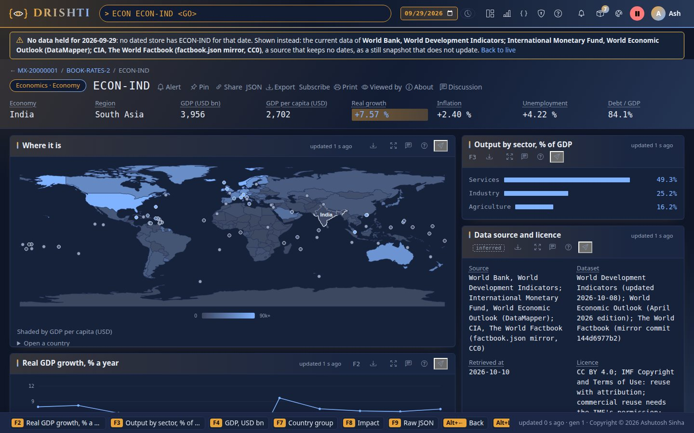

###### Sources, licences and attribution

<!-- realdata:begin sources -->
| Source | Dataset and vintage | Licence | Terms |
|---|---|---|---|
| World Bank, World Development Indicators | World Development Indicators (updated 2026-10-08) | CC BY 4.0 | https://datacatalog.worldbank.org/public-licenses#cc-by |
| World Bank, Worldwide Governance Indicators | Worldwide Governance Indicators (updated 2026-09-25) | CC BY 4.0 | https://datacatalog.worldbank.org/public-licenses#cc-by |
| International Monetary Fund, World Economic Outlook (DataMapper) | World Economic Outlook (April 2026 edition) | IMF Copyright and Terms of Use: reuse with attribution; commercial reuse needs the IMF's permission | https://www.imf.org/en/About/copyright-and-terms |
| UNDP, Human Development Report: composite indices time series | Human Development Index time series (2025 report) | CC BY 3.0 IGO | https://creativecommons.org/licenses/by/3.0/igo/ |
| CIA, The World Factbook (factbook.json mirror, CC0) | The World Factbook (mirror commit 144d6977b2) | Public domain (U.S. Government work); the factbook.json mirror is CC0 1.0 | https://github.com/factbook/factbook.json/blob/master/LICENSE.md |
<!-- realdata:end sources -->

Attribution text (also in [THIRD-PARTY-NOTICES.md](../../THIRD-PARTY-NOTICES.md), and in each document's *Data source and licence* panel):

- The World Bank: World Development Indicators (CC BY 4.0). The World Bank: Worldwide Governance Indicators (CC BY 4.0).
- Source: International Monetary Fund, World Economic Outlook database, https://www.imf.org/external/datamapper. The packs transform the data (units, rounding to six
  significant digits, joins with other sources); the IMF's terms ask that material changes be stated, which this guide and the panel do.
- UNDP, Human Development Report 2025 data (CC BY 3.0 IGO).
- Central Intelligence Agency, The World Factbook (public domain). The Factbook is read through the CC0 `factbook.json` mirror, pinned to a commit (recorded in each
  document's dataset line), because the CIA site offers no stable download of the whole book.

Caveats to read before reusing the data. **IMF:** the terms allow downloading, copying and derivative works with attribution, but ask for permission before *commercial*
reuse and prohibit bulk automated downloads without permission; the tool makes one request per series (eight in all) with a pause, and the data is shown here for a
demonstration. Ask copyright@imf.org before any commercial use. **UNDP:** the HDR data page states CC BY 3.0 IGO; check the page before redistribution. **World Bank:** each
indicator also has its own upstream source (for example SIPRI for military spending, the Inter-Parliamentary Union for women in parliament, ILO for labour data) that WDI
credits; the *About this series* panel shows the World Bank code to look it up.

###### What is in the pack

| Half of world-economy | Kind | Mnemonic | Documents | One document is |
|---|---|---|---|---|
| economics | `economy` | `ECON` | 213 | a country: GDP, growth, inflation, unemployment, debt, current account, sectors, links to its region, income group, labour market, fiscal position, IMF forecast and 16 indicators |
| economics | [`macro-indicator`](../contracts/samples/world-economy.md#macro-indicator) ([contract](../contracts/packs/world-economy.md#macro-macro-indicator-macro-indicator)) | `MACRO` | 3,119 | one headline statistic of one country: history 2015 to the latest year, rank among countries, definition |
| economics | `economic-forecast` | `FCST` | 192 | the IMF WEO series 2015 to 2031 (growth, inflation, unemployment, current account, debt, net lending, GDP), outturn and projections |
| economics | [`labour-market`](../contracts/samples/world-economy.md#labour-market) ([contract](../contracts/packs/world-economy.md#labr-labour-market-labour-market)) | `LABR` | 185 | unemployment, participation, youth and female labour, jobs and output by sector |
| economics | [`fiscal-position`](../contracts/samples/world-economy.md#fiscal-position) ([contract](../contracts/packs/world-economy.md#fisc-fiscal-position-fiscal-position)) | `FISC` | 192 | IMF debt and net lending, World Bank revenue, expense, military spending |
| economics | `country-group` | `ECG` | 12 | a World Bank region, income group or the world, computed from its member economies when asked ([BI_GUIDE.md](BI_GUIDE.md)): output, growth, inflation and its largest economies |
| economics | `region-economy` | `REGE` | 59 | a state or territory (ISO 3166-2, `AU-NSW`, `US-CA`) with population and GDP: an **illustrative sample, rounded from public figures, not for reporting** (`tools/realdata/dataset/regions.json`, not fetched), behind the BI sample report *Region economics* |
| politics | `jurisdiction` | `JUR` | 216 | a country: government type, capital, legislature seats by party, indicators, links to office holders, elections, parties and region |
| politics | [`office-holder`](../contracts/samples/world-economy.md#office-holder) ([contract](../contracts/packs/world-economy.md#offc-office-holder-office-holder)) | `OFFC` | 430 | the chief of state and head of government as the Factbook publishes them |
| politics | `election` | `ELEC` | 378 | the most recent lower-chamber, upper-chamber and executive election: system, term, seats by party, next election |
| politics | `party` | `PARTY` | 282 | a party that won seats in the lower chamber at the most recent election, with the chamber's full result |
| politics | `region` | `REGN` | 7 | a World Bank region: countries, population, life expectancy, government types |
| politics | [`social-indicator`](../contracts/samples/world-economy.md#social-indicator) ([contract](../contracts/packs/world-economy.md#soci-social-indicator-social-indicator)) | `SOCI` | 4,297 | one social or governance statistic of one country with a regional comparison |

Removed because no open, global dataset backs them: central-bank decisions, trade flows (bilateral), price baskets, opinion polls, bills and candidates. The old
fictional polities (Valdoria, Kestria) and the invented economies are gone.

Identifiers use the ISO 3166 alpha-3 code: `ECON-IND`, `MACRO-BRA-GDP-GROWTH`, `FCST-JPN-WEO`, `LABR-NGA`, `FISC-USA`, `ECG-SAS`, `JUR-USA`, `OFFC-JPN-HOG`,
`ELEC-BRA-LOW`, `PARTY-IND-01`, `REGN-SSF`, `SOCI-NGA-WGI-LAW`. The link graph is: country ↔ region ↔ income group ↔ indicators ↔ forecast, labour and fiscal documents, and
(politics) jurisdiction ↔ region, office holders, elections, parties, indicators.

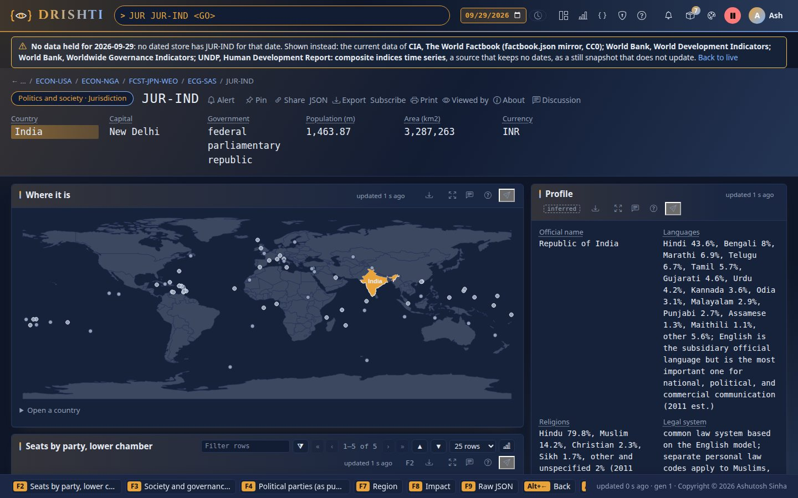

###### Provenance in every document

Each document has a `provenance` object (shown by the *Data source and licence* panel) and the same four facts in `_meta`:

<!-- realdata:begin provenance -->
```json
"provenance": {"source": "International Monetary Fund, World Economic Outlook (DataMapper)", "dataset": "World Economic Outlook (April 2026 edition)",
  "retrievedAt": "2026-10-10", "licence": "IMF Copyright and Terms of Use: reuse with attribution; commercial reuse needs the IMF's permission",
  "attribution": "Source: International Monetary Fund, World Economic Outlook database, https://www.imf.org/external/datamapper.",
  "url": "https://www.imf.org/external/datamapper"}
```
<!-- realdata:end provenance -->

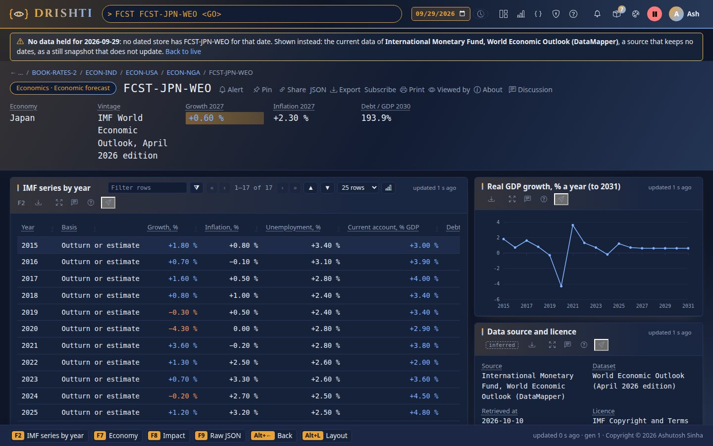

###### Coverage

Years: World Bank and UNDP series 2015 to 2025 (a series shows the years the source has; the latest year differs by country and indicator), IMF series 2015 to 2031.
Countries are the 217 economies the World Bank lists as countries or territories (Channel Islands has no Factbook profile, so 216 jurisdictions and 213 economies with
output data). Examples of how many countries have data: GDP 213, real growth 212, inflation 190, unemployment 187, government debt (IMF) 190, Gini 151, HDI 193, rule of
law 207, CO2 per capita 203, reserves 177. A missing value is simply absent from the series: nothing is estimated or filled in. Rankings count only countries whose latest
value is from 2022 or later.

Size: the world-economy pack is about 19 MB (its economics half 6.9 MB, its politics half 12.1 MB) and the normalised dataset 2.4 MB (21.4 MB of text in all, under the 25 MB limit; git compresses it to
about a fifth). Sample documents are written without indentation (`compact_json` in the pack generator) to keep it small.

###### More countries and groups

The same Sutras serve every country: the United States and Nigeria below, Brazil's government, and the World Bank's South Asia group with its largest economies.

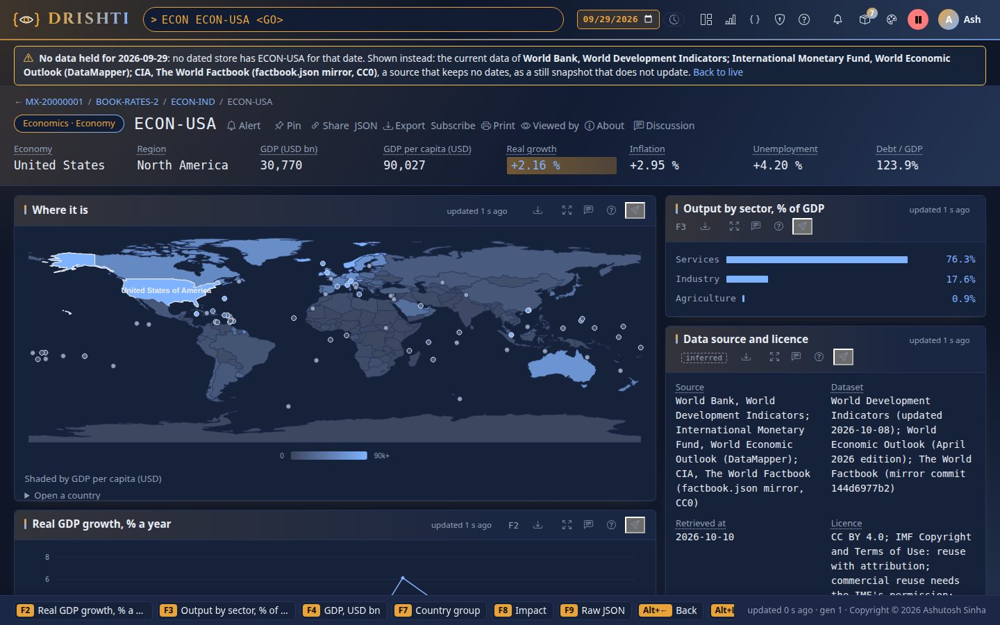
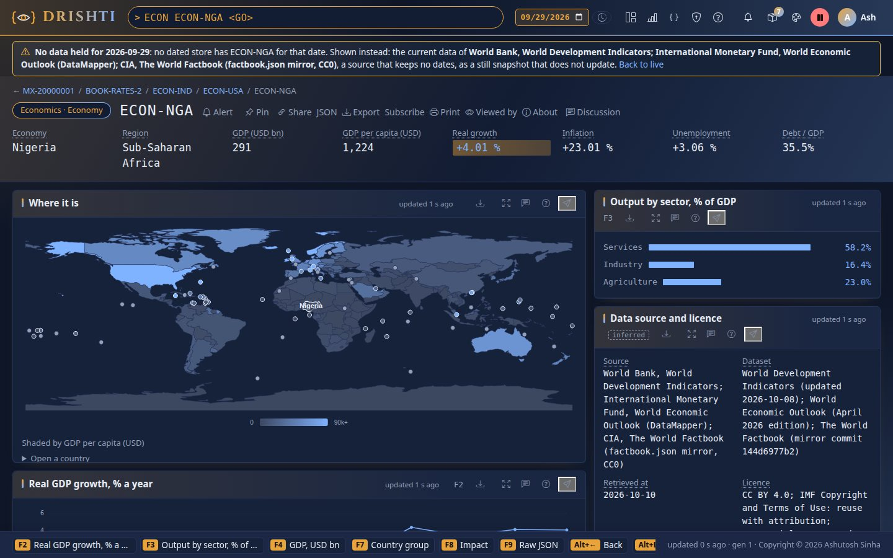
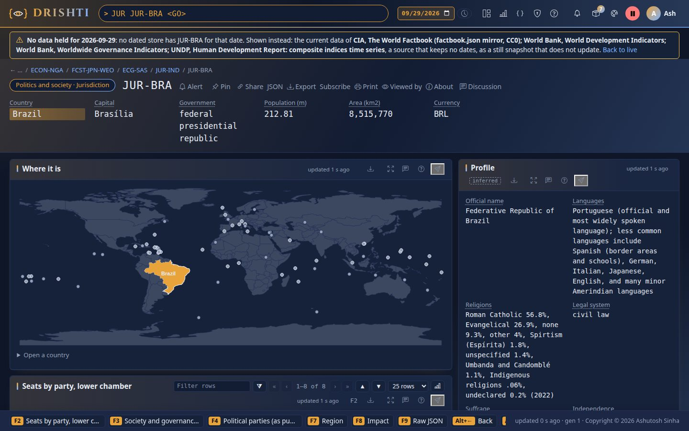
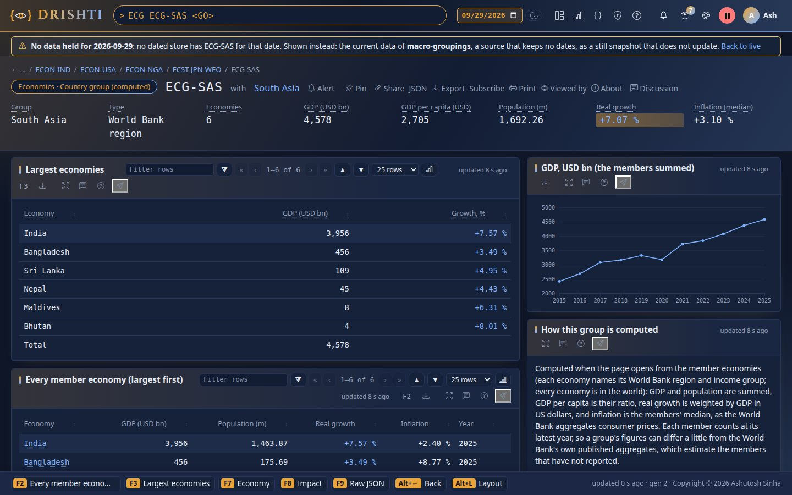

###### Indicators

###### Economy, labour and fiscal (world-economy pack, economics half)

<!-- realdata:begin indicators-economics -->
| Key | Indicator | Unit | Source and code | Countries with data |
|---|---|---|---|---|
| `gdp` | GDP, current prices | USD bn | World Bank WDI `NY.GDP.MKTP.CD` | 213 |
| `gdp_pc` | GDP per capita, current prices | USD | World Bank WDI `NY.GDP.PCAP.CD` | 213 |
| `gdp_growth` | Real GDP growth | % a year | World Bank WDI `NY.GDP.MKTP.KD.ZG` | 212 |
| `inflation` | Inflation, consumer prices | % a year | World Bank WDI `FP.CPI.TOTL.ZG` | 190 |
| `unemployment` | Unemployment rate | % of labour force | World Bank WDI `SL.UEM.TOTL.ZS` | 187 |
| `population` | Population | millions | World Bank WDI `SP.POP.TOTL` | 217 |
| `current_account` | Current account balance | % of GDP | World Bank WDI `BN.CAB.XOKA.GD.ZS` | 192 |
| `reserves` | Total reserves incl. gold | USD bn | World Bank WDI `FI.RES.TOTL.CD` | 177 |
| `trade` | Trade | % of GDP | World Bank WDI `NE.TRD.GNFS.ZS` | 188 |
| `exports` | Exports of goods and services | % of GDP | World Bank WDI `NE.EXP.GNFS.ZS` | 188 |
| `imports` | Imports of goods and services | % of GDP | World Bank WDI `NE.IMP.GNFS.ZS` | 188 |
| `fdi` | Foreign direct investment, net inflows | % of GDP | World Bank WDI `BX.KLT.DINV.WD.GD.ZS` | 200 |
| `co2` | CO2 emissions per capita | t CO2e | World Bank WDI `EN.GHG.CO2.PC.CE.AR5` | 203 |
| `real_interest` | Real interest rate | % a year | World Bank WDI `FR.INR.RINR` | 136 |
| `agriculture` | Agriculture, value added | % of GDP | World Bank WDI `NV.AGR.TOTL.ZS` | 202 |
| `industry` | Industry, value added | % of GDP | World Bank WDI `NV.IND.TOTL.ZS` | 205 |
| `services` | Services, value added | % of GDP | World Bank WDI `NV.SRV.TOTL.ZS` | 204 |
| `lfp` | Labour force participation rate | % of population 15+ | World Bank WDI `SL.TLF.CACT.ZS` | 187 |
| `youth_unemployment` | Youth unemployment rate | % of labour force 15-24 | World Bank WDI `SL.UEM.1524.ZS` | 187 |
| `employment_ratio` | Employment to population ratio | % of population 15+ | World Bank WDI `SL.EMP.TOTL.SP.ZS` | 187 |
| `female_lfp` | Female labour force participation rate | % of women 15+ | World Bank WDI `SL.TLF.CACT.FE.ZS` | 187 |
| `vulnerable` | Vulnerable employment | % of employment | World Bank WDI `SL.EMP.VULN.ZS` | 187 |
| `emp_agriculture` | Employment in agriculture | % of employment | World Bank WDI `SL.AGR.EMPL.ZS` | 187 |
| `emp_industry` | Employment in industry | % of employment | World Bank WDI `SL.IND.EMPL.ZS` | 187 |
| `emp_services` | Employment in services | % of employment | World Bank WDI `SL.SRV.EMPL.ZS` | 187 |
| `debt` | General government gross debt | % of GDP | IMF WEO `GGXWDG_NGDP` | 190 |
| `net_lending` | General government net lending/borrowing | % of GDP | IMF WEO `GGXCNL_NGDP` | 193 |
| `tax_revenue` | Tax revenue | % of GDP | World Bank WDI `GC.TAX.TOTL.GD.ZS` | 150 |
| `revenue` | Revenue, excluding grants | % of GDP | World Bank WDI `GC.REV.XGRT.GD.ZS` | 150 |
| `expense` | Expense | % of GDP | World Bank WDI `GC.XPN.TOTL.GD.ZS` | 150 |
| `military` | Military expenditure | % of GDP | World Bank WDI `MS.MIL.XPND.GD.ZS` | 159 |
<!-- realdata:end indicators-economics -->

###### Society and governance (world-economy pack, politics half)

<!-- realdata:begin indicators-society -->
| Key | Indicator | Unit | Source and code | Countries with data |
|---|---|---|---|---|
| `life_expectancy` | Life expectancy at birth | years | World Bank WDI `SP.DYN.LE00.IN` | 217 |
| `hdi` | Human Development Index | index 0-1 | UNDP HDR `hdi` | 193 |
| `fertility` | Fertility rate | births per woman | World Bank WDI `SP.DYN.TFRT.IN` | 217 |
| `infant_mortality` | Infant mortality rate | per 1,000 live births | World Bank WDI `SP.DYN.IMRT.IN` | 196 |
| `under5_mortality` | Under-5 mortality rate | per 1,000 live births | World Bank WDI `SH.DYN.MORT` | 196 |
| `urban` | Urban population | % of population | World Bank WDI `SP.URB.TOTL.IN.ZS` | 217 |
| `pop_growth` | Population growth | % a year | World Bank WDI `SP.POP.GROW` | 217 |
| `gini` | Gini index | index 0-100 | World Bank WDI `SI.POV.GINI` | 151 |
| `poverty` | Extreme poverty headcount | % of population | World Bank WDI `SI.POV.DDAY` | 151 |
| `literacy` | Adult literacy rate | % of people 15+ | World Bank WDI `SE.ADT.LITR.ZS` | 119 |
| `secondary_enrolment` | Secondary school enrolment | % gross | World Bank WDI `SE.SEC.ENRR` | 191 |
| `internet` | Individuals using the Internet | % of population | World Bank WDI `IT.NET.USER.ZS` | 208 |
| `electricity` | Access to electricity | % of population | World Bank WDI `EG.ELC.ACCS.ZS` | 215 |
| `health_spend` | Current health expenditure | % of GDP | World Bank WDI `SH.XPD.CHEX.GD.ZS` | 193 |
| `education_spend` | Government expenditure on education | % of GDP | World Bank WDI `SE.XPD.TOTL.GD.ZS` | 190 |
| `women_parliament` | Women in national parliament | % of seats | World Bank WDI `SG.GEN.PARL.ZS` | 193 |
| `wgi_voice` | Voice and accountability | index -2.5 to 2.5 | World Bank WGI `GOV_WGI_VA.EST` | 207 |
| `wgi_stability` | Political stability and absence of violence | index -2.5 to 2.5 | World Bank WGI `GOV_WGI_PV.EST` | 207 |
| `wgi_effectiveness` | Government effectiveness | index -2.5 to 2.5 | World Bank WGI `GOV_WGI_GE.EST` | 205 |
| `wgi_regulatory` | Regulatory quality | index -2.5 to 2.5 | World Bank WGI `GOV_WGI_RQ.EST` | 205 |
| `wgi_law` | Rule of law | index -2.5 to 2.5 | World Bank WGI `GOV_WGI_RL.EST` | 207 |
| `wgi_corruption` | Control of corruption | index -2.5 to 2.5 | World Bank WGI `GOV_WGI_CC.EST` | 207 |
<!-- realdata:end indicators-society -->

The definitions and units are in each pack's *About this page* glossary (`config/about.yaml`, from `tools/packgen/*/about.yaml`, which `tools/realdata/about.py` generates) and in each macro or social indicator's
*About this series* panel. World Governance Indicators are estimates from about -2.5 (weak) to 2.5 (strong).

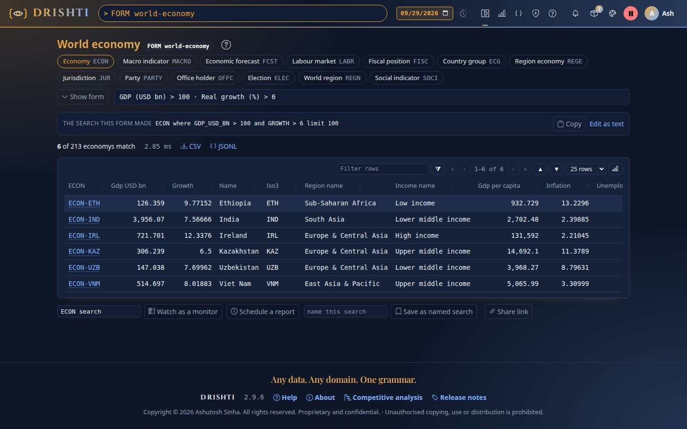

`FORM world-economy economy` searches the real data (the picture was taken when the economics half was a pack of its own, `FORM economics`): the form above finds six economies larger than USD 100 bn growing above 6% (Ethiopia, India, Ireland, Kazakhstan,
Uzbekistan, Viet Nam in the April 2026 data).

###### The tool: `tools/realdata/`

```
python3 tools/realdata/realdata.py fetch     [--cache DIR] [--refresh] [--pause S]   download the raw data (network)
python3 tools/realdata/realdata.py normalise [--cache DIR]                           raw cache -> tools/realdata/dataset/*.jsonl (and meta.json)
python3 tools/realdata/realdata.py about                                              sources.yaml + about/*.kinds.yaml -> tools/packgen/*/about.yaml
python3 tools/realdata/realdata.py write                                              dataset -> the pack, its glossary and its Sutra tests
python3 tools/realdata/realdata.py tests                                              the pack's Sutra tests only (config/packs/*/tests)
python3 tools/realdata/realdata.py docs                                               the generated tables of this guide
python3 tools/realdata/realdata.py all       [--cache DIR] [--refresh]                fetch, normalise, about, write, docs: everything committed
python3 tools/realdata/realdata.py check     [--cache DIR]                           fail if anything committed differs from what `all` would write
```

`all` from the cached raw data regenerates **everything committed for the pack** byte for byte: the normalised dataset, the glossary source
(`tools/packgen/*/about.yaml`), the pack (`pack.yaml`, Sutras, samples, guides, help, `config/about.yaml`), the Sutra tests (`tests/`) and the tables of this guide
between its `<!-- realdata:begin ... -->` markers (sources, the two indicator tables with their country counts, the provenance example). Only `config/formats.yaml` is kept by hand.
`check` fails on any drift: it re-derives the dataset from the cache (skipped, with a note, when there is no cache), runs the generator (`tools/packgen/world/make.py`) with `--check` (pack, glossary and
tests) and compares the guide tables. A run on the committed state prints:

```
$ python3 tools/realdata/realdata.py check
dataset: no raw cache at /home/ci/.cache/drishti-realdata, not re-derived     (with a cache: nothing)
world-economy: <n> files up to date
```

###### Building without the IMF

```
python3 tools/realdata/realdata.py all --no-imf [--out DIR]     # fetch (never the IMF), normalise, write the pack
python3 tools/realdata/realdata.py write --no-imf               # from the committed dataset, filtered
python3 tools/realdata/realdata.py check --no-imf               # the --no-imf packs are what the tool would write
```

`--no-imf` builds a World Bank, UNDP and Factbook pack set: the IMF is not contacted, the `economic-forecast` kind and its 192 documents are gone, the IMF `debt` and
`net_lending` series are gone (so an economy has no `debtToGdp` and no `outlook` link), the `fiscal-position` kind keeps only the World Bank revenue, expense and military
shares (`debt`, `balance` and the two paths are removed), and the glossary, FORM, examples, guide and provenance never name the IMF as a source. The politics half
never used IMF data and is unchanged. The one remaining word is the World Bank's definition of *Total reserves* ("... reserve position in the IMF ..."), which describes the
reserves, not IMF data. The committed dataset, glossary, tests and this guide are never touched: the pack goes to `--out` (default `~/.cache/drishti-realdata/no-imf/packs`) and a
`--no-imf` dataset to `~/.cache/drishti-realdata/no-imf/dataset`; copy the `world-economy` directory into `config/packs/` of the build you ship.

| File | Role |
|---|---|
| `sources.yaml` | the sources (name, API, licence, attribution) and every indicator (code, unit, scale, definition); edit this to add an indicator |
| `fetch.py` | the downloader: one request per World Bank indicator, per IMF series and per Factbook file, a pause between requests, retries, files already cached are kept |
| `normalise.py` | pure parsing functions (World Bank, IMF, UNDP, Factbook) and the run that writes `dataset/*.jsonl` (one country, group, series or Factbook profile a line) and the `meta.json` manifest |
| `build_docs.py` | the document builders the pack generator calls (`economics()`, `politics()`, one per half); `Data(no_imf=True)` drops the IMF |
| `about.py`, `about/*.kinds.yaml` | the glossary source: the vocabulary comes from `sources.yaml`, the per-kind and per-field text from `about/<pack>.kinds.yaml` (edit there, not in `tools/packgen/*/about.yaml`) |
| `pack_tests.py`, `pack_tests.yaml` | the pack's Sutra tests: which documents ship as tests, what each expects, the help-coverage ratchet |
| `doc_snippets.py` | the generated tables of this guide |
| `packrun.py` | what the pack generator runs: glossary, pack and tests, written or (`--check`) compared |
| `tests/` | `test_normalise.py` against small recorded fixtures (`tests/fixtures/`), `test_build_docs.py` against the committed dataset, `test_pipeline.py` (reproducibility, drift, `--no-imf`); no network |

The cache defaults to `~/.cache/drishti-realdata` (outside the repository; use `--cache` to move it). A full fetch is about 50 World Bank calls, 8 IMF calls, one UNDP file and
about 260 Factbook files, and takes 10 to 20 minutes at the default pause; the World Bank API is sometimes slow. Run it rarely and with the default pause.

###### Refreshing

The everyday way is the pack's data feed, `drishti.py feed run world-economy` (status, dry run, `--years`, `--scope`,
the internal-only rule for the IMF data, Windows wrappers): see this document. It runs the commands below for you.

```
python3 tools/realdata/realdata.py all --refresh      # download again, normalise, regenerate glossary, packs, tests and guide tables
python3 tools/realdata/realdata.py check              # clean when everything committed matches
python3 tools/packgen/world/make.py --check           # clean when the pack matches the dataset
python3 tools/packgen/politics/make.py --check
python3 tools/drishti.py pack check config/packs/economy/world-economy config/packs/economy/world-economy
python3 -m pytest tools/realdata/tests
```

Review the diff of `tools/realdata/dataset/` (that is the change in the world), and update the vintage notes if a source changed its format. The UNDP file name carries
the report year (the `csv:` address under `undp:` in `sources.yaml`): move it when a new HDR is published. The Factbook mirror is pinned to the commit that was current when fetched; a
refresh pins the newest.

How the Factbook is read: *Government type*, *Capital*, *Independence*, *Executive branch* (chief of state, head of government, how chosen, last and next election),
*Legislative branch* (the lower and upper chamber: seats, system, term, parties elected and seats per party), *Political parties*, *Area*, *Languages*, *Religions* and the
*Exchange rates* currency code. A Factbook profile is matched to a World Bank country by its Internet country code (the ISO 3166 alpha-2 code, with a few exceptions) and then by
name; unmatched profiles are listed in `meta.json` (`factbookUnmatched`: dependencies and uninhabited territories the World Bank does not list). Texts such as office holders
(`President Droupadi MURMU (since 25 July 2022)`) are shown as published: the tool splits off only the *since* date, it does not parse names.

###### Generated outputs stay consistent

`tools/packgen/world/make.py` (joining the halves `tools/packgen/economics/make.py` and `tools/packgen/politics/make.py`) writes `pack.yaml`, the Sutras, `samples/`, `guides/`, `config/help.yaml` and `config/about.yaml`;
`--check` fails if any differs. They also write `config/about.yaml`'s source and the pack `tests/` (see `about.py` and `pack_tests.py`). Only `config/formats.yaml` (the `pc1` and `pc2` formats that add a `%` sign to values already in percent) is kept by hand. The
pack tests are one to five real countries per kind (India, the United States, Brazil, Nigeria, Japan) with `expect.yaml` (`noErrors`, `nonEmpty`, help coverage 100%); which ones is in `tools/realdata/pack_tests.yaml`.

```
$ python3 tools/drishti.py pack check config/packs/economy/world-economy config/packs/economy/world-economy
== economics: sutra lint: exit 0
== economics: sutra test: exit 0
     economy: help coverage 8/8 (100%)
     ...
== world-economy: sutra lint: exit 0
== world-economy: sutra test: exit 0
```

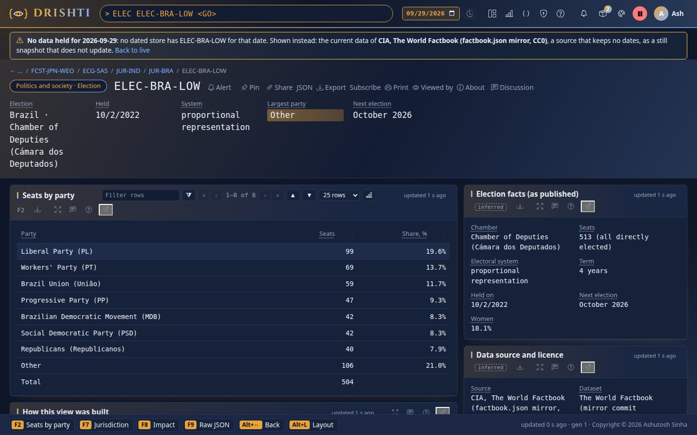
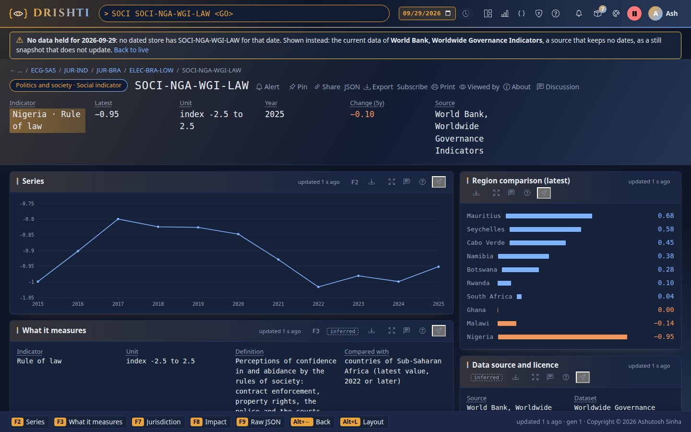

The pictures are made by `tools/docs/shots/realdata.py` (`drishti-console/.venv/bin/python tools/docs/screenshots.py --guide realdata`) on a server started with
`DRISHTI_PACKS=world-economy`.

#### news-and-markets

**Sources:** `quote` (Yahoo Finance quotes and daily history, **internal only**) and `news` (Google News RSS headlines, **internal
only**). The topics and listed companies are hand-written reference data (`config/packs/economy/news-and-markets/tools/make_samples.py`).

`drishti.py feed run news-and-markets` wraps `tools/testdata/capture_market.py` (also `drishti.py testdata capture-market`): the
documents come through Drishti's own live connectors, so they have exactly the shape the Sutras read. It starts a scratch server
from the built jar (`mvn -q -DskipTests package` first), or uses `--server URL`. Both sources are internal only.

```bash
python3 tools/drishti.py feed status news-and-markets                  # also shows the committed snapshot
python3 tools/drishti.py feed run news-and-markets --dry-run
python3 tools/drishti.py feed run news-and-markets --snapshot                 # a snapshot in <data>/datafeeds/sources/news-and-markets/testdata
python3 tools/drishti.py feed run news-and-markets --snapshot --internal-ok   # replace the committed snapshot in data/testdata
python3 tools/drishti.py lake demo                                   # then rebuild the demo lake from it
```

- `--years N` / `--since YEAR` choose the quote history: the smallest range the connector accepts that covers it (1y, 2y, 5y,
  10y, else max).
- `--scope TSLA,NVDA,NEWS-Tesla` adds tickers (quotes) and news ids to the pack's twenty companies and fifteen topics.
- `--delay` (at least 2 seconds), `--server`, `--jar`, `--port`, `--token-file` pass through to the capture.
- The check reads the snapshot back: ids unique and sorted, every document stamped as a snapshot.
- There is no download cache here (the server fetches); a failed call is retried after 5, 10, 20 and 40 seconds, and a rerun
  replaces the snapshot.

**Check it:** `QUOTE QUOTE-AAPL <GO>` shows the captured quote with its snapshot stamp. **Offline:** the committed snapshot is what the
demo serves; the live `news` and `yfinance` connectors are off as shipped.

#### market-data

**Sources:** `ecb-fx` (ECB euro reference rates), `us-treasury` (the par yield curve), `sofr` (New York Fed), `estr` (ECB); all
openly licensed with attribution. The pack's committed samples and test data are synthetic (`tools/testdata/make_testdata.py`); these
official sources are optional. FRED (the `fred-feed` connector) needs a personal API key and is left to the live connector.

`drishti.py feed run market-data` captures the official sources the pack's feed connectors read live
(`ecb-fx-feed`, `us-treasury-feed`, `nyfed-sofr-feed`, `ecb-estr-feed`; off by default), so the data works offline. The pack's
committed samples are synthetic and generated, and are never overwritten: the output always goes to the data folder or to a
folder outside the repository.

```bash
python3 tools/drishti.py feed run market-data                                  # a year of history, loaded into capitalmarket
python3 tools/drishti.py feed run market-data -- ecb-fx --years 5 --scope USDMXN,EURSEK
python3 tools/drishti.py feed run market-data -- us-treasury sofr --since 2020
```

It writes one file a kind and business date, named by the load rules ([DATA_LAKE_GUIDE.md](DATA_LAKE_GUIDE.md#5-routing-business-dates-modes-repeats-and-undo)):
the date is each document's `AS_OF`, the day of its newest observation, in the pack's own shapes (UPPER_SNAKE): `fx-spot.<date>.jsonl`
(`FX-EURUSD` and eleven more pairs, crosses through EUR, with daily `HISTORY`), `ir-curve.<date>.jsonl` (`CRV-USD-UST-PAR`: the latest
par curve and the 2Y, 10Y and 30Y history) and `rate-fixing.<date>.jsonl` (`FIX-SOFR`, `FIX-ESTR`, newest fixing first; two files when
the two fixings are of different days). Every document carries `PROVENANCE` (source, URL, licence, retrieval time). The feed loads
each under the date in its name into `capitalmarket` (`dated: source` in its feed file), so a run replaces exactly the dates it brings.
The daily run is **incremental by day**: it loads only the business dates after the last one in its state (`data/datafeeds/market-data/state.json`),
so a holiday is a run with nothing to load; it asks the sources for a year before that day (`options.history-days`, 365) so each
series document keeps its whole `HISTORY`. `--since YYYY-MM-DD` is the one-off backfill: everything from that day, every date loaded again.

**Check it:** the feed checks every document it wrote; after loading, `FIX FIX-SOFR <GO>` shows the fixing history. **Offline:**
`feed run market-data --offline` rebuilds the files from the cache.

#### us-equities

**Sources:** `trackers` (the index members: the stocks the tracking ETFs SPY, QQQ, DIA and IWM (Russell 2000) report in their newest
Form N-PORT, read from the funds feed's download cache, so the funds feed runs first; IWM joins when the data set has its report;
public domain), `wikidata` (headquarters, founded, website, LEI and
the date a member joined its index, CC0), `nasdaq` (the listing market), `sec` (companies, SIC codes, filings, financial facts; public
domain), `gleif` (each company's LEI, CC0), and `prices` (Yahoo Finance daily prices, **internal only**, never part of a default
refresh).

**Why the tracking ETFs.** Index providers' constituent lists are proprietary. A fund that tracks an index must report every holding
to the SEC, so its equity holdings are the index's members on its report date (each index page names the fund, the date and the
filing). Wikidata's member lists are out of date (its S&P 500 lacks Exxon Mobil, BlackRock and
about 80 others and still listed 44 former members. A company Wikidata still lists but no tracking ETF holds stays in the pack, in no
index; a holding the SEC no longer lists (taken private or merged since the report) is named in the index page's note.

`drishti.py feed run us-equities` wraps the pack's generator, `tools/packgen/us_equities/fetch.py` (the network) and `make.py`
(the build, offline): a refresh of the committed pack writes exactly what `make.py` writes, then runs `make.py --check`. The four
company sources are openly licensed, so a plain refresh rebuilds the committed data. SEC EDGAR gets the
User-Agent it asks for, the feeds' one User-Agent (`Drishti ajsinha@gmail.com`; `DRISHTI_FEEDS_USER_AGENT` overrides it), and fewer than 8 requests a
second (its limit is 10); GLEIF and Wikidata about one a second.

**Where the refresh writes.** The documents follow the standard data pattern: one gzipped JSON Lines snapshot per kind,
`data/testdata/us-equities/<kind>/<kind>.<date>.jsonl.gz` (the load rules' name), listed in `data/testdata/testdata.yaml`; the pack's `samples/` folder keeps
only a few reference documents and its guide and README are rebuilt. The server reads the data from the demo lake through the pack's
Delta connector `us-equities-store`, never through the demo connector, so after a refresh rebuild the lake:
`python3 tools/drishti.py lake demo` (or `python3 tools/build_demo_lakes.py`).

```bash
python3 tools/drishti.py feed status us-equities                           # also the committed pack's companies and retrieval date
python3 tools/drishti.py feed run us-equities --dry-run
python3 tools/drishti.py feed run us-equities --snapshot                          # the committed pack (about 1,100 SEC and 500 GLEIF calls)
python3 tools/drishti.py feed run us-equities --snapshot --offline                # rebuild the committed pack from the cache only
python3 tools/drishti.py feed run us-equities --snapshot -- --scope TSLA,CIK:1326380,FILINGS:40,YEARS:15
                                                                         # a widened build in <data>/datafeeds/sources/us-equities
python3 tools/drishti.py feed run us-equities --snapshot -- prices --server http://localhost:18080 --scope AAPL,MSFT
                                                                         # internal only: a price snapshot in the data folder
```

- **The cache** (`<data>/datafeeds/sources/cache/us-equities`, or `--cache`) holds what `fetch.py` keeps: the Wikidata query results,
  the Nasdaq files, the SEC ticker file, each company's submissions (metadata of the recent filings) and its XBRL facts reduced
  to the annual values of the pack's concepts, and the GLEIF records. A file stays until it is removed, so a broken run resumes;
  `--max-age HOURS` fetches files older than that again (the old one is put back if the new fetch fails). Every file is in
  `cache-index.json` (URL, time, sha256, size).
- **`--scope`** widens the build (comma separated): a ticker (`TSLA`) or `CIK:<n>` adds a company (listed under a `SCOPE`
  membership, "Added with --scope (not an index)"); `INDEX:<CODE>=<Wikidata QID>[=<name>]` adds an index's current members
  (the QID of the index item in Wikidata); `FILINGS:<n>` keeps more recent filings a company (default 20);
  `YEARS:<n>` or `--years N` more fiscal years (default 10); `CONCEPT:<NAME>=<tag>[|<tag>...][@<unit>][@instant]` another
  annual XBRL concept (`CONCEPT:CASH=CashAndCashEquivalentsAtCarryingValue@USD@instant`).
- **A widened build goes to the data folder**: `<data>/datafeeds/sources/us-equities/packs/us-equities`, a whole pack (the hand-written
  manifest, Sutras and help copied, the reference samples and guide generated), with its snapshot beside it in
  `<data>/datafeeds/sources/us-equities/testdata/us-equities/<kind>/`, checked with `make.py --check --pack`. Its cache is
  `scoped/<hash>` inside the cache, seeded from the plain cache less what the scope changes (submissions for `FILINGS`, facts for
  `YEARS` and `CONCEPT`, the Wikidata members for `INDEX`). `--into-pack` writes a widened build over the committed pack, on
  purpose only; without it `--out config/packs/capitalmarkets/us-equities` with a scope is refused.
- **Prices are internal only.** The pack ships no prices; the `prices` source reads `price-history/PX-<ticker>` through the
  pack's `us-equities-prices` connector of a running server where you switched it on (`DRISHTI_US_EQUITIES_PRICES_ENABLED=true`,
  `--server`, `--token-file`, `--delay` at least 2 s, `--limit N`). It is the feed `yahoo-prices` (internal only, off as shipped) and writes
  `<data>/datafeeds/sources/us-equities/prices/price-history/price-history.<date>.jsonl.gz`, each document stamped as a snapshot; into a
  committed folder only with `--internal-ok`. Each ticker is cached under `prices/` in the cache, so `--offline` rebuilds it.

**Check it:** `make.py --check` (run by the feed; without a cache it checks the committed snapshot); `USEQ AAPL <GO>` opens a
company. **Offline:** `feed run us-equities --offline`.

#### gleif

**Sources:** `golden` (the golden copy's level 2 files), `api` (the LEI API), `mapping` (the BIC, ISIN, MIC and OpenCorporates
mapping files), and `golden-lei` (the level 1 bulk file, for full-country pulls into the data folder only). Everything GLEIF publishes
is CC0 1.0.

`drishti.py feed run gleif` wraps the pack's generator, `tools/packgen/gleif/fetch.py` (the network) and `make.py` (the build,
offline): a refresh of the committed pack writes exactly what `make.py` writes, then runs `make.py --check`, and an offline refresh
from an unchanged cache reproduces the committed data byte for byte. Everything GLEIF publishes is CC0 1.0 (attribution
appreciated). GLEIF gets the feeds' one User-Agent (`Drishti ajsinha@gmail.com`; `DRISHTI_FEEDS_USER_AGENT` overrides it) and at
most one API call a second (GLEIF allows 60 a minute).

**Where the refresh writes.** As for us-equities: one snapshot per kind, `data/testdata/gleif/<kind>/<kind>.<date>.jsonl.gz`,
listed in `data/testdata/testdata.yaml`, served from the demo lake by the pack's Delta connector `gleif-store` (never the demo
connector); `samples/` keeps a few reference documents. Rebuild the lake after a refresh: `python3 tools/drishti.py lake demo`.

```bash
python3 tools/drishti.py feed status gleif                           # also the committed pack's entities and golden-copy date
python3 tools/drishti.py feed run gleif --dry-run                # the universe today, the downloads; changes nothing
python3 tools/drishti.py feed run gleif --snapshot                          # the committed pack: ~90 MB of golden copy and mapping files, ~70 API calls
python3 tools/drishti.py feed run gleif --snapshot --offline                # rebuild the committed pack from the cache only
python3 tools/drishti.py feed run gleif --snapshot -- --scope GROUP:784F5XWPLTWKTBV3E584,CAP:600
                                                                   # Goldman Sachs' whole group, in <data>/datafeeds/sources/gleif
python3 tools/drishti.py feed run gleif --snapshot -- golden golden-lei api mapping --scope COUNTRY:LU --since 2025
                                                                   # every Luxembourg entity updated since 2025, from the bulk file
```

- **The sources.** `golden`: the golden copy's level 2 files, the relationship records (`rr`, about 24 MB zipped) and the
  reporting exceptions (`repex`, about 62 MB), downloaded whole and reduced into `reduced/` (the consolidation relationships;
  the exceptions of the pack's entities). `api`: the LEI record of every entity of the pack, 200 a request (`filter[lei]`), and
  the code lists (entity legal forms, countries, LEI issuers). `mapping`: the BIC, ISIN, MIC and OpenCorporates mapping files
  (the ISIN file is about 33 MB zipped), reduced to the pack's entities. `golden-lei`: the level 1 bulk file (about 480 MB
  zipped), only for `COUNTRY:` pulls into the data folder; never part of a default refresh, never into the committed pack.
- **The universe.** The seeds are the us-equities companies with an LEI (from that pack's committed snapshot,
  `data/testdata/us-equities/us-company/`) and the banks,
  insurers, asset managers and market infrastructures pinned in `fetch.py` (`SEEDS`, LEIs resolved once by legal name). Each
  seed brings its ownership group: its ultimate parent and every entity it consolidates, level by level, at most 50 a group
  (`GROUP_CAP`; a group page says when GLEIF has more).
- **The cache** (`<data>/datafeeds/sources/cache/gleif`, or `--cache`) keeps every download as served (`golden/`, `mapping/`,
  `api/records/` batches) and the reductions (`reduced/`); a file stays until removed, so a broken run resumes, and only LEIs
  not yet cached are asked for. `--max-age HOURS` fetches the golden copy, mapping files and code lists again when older (the old
  one is put back if the new fetch fails). Every download is in `cache-index.json`.
- **`--scope`** widens the build (comma separated): `LEI:<lei>` or `GROUP:<lei>` adds that entity's group; `COUNTRY:<XX>` the
  entities with a legal address in the country (the LEI API, at most `--max-pages` pages of 200, default 10; every one with
  `golden-lei`); `NAME:<text>` what GLEIF's full-text search finds (one page of 200); `TICKERS-FROM:us-equities` the us-equities
  companies of the widened us-equities build's snapshot in the data folder when there is one (or
  `TICKERS-FROM:<a us-company .jsonl or .jsonl.gz>`);
  `CAP:<n>` up to n entities a group. `--years N` / `--since YEAR` keep only the `COUNTRY:` and `NAME:` entities whose LEI record
  was updated in that period.
- **A widened build goes to the data folder**: `<data>/datafeeds/sources/gleif/packs/gleif`, a whole pack (the hand-written manifest,
  Sutras and help copied, reference samples and guide generated), with its snapshot in `<data>/datafeeds/sources/gleif/testdata/gleif/`,
  checked with `make.py --check --pack`. `--into-pack` writes it over the
  committed pack, on purpose only (never with `golden-lei`); without it `--out config/packs/core/gleif` with a scope is refused.

**Check it:** `make.py --check` (run by the feed); `LEI 8I5DZWZKVSZI1NUHU748 <GO>` opens an entity, `LEIG ALL <GO>` every group.
**Offline:** `feed run gleif --snapshot --offline` reproduces the committed data from the cache byte for byte.

#### funds

**Sources:** `tickers` (the SEC's fund share class and listed-company ticker files), `nasdaq` (the Nasdaq Trader symbol directory:
which tickers are ETFs), `nport` (the newest quarter of the SEC's Form N-PORT data sets), `ncen` (the newest four quarters of the Form
N-CEN data sets), `rr` (the newest four quarters of the prospectus risk/return summary data sets) and `gleif` (GLEIF's level 2
relationship records, reused from the gleif pack's cache when it has them). The SEC's data sets are U.S. public domain; GLEIF's are
CC0 1.0.

`drishti.py feed run funds` downloads the data sets into its cache and runs the pack's generator, `tools/packgen/funds/make.py` (the
build, offline: it streams the N-PORT tables once and keeps the 200 largest funds and ETFs by net assets that have a ticker), then
`make.py --check`. SEC requests carry the one feeds User-Agent (`DRISHTI_FEEDS_USER_AGENT`; the SEC asks for a contact in it) and go
one at a time.

**The downloads are large** (an N-PORT quarter is about 450 MB, four quarters of risk/return summaries about 200 MB, N-CEN 6 to 16 MB
a quarter) and stay in `<data>/datafeeds/sources/cache/funds`, never in git; a file younger than `--max-age` hours (a week by default) is
reused. **Where `--snapshot` writes:** the committed snapshot, gzipped JSON Lines under `data/testdata/funds/<kind>/` (the fund kind
in parts of about 1.2 MB, 5.5 MB in all), listed in `data/testdata/testdata.yaml` and served from the demo lake by the pack's Delta
connector `funds-store`; `samples/`, the README, the guide and the glossary (`config/about.yaml`) of `config/packs/capitalmarkets/funds`. Rebuild
the demo lake after it: `python3 tools/drishti.py lake demo`. A plain `feed run funds` loads the same kinds into `capitalmarket`.

```bash
python3 tools/drishti.py feed status funds                           # its last runs: last success, rows, failures
python3 tools/drishti.py feed run funds --dry-run                # the quarters and files a refresh would fetch; changes nothing
python3 tools/drishti.py feed run funds --snapshot                          # the committed pack: about 700 MB of downloads, then make.py and --check
python3 tools/drishti.py feed run funds --snapshot --offline                # rebuild the committed pack from the downloads only
python3 tools/drishti.py feed run funds --snapshot -- ncen rr --since 2025     # every quarter of the census and the summaries since 2025
python3 tools/drishti.py feed run funds --snapshot -- --scope FUNDS:300,HOLDINGS:1000
                                                                   # the 300 largest, 1,000 holdings a fund, in <data>/datafeeds/sources/funds
```

On Windows the same through `.\tools\windows\feed.ps1` (`.\tools\windows\feed.ps1 run funds --dry-run`); on Linux and macOS
`tools/feeds/feed.sh run funds` takes the same arguments.

- **The 200.** Every fund's newest N-PORT report in the quarter (amendments win over the report they amend), ranked by net assets;
  a fund needs a ticker (a share class in `company_tickers_mf.json`, or, for a unit investment trust such as SPY or DIA, its
  listed ticker in `company_tickers_exchange.json`). Money market funds file Form N-MFP, not N-PORT, so they are not among them.
- **The holdings.** A fund keeps its 600 largest holdings by value (every S&P 500 fund whole) and the totals of the rest; the
  reverse look-through (`HELD`) counts every holding. The index tab's weights are computed from SEC data (shares outstanding times
  the price the filings imply) because index weights are proprietary.
- **`--scope`** widens the build: `FUNDS:<n>` the n largest funds, `HOLDINGS:<n>` the holdings kept a fund. A widened build goes to
  `<data>/datafeeds/sources/funds` (`packs/funds` and `testdata/funds`); `--into-pack` writes it over the committed pack, on purpose only.

**Check it:** `make.py --check` (run by the feed); `FUND QQQ <GO>` opens a fund, `HELD AAPL <GO>` the funds holding Apple.
**Offline:** `feed run funds --snapshot --offline` rebuilds the committed data from the downloads; without them `make.py --check` checks the committed
snapshot against what it derives. The guide is [WORLD_DATA_GUIDE.md](WORLD_DATA_GUIDE.md) (Part III: where the data comes from).

#### The public-sector packs

Six public-sector packs of the economy module, each filled every day by its own feed into the bank's own `worldlake` or `newslake`; nothing is
committed but a few sample documents (from the feeds' recorded fixtures). The guide is [WORLD_DATA_GUIDE.md](WORLD_DATA_GUIDE.md)
(the default selection of each source, the licences, changing what is pulled); the tutorial is
[The public sector tutorial](WORLD_DATA_GUIDE.md).

| Feed (pack) | Sources | Key | Writes |
|---|---|---|---|
| `world-development` | World Bank WDI (its one fetcher; world-economy reads this output) | none | [`development-profile`](../contracts/samples/world-development.md#development-profile) ([contract](../contracts/packs/world-development.md#wdi-development-profile-development-profile)), [`development-series`](../contracts/samples/world-development.md#development-series) ([contract](../contracts/packs/world-development.md#wdis-development-indicator-series-development-series)) into worldlake |
| `central-banks` | FRED; Bank of Canada Valet | `DRISHTI_FRED_API_KEY` (FRED only: without it the Bank of Canada's series still load) | [`central-bank`](../contracts/samples/central-banks.md#central-bank) ([contract](../contracts/packs/central-banks.md#cbank-central-bank-central-bank)), [`rate-series`](../contracts/samples/central-banks.md#rate-series) ([contract](../contracts/packs/central-banks.md#cbser-central-bank-series-rate-series)) into worldlake |
| `national-statistics` | Statistics Canada WDS | none | [`statistics-series`](../contracts/samples/national-statistics.md#statistics-series) ([contract](../contracts/packs/national-statistics.md#nstat-national-statistic-statistics-series)) into worldlake |
| `oecd` | OECD Data Explorer (SDMX) | none | [`oecd-country`](../contracts/samples/oecd.md#oecd-country) ([contract](../contracts/packs/oecd.md#oecd-oecd-country-oecd-country)), [`oecd-series`](../contracts/samples/oecd.md#oecd-series) ([contract](../contracts/packs/oecd.md#oecds-oecd-series-oecd-series)) into worldlake |
| `official-news` | the Fed, ECB, Bank of Canada, Bank of England, SEC, OSFI, Federal Register, Canada Gazette | none | [`release-source`](../contracts/samples/official-news.md#release-source) ([contract](../contracts/packs/official-news.md#press-official-press-releases-release-source)), [`press-release`](../contracts/samples/official-news.md#press-release) ([contract](../contracts/packs/official-news.md#prel-press-release-press-release)) into newslake |
| `gdelt-events` | GDELT 1.0 daily event files | none | [`event-country`](../contracts/samples/gdelt-events.md#event-country) ([contract](../contracts/packs/gdelt-events.md#gdelt-world-events-by-country-event-country)) into newslake |

```bash
python3 tools/drishti.py feed run world-development --dry-run    # what it would ask; nothing changes
python3 tools/drishti.py feed run world-development              # pull what is new, load into worldlake
python3 tools/drishti.py feed run official-news --load inbox     # through the data inbox
.\tools\windows\feed.ps1 run oecd                                 # Windows (PowerShell)
```

Each feed file (`config/feeds/<pack>.yaml`) records every source's licence and terms in `options.sources`; the Bank of England, OSFI and
the Canada Gazette allow no commercial reuse, so their releases carry `INTERNAL_ONLY: true` and Export data refuses them.

**Check it:** `drishti.py feed status <feed>`; `WDI WDI-CAN <GO>`, `PRESS PRESS-FED <GO>`. **Offline:** the feeds need their sources; a
run without the network fails in words and the lake keeps its latest date.

### 16. Not covered

- **Genomics** reference facts (`tools/packgen/genomics/reference.py`: gene coordinates, UniProt accessions, dbSNP ids) are
  typed in by hand from public references; there is no fetcher to wrap. A script would query Ensembl and UniProt.
- **Region maps** (`tools/maps/build_regions.py`, Natural Earth, public domain) are console assets, not a pack; that tool
  keeps its own download.
- **FRED** (the market-data pack's `fred-feed`) needs a personal API key and FRED's terms limit redistribution of some
  series; it is left to the live connector.

## Public sector: government data and free news

The **public sector** is government and official data, and free news, from public sources: part of the **economy module**, with a lens
of its own (Public sector). Six packs, each filled every day by its own feed, show a country's development, a central bank's rates, a national statistic, an OECD
member's cycle, the press releases of central banks, regulators and governments, and what the world's news said about a country yesterday.
Every source's licence is recorded; what may not be redistributed is marked internal only.

The hands-on companion is [The public sector tutorial](WORLD_DATA_GUIDE.md). The feeds machinery (run, load, schedule, monitor, write a
feed) is the [External data guide](WORLD_DATA_GUIDE.md); every column of every kind is in the data contracts (section 4).

### Contents

1. [The module, its lens and its functions](#1-the-module-its-lens-and-its-functions)
2. [Turn it on, or off](#2-turn-it-on-or-off)
3. [The screens](#3-the-screens)
4. [The packs and their data contracts](#4-the-packs-and-their-data-contracts)
5. [The feeds](#5-the-feeds)
6. [Licences and internal-only data](#6-licences-and-internal-only-data)
7. [Changing what is pulled](#7-changing-what-is-pulled)
8. [Tests](#8-tests)
9. [Troubleshooting](#9-troubleshooting)
10. [Later sources](#10-later-sources)

### 1. The module, its lens and its functions

| Part | What it is |
|---|---|
| Module | `economy`: content only (packs, functions, lenses; no Java of its own), declared by its own manifest (`modules/economy/module.yaml`, the one source the access registry reads), and switched by `config/modules/economy.yaml` ([ACCESS_MODEL.md](../architecture/ACCESS_MODEL.md)). One module (the owner, 2026-11-07): the public sector is not licensed or switched apart from the economy |
| Lens | **Public sector** (`publicsector`, in `META-INF/drishti/lenses.yaml`): the ten functions below; offered while the economy module is on |
| World lens | carries the free news too: `PRESS`, `PREL` and `GDELT` |
| Packs | `world-development`, `central-banks`, `national-statistics`, `oecd`, `official-news`, `gdelt-events`, each with `domain: economy` |
| Lakes | `worldlake` (development, central banks, statistics, OECD) and `newslake` (official news, GDELT): their lake files ship with exactly these packs' tables |
| Feeds | one a pack, `config/feeds/<pack>.yaml`, daily, on drishti-feeds (section 5) |

The functions (command words), each owned by the economy module and gated by the access registry:

| Word | Kind | Opens |
|---|---|---|
| `WDI` | [`development-profile`](../contracts/samples/world-development.md#development-profile) ([contract](../contracts/packs/world-development.md#wdi-development-profile-development-profile)) | a country's development profile (World Bank) |
| `WDIS` | [`development-series`](../contracts/samples/world-development.md#development-series) ([contract](../contracts/packs/world-development.md#wdis-development-indicator-series-development-series)) | one World Bank indicator of one country by year |
| `CBANK` | [`central-bank`](../contracts/samples/central-banks.md#central-bank) ([contract](../contracts/packs/central-banks.md#cbank-central-bank-central-bank)) | a central bank: policy rate, last move, series |
| `CBSER` | [`rate-series`](../contracts/samples/central-banks.md#rate-series) ([contract](../contracts/packs/central-banks.md#cbser-central-bank-series-rate-series)) | one central-bank or market series (FRED, Bank of Canada) |
| `NSTAT` | [`statistics-series`](../contracts/samples/national-statistics.md#statistics-series) ([contract](../contracts/packs/national-statistics.md#nstat-national-statistic-statistics-series)) | one Statistics Canada series by vector |
| `OECD` | [`oecd-country`](../contracts/samples/oecd.md#oecd-country) ([contract](../contracts/packs/oecd.md#oecd-oecd-country-oecd-country)) | an OECD member's latest measures, the members on a map |
| `OECDS` | [`oecd-series`](../contracts/samples/oecd.md#oecd-series) ([contract](../contracts/packs/oecd.md#oecds-oecd-series-oecd-series)) | one OECD measure of one member by period |
| `PRESS` | [`release-source`](../contracts/samples/official-news.md#release-source) ([contract](../contracts/packs/official-news.md#press-official-press-releases-release-source)) | a publisher's latest press releases, each a link |
| `PREL` | [`press-release`](../contracts/samples/official-news.md#press-release) ([contract](../contracts/packs/official-news.md#prel-press-release-press-release)) | one press release |
| `GDELT` | [`event-country`](../contracts/samples/gdelt-events.md#event-country) ([contract](../contracts/packs/gdelt-events.md#gdelt-world-events-by-country-event-country)) | a country's day in the world's news |

The packs' own codes open their overviews: `WDEV`, `CBNK`, `STCAN`, `OECDP`, `ONEWS`, `GDLT`.

### 2. Turn it on, or off

The economy module is **on** as shipped (installed with the core server, licensed by the development licence, `enabled: true`). The
public-sector packs load when the server's pack list names them:

```bash
DRISHTI_PACKS=core,world-economy,world-development,central-banks,national-statistics,oecd,official-news,gdelt-events \
  java -jar kernel/drishti-server/target/drishti-server-*-exec.jar
```

and a person opens the Public sector lens from Views (`drishti.lenses: risk,world,publicsector`).

**Off** is the economy module off (`config/modules/economy.yaml` `enabled: false`, `POST /api/v1/admin/modules`, or
`DRISHTI_MODULES_ECONOMY_ENABLED=false`, then a restart): all eight of its packs and their connectors do not load, its functions (these
ten and the economy's own) are gone everywhere (command line, type-ahead, search, menus, the APIs behind them, `404 DRS-1026`), and the
World and Public sector lenses are not offered. Banking, capital markets and GLEIF are unaffected. A single function is switched off on
Admin → Functions. The guarantees are `EconomyModuleOffTest` and `PublicSectorLensTest`.

### 3. The screens

Every screen is a Sutra built from the Drishti UI kit (`config/ui-kit/fragments`: `series-line`, `region-map`, `ranked-bars`,
`source-footer`) and the kit's panel kinds (tables, key-value lists), drawn by Drishti Elements (drishti-chart with its maps,
drishti-grid). No screen has code of its own. A web address in a cell is a link that opens the original in a new tab.

| Screen | Strip | Panels |
|---|---|---|
| `WDI WDI-CAN` | country, region, income group, capital, population, GDP per head | the indicators with their latest year (a row opens its series); the **world map shaded by GDP per head** (a country opens its profile); source and licence |
| `WDIS WDIS-IND-NY_GDP_MKTP_KD_ZG` | indicator, latest, unit, year, previous, change | the history by year (chart); the World Bank's definition; F7 the country |
| `CBANK CBANK-FED` | policy rate, as of, last move and its size in basis points, currency | the policy rate over two years (chart); the bank's series with latest value and change (a row opens it); press releases one link away |
| `CBSER CBSER-FRED-DGS10` | latest, unit, date, change on the day and the year, high, low | the history (chart); what the series is; F7 the bank |
| `NSTAT NSTAT-V41690973` | latest, unit, period, change, change %, on the year %, release time | the history (chart); table, vector, frequency, scale |
| `OECD OECD-CAN` | leading indicator, unemployment, inflation, GDP growth | the measures (a row opens its history); the **members on a map shaded by inflation** |
| `OECDS OECDS-USA-CLI` | measure, latest, unit, period, change | the history (chart); the dataflow; F7 the member |
| `PRESS PRESS-FED` | publisher, type, country, releases kept, latest, last pull, internal only | the **latest releases newest first** (a title opens the release, the address the original); releases by category; the terms of reuse |
| `PREL <id>` | publisher, published, category, country, internal only | the title, the feed's summary, the original's address, the publisher |
| `GDELT GDELT-USA` | day, events, mentions, average tone, tone against the window, Goldstein, conflict % | tone by day (chart); the day's events by CAMEO category; the **world map shaded by tone**; the most-mentioned stories, each a link |

### 4. The packs and their data contracts

Every kind has a data contract (`config/packs/<pack>/contracts/<kind>.contract.yaml`): its key, its grain, its storage (connector,
lake table), its cadence (daily, the feed's schedule) and every field with its type, presence, unit, an example and its meaning. The
contracts are the one place for the data; the pages below are generated from them (`tools/contracts.py docs`), and each kind's worked
example (a real record as JSON, every field explained) is under [docs/contracts/samples](../contracts/samples/README.md).

| Pack | Kinds (each: its example and its contract) | Contracts | Lake table |
|---|---|---|---|
| `world-development` | [`development-profile`](../contracts/samples/world-development.md#development-profile) ([contract](../contracts/packs/world-development.md#wdi-development-profile-development-profile)) (key `PROFILE_ID`, `WDI-<ISO3>`), [`development-series`](../contracts/samples/world-development.md#development-series) ([contract](../contracts/packs/world-development.md#wdis-development-indicator-series-development-series)) (`SERIES_ID`, `WDIS-<ISO3>-<code>`) | [world-development.md](../contracts/packs/world-development.md) | `worldlake/development/<kind>` |
| `central-banks` | [`central-bank`](../contracts/samples/central-banks.md#central-bank) ([contract](../contracts/packs/central-banks.md#cbank-central-bank-central-bank)) (`BANK_ID`, `CBANK-<id>`), [`rate-series`](../contracts/samples/central-banks.md#rate-series) ([contract](../contracts/packs/central-banks.md#cbser-central-bank-series-rate-series)) (`SERIES_ID`, `CBSER-<FRED or BOC>-<code>`) | [central-banks.md](../contracts/packs/central-banks.md) | `worldlake/centralbank/<kind>` |
| `national-statistics` | [`statistics-series`](../contracts/samples/national-statistics.md#statistics-series) ([contract](../contracts/packs/national-statistics.md#nstat-national-statistic-statistics-series)) (`SERIES_ID`, `NSTAT-V<vector>`) | [national-statistics.md](../contracts/packs/national-statistics.md) | `worldlake/statistics/<kind>` |
| `oecd` | [`oecd-country`](../contracts/samples/oecd.md#oecd-country) ([contract](../contracts/packs/oecd.md#oecd-oecd-country-oecd-country)) (`COUNTRY_ID`, `OECD-<ISO3>`), [`oecd-series`](../contracts/samples/oecd.md#oecd-series) ([contract](../contracts/packs/oecd.md#oecds-oecd-series-oecd-series)) (`SERIES_ID`, `OECDS-<ISO3>-<measure>`) | [oecd.md](../contracts/packs/oecd.md) | `worldlake/oecd/<kind>` |
| `official-news` | [`release-source`](../contracts/samples/official-news.md#release-source) ([contract](../contracts/packs/official-news.md#press-official-press-releases-release-source)) (`SOURCE_ID`, `PRESS-<publisher>`), [`press-release`](../contracts/samples/official-news.md#press-release) ([contract](../contracts/packs/official-news.md#prel-press-release-press-release)) (`RELEASE_ID`, `PREL-<publisher>-<hash>`) | [official-news.md](../contracts/packs/official-news.md) | `newslake/officialnews/<kind>` |
| `gdelt-events` | [`event-country`](../contracts/samples/gdelt-events.md#event-country) ([contract](../contracts/packs/gdelt-events.md#gdelt-world-events-by-country-event-country)) (`EVENT_COUNTRY_ID`, `GDELT-<ISO3>`) | [gdelt-events.md](../contracts/packs/gdelt-events.md) | `newslake/gdelt/<kind>` |

Every document carries `PROVENANCE`: the source, the dataset and its vintage, the retrieval date, the licence, the attribution, the
address and `INTERNAL_ONLY`. Each pack's README (`config/packs/<pack>/README.md`) lists its kinds' data structures; its guide
(`config/packs/<pack>/guides/<pack>.md`, a Help page) ends with the generated *Data contracts* and *Data retrieval* sections.

**One record.** Each kind's example (a real record, every field explained) is its section on the data-sample pages, linked from the table above; the fields are its contract.

The packs' `samples/` keep a few documents (from the feeds' recorded fixtures, `python3 tools/packgen/publicsector/make.py`) for the
renderer's tests; they are never served beside the lake: demo and real data never mix
([DATA_LAKE_GUIDE.md section 6](DATA_LAKE_GUIDE.md)).

### 5. The feeds

Each pack has one feed on drishti-feeds: a feed file `config/feeds/<pack>.yaml` (every key: [External data](WORLD_DATA_GUIDE.md))
and a Feed class in `tools/feeds/sources/`. Each pulls only what is new, writes one JSON Lines file a kind and business date with its
manifest (rows, SHA-256), and is loaded into its lake, replacing that date (a re-run is idempotent).

| Feed | Source | Default selection (`options:`) | Incremental by | Daily at (local) |
|---|---|---|---|---|
| `world-development` | World Bank WDI API v2 (the one fetcher of WDI: world-economy reads its output) | every economy, 15 years, 10 headline indicators in the profile (population, GDP per head, growth, inflation, unemployment, life expectancy, poverty, electricity access, internet use, central government debt); as series also every `kind: wdi` code of `tools/realdata/sources.yaml` back to its `years.first` (`series-from`) and the world, its 7 regions and 4 income groups (`aggregates`, series only) | the WDI source's last-updated date: unchanged, nothing written | 06:30 |
| `central-banks` | FRED API, Bank of Canada Valet | the Fed: target range upper limit, effective rate, 2- and 10-year Treasuries, 10y–2y, CPI, unemployment, total assets; the Bank of Canada: target rate, CORRA, 2- and 10-year yields, USD/CAD; two years of history | each series from 10 days before its last observation | weekdays 18:15 |
| `national-statistics` | Statistics Canada WDS | seven vectors: CPI (raw and seasonally adjusted), unemployment, monthly GDP, population, housing starts, the overnight rate; 60 periods | each vector from a quarter before its last period; a newer release time | weekdays 09:00 |
| `oecd` | OECD Data Explorer SDMX | the 38 members; the composite leading indicator, unemployment, CPI inflation, quarterly GDP growth; from 2020 | from three periods before each measure's last | 07:00 |
| `official-news` | publishers' RSS, Atom, the Federal Register API | the Fed, the ECB, the Bank of Canada, the Bank of England, the SEC, OSFI, the Federal Register, the Canada Gazette (Parts I and II); 90 days, 100 a publisher | a release already seen is never added again | 19:00 |
| `gdelt-events` | GDELT 1.0 daily event files | events by country (the first actor's CAMEO country), 30 days of history, countries with 20 events or more, the top 5 stories | the days after the last one read (at most 7) | 04:30 |

Run them as any feed:

```bash
python3 tools/drishti.py feed list                               # every feed: lake, route, schedule, licence, datasets
python3 tools/drishti.py feed run world-development --dry-run    # what it would ask; nothing changes
python3 tools/drishti.py feed run world-development              # pull, write <data>/datafeeds/world-development/<date>/, load into worldlake
python3 tools/drishti.py feed run official-news --load inbox     # the same through the data inbox: the server loads it
python3 tools/drishti.py feed status gdelt-events                # its last runs from the ledger
python3 tools/drishti.py feed schedule --cron world-development central-banks national-statistics oecd official-news gdelt-events
```

The wrappers are `tools/feeds/feed.sh` (Linux, macOS) and `.\tools\windows\feed.ps1` (Windows); Admin → Data loads → Feeds shows each
run and offers Run now. Exit codes: 0 ok, 1 failed, 2 refused, 3 locked, 4 partial.

**Keys.** Only FRED needs one: a free key from https://fred.stlouisfed.org/docs/api/api_key.html in `DRISHTI_FRED_API_KEY` where the feed
runs (the feed file names the variable, never the value). Without it the central-banks feed leaves the FRED series out, says so in its
log, and loads the Bank of Canada's.

**What a feed carries on without.** One publisher whose feed is down (official-news) or a day GDELT did not publish: the run goes on with
the others and the publisher's page says *failed: kept releases shown*. Every other failed request fails the run, its state is not saved,
and the next run asks again from the same point.

### 6. Licences and internal-only data

Each feed file records every source's licence and terms in `options.sources` (`licence`, `terms`, `redistributable`, `internal-only`,
`why-internal`, `attribution`) and a summary in `licence:`; every document repeats its source's in `PROVENANCE`. The reading of each
site's terms is the owner's, confirmed on 2026-11-07.

| Source | Licence and terms | Redistributable | Internal only |
|---|---|---|---|
| World Bank WDI | CC BY 4.0 | yes, with attribution | no |
| FRED | FRED API terms; the default series are US government works (public domain); a series FRED marks as third-party copyright needs its own flag | yes (default series) | no |
| Bank of Canada (Valet, press releases) | free to use, copy and distribute with attribution; inside a paid service, tell buyers it is free on bankofcanada.ca | yes, with attribution | no |
| Statistics Canada | Statistics Canada Open Licence | yes, with attribution | no |
| OECD | OECD terms (CC BY 4.0) | yes, with attribution | no |
| Federal Reserve Board, SEC, US Federal Register | public domain (US government works) | yes, citing the source | no |
| European Central Bank | free use with the ECB cited; inside a paid product, buyers told it is free | yes, with attribution | no |
| Bank of England | personal or internal non-commercial use; other re-use needs its permission | no | **yes** |
| OSFI | non-commercial reproduction only; commercial redistribution needs its permission | no | **yes** |
| Canada Gazette (Parts I and II) | Government of Canada terms: non-commercial reproduction | no | **yes** |
| GDELT | free and open for any use, with a citation | yes, with attribution | no |

An internal-only release carries `INTERNAL_ONLY: true` (the publisher's page says why), stays in the organisation's own lake, and
Export data refuses it while `internal-only-data` is off. The links in GDELT's top stories point to third-party articles: Drishti keeps
the address, never the article.

### 7. Changing what is pulled

Every selection is the feed file's `options:`; a change takes effect at the next run (`--set name=value` overrides one for one run).

```yaml
# config/feeds/world-development.yaml: one more indicator (its World Bank code, the profile field it fills, its unit)
options:
  indicators:
    - { code: SH.XPD.CHEX.GD.ZS, field: HEALTH_SPENDING, unit: "% of GDP" }
```

| To | Edit |
|---|---|
| more World Bank indicators or fewer countries | `world-development`: `indicators` (profile fields), `countries` (`all`, or ISO3 codes), `years`, `aggregates`; a series-only indicator the world-economy pack uses too: a `kind: wdi` line in `tools/realdata/sources.yaml` (`series-from`) |
| another FRED or Valet series | `central-banks`: a `series` entry `{source, code, bank, title, unit}`; another bank: a `banks` entry |
| another Statistics Canada vector | `national-statistics`: a `vectors` entry `{vector, title, unit, topic, table-title, frequency}` |
| another OECD measure | `oecd`: a `measures` entry `{id, field, title, unit, frequency, dataflow, key}` (the Data Explorer's Developer API gives the dataflow and the key) |
| another publisher | `official-news`: an `options.sources` entry with its `feed` address, `format` (RSS or Atom; `federal-register` for that API), `type`, `country` and its terms and flags |
| a longer GDELT window | `gdelt-events`: `history-days`, `min-events`, `top-stories` |

A new profile field (`HEALTH_SPENDING`) also belongs in the pack's contract and `config/about.yaml`; `python3 tools/contracts.py check`
says what is missing.

### 8. Tests

All run without the network, on recorded responses (`tools/feeds/tests/fixtures/publicsector/`, recorded on 2026-11-07 for the business
date 2026-11-06 with a narrower selection, `selection.yaml`):

| Test | Checks |
|---|---|
| `tools/feeds/tests/test_publicsector.py` | each feed's documents against their contracts (fields, types, keys, patterns); the files, manifest and the inbox's `.ready`; the second run of the day finds nothing new; the runner and its ledger; no FRED key: the Bank of Canada still loads; one publisher down never fails the others; every source's licence; internal-only releases; the parsers (RSS 2.0, RSS 1.0, Atom, debug text before the XML, SDMX-JSON, GDELT's columns); the samples and READMEs current |
| `tools/test_empty_lakes.py` | `worldlake` and `newslake` hold exactly these packs' tables, only these packs read them, the other named lakes ship empty |
| `EconomyModuleOffTest`, `PublicSectorLensTest` (drishti-banking) | the economy module off: its eight packs, connectors, functions and both lenses gone, banking, capital markets and GLEIF unaffected; on: the six packs, their connectors, functions and the lens there |
| `drishti-console/tests/test_public_sector_browser.py` | the feeds' recorded output loaded into a scratch worldlake and newslake, a real server and console: each screen drawn with its map, chart, table and links |
| `tools/test_readmes.py`, `tools/test_pack_guides.py`, `tools/contracts.py check` | the READMEs, the pack guides and the contracts against the packs and their data |

### 9. Troubleshooting

| You see | Because | Do |
|---|---|---|
| `WDI WDI-CAN` says the entity is not found | the feed has not run, or loaded into another lake | `drishti.py feed status world-development`; run it; check `config/lakes/worldlake.yaml` is the lake the server reads |
| `CBANK CBANK-FED` has no policy rate | the FRED key is not set where the feed runs | set `DRISHTI_FRED_API_KEY`, run `feed run central-banks --since <date>` |
| a publisher shows *failed: kept releases shown* | its feed was unreachable or changed its address | open its `feed:` address; correct it in `config/feeds/official-news.yaml` |
| the GDELT map is empty for a country | fewer than `min-events` events that day | lower `min-events`; a country's events depend on the news |
| `WDI` is unknown on the command line | the module is off, or the packs are not in the server's pack list | `GET /api/v1/modules` (`off` and its reason); `config/modules/economy.yaml`; `DRISHTI_PACKS` |
| `feed run` exits 2 | the feed file is wrong (an unknown key is named) | fix the key it names |

### 10. Later sources

Agreed with the owner, not built yet: the IMF (internal only), the UN SDG and population data, ECB and Bank of England statistics, the BIS,
the BLS, BEA and Census, Eurostat, US Treasury Fiscal Data, USAspending, FDIC and FFIEC, OSFI's returns, the CFPB. Each joins as a feed of
an existing pack (national statistics, central banks) or a new pack of the module, with its licence recorded the same way.

## Tutorial: World data: economies, companies, funds, entities and news

The world's public data on one screen, the way the bank's own data is: economies, companies, funds and ETFs, legal entities and
the news. Part A goes from a counterparty to its economy, its outlook, its peers and its government. Part B reads a US company and its five
identifiers. Part C reads a fund's fact sheet, looks through its holdings, sets it against its index and finds who holds a company. Part D
follows who owns whom from GLEIF's records. Part E opens a listed company with its quote and headlines. Every step shows the UI, the command
line and the YAML behind it.

### Time to complete

About 1 h 10 min in all; each part can be done on its own day.

- Part A · Economies: About 15 minutes.
- Part B · Companies: About 10 minutes.
- Part C · Funds and ETFs: About 25 minutes.
- Part D · Legal entities and who owns whom: About 10 minutes.
- Part E · News and markets: About 10 minutes.

### Before you start

- [Tutorial 1, Part A](../tutorials/01-first-15-minutes.md#part-a--install-start-and-look-around) done: a server and console you can build, start and stop.
- The demo lake built with the public-data packs: `python3 tools/drishti.py lake demo`, and the packs loaded:
  `DRISHTI_PACKS=core,market-data,trading,counterparty-risk,market-risk,world-economy,news-and-markets,us-equities,gleif,funds`.
- For the command-line steps: `DRISHTI_SERVER=http://localhost:18480` and `DRISHTI_TOKEN=...` (My account → API tokens), or `--user`
  with sign-in off.

**Where this data comes from.** External, public data: the World Bank (CC BY 4.0), UNDP (CC BY 3.0 IGO) and the CIA World Factbook (public
domain), fetched by `drishti.py feed run world-development` and `drishti.py feed run world-economy`; the IMF forecasts are **internal only**
(`drishti.py feed run world-economy -- --no-imf` leaves them out). The us-equities and gleif packs are the SEC's and GLEIF's public data
(public domain, CC0); the news-and-markets pack is a captured snapshot of Yahoo Finance and Google News, **internal only**. Each source, its
licence and how to refresh it: [External data](../guides/WORLD_DATA_GUIDE.md).

**Part B · Companies.**

- The packs loaded as in Part A (`us-equities` among them).

**Part C · Funds and ETFs.**

- [Tutorial 1, Part A](../tutorials/01-first-15-minutes.md#part-a--install-start-and-look-around) done: a server and console you can build, start and stop.
- The packs loaded as in Part A, `us-equities` with `funds`. To build only this pack's tables: `python3 tools/build_demo_lakes.py --only funds`.

**Where this data comes from.** External, public data: the SEC's Form N-PORT, Form N-CEN and prospectus risk/return summary data sets
and its ticker files (U.S. public domain), the Nasdaq Trader symbol directory (a public file) and GLEIF's relationship records (CC0),
fetched by `drishti.py feed run funds` and committed as a 5.6 MB gzipped snapshot under `data/testdata/funds`. Nothing is internal-only
and no prices are used. Each source, its licence and how to refresh it: [External data](../guides/WORLD_DATA_GUIDE.md#funds) and
[the guide's Part III](../guides/WORLD_DATA_GUIDE.md#12-the-sources-and-their-licences).

**Part D · Legal entities and who owns whom.**

- The packs loaded as in Part A (`gleif` among them).

**Part E · News and markets.**

- The packs loaded as in Part A (`news-and-markets` is one of the quick-start packs).

### What you will learn

**Part A · Economies**

- how a counterparty links to the economy of its country of risk, and what an economy's page holds;
- the IMF's outlook beside the outturns, and a country group computed from its members when opened;
- who governs a country, from the jurisdiction page.

**Part B · Companies**

- how one company carries five identifiers (ticker, CIK, SIC, LEI and its indexes) and links to the other packs by them;
- where its industry, its filings and its financial facts open.

**Part C · Funds and ETFs**

- what the pack holds and how its three commands, `FUND`, `HELD` and `TRACK`, fit together;
- how to read a fund's fact sheet: size, cost, concentration, returns, flows and service providers;
- how to look through a fund to every holding, its derivatives and their counterparties;
- what active share against an index means here, and why the index weights are computed from SEC data;
- how to find a fund by any share class ticker, by index or by any field;
- how to see every fund that holds a company, from the company's own page too;
- how the data is refreshed, on Linux and on Windows.

**Part D · Legal entities and who owns whom**

- how to read an LEI record: its direct and ultimate parents and whether its LEI is kept up to date;
- that a parent relationship is a record of its own, and an ownership group and a country are computed when opened.

**Part E · News and markets**

- how a listed company, its quote and its headlines link;
- that the snapshot answers when the live connectors are off, and how to tell.

#### Part A · Economies

Start from a counterparty of the bank and reach the economy it depends on, its outlook, its peers and the people who govern it. The
`world-economy` pack holds the World Bank's development indicators, the IMF's World Economic Outlook and the CIA World Factbook; these records
are not dated by business date, so every date reads the same snapshot. The figures below are the committed snapshot's (World Bank WDI updated
2026-10-08, IMF World Economic Outlook April 2026, CIA World Factbook; retrieved 2026-10-10), as the
[Economies primer](../knowledge/world.md#economies-a-worked-example-on-the-demo-data) gives them.

### Step 1 · From a counterparty to its economy

**In the UI.** Type `CPTY CP-ALDERSHOT` and press Enter: Aldershot Pension Trust, a UK pension fund rated AA-, country of risk GB. Click its
**Economy** link, or type `ECON ECON-GBR`.

*(screenshot filled in the heavy run: ECON ECON-GBR, the United Kingdom's economy page with GDP, growth, inflation, unemployment, debt and its two country groups)*

**From the command line.**

```bash
python3 tools/drishti.py view get counterparty/CP-ALDERSHOT
python3 tools/drishti.py view get economy/ECON-GBR
```

**In YAML.** The pack's commands, `config/packs/economy/world-economy/pack.yaml` (the start of the list):

```yaml
mnemonics:
  ECON:
    kind: economy
    label: Economy
  MACRO:
    kind: macro-indicator
    label: Macro indicator
  FCST:
    kind: economic-forecast
    label: Economic forecast
```

A counterparty's `ECONOMY` is a link column of its data contract ([`config/packs/core/core/contracts/counterparty.contract.yaml`](../contracts/packs/core.md#cpty-counterparty-counterparty) ([example](../contracts/samples/core.md#counterparty)),
`ECONOMY → economy`): the link follows the country of risk, which may differ from where the counterparty is registered.

**You should see** the UK's figures:

| `ECON ECON-GBR` | Value |
|---|---|
| GDP (2025) | 4,002.6 bn USD, the 5th largest of 213 economies |
| GDP per capita | 57,602 USD, 69.5 million people |
| Real growth | 1.39% |
| Inflation | 3.88% |
| Unemployment | 4.75% |
| Government debt | 102.3% of GDP (2025, the same figure as `FISC FISC-GBR`) |
| Current account | −3.13% of GDP |
| Region and income group | `ECG-ECS` (Europe and Central Asia), `ECG-HIC` (high income) |

The economy record takes the IMF series' latest *actual* year for debt, never a projection.

Further: the [Economies primer](../knowledge/world.md#2-economies) and the pack's guide,
[world-economy.md](../../config/packs/economy/world-economy/guides/world-economy.md).

### Step 2 · Its outlook, its peers and who governs it

**In the UI.** Type `FCST FCST-GBR-WEO`, then `ECG ECG-HIC` and `ECG ECG-WLD`, then `JUR JUR-GBR`.

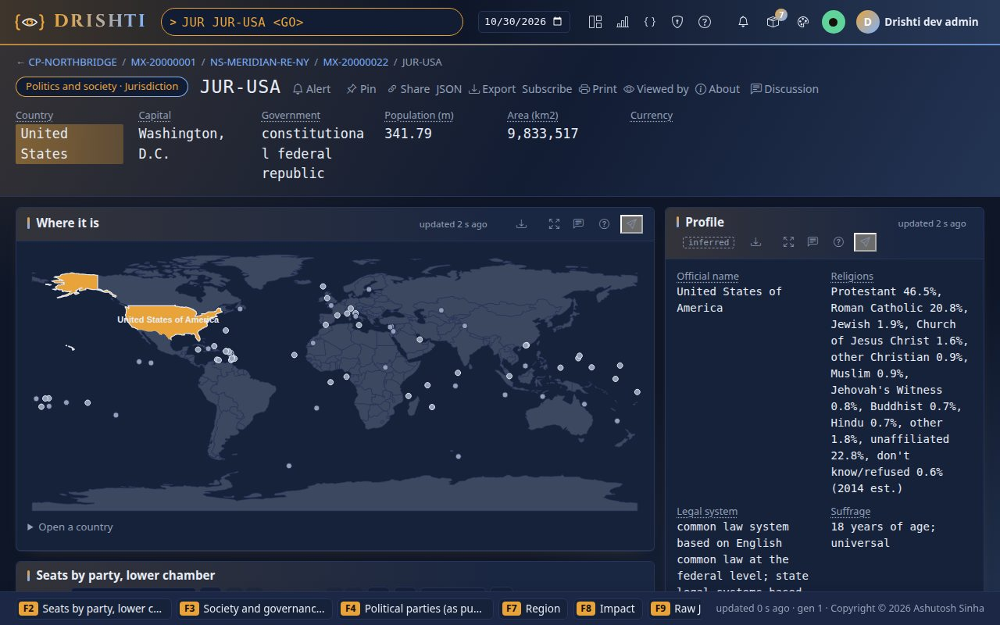

**From the command line.**

```bash
python3 tools/drishti.py view get economic-forecast/FCST-GBR-WEO
python3 tools/drishti.py view get country-group/ECG-HIC
python3 tools/drishti.py view get jurisdiction/JUR-GBR
```

**In YAML.** A country group is computed from its member economies when opened; the computation, its YAML and a region worked through
(`ECG ECG-SAS`) are in [the groupings tutorial, step 6](../guides/BI_GUIDE.md#step-6--a-world-bank-region-from-its-economies).

**You should see**

- `FCST FCST-GBR-WEO` (IMF World Economic Outlook, April 2026): growth 0.8% in 2026 and 1.3% in 2027, inflation 2.4% in 2027, government
  debt 102.9% of GDP in 2030; the outturns of 2015 to 2025 (−10.0% growth in 2020, 9.1% inflation in 2022) beside the projections, each row
  saying which.
- `ECG ECG-HIC`, computed from its 84 member economies: GDP 75,910 bn USD, growth 1.88% (weighted by GDP), median inflation 2.34%. The UK
  grows more slowly and its prices rise faster than the high-income median. `ECG ECG-WLD`: 213 economies, 117,327 bn USD, growth 2.80%.
- `JUR JUR-GBR`: the government, the office holders, the legislature and the elections, each linked to its own page (`OFFC`, `PARTY`, `ELEC`).

Further: [../guides/BI_GUIDE.md section 5](../guides/BI_GUIDE.md) (ECG with worked numbers).

#### Part B · Companies

The `us-equities` pack holds every company of the S&P 500, the Nasdaq-100 and the Dow from the SEC's EDGAR: its identifiers, its industry,
its index memberships, its filings and ten years of annual financials. The committed snapshot was retrieved on 2026-10-24: 586 companies,
194 SIC codes in 9 divisions, 531 with an LEI ([Companies, funds and ETFs primer](../knowledge/world.md#companies-funds-and-etfs-a-worked-example-on-the-demo-data)).

### Step 3 · One company, five identifiers

**In the UI.** Type `USEQ AAPL` and press Enter. Click its LEI to open the GLEIF record, and its SIC code to open the industry.

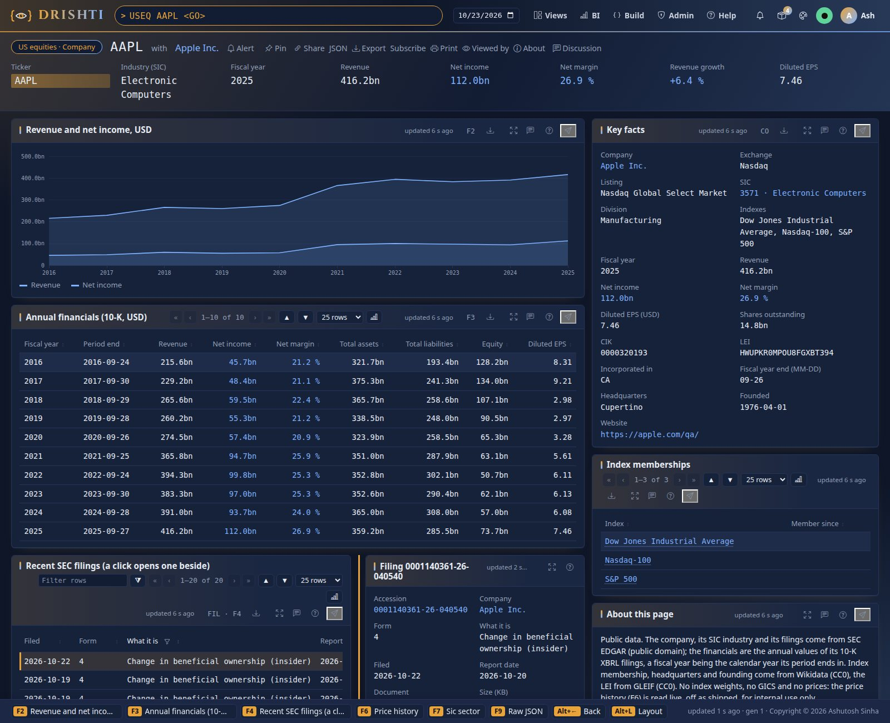

**From the command line.**

```bash
python3 tools/drishti.py view get us-company/AAPL
python3 tools/drishti.py view get sic-sector/3674
```

**In YAML.** The pack's commands, `config/packs/capitalmarkets/us-equities/pack.yaml`:

```yaml
mnemonics:
  USEQ:   { kind: us-company, label: US company }
  IDX:    { kind: index-membership, label: Index members }
  SIC:    { kind: sic-sector, label: SIC sector }
  EDGAR:  { kind: filing-feed, label: EDGAR filings browser }
  FILING: { kind: filing, label: SEC filing }
  FACT:   { kind: financial-fact, label: Financial fact }
  PXH:    { kind: price-history, label: "Price history (live, internal use only)" }
```

**You should see** *Apple Inc.*: ticker AAPL, CIK `0000320193`, SIC 3571 (Electronic Computers), division D (Manufacturing), LEI
`HWUPKR0MPOU8FGXBT394`, member of the Dow, the Nasdaq-100 and the S&P 500, 14,776,353,000 shares outstanding, revenue 416.2bn USD in fiscal
2025. Its LEI opens the GLEIF record and its ownership group (`LEIG HWUPKR0MPOU8FGXBT394`, 21 entities, Part D). `SIC 3674` has the 20
semiconductor companies, NVIDIA first by revenue (215.9bn), then Micron (133.2bn) and Broadcom (63.9bn). A company with several share
classes is keyed by one ticker: `USEQ GOOGL` is *Alphabet Inc.*, CIK `0001652044`, with the other tickers GOOG, GOOGM and GOOGN.

The ratios worked out on the page (net margin, revenue growth) and a sector's totals with the currency rule are
[the groupings tutorial, steps 4 and 5](../guides/BI_GUIDE.md#step-4--a-sector-and-the-currency-rule).

Further: the pack's guide, [us-equities.md](../../config/packs/capitalmarkets/us-equities/guides/us-equities.md).

#### Part C · Funds and ETFs

What does the largest Nasdaq ETF hold, who are its derivative counterparties, how far is it from its index, and which funds own
Apple? The `funds` pack answers from SEC public data for the 200 largest US mutual funds and ETFs. In this part you turn the pack
on, read a fund's fact sheet, look through its holdings, set it against its index, find funds by share class and by index, see who
holds a company, and refresh the data. Each step shows the UI, the command line and the YAML behind it; the outputs were captured with
sign-in off, on a lake built on 2026-10-27. Every column, source and option is in the one reference,
[../guides/WORLD_DATA_GUIDE.md](../guides/WORLD_DATA_GUIDE.md); each step ends with its sections.

### Step 4 · Turn the pack on and see what it holds

**In the UI.** With the server started as in *Before you start*, type `FUNDS` and press Enter.

**From the command line.**

```bash
python3 tools/drishti.py feed status funds
```

```text
$ python3 tools/drishti.py feed status funds
committed pack: 200 funds in 5 parts, data retrieved 2026-10-26
SOURCE   LICENCE                                           USE          LAST REFRESHED       CACHED
tickers  Public domain (U.S. Government work); SEC fair a  committable  2026-10-26T19:37:15  1.7 MB
nasdaq   Public symbol directory files (Nasdaq Trader)     committable  2026-10-26T19:37:15  871.4 KB
nport    Public domain (U.S. Government work); SEC fair a  committable  2026-10-26T19:12:40  441.0 MB
ncen     Public domain (U.S. Government work); SEC fair a  committable  2026-10-26T19:37:15  36.4 MB
rr       Public domain (U.S. Government work); SEC fair a  committable  2026-10-26T19:37:15  187.4 MB
gleif    CC0 1.0                                           committable  2026-10-26T19:37:15  23.4 MB
```

(On a fresh clone the LAST REFRESHED and CACHED columns say `never` and `-`: the committed snapshot needs no download.)

**In YAML.** The pack's commands and its Delta connector, `config/packs/capitalmarkets/funds/pack.yaml`:

```yaml
mnemonics:
  FUND:  { kind: fund, label: Fund or ETF }
  HELD:  { kind: fund-holder, label: Funds holding a company }
  TRACK: { kind: index-funds, label: Funds tracking an index }
connectors:
  funds-store:
    plugin: delta
    kinds: [fund, fund-holder, index-funds]
    settings:
      domain: funds
      layout:
        fund:
          type-ahead: [NAME, TICKERS]     # a fund is found by its name and by every share class ticker
```

You should see the pack's overview: **FUND** 200 funds, **HELD** 586 companies, **TRACK** 3 indexes, each with an example and its key
fields, and what the pack holds.

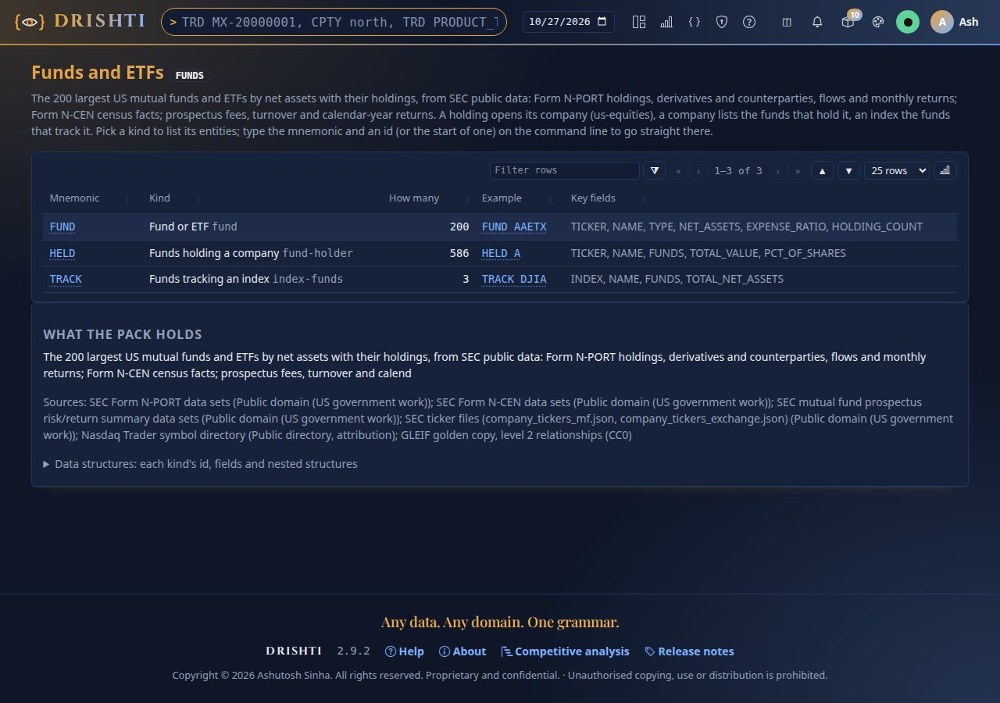

Further in the guide: [section 1](../guides/WORLD_DATA_GUIDE.md#1-turning-the-pack-on).

### Step 5 · Read a fund's fact sheet

**In the UI.** Type `FUND QQQ` and press Enter: Invesco QQQ.

**From the command line.**

```bash
python3 tools/drishti.py view get fund/QQQ
```

```text
$ drishti.py view get fund/QQQ
Funds · Fund or ETF  QQQ  with Invesco QQQ Trust, Series 1   [FUND]

Key figures
  figure         value
  -------------  ----------
  Ticker         QQQ
  Type           ETF
  Tracks         Nasdaq-100
  N-PORT report  2026-06-30
  SEC series     S000101292
  CIK            0001067839

Net assets  (metric, net-assets)
  {"value": {"text": "490.1bn", ...}, "unit": "USD", "caption": "2026-06-30"}
...
Top 10 holdings of 105 (a company opens its page)  (table, top-holdings, F2)
  Holding                       Ticker  SIC division   Weight   Value
  ----------------------------  ------  -------------  ------  ------
  NVIDIA Corp.                  NVDA    Manufacturing  7.60 %  37.2bn
  Apple Inc.                    AAPL    Manufacturing  6.67 %  32.7bn
  Micron Technology, Inc.       MU      Manufacturing  5.64 %  27.6bn
  ...
```

**In YAML.** The fact sheet's layout, `config/packs/capitalmarkets/funds/sutras/fund.v1.sutra.yaml` (shortened): tiles on top, the holdings and the
fund's facts side by side, the tabs at the bottom:

```yaml
layout:
  areas:
    - "tiles tiles"
    - "main side"
    - "low low"
    - "views views"
  columns: [7, 5]
panels:
  - { id: net-assets, kind: metric, area: tiles, span: 2, value: $.NET_ASSETS, title: Net assets, fmt: compact, unit: USD }
  - id: top-holdings
    kind: table
    area: main
    rows: $.HOLDINGS
    limit: 10
    columns:
      - { label: Holding, bind: "nonblank(@.COMPANY) ? link(@.COMPANY, 'us-company', @.NAME) : @.NAME" }
      - { label: Weight, bind: "@.PCT", fmt: weight2 }
```

You should see the tiles **Net assets 490.1bn USD**, **Expense ratio 0.18 %**, **Holdings 105**, **Top 10 45.00 %**, **Last calendar
year +25.58 %** (2024) and **Turnover 7.98 %**; the ten largest holdings from NVIDIA (7.60%) down, each a link to its company; the fund
(index Nasdaq-100, exchange Nasdaq, rank 7 by net assets) and its holdings by SIC division (Manufacturing 62.74%); its calendar-year
returns from 2015 (2022 −32.51%, 2023 +54.73%); three months of flows (net +10.4bn, +7.2bn, −6.8bn); the tabs at the bottom. Click
**NVIDIA Corp.**: `USEQ NVDA` opens.


Further in the guide: [section 2](../guides/WORLD_DATA_GUIDE.md#2-the-fund-page-the-fact-sheet) and [section 8](../guides/WORLD_DATA_GUIDE.md#8-fund).

### Step 6 · Look through the fund

**In the UI.** On `FUND QQQ`, press F5 (or scroll down) to the tabs; **Look-through holdings** is open.

**From the command line.** The document behind the tab, its holdings and derivatives:

```bash
python3 tools/drishti.py view get fund/QQQ --json | python3 -c "import json,sys; d=json.load(sys.stdin); print([p['id'] for p in d['panels'] if p['id']=='views'])"
curl -s http://localhost:18480/api/v1/entities/fund/QQQ/raw | python3 -m json.tool | grep -A12 '"DERIVATIVES"'
```

```text
    "DERIVATIVES": [
        {
            "NAME": "CME E-Mini NASDAQ 100 Index Future",
            "DERIVATIVE": "FUT",
            "CPTY": "Chicago Mercantile Exchange Inc.",
            "CPTY_LEI": "SNZ2OJLFK8MNNCLQOF39",
            "NOTIONAL": 327348710.7,
            "EXPIRY": "2026-09-18",
            "REFERENCE": "NASDAQ 100 Stock Index",
            "TYPE": "Future",
            ...
```

**In YAML.** The tabs are one `tabs` panel over the document's `VIEWS`; each panel inside shows on its own tab (`when:`):

```yaml
  - id: views
    kind: tabs
    each: $.VIEWS                       # [{VIEW: LOOK_THROUGH, TITLE: ...}, {VIEW: VS_INDEX, TITLE: vs Nasdaq-100}]
    tabTitle: "@.TITLE"
    panels:
      - id: holdings
        kind: table
        when: "@.VIEW == 'LOOK_THROUGH'"
        rows: $.HOLDINGS
        columns:
          - { label: Issuer, bind: "nonblank(@.COMPANY) ? link(@.COMPANY, 'us-company', @.NAME) : @.NAME" }
          - { label: Also in, bind: "nonblank(@.COMPANY) ? link(@.COMPANY, 'fund-holder', fmt(@.ALSO_IN, 'amount0') + ' funds') : ''" }
```

You should see **Concentration** (top 10 45.00%, top 50 87.45%, Herfindahl 0.029, 101 of 105 holdings with an LEI), common equity
99.93% of net assets, the one derivative (the CME E-mini Nasdaq-100 future, 327.3m notional, counterparty Chicago Mercantile Exchange,
an LEI link), all 105 holdings with ticker, ISIN, CUSIP and **Also in** (NVIDIA: 86 other funds), and **Who else holds Nvidia**: the
Vanguard Total Stock Market and 500 Index funds, iShares Core S&P 500 and the others by value.


Further in the guide: [section 3](../guides/WORLD_DATA_GUIDE.md#3-the-look-through-holdings-tab).

### Step 7 · Set the fund against its index

**In the UI.** Click the tab **vs Nasdaq-100**. Then try `FUND VOO` and its tab **vs S&P 500**, and `FUND AGTHX` (an active fund,
compared with the S&P 500 for reference).

**From the command line.**

```bash
python3 tools/drishti.py view get fund/VOO
```

```text
$ drishti.py view get fund/VOO
Funds · Fund or ETF  VOO  with Vanguard 500 Index Fund   [FUND]
...
The fund  (kv, the-fund)
  Type                     Mutual fund with an ETF share class
  Index                    S&P 500
  Adviser                  The Vanguard Group, Inc.
  Share classes            VOO VFINX VFIAX VFFSX
  Exchange                 NYSE Arca
  Creation unit (shares)   25,000
  Authorised participants  34
```

**In YAML.** The comparison is built with the document (`tools/packgen/funds/fundsbuild.py`, `_vs_index`) and drawn by the tab's panels:

```yaml
      - id: coverage
        kind: kv
        when: "@.VIEW == 'VS_INDEX'"
        columns:
          - { label: Active share, bind: $.VS_INDEX.ACTIVE_SHARE, fmt: weight2 }
          - { label: Index weights, bind: "$.VS_INDEX.WEIGHTING + ' (' + fmt($.VS_INDEX.MEMBERS_WEIGHTED, 'amount0') + ' members)'" }
```

You should see, for QQQ, **Members held** 98 of 99 listed members, **Active share** 11.21%, the index weights *market capitalisation
computed from SEC data, capped as the Nasdaq-100 methodology caps it (84 members)* and the members not weighted (their filed share
count cannot be compared: ABNB, APP, BKNG ...); the 25 largest weights side by side (Apple 7.9% in the fund against 9.6% in the
computed index) and the tilt by SIC division. For VOO the active share is 5.29% over 493 of 495 members; for AGTHX 44.41%; for DIA,
weighted by share price as the Dow is, 1.8%. The note at the bottom says why the index weights are computed: providers' weights are
proprietary. The members are what each index's tracking ETF (SPY, QQQ, DIA) reported holding.


Further in the guide: [section 4](../guides/WORLD_DATA_GUIDE.md#4-the-fund-against-its-index).

### Step 8 · Find funds: by share class, by index, by any field

**In the UI.** Type `FUND VTSAX` without pressing Enter: the suggestion is **VTI**, Vanguard Total Stock Market (VTSAX is one of its
share classes). Press Enter: VTI opens. Then type `FUND INDEX_ID=SP500` and press Enter.

**From the command line.**

```bash
curl -s "http://localhost:18480/api/v1/command/suggest?q=FUND%20VTSAX"
curl -s "http://localhost:18480/api/v1/search?q=FUND%20INDEX_ID%3DSP500" | python3 -c "import json,sys; print([r['ref']['id'] for r in json.load(sys.stdin)['rows']])"
```

```text
[{"type":"entity","mnemonic":"FUND","kind":"fund","id":"VTI","title":"VTI","subtitle":"Vanguard Total Stock Market Index Fund · VTI VTSMX VTSAX VITSX VSMPX VSTSX · fund · funds-store","complete":"FUND VTI"}]
['FXAIX', 'IVV', 'SPY', 'SPYM', 'SWPPX', 'VINIX', 'VOO', 'WFSPX']
```

**In YAML.** The search form of the kind (`FORM funds`), `config/packs/capitalmarkets/funds/pack.yaml`:

```yaml
form:
  fund:
    - { path: TICKER, type: id, group: Identity }
    - { path: TICKERS, label: Share class tickers, type: text, group: Identity }
    - { path: INDEX_ID, label: Tracked index, type: enum, group: Fund }
    - { path: EXPENSE_RATIO, label: "Expense ratio (%)", type: number, group: Size and cost }
```

You should see **8 of 200 funds match**: FXAIX, IVV, SPY, SPYM, SWPPX, VINIX, VOO and WFSPX (a feeder of an iShares master fund,
whose one holding is that fund, so it has no index tab), each with its type and net assets.


Further in the guide: [section 7](../guides/WORLD_DATA_GUIDE.md#7-commands-search-command-line-and-api).

### Step 9 · See every fund that holds a company

**In the UI.** Type `HELD AAPL`. Then open `USEQ AAPL` and click the tab **Held by funds** under its filings.

**From the command line.**

```bash
python3 tools/drishti.py view get fund-holder/AAPL
```

```text
$ drishti.py view get fund-holder/AAPL
Funds · Held by funds  AAPL  with Apple Inc.   [HELD]

Key figures
  figure               value
  -------------------  ----------
  Company              Apple Inc.
  Funds                85
  of which ETFs        26
  Value held           831.0bn
  Share of its shares  19.02 %
  Average weight       5.425 %
  Largest weight       14.57 %

Funds holding Apple Inc., by value (a fund opens its page)  (table, holders, F2)
  Fund                                    Ticker  Type                                 Weight in the fund    Value  Shares
  Vanguard Total Stock Market Index Fund  VTI     Mutual fund with an ETF share class             5.872 %  134.9bn  466.3m
  Vanguard 500 Index Fund                 VOO     Mutual fund with an ETF share class             6.590 %  110.1bn  380.6m
  ...
```

**In YAML.** The company page reads the funds pack's record as a source, `config/packs/capitalmarkets/us-equities/sutras/us-company.v1.sutra.yaml`:

```yaml
layout:
  areas: ["main right", "funds right"]
  tabs: [funds]                         # the panels of this area are tabs
panels:
  - id: held-by-funds
    kind: table
    area: funds
    source: { pack: funds, kind: fund-holder, id: $.TICKER }
    rows: $src.HOLDERS
```

You should see **85 funds** (26 ETFs) holding **831.0bn** of Apple, **19.02% of its shares**, at weights from under 1% to 14.57%; on
USEQ AAPL the tabs **Held by funds** (the same funds) and **Fund ownership**.


Further in the guide: [section 5](../guides/WORLD_DATA_GUIDE.md#5-held-by-funds-held-and-the-company-page) and [section 9](../guides/WORLD_DATA_GUIDE.md#9-fund-holder).

### Step 10 · See the funds that track an index

**In the UI.** Type `TRACK SP500`. Then open `IDX SP500`: the list **ETFs and funds tracking it** is on the right.

**From the command line.**

```bash
python3 tools/drishti.py view get index-funds/SP500
```

```text
$ drishti.py view get index-funds/SP500
Funds · Funds tracking an index  SP500  with S&P 500   [TRACK]
  Funds                7
  of which ETFs        4
  Net assets together  4,821.3bn
  Largest              VOO

  Fund                                     Ticker  Type                                 Net assets  Expense ratio  Members held  Active share*
  Vanguard 500 Index Fund                  VOO     Mutual fund with an ETF share class   1,671.2bn         0.03 %           493         5.29 %
  iShares Core S&P 500 ETF                 IVV     ETF                                     888.1bn         0.03 %           493         5.29 %
  Fidelity 500 Index Fund                  FXAIX   Mutual fund                             832.2bn         0.01 %           487         5.41 %
  State Street SPDR S&P 500 ETF Trust      SPY     ETF (unit investment trust)             781.2bn                          493         5.29 %
  ...
```

**In YAML.** On the index page, `config/packs/capitalmarkets/us-equities/sutras/index-membership.v1.sutra.yaml`:

```yaml
  - id: tracked-by
    kind: table
    title: "ETFs and funds tracking it (the funds pack; a fund opens its page)"
    when: "$.INDEX != 'BANKS-US' && $.INDEX != 'BANKS-CA' && $.INDEX != 'BANKS-UK'"
    source: { pack: funds, kind: index-funds, id: $.INDEX }
    rows: $src.ROWS
```

You should see **7 funds** (4 ETFs) with **4,821.3bn** together, VOO the largest; every one at an expense ratio of 0.03% or less (SPY,
a trust, files no prospectus summary) and an active share between 5.29% and 5.77% against the computed weights.


Further in the guide: [section 6](../guides/WORLD_DATA_GUIDE.md#6-funds-tracking-an-index-track-and-the-index-page) and [section 10](../guides/WORLD_DATA_GUIDE.md#10-index-funds).

### Step 11 · On a phone, and from the API

**In the UI.** Open `FUND VTI` on a phone (or narrow the window to 390 px): the tiles, then the holdings, the fund and the tabs stack.

**From the command line.** The page as data:

```bash
curl -s http://localhost:18480/api/v1/views/fund/VTI | python3 -c "import json,sys; v=json.load(sys.stdin); print([p['id'] for p in v['panels']][:8])"
```

```text
['net-assets', 'expense-ratio', 'holding-count', 'top-ten', 'last-year', 'turnover', 'top-holdings', 'the-fund']
```

**In YAML.** The phone order of the layout:

```yaml
layout:
  phone: [tiles, main, side, low, views]
```

You should see VTI's tiles one under the other (2,297.8bn of net assets, 3,546 holdings), then the top ten, the fund and the tabs, with
no sideways scrolling.

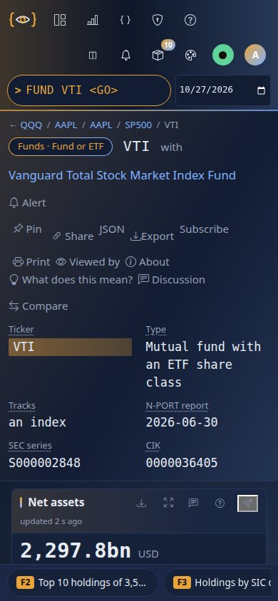

Further in the guide: [section 7](../guides/WORLD_DATA_GUIDE.md#7-commands-search-command-line-and-api).

### Step 12 · Refresh the data

**In the UI.** Nothing to click: the data is refreshed by a script, then the lake is rebuilt and the server reads it.

**From the command line.** On Linux and macOS (on Windows, `.\tools\windows\publicdata-funds.ps1` takes the same arguments):

```bash
tools/feeds/feed.sh run funds --dry-run      # what would be fetched; changes nothing
tools/feeds/feed.sh run funds --snapshot                # about 700 MB of downloads the first time, kept in the data folder; then make.py --check
python3 tools/drishti.py lake demo               # rebuild the lake
```

```text
$ tools/feeds/feed.sh run funds --dry-run
dry run: funds, sources tickers, nasdaq, nport, ncen, rr, gleif
  tickers (Public domain (U.S. Government work); SEC fair access policy; committable): 2 request(s), cache <data>/datafeeds/sources/cache/funds
    https://www.sec.gov/files/company_tickers_mf.json
    https://www.sec.gov/files/company_tickers_exchange.json
  ...
  then: tools/packgen/funds/make.py -> config/packs/capitalmarkets/funds and data/testdata; then make.py --check
```

**In YAML.** The snapshot the refresh writes, listed in `data/testdata/testdata.yaml` (the fund kind in parts, one tar):

```yaml
- folder: funds/fund
  pack: funds
  kind: fund
  connector: funds-store
  key: TICKER
  snapshot: true
  captured: '2026-10-26'
  files:
  - fund.tar                # fund/2026-10-26/snapshot.part-01.jsonl.gz ... part-05: a tar of date folders (the load rules)
```

You should see the dry run name every file it would fetch and write nothing; a refresh prints each download, then *wrote
config/packs/capitalmarkets/funds ... 7 snapshot files, 5.6 MB* and *funds pack matches its generator*. Without the downloads, `python3
tools/packgen/funds/make.py --check` still checks the committed snapshot.

Further in the guide: [sections 15](../guides/WORLD_DATA_GUIDE.md#15-the-refresh-script) and [16](../guides/WORLD_DATA_GUIDE.md#16-the-gzipped-snapshot-and-offline-use).

#### Part D · Legal entities and who owns whom

The `gleif` pack holds GLEIF's legal entity identifiers (LEIs), their reference data and who owns whom (GLEIF's level 2 data). The committed
snapshot was retrieved on 2026-10-25: 9,937 legal entities in 590 ownership groups across 133 countries
([Entities and ownership primer](../knowledge/data.md#entities-and-ownership-a-worked-example-on-the-demo-data)).

### Step 13 · Who owns this company, all the way up

**In the UI.** Type `LEI 010PWNH4K3BLIC3I7R03` and press Enter: *Gestion Placements Desjardins Inc.*, Montreal. Then
`LEIR LEIREL-010PWNH4K3BLIC3I7R03-DIRECT`, `LEIG 549300B2Q47IR0CR5B54` and `LEIC GB`.

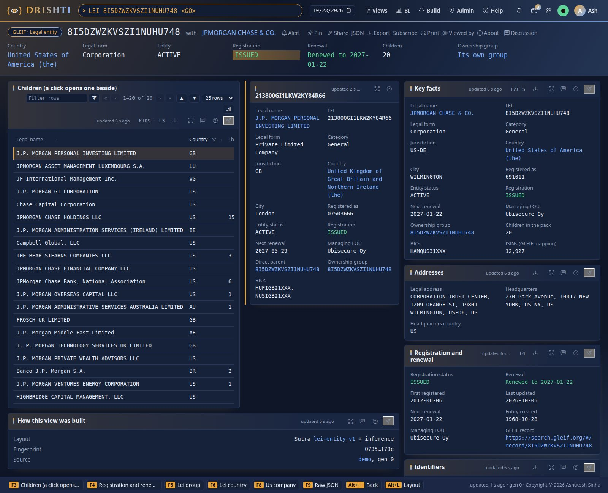

**From the command line.**

```bash
python3 tools/drishti.py view get lei-entity/010PWNH4K3BLIC3I7R03
python3 tools/drishti.py view get lei-group/549300B2Q47IR0CR5B54
python3 tools/drishti.py view get lei-country/GB
```

**In YAML.** The pack's commands and the id rule that makes a bare LEI open the entity, `config/packs/core/gleif/pack.yaml`:

```yaml
mnemonics:
  LEI:  { kind: lei-entity, label: LEI legal entity }
  LEIG: { kind: lei-group, label: LEI ownership group }
  LEIR: { kind: lei-relationship, label: LEI parent relationship }
  LEIC: { kind: lei-country, label: LEI country }
  LEIM: { kind: lei-mapping, label: ISIN or BIC to LEI }
graph:
  id-patterns:
    - { pattern: "^[0-9A-Z]{18}[0-9]{2}$", kind: lei-entity }       # an LEI (ISO 17442): 18 characters and two check digits
    - { pattern: "^LEIREL-", kind: lei-relationship }
```

**You should see** the record's parents:

```text
FÉDÉRATION DES CAISSES DESJARDINS DU QUÉBEC   549300B2Q47IR0CR5B54   ultimate parent (level 2), LEI issued, renews 2027-11-10
  └─ Desjardins Holding financier inc.        549300COKYB5EGSU1838   direct parent (level 1), LEI issued
       └─ Gestion Placements Desjardins Inc.  010PWNH4K3BLIC3I7R03   LEI LAPSED: renewal was due 2024-10-07
```

The group `LEIG 549300B2Q47IR0CR5B54`, computed when opened, has 26 members (all of GLEIF's 26) in 2 countries, and **7 of them have let
their LEI lapse**: a credit officer onboarding any of them would want to know. `LEIC GB`: 1,274 entities registered in the United Kingdom,
225 of them lapsed. `LEIG HWUPKR0MPOU8FGXBT394` (Apple Inc.): the whole group, 21 of 21, in 15 countries, none late; its record links to the
us-equities company `AAPL` (Part B) and to 949 ISINs.

How a group is computed from its entities, every group and the type-ahead, and a country's entities are
[the groupings tutorial, steps 1 to 3](../guides/BI_GUIDE.md#step-1--an-ownership-group-from-its-entities).

Further: the pack's guide, [gleif.md](../../config/packs/core/gleif/guides/gleif.md).

#### Part E · News and markets

The `news-and-markets` pack holds twenty well-known listed companies, each with a quote, a price chart and its headlines, and fifteen news
topics. As shipped it reads a real snapshot committed with Drishti (a year of daily bars for every company and the companies' and topics'
headlines, captured from Yahoo Finance and Google News): the pages work with no internet. The data belongs to Yahoo Finance, Google News and
the publishers and is shown for **internal demonstration only**.

### Step 14 · A company, its quote and its headlines

**In the UI.** Type `CO AAPL`, then `NEWS Apple` and `QUOTE AAPL`. `CO google` gives a pick list by name or alias: *Google* finds Alphabet.

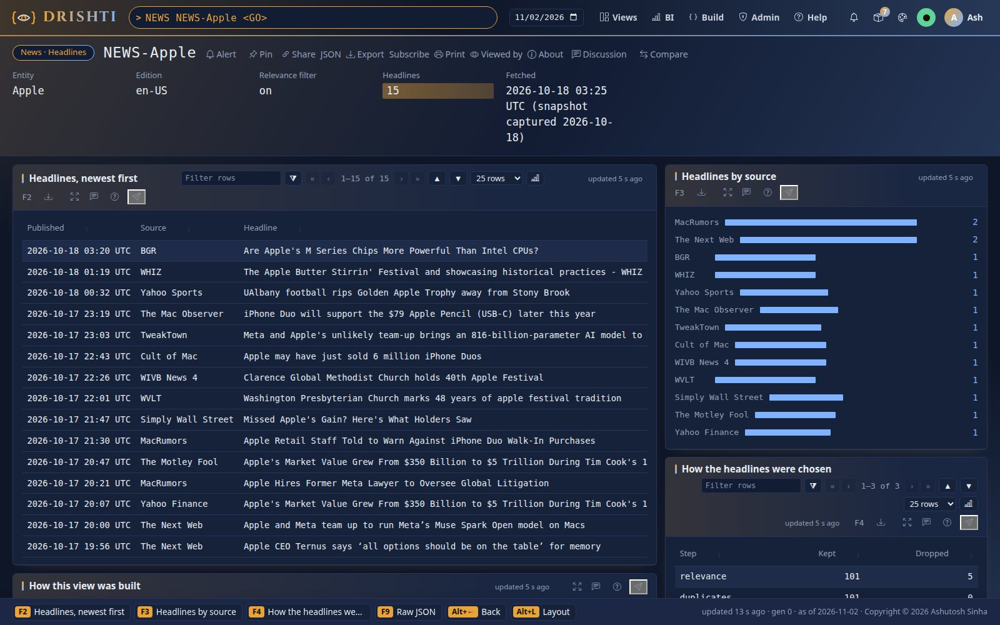

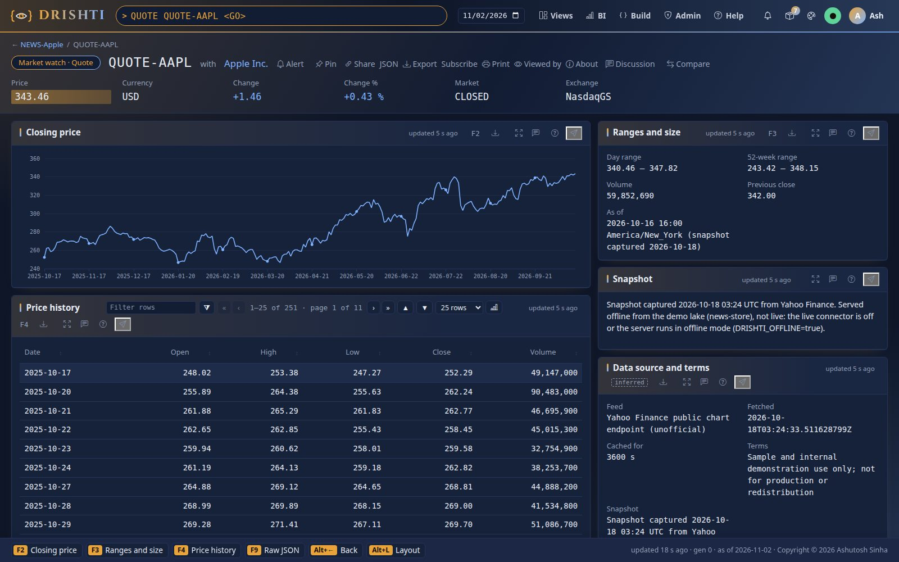

**From the command line.**

```bash
python3 tools/drishti.py view get listed-company/CO-AAPL
```

**In YAML.** The pack's commands and the id rules, `config/packs/economy/news-and-markets/pack.yaml`:

```yaml
mnemonics:
  TOPIC: { kind: news-topic, label: News topic }
  NEWS:  { kind: news, label: Headlines }
  CO:    { kind: listed-company, label: Listed company }
  QUOTE: { kind: quote, label: Quote and price history }
graph:
  id-patterns:
    - { pattern: "^TOPIC-", kind: news-topic }
    - { pattern: "^NEWS-", kind: news }
    - { pattern: "^CO-", kind: listed-company }
    - { pattern: "^QUOTE-", kind: quote }
```

**You should see** Apple's page with its quote, chart and headlines; on the snapshot the quote's *As of* and the headlines' *Fetched* end
in *(snapshot captured <date>)* and the quote and headline pages show a **Snapshot** note. Admin → Connectors shows `news` and `yfinance`
*off (served from the snapshot)*, or *off (offline mode)* on the quick-start server. Turning them on (`DRISHTI_NEWS_ENABLED=true`,
`DRISHTI_YFINANCE_ENABLED=true`) sends each name and ticker you open to Google and Yahoo.

Further: the pack's guide, [news-and-markets.md](../../config/packs/economy/news-and-markets/guides/news-and-markets.md);
holding the news in memory only is [tutorial 16, Part D](../tutorials/16-load-your-own-data-into-a-new-lake.md#part-d--news-held-in-memory-only).

### Next steps

- [The public sector tutorial](WORLD_DATA_GUIDE.md): the World Bank's development indicators, central banks, national statistics and official news, refreshed daily.
- [The groupings tutorial](../guides/BI_GUIDE.md): a SIC sector's totals, a company's margin and growth, an equity's beta.
- [The funds guide](../guides/WORLD_DATA_GUIDE.md): each kind's contract and example (Part II) and every source (Part III).
- [External data](../guides/WORLD_DATA_GUIDE.md): every public-data pack and its refresh script.
- [The exposure tutorial](../guides/EXPOSURE_GUIDE.md): a counterparty group's exposure, from the bank's side.

### If something goes wrong

| You see | Do this |
|---|---|
| `ECON` is an unknown mnemonic | the world-economy pack is not loaded: add it to `DRISHTI_PACKS` and restart the server |
| the forecast page is empty | the lake was built without the IMF data (`-- --no-imf`): IMF figures are internal only, so this is expected outside the bank |

## Tutorial: Public sector data and free news

Where is Canada on GDP per head, when did the Bank of Canada last move, what did Statistics Canada release this morning, which OECD
member has the highest inflation, what did the Fed publish this week, and how did the world's news read the United States yesterday? The
**public sector** (part of the economy module, with its own Public sector lens) answers from public sources, each pulled every day by
its own feed. In this tutorial you turn its packs on, run the six feeds, open each screen, schedule the feeds daily and change what one of them pulls. Each step shows the UI, the command
line and the YAML behind it. Every option, source and licence is in the one reference,
[../guides/WORLD_DATA_GUIDE.md](../guides/WORLD_DATA_GUIDE.md); each step ends with its section.

### Time to complete

About 30 minutes (the first runs of the feeds download a few megabytes).

### Before you start

- [Tutorial 1, Part A](../tutorials/01-first-15-minutes.md#part-a--install-start-and-look-around) done: a server and console you can build, start and stop.
- A network to the public sources (the feeds' tests use recorded answers; this tutorial uses the real sources).
- Optional: a [free FRED key](https://fred.stlouisfed.org/docs/api/api_key.html) in `DRISHTI_FRED_API_KEY` for the Federal Reserve's
  series; without it the Bank of Canada's still load.
- For the command-line steps: `DRISHTI_SERVER=http://localhost:18480` and `DRISHTI_TOKEN=...` (My account → API tokens), or sign-in off.

**Where this data comes from.** External, public data: the World Bank (CC BY 4.0), FRED and the Bank of Canada, Statistics Canada (Open
Licence), the OECD (CC BY 4.0), the press releases of central banks, regulators and governments (each publisher's own terms; the Bank of
England, OSFI and the Canada Gazette are internal only), and GDELT (free with a citation). Nothing is committed but a few sample
documents; the feeds write into your own `worldlake` and `newslake`. Every source: [External data](../guides/WORLD_DATA_GUIDE.md).

### What you will learn

- How a domain module brings packs, functions and a lens, and how to switch it.
- How a feed pulls only what is new and loads it into a lake, and how its licence travels with the data.
- How each public-sector screen is read: maps, charts, tables and links.

### Step 1 · Turn the packs on and see the module

**UI.** There is no page for modules; Home's lens links and Help follow them. `GET /api/v1/modules` lists **economy** (*Economy and markets*, content only) as on, with its packs (the six public-sector ones
among them), its functions and the World and Public sector lenses. Start the server with the packs loaded:

```bash
DRISHTI_PACKS=core,world-economy,world-development,central-banks,national-statistics,oecd,official-news,gdelt-events \
  java -jar kernel/drishti-server/target/drishti-server-*-exec.jar
```

**Command line.**

```bash
curl -s "$DRISHTI_SERVER/api/v1/modules" -H "Authorization: Bearer $DRISHTI_TOKEN" | python3 -m json.tool | grep -B2 -A6 '"publicsector"'      # the Public sector lens
```

**YAML.** The public sector is part of the economy module; the site's switch is `config/modules/economy.yaml`:

```yaml
enabled: true            # false, then a restart: the economy's packs, functions and lenses are gone; banking is untouched
```

You should see the economy module among `modules` (not under `off`) in `GET /api/v1/modules`, and *Public sector* among the lenses in Views (the `curl` prints its
record with its ten functions).

More: [../guides/WORLD_DATA_GUIDE.md sections 1 and 2](../guides/WORLD_DATA_GUIDE.md#1-the-module-its-lens-and-its-functions).

### Step 2 · Run the six feeds

**Command line.** See them, ask what one would fetch, then run all six (each pulls, writes `data/datafeeds/<feed>/<date>/` and loads into
its lake with the parallel loader):

```bash
python3 tools/drishti.py feed list
python3 tools/drishti.py feed run oecd --dry-run
for f in world-development central-banks national-statistics oecd official-news gdelt-events; do
  python3 tools/drishti.py feed run "$f" || echo "$f exited $?"
done
```

Each run ends with one line, `feed ok exit=0 feed=oecd date=... files=2 rows=... load=java`. Run one again: it says nothing new and
writes nothing.

**UI.** Admin → Data loads → Feeds: one row a feed with its last run, rows, lake and licence; *Run now* runs one.

world-development is the one fetcher of the World Bank's development indicators: the world-economy feed reads them from its output, so
run world-development first (its schedule does: 06:30, then world-economy at 06:45).

You should see six `feed ok` lines, and six green rows in Admin → Data loads → Feeds, each with its rows and its lake.

**YAML.** A feed file, `config/feeds/oecd.yaml` (shortened):

```yaml
feed: oecd
class: oecd.OecdFeed                 # tools/feeds/sources/oecd.py
lake: worldlake
schedule: {at: "07:00", days: daily}
licence: {name: OECD terms and conditions (CC BY 4.0), redistribution: attribution, internal-only: false}
datasets:
  oecd-country: {pack: oecd, kind: oecd-country, key: COUNTRY_ID}
  oecd-series:  {pack: oecd, kind: oecd-series, key: SERIES_ID}
options:
  sources: [{id: oecd, licence: "...", terms: "https://www.oecd.org/en/about/terms-conditions.html", internal-only: false}]
  countries: [AUS, AUT, ...]          # the 38 members
  measures: [...]                     # CLI, unemployment, inflation, GDP growth
```

More: [section 5](../guides/WORLD_DATA_GUIDE.md#5-the-feeds) and the [External data guide](../guides/WORLD_DATA_GUIDE.md).

### Step 3 · A country's development: WDI

**UI.** Type `WDI WDI-CAN <GO>`. The strip gives Canada's region, income group, capital, population and GDP per head. The table lists
every indicator with its latest year; click *GDP growth (annual %)* to open its history (`WDIS WDIS-CAN-NY_GDP_MKTP_KD_ZG`). The world
map is shaded by GDP per head; click Brazil to open `WDI-BRA`.

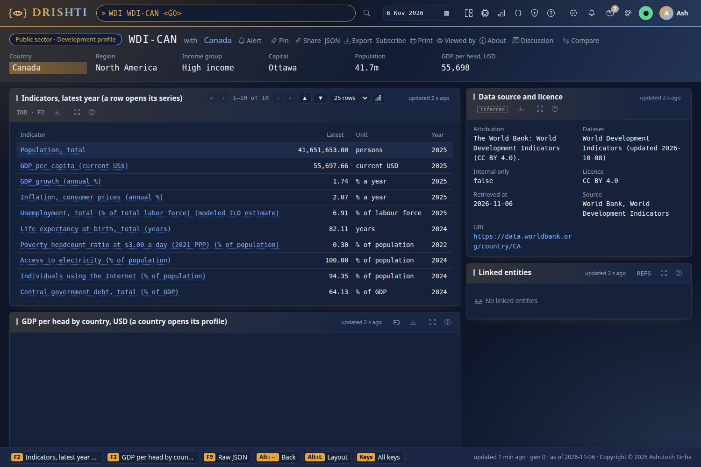

**Command line.**

```bash
curl -s "$DRISHTI_SERVER/api/v1/entities/development-profile/WDI-CAN/raw" -H "Authorization: Bearer $DRISHTI_TOKEN" | python3 -m json.tool | head -30
```

**YAML.** The screen is the Sutra `config/packs/economy/world-development/sutras/development-profile.v1.sutra.yaml`, built from the UI kit:

```yaml
panels:
  - { id: indicators, kind: table, rows: $.INDICATORS, columns: [ { label: Indicator, bind: "link(@.WDI_SERIES, 'development-series', @.INDICATOR)" }, ... ] }
  - use: region-map@1
    with: { highlight: $.ISO3, link-kind: development-profile, link-id: "WDI-{iso3}", shade-kind: development-profile, shade-field: $.GDP_PER_CAPITA }
```

You should see Canada's strip and indicators, the map with Canada highlighted, and the curl printing the start of `WDI-CAN`'s record.

More: [section 3](../guides/WORLD_DATA_GUIDE.md#3-the-screens) and the contract page
[world-development.md](../contracts/packs/world-development.md).

### Step 4 · A central bank: CBANK and CBSER

**UI.** Type `CBANK CBANK-BOC <GO>`: the target for the overnight rate, the date it last moved and by how many basis points, two years of
the rate, and every series of the bank (CORRA, the 2- and 10-year yields, USD/CAD). Click *Press releases* for the bank's latest releases
(Step 6). Type `CBSER CBSER-BOC-BD_CDN_10YR_DQ_YLD <GO>` for one series with its change on the day and on the year.

**Command line.**

```bash
curl -s "$DRISHTI_SERVER/api/v1/entities/central-bank/CBANK-BOC/raw" -H "Authorization: Bearer $DRISHTI_TOKEN" \
  | python3 -c "import json,sys; d=json.load(sys.stdin); print(d['POLICY_RATE'], d['LAST_MOVE_DATE'], d['LAST_MOVE_BP'])"
```

**YAML.** Add a series in `config/feeds/central-banks.yaml`:

```yaml
options:
  series:
    - { source: boc, code: V39079, bank: BOC, title: "Bank of Canada target for the overnight rate", unit: "%" }
```

*(screenshot filled in the heavy run: `CBANK CBANK-BOC`, the policy rate, its last move and the bank's series)*

You should see the policy rate, its last move date and its size in basis points, the same three numbers on the screen and from the
command line.

More: [section 5](../guides/WORLD_DATA_GUIDE.md#5-the-feeds) (the FRED key).

### Step 5 · National statistics and the OECD: NSTAT, OECD

**UI.** Type `NSTAT NSTAT-V41690973 <GO>`: Canada's consumer price index, the change on the month and on the year in per cent, the time
Statistics Canada released it, five years of history. Type `OECD OECD-CAN <GO>`: the leading indicator, unemployment, inflation and GDP
growth; the 38 members on a map shaded by inflation (click Japan to open `OECD-JPN`).

**Command line.**

```bash
python3 tools/drishti.py feed status national-statistics
```

**YAML.** A vector is one line of `config/feeds/national-statistics.yaml`:

```yaml
options:
  vectors:
    - { vector: 41690973, title: "Consumer price index, all-items (Canada)", unit: "index 2002=100", topic: Prices }
```

*(screenshot filled in the heavy run: `OECD OECD-CAN`, the members on a map shaded by inflation)*

You should see the CPI's latest value with its release time, the OECD map shaded by inflation, and `feed status` with the last run and
its rows.

More: [section 7](../guides/WORLD_DATA_GUIDE.md#7-changing-what-is-pulled).

### Step 6 · Official news: PRESS and PREL

**UI.** Type `PRESS PRESS-FED <GO>`: the Federal Reserve Board's latest releases, newest first. A title opens the release in Drishti
(`PREL ...`: its date, category and summary); the address opens the original on federalreserve.gov in a new tab. Type `PRESS PRESS-BOE
<GO>`: the strip says *Internal only: yes* and why (the Bank of England allows no commercial reuse). In the World lens, `PRESS` and
`GDELT` are there too.

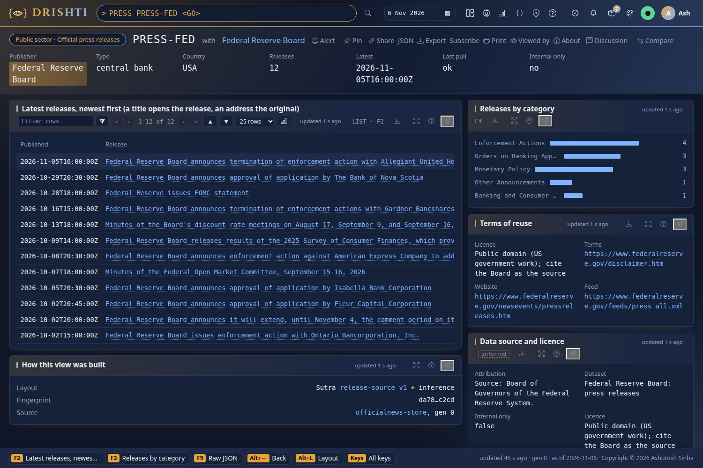

**Command line.**

```bash
curl -s "$DRISHTI_SERVER/api/v1/entities/release-source/PRESS-BOE/raw" -H "Authorization: Bearer $DRISHTI_TOKEN" \
  | python3 -c "import json,sys; d=json.load(sys.stdin); print(d['INTERNAL_ONLY'], d['WHY_INTERNAL'])"
```

**YAML.** Each publisher's terms in `config/feeds/official-news.yaml`:

```yaml
options:
  sources:
    - { id: BOE, title: Bank of England, type: central bank, country: GBR, feed: "https://www.bankofengland.co.uk/rss/news",
        licence: "personal or internal non-commercial use", redistributable: false, internal-only: true,
        why-internal: "The Bank of England allows personal and internal non-commercial use only" }
```

You should see the Fed's releases newest first with working links, and for `PRESS-BOE` the command line printing `True` and the reason.

More: [section 6](../guides/WORLD_DATA_GUIDE.md#6-licences-and-internal-only-data).

### Step 7 · World events: GDELT

**UI.** Type `GDELT GDELT-USA <GO>`: yesterday's events whose first actor is the United States, how often they were mentioned, the average
tone (below zero: negative coverage) and its change on the 30-day window, the Goldstein scale, the share of conflict; the tone by day; the
events by CAMEO category; the world map shaded by tone; the most-mentioned stories, each a link to the publisher.

**Command line.**

```bash
python3 tools/drishti.py feed run gdelt-events --dry-run      # the days it would read: only those after the last one
```

**YAML.** `config/feeds/gdelt-events.yaml`: `history-days: 30`, `min-events: 20`, `top-stories: 5`.

*(screenshot filled in the heavy run: `GDELT GDELT-USA`, the day's events, the tone by day and the map by tone)*

You should see the United States' events, tone and map, and the dry run listing only the days after the last one read.

More: [section 3](../guides/WORLD_DATA_GUIDE.md#3-the-screens).

### Step 8 · Run them every day

**Command line.** Print the scheduler's entries and install them:

```bash
python3 tools/drishti.py feed schedule --cron world-development central-banks national-statistics oecd official-news gdelt-events
python3 tools/drishti.py feed schedule --systemd world-development       # a service and a timer
python3 tools/drishti.py feed schedule --windows world-development       # Task Scheduler
```

**UI.** Admin → Data loads → Feeds shows a failing feed with its badge; the platform alert `data-feed-failed` tells you.

**YAML.** Each feed's `schedule: {at: "HH:MM", days: daily | weekdays}` (local time).

You should see one cron line per feed (a service and a timer for systemd, a task for Windows), each at the feed's own time.

More: [External data](../guides/WORLD_DATA_GUIDE.md).

### Step 9 · Change what a feed pulls

**YAML.** Add the World Bank's health spending to every profile, in `config/feeds/world-development.yaml`:

```yaml
options:
  indicators:
    - { code: SH.XPD.CHEX.GD.ZS, field: HEALTH_SPENDING, unit: "% of GDP" }
```

**Command line.** Pull again (a new indicator is pulled even when the World Bank has not changed), then check the contract:

```bash
python3 tools/drishti.py feed run world-development
python3 tools/contracts.py check        # names HEALTH_SPENDING until the contract and config/about.yaml describe it
```

**UI.** `WDI WDI-CAN <GO>`: the new row in the indicators table.

You should see *Current health expenditure (% of GDP)* in Canada's indicators, and `contracts.py check` naming `HEALTH_SPENDING` until
the contract describes it.

More: [section 7](../guides/WORLD_DATA_GUIDE.md#7-changing-what-is-pulled).

### Next steps

- [External data](../guides/WORLD_DATA_GUIDE.md): write a feed of your own.
- [Data lake and data load](../guides/DATA_LAKE_GUIDE.md): the lakes the feeds load.
- [Access model](../architecture/ACCESS_MODEL.md): modules, lenses and functions.
