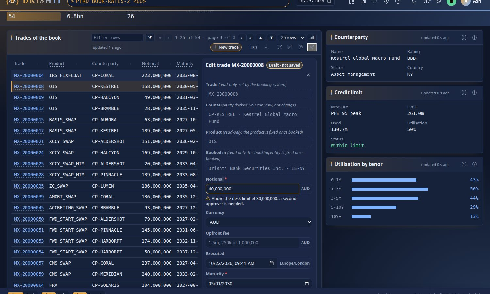
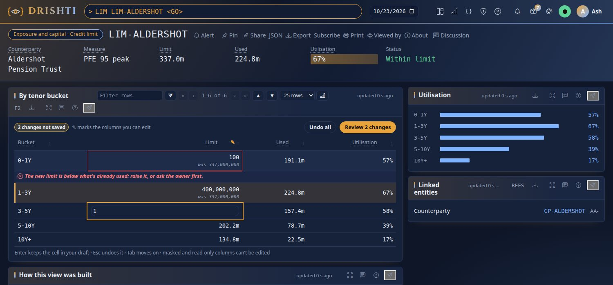
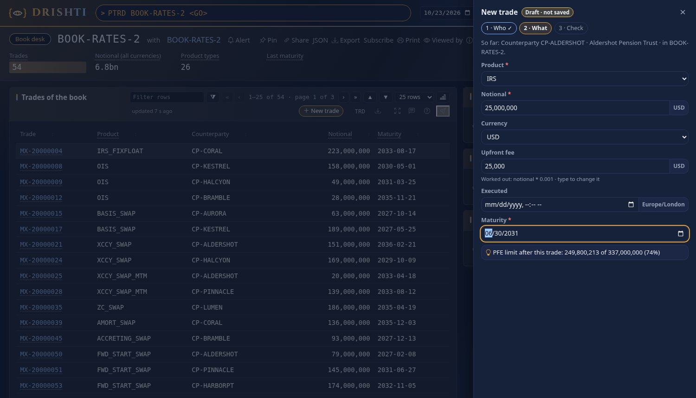

<!--
  Project Drishti · Any data. Any domain. One grammar.

  Copyright (c) 2026 Ashutosh Sinha <ajsinha@gmail.com>.
  All rights reserved.

  PROPRIETARY AND CONFIDENTIAL.

  This file is the confidential and proprietary property of Ashutosh Sinha.
  Unauthorised copying, use, modification, distribution or disclosure of this
  file, via any medium, is strictly prohibited except with the express prior
  written permission of the copyright holder.

  See the LICENSE file in the root of this repository for the full terms.
-->

# Write-back: forms, edits, approval and saving to the source

Write-back lets people change records from a Sutra's forms, the command line (`drishti.py change`) and the API: a correction kept beside
the source, an owned record, or an amendment sent through a connector, after approval where the policy asks. This is the one document:
sections 1 to 7 are for the **Sutra author** (forms, cells, drawers, drafts, submitting a change), sections 8 to 15 for the
**administrator** (switching it on, where a change goes, approval, the edit log, Admin → Edits, `writes:`, audit, problems). Section 16 is the design
and its reasons ([section 16](#16-the-design-and-its-reasons), for developers); the worked example is
[tutorial 24](../tutorials/24-correct-a-trade-and-approve-it.md).

A panel's `form:` lets people change the records it shows, or start new ones, without leaving the screen. Three ways in, chosen in
the Sutra:

| Way | Write | What people get |
|---|---|---|
| A form beside the table | `edit: beside` | Click a row: a form opens beside the table with typed fields |
| The table's cells | `edit: cells` | A ✎ marks the editable columns; people type into the cells, like a spreadsheet |
| A guided drawer | `new: drawer` | **New** opens a drawer over the dimmed page, one step at a time |

Saving keeps a **draft** for each person, on the server. A form whose Sutra has `save:` also **submits** the draft as a change: a
correction kept beside the source, an owned record, or an amendment sent through a connector, after approval where the policy asks
([section 4a](#4a-submitting-a-change-280-write-back), [section 16](#16-the-design-and-its-reasons)). The design is
[SUTRA_NEXT.md section 10](../architecture/SUTRA_NEXT.md#10-forms-and-data-entry); every key is in
[RACHANA_REFERENCE.md](RACHANA_REFERENCE.md#forms-form-on-a-panel).

## Contents

- [1. A form beside the table](#1-a-form-beside-the-table)
- [2. Editing in the cells](#2-editing-in-the-cells)
- [3. New records in a guided drawer](#3-new-records-in-a-guided-drawer)
- [4. Drafts](#4-drafts)
- [4a. Submitting a change (2.8.0 write-back)](#4a-submitting-a-change-280-write-back)
- [5. With the Sutra designer](#5-with-the-sutra-designer)
- [6. The expressions](#6-the-expressions)
- [7. Checking a form](#7-checking-a-form)
- [For administrators: write-back is off as shipped](#for-administrators-write-back-is-off-as-shipped)
- [8. Switch it on](#8-switch-it-on)
- [9. Where a change goes](#9-where-a-change-goes)
- [10. Approval](#10-approval)
- [11. The edit log, lanes and the cluster](#11-the-edit-log-lanes-and-the-cluster)
- [12. Admin → Edits](#12-admin--edits)
- [13. Writing to a source: `writes:`](#13-writing-to-a-source-writes)
- [14. Audit and retention](#14-audit-and-retention)
- [15. When something is wrong](#15-when-something-is-wrong)
- [16. The design and its reasons](#16-the-design-and-its-reasons)
    - [1. The ask](#1-the-ask)
    - [2. Principles](#2-principles)
    - [3. The idea in one picture](#3-the-idea-in-one-picture)
    - [4. Declaring what is editable (the Sutra)](#4-declaring-what-is-editable-the-sutra)
    - [5. Where an edit goes, and who writes it](#5-where-an-edit-goes-and-who-writes-it)
    - [6. The change request](#6-the-change-request)
    - [7. Edit queues (lanes), the edit log and the transaction handler](#7-edit-queues-lanes-the-edit-log-and-the-transaction-handler)
    - [8. Concurrency: why a queue alone is not enough](#8-concurrency-why-a-queue-alone-is-not-enough)
    - [9. Approval (four eyes)](#9-approval-four-eyes)
    - [10. On screen](#10-on-screen)
    - [11. Several servers (Drishti*net): ordering across a cluster](#11-several-servers-drishtinet-ordering-across-a-cluster)
    - [12. Off by default and controlled by roles](#12-off-by-default-and-controlled-by-roles)
    - [13. APIs, CLI and configuration](#13-apis-cli-and-configuration)
    - [14. Build plan](#14-build-plan)
    - [15. Tests](#15-tests)
    - [16. Decisions (product owner, 2026-10-19 and 2026-10-20)](#16-decisions-product-owner-2026-10-19-and-2026-10-20)
    - [17. Risks and open questions](#17-risks-and-open-questions)
    - [18. 2.8.0: saving through connectors, triggers and viewers](#18-280-saving-through-connectors-triggers-and-viewers)
    - [19. As built (2.8.0, 2026-10-25)](#19-as-built-280-2026-10-25)

## 1. A form beside the table

The book desk's trades (`config/packs/trading/sutras/pages/book-desk.v1.sutra.yaml`) carry this form. Open
`/v/portfolio-trades/BOOK-RATES-2?sutra=book-desk` and click a trade.



```yaml
panels:
  - use: row-picker@1
    with: { id: trades, rows: $.TRADES, key: TRADE_ID, ... }
    form:
      title: Edit trade
      key: trade_id                        # the field that names a record
      edit: beside
      fields:
        - { id: trade_id, label: Trade, bind: TRADE_ID, readonly: true, reason: "set by the booking system", new: false }
        - { id: counterparty, label: Counterparty, bind: COUNTERPARTY, type: lookup, readonly: true, required: true, options: { ... } }
        - { id: notional, label: Notional, bind: NOTIONAL, type: money, currency: currency, min: 0, required: true, fmt: amount0 }
        - { id: maturity_date, label: Maturity, bind: MATURITY_DATE, type: date, min: today, required: true }
        - { id: trade_status, label: Status, bind: TRADE_STATUS, type: enum, options: [PENDING, VALIDATED, AMENDED], editable-by: [middle-office] }
        - { id: comment, label: Comment, bind: COMMENT, type: textarea, max-length: 500, placeholder: Reason for the change }
      rules:
        - { rule: "notional <= 30000000", severity: warn, fields: [notional],
            message: "Above the desk limit of 30,000,000: a second approver is needed." }
        - { rule: "not (notional > 30000000 and empty(comment))", fields: [comment],
            message: "Say why the trade is above the desk limit: the second approver reads it." }
```

What people see:

- **Typed fields.** A number or an amount of money takes `40,000,000`, `40m` or `1.5bn`; a date opens the date picker; an enum is a list; a lookup is a
  list of what its source offers; `textarea` is several lines.
- **Locked fields say why.** `readonly: true` shows the value with "(read-only: set by the booking system)", or "(locked: you can
  view, not change)" when there is no `reason`. A field whose `editable-by` names roles the person does not hold is locked the same
  way. A masked field says **Hidden for you** and is never editable.
- **Messages in words, under the field.** An error (`severity: error`, the default) stops the draft; a warning (`severity: warn`) is
  said and kept with it, for example "Above the desk limit of 30,000,000: a second approver is needed."
- **Draft · not saved** while there are changes; **Save draft** keeps them; **Discard** throws them away (and the saved draft too).
- Leaving the page with changes not saved asks first. A panel being edited is not refreshed under the person's hands.

### Money, a date and time, a linked record, a worked-out default

The same form has four fields of the richer kinds (the book desk, `book-desk.v1.sutra.yaml`):

```yaml
        - id: legal_entity
          label: Booked in
          bind: LEGAL_ENTITY
          type: entity                        # a linked record of another pack's kind
          readonly: true
          reason: "the booking entity is fixed once booked"
          step: who
          options: { source: { pack: core, kind: legal-entity }, label: NAME }
        - { id: notional, label: Notional, bind: NOTIONAL, type: money, currency: currency, min: 0, required: true, fmt: amount0 }
        - { id: currency, label: Currency, bind: CURRENCY, type: enum, options: [USD, EUR, GBP, JPY, CHF, CAD, AUD] }
        - { id: upfront_fee, label: Upfront fee, bind: UPFRONT_FEE, type: money, currency: currency, min: 0, default: "=notional * 0.001" }
        - { id: executed_at, label: Executed, bind: EXECUTED_AT, type: datetime, tz: Europe/London }
```

- **`money`** is an amount and its currency. People type `1.5m`, `250k`, `2bn` or `1,000,000`; it shows grouped (`1,500,000`) once
  they leave the field. The currency sits beside it: fixed (`currency: USD`) or the one another field holds (`currency: currency`,
  which changes as people pick a currency). `min` and `max` are numbers. A value that does not read says *Notional is an amount
  (1,000,000, 1.5m or 250k)*.
- **`datetime`** is a date and a time (`2026-10-23T14:05`), entered with the browser's date and time picker; the time zone (`tz`,
  UTC when absent) is shown beside it and with the value (*2026-10-23 14:05 Europe/London*). `min` and `max` are a date and time or
  `today`.
- **`entity`** links the record to a record of any pack's kind: a search box over the records of `options.source` (a `where` or a
  `search` narrows them), read as the viewer may see them. Type part of a name or an id, pick with the arrows and Enter (or a click);
  the record's **id** is kept and its **label** shown (*Drishti Bank Europe AG · LE-FRA*), with **Open** beside it. A record whose
  kept value is masked for the viewer is never offered, and a masked label shows the id.
  The box searches the server as people type (a quarter of a second after the last key, *Searching…* meanwhile, *No match for
  “…”* when nothing holds the text), so every record of the kind can be found, not only those the page brought; the search reads as
  the viewer too ([API_GUIDE.md](API_GUIDE.md#form-drafts), `/api/v1/forms/lookup`). When the server cannot be reached, the choices the
  page brought still answer. On saving, the server reads the kept id once: an unknown one is refused, *Booked in: no legal entity
  'LE-NOWHERE' was found*.
- **`default`** starts a new record: a value (`default: PENDING`), or an expression written `=...` over the other fields
  (`=notional * 0.001`), worked out as people type (*Worked out: notional * 0.001 · type to change it*) until they type over it. The
  server fills it too when a new record leaves the field empty, so a draft saved by a script is the same.

## 2. Editing in the cells

A credit limit's buckets (`/v/credit-limit/LIM-ALDERSHOT`) are edited straight in the table:



```yaml
  - id: buckets
    kind: table
    rows: $.BUCKETS
    columns:
      - { label: Bucket, bind: "@.BUCKET" }
      - { label: Limit, bind: "@.LIMIT", fmt: compact }
      - { label: Used, bind: "@.USED", fmt: compact }
    form:
      key: bucket
      edit: cells
      fields:
        - { id: bucket, label: Bucket, bind: BUCKET, readonly: true, reason: "the tenor buckets are set by the limits policy" }
        - { id: limit, label: Limit, bind: LIMIT, type: number, min: 0, required: true, fmt: amount0 }
        - { id: used, label: Used, bind: USED, type: number, readonly: true, reason: "measured by the exposure engine" }
      rules:
        - { rule: "limit >= used", fields: [limit], message: "The new limit is below what's already used: raise it, or ask the owner first." }
        - { rule: "limit <= used * 3", severity: warn, fields: [limit], message: "More than three times what's used: the credit committee reviews it." }
```

A field edits the column whose `bind` names the same record field (`LIMIT` edits the column bound to `@.LIMIT`). The keys:
**Enter** (or F2, or a click) opens a cell and **Enter** keeps the value in the draft; **Esc** undoes it; **Tab** keeps it and moves
to the next editable cell (Shift+Tab back). A changed cell is tinted and says "was 337,000,000"; a bad one has a red border and the
reason under its row. The bar above the table counts "2 changes not saved", with **Undo all** and **Review 2 changes** (which lists
every change and saves the draft; it says "Fix 1 problem first" while one is wrong). A masked cell says *Hidden for you*.

## 3. New records in a guided drawer

```yaml
    form:
      new: drawer
      new-label: New trade
      steps: [ { id: who, label: Who }, { id: what, label: What }, { id: check, label: Check } ]
      fields:
        - id: counterparty
          type: lookup
          step: who
          options:
            source: { pack: counterparty-risk, kind: credit-limit, where: "nonblank(@.COUNTERPARTY)" }
            value: COUNTERPARTY            # what is kept
            label: COUNTERPARTY_NAME       # what is shown beside it
            carry: [LIMIT, USED]           # what the hints read: counterparty.LIMIT
        - { id: notional, type: number, step: what, ... }
      hints:
        - { label: "PFE limit after this trade", value: "counterparty.USED + notional", of: "counterparty.LIMIT", fmt: amount0, step: what }
```



**New trade** opens the drawer; the page stays visible behind it, dimmed. **Next** checks the step's fields first ("Counterparty is
required"); a done step is ticked; **Back** returns; the last step (Check) shows what was entered and every message. A hint is worked
out as people type: "PFE limit after this trade: 102,400,000 of 120,000,000 (85%)". **Save as draft** keeps it from any step, checked
up to that step. A field is asked in the drawer unless it says `new: false`; a `readonly` field is one a record keeps once it exists,
so the drawer may set it.

A lookup's choices are read as the viewer: an entity whose value is masked for them is not offered, and a carried value that is masked
makes the hint say *Hidden for you*.

## 4. Drafts

Drafts are kept per person on the server (the content store), through `/api/v1/drafts` ([API_GUIDE.md](API_GUIDE.md#form-drafts)).
The page says **You have 2 drafts on this page**, with **Resume** (the form opens again where it was: the row, the cells, the step) and
**Discard** for each. Every save is checked again on the server with the same rules; a value for a field masked for the person, or a
change to a field they may not edit, is refused; each save and discard is in the audit log.

## 4a. Submitting a change (2.8.0 write-back)

A form whose Sutra says where it goes, with `save:`, also has **Submit…** (2.8.0, [section 16](#16-the-design-and-its-reasons)). Its
fields' `bind` are the record's fields the change writes:

```yaml
form:
  title: Edit trade
  key: trade_id
  edit: beside
  save:                                  # without save:, the form keeps drafts only
    kind: trade                          # the records' kind (the page's kind when absent: here the page is a book's trades)
    target: overlay                      # overlay | owned | source
    approval: one                        # none | one | two (the site's policy may ask for more, never fewer)
    reason: required                     # required | optional
    # command: amend-notional            # target source: a command of the connector's writes: (create: for a new record)
    # connector: trade-murex             # target source: the connector (the one connector of the kind that writes when absent)
  fields: [ ... ]
```

| `target` | What Submit does | Shown |
|---|---|---|
| `overlay` | keeps a **correction** in Drishti beside the source's value (the source is not changed) | every page that reads the record shows the corrected value, and *How this view was built* says **Edited here** with the change id and who made it |
| `owned` | saves the record itself (Drishti is its system of record) | every page that reads it |
| `source` | sends a command of the connector's `writes:` to the source system, through the outbox | *pending at the source* until it confirms; refused, the page shows the source's value again |

**Submit** saves the draft, then opens the **review and confirm sheet**: for each record, what you saw, what is there now and your
change, with a field that moved since you opened it flagged before you send anything; where it goes (*Correction kept … (overlay)*,
*Amend in trade-murex (command amend-notional)*); who must approve (*One approver (not you): K. Rao or M. Diaz*); what it will
recompute (the reactive connectors whose triggers fire on a change to the kind); and the reason box. **Confirm and submit** turns the draft
into one change request per record. The sheet then follows each change: *Waiting for an approver*, *Approved*, *Applied* (the draft is
closed with the change id), or *Conflicted: the record moved* / *Refused* with the reason (the draft is kept and the drafts bar says so,
to edit again). A toast says it too when the sheet is closed.

Who may submit: editing must be on (`config/edit/edit.yaml`), the person needs the **edit** power (Admin → Roles: *Submit edits*), and
every field they change must be editable for them (not masked, not read-only, their role in `editable-by`). An approver is never the
person who submitted (four eyes); they decide in **Review → Changes** (Build → Govern → Changes). The server checks everything again, and
the lane owner checks it once more when it applies the change, against the record as it is then: a field that moved is *conflicted*,
never written over. A new record from the drawer can be submitted only to `owned` or `source` (with `create:`), never as a correction.
People who watch the record see the new value at once on its page (masked for them), with *Changed by … just now*.

From the command line, the same request: `drishti.py change submit d-4ab964fa3060 --reason "booking typo"` or
`drishti.py change propose --kind trade --id MX-20000012 --set NOTIONAL=28001250 --from NOTIONAL=28000000 --reason "booking typo"`
([TOOLS.md](TOOLS.md)); the API is `POST /api/v1/changes` ([API_GUIDE.md](API_GUIDE.md#write-back-changes-280)). A worked example with
pictures is [tutorial 24](../tutorials/24-correct-a-trade-and-approve-it.md).

## 5. With the Sutra designer

- **Customize › Let people edit**: pick a table, *in a form beside it* or *in its cells* (or *not at all*), tick the columns people
  may edit, and *start new ones in a guided drawer*; **Set** writes the `form:` (the first column names the record and is read-only).
  Each column is *as guessed* or what you pick: text, a number, money, a date, a date and time, or a linked record (offered when the
  packs say the column names one, such as COUNTERPARTY). The guess: a number format or a name like NOTIONAL is a number, money when
  the table has a CURRENCY column too (in that currency); a date format or `*_DATE` a date; `*_AT` or `*_TIME` a date and time; a
  column the packs link a linked record.
- **Describe**: `TRD BOOK-RATES-2 · click a trade → cash flows · edit trades beside · new trade in a drawer` (or `edit trades in the
  cells`) gives the trades the form above, with the lookup and the limit hint. The notional is `money`: in the trades' own currency
  when they carry one (a Currency field is added and `currency: currency`), else in the book's currency (`currency: GBP`), else USD.

See [SCREEN_DESIGNER.md section 31](SCREEN_DESIGNER.md#31-the-sutra-designer-customize-describe-outline-and-grid).

## 6. The expressions

Rules and hints use a small language, the same in the browser (instantly) and on the server (the authority): the fields by id, a
lookup's carried values (`counterparty.LIMIT`), numbers (`30_000_000` and `1e6` too), `'text'`, `true`, `false`, `null`, `today`;
`+ - * /`; `== != < <= > >=` (numbers as numbers, anything else as text, so ISO dates compare); `and or not`; brackets; `empty(x)`,
`len(x)`, `abs(x)`, `min(a, b)`, `max(a, b)`. An empty value makes a sum or a comparison empty, and a rule that comes out empty holds:
`required` says what is missing, not every rule. A rule that reads a lookup's carried value is checked in the browser only; the server
checks it again when 2.8.0 writes.

## 7. Checking a form

`sutra lint` and the editor check a form as `DRS-2058`, in words: an unknown key, a type, a `min` that is not a number for a number
field, a `step` or `key` that names nothing, a rule that reads a field the form does not have (`rule 'notionl <= 30000000' reads
'notionl', which is not a field of the form`), a pattern that is not a regular expression, a money field without its currency (or a
`currency` that is neither a code nor a field), a `tz` that is not a time zone, a `default` expression that reads a missing field. The JSON schema
(`/api/v1/rachana/schema`) describes `form:` for editors.

## For administrators: write-back is off as shipped

Write-back lets people change records from a Sutra's forms, the CLI (`drishti.py change`) and the API, as change requests: checked as
the person, approved by someone else where the policy says so, applied one at a time per record, in order, and audited. The design, with
the reasons behind each choice, is [section 16](#16-the-design-and-its-reasons); how a Sutra author makes a form submit is in the forms
guide ([section 4a](#4a-submitting-a-change-280-write-back)); a worked example is
[tutorial 24](../tutorials/24-correct-a-trade-and-approve-it.md).

**It is off as shipped**, at three levels, and all must be on before anything is written:

| Level | Off because | Turned on by |
|---|---|---|
| the site | `edit.enabled: false` in `config/edit/edit.yaml` | an administrator: `edit.enabled: true` (or `DRISHTI_EDIT_ENABLED=true`) and a restart |
| the field | a field is editable only when a Sutra's `form:` has `save:` | a Sutra author, through review like any Sutra change (the trading pack's book desk ships with `save:`: corrections of a trade, one approver) |
| the source | a connector writes to its source only when its file declares `writes:` and its writes are switched on | an administrator: the connector file's `writes:`, then **Switch on** in Admin → Edits (audited) |

Corrections (overlays) and owned records need the first two; an amendment sent to a source needs all three. People also need the
**edit** power on one of their roles (Admin → Roles: *Submit edits*); the shipped `admin` role has it. A personal API token needs the
`edit` scope, which no token has unless it is chosen.


## 8. Switch it on

```yaml
# config/edit/edit.yaml
edit:
  enabled: true          # or leave ${DRISHTI_EDIT_ENABLED:false} and set the variable
  log: auto
```

Restart the server. The start logs `write-back: on; edit log sqlite (auto: this node is alone), 64 lanes, node local`. Give the people
who edit a role with the edit power (Admin → Roles → *Submit edits*), and the people who approve a role with the approve power (or
name `policy.approver-roles`). Every setting is in [CONFIGURATION.md](../admin/CONFIGURATION.md#write-back-configedit).

## 9. Where a change goes

A form's `save.target` says (the author chooses, the site's policy may only make it stricter):

| Target | What is written | Who sees it |
|---|---|---|
| `overlay` | a correction kept in the Drishti database beside the source's value; the source is not changed | every page that reads the record (and the page row a form edited) shows the corrected value, named in *How this view was built* (*Edited here*); Admin → Edits lists it under Open overlays with the source's value |
| `owned` | the record's value itself, in the Drishti database (it is the record's system of record) | every page that reads the record |
| `source` | a command of the connector's `writes:`, sent through the outbox in the source's own transaction | the page shows the value as pending until the source confirms it; a refusal withdraws it |

The lake is never written per edit: the next lake build folds approved overlays in (planned with the loader).

## 10. Approval

`config/edit/policy.yaml`: approvals per target (`overlay: none`, `owned: none`, `source: one` as shipped; `two` for four eyes twice),
`approver-roles` (empty: the approve power or an administrator), `self-approval: false` (nobody approves their own change), the
`restate` role for a past business date and the `override` role for *Apply mine anyway*. A change that needs approval waits in
**Review → Changes** (top bar: Build → Govern → Changes); it takes its place in its record's lane only when approved, and is checked
against the record then.

## 11. The edit log, lanes and the cluster

Every change is a row of `drishti_edit_log` in the Drishti database, acknowledged only after its commit, in one of P lanes
(`lanes.lanes`, 64): a record always maps to the same lane, a lane applies one change at a time in its order, lanes apply in parallel.
Each lane has one owner, taken in the database by a conditional update with a lease (`lane-lease`, 10 s) and fenced by an epoch: a node
that lost its lane (cut off, paused) can no longer write anything. Which store, by `edit.log: auto`:

| Setup | The edit log | What happens when a node stops |
|---|---|---|
| one node | its SQLite Drishti database | it is the owner; after a restart it takes its lanes back and applies what was acknowledged |
| a cluster on PostgreSQL | the shared database; lanes spread over the members by the ring | another node takes the lanes after the lease, replays from the last applied change and resends unconfirmed commands |
| a cluster with `edit.primary` | the primary's SQLite; every other node forwards edits to it and copies its overlays | no failover: edits pause with a message while the primary is down; reading carries on |
| a cluster with neither | none | edits are refused in the cluster (`DRS-9306`); reading carries on |

The S3 edit log of the design is not built: on AWS use PostgreSQL (RDS, Aurora) for the Drishti database.

## 12. Admin → Edits

Admin → Edits shows the store in use and why (the auto rule), this node, each lane that has an owner or waiting changes (owner, epoch,
lease, depth, oldest wait), the warnings (an edit primary without failover, a lane whose oldest change waited past `lane-warn`, a lane with
waiting changes and no live owner, source commands not confirmed past `command-timeout`), each connector that declares `writes:` with
its commands, their problems and the on/off switch, and the open overlays. `drishti.py edits status` prints the same.

## 13. Writing to a source: `writes:`

A connector says *how* to change a record in its system; the Sutra says *what* may change; the lane owner says *when* and in what order.
In 2.8.0 the JDBC plugin writes; the file, Delta and Iceberg plugins never do (a lake is not written per edit), and the other plugins
are refused with *plugin … cannot write*. A command needs its concurrency guard and its idempotency clause:

```yaml
# config/connectors/trade-murex.yaml (excerpt)
writes:
  amend-notional:
    kind: trade
    params: [leg]
    jdbc:
      sql: >
        UPDATE MX_TRADE_LEG SET NOTIONAL = :value, VERSION = VERSION + 1, DRISHTI_CHANGE_ID = :changeId
         WHERE TRADE_ID = :entity AND LEG_NO = :leg AND VERSION = :basedOn
      expect-rows: 1
      already-applied: SELECT 1 FROM MX_TRADE_LEG WHERE TRADE_ID = :entity AND LEG_NO = :leg AND DRISHTI_CHANGE_ID = :changeId
    confirm: reply           # reply | next-load (ack-topic is read as a reply until a messaging plugin writes)
    timeout: 30s
```

A command without its guard or idempotency clause, or naming a parameter Drishti does not supply (`:entity`, `:kind`, `:businessDate`,
`:value`, `:from`, `:basedOn`, `:changeId`, `:by`, `:reason`, `:at`, `:field`) or the command does not declare in `params:`, is refused
when the connector loads: Admin → Connectors and Admin → Edits say why, and the connector stays read-only for it. Parameters are always
bound, never pasted into the SQL. A resend (after a failover) carries the same change id, so the source applies it at most once.

## 14. Audit and retention

Every step is in the audit log: `edit-submitted`, `edit-approved`, `edit-rejected`, `edit-withdrawn`, `edit-applied`, `edit-conflicted`,
`edit-refused`, `edit-self-approval-refused`, `edit-confirmed`, `edit-refused-at-source`, `form-draft-closed`, `connector-writes-on`/`-off`,
`edit-overlay-withdrawn`, `edit-log-purged`. Values of fields masked for the submitter are written as the mask. Each edit-log row carries a
SHA-256 signature over its place and body. The log is kept `retention.keep` (7 years); finished entries older are deleted.

## 15. When something is wrong

| You see | Why | Do |
|---|---|---|
| `403 DRS-9301` | editing is off | `edit.enabled: true`, restart |
| `403 DRS-9302 … no Sutra's form with save: names it` | the field is not editable | a Sutra author adds `save:` to the form |
| `403 DRS-9302 … does not hold the edit power` | the person's roles | Admin → Roles: *Submit edits* |
| `503 DRS-9306 Edits are paused …` | the edit primary is down, or the cluster has no shared edit log | start the primary; for failover use PostgreSQL |
| a change stays *queued* | no node owns its lane (Admin → Edits: a lane with waiting changes and no live owner) | check the server log for `edit lanes:`; a node takes the lane when its lease runs out |
| *unconfirmed* commands | the source did not confirm within `command-timeout` | check the source; the outbox keeps resending with the same change id |

## 16. The design and its reasons

Status: **W1 to W7 built (2026-10-25) and released in 2.8.0 (2026-10-26): [section 19](#19-as-built-280-2026-10-25)** says what is built, what is not, and the
decisions taken while building. Planned for 2.8.0 and shipped in it (decided 2026-10-19 as 2.7.0; moved to 2.8.0 on 2026-10-21; 2.7.0 is Sutra Next since 2026-10-22; AI is 2.9.0); decisions in section 16 (2026-10-19 and
2026-10-20). Related: [DATABASE.md](../architecture/DATABASE.md) (the one Drishti database: the edit log, lanes, overlays and owned data live in it;
2.8.0 item 0), [RUPAKA.md](../architecture/RUPAKA.md) (Sutra and the renderer), [CLUSTER_DEPLOYMENT.md](../admin/CLUSTER_DEPLOYMENT.md#1-drishtinet-many-servers-one-drishti) (several servers),
[GENUI.md](../architecture/GENUI.md) section 11 (write-back forms, deferred to this design), [BI_DESIGN.md](../architecture/BI_DESIGN.md) (review and proposals, reused
here), [CONNECTOR_FILES.md](../connectors/CONNECTOR_FILES.md) (connector files, where `writes:` lives). **2.8.0 additions (2026-10-24):** forms
save through connectors, an applied change can trigger a point-in-time calculation in a reactive connector, and updated records and
results are pushed to the people watching them: [section 18](#18-280-saving-through-connectors-triggers-and-viewers), with
[REACTIVE_CONNECTORS.md](../architecture/REACTIVE_CONNECTORS.md) and [VAR_GUIDE.md Part III](VAR_GUIDE.md#24-where-the-engine-lives).

### 1. The ask

The product owner (2026-10-19): a Sutra page should let a user **edit fields on the screen and save them**. Behind the scenes there
should be a **dedicated edit queue** and a **transaction handler** that processes updates **sequentially within a queue and concurrently
across queues**, so that at one exact moment only one edit is applied to a given thing, removing the classic concurrent-update problems.

This design keeps that model and makes three refinements (sections 7 and 8): edits are ordered per **record being changed** rather
than per Sutra; the records share a **fixed number of lanes** (queues) instead of one queue each, so millions of entities never mean
millions of queues; and every edit carries **the version it was based on**.

### 2. Principles

1. **Nothing is editable unless a Sutra says so**, field by field; masks win (a field you cannot see you cannot edit).
2. **Drishti never silently changes a source system's data.** An edit is a change request; where it lands is declared (section 5).
3. **One edit at a time per record, many records at once** (the queue model, section 7).
4. **No lost updates:** an edit based on data that has since moved is refused with a diff, never applied blindly (section 8).
5. **Every change is audited and replayable**; who changed what, when, why, from which value, is visible in *How this view was built*.
6. **Same rules everywhere:** the UI, the CLI and the API make the same change requests through the same handler.
7. **Off by default, at three levels:** the site switch, the connector's `writes:` and the Sutra's `edit:`; a fresh install or an
   upgrade is read-only exactly as today (section 12).
8. **Acknowledged means durable:** a change is acknowledged only once its row is committed in the edit log, in the one Drishti
   database ([DATABASE.md](../architecture/DATABASE.md)); a node that dies after the acknowledgement loses nothing (sections 7 and 11).
9. **The connector is the one place that knows a source system**, for reading and for writing (section 5.4).

### 3. The idea in one picture

```
 Browser (Sutra page)                 Server                                             Targets
 ┌──────────────────────┐   POST     ┌────────────────────────────────────────────┐
 │ edit cells / form    │ ─change──▶ │ Change API: validate (DEL), masks, role,   │
 │ pending-change bar   │  request   │ version check, approval policy             │
 │ "3 changes · Submit" │            └──────────────┬─────────────────────────────┘
 └─────────▲────────────┘                           │ lane = hash(record key) mod P
           │ live tick                ┌─────────────▼─────────────┐
           │ (applied / refused)      │ Lanes 0..P-1 (P = 64)     │  ── one worker per lane, in order
           │                          │ L17: MX-50000001 ▸ CP-9 ▸ │     lanes in parallel
           │                          │ L42: CLY-30000001 ▸       │
           │                          └─────────────┬─────────────┘
           │                                        │ apply (transaction handler)
           │                       ┌────────────────┼──────────────────────┐
           │                       ▼                ▼                      ▼
           │                 Overlay rows     Drishti-owned rows     Source command
           │                 (corrections,    (notes, limits,        (outbox → connector
           │                  annotations)     mappings)              writes: REST/JDBC/Kafka…)
           │                 └──── in the Drishti database, one transaction with ────┘
           └──────────────── the edit log row and the epoch check (audit, replay) ◀──┘
```

The lake (Delta, Iceberg) is not in this picture on purpose: it is never written per edit; the loader folds approved overlays into the
next day's lake build (section 5.2).

### 4. Declaring what is editable (the Sutra)

An `edit:` block on a strip cell, a table column or a panel field:

```yaml
strip:
  - label: Trader
    bind: $.TRADER_ID
    edit:
      type: enum                     # text | number | decimal | date | datetime | bool | enum | ref
      options: { kind: trader }      # enum from another kind (or a fixed list: [A, B, C])
      required: true
      valid: "value != ''"           # DEL, run in the browser for feedback and on the server as the authority
      roles: [trade-support]         # who may edit (beyond who may read)
      target: overlay                # overlay | owned | source (section 5); default from the kind's edit policy
      reason: required               # a free-text reason must accompany the change
panels:
  - id: legs
    type: table
    rows: $.LEGS[*]
    columns:
      - { label: Notional, bind: $.NOTIONAL, fmt: amount, edit: { type: decimal, valid: "value > 0", roles: [middle-office] } }
```

- Shared blocks carry `edit:` too, so a field made editable once is editable in every Sutra that uses the block.
- A kind may declare a default **edit policy** in its pack (`edit-policy: { target: overlay, approval: none }`); a Sutra field may only
  narrow it (stricter roles, approval), never widen it.
- `sutra lint` refuses an `edit:` on a computed binding (an expression, not a path), on a masked field, or a `target: source` whose
  `command:` is not a command in the kind's connector's `writes:` (section 5.4).

### 5. Where an edit goes, and who writes it

#### 5.1 Three write targets

| Target | What it is | For | Risk |
|---|---|---|---|
| **overlay** | Drishti keeps the new value as a dated layer *on top of* the source; the page shows the merged value with a marker ("edited · source says X") | corrections, annotations, flags, comments | none to the source; the overlay can disagree with the source, and the page says so |
| **owned** | the kind is Drishti's own (Drishti is its system of record): the value is a row in the Drishti database | notes, limits, mappings, reference overrides | the store is Drishti's: backed up and versioned like any |
| **source** | a named command of the connector's **`writes:`** (section 5.4) is sent to the source system: REST call, JDBC update, Kafka message, vendor API | genuine amendments in ENDUR, CALYPSO, MUREX | real: off by default, per connector, approval recommended |

- **Overlays and as-of.** An overlay entry has a business date and a valid-from; a view of date D shows overlays valid on D. Editing a
  past date is a **restatement** and needs a stronger role (section 12). Overlays can expire (`until:`) or be withdrawn.

#### 5.2 Who performs the write

**The lane owner's transaction handler does every write** (section 7 for the lane, section 11 for which node owns it). No other code,
node, page or job writes an edit's effect anywhere.

| Target | Where the handler writes | In which transaction |
|---|---|---|
| overlay | a row of `drishti_overlay` in the Drishti database ([DATABASE.md](../architecture/DATABASE.md)) | **the same transaction** as the edit-log row's state change and the lane's epoch check (section 11) |
| owned | the kind's rows in the Drishti database | the same, one transaction |
| source | nothing in the source directly: the edit-log row becomes `command: pending` (the outbox, section 5.3) | the same, one transaction; the source's own write happens later, in the source's own transaction |
| the lake (Delta, Iceberg) | **never, per edit** | the loader folds approved overlays into the next day's build |

- **Readers lay overlays over the source document at read time.** The engine reads the document as today, then applies the overlays
  valid on the view's business date (one indexed lookup per entity, cached by the entity's generation and invalidated by the live
  tick of an applied change). *How this view was built* names each overlay applied.
- **The lake is never written per edit.** Approved overlays are folded into the **next day's lake build** by the loader (`lake build` /
  `lake publish`), which writes the corrected value with the change id and the source's value beside it in `_drishti_overlay` columns
  (decision 16.1). Not per edit because: (a) every edit would be one tiny file and one commit, so a busy day means thousands of small
  Parquet files and a Delta or Iceberg log that grows with every change, slowing every read until compaction; (b) the daily rebuild of
  a business date writes the date afresh from the source, so a value written between builds would be overwritten anyway. A reader of a
  folded row skips the overlay with the same change id, so a value is never applied twice.

#### 5.3 Source commands: the outbox

A source system is written through its connector, in **its own transaction**, using the **outbox pattern**, so that Drishti's record
and the source never disagree about whether a command was meant:

```
 lane owner                                    Drishti database                      source system
 ──────────                                    ────────────────                      ─────────────
 1. apply ── one transaction ──────────────▶  edit_log row: command = pending
             (epoch check, section 11)          (+ the change, the epoch)
 2. sender ── reads pending, in seq order ──▶                         ── command(change id) ──▶ own transaction
 3. confirmation (reply | ack topic | next load) ──▶ command = applied | refused (+ reason) ◀──┘
 4. new owner after a failover: resends pending and sent-unconfirmed commands with the same change id ─▶ idempotent at the source
```

1. **One Drishti transaction** appends the change as `command: pending`, with the epoch check: either the change is in the log and
   will be sent, or neither.
2. **The sender** (a virtual thread on the lane owner) sends pending commands in seq order, each carrying the **change id**; it records
   `sent` with the time. Two commands for one record are never in flight together: the next waits for the previous one's confirmation,
   so the source sees them in order. A slow source never blocks the lane: the lane goes on applying overlay and owned changes.
3. **The confirmation** is what the command's `confirm:` says: the synchronous **reply** (JDBC rows affected, an HTTP status), a
   message on an **ack topic**, or the **next load** showing the value. It marks the row `applied`, or `refused` with the source's
   reason. Until then the page shows *pending at source*; past the command's `timeout:` it shows *unconfirmed* on Admin → Edits for an
   operator.
4. **A new owner resends** every pending and sent-but-unconfirmed command of its lanes with the **same change id**; the source applies
   it at most once (the idempotency clause of section 5.4). A resend never applies twice.

#### 5.4 How a write is described: connector `writes:`

Three layers, each saying one thing:

| Layer | Says | Where |
|---|---|---|
| the Sutra's **`edit:`** | **WHAT** may change: the fields, their types and DEL check, the roles, the target (`overlay`, `owned`, `source`), the `command` to use and its parameters, the approval | the Sutra (section 4) |
| the connector's **`writes:`** | **HOW** to change it in that system: named command templates, each with its concurrency guard, its idempotency and how it is confirmed | the connector file in `config/connectors/` |
| the **lane owner** | **WHEN** and in what **ORDER**: the lanes, the version check, the transaction, the outbox | generic code, the same for every source |

So **the connector is the one place that knows a source system**, for reading and for writing: a Sutra never holds SQL, a URL or a
topic; a command never knows about roles or lanes.

A Sutra field that amends the source:

```yaml
panels:
  - id: legs
    type: table
    rows: $.LEGS[*]
    columns:
      - label: Notional
        bind: $.NOTIONAL
        fmt: amount
        edit:
          type: decimal
          valid: "value > 0"
          roles: [middle-office]
          target: source
          command: amend-notional          # a command of the kind's connector's writes:
          params: { leg: $.LEG_NO }          # extra parameters, read from the row being edited
          approval: one
          reason: required
```

The connector's file (an excerpt of `config/connectors/trade-murex.yaml`):

```yaml
writes:
  amend-notional:
    kind: trade
    jdbc:
      sql: >
        UPDATE MX_TRADE_LEG
           SET NOTIONAL = :value, VERSION = VERSION + 1, DRISHTI_CHANGE_ID = :changeId
         WHERE TRADE_ID = :entity AND LEG_NO = :leg AND VERSION = :basedOn
      expect-rows: 1                     # the concurrency guard: 0 rows means the record moved (conflicted)
      already-applied: >                 # the idempotency clause: a resend finds its own change id
        SELECT 1 FROM MX_TRADE_LEG WHERE TRADE_ID = :entity AND LEG_NO = :leg AND DRISHTI_CHANGE_ID = :changeId
    confirm: next-load                   # reply | ack-topic | next-load
    timeout: 30s
```

How each kind of connector says it:

| Connector | Command template | Concurrency guard | Idempotency |
|---|---|---|---|
| **JDBC** (PostgreSQL, Oracle, SQL Server …) | `sql:` an `UPDATE` / `INSERT` with `:params` | `WHERE version = :basedOn` and `expect-rows: 1` | a change-id column, and `already-applied:` that finds it |
| **REST** | `method:`, `url:` (with `{params}`), `body:` (a JSON template) | `If-Match: :basedOn` (an ETag or version); `412` is conflicted | an `Idempotency-Key: :changeId` header |
| **Kafka / MQ** | `topic:` (or queue), `key:`, `message:` (a JSON template) | the version in the message (`"basedOn": :basedOn`); the consumer refuses a stale one and says so on the ack topic | the change id as the message key; the consumer de-duplicates by it |
| **Aerospike** | a bin `put:` on the record's key | the record's generation (`generation: :basedOn`, `EXPECT_GEN_EQUAL`) | the change id in a bin, checked before the put |
| **MongoDB** | `updateOne:` with a filter and an update document | the filter includes `{ version: :basedOn }`; `matched: 1` expected | the change id in the document; the filter skips a document already holding it |

- **`SourcePlugin.write(Command)` is implemented once per plugin** (JDBC, REST, Kafka, Aerospike, MongoDB …), never per source system:
  it fills the template with the parameters and runs it. A plugin without it cannot have `writes:` (today all are read-only).
- **A command is validated when the connector loads:** every `:param` must be one Drishti supplies (`:entity`, `:kind`,
  `:businessDate`, `:value`, `:from`, `:basedOn`, `:changeId`, `:by`, `:reason`, `:at`, and the `params:` a Sutra may declare by
  name), and the **guard** and **idempotency** clauses are required. A command missing either, or naming an unknown parameter, is
  **refused**: the connector loads read-only and Admin → Connectors shows why. Parameters are always bound (prepared statements,
  encoded URLs and JSON), never pasted into text.

### 6. The change request

```json
{
  "id": "chg-01JB3Z…",                 // assigned by the server (ULID: time-ordered)
  "key": "trade:MX-50000001",          // the queue key (section 7)
  "kind": "trade", "entity": "MX-50000001", "businessDate": "2026-10-16",
  "items": [ { "path": "$.TRADER_ID", "from": "TRDR-FROSSI", "to": "TRDR-AKHAN" } ],
  "basedOn": { "version": "gen-412", "hash": "sha256:…" },   // what the user saw (section 8)
  "target": "source", "connector": "trade-murex",
  "reason": "trader moved desks", "by": "asha", "at": "2026-10-19T14:02:11Z",
  "state": "queued"                     // draft → submitted → (awaiting approval) → queued → applying → applied | refused | conflicted | withdrawn
}
```

- **Bulk edits** are one request with many items (or many entities); the handler applies them as one unit per key.
- **Drafts** live in the user's state (they follow the user across nodes like saved searches) until submitted. A submitted change
  awaiting approval is a row of `drishti_edit_request` in the Drishti database; it takes its place in a lane (a seq in the edit log)
  only when it is queued.

### 7. Edit queues (lanes), the edit log and the transaction handler

**The model (the product owner's):** a dedicated queue; one worker drains a queue **strictly in order**; different queues are drained
**in parallel**. At any instant at most one change is being applied to a given record.

**Refinement 1: the key is the record being changed, not the Sutra.**

| Key choice | Problem |
|---|---|
| per Sutra | one Sutra renders every entity of a kind (all MUREX swaps): two traders editing two different trades would wait for each other; and two Sutras can show the same trade (a generic trade page and a MUREX swap page), so their queues would *not* serialise edits to that trade |
| **per entity** (`kind:id`), default | exactly the guarantee wanted: one change at a time per entity, unrelated entities in parallel |
| per source record (`connector:table:key`) | used when one entity spans several written records, or several kinds write the same record: the key is what is actually written |

The Sutra still matters: it decides *which* fields are editable and how; the queue decides *when* a change is applied.

**Refinement 2: a fixed number of lanes, not one queue per key** (product owner, 2026-10-19: per-entity queues would be a very large
number of queues). Like a partitioned log:

- **`P` lanes** (`edit.lanes`, default 64, a power of two). Each lane is one durable ordered queue with **one worker**.
- **A key always maps to the same lane:** `lane = murmur3(key) mod P`, a stable hash, the same on every node and after a restart.
- **Sequential per record, guaranteed:** every change to a record goes through its one lane, and a lane applies one change at a time
  in arrival order. **Parallel across lanes:** up to `P` changes apply at once.
- **Bounded cost:** `P` queues and `P` workers whatever the number of entities (a hundred or fifty million).
- **The trade-off:** unrelated records hashed to one lane wait for each other. It stays small because (a) an apply is short: overlay
  and owned writes are local, and a source command is *sent* and recorded, its confirmation handled off the lane, so a slow source
  never blocks it; (b) consecutive queued changes to the same key are applied as one batch; (c) `P` is a setting, and the lane depth
  is a metric (Admin → Edits: per lane, depth, oldest wait, applies per second) with a warning when a lane's oldest wait passes
  `edit.lane-warn` (default 2 s).
- **Changing `P`** moves keys between lanes; it is done with the queues drained (a maintenance switch: new changes wait, the lanes
  empty, `P` changes, they resume), never live.

**The edit log: a durable, shared, ordered log in the Drishti database** ([DATABASE.md](../architecture/DATABASE.md); decided 2026-10-20). A lane
*is* its rows in the log, so the queue survives any restart and is visible to every node that shares the database:

```sql
CREATE TABLE IF NOT EXISTS drishti_edit_lane (       -- one row per lane, P rows
    lane         INTEGER   PRIMARY KEY,
    owner_node   TEXT,                                -- the node that may append and apply (section 11)
    epoch        BIGINT    NOT NULL DEFAULT 0,        -- +1 at every change of owner: the fencing token
    lease_until  TIMESTAMP,                           -- the owner renews it; another node may take the lane only after it
    next_seq     BIGINT    NOT NULL DEFAULT 1,        -- the seq the next appended change gets
    applied_seq  BIGINT    NOT NULL DEFAULT 0         -- the last seq applied: a new owner replays from here
);
CREATE TABLE IF NOT EXISTS drishti_edit_log (
    lane         INTEGER   NOT NULL,
    seq          BIGINT    NOT NULL,                  -- the lane's order
    change_id    TEXT      NOT NULL UNIQUE,           -- the ULID of section 6: a retry or resend is recognised by it
    epoch        BIGINT    NOT NULL,                  -- the owner's epoch when appended
    state        TEXT      NOT NULL,                  -- queued | applying | applied | refused | conflicted | withdrawn
    change_key   TEXT      NOT NULL,                  -- trade:MX-50000001
    kind TEXT NOT NULL, entity TEXT NOT NULL, business_date DATE NOT NULL, target TEXT NOT NULL, connector TEXT,
    body         TEXT      NOT NULL,                  -- the change request (section 6), as JSON
    command      TEXT,                                -- source only: pending | sent | applied | refused (section 5.3)
    command_attempts INTEGER NOT NULL DEFAULT 0, command_sent_at TIMESTAMP, command_reason TEXT,
    by_user TEXT NOT NULL, submitted_at TIMESTAMP NOT NULL, applied_at TIMESTAMP, signature TEXT NOT NULL,
    PRIMARY KEY (lane, seq)
);
```

(The two schema files carry these, with the dialect's types; the parity test keeps them equal.)

- **Acknowledged only after commit.** The lane owner appends the change (takes `next_seq`, inserts the row, both conditional on its
  epoch, section 11) in one transaction; only when that commits does the user get "queued". A crash before the commit means no
  acknowledgement (the page keeps the draft and the retry carries the same change id); a crash after it loses nothing.
- **The lane's order is its seq**, not arrival time at a node nor a clock.
- **A new owner replays from `applied_seq`:** every row after it is applied in seq order. A row found `applying` is applied again
  safely: overlay and owned writes check the change id in the same transaction (an applied change id is skipped), and source commands
  are idempotent (section 5.3).

**The handler, per change taken from a lane, in seq order:**
1. re-check the role, masks and the field's `edit:` rules (the Sutra may have changed since submit; section 12);
2. read the current version of the entity and compare with `basedOn` (section 8);
3. run the server-side validation (DEL) against the *current* document with the change applied;
4. **in one Drishti database transaction:** check the lane's epoch (section 11), write the overlay or owned rows, or mark the
   command `pending` for a source target (section 5.3), set the row `applied` (or `refused`, `conflicted`) and advance `applied_seq`;
5. bump the entity's version and publish a live tick to every viewer.

**Implementation shape.** One virtual thread per owned lane, parked when its lane is empty and woken by an append (and, for appends
forwarded from other nodes, by the forward itself). No locks are held across I/O (ReentrantLock where needed, never `synchronized`
around I/O).

**Back-pressure.** A lane deeper than `edit.max-lane-depth` (default 1,000) refuses new changes with "busy, try again"; the page keeps
the draft.

### 8. Concurrency: why a queue alone is not enough

A queue serialises *writes*, but not *decisions*. Asha and Ben both open trade MX-50000001 at version 7. Asha changes the trader and
saves; it applies (version 8). Ben, still looking at version 7, changes the trader too; his change queues after Asha's and would
overwrite it without either of them knowing: a **lost update**, even though the writes never overlapped.

So every change carries **`basedOn`**, the version (and a hash of the fields it touches) the user saw:
- If the touched fields are unchanged since `basedOn`, the change applies (unrelated changes in between do not conflict: field-level).
- If any touched field moved, the change is **conflicted**: the page shows a three-way diff (what you saw, what is there now, what you
  wanted) with **Apply mine anyway** (needs the field's `override` role), **Take theirs**, or **Edit again**.
- Changes to the source outside Drishti (a load, a ticket in ENDUR) bump the version too, so they are detected the same way.

Together, **queue + version check** give: no two writes to a record at once, and no write based on stale data.

### 9. Approval (four eyes)

- Policy per kind, per field, per target: `approval: none | one | two`, approver roles, and whether self-approval is barred (default
  barred).
- An approval-needing change waits in **awaiting approval** (not in the queue); on approval it is enqueued and the version check runs
  *then*, against the data at apply time.
- **Review → Changes** lists what awaits you, with the diff, the reason and the entity page beside it; approve, reject with a reason,
  or ask for a change. It reuses the BI review and proposal machinery (Review → AI drafts already lists drafts the same way).
- A recommended default: overlays `none`, owned `none`, source `one`.

### 10. On screen

- **Edit mode toggle** on a page the user may edit (a pencil in the top bar; keyboard `e`). Off by default so reading is unchanged.
- **Inline edit:** an editable cell shows a pencil on hover; click or Enter edits in place with the field's own format; Tab moves on;
  Esc cancels.
- **Form mode:** a panel can open as a form built from its `edit:` fields (the query-by-form renderer reused).
- **Pending-change bar:** "3 changes · Review · Submit · Discard"; edited cells are marked; the page keeps ticking live, and an edited
  cell that ticks underneath shows "changed while you edited" at once (an early warning before submit).
- **After submit:** each change shows its state on the cell (queued, awaiting approval, pending at source, applied, refused, conflicted);
  applied changes tick to every viewer.
- **History:** a cell's menu shows its change history (from the edit log); *How this view was built* names overlays applied.
- Phone width: form mode only (no inline grid editing); the bar sits at the bottom.

### 11. Several servers (Drishti*net): ordering across a cluster

The guarantee (one change at a time per record, in submission order, nothing lost once acknowledged) must hold when nodes die and
when the network splits. Gossip and the ring alone cannot give it: after a split two halves can each believe they own a lane. So
(decided 2026-10-20) the edit log is **durable and shared** (section 7), ownership is **taken in the store**, and every write is
**fenced** by an epoch. This replaces the earlier "the change log replicated like user state".

```
 console ──▶ any node ──forward (signed, as the user)──▶ lane owner ──one transaction──▶ Drishti database
                 │                                       (epoch e)      append row (lane, seq, change_id, e)
                 └── reads the owner from drishti_edit_lane             ack only after commit
                                                                        apply: UPDATE … WHERE epoch = e
 node dies / splits off ──▶ lease runs out ──▶ next node on the ring claims: epoch e+1 (conditional UPDATE)
                                               replays from applied_seq; the old owner's writes now fail (stale epoch)
```

**Ownership: taken by a conditional UPDATE; the ring only suggests who should try.** The `P` lanes are placed on the member ring
(Admin → Net → Members shows each node's lanes); the node the ring names for a lane *tries* to take it, and the store decides:

```sql
-- take a lane whose lease has run out (the database's clock, never a node's)
UPDATE drishti_edit_lane
   SET owner_node = :me, epoch = epoch + 1, lease_until = <now> + :lease
 WHERE lane = :lane AND (owner_node IS NULL OR lease_until < <now>);          -- 1 row: mine, at the new epoch; 0: someone else's
-- renew (every lease/3)
UPDATE drishti_edit_lane SET lease_until = <now> + :lease
 WHERE lane = :lane AND owner_node = :me AND epoch = :myEpoch;                 -- 0 rows: I have lost it; stop the lane at once
```

Exactly one claimant's UPDATE matches; the lease (`edit.lane-lease`, default 10 s) only decides *when* someone may try. A node that
leaves cleanly releases its lanes (`lease_until = <now>`), so they move at once.

**Fencing: every append and every apply checks the epoch in the same transaction.**

```sql
UPDATE drishti_edit_lane SET next_seq = next_seq + 1
 WHERE lane = :lane AND owner_node = :me AND epoch = :myEpoch RETURNING next_seq - 1;   -- append: 0 rows, not the owner
UPDATE drishti_edit_lane SET applied_seq = :seq
 WHERE lane = :lane AND owner_node = :me AND epoch = :myEpoch;                          -- apply: 0 rows, roll back
```

If the epoch moved, the statement matches no row and the whole transaction (the overlay rows, the state, the outbox mark) rolls
back. So a **zombie owner** (a node cut off by a network split that still thinks it owns the lane, a node paused by a long GC) can
never write: its epoch is stale the moment the new owner takes the lane.

**Any console to any server works.** The receiving node computes the lane, reads its owner from `drishti_edit_lane` (cached, and
re-read when a forward is refused as "not the owner"), and forwards the change, signed and on behalf of the user, to the owner. The
owner appends and applies; the receiving node relays the acknowledgement and the live ticks. Source commands go out once, from the owner
(section 5.3).

**Where the shared log lives: the fallbacks.**

| Setup | Edit log store | Guarantee |
|---|---|---|
| **a single node** | SQLite, in the Drishti database: the same schema and the same code path (the node owns every lane; the epoch checks still run) | full, for one node |
| **a cluster with PostgreSQL** (the Drishti database is PostgreSQL) | the tables above, shared | **full**: failover, fencing, any node |
| **a cluster on AWS without PostgreSQL** | **S3 conditional writes**: one object per lane and seq, the lease an object updated by ETag (below) | full, at S3's latency (tens of ms per append) |
| **a cluster with neither** | one designated **edit primary** node holds the log in its SQLite Drishti database; the others forward every change to it | ordering full; **no failover**: if the primary is down, edits pause with a clear message and reads carry on |

*S3 layout* (`edit.s3: { bucket, prefix }`; the bucket's conditional-write support is checked at start, as for the Delta lake on S3):
- `…/edit/lanes/<lane>/lease.json` holds `{owner, epoch, lease_until}`; it is taken or renewed by a `PUT` with `If-Match: <the ETag
  read>` (`If-None-Match: *` the first time), so of two claimants exactly one succeeds.
- `…/edit/lanes/<lane>/log/<seq, 20 digits>.json` is one change, written with `If-None-Match: *`, so a seq is written once.
- A new owner changes the lease (epoch e+1) **before** it writes a *fence* entry `{fence: e+1}` at the next seq; an entry after a
  fence with a lower epoch is **void** and never applied. The old owner re-reads the lease after each `PUT` and acknowledges only if
  its epoch still holds; because the lease changed before the fence, an entry after the fence is never acknowledged.
- Without a shared database, each node keeps overlay and owned rows in its own Drishti database by **following the log** in seq order
  (idempotent by change id; `edit.follow`, default 1 s); state changes (applied, command sent) are appended as entries too.

*Edit primary* (`edit.primary: <node id>`): it owns every lane, permanently; there is **no automatic failover**, because two nodes on
either side of a split could otherwise both decide to be primary. Moving the primary is a configuration change made with the old one
stopped. While it is unreachable, every node answers an edit with *Edits are paused: the edit primary (drishti-main) is not reachable;
your changes are kept as drafts. Reading is not affected.* The other nodes follow its log for overlays, as for S3. It never risks two
writers.

**The setting:** `edit.log: auto | sqlite | postgres | s3` (in `config/edit/edit.yaml`). The **auto rule**, in order:
1. the Drishti database is PostgreSQL → `postgres`;
2. this node is alone (Drishti*net off, or the ring has one member) → `sqlite`;
3. `edit.s3` is set and its conditional-write check passes → `s3`;
4. `edit.primary` is set → `sqlite` on the primary, every other node forwards to it;
5. otherwise edits are **refused in the cluster**, with the message *this cluster has no shared edit log: use PostgreSQL for the Drishti
   database, set `edit.s3`, or name an `edit.primary`*. Reads are unaffected.

An explicit value is checked: `postgres` needs a PostgreSQL Drishti database; `s3` needs `edit.s3`; `sqlite` in a cluster needs
`edit.primary`; otherwise the server refuses to start and says which.

**Admin → Edits** shows the store in use (and why, from the auto rule), the owner, epoch and lease of every lane, and **warns** when a
cluster runs without a shared store (*edit primary: no failover*), when the primary is unreachable, or when a lane's lease is not being
renewed.

### 12. Off by default and controlled by roles

**Off at three levels.** All three must be on before anything is written:

| Level | Off by default because | Turned on by |
|---|---|---|
| **the site**: `edit.enabled: false` in the shipped `config/edit/edit.yaml` | no edit is accepted anywhere, by UI, CLI or API; no pencil is shown | an administrator setting `edit.enabled: true` (audited) |
| **the connector**: it writes only if its file declares `writes:` | none of the shipped connector files (`config/connectors.examples/`) declares one | an administrator adding `writes:` and switching it on in Admin → Connectors (administrator only, audited) |
| **the field**: editable only if a Sutra's `edit:` lists it | no shipped Sutra has a `target: source` edit | a Sutra author, through review (governance) like any Sutra change |

Overlay and owned targets need the first and third levels only; a source target needs all three.

**The roles:**

| To | You need | Notes |
|---|---|---|
| edit at all (see the pencil, submit anything) | the **`edit` power** on one of your roles (Admin → Roles) | without it, every page reads as today |
| edit a given field | one of the field's **`roles:`** in its `edit:` | narrows, never widens, the kind's edit policy (section 4) |
| approve a change | the policy's **approver role** | **never your own change** (four eyes, section 9) |
| *Apply mine anyway* on a conflict | the field's **`override`** role | audited with the overwritten value |
| edit a past business date (a restatement) | the **`restate`** role, stronger than the field's | per kind in `config/edit/policy.yaml` |
| turn on writes for a connector | **administrator** | audited; shown on Admin → Connectors and Admin → Edits |

- **Everything is re-checked at apply time**, by the lane owner, not only at submit: roles, the field's `edit:`, the masks, the packs.
- **Masks hold:** a field you cannot see you cannot edit; a change can never *reveal* a masked value (the diff shows masks for fields
  you cannot see).
- **Packs per user apply:** you can edit only kinds of the packs you are given.
- **API tokens** need the explicit **`edit`** scope (chosen when the token is created); **no token has it by default**, and an existing
  write scope does not imply it. A token never exceeds its user's current roles.
- **A fresh install or an upgrade behaves exactly as today: read-only.** Upgrading to 2.8.0 changes nothing until an administrator
  turns editing on.

**Audit.**
- The edit log is append-only, signed per entry (the same signing as audit), kept per retention policy; exports for compliance.
- Every change is audited at submit, approval, apply, and refusal, with the user, node, and the before/after values (masked per reader
  when shown).

### 13. APIs, CLI and configuration

- **API:** `POST /api/v1/changes` (submit), `GET /api/v1/changes?state=&kind=&entity=` (list), `GET /api/v1/changes/{id}`,
  `POST /api/v1/changes/{id}/approve|reject|withdraw`, `GET /api/v1/entities/{kind}/{id}/history`. A token needs the `edit` scope
  (section 12).
- **CLI:** `drishti.py change propose --kind trade --id MX-50000001 --set TRADER_ID=TRDR-AKHAN --reason "..."`, `change list`,
  `change approve <id>`, `change history trade MX-50000001`.
- **Configuration**, like connectors and Drishti*net, in its own folder `config/edit/`: `edit.yaml` (`enabled: false` as shipped,
  `log: auto`, `primary:`, `s3:`, `follow:`; section 11), `policy.yaml` (defaults per kind and target, approval, the restate role),
  `lanes.yaml` (lanes, max-lane-depth, lane-warn, lane-lease, timeouts), `retention.yaml` (the edit log, section 16). The edit-log
  tables live in the Drishti database, configured in `config/db/database.yaml` (planned) ([DATABASE.md](../architecture/DATABASE.md)). Writes to a source are
  the connector file's `writes:` (section 5.4), off unless declared and switched on.

### 14. Build plan

| Phase | What | Accepted when |
|---|---|---|
| W0 | **The one Drishti database** ([DATABASE.md](../architecture/DATABASE.md), 2.8.0 item 0): one pool and `config/db/database.yaml` (planned), two complete schema files with a parity test, the schema version stamp, `drishti.py db copy` | a 2.6.5 data folder starts with its users and settings; SQLite → PostgreSQL → SQLite keeps every row; a mismatched stamp refuses to start and names `db copy` |
| W1 | `edit:` in the Sutra schema and lint; Change API; the off-by-default switches and the roles (section 12); **the edit log on a single node with SQLite**: `drishti_edit_lane` and `drishti_edit_log` in both schema files, acknowledgement after commit, replay from `applied_seq`, the epoch checks (trivially one owner); lanes and handler; **owned** kinds and **overlays** as rows in the same transaction (corrections and notes first, section 16), overlays laid over the document at read time; version check; retention; inline edit and the pending bar | two users editing the same field: the second is conflicted with a diff, never silently overwritten; 100,000 concurrent changes over 1,000,000 entities on 64 lanes apply in per-entity order with no lost update (property test); a server killed after an acknowledgement applies the change once after restart; a fresh install is read-only |
| W2 | Approval (four eyes), Review → Changes, history, CLI | a change needing approval cannot apply without it; self-approval refused |
| W3 | **The cluster:** lane ownership by conditional UPDATE (the ring suggests), **fencing** by epoch on every append and apply, forwarding from any node, failover by lease; the **PostgreSQL** shared log, the **S3** log (lease by ETag, fences), the **edit primary** fallback, `edit.log: auto` and its rule, Admin → Edits (store, owners, warnings); the loader folding approved overlays into the next day's lake build (section 16) | the three cluster acceptance tests of section 15 pass on PostgreSQL and on S3; an approved overlay appears in the next lake build and in BI |
| W4 | `SourcePlugin.write` and **connector `writes:`** (validated at load), **source commands through the outbox** (pending, sent, confirmed; resend by the new owner with the same change id): the one real-amendment pilot (one field of one kind on one connector, JDBC first); pending at source | a source command applied twice by a retry changes the source once; a command without a guard or idempotency clause is refused at load; a command pending when its owner dies is sent once by the new owner |
| W5 | Form mode, bulk edit, phone, docs and a tutorial (UI, CLI, YAML) | a tutorial edits, approves and sees the change tick on another browser |
| W6 | **Forms save through connectors** (section 18.1): Submit on a 2.7.0 form turns its draft into a change request; the review and confirm sheet; the `edit.applied` event (section 18.3) | a form's draft submitted from the book desk becomes a change request, is approved and applied, and the draft is closed with the change id |
| W7 | **Triggers and viewers** (sections 18.3 to 18.6): reactive connectors subscribed to `edit.applied`; recompute status on the submitter's screen; the submitter's own impact; updated records and results pushed to every viewer, masked per viewer | an amended trade recomputes its book's VaR (step V5, [VAR_GUIDE.md section 30](VAR_GUIDE.md#30-the-design-record)); the submitter sees their impact, every viewer sees the new record and shared number within 2 s |

Placement: **2.8.0** (product owner: 2.7.0 on 2026-10-19, 2.8.0 since 2026-10-21; 2.7.0 is Sutra Next), after 2.6.0 (statements, field parameters, the Cassandra connector, drishti-iceberg;
integration moved after 3.0.0 on 2026-10-20); AI (grounding, AI UI, GenUI, AI management)
follows as 2.9.0; GenUI's write-back forms build on this. W0 comes first (2026-10-20).

### 15. Tests

- **Ordering property test:** random concurrent submissions over random keys on few lanes (so many keys share a lane); per key,
  applied order equals submission order; no change lost; versions strictly increase; no lane ever has two active workers.
- **Lost-update test:** two stale edits to one field; the second is conflicted.
- **Field-level independence:** concurrent edits to different fields of one entity both apply.
- **Restart:** queued changes survive a kill and apply in order after restart; an *applying* change is not applied twice.
- **Security:** masked fields not editable; roles re-checked at apply; audit entries for every state; a token without the `edit`
  scope is refused; with `edit.enabled: false` every edit is refused and no pencil shows.
- **Connector `writes:`:** a command with an unknown `:param`, or without its guard or idempotency clause, is refused at load and the
  connector stays read-only; a stale `basedOn` at the source comes back conflicted.
- **Browser:** inline edit, pending bar, conflict dialog, approval flow, phone form mode, the *edits are paused* message.

**Cluster acceptance tests** (W3, each on PostgreSQL and on S3; checked from the edit log):
1. **Kill the owner right after the acknowledgement.** A change is acknowledged, then its lane's owner is killed (`kill -9`) before
   it applies. The new owner applies it **exactly once**, **in order** with the lane's other changes.
2. **A network split with two claimants.** The owner is cut off from the cluster but not from the store; the ring's next node claims
   the lane. **Only one writes:** the cut-off node's next append or apply is **refused by its stale epoch**, nothing it attempts after
   the claim is applied, and nothing it acknowledged before is lost.
3. **The ordering test under failure:** 100,000 concurrent changes over 1,000,000 entities on 64 lanes across three nodes, with one
   node killed and a split made mid-run. Per entity, applied order equals submission order; no acknowledged change is lost or applied
   twice; no lane has two writers at any epoch.

### 16. Decisions (product owner, 2026-10-19 and 2026-10-20)

**2026-10-19**

1. **Approved overlays flow back into the lake.** The next lake build writes an approved overlay's value into the table (with the
   change id and the source's value kept beside it, in `_drishti_overlay` columns), so BI, search, exports and anything reading the
   lake see the corrected value. Reconciliation with the source stays possible: an **Open overlays** report lists every overlay whose
   source value still differs, and a source load that now agrees closes it.
2. **Corrections and notes first.** W1–W3 deliver overlays and Drishti-owned kinds (comments, flags, name fixes, mapping overrides);
   real amendments in a booking system start in W4 as **one pilot**: one field of one kind on one connector, approval required.
3. **The change log is kept 7 years by default, configurable** (`config/edit/retention.yaml`: `keep: 7y`; per kind may be longer, never
   shorter than the site default). Entries older than the hot window (default 90 days) are archived to compressed, signed files under
   `<data dir>/edit/archive/` (or an object store) and stay searchable through the API; deletion only past retention, audited.

**2026-10-20**

4. **One Drishti database** ([DATABASE.md](../architecture/DATABASE.md)): the edit log, lanes, overlays and owned data live in the same database as
   identity; PostgreSQL long term, SQLite the default for one node; no migrations (two complete schema files, a parity test, a version
   stamp, `drishti.py db copy`); its own file `config/db/database.yaml` (planned). Built first, as 2.8.0 item 0 (W0).
5. **A durable shared edit log replaces "replicated like user state"** (sections 7 and 11): `drishti_edit_lane` (ownership by
   conditional UPDATE; the ring only suggests) and `drishti_edit_log` (acknowledged only after commit; order by seq; replay from the
   last applied seq); every apply fenced by the epoch in the same transaction; any console to any server, forwarded to the owner.
6. **Fallbacks:** one node on SQLite; a cluster on PostgreSQL (full guarantee); a cluster on AWS without PostgreSQL on S3 conditional
   writes; a cluster with neither on one named edit primary (edits pause if it is down; never two writers). `edit.log: auto | sqlite |
   postgres | s3` with the auto rule of section 11; Admin → Edits warns when a cluster has no shared store.
7. **The lane owner's transaction handler does every write** (section 5.2). Overlays and owned data are rows in the Drishti database,
   in the same transaction as the edit-log row and the epoch check, laid over the document at read time. **The lake is never written
   per edit**; the loader folds approved overlays into the next day's build. **Source systems are written through the outbox**
   (section 5.3), in their own transaction, idempotent by the change id.
8. **Connector `writes:`** (section 5.4): the Sutra says what, the connector says how (named command templates with a required guard
   and idempotency, validated at load), the lane owner says when and in what order. `SourcePlugin.write(Command)` once per plugin.
9. **Off by default and controlled by roles** (section 12): the site switch, the connector's `writes:` and the Sutra's `edit:`; the
   edit power, field roles, approver (never your own), override, restate and administrator-only connector writes; re-checked at apply;
   masks and packs hold; API tokens need the explicit `edit` scope. A fresh install or an upgrade is read-only, as today.

### 17. Risks and open questions

1. **Writing to ENDUR/CALYPSO/MUREX** is a governance decision; source commands stay off until a bank approves a connector.
2. **Overlay drift:** an overlay that disagrees with the source for long is a reconciliation item (the Open overlays report, decision 1).
3. **Hot keys and hot lanes:** one very busy entity is serialised by design, and its lane's neighbours wait; batching and the lane
   metrics address it, and `P` can be raised.
4. **A cluster without a shared store** (the edit primary) has no failover: edits pause while the primary is down. PostgreSQL is the
   answer for production; Admin → Edits says so.
5. **S3 latency:** an append on S3 costs a conditional `PUT` and a lease read (tens of milliseconds); fine for edits made by people, not
   for bulk loads (which go through the loader).
6. **A source that cannot guard or de-duplicate** (no version, no change-id column, no idempotency key) cannot have a `writes:`
   command; such a source is edited through overlays only.
7. **Open:** the pilot's kind, field and connector for W4. *Decided while building (2026-10-25): JDBC first, no shipped connector writes (section 19, decision 11).*
8. **Open (2.8.0 additions, section 18):** should a change whose recompute fails stay applied (proposed: yes, the change is the record;
   the computation catches up) or be held until the recompute succeeds? *Decided while building (2026-10-25): it stays applied (section 19, decision 8).*
9. **Open:** must a write-back that changes risk materially (an incremental VaR above a threshold) require a second approver, with the
   threshold read from the recompute (a pre-trade check), or is that a later feature? *Decided while building (2026-10-25): a later feature (decision 9).*
10. **Open:** should the submitter's own impact (section 18.5) be kept with the change in the edit log for audit, or only shown? *Decided while building (2026-10-25): the compute audit only (decision 10).*

### 18. 2.8.0: saving through connectors, triggers and viewers

Added 2026-10-24 (product owner): **write-back saves via connectors**; **a saved change may trigger a point-in-time calculation** in a
reactive connector ([REACTIVE_CONNECTORS.md](../architecture/REACTIVE_CONNECTORS.md)); **updated records, and the results computed from them, are
pushed to the people watching them**. Everything in this section is planned (2.8.0), on top of sections 1 to 17, which it does not
change. Three static mock-ups were made with it (kept outside the repository): the review and confirm sheet with its recompute status
is the third.

#### 18.1 From a form's draft to a saved change

Since 2.7.0 a Sutra form saves **drafts only**, per person, through `/api/v1/drafts` (sections 1 to 4 of this document,
[SUTRA_NEXT.md section 10](../architecture/SUTRA_NEXT.md#10-forms-and-data-entry)). In 2.8.0 a form gains **Submit**:

```yaml
form:
  key: trade_id
  edit: beside
  new: drawer
  save:                                   # planned (2.8.0): where a submitted form goes
    target: source                        # overlay | owned | source (section 5.1)
    command: amend-trade                  # edit: a command of the kind's connector's writes: (section 5.4)
    create: book-trade                    # new: a create command of the same connector
    approval: one
    reason: required
  fields: [ ... ]                         # unchanged: each field's bind is the path the change item writes
```

| Step | What happens |
|---|---|
| 1 | The person fills the form; the draft is kept as in 2.7.0. |
| 2 | **Submit** opens the review and confirm sheet ([18.2](#182-the-review-and-confirm-sheet)). |
| 3 | **Confirm** turns the draft into **one change request** (section 6): each changed field is an item (`path` from its `bind`, `from`, `to`), `basedOn` is the version the form was opened on, and the draft's id is kept on the request. |
| 4 | The server checks the form's rules again as the authority (the `FormExpr` rules of 2.7.0), now **re-reading lookups** (a carried value such as a counterparty's limit is read again at apply time, as the 2.7.0 guide promised for the write). |
| 5 | The request follows sections 7 to 12: lanes, version check, approval, apply, outbox. |
| 6 | When the change is applied, the draft is closed with the change id; if it is refused or conflicted, the draft stays, marked with the reason, for the person to edit again. |

**Save via connector.** For a `source` target the **connector is the writer**, through its `writes:` commands (section 5.4), as before;
a new record uses a `create` command (an `INSERT`, a `POST`, a message), with the same required guard (for a create: *the key does not
exist yet*) and idempotency clause. `overlay` and `owned` targets are written by the lane owner to the Drishti database (section 5.2).
A reactive connector is **never** a write target: it computes; it may only be triggered (18.3).

#### 18.2 The review and confirm sheet

Before anything is submitted the person sees, in plain words:

- **the difference**, three columns per field: what you saw (the version the form opened on), what is there now, your change; a field
  that moved underneath is flagged before submit, not after;
- **where it goes**: *Amend in MUREX through trade-murex (command amend-notional)*, or *Correction kept in Drishti (overlay)*;
- **who must approve**: *one approver: K. Rao or M. Diaz (not you)*;
- **what it will recompute**: the reactive connectors whose triggers the change fires, and the scopes affected (*VaR of BOOK-RATES-2
  and the 4 scopes above it*), read from the triggers' `affects:` expressions without computing anything yet;
- **the reason** box when the field requires one.

#### 18.3 The applied event and triggers

When the lane owner applies a change (section 7, step 5) it publishes an **`edit.applied`** event **after** the transaction commits:

```json
{ "type": "edit.applied", "changeId": "chg-01JB3Z…", "lane": 17, "seq": 3412,
  "kind": "trade", "entity": "MX-50000001", "businessDate": "2026-10-23", "target": "source",
  "paths": ["$.LEGS[0].NOTIONAL"], "by": "asha", "appliedAt": "2026-10-23T14:02:11.204Z" }
```

- **Durable, because it is the edit log.** The event is a view of an `applied` row; a reactive connector that was down or behind
  reads the log from the last seq it processed per lane, so no applied change is ever missed, and the seq gives the order.
- **Paths, not values.** The event says which fields changed, never their values; a connector that needs the new record reads it
  through the router, pinned to the change's seq, so masks and entitlements apply as everywhere.
- **Source targets have two moments:** `edit.applied` (Drishti has recorded the change and the command is pending) and
  `edit.confirmed` (the source confirmed it, section 5.3), or `edit.refused-at-source`. A trigger chooses (`on: write-back, when:
  applied | confirmed`); risk recomputes usually take `applied` and recompute again on a refusal, so the screen is never behind the
  record.
- **The calculation is point-in-time.** The recompute is stamped with the lanes' watermarks it includes (`L17:3412`), so a result says
  exactly which changes it reflects ([REACTIVE_CONNECTORS.md section 8](../architecture/REACTIVE_CONNECTORS.md#8-point-in-time-stamping-ordering-and-idempotence)).
- **Coalesced:** twenty amendments to one book in a second cause one or two recomputes, not twenty
  ([REACTIVE_CONNECTORS.md section 10](../architecture/REACTIVE_CONNECTORS.md#10-coalescing-incremental-recompute-and-back-pressure)).
- In a cluster the owner of the lane publishes the event on Drishti\*net; each affected key's owner recomputes it.

#### 18.4 Conflicts

The rules of section 8 are unchanged: a change based on a version whose touched fields have moved is **conflicted**, with the
three-way diff and *Take theirs*, *Edit again* or *Apply mine anyway* (the `override` role). In addition:

- **A conflicted, refused or withdrawn change fires no trigger.** Only applied changes recompute anything.
- **Recomputes never conflict.** They are ordered by watermark; a result that started earlier and finished later is dropped, never
  shown over a newer one.
- **Two changes to different records of one scope** (two trades of one book) both apply, in their lanes' order; the shared result
  includes both, each submitter sees their own impact ([18.5](#185-what-each-person-sees)).
- **A source that refuses a command later** (`edit.refused-at-source`) withdraws the overlay of that change if one was shown, and the
  triggers recompute again, so computed numbers follow the record back.
- **A what-if sandbox** based on a record that has since changed says so (*based on version 7; the trade is now at version 8*) and
  offers to rebase; it never changes by itself.

#### 18.5 What each person sees

| Who | Sees |
|---|---|
| **the submitter** | the change's state on the cell or row (section 10); a **recompute status** card: which connector, which scopes, *coalesced with 2 other changes*, progress per scope, the stamp when done; and **their own change's impact** (*your change: incremental VaR +1.8m on RATES-NY*), private to them, computed against the state just before their change |
| **anyone viewing the record** | the updated record on the live channel (section 7, step 5), **masked for them**, with a short *changed by A. Sinha just now* mark (the name shown only if the viewer may see the edit history) |
| **anyone viewing a computed result the change affects** | the new shared result, stamped (*includes 3 changes since 14:02*); on a `consistency: snapshot` screen an *Update all* offer rather than a silent change ([REACTIVE_CONNECTORS.md section 12.2](../architecture/REACTIVE_CONNECTORS.md#122-one-as-of-for-the-whole-screen)) |
| **nobody else** | another person's impact, sandbox or draft is never sent to anyone but its owner ([REACTIVE_CONNECTORS.md section 9](../architecture/REACTIVE_CONNECTORS.md#9-isolation-two-users-never-see-each-others-answers)) |

#### 18.6 Audit

- The compute audit entry of a triggered recompute names the change id that triggered it; a cell's history (section 10) shows
  *recomputed VaR for 5 scopes (req-01JB4C…)* under the change, so a reviewer can follow a change to every number it moved.
- The submitter's impact is recorded in the compute audit with the change id (open question 10 in section 17 asks whether it is also
  kept in the edit log).

#### 18.7 Failure

- **A recompute that fails does not undo the change.** The change is the record; the affected results are marked *stale: the
  recompute after change chg-… failed (reason)* and recompute on the next trigger or read. Open question 8 in section 17.
- **A reactive connector that is off or not approved** is simply not triggered; the review sheet says *VaR will not be recomputed:
  var-engine is not approved*.

#### 18.8 Build steps

W6 and W7 in section 14. They depend on W1 (the edit log) and on [REACTIVE_CONNECTORS.md](../architecture/REACTIVE_CONNECTORS.md) steps R1 to R4; the
VaR use is step V5 of [VAR_GUIDE.md section 30](VAR_GUIDE.md#30-the-design-record).

### 19. As built (2.8.0, 2026-10-25)

W1 to W7 are built, and released in 2.8.0, in `drishti-server` (`com.ash.drishti.server.edit`), with the JDBC plugin's writes, the router's overlay
layer in `drishti-engine`, `form.save` in `drishti-rachana`, the console's Submit, Review → Changes and Admin → Edits, and
`drishti.py change` / `edits`. The administrator's guide is [the section for administrators](#for-administrators-write-back-is-off-as-shipped); the author's is
[section 4a](#4a-submitting-a-change-280-write-back); a worked example is
[tutorial 24](../tutorials/24-correct-a-trade-and-approve-it.md).

| Wave | Status | As built |
|---|---|---|
| W1 | **built** | `drishti_edit_lane`, `drishti_edit_log` (and `drishti_edit_request`, `drishti_overlay`, `drishti_owned`, `drishti_edit_version`, `drishti_edit_cursor`) in both schema files (the parity test holds); `EditLog`: append fenced by the epoch and acknowledged after commit, ordered by seq, a retry with the same change id not appended twice, `Busy` past `max-lane-depth`; `Lanes`: `murmur3(key) mod P`, one virtual-thread worker per owned lane woken by an append, replay from `applied_seq`; `EditHandler`: re-checks at apply (the switch, the edit power, the kind, masks, the form's roles and read-only fields, restate and override roles), field-level conflict, the form's rules over the record as it is now, overlay or owned rows and the version in the apply's transaction; overlays laid over every document the router reads (`DocumentLayer`), *How this view was built* says *Edited here*; the Change API; the `edit` power and the `edit` token scope; off by default (`config/edit/`); retention (7 years) |
| W2 | **built** | four-eyes approval (`drishti_edit_request`, compare-and-set decisions, never your own, the policy's approver roles), Review → Changes, a record's history (`GET /entities/{kind}/{id}/history`), `drishti.py change ...` |
| W3 | **built** (PostgreSQL and the edit primary; S3 not built) | lane ownership by conditional UPDATE with a lease taken on the database's clock, the ring (rendezvous hashing over the alive members) suggesting who tries, renewal every lease/3 and a lane stopped at once when renewal fails, every append, apply and command fenced by the epoch; a change submitted on any node forwarded to its lane's owner (signed, on behalf of the person: `POST /net/edits/append`); applied changes broadcast to the other members (caches dropped, viewers and consoles told); `edit.log: auto` with its rule and the explicit values checked; the edit primary: the other nodes forward the whole write-back API to it (`EditForwardFilter`) and copy its overlays (`edit.follow`), *Edits are paused* while it is unreachable; Admin → Edits with the store, lanes and warnings |
| W4 | **built** (JDBC) | `SourcePlugin.writeKey/checkWrite/write`; connector files' `writes:` parsed, kept by the form and template updates, validated at load (guard and idempotency required, unknown `:param` refused: a warning on `writes.<command>`, the connector read-only for it); writes switched on per connector by an administrator (audited, the switch ledger); the outbox: `command: pending` in the apply's transaction, sent in seq order, one in flight per record, `sent`/`applied`/`refused` fenced, `reply` and `next-load` confirmation, resend with the same change id after a failover; a refusal withdraws the pending overlay and fires the triggers again. File, Delta and Iceberg connectors never write (the lake is not written per edit); every other plugin is refused at load |
| W5 | **built** (forms) | Submit on a form beside the table, on the cells' review and on the New drawer's last step; the phone width shows the sheet full-screen; the forms guide, the API and tools guides, the admin guide and tutorial 24 |
| W6 | **built** | `form.save` (`kind`, `target`, `connector`, `command`, `create`, `approval`, `reason`) in the schema and lint; Submit turns the draft into one change per record (`POST /changes {draft}`), the server re-checks the form's rules, the draft is closed with the change id when applied and marked when refused, conflicted or rejected; the review and confirm sheet (`POST /changes/preview`); the trading pack's book desk ships with `save:` (a trade's correction, one approver) |
| W7 | **built** | `edit.applied` published after the commit to every reactive connector (`ReactiveHub.publish`, a `write-back` event: the change id as its id, the fields changed, the watermark `L<lane> -> seq`; `when: confirmed` / `refused` for a source target); durable by the edit log (a per-lane cursor, `drishti_edit_cursor`, replayed when a lane is gained); the submitter told of the recompute; every live view of the record (and of the page row) reads it again with its own masks, also for a record no source streams; the consoles hear `edit` events (the submitter's steps, *changed by … just now* for viewers, the name only for who may see the edit history) |

Not built, and why: the per-column `edit:` block of section 4 with inline editing and the pending-change bar (forms with `edit: cells`
give the same editing; a decision below); the S3 edit log (W3; PostgreSQL is the answer on AWS); folding approved overlays into the next
lake build (W3; the loader's change, planned); archiving entries past the hot window to signed files (decision 16.3; entries are kept and
then deleted); the cluster acceptance tests of section 15 on real PostgreSQL nodes (the fencing, failover and ordering are tested on one
database with several owners); a REST or Kafka plugin's writes (JDBC first, the pilot); the submitter's own incremental impact (it waits
for VaR's step V5).

**Decided while building (2026-10-25)** (the designs' recommendations where they had one):

1. **The Drishti database is the identity database's pool** for now: DATABASE.md item 0 (`config/db/database.yaml` (planned), `db copy`, the stamp) is
   not built, so the write-back tables are in the two existing complete schema files and use the identity pool, which is the same database.
2. **Lease times are epoch milliseconds on the database's clock** (`lease_until BIGINT`), so SQLite and PostgreSQL compare them the same way.
3. **The entry's signature is a SHA-256 digest** over its lane, seq, change id, epoch and body (`EditLog.intact`); signing with a key is
   not needed for tamper evidence inside one database.
4. **What is editable is declared by a form's `save:`** (SUTRA_NEXT.md section 11 and section 18.1 here) rather than an `edit:` block per
   column: the form already carries the types, rules, roles, read-only fields and masks; `edit: cells` is the inline editing.
5. **The version check is field-level by value**: each item's `from` (what the person saw) is compared with the field's current value, read
   from the page row the person saw (a form over another kind's rows) or else the record, overlays included; `basedOn` is kept for audit
   and the record's `version` counts applied changes.
6. **A form over another kind's rows** (the book desk's trades) writes the overlay for the record (`trade`, `$.NOTIONAL`) and for the row
   of the page it was made on (`portfolio-trades`, `$.TRADES[TRADE_ID=…].NOTIONAL`), so both pages show the correction.
7. **A source target shows its value as pending** (an overlay) until the source confirms; a refusal withdraws it (section 18.4).
8. **Open question 8: a change whose recompute fails stays applied** (the change is the record; the computation catches up).
9. **Open question 9: a second approver from a recompute's threshold is a later feature.**
10. **Open question 10: the submitter's impact is recorded in the compute audit only** (and waits for V5).
11. **Open question 7: the pilot is JDBC first**; no shipped connector declares `writes:`.
12. **A person the user directory does not hold** (a token whose roles the site trusts, `registered-users-only: false`) is re-checked at
    apply time with the roles they submitted with; a person in the directory with their roles now.
13. **A node with Drishti*net on that expects no peers counts as alone** (auto rule 2): edits use its SQLite log.
14. **A source change of several fields sends one command per field**, each with its own change id (`<id>#1`, `#2`).
15. **`edit.log: s3` is refused** with *an S3 edit log is designed, not built*.
16. **With no `approver-roles`, approvers are the approve power's holders and administrators.**
17. **A new record cannot be an overlay** (there is no source record to lay it over): `owned` or `source` with `create:`.
18. **An administrator's overlay withdrawal** (Admin → Edits) is one transaction outside the lanes; the views and the other nodes are told.
19. **On a shared PostgreSQL database each node caches overlays per record**, dropped by the broadcast of an applied change and every 30 s.
