<!--
  Project Drishti · Any data. Any domain. One grammar.

  Copyright (c) 2026 Ashutosh Sinha <ajsinha@gmail.com>.
  All rights reserved.

  PROPRIETARY AND CONFIDENTIAL.

  This file is the confidential and proprietary property of Ashutosh Sinha.
  Unauthorised copying, use, modification, distribution or disclosure of this
  file, via any medium, is strictly prohibited except with the express prior
  written permission of the copyright holder.

  See the LICENSE file in the root of this repository for the full terms.
-->
# Distribution, subscriptions and alerts

Business intelligence: [Index](README.md) · [Pivot](PIVOT.md) · [Pivot at scale and the risk cubes](PIVOT_SCALE_AND_CUBES.md) · [Tables and models](TABLES_AND_MODELS.md) · [Reports and the designer](REPORTS.md) · [The report file, formatting and statements](REPORT_FILE_FORMAT_STATEMENTS.md) · [Models and datasets for reports](MODELS_AND_DATASETS_FOR_REPORTS.md) · [Live reports, boards and background runs](LIVE_REPORTS_AND_BOARDS.md) · **Distribution, subscriptions and alerts** · [Governing BI and AI in BI](GOVERNANCE_AND_AI.md) · [The Notebook and Python](NOTEBOOK_AND_PYTHON.md) · [Groupings and analytics](GROUPINGS_AND_ANALYTICS.md)

The Reports page and scheduled searches, export (PDF, PNG, Excel, CSV), subscriptions, webhooks and text messages, alerts on numbers, and embedding a report; with the tutorials for BI that runs itself and for scheduled searches.

## Contents

- [Guide](#guide)
  - [1. Distribution: the Reports page, export and subscriptions](#1-distribution-the-reports-page-export-and-subscriptions)
  - [2. Alerts on numbers](#2-alerts-on-numbers)
- [Tutorial: BI that runs itself, scheduled searches and subscriptions](#tutorial-bi-that-runs-itself-scheduled-searches-and-subscriptions)
  - [Part D · BI that runs itself](#part-d--bi-that-runs-itself)
  - [Part E · Scheduled searches and subscriptions](#part-e--scheduled-searches-and-subscriptions)

## Guide

### 1. Distribution: the Reports page, export and subscriptions

**One rule runs through all of it: the file or the mail is made for the person who gets it.** The numbers are asked of the engine *as that
person*, so their row rules and masks apply; nothing is copied from the sender's screen. **A masked cell reads `•••` in every format** (CSV,
Excel, PDF, PNG, JSON Lines and the mail's body). The walk-through is [the reports tutorial, Part D](#part-d--bi-that-runs-itself).

#### 1.1 The Reports page and scheduled searches

The **Reports** page (**Views › Reports**, `/reports`) lists every scheduled report and subscription you have in **one list** (by name, with what
each is, when it runs, who gets it, its next run in UTC and its last run), with a box to find one, and links to your alerts and the BI reports.
Administrators see everyone's at **Reports, All subscriptions** (`/reports/all`) and can pause, resume or delete any; only the owner changes what
one sends.

**Scheduled reports.** A scheduled report is a search that runs on its own and delivers its result as a CSV file or as JSON Lines (one entity a
line, keyed as the CSV's header; **Format** in the dialog, `format: csv | jsonl` over the API). On the search page, after a search, press
**Schedule…** (or open **Reports**). Give it a name, check the search, and say when:

| When | Runs |
|---|---|
| `business-days 18:30` | at 18:30 on weekdays that are not holidays in the server's calendar |
| `weekdays 07:00` | at 07:00 Monday to Friday |
| `daily 06:00` | every day at 06:00 |
| `hourly` | on the hour |
| `cron 0 0 8,12,16 * * MON-FRI` | a cron expression: second, minute, hour, day, month, weekday |

Times are in the business-date zone (New York by default). **Data for** chooses the current business day or the one before. **Deliver to** is the
server's reports folder (a `.csv` or `.jsonl` file) or a webhook your administrator allows (posted as `text/csv` or `application/jsonl`, with
`X-Drishti-Report` and `X-Drishti-Business-Date` headers); email needs the server's SMTP settings. A scheduled report runs **as you**, with your
masked fields; if your account is disabled it stops. **Run now** runs one at once. The walk-through is [the reports tutorial, Part E](#part-e--scheduled-searches-and-subscriptions).

#### 1.2 Export

On a report, the **Export** bar under the page tabs saves **this page** or one visual; on a Sutra view, *Export* in its header saves the view. What
you save is what **you** may see, with the slicers, selections, drill path, carried values and controls on your screen written in its header with
the business date.

| Format | What it is |
|---|---|
| **Excel** (`.xlsx`) | an `About` sheet (title, as-of date, the filters, the rows of each sheet) and **one sheet per visual** (or per table-like panel of a view); a bold header that stays in view; numbers as numbers, dates as dates, text as text (never a formula); a chart visual also gets a **native Excel chart** |
| **CSV** | the same tables, each under its title; UTF-8 with a byte-order mark; text a spreadsheet would run as a formula gets a leading apostrophe |
| **JSON Lines** | a row a line, keyed as the CSV's header ([DATA_GUIDE.md](../DATA_GUIDE.md#2-data-formats-json-lines-is-the-standard)) |
| **PDF** | landscape A4 (a setting), paged: no row split by a page edge, the header row repeated, a running header (title; as-of date) and footer (who it was made for, when, "Page n of m") |
| **PNG** | one picture, as tall as the content needs (to a limit) |

In a PDF or PNG of a report, a card is its value, a chart (bar, column, line, area, pie, donut, waterfall, treemap) is bars of its first measure
above its data (a line or area as lines over the whole series), every other type its data table; text, images, buttons and slicers are left out
(the slicers' choices are written in the header). A statement page exports as the statement (section 12). A view is drawn as a share's picture
is, with "Exported by …" across the page.

**Charts in the workbook.** A bar, column, line, area, pie or donut visual is written with a real Excel chart on its data sheet, reading the
sheet's own cells (the first column the category, each numeric column after it a series, at most 6; at most 500 categories); other chart types
are drawn as columns, and a map, gauge, table or card gets the data sheet alone. **A column masked for the reader is text (`•••`), so it is never
a series.** Each person of a subscription gets charts of their own figures.

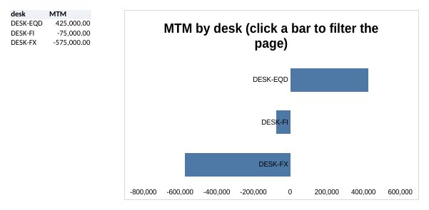

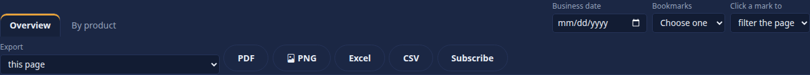

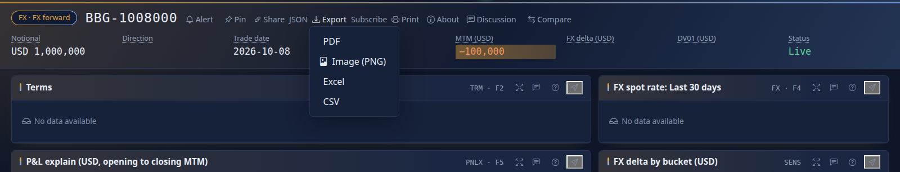

The PNG of the sample page, unedited:

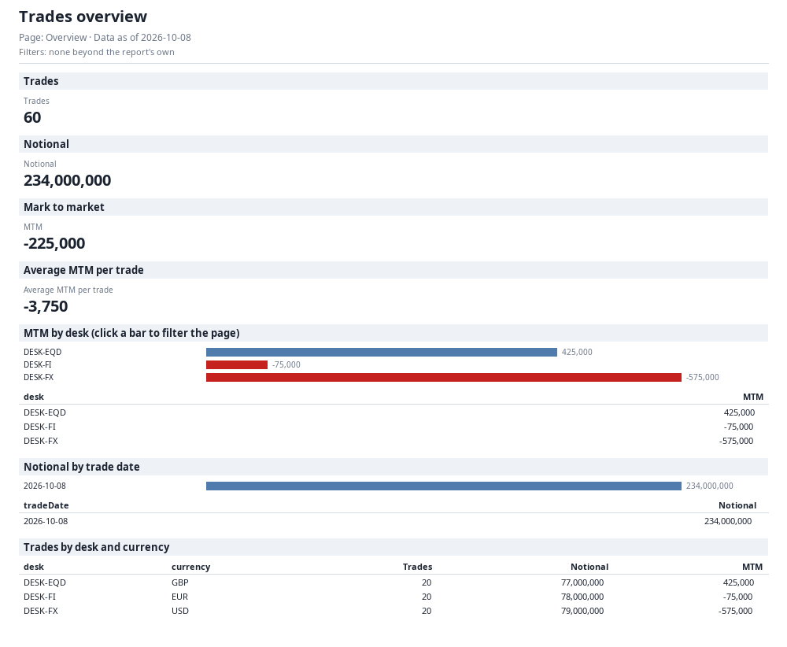

The Excel file of that page, `Trades overview.xlsx`, has the sheets `About`, `Trades`, `Notional`, `Mark to market`, `Average MTM per trade`,
`MTM by desk (click a bar to fil` (cut at Excel's 31 characters), `Notional by trade date` and `Trades by desk and currency`. The CSV of one
visual:

```
desk,MTM
DESK-EQD,425000
DESK-FI,-75000
DESK-FX,-575000
```

**Limits** (`drishti.distribution.export.*`, [CONFIGURATION.md](../../admin/CONFIGURATION.md)): rows per table in Excel and CSV (`max-rows`, 50,000; a
table is read whole up to there and says when it was cut), rows drawn per table in a PDF or PNG (`pdf-max-rows`, 500; under a chart `pdf-chart-rows`,
15), the largest file (`max-bytes`, 25 MB), the longest export (`timeout`, 60 s), visuals per export (`max-visuals`, 40). Over a limit:
`422 DRS-9060`, naming the setting. **The API:** `POST /api/v1/export/{format}` (`pdf`, `png`, `xlsx`, `csv`, `jsonl`) with
`{type: "report", id, page?, visual?, state?, date?}` or `{type: "view", id: "kind/id", date?, view?}`; the console serves
`/dist/bi/<report id>.<format>` and `/dist/view/<kind>/<id>.<format>`. Every export is audited (`export`: who, what, rows, bytes).

#### 1.3 Subscriptions

**Subscribe** (beside Export, on every report and view) sends the content by email on a schedule. A subscription says **what** (a report, page or
visual with the view state; or a view with its controls), **when**, **in what form**, and **to whom**.

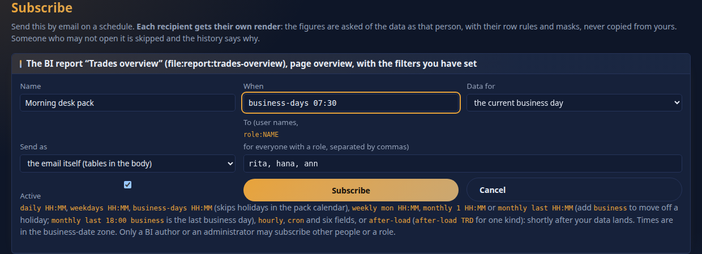

| Field | Meaning |
|---|---|
| Name | 1 to 64 letters, digits, spaces, dots, dashes, underscores; yours alone |
| When | **Send** offers every day, every business day, every week on a day, the last business day of the month and every hour, at a time you pick; **Advanced: the schedule as text** takes any schedule (below) |
| Data for | `today` (the current business date), `previous` (the business day before), or `load` (the date of the load that triggered an `after-load` run) |
| Send as | `html` (the tables in the email), `pdf`, `xlsx` or `jsonl` (attached) |
| To | user names and `role:NAME`. **Never an email address**: refused (`DRS-9061`) |
| View state | taken from the report or view you pressed Subscribe on |

**Schedules.** Everything a scheduled report takes (`daily HH:MM`, `weekdays HH:MM`, `business-days HH:MM`, `hourly`, `cron` and six fields), and
`weekly mon 07:30`, `monthly 1 07:30` (a short month uses its last day), `monthly last 18:00`, the word `business` after a weekly or monthly
schedule (a holiday moves to the next business day; `monthly last 18:00 business` is the last business day), and `after-load` or `after-load TRD`
(shortly after a load finished ready, `load-delay`, 5 s, so the layers rebuild first). `POST /api/v1/subscriptions/preview` shows the next three
runs of a schedule text.

**Each recipient gets their own.** For every recipient the server builds that person's rights as they are now and asks the engine as them. What
the test mail server received after one *Run now* of the same subscription: Hana is a desk head and sees one desk; Ann is an analyst whose
`MTM` is masked; Rita sees everything.

```
Trades overview · 2026-10-08

Trades overview
Page: Overview · Data as of 2026-10-08
Filters: none beyond the report's own

Trades
Trades: 20
...
MTM by desk (click a bar to filter the page)
desk | MTM
DESK-FX | -575,000
```

```
Mark to market
Masked for you: MTM.
MTM: •••
...
MTM by desk (click a bar to filter the page)
Not available: DRS-9021 'MTM' is masked for you: it cannot be sorted on
No data
```

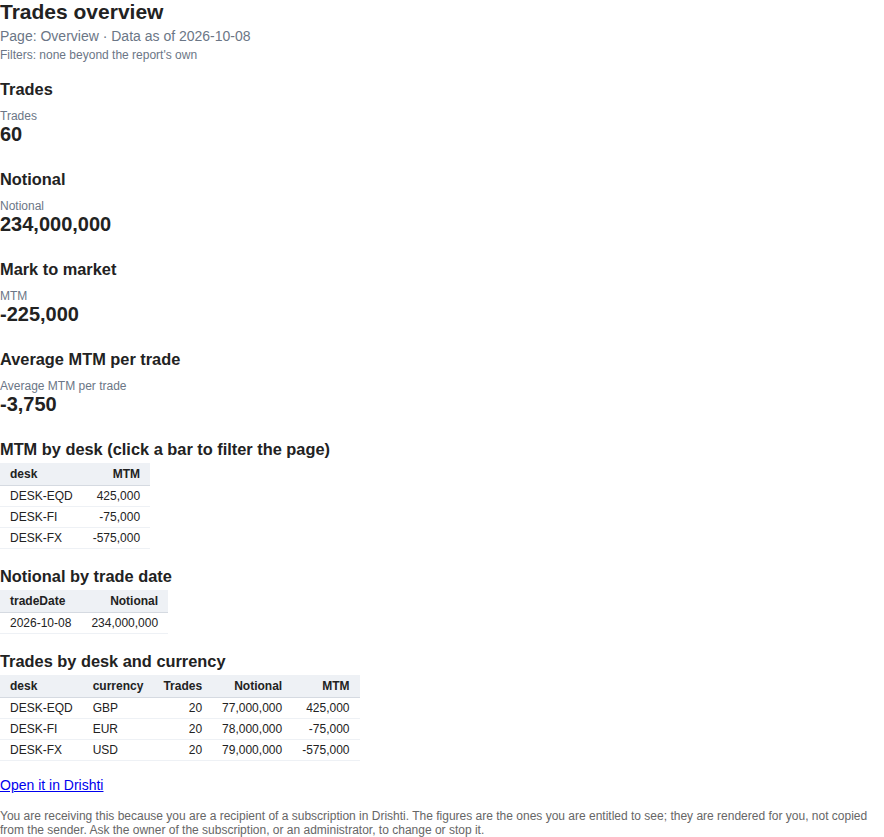

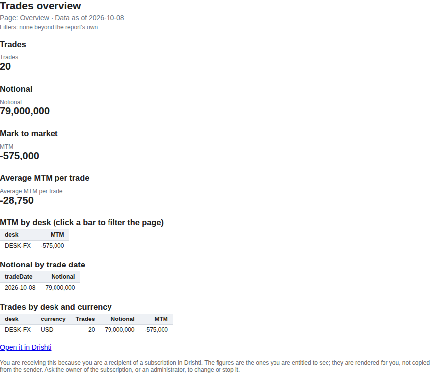

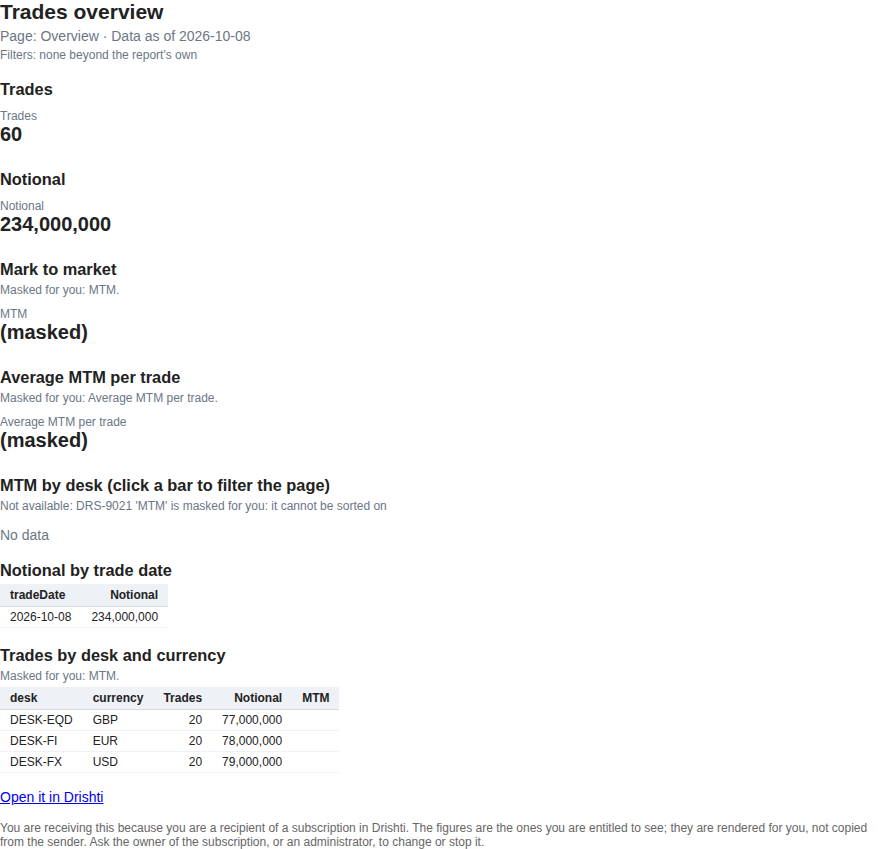

The headers: `From: drishti@desk.test`, `Subject: Drishti: Trades overview · 2026-10-08`, `Auto-Submitted: auto-generated`. A subscription
that attaches a file says in the body what it holds, with a link to open it in Drishti.

* **A recipient who cannot open the target** is **skipped**, with the reason in the history in words; they are not mailed a refusal. A recipient
  with no email address, or a disabled user, is skipped and listed with the reason.
* **Outside addresses are refused**: a person who is not a user has no rights, so no render can be made for them. A subscription saved earlier
  with an address keeps it, but it is skipped at every send.
* **Who may subscribe whom.** Anyone may subscribe **themselves**; subscribing other people or a role needs `bi-author` or an administrator
  (`DRS-9061` otherwise). The subscriber must be able to open the target.
* **Statements** are burst, one per recipient (section 12.6).
* **A written summary** at the top of each email (*Open the email with a short written summary*, `narrative: true`): offered only when AI is on.
  Each recipient's email opens with two or three sentences that word **their own** figures, written as that recipient under the feature
  `subscription-narrative`, from their render with every masked column left out (at most
  `drishti.distribution.subscriptions.narrative-rows`, 15, rows of each table), and **only under `drishti.bi.ai.values: aggregates`**. Otherwise
  the mail goes without it and the delivery says `summary: skipped: <why>`. It is labelled as written by an AI model and stored nowhere but in the
  email; saving `narrative: true` while the AI layer is off is refused (`422 DRS-9061`).

**Running, pausing, history.** *Run now* makes and sends everything at once (`Morning desk pack: 3 sent`). *Pause* stops the schedule; *Resume*
schedules it from **now** (it does not catch up). *History* keeps the last runs (`keep-runs`, 30), the newest with every recipient's delivery
status; a run is `ok`, `partial`, `retrying`, `failed` or `skipped`. Everything is audited (`subscription.save`, `.run`, `.pause`, `.resume`,
`.delete`).

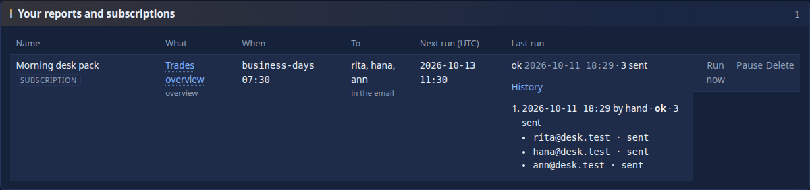

**Retries.** A mail that could not be sent (the server unreachable, a timeout) is retried with the shared retry policy
(`drishti.retry.distribution.*`) up to `max-attempts` (4); a refused address or an SMTP 5xx is permanent at once. Mail goes through the server's
mail settings (`spring.mail.*`, `drishti.collab.email.from`, `drishti.collab.console-url`); with no SMTP host every delivery fails with "no SMTP host:
set spring.mail.host". A subscription is a document in the owner's preferences (`per-user`, 20, a person); run the scheduler on **one** server of a
group (`drishti.distribution.subscriptions.enabled`).

#### 1.4 Webhooks and text messages

Alerts and subscriptions can also **post to a webhook** and **send a text**. An administrator sets both up (`drishti.notify.*`,
[CONFIGURATION.md](../../admin/CONFIGURATION.md)); a person only picks from what exists.

**Webhooks.** An administrator defines a webhook by a **name**, a URL and a secret (`drishti.notify.webhooks.<name>.*`) and lists the hosts webhooks
may reach (`drishti.notify.webhook.allowed-hosts`; empty means none). A person ticks the names on the alert or Subscribe form; they cannot type a
URL. A post is JSON with `X-Drishti-Event` (`alert` or `subscription`), `X-Drishti-Timestamp` and **`X-Drishti-Signature: sha256=<hex>`**, the
HMAC-SHA256 of `<timestamp>.<body>` with the secret, which the receiver recomputes. Redirects are never followed; 2xx is sent; a timeout, a
connection failure, 408, 429 and 5xx are retried; anything else is permanent.

```
POST https://hooks.corp.example/drishti
X-Drishti-Event: alert
X-Drishti-Timestamp: 1782000000
X-Drishti-Signature: sha256=3c3b0f6c0b6e7f2a0d5c...
{"event":"alert","id":1782000000123,"at":"2026-10-12T14:00:00Z","alert":"Exposure over limit","key":"alice/Exposure","severity":"critical",
 "watching":"Exposure (trading-risk)","condition":"above 100","link":"https://drishti.bank.example/bi/r/file:report:daily/main"}
```

A subscription's post carries the title, where it opens and the number of recipients, never a name or a figure.

**Text messages.** The gateway is any HTTP SMS service, described by templates (`drishti.notify.sms.url`, `method`, `body`, `content-type`, headers,
`sender`); no vendor is built in. A person gives **their own** mobile number (the form, or `PUT /api/v1/me/phone`) and ticks *text me* / *text each
recipient*. A text is cut to `sms.max-chars` (160) and holds the title, severity and a link, **never a figure** unless the administrator sets
`sms.include-values`. Both channels are in the history (`webhook:NAME`, `sms:USER`).

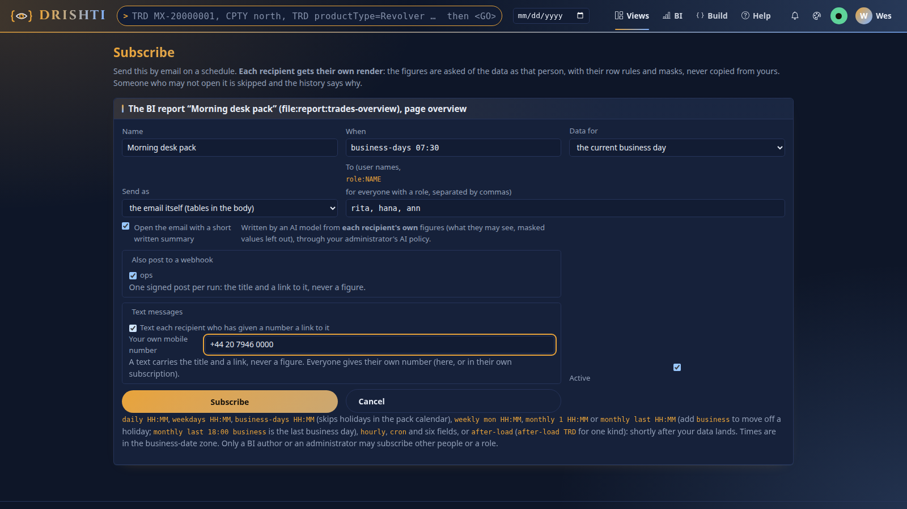

### 2. Alerts on numbers

An **alert** watches one number and tells you when it crosses a limit, moves too far or does not arrive. **The number is read as you**, with your
row rules and masks, by the same engine call the screen makes; a number masked for you is never judged or shown. The page is **Alerts**
(`/alerts`), linked from the Reports page and the inbox; the walk-through is [the reports tutorial, Part D](#part-d--bi-that-runs-itself).

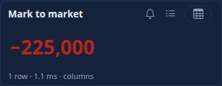

*Alert me* (the bell in a visual's frame) opens the form with the report, the page, the visual and the filters on your screen filled in:

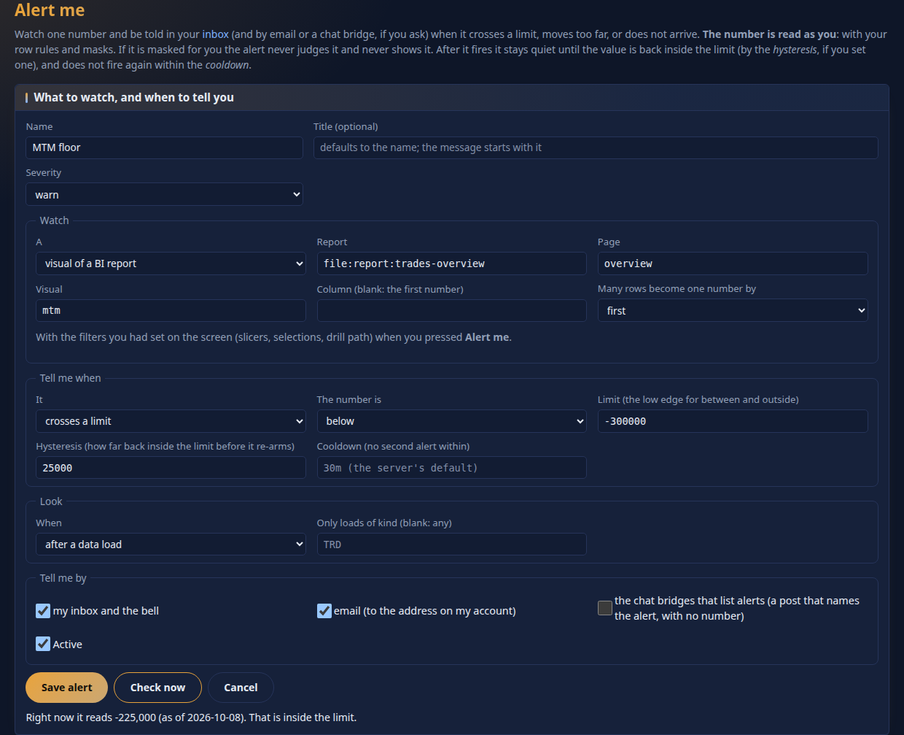

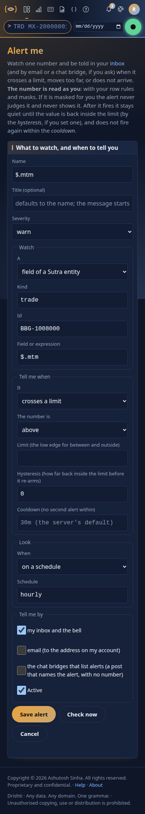

#### 2.1 What can be watched

| Source | You give | The number is | Live |
|---|---|---|---|
| **A visual of a report** (`type: visual`) | `report`, `page`, `visual`, optionally `measure` (a column), `reduce` and `state` (the filters you had on the screen; the date is never kept) | the column of the visual's answer; for many rows `reduce`: `first`, `last`, `sum`, `min`, `max`, `avg`, `count` | when the model has a live table |
| **A measure of a model** (*Watch: measure of a model*) | the model (or a pack table), one of **its measures**, optional filters chosen from its fields | the measure over the latest business date (a model query; `reduce` when it could answer several rows) | when the model has a live table |
| **A field of a Sutra entity** (`type: field`) | `kind`, `id`, `field` (a path or any Rachana expression over the entity) | the field, through your field masks | when the source pushes |
| **A board tile** | the tile's `notify:` (section 14.3) | its colour as a level | when the report is live |

*Alert me* is on every visual that shows numbers, and in the dialog that opens when you click a number on a view (beside *Discuss*). A **Python
measure** can be watched too: it is read for each person it is judged for, on the server's compute pool, over that person's rows; prefer a schedule
or `after-load` to `live` for it ([BI_GUIDE.md](README.md)). An alert whose number is masked for its owner when it is saved is refused
(*the value this alert watches (MTM) is masked for you, so it could never be read*); a question that answers several rows without `reduce` is
refused with the way to choose one.

```
PUT /api/v1/alerts/rules/Vol
{"title": "Desk P&L volatility", "source": {"type": "dataset", "dataset": "file:dataset:trades-basic", "measure": "Desk P&L volatility"},
 "condition": {"type": "threshold", "op": "above", "value": 5000}, "trigger": {"mode": "after-load"}}
```

#### 2.2 When it fires, and when it looks

| Condition | Keys | Fires when |
|---|---|---|
| **Threshold** | `op`: `above`, `below`, `between`, `outside`; `value`; `high` | the number is above or below the limit, between `value` and `high` (edges included), or outside them |
| **Change** | `mode`: `pct` or `abs`; `op`: `rises`, `falls` or `moves`; `value`; `against`: `previous-run` or `previous-day` | the number rose or fell by at least `value`; `pct` is `(now - before) / abs(before) x 100` |
| **No data** | `by`: a time of day (`09:00`) | on a business day, from `by` on, the source shows no data for today's date; it clears when data lands |

| Trigger | Keys | The alert looks |
|---|---|---|
| **schedule** (default `hourly`) | `schedule`: the words of subscriptions (section 18.3) | at those times; after a restart it does not catch up |
| **after-load** | `kind` (optional) | `load-delay` (5 s) after a data load announced ready ([DATA_GUIDE.md](../DATA_GUIDE.md#1-telling-drishti-new-data-has-landed)); a "no data" alert looks after every load |
| **live** | `debounce` (default 10 s) | when the source changes, once changes have been quiet for the debounce, and at least every `live-max-wait` (2 min); needs a live source |

A new or edited alert is looked at **once when you save it**; *Look now* looks at once. A change with nothing to compare with does not fire. A
reading that cannot be judged (masked, no data yet, an error) never fires and never clears an active alert.

#### 2.3 No flapping, and each person on their own number

| State | Meaning |
|---|---|
| **armed** | watching; nothing is wrong |
| **active** | it fired and the number has not come back; it does **not** fire again while active |
| **paused** | switched off; *Resume* arms it afresh |

* **Hysteresis** (default 0): once active, the alert re-arms only when the number is back inside the limit by at least this much (`above 100`
  with hysteresis `10` fires at 101, stays active at 95, re-arms at 90).
* **Cooldown** (`drishti.alerts.cooldown`, 30 min; `0` for none): no second firing for this person within it; a breach inside it is written as
  **held** and fires when it ends if the condition still holds.
* **Each person is judged on their own number.** A number masked for you is a *masked* reading (`skipped: masked for you, so it cannot be judged`,
  once). The message carries **your** number (`MTM floor — now -725,000 (below -300,000)`); a chat bridge post carries none.

#### 2.4 Delivery

| Channel | What | Rules |
|---|---|---|
| **Inbox** | a row of type `alert` (the *Alerts* tab), a toast and a count on the bell | always on unless you turn it off ([USER_GUIDE.md](../USER_GUIDE.md)) |
| **Email** | one mail to **the address on your account**, `Drishti alert: <title>` | users only; a failed send is retried (`drishti.retry.alerts.*`, `drishti.alerts.max-attempts`, 4), a refused address is permanent |
| **Webhook** | a signed post (section 18.4) | one per alert per cooldown, **never a number** |
| **Text** | a text to your own number | the title, severity and a link |
| **Chat bridges** | a post to every bridge whose route lists `alert` | **never a number**; at most one post per alert per cooldown ([CONFIGURATION.md](../../admin/CONFIGURATION.md), `drishti.alerts.bridges`) |

The **history** (on the edit page; the last `keep-history`, 50) has an entry for each firing, clearing, held breach and skipped reason, with what
triggered it (`saved`, `schedule`, `load`, `live`, `by hand`, `resumed`), the number, the message and what each channel did:

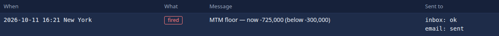

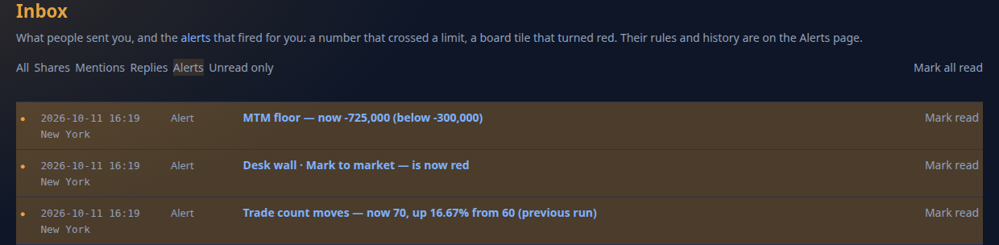

The audit log has `alert.save`, `alert.delete`, `alert.pause`, `alert.resume` and `alert.fire` (no number). An alert is a document in the owner's
preferences (`per-user`, 20); with several servers, turn `drishti.alerts.enabled` off on all but one. The older rules on one entity
([USER_GUIDE.md](../USER_GUIDE.md#alerts)) stay beside these on the Alerts page.

#### 2.5 Real output

Rita makes *the MTM card of Trades overview, below -300,000, after a data load, with hysteresis 25,000, by inbox and email*. *Check now*
(`POST /api/v1/alerts/rules/preview`, saving nothing) answers:

```
{ "status": "ok", "value": -725000.0, "asOf": "2026-10-08", "note": "", "condition": "below -300,000", "holds": true, "live": false }
```

After a load of ten losing trades, its state and history:

```json
{
  "state": { "rita": { "active": true, "firedAt": "2026-10-11T20:21:53.529000506Z", "lastValue": -725000.0, "lastEval": "2026-10-11T20:21:53.529000506Z" } },
  "history": [ { "at": "2026-10-11T20:21:53.529000506Z", "user": "rita", "action": "fired", "severity": "warn", "trigger": "load",
                 "value": -725000.0, "asOf": "2026-10-08", "message": "MTM floor — now -725,000 (below -300,000)",
                 "delivered": { "inbox": "ok", "email": "sent", "bridge": "off" } } ]
}
```

and the mail of a board tile's notification (the figure is never in a tile's message):

```
Subject: Drishti alert: Desk wall · Mark to market
To: rita@desk.test

Desk wall · Mark to market

is now red

Severity: critical
Watching: trades-overview · mtm
Condition: reaches crit
```

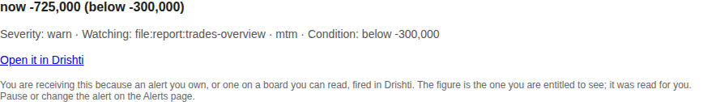

**Ann**, whose `MTM` is masked, makes the same alert: *Check now* says *That number is masked for you, so an alert on it would never judge it.
Ask for the access, or watch another number.*; after the same load her history holds one `skipped` entry and her inbox nothing:

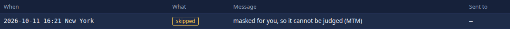

A bad alert is `422 DRS-9062` and names the key (`DRS-9062 condition.op is above, below, between or outside`).

#### 2.6 Everyone's alerts, and the phone

Administrators see the tiles that notify, who is alerted now and the history at **Alerts, Everyone's alerts** (`/alerts/all`):

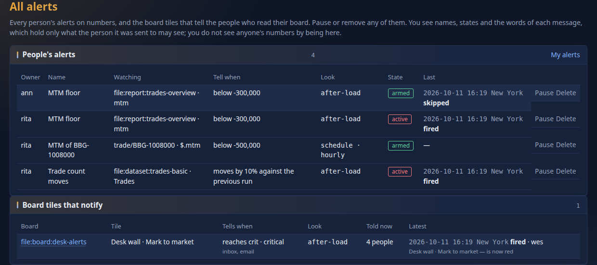

The Alerts page, the form, the history and the inbox keep to the screen at 390 px:

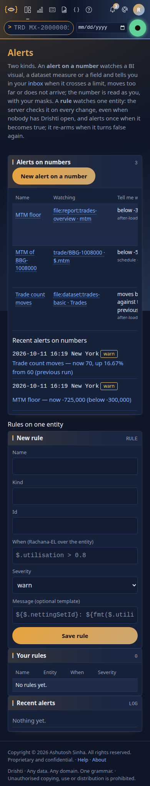

## Tutorial: BI that runs itself, scheduled searches and subscriptions

Reports that refresh themselves, subscribe a colleague, say what a number should be, alert on it and export it; then a scheduled search and a subscription to a view. Every step shows the UI, the command line where there is one, and the YAML.

### Time to complete

- Part D · BI that runs itself: About 45 minutes.
- Part E · Scheduled searches and subscriptions: About 25 minutes.

### Before you start

The environment, the sign-in and the token are those of [Reports, Before you start](REPORTS.md#before-you-start).

**Part D · BI that runs itself.**

- [Part A](REPORTS.md#part-a--your-first-bi-report) done (it made the workspace `Economics desk`), and [tutorial 1, Part D](../../tutorials/01-first-15-minutes.md#part-d--share-and-collaborate) for the colleague `vera`
  (a user with the `viewer` role and the address `vera@example.com`); [Part E](#part-e--scheduled-searches-and-subscriptions) for how the **Reports** page lists subscriptions.
- A personal token **reads** and writes BI items, but it never calls your own
  `/me/...` addresses (subscriptions, alerts): those are made in the console, and steps 31 and 34 say so.
- Three small files in [data/](../../tutorials/data/): [trades-daily.dataset.yaml](../../tutorials/data/trades-daily.dataset.yaml) (a dataset that refreshes itself),
  [trades-daily.model.yaml](../../tutorials/data/trades-daily.model.yaml) (the model over it) and [desk-check.report.yaml](../../tutorials/data/desk-check.report.yaml) (a report that
  says what its numbers must be).
- Mail is **optional**. Steps 31 and 32 run without it and show what happens; step 33 shows it working with a catcher on your own machine (a small script that ships with this tutorial).

**Part E · Scheduled searches and subscriptions.**

- [Tutorial 1, Part A](../../tutorials/01-first-15-minutes.md#part-a--install-start-and-look-around) done (signed in as the development administrator, the token for the command line set) and [tutorial 1, Part D](../../tutorials/01-first-15-minutes.md#part-d--share-and-collaborate) for the user `vera`.
- Email needs an SMTP server, which a fresh install does not have. The tutorial shows what Drishti does without one (it keeps the run and retries); [OPERATIONS_GUIDE.md](../../guides/OPERATIONS_GUIDE.md) says how to set `spring.mail.host` and the email channel.

### What you will learn

**Part D · BI that runs itself**

- how a dataset of the model layer is told to refresh itself (`refresh:` in its YAML, or **Set a schedule** on its page) and how to see it ran;
- how to subscribe a person to a whole report, a page or one visual, in HTML, PDF or Excel, and why each recipient gets their own copy;
- what **Run now** says with no SMTP host (`no SMTP host: set spring.mail.host`) and how to configure mail so it sends;
- how to put an **alert** on a number of a report or on a **measure of a model**, the difference between *armed* and *active*, and where the firing lands (inbox, email);
- how to export a report to **PDF, PNG, Excel and CSV**, a whole page or one visual;
- how to say what a number should be (`tests:`) in a report and in a model, run the tests as a role, and why a failing test stops a publish.

**Part E · Scheduled searches and subscriptions**

- how to turn a search into a scheduled report: when it runs (business days, holidays, after a load), which day's data, and where the file goes;
- **Run now**, the last-run line, and the file it wrote;
- a subscription: formats (HTML, PDF, Excel), recipients (**users and roles only**, never an email address) and why each recipient gets their own render;
- where both live: **Views → Reports** in the top bar;
- what the command line and the REST API can do for them.

#### Part D · BI that runs itself

A report is only useful if it is fresh when people look at it and reaches them when it matters. In this part BI works on its own. A **dataset refreshes
itself** every business morning. A **subscription** sends a report to a colleague, rendered for them. An **alert** watches a number, in a report or as a
measure of a **model**, and tells you when it crosses a limit. You **export** a page as PDF, PNG, Excel and CSV. A report and a model **say the figures they
must give**, and a wrong figure stops a publish. You also see what Drishti does with **no mail server** (the usual state of a fresh install) and how to set
one up.

Every step shows the same thing three ways: **in the UI**, **on the command line** (`python3 tools/drishti.py`, or `curl` where the tool has no command
yet), and **as YAML** (what the UI writes, which you can keep in git).

### Step 30 · A dataset that refreshes itself

A dataset keeps its rows in layers it builds from the source. They are rebuilt when a data load arrives ([tutorial 12](../../tutorials/12-a-day-of-bank-data.md)), when someone
asks, and on a **schedule** set on the dataset. A dataset is one table of the **model layer** (`rachana: 2`): it says where the rows come from and
what one row is, and its measures live in a **model** over it ([BI_GUIDE.md section 23](MODELS_AND_DATASETS_FOR_REPORTS.md#1-models-and-datasets-what-a-report-reads)).

**In the UI** there are two ways to set the schedule, and neither needs the YAML:

- **In the dataset wizard** (**Models → New dataset**, the wizard of [BI_GUIDE.md › Datasets: the YAML, the expression language and the security rules, section 15](MODELS_AND_DATASETS_FOR_REPORTS.md#110-a-table-of-your-own-step-by-step)):
  on the *Columns* step choose **Refresh** *business days at 06:30* (or *when new data loads*); the YAML of the *Save* step shows the line it writes,
  `refresh: business-days 06:30`.
- **On the dataset's own page**, when it has no schedule: the **Refresh** section says *No refresh schedule* and, for an author who may edit the draft,
  offers **Set a schedule** (a choice and a time). It writes `refresh:` into a new saved state of the draft, keeping every other line and every comment of
  the file; publish the dataset to start the schedule.

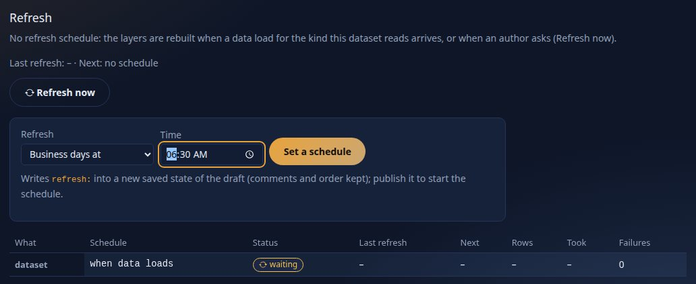

You should see the form (*Business days at*, a time, **Set a schedule**) and one row, `dataset`, rebuilt *when data loads*: the only refresh a dataset has
until you give it a schedule.

**The YAML** (what both of them write) is the tutorial's dataset over the trades, [data/trades-daily.dataset.yaml](../../tutorials/data/trades-daily.dataset.yaml). The line
that matters is `refresh:`:

```yaml
rachana: 2
expressions: 2
dataset: trades-daily
version: 1.0.0
title: Trades refreshed daily
description: The trades by desk, rebuilt on their own at 06:30 on business days.
source: { connector: risk-store, kind: trade-valuation }
grain: { says: "One row per trade per business date", keys: [TRADE_ID] }
refresh: "business-days 06:30"      # a schedule (daily 06:00, hourly, cron ...) or after-load: when the layers are rebuilt without anyone asking
columns:
  TRADE_ID:  { type: string, role: key }
  DESK:     { type: string }
  CURRENCY: { type: string }
  NOTIONAL: { type: decimal, format: amount0 }
  MTM:      { type: decimal, format: signed0 }
```

The rows are the `market-risk` pack's **trade valuations** (`risk-store` is its Delta connector, the table `risk/trade-valuation` that
`lake demo` built): one row per trade and business date with its desk, currency, notional and MTM, in the names the data has (`TRADE_ID`, `DESK`, ...).
The words are the ones of a scheduled report ([Part E](#part-e--scheduled-searches-and-subscriptions)): `daily 06:00`, `weekdays 07:00`, `business-days 06:30` (skips holidays of the
server's calendar), `hourly`, `cron ...`, or `after-load`. `refresh: { on-load: true }` (what the wizard writes for *when new data loads*) rebuilds only
when data arrives; `{ schedule: "daily 06:00", on-load: true }` does both. The model over it, [data/trades-daily.model.yaml](../../tutorials/data/trades-daily.model.yaml),
reads it as its one fact and adds three measures:

```yaml
rachana: 2
expressions: 2
model: trades-daily
version: 1.0.0
title: Trades daily
datasets:
  trade: { dataset: trades-daily, role: fact }
measures:
  Notional: { expr: "sum(trade.NOTIONAL)", format: amount0 }
  MTM:      { expr: "sum(trade.MTM)", format: signed0 }
  Trades:   { expr: "count(trade)" }
security:
  rows:
    trade:
      - { role: [admin, risk, bi-writer], where: "True" }
```

**From the command line** put both files in the workspace, publish them, and ask for the dataset's refresh state (`bi item new` reads the kind from the
file name; the ids differ on your machine):

Run these from the Drishti folder (the repository root, or the install folder of a release).

```text
$ python3 tools/drishti.py bi item new economics-desk docs/tutorials/data/trades-daily.dataset.yaml
bi-c767a5fd15  dataset  Trades refreshed daily  draft in Economics desk

$ python3 tools/drishti.py bi catalogue publish bi-c767a5fd15 --note "refreshes itself on business mornings"
published Trades refreshed daily as version 1

$ python3 tools/drishti.py bi dataset refresh bi-c767a5fd15
scheduled  (America/New_York, calendar USNY)
  dataset   business-days 06:30   waiting for the scheduler

$ python3 tools/drishti.py bi item new economics-desk docs/tutorials/data/trades-daily.model.yaml
bi-a29d960c58  model  Trades daily  draft in Economics desk

$ python3 tools/drishti.py bi catalogue publish bi-a29d960c58 --note "the measures over the dataset"
published Trades daily as version 1
```

**In the UI** the same is **My workspace → New item**, kind *dataset* (and then *model*), **Paste YAML** (the button next to *Open the dataset wizard*),
paste the file, **Create from the YAML**; move it to `Economics desk`; **Publish** ([Part A](REPORTS.md#part-a--your-first-bi-report), step 7). Open the dataset from
**Models** (its page is `/bi/ds/<id>`) and scroll to **Refresh**.

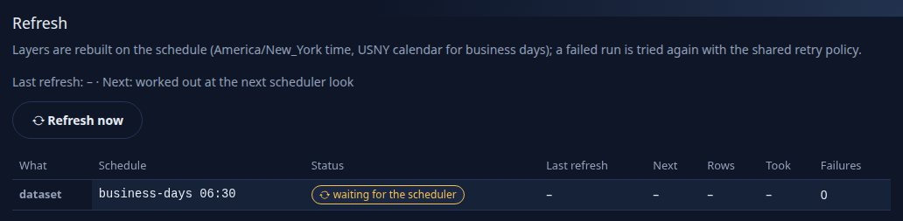

You should see one row, `dataset`, with the schedule `business-days 06:30` and the status `waiting for the scheduler` before its first run, and the line
*Last refresh: – · Next: worked out at the next scheduler look*. Do not wait for 06:30. **Refresh now** is the same call a schedule makes (it needs the BI
author power); the command line's `--now` asks for it and waits until it ends:

```text
$ python3 tools/drishti.py bi dataset refresh bi-c767a5fd15 --now
scheduled  (America/New_York, calendar USNY)
  dataset   business-days 06:30   ok  last run 2026-10-17 21:42:16 UTC by manual (drishti-dev-admin): 30000 rows in 41 ms
```

(The count is the rows read for every table built from the dataset: 15,000 for the model's `trade` table and 15,000 for the dataset's own implicit
model, so `30000` for 15,000 trade valuations.)

(Over REST: `POST /api/v1/bi/datasets/<id>/refresh` starts it and `GET` the same path answers the state.)

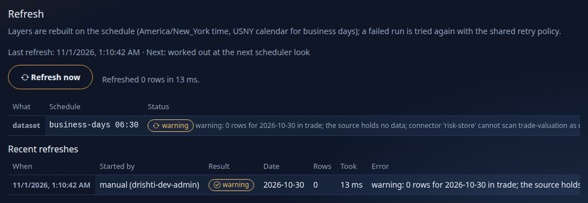

You should see *Refreshed 30000 rows in ... ms.* beside the button, the status `ok` with a note, the line *Last refresh ... · Next ...*, and **Recent
refreshes**: every run, newest first, with who or what started it (`schedule`, `after-load trade`, `retry`, `manual (drishti-dev-admin)`), the rows, the
time and any note. The history and the state are kept in the BI store, so they are still there after a restart (a run the restart interrupted shows as
`interrupted`). Ask the model for the rows the refresh built:

```text
$ python3 tools/drishti.py bi mq --model trades-daily@1 --select trade.DESK --measures "Trades,Notional,MTM" --limit 4
trade.DESK   Trades  Notional            MTM
-----------  ------  ------------------  ---------------
DESK-COMM    5990    885,017,001,985.25  -395,383,250.53
DESK-CREDIT  1172    348,350,245,514.15  386,059,702.75
DESK-EQD     1452    430,529,717,922.53  -85,763,784.34
DESK-FI      1248    403,150,156,232.97  -30,588,339.35
4 row(s)  as of 2026-10-26  plan p_084c3aa583453ccc
```

The Delta connector scans the promoted columns of the table, so 15,000 rows take a few tens of milliseconds. A refresh that fails is **retried** with the shared retry policy (5 s, doubling, up to 5 minutes; after four tries it is
`failed` until its next time), and the dataset page says so.

### Step 31 · Subscribe a colleague to a report

Open the shipped report **World economics** (a report on the model `world-economics@1`) and press **Subscribe** in the toolbar (beside the export
buttons). Subscribe and the export buttons appear only when they will work for you: when an administrator has switched exports or subscriptions off, or
you already own the most subscriptions allowed, a line beside the bar says so and why (the server's `GET /api/v1/distribution/status` is what the page asks).

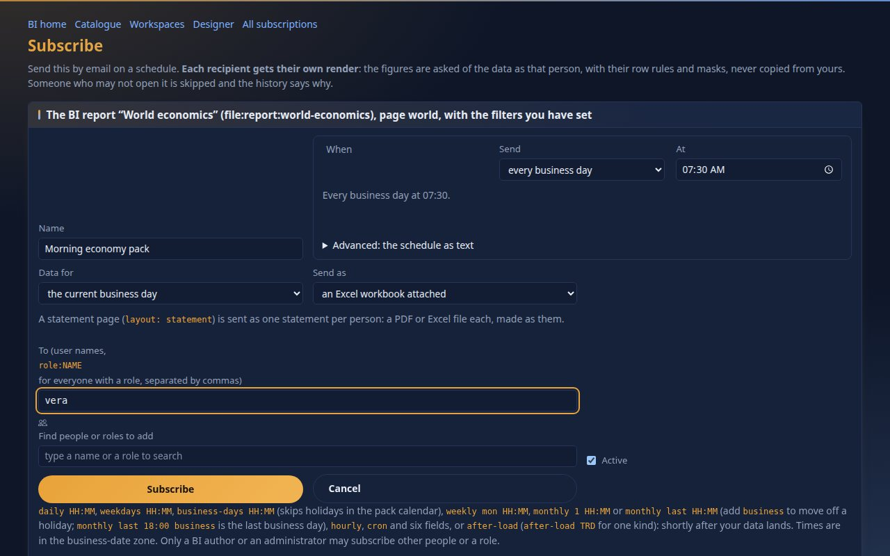

You should see the form with the target named at the top (`The BI report "World economics" (file:report:world-economics), page world, with the filters you
have set`): a subscription keeps the page and the slicer choices you had on the screen. **When** is a choice, not a text: *every business day* at `07:30`
is its default, and the line under it says it in words (*Every business day at 07:30*) and which model the figures are asked of (*The figures are asked of
the model world-economics@1, as each recipient*); **Advanced: the schedule as text** takes any schedule word. Name it `Morning economy pack`, **Send as**
*an Excel workbook attached* (the other forms are the email itself with the tables in the body, and a PDF), and **To** `vera`. **To** takes user names and
`role:NAME`, **never an email address**: each person gets the report asked of the data **as that person**, with their own row rules and masks, and an
outside address has no rights to ask as. Press **Subscribe**.

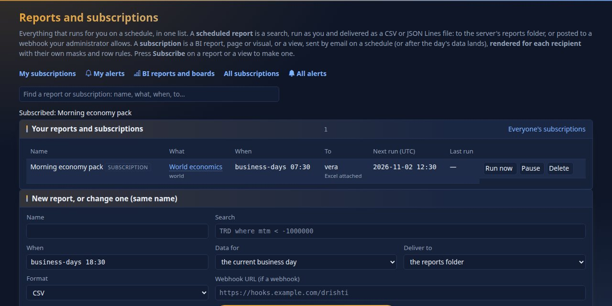

You should see `Morning economy pack` badged `SUBSCRIPTION`, the report, `business-days 07:30`, `vera` with `Excel attached`, and the next run in UTC
(07:30 New York on the next business day: `11:30`).

**From the command line**: none. A subscription is yours (`/api/v1/me/subscriptions/<name>`), and a personal API token never calls your own `/me/...`
addresses (`403 DRS-5002 API tokens may not call this endpoint`); what the console sends on **Subscribe**, as you, is `PUT /api/v1/me/subscriptions/<name>`
with the body below, and `GET` the same path reads it back. **The YAML** of what the form saved (the server keeps it as JSON; these are its keys, captured):

```yaml
name: Morning economy pack
target:
  type: report
  id: file:report:world-economics
  page: world
  visual: ''
  state: { carry: [], slicers: {}, selections: [], drill: [] }
schedule: business-days 07:30
date: today
format: xlsx
recipients: [vera]
narrative: false
sms: false
webhooks: []
enabled: true
nextRun: '2026-10-19T11:30:00Z'          # saved on Saturday 17 October: the next business day is Monday
```

```text
$ curl -s -X PUT -H "Authorization: Bearer $DRISHTI_TOKEN" -H 'Content-Type: application/json' \
    -d '{"target":{"type":"report","id":"file:report:world-economics","page":"world"},"schedule":"business-days 07:30","format":"xlsx","recipients":["vera"]}' \
    "$DRISHTI_SERVER/api/v1/me/subscriptions/Morning%20economy%20pack"
{"title":"forbidden","status":403,"code":"DRS-5002","detail":"API tokens may not call this endpoint"}
```

Press **Run now** (the console's `POST /api/v1/me/subscriptions/Morning%20economy%20pack/run`).

### Step 32 · What "Run now" says without a mail server

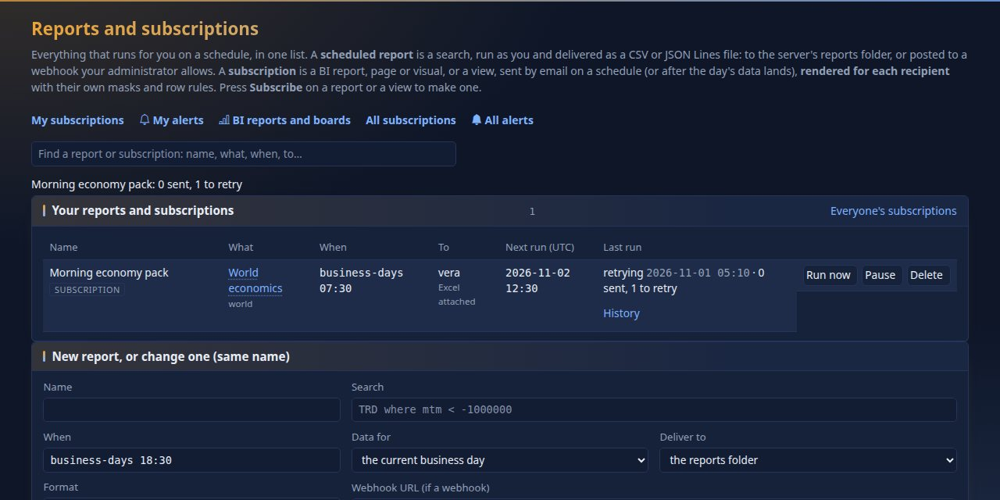

You should see `Morning economy pack: 0 sent, 1 to retry` and the last run `retrying`. Open **History**:

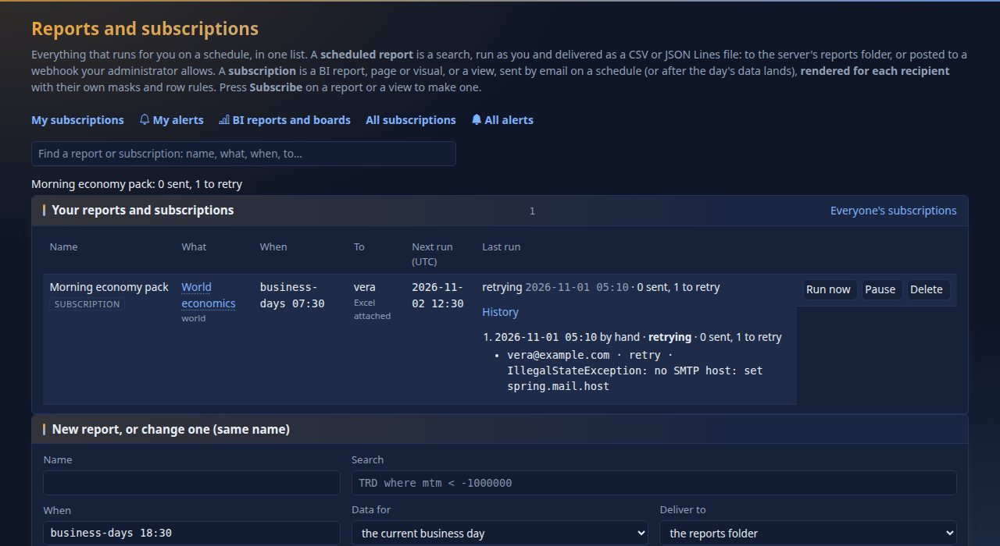

You should see `vera@example.com · retry · IllegalStateException: no SMTP host: set spring.mail.host`. That is the honest answer: Drishti built vera's
copy, had nowhere to send it, and will **retry** (4 attempts, then `failed`). Nothing is lost silently, and a recipient without an address on their
account is shown as `skipped · no email address on file`. The run as the API keeps it (`runs` of the subscription, captured):

```text
{"id": "7fc8f059", "at": "2026-10-17T21:43:29.128765703Z", "trigger": "by hand", "status": "retrying", "sent": 0, "failed": 0, "skipped": 0, "retrying": 1,
 "deliveries": [{"to": "vera@example.com", "label": "Vera Lim", "user": "vera", "attempts": 1, "status": "retry",
                 "error": "IllegalStateException: no SMTP host: set spring.mail.host", "nextAttempt": "2026-10-17T21:43:34.227711247Z"}]}
```

**To configure mail** you need four things on the **server** (not the console): an SMTP host, the collaboration email switch, the console's address (for the links in the mail) and a From address. In the environment, before the server starts:

```bash
export SPRING_MAIL_HOST=smtp.example.com SPRING_MAIL_PORT=587          # your mail server
export SPRING_MAIL_USERNAME=drishti SPRING_MAIL_PASSWORD=...          # if it asks for sign-in; keep the password out of files
export SPRING_MAIL_PROPERTIES_MAIL_SMTP_STARTTLS_REQUIRED=true         # for any server reached over a network
export SPRING_MAIL_PROPERTIES_MAIL_SMTP_CONNECTIONTIMEOUT=10000 SPRING_MAIL_PROPERTIES_MAIL_SMTP_TIMEOUT=10000
export DRISHTI_COLLAB_EMAIL_ENABLED=true
export DRISHTI_CONSOLE_URL=https://drishti.example.com                  # where links in the mail point
export DRISHTI_MAIL_FROM=drishti@example.com
```

(The same keys as `spring.mail.host` and so on in the server's `application.yml`; [OPERATIONS_GUIDE.md](../../guides/OPERATIONS_GUIDE.md) and [CONFIGURATION.md](../../admin/CONFIGURATION.md#email-springmail-and-the-outbox) have all of them.) To try it **without sending anything anywhere**, use the catcher that ships with this
tutorial: a small program that accepts any mail on your machine and writes each message to a file.

```bash
python3 docs/tutorials/data/smtp-catcher.py 1025 caught-mail &
export SPRING_MAIL_HOST=127.0.0.1 SPRING_MAIL_PORT=1025 DRISHTI_COLLAB_EMAIL_ENABLED=true DRISHTI_CONSOLE_URL=http://localhost:17480 DRISHTI_MAIL_FROM=drishti@desk.example
# then start the server as in tutorial 1
```

You should see `catching mail on 127.0.0.1:1025, writing to caught-mail/` from the catcher. (Collaboration email needs sign-in on, which tutorial 1, Part A set.) Restart the server with those variables, open **Reports** and press **Run now** again.

### Step 33 · Run now, with a mail server

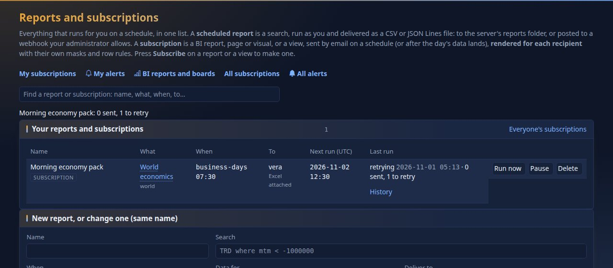

You should see `Morning economy pack: 1 sent` and the last run `ok`.

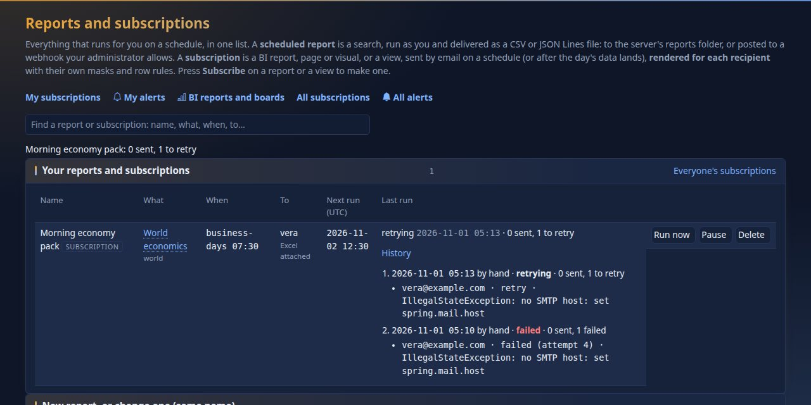

You should see both runs in the history: the new one `ok · 1 sent` (`vera@example.com · sent`) and, beneath it, the earlier one with
`retry (attempt 3) · IllegalStateException: no SMTP host`: the restart came before its fourth try, so it stays as it was (a run that is not restarted ends
`failed (attempt 4)`). Look at what the catcher caught:

```text
$ python3 - <<'PY'
import email; from email import policy
m = email.message_from_bytes(open("caught-mail/001.eml", "rb").read(), policy=policy.default)
print(m["From"], m["To"], m["Subject"], m["Auto-Submitted"], sep="\n")
print(m.get_body(("plain",)).get_content())
print([p.get_filename() for p in m.iter_attachments()])
PY
drishti@desk.example
vera@example.com
Drishti: World economics · 2026-10-13
auto-generated
World economics · 2026-10-13

World economics
Page: World · Data as of 2026-10-13
Filters: none beyond the report's own

The report is attached: World economics.xlsx
- Economies: 1 rows
- GDP (USD bn): 1 rows
- Population (m): 1 rows
- Average growth: 1 rows
- GDP per capita (USD): click a country to filter and to open its regions: 213 rows
- Largest economies (GDP, USD bn): 10 rows
- The economies: 213 rows

Open it in Drishti:
http://localhost:17912/bi/r/file%3Areport%3Aworld-economics/world

You are receiving this because you are a recipient of a subscription in Drishti. The figures are the ones you are entitled to see; they are rendered for you, not copied from the sender.
Ask the owner of the subscription, or an administrator, to change or stop it.

['World economics.xlsx']
```

(This mail was captured on an earlier run of the tutorial, on business date 2026-10-13; the steps and the shape are the same on the demo lake, the date is yours.) You should see a mail from your From address to `vera`'s address, marked `Auto-Submitted: auto-generated`, with each visual and how many rows it holds, a
link that opens the report in Drishti, and the workbook attached (29,589 bytes here). The link is built from `DRISHTI_CONSOLE_URL` (here the tutorial's
scratch console; yours says `localhost:17480`).

### Step 34 · An alert on a number

An alert watches **one number** and tells you when it crosses a limit, changes too much or does not arrive. It watches a **visual of a report** (what is
on the screen, with your filters) or a **measure of a model** (asked directly, with filters of its own). Start with a visual: open the shipped **Trades
overview**. Each card has a **bell** in its corner: *Alert me*.

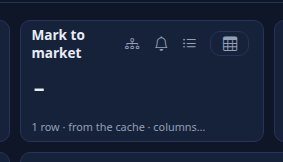

You should see the card (`Mark to market`, `+3,210,381,877` on the demo lake) and the bell. Press the bell: the form opens already filled in with the report, the page and the visual.

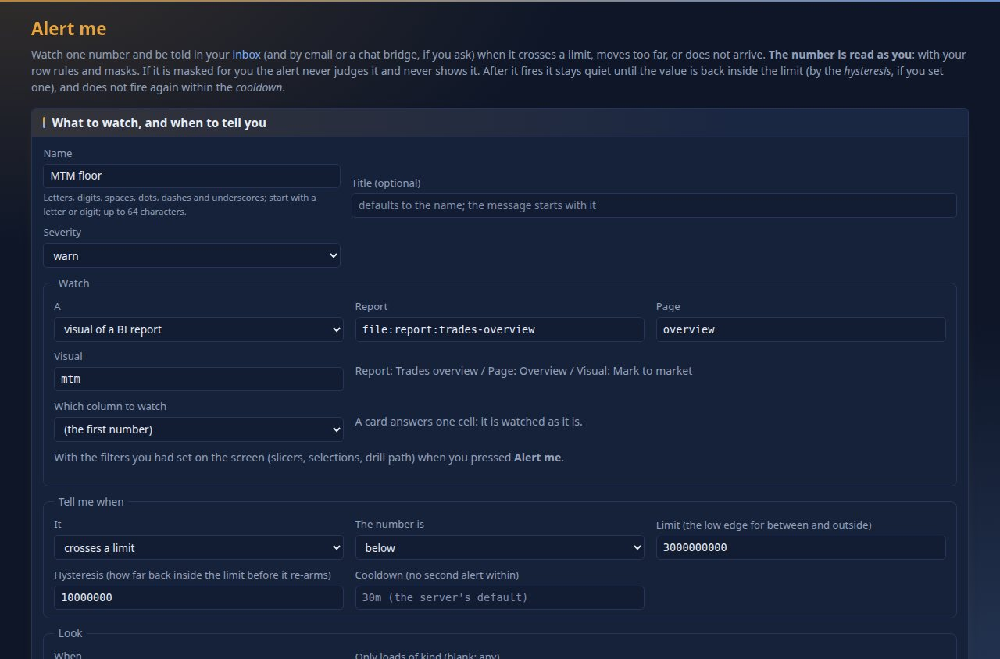

Name it `MTM floor`. **Watch** says what (this visual, with the filters you had set; a card answers one cell, so it is watched as it is). **Tell me
when**: *crosses a limit*, *below* `3500000000` (a limit above today's number so you see it fire; a real floor would be a loss limit), **Hysteresis**
`10000000`: after it fires it stays quiet until the number has come back **inside** the limit by at least this much, so a number that wobbles around the
limit does not ring every minute. **Look**: *after a data load* (the others are *on a schedule* such as `hourly`, and *live*, when the source pushes
changes). Press **Check now** (it says what the alert would do right now) and **Save**.

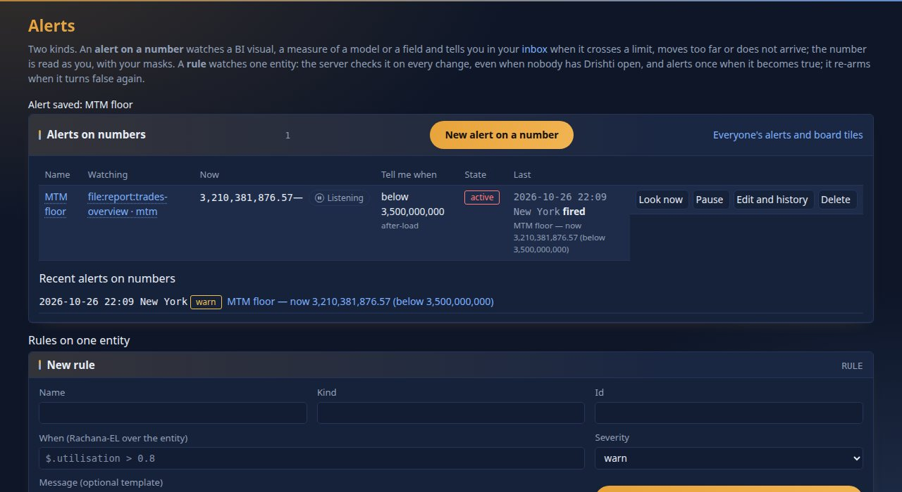

You should see the alert under **Alerts on numbers** with the state `active` (it fired when saved: a new alert whose condition already holds fires at
once) and the message `MTM floor — now 3,210,381,876.57 (below 3,500,000,000)`. The states: **armed** (watching), **active** (fired, will not fire again until it
re-arms), **paused** (you switched it off). Open **Edit and history**.

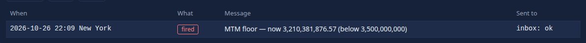

You should see one entry per firing, clearing or skipped look with the time, what triggered it, the number and the channel result (`inbox: ok`). The alert
reads the number **as you**: a number masked for you is never judged and never shown. The message also lands in the **inbox**, under **Alerts**:

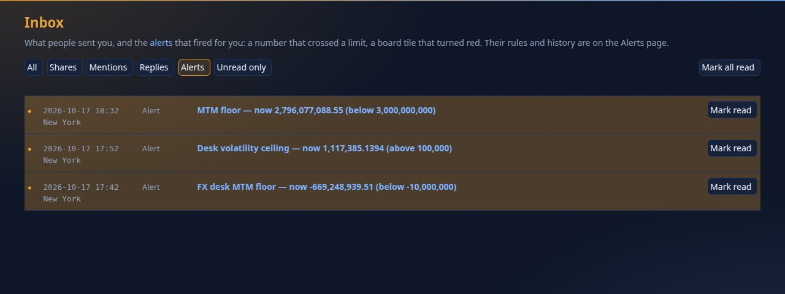

You should see the row (and one more for every firing); it opens what the alert is about. With the mail server of step 33 and an address on your account,
tick **Email** in the form and the same message arrives as `Drishti alert: MTM floor`. A mail that fails is tried again by the shared retry policy (the
history shows `retrying: attempt 1 of 4 …`, then `sent (attempt 3 of 4)`).

**An alert on a measure of a model** needs no report. **In the UI**: **Alerts → New alert on a number**, **Watch** *A measure of a model*, choose the model
**Trades daily** (step 30) and the measure **MTM**, **Add a filter** `trade.DESK` *is* `DESK-FX`, then *crosses a limit*, *below* `-10000000`, and
**Check now**:

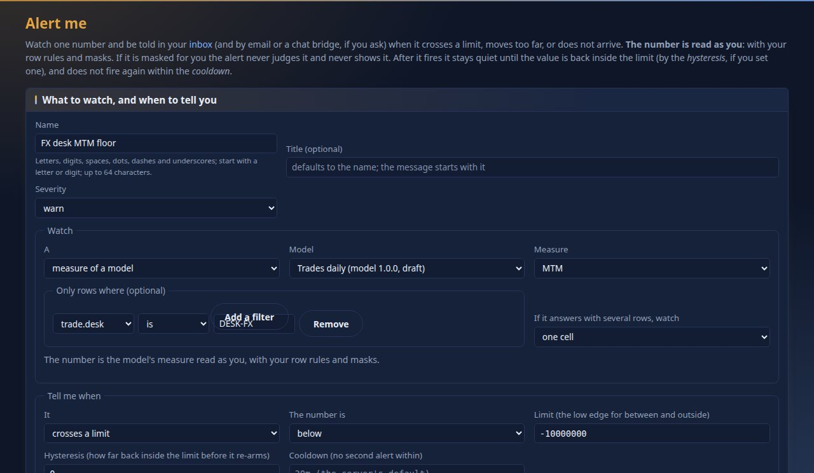

You should see the model and its measures in the two lists (only the models and measures you may read), the filter row, and *The number is the model's
measure read as you, with your row rules and masks*. Press **Save**: the FX desk's MTM is `-681,989,222`, below the limit, so it fires at once.

**From the command line** you can read the number it watches, and list your alerts (a read); saving and **Check now** are the console's calls
(`PUT /api/v1/alerts/rules/<name>` and `POST .../check`), which a personal token may not make (`403 DRS-5002`):

```text
$ python3 tools/drishti.py bi mq --model trades-daily@1 --select trade.DESK --measures "Trades,MTM" --where trade.DESK=DESK-FX
trade.DESK  Trades  MTM
----------  ------  ---------------
DESK-FX     1428    -681,989,221.57
1 row(s)  as of 2026-10-26  plan p_e316a98e618b4b4c
$ curl -s -H "Authorization: Bearer $DRISHTI_TOKEN" "$DRISHTI_SERVER/api/v1/alerts/rules" | jq -c '.[] | {name, describe, label, history: [.history[0] | {action, trigger, message, delivered}]}'
{"name":"FX desk MTM floor","describe":"below -10,000,000","label":"trades-daily@1 · MTM","history":[{"action":"fired","trigger":"saved","message":"FX desk MTM floor — now -681,989,221.57 (below -10,000,000)","delivered":{"inbox":"ok","email":"off","bridge":"off","sms":"off"}}]}
```

**The YAML** of that alert (the body of `fx-floor.json`; the server keeps the query as one model query, `mq: 1`, and fills in what you left out):

```yaml
name: FX desk MTM floor
title: FX desk MTM floor
severity: warn
source:
  type: model
  model: trades-daily@1
  query:
    select: { fields: [], measures: [MTM] }
    where:
      - { field: trade.DESK, op: eq, value: DESK-FX }
condition: { type: threshold, op: below, value: -10000000 }
trigger: { mode: after-load }
delivery: { inbox: true }
```

### Step 35 · Export: PDF, PNG, Excel, CSV

The **Export** bar is under the page tabs of every report: choose *this page* or one visual, then a format.

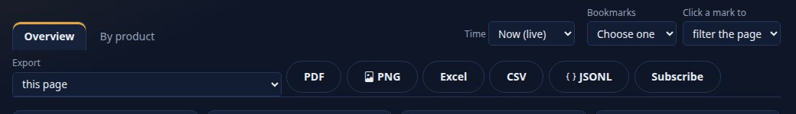

You should see the bar. Press **PNG**, or fetch a page directly: the console serves exports at `/dist/bi/<report id>.<format>` (a signed-in call), and the
server at `POST /api/v1/export/<format>`, which a personal token may call (an export is a read):

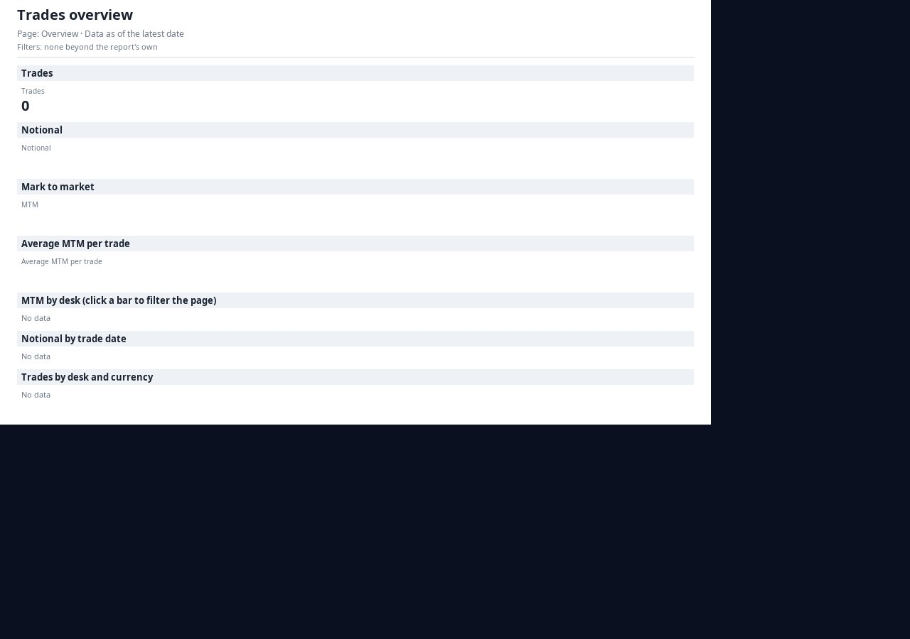

You should see the cards as their figures, the charts as horizontal bars and their data tables, the title and the data date at the top. The same page as
Excel, PDF and PNG, as the person who sees everything (captured from the console's `/dist/bi/file%3Areport%3Atrades-overview.<format>?page=overview`):

```text
$ for f in xlsx pdf png; do curl -s -X POST -H "Authorization: Bearer $DRISHTI_TOKEN" -H 'Content-Type: application/json' \
    -d '{"type":"report","id":"file:report:trades-overview","page":"overview"}' -o "Trades overview.$f" $DRISHTI_SERVER/api/v1/export/$f; done
Trades overview.xlsx   29,481 bytes   sheets:  About | Trades | Notional | Mark to market | Average MTM per trade |
                                                MTM by desk (click a bar to fil | Notional by trade date | Trades by desk and currency   (2 native charts)
Trades overview.pdf    10,274 bytes   4 pages
Trades overview.png   221,770 bytes
```

An Excel file has an `About` sheet (the title, the date, the filters) and **one sheet per visual**, with numbers as numbers; sheet names are cut at Excel's
31 characters. The CSV of one visual (choose it in the bar's first box, or add `&visual=by-desk` to the address):

```text
$ curl -s -X POST -H "Authorization: Bearer $DRISHTI_TOKEN" -H 'Content-Type: application/json' \
    -d '{"type":"report","id":"file:report:trades-overview","page":"overview","visual":"by-desk"}' $DRISHTI_SERVER/api/v1/export/csv
DESK,MTM
DESK-RATES,4.4844818514400015E9
DESK-MM,4.015030940599998E8
DESK-STRUCT,3.9424480623999995E8
DESK-CREDIT,3.860597027500004E8
DESK-SFT,2.6994665810000002E7
DESK-FI,-3.058833934999999E7
DESK-EQD,-8.576378433999994E7
DESK-COMM,-3.953832505300001E8
DESK-FX,-6.819892215699991E8
DESK-INFL,-1.28917764794E9
```

(The console's CSV button asks the same of `GET /dist/bi/file%3Areport%3Atrades-overview.csv?page=overview&visual=by-desk`.) You should see a header row
and one line per desk, the largest MTM first. Large amounts are written in exponent form (`4.4844818514400015E9` is 4,484,481,851.44): spreadsheets read
them as numbers. Every export carries your **business date and slicer choices**, is built as you (masked fields stay
masked), and is audited; limits (rows per sheet, file size, time) are settings of `drishti.distribution.export.*`. There is no YAML: an export is a
request, and a **subscription** (step 31) is the export written down. [BI_GUIDE.md](#1-distribution-the-reports-page-export-and-subscriptions) has them.

### Step 36 · Say what a number should be

A report or a model may declare the numbers it must show, as `tests:`. A **report's** tests name a measure (optionally a visual and a row of it) and the
number; a **model's** tests are questions in Drishti SQL and the number each must give. The tutorial's report,
[data/desk-check.report.yaml](../../tutorials/data/desk-check.report.yaml), reads the model of step 30 and says four things (the demo lake holds 15,000 trade
valuations, 1,428 of them on the FX desk; the third test is wrong on purpose):

```yaml
rachana: 2
report: desk-check
version: 1
title: Desk check
model: trades-daily@1
pages:
  - id: main
    title: Main
    visuals:
      - { id: trades, type: card, title: Trades, at: { x: 0, y: 0, w: 3, h: 2 }, wells: { values: [Trades] } }
      - { id: by-desk, type: bar, title: Trades by desk, at: { x: 3, y: 0, w: 6, h: 4 }, wells: { axis: [trade.DESK], values: [Trades] } }
tests:
  - { name: The book holds 15000 trades, measure: Trades, expect: 15000 }
  - { name: Trades within a range, measure: Trades, expect: { min: 14900, max: 15100 } }
  - { name: Close to 100 trades, measure: Trades, expect: 100, tolerance: 1% }
  - { name: The FX desk, visual: by-desk, row: { trade.DESK: DESK-FX }, expect: 1428 }
```

**In the UI** there is no form for tests yet: write them in the designer's **YAML** tab (or the item page's **Edit**). Create the report in
`Economics desk`, open it in the designer and press **Check**: the report is checked and its tests run, as you or as a role you hold (*Run the tests as*).

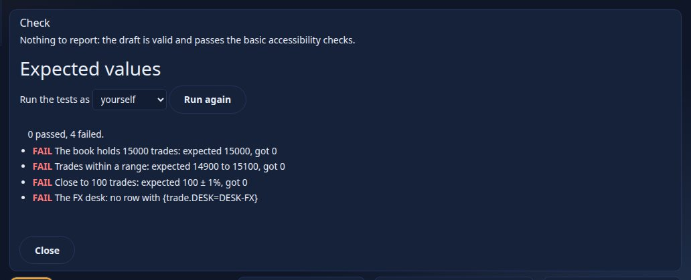

You should see `3 passed, 1 failed.` and the failing test saying what it expected and what it found (`expected 100 ± 1%, got 15000`). Now press **Publish**
on the item's page:

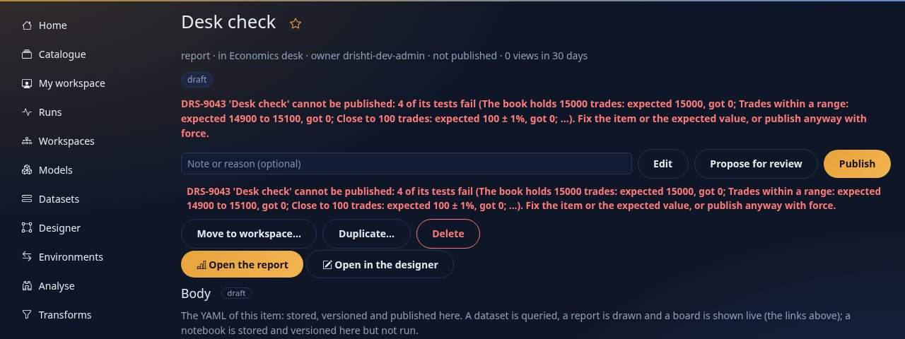

You should see `DRS-9043 'Desk check' cannot be published: 1 of its tests fails (Close to 100 trades: expected 100 ± 1%, got 15000).` Mend the expectation
(or the data) and publish again; a `bi-admin` may publish anyway with `force`, and the audit log says so. **From the command line** the same three moves
(`bi item tests` exits 1 when a test fails, so a CI job can run it):

```text
$ python3 tools/drishti.py bi item new economics-desk docs/tutorials/data/desk-check.report.yaml
bi-ba581ce78b  report  Desk check  draft in Economics desk

$ python3 tools/drishti.py bi item tests bi-ba581ce78b
pass  The book holds 15000 trades: expected 15000, found 15,000
pass  Trades within a range: expected 14900 to 15100, found 15,000
fail  Close to 100 trades: expected 100 ± 1%, found 15,000
pass  The FX desk: expected 1428, found 1,428
3 passed, 1 failed

$ python3 tools/drishti.py bi catalogue publish bi-ba581ce78b --note "first cut"
drishti: the server said 409 DRS-9043: DRS-9043 'Desk check' cannot be published: 1 of its tests fails (Close to 100 trades: expected 100 ± 1%, got 15000). Fix the item or the expected value, or publish anyway with force.
```

**A model's own tests** say what the model must answer, whatever report reads it. Add them to the model's YAML (here with `bi item save`; in the UI, the
model designer's **YAML** tab):

```yaml
tests:
  - { name: The book holds 15000 trades, sql: "SELECT MEASURE('Trades') FROM trade", expect: 15000 }
  - { name: Every desk has trades, sql: "SELECT COUNT(DISTINCT trade.DESK) FROM trade", expect: { min: 1 } }
```

(`trades-daily-tested.model.yaml` below is [data/trades-daily.model.yaml](../../tutorials/data/trades-daily.model.yaml) with these `tests:` added at the end.)

**In the UI** open the model (**Models → Trades daily → Open the designer**), the **Contract** tab, **Expected values**, and press **Run the tests**:

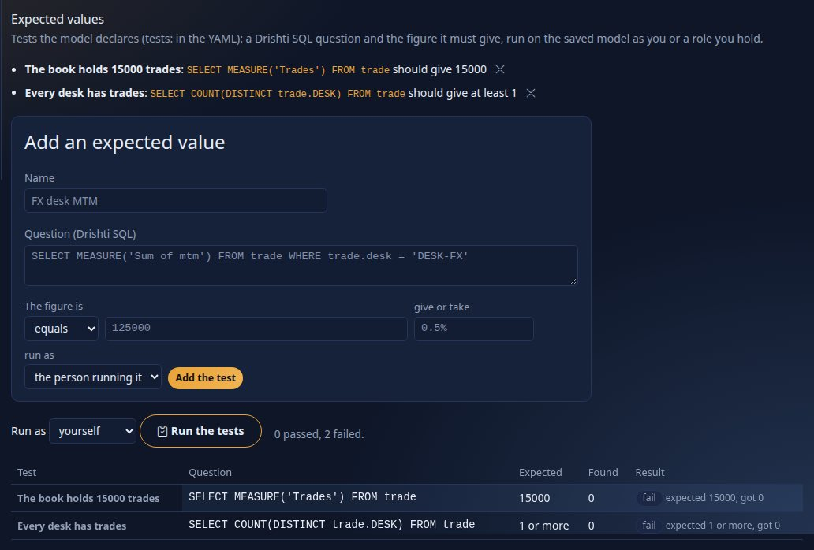

You should see each test with its question and what it should give, and, after **Run the tests**, `2 passed, 0 failed.` with the figures found (`15,000`, and
`10` desks). They run on the **saved** model, as you or as a role you hold, and that matters:

```text
$ python3 tools/drishti.py bi item save bi-a29d960c58 trades-daily-tested.model.yaml --message "the figures it must give"
bi-a29d960c58  saved  (draft, published v1)

$ python3 tools/drishti.py bi item tests bi-a29d960c58
pass  The book holds 15000 trades: expected 15000, found 15,000
pass  Every desk has trades: expected 1 or more, found 10
2 passed, 0 failed

$ python3 tools/drishti.py bi item tests bi-a29d960c58 --role viewer
fail  The book holds 15000 trades: expected 15000, found 0
fail  Every desk has trades: expected 1 or more, found 0
0 passed, 2 failed  (as viewer)
```

You should see the same tests fail **as `viewer`**: the model's row rule names `admin`, `risk` and `bi-writer`, and a role no rule names sees no rows
(the model designer's **Security** tab warns about exactly this, `DRS-9131`). A test run as a role is the quickest way to see what a reader gets. The
same words work in a report and in a model; [BI_GUIDE.md › Reports: the YAML, the visuals and how they behave, section 17](REPORT_FILE_FORMAT_STATEMENTS.md#112-expected-values-in-a-report) has every form of `expect`.

### Step 37 · Charts in the workbook, a summary in the mail, a webhook and a text

Four small things make what leaves Drishti more useful; none changes how you work.

**Charts in Excel.** Export the *Overview* page as Excel again: a bar, column, line, area, pie or donut visual now has a **native Excel chart** beside its data (open it in Excel or LibreOffice and edit it as any chart). It reads the sheet's own cells, so a column masked for the reader is text and never plotted.

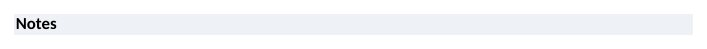

**A written summary.** On the Subscribe form (step 31) tick *Open the email with a short written summary*. It needs the AI layer ([tutorial 10](../../tutorials/10-ai-assistant.md)) and **`drishti.bi.ai.values: aggregates`**; each recipient's email then opens with two or three sentences that word *their own* figures, never a masked one. With anything else the mail goes without it and the run's history says why.

**A webhook and a text.** An administrator defines webhooks and one text gateway (`drishti.notify.*`, [CONFIGURATION.md](../../admin/CONFIGURATION.md#drishtinotify--webhooks-and-text-messages-for-alerts-and-subscriptions)); the form then offers them by name, plus a field for your own mobile number:

You should see a webhook per defined name and, once a gateway is set up, *Text each recipient who has given a number a link to it* (the picture is in [BI_GUIDE.md › Distribution: scheduled reports, export, subscriptions, alerts and embedding, section 6](#14-webhooks-and-text-messages)). A webhook post is signed (`X-Drishti-Signature`) and holds the title and a link, never a figure; so does a text. The alert form has the same two boxes. In the subscription's YAML they are `webhooks: [ops]` and `sms: true`. [BI_GUIDE.md › Distribution: scheduled reports, export, subscriptions, alerts and embedding, section 6](#14-webhooks-and-text-messages).

#### Part E · Scheduled searches and subscriptions

Two things in Drishti run on a schedule and deliver what you saw: a **scheduled report** (a search, run as you, delivered as a CSV file) and a **subscription** (a view or a BI report, sent by email in
the form you choose, rendered separately for each recipient). In this part you make one of each, run them by hand, read their history, and see how they sit together under **Views → Reports** next to alerts and
BI reports.

### Step 38 · Start from a search

Run a search that finds what you want to see every day: the trades whose valuation lost more than 200 million. Valuations are their own kind, [`trade-valuation`](../../contracts/samples/market-risk.md#trade-valuation) ([contract](../../contracts/packs/market-risk.md#tval-trade-valuation-trade-valuation))
(mnemonic `TVAL`, one per trade per day, from the market-risk pack); the trade itself carries no MTM. Type:

```text
TVAL where MTM < -200m order by MTM
```

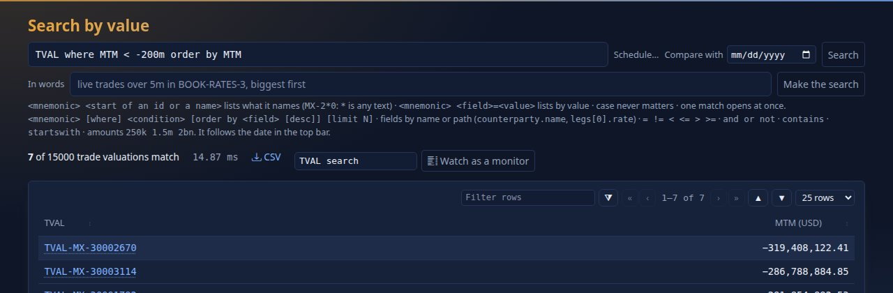

You should see a table (`7 of 15000 trade valuations match`, worst first: `TVAL-MX-30002670` at about −319 million), the **Schedule...** link beside the search box and a **Watch as a monitor** button. (From a search made with a form, **Schedule a report** under the results does the
same, tutorial 1, Part C.) Press **Schedule...**.

### Step 39 · Say when, which day, and where

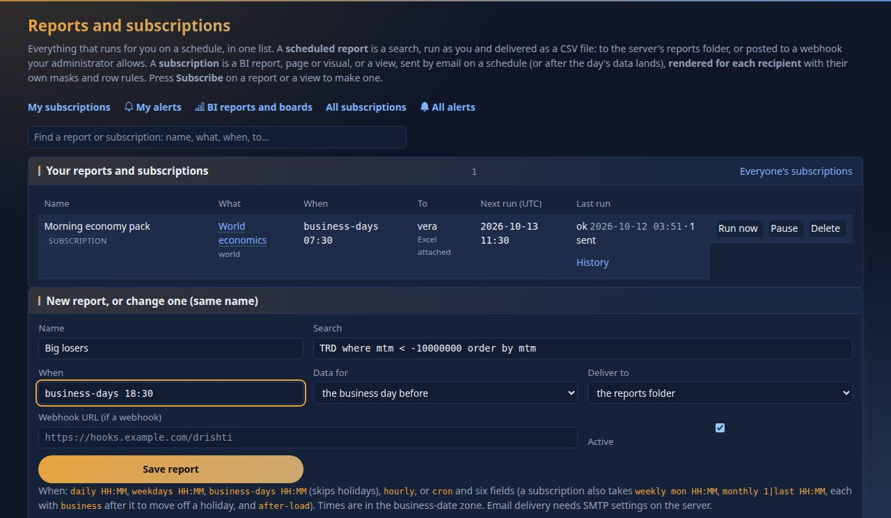

You should see the **Reports and subscriptions** page with *New report* filled in with your search. Name it `Big losers`. **When** takes these words, in the business-date zone (New York by default):

| When | Runs |
|---|---|
| `business-days 18:30` | at 18:30 on weekdays that are not holidays in the server's calendar |
| `weekdays 07:00` | Monday to Friday at 07:00 |
| `daily 06:00`, `hourly` | every day at 06:00; every hour |
| `weekly mon 07:30` | on that weekday |
| `monthly last 18:00 business` | on the last business day of the month |
| `after-load`, `after-load trade` | shortly after a data load finished `ready` (tutorial 12), for any kind or the one named |
| `cron 0 0 8,12,16 * * MON-FRI` | a cron expression: second, minute, hour, day, month, weekday |

Type `business-days 18:30`. **Data for** chooses the current business day or the one before: pick *the business day before* for a morning report on yesterday's close. **Deliver to** is the server's reports folder or a
webhook your administrator allows. Press **Save report**.

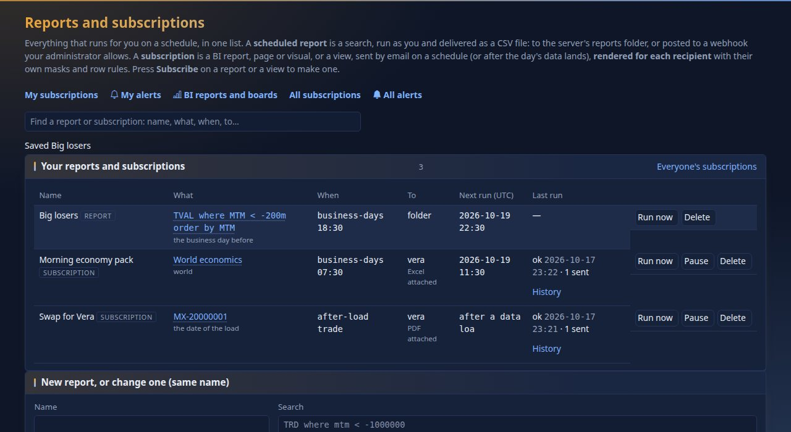

You should see `Saved Big losers`, and a row with the search, the schedule, where it goes and **Next run (UTC)**. The next run skips the weekend and the holidays of the
calendar: saved on Saturday 17 October 2026, it first runs on Monday the 19th (`2026-10-19T22:30:00Z`); had it been saved the weekend before, Monday 12 October (Columbus Day,
a New York holiday) would have been skipped too. The server shows the next three runs of any schedule text; this is the call behind it:

```text
$ for each schedule: curl -s -X POST -H "Authorization: Bearer $DRISHTI_TOKEN" -H 'Content-Type: application/json' -d '{"schedule":"..."}' http://localhost:18480/api/v1/subscriptions/preview
business-days 18:30
{"next": ["2026-10-19T22:30:00Z", "2026-10-20T22:30:00Z", "2026-10-21T22:30:00Z"]}
monthly last 18:00 business
{"next": ["2026-10-30T22:00:00Z", "2026-11-30T23:00:00Z", "2026-12-31T23:00:00Z"]}
after-load trade
{"next": []}
```

You should see three instants for `business-days 18:30` (22:30 UTC is 18:30 New York), the last business day of each coming month for `monthly last 18:00 business`, and none for `after-load`, which has no time, only a trigger.

### Step 40 · Run it now

Press **Run now** on the row.

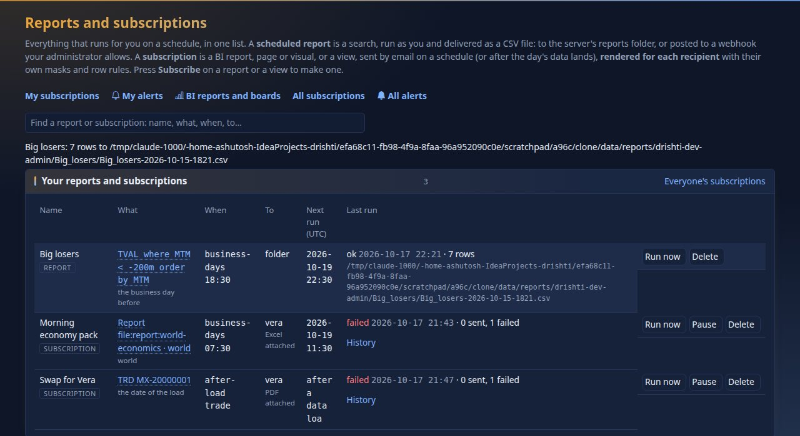

You should see `Big losers: 7 rows`, the path of the file, and the **Last run** line `ok`, the time and `7 rows`, for the business date `2026-10-15` (*the business day
before* 2026-10-16). The report ran **as you**: it sees what your roles let you see, with the same masked fields, and it stops if your account is disabled or
deleted. The file is a CSV in the reports folder, under the data folder:

```text
$ head -4 data/reports/drishti-dev-admin/Big_losers/Big_losers-2026-10-15-1746.csv
kind,id,title,MTM (USD)
trade-valuation,TVAL-MX-30002670,TVAL-MX-30002670,-319580679.781726
trade-valuation,TVAL-MX-30001782,TVAL-MX-30001782,-283751034.71329
trade-valuation,TVAL-MX-30003114,TVAL-MX-30003114,-282298514.881738
```

You should see the columns of the search (kind, id, title, then the fields the results showed: here the MTM) and one line for each valuation. The file name carries the
business date it was run for and the time.

**From the command line** the run is one call too, `POST /api/v1/me/reports/Big%20losers/run`, from a signed-in session; it answers with the run:

```text
{"at": "2026-10-17T21:46:55.675641667Z", "trigger": "by hand", "businessDate": "2026-10-15", "rows": 7, "bytes": 507,
 "target": "~/drishti/data/reports/drishti-dev-admin/Big_losers/Big_losers-2026-10-15-1746.csv", "status": "ok"}
```

The report as the page saves it (`PUT /api/v1/me/reports/{name}`):

```yaml
name: Big losers
query: TVAL where MTM < -200m order by MTM
schedule: business-days 18:30
deliver: folder
date: previous            # the business day before
enabled: true
```

### Step 41 · A subscription: a view for a colleague

Open `TRD MX-20000001` and press **Subscribe** (next to Export) in the title line.

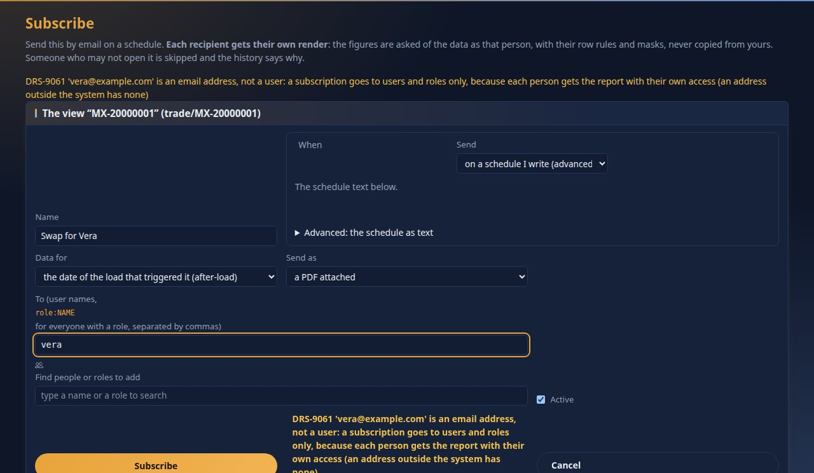

Fill in: name `Swap for Vera`, **When**: under **Send** choose *on a schedule I write (advanced)*, open **Advanced: the schedule as text** and type `after-load trade` (it runs after the day's data lands, not at a time; the plain choices are every day, every business day, every week, month end and every hour, at a time), **Data for** *the date of the load that triggered it*, **Send as** *a PDF attached*, and **To** `vera`. **Send as** offers the email
itself (the tables in the body), a PDF or an Excel workbook. **To** takes user names and `role:NAME` (everyone who holds the role), separated by commas. Try an email address first:

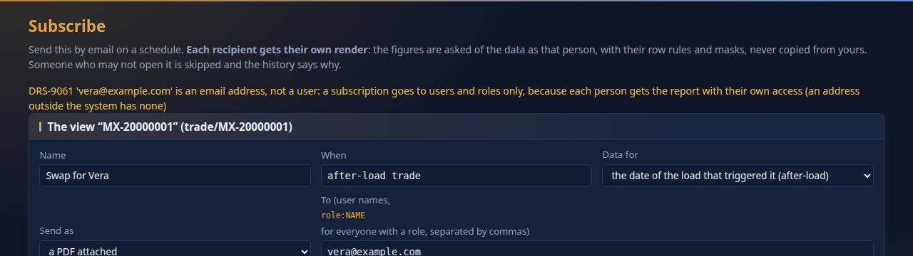

You should see `DRS-9061 'vera@example.com' is an email address, not a user: a subscription goes to users and roles only, because each person gets the report with their own access (an address outside the system has none)`. That is the rule that keeps masks
safe: Drishti builds each recipient's copy from the data **as that person**, with their roles as they are now, so the sender never sees and the mail never carries a figure the recipient may not see. Someone who may not open the view is skipped, and the history says why. Only
a BI author or an administrator may subscribe other people; anyone may subscribe themselves. Put `vera` back and press **Subscribe**. What the page saves (`PUT /api/v1/me/subscriptions/{name}`):

```yaml
name: Swap for Vera
title: TRD MX-20000001
target: { type: view, id: trade/MX-20000001 }
schedule: after-load trade
format: pdf
date: load                # the date of the load that triggered it
recipients: [vera]
```

### Step 42 · Reports, all in one place

Open **Views** in the top bar and choose **Reports** (it is an entry of Views, with Forms, the terminal and search).

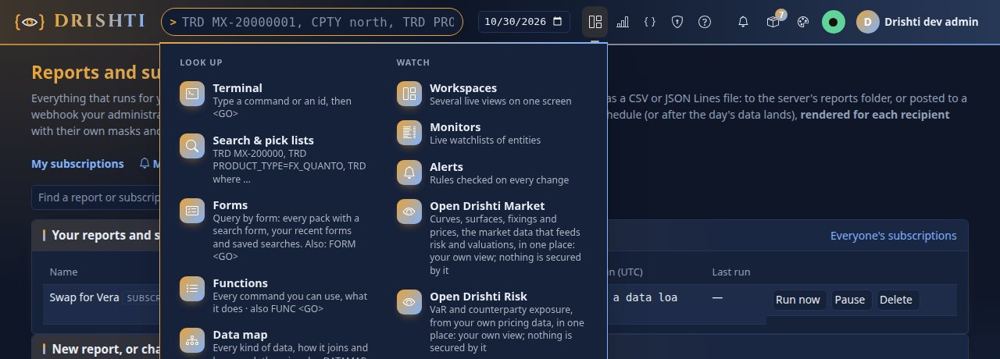

You should see **Reports** under **Look up** with the words "Every report you have". It opens **one page** with the links at its top: **My subscriptions**, **My alerts** ([tutorial 12](../../tutorials/12-a-day-of-bank-data.md)), **BI reports and boards** (the published reports of Rūpaka, the catalogue filtered to reports) and, for administrators, **All subscriptions** and **All alerts**; a **Find** box
(*Find a report or subscription: name, what, when, to...*) narrows the list as you type, and the list is one list:

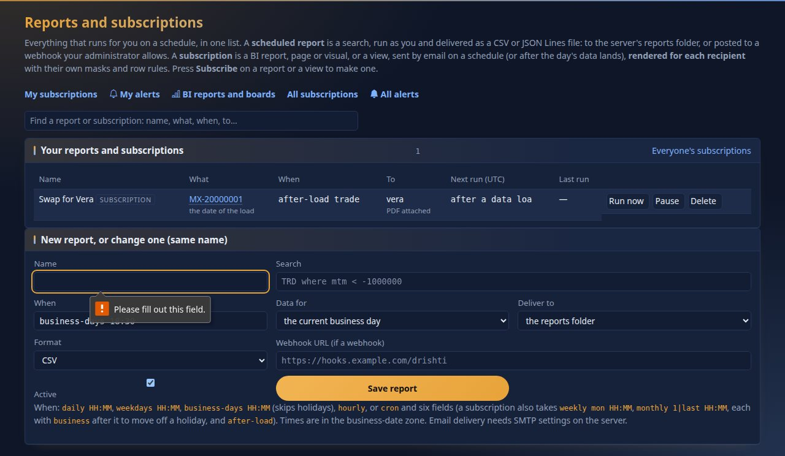

You should see both rows, badged `REPORT` and `SUBSCRIPTION`, each with its schedule, who it goes to (a folder, or `vera` with the format), the next run and the last. A subscription you make on a **BI report** (Subscribe under its page tabs) lands in the same list, with the
report's page or visual as its target. Row actions: **Run now**, **Pause** and **Resume** (subscriptions), **Delete**. **Everyone's subscriptions** (administrators) lists everybody's.

### Step 43 · Run the subscription, read its history

Press **Run now** on `Swap for Vera`.

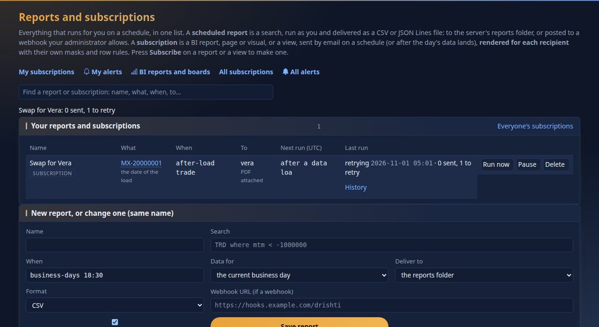

On a fresh install, with no mail server: You should see `Swap for Vera: 0 sent, 1 to retry` and a last-run line `retrying`. The run, as the server answers it:

```text
{"id": "b0bd2b86", "at": "2026-10-17T21:47:08.870822192Z", "trigger": "by hand",
 "deliveries": [{"to": "vera@example.com", "label": "Vera Lim", "attempts": 1, "user": "vera",
                 "error": "IllegalStateException: no SMTP host: set spring.mail.host", "status": "retry", "nextAttempt": "2026-10-17T21:47:14.698917894Z"}],
 "sent": 0, "failed": 0, "skipped": 0, "retrying": 1, "status": "retrying"}
```

Open **History**:

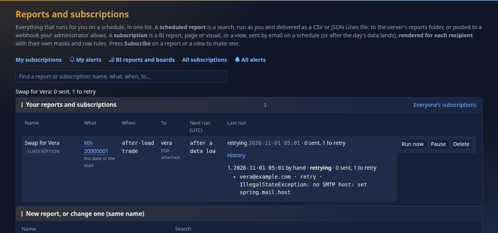

You should see each run with the time, how it was triggered (`by hand`, a schedule or `after-load`), the counts, and for each recipient a line such as `vera@example.com · retry · IllegalStateException: no SMTP host: set spring.mail.host`. That is the
honest result without a mail server: Drishti built Vera's copy, could not send it, and will **retry** (and keep the history). If Vera had no email address on her account the line says `skipped · no email address on file`. Set the SMTP host and the email channel
(Admin → Collaboration) and the same run sends. Each retry, failure and skip is recorded; nothing is lost silently.

On a phone the page is one column:


### Step 44 · From the command line and the API

Creating and editing reports and subscriptions is done in the console (`drishti.py` has no command for scheduled reports or subscriptions; its `bi` commands, such as `drishti.py bi catalogue list` and `bi runs`, are for BI items: [CLI_REFERENCE.md](../../guides/CLI_REFERENCE.md)). Reading them is REST, with the token of tutorial 1, Part A. A
personal token may read but never change your reports: a `PUT` with it is refused, `403 DRS-5002 API tokens may not call this endpoint`.

```text
$ curl -s -H "Authorization: Bearer $DRISHTI_TOKEN" http://localhost:18480/api/v1/me/reports \
    | python3 -c "import json,sys; [print(r['name'], '|', r['query'], '|', r['schedule'], '|', r['deliver'], '|', r['date']) for r in json.load(sys.stdin)]"
Big losers | TVAL where MTM < -200m order by MTM | business-days 18:30 | folder | previous
```

```text
$ curl -s -H "Authorization: Bearer $DRISHTI_TOKEN" http://localhost:18480/api/v1/me/subscriptions \
    | python3 -c "import json,sys; [print(r['name'], '|', r['schedule'], '|', r['format'], '|', ','.join(r['recipients']), '|', r['date']) for r in json.load(sys.stdin)]"
Swap for Vera | after-load trade | pdf | vera | load
```

You should see one line for each, its name, schedule, format or destination, recipients and which day's data. [BI_GUIDE.md](#1-distribution-the-reports-page-export-and-subscriptions) lists the whole API (`PUT /api/v1/me/subscriptions/{name}` and friends, for a session, not a token) and the retry rules.
