<!--
  Project Drishti · Any data. Any domain. One grammar.

  Copyright (c) 2026 Ashutosh Sinha <ajsinha@gmail.com>.
  All rights reserved.

  PROPRIETARY AND CONFIDENTIAL.

  This file is the confidential and proprietary property of Ashutosh Sinha.
  Unauthorised copying, use, modification, distribution or disclosure of this
  file, via any medium, is strictly prohibited except with the express prior
  written permission of the copyright holder.

  See the LICENSE file in the root of this repository for the full terms.
-->
# Governing BI and AI in BI


> Commands: Linux and macOS `python3 tools/drishti.py X`; Windows `py -3.13 tools\drishti.py X` (same arguments).

<!-- nav:begin -->
Business intelligence: [Index](README.md) · [Pivot](PIVOT.md) · [Pivot at scale and the risk cubes](PIVOT_SCALE_AND_CUBES.md) · [Tables and models](TABLES_AND_MODELS.md) · [Reports and the designer](REPORTS.md) · [The report file, formatting and statements](REPORT_FILE_FORMAT_STATEMENTS.md) · [Models and datasets for reports](TABLES_AND_MODELS.md#models-and-datasets-for-reports) · [Live reports, boards and background runs](LIVE_REPORTS_AND_BOARDS.md) · [Distribution, subscriptions and alerts](DISTRIBUTION_AND_ALERTS.md) · **Governing BI and AI in BI** · [The Notebook and Python](NOTEBOOK_AND_PYTHON.md) · [Calc: Python in your own browser](CALC.md) · [Groupings and analytics](GROUPINGS_AND_ANALYTICS.md)
<!-- nav:end -->

AI in BI (report from words, ask the data, explain this number) and publishing and governance (versions, review, certification, lineage, impact, environments); with the governance tutorial.

## Contents

- [Guide](#guide)
  - [1. AI in BI: report from words, ask the data, explain this number](#1-ai-in-bi-report-from-words-ask-the-data-explain-this-number)
  - [2. Publishing and governance: versions, review, certification, lineage, impact, environments](#2-publishing-and-governance-versions-review-certification-lineage-impact-environments)
- [Tutorial: Govern BI](#tutorial-govern-bi)
  - [Part G · Govern BI](#part-g--govern-bi)

## Guide

### 1. AI in BI: report from words, ask the data, explain this number

> **Not in this release.** The console of this release shows none of the AI in BI below (no *Describe a report*, *Ask the data*,
> *Explain this number*, *Suggest visuals* or written summary in a subscription), and the server's AI layer is off
> (`drishti.ai.enabled`). The section describes the server's hooks, kept for a later release.

A language model sits beside reports in a few places and no more. It is **off by default**, it is the AI layer's
([ADMIN_GUIDE.md › 27.1 Model providers](../ADMIN_GUIDE.md#271-model-providers)), and the model is never trusted with anything a person could not do by hand: **it writes a draft or a
query, and Drishti checks it, runs it as the reader, and shows it.** With the AI layer off, the buttons are hidden and every call answers
`404 DRS-4015`.

| Where | What you do | What the model does | What Drishti does |
|---|---|---|---|
| Designer | **Describe a report** | drafts report YAML over the report's model | checks it with the report checker before you see it; puts it in the YAML tab; saves nothing |
| A report page | **Ask the data** (a question box under the bar) | maps the question to a model query | the engine runs it as you, shows a table, the visual that suits it, and the query used |
| A visual's header | **Explain** (the light bulb) | in `aggregates` mode only: words the breakdown | works out the lineage and the breakdown of the number on the engine |
| Designer | **Suggest visuals**, **Explain in plain words** | proposes visuals; explains Check's problems | checks every proposal; applies nothing until you press **Add to this page** |
| Build › Tables & models | **Ask the AI helper** | proposes relationships, measures and descriptions | drops what is not in the model; each item has its own **Accept** |
| A subscription | a written summary at the top of the email | words the recipient's own figures | only under `aggregates`, as the recipient |

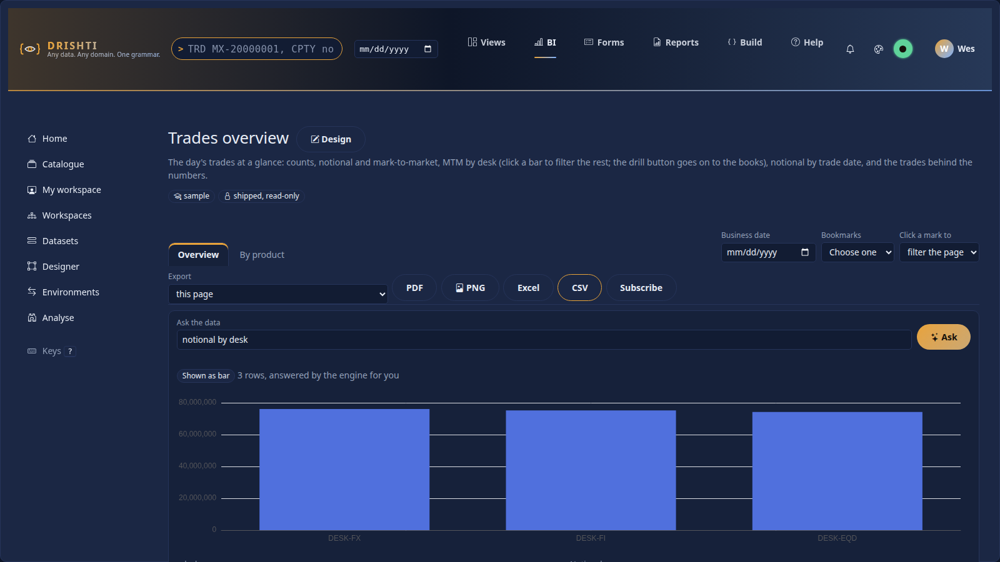

#### 1.1 Turn it on, and who may

```yaml
# config/ai/mock.yaml  (a deterministic provider for trying it; use config/ai/openai.yaml.example or anthropic.yaml.example for a real model)
type: mock
models:
  - name: m
```

```
DRISHTI_AI_ENABLED=true  DRISHTI_AI_DEFAULT_MODEL=mock/m
```

The settings are `drishti.bi.ai` and the AI layer's policy (`drishti.ai.policy.*`) in [CONFIGURATION.md](../../admin/CONFIGURATION.md). The features
are named `bi-draft`, `bi-ask`, `bi-explain`, `subscription-narrative`, `bi-suggest`, `bi-explain-checks` and `bi-helper`, so
`drishti.ai.policy.features."[bi-ask]": {roles: [analyst], per-user-per-minute: 10}` limits who asks and how often. **Two gates** must open: the
**BI power** (`bi-author` to describe a report, `bi` to ask or explain) and the **AI policy** (its roles, masks, per-user and per-feature limits,
the cost limit; `403 DRS-4018` otherwise). Every call is audited twice, never with the prompt or the answer: the policy's access-log row and a
BI audit row (`bi-ai-draft`, `bi-ai-ask`, `bi-ai-explain`).

#### 1.2 What the model is sent

The prompt is the **model** the report reads (its description, as the person reads it) and the person's own words, nothing else. For *Ask the
data* on **Trades overview** (model `trades-basic@1`), abridged:

```text
TASK: ask-query
DATASET trades-basic: The simplest useful model: one table (the trading pack's trade) with four measures (Notional, MTM, Trades and average MTM per trade) and a desk-to-book hierarchy. Start here.
FIELDS (write them as table.column):
  table trade: the dataset trades-basic-trade 1.0.0, a fact
    trade.VALUATION_ID string
    trade.TRADE_ID string
    trade.DESK string
    trade.PORTFOLIO string
    trade.CURRENCY string
    trade.NOTIONAL decimal
    trade.MTM decimal
    trade.TRADE_DATE date
    trade.MTM_IN_MILLIONS decimal - MTM in millions of USD
    ...
MEASURES (write them by name):
  Notional - Total notional of the trades, in the trade's own currency units.
  MTM - Mark-to-market in USD, signed.
  Trades - Number of trades.
  Average MTM per trade - MTM divided by the number of trades (a measure built from measures).
  ...
HIERARCHIES:
  Desk and book: [trade.DESK, trade.PORTFOLIO]
QUESTION: notional by desk
```

What is **not** in it, in either mode: a row, a value, a measure's definition, a connector or a path, and any field **masked for the reader**
(left out, so the model cannot be told it exists). The AI policy then masks `drishti.security.redact` fields in the prompt as for every call.

| | `labels-only` (default) | `aggregates` |
|---|---|---|
| Report from words | the model | the model (a draft never involves values) |
| Ask the data | the model maps the question; **the answer is never sent to it** | then a second call words the reader's aggregate result (unmasked columns only, at most `ask-rows` rows) |
| Explain | no model call at all: lineage and breakdown only | one call words the breakdown, as the reader sees it |

`aggregates` sends **the reader's own figures** to the provider: use it only with a provider you may send such figures to. That is why it is an
administrator's setting (`drishti.bi.ai.values`), not a button.

#### 1.3 Report from words

In the designer, **Describe a report**: say what you want ("notional by desk as a bar chart and the total as a card") and press **Draft it**. The
model is told the report grammar and the model as you read it, and answers with YAML. Drishti strips a code fence, pins the draft to the model
the report reads, runs the **report checker** on it (the same as Check), and if it fails tells the model the problems once more; if it still
fails you get `422 DRS-4020` and the draft is **not shown**. A passing draft appears as text with *Use this draft*, which puts it in the YAML tab
like text you typed. **Nothing is saved or published.**

```text
POST /api/v1/bi/ai/draft  {"dataset": "world-economics@1", "request": "GDP by region"}                (as an administrator)   200
{ "yaml": "rachana: 2\nreport: gdp-by-region\nversion: 1\ntitle: GDP by region\nmodel: world-economics@1\npages:\n  - id: main\n ...",
  "valid": true, "problems": [], "dataset": "world-economics@1", "model": "world-economics@1", "saved": false }

POST /api/v1/bi/ai/draft  {"dataset": "trades-basic@1", "request": "x"}                                (as rita, no bi-author)   403
{ "status": 403, "code": "DRS-9002", "detail": "DRS-9002 rita does not hold the bi-author power (an administrator grants it on a role)" }
```

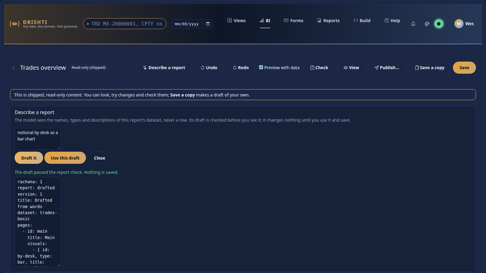

#### 1.4 Ask the data

The question box maps a question to a **model query** (fields, measures, filters, dates, order, limit). The model chooses only names from the
model it was shown; the **engine** checks every name, binds every value, and runs it **as you**, so two people asking the same question get the
answers each is entitled to. The page shows the answer as a **table**, the **visual that suits it** (a card for one number, a line over dates, a
bar for a few categories; chosen by Drishti from the shape of the query), a note of the rows, and **the query the model chose**, so you can
trust or doubt what was asked. An engine refusal is shown with its code and "the query the model chose was refused"; a question the model cannot
turn into a query is `DRS-4020`, not a guess.

```text
POST /api/v1/bi/ai/ask  {"report": "file:report:trades-overview", "question": "notional by desk"}          (as ann, bi-writer)   200
{ "columns": [{"type": "string", "masked": false, "name": "trade.DESK"}, {"type": "decimal", "masked": false, "name": "Notional"}],
  "rows": [["DESK-COMM", 8.888037427736503E11], ["DESK-RATES", 5.96934185E11], ["DESK-EQD", 4.28542341E11], ...], "rowCount": 10,
  "question": "notional by desk",
  "query": {"fields": ["trade.DESK"], "measures": ["Notional"], "filters": [], "orderBy": [{"desc": true, "by": "Notional"}], "limit": 200},
  "visual": "bar", "values": "labels-only", "summary": null }
```

#### 1.5 Explain this number

The light bulb in a visual's header explains the visual's **first measure** under the **page's state** (its slicers, selections and date), so the
number explained is the number on the screen:

* **Lineage**, no model involved: the model, the measure's definition, the columns it reads, and each table's pack kind, connector and mode.
* **The breakdown**, computed by the engine as you: the total, then the value by up to `explain-dimensions` dimensions (the visual's own fields
  first), each with its top `explain-members` members and their **share**; a dimension masked for you is left out.
* **The narrative** (`aggregates` only): three sentences wording that breakdown, from numbers the model was given and told not to add to.

Explain says **what a number is made of**, not why it moved over time.

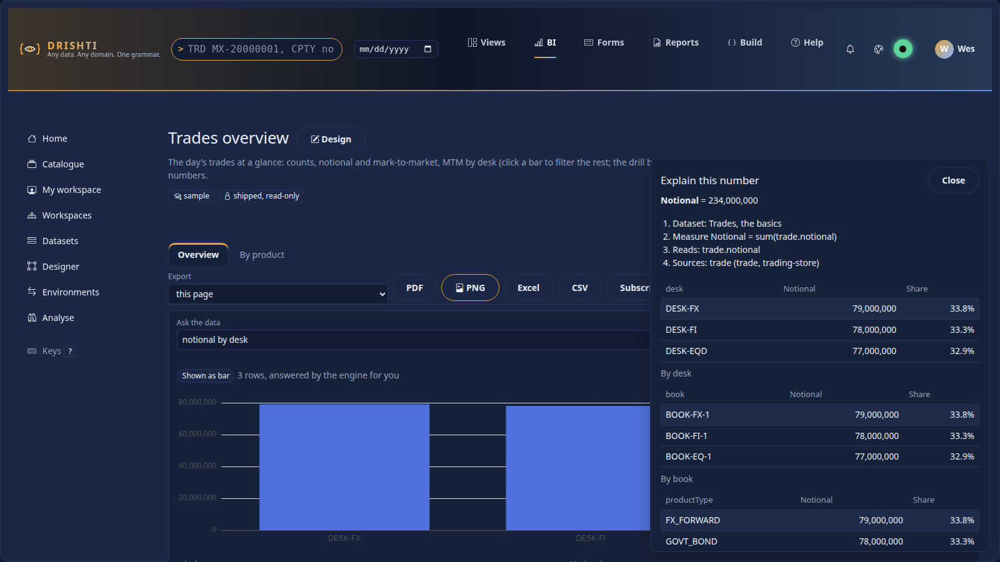

#### 1.6 Designer copilot and the AI helper

**Suggest visuals** (beside *Check*; with the AI layer on and `bi-author`) takes a goal in your words and proposes visuals, their wells and
filters, each as a card with its type, title, a sentence on why it is useful and **the YAML that would be added**. Each is checked as a
hand-written one is; nothing is applied: **Add to this page** puts it at the bottom of the page as one undoable edit. **Explain in plain words**
in the Check panel sends the checker's own problems (codes, paths, messages) and answers each with what it means and what to change; with no
problem the model is not called. Feature names `bi-suggest` and `bi-explain-checks`.

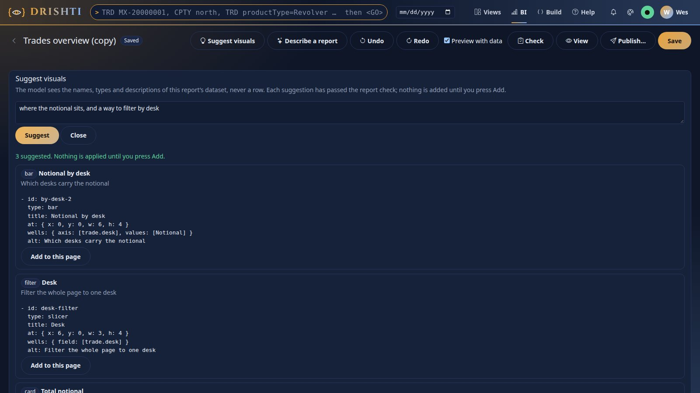

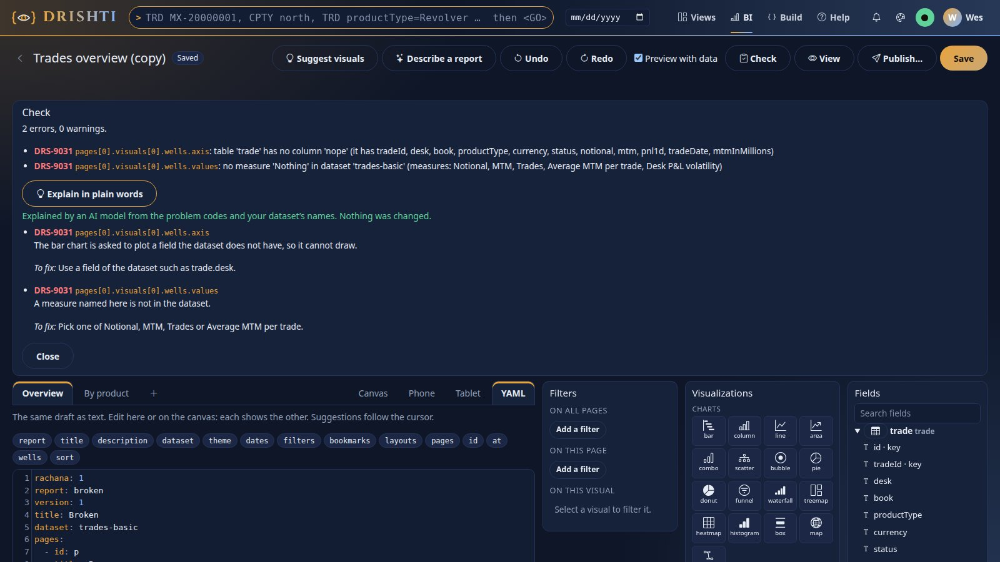

**Ask the AI helper**, on a model, proposes what a model usually lacks, from its names, types and descriptions alone: **relationships** between
columns of the same type in different tables, **measures** (one aggregate over a column the model has) and **descriptions** for the columns that
have none. Each item is checked against the model first (a name that is not there, a relationship inside one table or one that exists, a
measure over an unknown column, a name taken: dropped), shown with the YAML it would add and its own **Accept**, one undoable edit; nothing is
saved until you save. Feature `bi-helper`.

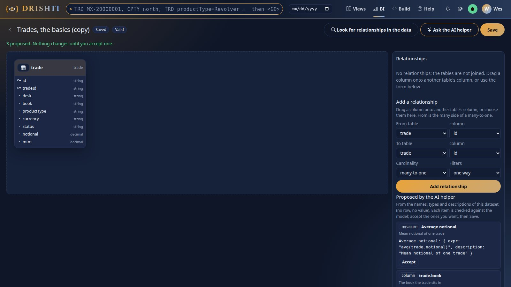

#### 1.7 Errors

| Code | When |
|---|---|
| `DRS-4015` (404) | the AI layer is off |
| `DRS-4016` (502 / 504) | the provider failed or did not answer in time |
| `DRS-4017` (429) | over a per-user, per-feature or cost limit |
| `DRS-4018` (403) | the AI policy does not open the feature to your role |
| `DRS-4019` (404) | the configured model is not found |
| `DRS-4020` (422) | the model's answer could not be used: a draft that failed the report check after one repair, or an answer that is not a query; nothing changed |
| `DRS-9002` (403) | no BI power for the hook |
| `DRS-9020`, `DRS-9021`, `DRS-9025` | the engine refused the query the model chose |

Each question stands alone (no follow-up that remembers the last), and Explain does not compare dates.

### 2. Publishing and governance: versions, review, certification, lineage, impact, environments

A report or a model is not just a file: it is saved, reviewed, certified and moved between servers, and a change to a model can break the
reports built on it. On an item's page (`/bi/i/<id>`) the sections **History**, **Review**, **Impact on reports** and **Lineage** show it; the
rail has **Promotion (test to live)**. The walk-through is [the reports tutorial, Part G](#part-g--govern-bi). A phone shows the same sections one column
wide; tables scroll inside their frame.

#### 2.1 Saved states and published versions

| | A **saved state** (History) | A **published version** (Versions) |
|---|---|---|
| Made by | every change of an item's body: create, save, restore, publish, import | publishing (or approving a proposal) |
| Numbered | `#1`, `#2` ... per item | `v1`, `v2` ... |
| Carries | who, when, a message (*What changed* in the Edit form), where it came from (`create`, `save`, `restore`, `publish`, `import`) | who published, when, the note |
| Kept | the newest `drishti.bi.governance.revisions-keep` (200); one that is a published version is never dropped | the newest `drishti.bi.versions-keep` (50) |
| Seen by | people who may **edit** the item, and a bi-steward while it is proposed | everyone who may read the item |

A change of title, description, tags or audience alone is not a saved state: only the body is versioned. **Readers see the published version;
authors see their draft.** **Restore** makes a saved state (or a published version) the draft again **as a new saved state**, so nothing is ever
lost; it is refused while the item is proposed (`DRS-9004`: withdraw first).

```
GET /api/v1/bi/items/bi-ba49ebcd44/history        (as ann, after two saves)
{ "title": "Positions model", "status": "draft", "publishedVersion": 0,
  "revisions": [
    { "seq": 3, "message": "rename the count measure", "author": "ann", "origin": "save",   "publishedVersion": 0, "draft": true,  "bytes": 339 },
    { "seq": 2, "message": "add the currency column",  "author": "ann", "origin": "save",   "publishedVersion": 0, "draft": false, "bytes": 340 },
    { "seq": 1, "message": "first cut",                "author": "ann", "origin": "create", "publishedVersion": 0, "draft": false, "bytes": 317 } ],
  "events": [], "canRestore": true }
```

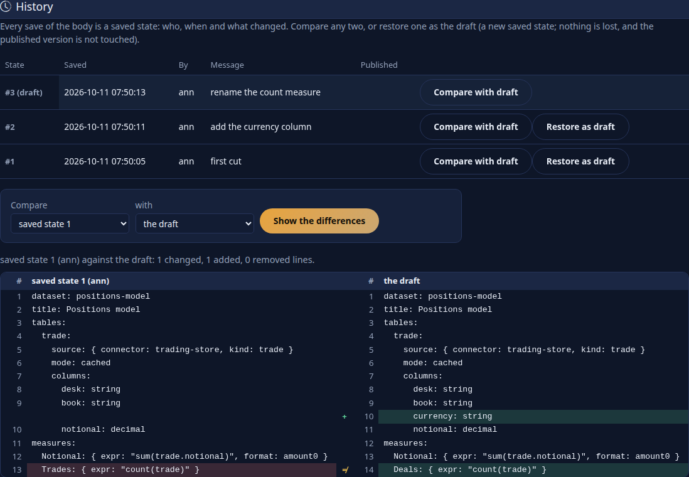

#### 2.2 The diff

Pick two states (or press *Compare with draft*) and *Show the differences*: a line diff of the YAML side by side, each side one of `draft`,
`published`, `vN` or `rN`. Lines only on the left are marked `−`, only on the right `+`, a line replaced `≠`, with line numbers and tinted rows
(the mark, not only the colour, says what changed). Without `from` and `to` it is the published version against the draft
(`GET /api/v1/bi/items/{id}/diff?from=r1&to=draft`). A shipped file keeps only its current version. A bad side is `DRS-9003`.

#### 2.3 Review

A workspace may *require review before publishing*; even where it does not, an author may *Propose for review*.

1. **Request.** The author proposes, with a note. The item is frozen. The **reviewers are told** in the inbox: every bi-steward, and every member
   of the workspace whose role has the **`approve` power**, except the author.
2. **The review page.** Under *Review*: who asked and what they wrote; **what changed** (the draft against the published version); **Check**;
   **what it does to reports** (section 17.6); and a **data preview** from the **draft**, answered with the reviewer's own rows and masks
   (`drishti.bi.governance.preview-rows`, 20).
3. **Decide**, in the one Approvals queue (*Decide in Approvals*; [ADMIN_GUIDE.md › 28 Write-back and approvals](../ADMIN_GUIDE.md#28-write-back-and-approvals-switch-on-and-run)): *Approve* (with a comment) publishes
   the draft as the next version; *Reject* needs a reason and returns it to draft. Both go in the item's **review record**, and the author is told.

**Who may decide**: a **bi-steward** in any workspace, or a workspace **member** whose role holds the `approve` power (a flag of the role, as the
built-in `approver` has). **Four eyes** (`drishti.governance.four-eyes`, with security on): the proposer may not decide (`DRS-9005`). While an
item is proposed its page names who can decide it; Edit, Move and **Publish are hidden and refused** (`409 DRS-9004`) until it is approved,
rejected or withdrawn, so nobody publishes past the review. The proposer may **withdraw**.

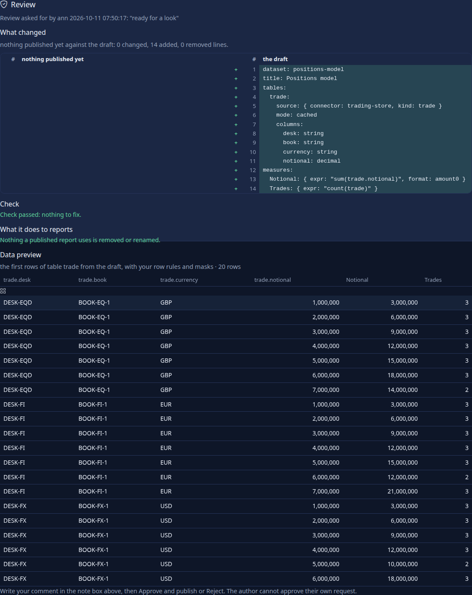

#### 2.4 Certification and endorsement

* **Promoted**: the owner or a member of the workspace marks a published item. **Certified**: only a **bi-steward** (or a bi-admin), and only a
  steward removes it. Both are badges in the catalogue, search, Home and the item; **certified items come first** and have *Certified for you*.
* **Certification falls automatically** (`drishti.bi.governance.revoke-certification`, on): publishing a model version that removes or renames a
  field, measure or hierarchy revokes the model's certification and that of every certified published report that uses a removed name. Each
  revocation is in the review record and the audit log, the owner and the certifier are told, and the publish answers with `warnings`.
* **Certification does not travel** in a bundle: it arrives as *promoted*, and a steward of the receiving server certifies after looking.

```
POST /api/v1/bi/items/bi-f99d2f18d5/publish  { "note": "drop book", "force": true }     (as a bi-admin; see 17.6)
{ ... "publishedVersion": 2, "endorsement": "none",
  "warnings": [ "This version removes or renames trade.book, Desk and book.",
                "Published report 'Trades report' uses trade.book (page overview, visual rows) and is broken.",
                "Certification of 'Trades model' was revoked: the dataset changed incompatibly. A steward certifies it again after checking it.",
                "Certification of 'Trades report' was revoked: its dataset 'Trades model' changed incompatibly. A steward certifies it again after checking it." ] }
```

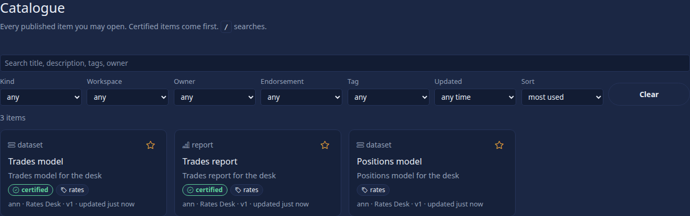

#### 2.5 Lineage

*Lineage* on an item's page shows where it comes from and what depends on it. A **model** lists each alias with the table and version it
resolves now and its chain down to the root (the table, a pack kind and its connector, a SQL source, a Python item, another model), then what
reads it (reports with the fields and measures they use, boards, notebooks, tables on the model's answer, alerts, subscriptions). A **table**
lists its root and the models that read it, under which alias and version. A **report** names its model and version, what it uses, and the
tables behind it. A report you could not open is counted, not named ("2 more reports you cannot open"). Over the API:
`GET /api/v1/bi/items/{id}/lineage`.

```
GET /api/v1/bi/items/file:dataset:trading-risk-trades/lineage          (captured on the demo lakes)
{"item": {...}, "layer": true, "dataset": {"name": "trading-risk-trades", "version": "1.0.0"},
 "upstream": [{"table": "trading_risk_trades", "dataset": "trading-risk-trades", "version": "1.0.0",
               "chain": [{"kind": "dataset", "name": "trading-risk-trades"}, {"kind": "pack-kind", "name": "trade-valuation", "pack": "market-risk", "connector": "risk-store"}]}],
 "downstream": [{"id": "file:model:trading-risk", "kind": "model", "title": "Trading and counterparty risk", "as": "trades", "range": "", "reads": "1.0.0", ...}],
 "hidden": 0}
```


**Past the connector.** Each source also says what its connector reads: the settings of its connector file that name the place (`table`,
`schema`, `topic`, `path`, `bucket`, `prefix`, `database`, `url`, `host`, `bootstrap-servers` and the like), as the file declares them.
Credentials never appear, and for a reader who is not an administrator the values are masked (`"root": "•••"`).

#### 2.6 Impact: what breaks if I change this

Names are compared: a field is `table.column`, a measure or hierarchy its name. A report names them in its wells, filters, sorts, drill-through
and bookmarks, and each place is recorded, so the answer says *where* ("trade.book (page overview, visual rows)").

* **Ask.** On a model's page, *Impact on reports*: what publishing the **draft** would do, and *What breaks if I remove ...* for names you type.
  API: `GET /api/v1/bi/items/{id}/impact[?remove=trade.book,Notional]`, or `POST` with `{ "yaml": ... }` for text not saved. Build › Tables &
  models shows the same as **Impact (n)**.
* A **published** report breaks if its published text uses a removed name; a draft report is listed apart.
* **Refusal.** With `drishti.bi.governance.refuse-breaking` (on), publishing or approving a change that breaks **published** reports is refused,
  `409 DRS-9040`, naming the reports you may open and what each uses. Fix the reports first, keep the old names beside the new, or ask a
  **bi-admin** to publish with `force: true` (*Publish anyway (bi-admin)*); a forced publish is audited and revokes certification.

```
GET /api/v1/bi/items/bi-f99d2f18d5/impact?remove=trade.book          (as ann)
{ "change": { "breaking": true, "removedFields": ["trade.book"], "removedMeasures": [], "removedHierarchies": [] },
  "breaksPublished": true,
  "published": [ { "visible": true, "id": "bi-0ae16dad69", "title": "Trades report", "endorsement": "certified",
                   "uses": ["trade.book (page overview, visual rows)"] } ],
  "drafts": [], "refused": true, "canForce": false,
  "wouldRevokeCertification": ["Trades model", "Trades report"], "hypothetical": true }

POST /api/v1/bi/items/bi-f99d2f18d5/publish  { "note": "drop book" }
409 { "code": "DRS-9040", "detail": "DRS-9040 publishing 'Trades model' would break 1 published report by removing or renaming trade.book, Desk and book:
      'Trades report' (trade.book (page overview, visual rows)). Ask a bi-admin to publish it with force, or keep the names the reports use." }
```

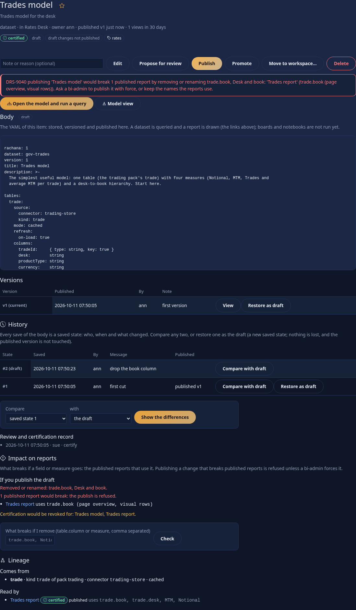

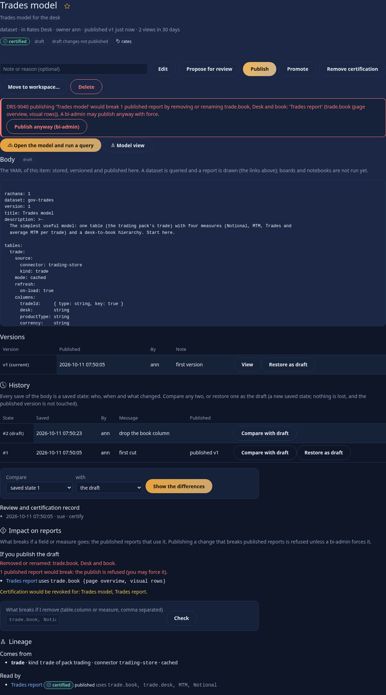

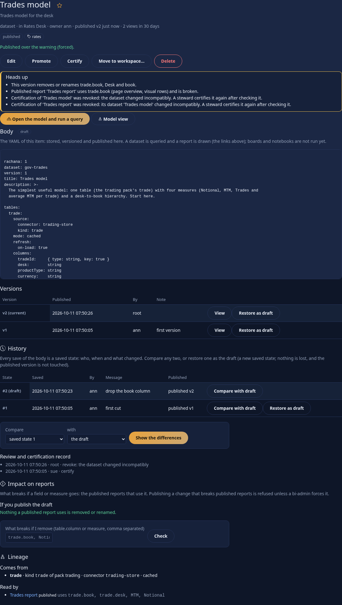

**Renames.** A renamed field or measure is **recognised as a rename** when the new name means the same (a column with the same path or
expression and type in the same table, a measure with the same expression). It still breaks the reports that use the old name, but the impact
says *to what* (`orders.book [renamed to orders.desk_book]`) and, when every report that loses a name is a stored report that loses only renamed
names (`renamable: true`), **Publish and update the reports** (`{"applyRenames": true}`) rewrites their published text and their draft to the
new names in the same step, each as its next version (audited `bi-item-renamed-names`). Only the places a report names a field are rewritten;
the rewritten report loses the comments of its old text.

```
POST /api/v1/bi/items/bi-501131a408/publish  { "note": "rename", "applyRenames": true }
200 { "publishedVersion": 2,
      "warnings": [ "Report 'Orders report': 2 name(s) updated, published as version 2", "This version removes or renames orders.book, Gross." ] }
```

**A changed type or meaning** (a column's `type`, path or expression; a measure's expression) is listed under **alters** with each published
report that uses it. It is **not refused** (the report still draws); it is shown so a reviewer sees that the figures will differ. Relationships and
row rules are not compared.

#### 2.7 Environments: bundles

Development, test and production are separate servers; content moves between them as a **bundle**, one JSON file (`*.bi-bundle.json`).
**Promotion (test to live)** in the rail exports and imports (`GET /api/v1/bi/bundle`, `POST /api/v1/bi/bundle/import`).

**Export** (`bi-author` and contributor in each item's workspace): the items you name or a whole workspace, and by default the models the
reports among them read. Each item carries its kind, title, description, tags, owner, workspace, audience, sample flag, endorsement, status,
draft body and **every published version**, each body with its SHA-256; the bundle has a checksum over all. Shipped files are not bundled (they
travel with the folder).

**Import** needs **bi-steward** and a workspace role in the target. It is a **dry run unless you say otherwise**; for each item it says:

| Action | Meaning |
|---|---|
| `create` | the id is new here |
| `unchanged` | the draft and the published version are identical to what is here |
| `update` | it exists here in the same workspace and differs; applied only with `overwrite` |
| `conflict` | it differs and `overwrite` is off; the id exists in another workspace; the workspace does not exist here or you have no role in it; the change would break published reports |
| `invalid` | a body is not valid, is too large, or the kind is unknown |

A real import is **all or nothing** (`409 DRS-9042` for a conflict, `422 DRS-9041` for an invalid item or bundle, or a changed file that fails its
checksum); a bundle is at most `drishti.bi.governance.bundle-max-bytes` (8 MiB). **Mapping:** *Workspaces* `from:to`, *Into workspace*,
*Owners* `from:to`; an owner who does not exist here becomes the importer, and audience entries that do not exist are left out, each with a
warning. Changing any choice needs a new dry run.

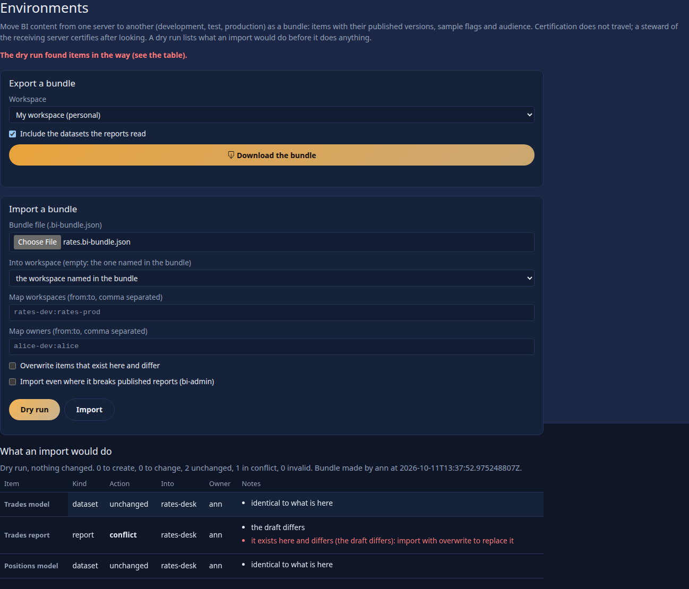

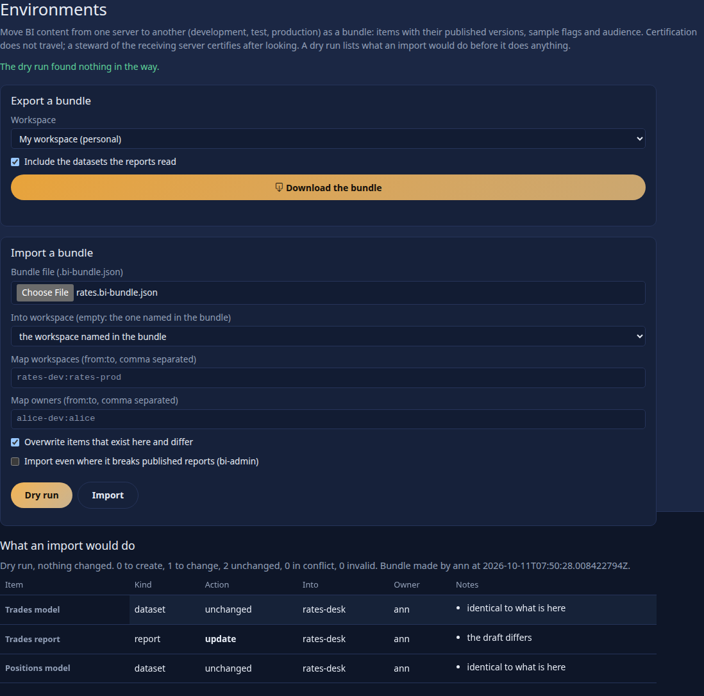

```
POST /api/v1/bi/bundle/import  { "bundle": {...}, "dryRun": true }          (as a steward)
{ "dryRun": true, "ok": false, "applied": false, "counts": { "create": 0, "update": 0, "unchanged": 2, "conflict": 1, "invalid": 0 },
  "items": [ { "id": "bi-0ae16dad69", "title": "Trades report", "action": "conflict", "workspace": "rates-desk", "owner": "ann",
               "reasons": ["the draft differs"], "blocks": ["it exists here and differs (the draft differs): import with overwrite to replace it"] }, ... ] }
```

**Rolling back an import.** Every real import keeps what it replaced (`drishti.bi.governance.imports-dir`, the newest `imports-keep`, 20). The page
lists them under **Imports you can roll back**, each with **Roll back this import** (bi-steward): an overwritten item's row and published versions
come back as a **new saved state** (origin `rollback`), and an item the import created is removed. If any item was edited or published since, the
roll back stops with nothing changed (`409 DRS-9004`); a bi-admin may force it (audited). An import is rolled back once.

```
GET /api/v1/bi/imports
{ "imports": [ { "id": "mv543kh5-7a48ae", "at": "2026-10-12T10:31:18Z", "by": "drishti-dev-admin", "source": "bundle", "madeBy": "drishti-dev-admin",
                 "items": 1, "created": 0, "replaced": 1, "rolledBack": false } ] }
POST /api/v1/bi/imports/mv543kh5-7a48ae/rollback  {}
200 { "id": "mv543kh5-7a48ae", "restored": 1, "removed": 0, "forced": false }
```

#### 2.8 BI content in a pack archive

A pack archive may carry `config/bi/tables/` and `models/` (in the table layer's form), `reports/`, `notebooks/` and `python/`, one file per
item named `<name>.<kind>.yaml`. Deploying the pack does **not** copy them where readers could use them unchecked: they become a bundle and go
through the same import ([BUILD_GUIDE.md](../BUILD_GUIDE.md)).

* **The upload check** adds a `bi` block: how many items by kind, and a dry run of the import, so the administrator reads the impact before
  confirming.
* **The deploy** imports them into the shared workspace `packs` (`drishti.bi.governance.pack-workspace`), one item per file with a stable id
  `pk-<pack>-<kind>-<name>`, **published**, with **the pack as its audience**, tagged `pack:<name>`, never certified. *Roll back this import*
  undoes it.
* **A refusal does not undo the deploy**: if the import is held back the pack is deployed and the answer says
  `"bi": { "loaded": false, "problem": "..." }` (audit `pack-bi-held`); confirming with `acceptBreaking=true` forces it (bi-admin).

```
POST /api/v1/admin/packs/deploy/{uploadId}                                       (the pack bi-demo 1.0.1 carries a dataset and a report)
200 { "deployed": "1.0.1", ...,
      "bi": { "items": 2, "loaded": true, "importId": "mv5494v3-06ad1e", "counts": { "create": 0, "update": 1, "unchanged": 1, "conflict": 0, "invalid": 0 } } }
```

#### 2.9 The audit trail

Every act is in the audit log (Admin, Audit log), with the actor and the item: `bi-workspace-created`, `-updated`, `-deleted`, `bi-member-set`,
`bi-member-removed`; `bi-item-created`, `-updated`, `-moved`, `-deleted`, `-proposed`, `-withdrawn`, `-approved`, `-rejected`, `-published` (the
detail says `FORCED over N published report(s)` when forced), `-restored`, `-endorsed`; `bi-certification-revoked`; `bi-bundle-exported`,
`bi-bundle-imported`, `bi-item-imported`, `bi-import-rolled-back`; `bi-item-renamed-names`; `pack-bi-loaded`, `pack-bi-held`; `bi-settings-changed`;
`bi-dataset-refresh`; and `bi-query` (every model question, the reviewer's preview included). The item's own **review record** (under History)
lists requests, decisions with comments, certifications, revocations and imports. Token scopes: writes need `bi:write`; approvals, endorsements
and imports `bi:approve` ([API_REFERENCE.md](../API_REFERENCE.md)).

## Tutorial: Govern BI

Governance is people checking each other: history, propose and review, certification, lineage, what breaks if a field is removed, moving content between servers, renames and rollbacks. Every step shows the UI, the command line where there is one, and the YAML.

### Time to complete

- Part G · Govern BI: About 50 minutes.

### Before you start

The environment, the sign-in and the token are those of [Reports, Before you start](REPORTS.md#before-you-start).

**Part G · Govern BI.**

- Part A done (you know workspaces and publishing), signed in as the development administrator.
- Three people, because governance is people checking each other: **ann** writes (powers `bi` and `bi-author`), **sue** is a steward (`bi` and `bi-steward`), and the **administrator**, who holds every power. Step 54 makes ann and sue.
- Three small files in [data/](../../tutorials/data/): [rates-trades.dataset.yaml](../../tutorials/data/rates-trades.dataset.yaml) (the rates desk's trades, a dataset of the model
  layer), [trades-model.model.yaml](../../tutorials/data/trades-model.model.yaml) (the model over it) and [trades-report.report.yaml](../../tutorials/data/trades-report.report.yaml)
  (a report on the model).
- A personal API token for each person you act as on the command line (each signs in once and makes one on **My account → API tokens**, as in
  [tutorial 1, step 9](../../tutorials/01-first-15-minutes.md#step-9--make-a-token-for-the-command-line); `DRISHTI_TOKEN` holds the one in use, `$ANN_TOKEN` and
  `$SUE_TOKEN` below are theirs). The administrator's token needs the `bi:write` scope; sue's needs `bi:approve` to approve and certify.

### What you will learn

**Part G · Govern BI**

- the four BI **powers** (`bi`, `bi-author`, `bi-steward`, `bi-admin`) and how a role gets them;
- **history**: every save is a saved state; compare two; restore one (a new state, nothing lost);
- **review**: propose, who is told, what the reviewer sees, **four-eyes**, approve and publish;
- **certified** and **promoted**, and where they show;
- **lineage**: what a model reads (datasets, pack kinds, connectors) and what reads it;
- **the contract**: which change needs a **new major version**, and which reports use what it takes away; the refusal `DRS-9126`;
- **environments**: a bundle, a dry run, a conflict, an overwrite;
- **renames** that rewrite the reports (version 1 datasets), an import you can **roll back**, and lineage that reaches the connector's source.

#### Part G · Govern BI

When other people rely on a model or a report, changing it needs care. Drishti keeps **every saved state**, lets you **compare and restore** them, asks a
**second person to review** before something is published, lets a **steward certify** what has been checked, shows **where a model comes from and who
reads it**, tells you **which change needs a new major version and which reports it touches**, refuses a dataset change that would break the models
reading it, and moves content between servers as a **bundle** you can try out with a **dry run** first. This part does all of it with three people,
on a **model** of the model layer and the dataset it reads.

Every step shows it **in the UI**, **on the command line** (`python3 tools/drishti.py`, or `curl` where the tool has no command) and **as YAML**, or says
why one of the three does not apply.

### Step 54 · Powers, roles and two people

Powers are held by **roles**. In the console choose **Admin → Roles** and make two roles (kinds `*`, see every field): `bi-writer` and `bi-steward`. Then **Admin → BI** (BI settings) lists every role with four columns; tick `bi` and `bi-author` for `bi-writer`, `bi` and `bi-steward` for `bi-steward`, and press **Save** on each row.

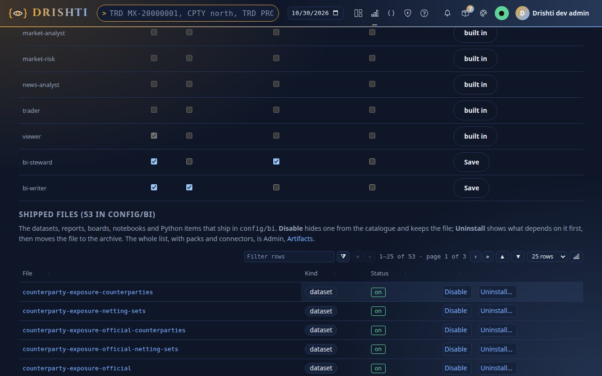

You should see the table with your two rows at the bottom, ticks as above and a **Save** button on each (built-in roles are read-only; `admin` holds all four). The columns:

| Power | Lets a person |
|---|---|
| `bi` | open BI and the published content they are allowed |
| `bi-author` | make drafts, publish in workspaces (propose, where review is required) |
| `bi-steward` | certify, and decide reviews in any workspace |
| `bi-admin` | manage BI, see every workspace and **force** what a refusal stops |

Then **Admin → Users → New user**: `ann` with role `bi-writer`, `sue` with role `bi-steward`, a password each (`tutorial-pass-2026` is the one the
tutorials use) and *Must change at first sign-in* unticked. Use a second browser or a private window to be two people at once; below, the picture says who
is signed in. **On the command line** the same two calls the page makes (the administrator's token; the BI powers are the `bi` list of a role):

```text
$ curl -s -X PUT -H "Authorization: Bearer $DRISHTI_TOKEN" -H 'Content-Type: application/json' \
    -d '{"kinds":["*"],"raw":true,"bi":["bi","bi-author"]}' $DRISHTI_SERVER/api/v1/admin/role-definitions/bi-writer
{"name":"bi-writer","description":"","kinds":["*"],"raw":true,"author":false,"approve":false,"admin":false,"calc":false,"layout":true,"collaborate":true, ...,"bi":["bi","bi-author"]}
$ curl -s -X POST -H "Authorization: Bearer $DRISHTI_TOKEN" -H 'Content-Type: application/json' \
    -d '{"username":"ann","displayName":"Ann","roles":["bi-writer"],"password":"tutorial-pass-2026","mustChangePassword":false}' \
    $DRISHTI_SERVER/api/v1/admin/users
{"username":"ann","displayName":"Ann","email":"","desk":"","roles":["bi-writer"],"enabled":true,"mustChangePassword":false,"locked":false, ...}
```

There is no YAML for people: roles and users live in the server's user store ([ADMIN_GUIDE.md](../../guides/ADMIN_GUIDE.md)).

### Step 55 · A workspace that asks for review

Sign in as **ann**. Choose **Workspaces** and create **Rates desk**, ticking **Require review before publishing (a second person approves)**.

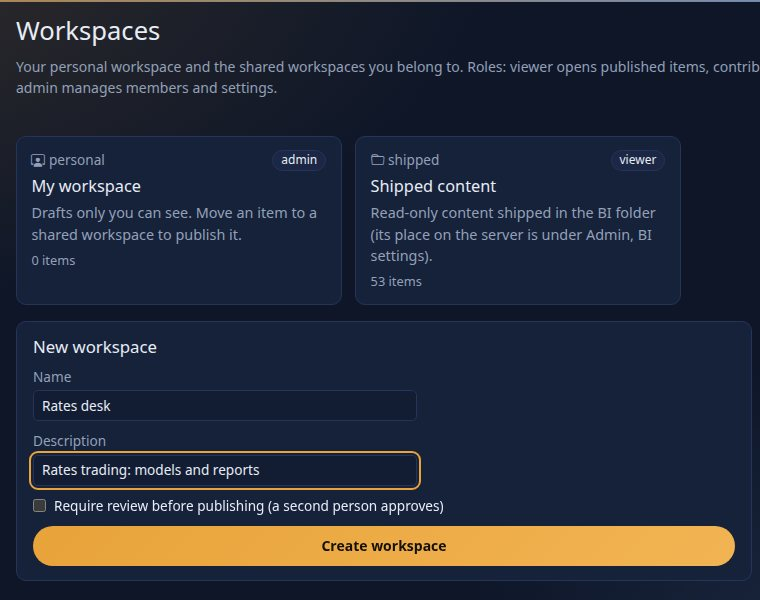

You should see the form with the box ticked. In a workspace that requires review nobody publishes their own work: the author **proposes** and someone else
approves. Add sue as a member of the workspace: after **Create workspace** follow *Next: add the people who share it* (or open the workspace and choose its
**Members** tab), type `sue`, choose the role `member` and press **Add or change** (over the API: `PUT /api/v1/bi/workspaces/rates-desk/members/sue` with
`{"role": "member"}`). Then put the dataset and the model in it, **the dataset first**: a model reads published datasets, so it can only be checked
once its dataset is through review. **In the UI** that is **My workspace → New item** (or the workspace's own **New item**), kind *dataset* then
*model*, **Paste YAML**, in `Rates desk`; **on the command line**, as ann (`bi item new` reads the kind from the file name):

Run these from the Drishti folder (the repository root, or the install folder of a release).

```text
$ python3 tools/drishti.py bi item new rates-desk docs/tutorials/data/rates-trades.dataset.yaml --audience bi-steward,bi-writer,viewer
bi-ba201206d6  dataset  Rates trades  draft in Rates desk
$ python3 tools/drishti.py bi model check docs/tutorials/data/trades-model.model.yaml          # too early: its dataset is not published yet
INVALID  (model trades-model)
  error   DRS-9120  datasets.trade: no dataset 'rates-trades' is published (a pack-generated one, or a rachana: 2 dataset)
  error   DRS-9127  measures.Notional: 'trade.NOTIONAL' is not a table.column of this dataset (tables: )
  ...
```

Ann proposes the dataset and sue approves it (the same moves as step 57, shown there): then the model checks clean and goes in:

```text
$ python3 tools/drishti.py bi model check docs/tutorials/data/trades-model.model.yaml
valid  (model trades-model)
  warning DRS-9131  security.rows.trade: roles without a rule see no rows of 'trade': approver, author. Add a rule for them (where: "True" lets a role see every row), or leave them out on purpose: they get "you have no access to rows of trade in this model"
$ python3 tools/drishti.py bi item new rates-desk docs/tutorials/data/trades-model.model.yaml --audience bi-steward,bi-writer,viewer
bi-614d1ef4d3  model  Trades model  draft in Rates desk
```

**The YAML** of the two (the files above, without their comments): the dataset says what one row is and where it comes from; the model reads it as its
one fact and adds the measures, a hierarchy and who sees which rows:

```yaml
rachana: 2
expressions: 2
dataset: rates-trades
version: 1.0.0
title: Rates trades
source: { connector: risk-store, kind: trade-valuation }
grain: { says: "One row per trade per business date", keys: [TRADE_ID] }
columns:
  TRADE_ID:  { type: string, role: key }
  DESK:     { type: string }
  PORTFOLIO:    { type: string }
  NOTIONAL: { type: decimal, format: amount0 }
  MTM:      { type: decimal, format: signed0 }
---
rachana: 2
expressions: 2
model: trades-model
version: 1.0.0
title: Trades model
datasets:
  trade: { dataset: rates-trades, role: fact }
measures:
  Notional: { expr: "sum(trade.NOTIONAL)", format: amount0 }
  MTM:      { expr: "sum(trade.MTM)", format: signed0 }
  Trades:   { expr: "count(trade)" }
hierarchies:
  Desk and book: [trade.DESK, trade.PORTFOLIO]
security:
  rows:
    trade:
      - { role: [admin, bi-writer, bi-steward, bi-reviewer, bi-reader, viewer], where: "True" }
```

The dataset reads the `market-risk` pack's trade valuations (the book is the `PORTFOLIO` column) through `risk-store`, the Delta table the demo lake built.

### Step 56 · Save twice, compare, restore

Open the **Trades model** item (or its designer: **Models → Trades model**). Press **Edit**, give `trade.PORTFOLIO` a display name (`Book`) and a description (in the
designer that is the **Fields** tab; in the YAML, a `fields:` entry), write `name and describe the book` in *What changed* and press **Save draft**.
Press **Edit** again, rename the measure `Trades` to `Deals`, write `rename the count measure`, **Save draft**. Under **History**:

```text
$ curl -s -H "Authorization: Bearer $ANN_TOKEN" $DRISHTI_SERVER/api/v1/bi/items/bi-614d1ef4d3/history | jq -r '.revisions[] | "#\(.seq)  \(.message)  \(.author)  \(.origin)"'
#3  rename the count measure  ann  save
#2  name and describe the book  ann  save
#1  created  ann  create
```

Choose *saved state 1* against *the draft* and press **Show the differences**.

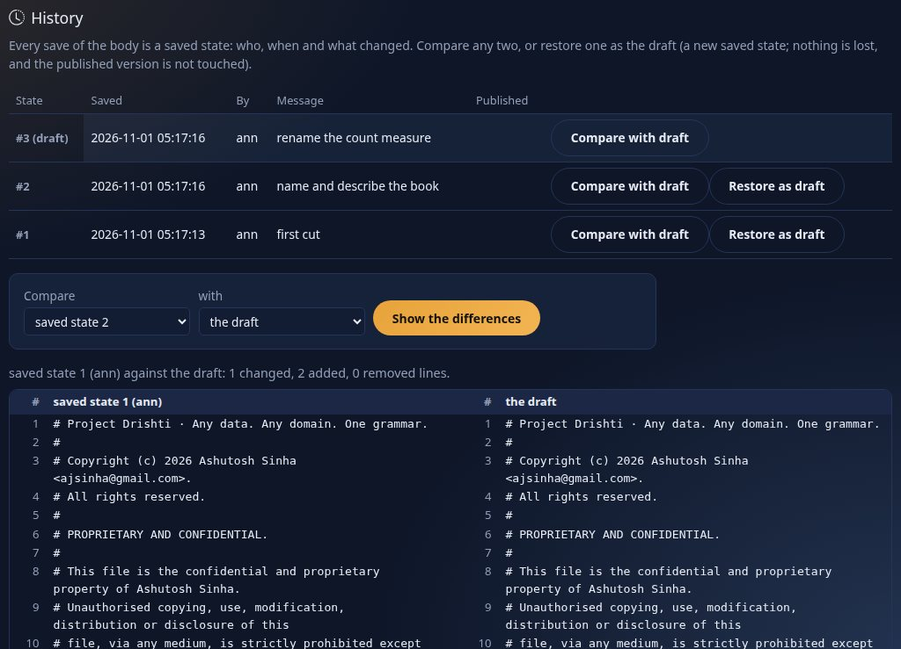

You should see the three states with who, when and what changed, and a **side-by-side** comparison: two lines added (the `fields:` entry) and the
`Trades` measure line changed to `Deals`. Over the API: `GET /api/v1/bi/items/<id>/diff?from=r1&to=draft` answers `"added": 2, "removed": 0, "changed": 2`
and the lines.
**The YAML** the first save added:

```yaml
fields:
  trade.PORTFOLIO: { display: Book, description: The trading book }
```

Press **Restore as draft** on state 2 (over the API: `POST /api/v1/bi/items/<id>/history/2/restore`). The history now has **four** states:

```text
#4  restored saved state 2  ann  restore
#3  rename the count measure  ann  save
...
```

You should see the restore as a **new** saved state (`origin: restore`), so nothing was lost; a published version, had there been one, would not have been touched.

### Step 57 · Propose, review, approve

Write `ready for a look` in the note box and press **Propose for review**.

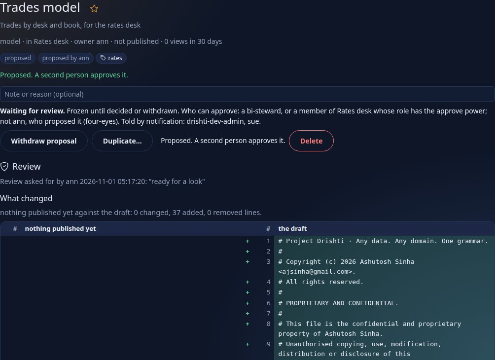

You should see the badge `proposed` and `proposed by ann`; the item is frozen (no edits unless withdrawn). **The reviewers are told**: every steward, and every workspace member holding the `approve` power on a role, except the author. Ann cannot approve her own proposal (she has no approve power; even a steward who proposed may not, with four-eyes on, `DRS-9005`):

```text
$ curl -s -X POST -H "Authorization: Bearer $ANN_TOKEN" -H 'Content-Type: application/json' -d '{"note":"me"}' $DRISHTI_SERVER/api/v1/approvals/bi/bi-614d1ef4d3/approve
{"type":"about:blank","title":"bi forbidden","status":403,"detail":"DRS-9002 approving needs the bi-steward power, or a member of the workspace with the approve power on a role","instance":"/api/v1/approvals/bi/bi-614d1ef4d3/approve","code":"DRS-9002"}
```

Sign in as **sue** and open the item.

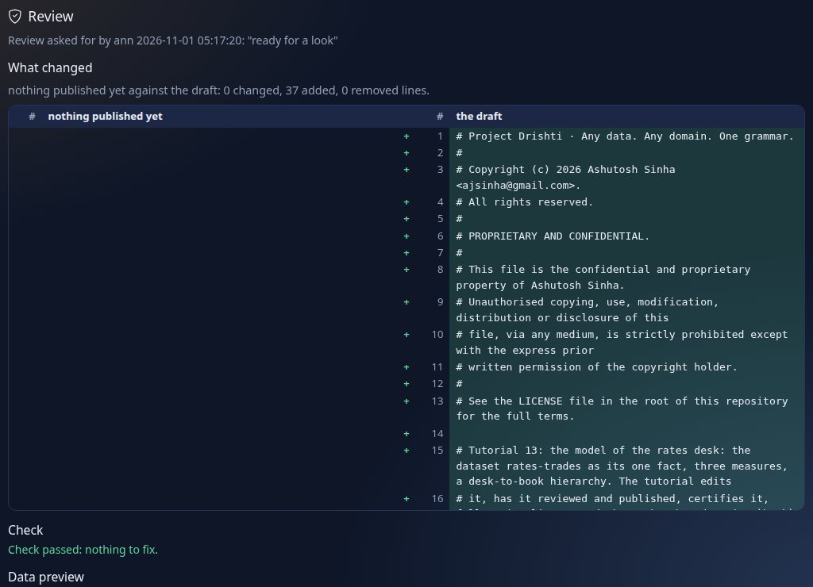

You should see the **Review** section: who asked and the note, **what changed** against what is published (here all 37 lines are new: nothing is
published yet), `Check passed: nothing to fix` (the server's Check of the model: its datasets, relationships, measures and the security safeguard), and
*Data preview*, which a model leaves to its designer (*there is no data to preview for a model*: the designer's Query panel and the Notebook ask it).
Press **Decide in Approvals**: the item opens in the one Approvals queue. Write `looks right` and press **Approve**. On the command line the
same decision is `curl -X POST .../api/v1/approvals/bi/<id>/approve -d '{"comment":"looks right"}'` with sue's token.

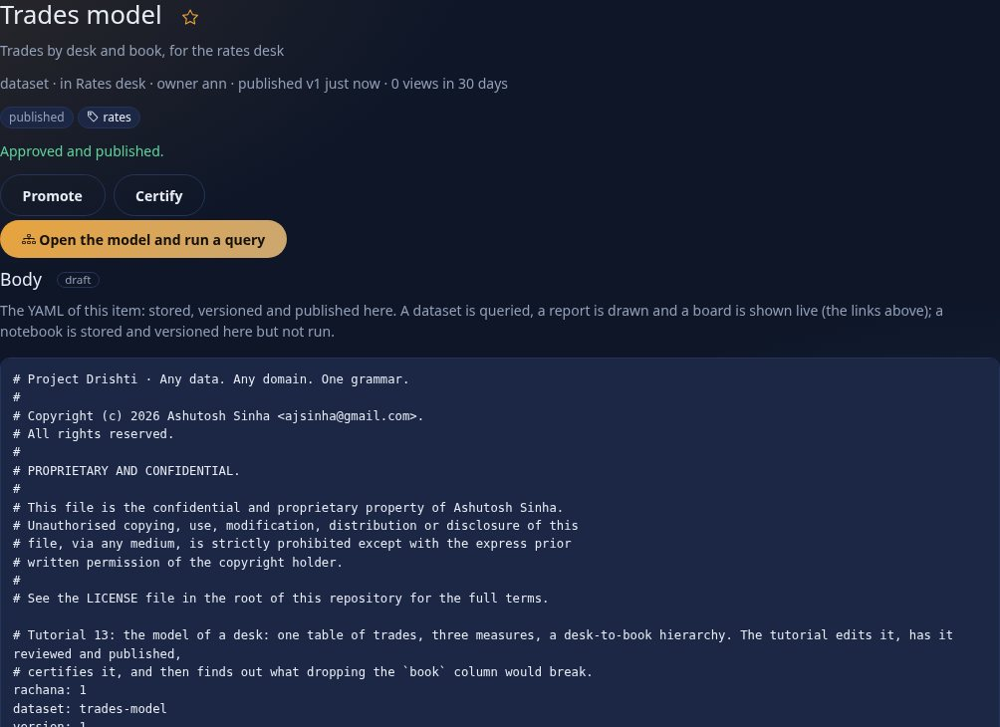

You should see `published v1`. Ann is told:

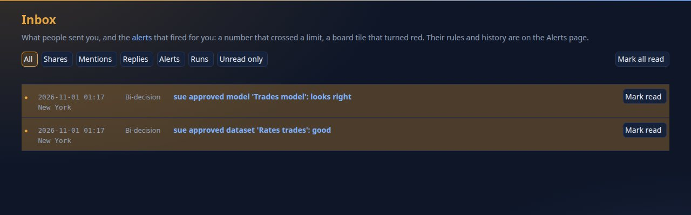

You should see `sue approved model 'Trades model': looks right` as the newest row. (A **Reject** with a reason is the other decision; the reason goes to
the author.) Now ann makes the report, [trades-report.report.yaml](../../tutorials/data/trades-report.report.yaml), in the same workspace, proposes it, and sue approves
it the same way (not shown). It reads the model by reference:

```yaml
rachana: 2
report: trades-report
title: Trades report
model: trades-model@1
pages:
  - id: overview
    title: Overview
    visuals:
      - { id: notional, type: card, title: Notional, at: { x: 0, y: 0, w: 3, h: 2 }, wells: { values: [Notional] } }
      - { id: by-desk, type: bar, title: Notional by desk, at: { x: 3, y: 0, w: 5, h: 4 }, wells: { axis: [trade.DESK], values: [Notional] }, alt: Bars of notional by desk }
      - { id: rows, type: table, title: Desk and book, at: { x: 0, y: 4, w: 8, h: 4 }, wells: { columns: [trade.DESK, trade.PORTFOLIO, MTM] } }
```

### Step 58 · Certify

Published is not the same as checked. **Promoted** is the owner's mark; **certified** can only be set by a steward, and only a steward can remove it. As sue, open the model: the action row offers **Promote** and **Certify**.


You should see the buttons. Press **Certify** on the model and on the report (the API is `POST /api/v1/bi/items/<id>/endorse` with
`{"level": "certified"}`). Then open the **Catalogue**.

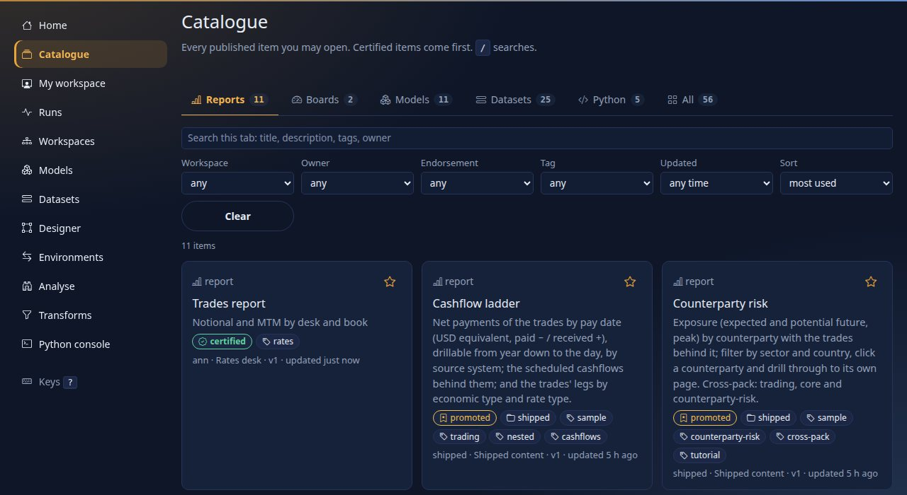

You should see the two certified items **first** (certified items come first in the default sort), each with the green `certified` badge. The badge also
shows in search results, on Home and on **Models**, and the **Endorsement** filter finds them. **The YAML** says nothing about it: an endorsement is a
decision about a version, kept by the catalogue (`endorsement: certified` in the item's metadata), never something an author writes; that is why it does not
travel in a bundle (step 61).

### Step 59 · Lineage

As ann, open the **Trades model** and scroll to **Lineage**.

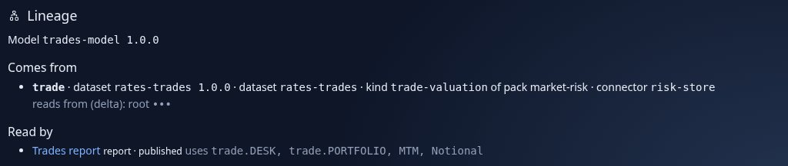

You should see **Comes from** (`trade` · dataset `rates-trades` · kind `trade-valuation` of pack `market-risk` · connector `risk-store`) and **Read by**
(`Trades report`, a report). The same from the command line and the API:

```text
$ curl -s -H "Authorization: Bearer $DRISHTI_TOKEN" $DRISHTI_SERVER/api/v1/bi/lineage/trades-model@1
{"ref":"trades-model@1","path":[{"name":"trades-model","version":"1.0.0","kind":"model"}],
 "datasets":{"trade":[{"name":"rates-trades","kind":"dataset"},{"kind":"pack-kind","name":"trade-valuation","pack":"market-risk","connector":"risk-store"}]},"problems":[]}

$ python3 tools/drishti.py bi model consumers trades-model@1
kind    id             title
------  -------------  -------------
report  bi-9c8d5a624a  Trades report
```

You should see the same two lists as data. (A report you may not open is counted under `hidden`, not named.) **Models → Trades model → Open the
designer** shows the same consumers above its tabs (**Used by**), and the dataset's own page (`/bi/ds/<id>`) shows where its rows come from. There is no
YAML for lineage: it is worked out from the files, never written down.

### Step 60 · What breaks if I remove a field

A model is a **contract**: reports bind to its major version (`trades-model@1`), and a change that takes away something they may use needs a **new major
version** ([BI_GUIDE.md section 23](TABLES_AND_MODELS.md#1-models-and-datasets-what-a-report-reads)). Before changing a published model, ask.
As ann open the model's designer, the **Contract** tab, and set **What consumers may use** to *only what is ticked below*: every field and measure
consumers use today starts ticked. Untick `trade.PORTFOLIO`.

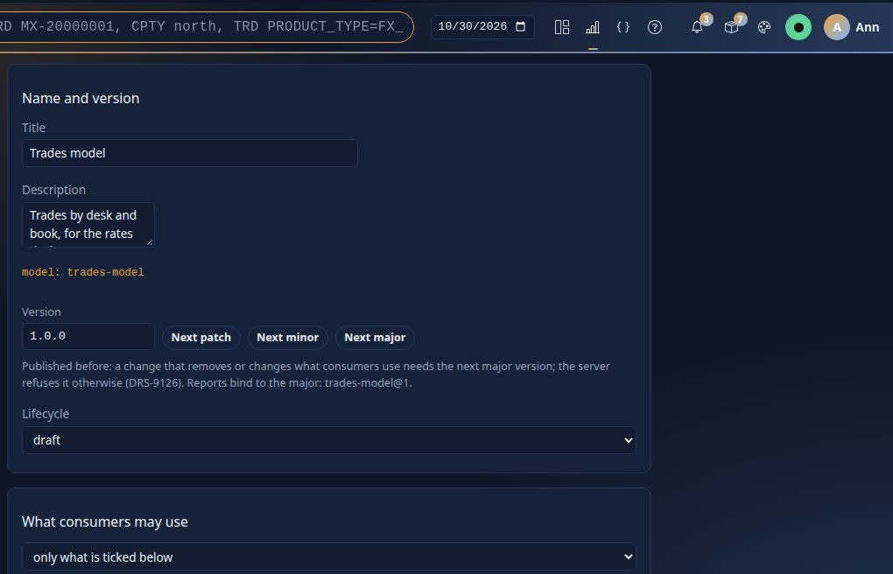

You should see, at the top, **Changes since the published version**: `major` *takes trade.PORTFOLIO out of the contract · used by Trades report*, then
*These changes need a new major version: what reads trades-model@1 has to move to it. The draft says 1.0.0.* and **Use version 2.0.0**, and *1 item
reads trades-model@1: Trades report (report)*. Nothing is saved yet. The impact is the server's answer for that one field:

```text
$ curl -s -H "Authorization: Bearer $DRISHTI_TOKEN" "$DRISHTI_SERVER/api/v1/bi/models/trades-model@1/impact?target=trade.PORTFOLIO"
{"model":"bi-614d1ef4d3","target":"trade.PORTFOLIO",
 "consumers":[{"kind":"report","id":"bi-9c8d5a624a","title":"Trades report","status":"published","owner":"ann","workspace":"rates-desk"}],"unknown":[]}
```

**The YAML** that change writes into the model (`exposes: listed` and the lists; a contract that lists nothing is `exposes: all`, the default):

```yaml
contract:
  exposes: listed
  fields: [trade.TRADE_ID, trade.DESK]          # trade.PORTFOLIO taken out
  measures: [Notional, MTM, Trades]
```

Leave the model as it is (do not save) and try the other way to lose the field: drop the `PORTFOLIO` column from the **dataset**. As ann, edit **Rates
trades**, delete the line `  PORTFOLIO:    { type: string }`, save and propose; as sue, press **Decide in Approvals**, then **Approve**.

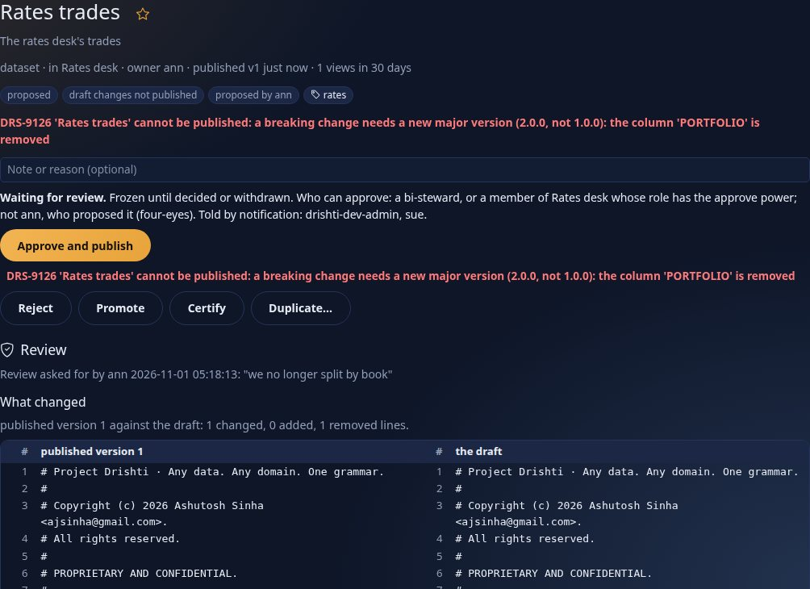

You should see `DRS-9126 'Rates trades' cannot be published: a breaking change needs a new major version (not 1.0.0): the column 'PORTFOLIO' is
removed`. The server compares the draft with the published version: removing a column, or changing its type, is breaking; adding one is not. The same
from the command line (sue's token):

```text
$ curl -s -X POST -H "Authorization: Bearer $SUE_TOKEN" -H 'Content-Type: application/json' -d '{"note":"x"}' \
    $DRISHTI_SERVER/api/v1/approvals/bi/bi-ba201206d6/approve
{"type":"about:blank","title":"layer model breaking","status":409,"detail":"DRS-9126 'Rates trades' cannot be published: a breaking change needs a new major version (not 1.0.0): the column 'PORTFOLIO' is removed","instance":"/api/v1/approvals/bi/bi-ba201206d6/approve","code":"DRS-9126"}
```

The right ways out are to keep the column, or to publish the change as `version: 2.0.0` once the reports that read `trade.PORTFOLIO` have been changed
first (the model designer's **Used by** and this tab name them). Ann withdraws the proposal (`POST .../withdraw`) and saves the dataset back as it was.

### Step 61 · Move it to another server: a bundle and a dry run

**Environments** in the rail is how content moves between servers (development, test, production). As ann choose the workspace and press **Download the bundle**.

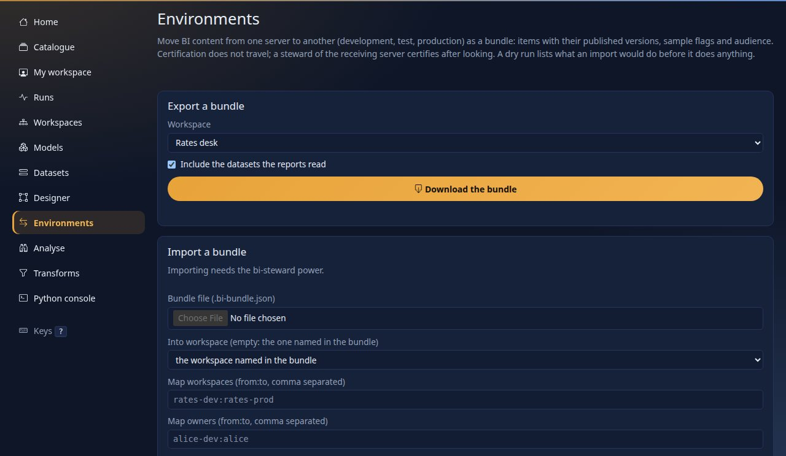

You should see the export card (a workspace, *include the datasets the reports read*). The file holds the items with their draft bodies, owner, audience
and **every published version**, each with a checksum, and a checksum over the whole (`GET /api/v1/bi/bundle` with `workspace=rates-desk`, or
`items=<id>,<id>`; captured):

```text
$ curl -s -H "Authorization: Bearer $ANN_TOKEN" "$DRISHTI_SERVER/api/v1/bi/bundle?workspace=rates-desk" -o rates-desk.bundle.json
{"format": "drishti-bi-bundle", "formatVersion": 1, "createdAt": "2026-10-13T06:46:50Z", "createdBy": "ann", "checksum": "de0f811f...a20db6"}
[{"title": "Rates trades", "kind": "dataset", "owner": "ann", "status": "draft", "publishedVersion": 1, "versions": [1], "endorsement": "none"},
 {"title": "Trades model", "kind": "model", "owner": "ann", "status": "published", "publishedVersion": 1, "versions": [1], "endorsement": "certified"},
 {"title": "Trades report", "kind": "report", "owner": "ann", "status": "published", "publishedVersion": 1, "versions": [1], "endorsement": "certified"}]
```

**Certification does not travel**: the dry run says so for each certified item (*certification does not travel: it is promoted here; a bi-steward
certifies it after the import*), and a steward of the receiving server certifies after looking. A bundle is a file: copy it to the other server.
Importing needs a **steward** (it is a governance act). Here the "other server" is the same one, and, to make something to see, the report is edited after
the export. As **sue** choose the bundle on *Import a bundle* and press **Dry run**, which changes nothing.

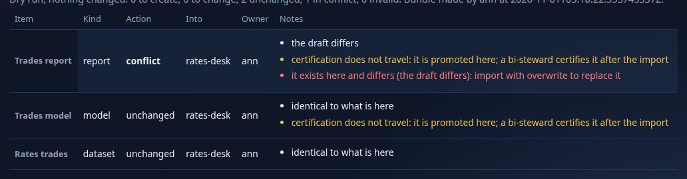

You should see a table: `Rates trades` and `Trades model` **unchanged** (`identical to what is here`) and `Trades report` **conflict** with the reason
`it exists here and differs (the draft differs): import with overwrite to replace it`. (Without that edit the dry run of the same bundle says every item is
`unchanged`, `identical to what is here`, with `"counts": {"create": 0, "update": 0, "unchanged": 3, "conflict": 0, "invalid": 0}, "ok": true`, and the two
certified items warn `certification does not travel`.) The API gives the same plan
(`POST /api/v1/bi/bundle/import` with `{"bundle": ..., "dryRun": true}`): `"counts": {"create": 0, "update": 0, "unchanged": 2, "conflict": 1, "invalid":
0}, "ok": false`. Tick **Overwrite items that exist here and differ** and run the dry run again.

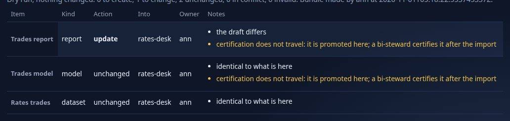

You should see `Trades report` as an **update** and the **Import** button enabled. (Other things a dry run can say: `create`, `invalid`, a workspace that does not exist here, or a change that would break published reports there. *Map owners* and *Map workspaces* rename people and workspaces between environments.)

### Step 62 · On a phone

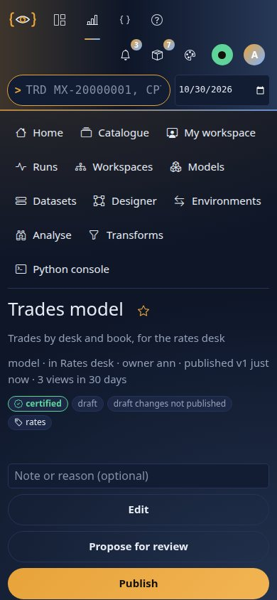

You should see the same sections stacked in one column, the tables scrolling inside their own frames and every button at least 44 pixels high. The
command line and the YAML are the same on any screen.

### Step 63 · A rename is not a breakage (version 1 datasets)

Step 60 stopped a change that removed a field a report used. But often a field is only **renamed**. A **version 1 dataset** (`rachana: 1`, the 2.1
format the live samples still use) recognises a rename and rewrites its reports in the same step. Say the *Orders desk* dataset reads `book` from the
document path `book.name`, and a report charts `orders.book`. Ann renames the column to `desk_book` (the same `path:`) and the measure `Gross` to
`Notional total` (the same expression), saves and proposes. Sue opens the dataset to review it.

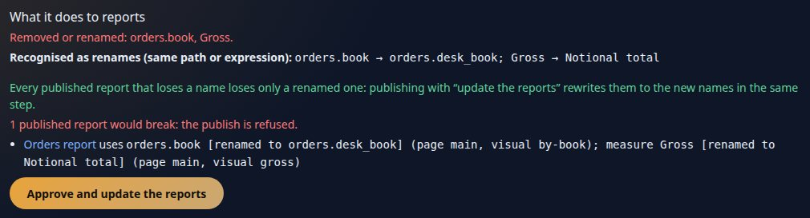

You should see, in the review under *What it does to reports*, **Recognised as renames (same path or expression)**: `orders.book → orders.desk_book; Gross → Notional total`, the report that uses them with `[renamed to ...]` beside each, and the button **Approve and update the reports** (an author who may publish directly sees **Publish and update the reports** under *Impact on reports*). A name is recognised as a rename only when the new one has the **same `path:` or `expr:`** (and type); a column with neither has only its name to go by. Press the button.

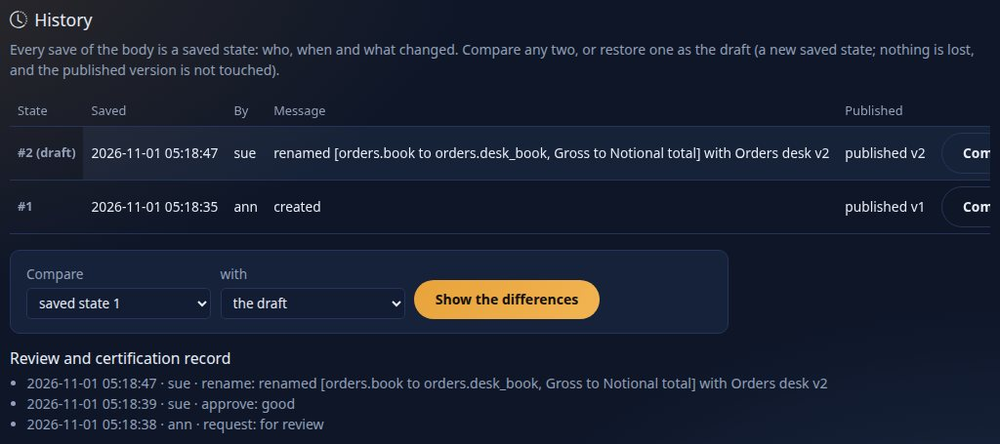

You should see, in the *Orders report*'s history, a new published version whose saved state says `renamed [...]` (its origin is `rename`), and a
`rename` line in the review record: the report's wells now name `orders.desk_book` and `Notional total` (titles are never touched), and the dataset's new
version is published in the same step. The report as it was rewritten (`GET /api/v1/bi/items/<report id>`, captured):

```yaml
      - id: gross
        type: card
        title: Gross
        wells: { values: [Notional total] }
      - id: by-book
        type: bar
        title: Orders by book
        wells: { axis: [orders.desk_book], values: [Orders] }
```

On the command line the review answer is `GET /api/v1/bi/items/<dataset id>/impact` (`"renames": [{"from": "orders.book", "to": "orders.desk_book",
"kind": "field"}, {"from": "Gross", "to": "Notional total", "kind": "measure"}], "renamable": true`), and the button is `POST .../approve` with
`{"applyRenames": true}`. In a **model**, measures and relationships carry **stable ids** the server writes on save (`id: m_notional`); today
a model's Contract tab lists a renamed measure as one taken away (major) and one added, with the reports that use the old name, so rename a model's
measure as a new major version, or keep the old name.

### Step 64 · Roll an import back

An import is not final. **Environments** now lists every import under *Imports you can roll back*. Ann retitled a visual of the report after exporting it; Sue imports the older bundle over it (the overwrite of step 61) and looks at the list.

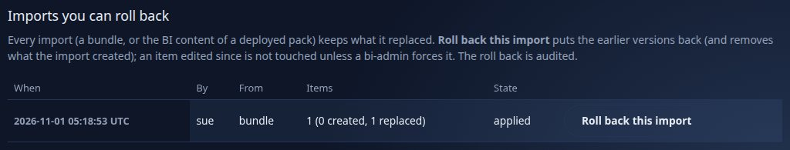

You should see one row for the import (`bundle`, one item, one replaced) and the button **Roll back this import**. Press it. On the command line the list is
`GET /api/v1/bi/imports` (captured: `{"id": "mv6bj6vt-dcb179", "by": "sue", "source": "bundle", "madeBy": "ann", "items": 1, "created": 0, "replaced": 1,
"rolledBack": false}`) and the button is `POST /api/v1/bi/imports/<id>/rollback`.

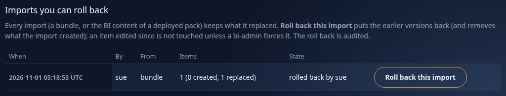

You should see the row say it was rolled back, and the report's draft is Ann's again (as a new saved state with the origin `rollback`; nothing was lost). Had the report been edited **after** the import, the roll back would have stopped with nothing changed and named it; an administrator can force it. A pack deployed from **Admin, Packs** that carries BI files (`config/bi/` in the archive) is imported the same way, so it appears in this list with the source `pack <name> <version>` and rolls back the same way.

### Step 65 · Where does the data really come from?

Step 59's lineage stopped at the connector's name. A dataset's item page (its **Lineage** section) goes one step further: it shows what the connector's
file says it reads. Ann's *Lake
orders* dataset (a dataset of the model layer, `source: { connector: orders-lake, kind: trade }`) reads through the connector `orders-lake`; the
administrator looks first, then Ann.

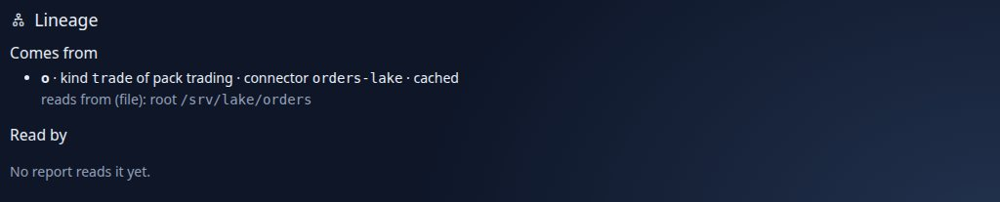

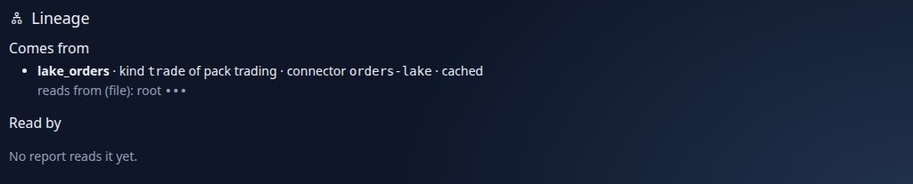

You should see, as the administrator, `reads from (file): root /srv/lake/orders`; as Ann, `root •••`. Only an administrator reads where a connector reads
from (a table, a topic, a path, a bucket, a host); everybody else sees that there is a source and what kind of setting names it. Credentials never appear in
either. The API answers the same, masked as you (`GET /api/v1/bi/items/<id>/lineage`, captured as the administrator and as ann):

```text
"source": {"connector": "orders-lake", "plugin": "file", "masked": false, "declared": {"root": "/srv/lake/orders"}}
"source": {"connector": "orders-lake", "plugin": "file", "masked": true,  "declared": {"root": "•••"}}
```

The YAML behind it is the connector's own file (`config/connectors/orders-lake.yaml`: `plugin: file`, `kinds: [trade]`, `settings: { root:
/srv/lake/orders }`), which only an administrator edits (**Admin → Connectors**).

### Step 66 · Break a measure down, and see it live

**UI.** On a report page: *Add a visual → Decomposition*, in Format give the pivot source (`var`), the measure (`var()`) and the splits
(`DESK`, `LEGAL_ENTITY`). Save, then in the viewer pick *Split by* on the root box and open a desk: each split says *Σ standalone −
diversification = parent*, and each box shows component VaR beside standalone.

**CLI.** The same numbers the box shows:

```bash
curl -s -X POST -H "$AUTH" -H 'Content-Type: application/json' \
  -d '{"source":"var","measure":"var()","split":"DESK","options":{"scope":"BANK"}}' \
  http://localhost:17480/api/v1/pivot/decompose | python3 -m json.tool | head -20
```

**YAML.** See [9.7a](REPORT_FILE_FORMAT_STATEMENTS.md#97a-the-decomposition-tree): a `decomposition` visual holds the source, the measure and the
splits. To try an element's code, open **Elements → Playground page** (`/elements#mode=docs&c=decomposition&tab=page`; every element has one, picked in the side list): edit a cell of its data or the JavaScript,
the visual redraws in a sandboxed frame; a mistake names its line and the last good drawing stays, greyed.

**You should see** five desk boxes under the root, the line *Σ standalone − diversification = parent* beside them, and in the
Playground page the decomposition tree redrawn after each edit, with **Reset** bringing the example back.
