<!--
  Project Drishti · Any data. Any domain. One grammar.

  Copyright (c) 2026 Ashutosh Sinha <ajsinha@gmail.com>.
  All rights reserved.

  PROPRIETARY AND CONFIDENTIAL.

  This file is the confidential and proprietary property of Ashutosh Sinha.
  Unauthorised copying, use, modification, distribution or disclosure of this
  file, via any medium, is strictly prohibited except with the express prior
  written permission of the copyright holder.

  See the LICENSE file in the root of this repository for the full terms.
-->
# Live reports, boards and background runs

Business intelligence: [Index](README.md) · [Pivot](PIVOT.md) · [Pivot at scale and the risk cubes](PIVOT_SCALE_AND_CUBES.md) · [Tables and models](TABLES_AND_MODELS.md) · [Reports and the designer](REPORTS.md) · [The report file, formatting and statements](REPORT_FILE_FORMAT_STATEMENTS.md) · [Models and datasets for reports](MODELS_AND_DATASETS_FOR_REPORTS.md) · **Live reports, boards and background runs** · [Distribution, subscriptions and alerts](DISTRIBUTION_AND_ALERTS.md) · [Governing BI and AI in BI](GOVERNANCE_AND_AI.md) · [The Notebook and Python](NOTEBOOK_AND_PYTHON.md) · [Groupings and analytics](GROUPINGS_AND_ANALYTICS.md)

Live reports and standing queries, boards of live tiles for a wall, kiosk mode, and background runs for long questions; with the live-BI tutorial.

## Contents

- [Guide](#guide)
  - [1. Live reports and standing queries](#1-live-reports-and-standing-queries)
  - [2. Boards: report pages of live tiles](#2-boards-report-pages-of-live-tiles)
  - [3. Background runs: long BI questions](#3-background-runs-long-bi-questions)
- [Tutorial: Live BI and boards](#tutorial-live-bi-and-boards)
  - [Part F · Live BI and boards](#part-f--live-bi-and-boards)

## Guide

### 1. Live reports and standing queries

#### 1.1 A live report

Nothing in a report says "live": a report whose model reads a **live table** (section 5.7) is live. Open **Live trading desk** from the
catalogue. Above the pages is the **live indicator**:

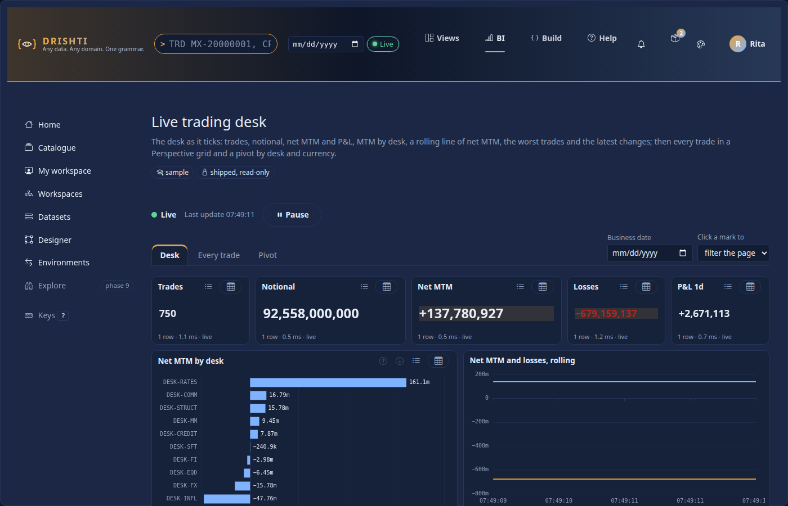

| Part | What it says |
|---|---|
| the dot and word | **Live**; **Paused**; **Stale** (nothing heard for `bi.live.stale_seconds`, 30 s, or the source has pushed nothing for `drishti.bi.live.stale-after`); **Feed failing** (the table's first read failed); **Disconnected** (the browser retries by itself); **Paused (tab in background)** (hidden for ten seconds, its stream given back) |
| *Last update 07:49:57* | when the live table last changed, not the last redraw |
| **Pause** / **Resume** | holds the picture; Resume catches up at once |

  

The visuals redraw **in place** as the table changes, at most four times a second, **as the person looking** (their row rules and masks on
every update): a chart keeps its keyboard cursor, a table its scroll position, a card flashes when its number changes (unless reduced motion
is asked for). A visual whose update fails keeps the old picture with a dashed border and the reason under it. Slicers keep their open state.
A **rolling line** (`live-chart`) adds a point per update and keeps the latest `format.window` points in the browser from the moment the page
opened; for a line that is there when the page opens, chart the model's **history** (section 5.7). The page uses the browser's one shared
channel ([DATA_ARCHITECTURE.md](../../architecture/DATA_ARCHITECTURE.md#1-live-updates)), so nothing costs a connection of its own.

Pages of the sample: *Desk* (cards, net MTM by desk, a rolling line, the worst trades, the latest changes), *Every trade* (a grid of every
trade), *Pivot* (a matrix by desk and currency, grouped and totalled by the server) and *Chart* (a stacked column per desk, one series per
currency). For a reader without `raw` the `TRADER_ID` column reads `•••`, in the cards, the tables and the grid alike.

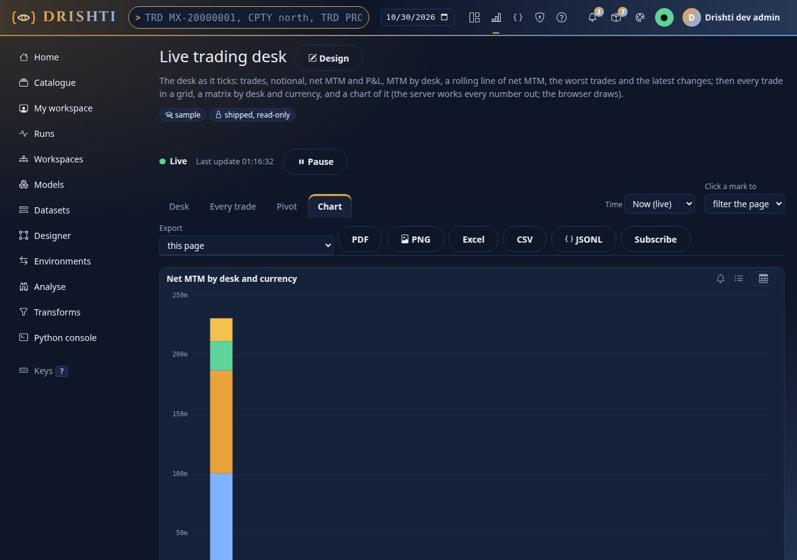

#### 1.2 Pushed answers and the state chip

Every visual of a report and every tile of a board **follows** its model query: the page subscribes it and the server pushes a new answer when
the model's data moves (a live batch, a data load, a refresh); nothing polls. A page holds at most 12 standing queries (a board 16); the rest
are asked once and say so. Readers of one question with the same effective security share **one evaluation**: a morning of 500 viewers with 5
distinct securities is 5 evaluations per visual. The **state chip** under each visual says how it is kept current, in words and an icon:

| Chip | Means |
|---|---|
| **Listening** | the stream is up and nothing has changed yet (a daily snapshot never does) |
| **Live** · 41 ms | the server pushed a change within the last minute; the time is how late the last one was |
| **Throttled** | evaluations took longer than the throttle, so the server doubled it |
| **Every few seconds** | worked out again on the server's tick (windows, time intelligence, Python measures, or a model over its maintenance budget) |
| **Stale** | nothing heard for `bi.live.stale_seconds`; the picture is the last good one |
| **Not updating** | the subscription failed (the reason is the chip's title) |
| **Too many live queries: close a tab** | the server refused a subscription for want of room (`DRS-9181`, `DRS-9182`) |
| **As of 2026-10-09** | a past day: asked once, it never changes |
| **2026-10-01 to 2026-10-09** | a window, followed |
| **Asked once** | the page follows its maximum already |

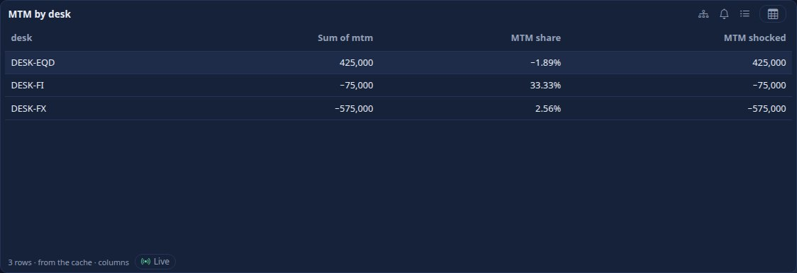

**The time picker** (*Time* in the report's and the board's bar) asks the same question **now**, **as of a date** or over **a window** of dates:
one plan answers all three. Each table of a model is bound to its own time: a live trades table reads its current state, snapshot desks the
current business date; *as of* a past date, a live table reads its history at the end of that day (refused `DRS-9157` without one). A
back-dated load moves only that date's answers.

#### 1.3 Parameter slicers and Explain

A report on a model with parameters or calculation groups shows them above the page: a what-if number as a slider (its min, max and step), a
field parameter as a choice of fields (section 11), and each calculation group as *Show as*. A value other than the default is a chip in the
filter line; the visuals are asked again with the values (`mq: 2`, `params`, `calc`).

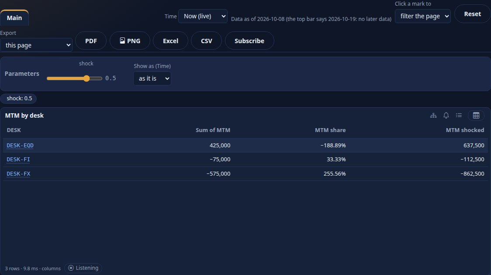

**Explain.** The diagram button of a visual opens *How this was answered*: the steps and where each ran, each scan's layer (`columns`, `live`,
`history`, `direct`, a rollup), the plan hash, whether the cache answered, the times, and the plan as text. It shows *that* a security rule
applied, never another reader's rule. **Close** puts the visual back. The same is any model query with `options: { explain: true }`:

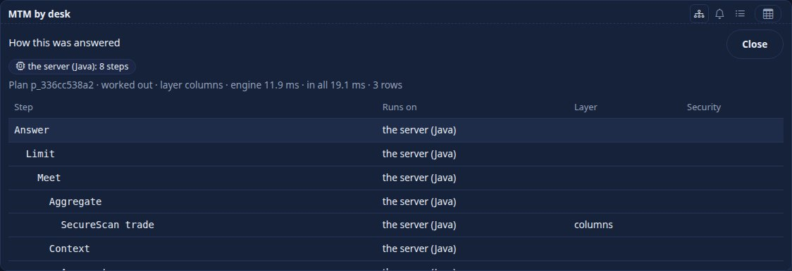

```text
plan: p_994bfe46057d176f   signature: s_f3056bc6c04cfd95   time: current 2026-10-16
timings: {engineMillis=4.9, layer=columns, sourceOrJavaMillis=1.78}
- Answer {binding={params={shock=0.5}}, columns=[trade.desk, MTM shocked], shape=grouped}   tier: java
  - Limit {n=500}   tier: java
    - Aggregate trade by [trade.desk]: [MTM shocked]   tier: java
      - SecureScan trade (pack.trading.trade@1.0.0)  rules: none  columns: [desk, mtm]   tier: java   layer: columns
```

**From a program.** A standing query is `POST /api/v1/bi/mq/subscribe` with the model query, a throttle and `deliver: rows | diff | value`,
read on `GET /api/v1/bi/mq/stream` (settings `drishti.bi.mq.*`):

```
curl -s -u rita:rita -H 'Content-Type: application/json' localhost:18958/api/v1/bi/mq/subscribe \
  -d '{"query": {"mq": 1, "model": "live-desks", "select": {"fields": ["trades.desk"], "measures": ["MTM", "Trades"]}}, "throttle": "250ms", "deliver": "diff"}'
# {"subscription": "sq_…", "throttle": "250ms", "deliver": "diff", "answer": {…}, "cursor": "g-…", "group": "sg_…", "mode": "incremental", "subscribers": 1}
curl -sN -u rita:rita localhost:18958/api/v1/bi/mq/stream
# event: answer   data: {"subscription": "sq_…", "cursor": "g-…", "diff": {"upsert": [["DESK-A", 12000.0, 7]], "delete": []}, "mode": "incremental"}
# event: status   data: {"subscription": "sq_…", "state": "live", "mode": "incremental", "group": "sg_…", "lagMillis": 41, "cursor": "g-…"}
```

A tab that closes ends its standing queries; one no stream reads is dropped after `drishti.bi.mq.idle-close` (60 s). The Alerts page's **Now**
column shows each alert's number, pushed the same way.

**`perspective-*` visuals.** No BI page computes: a report with `perspective-grid`, `perspective-pivot` or `perspective-chart` draws them as
Drishti's own grid of the rows the server sends; for a pivot change the type to a `matrix`, for a chart to a chart type (the live desk sample's
*Pivot* and *Chart* pages do).

### 2. Boards: report pages of live tiles

A **board** is a wall of tiles for a screen on the wall of a trading desk, a risk team or an operations room. A board is a **report page** with
`layout: board`: it holds **tiles** (visuals of other reports, with their alert colours) beside the report's **own visuals**, which take the
report's filters, slicers, cross-filter and drill as on any page. It keeps them up to date as the data ticks, turns its pages by itself in
**kiosk** mode, and colours a tile amber or red when its number crosses a threshold. The samples are `config/bi/reports/banking/desk-wall.report.yaml`
and `python-wall.report.yaml`; the walk-through is [the reports tutorial, Part F](#part-f--live-bi-and-boards).

#### 2.1 What a board is

* A tile names a report and one of its visuals; the viewer asks **that report** for the tile's data, **as the person looking**, so a tile can
  never show more than the same visual in its own report. Tiles can come from **several reports over several models**.
* The board page's own visuals (a slicer, a card, a chart over the report's model) are ordinary report visuals. Tiles are **not filtered** by
  them: a tile is answered by its own report.
* Tiles over a live table redraw in place; tiles over a cached table show the data as it was read. A tile whose question takes longer than the
  inline wait shows the run card (section 15); live tiles stay streams.
* A report whose pages are all board pages of tiles needs no `model:`. A board **sends nothing by itself**, unless a tile's alert says `notify:`.

#### 2.2 The file

```yaml
report: desk-wall
board: { rotate: "20s" }         # the board pages' settings: kiosk rotation (3s to 1h) and the tiles' notification defaults (notify:)
title: Desk wall
description: The trading desk and the counterparty exposure on one live wall.
sample: true
endorsement: promoted
pages:
  - id: desk
    title: Trading desk
    layout: board                # a board page: tiles, kiosk, rotation
    visuals:
      - id: net-mtm
        type: tile
        title: Net MTM
        from: { report: live-trading-desk, visual: mtm }
        at: { x: 0, y: 0, w: 3, h: 3 }
        alert: { on: MTM, warn: { op: lt, value: 0 }, crit: { op: lt, value: -1000000000 }, hysteresis: 25000000 }
```

| Tile key | Meaning |
|---|---|
| `from.report` | the report the visual is in: its catalogue id, file name or title; only reports **the caller may open** resolve |
| `from.visual`, `from.page` | the visual's id, and the page that holds it (empty: the first page that has it) |
| `title` | replaces the visual's own title on the wall |
| `at` | its place on the 12-column grid |
| `alert` | the thresholds and `notify:` (14.3) |
| `format` | the frame only: subtitle, border, shadow, background, padding |

Any visual draws as a tile except a **slicer** and another **tile** (`DRS-9052`). A tile is not interactive. A tile whose report the reader
may not open, or that has lost its visual, shows **Not available** with the reason (*You cannot open the report this tile shows, or it does not
exist*); the rest of the wall draws. A tile on a grid page, or without `from:`, is `DRS-9032`.

**Python tiles.** A tile may show a **python visual** of its report (a Python measure as bars, a Python chart, a Python Vega-Lite visual); it runs
for the person looking on the server's compute pool and shows *Python · item · target · ms · rows* under it. A Python tile has no `alert:` of
its own: make an alert on the Python measure instead (section 19.1).

```yaml
- { id: vol,   type: tile, title: Desk P&L volatility, from: { report: python-desk-risk, visual: volatility }, at: { x: 0, y: 0, w: 6, h: 6 } }
- { id: hist,  type: tile, title: One-day P&L,          from: { report: python-desk-risk, visual: histogram },  at: { x: 6, y: 0, w: 6, h: 6 } }
- { id: strip, type: tile, title: P&L by desk,           from: { report: python-desk-risk, visual: strip },      at: { x: 0, y: 6, w: 12, h: 6 } }
```

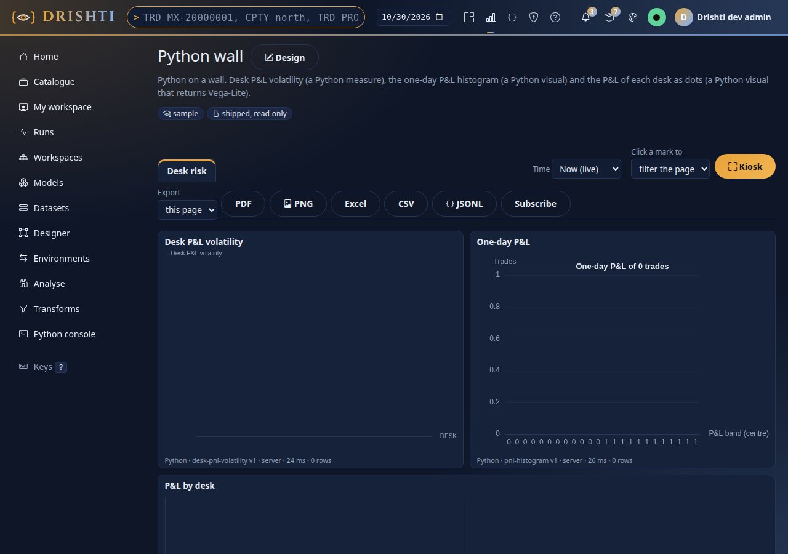

#### 2.3 Alerts: a tile changes colour

| `alert` key | Meaning |
|---|---|
| `on` | the measure or column compared; empty means the first number column the tile shows |
| `warn`, `crit` | `{ op, value }`, `op` one of `lt le gt ge eq ne`; at least one |
| `hysteresis` | how far back inside a threshold the value must be before the tile **drops a level**, so a value at the edge does not flip the colour |

The rule is evaluated on every redraw against the tile's rows: a card or KPI by its one value, a chart or table by **the worst of its rows**;
`crit` first, then `warn`. A tile at a level gets an amber or red border, its number takes the colour, and the line under it says **warning**
or **critical** in words. With `warn: lt 100`, `crit: lt 50`, `hysteresis: 10`: 49 is red; 55 still red; 60 amber; 105 still amber; 110
normal. Thresholds are compared with the reader's own number; a masked value never crosses one.

**Notifications.** Add `notify` to a tile's `alert` and the **server** judges the tile for every person who may read the report and tells them
when it **enters** the colour, each on their own number (the machinery of section 19):

```yaml
board:
  notify: { channels: [inbox, email], cooldown: 1h }   # optional: defaults for every tile that says `notify`
pages:
  - id: p1
    layout: board
    visuals:
      - id: mtm
        type: tile
        from: { report: trades-overview, visual: mtm }
        at: { x: 0, y: 0, w: 6, h: 3 }
        alert:
          warn: { op: lt, value: -100000 }
          crit: { op: lt, value: -300000 }
          notify: true               # or { level: warn, channels: [chat], trigger: live, severity: critical, cooldown: 30m }
```

| `notify` key | Default | Meaning |
|---|---|---|
| `level` | `crit` | `crit` notifies on red; `warn` on amber or red (needs the matching threshold) |
| `channels` | `[inbox]` | any of `inbox`, `email`, `chat` |
| `cooldown` | `drishti.alerts.cooldown` (30 min) | no second notification for one person within it |
| `trigger` | `after-load` | `after-load`, `live` (when a live report changes) or a schedule (`business-days 07:30`) |
| `severity` | `critical` for `crit`, else `warn` | `info`, `warn`, `critical` |

A person is told again only after the tile has dropped below the level and the cooldown has passed. A person whose number is masked is told
nothing. The message is the tile and its colour, never a figure (`Desk wall · Mark to market — is now red`); it opens the board. A report with
more readers than `drishti.alerts.max-audience` (300) tells nobody and says so in the history. Administrators see the tiles that notify at
**Alerts, Everyone's alerts** (section 19.6).

#### 2.4 The viewer, kiosk and rotation

A board page is a page of the **report viewer** (`/bi/r/<id>/<page>`; the catalogue lists reports with board pages under *Boards*; the item
page's **Open the board** opens it in kiosk; `/bi/b/<id>` opens the viewer too). It has the report's tabs, the live indicator with Pause and
Resume, the time picker and the **Kiosk** button.

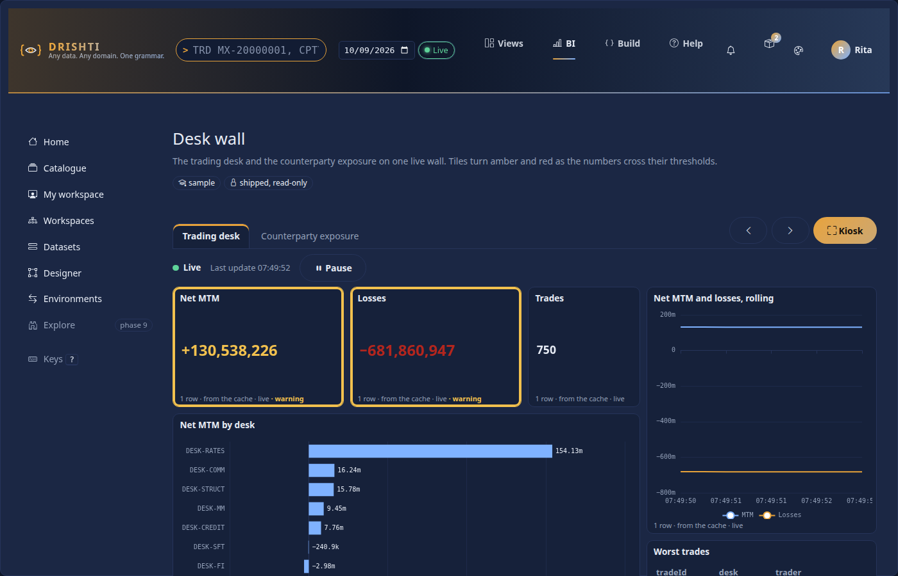

**Kiosk** (the button, `k`, or `?kiosk=1`) hides the top bar, the rail and the heading, fills the screen (the button also asks for full screen)
and **turns the board pages** every `board.rotate` (else the console's `bi.board.rotate_seconds`, 30). Rotation stops while paused or hidden.

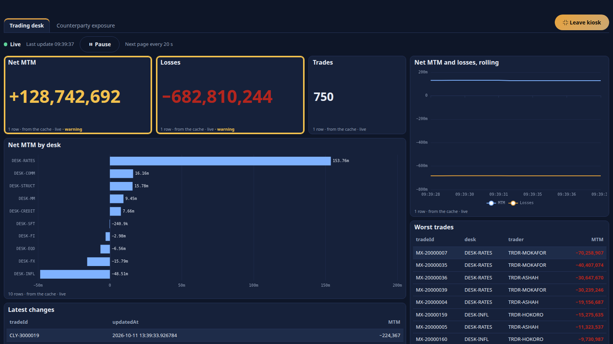

| Key | Does |
|---|---|
| `k` | enter or leave kiosk (on a focused table or matrix visual, `k` opens its chart instead) |
| `Esc` | leave kiosk |
| `p` | in kiosk: pause or resume the updates and the turning of pages |
| `←` `→` | in kiosk: the previous or next board page |

On a phone the wall is one column in reading order with 44 px buttons.

#### 2.5 Who sees what, and checking a board

To open a board a person needs the `bi` power and the right to read the report; each tile's data is its report's answer to them, on every
update. A tile can name a report that is still a **draft** in the designer; it draws only for people who can open that draft, so a report whose
tile shows a draft **cannot be published or proposed** until that report is (`DRS-9052`; force does not help):

```json
{"status": 422, "code": "DRS-9052", "title": "board invalid",
 "detail": "DRS-9052 'KPI board' cannot be published: it shows the report 'Draft KPIs', which is still a draft that only its author can open. Publish it first, or choose a published report."}
```

| Code | HTTP | Meaning |
|---|---|---|
| `DRS-9052` | 422 | an alert threshold that is not `{ op, value }`, a `notify:` that cannot work, `board.rotate` outside 3 s to 1 h, a tile naming a report the caller cannot open or a page or visual it lacks, a slicer or tile as a tile |
| `DRS-9032` | 422 | a tile on a page that is not a board page, or without `from:` |
| `DRS-9053` | 501 | a reserved setting this server does not build (`notifications` or `subscriptions` on an alert) |

#### 2.6 Designing a board

A board is designed in the report designer:

* **Make one**: *New: board* in the Explorer (or *Start a board* on the designer's start page) makes a report with one empty board page; on any
  report, Format with no visual selected, *Layout: board* turns the page into a board page.
* **Add a tile**: choose **tile** in Visualizations (*Board*); in Format, *Tile*, choose the **report** (the ones you may open, then your drafts,
  marked *(draft)*) and one of its **visuals**. The canvas draws the tile with its report's data, as you.
* **Alert**: in Format, *Tile*: *Alert on*, *Warning*, *Critical*, *Hysteresis*, and *Notify (the inbox) when it turns red*.
* **Kiosk**: Format with no visual selected, *Report*: *Kiosk: next page every (seconds)* writes `board.rotate`.
* **YAML, Check, Save, Publish** as for any report. From the command line a board is a report: `drishti.py bi item save`.

| You do in the designer | It writes |
|---|---|
| *Layout: board* | `layout: board` on the page |
| a tile, its report and visual | `{ id, type: tile, from: { report, page, visual }, at }` |
| *Warning: < 0* | `alert: { warn: { op: lt, value: 0 } }` |
| *Kiosk: 20* | `board: { rotate: 20s }` |

A board file in the older form (`config/bi/boards/*.board.yaml`, with `tiles:`) is read as a report: `POST /api/v1/bi/boards/convert` shows what a
file becomes; save the result as `config/bi/reports/<name>.report.yaml`. Settings: the console's `bi.board.rotate_seconds`, `bi.live.min_interval_ms` and `bi.live.stale_seconds`; the server's
`drishti.bi.live.*` and `drishti.alerts.*`. Endpoints: `GET /api/v1/bi/boards/{id}`, `GET /api/v1/bi/boards/reports` (the reports a tile can
name) ([API_REFERENCE.md](../API_REFERENCE.md)).

### 3. Background runs: long BI questions

Every BI question (a report visual, a board tile, a model query, SQL, a statement) goes through one pipeline. The console waits about two
seconds for the answer. When it comes in time, the visual is drawn as usual and nothing else happens. When it takes longer, the question
becomes a **run**: it goes on in the background, the visual shows a run card, and you keep working; the bell tells you when it is ready. A
slicer, a cross-filter or a drill on a dashboard never becomes a run: it is answered at once, or it tells you that it needs one. How it is
built: [ARCHITECTURE.md section 28](../../architecture/ARCHITECTURE.md).

#### 3.1 The run card

A visual whose question takes longer than the inline wait shows a run card instead of its chart; the rest of the page keeps working.

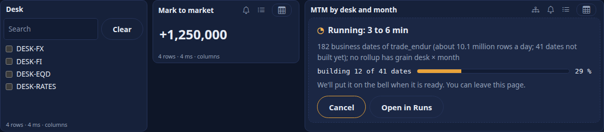

* **Running: 3 to 6 min.** The estimate is always a range, with how it was made, never a single number that looks more precise than it is.
* **Why it is large**, for example "182 business dates of trade_endur, 41 to build first; no rollup has grain desk × month".
* **Progress**, a bar with its percentage and what is happening ("building 12 of 41 dates"), measured, never guessed; when it cannot be
  measured the card says "progress is not measured for this one" and shows no bar.
* **Cancel** stops the run and frees everything it holds at once. **Open in Runs** opens it in the Runs tab.
* **Export CSV**, **Export Excel** and **Export JSONL**, once the run is done (section 15.9).

When the run finishes while the page is open, the card turns into the chart without a reload; if you have left, the bell counts it.

#### 3.2 Confirming a large run

A question that would read a great deal of data (above a minute, or 500 million rows, by default) asks you first. Nothing has run yet.

```
 Confirm a background run
 About 1.84 billion rows over 182 business days (Delta statistics). Expected 3 to 6 min on this server.
 A rollup at this grain in the model makes this instant next time.
 [ Run in background ]   [ Narrow the dates ]   [ Not now ]
```

**Run in background** starts it; **Narrow the dates** puts the focus on the report's date; **Not now** (or `Esc`) leaves it, nothing read. When
the size of a table is not known, the card says "We cannot estimate this yet: it reads tables whose size we do not know. It may take a long
time." Such a question always asks first when you ask it yourself (a model query, SQL, the CLI). A report visual of unknown size does not ask:
it draws as usual and becomes a run card if it outlives the inline wait. When the same question already ran on older data, the confirmation
offers *Open that result* (with its as-of date and age) beside *Run on the newest data*.

#### 3.3 A selection that needs a run

Dashboards stay instant: a slicer, a cross-filter or a drill is answered from the model's rollups and built layers. When a selection would
need a long scan instead, the visual says so at once, before anything is read:

```
 This selection needs a background run (3 to 6 min)
 [ Run in background ]   [ Not now ]
```

**Run in background** starts it as a visible run, with its card. The model's owner can add a rollup at that grain (section 15.14), and then the
same selection is instant.

#### 3.4 The Runs tab

Open it from the rail (**My runs**, with the number of your runs queued or running), from a workspace's tabs (**Items · Runs · Members**), with
`BI RUNS <GO>`, or `g` then `r`. The address keeps the tab: `/bi/w/me?tab=runs`.

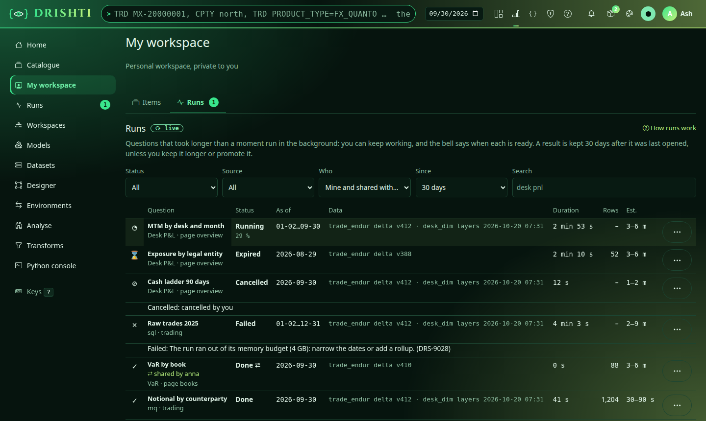

Each row shows the question and where it came from, its status, the dates it is as of, the data version it read (for example
`trade_endur delta v412`), how long it took, its rows and the estimate you were shown. Hover the data version for every table and date, and the
estimate for "estimated 3 to 6 min, took 4 min 12 s". A failed run has a second line with its reason in words and the code in brackets. ⇄ marks
a run someone shared with you. Rows change as the runs do, with no reload (**⟳ live**); screen readers hear each change.

Filters: **Status** (all, active, waiting for you, done, failed, cancelled, expired), **Source** (reports, boards, model queries, SQL,
statements, schedules), **Who** (mine, shared with me, both), **Since** (1 to 90 days), **Search**. A shared workspace's Runs tab lists the
runs of its items that you may see. Keys: the arrows move between the tabs; `↑` and `↓` between rows; `Enter` opens a run; `Esc` closes it.

#### 3.5 One run: the drawer

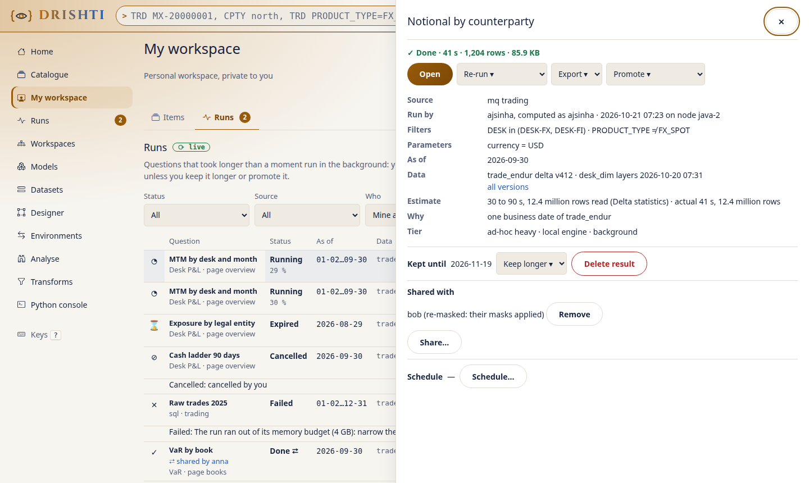

The drawer shows the run's source, who ran it and as whom it was computed, the filters and parameters, the dates, the data versions (**all
versions** lists each table), the estimate beside the actual, the tier and the engine; then the actions the server allows you:

| Action | What it does |
|---|---|
| **Open** | a report's run opens the report with `?run=<id>`: the visual is drawn from the stored result and a line says so; any other run opens its result |
| **Run again** (choose in **Run again as**) | *Same as before (as of D)*: the same dates and data versions, **reused** at once when the result is still stored; *With the latest data*: relative dates worked out again. The new run is highlighted at the top, the drawer follows it, and the old row says *superseded by* it |
| **Cancel** | stops a queued or running run (*Cancelled: cancelled by you*) |
| **Export CSV** · **Export Excel** · **Export JSONL** | the stored result as a file, your own version of it (section 15.9) |
| **Promote…** | a model query's or SQL run's result to a table snapshot or a report on it (section 15.10) |
| **Keep longer** | 90 days, 180 days or a year, instead of 30 days after the last open |
| **Delete result** | removes the stored result now; the run stays listed, as expired |
| **Share…** · **Unshare** | section 15.7 |
| **Schedule…** · **Edit** · **Pause** · **Remove** | section 15.8 |
| **Run in background / Discard** | for a run waiting for your confirmation |

An expired run says when its result was removed, and offers Run again.

#### 3.6 The same answer for the same access profile

A report visual's answer is shared between everyone with the same **access profile**: the same roles, masks and row rules on the model it
reads. When a colleague with your profile has drawn the visual on the same data and dates, you get their answer at once (**Reused**), or wait
for the same run if it is still going; nothing is computed twice. Someone with another mask or row rule never gets your answer. A visual that
depends on who is looking (a filter or value naming you, such as `user.name` or `me`, a row rule by your user name, a personal model) stays
yours alone.

#### 3.7 Sharing a run

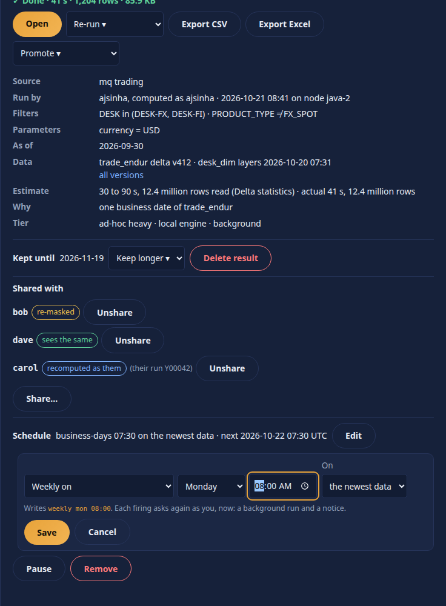

**Share…** opens the people picker: type two letters of a name or a role and choose it (it becomes a chip; `×` takes it off), or type names
comma separated (`bob, role:risk-team`); a role is expanded to its members. A share never hands over your result as such: the server decides,
for each person, what their own rights allow, and the drawer lists each with the decision:

| Shown as | Meaning |
|---|---|
| **sees the same** | they have exactly your rights: they read your stored result |
| **re-masked** | the same rows with their own extra masks applied |
| **recomputed as them** | their rights differ, so the question runs again as them (the drawer names their run), and they are told when it is ready |

A person who may not read the model gets no share, and the drawer says so ("Not shared with eve (DRS-9021)"). Ten people of one desk with equal
rights cost one recomputation. The decision is taken again each time they read it, so a recipient whose rights narrowed is told to re-run it.
**Unshare** stops sharing with that person. A recipient finds the run in their own Runs tab marked **⇄ shared by anna**; they can open and
export it (their own version); sharing on, scheduling and deleting stay with the owner. The bell tells them.

#### 3.8 Schedules

**Schedule…** asks the same question again on a schedule, as you, at the time it fires (if you lose access, the firing fails and you are told;
it never borrows anyone's rights). Choose a preset and the form writes the schedule under it ("Writes `weekly mon 08:00`"):

| Preset | Writes |
|---|---|
| Daily at | `daily 07:00` |
| Weekdays at | `weekdays 07:30` |
| Business days at | `business-days 07:30` (the calendar's business days) |
| Weekly on | `weekly mon 08:00` |
| Monthly, the last day at | `monthly last 18:00` |
| Monthly, the last business day at | `monthly last 18:00 business` |
| Written out | anything in the same grammar, typed |

The grammar is the subscriptions' (section 18.3); `after-load` is not offered for runs. **On** chooses the newest data (relative dates worked
out at each firing) or the same dates; times are the server's zone. The drawer's **Schedule** line says what it is and when it fires next
("business-days 07:30 on the newest data · next 2026-10-22 07:30 UTC"); **Edit**, **Pause** / **Resume** and **Remove** (the runs it made stay).
Each firing is a visible background run and a notice on the bell.

#### 3.9 Export

**Export CSV**, **Export Excel** and **Export JSONL** (a row a line, the CSV's column names) download a finished run's result: in the drawer, on
the run card, and on the line above a report drawn from a run ("Drawn from the run of…"). The server makes the file from the stored result, so
nothing is computed again, and it is **your** version: a recipient of a share gets theirs, and masked cells stay masked (the file's note names
the masked columns). A very large result is cut at the export row limit, with a note.

#### 3.10 Promote a run

**Promote…** asks for a **Name** (prefilled from the run's title), a **Title**, and **To**: *a dataset snapshot* keeps the result as a read-only
table and makes a draft table in My workspace (`from: { run: … }`, section 5.11); *a report on it* also makes a draft report with one table of
every column. The rows are kept as you see them: a column masked for you stays masked for every reader. The drawer then says *Promoted to
name@1* with links to the drafts, which follow the normal review; the reviewer sees as whom the data was computed. Only the runner promotes,
with `bi-author`, and only a model query or a SQL run. The same name again is version 2. A name another person promoted is refused (*That
snapshot name is taken by another person's promotion: choose another name (DRS-9004)*). On the command line:
`drishti.py bi runs promote RUN --to report --name desk-pnl-2026 --title "Desk P&L 2026"`; over the API, `POST /api/v1/bi/runs/{id}/promote`.

#### 3.11 The bell and the inbox

When a visible run finishes, fails, or is started again after a server restart, the bell counts it once: "Run finished: MTM by desk and month,
2026-01-02 to 2026-09-30 (182 rows, 3 min 40 s)": names and counts only, never a value. Opening it goes to `/bi/run/<id>`, which opens the
report drawn from the stored result, or the run. The inbox has a **Runs** tab (`/inbox?tab=run`). Nothing is lost without a word: after a
restart every queued or running run is resumed or marked failed with its reason.

#### 3.12 On the command line

`drishti.py bi runs` does what the Runs tab does, as the token's user ([CLI_REFERENCE.md](../CLI_REFERENCE.md) section 5.7):

Run these from the Drishti folder (the repository root, or the install folder of a release).

```
$ python3 tools/drishti.py bi runs list --state running,done --since 7d
r-java-2-01JAC4Q8Z6T3M4R9B0X1Y2Z3W4  MTM by desk and month
    running · building 12 of 41 dates · 29 %  · as of 2026-01-02 to 2026-09-30 (182 dates)  · trade_endur delta v412  · est. 3 to 6 min
$ python3 tools/drishti.py bi runs submit --sql "SELECT desk, MEASURE('MTM') FROM trades GROUP BY desk" --model trading --wait 0 --yes
r-java-2-01JAC4Q8Z6T3M4R9B0X1Y2Z3W5  queued  (expected 3 to 6 min)
  follow it:  drishti.py bi runs wait r-java-2-01JAC4Q8Z6T3M4R9B0X1Y2Z3W5
$ python3 tools/drishti.py bi runs wait r-java-2-01JAC4Q8Z6T3M4R9B0X1Y2Z3W5 --timeout 30m      # exit 0 done, 3 failed, 4 cancelled, 5 still running
$ python3 tools/drishti.py bi runs result r-java-2-01JAC4Q8Z6T3M4R9B0X1Y2Z3W5 --format csv --out pnl.csv     # or --format jsonl
$ python3 tools/drishti.py bi runs share r-java-2-01JAC4Q8Z6T3M4R9B0X1Y2Z3W5 --to bob --to carol --to eve
bob: re-masked (your result with their extra masks)
carol: recomputed as them (their rights differ: a run of their own) (run r-java-2-01JAC4Q8Z6T3M4R9B0X1Y2Z3W6)
eve: not shared: eve may not read the model trading (DRS-9021)                      (on stderr)
$ python3 tools/drishti.py bi runs unshare r-java-2-01JAC4Q8Z6T3M4R9B0X1Y2Z3W5 carol
carol: no longer shared
$ python3 tools/drishti.py bi runs schedule r-java-2-01JAC4Q8Z6T3M4R9B0X1Y2Z3W5 "weekly mon 08:00" --data latest
sch-1  weekly mon 08:00  on latest data  next 2026-10-26 08:00
$ python3 tools/drishti.py bi runs schedules edit sch-1 "business-days 07:30"     # also: schedules [list] | disable | enable | delete ID
$ python3 tools/drishti.py bi runs export r-java-2-01JAC4Q8Z6T3M4R9B0X1Y2Z3W5 --format xlsx --out pnl.xlsx
$ python3 tools/drishti.py bi runs suggestions --model trading                    # bi-admin
sg-1  trading  desk x month  suggested  37 runs, about 4 min each
    asked 37 times this week, about 4 min each: make it a rollup refreshed at load
$ python3 tools/drishti.py bi runs suggestions accept sg-1                         # or: dismiss sg-1
sg-1  accepted: the rollup is in the draft of trading (bi-model-...); review it and publish it
```

`bi runs estimate` gives the tier, the engine and the estimate and runs nothing. A large question without `--yes` is refused with its estimate
and exit 2. `drishti.py bi mq FILE --async` and `drishti.py bi sql "…" --model M --async` ask as a run: the answer when it is done within
`--wait` (2 s), else the run's id. Without `--async` they answer in the foreground. Over the API, a client asks for a run with the standard
`Prefer: respond-async` header; the endpoints are under `/api/v1/bi/runs` ([API_REFERENCE.md](../API_REFERENCE.md)).

#### 3.13 The Admin page for runs

`/admin/bi/runs`, for BI administrators (also linked from Admin → BI), shows the engine's gate (slots in use per work class: interactive,
standing and background, with the background cap), the interactive admission wait (the sign that background work slows nobody), the queue per
person, what runs now (with **Cancel**: the person is told an administrator cancelled it), the result store (results and snapshots, the biggest
users), how accurate the estimates were, how many questions were answered inline, the settings file (`config/runs/runs.yaml`) and the
repeated heavy questions. It shows state, sizes and nodes, never a value. `drishti.py bi runs storage` prints the same.

#### 3.14 Rollup suggestions

The same heavy question asked again and again is better answered by a rollup in the model. The server counts the finished heavy model queries
per model, grain and shape of their filters (the field and the operator, never a value); one asked often enough (by default 5 times in 7 days,
with a median of a minute or more) becomes a suggestion with the rollup drafted.

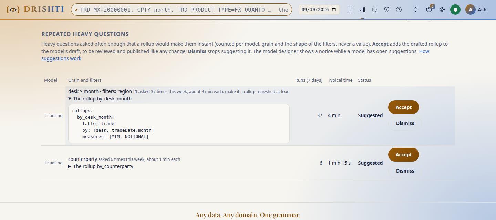

**Repeated heavy questions** on `/admin/bi/runs` lists each: the model, the grain and filters, how many runs, the typical time, its status, and
**The rollup** (the YAML that would be added). For a BI administrator, **Accept** adds the drafted rollup to the model's **draft** under
`rollups:` (comments and order kept; nothing is published: the change is reviewed like any other; for a model shipped in a pack the YAML is
given to add by hand); **Dismiss** stops suggesting it. Once the model has a rollup at that grain the status says **Built**, and those questions
are answered at once. While a model has open suggestions, administrators see a notice on it that opens this list for that model
(`/admin/bi/runs?model=trading#suggestions`).

#### 3.15 The words for each state

| State | Shown as | Meaning |
|---|---|---|
| `awaiting-confirm` | Waiting for you | it asked you to confirm; nothing has run |
| `queued` | Queued | waiting for a slot |
| `running` | Running, with progress | reading and computing |
| `storing` | Storing | writing the result |
| `done` | Done | the result is stored |
| `reused` | Reused | the same question on the same data was already answered by someone with the same access profile: nothing ran |
| `failed` | Failed: *reason* (code) | ended with a problem; the reason says what to do |
| `cancelled` | Cancelled: *by whom* | by you, an administrator, a newer selection, or the page closing |
| `expired` | Expired | the result was removed by retention or the storage budget |

The codes `DRS-9080` to `DRS-9089` are listed with their fixes in [OPERATIONS_GUIDE.md](../OPERATIONS_GUIDE.md#21-troubleshooting).

## Tutorial: Live BI and boards

Live data that moves together, a live table, a report that follows it, a wall for the desk as a board, kiosk mode, the history of a live table, and your own board layout. Every step shows the UI, the command line where there is one, and the YAML.

### Time to complete

- Part F · Live BI and boards: About 30 minutes.

### Before you start

The environment, the sign-in and the token are those of [Reports, Before you start](REPORTS.md#before-you-start).

**Part F · Live BI and boards.**

- [Part A](REPORTS.md#part-a--your-first-bi-report) done (you know the report viewer). The shipped samples used here, the dataset **Live trading desk**, the reports **Live trading desk** and **Live exposure** and the boards **Desk wall** and **Python wall**, are in every server's `config/bi/`.
- **Live and the model layer.** The two live samples are **version 1 datasets** (`rachana: 1`) that their reports read directly. The converter has made a **model** of each (`live-trading@1`, `live-exposure@1`) over the same live
  table, so a model query, the Notebook and an alert on a measure of a model read the live rows too (step 46).
- **A source that ticks.** The demo lakes are daily snapshots: they do not move, so on the quick-start server (**Drishti server (demo lakes)**, which sets
  `DRISHTI_DEMO_ENABLED=false`) a live visual's chip says **Listening** (following, nothing has changed) rather than **Live**. Either way a live table
  follows at most 2,000 trade valuations (`drishti.bi.live.follow-max`; the lake holds 15,000) and says so in a warning. For this tutorial **turn the demo ticker on**: edit the run
  configuration **Drishti server (demo lakes)** and set `DRISHTI_DEMO_ENABLED` to `true`, or start the server with it
  ([data/testdata/README.md](../../../data/testdata/README.md), "The demo ticker"). The demo source then moves every live sample that someone is watching
  (a view, a live visual or a board tile open) every 400 ms; a sample answers before the lake for an id both hold, and the lakes still answer every other id. With a
  real source the same pages follow your own live connector ([DEMO_CONNECTOR.md](../../../docs/connectors/types/demo/README.md), [DATA_GUIDE.md](../../guides/DATA_GUIDE.md#1-telling-drishti-new-data-has-landed)).

### What you will learn

**Part F · Live BI and boards**

- what "live" means for data (a source that **pushes**) and why the demo's live data is **coherent**: related numbers move together;
- the `mode: live` table of a dataset and how to see how it is doing;
- the live indicator of a report, **Pause** and **Resume**, and what redraws;
- a **board**: tiles from several reports, amber and red tiles from their alert rules, pages that turn on their own, and **kiosk mode**;
- the **history** of a live table (a line that is there when the page opens) and **your own board** laid out in the report designer (BI Studio), with a tile alert that does not flicker (hysteresis);
- a **chart of the desk by currency** (the server groups, the browser draws) and a **wall of Python** tiles.

#### Part F · Live BI and boards

So far every number was as of the last time a layer was built. This part is about numbers **as they are**. You watch the demo market tick (a curve that moves as a whole, not one cell at a time), look at a **live table**, open a report that redraws itself as the trades
change and **pause** it, then put a **Desk wall** of live tiles on a screen in **kiosk mode**. Every step shows it **in the UI**, **on the command line**
(`python3 tools/drishti.py`, or `curl` where the tool has no command) and **as YAML** (the file the UI reads or writes), or says why one of the three does
not apply.

### Step 45 · Live data moves together

Open a rate curve in the terminal: type `CRV CRV-USD-BASIS <GO>`, or open `/v/ir-curve/CRV-USD-BASIS`.

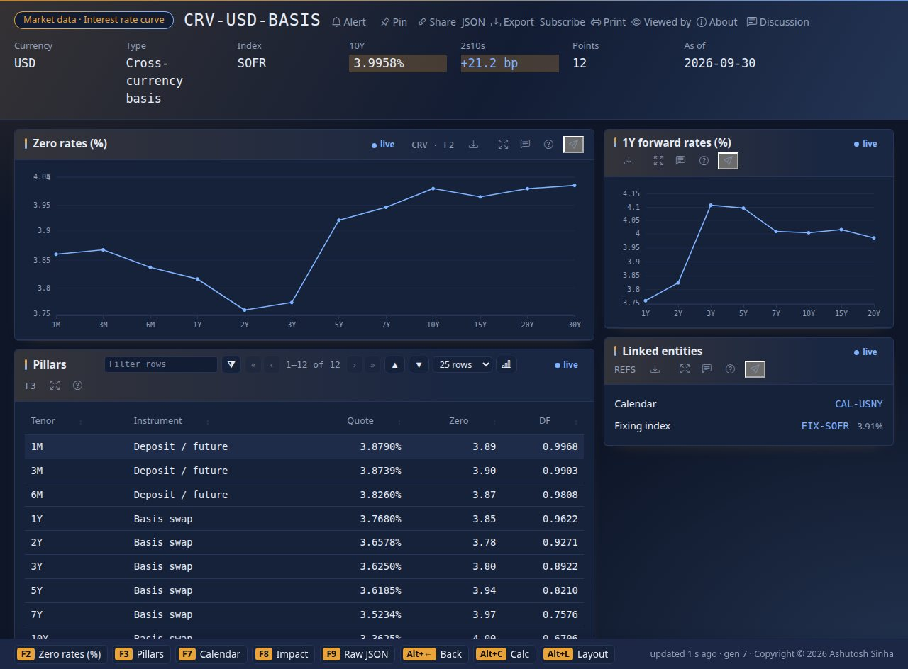

You should see the key figures at the top (`10Y` and `2s10s`: about `4.13%` and `+18.9 bp` on a freshly started server, wherever the walk has taken them since), the **Zero rates** chart, a **1Y forward** chart and the **Pillars** table (tenor, instrument, quote, zero rate, discount factor), and `updated 1 s ago` at the bottom: the page is live. Wait ten seconds.

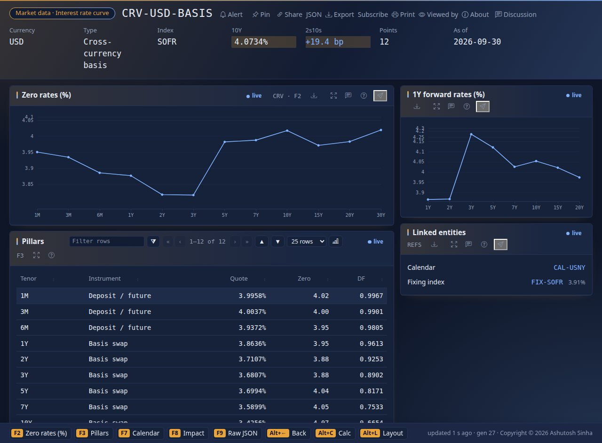

You should see other figures for `10Y` and `2s10s` (a few hundredths of a percent and a few tenths of a basis point away), the chart with a new shape and **every row of the table changed**, not just the 10Y cell: the quote, the zero rate and the discount factor of each tenor. A real market does not move one number: when the 10-year rate ticks, the whole curve, its forwards, its
discount factors and its slope tick with it, and the demo does the same (a "coherent walk": one random draw moves a headline and everything that depends on it; [DEMO_CONNECTOR.md](../../../docs/connectors/types/demo/README.md) section 7.4). The command line prints the same view as text, as of the moment you ask:

```text
$ python3 tools/drishti.py view get ir-curve/CRV-USD-BASIS
Market data · Interest rate curve  CRV-USD-BASIS   [CRV]

Key figures
  figure    value
  --------  --------------------
  Currency  USD
  Type      Cross-currency basis
  Index     SOFR
  10Y       4.1315%
  2s10s     +18.9 bp
  Points    12
  As of     2026-09-30

Zero rates (%)  (line, curve, F2)
  series          points   first    last     min     max
  --------------  ------  ------  ------  ------  ------
  Zero rates (%)      12  4.0704  4.1443  3.9418  4.1443
  x: 1M .. 30Y

Pillars  (table, points, F3)
  Tenor  Instrument          Quote  Zero      DF
  -----  ----------------  -------  ----  ------
  1M     Deposit / future  4.0461%  4.07  0.9966
  3M     Deposit / future  4.0740%  4.05  0.9899
  6M     Deposit / future  3.9976%  4.00  0.9802
  1Y     Basis swap        3.9077%  4.01  0.9607
  ...
  10Y    Basis swap        3.4804%  4.13  0.6616
  30Y    Basis swap        2.5293%  4.14  0.2884

1Y forward rates (%)  (line, forwards)
  series                points   first    last     min    max
  --------------------  ------  ------  ------  ------  -----
  1Y forward rates (%)       8  3.9801  4.0836  3.9801  4.307
  x: 1Y .. 20Y

How this view was built  (provenance, built)
  field        value
  -----------  -----------------------------
  Layout       Sutra ir-curve v1 + inference
  Fingerprint  d097…63e7
  Source       md-hub, gen 29

Linked entities  (links, refs)
  link          text      status    opens
  ------------  --------  --------  --------------------
  Calendar      CAL-USNY  resolved  calendar/CAL-USNY
  Fixing index  FIX-SOFR  resolved  rate-fixing/FIX-SOFR

source md-hub gen 29  layout Sutra ir-curve v1 + inference  built in 1.74 ms
```

You should see the table form of the same page, asked with the ticker **on**: the source line names `md-hub` (the demo source of the market-data
samples, which answers before the lake) and `gen 29`, the number of times this curve has ticked; `As of` is the sample's own date. Ask again a minute later
with the page still open in the browser and the figures and the generation have moved; ask with no page open and they have not: the demo moves only the
entities someone is watching (a live view, a live BI visual or a board tile subscribes to them; [DEMO_CONNECTOR.md](../../../docs/connectors/types/demo/README.md) section 7.1). With the
ticker **off** the same command reads the lake: the source line names `market-store` (the `market-data` pack's Delta connector), the figures are the
lake's close of the last business day, and nothing moves. That is **live data**: a connector that **pushes**
changes instead of waiting to be asked. BI uses it through a live table. **The YAML** of a source that pushes is a connector's file; the demo's ticking needs
none (it is built in), and a real one looks like the Kafka connector the `trading` pack suggests, `trading-stream` (written to
`config/connectors/trading-stream.yaml` at the server's first start; off until you switch it on):

```yaml
plugin: kafka
enabled: ${DRISHTI_STREAM_TRADING:false}
kinds: [trade]
settings:
  broker: default
  topics: ${DRISHTI_TRADING_TOPIC:drishti.trading.trades}
  kind: trade
  id-field: TRADE_ID                # which field says which trade a message updates
  stale-after: ${DRISHTI_STREAM_STALE_AFTER:15m}
```

### Step 46 · A live table

Open **Datasets** and **Live trading desk** (a version 1 dataset: its page is the 2.1 one, with **Layers**). Its trade table is declared with `mode: live`
over the `market-risk` pack's **trade valuations** (`config/tables/banking/live_trading_trade.table.yaml` and its model `config/tables/banking/live-trading.model.yaml`):

```yaml
tables:
  trade:
    source:
      kind: trade-valuation     # no connector named: whichever running connector serves trade valuations and can push them (the demo ticker here)
    mode: live
    live:
      rows: 5000                # the most rows it keeps
    columns:
      VALUATION_ID:  { type: string, key: true }
      TRADE_ID:      string
      DESK:          string
      ...
      MTM:           { type: decimal, format: signed0 }
```

The engine keeps this table **in memory** and applies each change as the source pushes it. Scroll to **Layers on disk**: a live table has no dates on disk; it says how it is doing.

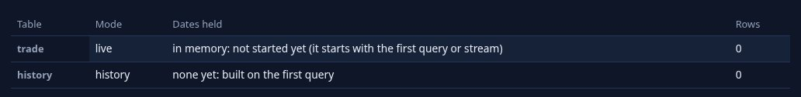

You should see the table `trade`, the mode `live` and its state, and the dataset's second table, `history` (step 51). Over REST (there is no `drishti.py`
command for layers; captured with the ticker on):

```text
$ curl -s -H "Authorization: Bearer $DRISHTI_TOKEN" $DRISHTI_SERVER/api/v1/bi/datasets/file:dataset:live-trading/layers
{"tables":[{"table":"trade","partitions":[],"mode":"live","live":{"table":"trade","kind":"trade-valuation","state":"live","rows":2000,"entities":2000,
  "subscribed":2000,"pushes":true,"seq":13474,"epoch":0,"generation":27,"lastUpdate":"2026-10-17T23:09:11.409753668Z","lastSeen":"2026-10-17T23:09:14.646008349Z",
  "startedAt":"2026-10-17T23:08:40.963118257Z","applied":13474,"skipped":1,"evicted":0,"deleted":0,
  "error":"following the first 2000 trade-valuation entities of more (drishti.bi.live.follow-max)",
  "aggregates":[{"rollup":"byDeskBook","groups":603,"incremental":24948,"recomputedGroups":8580}]}},
 {"table":"history","partitions":[],"mode":"history","history":{"table":"history","every":"PT10S","keep":360,"samples":2,"lastSample":"2026-10-17T23:09:05.133271549Z","error":null}}]}
```

You should see `state: live`, the rows and the entities followed (`subscribed`), `pushes: true`, and a count of changes applied (13,474 in the
first half-minute here, 1 skipped because the value had not changed). The `error` line is a limit, not a failure: the lake's 15,000 trade valuations (with
the demo's samples among them) are more than a live table follows, so it follows the first 2,000 (`drishti.bi.live.follow-max`) and every query over it says
so in a warning. With the ticker **off** the same call says `"state": "stale"` and the same limit: nothing pushes. A live table starts when it is first used and is closed after ten idle minutes. The
queries are the ones of any dataset: a live table is just another layer that answers them.

**The same table through the model layer.** The model the converter made of this sample, `live-trading@1`, reads the trade table as its one fact (the
dataset `live-trading-trade`, `mode: live`), with the dataset's measures:

```text
$ python3 tools/drishti.py bi model describe live-trading@1
Live trading desk  (live-trading@1)

trade  fact  live-trading-trade 1.0.0
  trade.VALUATION_ID                 string    key
  trade.TRADE_ID                     string    dimension
  trade.SOURCE_SYSTEM                string    dimension
  trade.DESK                         string    dimension
  ...
  trade.NOTIONAL                     decimal   amount        amount0
  trade.MTM                          decimal   amount        signed0
  trade.PNL_1D                       decimal   amount        signed0

measures
  Trades                            count(trade)
  Notional                          sum(trade.NOTIONAL)
  MTM                               sum(trade.MTM)
  PnL 1d                            sum(trade.PNL_1D)
  Losses                            calc(sum(trade.MTM), where=trade.MTM < 0)
  Worst trade                       min(trade.MTM)
  Best trade                        max(trade.MTM)
  MTM history                       sum(history.MTM)
  Losses history                    sum(history.Losses)
  Trades history                    sum(history.Trades)
  Count of trade                    count(trade)  (default)
```

**Kept by group, not recomputed.** The dataset declares a rollup over the live table:

```yaml
rollups:
  - { name: byDeskBook, table: trade, by: [DESK, PORTFOLIO, PRODUCT_TYPE, CURRENCY], measures: [Trades, Notional, MTM, PnL 1d, Worst trade, Best trade] }
```

The engine keeps the sums, counts, minimums and maximums **by group** as each change arrives: a row that changes takes its old values out of its group and
puts the new ones in (a sum moves by the difference; a minimum is read again for that one group only when the row that held it changed). A query the
rollup can answer reads those few rows, not every trade. Ask the desk bar as one model query, with the SQL it ran (`options: { explain: true }`, for BI
authors); the query is the file [data/live-desk.mq.yaml](../../tutorials/data/live-desk.mq.yaml):

```yaml
mq: 1
model: live-trading@1
select:
  fields: [trade.DESK]
  measures: [Trades, Notional, MTM, Worst trade]
limit: 3
options: { explain: true }
```

```text
$ python3 tools/drishti.py bi mq docs/tutorials/data/live-desk.mq.yaml
trade.DESK   Trades  Notional            MTM              Worst trade
-----------  ------  ------------------  ---------------  ---------------
DESK-COMM    1340    150,736,891,389.22  -431,690,867.00  -138,590,967.00
DESK-CREDIT  72      8,598,000,000.00    6,793,307.00     -5,788,195.00
DESK-EQD     132     15,806,000,000.00   -6,651,101.00    -5,634,493.00
3 row(s)  as of 2026-10-16  plan p_41d17c8e34c96a52  layer live (rollup byDeskBook)
sql: SELECT "trade"."DESK" AS "trade.DESK", (CAST(coalesce(sum(m0), 0) AS BIGINT)) AS "Trades", (sum(m1)) AS "Notional", (sum(m2)) AS "MTM",
     (min(m4)) AS "Worst trade" FROM (SELECT * FROM live_3_agg0) AS "trade" GROUP BY "trade"."DESK" ORDER BY "trade.DESK" ASC LIMIT 3
warning: live trade: following the first 2000 trade-valuation entities of more (drishti.bi.live.follow-max)
```

(The 2,000 valuations followed are the demo's samples, which tick, and the first of the lake's, which do not: the lake's first ones are `DESK-COMM`'s,
hence its 1,340 trades. With the ticker off the same file answers from the first 2,000 of the lake alone, all of them `DESK-COMM`.)

You should see `layer live (rollup byDeskBook)`, and the FROM reads `live_3_agg0`, the kept groups. The layer line above says how it is going:
`{"rollup": "byDeskBook", "groups": 603, "incremental": 24948, "recomputedGroups": 8580}` after about half a minute of ticks (603 groups; 24,948 rows moved by
difference; 8,580 groups whose minimum or maximum was read again). The reader's row rules and masks still apply on top. A measure that is not a plain
sum, count, minimum or maximum of a column (`Losses` has a condition inside) is computed over the rows; `drishti.bi.live.incremental-aggregates:
false` turns this off. [BI_GUIDE.md › Datasets: the YAML, the expression language and the security rules, section 7.1](MODELS_AND_DATASETS_FOR_REPORTS.md#17-live-tables).

### Step 47 · A report that follows it

Open the report **Live trading desk** (**Catalogue**, or `BI live trading desk <GO>`).

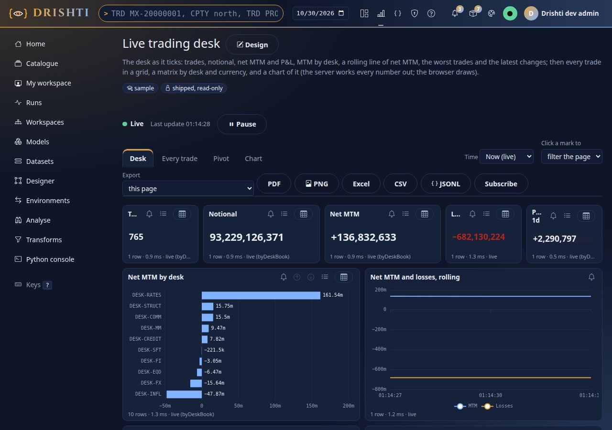

You should see, above the pages, the **live indicator** `Live · Last update 02:28:35` with a **Pause** button (`Listening` when the ticker is off); five
cards (trades, notional, net MTM, losses, one-day P&L), a bar of MTM by desk, and a **rolling line**. Every frame says `live` in its footer, most
of them `live (byDeskBook)`: the layer that answered is the in-memory table, and its kept groups. Watch for a few seconds:

- the **cards** flash when their number changes and the **bars** change length, but the chart is the same chart drawn over (not rebuilt), and a table keeps its scroll position. At most four redraws a second, however fast the source ticks;
- the **rolling line** adds a point on each update and keeps the latest 120: it shows how the numbers moved since you opened the page (the browser keeps the points; the server keeps no history of an aggregate);
- slicers are not redrawn (they keep their open state), but a choice still filters every update.

Press **Pause**.

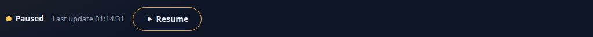

You should see `Paused` and a **Resume** button; the pictures hold still while the server keeps ticking. Press **Resume**.

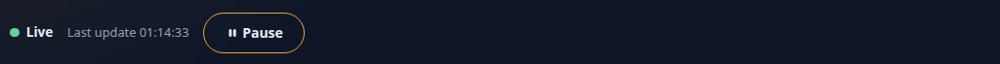

You should see `Live` again and the page **catch up at once** to the table as it is now. If the connection drops (stop the console to see it) the page says so, keeps what it has and redraws everything when the stream is back. The second page, **Every trade**, is a grid of every trade the live table follows:

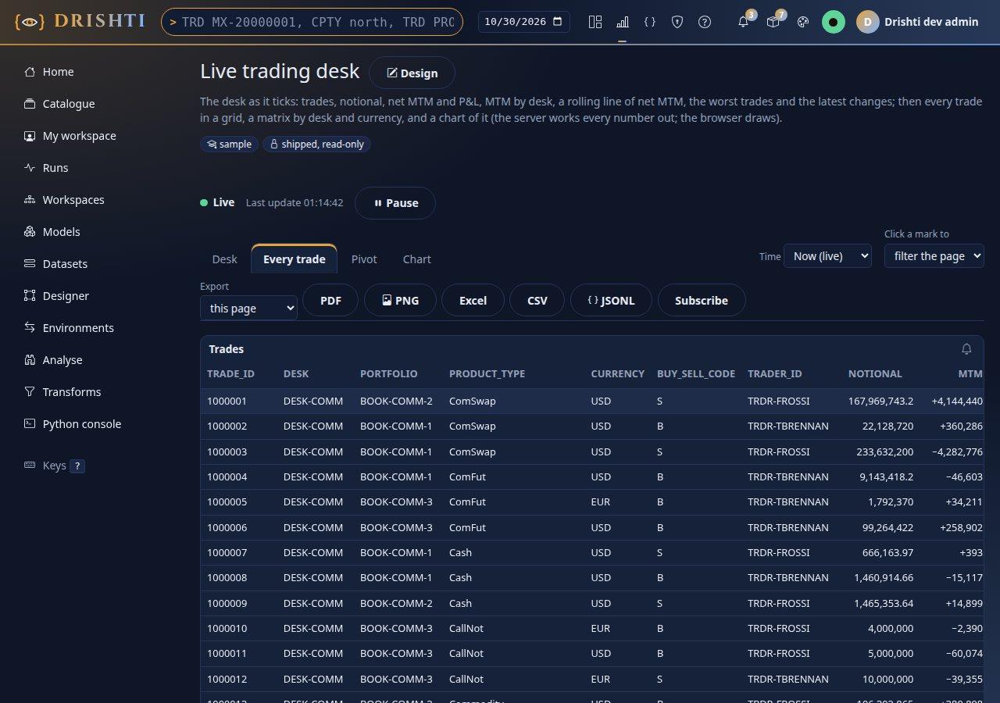

You should see every trade with its id, desk, portfolio, product type, currency, buy/sell code, trader, notional, MTM and P&L, the rows redrawn as they
tick. It is Drishti's own grid of the rows the server sends: no BI page computes anything in the browser (a 2.1 report's `perspective-grid`,
`perspective-pivot` or `perspective-chart` visual is drawn the same way, and the server does the grouping). Everything is **as you**: sign in as someone
whose role does not hold the raw power and the same page shows `•••` in the `TRADER_ID` column on every tick (the dataset's `masked: [TRADER_ID]`),
because each tick makes your page ask again, as you.

**On the command line** one visual of the report is one call, the one the page makes on every tick (`state` holds the slicers and selections; the answer
says the layer, and `live` how the table is doing):

```text
$ curl -s -X POST -H "Authorization: Bearer $DRISHTI_TOKEN" -H 'Content-Type: application/json' -d '{"page":"desk","visual":"by-desk","state":{}}' \
    $DRISHTI_SERVER/api/v1/bi/reports/file:report:live-trading-desk/query
{"columns":[{"name":"trade.DESK","masked":false,"type":"string"},{"name":"MTM","masked":false,"type":"decimal"}],
 "rows":[["DESK-RATES",1.61345431E8],["DESK-STRUCT",1.5637236E7],["DESK-MM",9417173.0], ... ,["DESK-INFL",-4.7557765E7],["DESK-COMM",-4.31780806E8]],"rowCount":10,
 "meta":{"layer":"live","rollup":"byDeskBook","rows":10,"millis":1.2,"cached":false,...,
         "warnings":["live trade: following the first 2000 trade-valuation entities of more (drishti.bi.live.follow-max)"]},"visual":"by-desk",
 "live":{"generation":36,"state":"live","tables":[{"table":"trade","kind":"trade-valuation","state":"live","rows":2000,"applied":18829,...}]}}
```

**The YAML** of the two live visuals of the page (the report is `config/bi/reports/banking/live-trading-desk.report.yaml`): a bar is any bar, the rolling line is
its own type, and nothing says "live" because the dataset does:

```yaml
      - { id: by-desk, type: bar, title: Net MTM by desk, at: { x: 0, y: 2, w: 6, h: 5 }, wells: { axis: [trade.DESK], values: [MTM] } }
      - id: rolling
        type: live-chart               # a rolling line: each update of the table adds a point; the window keeps the latest 120
        title: Net MTM and losses, rolling
        at: { x: 6, y: 2, w: 6, h: 5 }
        wells: { values: [MTM, Losses] }
        format: { window: 120 }
```

### Step 48 · A wall for the desk: a board

A **board** puts the visuals of several reports on one screen. A board is a **report whose pages have `layout: board`**: its tiles are visuals of other
reports, and it may hold its own visuals too ([BI_GUIDE.md › Reports: the YAML, the visuals and how they behave, section 23](#2-boards-report-pages-of-live-tiles)). Open **Catalogue → Desk wall** (`/bi/r/file:report:desk-wall`; the 2.3 address
`/bi/b/file:board:desk-wall` opens it too).

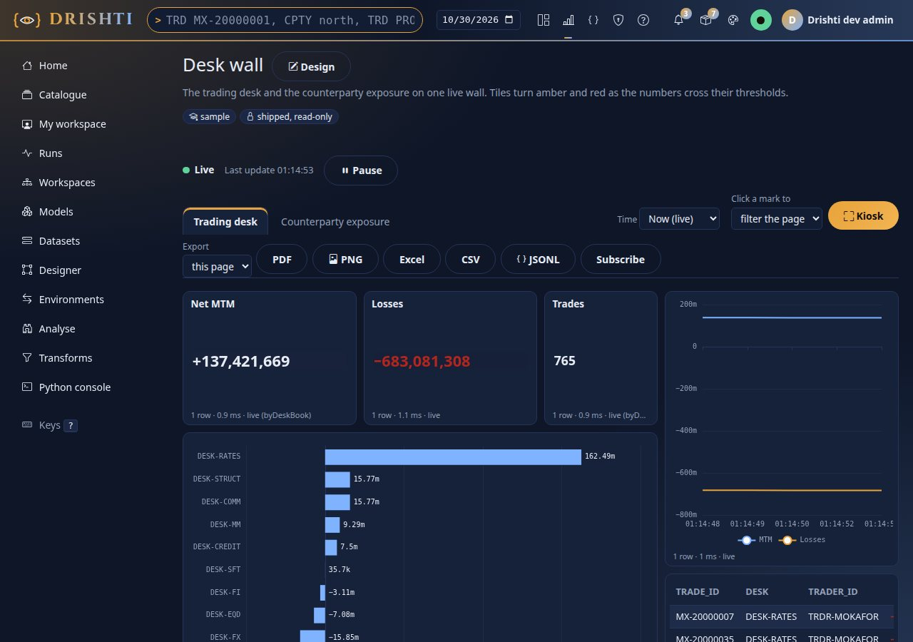

You should see tiles of different sizes: the cards and charts of the Live trading desk, and two tiles outlined in **amber**, *Net MTM* (`-311,235,202` when this was captured; it ticks) and *Losses* (`-1,792,303,610`), whose footers say `warning`. The colour comes from **alert rules of the tiles**, not from the report they show:

```yaml
pages:
  - id: desk
    title: Trading desk
    layout: board
    visuals:
      - id: net-mtm
        type: tile
        title: Net MTM
        from: { report: live-trading-desk, visual: mtm }
        at: { x: 0, y: 0, w: 3, h: 3 }
        alert: { on: MTM, warn: { op: lt, value: 0 }, crit: { op: lt, value: -1000000000 }, hysteresis: 25000000 }
```

A tile is a visual of a report (the report supplies the data, **as the person looking**) placed on a 12-column grid, with an optional `alert`: amber when the `warn` condition holds, red when `crit` does, and the footer says the word as well, so colour is never the only signal. Net MTM below 0 is a warning, below -1 billion critical (Losses: below -1.5 billion, below -2.5 billion);
the live net MTM here (`-310,188,982`) is below 0 but above -1 billion, hence amber, and Losses (`-1,789,927,256`) likewise. A tile that turns red can also **tell people** (`notify:` on its alert; [BI_GUIDE.md › Reports: the YAML, the visuals and how they behave, section 23](#2-boards-report-pages-of-live-tiles) section 4). The second page is another report over another live dataset:

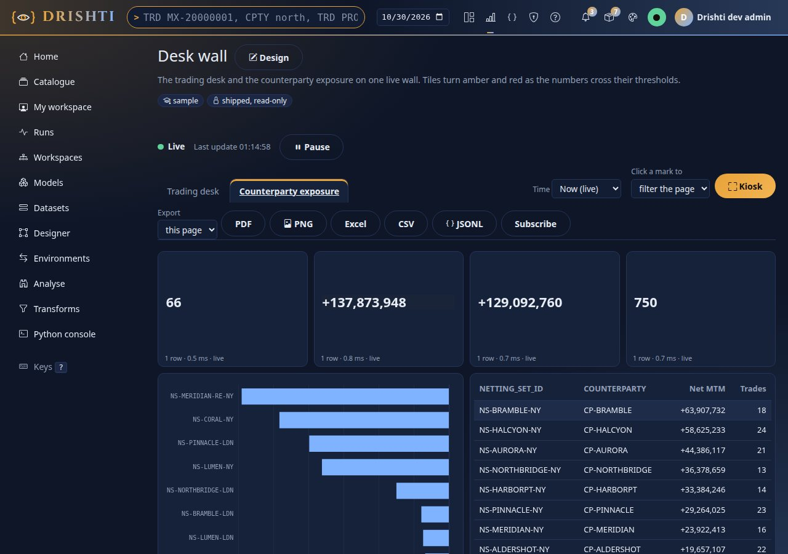

You should see the tab **Counterparty exposure** with tiles from the report *Live exposure*: netting sets, net MTM (red: below -300 million), collateral and the trade count, then the most negative netting sets and those with the largest net MTM. (The EE and PFE peaks are not live tiles: exposure is computed once a day by the exposure engine; the report *Counterparty risk* shows it.) Pages are tabs; a board can hold as many as you like.
**On the command line** the board is a report of the catalogue like any other:

```text
$ python3 tools/drishti.py bi catalogue get file:report:desk-wall
file:report:desk-wall report    promoted  published v1   Desk wall  (Shipped content, shipped)
  The trading desk and the counterparty exposure on one live wall. Tiles turn amber and red as the numbers cross their thresholds.
  tags: sample, trading, counterparty-risk, live, streaming, tutorial   views: 0   audience: {'roles': [], 'users': [], 'packs': []}
```

(`--body` prints its YAML: [config/bi/reports/banking/desk-wall.report.yaml](../../../config/bi/reports/banking/desk-wall.report.yaml).) A board file of 2.3 (`board:` with `tiles:`) is read as such a report; `POST /api/v1/bi/boards/convert` shows the report it becomes, to save as `config/bi/reports/<name>.report.yaml` ([BI_GUIDE.md › Reports: the YAML, the visuals and how they behave, section 12](#26-designing-a-board)).

### Step 49 · Kiosk mode

Go back to the first page and press **Kiosk** (or press `k`, or add `?kiosk=1` to the address, which is how a wall display opens it).

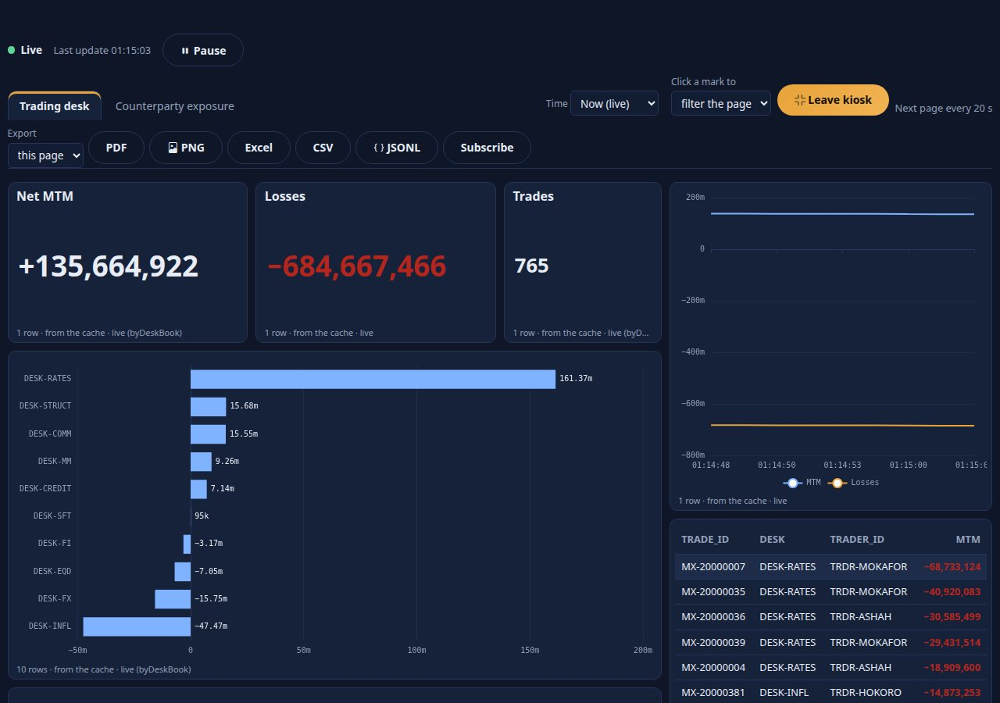

You should see the menus gone and the wall filling the screen: the Net MTM and Losses tiles large, the amber outline and the word `warning` under each, the rolling line, the worst trades and the latest changes, `Live · Last update` and **Next page every 20 s**. The pages turn by themselves
(the report's `board: { rotate }`). Keys: `Esc` leaves kiosk, `p` pauses the live updates (and so the turning), the arrow keys change page. A phone or a TV browser showing `?kiosk=1` is a desk display.
**The YAML** is one line at the top of the report, `board: { rotate: 20s }` (3 seconds to an hour; without it the console's `bi.board.rotate_seconds`, 30); in the designer it is Format with no visual selected, *Kiosk: next page every (seconds)*. There is no command line for kiosk mode: it is how a
browser shows a board, and the address `/bi/r/file:report:desk-wall?kiosk=1` is what a wall display is told to open.

### Step 50 · What a wall screen needs

- **A user for the screen.** The wall shows the data of whoever is signed in. Make a user for it (tutorial 21: users and roles) with the roles you want it to see, and sign the screen in once; a masked field stays masked.
- **The server's clock and calendar.** Dates on the wall are business dates of the server's calendar.
- **A board with a mistake** says what and where: the report's Check (the designer's **Check**, the Studio's **Problems**, `POST /api/v1/bi/reports/validate`) answers `DRS-9052` for a tile that names a report or visual that does not exist or an alert that cannot work, `DRS-9030` for a tile off the grid. A 2.3 board file is checked the old way, `POST /api/v1/bi/boards/validate`; one whose one tile is off the grid and names a visual the report does not have (captured):

```text
$ curl -s -X POST -H "Authorization: Bearer $DRISHTI_TOKEN" -H 'Content-Type: application/json' \
    -d '{"yaml":"rachana: 1\nboard: broken\ntitle: Broken\npages:\n  - id: p\n    title: P\n    tiles:\n      - { id: t, report: live-trading-desk, visual: nope, at: { x: 10, y: 0, w: 4, h: 2 } }\n"}' \
    $DRISHTI_SERVER/api/v1/bi/boards/validate
{"valid":false,"problems":[
  {"level":"error","code":"DRS-9052","path":"pages[0].tiles[0].at","message":"x is 0 to 11 and w is 1 to 12, and x + w is at most 12 (the grid has 12 columns); this is x=10, w=4"},
  {"level":"error","code":"DRS-9052","path":"pages[0].tiles[0].visual","message":"report 'Live trading desk' has no visual 'nope'"}], ...}
```

You should see, once the screen is signed in as that user, the wall with the figures of that user's roles, and nothing the roles mask.

### Step 51 · A line that remembers: the history of a live table

A live table holds only **now**. The rolling line of step 47 collects its points in the browser from the moment the page opened, so a refresh empties it. For a line that is there when the page opens, the dataset can **keep a history**: every ten seconds it works out a few measures over the live table and appends them to a bounded table of its own. The sample dataset says so in its `live:` block:

```yaml
    live:
      rows: 5000
      history:
        every: 10s
        keep: 360                 # an hour of samples
        measures: [MTM, Losses, Trades]
```

Open the **Live trading desk** report again, wait a minute, and scroll to the bottom of the **Desk** page.

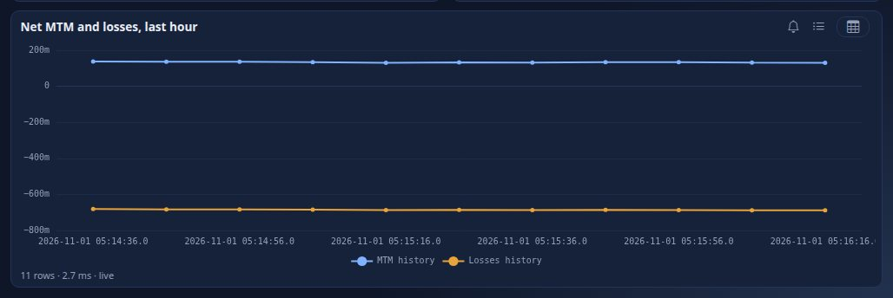

You should see a line titled *Net MTM and losses, last hour* with a point for every ten seconds the dataset has been open (the sample dataset is sampled only while someone has it open, so on a freshly started server the line begins when you opened the page; reload it and the points are still there). The line is an ordinary `line` visual over the dataset table `history`: its axis is `history.ts` and its values are the generated measures `MTM history` and `Losses history`. [BI_GUIDE.md](MODELS_AND_DATASETS_FOR_REPORTS.md#17-live-tables) has the rest (grouping by a column, masks, the limits). **On the command line** the points are one visual's answer (twelve samples, the first two minutes; captured):

```text
$ curl -s -X POST -H "Authorization: Bearer $DRISHTI_TOKEN" -H 'Content-Type: application/json' -d '{"page":"desk","visual":"last-hour","state":{}}' \
    $DRISHTI_SERVER/api/v1/bi/reports/file:report:live-trading-desk/query
{"columns":[{"name":"history.ts","masked":false,"type":"string"},{"name":"MTM history","masked":false,"type":"decimal"},
            {"name":"Losses history","masked":false,"type":"decimal"}],
 "rows":[["2026-10-17 23:08:55.0",-3.10700726E8,-1.790428046E9],["2026-10-17 23:09:05.0",-3.09656725E8,-1.791016081E9], ...,
         ["2026-10-17 23:10:50.0",-3.10440227E8,-1.792199831E9]],"rowCount":12,"meta":{"layer":"live","tables":["history"],...}}
```

The history is a table of the version 1 dataset. The model the converter made carries the history measures but not the `history` table, so the
last-hour line reads the dataset.

### Step 52 · Lay out your own board

So far the board was a file. It is designed like any report, in **BI Studio**: in the Explorer, **New: board** (or **Designer → Boards → Start a board**) makes a report with one empty board page and opens it in the report designer. Choose **tile** in Visualizations (*Board*); in **Format → Tile** pick the report *Live trading desk* and its visual *Net MTM*: the canvas draws the tile **with the report's live numbers**, as you. Two more tiles (*Trades*, *By desk*) and the page is the board below.

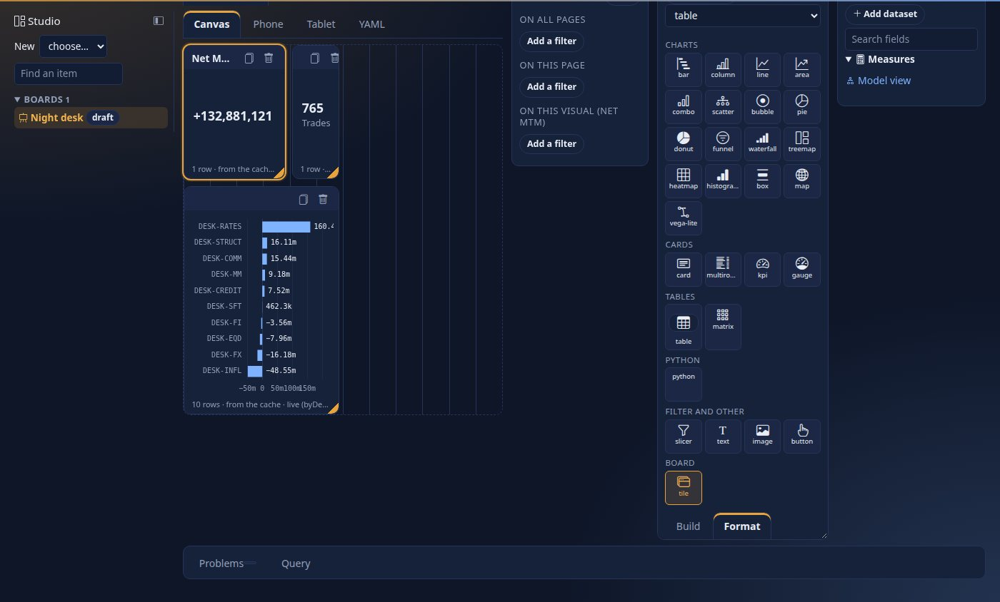

You should see the canvas with the three tiles, drawn with data, the page tabs above it, and on the right **Format → Tile**: the **report** and **visual** the selected tile shows and its **alert**. Drag a tile by its header to move it, drag its corner to resize it, or focus it and use the arrow keys (with Shift to resize). A page becomes a board page by itself when you add a tile; Format with no visual selected shows *Layout: board* and, under *Report*, *Kiosk: next page every (seconds)* (30 here).

The alert of the selected tile:

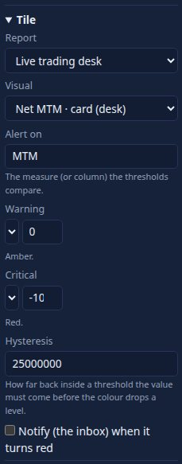

*Net MTM* turns amber below 0 and red below -1 billion (the demo lakes' book is billions: a net MTM of a few hundred million either way is ordinary). The **hysteresis** of 25 million means a red tile stays red until the number is 25 million back above -1 billion, so a number hovering at the edge does not flip the colour (and does not send a message each time). Each change is applied as you make it (Undo steps it back).

The **YAML** tab shows the same report as text; edit either and the other follows.

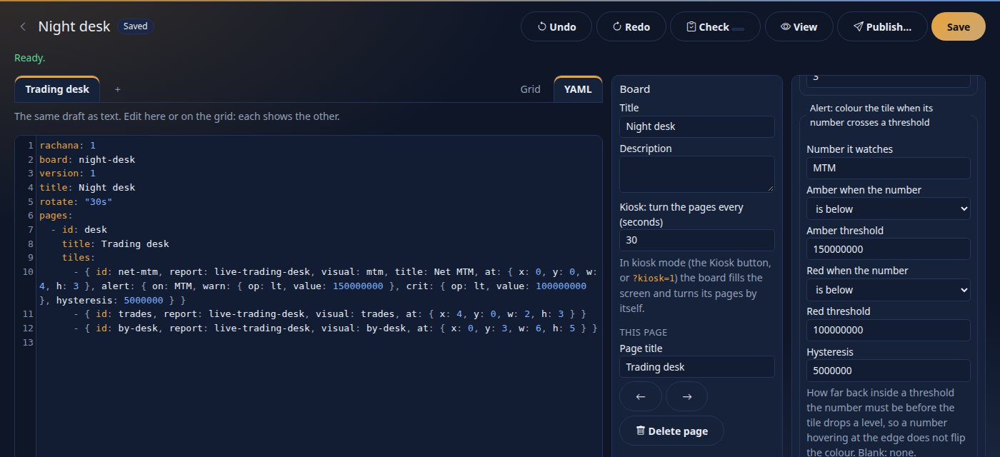

**Save** stores a draft (nothing is published by saving); **View** opens it, Kiosk and all; **Publish** publishes it like any report (Part G); a board whose tile shows a draft report cannot be published until that report is.

| You do | It writes |
|---|---|
| *New: board* | `pages: [{ id: page1, title: Page 1, layout: board, visuals: [] }]` |
| a **tile**, its *Report* and *Visual* | `{ id: net-mtm, type: tile, from: { report: live-trading-desk, visual: mtm }, at: {...} }` |
| *Warning: < 0*, *Critical: < -1000000000*, *Hysteresis: 25000000* | `alert: { on: MTM, warn: { op: lt, value: 0 }, crit: { op: lt, value: -1000000000 }, hysteresis: 25000000 }` |
| *Kiosk: next page every 30* | `board: { rotate: "30s" }` |

**From the command line** the same board is the file [data/night-desk.report.yaml](../../tutorials/data/night-desk.report.yaml), the YAML tab's text:

```yaml
rachana: 1
report: night-desk
board: { rotate: "30s" }
title: Night desk
pages:
  - id: desk
    title: Trading desk
    layout: board
    visuals:
      - id: net-mtm
        type: tile
        title: Net MTM
        from: { report: live-trading-desk, visual: mtm }
        at: { x: 0, y: 0, w: 4, h: 3 }
        alert: { on: MTM, warn: { op: lt, value: 0 }, crit: { op: lt, value: -1000000000 }, hysteresis: 25000000 }
      - { id: trades, type: tile, from: { report: live-trading-desk, visual: trades }, at: { x: 4, y: 0, w: 2, h: 3 } }
      - { id: by-desk, type: tile, from: { report: live-trading-desk, visual: by-desk }, at: { x: 0, y: 3, w: 6, h: 5 } }
```

```text
$ python3 tools/drishti.py bi item new me docs/tutorials/data/night-desk.report.yaml
bi-a57e4089af  report  Night desk  draft in My workspace
```

It opens in the report designer at `/bi/design/<id>`; `bi catalogue publish <id>` publishes it once it is in a shared workspace.

### Step 53 · A chart of the desk by currency, and a wall of Python

The **Live trading desk** report has a fourth page, **Chart**: net MTM per desk, one stacked series per currency. The **Pivot** page before it is the same
question as a matrix. Both are worked out by the server (its standing queries) and only drawn by the browser.


You should see one column per desk, each split into its currencies, redrawn as the trades tick. **The YAML** of the two visuals (the report's **Pivot** and
**Chart** pages):

```yaml
      - id: desk-currency
        type: matrix                    # the server groups and totals: desks down, currencies across
        title: Net MTM and notional by desk and currency
        wells: { rows: [trade.DESK], columns: [trade.CURRENCY], values: [MTM, Notional] }
      - id: mtm-chart
        type: column                    # the same question as a chart: a column per desk, one series per currency, stacked
        title: Net MTM by desk and currency
        wells: { axis: [trade.DESK], legend: [trade.CURRENCY], values: [MTM] }
        format: { stacked: true, labels: false }
```

To chart it another way, copy the report to your workspace, open the copy in the designer and change the visual's type (a bar, a line, a heatmap) or its
wells: the server answers the new question. **On the command line** the chart's numbers are one call, the one the page makes:

```text
$ curl -s -H "Authorization: Bearer $DRISHTI_TOKEN" -H 'Content-Type: application/json' \
    $DRISHTI_SERVER/api/v1/bi/reports/file:report:live-trading-desk/query -d '{"page": "chart", "visual": "mtm-chart", "state": {}}'
{"columns": [{"name": "trade.DESK", "masked": false, "type": "string"}, {"name": "trade.CURRENCY", "masked": false, "type": "string"},
             {"name": "MTM", "masked": false, "type": "decimal"}],
 "rows": [["DESK-RATES", "USD", 103250910.0], ["DESK-RATES", "EUR", 85051243.0], ["DESK-RATES", "AUD", 25689818.0], ...],
 "rowCount": 58, "meta": {"layer": "live", "rows": 58, "cached": false, "masked": [], ...}, ...}
```

A board tile can show a **Python visual** too. Open the sample board **Python wall** from the catalogue (`/bi/r/file:report:python-wall`).


You should see three tiles, each with a line under it (`Python · desk-pnl-volatility v1 · server · ... ms · 10000 rows`): they ran for you, on the rows
you may see of the lake's trade valuations (not the live table), cut to the first 10,000 of the 15,000 (the row limit of a Python visual's inputs: the server
answers `X-Bi-Rows: 10000`; a JSON answer refuses more than 5,000 with `DRS-9022`, so the console asks in Arrow). The Python wall's tiles are visuals of the report **Desk P&L risk (Python)**, which reads the model `trades-basic@1`: a Python measure is a
measure of the model (`Desk P&L volatility: { python: desk-pnl-volatility, inputs: [trade.PNL_1D], by: [trade.DESK] }`), so the board needs nothing new. A Python tile has no amber and red of its own; to be told when a Python measure crosses a limit make an **alert** on it ([the Notebook tutorial](NOTEBOOK_AND_PYTHON.md), step 11).

#### Note: boards and saving

- **UI.** The report designer (where boards are designed) saves from the state it opened: when someone else saved the board first you get **Reload theirs / Save mine as a copy / Overwrite with mine**, and a proposed board opens read-only with a banner. **CLI.** `drishti.py bi catalogue get <id>` shows the item's `etag`; `drishti.py bi item save <id> FILE` writes a new saved state. **YAML.** A report with board pages (BOARDS.md).
