<!--
  Project Drishti · Any data. Any domain. One grammar.

  Copyright (c) 2026 Ashutosh Sinha <ajsinha@gmail.com>.
  All rights reserved.

  PROPRIETARY AND CONFIDENTIAL.

  This file is the confidential and proprietary property of Ashutosh Sinha.
  Unauthorised copying, use, modification, distribution or disclosure of this
  file, via any medium, is strictly prohibited except with the express prior
  written permission of the copyright holder.

  See the LICENSE file in the root of this repository for the full terms.
-->
# Models and datasets for reports

Business intelligence: [Index](README.md) · [Pivot](PIVOT.md) · [Pivot at scale and the risk cubes](PIVOT_SCALE_AND_CUBES.md) · [Tables and models](TABLES_AND_MODELS.md) · [Reports and the designer](REPORTS.md) · [The report file, formatting and statements](REPORT_FILE_FORMAT_STATEMENTS.md) · **Models and datasets for reports** · [Live reports, boards and background runs](LIVE_REPORTS_AND_BOARDS.md) · [Distribution, subscriptions and alerts](DISTRIBUTION_AND_ALERTS.md) · [Governing BI and AI in BI](GOVERNANCE_AND_AI.md) · [The Notebook and Python](NOTEBOOK_AND_PYTHON.md) · [Groupings and analytics](GROUPINGS_AND_ANALYTICS.md)

What a report reads: the Models page, fields, perspectives and the contract, relationships and how a question joins, measures, row rules and masks, layers and refresh, live tables, expected values and worked examples; several facts in one report, with the tutorial.

## Contents

- [Guide](#guide)
  - [1. Models and datasets: what a report reads](#1-models-and-datasets-what-a-report-reads)
- [Tutorial: Several datasets in one report](#tutorial-several-datasets-in-one-report)
  - [Part B · Several datasets in one report](#part-b--several-datasets-in-one-report)

## Guide

### 1. Models and datasets: what a report reads

A report reads **one model** (`model: trading-risk@1`). A model relates **tables** (BI's "datasets") and defines measures, hierarchies,
parameters and tighter security over them; a table is one governed table over a pack kind, a SQL query, a Python transform, a model's
answer or another table. Both are files of the table layer (`config/tables/<domain>/<name>.table.yaml` and `.model.yaml`, `rachana: 3`)
or stored items of kind `table` and `model`, and both are written in **Build › Tables & models** (`/build/tables`), one editor with the live
YAML below it, a preview read as you, "adds up?" from the engine, and review before live. **Every key, check and command of tables and
models is in [BI_GUIDE.md](TABLES_AND_MODELS.md)**; this section is what a report author needs of them, and the BI pages that show them.

BI reads only the table layer's form, and only Rachana in it. A file in BI's older dataset or model form under `config/bi/datasets` or
`config/bi/models` is refused with `DRS-9196`: write it as a table or a model of the layer ([TABLES_AND_MODELS.md](TABLES_AND_MODELS.md)).
A pack carries its BI tables and models as `config/bi/tables/*.table.yaml` and `config/bi/models/*.model.yaml` in the layer's form (**Build →
New pack** writes them).

#### 1.1 The Models page and a table's page

**Models** in the rail (`/bi/models`, *Start from your data*):

* **Tables from the packs.** Every kind of every pack you may open is already a table, with its promoted columns, the vocabulary's meanings
  and the packs' references, certified by its pack, read-only, versioned with the pack. Nobody builds them. A card shows the pack, the time
  mode and the number of columns, and the kind's own description; **Use** starts a report on it at once.
* **Your tables** (the ones you may read, and your drafts) and **Models** (model items you may read).
* **New model** and **New table** open **Build › Tables & models**; **Make it a model** (below) writes a table's implicit model out.

**A table's page** (`/bi/ds/<name>`) says what one row is (*One row per trade per business date*), the keys, the time mode (*snapshot: a
query without a date reads the latest business date with rows*), the source, every column with its type, role, meaning, the kind it
references (`desk →`), its unit, whether it adds up and its default measure, the security, the YAML, its **Refresh** (section 5.6) and its
**Expected values** (section 5.8). Its buttons: **Start a report on it**, **Make it a model**, and **Narrow it** (a table of your own over this
one: extra computed columns, a row filter, more masks; the pack's own stays read-only). **Datasets** in the rail lists the tables reports read,
with their refresh.

**The implicit model.** A report may start from a bare table: its **implicit model** (`model: table:<name>`, or `dataset:<name>`) is the
table as the fact, its pack dimensions one hop away (a trade valuation's `DESK` brings the desk table) and **default measures** (one per
column with an aggregation, `Sum of MTM`, and `Count of <alias>`; amounts formatted `amount2`, counts `integer`). **Make it a model** writes
that implicit model out as a **shared** draft model and binds the report to it; when the workspace already has a model written out from the
same table, the report is bound to that one, and the reports on the same table are offered the move too. A model is shared, never a
per-report copy: deleting a report never touches its model, and a model is **not deleted while anything reads it** (`409 DRS-9004` names
what does; `GET /api/v1/bi/models/{ref}/consumers` lists the reports, boards, notebooks, tables, alerts and live subscriptions that read it).

#### 1.2 Fields, perspectives and the contract

Field properties are written **once, in the model** (`fields:`) and inherited by every report, board and answer on it: each field's
**display name**, **description**, **format**, **folder**, **hidden**, **sort by**, **data category** and **default summarisation**, and
each measure's description, format, folder and hidden. A **perspective** (`perspectives:`) is a named field list for one audience; a report
keeps its choice as `perspective:`. A perspective is a convenience, not security: what a role may not see, the model hides from it
(`hidden-for`), and the server leaves it out of `describe`, SQL and AI (naming it is *not found*).

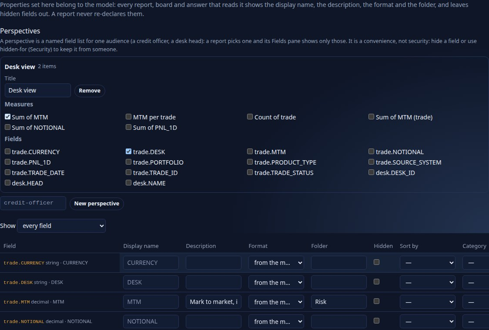

```yaml
measures:
  Sum of MTM: {expr: sum(trade.MTM)}
  MTM per trade: {expr: measure('Sum of MTM') / count(trade.TRADE_ID)}
fields:
  trade.MTM: {description: 'Mark to market, in the trade''s currency', folder: Risk}
  trade.PORTFOLIO: {hidden: true}
perspectives:
  desk-view: {title: Desk view, fields: [trade.DESK], measures: [Sum of MTM]}
```

**The contract.** A model has a semver `version`; reports pin a major (`trades-basic@1`). Each change since the published version needs a
version: removing or redefining a measure, hiding a field or removing a relationship is **major**; adding is **minor**; a description or a
format is **patch**; security needs none (it is audited). A published model refuses a breaking change without a new major (`DRS-9126`), and
the change lists the items that read the published major.

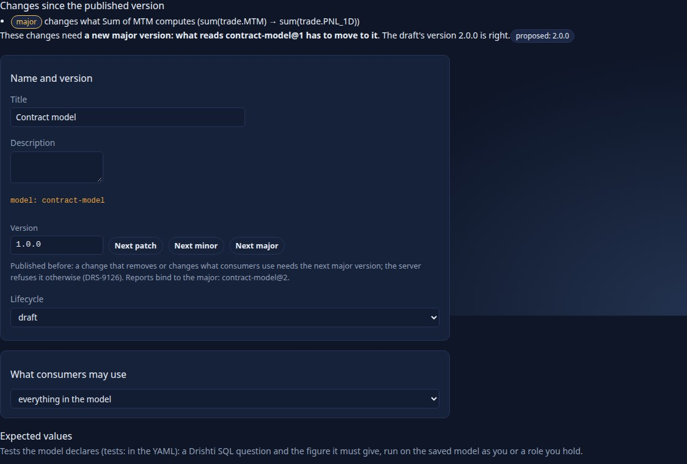

**The security safeguard.** When a role is restricted on one table of a model but no rule restricts another, the model cannot be published
until it is answered (`DRS-9130`): add a rule for that role on the other table, or say so with `may-see-all: { desk: [desk-head] }` (an
audited note). Check also names the readers no row rule matches (`DRS-9131`, a warning: leaving a role out may be the point); such a reader's
answer is empty and says *you have no access to rows of trades in this model: no row rule names your roles*, so the viewer shows that instead
of *No rows for this selection*.

#### 1.3 Relationships and how a question joins

**Many-to-many.** Declare the bridge once; the bridge table's own rows are not repeated into the facts.

```yaml
bridges:
  - name: book_limit_group
    left: books.BOOK_ID
    right: limit_groups.GROUP_ID
    through: book_limit_group        # optional: left-key, right-key, left-name, right-name, left-filter, right-filter
```

A dimension across a bridge filters and groups by a semi-join: a fact row is counted once per value of what is asked, never once per bridge row, so group rows may not add to the total (a book in two groups) and the total is from its own rows. Row rules and masks on the bridge and the far table are applied inside the semi-join, as the reader, before any join; a restricted far table reaches the facts too. A measure that reads a table beyond the bridge is refused in words: bring the column onto the near side with a look-up.

**Both ways.** `direction: both` on a relationship lets a filter on the many side reach the one side; it is read as a semi-join, so a one-side measure is never repeated. A model where a table can reach another by two paths and one of them is both-ways or across a bridge is refused when saved, naming both paths and the fix (`Two filter paths ... make 'cpty_group' inactive and name it with via: ..., or turn off both ways on 'bridge_book'`). A measure names the other path with `via: settle_date`.

A model's relationships go from the many side to the one side (`{ from: trades.DESK, to: desks.id }`), and the packs' links are suggested
for you. A question joins along **active** relationships, many-to-one, `LEFT JOIN`ed from the table the measures aggregate, so a measure is
never counted twice:

* **A measure is aggregated at its own table.** When a question mixes measures of different tables (`MTM` of `trades` and `Exposure (EE peak)`
  of `set_exposure`), each is computed alone at the question's fields and the answers are joined on them, so a "one"-side figure is never
  repeated by the many side. A measure that only combines measures (`measure('MTM') / measure('Exposure (EE peak)')`) is worked out over each
  at its own grain.
* **Several facts in one question.** Facts that share dimensions (trades and limits, both by desk) are not joined to each other: each is
  aggregated alone at the shared fields and the parts are full-outer-joined on them (a null equals a null), so a sector one fact lacks still
  shows with the other's figures. With no fields the totals sit side by side. A filter on a shared dimension reaches every fact.
* **Refused, safely** (`DRS-9020`, `DRS-9156`): a field one fact cannot reach many-to-one; a measure that mixes two unrelated facts in one
  expression; a window measure with another fact; legs and cash flows (siblings under a trade) in one question; and a **row rule that reads
  a fact** the other cannot reach: the question is refused rather than answered with other readers' data.

The pictures show the shipped cross-pack model with its tables and relationships, a relationship drawn back by dragging `PORTFOLIO` of
`trades` onto `id` of `books`, the line in the YAML, and a relationship proposed from the data with its match rate (profiling, no AI;
`drishti.bi.query.infer-min-match`, 0.8; links a pack already declares are never proposed). Relationships are written in the model's
**Tables** tab ([BI_GUIDE.md section 11.3](TABLES_AND_MODELS.md#113-semantic-models)); a model's relationships drive joins and
cross-filtering only and never change a pack.

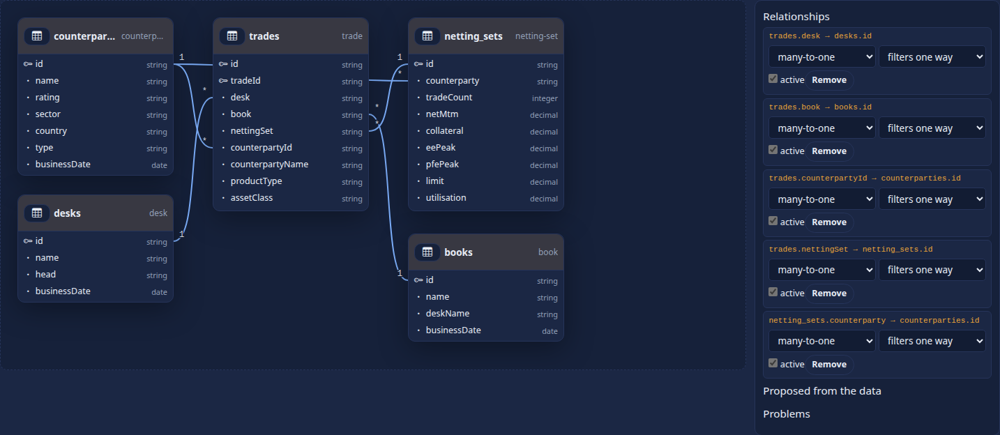

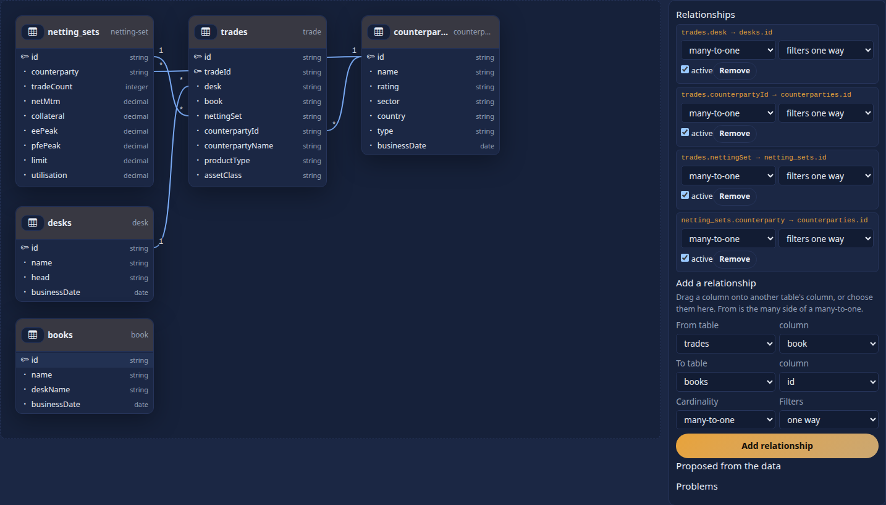

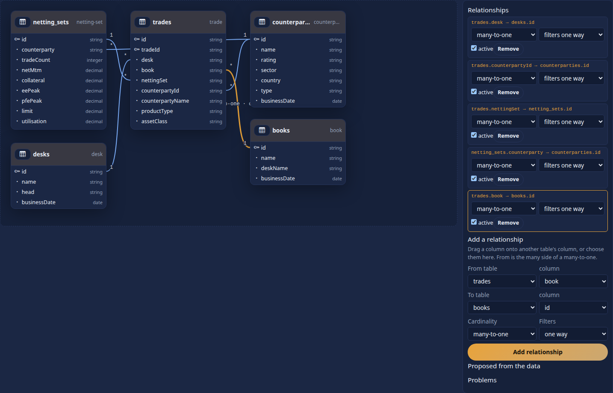

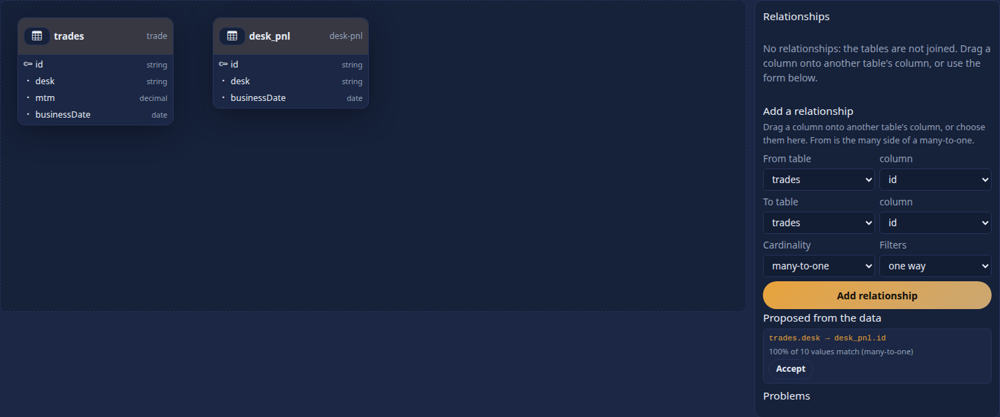

```
trades.DESK → desk_pnl.id  100% of 10 values match (many-to-one)
accepted: { from: trades.DESK, to: desk_pnl.id, cardinality: many-to-one }
```

**A parent and its child kinds.** When `pack new` or the Pack designer makes an array of records a child kind (a trade's `LEGS` as `trade-leg`,
[BUILD_GUIDE section 8.1.4](../BUILD_GUIDE.md#814-child-tables-an-array-of-records-as-a-kind-of-its-own)), it writes a table per kind and a model
relating them into the site's `tables/<pack>/`, and the pack's link graph names the link (`TRADE_ID` is a trade), so a model started from the
packs finds the same relationship ready-made:

```yaml
rachana: 3
model: deals
tables:
  deal:     { table: deals.deals, role: dimension }
  deal_leg: { table: deals.deal_legs, role: fact }
relationships:
  - { from: deal_leg.TRADE_ID, to: deal.TRADE_ID, cardinality: many-to-one, direction: both, name: deal_leg_deal }
measures:
  "Deals": { expr: count(deal) }
  "Deal NOTIONAL": { expr: sum(deal.NOTIONAL), format: amount0 }
  "Deal legs": { expr: count(deal_leg) }
  "Deal leg NOTIONAL": { expr: sum(deal_leg.NOTIONAL), format: amount0 }
```

Each leg joins its deal many-to-one, so *Deal leg NOTIONAL* by `deal_leg.CURRENCY` sums every leg once and by `deal.PRODUCT_TYPE` adds each
leg to its deal's product. Both ways, a filter on the child reaches the parent as a semi-join: *Deals* and *Deal NOTIONAL* with
`deal_leg.CURRENCY = EUR` are the deals **having any** EUR leg, each counted once (a deal with two EUR legs is not counted twice). Two child kinds
of one parent (legs and cash flows) are siblings: one question reads one of them (the rule above).

#### 1.4 Measures: the expression language

Measures are **Rachana** expressions in aggregate scope ([RACHANA_REFERENCE.md › Rachana-EL expressions](../RACHANA_REFERENCE.md#rachana-el-expressions),
every function in [FUNCTIONS.md](../FUNCTIONS.md); filter context and what is refused: [BI_GUIDE.md section 12](TABLES_AND_MODELS.md#12-measures-in-a-model-filter-context-and-what-is-refused)).
They compile to SQL on the server and are never run as code; every value is a bound parameter. The expression editor completes fields,
measures (writing `measure('…')`), functions with their signature and an example, and named arguments, shows the server's problems as you
type with the fix as a button, and **Try it** answers on the saved draft, as you.

```yaml
measures:
  Notional:   { expr: "sum(trades.NOTIONAL)", format: amount0 }
  MTM per 1m: { expr: "ratio(sum(trades.MTM), sum(trades.NOTIONAL)) * 1000000" }
  Share:      { expr: "measure('MTM') / measure('Notional')" }
  Open MTM:   { expr: "calc(sum(trades.MTM), where = trades.TRADE_STATUS != 'MATURED' && trades.TRADE_STATUS != null)" }
  MTM ytd:    { expr: "ytd(sum(trades.MTM), trades.TRADE_DATE)" }
  MTM rank:   { expr: "rank(sum(trades.MTM))" }
  MTM 3-day average: { expr: "moving_avg(sum(trades.MTM), 3, trades.TRADE_DATE)" }
  Day on day: { expr: "sum(trades.MTM) - lag(sum(trades.MTM), 1, trades.TRADE_DATE)" }
```

A measure must aggregate (a column outside an aggregate is `DRS-9127`, *wrap it: `sum(trades.MTM)`*). What a report author needs to know of
the families:

* **Time intelligence** (`ytd`, `mtd`, `qtd`, `prior_period`, `same_period_last_year`, `running`) restricts **the rows the question reads**,
  ending on the as-of date (the end of the question's dates, else the newest date read); `prior_period` and `same_period_last_year` follow
  the pack's business-day calendar. With partitions that hold only each day's rows, the report's dates must reach back to the start of the
  window. `running` needs the date as a **field** of the visual, cannot be filtered on, and takes one `sum`, `count`, `min` or `max`. A rollup
  cannot hold a time measure.
* **Window functions** (`lag`, `lead`, `rank`, `dense_rank`, `percent_rank`, `moving_avg`, `moving_sum`, `moving_min`, `moving_max`,
  `cumulative`) are worked out **over the rows the question returns**, after the reader's row rules, filters and grouping, so a rank is a rank
  among the rows this reader may see. The order column must be a field of the visual; a window cannot be filtered on; a "row" is a row of the
  visual, not a calendar day (`lag(..., 1, trades.TRADE_DATE)` is the previous date that has trades).
* **Filter context** (`calc`, `share_of`, `parent_of`, `as_of`): security is never in scope, so `share_of(…, over = ALL)` is a share of
  everything **you** may see. The Fields pane badges a measure that uses time intelligence or a window (`ytd`, `running total`, ...).

#### 1.5 Row rules and masks in practice

Who sees which rows and fields is set on the tables and tightened by the model ([BI_GUIDE.md section 7](TABLES_AND_MODELS.md#7-who-sees-what)).
For a report it means:

* **Row rules** run on the server, for each reader, as a predicate the question cannot remove. A reader gets the rows any of their rules
  allows; a reader no rule names gets **no rows**, and the answer says why. `user.desks` is strict: a desk head with no desks sees no trades.
* **Masks** apply to readers without the `raw` power, **before aggregation**: a masked field reads `•••` in every row and is **not grouped
  on** (its values cannot be told apart, so a bar by a masked name is one bar); a measure over a masked column is `null`; a filter or sort on
  a masked column is refused (`403 DRS-9021` in a report, `DRS-9161` in a model query).
* **Fail closed.** If a visual's measures cannot reach a rule's table many-to-one, that visual answers `DRS-9020`, naming the rule, rather
  than other readers' data.

#### 1.6 Layers, rollups and refresh

A table is answered from the smallest layer that covers the question: a model's **rollup** (per-date components of its measures at a coarser
grain: sums, counts, minimums and maximums; `avg` as a sum and a count), else the **columns layer** (typed Parquet per business date, built on
the first question and again when a data-load signal names the date), else the **source** itself. Every answer says which (`layer`,
`rollup`); `"layer": "columns"` in a question forces the columns layer. A rollup answers a question of one table whose fields, filters and
row-rule columns are among its `by` columns and whose measures it holds; `distinct`, `percentile`, a condition inside an aggregate and
time measures are not rollup material. A heavy question asked often is offered as a rollup (section 15.14).

**Refresh.** A data-load signal for a kind ([DATA_GUIDE.md](../DATA_GUIDE.md#1-telling-drishti-new-data-has-landed)) rebuilds that date of every
published table that reads it, and only that date. `refresh:` on a table says when it is rebuilt on its own: `daily 06:00`, `weekdays 18:30`,
**`business-days 07:30`** (the pack's holiday calendar), `weekly mon 07:00`, `monthly last 18:00 business`, `hourly`, a cron, or
**`after-load`** (optionally `after-load trade`). Times are in the business-date zone. A refresh builds the current business date; when the
source holds nothing for it, it builds the **latest date the source holds** and says so (`warning: 0 rows for 2026-10-14; latest data
2026-10-09`). A failed refresh is retried with the shared retry policy (`drishti.retry.bi.*`), then `failed` until its next time.

The table page's **Refresh** section lists the schedule, the status (`never`, `waiting`, `running`, `ok`, `retrying`, `failed`, `invalid`),
the last and next refresh, rows, time and failures, **Recent refreshes** (when, started by, result, date, rows, time, error), **Refresh now**
for `bi-author` (audited `bi-dataset-refresh`) and **Set a schedule** for a table with none. The state survives a restart; a time missed
while the server was down runs once at start (`schedule (catch-up)`). From the command line: `drishti.py bi dataset refresh ID --now`; over
the API: `GET` and `POST /api/v1/bi/datasets/{id}/refresh`.

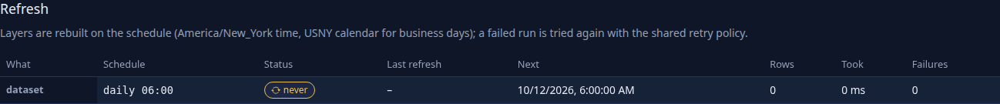

#### 1.7 Live tables

A table with `materialize: { live: { rows, age } }` is the **current state of a kind**, kept in memory and updated by key as the source
pushes changes ([BI_GUIDE.md section 6](TABLES_AND_MODELS.md#6-materialisation)); reports and boards over it redraw as it changes
(section 13). What a report author sees:

* A batch of changes is applied in one step, so a question never sees half a batch; a model's **rollups over a live table are kept by group**
  as rows change (a sum or count moves by the difference; a minimum or maximum is read again when the row that held it changes).
* **Retention:** `rows` bounds the table (the rows changed longest ago go first; `drishti.bi.live.max-rows` is the ceiling) and `age` drops rows
  that have not changed for that long. Every live table also has `updateSeq` and `updatedAt`.
* **History:** a live table holds only now, so a model's `history:` samples chosen measures every few seconds into a bounded table
  (`history.ts` and one column per measure, with a generated `<measure> history` measure): a line of net MTM over the last hour is
  `axis: [history.ts], values: [MTM history]`. It lives while the table runs and starts empty after a restart; a reader whose role has a row
  rule on the live table is refused the history (`DRS-9020`), since it cannot be filtered by that rule.
* **How it is doing:** the table page's **Layers** table (and `GET /api/v1/bi/datasets/{id}/layers`) shows each live table's `state`
  (`starting`, `live`, `stale`, `failed`, `closed`), rows, entities followed and how many push, and the last change. A connector that cannot
  push is read again every `drishti.bi.live.resync` (`pushes: false`). A table nobody uses for `drishti.bi.live.idle-close` (10 minutes) is
  closed and starts again on the next use.

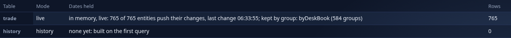

#### 1.8 Expected values: `tests:`

A table, a model or a report may declare what a number should be. **Check** runs the tests (the table page's *Expected values*, the designer's
Check, `POST /api/v1/bi/items/{id}/tests`, `drishti.py bi item tests ID`), and **publishing is refused while one fails** (`409 DRS-9043`)
unless a `bi-admin` forces it.

```yaml
tests:
  - name: The book holds 15,000 valuations
    measure: Trades
    expect: 15000                               # a number, a range { min, max } or [low, high]
  - { name: Rates desk, measure: MTM, by: [trades.DESK], row: { trades.DESK: DESK-RATES }, expect: 4108728089.5, tolerance: 0.5% }
  - { name: USD only, measure: Notional, filters: [{ field: trades.CURRENCY, op: eq, values: [USD] }], expect: { min: 1000000 } }
```

`by` groups the answer and `row` picks one row (without it the answer must be one row); `filters` are report filters; `date` is the business
date; `tolerance` widens a number or a range; `role` runs the test as a role. Each result is `pass`, `fail` (with the figure found) or `error`
(why it could not run). A report's tests are in section 9.12.

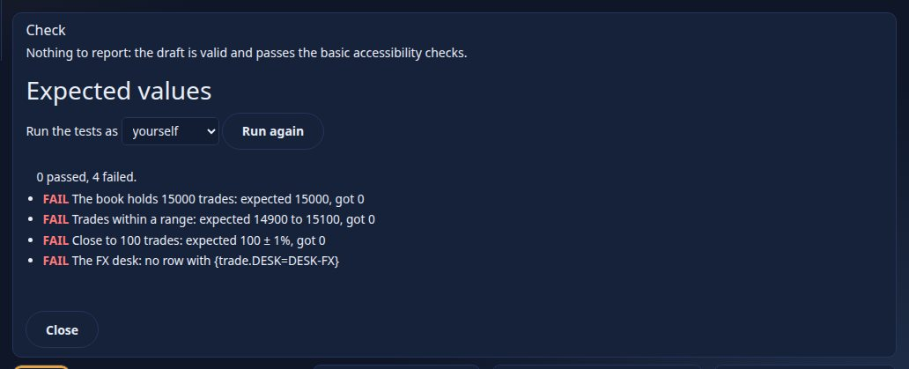

#### 1.9 Worked examples: the shipped models, row rules and masks

The tutorials teach reports in order. This section keeps the recipes they do not repeat: a stack with four people so row rules and masks can
be seen at work, and the shipped models queried. Every answer was captured over the **demo lakes** (`drishti.py lake demo`: sixty business
days of the packs, 5,000 trades for each of ENDUR, CALYPSO and MUREX, 15,000 trade valuations a day), which end on today's business date, so
your dates and some figures differ.

| Sample model | What it teaches | Tables (aliases) |
|---|---|---|
| `trades-basic` | the "hello world": one table, four measures, a computed column, a hierarchy | `trade` (the trade valuations) |
| `trading-risk` | three packs, relationships from the packs' links, a rollup, a row rule, masks, window and time measures, the exposure facts | `trades`, `netting_sets`, `set_exposure`, `cpty_exposure`, `counterparties`, `desks`, `books` |
| `trading-cashflows` | nested documents: legs, cash flows and payments as tables of the trades of three source systems | `trades`, `legs`, `cashflows`, `payments` |

##### Set up

The quick start of [data/testdata/README.md](../../../data/testdata/README.md) (clone, install, `lake demo`, start, open), or with the IDE's run
configurations **Build demo lakes**, **Drishti server (demo lakes)** and **Drishti console**. From a terminal at the repository root:

Run these from the Drishti folder (the repository root, or the install folder of a release).

```bash
drishti-console/.venv/bin/python tools/drishti.py lake demo
DRISHTI_DEMO_ENABLED=false DRISHTI_SECURITY_ENABLED=true DRISHTI_TOKEN_SECRET=drishti-dev-only-token-secret-change-me-0123456789 \
  DRISHTI_SEED_ADMIN=true DRISHTI_SEED_USERNAME=drishti-dev-admin DRISHTI_SEED_PASSWORD=drishti-dev-admin123 \
  java -Xmx4g -jar lib/drishti-server-*-exec.jar
drishti-console/.venv/bin/python drishti-console/run_drishti_web.py --server.port=17480 --backend.url=http://127.0.0.1:18480
```

Open http://localhost:17480 and sign in as `drishti-dev-admin` / `drishti-dev-admin123` ([OPERATIONS_GUIDE.md](../OPERATIONS_GUIDE.md#2-install-and-run-on-one-machine)). Then make
four people (the models' row rules name these roles: `desk-head` sees `DESK in user.desks`; `risk`, `analyst` and `admin` see every row):

1. **Admin → Roles → New role** where one is missing: `bi-writer`, `risk`, `desk-head`, `analyst` (tick **Opens every kind**, and **See every
   field unmasked**, the raw power, for `bi-writer` and `risk` only).
2. **Admin → BI settings**: tick `bi` for `risk`, `desk-head` and `analyst`, and `bi` and `bi-author` for `bi-writer`, **Save** on each row.
3. **Admin → Users → New user**, four times: `wes` (`bi-writer`), `rita` (`risk`), `hana` (`desk-head`, **Desk** `DESK-FX`), `ann` (`analyst`),
   each with a password of at least ten characters with letters and digits, *Must change at first sign-in* unticked.

So **wes** writes, **rita** sees everything, **hana** is a desk head without raw, **ann** an analyst without raw
(`drishti-console/tests/bi_data_stack.py` does the same by API). Use a second browser or a private window to be two people at once.

##### The Models page and `trades-basic`

`BI <GO>`, then **Models** (and **Datasets**) in the rail. The samples show as *promoted* and *sample*. `GET /api/v1/bi/models` lists what you
may read; `drishti.py bi model list` prints it; `drishti.py bi model describe trading-risk` prints every table, column and measure.

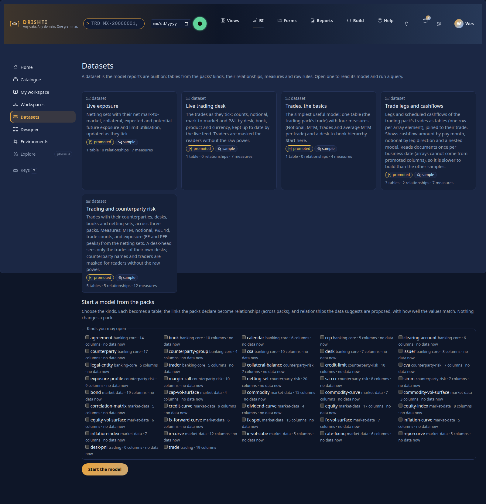

Open **Trades, the basics**: its table with every column and type, the measures with their expressions, the security and the layers.
`config/tables/banking/trades-basic.model.yaml` and `trades_basic_trade.table.yaml` explain each part in comments.

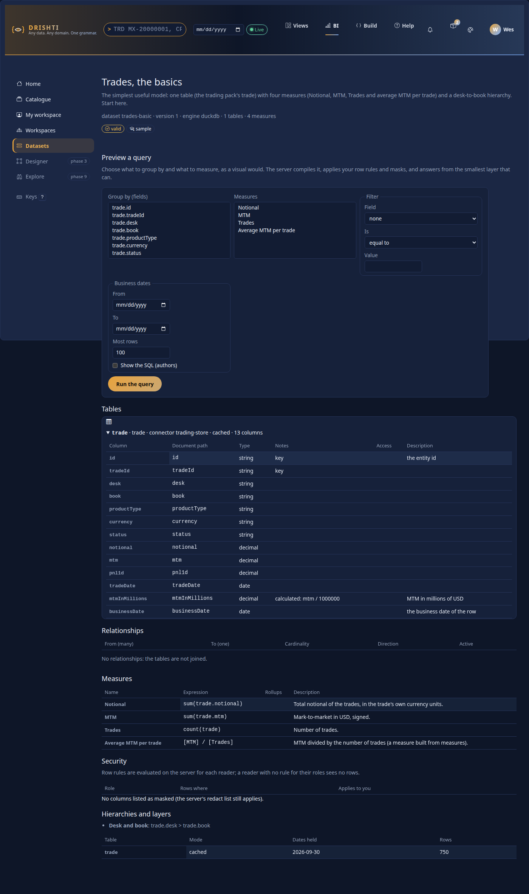

Group by `trade.DESK`, measures *Notional*, *MTM*, *Trades*, *Average MTM per trade*:

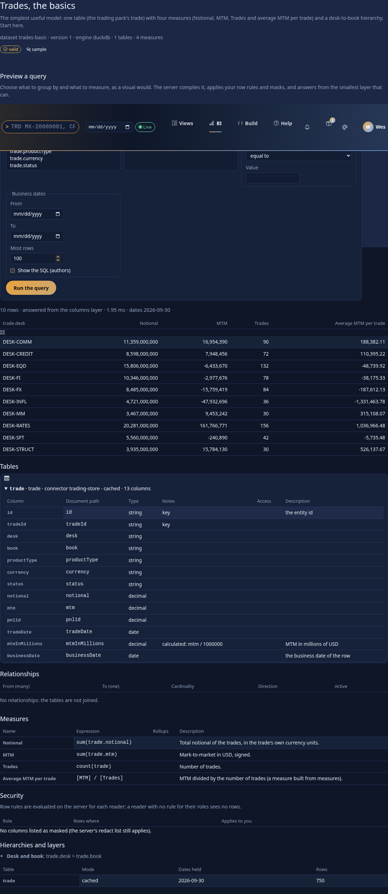

```
POST /api/v1/bi/mq
{"mq": 1, "model": "trades-basic@1", "select": {"fields": ["trade.DESK"], "measures": ["Notional", "MTM", "Trades", "Average MTM per trade"]}}

DESK-COMM     885,017,001,985.25   -395,383,250.53   5990     -66,007.22
DESK-CREDIT   348,350,245,514.15    386,059,702.75   1172     329,402.48
DESK-EQD      430,529,717,922.53    -85,763,784.34   1452     -59,065.97
...                                                                       (10 rows)
meta: asOf=2026-10-26, layer=columns, 10.6 ms, cached=false
```

From a terminal: `drishti.py bi mq --model trades-basic@1 --select trade.DESK --measures Notional,MTM,Trades`, or in SQL,
`drishti.py bi sql "SELECT trade.DESK, MEASURE('MTM') FROM trade GROUP BY trade.DESK" --model trades-basic@1`. The first question built the
columns layer; ask again and the result cache answers (`cached: true`). `time: {as-of: "2026-10-15"}` (a report's date picker) asks another
day. `options: {explain: true}` shows the compiled SQL to an author: names quoted from the model, **no value in the text**.

##### `trading-risk`: relationships from the packs' links

Its tables read three connectors in three packs (`risk-store`, `reference-store`, `credit-store`), joined by the links the packs declare.

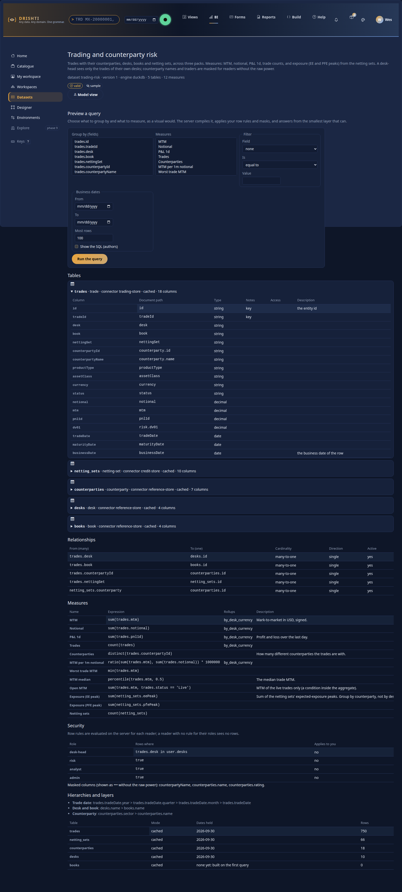

Grouped by `desks.NAME` (a column of another pack's table), *MTM*, *Notional*, *Trades*, *Counterparties* (a distinct count):

```
Bonds and securitised          -30,588,339.35     403,150,156,232.97   1248   18
Commodities                   -395,383,250.53     885,017,001,985.25   5990   24
G10 and EM FX                 -681,989,221.57     372,842,213,118.35   1428   17
...                                                                              (10 rows)
```

Exposure by counterparty (a measure of the exposure facts by a column of the counterparties), the five largest:

```
{"mq": 1, "model": "trading-risk@1", "select": {"fields": ["counterparties.NAME"], "measures": ["Exposure (EE peak)", "Netting sets"]},
 "sort": [{"by": "Exposure (EE peak)", "desc": true}], "limit": 5}
Verdant Agri Holdings           303,824,105   4
Aldershot Pension Trust         278,109,475   4
...
```

The model's rollup `by_desk_currency` answers a question by `trades.DESK` and `trades.CURRENCY` (`meta: layer=rollup, rollup=by_desk_currency`);
`"options": {"layer": "columns"}` gives the same numbers from the columns layer. The window measures it ships rank the desks
(`DESK-RATES 4,108,728,089.50 1`, `DESK-MM 393,805,216.87 2`, ...) and smooth MTM by trade date.

##### Row rules and masks with three readers

The same question, by `desks.NAME`, *MTM*, *Trades*, *Counterparties*:

**rita** (risk, raw): all ten desks.

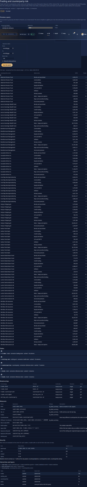

**hana** (desk head, desk `DESK-FX`, no raw): one row, her desk. She did not filter; the rule did, on the server. Her *Counterparties* is null:
a distinct count of a masked column.

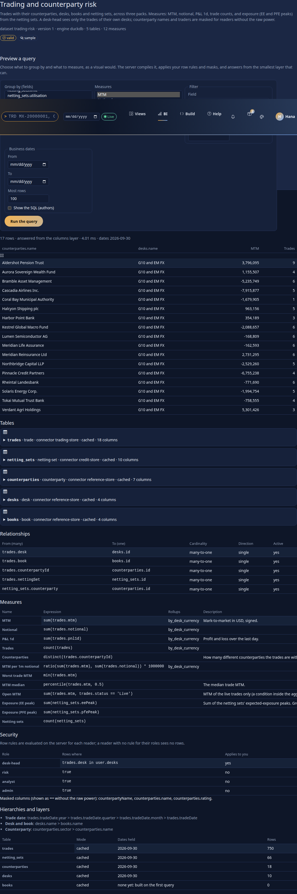

```
G10 and EM FX   -681,989,221.57   1428   null        meta: masked=[Counterparties], warnings=["measure Counterparties is masked"]
```

**ann** (analyst, no raw): every desk, *Counterparties* null. Grouped by `counterparties.NAME`, one row `•••` with every trade in it; a filter
on it is refused:

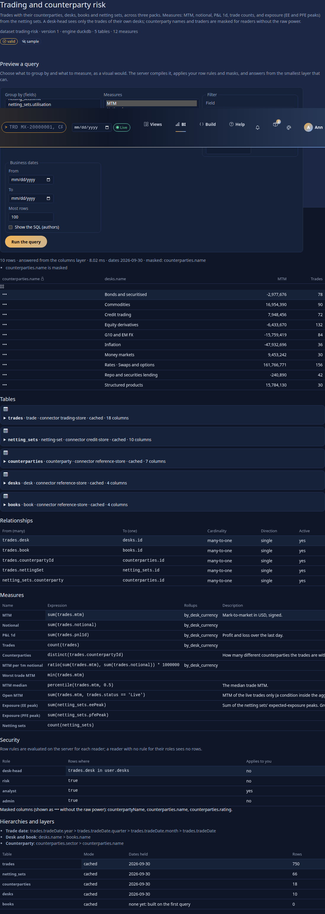

```
403 DRS-9161 'counterparties.NAME' is masked for you: it cannot be filtered on      (a report's visual says DRS-9021)
```

Hana's exposure by counterparty is answered over every netting set (the model's `may-see-all` lets a desk head see every netting set and
counterparty) and is one row `•••`, since the names are masked for her. Without that note the rule on `trades` would be joined into her
question, netting sets do not reach trades many-to-one, and it would be **refused** (`422 DRS-9020`).

##### `trading-cashflows`: legs, cash flows and payments

A trade document holds arrays; a table over an array has one row per element. By payment month:

```
{"mq": 1, "model": "trading-cashflows@1", "select": {"fields": ["cashflows.PAYMENT_DATE.month"], "measures": ["Scheduled notional", "Cashflows"]}}
 1   2,037,997,887,202.71   12381       6   3,109,379,357,636.66   15328
 2   2,839,968,374,336.31   16672       7   2,298,276,593,510.71   13332
...
```

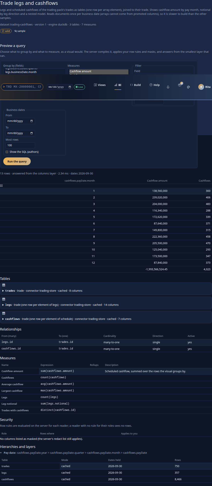

Cash flows by `trades.SOURCE_SYSTEM` join many-to-one to the trades (`CALYPSO 40713 5000`, `ENDUR 65928 5000`, `MUREX 75823 5000`). A leg
column with a cash-flow measure would repeat each cash flow once per leg, and is refused (`422 DRS-9156 ... no relationship path joining
[legs, cashflows] ... Group by a field they all reach`).

##### Change a measure in a copy, and a definition that is wrong

Shipped files are read-only: open one in **Build › Tables & models**, **Copy as a draft**, add a measure such as
`Big trades: { expr: "calc(sum(trade.NOTIONAL), where = trade.NOTIONAL > 100000000)" }`, save, and ask it by `trade.DESK`. Your draft is yours until
published. A mistake is answered with its code and the names that exist:

```
drishti.py bi expr validate "sum(trades.notional)" --model trading-risk
INVALID  (del2, aggregate scope, type any)
  error   DRS-9152  at 4-19: no field 'trades.notional'; did you mean trades.NOTIONAL?
```

##### Start a model from the packs

Choose kinds (here [`trade-valuation`](../../contracts/samples/market-risk.md#trade-valuation) ([contract](../../contracts/packs/market-risk.md#tval-trade-valuation-trade-valuation)), `desk`, `counterparty`, [`netting-set`](../../contracts/samples/counterparty-risk.md#netting-set) ([contract](../../contracts/packs/counterparty-risk.md#nset-netting-set-netting-set))): each is a pack table, **the packs' link graph becomes
relationships, across packs**, and relationships the data suggests are proposed with their match rate.

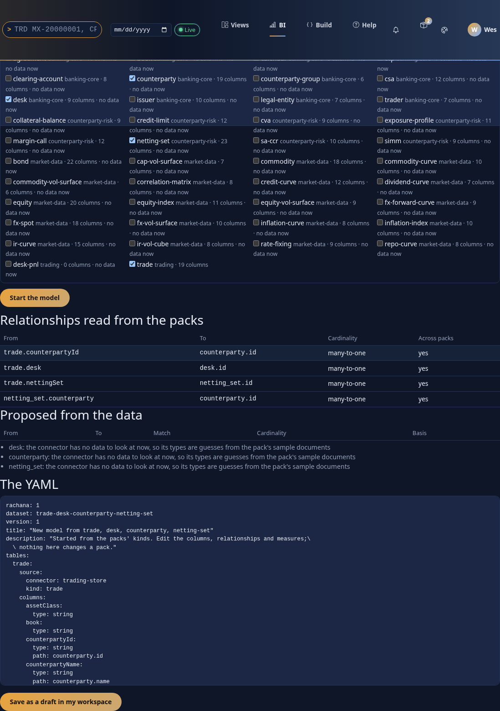

```
relationships read from the packs (all cross-pack):
  trade_valuation.COUNTERPARTY -> counterparty      many-to-one
  trade_valuation.DESK         -> desk              many-to-one
  trade_valuation.NETTING_SET  -> netting_set       many-to-one
  netting_set.COUNTERPARTY     -> counterparty      many-to-one
proposed from the data: none (the packs declare every link between these four)
```

The pages work at 390 px: the rail scrolls sideways, forms stack, tables scroll inside their frame, targets are 44 px.

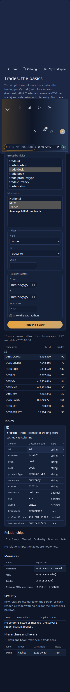

#### 1.10 A table of your own, step by step

For what a pack does not give, a table of your own narrows a pack table (`from:` another table, with a filter, a grain, computed columns and
masks) or reads another source: a SQL query in a SQL connector, a Python transform, a model's answer, or a **Drishti SQL** statement over a
model. **Build › Tables & models → + New** walks through it with the server's checks beside each step ([BI_GUIDE.md section 11.2](TABLES_AND_MODELS.md#112-tables-and-virtual-tables)).
The pictures show the steps of a narrowed trade table: the rows kept (the editor completing a column), what one row is and which duplicate
wins (never a silent distinct), a computed column, a grouping to one row per desk, the server's preview as you, and the save with the masked
columns; then a table whose source is a SQL statement over a model, and its preview.

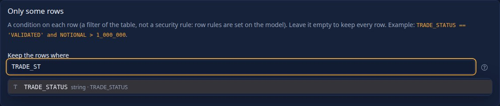

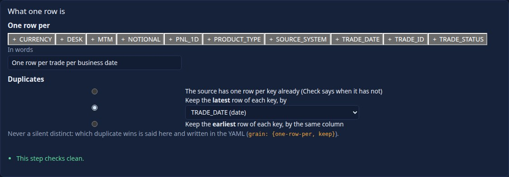

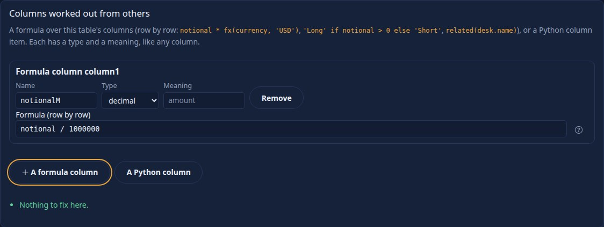

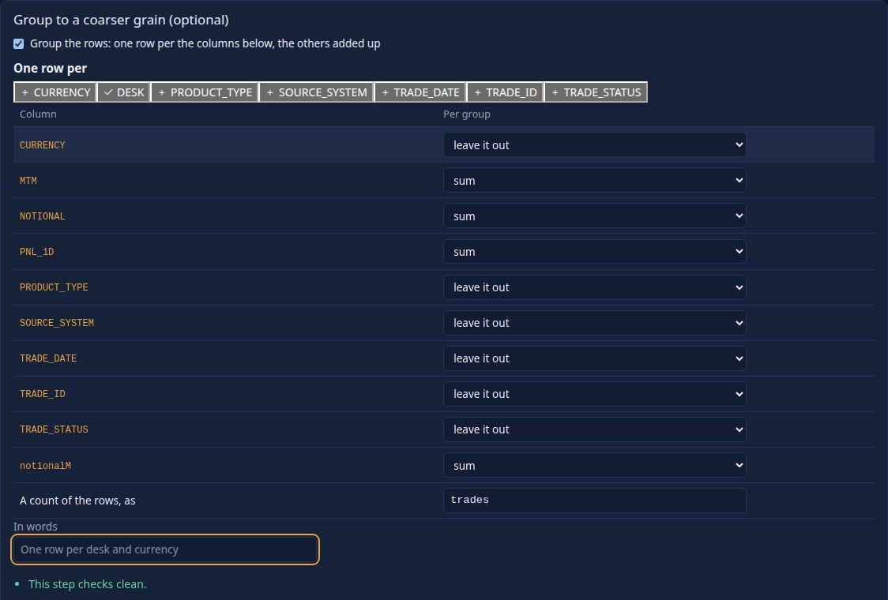

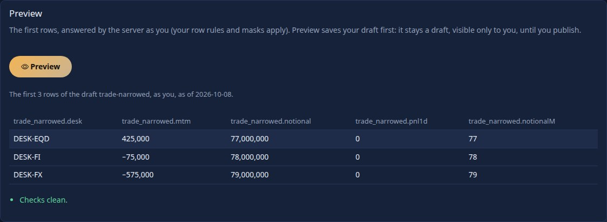

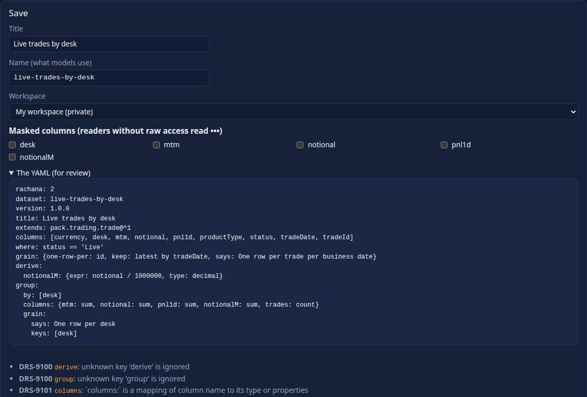

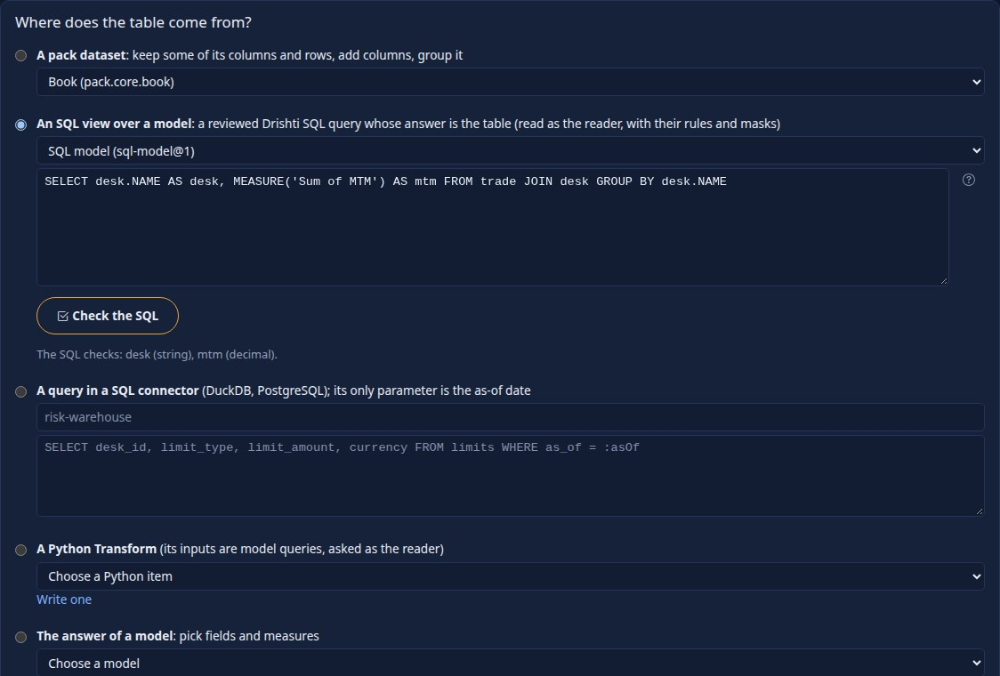

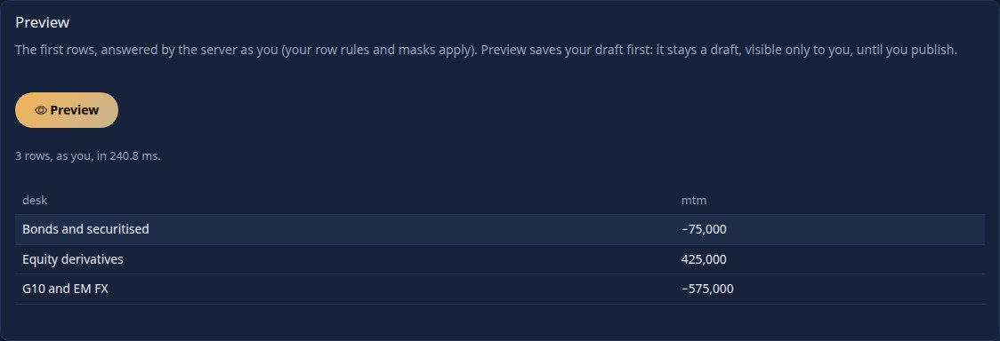

Check a row filter or a formula before you save it, against a table's implicit model:

```bash
drishti.py bi expr validate "TRADE_STATUS != 'MATURED'" --scope row --model dataset:pack.market-risk.trade-valuation
drishti.py bi expr validate "NOTIONAL / 1000000" --scope row --model dataset:pack.market-risk.trade-valuation
```

#### 1.11 A run's result as a table snapshot

A finished background run of a model query or SQL statement can be **promoted** (section 15.10): its result is frozen as a snapshot and
becomes a draft table (and optionally a draft report on it) you build on.

```yaml
rachana: 3
table: bi.desk_pnl_2026
version: 1.0.0
title: "Desk P&L 2026 (snapshot of run r-java-1-01JA…, as of 2026-09-30)"
from: { run: desk-pnl-2026, params: { version: 1, token: 9f3c… } }   # the snapshot, pinned to a version; the token binds it to this table
columns:
  desk:   { type: string, title: "trades.desk", role: dimension }
  pnl:    { type: decimal, title: "PnL", role: amount, aggregate: sum }
  trader: { type: string, title: "trades.trader", masked: true, role: dimension }   # masked for the promoter: masked always
keys: [desk, trader]
provenance: { run: "r-java-1-01JA…", computedAs: "ajsinha", asOf: "2026-09-30" }
```

* **The rows are what the promoter could see.** A column masked for them holds the mask and is declared `masked`, so it stays masked for every
  reader; their row rules are baked in. Add `rules:` for readers on top.
* **It is a draft** until reviewed and published; the reviewer sees `provenance` (whose rights computed it).
* **Only this table reads the snapshot** (another gets `DRS-9108`). Promoting again under the same name is version N+1; the newest
  `promote.versions-keep` (5, `config/runs/runs.yaml`) are kept, outside the result store's budget; `promote.enabled: false` turns it off.

## Tutorial: Several datasets in one report

Models over more than one fact table: the two datasets and their grains, one model with two facts, MTM and exposure in one visual, why Drishti does not join rows across facts, a measure over two facts, a dataset made by a Python Transform, and each reader's own rows. Every step shows the UI, the command line where there is one, and the YAML.

### Time to complete

- Part B · Several datasets in one report: About 60 minutes.

### Before you start

The environment, the sign-in and the token are those of [Reports, Before you start](REPORTS.md#before-you-start).

**Part B · Several datasets in one report.**

- [Part A](REPORTS.md#part-a--your-first-bi-report) done (reports, workspaces, models)
  and [the Notebook tutorial](NOTEBOOK_AND_PYTHON.md) for Python and the Notebook. You sign in as the development administrator, who holds `bi-author`.
- Step 21 uses two colleagues; make them in **Admin → Users** ([tutorial 21](../../tutorials/21-run-it-in-production.md)): `rita` with a role `risk` (raw power on, BI power `bi`), and `hana` with a role `desk-head` (raw power **off**, BI power `bi`) and **Desk** `DESK-FX`.
- A shared workspace called **Exposure desk** (**Workspaces → New workspace**): a model and a report are published from a shared workspace; a private one cannot publish.
- The console's Python environment from tutorial 1, Part A (it carries `pandas` and `pyarrow`), for steps 18, 20 and 22.
- **The numbers.** Every number below (`15,000` trade valuations, MTM `3,210,381,877`, P&L `90,804,863`, `76` netting sets with computed
  exposure `2,663,018,256`, the sector rows) was taken on the default demo lake `lake demo` built on 26 October 2026: sixty business days ending
  2026-10-26 and the exposure run `lake demo` generates (all 76 netting sets of the 24 counterparties), whose official end-of-day results the
  server publishes when it starts, each day a snapshot, so a question asks **one business date** (the latest, unless you pick another) and a sum is one day's, never the days added up. `lake demo`
  moves the days to end on *your* business date.
- Files in [data/](../../tutorials/data/): [cp-risk.model.yaml](../../tutorials/data/cp-risk.model.yaml) (the model of step 16, for the command-line path), [cp-risk-view.report.yaml](../../tutorials/data/cp-risk-view.report.yaml), [cp-risk-extracts.notebook.yaml](../../tutorials/data/cp-risk-extracts.notebook.yaml), [cp-table.python.yaml](../../tutorials/data/cp-table.python.yaml) and [cp-table.dataset.yaml](../../tutorials/data/cp-table.dataset.yaml).

### What you will learn

**Part B · Several datasets in one report**

- the two pack datasets, **Trade valuation** and **Netting set**, and the **grain** of each (one row per trade, one row per netting set);
- a **model with two facts** in the model designer: datasets ticked, a role corrected, relationships accepted from the packs (and one proposed *inactive* with the reason), measures from columns, a measure over both facts in the **expression editor**, a row rule and the **safeguard**;
- **MTM and exposure in one visual**: each fact aggregated alone at the visual's grain, then joined, so the totals are the true ones, and the same question in Drishti SQL with the same plan;
- why Drishti **does not join rows** of two facts, with the inflated totals a row join gives, and why exposure **by desk** is refused (`DRS-9156`) rather than guessed;
- a **dataset made by a Python Transform** whose inputs are model queries, kept per reader;
- two readers with **different row rules and masks**, and why one reader's exposure is the same in the model and different in the Python table;
- the same analysis in the **Notebook**, promoted to a visual, and how this compares with Power BI.

#### Part B · Several datasets in one report

A report usually starts from one dataset. Real questions do not stop there: *what is each sector's P&L next to its counterparty exposure?* needs the **trades** (where P&L lives) and the **netting sets** (where exposure lives), two things measured at two different grains. The answer is **one model with two facts**: the trades and the netting sets sit in one model with the dimensions they share (the counterparty, the desk), every measure is aggregated **at its own grain first** and the answers are then joined on the fields you asked for, so one visual can show MTM and exposure side by side and the totals stay the true ones. This part builds that model in the **model designer**, puts both measures in one visual, shows why Drishti **never joins the rows** of two facts for you (and what a row join does to your totals), writes a measure that spans both facts, makes a table with a **Python Transform**, and shows two readers getting different, correct answers from one definition. Every step is done in the **UI**, again from the **command line**, and shown as the **YAML** the item keeps, with the real numbers of the demo data.

### Step 15 · The two datasets and their grains

Open **Models** in the BI rail. Every kind of every pack you may open is already a dataset (nobody builds them); search `valuation` and open **Trade
valuation**. (The `trading` pack's **Trade** is the deal itself, from each source system, with its legs and cash flows; its valuation, the MTM and
the one-day P&L of each trade of every source system, with its desk and netting set, is the `market-risk` pack's **Trade valuation**: the dataset P&L
lives in.)

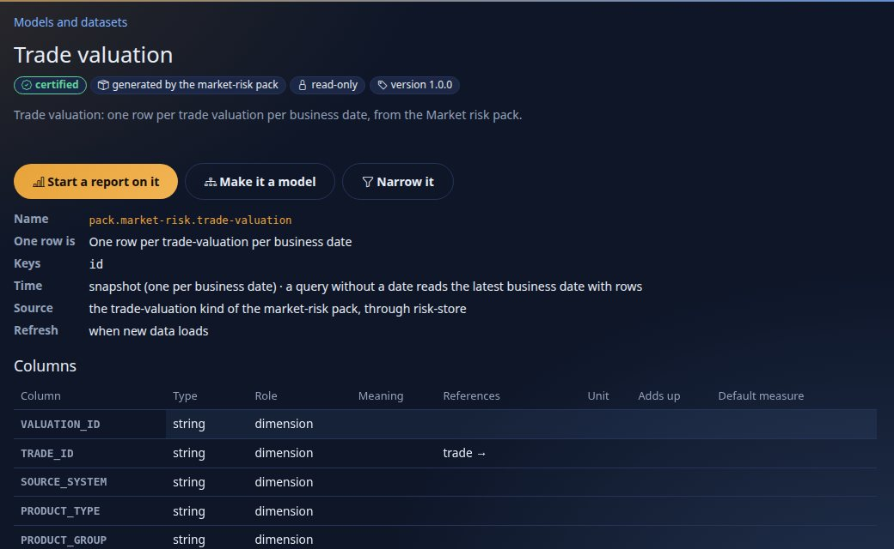

You should see what one row is (*One row per trade valuation per business date*), the key (`id`), the time mode (*snapshot*), the source (*the
trade-valuation kind of the market-risk pack, through risk-store*) and the columns: `COUNTERPARTY` **references** `counterparty`, `DESK` references
`desk`, `NETTING_SET` references [`netting-set`](../../contracts/samples/counterparty-risk.md#netting-set) ([contract](../../contracts/packs/counterparty-risk.md#nset-netting-set-netting-set)), `PORTFOLIO` references `book`, `TRADER_ID` references `trader`. Now open **Exposure official results: netting sets** (search `exposure official`).

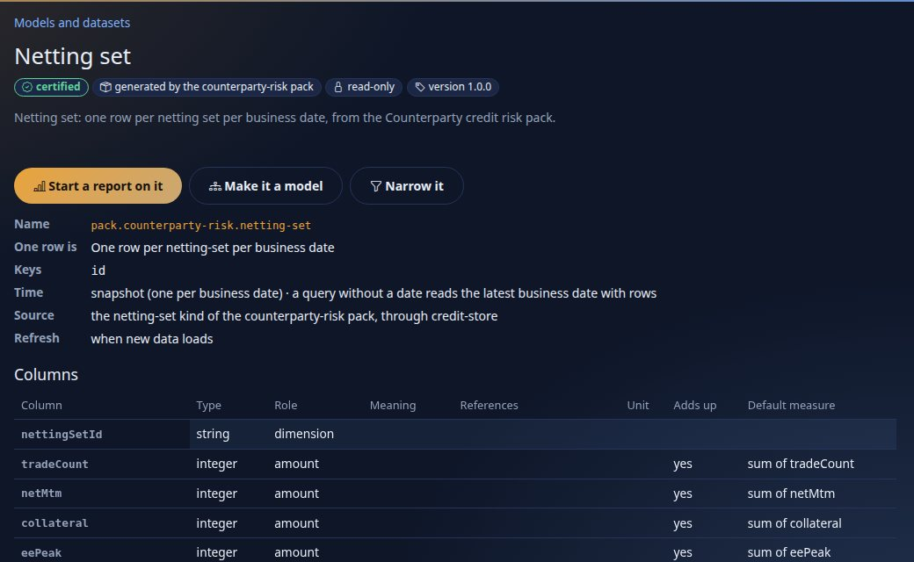

You should see one row per netting set per business date: a different grain. A netting set's record keeps no exposure figure: exposure is computed by the exposure engine, and this dataset is its official end-of-day result for each netting set (the latest result version), with the set's counterparty (`COUNTERPARTY` references it) and the computed peaks (`PEAK_EE`, `PEAK_PFE_95`); it has **no desk**. The demo's exposure run covers all 76 netting sets of the 24 counterparties, so this dataset has 76 rows a day. Both datasets reach the counterparty, which is what lets them meet; only trades reach a desk.

**From the command line** each dataset is asked through its **implicit model** (`dataset:<name>`: the dataset as a fact, its pack dimensions one hop away, a default measure per amount column):

```text
$ python3 tools/drishti.py bi mq --model dataset:pack.market-risk.trade-valuation --measures "Count of trade_valuation,Sum of MTM,Sum of PNL_1D"
Count of trade_valuation  Sum of MTM        Sum of PNL_1D
------------------------  ----------------  -------------
15000                     3,210,381,876.57  90,804,863.45
1 row(s)  as of 2026-10-26

$ python3 tools/drishti.py bi mq --model counterparty-exposure@1 --measures "Exposure (EE peak)"
Exposure (EE peak)
------------------
2,663,018,256.00
1 row(s)  as of 2026-10-26
```

(The official results are a Delta table whose columns the pack's connector `exposure-results` promotes, so they are scanned as columns; the
model `counterparty-exposure` reads the same dataset.)

**The YAML** of a pack dataset is written by Drishti from the pack (read-only; **Narrow it** makes a dataset of your own that `extends` it, [BI_GUIDE.md › Datasets: the YAML, the expression language and the security rules, section 14](#110-a-table-of-your-own-step-by-step)). The part that matters here is the grain:

```yaml
rachana: 2
dataset: pack.counterparty-risk.netting-set
version: 1.0.0
title: Netting set
source:
  pack: counterparty-risk
  kind: netting-set
  connector: credit-store
grain:
  says: One row per netting-set per business date
  date: businessDate
  keys:
  - id
time:
  as-of: business-date
  mode: snapshot
```

Keep four numbers: **15,000 trades, MTM 3,210,381,877, P&L 90,804,863** and **76 netting sets with expected exposure 2,663,018,256**. They are the true totals; the rest of the tutorial is about never losing them.

### Step 16 · One model, two facts

Still on **Models**, press **New model**. Title it `CP risk`, choose the workspace **Exposure desk**, and tick **Counterparty**, **Desk**, **Exposure official results: netting sets** and **Trade valuation** (give it the alias `netting_set` in its box, as you do `trade`, so the names below match).

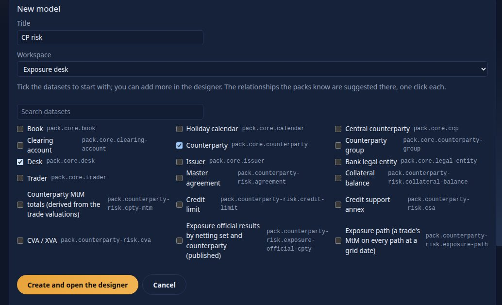

Press **Create and open the designer**. You land on the **canvas** with four boxes (rename the box `trade_valuation` to `trade` with its alias field,
so the names below match). The designer guessed each box's **role**: `trade` is a fact (it has amounts to add up); `counterparty` and `desk` are dimensions (other datasets reference them); and `netting_set` was guessed a dimension too, because trades reference netting sets. **A netting set has amounts to add (its exposure): change its role to `fact`** with the select on its box. Each box still carries a pinned problem (`DRS-9121`: no relationship yet), and under the canvas the **Suggested relationships** come from the packs' references:


You should see the suggestions, each one click: `netting_set.COUNTERPARTY → counterparty.id`, `trade.COUNTERPARTY → counterparty.id` and `trade.DESK → desk.id` with **Add**, and `trade.NETTING_SET → netting_set.id` with **Add as inactive** and the reason *two facts: proposed inactive; relate both to a shared dimension instead*. That reason is the whole idea of this tutorial: two facts meet **through a dimension they share**, never row to row. Press **Add** on the first three and **Dismiss** the fourth (and any other the packs offer, such as `trade.PORTFOLIO → book`, which this model does not need).

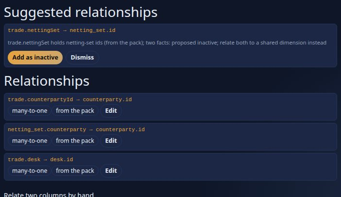

The pinned problems are gone and the lines are drawn (`* → 1`). Open the **Measures** tab. **New measure from a column** gives a measure with the right default: choose the dataset `trade`, the column `MTM`, **Add measure**; it arrives as `Sum of MTM`, `sum(trade.MTM)`, adding up. Rename it `MTM` in its row. Do the same for `trade` `PNL_1D` (`P&L 1d`), `trade` *count the rows* (`Trades`), `netting_set` `PEAK_EE` (`Exposure (EE peak)`) and `netting_set` *count the rows* (`Netting sets`):

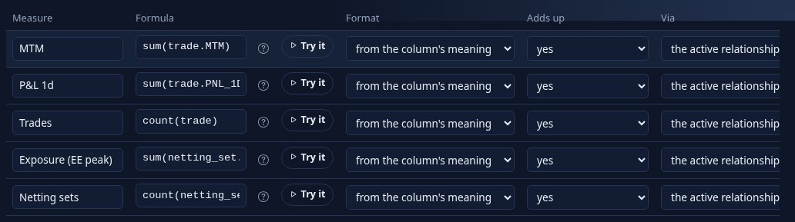

Then **Write a formula**: the name `MTM per exposure`, and in the formula type `MT`; the editor lists the measures that start so (a capital letter lists measures first) and writes `measure('MTM')` when you pick one. Type ` / Exp` and pick **Exposure (EE peak)**:

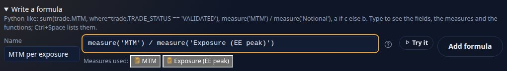

You should see the formula `measure('MTM') / measure('Exposure (EE peak)')`, the two measures it uses as **chips**, and the server's check: *Checks clean as far as the saved draft goes* (the model is not saved yet, so the two measures you just made are not on the server; Save and the check is complete). Press **Add formula**. A ratio of two sums is the right way to divide: it is worked out **after** each sum, so a sector's figure is MTM over exposure, never an average of per-row ratios. Give `MTM`, `P&L 1d` the format *signed amount, no decimals*, `Exposure (EE peak)` *amount, no decimals* and `MTM per exposure` *signed amount, 2 decimals*.

**Security.** Open the **Security** tab and **Add a rule for this model**: on `trade`, the role `desk-head` sees rows where *the column matches the reader*, `trade.DESK` in *the reader's desks*; then `risk` and `admin` see *every row*. The rule restricts `desk-head` on trades and on nothing else, and the **safeguard** says so before you can publish:

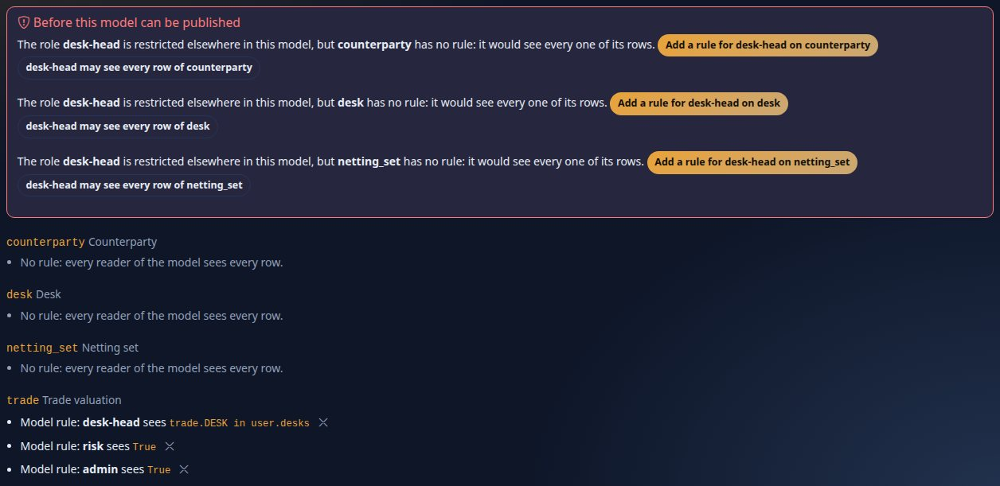

A desk head may see every counterparty, desk and netting set (the exposure of the whole bank is not secret to them; their trades are): press **desk-head may see every row of …** for the three. Each writes an audited note (`may-see-all`), not a rule. Under **Masked columns** mask `counterparty.NAME` (readers without the raw power read `•••`). On the **Contract** tab set the title `Counterparty P&L and exposure`. The **YAML** tab shows what the designer wrote; nobody typed it:

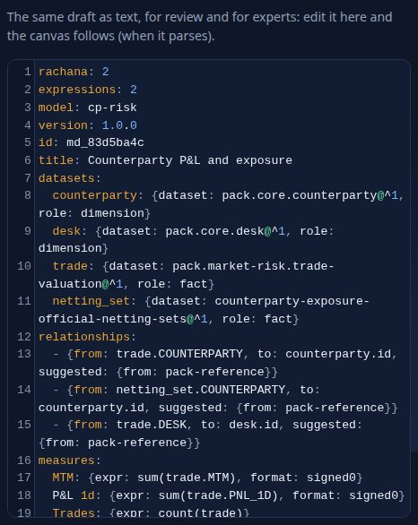

**Save** (`Saved draft`), then **Publish** (`Published`). The designer also saves the draft by itself two seconds after each change (*Draft saved at 14:02:31* beside the state; Ctrl+S saves the field you are still typing in too), and if someone saved the model meanwhile it opens a **merge view** (theirs and yours, part by part) instead of overwriting. If Publish is refused, the reason stays under the toolbar with the tab that fixes it (a contract change needing a new major opens **Contract**, which proposes the version). On the model's item page, give it the **Audience** `risk` and `desk-head` (tick them in the role list under *Roles*), so rita and hana may read it (step 21). The model as stored, with the stable ids the server adds on save (captured):

```yaml
rachana: 2
expressions: 2
model: cp-risk
version: 1.0.0
id: md_fc33f6b2
title: Counterparty P&L and exposure
datasets:
  trade: {dataset: pack.market-risk.trade-valuation@^1, role: fact}     # every trade's valuation (MTM, P&L) from every source system
  netting_set: {dataset: counterparty-exposure-official-netting-sets@^1, role: fact}
  counterparty: {dataset: pack.core.counterparty@^1, role: dimension}
  desk: {dataset: pack.core.desk@^1, role: dimension}
relationships:
  - { id: r_1, from: trade.COUNTERPARTY, to: counterparty.id, suggested: {from: pack-reference}}
  - { id: r_2, from: netting_set.COUNTERPARTY, to: counterparty.id, suggested: {from: pack-reference}}
  - { id: r_3, from: trade.DESK, to: desk.id, suggested: {from: pack-reference}}
measures:
  MTM: { expr: sum(trade.MTM), format: signed0, id: m_mtm }
  P&L 1d: { expr: sum(trade.PNL_1D), format: signed0, id: m_p_l_1d }
  Trades: { expr: count(trade), id: m_trades }
  Exposure (EE peak): { expr: sum(netting_set.PEAK_EE), format: amount0, id: m_exposure_ee_peak }
  Netting sets: { expr: count(netting_set), id: m_netting_sets }
  MTM per exposure: { expr: "measure('MTM') / measure('Exposure (EE peak)')", format: signed2, id: m_mtm_per_exposure }
security:
  rows:
    trade:
      - {role: desk-head, where: trade.DESK in user.desks}
      - {role: risk, where: 'True'}
      - {role: admin, where: 'True'}
  masked: [counterparty.NAME]
  may-see-all:
    netting_set: [desk-head]
    counterparty: [desk-head]
    desk: [desk-head]
```

**From the command line** the same model is the file [cp-risk.model.yaml](../../tutorials/data/cp-risk.model.yaml) (the YAML above without the server's ids). Check it, create it as an item in the workspace and publish it (the item calls are the ones every BI item uses; the answers are cut to the keys that matter):

```text
$ python3 tools/drishti.py bi model check docs/tutorials/data/cp-risk.model.yaml
valid  (model cp-risk)
  warning DRS-9131  security.rows.trade: roles without a rule see no rows of 'trade': approver, author, viewer, bi-steward, bi-writer. Add a rule for them (where: "True" lets a role see every row), or leave them out on purpose: they get "you have no access to rows of trade in this model"

$ curl -s -X POST -H "Authorization: Bearer $DRISHTI_TOKEN" -H 'Content-Type: application/json' \
    -d "$(python3 -c 'import json;print(json.dumps({"kind":"model","title":"Counterparty P&L and exposure","audienceRoles":["risk","desk-head"],"body":open("docs/tutorials/data/cp-risk.model.yaml").read()}))')" \
    $DRISHTI_SERVER/api/v1/bi/workspaces/exposure-desk/items
{"id":"bi-e3b4f30732","workspace":"exposure-desk","kind":"model","title":"Counterparty P&L and exposure","status":"draft", ...}
$ curl -s -X POST -H "Authorization: Bearer $DRISHTI_TOKEN" -H 'Content-Type: application/json' -d '{"note":"the reports tutorial"}' $DRISHTI_SERVER/api/v1/bi/items/bi-e3b4f30732/publish
{"id":"bi-e3b4f30732","status":"published","publishedVersion":1, ...}

$ python3 tools/drishti.py bi model list --kind model
query                      kind   title                                       version  state
-------------------------  -----  ------------------------------------------  -------  ---------
cp-risk@1                  model  Counterparty P&L and exposure               1.0.0    published
counterparty-exposure@1    model  Counterparty exposure                       1.0.0    published
...
world-economics@1          model  World economics                             1.0.0    published
```

The warning `DRS-9131` is Check naming the readers no rule matches: they get no trades, and their answers say so. It never stops a publish; leaving a role out may be the point. `python3 tools/drishti.py bi model describe cp-risk@1` lists every field of the four datasets and every measure, yours and the defaults (`Sum of MTM`, `Count of netting_set`, ...), as you see them.

### Step 17 · MTM and exposure in one visual

On the model's page press **New report on this model**, or create the report [cp-risk-view.report.yaml](../../tutorials/data/cp-risk-view.report.yaml) in the workspace and publish it. Its bar puts `MTM` (a trades measure) and `Exposure (EE peak)` (a netting-set measure) on one axis, `counterparty.SECTOR`:

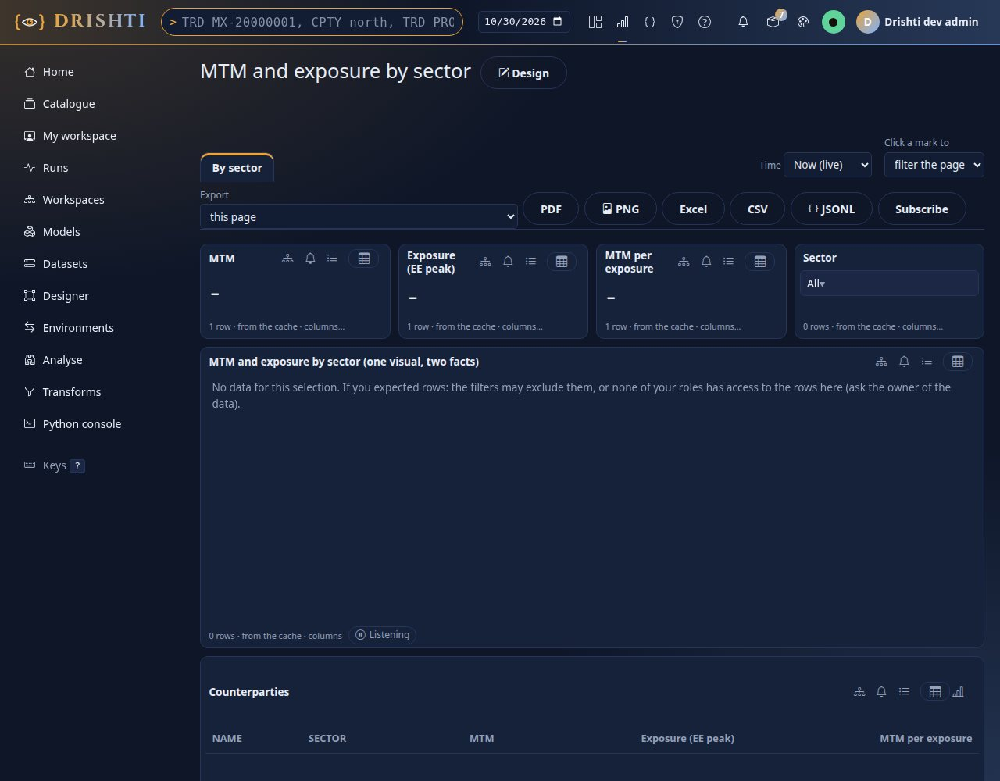

You should see the true totals of step 15 on the cards (`+3,210,381,877` and `2,663,018,256`, the ratio `+1.21`) and, in **one visual**, both measures for eleven sectors. In the designer, drop `Exposure (EE peak)` on the bar that already shows MTM: it simply joins it, because both are measures of one model. The report reads the model by reference (`model: cp-risk@1`); a visual's wells name the model's fields and measures:

```yaml
rachana: 1
report: cp-risk-view
title: MTM and exposure by sector
model: cp-risk@1
pages:
  - id: view
    title: By sector
    visuals:
      - { id: sector, type: slicer, title: Sector, at: { x: 9, y: 0, w: 3, h: 2 }, wells: { field: [counterparty.SECTOR] }, format: { mode: dropdown } }
      - { id: mtm, type: card, title: MTM, at: { x: 0, y: 0, w: 3, h: 2 }, wells: { values: [MTM] } }
      - { id: ee, type: card, title: Exposure (EE peak), at: { x: 3, y: 0, w: 3, h: 2 }, wells: { values: [Exposure (EE peak)] } }
      - { id: ratio, type: card, title: MTM per exposure, at: { x: 6, y: 0, w: 3, h: 2 }, wells: { values: [MTM per exposure] } }
      - { id: by-sector, type: bar, title: "MTM and exposure by sector (one visual, two facts)", at: { x: 0, y: 2, w: 12, h: 6 },
          wells: { axis: [counterparty.SECTOR], values: [MTM, Exposure (EE peak)] } }
      - { id: table, type: table, title: Counterparties, at: { x: 0, y: 8, w: 12, h: 6 },
          wells: { columns: [counterparty.NAME, counterparty.SECTOR, MTM, Exposure (EE peak), MTM per exposure] },
          sort: { by: Exposure (EE peak), desc: true }, limit: 8 }
```

Choose **Banking** in the **Sector** slicer:

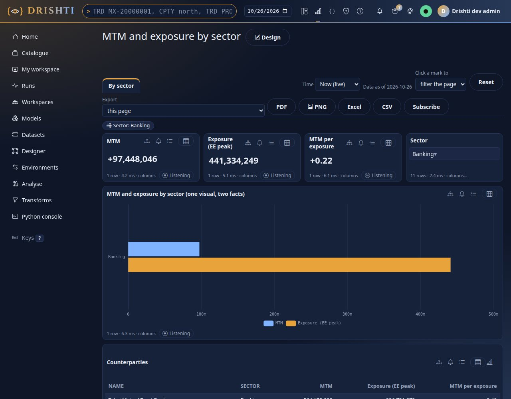

You should see MTM `+97,448,046` beside exposure `441,334,249`: one filter, both facts, because the sector belongs to the counterparty both facts reach. **How it is computed.** Each fact is **aggregated alone** at the question's grain (trades summed by sector, netting sets summed by sector), then the two answers are joined on the sector. The server says so in the answer:

```text
$ python3 tools/drishti.py bi mq --model cp-risk@1 --select counterparty.SECTOR --measures "MTM,Exposure (EE peak),MTM per exposure"
counterparty.SECTOR  MTM             Exposure (EE peak)  MTM per exposure
-------------------  --------------  ------------------  ----------------
Agriculture          647,788,758.90  303,824,105.00      2.13
Airlines             628,172,520.95  153,151,356.00      4.10
Asset management     46,726,246.18   357,112,107.00      0.13
Banking              97,448,046.10   441,334,249.00      0.22
Financial services   96,741,253.28   125,317,776.00      0.77
Government           569,515,006.55  310,533,734.00      1.83
Insurance            93,947,894.23   215,370,310.00      0.44
Pensions             504,346,759.03  278,109,475.00      1.81
Shipping             -53,347,107.41  104,450,300.00      -0.51
Technology           523,053,969.78  123,022,594.00      4.25
Utilities            55,988,528.98   250,792,250.00      0.22
11 row(s)  as of 2026-10-26
warning: 2 fact tables, each aggregated alone at the query's fields and then joined: [trade, counterparty, netting_set]
warning: a measure that combines measures of different grains is worked out over the joined results: MTM per exposure
```

The sector rows add up to the totals of step 15 (`3,210,381,876.57` and `2,663,018,256`), to the cent. The same question in **Drishti SQL** ([API_REFERENCE.md › Drishti SQL](../../guides/API_REFERENCE.md#8-drishti-sql-apiv1bisql)): tables are the model's aliases, `JOIN` needs no `ON` (the model's relationships are used), a measure is `MEASURE('name')`:

```text
$ python3 tools/drishti.py bi sql "SELECT counterparty.SECTOR, MEASURE('MTM') AS mtm, MEASURE('Exposure (EE peak)') AS ee
    FROM trade JOIN counterparty JOIN netting_set GROUP BY counterparty.SECTOR ORDER BY ee DESC LIMIT 3" --model cp-risk@1
counterparty.SECTOR  mtm             ee
-------------------  --------------  --------------
Banking              97,448,046.10   441,334,249.00
Asset management     46,726,246.18   357,112,107.00
Government           569,515,006.55  310,533,734.00
3 row(s)  shape mq
warning: 2 fact tables, each aggregated alone at the query's fields and then joined: [trade, counterparty, netting_set]
```

`shape mq`: the statement was one model query, compiled into the same plan a visual asks. In the designer, **Query of the selected visual** shows the bar's question as a model query or as this SQL, with **Run as SQL** ([BI_GUIDE.md › Reports: the YAML, the visuals and how they behave, section 19](REPORTS.md#73-a-report-on-a-model-fields-own-measures-mq-or-sql)): the visual, the model query and the SQL are one question, so they share one plan and one cached answer per reader.

**What "aggregated alone, then joined" protects you from.** Exposure has no trade in it and P&L has no netting set in it, so a sector's exposure is the sum of that sector's netting sets (76 in all) **once each**, however many trades the sector has; and a sector's MTM is the sum of its trades **once each**, however many netting sets its counterparties have. Add the eleven sector rows of either column and you get step 15's totals, which is the check to run on any model with two facts: the sum of the parts is the whole. A sector whose counterparties have exposure but no trades today keeps its exposure and shows no MTM (empty, not zero), because the join of the two answers keeps both sides.

### Step 18 · Why Drishti does not join rows across facts

If both facts reach the counterparty, why not join each trade to its counterparty's netting sets and add up? Because the honest answer needs care. Open the **Notebook** (`/bi/notebook`) and the notebook [cp-risk-extracts.notebook.yaml](../../tutorials/data/cp-risk-extracts.notebook.yaml) (create it as an item in the workspace, then choose it in the **Notebook** box). It holds **two extracts** of the model, each built by the server for you (your row rules, your masks): `df` is the trades (`COUNTERPARTY`, `MTM`, `PNL_1D`), and `extract("exposure")` is the netting sets (`COUNTERPARTY`, `PEAK_EE`):

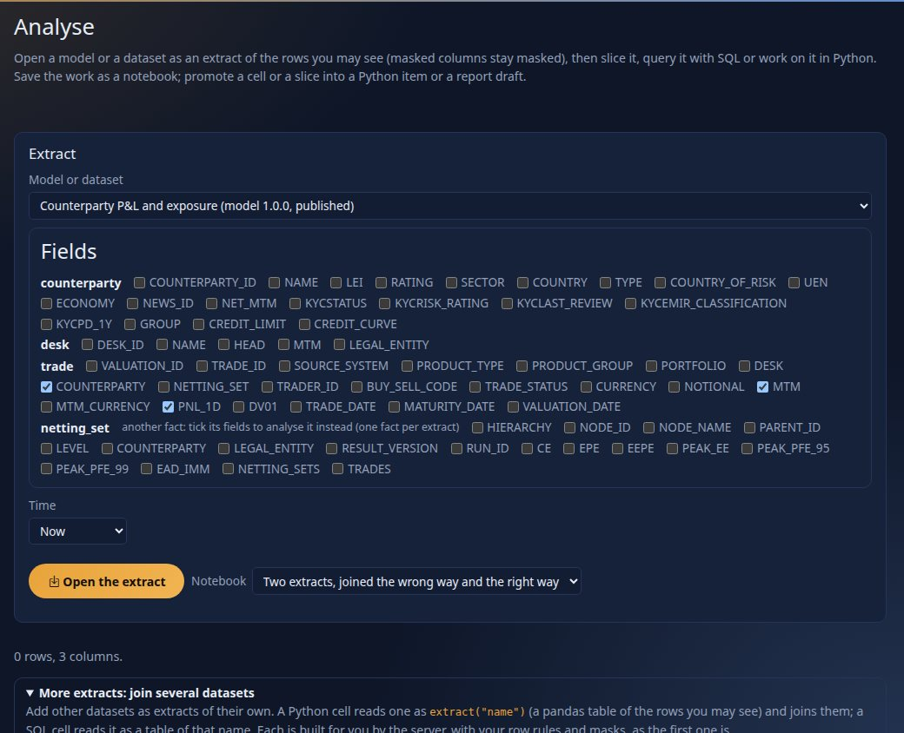

You should see `10000 rows, 3 columns.` with the note that the extract was cut (an extract holds at most `bi.notebook.max_rows`, 10,000; the lake has
15,000 trade valuations) and, under **More extracts**, `exposure` (all 76 netting sets of the official results). In the **Python** tab, the first cell does what a person who thinks in rows would do: join each trade to the netting sets of its counterparty, and add up. The cells run on the server's compute pool (**Run**); what they give is below.

They give (the `true` figures are the extract's own: the P&L of the 10,000 trades it holds):

```text
trade rows 10000  netting-set rows 76  rows after the row join 32293
P&L 1d   true 95004093   row join 397124778
EE peak  true 2663018256   row join 1165433266636
```

Every trade of a counterparty with four netting sets became four rows, so its P&L was counted four times; every netting set met every trade of its counterparty, so exposure was counted once per trade. The P&L is **4.2 times** too big and the exposure **438 times**; nothing failed, and the table looks like a table. That is the **fan-out** trap. The second cell does what the model does for you: add each side up to the counterparty first, then join the sums, and draw it:

Its exposure is step 15's total again (`2,663,018,256`); its MTM is the extract's (the 10,000 trades it holds), and the model of step 17 gives the full one. **From the command line** the model of step 17 answers the same question without a join of rows: `python3 tools/drishti.py bi mq --model cp-risk@1 --select counterparty.id --measures MTM,"Exposure (EE peak)"`.

**What the model refuses.** A desk is a grain of trades only: a netting set has no desk. Ask the model for exposure by desk and it refuses rather than guess:

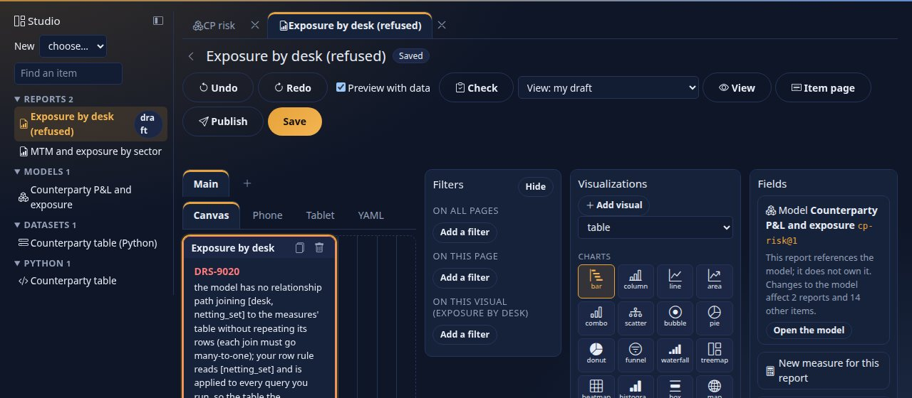

```text
$ python3 tools/drishti.py bi mq --model cp-risk@1 --select desk.NAME --measures "Exposure (EE peak)"
drishti: the server said 422 DRS-9156: DRS-9156 the model has no relationship path joining [desk, netting_set] to the measures' table without repeating its rows
(each join must go many-to-one); your row rule reads [netting_set] and is applied to every query you run, so the table the measures aggregate must reach it
many-to-one. Group by a field they all reach (counterparty.COUNTERPARTY_ID, counterparty.NAME, counterparty.LEI, counterparty.RATING) or ask the measures apart.

$ python3 tools/drishti.py bi mq --model cp-risk@1 --select desk.NAME --measures "MTM,Trades"
desk.NAME                    MTM                Trades
---------------------------  -----------------  ------
Bonds and securitised        -30,588,339.35     1248
Commodities                  -395,383,250.53    5990
...
G10 and EM FX                -681,989,221.57    1428
...
Rates · Swaps and options    4,484,481,851.44   1832
10 row(s)  as of 2026-10-26
```

The fix the message offers is the design: group by what both facts reach (the counterparty and its sector, rating, country), or ask exposure alone. **In YAML** there is nothing to write: the refusal comes from the relationships of step 16 (`trade.DESK → desk.id` exists; nothing joins a netting set to a desk).

### Step 19 · A measure over two facts

`MTM per exposure` of step 16 is a measure **over measures of two facts**: `measure('MTM') / measure('Exposure (EE peak)')`. It is worked out **after** each fact's aggregate, over the joined result, so at any grain it is the sum of MTM over the sum of exposure (Technology `523,053,970 / 123,022,594 = 4.25`). The server's warning in step 17 says exactly that (*a measure that combines measures of different grains is worked out over the joined results*).

**In the UI** you wrote it in the expression editor (step 16); its check can be asked at any time from the command line, against the model as you see it:

```text
$ python3 tools/drishti.py bi expr validate "measure('MTM') / measure('Exposure (EE peak)')" --model cp-risk@1
valid  (del2, aggregate scope, type decimal)

$ python3 tools/drishti.py bi expr validate "sum(trade.MTM) / sum(netting_set.PEAK_EE)" --model cp-risk@1
INVALID  (del2, aggregate scope, type decimal)
  error   DRS-9156  at 0-41: a model query would refuse this measure: the measures aggregate [trade, netting_set], which no many-to-one path connects: ask for them in separate queries
      fix: aggregate each fact in a measure of its own, or join the facts through a shared dimension
```

You should see `valid` for the first, typed `decimal`, and the second **refused while you write it**: two aggregates of two facts in one expression
cannot be planned as one aggregate, and the check plans it the way a model query would (`DRS-9156`, with the fix). `measure('…')` reuses the model's own
definitions, each worked out at its own grain first (and follows them if they change): that is the way to combine facts. **In YAML** it is one line of
`measures:` (step 16). A measure that **divides row by row** across facts has no meaning either, because a row of one fact has no row of the other; it
is refused the same way when it is asked:

```text
$ python3 tools/drishti.py bi mq --model cp-risk@1 --define "X=sum(trade.MTM / netting_set.PEAK_EE)" --measures X
drishti: the server said 422 DRS-9156: DRS-9156 the measures aggregate [trade, netting_set], which no many-to-one path connects: ask for them in separate queries.
Group by a field they all reach (counterparty.COUNTERPARTY_ID, counterparty.NAME, counterparty.LEI, counterparty.RATING) or ask the measures apart.
```

(`--define` adds a measure of this query only, as a report's own measure travels.) Inside one aggregate every column belongs to one fact; ratios inside one fact are recipes R35 and R40 of [RACHANA_REFERENCE.md › Rachana-EL expressions](../../guides/RACHANA_REFERENCE.md#rachana-el-expressions).

### Step 20 · A dataset made by a Python Transform

When the combination is more than sums and a ratio (a rank, a clean-up, a model), write it in Python. A **Transform** is a Python item with `interface: transform`: a function `run(pnl, exposure, params)` that gets each **input's answer** as a pandas frame, **already masked for the reader**, and returns a table. Create [cp-table.python.yaml](../../tutorials/data/cp-table.python.yaml) as a *python* item (**New item**, kind *python*, **What does it make? A table**) and publish it:

```python
def run(pnl, exposure, params):
    """pnl: id, NAME, SECTOR, MTM, Trades (the counterparty's fields, without their alias).  exposure: id, Exposure (EE peak)."""
    short = lambda f: f.rename(columns=lambda c: c.split(".")[-1])          # counterparty.id and id are the same column
    p = short(pnl).rename(columns={"id": "COUNTERPARTY", "Trades": "TRADES"})
    e = short(exposure).rename(columns={"id": "COUNTERPARTY", "Exposure (EE peak)": "EE_PEAK"})
    m = p.merge(e, on="COUNTERPARTY", how="left")
    floor = float(params.get("floor", 1.0))
    m["MTM_PER_EXPOSURE"] = m["MTM"] / m["EE_PEAK"].clip(lower=floor)
    m["EXPOSURE_RANK"] = m["EE_PEAK"].rank(ascending=False, method="min")
    return m[["COUNTERPARTY", "NAME", "SECTOR", "MTM", "TRADES", "EE_PEAK", "MTM_PER_EXPOSURE", "EXPOSURE_RANK"]]
```

The dataset [cp-table.dataset.yaml](../../tutorials/data/cp-table.dataset.yaml) names the Transform (by its title or catalogue id), asks **two model queries** of `cp-risk` as its inputs, each **already at the counterparty grain** (so the join in Python is one row to one row), and declares the columns it returns:

```yaml
rachana: 2
expressions: 2
dataset: cp-table
version: 1.0.0
title: Counterparty table (Python)
source:
  python: Counterparty table          # the Python item, by its title (or its catalogue id)
  inputs:
    pnl: {model: cp-risk@1, select: {fields: [counterparty.id, counterparty.NAME, counterparty.SECTOR], measures: [MTM, Trades]}}
    exposure: {model: cp-risk@1, select: {fields: [counterparty.id], measures: [Exposure (EE peak)]}}
  params: {floor: 1.0}
grain: {says: One row per counterparty, keys: [COUNTERPARTY]}
time: {mode: snapshot}
columns:
  COUNTERPARTY: {type: string, role: key, references: counterparty}
  NAME: {type: string, role: attribute}
  SECTOR: {type: string, role: dimension}
  MTM: {type: decimal, role: amount, additive: true, aggregate: sum, format: signed0}
  TRADES: {type: integer, role: quantity, additive: true, aggregate: sum}
  EE_PEAK: {type: decimal, role: amount, additive: true, aggregate: sum, format: amount0}
  MTM_PER_EXPOSURE: {type: decimal, role: ratio, additive: false, format: signed2}
  EXPOSURE_RANK: {type: decimal, role: attribute}
```

Create it in the workspace (**New item**, kind *dataset*, **Paste YAML**, or the dataset wizard's *Python Transform* source, [BI_GUIDE.md › Datasets: the YAML, the expression language and the security rules, section 15](#110-a-table-of-your-own-step-by-step)) and publish it. You should see its page say what one row is and where it comes from:

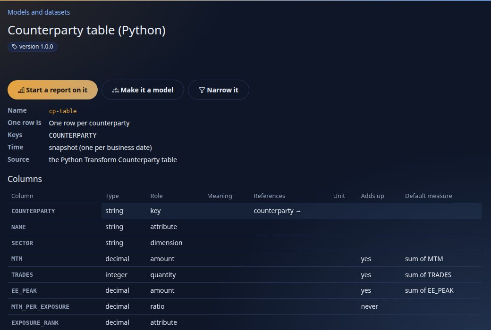

Ask it through its implicit model, like any dataset:

```text
$ python3 tools/drishti.py bi mq --model dataset:cp-table --measures "Sum of MTM,Sum of EE_PEAK"
Sum of MTM        Sum of EE_PEAK
----------------  ----------------
3,210,381,876.57  2,663,018,256.00
1 row(s)  as of 2026-10-26

$ python3 tools/drishti.py bi mq --model dataset:cp-table --select cp_table.NAME,cp_table.SECTOR --measures "Sum of MTM,Sum of EE_PEAK" --limit 3
cp_table.NAME                 cp_table.SECTOR   Sum of MTM      Sum of EE_PEAK
----------------------------  ----------------  --------------  --------------
Aldershot Pension Trust       Pensions          504,346,759.03  278,109,475.00
Aurora Sovereign Wealth Fund  Government        571,227,075.64  202,918,363.00
Bramble Asset Management      Asset management  482,365,089.34  131,153,591.00
3 row(s)  as of 2026-10-26
```

The totals are step 15's, to the cent: the inputs are model queries, so they read all 15,000 trades (no extract is cut here). The Transform's answer is **kept per reader** (until an input changes or `drishti.bi.transform.cache-ttl` passes): a second reader has other rows and masks, so it runs again for them. It runs on the server's compute pool, in its strict sandbox (no network, its own folder, CPU, memory and time limits: [BI_GUIDE.md › Python in BI: measures, visuals and data prep written in Python, section 7](NOTEBOOK_AND_PYTHON.md#71-what-the-sandbox-enforces)), never in the browser; a failure in the code is `DRS-9071` with Python's message, a missing declared column `DRS-9075`. Because its inputs are model queries, a Python dataset can never read more than its reader may: it receives answers that rules and masks have already shaped. When to choose which: **the model** for sums and ratios at any grain (no code; the default); **a Python dataset** when you need code (a rank, a clean-up, a statistical model) and can accept a table computed per reader at one grain; a report on that dataset then reads it through its implicit model, like any other.

### Step 21 · Two readers: each dataset is filtered as the reader, before anything is joined

Drishti applies each dataset's rules **as the person reading, before any join or aggregate**: nothing a rule hides reaches a sum, a join or a Transform. In `cp-risk`, `desk-head` sees `trade.DESK in user.desks` on trades and every row of the other three (the `may-see-all` notes); `risk` sees everything; the counterparty's name is masked for a reader without the raw power. Sign in as **rita** (role `risk`, raw power) and open the report; then as **hana** (a desk head of `DESK-FX`, no raw power):

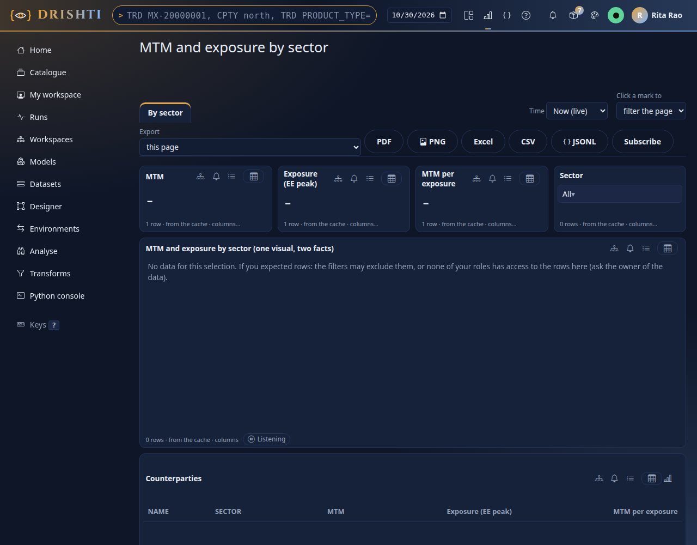

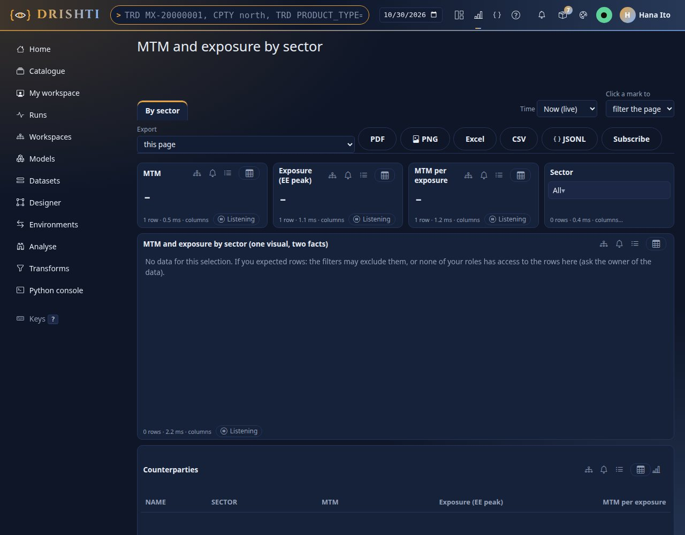

You should see two different reports from one definition. Rita's numbers are the totals of step 15. Hana's **MTM is `-681,989,222`**, her desk's trades only (the `G10 and EM FX` row of step 18); her **exposure is `2,663,018,256`**, the whole bank's, because the model lets a desk head see every netting set (step 16's note), and the two facts are aggregated **apart** before they meet, so her trade rule does not shrink the exposure. Her names read `•••`. From the command line, each with their own token (make one on **My account**, tutorial 1, step 9):

```text
rita$ python3 tools/drishti.py bi mq --model cp-risk@1 --measures "Trades,MTM,Exposure (EE peak)"
Trades  MTM               Exposure (EE peak)
------  ----------------  ------------------
15000   3,210,381,876.57  2,663,018,256.00
1 row(s)  as of 2026-10-26

hana$ python3 tools/drishti.py bi mq --model cp-risk@1 --measures "Trades,MTM,Exposure (EE peak)"
Trades  MTM              Exposure (EE peak)
------  ---------------  ------------------
1428    -681,989,221.57  2,663,018,256.00
1 row(s)  as of 2026-10-26

hana$ python3 tools/drishti.py bi mq --model cp-risk@1 --select counterparty.NAME --measures "MTM,Exposure (EE peak)" --limit 3
counterparty.NAME  MTM              Exposure (EE peak)
-----------------  ---------------  ------------------
•••                -681,989,221.57  2,663,018,256.00
1 row(s)  as of 2026-10-26  masked counterparty.NAME
warning: counterparty.NAME is masked
```

A masked column holds one value for hana, so grouping by it gives one row (a masked dimension is not grouped on). Now the **Python table** of step 20, as each of them:

```text
rita$ python3 tools/drishti.py bi mq --model dataset:cp-table --measures "Sum of MTM,Sum of EE_PEAK"
Sum of MTM        Sum of EE_PEAK
----------------  ----------------
3,210,381,876.57  2,663,018,256.00
1 row(s)  as of 2026-10-26

hana$ python3 tools/drishti.py bi mq --model dataset:cp-table --measures "Sum of MTM,Sum of EE_PEAK"
Sum of MTM       Sum of EE_PEAK
---------------  ----------------
-681,989,221.57  2,407,959,011.00
1 row(s)  as of 2026-10-26
```

(The plan is the same for both, `--json` shows its id: a plan is the question; who asks it is the security signature, kept apart, so the answers differ and each is cached for its reader.)

Hana's exposure there is **`2,407,959,011`**, not `2,663,018,256`: the Transform's inputs were asked as hana, her `pnl` input has a row only for the **17 counterparties her desk trades with**, and the Transform's `how="left"` keeps exposure only for those. The other seven (CP-NORTHPLAINS, CP-SUMMIT, CP-VAULTGUARD, CP-HOUSE, CP-PRAIRIEGAS, CP-METROEX and CP-HARBOURLINE-LDN) all have exposure, `255,059,245` together, exactly the difference, and are dropped **by the code**, not by a rule. Both answers are right for what they say: the model answers *the bank's exposure next to my trades*; this Python table answers *the exposure of my counterparties*. Choose the one your question means, and say it in the dataset's description.

**In YAML** the readers' difference is the `security:` block of step 16, nothing else: the rule is on one dataset (`trade`), the notes on the others, the mask on one field. A join or filter on a masked field is refused (`DRS-9161`), which is why the Transform's inputs join on the counterparty's **id**, never its name.

### Step 22 · The same analysis in the Notebook, promoted to a visual

When you do not yet know the question, work it out in the **Notebook** before you build anything (step 18 did the first half). Opening this two-fact model in the Notebook ticks the fields of one fact (trades) and the dimensions; the netting sets' fields are marked *another fact* and stay unticked, because one extract has one grain. Open the notebook of step 18, in the **Python** tab, and press **Promote to a visual** under the second cell (the chart):

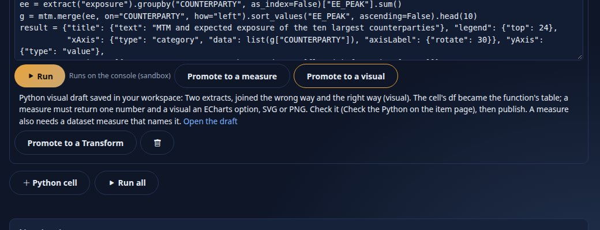

You should see `Python visual draft saved in your workspace` **beside the button you pressed** (with an *Open the draft* link; pressing it again offers **Update that draft** or **Save another**), and the notes: the cell's `df` became the function's `table`, a visual returns an ECharts option, SVG or PNG, and nothing is published for you. Be exact about what was kept: a visual reads **one model query** of its report, so the draft keeps `df` (the first extract); a cell that reads `extract("exposure")` as well belongs in a **Transform** (step 20): **Promote to a Transform** writes the function with each `extract("name")` as a parameter of `run(...)`. The path from an idea to a shared number is therefore: explore in Analyse, put the measures in the **model** when sums and ratios do it (most of the time), or **promote to a Transform** and make a Python dataset when they do not, then build the report. **From the command line** a notebook is an item like the others (`python3 tools/drishti.py bi catalogue get <id>` shows its YAML); its SQL cells run Drishti SQL over the model on the server ([USER_GUIDE.md › Analyse: slice, SQL and Python, section 4](NOTEBOOK_AND_PYTHON.md#23-sql-cells)).

### Step 23 · How this compares with Power BI

The full, checked comparison is [Drishti BI and Power BI compared](../../strategy/BI_AND_POWER_BI.md); this step shows the modelling differences you have just used.

You should see a short, honest table, not a scorecard (the claims about Power BI are the ones of [ARCHITECTURE.md §28 section 11](../../architecture/ARCHITECTURE.md#28-business-intelligence-on-the-table-layer), whose own knowledge of Power BI may be stale; check before you quote it):

| | Power BI | Drishti |
|---|---|---|
| Several tables of different grains | one model, **relationships** between tables (many-to-one, many-to-many, bidirectional), DAX that follows them | one **model** with several **facts** and shared **dimensions**; each measure is aggregated **at its own fact's grain**, then the answers are joined on the asked fields |
| A slicer on a shared dimension | filters every fact through relationships | the same, one way (the dimension filters the facts); *both ways* is not built yet |
| A field only one fact reaches | blank or repeated values, depending on the relationships | **refused** with the fields that work (`DRS-9156`), never a guessed or repeated number |
| A measure over two facts | DAX over two tables | `measure('MTM') / measure('Exposure (EE peak)')`, worked out over the joined results ([RACHANA_REFERENCE.md › Rachana-EL expressions](../../guides/RACHANA_REFERENCE.md#rachana-el-expressions)) |
| Row-level security | a rule per role in the model | a rule **per dataset, applied as the reader before any join**; a model can only tighten; the **safeguard** names a role left open on another dataset |
| Behind the tools | DAX, the Power BI service, capacity licences | one closed, compiled expression language (DEL, Python-like), Drishti SQL over the same plan, one open server, your own infrastructure |

Where Drishti is **behind**: no bidirectional or many-to-many relationships yet, no context transition and no `CALCULATE` (`calc`, `share_of` instead). Where it is deliberately different: it refuses to guess, and nothing joins the rows of two facts.
