<!--
  Project Drishti · Any data. Any domain. One grammar.

  Copyright (c) 2026 Ashutosh Sinha <ajsinha@gmail.com>.
  All rights reserved.

  PROPRIETARY AND CONFIDENTIAL.

  This file is the confidential and proprietary property of Ashutosh Sinha.
  Unauthorised copying, use, modification, distribution or disclosure of this
  file, via any medium, is strictly prohibited except with the express prior
  written permission of the copyright holder.

  See the LICENSE file in the root of this repository for the full terms.
-->
# The Notebook and Python

> Commands: Linux and macOS `python3 tools/drishti.py X`; Windows `py -3.13 tools\drishti.py X` (same arguments).

<!-- nav:begin -->
Business intelligence: [Index](README.md) · [Pivot](PIVOT.md) · [Pivot at scale and the risk cubes](PIVOT_SCALE_AND_CUBES.md) · [Tables and models](TABLES_AND_MODELS.md) · [Reports and the designer](REPORTS.md) · [The report file, formatting and statements](REPORT_FILE_FORMAT_STATEMENTS.md) · [Models and datasets for reports](TABLES_AND_MODELS.md#models-and-datasets-for-reports) · [Live reports, boards and background runs](LIVE_REPORTS_AND_BOARDS.md) · [Distribution, subscriptions and alerts](DISTRIBUTION_AND_ALERTS.md) · [Governing BI and AI in BI](GOVERNANCE_AND_AI.md) · **The Notebook and Python** · [Calc: Python in your own browser](CALC.md) · [Groupings and analytics](GROUPINGS_AND_ANALYTICS.md)
<!-- nav:end -->

Where code runs; the Notebook (SQL and Python cells, extract, save, promote, profile); Python measures and visuals; Transforms and the Transform editor; the command line, the sandbox, limits and how an administrator turns Python on; with the tutorial.

## The Notebook and Python

Drishti runs code people write in two places only: **SQL on the server** and **Python on the server's compute pool**. This guide is
how to use both: the **Notebook** (SQL and Python cells over the rows you may see), **Python measures and visuals** in reports,
**Transforms** and the **Transform editor** for data prep, the command line, the limits and errors, and what an administrator does to
turn Python on. How the runtime is built (the pool, its workers, the sandbox, the lock file) is in
[ARCHITECTURE.md](../../architecture/ARCHITECTURE.md) section 29. Reports themselves are in [BI_GUIDE.md](README.md); a
walk-through of everything here is [the Notebook tutorial](NOTEBOOK_AND_PYTHON.md).

### Contents

1. [Where code runs](#1-where-code-runs)
2. [The Notebook](#2-the-notebook)
3. [Python measures and visuals](#3-python-measures-and-visuals)
4. [Transforms: a table in, a table out](#4-transforms-a-table-in-a-table-out)
5. [Data prep: the Transform editor](#5-data-prep-the-transform-editor)
6. [On the command line](#6-on-the-command-line)
7. [The sandbox and who sees what](#7-the-sandbox-and-who-sees-what)
8. [Limits and errors](#8-limits-and-errors)
9. [For administrators: turning Python on](#9-for-administrators-turning-python-on)
10. [Calc: Python in your own browser](CALC.md)

### 1. Where code runs

#### 1.1 One Python runtime, on the server

Every Python run in Drishti is the server's, on its compute pool **`python`**: a Notebook cell, a python visual, a Python measure of a
report, board or alert, a Transform behind a Python dataset, a Python-driven table, the Transform editor's step-by-step run, the profile
of a frame and the tests an item ships with. The console runs none and the browser runs none: the page asks and draws. The server reads
the rows **as the person running the code** (their row rules, their masks, their business date) and hands them with the code to the
pool, which runs it in a strict sandbox (no network, its own folder, time and memory limits, pinned libraries:
[section 7](#7-the-sandbox-and-who-sees-what)).

```
 report visual (type: python) ──asks──▶ console ──▶ server: the item to run, and the rows this person may see (read as them, masked)
                                                         │
                                                         ▼
                              the compute pool python: a fresh fork child per call, in the strict sandbox
                    (no network at all, files held by the kernel to its own folder, CPU, memory, time and output limits)
                                          │
                   a number per group, a chart (data, never HTML), or a table
```

| You want to | Use |
|---|---|
| explore a model with SQL and pandas, then keep what is good | the **Notebook** ([section 2](#2-the-notebook)) |
| a number the expression language cannot make (a volatility, a percentile, a fitted slope) | a **Python measure** ([section 3](#3-python-measures-and-visuals)) |
| a chart the visual catalogue does not have | a **Python visual** ([section 3](#3-python-measures-and-visuals)) |
| a join or reshaping easier in pandas, published as a dataset | a **Transform** ([section 4](#4-transforms-a-table-in-a-table-out)) |
| clean raw rows step by step, without typing YAML | the **Transform editor** ([section 5](#5-data-prep-the-transform-editor)) |
| a table whose rows a build function makes | a **Python-driven table** ([BI_GUIDE.md](TABLES_AND_MODELS.md#114-python-driven-tables-and-models)) |
| slice and total a table | the **Pivot** ([BI_GUIDE.md](PIVOT.md)), then a report |

Python runs only once an administrator has switched on the compute pool ([section 9](#9-for-administrators-turning-python-on)), and
only on a Linux server; elsewhere every page says why it cannot run.

#### 1.2 The Python console and Calc

The **Python console** is the Notebook: its address `/pyconsole` (and `/bi/explore`) opens `/bi/notebook`, where Python over a
masked extract runs on the server. Python **in your own browser** on a view's rows is a different thing: **Calc**, a scratch pad behind a
Labs switch that never publishes ([USER_GUIDE.md › Calc](CALC.md)).

### 2. The Notebook

The **Notebook** (`/bi/notebook`, the BI rail's *Notebook*) is the one place for code over data. You open a model as an **extract**, the
rows *you* may see (masked columns stay masked, row rules apply), and work on it in **SQL cells**, run by the server, and **Python cells**,
run on the server's compute pool. You save the work as a **notebook** (a BI item with versions and review like any other) and **promote**
what is good: a SQL cell becomes a **visual in a report draft**, a Python cell a Python Measure, Visual or Transform draft.

**One analysis path: Pivot, then Report.** To slice and total a table, use the [Pivot](PIVOT.md) (`PIVOT <GO>`, or *Pivot* in the
BI rail); to publish, share or schedule, make a report. The Notebook is for what a grid cannot say. **Nothing of yours runs in the
console or in your browser**: SQL is the server's, Python the server's compute pool's.

#### 2.1 At a glance

```
 model ──(your identity)──▶ server: masks columns, applies your row rules ──▶ extract (at most bi.notebook.max_rows rows)
                                                                                    │
                    ┌──────────────────────────────────────┬────────────────────────┤
                  SQL cell                              Python cell              Profile
   the server: Drishti SQL over the model,      the server's compute pool    every column of the extract,
   as you (POST /bi/notebook/sql)               (POST /bi/notebook/python)   no code of yours
```

The extract is **rebuilt for you on every call** and never kept: the console holds nothing between calls, so a mask or a row rule changed
on the server applies the next time you run a cell.

#### 2.2 The extract

1. Choose a **Model or dataset** (a dataset reads as its own small model).
2. Tick the **Fields**.
3. Choose the **Time**: *Now*, *As of a date* or *A window*.
4. Press **Open the extract**.

The line under the form tells you what you got: `60 rows, 8 columns.` and, when something is masked for you, `Masked for you: MTM.` The
rows are the table's *own* rows (not grouped), cut to `bi.notebook.max_rows` (10,000); a cut says so (`60 rows of 4,000 (cut to the row
limit)`). Columns are named for the table's column (`DESK`, not `trade.DESK`); two columns of the same name keep their table
(`trade_DESK`). The console's route can also open one report visual's data as the extract (`{report, page, visual, state}`).

**More extracts.** *More extracts: join several models* (under the form) adds further extracts to the notebook, each a name, a model and
fields, built for you by the server exactly as the first is (your row rules, your masks; at most `bi.notebook.max_extracts`, 6, besides
the first). A Python cell reads one as `extract("name")`.

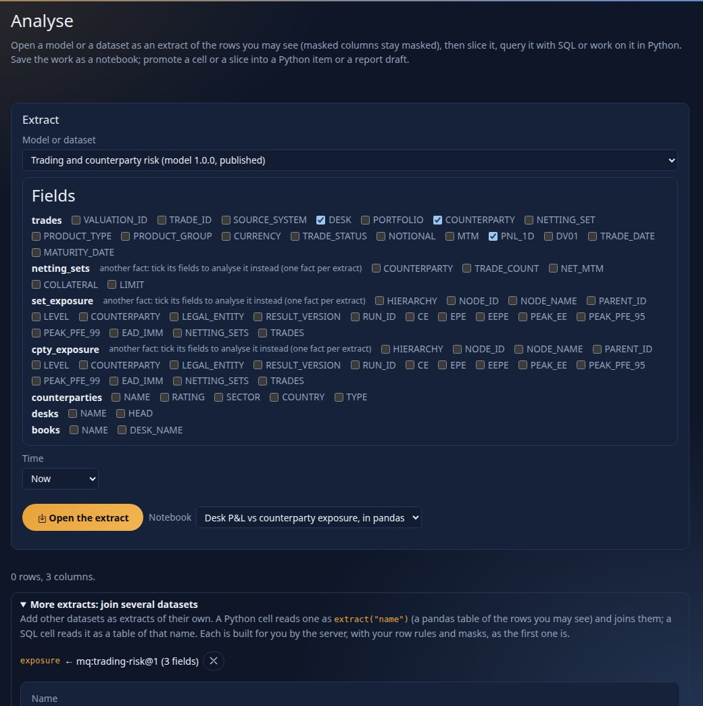

Every extract is the reader's, so a join of two extracts shows **their** rows: a join key that the server masks for them arrives masked
and the join finds nothing, which is the mask doing its job. Because the extract is cut, a cell over it gives the extract's totals, not
the model's: for true totals use the Pivot or a report.

#### 2.3 SQL cells

A SQL cell is **Drishti SQL over the model the extract reads** ([ARCHITECTURE.md](../../architecture/ARCHITECTURE.md), section 28), run by
the server **as you**, with your row rules and masks, through the same plan as the model query it equals. Its tables are the model's
aliases, a measure is `MEASURE('name')`, and `JOIN` needs no `ON` (the model's relationships are used). A new cell starts with a
statement written from the model (the first text field you ticked and the model's first measure):

```sql
SELECT trade.CURRENCY,
       MEASURE('Sum of MTM') AS "Sum of MTM"
FROM   trade
GROUP  BY trade.CURRENCY
LIMIT  20
```

The cell's footer says *3 rows in 4 ms · Drishti SQL, run by the server over sql-model@1 as you · plan p_825d3a8857*, with the masked
columns when there are any:


The console sends the cell to `POST /bi/notebook/sql` (`{extract, sql}`), which asks the server's `POST /api/v1/bi/sql` with the model and
the cell's row limit (`bi.notebook.sql_max_rows`, one more to say when it was cut); it never reads the SQL itself. One `SELECT` per cell;
text over `bi.notebook.sql_max_chars` (20,000) is `DRS-9072`. *Run all* runs the cells in order. The same SQL runs from the terminal with
`drishti.py bi sql` ([section 6](#6-on-the-command-line)).

#### 2.4 Python cells

A Python cell sees `df` (the extract as a pandas DataFrame), `extract(name)` (any other extract of the notebook, as a DataFrame for the
same reader) and `params`. What it prints comes back as text; what it puts in **`result`** is drawn: a DataFrame or Series as a table, a
dict as an ECharts option, SVG text or PNG bytes as an image, anything else as a value.

```python
g = df.groupby("DESK", as_index=False)["NOTIONAL"].sum()
result = {"title": {"text": "Notional by desk"}, "xAxis": {"type": "category", "data": list(g["DESK"])},
          "yAxis": {"type": "value"}, "series": [{"type": "bar", "data": [float(v) for v in g["NOTIONAL"]]}]}
```

**Run** sends the cell to the server (`POST /bi/notebook/python`), which reads the extract and the other extracts **as you** and runs the
cell on the compute pool `python` in its strict sandbox: no network, files held to its own folder, the cell's time and memory limits
(`bi.notebook.cell_timeout_seconds`, `cell_memory_mb`), the pinned libraries only. The line above the output says where it ran, how long
it took, how many rows it read and what was masked; what the cell printed shows first, then its `result`; a failure shows the error and,
as an author, your own code's traceback. Where the server cannot run Python safely (compute off, a Windows server), *Run* is off and says
why; you can still write, save and promote cells. Whoever opens the notebook later runs them over their own rows.

Running Python needs the **`bi-author`** power (the page says *Running Python needs the bi-author power.*); SQL needs only `bi`. The
packages a cell may import are the pinned allow-list ([section 9.3](#93-the-pinned-libraries-installing-and-locking-the-environment)).

#### 2.5 Saving a notebook

**Save as a notebook** stores the extract's definition and every cell as a BI item of kind **`notebook`**: in *My workspace* (or, if you
opened a notebook you may edit, as a new version of it). It has versions, diffs, review and publishing like any item
([BI_GUIDE.md](README.md)); *Open in the Notebook* on the item page (or `/bi/notebook?item=<id>`, or the notebook picker)
reopens it: the extract is rebuilt for whoever opens it, so **a notebook shared with someone else shows *their* rows**. Outputs are not
stored, only the code.

The body is YAML, checked by `POST /bi/notebook/check` (unknown keys and bad cells are `DRS-9070`, naming the cell):

```yaml
rachana: 1
notebook: desk-notional-first-look
title: Desk notional, first look
dataset: mq:trades-basic@1       # the model it reads (mq:<model>@<major>, or dataset:<name> for a dataset's implicit model)
fields: [trade.TRADE_ID, trade.DESK, trade.PORTFOLIO, trade.NOTIONAL, trade.MTM]
extracts:                       # optional: further extracts, read by a Python cell as extract("name")
  - { name: exposure, dataset: mq:counterparty-exposure@1, fields: [set_exposure.COUNTERPARTY, set_exposure.PEAK_EE] }
cells:
  - type: sql
    source: SELECT trade.DESK, MEASURE('Sum of MTM') FROM trade GROUP BY trade.DESK
  - type: python
    source: |
      result = df.groupby("DESK", as_index=False)["NOTIONAL"].sum()
```

A cell is `sql` or `python`; slicing is the Pivot's, so a notebook saved with a `slice` cell opens with that cell left out and a line
saying so. A notebook may also carry the catalogue's keys (`sample`, `tags`, `endorsement`, `owner`, `audience`); a shipped one is
`config/bi/notebooks/banking/pnl-vs-exposure-pandas.notebook.yaml`. A notebook's cells can also become a Python-driven table's build
function ([BI_GUIDE.md](TABLES_AND_MODELS.md#114-python-driven-tables-and-models)).

#### 2.6 Promote

Every promotion answers **beside the button you pressed** (one message, with an *Open the draft* link). Pressing the same promotion again
for the same cell does not make a duplicate: it offers **Update that draft** or **Save another**. Promoting writes a **draft** item in your
workspace; nothing is published.

* **A SQL cell to a report visual.** Choose where first, in the line *Promote a SQL cell to* above the tabs: **a new report draft**, or
  one of the report drafts you may edit (your workspace and the shared ones you contribute to), and optionally the page. Plain and
  `GROUP BY` columns become *rows*, `MEASURE('name')` and the aggregates `sum`, `avg`, `count`, `min`, `max` of a column become *values*
  when the model has that measure, and simple `WHERE` conditions (`=`, `<>`, `<`, `<=`, `>`, `>=`, `IN`, `NOT IN`, `BETWEEN`,
  `IS [NOT] NULL`, joined by `AND`) become *filters*. What a report cannot say (an expression, `LIKE`, `OR`, `HAVING`, a sub-query,
  `ORDER BY`, `LIMIT`) is left out and listed in the notes; nothing is guessed. A new report draft reads the extract's model; in an
  existing one the visual is added below what the page holds and the report is written again by the designer's writer (comments in its
  YAML are not kept; the note says so).

  

* **A Python cell to a Measure or a Visual** (the cell's buttons): the cell's `df` becomes the function's `table`, `result` is returned,
  and the packages the cell imports go into the manifest ([section 3.3](#33-the-manifest)). Check it on the item page, then publish.
* **A Python cell that joins extracts to a Transform** (*Promote to a Transform*, greyed with "Add a second extract first" until the
  notebook has one): each `extract("name")` becomes a parameter of `run(...)`, a use of `df` becomes the first extract, and the cell's
  `result` is returned ([section 4](#4-transforms-a-table-in-a-table-out)).

The route is the console's `POST /bi/notebook/promote` with `{to: report, name, dataset, sql, columns, qualified, target?, page?}` or
`{to: measure | visual | transform, name, source, columns, extracts?}`.

#### 2.7 Profile

The **Profile** tab shows every column of the extract: its type, what its text looks like (numbers or dates kept as text), empty values
(count and %), distinct values, whether it could be a key, min and max (and the mean of a number), the five most common values and a
histogram of a number. No code of yours runs (`POST /bi/notebook/profile` with `{extract}`), and it is drawn by the same panel as the
[Transform editor's profile](#55-profiling). A column masked for you says so and profiles as empty.

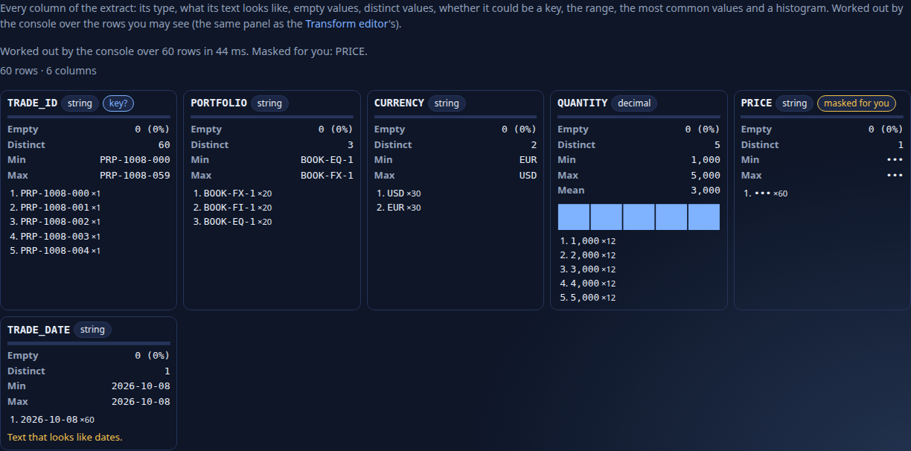

#### 2.8 Who sees what in the Notebook

The server decides, as everywhere in BI: the extract is a model query (`POST /api/v1/bi/mq`) **as you**, so the same column masks and row
rules as a report apply, and a masked column arrives empty. A SQL cell is answered by the server as you; a Python cell runs on the pool
over the extract built for you. A cell cannot widen access, and a saved notebook holds code, not data.

#### 2.9 Notebook settings, errors and routes

The console's `bi.notebook.*` settings ([CONFIGURATION.md › `bi.notebook`](../../admin/CONFIGURATION.md#binotebook)) set the most rows of an
extract (`max_rows`, 10,000), its most columns (`max_fields`), a SQL cell's limits (`sql_max_rows`, `sql_max_chars`), a Python cell's
limits (`cell_timeout_seconds`, `cell_memory_mb`, `cell_max_chars`), the most cells (`max_cells`) and the most further extracts
(`max_extracts`).

| Code | HTTP | In the Notebook |
|---|---|---|
| `DRS-9070` | 422 | the request is wrong (no fields, a bad name, a notebook that does not check, a SQL syntax error, a slice sent to promote) |
| `DRS-9072` | 413 | a limit: SQL text, cell size, extract fields or extracts |
| `DRS-9073` | 403 | refused: Python without `bi-author` |
| `DRS-9074` | 503 | Python does not run on this server now (the reason is given), or the console lacks `pyarrow` |

The server's own refusals (`DRS-9001` no such dataset, a denied model) come through unchanged; a Python cell's own failures are
`DRS-9071` to `9074` ([section 8](#8-limits-and-errors)). The routes are the console's own, JSON from its pages only (same-origin, the
session cookie): `GET /bi/notebook`, `GET /bi/notebook/status`, `POST /bi/notebook/extract`, `POST /bi/notebook/sql`,
`POST /bi/notebook/python`, `POST /bi/notebook/profile`, `POST /bi/notebook/check`, `POST /bi/notebook/promote`.

### 3. Python measures and visuals

Where the expression language and the visual catalogue stop, Drishti runs **typed Python**: a **Measure** is a Python function that turns
the rows of a group into a number (a desk's P&L volatility, a percentile no aggregate gives, a fitted slope), and a **Visual** is a Python
function that turns rows into a chart (a histogram with your own bins, a regression plot). Authors do not paste scripts into a visual: a
Python function is a **BI item** of its own (kind `python`), with a manifest, versions, review and publishing like a dataset or a report,
and a report names it.

#### 3.1 At a glance

| | Python measure | Python visual |
|---|---|---|
| function | `compute(table, params)`, or `compute_groups(frame, by, params)` once over every group | `render(table, params)` |
| called | once per group, with that group's rows | once, with all the rows handed over |
| returns | one number (or `None`) | an ECharts option, a Vega-Lite specification or a drishti-chart spec (a dict, by `output:`), SVG text or PNG bytes |
| drawn as | bars, one per group | the chart or image |

Two samples ship (`config/bi/python/`), and the sample report **Desk P&L risk (Python)** (`python-desk-risk`) shows both on the trades
model:

* `desk-pnl-volatility` (a measure): the standard deviation of one-day P&L, per desk;
* `pnl-histogram` (a visual): a histogram of one-day P&L drawn with numpy.


#### 3.2 The two interfaces

**Measure.** `config/bi/python/banking/desk-pnl-volatility.python.yaml`:

```yaml
rachana: 1
python: desk-pnl-volatility
title: Desk P&L volatility
interface: measure
inputs: [pnl1d]                  # the columns the function reads, as the table names them
packages: [pandas]
target: server                   # the server's compute pool
timeout: 10                      # seconds
memory: 256                      # megabytes
params: { min_trades: 2 }
source: |
  def compute(table, params):
      """One number for the rows of one group."""
      pnl = table["pnl1d"].dropna()
      if len(pnl) < int(params.get("min_trades", 2)):
          return 0.0
      return float(pnl.std(ddof=1))
```

`table` is a **pandas DataFrame** holding that group's rows and **only the columns in `inputs`**. The function returns a number (an int or
float; `None` or NaN is shown as blank; infinity or anything else is `DRS-9071`). Which columns make a group comes from where the measure
is used ([section 3.5](#35-a-python-measure-in-a-model)): the measure's `by`.

**Visual.** `config/bi/python/banking/pnl-histogram.python.yaml`:

```yaml
interface: visual
output: echarts                  # echarts (an option), vega-lite, drishti-chart, svg or png
inputs: [pnl1d]
packages: [numpy]
params: { bins: 20 }
source: |
  import numpy as np

  def render(table, params):
      pnl = table["pnl1d"].dropna().to_numpy(dtype=float)
      counts, edges = np.histogram(pnl, bins=int(params.get("bins", 20)))
      ...
      return {"title": {...}, "xAxis": {...}, "yAxis": {...}, "series": [{"type": "bar", "data": [int(c) for c in counts]}]}
```

`table` is a DataFrame of the rows the visual hands over (the columns of its `columns` well; the row `id` is dropped). The function returns
**data, never markup**: an ECharts option drawn by drishti-chart (Drishti Elements' report part; any `formatter`, `valueFormatter`, `extraCssText` and
`appendToBody` key is removed: those are the places an option can carry HTML), an SVG (refused if it holds `<script`, `javascript:`,
`<foreignObject`, `<iframe`, `<image`, `xlink:href` or an `on...` handler; shown as an image, which never runs script) or PNG bytes.
Colours you leave out (text, axes, grid lines) take the page's theme, so a chart reads in the dark and the light theme alike.

#### 3.3 The manifest

The body of a `python` item is YAML:

| Key | Required | Meaning |
|---|---|---|
| `python` | yes | the item's name (letters, digits, hyphen, underscore) |
| `interface` | yes | `measure`, `visual`, `transform` ([section 4](#4-transforms-a-table-in-a-table-out)) or `column` ([section 3.7](#37-grouped-measures-and-the-column-interface)) |
| `source` | yes | the code; up to 65,536 characters; it must define the entry function |
| `entry` | no | the function's name: `compute` for a measure, `render` for a visual, `run` for a transform (a top-level function, or a method of a class `Transform`) |
| `inputs` | measure, transform: yes | a measure: the columns the function reads, as the table names them (`pnl1d`, not `trade.pnl1d`); a transform: the **datasets** it reads, in the order its function receives their frames |
| `packages` | no | what the source imports; each must be on the allow-list (`drishti.bi.report.python-packages`) **and pinned** in `config/compute/locks/python.lock` |
| `target` | no | `server` (default). `browser` and `both` are read and run on the server's pool like `server` |
| `timeout` | no | seconds, 1 to `drishti.bi.report.python-max-seconds` (60); default 10 |
| `memory` | no | megabytes the code may add to what Python needs to start, 32 to `python-max-memory-mb` (1024); default 256 |
| `output` | visual | `echarts` (default), `vega-lite`, `drishti-chart` ([section 3.8](#38-vega-lite-and-drishti-chart-output)), `svg` or `png`; a measure's output is `number`, a transform's `frame` |
| `params` | no | defaults the function reads from `params`; a visual of a report overrides them in `format.params` |
| `tests` | no | examples the item must pass: run by Check, and a failing one refuses a publish ([section 3.9](#39-tests-shipped-with-an-item)) |
| `title`, `description`, `owner`, `tags`, `endorsement`, `audience`, `sample`, `version` | no | the catalogue's keys, as for any item |

Anything else is refused with `DRS-9070` and the path of the key. The server checks the manifest (`POST /api/v1/bi/python/validate`, and
on every publish); **Check the Python**, the button on the item page (the console's `POST /bi/python/check`, the server's
`POST /api/v1/bi/python/check`), adds the checks that need Python's own parser, made on the compute pool without running anything: the
source parses, defines its entry, and imports only what it lists or the safe standard library.


#### 3.4 Python items are BI items

A Python item lives where every BI item lives: **shipped** in `config/bi/python/<id>.python.yaml` (a published, read-only item,
`file:python:<id>`, watched live), or **in a workspace** (create it with kind *python*, or `drishti.py bi item new`). Nothing about
governance is special:

* every save is a saved state (diff, restore); **publish** checks the manifest and refuses a bad one with `DRS-9070`; a workspace that
  requires review needs a second person to approve it ([BI_GUIDE.md](README.md));
* a report that names the item runs **what was published** for every viewer; someone who edits the item (a contributor or better in its
  workspace) runs the **draft**, so a change can be tried before it is published; the run line under the visual shows the version;
* it has an owner, tags, endorsement and an audience like any item, and appears in the catalogue (`kind=python`) and in bundles.

A report **names an item** by catalogue id, shipped file name (`pnl-histogram`) or title. Anyone who can open a published report can have
its Python items run for them: the report is what names the item, as it is what names the dataset.

#### 3.5 A Python measure in a model

A measure may be a **Python item** instead of an expression: `python:` names the item (catalogue id, shipped file name or title), `inputs`
the columns its function reads and `by` the columns that make a group, all `table.column` and all of **one table**:

```yaml
measures:
  Desk P&L volatility:
    python: desk-pnl-volatility       # config/bi/python/banking/desk-pnl-volatility.python.yaml
    inputs: [trade.PNL_1D]            # columns of ONE table
    by: [trade.DESK]                  # one number per desk
    description: Standard deviation of the one-day P&L per desk, computed in Python.
```

The SQL engine **cannot run it**: a query that names a Python measure is refused (`DRS-9013`), and the model says so as a warning when it is
checked, so the measure is shown by a **python visual** (below), not mixed into a bar chart's SQL measures. The server reads the rows of
`by` and `inputs` that this person may see, and the pool calls the item once per group. Checks: the item is named, `inputs` is not empty,
every name is a column, all of one table (`DRS-9012`); `expr` and `python` together are `DRS-9010`. The model is checked **without**
looking the item up (an item can be published after it), so a wrong item name appears when a report runs it (`DRS-9001`/`9070`). The
keys of a model's measures are in [BI_GUIDE.md](TABLES_AND_MODELS.md).

#### 3.6 The python visual in a report

The **`python` visual** (designer, catalogue group *Python*; wells `columns` and `values`):

```yaml
- id: volatility
  type: python
  title: Desk P&L volatility (Python measure)
  wells: { values: [Desk P&L volatility] }        # a Python measure of the model: its columns and groups come from the measure
  format: { run: auto }

- id: histogram
  type: python
  wells: { columns: [trade.DESK, trade.PNL_1D] }   # the rows handed to Python
  format: { python: pnl-histogram, params: { bins: 24 }, run: auto }
```

| Key | Meaning |
|---|---|
| `wells.values` | one Python measure of the model; the rows are its `by` and `inputs` columns |
| `wells.columns` | the columns handed to a Python item named in `format.python` (any number of fields of one table) |
| `format.python` | the item; required unless the values well holds a Python measure. With a measure item and no model measure, the groups are the columns that are not `inputs` |
| `format.params` | overrides the item's `params` |
| `format.run` | `auto` (default), `server` or `browser`: every value runs on the server's compute pool; with `auto` a server that cannot run Python safely answers `DRS-9074` and says why |

The rows are the table's own rows (not grouped), under the page's slicers, filters and business date, at most
`drishti.bi.report.python-rows` (10,000). The report **check** refuses a python visual with neither an item nor a Python measure, with a
values well that is not a Python measure, or without columns (`DRS-9032`). A python visual has no drill, selection, alert or *show the
rows* buttons; an export of it is the table of rows handed to Python. In the designer its Format pane takes the item and the parameters;
the canvas shows a placeholder, since Python runs when a report is opened, not while designing. The line under each visual says the server
ran it: `Python · desk-pnl-volatility v1 · server · 240 ms · 60 rows`.

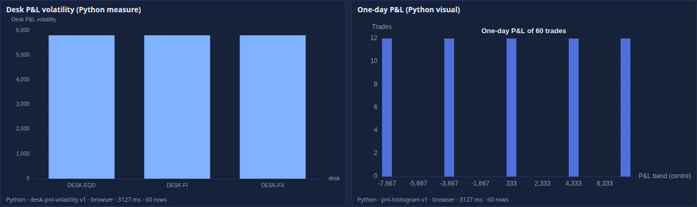

#### 3.7 Grouped measures and the column interface

* **`compute_groups(frame, by, params)`.** A measure may define it instead of `compute`: one vectorised call over every group's rows that
  returns a DataFrame of the group columns and one value column (`value`, else the last). Faster for many groups:

  ```python
  def compute_groups(frame, by, params):
      out = frame.groupby(by, dropna=False)["pnl1d"].std().reset_index()
      return out.rename(columns={"pnl1d": "value"})
  ```

* **The `column` interface.** `derive(frame, params)` returns one value per row (a Series, an array or a list), for a column written
  `derive: { python: … }` (a calculated column computed in Python).

#### 3.8 Vega-Lite and drishti-chart output

A visual may return a **Vega-Lite** specification instead of an ECharts option: say `output: vega-lite` in the manifest and return the
specification as a dict (`mark`, `encoding`, `layer`, `transform` ... as [Vega-Lite](https://vega.github.io/vega-lite/) has them). The sample
`config/bi/python/banking/pnl-vega.python.yaml` draws one dot for each trade's one-day P&L, by desk, with each desk's median as a tick:

```python
def render(table, params):
    rows = table.dropna(subset=["pnl1d"]).head(int(params.get("max_points", 400)))
    dots = [{"desk": str(r.desk), "pnl1d": float(r.pnl1d)} for r in rows.itertuples()]
    medians = [{"desk": str(d), "median": float(v)} for d, v in rows.groupby("desk")["pnl1d"].median().items()]
    return {"layer": [
        {"data": {"values": dots}, "mark": {"type": "circle", "opacity": 0.6, "size": 40}, "encoding": {"x": {"field": "pnl1d", "type": "quantitative"}, "y": {"field": "desk", "type": "nominal"}}},
        {"data": {"values": medians}, "mark": {"type": "tick", "thickness": 3, "color": "#d9534f"}, "encoding": {"x": {"field": "median", "type": "quantitative"}, "y": {"field": "desk", "type": "nominal"}}}]}
```

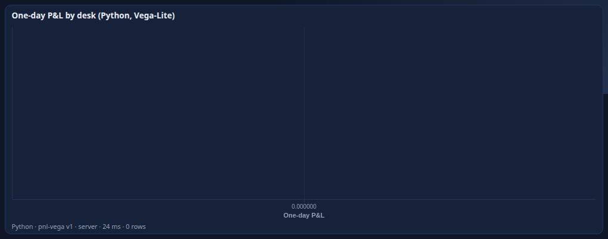

What comes back from the worker is data, as with ECharts: `{"kind": "vega-lite", "spec": {...}, "ms": 258}`. The page has no Vega:
drishti-chart translates the specification (`fromVegaLite`) and draws it, and a feature it does not translate is refused in words with what
to use instead (`DRS-9077`; the list is with the report's own Vega-Lite visuals in [BI_GUIDE.md](README.md)). The rules:

* **The data is inside the specification** (`data.values`). A `url` or a `loader` anywhere in it is refused, in the sandbox (`DRS-9073`: "a
  Vega-Lite specification may not load anything from a URL or name a loader") and again in the page. An expression such as
  `datum.MTM < 0` is read by drishti-chart's expression language, **without `eval`**, so the page keeps its strict content security policy.
* The chart takes the theme's colours and fills its frame (`width` and `height` are ignored).

**The preferred form: a drishti-chart spec.** A visual whose manifest says `output: drishti-chart` returns a drishti-chart spec (a dict)
with its rows inline, and the page draws it as it is: every kind drishti-chart has (bar, line, area, scatter, bubble, histogram, boxplot,
heatmap, pie, donut, waterfall, treemap, sankey, gauge, candlestick, map, layers), its annotations and conditional marks, nothing to
translate and nothing refused. The answer is `{"kind": "drishti-chart", "spec": {...}}`; a spec without `kind` is a `TypeError`, and
`data.source` (an address to load) is refused in the sandbox (`DRS-9073`): put the rows in `data.rows`. The spec's language is in
[ELEMENTS_API.md](https://github.com/drishti-platform/drishti-elements/blob/main/docs/API.md) (drishti-chart).

```python
def render(table, params):
    by_desk = table.groupby("DESK", as_index=False)["PNL_1D"].sum()
    return {"kind": "bar", "title": "One-day P&L by desk", "data": {"rows": by_desk.to_dict("records")},
            "x": {"field": "DESK"}, "y": {"field": "PNL_1D", "format": "amount0"},
            "colourWhen": [{"when": "datum.PNL_1D < 0", "tone": "bad"}]}
```

The answer is at most 4 MB. A report can also hold a Vega-Lite visual with **no Python at all** (`type: vega-lite`,
[BI_GUIDE.md](README.md)).

#### 3.9 Tests shipped with an item

A Python item may carry `tests:`: examples of what its function must return. **Check** runs them on the server's compute pool, one request
each (the same as a report's run), and shows each as passed, failed or could not run; a **publish** is refused while one fails.

```yaml
tests:
  - name: the standard deviation of one desk
    input: { columns: [pnl1d], rows: [[1.0], [2.0], [3.0], [4.0]] }      # a frame written in the test
    expect: 1.2909944
    tolerance: 0.000001
  - name: a desk of its own in a grouped call
    input: { columns: [desk, pnl1d], rows: [[FX, 1.0], [FX, 3.0], [RATES, 10.0], [RATES, 14.0]] }
    by: [desk]                                                                # a measure: the group columns
    expect: { FX: 1.4142136, RATES: 2.8284271 }                              # a number for each group
    tolerance: 0.000001
```

A test may read rows of a dataset instead of a frame it carries: `sample: { dataset: trades-basic, fields: [trade.DESK, trade.PNL_1D], limit: 200 }`.

| Key | Meaning |
|---|---|
| `name` | required, unique in the item |
| `input` | the frame: `{columns: [...], rows: [[...]]}` (up to 1,000 rows). For a **transform**, a mapping of each input dataset to its frame |
| `sample` | instead of `input`: `{dataset, fields: [table.column, ...], limit}` (at most 1,000 rows). The rows are the ones the **person running the test** may see (row rules and masks apply), so such a test can pass for one person and fail for another; a sample is for a check against real data, an `input` for a stable one |
| `params` | values over the item's defaults |
| `by` | a measure: the group columns; without it the whole input is one group |
| `expect` | a **measure**: a number (no `by`) or a number for each group (`by`: no group may be missing and none may be extra). A **visual**: `{kind: echarts \| vega-lite \| svg \| png, has: {<dotted path>: <value>}}`, for example `{kind: vega-lite, has: {layer.0.mark.type: circle}}` (a path steps through keys and list indexes). A **transform**: `{columns: [...], rows: <count>}` |
| `tolerance` | absolute, default `1e-9`; for numbers in `expect` and in `has` |

The server reads the **shape** of `tests:` when the item is validated or published (`DRS-9070`, with the path of the key:
`tests[0].expect`) and runs them on its compute pool:

* **Check** (the item page's *Check the Python*) shows them, each with its result: `passed`, `FAILED` (with what it expected and got) or
  `could not run` (the code failed, a package is off the list, Python does not run on this server: the message has the `DRS` code). Body
  `{yaml, tests: false}` skips them.
* **Publish and approve** run them first, whichever way they are asked (the console, the API, the command line); a failing or unrunnable
  one refuses the publish (`DRS-9076`) with the first three: `'Vol' cannot be published: 1 of its 3 tests fails (bad: expected 9.0, got
  1.0). Fix the item or the expected value; a bi-admin may publish it with force.` A **bi-admin** may send `{"force": true}`.

Real output of Check on the two samples that ship tests:

```
desk-pnl-volatility  3 tests: passed 3
  pass  the standard deviation of one desk      1.2909944487358056
  pass  too few trades is zero                  0.0
  pass  a desk of its own in a grouped call     2 groups
pnl-vega             2 tests: passed 2
  pass  a dot for every trade and a median for every desk   vega-lite
  pass  at most max_points dots                             vega-lite
```

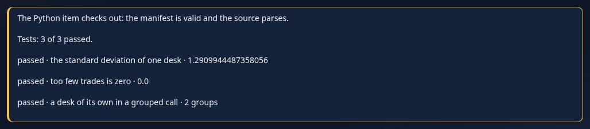

#### 3.10 Python on boards and in alerts

**Boards.** A board tile may show a **python visual** of its report: a Python measure shown as bars, a Python visual that returns a
chart, or one that returns a Vega-Lite specification. The tile runs the item for the person looking, exactly as the report does, and shows
the line *Python · item · target · ms · rows* under it. The sample board `python-wall`
([config/bi/reports/banking/python-wall.report.yaml](../../../config/bi/reports/banking/python-wall.report.yaml)) has three:

```yaml
- { id: vol,   type: tile, title: Desk P&L volatility, from: { report: python-desk-risk, visual: volatility }, at: { x: 0, y: 0, w: 6, h: 6 } }
- { id: hist,  type: tile, title: One-day P&L,          from: { report: python-desk-risk, visual: histogram },  at: { x: 6, y: 0, w: 6, h: 6 } }
- { id: strip, type: tile, title: P&L by desk,           from: { report: python-desk-risk, visual: strip },      at: { x: 0, y: 6, w: 12, h: 6 } }
```

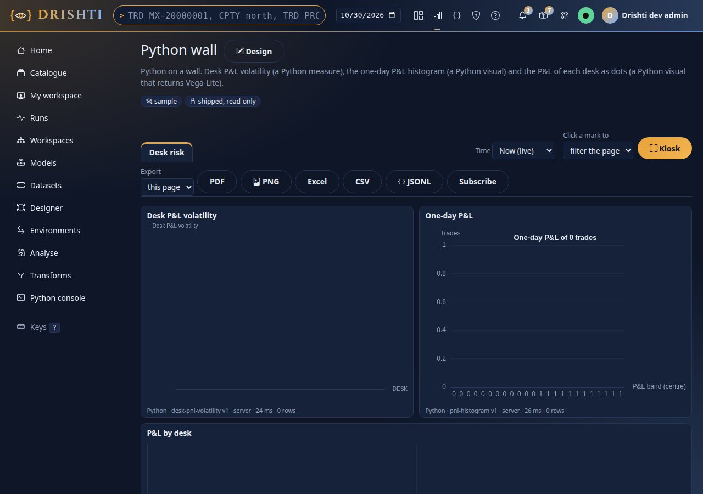

A Python tile has **no `alert:` of its own**: the colour rule reads the numbers a query returns, and a Python tile's number is made by code
that runs for the person looking. To be told when a Python measure crosses a limit, make an **alert** on it.

**Alerts.** An alert's source may be a **Python measure**: a dataset source whose measure is one (`type: dataset`,
`measure: Desk P&L volatility`), or a visual source whose visual is a python visual that shows one. It is read **for each person it is
judged for**, on the alert's schedule, after a load or by hand:

1. the server builds **that person's rows** (their row rules and masks applied by the engine) for the measure's `inputs` and `by` columns,
   up to `drishti.bi.report.python-rows`;
2. it hands the Python item and the rows to the compute pool `python`, which runs the item in the same strict sandbox;
3. the item's number for each group comes back and is reduced to **one number**: for a dataset source the whole input is one group; for a
   visual source `reduce` (`first` by default; `sum`, `min`, `max`, `avg`, `last`, `count`) is applied to the groups.

* A column **masked for the person** makes the reading *masked*: nothing is run and no figure is shown. An alert whose number is masked
  for its owner **when it is saved** is refused (`422`, *the value this alert watches (MTM) is masked for you, so it could never be read:
  an alert only watches a value its owner may see*).
* A visual or model query that answers **several rows** needs the number chosen: one cell (a `state` that filters it to one row) or an
  aggregate (`source.reduce`); saving one without `reduce` is refused and says which to choose.
* A run that fails (the code raised, a limit, the sandbox refused something, Python not running on this server) is an **error reading**
  with the DRS code and its words in the history; an error reading never fires and never clears.
* A python visual that draws a **chart** (no measure in its wells) has no number to watch: the alert reads as an error that says to watch
  a Python measure.
* A Python alert is not cheap (it starts a process for each person each time): prefer `schedule` or `after-load` to `live`.

```
PUT /api/v1/alerts/rules/Vol
{"title": "Desk P&L volatility", "source": {"type": "dataset", "dataset": "file:dataset:trades-basic", "measure": "Desk P&L volatility"},
 "condition": {"type": "threshold", "op": "above", "value": 5000}, "trigger": {"mode": "after-load"}}
```

The rest of alerts (conditions, triggers, delivery) is in [BI_GUIDE.md](README.md).

### 4. Transforms: a table in, a table out

The third interface, after the Measure and the Visual, is the **Transform**: Python that turns the frames of one or more answers into **a
table**, which a **Python dataset** publishes as its one table (`source: { python: <item>, inputs: { <name>: <a model query> } }`), with
measures in a model over it. Use it where a join or a reshaping is easier in pandas than in the dataset language (a merge with a
tolerance, a rank, a fitted column, a pivot), and you still want the result to be a dataset every report, alert and subscription can use.

```yaml
rachana: 1
python: pnl-vs-exposure
interface: transform            # a table in, a table out
inputs: [pnl, exposure]         # the inputs of the Python dataset (model queries), in the order its function receives their frames
packages: [pandas]
target: server                  # a Transform runs on the server and its result is kept for the reader
timeout: 20
memory: 512
params: { floor: 1.0 }          # defaults; the dataset may override them
source: |
  def run(pnl, exposure, params):
      m = pnl.merge(exposure, on="counterparty", how="left")
      m = m.rename(columns={"Desk P&L": "desk_pnl", "Exposure (EE peak)": "ee_peak"})
      m["pnl_per_exposure"] = m["desk_pnl"] / m["ee_peak"].clip(lower=float(params.get("floor", 1.0)))
      return m[["counterparty", "name", "sector", "desk_pnl", "ee_peak", "pnl_per_exposure"]]
```

**The contract.**

| | |
|---|---|
| function | `run(*frames)`: one **pandas DataFrame** per input, in the order of `inputs`. A function that has a parameter named `params` receives the parameters (the manifest's `params` over the dataset's); or a class named `Transform` with a method `run(self, *frames)`, which finds the parameters in `self.params` |
| frames | what the reader may see: each input is a model query asked **as the reader**, so row rules and masks are already applied and a masked column is null. Each column is named by the last part of its field or measure name (`counterparties.id` is `id`) |
| returns | a DataFrame: no more than `drishti.bi.transform.max-rows` rows; column names of letters, digits and underscore; no duplicate names. Anything else is `DRS-9071` |
| column types | typed from the frame: `int` is `integer`, `float` and decimals are `decimal`, `bool` is `boolean`, dates and timestamps are `date` and `timestamp`, everything else `string` |
| `inputs` (manifest) | the names of the Python dataset's inputs, not columns: the dataset's `source.inputs` must name the same in the same order (`DRS-9075` otherwise) |
| `target` | `server` only |

**Who sees what.** The server asks each input as the reader and hands the answers to the pool, exactly as for a Python measure. The frame
comes back as a Parquet file, is checked against the columns and types the dataset or table declares (its **contract**: a column
missing, or `string` where `decimal` is declared, is `DRS-9075` in words), and the server keeps it for **that reader** and the version of
the inputs (`drishti.bi.transform.cache-ttl`, `cache-entries`). The code never sees anything the reader may not; another reader gets their
own run. Real output of the sample's first and second run (an author who may read every row):

```
Python Transform pnl-vs-exposure: 18 rows in 218 ms (first run); the same reader again: kept, 0 ms
```

**Checks.** The server checks the manifest on validate and publish (`DRS-9070`): a transform needs `inputs` naming datasets, defines `run`
(a top-level function or the method of a class `Transform`), and `target` is `server`. Check adds the source checks on the pool (it parses,
defines its entry, imports only what it lists; nothing runs).

**From the Notebook.** A notebook that joins several extracts in pandas ([section 2.2](#22-the-extract)) can **Promote to a Transform**:
each `extract("name")` becomes a parameter of `run`, the cell's `result` is returned; the draft is then checked and published, and a
Python dataset is written over it (the dataset wizard's source *A Python Transform*), one model query per parameter of `run`.


The sample is `config/bi/python/banking/pnl-vs-exposure.python.yaml` with the Python dataset `desk-pnl-vs-exposure-py-result` and the
model `desk-pnl-vs-exposure-py` over it ([the Notebook tutorial, step 8](#step-8--two-models-a-python-transform-and-a-join-in-the-notebook)).
Settings: `drishti.bi.transform.*` in
[CONFIGURATION.md](../../admin/CONFIGURATION.md#drishtibitransform--python-transforms-and-composed-datasets).

### 5. Data prep: the Transform editor

The Transform editor makes the Python path the data-prep tool a Power Query author expects, without a step language: **raw rows straight
from a connector**, a **step-by-step run with a preview and a profile after every step** and a **tested snippets library** for the common
reshapes. The steps are lines of pandas, run on the server's compute pool in the same sandbox as every Python item, on the rows the
person looking may see.

#### 5.1 Inputs straight from a connector

A Python dataset's `source.inputs` ([section 4](#4-transforms-a-table-in-a-table-out)) takes, besides a model query, a **pack kind read
through a connector**:

```yaml
source:
  python: fx-book-value-cleaned
  inputs:
    trades:                                   # the name run() receives it by
      kind: trade                             # a pack kind
      pack: trading                           # optional: which pack's definition (default: the first that declares it)
      connector: prep-store                   # optional: a connector by name (default: whichever the pack routes the kind to)
      fields: [TRADE_ID, TRADE_DATE, PORTFOLIO, CURRENCY, QUANTITY, PRICE]   # optional: the kind's columns (default: all)
      where: [{ field: PORTFOLIO, op: in, values: [BOOK-FX-1] }]             # optional: filters, as a model query's
      limit: 50000                            # optional: at most this many rows
    rates: { model: fx-rates@1, select: { fields: [rates.currency, rates.date, rates.rate], measures: [] }, shape: rows }   # a model query
```

A kind input is the rows of the kind's pack-generated dataset (`pack.trading.trade`), asked through its implicit model **as the reader**:
the kind's entitlements, their row rules and their masks apply exactly as in a report on it, and a masked column arrives masked. A role that
may not read the kind gets no rows. Naming a connector reads the same kind through that connector instead of the one the pack routes it
to; the input then asks only the fields it names (and the grain's keys), so **the connector must keep them as columns** (its `layout`),
which every lake connector does for the promoted columns. Its answers are never put in the result cache; the Transform keeps its own
result per reader.

The server checks the shape on validate and publish (`DRS-9108` with the path: `source.inputs.trades.colour`), a kind no pack declares is
`DRS-9102`, a field the kind lacks `DRS-9108` with the kind's columns, a connector that is not running `DRS-9026`. The lineage of the
dataset reaches the kind and the connector (`pack-kind`, `connector: prep-store`, `input: trades`).

**One input as you.** `POST /api/v1/bi/python/input` with `{input, limit?, asOf?}` answers the rows of one input (either form) as the
caller: Arrow with `?format=arrow` (headers `X-Bi-Rows`, `X-Bi-Masked`, `X-Bi-Model`, `X-Bi-As-Of`, the day the rows came from) or JSON
`{model, kind, columns, rows, rowCount, masked, asOf}`; `limit` defaults to 1,000 and never exceeds
`drishti.bi.transform.max-input-rows` (50,000). It needs the BI power. This is what the editor previews, and what
`drishti.py bi transform input` prints.

#### 5.2 The editor

**BI → Transforms** (`/bi/transform`, the rail's *Transforms*; also the Notebook's *Transform editor* link) builds a Transform in four
parts, with **no YAML to type**:

1. **Inputs.** Name it as the code will (`trades`), then *A pack kind, straight through its connector* (pick the kind, optionally type the
   connector, tick the fields) or *A model or a dataset* (a model query of rows). The line under the input says how many rows came, the day
   they are of and what is masked for you.

   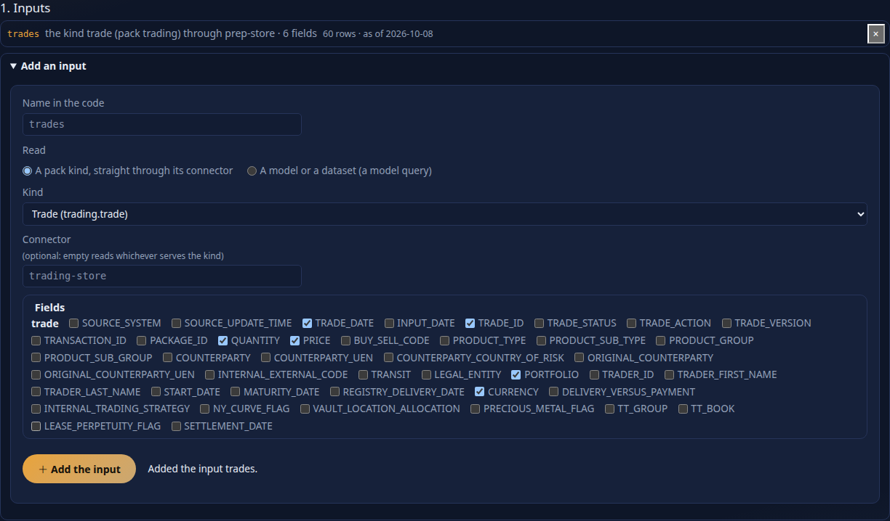

2. **Steps.** The first is *Start from trades* (`df = trades.copy()`). *Add a step from the snippets* opens a form for the snippet you
   choose ([section 5.3](#53-the-snippets-library)): the columns are those of the step before, the inputs are yours. *Write a step* takes a
   label and a few lines of pandas over `df`. A step is inserted after the one you are looking at; each can be edited (✎), moved (↑ ↓) or
   removed (×), and *Undo the last step* removes the last.
3. **Preview.** After every change the console asks the server to run the steps ([section 5.4](#54-the-step-by-step-run)) and each step
   shows its rows and columns; pick one to see its **first 20 rows** (*Rows*) or its **profile** (*Profile*,
   [section 5.5](#55-profiling)). A step that fails turns red, says its error and line, and the steps before it keep their frames.

   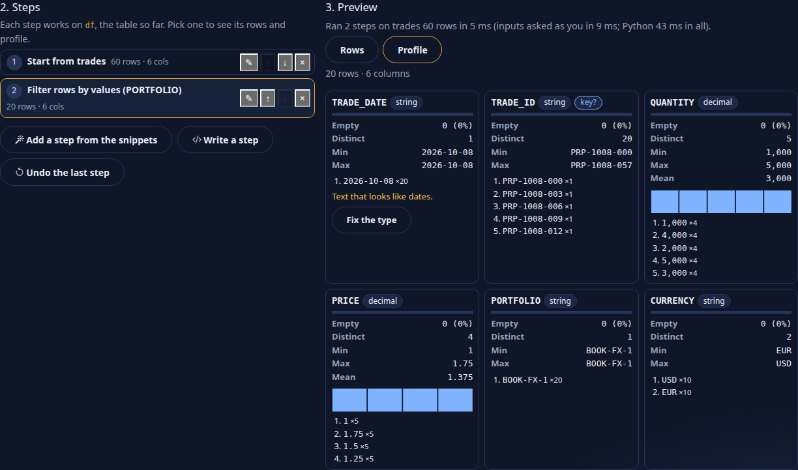

   

4. **Save.** Tick the column(s) that make one row (the grain; a column that was unique in the preview is offered first) and *Save as
   drafts*: a **Python item** (`interface: transform`) and a **Python dataset** that runs it, both drafts in your workspace. Check and
   publish the Python item first, then the dataset. The page's address then names both (`/bi/transform?item=<id>&dataset=<id>`), and
   opening it again opens the same steps.

The YAML is shown under *YAML: what is saved* and stays in step with the page; edit either text and *Read the YAML back* to see it as
steps again (a Transform written by hand opens too: its `# step:` comments are the steps, or its whole body is one step).


What is saved, for the sample above:

```yaml
rachana: 1
python: fx-book-value-cleaned
title: FX book value, cleaned
interface: transform
inputs: [trades]
packages: [pandas, numpy]
target: server
timeout: 20
memory: 512
params: {}
source: |
  import re
  import numpy as np
  import pandas as pd

  def run(trades, params):
      # step: Start from trades
      df = trades.copy()
      # step: Filter rows by values (PORTFOLIO)
      df = df[df['PORTFOLIO'].isin(['BOOK-FX-1']) == True].reset_index(drop=True)
      # step: Calculated column (QUANTITY; PRICE)
      df['VALUE'] = (pd.to_numeric(df['QUANTITY'], errors="coerce") * pd.to_numeric(df['PRICE'], errors="coerce")).replace([np.inf, -np.inf], np.nan)
      # step: Group and total (CURRENCY; VALUE)
      df = df.groupby(['CURRENCY'], as_index=False, dropna=False)[['VALUE']].agg('sum')
      return df
```

Running the steps needs the **bi-author** power (it runs Python); without it the page still writes and reads the YAML.

#### 5.3 The snippets library

`drishti-console/config/prep-snippets.yaml` holds 21 snippets, each one step over `df` with parameters filled in a form. **A value is
always written as a Python literal** (`repr`): a column called `x"]; import os` is a column of that odd name, never code; an *input*
parameter must be one of the Transform's inputs and an *operator* one of its options (`DRS-9070` otherwise). Every snippet carries an
**example** (frames in, parameters, the frame expected out) that the test suite runs in plain pandas **and** as a step of the pool's
step-by-step run, so a snippet is correct out of the box.

| Group | Snippets |
|---|---|
| Columns | keep columns, rename a column, split a column, calculated column (`+ - * /`) |
| Clean | type fix: text to number, type fix: text to date, replace values, fill down (optionally within groups), remove duplicates |
| Rows | filter rows by values, drop rows with an empty value, sort rows |
| Combine | append another input (union), join another input, **as-of join of prices** (the latest price of the instrument on or before the row's date, within *n* days), **as-of FX conversion** (an amount to a base currency at the latest rate on or before the row's date) |
| Reshape | unpivot (columns to rows), pivot (rows to columns), group and total |
| Dates | align to a business day (following, preceding, modified following; weekends and the holidays you list), tenor bucket (`<1Y`, `1-2Y`, ..., `30Y+`) |

More snippets: a file of the same shape named by `bi.transform.snippets_file`
([CONFIGURATION.md](../../admin/CONFIGURATION.md#prep-snippetsyaml-the-transform-editors-data-prep-snippets)).

#### 5.4 The step-by-step run

`POST /bi/transform/steps` (the console) passes the page's inputs and code to the server (`POST /api/v1/bi/python/steps`): each input is
read **as you** ([section 5.1](#51-inputs-straight-from-a-connector), at most `bi.transform.preview_rows`, 1,000), then `run` runs **once**
on the compute pool (its usual sandbox and limits) with a mark after each step. The steps are the statements after each
`# step: <label>` comment of `run`'s body, or each top-level statement when there is none. After each step the worker describes the frame
that step made (the last DataFrame it assigned, else `df`; after the last step, what `run` returned): its rows, columns and types, its first
20 rows and its profile. The answer also profiles each input and gives the key hints between them. A step that raises stops the run:
`failed` has its index, label, line, error and traceback (the steps before keep their frames). Measured on the sample (60 rows, four
steps): the inputs asked in about 10 ms, the Python run about 45 to 65 ms in all.

The run is never kept: an author runs it as they edit. The Python dataset itself runs the same `run` as each reader when it is read.

#### 5.5 Profiling

The **profile** of a frame, worked out on the compute pool over the reader's rows, is one card per column: its type; **what its text looks
like** (numbers or dates kept as text, with *Fix the type*, which adds the right type-fix step; digits in a column named like an
identifier, `TRADE_ID` or `..._CODE`, are not offered a number type: ids are text by design); empty values (count and %, with a bar);
distinct values; **key?** when every row has its own value; min and max (and the mean of a number); the five most common values; a
histogram of a number. Between inputs, *looks like a key of* names a column whose values (90% or more) are the values of another input's
unique column, with how many match: the *Join* snippet joins them.

The same panel is the Notebook's **Profile** tab ([section 2.7](#27-profile)); the server's route is `POST /api/v1/bi/python/profile`. No
author code runs to profile.

### 6. On the command line

The commands run over REST as the token's user (`--server`, `--token-file`, `--user` as for every REST command;
[CLI_REFERENCE.md](../CLI_REFERENCE.md)):

Run these from the Drishti folder (the repository root, or the install folder of a release).

```
drishti.py bi sql "SELECT ..." --model M [--explain] [--format table|json|csv|jsonl]   a Notebook SQL cell's statement, from the terminal
drishti.py bi transform input FILE.dataset.yaml [--input NAME] [--limit N] [--as-of DATE] [--rows N] [--json]   each input as you: rows, masked columns, a profile
drishti.py bi transform snippets [--json]                                      the data-prep snippets
drishti.py bi transform snippet ID [NAME=VALUE ...] [--inputs a,b]             one step, its values written as literals
drishti.py bi item new WORKSPACE FILE.python.yaml                              a Python item draft (as the editor's Save makes it)
drishti.py bi item new WORKSPACE FILE.dataset.yaml                             the Python dataset draft
drishti.py bi item tests ID                                                    run an item's tests as you; exit 1 on a failure
drishti.py bi catalogue publish ID [--note TEXT]                               publish the draft (its tests run first)
```

Real output of `bi transform input` on the demo lakes
([the Notebook tutorial, step 12](#step-12--prepare-raw-trades-step-by-step-the-transform-editor)):

```
$ python3 tools/drishti.py bi transform input docs/tutorials/data/endur-trades-cleaned.dataset.yaml
trades: 1,000 rows of dataset:pack.trading.trade as of 2026-10-16
  CURRENCY                     text      empty     0  distinct      3  CAD .. USD
  MATURITY_DATE                text      empty     0  distinct     81  2024-11-01 .. 2029-10-31
  NOTIONAL                     float64   empty     0  distinct    971  2,855.8 .. 2.46923e+08
  PORTFOLIO                    text      empty     0  distinct      3  BOOK-COMM-1 .. BOOK-COMM-3
  TRADE_DATE                   text      empty     0  distinct    529  2024-10-10 .. 2026-09-25
  TRADE_ID                     text      empty     0  distinct   1000  1000005 .. 1005000
  TRADE_STATUS                 text      empty     0  distinct      5  AMENDED .. VALIDATED
$ python3 tools/drishti.py bi transform snippet filter-values column=TRADE_STATUS values=MATURED keep=false
# step: Filter rows by values (TRADE_STATUS)
df = df[df['TRADE_STATUS'].isin(['MATURED']) == False].reset_index(drop=True)
$ python3 tools/drishti.py bi transform snippet asof-fx amount=NOTIONAL currency=CURRENCY date=TRADE_DATE fx=rates --inputs trades,rates
```

`snippets` and `snippet` read the console's library (no server). The steps themselves run on the server's compute pool (the editor's
step-by-step run, and the dataset when it is read). The administrator's side (the lock file) is `tools/python_lock.py`
([section 9.3](#93-the-pinned-libraries-installing-and-locking-the-environment)).

### 7. The sandbox and who sees what

#### 7.1 What the sandbox enforces

Code people write runs only in the pool's **strict sandbox** (`isolation: strict`), and only where every part of it can be had. The walls
the kernel holds come first; Python's own guards are the second line.

| What | How |
|---|---|
| no network | the worker has a user and network namespace of its own with **no interface**, so nothing it or a library runs (Python, C or C++) can connect anywhere; the kernel also refuses TCP; a guard refuses `socket.*` in words |
| files only in its own folder | each request is held by the kernel (Landlock) to reading the Python installation, the module path, the system libraries and its own scratch folder, and to writing that folder only, so C++ code that opens a file itself (`pyarrow.fs`) is refused too |
| a separate process | a fresh process per request, started with an **empty environment** (no tokens, no proxies); nothing it leaves reaches the next request |
| no processes, no loader | `subprocess`, `os.system`, `exec*`, `spawn*`, `fork` and loading with `ctypes` are refused |
| CPU time and wall time | the item's `timeout`; past it the request is stopped: `DRS-9072` |
| memory | what Python needs to start plus the item's `memory` MB (never more than the pool's): `DRS-9072` |
| output | an answer at most 4 MB, a Transform's file at most `drishti.bi.transform.max-bytes`: `DRS-9072`; the input at most 256 MB |
| pinned libraries | the packages an item may list are the allow-list that `config/compute/locks/python.lock` pins; while the pool's interpreter carries a different version of one, every run is refused, naming the package |
| imports | the author's own `import` may name only the listed packages and a short list of safe standard-library modules (`math`, `statistics`, `json`, `datetime`, `re`, `collections`, `itertools`, `functools`, `typing`, `decimal`, `fractions`, `random`, ...); `exec`, `eval`, `compile` are not given |
| the input is what the reader may see | the server reads the rows as the person running it (row rules and masks), and the function gets only the columns of `inputs` |
| every run audited | the audit log has one line per run (`python-run`): who, what ran, on which pool, the outcome, the time and the bytes handed over |

**Where it cannot be safe, it does not run.** The strict sandbox needs Linux with Landlock (kernel 5.13 or later) and user namespaces. On
**Windows** and on a Linux without them, no code people write runs: every run answers `DRS-9074` with the reason, and the Notebook's Run
and the table editor's Sample run are off and say why. Nothing falls back to a weaker sandbox. A file or feed the code needs is read by the
server and handed in as an input; the code itself never reaches a network.

#### 7.2 Who sees what

* The rows are the server's answer for **this person**: their row rules, their masks, their business date. A masked column arrives masked
  (`X-Bi-Masked` lists it; the visual's line says *masked*); Python never receives the real value, so it cannot reveal it. The result is
  derived from those rows only.
* A **traceback** is shown to people with the `bi-author` power; everyone else sees the code and the message
  (`DRS-9071 ZeroDivisionError: division by zero`) without the source lines.
* Which item runs, and which rows it reads, are decided by the **server**; the console passes on the person's identity and decides nothing
  about access.
* Every non-GET call takes JSON from the console's own pages only (same-origin check and `application/json`, `DRS-5002` / `DRS-5001`;
  [API_REFERENCE.md](../API_REFERENCE.md)).

### 8. Limits and errors

#### 8.1 The limits

| Limit | Where it is set |
|---|---|
| rows handed to a python visual or measure | `drishti.bi.report.python-rows` (10,000) |
| an item's time and memory | its manifest's `timeout` and `memory`, capped by `drishti.bi.report.python-max-seconds` (60) and `python-max-memory-mb` (1024) |
| a Notebook extract, SQL cell and Python cell | `bi.notebook.*` ([section 2.9](#29-notebook-settings-errors-and-routes)) |
| a Transform's rows, input rows, result size and cache | `drishti.bi.transform.*` (`max-rows`, `max-input-rows`, `max-bytes`, `cache-ttl`, `cache-entries`) |
| the editor's preview rows, extra snippets | `bi.transform.*` (`preview_rows`, `snippets_file`) |
| how many run at once | the pool's workers and queue ([section 9.2](#92-workers-memory-and-time)) |

Every key, its default and its environment variable is in [CONFIGURATION.md](../../admin/CONFIGURATION.md):
[`drishti.bi.report`](../../admin/CONFIGURATION.md#drishtibireport--reports-phase-3),
[`drishti.bi.transform`](../../admin/CONFIGURATION.md#drishtibitransform--python-transforms-and-composed-datasets),
[`bi.notebook`](../../admin/CONFIGURATION.md#binotebook), [`bi.transform`](../../admin/CONFIGURATION.md#bitransform) and
[`compute`](../../admin/CONFIGURATION.md#compute-workers-configcomputecomputeyaml).

#### 8.2 Errors: DRS-9070 to DRS-9077

| Code | HTTP | Meaning | Usual cause |
|---|---|---|---|
| `DRS-9070` | 422 | a Python item or its use is not valid | a manifest key, a package off the list, no entry function, a python visual with no item |
| `DRS-9071` | 422 | the code failed | an exception (the message names it; authors also get the traceback), a measure that returned something that is not a number, a visual that returned neither an option, an SVG nor a PNG |
| `DRS-9072` | 413 or 504 | a limit stopped it | over `timeout` (504), over `memory`, input or output size (413) |
| `DRS-9073` | 403 | the sandbox refused something | an `import` that is not on the list, the network, a file outside the scratch folder, a process |
| `DRS-9074` | 503 | Python does not run here now | compute off, the pool `python` missing or not strict, the strict sandbox not available on this platform (Windows), the interpreter not carrying the pinned versions, the pool's queue full |
| `DRS-9075` | 422 | a Transform's result is not usable | a column the dataset declares is missing from the frame or of another type, or the Transform's `inputs` are not the dataset's inputs |
| `DRS-9076` | 422 | a test the item ships with fails, so it is not published | a publish (or approve) of a Python item whose `tests:` do not all pass; a bi-admin may publish with `force: true` |
| `DRS-9077` | 422 | a Vega-Lite specification could not be drawn (shown in the visual's frame; no HTTP call) | a `url` or `loader` in the specification, a feature drishti-chart does not translate (named with what to use instead), an invalid specification |

Real answers of the pool's engine in its strict sandbox (a measure on three rows, then a read the guard refuses and one only the kernel
can):

```
{"ok": true, "kind": "measure", "by": ["desk"], "rows": [["A", 3.0], ["B", 5.0]], "ms": 18}
{"ok": false, "kind": "sandbox", "error": "Denied: reading /etc/hostname is not allowed", "traceback": "  File \"<python-item>\", line 2, in render ..."}
{"ok": false, "kind": "sandbox", "error": "PermissionError: [Errno 13] Failed to open local file '/home/.../.bashrc'. Detail: [errno 13] Permission denied"}
```

The server answers them as `DRS-9071` to `9073` (the traceback for authors only).

#### 8.3 Does Python run here?

`GET /api/v1/bi/python/runtime` (the console's `GET /bi/python/status`; the Notebook's `GET /bi/notebook/status`) says whether Python
runs, and why not:

```
{"runs": false, "why": "Python runs on the server's compute pool, and compute is off (compute.enabled in config/compute/compute.yaml)", "where": "server",
 "pool": "python", "packages": ["pandas", "numpy", "pyarrow", "scipy"], "pins": {"numpy": "2.5.3", "pandas": "3.0.6", ...}, "calls": 0, "failures": 0}
```

**How fast.** With pandas loaded, the engine answers a measure, a Transform, a cell or a profile in **11 to 24 ms** inside a warm worker
(strict sandbox included); the first request of an idle pool also pays for the worker's start, about 0.2 s plus the imports. More in
[OPERATIONS_GUIDE.md](../OPERATIONS_GUIDE.md#21-troubleshooting).

### 9. For administrators: turning Python on

Python is **off as shipped**. Turning it on is three things: switch compute on, size the pool `python`, and make sure its interpreter
carries the pinned libraries. The compute workers in general (other pools, connector requirements and their approval, Admin → Compute) are
in [OPERATIONS_GUIDE.md › Compute workers](../OPERATIONS_GUIDE.md#15-compute-workers).

#### 9.1 Switch on compute and the pool `python`

1. Use a **Linux** server with Landlock (kernel 5.13 or later) and unprivileged user namespaces ([section 7.1](#71-what-the-sandbox-enforces)).
2. In `config/compute/compute.yaml` set `compute.enabled: true` (or the environment variable `DRISHTI_COMPUTE_ENABLED=true`), and point
   `compute.python` (`DRISHTI_PYTHON`) at the interpreter the workers use (empty: `python3`).
3. Keep the shipped pool `python` as it is: `engines: [drishti_compute.items:ItemsEngine]`, `isolation: strict`, `mode: fork`. A pool that
   is missing or not strict makes every run answer `DRS-9074`.
4. Restart the server, then check `GET /api/v1/bi/python/runtime` (or open the Notebook): `"runs": true`.

`drishti.bi.transform.enabled` switches every Python run off again without touching compute. The console has no Python setting: it runs
none.

#### 9.2 Workers, memory and time

The shipped pool:

```yaml
    python:                          # code people write: Python items, Python-driven tables and models, Notebook cells
      type: python
      engines: [drishti_compute.items:ItemsEngine]
      environment: system            # the site's interpreter, checked against locks/python.lock before any run; or { python: "3.13", lock: locks/python.lock, index: <name> }
      isolation: strict              # no network and files held by the kernel: Linux only; elsewhere no run
      workers:
        min: 0
        max: ${DRISHTI_COMPUTE_PYTHON_WORKERS:4}
      mode: fork                     # strict isolation needs a fresh child per request
      memory: 6GB                    # the worker's address space: pandas, NumPy and Arrow loaded (about 2.5 GB of it) plus an item's own memory
      cpu-seconds: 120
      recycle-after: 200
      batch-share: 0.5               # a Python-driven table's scheduled build is batch work
      idle-stop: 5m
      timeout: 60s                   # an item's own timeout may be shorter (drishti.bi.report.python-max-seconds caps it)
      timeout-batch: 10m
```

* **How many at once:** `workers.max` (4 as shipped; any number, per node with `compute.nodes.<node>.pools.python.workers`). A full queue
  answers `DRS-9074`; one person runs at most `compute.scheduling.max-inflight-per-user` at once.
* **Warm workers:** every call is a fresh child of a worker that imported pandas, NumPy and pyarrow once. `workers.min` (0 as shipped)
  keeps that many started, so the first call after an idle spell does not pay about 0.2 s plus the imports; isolation is unchanged.
* **Per item:** the item's `timeout` and `memory` are capped by `drishti.bi.report.python-max-seconds` and `python-max-memory-mb`; a
  Notebook cell by `bi.notebook.cell_timeout_seconds` and `cell_memory_mb`.

#### 9.3 The pinned libraries: installing and locking the environment

The libraries code people write may import are **one pinned set**: `config/compute/locks/python.in` lists the whole environment, one
`name==version` per line, transitive packages included (as shipped: numpy, pandas, pyarrow, scipy, python-dateutil, six, tzdata), and
`config/compute/locks/python.lock` pins each to the sha256 of each of its files. The manifest allow-list `drishti.bi.report.python-packages`
offers only what the lock pins (a test holds the two together).

There are two ways to give the pool that environment:

* **`environment: system`** (as shipped): the site's interpreter. Install the pinned versions into it, for example
  `python3 -m pip install --require-hashes --no-deps -r config/compute/locks/python.lock`. Before any run the server asks the pool for its
  interpreter's versions and refuses every run, naming each package, while one differs from its pin.
* **A locked environment**: `environment: { python: "3.13", lock: locks/python.lock, index: <name> }`. Drishti does not build it: the operator installs those pinned libraries into the Python the pool runs (`drishti.python`) with pip, and the pool checks them against the lock at every worker start; a missing one is an error naming it and the pip command.

**To add or change a library** (for example `statsmodels`, `scikit-learn` or `polars`):

1. add it, and every package it needs, to `config/compute/locks/python.in` with one version each;
2. write the lock on a machine that may reach the package index, and commit it:

   ```
   python tools/python_lock.py config/compute/locks/python.in --out config/compute/locks/python.lock [--index URL]
   ```

3. add the import name to `drishti.bi.report.python-packages`;
4. install it into the pool's interpreter (or rebuild the locked environment) and restart the workers.

Nothing is resolved at install time: the lock is the whole environment.

#### 9.4 Watching it

* **Admin → Compute** shows the pools, workers busy, queues, latency, environments and recent requests.
* The **audit log** has one `python-run` line per run (who, what, the pool, the outcome, the time, the bytes).
* `GET /api/v1/bi/python/runtime` says whether Python runs and why not ([section 8.3](#83-does-python-run-here)).
* On **Windows** Python runs stay off by design (no network namespace, no Landlock): every run says so with `DRS-9074`.

### 10. Calc: Python in your own browser

Calc is a Labs feature (off as shipped) that runs Python in your browser on a view's rows and never publishes. It has its own page:
[Calc: Python in your own browser](CALC.md).

## Tutorial: The Notebook and Python

SQL measures cover most questions. When a figure needs a real function (a standard deviation of P&L per desk, a histogram, a model) you write it in **Python**, and Drishti runs it **sandboxed, on the rows the person looking may see**. And when you do not yet know the question, the **Notebook** gives you
an extract of a model to query with **SQL** on the server, work on in **Python** on the server's compute pool, keep as a **notebook**, and **promote** to a measure, a visual or a report draft (slicing is the **Pivot**'s). This tutorial does both on the demo trades, through the
model `trades-basic@1` (every sample is a model over datasets). Every step shows it **in the UI**, **on the command line** (`python3 tools/drishti.py`, or `curl`) and **as YAML**, or says why one of the three does not apply.

### Time to complete

About 60 minutes (step 12: 15 minutes).

### Before you start

- The quick-start environment of [the reports tutorial](REPORTS.md#before-you-start) (the demo lakes: 15,000 trade valuations over ten desks,
  business date 2026-10-16) and tutorial 10 done (reports, workspaces, `Economics desk`). You sign in as the development administrator, who holds the `bi-author` power that Python needs (SQL cells need only `bi`).
- Python on the server: compute switched on, and the server's compute pool `python` pointed at an interpreter that carries the pinned libraries (`DRISHTI_COMPUTE_ENABLED=true`, `DRISHTI_PYTHON=<python with pandas, numpy, pyarrow and scipy at the versions of config/compute/locks/python.lock>`; [OPERATIONS_GUIDE.md](../OPERATIONS_GUIDE.md)). Every Python item runs on that pool, in a strict sandbox (no network, files held to its own folder), never in the console or your browser; on a Windows server Python is off and says why.
  the browser. **Calc** (the step that asks a BI model from a view, Alt+C) is the one exception: it is Python on the screen you are on, in your browser, so its
  runtime must be installed once on the console with `python tools/drishti.py calc install` ([OPERATIONS_GUIDE.md](../OPERATIONS_GUIDE.md#2-install-and-run-on-one-machine)); without it Calc says
  *Python runtime not installed* and Run stays disabled.
- Two small files in [data/](../../tutorials/data): [notional-by-desk.python.yaml](../../tutorials/data/notional-by-desk.python.yaml) (a Python visual) and [desk-python.report.yaml](../../tutorials/data/desk-python.report.yaml) (a report on the model `trades-basic@1` that uses it).
- The personal API token of [tutorial 1, step 9](../../tutorials/01-first-15-minutes.md#step-9--make-a-token-for-the-command-line) in `DRISHTI_TOKEN` (with `bi:write`),
  and `DRISHTI_SERVER`. The Notebook and Calc calls quoted below are the console's, made with your session: a personal token does not reach them.

### What you will learn

- the two kinds of Python item: a **measure** (`compute(table, params)`, one number per group) and a **visual** (`render(table, params)`, a chart);
- how a report uses them, where they run, and what the sandbox forbids;
- the **Notebook**: the extract of a model, **SQL** (Drishti SQL on the server over the model), a **Python** cell for the server's compute pool, saving a **notebook**, and **promoting** work into BI items; slicing in the **Pivot**.
- **Python across models**: a **Transform** that turns the answers of two model queries into a table (a **Python dataset**, 2.2), and a notebook that joins two extracts in pandas and promotes the join to a Transform;
- **Vega-Lite** charts (written in a report, or returned by Python), the **tests** a Python item carries, where a SQL cell runs and promoting into an **existing** report, **Calc's BI client** (a Labs scratch pad; steps 9 to 11).
- **Data prep**: a Transform built step by step in the **Transform editor** from raw trades read straight through a connector, with a preview
  and a profile after every step and no YAML to type (step 12).

### Step 1 · Python in a report: the shipped sample

Open **Catalogue → Desk P&L risk (Python)**.

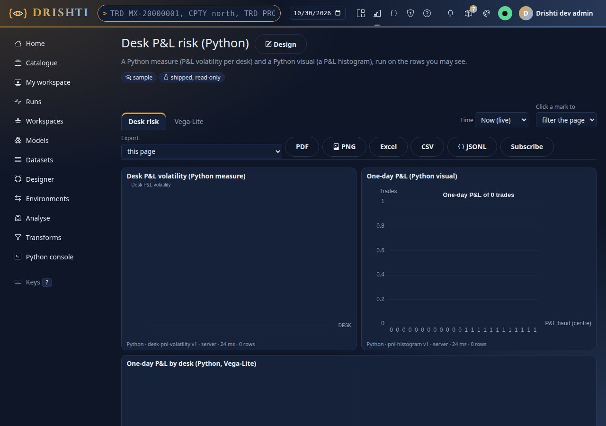

You should see two charts. Under each is a line such as `Python · desk-pnl-volatility v1 · server · 278 ms · 10000 rows`: the **item** that drew it, its version, **where it ran** (the server's compute pool, `server`) and how many rows it was handed. The left chart is a **Python measure** (the volatility of one-day P&L of each desk); the right one is a **Python visual** (a histogram drawn with numpy).
Both worked on the trades **as you may see them**: masks and row rules were applied before Python saw a row. A Python visual is handed at most 10,000
rows, so on the demo lake's 15,000 trade valuations it works on the first 10,000 (the server says so: `DRS-9022` is what a plain JSON answer of more rows
is told); a Python measure for a figure over every row belongs in a model query, or in a Transform over grouped answers (step 8).

The measure's source is a short YAML item, `config/bi/python/banking/desk-pnl-volatility.python.yaml`:

```yaml
python: desk-pnl-volatility
title: Desk P&L volatility
interface: measure
inputs: [PNL_1D]                 # the columns the function reads, as the table names them
packages: [pandas]               # what the source imports (must be on the allow-list)
target: server                   # the console runs it (there is no browser target)
timeout: 10                      # seconds
memory: 256                      # megabytes
params: { min_trades: 2 }
source: |
  def compute(table, params):
      """One number for the rows of one group."""
      pnl = table["PNL_1D"].dropna()
      if len(pnl) < int(params.get("min_trades", 2)):
          return 0.0
      return float(pnl.std(ddof=1))
```

The **model** (`config/tables/banking/trades-basic.model.yaml`) says which groups it is called for (one number per desk) in a measure that is a Python item,
not an expression:

```yaml
measures:
  Desk P&L volatility:
    python: desk-pnl-volatility      # the item
    inputs: [trade.PNL_1D]           # columns of ONE dataset of the model
    by: [trade.DESK]                 # one number per desk
```

**On the command line** the model lists it with its item, beside the measures that are expressions:

```text
$ python3 tools/drishti.py bi model describe trades-basic@1
Trades, the basics  (trades-basic@1)

trade  fact  trades-basic-trade 1.0.0
  trade.VALUATION_ID                 string    key
  trade.TRADE_ID                     string    dimension
  trade.SOURCE_SYSTEM                string    dimension
  trade.DESK                         string    dimension
  trade.PORTFOLIO                    string    dimension
  trade.PRODUCT_TYPE                 string    dimension
  trade.CURRENCY                     string    dimension
  trade.TRADE_STATUS                 string    dimension
  trade.NOTIONAL                     decimal   amount        amount0
  trade.MTM                          decimal   amount        signed0
  trade.PNL_1D                       decimal   amount        signed0
  trade.TRADE_DATE                   date      date
  trade.MTM_IN_MILLIONS              decimal   amount

measures
  Notional                          sum(trade.NOTIONAL)
  MTM                               sum(trade.MTM)
  Trades                            count(trade)
  Average MTM per trade             measure('MTM') / measure('Trades')
  Desk P&L volatility               python: desk-pnl-volatility
  Count of trade                    count(trade)  (default)
```

A model query computes it like any measure, on the server's rows (every row, not the visual's 10,000), one call of the item per group:

```text
$ python3 tools/drishti.py bi mq --model trades-basic@1 --select trade.DESK --measures "Desk P&L volatility" --limit 3
trade.DESK   Desk P&L volatility
-----------  -------------------
DESK-COMM    217,782.36
DESK-CREDIT  159,732.60
DESK-EQD     183,546.29
3 row(s)  as of 2026-10-16  plan p_8978bc854cd42c41
```

The report's python visual draws it from the rows it is handed.

### Step 2 · A Python visual of your own

A visual is a function `render(table, params)` that gets the rows of the visual's `columns` well and returns a chart **as data** (an ECharts option, SVG text or PNG bytes; never HTML or script). Here is the tutorial's, which draws the largest desks by notional:

```yaml
rachana: 1
python: notional-by-desk
title: Notional by desk chart
interface: visual
output: echarts
inputs: [DESK, NOTIONAL]
packages: [pandas]
target: server
params: { top: 8 }
source: |
  def render(table, params):
      top = int(params.get("top", 8))
      g = table.groupby("DESK", as_index=False)["NOTIONAL"].sum().sort_values("NOTIONAL", ascending=False).head(top)
      return {
          "title": {"text": f"Notional of the {len(g)} largest desks", "left": "center"},
          "xAxis": {"type": "value", "name": "Notional"},
          "yAxis": {"type": "category", "data": list(g["DESK"])[::-1]},
          "series": [{"type": "bar", "data": [float(v) for v in g["NOTIONAL"]][::-1]}],
      }
```

A Python item is a BI item like a dataset or a report: stored, versioned, reviewed and published. Create it in your workspace. **In the UI** that is a form, and you do not start from a blank page: **My workspace → New item**, kind *python*, and **What does it make?** asks for *a measure* (one number per group), *a visual* (a chart drawn by Python) or *a table* (a Transform, which joins datasets), and for the columns it reads (or, for a table, the datasets it reads). **Create and open the editor** makes the item with a valid, commented starter body (the manifest the server checks, a function of the right shape, and for a measure a test) and opens it with its editor ready, so you change the code and press **Check the Python**.


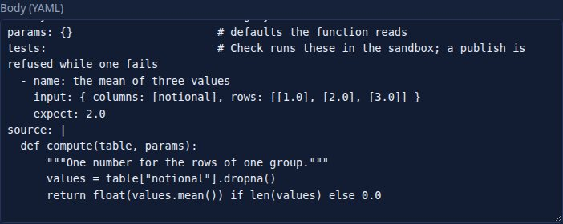

For this step choose *a visual* and replace the body with the tutorial's, or, **from the file**, paste the YAML from `data/notional-by-desk.python.yaml` into the same form's item page (**Edit**), the way it was done before the starter existed: kind *python*, title `Notional by desk chart`, **Create item**. (The picture below moved it into `Economics desk`.)


You should see the item as a draft with its actions. Press **Check the Python**: the console checks what only it can, that the source parses, defines its entry (`render`) and imports only what the manifest lists or the safe standard library.

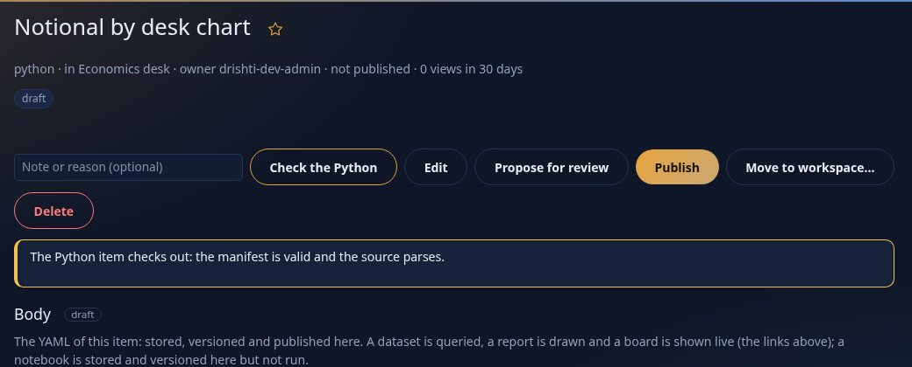

You should see `The Python item checks out: the manifest is valid and the source parses.` A mistake is reported with its code. A package that is not allowed, for example `packages: [requests]`, is refused (`DRS-9070`) with the allow-list:

```text
$ POST /bi/python/check   (packages: [requests])
{"valid": false, "problems": [
  {"level": "error", "code": "DRS-9070", "path": "packages", "message": "'requests' is not an allowed package (allowed: pandas, numpy, pyarrow, scipy)"},
  {"level": "error", "code": "DRS-9070", "path": "packages", "message": "'requests' is not on the pool's pinned allow-list (pandas, numpy, pyarrow, scipy)"}, ...
```

Press **Publish** (a Python item must be published for a report to use it). **From the command line** the same two moves (`bi item new` reads the
kind from the file name; the ids differ on your machine):

```text
$ python3 tools/drishti.py bi item new economics-desk docs/tutorials/data/notional-by-desk.python.yaml
bi-9f1278b922  python  Notional by desk chart  draft in Economics desk
$ python3 tools/drishti.py bi catalogue publish bi-9f1278b922 --note "my first Python visual"
published Notional by desk chart as version 1
```

Now the report, [data/desk-python.report.yaml](../../tutorials/data/desk-python.report.yaml): it reads the model (`model: trades-basic@1`), a slicer, a `python` visual
that names your item, and one that uses the shipped measure.

```yaml
- id: notional-chart
  type: python
  title: "Notional by desk (my Python visual)"
  at: { x: 0, y: 2, w: 6, h: 6 }
  wells: { columns: [trade.DESK, trade.NOTIONAL] }       # the rows handed to Python
  format: { python: Notional by desk chart, params: { top: 8 }, run: auto }
- id: volatility
  type: python
  wells: { values: [Desk P&L volatility] }                # a Python measure of the model
  format: { run: auto }
```

Create it (New item, kind *report*, or `python3 tools/drishti.py bi item new economics-desk docs/tutorials/data/desk-python.report.yaml`) and press **Open the report**.

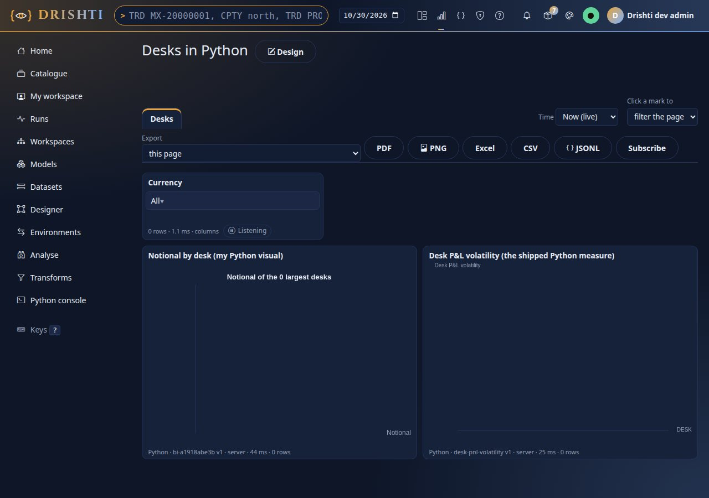

You should see your chart, `Notional of the 8 largest desks`, drawn by your function, beside the shipped one; the footer of yours reads `Python · bi-... v1 · server · 320 ms · 10000 rows`. Choose a currency in the slicer: the chart is asked again and Python gets only those rows (the rows are the table's own, under the page's slicers, filters and business date, at most 10,000). `format.run` is `auto` (the server first, the browser if the server cannot), `server` or `browser`.

**The sandbox.** The server target runs a short-lived worker process per call: **no network**, a scratch folder only, limits on CPU, memory, time and output, and **nothing kept between calls**, so nothing leaks between people. `import` works for the allow-listed packages. Python never reaches the server's data directly; it receives the Arrow rows the server built for the person.

### Step 3 · The Notebook: an extract to work on

Choose **Notebook** in the BI rail (`/bi/notebook`). In **Model or dataset** choose **Trades, the basics (model 1.0.0, published)** (the list holds the
models first, then your datasets and the packs' datasets, one group per pack), tick the fields you want and press **Open the extract**.

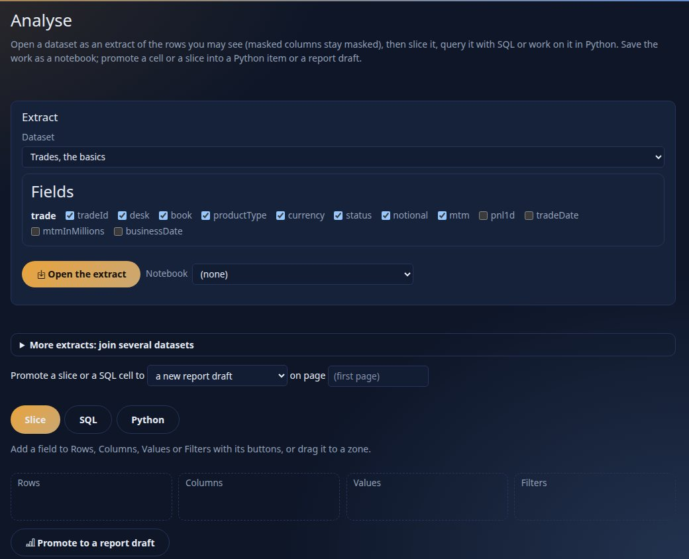

You should see the fields grouped by the model's alias (`trade`) and, after **Open the extract**, the line `10000 rows, 10 columns.` with a note that the
extract was cut (the lake holds 15,000). The extract is **one model query** (its rows, `shape: rows`) asked as **you** (masked columns arrive empty, and
the line says `Masked for you: ...`), cut to `bi.notebook.max_rows` (10,000; a cut says so). It is rebuilt on every run and never kept, so a mask or row
rule changed on the server applies the next time. **On the command line** the same rows are a model query, and **the YAML** of it is what the Notebook sends:

```yaml
mq: 1
model: trades-basic@1
select: { fields: [trade.TRADE_ID, trade.DESK, trade.PORTFOLIO, trade.CURRENCY, trade.NOTIONAL, trade.MTM], measures: [] }
shape: rows                 # the rows themselves, not grouped
limit: 10000
```

(`python3 tools/drishti.py bi mq that.yaml` prints them.)

### Step 4 · Slicing is the Pivot's

To put desks down, currencies across and notional in the cells, use the **Pivot**, the one grid for slicing any table: the *Pivot* link in the BI rail,
or the Notebook's own line *To slice and total a table, use the Pivot*. Its totals are the whole table's, worked out by the server
([BI_GUIDE.md](README.md)); **on the command line** `PIVOT <table> <GO>` opens it on a table, and a pivot view is saved as YAML there.
The Notebook is for what a grid cannot say: SQL over the model and Python.

You should see the Pivot open with its source picker: choose the trades' table, then drag `DESK` to Rows, `CURRENCY` to Columns and `NOTIONAL` to Values.

### Step 5 · SQL

Open the **SQL** tab (it opens first). A SQL cell is **one read-only SELECT** in **Drishti SQL over the model**, asked of the **server** as you, so its
answers are true totals, not the extract's. Its tables are the model's aliases and a measure is `MEASURE('name')`
([API_REFERENCE.md › Drishti SQL](../API_REFERENCE.md#8-drishti-sql-apiv1bisql)):

```sql
SELECT trade.DESK, MEASURE('Trades') AS trades, MEASURE('Notional') AS notional
FROM trade
GROUP BY trade.DESK
ORDER BY notional DESC
```

Press **Run**.


You should see a table, the largest desk first (`DESK-COMM`, `5,990` trades, `888,803,742,774` of notional: true totals over all 15,000 rows, not the
extract's), and the line *10 rows in 7 ms · Drishti SQL, run by the server over trades-basic@1 as you · plan p_...*: the same plan a visual of the same
question would run. **From the command line** the same statement (and what a write is told):

```text
$ python3 tools/drishti.py bi sql "SELECT trade.DESK, MEASURE('Trades') AS trades, MEASURE('Notional') AS notional FROM trade GROUP BY trade.DESK ORDER BY notional DESC LIMIT 3" --model trades-basic@1
trade.DESK  trades  notional
----------  ------  ------------------
DESK-COMM   5990    888,803,742,773.65
DESK-RATES  1832    596,934,185,000.00
DESK-EQD    1452    428,542,341,000.00
3 row(s)  shape mq  plan p_3773eb23294dfb01

$ python3 tools/drishti.py bi sql "DROP TABLE trade" --model trades-basic@1
drishti: the server said 422 DRS-9170: DRS-9170 Drishti SQL is read-only: DROP is refused; a statement is one SELECT (or WITH ... SELECT)
```

(Text over 20,000 characters is `DRS-9072`; at most 5,000 rows come back.) There is no YAML for a cell on its own: it is kept in a notebook (step 7).

### Step 6 · A Python cell

Open the **Python** tab. A cell sees `df` (the extract as a pandas table), `extract("name")` (another extract of the notebook) and `params`. What it prints
comes back as text; what it puts in `result` is **drawn**: a table as a table, a dict as an ECharts option, SVG or PNG as an image.

```python
g = df.groupby('DESK', as_index=False)['NOTIONAL'].sum()
result = {'title': {'text': 'Notional by desk'}, 'xAxis': {'type': 'category', 'data': list(g['DESK'])}, 'yAxis': {'type': 'value'},
          'series': [{'type': 'bar', 'data': [float(v) for v in g['NOTIONAL']]}]}
```

The line beside **Run** says *Runs on the server's compute pool*: a cell never runs in the console or your browser. Press **Run**: the server reads the
extract as you and runs the cell in its strict sandbox. You should see the line *Ran on the server's compute pool in ... ms over 10000 rows* and the bar
chart of notional by desk under it (what the cell printed comes first, when it prints). Keep the cell in the notebook (step 7) and promote it to an item
(below): whoever opens the notebook later runs it on the pool, over their own rows. Running Python needs `bi-author`; a person with only `bi` writes and runs SQL cells.

### Step 7 · Keep it as a notebook, promote it

Under **Save** give it a title (`Desk notional, first look`) and press **Save as a notebook**. (**My workspace → New item → notebook** only points you here:
a notebook is made from the work you did, not from a form.)


You should see a link, **Open the item**: the extract's definition and every cell are now a BI item of kind **notebook** in your workspace, with versions,
diffs, review and publishing like any other. Opening it again (**Open in the Notebook** on the item page) rebuilds the extract **for whoever opens it**: a
notebook shared with a colleague shows *their* rows. Outputs are not stored, only the code. **The YAML** of the notebook:

```yaml
rachana: 1
notebook: desk-notional-first-look
title: Desk notional, first look
dataset: mq:trades-basic@1            # the model the extract reads
fields: [trade.TRADE_ID, trade.DESK, trade.PORTFOLIO, trade.PRODUCT_TYPE, trade.CURRENCY, trade.TRADE_STATUS, trade.NOTIONAL, trade.MTM, trade.PNL_1D, trade.MTM_IN_MILLIONS]
cells:
- type: sql
  source: |
    SELECT trade.DESK, MEASURE('Trades') AS trades, MEASURE('Notional') AS notional
    FROM trade
    GROUP BY trade.DESK
    ORDER BY notional DESC
- type: python
  source: |
    g = df.groupby('DESK', as_index=False)['NOTIONAL'].sum()
    result = {'title': {'text': 'Notional by desk'}, ...}
  target: server
```

To turn a Python cell into a reusable item press **Promote to a visual** (or **to a measure**) under the cell.

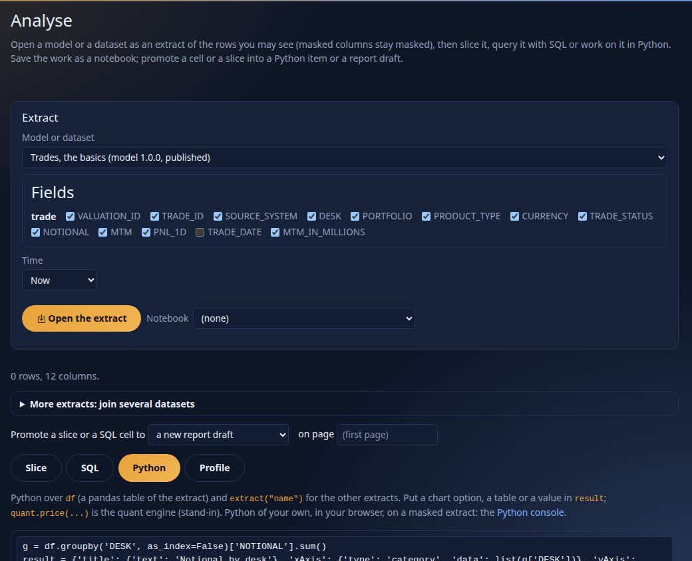

You should see `Python visual draft saved in your workspace: Notebook cell (visual).` and the reminder: the cell's `df` became the function's `table`,
`result` is returned, a measure must return one number and a visual an ECharts option, SVG or PNG; check it with **Check the Python** on the item page,
then publish. Nothing is published for you. A SQL cell becomes a **report visual** the same way (step 10).

### Step 8 · Two models: a Python Transform and a join in the Notebook

Steps 1 to 7 used Python on one model. Python can also **join answers**. The sample **Desk P&L vs counterparty exposure (Python)** makes one table, P&L
next to exposure per counterparty, with a **Python Transform**: a Python item with `interface: transform` whose function `run(pnl, exposure, params)`
receives two answers as pandas frames, **asked as you**, and returns a table. That table is a **Python dataset** (`source.python`), and each
input is a **model query**. Open **Models**, find **Desk P&L vs counterparty exposure (Python): the Transform's table** under the datasets.


You should see *Source: the Python Transform pnl-vs-exposure*, the key `counterparty` and the nine columns the Transform returns (a contract: a column it
does not return is `DRS-9075`). There is nothing to refresh: the Transform runs **when the dataset is asked**, for the person asking, and its frame is kept
for them until an input changes. **The YAML** says what it reads (`config/tables/bi/desk_pnl_vs_exposure_py_result.table.yaml`):

```yaml
rachana: 2
expressions: 2
dataset: desk-pnl-vs-exposure-py-result
version: 1.0.0
source:
  python: pnl-vs-exposure
  inputs:                       # each a model query, asked as the reader (their row rules and masks)
    pnl: { model: trading-risk@1, select: { fields: [counterparties.id, counterparties.NAME], measures: [P&L 1d, Trades] } }
    exposure: { model: counterparty-exposure@1, select: { fields: [counterparties.id, counterparties.SECTOR], measures: [Exposure (EE peak), Exposure (PFE peak)] } }
  params: { floor: 1.0 }
grain: { keys: [counterparty] }
columns:
  counterparty: { type: string }
  ...
```

and the model `desk-pnl-vs-exposure-py@1` reads it as its one fact, with measures over it. **On the command line** ask it like any model (the
Transform runs for you on the first question):

```text
$ python3 tools/drishti.py bi mq --model desk-pnl-vs-exposure-py@1 --select result.counterparty,result.name,result.sector --measures "Desk P&L,Exposure (EE peak),P&L per exposure" --limit 3
result.counterparty  result.name                   result.sector     Desk P&L       Exposure (EE peak)  P&L per exposure
-------------------  ----------------------------  ----------------  -------------  ------------------  ----------------
CP-ALDERSHOT         Aldershot Pension Trust       Pensions          9,940,482.84   276,416,536.00      0.04
CP-AURORA            Aurora Sovereign Wealth Fund  Government        -5,475,341.95  213,663,642.00      -0.03
CP-BRAMBLE           Bramble Asset Management      Asset management  6,448,473.64   146,933,503.00      0.04
3 row(s)  as of 2026-10-26
```

The item is `config/bi/python/banking/pnl-vs-exposure.python.yaml` (the model queries hand their columns over as the models name them, `NAME` and `SECTOR`;
the Transform renames them to the table's own `name` and `sector`); the reference is [BI_GUIDE.md › Python in BI: measures, visuals and data prep written in Python, section 13](#4-transforms-a-table-in-a-table-out).

How would you write such a Transform? In the **Notebook**, with **two extracts**. Open the notebook **Desk P&L vs counterparty exposure, in pandas** (the Notebook box in the Extract card).


You should see `10000 rows, 3 columns.` for the first extract (cut: the lake holds 15,000 trade valuations) (the trades of the model **Trading and counterparty risk**) and, in **More extracts: join
several models**, a second one called `exposure` (`mq:trading-risk@1`, 3 fields: the netting sets' computed exposure, `set_exposure`, of the same
model: the exposure engine's official end-of-day results). Each is built for you by the
server, with your row rules and masks. Open the **Python** tab: the join cell is there (`df` is the trades; `extract("exposure")` is the
netting sets' computed exposure, `PEAK_EE`); **Run** runs it on the server's compute pool (step 6). On the server, one model
already joins its facts through the counterparty (Drishti SQL `FROM trades JOIN counterparties JOIN set_exposure`). When the pandas join is what you want to keep, press **Promote to a Transform**.

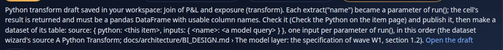

You should see, beside the button, that a Python Transform draft was saved in your workspace: each `extract("name")` became a parameter of `run(...)`, the
cell's `result` is returned, and the next step is *a dataset of its table: source: { python: <this item>, inputs: { <name>: <a model query> } }, one
input per parameter of run(), in this order*. Open the draft, **Check the Python**, publish it, and make that dataset. Nothing is published by promoting.

**In the UI** the Python dataset is the dataset wizard's source **A Python Transform** ([BI_GUIDE.md › Datasets: the YAML, the expression language and the security rules, section 15](TABLES_AND_MODELS.md#110-a-table-of-your-own-step-by-step)):
**Models → New dataset**, choose the Transform by its title, give each input of `run()` its model query (a model, the fields and the measures to hand
over), and list the columns the Transform returns with their types; **Preview** runs it for you before you save. **From the YAML** it is the
`source: { python: ..., inputs: { ... } }` above; **Make it a model** on its page puts a model over it, where its measures go.

### Step 9 · Vega-Lite, and tests that ship with the item

A chart does not have to be an ECharts option. A **Vega-Lite** specification can be written in the report itself (a `vega-lite` visual: its data is the rows of its wells) or returned by a Python visual (`output: vega-lite`). Open the sample report **Desk P&L risk (Python)**, its **Vega-Lite** tab.

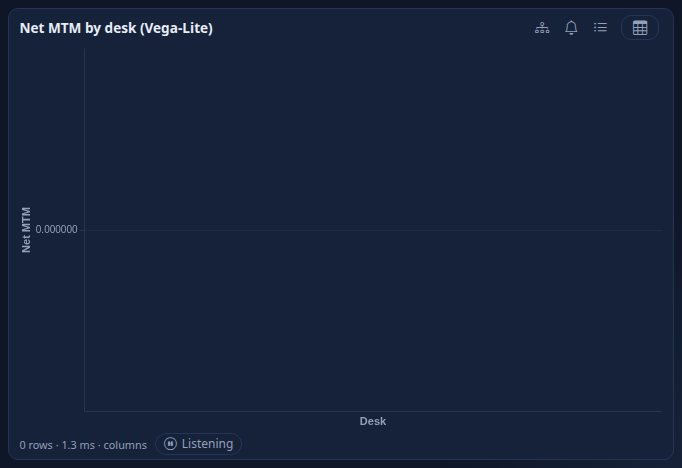

You should see bars for the desks, red for the negative ones: the colour is the specification's `condition: { test: "datum.MTM < 0" }`, evaluated **without `eval`**, so the page keeps its strict content security policy. drishti-chart draws it: the specification is translated into a drishti-chart spec, so the chart has the same card, tooltip, data table (▦) and Explain as every other chart. A feature drishti-chart does not translate (a facet, a `text` mark, a selection) is not drawn: the frame says **Not drawn** and names each feature with what to use instead. In your own Python visuals prefer `output: drishti-chart`: return a drishti-chart spec (`{"kind": "bar", "data": {"rows": [...]}, "x": ..., "y": ...}`), drawn as it is. On the first tab, the bottom visual is a Python visual that returns a specification: a dot for each trade's one-day P&L by desk, a tick for each median.


A Python item can also carry **tests**. Open the item **Desk P&L volatility** (the Python measure), and press **Check the Python**.


You should see `Tests: 3 of 3 passed.` and a line for each (`passed · the standard deviation of one desk · 1.2909944487358056`). The sample is shipped (read-only); in a copy of it in your own workspace, change a number in an `expect:` and check again: that test says `FAILED` with what it expected and got, and **publishing** through the console is refused (`DRS-9076`) until it passes. [BI_GUIDE.md](#3-python-measures-and-visuals) sections 14 and 15 have the rules.

### Step 10 · Where a SQL cell runs, and promote into a report you already have

A SQL cell is **Drishti SQL over the model**, run by the server as you (the answer is the model's, with true totals, and the cell is the same plan a
report visual runs); the line beside **Run** says so. Nothing runs in the browser or the console. Above the tabs, **Promote a SQL cell to** a *new report
draft* or to one of your report drafts. Choose one, write a SQL cell and **Run** it:

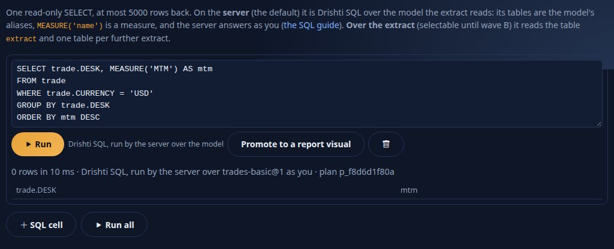

You should see ten desks (`DESK-RATES` `2,863,034,263` first, for the USD trades) and the line naming
`trades-basic@1`. **From the command line**:

```text
$ python3 tools/drishti.py bi sql "SELECT trade.DESK, MEASURE('MTM') AS mtm FROM trade WHERE trade.CURRENCY = 'USD' GROUP BY trade.DESK ORDER BY mtm DESC LIMIT 3" --model trades-basic@1
trade.DESK   mtm
-----------  ----------------
DESK-RATES   2,863,034,262.92
DESK-STRUCT  409,340,516.24
DESK-SFT     264,809,126.60
3 row(s)  shape mq  plan p_3fefc5a51db918b6
``` Press **Promote to a report visual**:


You should see, beside the button, `Visual sql added to the report draft: Desk views.` and notes: the `ORDER BY` was left out (a visual sorts in its own
settings) and the report was written again by the designer's writer. Open the draft in the designer: a new `matrix` (rows `trade.DESK`, values `MTM`, the
filter `trade.CURRENCY eq USD`) below what was there. The reader understands Drishti SQL (aliases and `MEASURE('...')`) and plain aggregates of columns, matched to the model's measures. **The YAML** of the visual it added:

```yaml
      - id: sql
        type: matrix
        title: Desk views
        at: { x: 0, y: 8, w: 12, h: 6 }
        wells: { rows: [trade.DESK], values: [MTM] }
        filters: [{ field: trade.CURRENCY, op: eq, values: [USD] }]
```

A SQL cell of **another** model is not added to an existing report (a report reads one model: `DRS-9070` names both); promote it to a new draft.
[USER_GUIDE.md › The Notebook](../USER_GUIDE.md#the-notebook) section 6 has the details.

### Step 11 · Calc: the BI engine as a DataFrame; a Python measure in an alert

In **Calc** (`Alt+C` on any view) the module `drishti_bi` asks the BI engine, **as you**: `query` sends one model query (a model's `name@major`; a 2.1
dataset's name reads the model the converter made of it, `trades-basic` is `trades-basic@1`):

```python
import drishti_bi
df = await drishti_bi.query_async('trades-basic@1', measures=['MTM', 'Trades'], by=['trade.DESK'])
show(df, 'MTM by desk')
```

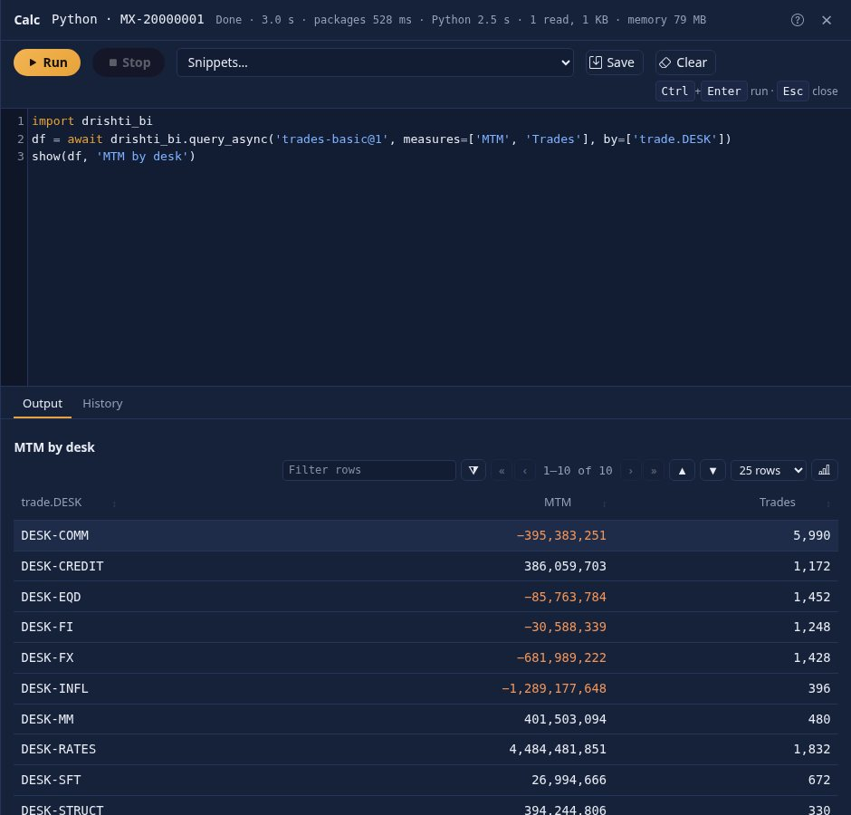

You should see ten desks with their MTM and trade counts: the same numbers a report shows, with the same masks. The command line prints the same:

```text
$ python3 tools/drishti.py bi mq --model trades-basic@1 --select trade.DESK --measures MTM,Trades --limit 3
trade.DESK   MTM              Trades
-----------  ---------------  ------
DESK-COMM    -429,967,635.39  5990
DESK-CREDIT  360,552,941.89   1172
DESK-EQD     -79,395,510.75   1452
3 row(s)  as of 2026-10-16  plan p_5d2cad2dda86953b
```

Calc is a **Labs** feature (off as shipped: an administrator switches `labs.calc` on), a scratch pad in your browser that never publishes.

Last, a **Python measure in an alert**. An alert on a measure of a model asks a model query, and a model query runs Python measures (step 1), so
**Alerts → New → Watch a measure of a model** on **Desk P&L volatility** works like any other: choose the model `trades-basic@1`, the measure, *crosses a
limit*, *above* `100000`, **Save**. What the form sends, with your session (a personal API token may not call `/me/...`), and the alert at once firing
(the largest desk volatility, `1,117,385`, is above the limit), captured:

```text
PUT /api/v1/alerts/rules/Desk%20volatility%20ceiling
    {"source":{"type":"model","model":"trades-basic@1","query":{"select":{"fields":["trade.DESK"],"measures":["Desk P&L volatility"]}},"reduce":"max"},
     "condition":{"type":"threshold","op":"above","value":100000},"trigger":{"mode":"after-load"}}
200 {"name":"Desk volatility ceiling", ..., "source":{"type":"model","model":"trades-basic@1","measure":"Desk P&L volatility","reduce":"max", ...},
     "describe":"above 100,000","label":"trades-basic@1 · Desk P&L volatility","link":"/bi/i/trades-basic%401"}
POST /api/v1/alerts/rules/Desk%20volatility%20ceiling/check
200 {... "history":[{"action":"fired","trigger":"saved","value":1117385.1394432886,"asOf":"2026-10-16",
     "message":"Desk volatility ceiling — now 1,117,385.1394 (above 100,000)","delivered":{"inbox":"ok","email":"off","bridge":"off","sms":"off"}}]}
```

`reduce: max` watches the largest of the desks' figures; `first` or a filter on one desk watches one.

<a id="step-12--prepare-raw-trades-step-by-step-the-transform-editor-240"></a>

### Step 12 · Prepare raw trades step by step: the Transform editor

Step 8 made a Transform from two **models**. Before a model exists you often want to clean the **raw rows** first: drop matured trades, fix a type,
bucket a tenor, total. The **Transform editor** does that step by step, with the rows and a profile after every step, and you never type YAML.

**In the UI.** Open **BI → Transforms** (the rail). Type the title `ENDUR trades, cleaned`. Under **1. Inputs**, name the input `trades`, keep *A pack
kind, straight through its connector*, choose the kind **Trade (trading.trade)**, type the connector `trade-endur` (the ENDUR trades of the demo lake),
tick `TRADE_ID`, `TRADE_STATUS`, `PORTFOLIO`, `CURRENCY`, `NOTIONAL`, `TRADE_DATE` and `MATURITY_DATE`, and press **Add the input**.


You should see the line `trades the kind trade (pack trading) through trade-endur · 7 fields 1,000 rows (the first 1,000) · as of 2026-10-16` and a first
step, **Start from trades**, with `1,000 rows · 7 cols`. The editor previews the first `bi.transform.preview_rows` rows (1,000) **as you**: your row
rules and masks apply, as when the dataset is read.

Now **Add a step from the snippets**: choose **Filter rows by values**, the column `TRADE_STATUS`, the value `MATURED`, untick *Keep them* (drop them), and
**Add the step**. Step 2 says `510 rows · 7 cols`. Press **Profile**:


You should see `TRADE_STATUS` with four values left (`VALIDATED ×336`, `AMENDED ×64`, `NEW ×62`, `CANCELLED ×48`), `TRADE_ID` marked **key?** (every row
its own value), and *Text that looks like dates* under `TRADE_DATE` and `MATURITY_DATE`. Press **Fix the type** under `TRADE_DATE`: a step
**Type fix: text to date (TRADE_DATE)** is added. Then two more snippets: **Tenor bucket** (maturity `MATURITY_DATE`, from `TRADE_DATE`) and **Group and
total** (group by `PORTFOLIO` and `tenor_bucket`, the column `NOTIONAL`, `sum`). Press **Rows**:

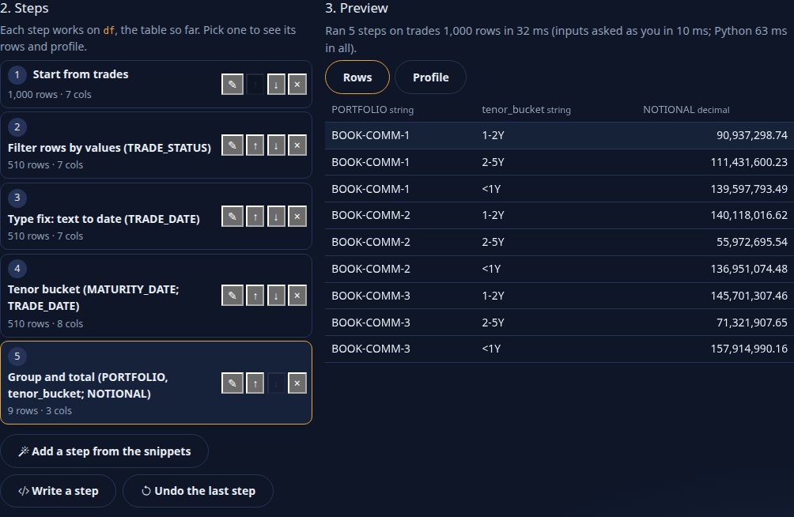

You should see `Ran 5 steps on trades 1,000 rows` and nine rows, `BOOK-COMM-1 1-2Y 90,937,298.74` first. Pick any step to see its own rows again; ✎ edits
a step, ↑ ↓ move it, × removes it. Under **4. Save**, tick `PORTFOLIO` and `tenor_bucket` (*Each row is one*) and **Save as drafts**: you should see
*Saved as two drafts in your workspace: the Python item and the dataset*. Check and publish the Python item, then the dataset ([BI_GUIDE.md › Python in BI: measures, visuals and data prep written in Python,
section 13](#4-transforms-a-table-in-a-table-out)).

**The YAML** was written for you; open *YAML: what is saved* to read it (and edit it, then **Read the YAML back**, if you like). The Python item
([data/endur-trades-cleaned.python.yaml](../../tutorials/data/endur-trades-cleaned.python.yaml)) holds the steps after their `# step:` comments:

```python
def run(trades, params):
    # step: Start from trades
    df = trades.copy()
    # step: Filter rows by values (TRADE_STATUS)
    df = df[df['TRADE_STATUS'].isin(['MATURED']) == False].reset_index(drop=True)
    # step: Type fix: text to date (TRADE_DATE)
    df['TRADE_DATE'] = pd.to_datetime(df['TRADE_DATE'], format='%Y-%m-%d', errors="coerce").dt.date
    # step: Tenor bucket (MATURITY_DATE; TRADE_DATE)
    ...
    # step: Group and total (PORTFOLIO, tenor_bucket; NOTIONAL)
    df = df.groupby(['PORTFOLIO', 'tenor_bucket'], as_index=False, dropna=False)[['NOTIONAL']].agg('sum')
    return df
```

and the Python dataset ([data/endur-trades-cleaned.dataset.yaml](../../tutorials/data/endur-trades-cleaned.dataset.yaml)) reads the kind straight through the connector:

```yaml
source:
  python: endur-trades-cleaned
  inputs:
    trades:
      kind: trade
      pack: trading
      fields: [CURRENCY, MATURITY_DATE, NOTIONAL, PORTFOLIO, TRADE_DATE, TRADE_ID, TRADE_STATUS]
      connector: trade-endur
grain:
  keys: [PORTFOLIO, tenor_bucket]
```

**On the command line** the input is asked as you and profiled, the snippets are listed and written, and the drafts are saved from the files:

```text
$ python3 tools/drishti.py bi transform input docs/tutorials/data/endur-trades-cleaned.dataset.yaml --rows 2
trades: 1,000 rows of dataset:pack.trading.trade as of 2026-10-16
  CURRENCY                     text      empty     0  distinct      3  CAD .. USD
  MATURITY_DATE                text      empty     0  distinct     81  2024-11-01 .. 2029-10-31
  NOTIONAL                     float64   empty     0  distinct    971  2,855.8 .. 2.46923e+08
  PORTFOLIO                    text      empty     0  distinct      3  BOOK-COMM-1 .. BOOK-COMM-3
  TRADE_DATE                   text      empty     0  distinct    529  2024-10-10 .. 2026-09-25
  TRADE_ID                     text      empty     0  distinct   1000  1000005 .. 1005000
  TRADE_STATUS                 text      empty     0  distinct      5  AMENDED .. VALIDATED
    CAD | 2025-04-30 | 1000000.0 | BOOK-COMM-3 | 2025-03-01 | 1002153 | MATURED
    CAD | 2026-04-30 | 20000000.0 | BOOK-COMM-1 | 2025-02-06 | 1003026 | MATURED
$ python3 tools/drishti.py bi transform snippet filter-values column=TRADE_STATUS values=MATURED keep=false
# step: Filter rows by values (TRADE_STATUS)
df = df[df['TRADE_STATUS'].isin(['MATURED']) == False].reset_index(drop=True)
$ python3 tools/drishti.py bi item new me docs/tutorials/data/endur-trades-cleaned.python.yaml
bi-90b5ada37c  python  ENDUR trades, cleaned  draft in My workspace
$ python3 tools/drishti.py bi item new me docs/tutorials/data/endur-trades-cleaned.dataset.yaml
bi-04b126d3c4  dataset  ENDUR trades, cleaned  draft in My workspace
```

The steps run where every Python item runs, on the server's compute pool; the snippets write each value as a literal, never as code. The reference is
[BI_GUIDE.md › Python in BI: measures, visuals and data prep written in Python, section 17](#5-data-prep-the-transform-editor).

### Next steps

- [Tutorial 10](../../tutorials/10-ai-assistant.md): ask the data in words.
- [BI_GUIDE.md](#3-python-measures-and-visuals): the manifest, where Python runs, the sandbox in full, `DRS-9070` to `9075`, section 13 for the Transform and
  section 17 for the Transform editor and the snippets. [USER_GUIDE.md](../USER_GUIDE.md#the-notebook): the page, limits and notebooks. [USER_GUIDE.md](CALC.md) is Calc, the Python panel inside a screen.

### If something goes wrong

| You see | Meaning |
|---|---|
| `DRS-9001 no item 'xyz'` in a Python visual | the item is not published, or the name does not match its id, file name or title |
| `DRS-9070` | the manifest or a cell is wrong; the message names the key (a package not on the allow-list, a second SQL statement, a source that does not parse) |
| `DRS-9072` | the SQL was too long (`bi.notebook.sql_max_chars`) |
| `DRS-9170` | Drishti SQL on the server was asked to do more than one SELECT (a write, a second statement) |
| `DRS-9074` | Python does not run on this server now: the message says why (compute off, the pool's interpreter not carrying the pinned versions, a Windows server) |
| a Python cell's Run is greyed and says *Off: ...* | the server cannot run Python safely now; the words say why (compute off, a Windows server, a pin that differs) |
| a column is empty in the extract | it is masked for your role; the line under the form names it |
| the Transform editor's steps do not run | running them needs `bi-author`; the page still writes the YAML |
| `DRS-9108 the kind 'trade' has no column [X]` | a field the kind does not have; the message lists the kind's columns |
| `DRS-9026 connector 'x' is not running` | the input names a connector that is off; leave it empty to read whichever serves the kind |

## Compute demo pack

Sample pack for reactive connectors: three books of synthetic P&L strips (250 scenario days each) and the sum of a book's paths computed when it is asked for, by a Python engine in a compute pool (path-sum) and by its Java twin in the server (path-sum-java), with progress on the screen and a state per panel. Synthetic numbers only. Not loaded unless named in DRISHTI_PACKS.

**Code:** `CMPD` · **Kinds:** 4 · enable it with `DRISHTI_PACKS=compute-demo` (a sample pack; `drishti.packs.samples` hides it from business users).

### Using it

| Type | Shows |
|---|---|
| `PBOOK BOOK-RATES <GO>` | A book's path computed twice: by the Python engine and by the Java engine, with progress |
| `PSTRIP STRIP-FX-001 <GO>` | One strip: its 250 scenario P&Ls |
| `PSUMJ BOOK-FX <GO>` | The computed answer itself, with its stamp (parameters ride on the id: BOOK-FX~delay-ms=50) |

| Command | Kind | Opens |
|---|---|---|
| `PBOOK` | `path-book` | Path book |
| `PSTRIP` | `path-strip` | P&L strip |
| `PSUM` | `path-sum` | Book path (Python) |
| `PSUMJ` | `path-sum-java` | Book path (Java) |

A book's page asks both engines for the sum of its strips' paths: the Python engine runs in the compute pool `sample` (`config/compute/compute.yaml`), the Java twin in the server; each panel shows its own progress and state. Parameters ride on the id (`BOOK-FX~delay-ms=50`). How reactive connectors work: [DATA_ARCHITECTURE.md](../../architecture/DATA_ARCHITECTURE.md#4-reactive-connectors).

### Data retrieval

Every kind's data contract and example, where its data comes from (an external source and its feed, a generator, or a Drishti engine), how it reaches the lake and how to check it are generated into the pack's README: [*Data contracts*](../../../examples/packs/compute-demo/README.md#data-contracts) and [*Data retrieval*](../../../examples/packs/compute-demo/README.md#data-retrieval).
