<!--
  Project Drishti · Any data. Any domain. One grammar.

  Copyright (c) 2026 Ashutosh Sinha <ajsinha@gmail.com>.
  All rights reserved.

  PROPRIETARY AND CONFIDENTIAL.

  This file is the confidential and proprietary property of Ashutosh Sinha.
  Unauthorised copying, use, modification, distribution or disclosure of this
  file, via any medium, is strictly prohibited except with the express prior
  written permission of the copyright holder.

  See the LICENSE file in the root of this repository for the full terms.
-->
# Pivot

Business intelligence: [Index](README.md) · **Pivot** · [Pivot at scale and the risk cubes](PIVOT_SCALE_AND_CUBES.md) · [Tables and models](TABLES_AND_MODELS.md) · [Reports and the designer](REPORTS.md) · [The report file, formatting and statements](REPORT_FILE_FORMAT_STATEMENTS.md) · [Models and datasets for reports](MODELS_AND_DATASETS_FOR_REPORTS.md) · [Live reports, boards and background runs](LIVE_REPORTS_AND_BOARDS.md) · [Distribution, subscriptions and alerts](DISTRIBUTION_AND_ALERTS.md) · [Governing BI and AI in BI](GOVERNANCE_AND_AI.md) · [The Notebook and Python](NOTEBOOK_AND_PYTHON.md) · [Groupings and analytics](GROUPINGS_AND_ANALYTICS.md)

The one grid for slicing and totalling any table: the View picker, nested rows, top N with a correct Others, totals made from their own members, provenance, custom functions, why did it move and what-if; with the tutorial.

## Contents

- [Guide](#guide)
  - [1. Open it](#1-open-it)
  - [2. The screen](#2-the-screen)
  - [3. Sources and fields](#3-sources-and-fields)
  - [4. Measures and how each total is made](#4-measures-and-how-each-total-is-made)
  - [5. Nested rows, opened lazily](#5-nested-rows-opened-lazily)
  - [6. Top N, Others and sorting](#6-top-n-others-and-sorting)
  - [7. Provenance, rows and cell references](#7-provenance-rows-and-cell-references)
  - [8. The scan estimate, budgets and busy protection](#8-the-scan-estimate-budgets-and-busy-protection)
  - [9. Charts of a selection](#9-charts-of-a-selection)
  - [10. Export](#10-export)
  - [11. Saved and shared views, compare](#11-saved-and-shared-views-compare)
  - [12. Who sees what](#12-who-sees-what)
  - [13. The view as JSON](#13-the-view-as-json)
  - [14. The API](#14-the-api)
  - [15. The command line](#15-the-command-line)
  - [16. Settings](#16-settings)
  - [17. Refusals and their codes](#17-refusals-and-their-codes)
  - [18. How it is built](#18-how-it-is-built)
  - [19. Custom functions](#19-custom-functions)
  - [20. Why did it move: explain the difference](#20-why-did-it-move-explain-the-difference)
  - [21. What-if](#21-what-if)
  - [22. BI on the pivot engine](#22-bi-on-the-pivot-engine)
- [Tutorial: Pivot, functions and explain](#tutorial-pivot-functions-and-explain)
  - [Part A · The pivot engine: trades by product, legs by desk, then VaR by desk](#part-a--the-pivot-engine-trades-by-product-legs-by-desk-then-var-by-desk)
  - [Part B · Custom functions, why did it move and what-if](#part-b--custom-functions-why-did-it-move-and-what-if)

## Guide

The pivot engine turns any table of any pack, or the VaR engine's trades, into a pivot: these measures, broken down by these fields on
rows and columns, under these filters, on this business date. Every figure is computed by the server; every total is made from its own
members, never from the figures on the screen. The hands-on walk-through is [the pivot tutorial, Part A](#part-a--the-pivot-engine-trades-by-product-legs-by-desk-then-var-by-desk);
custom functions, explain and what-if are walked through in [the pivot tutorial, Part B](#part-b--custom-functions-why-did-it-move-and-what-if); the MR cube,
market risk as a pivot, is [section 29](PIVOT_SCALE_AND_CUBES.md#7-the-mr-cube-preset) and [the pivot tutorial, Part C](PIVOT_SCALE_AND_CUBES.md#part-c--the-mr-cube-desks-by-risk-class-with-the-right-totals).

### 1. Open it

| From | How |
|---|---|
| The command line | `PIVOT <GO>` (choose a source), `PIVOT trade <GO>` (a table), `PIVOT trade 2026-10-30 <GO>` (a table on a date), `PIVOT var <GO>` (VaR), `PIVOT @asha/desk-risk <GO>` (a saved view) |
| The menu | **Views → Pivot** |
| A table | **Pivot** in Export data's facts of the table (`EXPORT trade <GO>`, then Pivot) |
| A page's table | **Pivot** under a table or ladder whose Sutra says `pivot:` (the source `panel/<kind>/<panel>/<id>`: the panel's own rows, the Sutra's arrangement as the opening view) |
| Search results | **Pivot** above the results of a kind whose pack says `pivot:` (the kind, the pack's arrangement as the opening view) |

The engine is a compute engine with its own file, `config/engines/pivot.yaml` ([ADMIN_GUIDE.md](../ADMIN_GUIDE.md#21-compute-engines-on-or-off)):
switch it with `drishti.engines.pivot.enabled` (on as shipped; `DRISHTI_PIVOT_ENGINE_ENABLED`), from Admin → Engines or
`drishti.py admin engines`, live. Off, `/api/v1/pivot` answers `404 DRS-1020` in words, and `PIVOT`, Views → Pivot, its Help pages and
`drishti.py pivot` disappear. The MR cube needs it.

### 2. The screen

The screen is Excel's PivotTable as people know it, with what Excel lacks in the places Excel's equivalents would be. It gives the grid
most of the screen: the fields live behind pickers, not in a list beside it. One component draws every pivot (drishti-grid's wells,
[ELEMENTS_API.md](https://github.com/drishti-platform/drishti-elements/blob/main/docs/API.md)): Views → Pivot, the MR and CCR cubes, the Pivot under a page's table and above search results all open this screen.

**Three ways to hold the fields, one model.** The screen opens in the first; **Customize ›** (or `\`) moves between the line and the panes.

| Mode | What you see | For |
|---|---|---|
| **Views** (C + B, the default) | the **View** picker first (ready-made layouts, *My views*, *Shared with me*, **Save view as…**), then the compact line | everyone: the first click answers the question |
| **Compact** (B) | one line above the grid: `Rows [⋔ MGMT ▾ Desk › Book ▲▼] [Position ▾] + · Columns [Risk class ▾] + · Filters [Trade status ▾] + · Values VaR ▾ ES ▾ Comp VaR … ⋯ · Customize ›`; no field list on screen | a trader who reads the pivot |
| **Panes** (A, behind Customize ›) | the grid on the left; **Build** (Rows, Columns, Values, Filters as lists, the switches) and **Fields** (search, Hierarchies, the fields by folder, the measures by folder, More fields) on the right, both closing to a 28 px rail (`»`) | building a new view, Power BI and Excel habits; the BI designer opens here |

A preset (`mode:` in `config/pivot-presets.yaml`), a page's Sutra (`pivot: { mode: … }`) or the address (`/pivot?source=trade&mode=panes`)
chooses how a pivot opens; your choice of the panes is kept in this browser under your name. Old addresses and saved views open as they
did, in the default mode.

| Part | What it does |
|---|---|
| Header line | the short title (`MR cube · DESK-RATES 2026-11-06 · 1d 99% · USD`), the **i** (what the view reads and how the answer was computed: the scan estimate, the cells, the cache, the figures' unit), the lens's headline figures on the same line, help |
| Toolbar | Source, Date, Compare (another date, cell by cell), Subtotals (below or above), Chart (`G`), Export (`X`), Save view, Share, Why, What-if, Functions |
| Scan estimate | behind the **i**: what the view reads before it runs ("This pivot reads ≈2,000 rows (≈94 KB, 3 of 8 columns), ≈under a second."); a large one shows at once and asks first, with **Run** |
| View picker (Views mode) | **VIEW By book ▾**: ready-made layouts (keys `1`–`9`), *My views*, *Shared with me*, **Save view as…** (Personal or Shared, `Ctrl+S`); a layout changed since its view was opened shows a dot and offers **Revert** ([section 11](#11-saved-and-shared-views-compare)) |
| Rows, Columns, Filters | chips on the line (or lists in Build). A **hierarchy is one chip** (`⋔ MGMT ▾ Desk › Book`) with a level stepper: ▲ up a level, ▼ the next level (`Alt+↑`, `Alt+↓`). Any number of fields in each, nested in the order given. The well's name or **+** opens its picker |
| Field picker | search, then **Hierarchies** (each one item; open it for its levels, each with a check), the fields by display folder, **More fields** (collapsed: the columns a hierarchy's levels are built from, the long tail). `↑↓` move, `→` levels, `Space` on or off, `Enter` use, `Esc` close; **Customize ›** in its foot |
| Values | on the line, the lit toggles **are** the values, in order; the unlit measures are a click away and **⋯** opens the Values picker. Each value's **▾** sets its function, its show-as and more ([section 4](#4-measures-and-how-each-total-is-made)). The same field may be a value twice (Sum of PV and Count of PV side by side) |
| The grid | rows in display order: a member with **+** (closed) or a header with **−** (open), its children indented, then its total (subtotals below; above puts the total on the member's own line); Others; the grand total. Each row label is shown in full (the row-header column is as wide as its labels, up to 460 px; its tooltip is the row's whole path). An empty member is **(Blank)**, muted, with a **?** that says the rows with no value are kept so every total is complete. Columns × measures; a holistic measure's header carries **H**, an approximate figure **≈** |
| Figures | one number format per measure: every figure of a column in the unit its largest reaches (`74.63 m` beside `0.84 m`, never `938,400.00`); the unit is said once (the **i**); an empty cell is blank, never 0.00 |
| Diversification | a non-additive measure's (VaR, ES) total is its own figure; where an open node's parts add up to more, its row says **diversification −29.24 m** (total − Σ parts, the engine's figure). Nothing is said where there is no gap |
| Slicers | a strip above the grid: each slicer field's members as buttons (read from the engine, as you may see them); a button keeps or drops its member (a filter of the view), **All** clears it |
| Conditional formats | on a value's chip: **colour scale** or **data bars**, drawn from the figures shown over the members' cells (never changing a figure), kept with the view |
| Provenance popover | click a cell: its figure, exact or ≈, the function and how its totals are made, the members counted, the condition (or VaR scope) that selects them, the data version, the filters, what was computed and what came from the cache, its reference; **Rows** lists the members, **Ask the VaR engine** opens the cell's scope in VAR |
| Chart | a chart of the selected cells (or the top level), linked to the grid: a click on a bar opens that member |
| Export | what (the pivot, the rows of the selected cell, the definition) and how (Excel, CSV, JSON Lines, Arrow) |

**Keyboard** (the line under the grid shows them; `?` lists every key of the screen):

| Keys | What they do |
|---|---|
| `R` `C` `V` `F` | open the Rows, Columns, Values or Filters picker |
| `Shift+V` | open the View picker; `1`–`9` in it pick a ready-made view, `Ctrl+S` saves |
| `Alt+↑` `Alt+↓` | the first hierarchy in Rows a level up or down (the stepper's ▲ ▼) |
| `\` | Customize: the panes, and back to the line |
| `→` `←` | open or close a row (on its first cell); `Shift+→` opens every level below; `1`–`9` open the row axis to that level |
| `E` | explain a figure (its provenance); `Shift+E` expands the selected row by another field |
| `Enter` | a cell's rows |
| `G` `X` `L` `M` | chart, export, live, a comment (in a figure's Explain) |
| a chip: `Enter`, `Delete`, `Ctrl+←` `Ctrl+→` | its menu, remove it, move it in its well |

The MR lens keeps its own keys: `H` the horizon, `[` `]` the previous or next date, `W` the what-if tray.

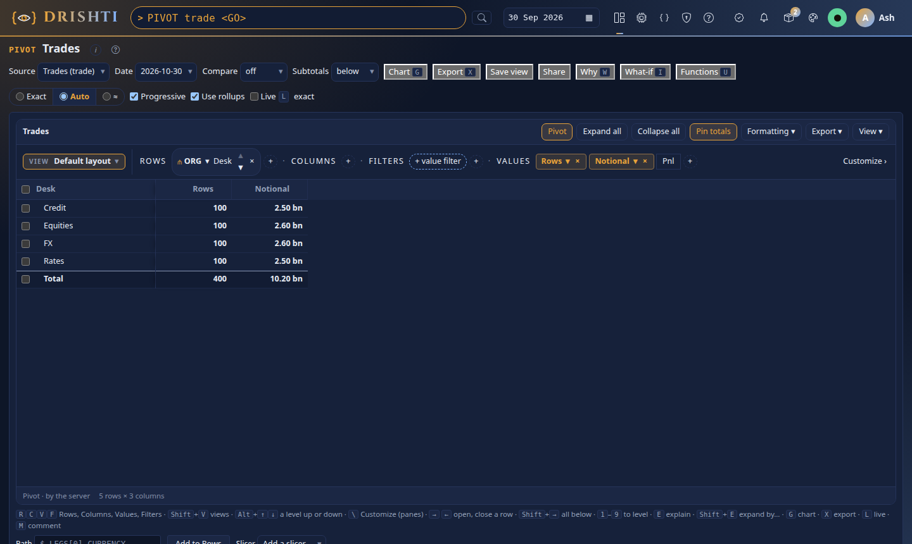

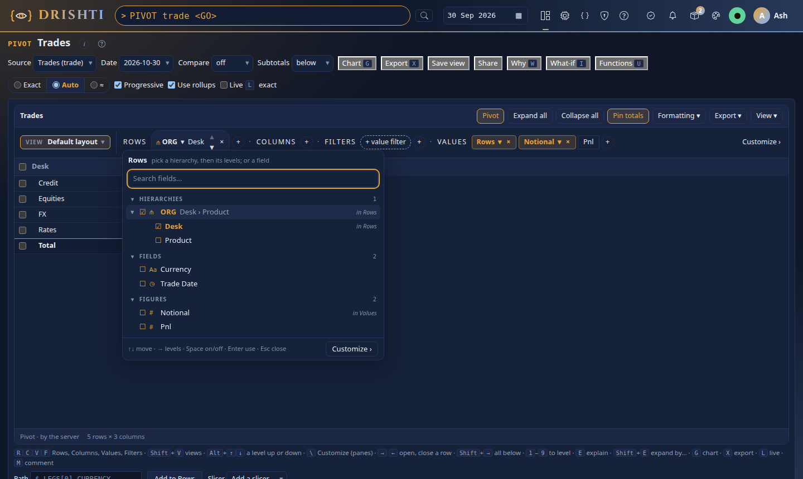

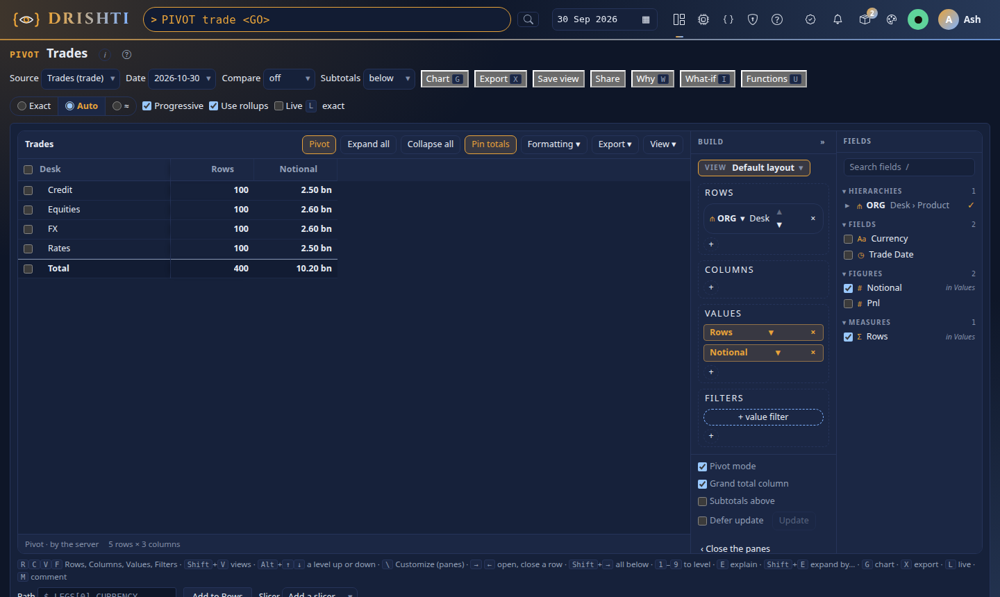

### 3. Sources and fields

| Source | What it is | Its fields | Its measures |
|---|---|---|---|
| A table (`trade`, `position`, any stored kind) | Export data's table, read for you through its connector on the date | its columns, typed from the data contract (`string`, `date`, `number`) | the built-in functions over any field |
| `var` | the VaR engine's book of the date | the positions' text columns (DESK, CURRENCY, PRODUCT_GROUP …) | `var()`, `es()`, `pv()`, `trades()` |
| `panel/<kind>/<panel>/<id>` | a table's or ladder's rows on its page: the same document, Sutra and business date | the fields of its Sutra's `pivot:` (masked ones left out) | the built-in functions |
| `table:<domain>.<name>` | a virtual table ([BI_GUIDE.md](TABLES_AND_MODELS.md)) read for you on the date: its source as you may see it, then the table's rules, masks and hidden columns | its columns, typed by the table (`integer` and `decimal` as `number`, `date` and `timestamp` as `date`); a column masked for you is left out | the built-in functions |

A virtual table is read through the layer and staged in the engine's in-memory DuckDB like a panel's rows, at most
`drishti.tables.read-max-rows` rows (more is refused, never cut short); its date picker offers its source's dates. What was staged is
kept while nothing it was read from changed (the table's definition, the date, the source kind's data version, and who reads: user, roles,
attributes, raw): a view opened again then reads nothing. A source that keeps no data version is read on every open.

**Rows held in memory.** Two components pivot rows they already hold, and both ask the engine rather than add up a figure: a Sutra's
`pivot` panel (its document's rows, grouped by `by` and `across` with the panel's `agg`; ChartBinder hands them to the engine's in-memory
provider) and *Chart any table* on the shown rows (the page sends only the chart's fields to `POST /api/v1/pivot/inline`, at most 100,000
rows). The in-memory provider makes every state with the same built-in functions as the tabular provider, so the figures are equal.

A date field groups as `TRADE_DATE:day`, `:week`, `:month`, `:quarter` or `:year`; a number as `NOTIONAL_USD:width=1000000` (buckets of a
width, labelled by their lower edge). A missing value is the member `(blank)`.

How a table is read, chosen per table:

| Route | When | How |
|---|---|---|
| **Direct lake** | the kind's one source is a Delta or Iceberg table on a local disk, a snapshot table (one partition holds the date), without deletion vectors or delete files, and every field you may use is a column it keeps | DuckDB reads the date's Parquet files itself: only the columns a statement uses (column pruning), the filters repeated on the raw columns so row groups and files are skipped by their statistics; masked columns are never named, so never read; no staging cap |
| **Staged** | any other table (a document store, an object store, masks that also change values inside other fields, memory-only data) | read once per date, data version and mask signature through Export data's own read and kept in the engine's in-memory DuckDB (`drishti.pivot.stage-keep` tables); over `drishti.pivot.stage-max-rows` rows refused in words, never cut short |

Memory-only data is never written: the executor has no spill folder unless `drishti.pivot.duckdb.temp-directory` names one. The estimate
of a lake table comes from its metadata (the files' bytes, the manifests' or add-actions' row counts); nothing is read.

#### Currencies and units

A field has a **unit**: an `amount` of the data contract is **money** in the currency of the row's currency field (`CURRENCY`, `CCY`,
`*_CCY`); a `rate` or a name ending `_PCT` is never summed (a sum of it is refused, with `avg` or `wavg` offered). A money total over
several currencies is **never added raw**: such a cell shows no figure and says *mixed currencies (EUR to USD)*; a cell in one currency
shows its figure and its currency. To add them, convert in the view:

```json
"currency": {"report": "USD", "rates": {"EUR": 1.08, "GBP": 1.27, "JPY": 0.0066}, "source": "ECB close 2026-10-30"}
```

Every money figure is then in USD (each row converted at its currency's rate before any aggregation; a row in a currency without a rate is
left out), the measures' unit says USD, and the provenance names the rates and their source. Counts stay counts.

#### Documents: paths, lists and grains

An entity of the lake is a **document**: a trade keeps its whole source record (JSON) beside a few promoted columns, and that record holds
nested parts. A Calypso, Endur or Murex trade of the demo has `LEGS` (a list: each leg has `LEG_ID`, `LEG_TYPE`, `CURRENCY`, `NOTIONAL`, an
`INDEX` object and a list of `CASH_FLOWS`) and `EVENTS` (a list: each event has `EVENT_TYPE`, `EVENT_DATE`, `AMOUNT`). Every part of it can
be pivoted.

**A field is a Rachana path**, written as a Sutra binds it and as a BI dataset column's `path:` names it:

| Path | Means | One row per |
|---|---|---|
| `$.PRODUCT_TYPE` | a field of the trade | trade |
| `$.LEGS[0].CURRENCY` | the first leg's currency | trade |
| `$.LEGS[?@.LEG_TYPE == 'FLOAT'][0].INDEX.NAME` | the floating leg's index, wherever the leg sits | trade |
| `size($.LEGS)` | how many legs the trade has | trade |
| `$.LEGS[*].NOTIONAL` | every leg's notional | **leg** (the `[*]` makes the grain) |
| `$.LEGS[?@.LEG_TYPE == 'FIXED'][*].NOTIONAL` | the fixed legs' notionals | leg |
| `$.LEGS[*].CASH_FLOWS[*].AMOUNT` | every cash flow of every leg | **cash flow** |
| `$.EVENTS[*].EVENT_TYPE` | every event's type | **event** |

The field list shows them grouped by what they count: the trade's own fields first, then *Each leg (one row per leg)*, *Each cash flow*,
*Each event*, each field under its readable name (*Legs › Notional*, *Legs › Index › Name*). Type a path into the field search box and it is
offered as *Your path*, to drag to a zone like any field. The same paths work in a saved view, on the command line and in the API; the
answer names each field by its id (`LEGS.NOTIONAL`).

**A list field** (a promoted list of simple values, `TAGS: ["fx", "rates"]`) as a row or column field **counts each value**: a row
tagged fx and rates is in both cells, so totals across the field may count a row more than once, and the answer's note says so (the
grand total still counts each row once). `TAGS:join` shows the list as one label ("fx, rates") instead. One list field is exploded at a
time; give another `:join`. A filter on a list field keeps the rows holding any chosen value. The note is shown in the strip above the grid whenever a list field is exploded, so a total is never read as a count of rows without it.

A list column in a grid or table is filtered from its column menu by *Contains*, *Any of* or *All of*; an expanded list makes its row taller.

**The rules, so a figure is never counted twice:**

1. **One grain per view: the finest list its rows, columns and values use.** Rows *Desk* and values *Sum of Legs › Notional* aggregate one
   row per leg.
2. **A coarser figure in a finer view counts each parent once.** *Sum of Quantity* (a trade field) in a leg view adds each trade's quantity
   once in each cell, never once per leg: a trade with three legs adds its quantity once.
3. **Two separate lists are never crossed.** Legs and events of the same trade are independent lists; a view that would put a leg field and
   an event field on the same rows is refused with the reason (three legs and four events would make twelve rows). Look at them side by side
   as two views.
4. **A filter on a list keeps the parents with any element matching.** *Legs › Currency = JPY* on a trade view keeps the trades with a JPY
   leg; on a leg view it keeps the JPY legs. Add `~all` to the filter's field (`$.LEGS[*].CURRENCY~all`) to keep the trades whose legs
   **all** match.
5. **Masks apply per path:** a field hidden for you is not offered at any depth, and the record you read is the one your masks leave.

**How a path is read**, chosen per view, fastest first (the cell's provenance names the route):

| Route | When | What is read |
|---|---|---|
| **Promoted column** | the path names a field the connector promotes (`layout.<kind>.columns`) | that typed column |
| **BI dataset** | every list field the view uses is a column of a published BI dataset table over that list (`source: {kind: trade, each: LEGS}`), and nothing is masked for you | that table's cached layer (Parquet, one row per element) |
| **Ad hoc** | anything else | each document of the date, by DuckDB's JSON functions; the scan estimate says the cost first, and a kind past `drishti.pivot.stage-max-rows` documents is refused with the cheaper route named |

An administrator sees, under the field list, the paths people typed most on that source, with **Promote** (the connector's page: add the
field to its `layout.<kind>.columns`) and **Add to dataset** (the BI dataset editor: a `path:` column). Both make the path a column read.
`GET /api/v1/pivot/paths?source=trade` lists them.

##### Worked examples on the demo lake

Each view below was run on the demo lake (`drishti.py lake demo`, the trades of the three source systems, business date 2026-09-30); the
figures are the ones the run returned. Each is saved as a view, so it opens with `PIVOT @<you>/<name> <GO>`.

**1. Notional by desk and year: one row per leg.** Rows `$.TT_GROUP` (the desk), columns `$.TRADE_DATE` by year, values the sum of
`$.LEGS[*].NOTIONAL`. The view reads 20,422 legs of 15,000 trades; the grand total is **6019.12 bn**, DESK-RATES the largest desk at
**2188.84 bn** (2024: 220.12 bn, 2025: 376.54 bn, 2026: 1592.18 bn). The first row has no desk: the trades whose source sets no `TT_GROUP`
(1086.30 bn).

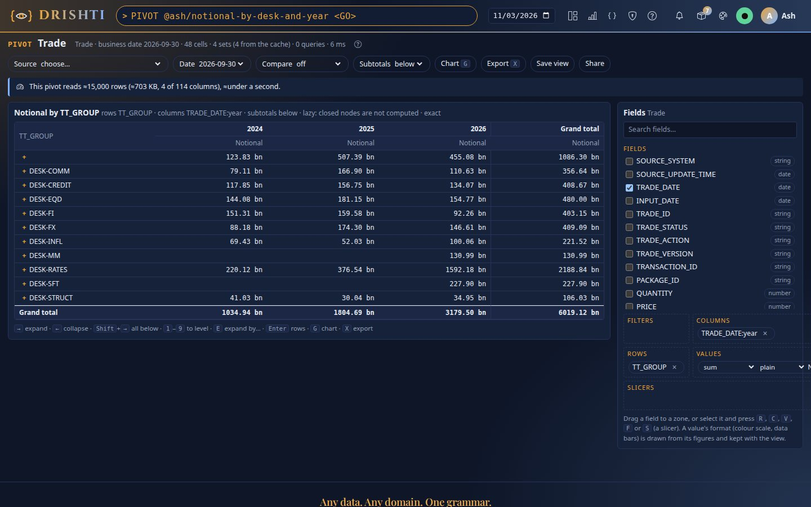

Run these from the Drishti folder (the repository root, or the install folder of a release).

```
drishti.py pivot run --source trade --rows '$.TT_GROUP' --cols '$.TRADE_DATE:year' --values 'sum($.LEGS[*].NOTIONAL)'
```

```yaml
source: trade
rows: [$.TT_GROUP]
columns: [$.TRADE_DATE:year]
values:
  - {measure: sum($.LEGS[*].NOTIONAL), as: Notional}
```

**2. How many trades have a JPY leg, by product: one row per trade, a filter on a list.** Rows `$.PRODUCT_TYPE`, value `count()`, filter
`$.LEGS[*].CURRENCY` in JPY. **1,383** of the 15,000 trades have at least one JPY leg, across 69 product types; the most are FX_ACCUMULATOR (68),
FIRST_TO_DEFAULT (64), INFL_ASSET_SWAP (55) and FX_BARRIER (51).

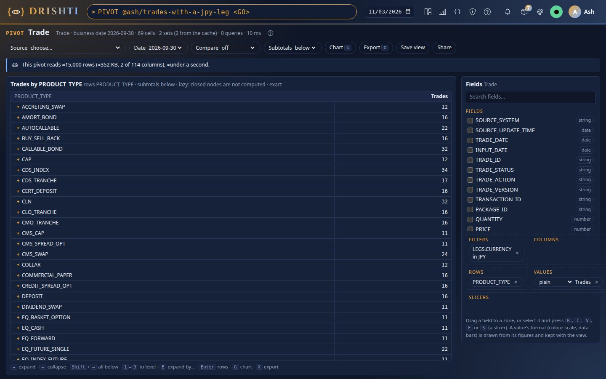

```
drishti.py pivot run --source trade --rows '$.PRODUCT_TYPE' --values 'count()' --filter '$.LEGS[*].CURRENCY=JPY'
```

```yaml
source: trade
rows: [$.PRODUCT_TYPE]
filters: {$.LEGS[*].CURRENCY: {in: [JPY]}}
values:
  - {measure: count(), as: Trades}
```

**3. Fixed against floating legs per counterparty: a list field on the columns.** Rows `$.COUNTERPARTY` (the top 8, the other 16 in
*Others*), columns `$.LEGS[*].LEG_TYPE`, values the count of legs and the sum of their notional. Of 20,422 legs, 9,604 are FIXED
(2259.03 bn), 6,606 FLOAT (2762.22 bn), 3,358 OPTION (945.21 bn) and 854 PHYSICAL (52.66 bn); CP-NORTHPLAINS has the most legs (2,844).

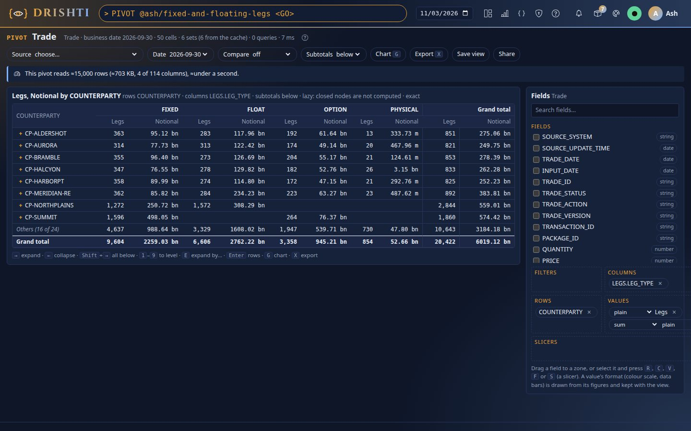

```
drishti.py pivot run --source trade --rows '$.COUNTERPARTY' --cols '$.LEGS[*].LEG_TYPE' --top '$.COUNTERPARTY=8' \
  --values 'count()' --values 'sum($.LEGS[*].NOTIONAL)'
```

```yaml
source: trade
rows: [$.COUNTERPARTY]
columns: [$.LEGS[*].LEG_TYPE]
top: {$.COUNTERPARTY: {n: 8}}
values:
  - {measure: count(), as: Legs}
  - {measure: sum($.LEGS[*].NOTIONAL), as: Notional}
```

**4. Quantity per desk without double counting: a trade figure in a leg view.** Rows `$.TT_GROUP`, filter `$.CURRENCY` in USD (a quantity
is an amount in its trade's currency; one currency adds up), values the sum of `$.QUANTITY` and the count of `$.LEGS[*].LEG_ID`. The legs
make the grain (12,230 USD legs), and each trade's quantity is added once: the total, **1,120,878,590,423.65**, is exactly the sum over the
8,562 USD trades at the trade grain. DESK-COMM: 197,072,225,509.30 over 1,320 legs of 990 trades; DESK-RATES: 172,787,316,965.74 over 882
legs of 541 trades.


```
drishti.py pivot run --source trade --rows '$.TT_GROUP' --filter '$.CURRENCY=USD' --values 'sum($.QUANTITY)' --values 'count($.LEGS[*].LEG_ID)'
```

```yaml
source: trade
rows: [$.TT_GROUP]
filters: {$.CURRENCY: {in: [USD]}}
values:
  - {measure: sum($.QUANTITY), as: Quantity}
  - {measure: count($.LEGS[*].LEG_ID), as: Legs}
```

**5. Booking events by type and year: one row per event.** Rows `$.EVENTS[*].EVENT_TYPE`, columns `$.EVENTS[*].EVENT_DATE` by year, value
`count()`: **157,087** events. BOOKED and CONFIRMED have 10,000 each (2024: 2,659, 2025: 3,322, 2026: 4,019); the cash settlements run to
2059; 1,887 events have no type and no date (*(blank)*).

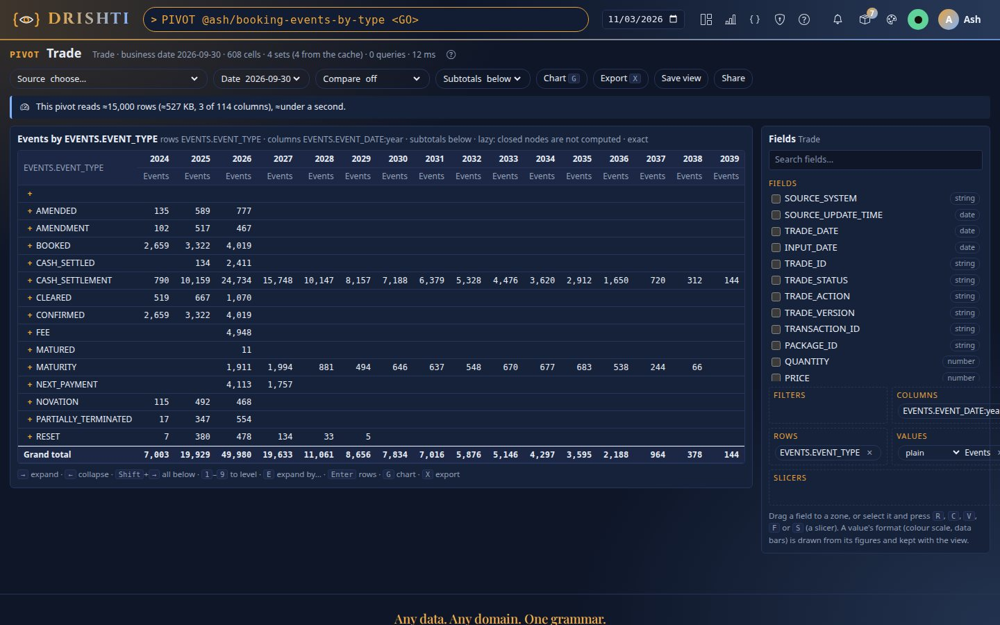

```
drishti.py pivot run --source trade --rows '$.EVENTS[*].EVENT_TYPE' --cols '$.EVENTS[*].EVENT_DATE:year' --values 'count()'
```

```yaml
source: trade
rows: [$.EVENTS[*].EVENT_TYPE]
columns: [$.EVENTS[*].EVENT_DATE:year]
values:
  - {measure: count(), as: Events}
```

**6. VaR beside the notional: two sources, each exact.** VaR is not a sum of trades, so it comes from the VaR source, not from the trade
documents: rows `DESK`, values `var()` and `es()`. The bank's VaR is **112,041,645.93** (ES 160,143,809.24); DESK-CREDIT
130,670,864.00 and DESK-RATES 74,633,680.00 add up, with the others, to more than the bank: the diversification. Put it beside example 1 to
read a desk's VaR against its legs' notional.


```
drishti.py pivot run --source var --rows DESK --values 'var()' --values 'es()'
```

```yaml
source: var
rows: [DESK]
values:
  - {measure: var(), as: VaR}
  - {measure: es(), as: ES}
```

Two views that would cross lists are refused rather than answered: rows `$.LEGS[*].CURRENCY` and columns `$.EVENTS[*].EVENT_TYPE` answers
*Legs and Events are separate lists of each trade: a view that crossed them would count every pair … Pick one, or compare them side by side
as two views.*

### 4. Measures and how each total is made

**A cell or a total is made from its members, never from other cells' figures.** What differs by kind is how:

| Function | Kind | A total is | In Excel |
|---|---|---|---|
| `sum(x)` | mergeable | the sum of its own rows (compensated) | `SUM` of its parts |
| `count()`, `count(x)` | mergeable | the rows (or values) of its own rows | `SUM` of its parts |
| `avg(x)` | mergeable | Σx / n of its own rows, never an average of averages | value |
| `min(x)`, `max(x)` | mergeable | the extreme of its own rows | value |
| `wavg(x, w)` | mergeable | Σwx / Σw of its own rows | value |
| `var_samp(x)`, `var_pop(x)`, `stddev_samp(x)`, `stddev_pop(x)` | mergeable | Welford's state of its own rows | value |
| `median(x)`, `percentile(x, q)` | holistic, exact; ≈ by its sketch (KLL, ±1.65% of rank) when asked or large | exact: the quantile of its own values (linear interpolation, as DuckDB's `quantile_cont`); ≈: the merge of its cells' KLL summaries | value |
| `distinct(x)` (also written `count_distinct(x)`) | holistic, exact; ≈ by its sketch (HyperLogLog, ±1.6%) when asked or large | exact: the distinct values of its own rows; ≈: the merge of its cells' registers | value |
| `var()`, `es()` (source `var`) | holistic | the VaR engine's answer for the cell's own scope, from its trades' summed scenario vector | value |
| `pv()`, `trades()` (source `var`) | holistic (adds up) | the engine's answer for the cell's scope | value |

So the desks' VaRs add up to more than the bank's: the grand total is the bank's own VaR, and the gap (Σ children − total) is shown beside
every open node's total as **Σ−total**, the diversification. A function has one name ([FUNCTION_CATALOGUE.md](../../architecture/FUNCTION_CATALOGUE.md));
its sketch is how it is computed when ≈ is accepted, with a stated error, never a second name, and never for VaR
([section 23](PIVOT_SCALE_AND_CUBES.md#1-scale-sketches-rollups-progressive-answers-and-the-cluster)); custom functions are in [section 19](#19-custom-functions).

Show values as: a value may carry `showAs` (`pct-grand`, `pct-row`, `pct-column`, `pct-parent-row`, `rank`, `ntile:<n>`,
`diff:<n>:<dimension>`, `pct-change:<n>:<dimension>`); it is computed from the finished figures, so a total is never broken. The same
is written as a function around the aggregate, which is how the catalogue names it: `pct_of_total(sum(NOTIONAL))`,
`pct_of_row(...)`, `pct_of_column(...)`, `pct_of_parent(...)` (the level above on the rows), `ntile(sum(NOTIONAL), 4)` (the bucket
among the siblings), `diff(sum(PNL), 1, TRADE_DATE:month)` and `pct_change(sum(PNL), 1, TRADE_DATE:month)` (along a dimension on the
rows or the columns). The column header is the text as written; the raw figure stays in the answer beside the shown one. The statistics
(`skewness`, `kurtosis`, `corr`, `slope`, `iqr`, `trimmean`, `mode`, `string_agg` …) are ordinary values:
[FUNCTIONS.md](../FUNCTIONS.md).

#### Choosing a function in the screen

A value's **▾** (on the line, or on its chip in Build) offers, in plain words, **only the functions valid for its field**, as the source's
catalogue says them (`GET /api/v1/pivot/catalogue`: each field's `functions`):

| Field | Offered | Shown off, with the reason |
|---|---|---|
| a number (money, a count) | Sum, Count, Distinct count, Average, Weighted average…, Min, Max, Median, Percentile…, Variance, Std dev | none |
| a rate or a percentage (`unit: rate`, `pct`) | the same without Sum | **Sum**: "a rate is never summed (an average or a weighted average is)" |
| a text, a date, a hierarchy level | Count, Distinct count | **Sum**: "not a number: count it, or count its distinct values" |
| a measure computed per cell (VaR, ES, Comp VaR, Limit use…) | no function: the menu says *computed per cell by the VaR engine from the cell's own trades; a total is never a sum of the cells (Σ − total = the diversification)* and offers the VaR options instead (horizon, confidence, scenario set: the view's options) | every function |

**Weighted average…** asks for its weight (another number field: `wavg(PV, NOTIONAL)`); **Percentile…** for its quantile (p50, p90, p95,
p99 or one typed: `percentile(PV, 0.99)`). **Custom ƒ…** opens the Rachana formula editor (a formula, `sum(PV) / sum(NOTIONAL)`, or a
custom function, `wret(RET, W)`); the server checks it before it is used and says why when it cannot. The custom functions you may use
([section 19](#19-custom-functions)) are listed as **ƒ name**. **Add another value of PV** puts the same field in Values again with
another function, so Sum of PV and Count of PV stand side by side.

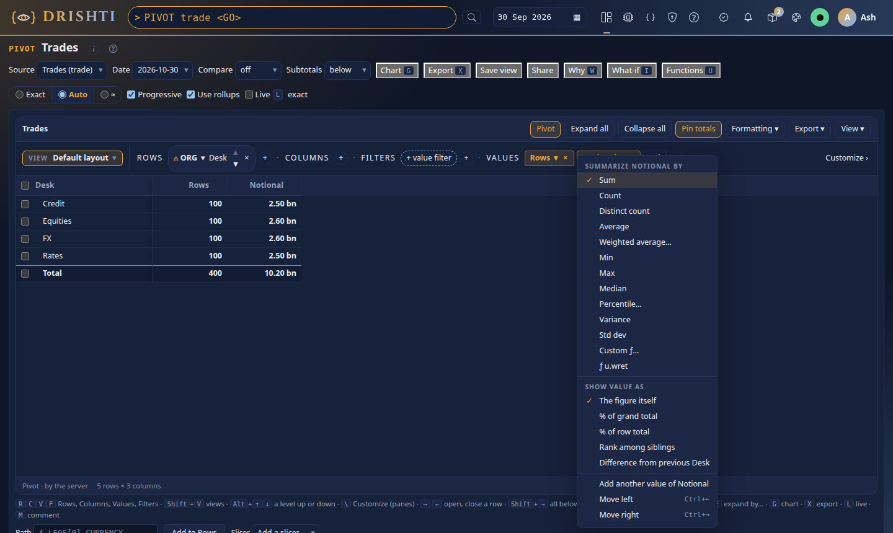

**Show value as** offers the forms the engine computes (the catalogue's `showAs`), and only those: % of grand total, % of row total, % of
column total, % of parent row, Rank among siblings, Quartile among siblings, and, for each field on the rows or columns, *Difference from
previous* and *% change vs previous* (`diff:1:<field>`, `pct-change:1:<field>`). A share of a measure that does not add up (VaR) is shown off,
with the reason. Running totals are not a form of the engine and are not offered. The figure is computed by the server from the finished
figures; the raw figure stays in the answer.

### 5. Nested rows, opened lazily

Rows are levels. Only level one is computed at first; opening a member computes **its children only**: one statement for that node's
children and their columns, every other cell read from the partial-state cache. A ten-level hierarchy over a big table opens as fast as one
level. The answer says what it did: "18 cells · 6 sets (4 from the cache) · 1 queries".

- **+** opens a member by the next row field; a member on the last row level is a leaf and has no **+**.
- **Expand by…** (`E`): open any member by a field other than the next row field, per member: EMEA by desk, APAC by currency, in one grid,
  a leaf included. The totals stay right: each node is its own cell key.
- **Open to level N** (`1`–`9`): every member down to level N.
- The open nodes are part of the view (its `expanded` list), so a saved view and a link reopen them.

**Names on the rows.** A source can name its members: the VaR source shows the desk, book or legal entity's name, as the VaR tree does, and the row's tooltip
keeps the id. Keys, paths, filters and figures use the id. A member with no name shows its id. In the answer, a named row has a `name` next to its `value`.

### 6. Top N, Others and sorting

A level may show its top N members by a measure and one **Others** member: "Others (3 of 5)". Others' figures are computed from **its own
members** (the rows of the members not shown), for every measure: a median of Others is the median of those rows, never total minus the
top N. Others is not opened further (its rows can be exported).

**Top N when you ask ≈.** With the screen's **≈** switch on (or `"exact": false`), a level whose top N is ranked by a count of rows
(`count()`, or `count(x)` of the level's own field) and whose field is plain text is chosen **before** the level is read: one Space-Saving
summary of the field (10·n counters) is made for the parent's cell, the members it ranks first are the level, and only their cells are
read. The figures shown are exact, each from its own rows; only the choice of members is ≈, within a stated bound: every count the summary
keeps is over by at most its floor, and a member holding more than 1/(10·n) of the rows is always listed. Others then reads "Others (≈: the
rest after a top N chosen by a summary)" and its figures are still its own members' exactly. A top N ranked by anything else (a sum, an
average, a VaR), a grouped date or number bins, and every view not asking ≈ rank every member exactly; the answer's notes say which.
Use it for a level with very many members (counterparties, instruments) where reading every member's cell would be the cost.

Each level sorts on its own: by label in the field's type order (numbers by value, dates by time, text alphabetically, `(blank)` last),
or by a measure, ascending or descending. A sort never moves a child out of its parent.

### 7. Provenance, rows and cell references

Every answer has a provenance id (`pv:<date>:<hash>`); every cell's provenance (members, condition or scope, the measures' kinds, the data
version, filters, statements run, cache hits, time) is kept for the last `drishti.pivot.provenance-kept` answers.

**Rows** lists a cell's member rows, paged, as you may see them (the VaR source's rows are its trades: open the cell's scope in VAR).

A **cell reference** names a cell of a saved view by its coordinates, not its position: `pivot://asha/desk-risk@4/Notional[DESK=RATES-NY,
CCY=USD]`. It survives re-sorting, new columns and a new date; a coordinate that is gone says "not in the view", never 0. Copy it from the
popover; resolve it with `GET /api/v1/pivot/cells?ref=...`. In a Sutra, Rachana reads the same cell: `cell('asha/desk-risk', 'DESK',
'RATES-NY', 'CCY', 'USD')`, and a compute engine's measure for one scope: `measure('VAR', 'DESK:RATES-NY')`, both answered by this
engine for the person viewing ([RACHANA_REFERENCE.md](../RACHANA_REFERENCE.md#functions)).

### 8. The scan estimate, budgets and busy protection

Before a view runs, the screen shows what it will read. Over `drishti.pivot.estimate.confirm-above-seconds` (60) or `confirm-above-rows`
(500 million), it asks first. A table not yet read for you has an unknown size until its first pivot.

- **Cell budget**: a view of more visible cells than `drishti.pivot.max-cells` (20,000, totals included; `max-holistic-cells`, 5,000,
  with a holistic measure) is refused with the count and how to narrow it (`422 DRS-5702`), never cut short.
- **Busy protection**: a view of more than `drishti.pivot.busy-cells` cells asks the admission gate before it opens deeper levels; a
  refusal is `503 DRS-9507` with `Retry-After`.

### 9. Charts of a selection

Select cells (click, Shift+click or Shift+arrows) and press `G`. With nothing selected the chart shows the top level. A measure that adds up
(sum, count) is drawn as bars that sum to the total. **A measure that does not add up is never stacked**: VaR by desk is drawn as the desks'
bars beside the bank's, with the diversification as its own bar, and the chart says so in words. The diversification is the engine's
own gap of the charted column (each open row's `diversificationByColumn` in the answer, Σ parts − total; drawn as total − Σ parts): the
browser adds up nothing. The gap is given only when the row's total and every one of its parts have the figure; when one has none (a
measure computed for a view's first cells only, such as the MR cube's stressed VaR and SBM, or a hidden cell) it is `null` and no bar is
drawn: never a sum of some of the parts. Which cells get such a capped measure is fixed by the view: its first N cells in the grid's
order, row by row as shown, each row's columns left to right ([section 29.2](PIVOT_SCALE_AND_CUBES.md#72-the-measures) section 2). A bar's click opens that member in the
grid. ECharts is vendored; nothing comes from a CDN.

### 10. Export

**Export** (`X`) asks what and how:

| What | Contents |
|---|---|
| The pivot as shown | Excel: one sheet with the rows as shown, numbers as numbers, Excel's own row **outline levels** (grouping with + and −, summaries below or above as on screen); a **`SUM` formula only where a measure's total is the plain sum of its parts** (sum, count), every other figure the engine's value; a **Provenance** sheet (who, when, the provenance id, the data, the filters, every measure's function, kind, exactness and how its totals are made). CSV: one row per cell and measure (`ROW, COLUMN, <dimensions>, MEASURE, VALUE, EXACT, MEMBERS, KIND`) or the grid as shown. Arrow: the cells as a columnar stream |
| The underlying rows | the selected cell's member rows as CSV, as you may see them (up to `drishti.pivot.export.rows-max`) |
| The definition | the view as YAML, no figures |

**JSON Lines** (the data standard) writes one object a cell and measure (`row`, `column`, `coords` by dimension, `measure`, `value` as a number, `exact`, `members`, `kind`), and the rows of a cell one object a row. An xlsx of more rows than `drishti.pivot.export.xlsx-max-rows` is refused with CSV or Arrow offered. Every export is audited (who, the view,
what, the format, the size), never its values.

### 11. Saved and shared views, compare

**Save view** keeps the definition (never the numbers) under your name, each save a new version; **Share** adds people or roles
(`role:risk`). A reader opens a shared view with their own entitlements and masks. `PIVOT @owner/name <GO>` opens one.

**The View picker** (`Shift+V`, the **VIEW** chip in front of the line) lists three kinds of view, with no store of its own:

| Group | What | From |
|---|---|---|
| Ready-made (keys `1`–`9`) | the preset's layouts: the MR cube's *By risk class × desk* (its landing), *By desk*, *By book*, *By limit letter*, *Top contributors*, *Trades in my scope*; a source without a preset offers its *Default layout* | `views:` of the preset in `drishti-console/config/pivot-presets.yaml`; a view naming a field the source does not have (a hierarchy not configured) is left out |
| My views | your saved views of this source | the saved views above |
| Shared with me | the views others shared with you or your roles | the same |

**Save view as…** names the layout (letters, digits and dashes are kept: *Desk morning* is saved as `desk-morning`) and saves it
**Personal** or **Shared** (with people, or `role:risk`), `Ctrl+S`. A ready-made view is laid over the landing: the scope, the date and the
lens's options you chose stay. When the layout changes after a view was opened, its chip shows a dot and the picker offers **Revert**.

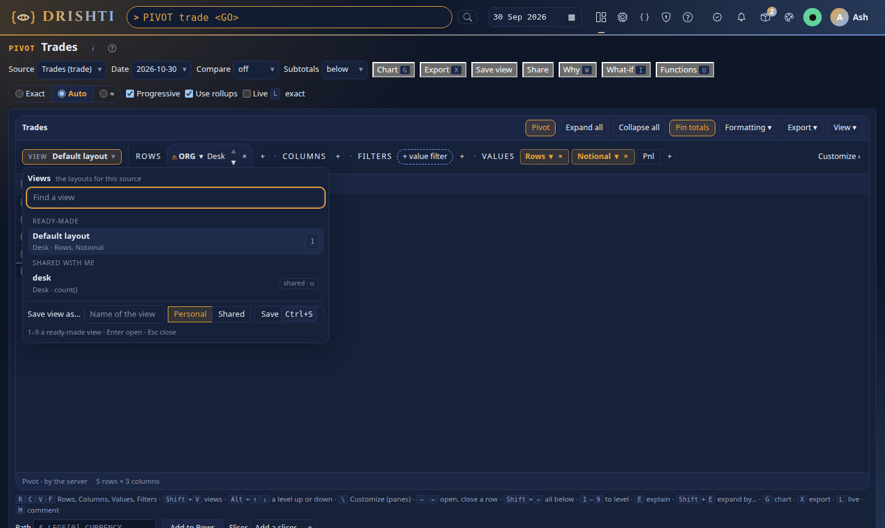

A preset names the ready-made views and, with `view:`, the one it opens with:

```yaml
presets:
  mr:
    mode: views                      # views (the default), compact or panes
    view: by-desk                    # optional: the ready-made view it opens with (default: the source's landing)
    views:
      - id: by-book
        name: By book
        detail: MGMT Desk › Book · VaR, ES, Limit use
        rows: [MGMT.DESK, MGMT.BOOK]
        values: [{measure: "var()", as: VaR}, {measure: "es()", as: ES}, {measure: "limit_use()", as: Limit use}]
        expandTo: {rows: 2, columns: 1}
```

On a page's table, an author may **promote** the view to the Sutra (`POST /api/v1/pivot/promote` `{"sutra", "view", "note", "preview"}`):
the Sutra's next version with the panel's `pivot:` arrangement, through review when review is on; a view the arrangement cannot say (a
grouped date, a median, a filter that leaves values out) is refused in words and stays a saved view
([RACHANA_REFERENCE.md](../RACHANA_REFERENCE.md#pivot-pivot-on-a-table-or-ladder)).

**Compare** picks another date: each cell shows its change (▲/▼) and new or gone cells are marked; the API answers both sides and the
differences.

**Versions.** Every save of a view is kept: `GET /api/v1/pivot/views/{owner}/{name}/versions` lists them, `/diff?from=1&to=2` says what
changed in the definition (rows, columns, values, filters, open nodes, sorts, top N, date) and `POST /api/v1/pivot/views/{name}/restore`
with `{"version": 1}` saves an old one again as the next version (the versions between stay). A view keeps its definition, never numbers.
Comments on its cells are kept beside its versions ([section 26](PIVOT_SCALE_AND_CUBES.md#4-cell-comments)).

### 12. Who sees what

- A table is read through Export data's own read for you: a table you may not open is not offered; a **masked column is not read at
  all**, so it cannot be a dimension, a measure's input or a filter (`403 DRS-5705`).
- The VaR source applies the VaR engine's own entitlements: trades you may not see are left out of every cell; a role that sees the bank only
  in aggregate is offered no dimension unless the MR cube runs, which offers it the hierarchy levels ([section 29.4](PIVOT_SCALE_AND_CUBES.md#74-the-view-dimensions-options-cells-and-totals)).
- `drishti.pivot.aggregate-only.min-members-per-cell` (1 as shipped) hides the figures of a cell with fewer members.
- Every view run, rows read and export is audited without values.

### 13. The view as JSON

```json
{ "source": "trade", "date": "2026-10-30",
  "rows": ["LEGAL_ENTITY", "DESK"], "columns": ["TRADE_DATE:month"],
  "values": [{"measure": "sum(NOTIONAL_USD)", "as": "Notional"}, {"measure": "median(PNL_1D)", "as": "Median P&L"}],
  "filters": {"PRODUCT_GROUP": {"in": ["RATES", "FX"]}, "TRADE_STATUS": {"notIn": ["MATURED"]}},
  "expanded": [{"axis": "rows", "path": [["LEGAL_ENTITY", "LE-UK"]], "by": "CURRENCY"}],
  "expandTo": {"rows": 1}, "sort": {"DESK": {"by": "Notional", "desc": true}},
  "top": {"DESK": {"n": 10, "by": "Notional"}}, "subtotals": "below" }
```

The answer has `rows` and `columns` in display order (each with `key`, `kind` node, header, total, others or grand, `depth`, `label`,
`path`, `expandable`, `expanded`, `by`, and `diversification` on a holistic total), `cells` keyed `rowKey|colKey` (each with `values`,
`members`, `coords`, `notes` where a figure is missing, `scope` on the VaR source), `measures` (id, label, kind, plainSum, exact),
`computed` (sets, fromCache, queries, ms), `provenance` and `provenanceShared`.

### 14. The API

| Call | Does |
|---|---|
| `GET /api/v1/pivot/sources` | the sources you may pivot |
| `GET /api/v1/pivot/catalogue?source=&date=` | a source's fields, measures, functions, dates, masked count; for the pickers each field's `group` (hierarchy, field, measure), `folder`, `hidden` (More fields), `hierarchy` and `functions` (those valid for it), each measure's `folder` and `perCell`, the source's `hierarchies` (`{id, title, levels: [{field, label}], columns}`) and `showAs` (the forms the engine computes) |
| `POST /api/v1/pivot/query` | a view (or `{"view": "owner/name"}`) → its answer |
| `POST /api/v1/pivot/estimate` | the scan estimate; nothing read |
| `POST /api/v1/pivot/expand` | `{view, axis, path, by}`: the view with that node open; only its children computed |
| `POST /api/v1/pivot/compare` | `{view, otherDate}`: both answers and the differences per cell |
| `POST /api/v1/pivot/rows` | `{view, coords, offset, limit}`: a cell's member rows |
| `POST /api/v1/pivot/inline` | `{fields: [{name, type}], rows: [[…]], view}`: rows the caller already holds (at most 100,000; field names of letters, digits and `_`; type `string`, `number` or `date`), aggregated by the engine; the view's `source` is ignored |
| `GET /api/v1/pivot/cells?ref=` | a cell by reference |
| `GET /api/v1/pivot/provenance/{id}?cell=rowKey|colKey` | an answer's or a cell's provenance |
| `GET, POST /api/v1/pivot/views`, `GET /views/{owner}/{name}`, `DELETE /views/{name}` | saved views |
| `POST /api/v1/pivot/promote` | a page table's view as its Sutra's `pivot:` arrangement (an author; `preview: true` shows the next version) |
| `POST /api/v1/pivot/export` | `{view, what: pivot|rows|definition, format: xlsx|csv|jsonl|arrow, shape: cells|grid, delimiter, bom, coords}`, streamed |
| `GET /api/v1/pivot/functions`, `GET /functions/{owner}/{name}?version=` | custom functions you may use (section 19) |
| `POST /api/v1/pivot/functions/test` | a definition and sample rows: the harness and the playground; nothing saved |
| `POST /api/v1/pivot/functions` | save a new version after its harness passes |
| `POST /api/v1/pivot/functions/{owner}/{name}@{v}/submit`, `/approve`, `/revoke` | sharing: approval by someone who is not the author, withdrawal |
| `POST /api/v1/explain` `{kind: pivot, measure: cell, view, from, to, fromDate, toDate, by, order, price, quantity}` | the one Explain of a cell: the difference in steps that add up (section 20) |
| `POST /api/v1/pivot/whatif` | `{view, whatIf: {exclude, changes, add}}`: the view with the overlay beside the original (section 21) |
| `GET /api/v1/pivot/views/{owner}/{name}/versions`, `/versions/{n}`, `/diff?from=&to=`; `POST /views/{name}/restore` `{version}` | a saved view's versions (every save kept), one version, what changed between two, an old one restored as the next version |
| `POST /api/v1/pivot/query` with `"exact": true` or `false` | exact on request, or ≈ by the sketches at any size ([section 23.1](PIVOT_SCALE_AND_CUBES.md#11-sketches-with-a-stated-error-and-exact-on-request)) |
| `POST /api/v1/pivot/query?progressive=true` | server-sent events: `approximate` (from a sample, with intervals) then `exact` |
| `GET, POST /api/v1/pivot/rollups`, `DELETE /rollups/{id}`, `POST /rollups/{id}/refresh` | rollups: list with advice; define, remove, refresh (administrators) |
| `POST /api/v1/pivot/query` with `"rollups": false`, `"progressive": false` | the screen's switches as options: no rollup answers, no ≈ first answer; every answer's `computedAs` says what was asked and what answered ([section 24](PIVOT_SCALE_AND_CUBES.md#2-the-screens-switches-exact-or--progressive-rollups)) |
| `POST /api/v1/pivot/live`, `GET /live`, `GET /live/{id}/events`, `DELETE /live/{id}` | a live pivot: started (its first answer, id and node), listed, streamed (`answer`, `patch`, `reshape`, `status`), ended ([section 25](PIVOT_SCALE_AND_CUBES.md#3-live-pivots)) |
| `GET, POST /api/v1/pivot/views/{owner}/{name}/comments`, `POST /comments/{id}/resolve`, `/reopen`, `DELETE /comments/{id}` | a saved view's cell comments ([section 26](PIVOT_SCALE_AND_CUBES.md#4-cell-comments)) |

Details and the error codes: [API_REFERENCE.md, Pivot engine](../API_REFERENCE.md#23-pivot-engine-apiv1pivot).

### 15. The command line

```
drishti.py pivot sources
drishti.py pivot fields trade
drishti.py pivot run --source trade --rows productType,counterparty --values "count()" --values "sum(notional)" --open productType=IRS
drishti.py pivot run --source var --rows DESK --cols CURRENCY --values "var()" --values "es()"
drishti.py pivot run --source trade --rows DESK --top DESK=5 --csv out.csv
drishti.py pivot estimate --view asha/desk-risk
drishti.py pivot export --view asha/desk-risk --format xlsx -o desk-risk.xlsx
drishti.py pivot save desk-risk --source var --rows DESK --values "var()" --share role:risk
drishti.py pivot views
drishti.py pivot functions test wret.yaml --sample rows.csv --group DESK
drishti.py pivot functions save wret.yaml --sample rows.csv
drishti.py approvals approve function asha:wret@1 --comment "reviewed" --param scope=group:rates
drishti.py pivot explain --view asha/desk-risk --cell DESK=EMEA --from 2026-09-30 --to 2026-10-30 --by BOOK
drishti.py pivot whatif --view asha/desk-risk --scale PRICE=1.1@DESK=RATES --exclude BOOK=B-17
```

More in [CLI_REFERENCE.md](../CLI_REFERENCE.md#pivot-the-pivot-engine).

### 16. Settings

All under `drishti.pivot` in `config/engines/pivot.yaml` (the switch `drishti.engines.pivot.enabled` there too), listed in [CONFIGURATION.md](../../admin/CONFIGURATION.md): `enabled`, `max-cells`,
`max-holistic-cells`, `busy-cells`, `cache-mb` (the partial-state cache `pivot.states`, in the one memory budget), `provenance-kept`,
`local-shards`, `stage-max-rows`, `stage-keep`, `duckdb.connections`, `duckdb.threads`, `duckdb.memory-limit-mb`, `duckdb.temp-directory`,
`estimate.confirm-above-seconds`, `estimate.confirm-above-rows`, `aggregate-only.min-members-per-cell`, `export.xlsx-max-rows`,
`export.rows-max`; custom functions under `functions` (`formula`, `sql-macros`, `require-approval`, `approver-role`,
`holistic-max-rows`, `holistic-max-mb`, `harness.tolerance`, `harness.seeds`, `harness.max-ns-per-row`, `python.enabled`,
`python.interpreter`, `python.workers`, `python.timeout-seconds`, `python.memory-mb`, `python.batch-rows`, `java.enabled`, `java.dir`);
the scale keys of [section 23.6](PIVOT_SCALE_AND_CUBES.md#16-settings); and `drishti.admission.retry-after.pivot-view`.

### 17. Refusals and their codes

| Code | Status | When |
|---|---|---|
| DRS-5701 | 400 | a view it cannot answer: an unknown field or function, a field twice, a bad grouping, sort or show-as |
| DRS-5702 | 422 | over the cell budget (with the count), a table over `stage-max-rows`, an xlsx over `xlsx-max-rows` |
| DRS-1020 | 404 | the engine is switched off here (DRS-5703 when an edition has no PIVOT) |
| DRS-5704 | 404 | a saved view, provenance id or source that is not there (or not shared with you) |
| DRS-5705 | 403 | a masked field asked as a dimension, input or filter |
| DRS-5720 | 504 | a view computed across the cluster where a node's share had no answer by the deadline (no other node could answer it) |
| DRS-9507 | 503 | busy protection: a large view did not start; `Retry-After` |
| DRS-5710 | 400 | a custom function refused as written (its code, inputs, kind or name) |
| DRS-5711 | 422 | a custom function whose harness did not pass: not saved, with the first failure |
| DRS-5712 | 403 | approval: the author approving, someone who is not an approver, a function not approved for you, a plug-in jar changed since approval |
| DRS-5713 | 404 | a custom function's language is off here (Python and Java plug-ins as shipped) |
| DRS-5714 | 422 | a custom function past a limit: a state over its bound, a call over its time, every worker busy |
| DRS-5715 | 403 | a custom function in an official run, or an official measure's name |
| DRS-5716 | 400 | an explanation or a what-if it cannot make as asked |
| DRS-5721 | 422 | a live pivot refused or ended: live pivots off, your or the server's live views at their most, over the live cell budget, an exact live view over `drishti.pivot.live.max-rows`, a view pinned to a past version |
| DRS-5722 | 400 | a cell comment refused: empty or over 2,000 characters, a cell or measure not of the view, an Others cell, not the author's or the owner's to change |

### 18. How it is built

The engine is the Maven module `drishti-bicompute` (plain Java, no Spring): the pivot model (views, cell keys, nested axes), the provider
SPI (`PivotProvider`: catalogue, estimate, evaluate a plan of declarative cell sets into partial states, drill), the function SPI
(`AggFunction`: start, add a columnar batch, merge, finish; mergeable, sketch or holistic; each with its SQL state form), the built-ins,
the `GROUP BY GROUPING SETS` compiler and the DuckDB tabular provider, the in-memory provider (`RowsProvider`: rows held in memory, the
same states by the functions' own `add`), partial states merged in a fixed order (`OrderedMerge`), the
partial-state cache, the split-and-merge harness and the exports. The server wires it: Export data's tables as sources, the VaR provider,
REST, busy protection, saved views and audit. The console only draws: `drishti_pivot-engine.js` asks the engine and lays its answer out,
`drishti_pivot-grid.js` is the one grid (the Pivot screen and the nested `pivot` panel), and nothing in the browser adds up a figure.

The engine is also Rachana's only source of aggregates ([ONE_GRAMMAR.md](../../architecture/ARCHITECTURE.md#23-one-grammar-one-engine)): it registers every built-in
into Rachana's function table (`sum`, `count`, `avg`, `min`, `max`, `median`, `percentile`, `distinct`, `wavg`, `variance`, `stddev`,
the `_once` forms), the grouping behind `group(...)`, and `measure(...)` and `cell(...)`, so a sum in a Sutra and a sum in a pivot cell
are the same `AggFunction`. A Sutra's `pivot` panel writes its groupings as Rachana paths and its value as one of these
(`by: "@.BOOK"`, `across: "@.CURRENCY"`, `value: sum(@.MTM)`). Every function, once, is listed in [FUNCTIONS.md](../FUNCTIONS.md).

### 19. Custom functions

When the built-ins are not enough, write your own aggregation function. Every function, built-in or yours, is the same four steps:
`start` (an empty state), `add` (a columnar batch of a cell's rows: only the inputs you declare, already ruled and masked for the reader),
`merge` (two partial states of the same cell as one) and `finish` (the figure). A function's **kind** says how its totals are made:
**mergeable** (a small state, an exact merge: totals are merged states, never figures added up), **sketch** (a bounded state with a stated
error) or **holistic** (no merge: every cell gets all of its rows in one call, up to `holistic-max-rows`).

| Language | Write | Runs | Kind | On as shipped |
|---|---|---|---|---|
| **Formula** (Rachana) | `sum(r * w) / sum(w)`, `calc(sum(PNL), where = PNL < 0) / sum(abs(PNL))`, `percentile(x, 0.99) - percentile(x, 0.01)`, `calc(count(), where = PNL < 0) / count()` | in the same `GROUPING SETS` statement as the built-ins | the kind of its parts (a ratio of sums is mergeable; a formula with a median is holistic) | yes |
| **SQL macro** (DuckDB) | `CREATE MACRO wret(r, w) AS sum(r * w) / sum(w)`; `CREATE MACRO slope(y, x) AS regr_slope(y, x)` | a macro that is a formula of the built-ins is rewritten into their states (mergeable, exact); any other runs in DuckDB per grouping set (holistic) | as found | yes |
| **Python** | a class with `start`, `add`, `merge`, `finish`, decorated `@function(name=..., kind=Mergeable, inputs={...})` | the node's sandboxed `pivot-fn` worker pool, fed Arrow batches over a pipe (never a file) | as declared, proven by the harness | no (`functions.python.enabled`) |
| **Java plug-in** | a class implementing `AggFunction` in a jar in `functions.java.dir` | in the server; the jar pinned by its SHA-256 when an administrator approves it | any | no (`functions.java.enabled`) |

A view uses a function as `fn:owner/name@version(FIELD, FIELD)`: the fields are bound in order to the function's declared inputs. Without
`@version` the latest version you may use is taken, and the column header says which (`fn:asha/wret@2 by asha`). A formula can also be
written straight into a view's values, unnamed: `sum(PNL) / sum(abs(PNL))`.

A formula is a Rachana expression ([RACHANA_REFERENCE.md](../RACHANA_REFERENCE.md#rachana-el-expressions)) over the cell's rows: the
aggregates of [FUNCTIONS.md](../FUNCTIONS.md) with an optional `where = <condition>`, `count()` for the rows, `&&`, `||`, `!`, `null`,
`c ? a : b` and `power(x, n)`. A formula saved in a view, a view's version or a formula function in Python's style (`and`, `None`,
`x if c else y`, `**`) is rewritten into Rachana once when the server starts, in place and audited (`pivot-formula-migrate`); its figures do
not change.

**The harness.** A function is saved, shared or used only after its harness passes on sample rows: one pass; batches of 1, 7, 1,000 and
65,536 rows; the rows split into 2, 3 and 16 random parts merged left-deep and balanced under five seeds, every state serialised and read
back as the cluster does; an empty cell, a part of nulls, a single row, 100 equal rows, infinities and NaN; a state read back finishes to
the same figure; the same rows give the same bits twice; the cost a row (judged on 1,000 rows or more, the fastest of up to five warm
runs, so a busy machine does not refuse a function within its limit); the state within its declared bytes. A mergeable function whose
split-and-merge answer differs from one pass by more than its tolerance (1e-12 relative) fails, with the run that differed and by how much.

**The playground.** On the pivot screen, **Functions** (`U`): write the function, paste sample rows (CSV with a header), **Check**. You
see the harness's checks, the state after each part and after each merge beside the one-pass figure, the cost (nanoseconds a row, the
state's bytes, and the projection on a real table) and the function tried in a little pivot of the sample (by a column you pick), its
total made from the groups' states. **Save version** keeps it private to you.

**Versions, approval, audit, labels.** Every save is a new version; a saved view names the version it uses, so a new version never changes
its figures. A function is private to its author until an approver (an administrator, or a member of `functions.approver-role`,
`pivot-approver` as shipped) **who is not its author** approves it for everyone or a group (`group:rates`), with a reason; a Java plug-in
is approved by an administrator. Withdrawing a version makes every cell of its column say "function withdrawn by … on …: reason", with no
figure. Saves, tests, submissions, approvals, withdrawals and every use in a view are audited (who, which version). Custom functions never
run in an official run, report or sign-off, and never take an official measure's name (`var`, `es`, `frtb_sa`, `simm`, `saccr`, ...):
the official measures stay the Java engines.

**Python's sandbox.** Each worker is `python -I` in an empty environment and serves one function version only (a function's rows never meet another function's code): no network, no processes, no writes at all, no reads outside the
Python installation and the SDK, imports from an allow-list (numpy, pyarrow, scipy, pandas, polars and safe standard modules), `open`,
`exec`, `eval` and `compile` not given to your code, memory limited per worker and each call's time limited (the worker is stopped past
it). `batch["r"]` is a pyarrow array (or numpy, or a list when those are not installed); `batch.numpy("r")` and `batch.list("r")` give the
others. Vectorise over the batch: a loop row by row shows in the playground's cost line.

```python
from drishti_pivot import function, Mergeable
import pyarrow.compute as pc

@function(name="wavg_return", kind=Mergeable, inputs={"r": "float64", "w": "float64"})
class WeightedReturn:
    def start(self, params):          return {"swr": 0.0, "sw": 0.0}
    def add(self, s, batch):
        swr = pc.sum(pc.multiply(batch["r"], batch["w"])).as_py() or 0.0
        sw = pc.sum(batch["w"]).as_py() or 0.0
        return {"swr": s["swr"] + swr, "sw": s["sw"] + sw}
    def merge(self, a, b):            return {"swr": a["swr"] + b["swr"], "sw": a["sw"] + b["sw"]}
    def finish(self, s):              return None if s["sw"] == 0 else s["swr"] / s["sw"]
```

Functions without an SQL form (Python, Java plug-ins) are fed by the tabular provider: the rows the view reads are scanned once, each row
dealt to the cells of every level it belongs to, each cell's inputs fed in batches of `functions.python.batch-rows`.

### 20. Why did it move: explain the difference

Pick a cell (or two) and press **Why** (`W`): the difference between two cells, or one cell on two dates, split by the members of a
dimension you choose, in steps that **add up** to the difference. **Explain ›** on the card opens the one Explain (USER_GUIDE.md,
"Explain: one for every number") at *Why it moved*: the words ("Notional moved from 1.2bn to 1.5bn (+300m); the largest steps: RATES
+210m, FX +95m (new)"), the waterfall of the steps and each member's step in a table, with the formula and inputs on the other tabs.

| The measure | Each step |
|---|---|
| a sum or a count | the member's own change (new, gone or changed), whatever the order |
| a ratio, an average, a variance, a formula (mergeable) | the change in the total when that member's rows move from the first cell to the second, the others as the steps before left them; the steps telescope, so they add up exactly; a different order (by member, or largest first) splits the same difference differently, and the order is shown |
| a median, a percentile, VaR (holistic: figures computed by DuckDB or the VaR engine, never merged) | each member's own change, then one step for what they do not explain (for VaR: diversification) |
| price × quantity (`--price PRICE --quantity QUANTITY`) | the price effect Σ(p₁−p₀)·q₀, the quantity effect Σp₀·(q₁−q₀), the cross term, new members, members gone, in that order |

What remains after the steps is shown as the residual and named (rounding, or rows whose member is blank); it is zero to the last digits
for a mergeable measure.

### 21. What-if

**What-if** (`I`) shows the view with an overlay beside the view as it is, cell by cell, the differences being what-if minus original:
leave members out (`BOOK=B-17`), scale or set a number field where a condition holds (`PRICE*1.1 where DESK=RATES`,
`NOTIONAL=0 where TRADE_ID=T-1`), add hypothetical rows. The overlay is joined into the source's relation after your row rules, its values
bound as parameters; the original's states come from the cache and only the overlay's cells are new. Nothing is written to the lake. On
the VaR source, use the VaR engine's own what-if.

### 22. BI on the pivot engine

BI's totals and subtotals are the pivot engine's. Every total row and column of a **matrix**, the total row of a **table** with
`format.totals`, and a model query's `totals` (grand, subtotals or explicit levels) are made in **one** `GROUP BY GROUPING SETS` statement
of the engine's function states over the model's rows as the reader may see them: BI's compiler writes those rows (row rules, masks,
joins, layers, dates) as the statement's FROM item and the statement runs in BI's engine, where the model's layers are, so no row leaves
it. Each level is computed from its own rows: an average, a ratio, a distinct count and a percentile are right at every level, and a
sum's total is the engine's too (the console adds nothing up). Measures of two facts get one statement per fact.

A model's measure is a pivot function when its DEL is an expression of aggregates of one fact's rows: `sum`, `avg`, `min`, `max`, `count`,
`distinct`, `percentile`, `ratio`, conditions (`calc(sum(x), where = c)`), arithmetic, row functions and other measures by `measure('Name')`. Whether a
measure adds up is the engine's answer (its `plainSum`), not a guess from its text. Measures that read beyond the rows of their group
(time intelligence, running and analytic functions, filter contexts, balances, Python measures) are the model's own query's: they get no
total, and the answer says why ("no total for YTD: ytd(...) is not an aggregate of its group's rows"). A dataset read directly from its
source (`mode: direct`) gets no engine totals either (they would read every row back).

## Tutorial: Pivot, functions and explain

The pivot engine end to end. Part A pivots the demo trades, their legs and VaR by desk, with totals that are never a sum of what is shown. Part B writes a custom function, proves and approves it, explains why a figure moved and runs a what-if. Every step shows the UI, the command line and the view's JSON or YAML.

### Time to complete

- Part A · The pivot engine: trades by product, legs by desk, then VaR by desk: About 30 minutes.
- Part B · Custom functions, why did it move and what-if: About 25 minutes.

### Before you start

- The server and console running on the demo lake (`drishti.py lake demo`, [tutorial 1, Part A](../../tutorials/01-first-15-minutes.md#part-a--install-start-and-look-around)); `EXPORT trade <GO>` lists
  the trades. The figures below are those of the demo lake on business date 2026-09-30.
- For step 6, the VaR engine on with the demo risk lake (`VAR BANK <GO>` answers).
- A token for the command line in `DRISHTI_TOKEN` or a `--token-file` ([CLI_REFERENCE.md](../../guides/CLI_REFERENCE.md)).

**Part B · Custom functions, why did it move and what-if.**

- [Part A](#part-a--the-pivot-engine-trades-by-product-legs-by-desk-then-var-by-desk) done: `PIVOT trade <GO>` answers with the demo trades.
- Two users: you (an analyst) and a second user who may approve: an administrator, or a member of the role named by
  `drishti.pivot.functions.approver-role` (`pivot-approver`, one of the built-in roles as shipped: give it to the second user in
  Admin → Users). See [ADMIN_GUIDE.md](../../guides/ADMIN_GUIDE.md#3-roles).

### What you will learn

**Part A · The pivot engine: trades by product, legs by desk, then VaR by desk**

- how a view is built from the View picker and the compact line (Rows, Columns, Filters, Values, a picker behind each) or the panes
  behind Customize, how a value's function is chosen from those valid for its field, and what the server computes;
- why only open rows are computed, and how "expand by" breaks one member down by another field;
- why Others and every total are made from their own members;
- where a cell's figures come from (provenance, rows, a reference);
- how a document's lists (a trade's legs) are pivoted with Rachana paths, and why a trade's figure is counted once per trade;
- why a non-additive total (VaR) is never a sum, and how the chart and the Excel export respect it;
- how the switches Exact / Auto / ≈, Progressive and Use rollups change how a figure is computed (never what it means), and how Live
  keeps a view current;
- how a comment stays on its cell through re-arrangements and new versions of a saved view.

**Part B · Custom functions, why did it move and what-if**

- how a formula of built-ins is one function whose totals are made from states, never from the figures shown;
- what the harness checks before a function is saved, shared or used;
- why sharing needs an approver who is not the author, and what a withdrawn function looks like;
- how a difference is split into steps that add up, for sums, ratios and holistic measures;
- how a what-if overlay changes only the cells it touches, each change listed against the original.

#### Part A · The pivot engine: trades by product, legs by desk, then VaR by desk

A pivot is "these measures, broken down by these fields, under these filters, on this date". In this part you pivot the demo trades,
open a row lazily and another by a different field, check a top N's Others by hand, read a cell's provenance and rows, pivot the trades'
legs with a document path, pivot VaR by desk and see that the bank's VaR is not the sum of the desks', chart a selection, and save, share
and export a view to Excel. Each step shows the UI, the command line and the view's JSON or YAML. The guide is
[BI_GUIDE.md](README.md).

### Step 1 · A first pivot of the trades

**UI.** Type `PIVOT trade <GO>`. The screen opens as the **View** picker (*Default layout*) in front of one line, Rows · Columns ·
Filters · Values, with the first text field on Rows and `count()` in Values; there is no field list on screen. Press `R`: the Rows picker
opens with its search; type `product`, press `Enter` on *Product type*, then uncheck the first field. Press `V` and check *Counterparty*: a
text field arrives as a count; on its chip's **▾** choose **Distinct count** (a text offers only Count and Distinct count; *Sum* is shown
off, "not a number"). The **i** beside the title says what the view reads; the grid shows one row per product type and the grand total.


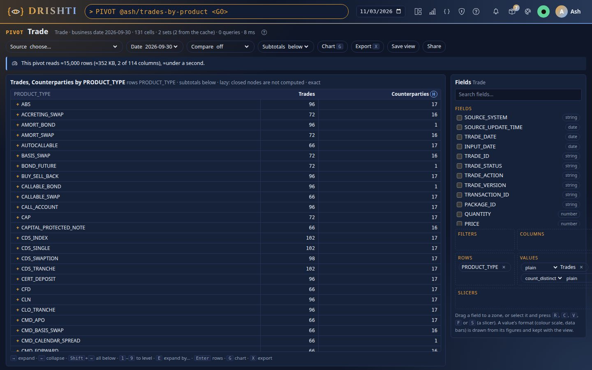

You should see 131 product types, **15,000** trades in the grand total and **24** distinct counterparties.

**CLI.**

```
drishti.py pivot fields trade
drishti.py pivot run --source trade --rows PRODUCT_TYPE --values "count()" --values "count_distinct(COUNTERPARTY)"
```

**JSON** (what the screen sent to `POST /api/v1/pivot/query`):

```json
{"source": "trade", "rows": ["PRODUCT_TYPE"], "values": [{"measure": "count()", "as": "Trades"}, {"measure": "count_distinct(COUNTERPARTY)", "as": "Counterparties"}]}
```

Check: the grand total's `count()` equals Export data's row count (`EXPORT trade`, "Rows").

### Step 2 · Open a row, then expand another by a different field

**UI.** Add `PORTFOLIO` to Rows (`R`, type `portf`, `Enter`: it goes after `PRODUCT_TYPE`; any number of fields may be nested). Nothing below level one is computed yet: the grid shows product types with **+**.
Press **+** on a product (or select its first cell and press `→`): it becomes a header with its portfolios and a total below them. The meta
line says how many sets were computed and how many came from the cache: only that product's children were asked. Now select another
product's row, press `E` and type `TRADE_DATE`: that product opens by date while the first stays by portfolio.

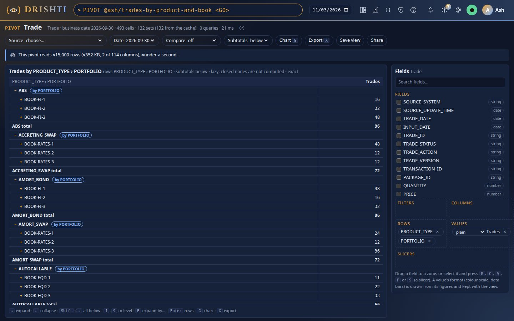

You should see each opened product's top 5 portfolios, an *Others* row and the product's total; the grand total is still 15,000.

**CLI.**

```
drishti.py pivot run --source trade --rows PRODUCT_TYPE,PORTFOLIO --values "count()" --level 2 --top PORTFOLIO=5
```

**JSON.**

```json
{"source": "trade", "rows": ["PRODUCT_TYPE", "PORTFOLIO"], "values": [{"measure": "count()", "as": "Trades"}],
 "expandTo": {"rows": 2}, "top": {"PORTFOLIO": {"n": 5}}}
```

### Step 3 · The top N and its Others

**UI.** Keep the top 2 product types by count (the CLI below, or `"top"` in the view). The grid shows the two and "Others (k of n)". Click
Others' count cell: its provenance counts its members. Check by hand: Others' count is the grand total less the two shown (for a count that
adds up); for a `median(...)`, Others is the median of Others' own rows, which no subtraction gives.

You should see two product types and Others (129 of 131), whose count is 15,000 less the two shown.

**CLI.**

```
drishti.py pivot run --source trade --rows PRODUCT_TYPE --values "count()" --values "median(PRICE)" --top PRODUCT_TYPE=2
```

**JSON.** `"top": {"PRODUCT_TYPE": {"n": 2, "by": "Trades"}}`

### Step 4 · A cell's provenance and its rows

**UI.** Click a product's total cell. The popover shows the figure, exact, the function and how its totals are made ("each cell and total
from its own rows' state"), the members counted, the condition (`PRODUCT_TYPE = '…'`), the data version and what was computed. Press
**Rows**: that product's trades, as you may see them. Press `Enter` on any cell for the same.

You should see the cell's count equal to the number of rows listed.

**CLI.** `drishti.py pivot export --source trade --rows PRODUCT_TYPE --values "count()" --what rows --cell PRODUCT_TYPE=IRS --format csv -o irs.csv`

**JSON** (`POST /api/v1/pivot/rows`): `{"view": {...}, "coords": {"PRODUCT_TYPE": "IRS"}, "limit": 50}`

### Step 5 · The legs of the trades: a document path

**UI.** A trade's record holds its legs. In the Rows picker (`R`; or the Fields pane behind **Customize ›**), under **Each leg (one row
per leg)**, are the legs' fields (*Legs › Notional*, *Legs › Leg type* …); type `$.LEGS[0].CURRENCY` into the **Path** box under the grid
and it joins Rows as *Your path*.

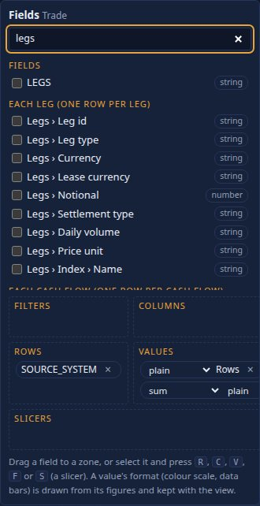

Put `TT_GROUP` (the desk) on Rows, filter `CURRENCY` to USD, and drop *Legs › Leg id* and `QUANTITY` on Values (a count of legs and a sum
of quantity). The legs make the view's grain, one row per leg, and each trade's quantity is added **once**, not once per leg.

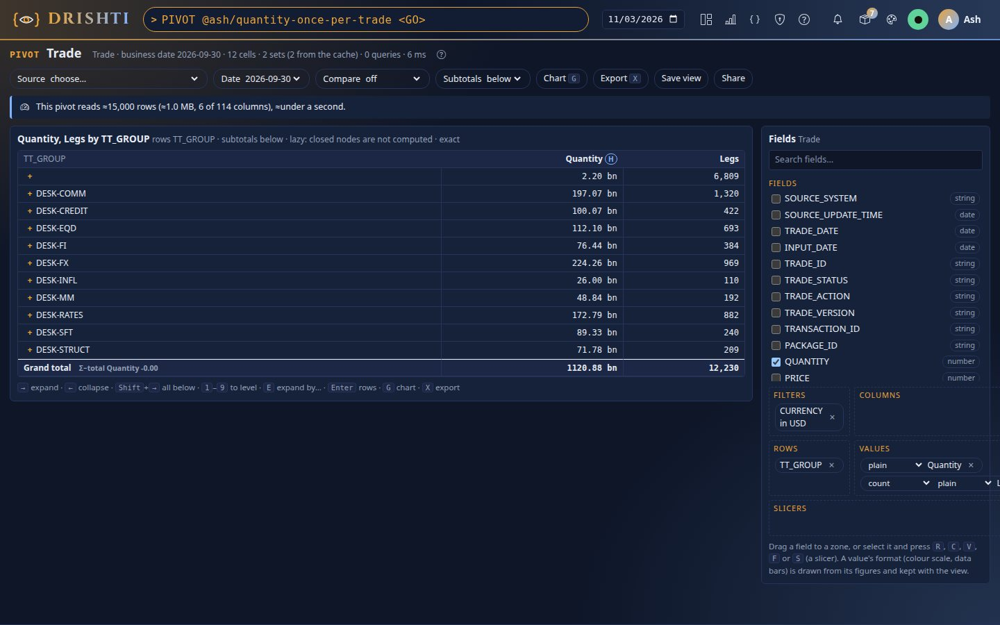

You should see **12,230** USD legs and a quantity total of **1,120,878,590,423.65**: exactly the sum over the 8,562 USD trades at the trade
grain (put `count()` alone in Values to see 8,562 trades). DESK-COMM has 1,320 legs of 990 trades. Now put *Events › Event type* on Columns:
the view is refused, because legs and events are separate lists that would multiply each other.

**CLI.**

```
drishti.py pivot run --source trade --rows '$.TT_GROUP' --filter '$.CURRENCY=USD' --values 'sum($.QUANTITY)' --values 'count($.LEGS[*].LEG_ID)'
```

**YAML** (the saved view):

```yaml
source: trade
rows: [$.TT_GROUP]
filters: {$.CURRENCY: {in: [USD]}}
values:
  - {measure: sum($.QUANTITY), as: Quantity}
  - {measure: count($.LEGS[*].LEG_ID), as: Legs}
```

More worked examples, each with its real figures: [BI_GUIDE.md, Documents](#documents-paths-lists-and-grains).

### Step 6 · VaR by desk: the total is not a sum

**UI.** Choose the source **VaR** (or type `PIVOT var <GO>`). The view opens with `var()` and `es()`; put `DESK` on Rows. Each cell's
popover shows its **scope** (`WHERE:DESK == 'DESK-X'`) and **Ask the VaR engine** opens it in VAR: the figure is the same to the cent. The
grand total is the bank's own VaR; the desks' VaRs add up to more, and the grand total row shows the gap as **diversification**
(total − Σ desks). VaR's **▾** offers no function: it is computed per cell by the VaR engine.

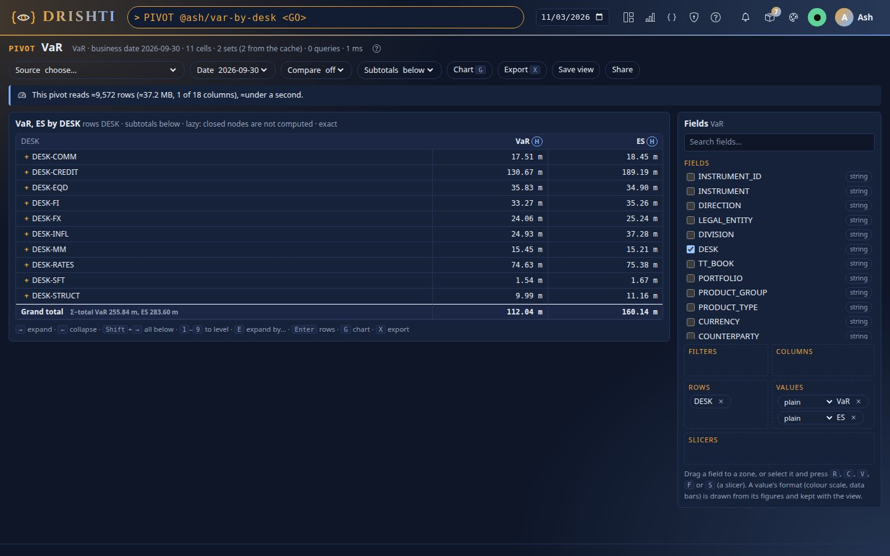

You should see the bank's VaR of **112,041,645.93** (ES 160,143,809.24), less than DESK-CREDIT (130,670,864.00) and DESK-RATES
(74,633,680.00) together.

**CLI.**

```
drishti.py pivot run --source var --rows DESK --values "var()" --values "es()"
drishti.py var show BANK
```

**JSON.** `{"source": "var", "rows": ["DESK"], "values": [{"measure": "var()", "as": "VaR"}, {"measure": "es()", "as": "ES"}]}`

### Step 7 · Chart the selection

**UI.** With nothing selected, press `G`: the desks' VaR as bars **beside** the bank's, with the diversification as its own bar, and a line
saying why it is not stacked. Go back to the trades pivot of step 1 and press `G`: a count adds up, so its bars sum to the total. Click a
bar to open that member in the grid.

You should see the VaR bars side by side, never stacked, and the trades' bars adding up to 15,000.

**CLI.** A chart is drawn on the screen; `drishti.py pivot export --format csv` writes the figures it draws.

### Step 8 · Save, share and export to Excel

**UI.** Press **Share**, name the view `desk-var` and share it with `role:risk`. The title becomes `you/desk-var @1`; a cell's popover now
shows its reference (`pivot://you/desk-var@1/VaR[DESK=DESK-X]`). Press `X`, keep "The pivot as shown" and press **Excel**. Open the file:
the rows are grouped with Excel's own + and −; in a trades pivot, a `count()` or `sum()` total is a `SUM` formula of its parts, while VaR
and any median are values; the Provenance sheet lists who exported, the data and how every measure's totals are made.

You should see `you/desk-var` in `drishti.py pivot views` and, in the workbook, VaR totals as values, not formulas.

**CLI.**

```
drishti.py pivot save desk-var --source var --rows DESK --values "var()" --share role:risk
drishti.py pivot export --view you/desk-var --format xlsx -o desk-var.xlsx
drishti.py pivot views
```

**JSON** (`POST /api/v1/pivot/views`): `{"name": "desk-var", "view": {...}, "sharedWith": ["role:risk"]}`

### Step 9 · Exact or ≈, rollups, and Live

**UI.** Back on the trades pivot, put `counterparty` on Rows and add `distinct(counterparty)` to Values. Under the toolbar, the line
beside the switches reads `exact`. Press **≈**: the distinct count now reads `≈ …`, the line says `≈ from a sketch (distinct(counterparty))`
and its tooltip the error (±1.6%). Keep the top 5 counterparties by `count()` (step 3): with ≈ on, the line adds
`top N ≈ by a summary, figures exact`: five counterparties were chosen by a Space-Saving summary before the level was read, and each
count shown is still exact; Others says "≈". Press **Exact** to rank every member again. Untick **Use rollups**: if an administrator
defined a rollup covering the view, the line no longer says `from rollup …` and the figures are the same. Press `L` (or tick **Live**):
the line ends `live`; when a load of the trades lands for this date (an administrator's `drishti.py data load` or Admin → Data loads),
the cells that moved flash with their new figures and nothing else is redrawn.

**CLI.**

```
drishti.py pivot run --source trade --rows counterparty --values "count()" --values "distinct(counterparty)" --top counterparty=5 --approximate
drishti.py pivot run --source trade --rows productType --values "count()" --no-rollups
drishti.py pivot live start --source trade --rows productType --values "count()"
drishti.py pivot live list
drishti.py pivot live stop lp-…
```

**JSON** (`POST /api/v1/pivot/query`, then `POST /api/v1/pivot/live`):
`{"view": {...}, "exact": false, "rollups": false}`; every answer's `computedAs.words` says how it was computed.

**You should see** the same counts under Exact and ≈ (only the distinct count and the choice of the top 5 change, each marked), the
line beside the switches change with every press, and with Live on a load's moved cells flash while the rest stay as they were.

### Step 10 · A comment on a cell

**UI.** Open the view you saved in step 8 (`PIVOT @you/desk-var <GO>`), click a desk's VaR cell and, in the popover, write "checked with
the desk" (`M` puts the cursor in the box) and press **Comment**. The cell gets a marker in its corner. Move CURRENCY to Columns and back,
or save the view again: the comment stays on its cell, named by its coordinates (`DESK=DESK-X`); after the new save it says "on an older
version". Press **Resolve**: the marker dims.

**CLI.**

```
drishti.py pivot comments you/desk-var --cell DESK=DESK-X --add "checked with the desk" --measure VaR
drishti.py pivot comments you/desk-var --open
drishti.py pivot comments you/desk-var --resolve c-…
```

**JSON** (`POST /api/v1/pivot/views/you/desk-var/comments`): `{"coords": {"DESK": "DESK-X"}, "measure": "VaR", "text": "checked with the desk"}`

**You should see** the marker on the commented cell wherever the cell moves, the comment in its popover with your name and the time,
"on an older version" after the view is saved again, and a dimmed marker once it is resolved.

##### What you learned

Every figure in a pivot is the server's, made from its cell's own members: a mergeable total from its own rows' state, a holistic one
(VaR, a median) from its own members, Others from its own rows. A document's lists are pivoted at their own grain with Rachana paths, a
coarser figure is counted once per parent, and two lists are never crossed. Open rows are computed on demand and the rest come from the
cache. A chart and an Excel file never add up what does not add up. The switches change how a figure is computed and say so, never what
it means; a live view sends only what moved; a comment belongs to a cell's coordinates, not its place on the screen.

#### Part B · Custom functions, why did it move and what-if

The built-in measures cover most questions; the rest you write yourself. In this part you put a formula straight into a pivot, write a
weighted-return function in the playground and watch the harness prove that its split-and-merge answer equals one pass, save it, have
someone else approve it and use it in a view, withdraw it, then explain why one product's notional differs from another's in steps that
add up, and try a what-if. Each step shows the UI, the command line and the JSON or YAML. The guide is
[BI_GUIDE.md, sections 19 to 22](#19-custom-functions).

### Step 11 · A formula in a view

**UI.** `PIVOT trade <GO>`, `PRODUCT_TYPE` on Rows. In Values, edit a value's text to `calc(sum(NOTIONAL), where=NOTIONAL > 100000000) / sum(NOTIONAL)`
(the share of notional in trades over 100 million). Every row and the grand total show the ratio; the grand total is the ratio over all the trades, not
an average of the rows' ratios.

**CLI.**

```
drishti.py pivot run --source trade --rows PRODUCT_TYPE --values "calc(sum(NOTIONAL), where=NOTIONAL > 100000000) / sum(NOTIONAL)"
```

**JSON.**

```json
{"source": "trade", "rows": ["PRODUCT_TYPE"], "values": [{"measure": "calc(sum(NOTIONAL), where=NOTIONAL > 100000000) / sum(NOTIONAL)", "as": "Large share"}]}
```

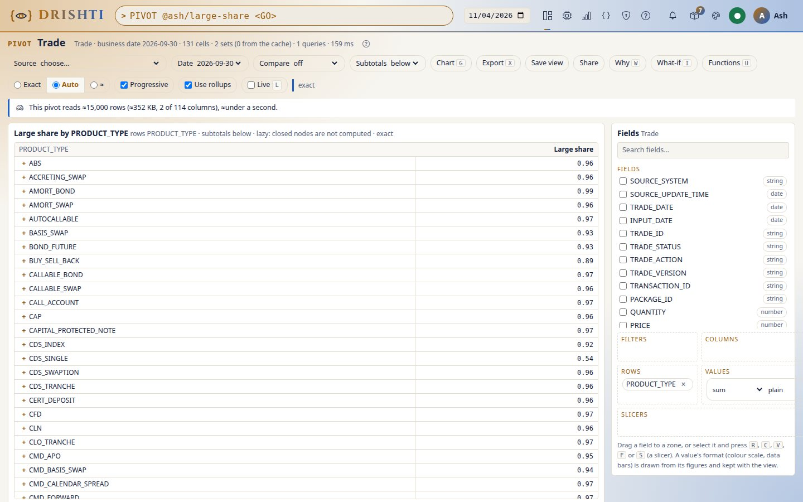

**You should see** one ratio per product type and a grand total that equals the sum of the notional of trades over 100 million divided by the sum of all notional (`EXPORT trade`, filter and sum).

### Step 12 · The playground: a function and its harness

**UI.** Press `U` (or **Functions**). Name `wret`, language **formula (Rachana)**, inputs `r, w`, code `sum(r * w) / sum(w)`; leave the sample
rows and the group column `g`. Press **Check**. You see *Passes the harness*, the checks (one pass; batches of 1, 7, 1,000 and 65,536;
2, 3 and 16 random parts merged left-deep and balanced under five seeds; an empty cell; a part of nulls; one row; equal rows; infinities;
the state read back; the same bits twice; the cost; the state's size), the state after each part and after each merge (two sums, `[Σrw, Σw]`
as the engine keeps them) with the final figure beside the one-pass figure, and the little pivot of the sample by `g` whose total is made
from the groups' states.

**CLI.** Write `wret.yaml` and `rows.csv`:

```yaml
name: wret
language: formula
code: sum(r * w) / sum(w)
inputs: [r, w]
description: the weighted mean of returns
```

```
r,w,g
0.012,3,A
-0.004,1,B
0.020,2,A
0.001,5,B
```

```
drishti.py pivot functions test wret.yaml --sample rows.csv --group g
```

```text
PASSED: fn:ravi/wret@0 (mergeable), one pass 0.007, 4 rows, 2245.0 ns a row, state 56 bytes
  ok  one pass             the figure is 0.007
  ok  batches and splits   36 runs within 1.0E-12 of the one pass
  ok  empty                an empty cell finishes to nothing (no values in the cell, or a division by zero)
  ok  nulls                a part of nulls merged equals one pass over the rows and the nulls
  ok  single row           one row finishes to 0.012000000000000002
  ok  all equal            100 equal rows finish to 0.012000000000000002, split or not
  ok  state round trip     the state read back finishes to the same figure
  ok  deterministic        the same rows in the same order gave the same bits
  ok  cost                 2245 ns a row (limit 2000); under 1,000 sample rows the cost is shown, not judged
  ok  state bound          the largest state was 56 bytes
  part 1 (rows 1 to 2)               0.008  (56 bytes)
  part 2 (rows 3 to 4)               0.0064285714285714285  (56 bytes)
  merged parts 1 to 2                0.007  (56 bytes)
```

(The author here is `ravi`: a function is named after the person who writes it, `fn:<you>/<name>@<version>`; `@0` is the unsaved draft.)

**JSON** (`POST /api/v1/pivot/functions/test`): the YAML's keys, plus `"sample": [{"r": 0.012, "w": 3, "g": "A"}, ...]` and `"group": "g"`.

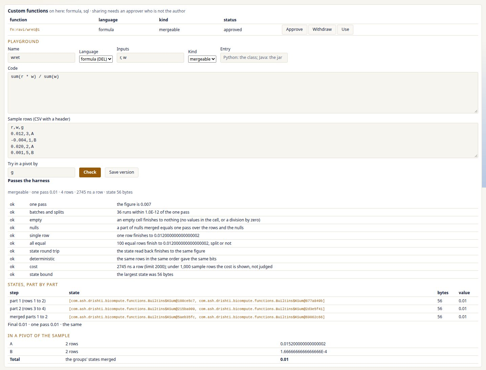

**You should see** *Passes the harness*; the final figure is (0.012·3 − 0.004·1 + 0.020·2 + 0.001·5) / 11 = 0.077 / 11 = 0.007.

### Step 13 · An SQL macro: rewritten into states, or holistic

**UI.** Language **SQL macro**, code `CREATE MACRO wret2(r, w) AS sum(r * w) / sum(w)`, **Check**: the kind is *mergeable* (the engine
rewrote the macro into the states of its sums). Now `CREATE MACRO slope(r, w) AS regr_slope(r, w)`: the kind is *holistic* (no merge;
each cell's figure is computed by DuckDB from its own rows) and the harness runs only the checks that apply.

**CLI.** The same with `language: sql` and `code: "CREATE MACRO slope(r, w) AS regr_slope(r, w)"`.

**You should see** *mergeable* for `wret2` and *holistic* for `slope`; a macro that names a table or a file (`read_csv(...)`) is refused in words (DRS-5710): a macro is SQL over its inputs only.

### Step 14 · Save, approve, use

**UI.** Back to `wret` (formula), **Save version**: `fn:you/wret@1`, private. As yourself, **submit** it for sharing; as the second user, open
**Views → Approvals**, choose `fn:you/wret@1` (or *In Approvals* beside it in **Functions**) and press **Approve**, with the comment
"reviewed: a weighted mean". As yourself, in Values add
`fn:you/wret@1(PRICE, NOTIONAL)` (the trades' price and notional): the column header is the call itself, `fn:ravi/wret@1(PRICE, NOTIONAL)`
for the author `ravi`.

**CLI.**

```
drishti.py pivot functions save wret.yaml --sample rows.csv
drishti.py approvals approve function you:wret@1 --comment "reviewed: a weighted mean"      # as the approver
drishti.py pivot run --source trade --rows PRODUCT_TYPE --values "fn:you/wret@1(PRICE, NOTIONAL)"
```

```text
saved fn:ravi/wret@1 (mergeable): private until an approver who is not you approves it
drishti: the server said 403 DRS-5712: an author never approves their own function (fn:ravi/wret@1): another approver must ...
fn:ravi/wret@1: approved
```

The refusal is the author's own `approve`; the approval is the second user's (`vera`, with her own token).

**JSON.** `POST /api/v1/approvals/function/you:wret@1/approve` with `{"comment": "reviewed: a weighted mean", "params": {"scope": "everyone"}}`; the view's
value is `{"measure": "fn:you/wret@1(PRICE, NOTIONAL)"}`.

```text
Trade · 2026-09-30 · 131 cells · 2 sets, 0 from the cache · 1 queries · 267 ms · exact
PRODUCT_TYPE                        fn:ravi/wret@1(PRICE, NO
+ ABS                                                      ·
+ ACCRETING_SWAP                                        0.05
+ AMORT_BOND                                           98.20
+ AMORT_SWAP                                            0.03
...
```

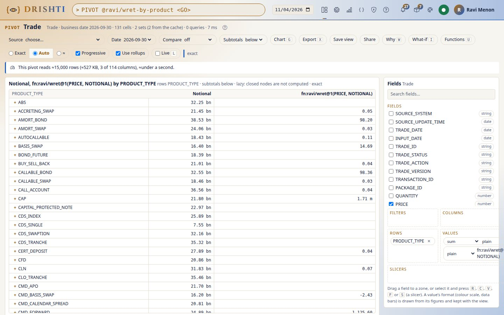

**You should see** the new column in every row and the total; approving your own function is refused (DRS-5712: "an author never approves their own function"); Admin → Audit shows
`pivot.function.save`, `pivot.function.approve` and `pivot.function.use`, with the version.

### Step 15 · Withdraw

**UI.** As the approver, **Withdraw** `fn:you/wret@1` with a reason. Run your view again: every cell of that column says "function withdrawn
by … on …: reason", with no figure; the other values answer as before.

**CLI.** `drishti.py pivot functions revoke you/wret@1 --reason "superseded"`.

**You should see** "function withdrawn by …" in each cell of the column and no figure; the function's list marks it *withdrawn*.

### Step 16 · Why did it move?

**UI.** In the `PRODUCT_TYPE` pivot with `sum(NOTIONAL)`, put `COUNTERPARTY` on Columns (**Split by** offers the view's own rows and
columns), select two product rows (click one, Shift-click the other) or type them as **First cell** and **Second cell**, and press `W`.
**Split by** `COUNTERPARTY`, **Explain**. The words say how much the second differs from the first and the largest steps; below them one
step per counterparty (its cause: new, gone or changed) and the steps add up to the difference. Change the value to `avg(NOTIONAL)` and explain again: each
step is now that counterparty's effect on the average given the steps before it, the order is shown (switch **Order** to "largest first"
and the same difference splits differently), and they still add up.

**CLI.**

```
drishti.py pivot explain --source trade --rows PRODUCT_TYPE --values "sum(NOTIONAL)" --cell PRODUCT_TYPE=FX_SWAP --other-cell PRODUCT_TYPE=FX_FORWARD --by COUNTERPARTY
```

```text
sum(NOTIONAL) moved from 35,644,171,130 to 25,679,859,409 (-9,964,311,721); the largest steps: CP-MERIDIAN-RE -2,196,462,950, CP-BRAMBLE -2,126,815,900, CP-VERDANT -2,055,678,300.
  each member's own change (the measure adds up)
  CP-ALDERSHOT                 changed     710,057,225.0000   cumulative 710,057,225.0000
  CP-AURORA                    changed   -1,669,308,280.0000   cumulative -959,251,055.0000
  CP-BRAMBLE                   changed   -2,126,815,900.0000   cumulative -3,086,066,955.0000
  ...
```

**JSON** (the one Explain, `POST /api/v1/explain`, kind `pivot`; the engine's steps are under `why.answer`):

```json
{"kind": "pivot", "measure": "cell", "part": "why",
 "view": {"source": "trade", "rows": ["PRODUCT_TYPE"], "values": ["sum(NOTIONAL)"]},
 "from": {"PRODUCT_TYPE": "FX_SWAP"}, "to": {"PRODUCT_TYPE": "FX_FORWARD"}, "by": "COUNTERPARTY"}
```

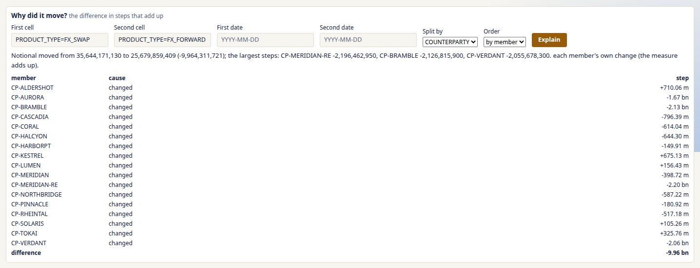

**You should see** the words and the steps; the sum of the steps plus the residual equals `difference`; the residual is named ("rounding"). For a cell on two dates, give
`fromDate` and `toDate` (`--from`, `--to`) instead of a second cell.

### Step 17 · What-if

**UI.** Press `I`. **Leave out** `PRODUCT_TYPE=FX_FORWARD`, **Change** `NOTIONAL*1.1 where COUNTERPARTY=CP-ALDERSHOT`, **Run the what-if**. The list
shows each cell that changes and by how much (what-if minus original); nothing was written anywhere.

**CLI.**

```
drishti.py pivot whatif --source trade --rows PRODUCT_TYPE --values "sum(NOTIONAL)" --exclude PRODUCT_TYPE=FX_FORWARD --scale NOTIONAL=1.1@COUNTERPARTY=CP-ALDERSHOT
```

```text
108 cell(s) change; differences are what-if minus original
  PRODUCT_TYPE=ABS|*                       sum(NOTIONAL) +138,863,064.00
  PRODUCT_TYPE=ACCRETING_SWAP|*            sum(NOTIONAL) +101,499,900.00
  PRODUCT_TYPE=AMORT_SWAP|*                sum(NOTIONAL) +155,982,800.00
  ...
```

**JSON** (`POST /api/v1/pivot/whatif`):

```json
{"view": {"source": "trade", "rows": ["PRODUCT_TYPE"], "values": ["sum(NOTIONAL)"]},
 "whatIf": {"exclude": {"PRODUCT_TYPE": ["FX_FORWARD"]}, "changes": [{"field": "NOTIONAL", "scale": 1.1, "where": {"COUNTERPARTY": ["CP-ALDERSHOT"]}}]}}
```

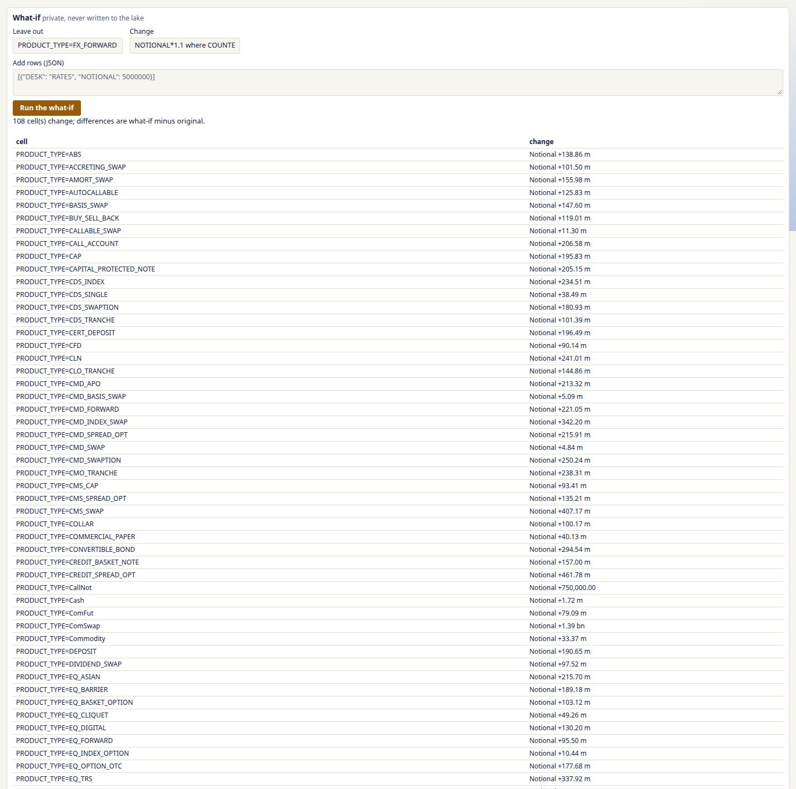

**You should see** *108 cell(s) change; differences are what-if minus original* and each changed cell with its change: FX_FORWARD's
cell is gone from the what-if, and the grand total moved by 10 % of CP-ALDERSHOT's notional less FX_FORWARD's.

### Step 18 · Python (an administrator turns it on)

Python functions are off as shipped. With `drishti.pivot.functions.python.enabled: true` in `config/engines/pivot.yaml` (and a restart),
language **Python** takes a class decorated with `@function` ([BI_GUIDE.md section 19](#19-custom-functions));
it runs in the node's sandboxed `pivot-fn` workers (no network, no files, no processes), fed Arrow batches over a pipe, and passes the same
harness. Python functions never read memory-only data.

**You should see** **Python** offered in the language list once it is on (and, while it is off, refused in words: DRS-5713).

### Step 19 · BI's totals are the engine's

Open a BI report with a matrix (the sample *trades overview*). Every total and subtotal row comes from the pivot engine's
one statement over the model's rows: the average's total is the average over all the trades, a sum's total is the engine's sum. A
year-to-date measure shows a dash in the total row; the answer's warnings say why ([BI_GUIDE.md section 3.2](REPORT_FILE_FORMAT_STATEMENTS.md#17-true-totals)).

**You should see** the matrix's totals and subtotals as before (the figures are the same: `BiParityTest`) and a dash, with its reason,
where a measure has no total.

### Next steps

- [BI_GUIDE.md](README.md) section 2 (the screen: the View picker, the compact line, the panes and every key) and
  sections 24 to 26: the switches, live pivots and cell comments in full.

- The worked examples over documents, each with its figures, picture, command and saved view:
  [BI_GUIDE.md, Documents](#documents-paths-lists-and-grains).
- Every setting, the API and the refusals: [BI_GUIDE.md](README.md) sections 14 to 17.
- Make a path a column read for everyone: promote it in the connector's `layout.<kind>.columns`
  ([../guides/DATA_GUIDE.md section 8](../../guides/DATA_GUIDE.md#8-connectors)) or add it to a BI dataset as a `path:` column ([BI_GUIDE.md](README.md)).
- [BI_GUIDE.md](README.md) sections 19 to 22: the languages, the harness, approval, explain, what-if, BI's totals.
- [ARCHITECTURE.md section 26](../../architecture/ARCHITECTURE.md#26-the-pivot-engine) sections 8, 10 and 12: the design.
- The guide: [BI_GUIDE.md section 29](PIVOT_SCALE_AND_CUBES.md#7-the-mr-cube-preset) (every measure, option, setting and code).
- The pivot screen: [BI_GUIDE.md](PIVOT.md); the VaR engine: [VAR_GUIDE.md](../../guides/VAR_GUIDE.md).
