<!--
  Project Drishti · Any data. Any domain. One grammar.

  Copyright (c) 2026 Ashutosh Sinha <ajsinha@gmail.com>.
  All rights reserved.

  PROPRIETARY AND CONFIDENTIAL.

  This file is the confidential and proprietary property of Ashutosh Sinha.
  Unauthorised copying, use, modification, distribution or disclosure of this
  file, via any medium, is strictly prohibited except with the express prior
  written permission of the copyright holder.

  See the LICENSE file in the root of this repository for the full terms.
-->
# Pivot at scale and the risk cubes

Business intelligence: [Index](README.md) · [Pivot](PIVOT.md) · **Pivot at scale and the risk cubes** · [Tables and models](TABLES_AND_MODELS.md) · [Reports and the designer](REPORTS.md) · [The report file, formatting and statements](REPORT_FILE_FORMAT_STATEMENTS.md) · [Models and datasets for reports](MODELS_AND_DATASETS_FOR_REPORTS.md) · [Live reports, boards and background runs](LIVE_REPORTS_AND_BOARDS.md) · [Distribution, subscriptions and alerts](DISTRIBUTION_AND_ALERTS.md) · [Governing BI and AI in BI](GOVERNANCE_AND_AI.md) · [The Notebook and Python](NOTEBOOK_AND_PYTHON.md) · [Groupings and analytics](GROUPINGS_AND_ANALYTICS.md)

Sketches, rollups, progressive answers and the cluster; the screen's switches, live pivots, cell comments, the pivot's data and presets, and the market-risk cube; with the tutorial.

## Contents

- [Guide](#guide)
  - [1. Scale: sketches, rollups, progressive answers and the cluster](#1-scale-sketches-rollups-progressive-answers-and-the-cluster)
  - [2. The screen's switches: exact or ≈, progressive, rollups](#2-the-screens-switches-exact-or--progressive-rollups)
  - [3. Live pivots](#3-live-pivots)
  - [4. Cell comments](#4-cell-comments)
  - [5. Pivot data: the sources of the examples](#5-pivot-data-the-sources-of-the-examples)
  - [5.1 At a glance](#51-at-a-glance)
  - [5.2 The trades: the examples' table](#52-the-trades-the-examples-table)
  - [5.3 `scenario-pv`: the VaR book's vectors](#53-scenario-pv-the-var-books-vectors)
  - [5.4 `position`: positions](#54-position-positions)
  - [5.5 `pnl-vector`: P&L vectors per trade](#55-pnl-vector-pl-vectors-per-trade)
  - [5.6 `scenario-set`: the scenario days](#56-scenario-set-the-scenario-days)
  - [5.7 `var-limit`: VaR limits](#57-var-limit-var-limits)
  - [5.8 `position-sensitivity`: the sensitivities](#58-position-sensitivity-the-sensitivities)
  - [5.9 `risk-factor`: the factor dictionary](#59-risk-factor-the-factor-dictionary)
  - [6. Presets: the risk cubes](#6-presets-the-risk-cubes)
  - [7. The MR cube preset](#7-the-mr-cube-preset)
- [Tutorial: The market-risk cube](#tutorial-the-market-risk-cube)
  - [Part C · The MR cube: desks by risk class, with the right totals](#part-c--the-mr-cube-desks-by-risk-class-with-the-right-totals)

## Guide

This page continues [Pivot](PIVOT.md) (sections 1 to 22): the pivot at scale, live and as a preset, and the market-risk cube.

### 1. Scale: sketches, rollups, progressive answers and the cluster

Large tables (a billion rows and more) are answered by four things that work together, each of them inside the engine and each saying in
the answer what it did.

#### 1.1 Sketches, with a stated error and exact on request

A sketch is the ≈ form of a function that has one name: the view writes `distinct(x)`, `median(x)` or `percentile(x, q)`, and the engine
computes it from the values (exact) or by its sketch (≈), as the request and the size decide. The answer's measure says which
(`kind: sketch`, `exact: false`, `error`), and a sketched call's id ends in `≈` (`distinct(COUNTERPARTY) ≈`), so the cache and the rollups
keep the two forms apart.

| Function | Sketch (its ≈ form) | State | Stated error |
|---|---|---|---|
| `distinct(x)` | HyperLogLog | 2^p registers (p = 12: 4,096 bytes) | ±1.04/√m: **±1.6%** at p = 12, ±0.8% at p = 14 (one standard error) |
| `median(x)`, `percentile(x, q)` | KLL | about 3k values (k = 200) | **±1.65% of rank** at k = 200; ±1.8% when made from DuckDB's quantile points |
| `top_n` of a level | Space-Saving | 10·n counters | each count over by at most the summary's floor, never under; a member over 1/(10·n) of the rows always listed (a level's top N by a count, when ≈ is asked: [section 6](PIVOT.md#6-top-n-others-and-sorting)) |

**Never approximate:** VaR, ES and every provider's own measure, the once-per-parent forms, custom functions: they have no sketch.

A sketch merges like a sum: the distinct count of a desk-month total is the merge of its cells' registers (exact for the sketch, the same
registers in any order), never the sum of the cells' counts. Every ≈ measure carries its error in the answer (`measures[].error`) and in
the provenance popover.

**Exact or ≈ is chosen by size, and you may always ask.** A view that reads more than `sketches.approximate-above-rows` rows (10 million)
answers `distinct`, `median` and `percentile` by their sketches, with a note saying so; under it they are exact (cheap there). Ask
for exact with `"exact": true` beside the view, or for ≈ at any size with `"exact": false` (on the screen: the Exact / Auto / ≈ switch,
[section 24](#2-the-screens-switches-exact-or--progressive-rollups)):

```json
{ "view": { "source": "trade", "rows": ["DESK"], "values": [{"measure": "distinct(COUNTERPARTY)", "as": "Counterparties"}] },
  "exact": true }
```

Run these from the Drishti folder (the repository root, or the install folder of a release).

```
drishti.py pivot run --source trade --rows DESK --values "distinct(COUNTERPARTY)" --approximate    # ≈, ±1.6%, at any size
drishti.py pivot run --source trade --rows DESK --values "distinct(COUNTERPARTY)" --exact          # exact on request, at any size
```

How a sketch is made on the tabular provider: HyperLogLog's (register, rank) pairs come from DuckDB's 64-bit `hash()` in the same
`GROUP BY GROUPING SETS` statement as every other state; KLL is built in Java from the cell's quantile points (`quantile_disc` at 2k + 1
fractions) and its count; Space-Saving from the cell's value counts, kept to its counters. KLL is written in the module; its error is measured by `SketchErrorTest`. Up to about 10,000 distinct values (2.5 × the 4,096 registers) a distinct count is linear counting over the registers, which is closer there than the harmonic mean. A document
source ([section 3](PIVOT.md#documents-paths-lists-and-grains)) is sketched the same way at
its view's grain: `distinct($.LEGS[*].CURRENCY)` counts the legs' currencies.

#### 1.2 Rollups of partial states, chosen automatically

A rollup keeps the **partial states** (sums, counts, Welford parts, HyperLogLog registers, KLL summaries, Space-Saving counters) of a source
at a grain. A view whose dimensions, filters and measures the rollup covers is answered from it, merged in key order, equal to reading the
table; the answer says "answered from the rollup …". A date kept by day answers week, month, quarter and year too.

```yaml
# config/engines/pivot.yaml (or POST /api/v1/pivot/rollups, administrators)
drishti:
  pivot:
    rollups:
      definitions:
        - id: trades-desk-month
          source: trade
          grain: [DESK, CURRENCY, TRADE_DATE:month]
          functions: ["sum(NOTIONAL_USD)", "count()", "distinct(COUNTERPARTY) ≈"]   # ≈: the distinct count's sketch is kept
          dates: latest            # the latest date, refreshed as it moves (all: keep every date built)
```

A function marked `≈` keeps its sketch (the registers or the KLL summary), so it answers views that accept ≈ for it (by request or by
size); the exact distinct count and quantiles keep every value and are never rollup material. On a document source the grain and the
functions are written as paths (`grain: [$.LEGS[*].CURRENCY, DESK]`, `functions: ["sum($.LEGS[*].NOTIONAL)"]`): the rollup is kept at
that grain, and a view at the same grain is answered from it.

- **Refreshed on load, incrementally.** Every `rollups.refresh-seconds` (60) each rollup's source version is checked. On a direct lake
  route the files of the version are the rollup's parts: files a load added are read alone and merged in; a partition that lost a file
  (a restatement, a delete) is rebuilt from its own files; other partitions are untouched. A source read another way (staged, or a
  document grain, which reads the documents whole) is rebuilt whole when its version moves. A stale rollup never answers.
- **Smallest first.** Of the rollups that cover a view, the one with the fewest rows answers.
- **Not for everyone.** A rollup answers only a person who reads every row and field of the source (row rules and masks apply before
  aggregation, and a rollup has aggregated already); never a view with `asOf`; never money that is guarded per cell or converted (the
  table answers those). Holistic functions (an exact median, the once-per-parent forms, VaR) are never rollup material.
- **Advice.** Grains that scanned the table `rollups.advise-after-scans` times (10) are proposed, with how often and how long:
  `GET /api/v1/pivot/rollups` lists the definitions, the rollups built (rows, bytes, version, last refresh) and the advice.
- Kept on disk under `<data dir>/pivot/rollups/<id>/<date>.rollup`, read back at start.

#### 1.3 Progressive answers: ≈ first, then exact

A view estimated over `progressive.after-ms` (2 s) answers twice when the caller asks for the pair
(`POST /api/v1/pivot/query?progressive=true`, server-sent events `approximate` then `exact`): first from a
sample of `progressive.sample-fraction` (2%) of the rows, then exact. The first answer is honest or silent:

| Measure | First answer |
|---|---|
| `sum`, `count` | the sample's figure scaled up, with its 95% interval (`intervals`) |
| `avg` | the sample's average, ±1.96·s/√n |
| `median`, `percentile` | the sample's quantile by its sketch, with its rank interval |
| everything else (min, max, variance, distinct counts, the once-per-parent forms, custom functions) | "computing" until exact: never a guessed figure |

Every cell of the first answer is marked `approximate`; it is never cached. **Never for VaR**, nor for a view with a holistic measure that
has no sketch or that is asked exact: those wait for exact (decision 7). On a document source the sample is of the view's rows at its
grain (legs of a leg-grain view).

#### 1.4 The cluster: partial states from every node, merged in order

On a Drishti\*net cluster, a mergeable view estimated over `cluster.min-rows` (5 million) is computed by every live node running the
engine: on a direct lake route each node reads its share of the files (assigned by rendezvous hashing of the path, so each node's caches
stay warm for the same files), otherwise one row shard each; each answers **partial states per cell key** (`POST
/api/v1/net/pivot/partials`, for the cluster's nodes only, as the same person, so masks and row rules apply there before aggregation);
the coordinator merges them in node order, then cell-key order. The figures equal one node's (counts and registers exactly, sums to the
last digits) and repeat on every run. A node late past `cluster.hedge-after-seconds` (20) has its share asked of the next node too (the
first answer wins); a share with no answer by `cluster.deadline-seconds` (300) refuses the view in words (DRS-5720), never a figure from
the other nodes alone. VaR keeps its own sharding; a view with a custom function or a holistic measure is computed on the node asked;
a document view (its lists read from the documents) is shared by row shards, never by files.

#### 1.5 The scan estimate, refined

The estimate (`POST /api/v1/pivot/estimate`) counts rows and bytes from metadata before anything is read; once this node has measured
scans, its seconds come from the **measured** rate (the median of its last 20 scans over 200 ms), divided by the nodes that will share
the scan, always as a range (`range`: half to twice) with how it was made. It lists the options: run, narrow, **use the rollup** (when one
covers the view, and whether it may answer you), run in the background, not now.

#### 1.6 Settings

Under `drishti.pivot` in `config/engines/pivot.yaml`, in [CONFIGURATION.md](../../admin/CONFIGURATION.md): `sketches.hll-precision` (12),
`sketches.kll-k` (200), `sketches.top-capacity-factor` (10), `sketches.approximate-above-rows` (10,000,000), `progressive.enabled`,
`progressive.after-ms` (2000), `progressive.sample-fraction` (0.02), `rollups.enabled`, `rollups.refresh-seconds` (60),
`rollups.advise-after-scans` (10), `rollups.dir`, `rollups.definitions`, `cluster.enabled`, `cluster.hedge-after-seconds` (20),
`cluster.deadline-seconds` (300), `cluster.min-rows` (5,000,000); live pivots ([section 25](#3-live-pivots)): `drishti.pivot.live.enabled`,
`drishti.pivot.live.max-per-person` (5), `drishti.pivot.live.max-total` (200), `drishti.pivot.live.min-interval-ms` (1000), `drishti.pivot.live.max-cells` (5,000), `drishti.pivot.live.max-rows` (50,000,000),
`drishti.pivot.live.idle-seconds` (60), `drishti.pivot.live.heartbeat-seconds` (15).

The benchmark of these at 5, 25 and 75 GB, one node and three, cold and warm, with and without a rollup, is
[BENCHMARK.md section 16](../../admin/BENCHMARK.md#16-the-pivot-engine-at-scale).

### 2. The screen's switches: exact or ≈, progressive, rollups

Under the toolbar, four switches say how the figures are computed. Each is an option of the request (never part of the saved view: a
view says what is shown, these say how it is computed), and the line beside them says how the answer **was** computed, from the answer's
`computedAs`:

```
 [ Exact | Auto | ≈ ]  [x] Progressive  [x] Use rollups  [ ] Live L     from rollup desk-month; ≈ from a sketch (Counterparties)
```

| Switch | On the request | What it does |
|---|---|---|
| **Exact** | `"exact": true` | every figure from its values at any size: distinct counts and percentiles exact, every top N ranked over every member |
| **Auto** (the default) | `"exact": "auto"` | distinct counts and percentiles exact on small data and ≈ by their sketches above `sketches.approximate-above-rows` (the note says so) |
| **≈** | `"exact": false` | distinct counts and percentiles by their sketches with their stated error at any size, and a level's top N by a count chosen by a summary ([section 6](PIVOT.md#6-top-n-others-and-sorting)) |
| **Progressive** | `"progressive": true` | a view estimated over `progressive.after-ms` shows ≈ from a sample first, then the exact answer replaces it ([section 23.3](#13-progressive-answers--first-then-exact)) |
| **Use rollups** | `"rollups": false` when off | on: a covering rollup may answer (the same figures, faster); off: the table is read, for a check against the rollup |
| **Live** | `POST /api/v1/pivot/live` | the view kept current ([section 25](#3-live-pivots)) |

Changing a switch asks again. The line reads, joined by `;`: `exact`; `≈ from a 2% sample` (a progressive first answer);
`≈ from a sketch (<measures>)`; `top N ≈ by a summary, figures exact`; `from rollup <id>` (or the node route, on a cluster);
`rollups off`; `live · checked 10:31:02`. Its tooltip lists each sketch's error and each route in full; the provenance popover of a cell
repeats it ("Answered"). VaR, ES and every provider's own measure are exact whatever the switch says.

Keyboard: the switches are ordinary radio buttons and check boxes in the tab order; `L` turns Live on and off. On a phone they wrap
under the toolbar and grow to a comfortable tap size; the line moves to its own row. The browser computes nothing: every figure, ≈ or
exact, is the server's.

The same as JSON and on the command line:

```json
{ "view": "asha/desk-risk", "exact": false, "progressive": false, "rollups": false }
```

```
drishti.py pivot run --view asha/desk-risk --approximate          # ≈
drishti.py pivot run --view asha/desk-risk --exact                # exact on request
```

### 3. Live pivots

**Live** keeps a view current. When the data under it moves, the engine computes the view again and sends only the cells that changed;
the screen puts them in place and flashes them. Nothing else is redrawn unless members came or went.

**What moves it.** A **data load** of the view's table for the view's business date (the same signal the packs' loads give BI: a view
on the latest date moves with a load of any date), and a **live table's update**: a page panel's rows (`panel/<kind>/<panel>/<id>`) are
followed through the same live channel the page's own live view streams from. A load of another table or another date computes nothing.

**What is computed again.** The view, through the one engine and its partial-state cache: the sets of dates and data versions that did not
move come from the cache, so only the touched date's sets (or, when a rollup answers, the rollup refreshed with the load's new files'
states first) are read again. A live recompute is **exact**, never a sample and never progressive, unless the view asked ≈: a live
figure is never an estimate you did not ask for.

**What is sent** (server-sent events on `GET /api/v1/pivot/live/{id}/events`):

| Event | Carries |
|---|---|
| `answer` | first: the current answer |
| `patch` | the cells whose figures, members or notes moved (whole, by `rowKey|colKey`), the cells gone (`removed`), the new provenance id and `computedAs`, `seq`, `causes` ("a load of trade for 2026-10-30") |
| `reshape` | the whole answer, when the rows, columns or measures changed (a member came or went, the latest date moved on) |
| `status` | nothing moved after a check, and the heartbeat every `drishti.pivot.live.heartbeat-seconds` |
| `error`, `ended` | a recompute that failed (the view stays live), the view ended (stopped, idle, over the live cell budget, the engine stopped) |

A patch applied to the last answer equals a fresh query of the view, cell by cell (`LivePivotTest`).

**Limits, refused in words** (`422 DRS-5721`): live pivots switched off (`drishti.pivot.live.enabled`); `drishti.pivot.live.max-per-person` (5) live views per
person and `drishti.pivot.live.max-total` (200) per server; `drishti.pivot.live.max-cells` (5,000) visible cells; an exact live view estimated over `drishti.pivot.live.max-rows`
(50 million rows: ask ≈ for a live view of its sketches, or narrow it); a view pinned to a past version (`asOf`), which never changes.
Changes are coalesced: at most one recompute per view every `drishti.pivot.live.min-interval-ms` (1 s), the latest data wins. A live view nobody
streams ends after `drishti.pivot.live.idle-seconds` (60). A live view is its person's: only they stream or end it.

```
POST /api/v1/pivot/live            {"view": "asha/desk-risk", "exact": true}
  → {"id": "lp-3f2a…", "node": "10.0.4.17:18480", "answer": {…}, "options": {"exact": true, "progressive": false, "rollups": true}}
GET  /api/v1/pivot/live/lp-3f2a…/events           (on that node; the console follows it on the browser's one live channel, `pivotlive:<id>@<node>`)
DELETE /api/v1/pivot/live/lp-3f2a…
```

A personal API token may start and stream a live pivot (it reads only); ending one needs the `pivot:write` scope. Starting and ending
are audited (`pivot.live.start`, `pivot.live.end`).

### 4. Cell comments

On a **saved** view, anyone who may open the view may comment on a cell: click the cell, and the provenance popover lists the cell's
comments and has a box to add one (`M` puts the cursor there), about the whole cell or one measure. A commented cell shows a marker in
its corner (dimmed when every comment on it is resolved).

- **What is kept:** who, when, the text (1 to 2,000 characters), the measure if one, the cell by its **coordinates**
  (`productType=IRS`; the grand total `*`), resolved or open (by whom, when), and the view's **version** it was written on. A cell is
  named by its coordinates, not its place on the screen, so the comment stays on its cell when the view is rearranged.
- **Kept with the view's versions** (`pivot/view-versions/<owner>/<name>/comments.json`, beside the numbered versions): saving the view
  again keeps every comment; one written on an earlier version says so ("on an older version").
- **Who changes one:** its author or the view's owner resolves, reopens and deletes it (`400 DRS-5722` for anyone else). Others' cells
  take no comments (their members move with the top N). A view keeps at most 1,000 comments.
- **Audited** (`pivot.comment.add`, `resolve`, `reopen`, `delete`) with the view, the cell and the comment's id, never its text.
- A personal API token reads comments with any scope and changes them with the `pivot:comment` scope.

```
GET    /api/v1/pivot/views/asha/desk-risk/comments?open=true            the open comments ({cell}: one cell's)
POST   /api/v1/pivot/views/asha/desk-risk/comments   {"coords": {"DESK": "RATES"}, "measure": "Notional", "text": "checked with the desk"}
POST   /api/v1/pivot/views/asha/desk-risk/comments/c-91d0…/resolve      (and /reopen)
DELETE /api/v1/pivot/views/asha/desk-risk/comments/c-91d0…
```

### 5. Pivot data: the sources of the examples

Every dataset the pivot guide's examples and the MR cube preset read, what it is for, whether it is required, where its sample lives, and the links to its two homes: its **data contract** (the fields, the key, the rules: the pack's contract page and its `<kind>.contract.yaml`) and its **example** (a real record of the shipped synthetic test data, every field explained, on [docs/contracts/samples](../../contracts/samples/README.md)). This guide copies neither. How files are named, dated and loaded is
[DATA_LAKE_GUIDE.md](../DATA_LAKE_GUIDE.md#5-routing-business-dates-modes-repeats-and-undo).

<!-- The block below is generated by tools/docs/guide_data.py from tools/docs/guide_data.yaml: edit the spec, not the block. -->
<!-- guide-data:begin pivot -->
### 5.1 At a glance

| Dataset (kind) | What it is for | Required? | Sample files (`data/testdata/…`) | Guide |
|---|---|---|---|---|
| [The trades](#52-the-trades-the-examples-table) | the rows of the guide's examples (`"source": "trade"`) | for the table source `trade` | `trades/murex/trade_murex.*.jsonl.gz` | [3](PIVOT.md#3-sources-and-fields) |
| [`scenario-pv`](#53-scenario-pv-the-var-books-vectors) | the positions' columns and vectors behind `var()`, `es()`, `pv()` | for the source `var` | `market-risk/scenario-pv/scenario-pv-*.tar` | [3](PIVOT.md#3-sources-and-fields) |
| [`position`](#54-position-positions) | a stored position table, when the bank delivers one | optional (a table source) | no sample in the demo data | [3](PIVOT.md#3-sources-and-fields) |
| [`pnl-vector`](#55-pnl-vector-pl-vectors-per-trade) | the MR cube preset: every trade's vector; its columns as dimensions | **one of the two**, per trade | no sample in the demo data | [7.3](#73-the-inputs) |
| [`scenario-set`](#56-scenario-set-the-scenario-days) | the scenario days of the histogram and the explain | for the MR cube | `market-risk/scenario-set/scenario-set.tar` | — |
| [`var-limit`](#57-var-limit-var-limits) | `limit()` and `limit_use()` | optional | `market-risk/var-limit/var-limit.*.jsonl.gz` | — |
| [`position-sensitivity`](#58-position-sensitivity-the-sensitivities) | `dv01()`, `cs01()`, the ladder and the heat map | for the sensitivity measures | `market-risk/position-sensitivity/position-sensitivity.*.jsonl.gz` | [FRTB_SA_GUIDE.md 3](../FRTB_SA_GUIDE.md#3-the-inputs-and-their-data-contract) |
| [`risk-factor`](#59-risk-factor-the-factor-dictionary) | each factor's class, tenor and curve for the ladder | for the sensitivity measures | `market-risk/risk-factor/risk-factor.*.jsonl.gz` | — |

The pivot reads any stored kind through its connector ([section 3](PIVOT.md#3-sources-and-fields)); these are the sources the guide's examples
use. A field's type and unit (money, rate) come from the kind's data contract.

### 5.2 The trades: the examples' table

The trades (`trade_murex`, `trade_endur`, `trade_calypso` under `data/testdata/trades/<system>/`): a stored kind read as a table; its
text fields are the rows and columns, its numbers the measures. The record shows the fields a pivot of trades usually groups by.

- **Data contract:** [`trade`](../../contracts/packs/trading.md#trd-trade-trade) (TRD), key `TRADE_ID`; 48 fields, 25 required; the file [`trade.contract.yaml`](../../../modules/banking/packs/trading/contracts/trade.contract.yaml).
- **Example:** [a real record of the test data, every field explained](../../contracts/samples/trades.md#murex) (files `data/testdata/trades/murex/trade_murex.*.jsonl.gz`).

### 5.3 `scenario-pv`: the VaR book's vectors

The source `var` is the VaR engine's book of the date, built from these rows (or `pnl-vector` rows, [VAR_GUIDE.md section
36](../VAR_GUIDE.md#36-var-data-every-dataset-the-engine-reads)): its text columns (DESK, CURRENCY, PRODUCT_GROUP …) are the fields.

- **Data contract:** [`scenario-pv`](../../contracts/packs/market-risk.md#spv-scenario-pvs-of-a-position-or-trade-one-pv-per-scenario-its-currency-scenario-pv) (SPV), key `SCENARIO_PV_ID`; 40 fields, 28 required; the file [`scenario-pv.contract.yaml`](../../../modules/banking/packs/market-risk/contracts/scenario-pv.contract.yaml).
- **Example:** [a real record of the test data, every field explained](../../contracts/samples/market-risk.md#scenario-pv) (files `data/testdata/market-risk/scenario-pv/scenario-pv-*.tar`).

### 5.4 `position`: positions

A stored position table, pivoted like any other kind. The demo derives its positions in the VaR engine instead.

- **Data contract:** [`position`](../../contracts/packs/market-risk.md#pos-position-position) (POS), key `POSITION_ID`; 32 fields, 30 required; the file [`position.contract.yaml`](../../../modules/banking/packs/market-risk/contracts/position.contract.yaml).
- **Example:** no sample in the demo data.

### 5.5 `pnl-vector`: P&L vectors per trade

Each trade's scenario P&L; its columns (`LEGAL_ENTITY`, `DIVISION`, `DESK`, `TT_BOOK`, `PRODUCT_GROUP`, `PRODUCT_TYPE`, `CURRENCY`,
`COUNTERPARTY`, …) are the cube's dimensions.

- **Data contract:** [`pnl-vector`](../../contracts/packs/market-risk.md#pnlv-pl-vector-one-pl-per-scenario-pnl-vector) (PNLV), key `VECTOR_ID`; 39 fields, 27 required; the file [`pnl-vector.contract.yaml`](../../../modules/banking/packs/market-risk/contracts/pnl-vector.contract.yaml).
- **Example:** none in the demo data (it ships scenario PVs); the record's shape is [its sample](../../contracts/samples/market-risk.md#pnl-vector).

### 5.6 `scenario-set`: the scenario days

The ordered scenario days: the histogram's and the explain's dates.

- **Data contract:** [`scenario-set`](../../contracts/packs/market-risk.md#sset-scenario-set-scenario-set) (SSET), key `SCENARIO_SET_ID`; 13 fields, 10 required; the file [`scenario-set.contract.yaml`](../../../modules/banking/packs/market-risk/contracts/scenario-set.contract.yaml).
- **Example:** [a real record of the test data, every field explained](../../contracts/samples/market-risk.md#scenario-set) (files `data/testdata/market-risk/scenario-set/scenario-set.tar`).

### 5.7 `var-limit`: VaR limits

A node's VaR limit: the `limit()` and `limit_use()` measures.

- **Data contract:** [`var-limit`](../../contracts/packs/market-risk.md#vlim-var-limit-of-a-hierarchy-node-var-limit) (VLIM), key `LIMIT_ID`; 10 fields, 7 required; the file [`var-limit.contract.yaml`](../../../modules/banking/packs/market-risk/contracts/var-limit.contract.yaml).
- **Example:** [a real record of the test data, every field explained](../../contracts/samples/market-risk.md#var-limit) (files `data/testdata/market-risk/var-limit/var-limit.*.jsonl.gz`).

### 5.8 `position-sensitivity`: the sensitivities

The FRTB-SA engine's position sensitivities: `dv01()`, `cs01()`, the ladder and the heat map of tab C.

- **Data contract:** [`position-sensitivity`](../../contracts/packs/market-risk.md#sens-position-sensitivities-position-sensitivity) (SENS), key `SENSITIVITY_ID`; 28 fields, 19 required; the file [`position-sensitivity.contract.yaml`](../../../modules/banking/packs/market-risk/contracts/position-sensitivity.contract.yaml).
- **Example:** [a real record of the test data, every field explained](../../contracts/samples/market-risk.md#position-sensitivity) (files `data/testdata/market-risk/position-sensitivity/position-sensitivity.*.jsonl.gz`).

### 5.9 `risk-factor`: the factor dictionary

The factor dictionary the sensitivities name their factors by.

- **Data contract:** [`risk-factor`](../../contracts/packs/market-risk.md#rfac-risk-factor-dictionary-risk-factor) (RFAC), key `RISK_FACTOR`; 27 fields, 12 required; the file [`risk-factor.contract.yaml`](../../../modules/banking/packs/market-risk/contracts/risk-factor.contract.yaml).
- **Example:** [a real record of the test data, every field explained](../../contracts/samples/market-risk.md#risk-factor) (files `data/testdata/market-risk/risk-factor/risk-factor.*.jsonl.gz`).
<!-- guide-data:end -->

### 6. Presets: the risk cubes

**One grid, several doors.** A preset is this screen opened with a source, a lens and a landing view, under its own name and command word. It
draws no grid of its own and computes nothing of its own: every cell, subtotal and total is the pivot engine's answer for the view, as the person
asking, exactly as on `PIVOT <GO>`. The presets are defined in `drishti-console/config/pivot-presets.yaml`, and each opens at
`/pivot?preset=<name>`:

| Preset | Word | Source | Lens and landing | Doors |
|---|---|---|---|---|
| `mr`, the **MR cube** | `MCUBE` | `var` (the VaR engine's book of the date) | the MR lens (headline strip, time-travel slider, tabs B and C); lands on the source's default view: desks by risk class, the VaR, the bank | `MCUBE <GO>`; **VaR → MR cube**; the VaR explorer's **MR cube ›** link (its scope and date); `/mcube` |
| `ccr`, the **CCR cube** | `CCUBE` | the CCR provider (each netting set's exposure paths, netted and collateralised first) | lands on the limit board and the netting-set drill | `CCUBE <GO>`; **Counterparties → CCR cube** |

**The MR cube.** `MCUBE <scope> [BY rows[,columns]] [MEASURE m,...] [DATE d] [SORT desc] <GO>` lays what you type over the landing
(`MCUBE DESK:RATES BY MGMT.BOOK,CURRENCY MEASURE VAR,COMP_VAR`); `MCUBE @owner/name <GO>` opens a saved view; in the VaR explorer, **MR cube ›**
opens the scope and date you are looking at. Its measures, lens and figures are [section 29](#7-the-mr-cube-preset). A test records the view the
cube asked the server for, for each form of `MCUBE`, and checks the preset asks for exactly the same (`tests/test_cube_presets.py`).

**The CCR cube** is *Under construction*: the preset, its word and its door exist, and its page says so; its source, the CCR provider, comes with
the counterparty engines ([UNDER_CONSTRUCTION.md](../../admin/UNDER_CONSTRUCTION.md), `ccr-cube-preset`). Meanwhile every counterparty's computed exposure is the
[Exposure explorer](../EXPOSURE_GUIDE.md) (`EXP`).

A preset whose engine runs on no server of the cluster (the MR cube needs `mr-cube`) is refused in words (`DRS-1020`), like its word.

### 7. The MR cube preset

The **MR cube** puts the VaR engine's figures on any rows and columns: desks by risk class, books by currency, legal entities by product,
a desk's positions by counterparty. It is the Pivot's preset `mr` ([section 28](#6-presets-the-risk-cubes)): the pivot engine on its
VaR source (`var`), with the MR lens around it. Every cell, every subtotal and the grand total is the **figure of its own set of trades**,
computed by the server from those trades' scenario P&L vectors. A total is never the sum of the cells above it: VaR does not add up, and
the pivot shows the gap as **diversification**. Around the pivot sit the headline of the view's scope, the time-travel slider,
sparklines, a cell's tail histogram and why it moved, the components and their waterfall, the factor heat map, the DV01 ladder and a
what-if side by side. The hands-on walk-through is [the pivot tutorial, Part C](#part-c--the-mr-cube-desks-by-risk-class-with-the-right-totals). The preset needs
the `mr-cube` engine ([29.9](#79-settings-and-switching-the-cube-off)); where it does not run, `MCUBE` and this preset are refused in
words and the rest of this guide still applies.

#### 7.1 What the cube answers

| Question | Where |
|---|---|
| Where is the bank's VaR, by desk × risk class, against limits? | the pivot (the landing): each cell its VaR; add `limit_use()` for each whole desk's use of its limit |
| Why is the bank's VaR smaller than the desks' sum? | the **Σ desks − total** tile and the grand total's diversification (Σ children − total, in money) |
| Which scenario days drive this cell's tail? | the rail under the pivot: the cell's histogram, the VaR scenario marked **V**, the expected-shortfall tail marked **E** |
| Why did a cell's VaR move since yesterday? | **Explain the move**: the VaR engine's exact steps on the cell's scope, adding up to the change |
| Where did this number come from? | a cell's **provenance** (click it): its scope, its members, the date's data, the scenario set, the method |
| What does each desk contribute? | tab B: component VaR (adding up to the total exactly), the waterfall, the hedges as negative bars |
| Am I within my DV01 buckets? | tab C: the DV01 ladder by currency and tenor bucket, against two-sided bucket limits when they are configured |
| What does this unwind do to every desk? | tab C: the what-if side by side, before, after and the change for every row and the total |

Every figure is computed by the server in Java; the console only draws. The VaR of a cell **equals** the VaR engine's answer for the cell's
scope (`GET /api/v1/risk/var/scope?scope=<the cell's scope>`) to the cent; every cell carries its scope so you can check it.

#### 7.2 The measures

The VaR source's measures are its own functions (a view writes them `var()`, `comp_var()`): each cell and each total is computed from its
own trades, never by adding one cell's figure to another's.

| Measure | Plain sum? | What it is |
|---|---|---|
| `var()` | no | the cell's own VaR: its trades' scenario P&L vectors summed (float64, the engine's fixed order), then the k-th worst loss through the view's lens |
| `es()` | no | the cell's expected shortfall from the same summed vector |
| `pv()` | yes | the sum of the trades' present values |
| `trades()` | yes | the trades in the cell |
| `comp_var()` | yes | the cell's share of the view's **total** VaR (Euler): the cells of any level add up to their parent's share, and all of them to the total VaR |
| `comp_es()` | yes | the same for ES |
| `incr_var()` | no | the view's total VaR less the total's VaR without the cell |
| `limit()` | no | the VaR limit of the node the cell is, when the cell is that node's whole membership as you see it (`var-limit`) |
| `limit_use()` | no | the cell's VaR over its node's limit, shown only when the limit is set for the view's horizon and confidence |
| `svar()` | no | stressed VaR: the cell's scope on the date's stress set (USD), computed scope by scope, for the first `stressed-max-cells` cells of a view |
| `dv01()` | yes | the cell's GIRR delta sensitivities per basis point, from the position sensitivities |
| `cs01()` | yes | the cell's credit-spread delta sensitivities |
| `sbm()` | no | FRTB-SA sensitivities-based capital of the cell's own scope ([FRTB_SA_GUIDE.md](../FRTB_SA_GUIDE.md)), for the first `sbm-max-cells` cells |

**Always exact.** The cube's measures have one name each and no ≈ form: the pivot engine's sketches and its progressive first answer from
a sample never apply to them; a large view waits for its exact figures, or is refused by the budget with its count.

*Plain sum* says only how an Excel export writes a total: as a `SUM` formula of its cells where the figure adds up, as the server's value
where it does not. `dv01()`, `cs01()` and `sbm()` are offered only when the FRTB-SA engine runs here. With the MR cube off, the source offers
`var()`, `es()`, `pv()` and `trades()` only. A figure the cube cannot give in a cell (stressed VaR past `stressed-max-cells`, SBM of a cell
no scope text names, a limit of a cell that is not a whole node) is empty, with its reason in the cell's notes; never a zero.

**Which cells get stressed VaR and SBM.** Each is a run of an engine on the cell's scope, so a view gets them for a fixed set of its cells:
the first `stressed-max-cells` (100) and `sbm-max-cells` (60) cells **in the grid's order**: row by row as the grid shows them (with
subtotals below, the grand total row comes last), each row's columns left to right, column total last; a cell without trades is not a
cell. Every other cell is empty, with the note *stressed VaR is computed for the first 100 cells of a view, row by row as the grid shows
them*, even when its figure is in the cache from another view. So the same view always shows the same figures, whatever was asked
before it or at the same time. A view is not sorted or ranked for a top N by either measure (the order decides which cells are
computed), and a row's diversification of either is shown only when the row's total and every one of its parts have the figure: never a
sum of some of the parts.

#### 7.3 The inputs

The cube adds no input of its own: it reads the VaR engine's book of the business date and, for the sensitivity measures, the FRTB-SA
engine's position sensitivities. Each input's fields are its data contract; the links to each one's contract and example are in
[section 27](#5-pivot-data-the-sources-of-the-examples).

| Input | Kind | What the cube reads from it |
|---|---|---|
| Scenario P&L vectors or scenario PVs | `pnl-vector`, `scenario-pv` (+ [`fx-scenario`](../../contracts/samples/market-risk.md#fx-scenario) ([contract](../../contracts/packs/market-risk.md#fxs-scenario-fx-of-a-currency-one-rate-per-scenario-fx-scenario))) | every trade's vector; its columns (`LEGAL_ENTITY`, `DIVISION`, `DESK`, `TT_BOOK`, `PRODUCT_GROUP`, `PRODUCT_TYPE`, `CURRENCY`, `COUNTERPARTY`, …) as dimensions |
| Scenario set | `scenario-set` | the scenario days of the histogram and the explain |
| Hierarchies and VaR limits | the trades' promoted columns, `var-limit` | the hierarchy levels as dimensions (`MGMT.DESK`, `LEGAL.LEGAL-ENTITY`, `LL.LIMIT_LETTER`), `limit()` and `limit_use()` |
| Position sensitivities and the factor dictionary | `position-sensitivity`, `risk-factor` | `dv01()`, `cs01()`, the ladder and the heat map ([FRTB_SA_GUIDE.md section 3](../FRTB_SA_GUIDE.md#3-the-inputs-and-their-data-contract)) |
| Official captures and the open dates | the VaR engine | the time-travel slider's stops and the sparklines |

**Positions** are the VaR engine's own ([VAR_GUIDE.md](../VAR_GUIDE.md)). A dimension that is a column of the positions puts a **whole
position** in one value, exactly as a `WHERE:` rule selects it, so the cell's scope text selects the same trades.

**The risk class** (`RISK_CLASS`) is derived from each position's product group by configuration (`drishti.cube.mr.risk-classes`): a
position's primary class, the classes in their configured order, then `OTHER`. A desk of one product group has VaR in one class only.

#### 7.4 The view: dimensions, options, cells and totals

A view of the cube is a pivot view of source `var`: rows, columns, values, filters, the date, nodes opened lazily, sort and top N, and the
source's **options**:

| Option | Values | What |
|---|---|---|
| `scope` | the VaR engine's grammar: `BANK` (default), `DESK:RATES`, `NODE:MGMT~DESK-RATES`, `LE:LE-NY - BOOK:X`, `PORT:…`, `BASKET:…` | the trades the view starts from, as you see them |
| `horizon` | `1d` (default), `10d` | the VaR horizon |
| `method` | `sqrt10` (default for 10 days), `sum` | the 10-day method: the 1-day figure × √10, or the overlapping 10-day sums |
| `confidence`, `esConfidence` | `0.99`, `0.975` (or `99%`) | the VaR and ES confidences |
| `set` | `normal` (default), `stressed` | the scenario set (stressed: in USD) |
| `ccy` | `USD` (default), any reporting currency the engine offers | the reporting currency |

The lens is the VaR engine's ([VAR_GUIDE.md section 18.6](../VAR_GUIDE.md#186-horizons-the-two-10-day-methods-and-the-confidence-chosen)).
A name that is not an option is refused in words.

```json
{ "source": "var", "rows": ["MGMT.DESK", "MGMT.BOOK", "POSITION", "TRADE"], "columns": ["RISK_CLASS"],
  "values": [{"measure": "var()", "as": "VaR"}, {"measure": "comp_var()", "as": "Comp VaR"}],
  "filters": {"LEGAL_ENTITY": {"in": ["LE-NY"]}}, "options": {"scope": "BANK", "horizon": "10d"} }
```

**Dimensions** (`GET /api/v1/pivot/catalogue?source=var`):

| Type | Examples | Values and the cell's scope |
|---|---|---|
| hierarchy | `MGMT.DIVISION`, `MGMT.DESK`, `MGMT.BOOK`, `LEGAL.LEGAL-ENTITY`, `LL.LIMIT_LETTER` | the level's nodes by their code (`DESK-RATES`); the scope names the node, `NODE:MGMT~DESK-RATES` |
| string (a position column) | `DESK`, `TT_BOOK`, `LEGAL_ENTITY`, `CURRENCY`, `PRODUCT_GROUP`, `PRODUCT_TYPE` | the column's values; the scope is a `WHERE:` rule |
| string (a trade column) | `COUNTERPARTY`, `TRADE_STATUS`, any other column of the trades | the column's values; `COUNTERPARTY` is `CPTY:`, the others have no scope text |
| string (derived) | `RISK_CLASS` | the configured classes, then `OTHER`; the scope is `WHERE:PRODUCT_GROUP in (…)` |
| string (members) | `POSITION`, `TRADE` | each position (`POS:`), each trade (`TRD:`): the last levels of a drill |

**In the pickers** each hierarchy is one item (the catalogue's `hierarchies`: `MGMT ▸ Division › Desk › Book`, `LEGAL ▸ Legal entity ›
Desk › Book`, `LL ▸ Limit letter › Desk`, any other the VaR configuration names, and the members' drill `Positions ▸ Position › Trade`).
The promoted columns a hierarchy's levels are built from (`DIVISION`, `DESK`, `TT_BOOK`, `LEGAL_ENTITY`, `LIMIT_LETTER`) are hidden from
the plain list, under **More fields**, still usable. The measures sit in display folders: VaR (VaR, ES, Parametric VaR, Stressed VaR),
Contribution (Comp VaR, Comp ES, Incr VaR), Limits (Limit, Limit use), Sensitivities (DV01, CS01, SBM capital) and Book (PV, Trades); each
is computed per cell, so its value menu offers the VaR options rather than a function ([section 4](PIVOT.md#choosing-a-function-in-the-screen)).

The landing view (the catalogue's `defaultView`) puts the management hierarchy's desks on the rows, its lower levels then `POSITION` and
`TRADE` beneath them (each opened when you open a node), and `RISK_CLASS` on the columns.

**A cell, a subtotal and the grand total are the same thing**: a set of trades. The pivot engine plans the view level by level and asks the
VaR provider for every set of a level at once; the provider finds each cell's trades from per-trade dimension codes and sums **all** their
vectors **in one batch** (on a sharded date one call per remote shard owner for all the cells), then takes each measure's statistic once
per cell. So the grand total's VaR equals `VAR BANK` (or the view's scope) exactly; each subtotal is its node's own VaR, never a sum of the
rows under it; the diversification of a node is **Σ children − node**, in money, beside it; an empty cell (a desk with no trade of the
class) has no figure, not a zero. The partial-state cache keeps every cell's figures by the date's data version and intraday stamp, the
viewer's rights, the scope and the lens: a re-pivot computes only the cells it has not seen (the answer says how many came from the cache).

**Rights.** The cube reads as the person, as the VaR explorer does. A role that sees part of a scope only in aggregate may pivot it by
**hierarchy levels** only: a column, the risk class, a position or a trade would name what it may not see one by one, and is refused
in words (`403`). A masked column is not offered and is refused if asked.

#### 7.5 The landing

`MCUBE <GO>` (or **VaR → MR cube**, or **MR cube ›** in the VaR explorer, which opens the scope and date you are looking at) opens the
pivot screen on the VaR source with the MR lens, the pivot first, with tabs B and C beside it; the command forms are in
[section 28](#6-presets-the-risk-cubes).

| Panel | What it shows |
|---|---|
| Headline figures | on the title's line, beside the short title (`MR cube · BANK 2026-11-06 · 1d 99% · USD`): VaR of the scope (its rank of N), ES (mean of the worst), limit use with its bar (green under 80%, amber from it, red over 100%), **Σ rows − total** (the diversification), stressed VaR, the data (batches, intraday, data version, trades and positions) |
| Lens controls | the scope; the measure (VaR, ES, Comp VaR, DV01, SBM: one not running here is greyed); horizon 1D, 10D √10, 10D sum; confidence; scenario set; currency. Each changes the view's options and the engine answers again |
| Time-travel slider | the business dates with an official record, open on this server or held by the lake (official ones dotted); a click: *as of*; shift-click: *compare* (explain's earlier date); `[` and `]` step |
| Pivot | the pivot engine's grid: nested rows opened with + and −, *expand by…* per node, the View picker and the compact line ([section 2](PIVOT.md#2-the-screen)): MGMT as one chip with its stepper, the lit measure toggles as the values; the panes behind Customize ›; each cell a sparkline of the first measure over the open dates |
| Rail | the clicked cell's tail histogram (V and E), explain the move, the sparklines' note |

Click a cell to fill the rail and see its provenance; `→` opens a row (desk → book → position → trade), `E` expands a node by another field,
`Enter` lists a cell's trades. Keys of the lens: **H** 1D/10D, **[ ]** dates, **W** the what-if tray.

#### 7.6 Tail, attribution, sensitivities and what-if

**Tab B** (the first row dimension): **components** (`comp_var()` of each member and its share of the total, a negative component a
hedge; they add up to the total exactly), the **waterfall** of the components sorted by size with the total as its last bar, the
**histogram** of the view's total, and the **factor heat map** of GIRR delta (DV01) by curve currency × tenor (▲ long in green, ▼ short in
red, intensity by size, every cell printed).

**Tab C**: the **sensitivity ladder**: GIRR delta by currency and the buckets of a grid (`BANK-IR-TENOR`: 0-2Y, 2-5Y, 5-10Y, 10Y+;
`FRTB-GIRR`: the regulator's vertices), net per bucket, a centre-zero bar (long right, short left), against the bucket's two-sided limit
when one is configured (`use = max(net / limit, −net / limit)`, **near** from 80%, **breach** over 100%). The **what-if side by side**: add
a booked trade copied and scaled (`× -1` unwinds it); every row of the view's first row dimension and the total, before, after and the change
(the Java what-if on each row's scope, [VAR_GUIDE.md section 8.2](../VAR_GUIDE.md#82-the-what-if-the-java-engine)), a materially changed row
outlined. **Explain the move** of the last cell clicked, or of the view's scope.

A grid is configuration: each bucket `label: from-to` in years, starting where the last ended (a gap or an overlap is refused in words);
a tenor in no bucket is counted aside (`withoutTenor`).

#### 7.7 Explain the move, time travel and provenance

**Explain the move** is the one Explain of the cell's VaR (kind `var` on the cell's scope, `GET /api/v1/explain?kind=var&scope=…&from=…&to=…`;
[USER_GUIDE.md, "Explain: one for every number"](../USER_GUIDE.md#explain-one-for-every-number)): the card names the cell and its dates, a
hover previews it, a click opens the drawer at **Why it moved**, the VaR engine's exact steps between the compare date (or the date
before) and the view's date, each with its top contributors; the steps add up to the change.

**Time travel.** The slider's stops are business dates and, within an open date, its batches in order (dates and batches, not raw lake
versions). Choosing a date that is not open opens it. The pivot screen's **Compare** shows the view on two dates cell by cell.

**Provenance** per cell (click it, `GET /api/v1/pivot/provenance/{id}?cell=<row>|<column>`): the cell's scope, its members, how its figure
is made; the view's shared part (the source's notes: route, scenarios, trades hidden by your role) and the work done (sets, cells from the
cache, the batch of vector sums). The headline's provenance (`POST /api/v1/risk/mr/headline`) adds the date's data version and input
versions, batches and intraday updates, the scenario set and window, the method and lens, and the shards.

#### 7.8 Saved views, sharing and export

The cube's views are pivot views ([section 11](PIVOT.md#11-saved-and-shared-views-compare)): saved, shared read-only with people or roles and
opened **with the reader's entitlements**; the options (scope and lens) are kept with the view. Export from the pivot screen's **Export**:
Excel (outline levels; `SUM` formulas only for `pv()`, `trades()`, `comp_var()`, `comp_es()`, `dv01()` and `cs01()`, the server's values
for every other measure; a Provenance sheet), CSV, Arrow, the definition as YAML, and a cell's trades.

#### 7.9 Settings and switching the cube off

The cell budget, busy protection and the cache are the pivot engine's ([section 16](PIVOT.md#16-settings)). The cube's own settings are in
`config/engines/mr-cube.yaml`; each key, its default and its environment variable are in [CONFIGURATION.md](../../admin/CONFIGURATION.md):

| Setting | What |
|---|---|
| `drishti.engines.mr-cube.enabled` | the MR cube (engine `mr-cube`: needs `var` and `pivot`, uses `sensitivities` and `frtb-sa`) |
| `drishti.cube.mr.risk-classes` | the derived `RISK_CLASS` dimension (IR, CR, FX, EQ, CM by product group as shipped) |
| `drishti.cube.mr.grids` | the ladders' bucket grids, in years (`BANK-IR-TENOR`, `FRTB-GIRR`) |
| `drishti.cube.mr.ladder-limits` | two-sided DV01 limits per currency and bucket (`"USD 2-5Y": 1500000`) |
| `drishti.cube.mr.sbm-max-cells`, `stressed-max-cells` | the cells of a view that get SBM (60), and stressed VaR (100): its first, in the grid's order ([section 29.2](#72-the-measures)) |
| `drishti.cube.mr.sparkline-dates`, `sparkline-max-cells` | the open business dates a sparkline reads, and the most cells of a view that get one |
| `drishti.cube.mr.what-if-rows` | the most rows the what-if side by side computes (the total always added) |

**Switched off** (Admin → Engines, or the file), `/api/v1/risk/mr/...` answers `404 DRS-1020`, the `MCUBE` word and the menu entry are
gone, the VaR source of the pivot engine offers `var()`, `es()`, `pv()` and `trades()` by the positions' columns only (an MR measure, a
hierarchy level or an option is refused in words), and the cube's kept dimension codes are released.

#### 7.10 API and command line

The grid is the pivot engine's API ([section 14](PIVOT.md#14-the-api)) with `"source": "var"`; the MR lens adds:

| Request | What |
|---|---|
| `POST /api/v1/risk/mr/headline` | `{view}`: the headline of the view's scope: `var`, `es`, `k`, `esCount`, `scenarios`, `lens`, `limit`, `limitUse`, `limitStatus` (within, near, breach), `limitNear`, `stressedVar` or `stressedNote`, `dataVersion`, `batches`, `intraday`, `trades`, `positions`, `provenance` |
| `POST /api/v1/risk/mr/detail` | `{view, coords}`: one cell's tail: histogram `edges` and `counts`, `var`, `es`, `k`, `esCount`, the VaR scenario and its date, the ES tail, `trades`, `positions`, `scope` |
| `POST /api/v1/risk/mr/history` | `{view}`: the sparklines: `dates`, `series` by cell key (`<row>|<column>`) of the first measure |
| `GET /api/v1/risk/mr/versions` | the slider's stops |
| `GET /api/v1/risk/mr/sensitivities?scope=&grid=&asOf=` · `?by=QUALIFIER,TENOR&class=GIRR&measure=DELTA` | the ladder by a grid, or the heat map by two factor parts |
| `POST /api/v1/risk/mr/what-if` | `{view, items: [{copyOf, factor}]}`: each row and the total, before, after and incremental |

A `view` is the view itself or a saved view's id (`owner/name`). On the command line: `drishti.py pivot run --source var --rows MGMT.DESK
--cols RISK_CLASS --values "var()" --option horizon=10d`, and `drishti.py pivot mr headline|cell|versions|explain|ladder|heat|whatif`
([CLI_REFERENCE.md](../CLI_REFERENCE.md)). In the console: `MCUBE <GO>`.

#### 7.11 Refusals and error codes

| Code | When |
|---|---|
| `DRS-5701` (400) | a view the cube cannot answer: an unknown field, measure or option, an MR measure or option while the MR cube is off, a bad lens or grid |
| `DRS-5702` (422) | the view has more cells (with its totals) than the pivot engine's budget for holistic measures: the count is given; nothing is cut short |
| `DRS-5704` (404) | a saved view or a cell that is not there, or not shared with you |
| `DRS-5705` (403) | a masked column asked as a dimension |
| `DRS-1020` (404) | the MR cube (or the pivot or VaR engine) is not running on this server |
| `DRS-9507` (503) | busy protection: a large view did not start; `Retry-After` |
| `403` | a dimension that would name positions of a scope you see only in aggregate |
| `DRS-5215` (503) | a shard of the date has no live owner: the view is refused, never answered from the other shards |

#### 7.12 How it is computed

The pivot engine owns the view: the levels, the cell sets, the budget, busy protection, the cache, provenance, saved views and exports. The
VaR provider (`VarPivotProvider`) answers each set of cells: it opens the view's scope through its lens as the person (`VarService`), finds
each cell's trades from per-trade codes of each dimension (`VarPivotCodes`), sums every cell's vector in one batch (`VarBook.vectors`,
`ShardedVectors.sumSets`: the planner's node aggregates plus and minus the rows that differ, each remote shard asked once for all the sets,
partials added in shard order so each vector is the single set's to the bit), and finishes each figure with the engine's own arithmetic
(`VarCalc`, `VarMath`, `VarLens`). Components use the view's total vector (the filtered trades of the view). The MR lens's endpoints
(`MrCubeExtras`, `MrSensitivities`) read the same provider and engines. Nothing in the console computes a figure.

#### 7.13 Not built yet

- **Per-class vectors** (the risk-class columns as each position's own split): the class is a position's primary class until the bank
  delivers per-class vectors.
- **The factor overlay** of explain the move (Σ sensitivity × the factor's move): it needs each factor's move by date in the lake.
- **Within-date batches on the slider** as stops of their own (the slider moves between dates; a date's batches are listed on its stop).
- **Streaming patches** of visible cells on an intraday batch, **corrections** in the cube, the **phone tiers** beyond the pivot
  screen's narrow layout.
- **The cube's playground and its workbook of the VaR formulas** (the export has the totals that add up as formulas; the VaR statistic of a
  cell is the VaR Playground's, `PLAY VAR <scope>`).

## Tutorial: The market-risk cube

The market-risk cube on the pivot engine: desks by risk class, with the right totals and the diversification. Every step shows the UI, the command line and the view's JSON or YAML.

### Time to complete

- Part C · The MR cube: desks by risk class, with the right totals: About 30 minutes.

### Before you start

The environment and the token are those of [Pivot, Before you start](PIVOT.md#before-you-start).

**Part C · The MR cube: desks by risk class, with the right totals.**

- The server and console running with the demo risk lake ([the VaR tutorial, Part A](../VAR_GUIDE.md#part-a--historical-var-from-the-bank-to-a-trade)): `VAR BANK <GO>` answers.
- The engines `var`, `pivot` and `mr-cube` on (Admin → Engines; `mr-cube` is on by default). For step 26, `sensitivities` and `frtb-sa` on too.

### What you will learn

**Part C · The MR cube: desks by risk class, with the right totals**

- why every cell and every total of the cube is the VaR of its own trades, and what diversification is in money;
- where a cell's number comes from: its scope, its tail, why it moved;
- how the lens (horizon, confidence, scenario set, currency) and the scope are options of one view;
- how components add up exactly where VaR does not;
- how the ladder and the what-if read the same view.

#### Part C · The MR cube: desks by risk class, with the right totals

The MR cube is the pivot engine on the VaR source with the market-risk lens around it. In this part you open the landing (desks by risk
class), check its totals against `VAR BANK` and see the diversification, read a cell's tail and why it moved, change the lens (10 days,
97.5%, stressed), re-pivot by currency and open a desk down to its trades, read the components and their waterfall, the DV01 ladder and a
what-if side by side, and save, share and export a view. Each step shows the UI, the command line and the view's JSON. The guide is
[BI_GUIDE.md section 29](#7-the-mr-cube-preset); the pivot screen itself is [Part A](PIVOT.md#part-a--the-pivot-engine-trades-by-product-legs-by-desk-then-var-by-desk).

### Step 20 · The landing: desks by risk class

**UI.** Type `MCUBE <GO>` (or **VaR → MR cube**). The pivot screen opens with the MR lens: the short title (`MR cube · BANK 2026-09-30 ·
1d 99% · USD`) with the headline figures on its line (VaR, ES, limit use, Σ desks − total, stressed VaR, the data), the lens controls, the
slider, tabs A, B and C, and the pivot under one line: **VIEW By risk class × desk ▾**, then `Rows ⋔ MGMT ▾ Desk ▲▼ · Columns Risk class ·
Values VaR ▾` and the measure toggles. One row per desk of the management hierarchy, one column per risk class, each cell its VaR with a
sparkline when earlier dates are open.

**CLI.**

```
drishti.py pivot fields var
drishti.py pivot run --source var --rows MGMT.DESK --cols RISK_CLASS --values "var()"
drishti.py pivot mr headline --source var
```

**JSON** (the catalogue's `defaultView`, sent to `POST /api/v1/pivot/query`):

```json
{"source": "var", "rows": ["MGMT.DESK", "MGMT.BOOK", "POSITION", "TRADE"], "columns": ["RISK_CLASS"],
 "values": [{"measure": "var()", "as": "VaR"}], "options": {"scope": "BANK"}, "expandTo": {"rows": 1, "columns": 1}}
```

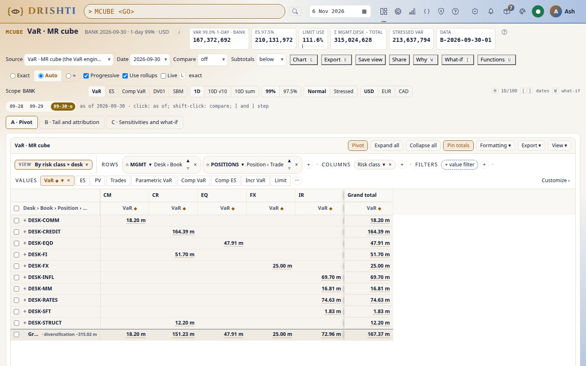

**You should see** desks by risk class with a grand total; the grand total equals `VAR BANK` to the cent, and the headline's VaR is the same number.

### Step 21 · The fields: the View picker, the Rows picker, VaR's menu and the panes

**UI.** Press `Shift+V`: the **View** picker lists the cube's ready-made views (*By risk class × desk*, *By desk*, *By book*, *By limit
letter* where the LL hierarchy is configured, *Top contributors*, *Trades in my scope*; keys `1`–`9`), then *My views* and *Shared with me*.
Press `3` (or click *By book*): rows `MGMT Desk › Book`, values VaR, ES and Limit use. Press `R`: the Rows picker shows **Hierarchies**
first, each one item (`MGMT Division › Desk › Book`, `LEGAL Legal entity › Desk › Book`, `Positions Position › Trade`); open MGMT with `→`
for its levels. The columns the levels are built from (`DIVISION`, `DESK`, `TT_BOOK`, `LEGAL_ENTITY`) are under **More fields**, closed.
`Esc`, then `Alt+↑`: MGMT goes up a level (Desk alone, the stepper's ▲); `Alt+↓` brings Book back (▼). Open VaR's **▾**: *computed per cell by the VaR engine*, no Sum, the VaR options (horizon,
confidence, scenario set) instead. Press `\`: the **Build** and **Fields** panes open beside the grid; drag *Currency* from Fields to
Columns; `\` again closes them.

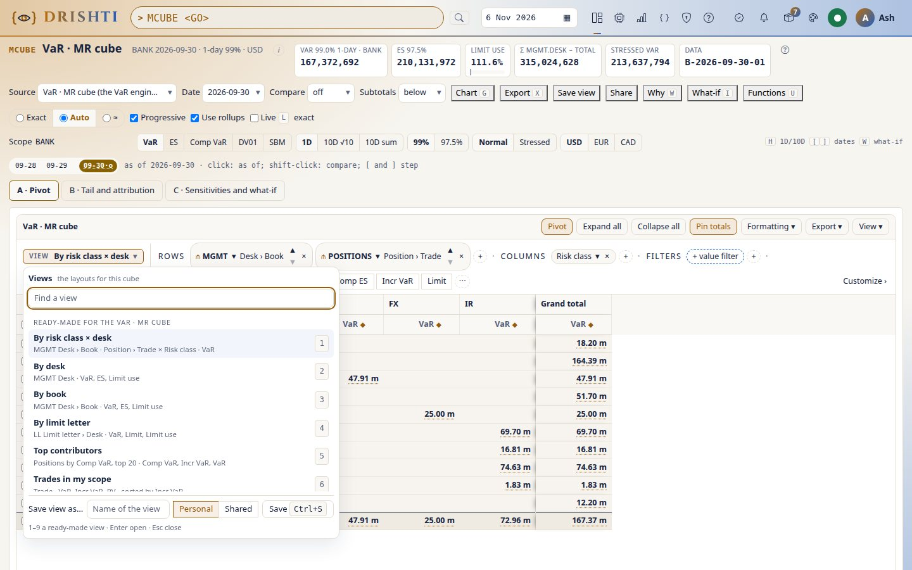

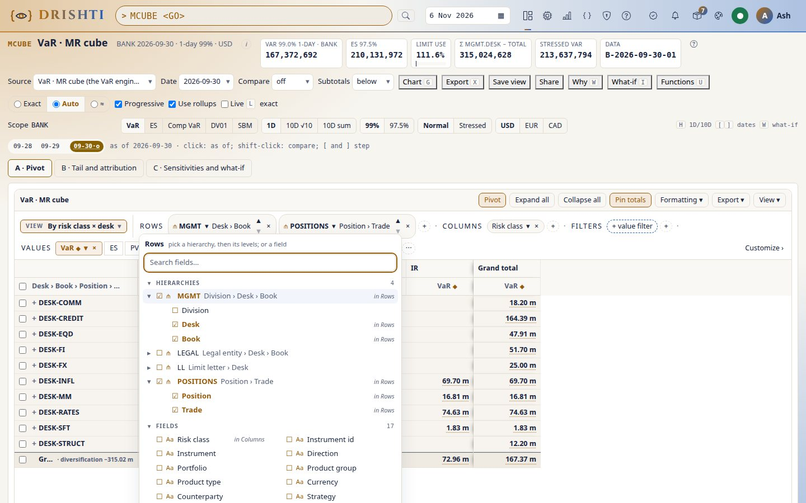

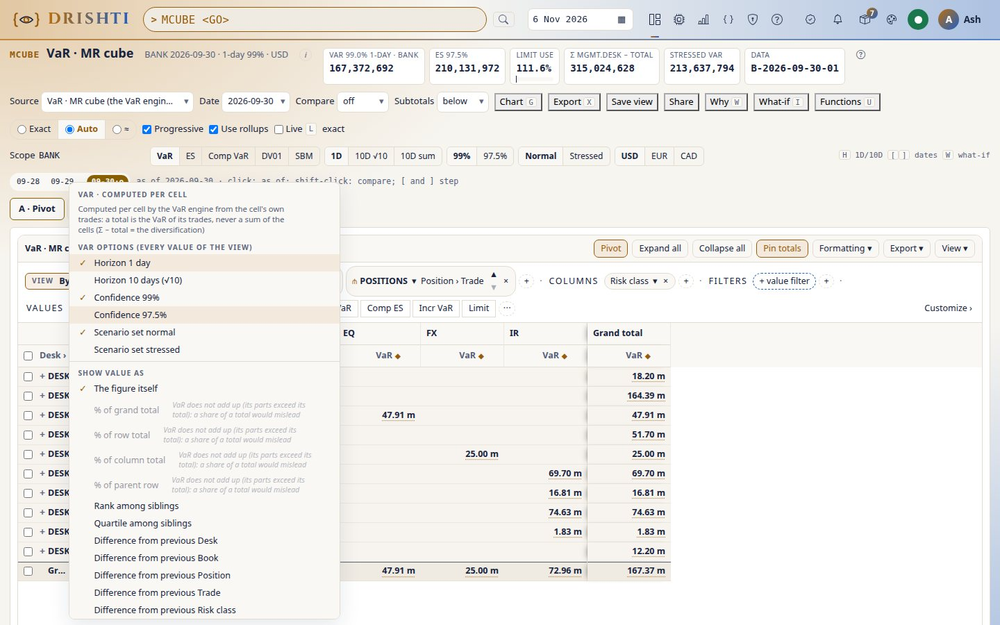

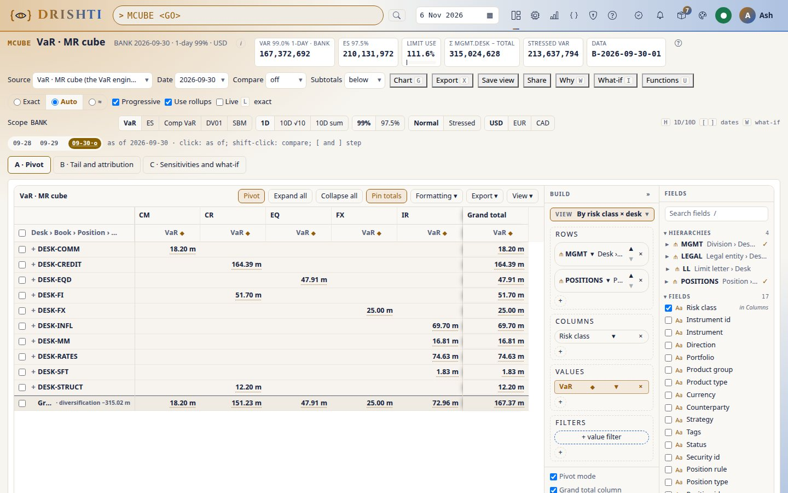

**CLI.**

```
drishti.py pivot fields var
drishti.py pivot run --source var --rows MGMT.DESK,MGMT.BOOK --values "var()" --values "es()" --values "limit_use()"
```

**YAML** (the ready-made view in `drishti-console/config/pivot-presets.yaml`, and a Sutra's pivot that opens in the panes):

```yaml
presets:
  mr:
    mode: views
    views:
      - id: by-book
        name: By book
        rows: [MGMT.DESK, MGMT.BOOK]
        values: [{measure: "var()", as: VaR}, {measure: "es()", as: ES}, {measure: "limit_use()", as: Limit use}]
```

```yaml
pivot: { rows: [CURRENCY], values: [{ field: NOTIONAL, agg: sum }], mode: panes }
```

**You should see** the books of each desk under it; the catalogue (`drishti.py pivot fields var`) lists MGMT once under `hierarchies`, its
levels hidden from the plain fields, and every VaR measure with `perCell: true` and no functions.

### Step 22 · Totals are never sums: the diversification

**UI.** Add up the desks' VaR in the *Grand total* column by hand: it is more than the bank's. The headline's **Σ desks − total** tile is
that difference, in money; the grand total row carries it too (`Σ−total` beside it).

**CLI.**

```
drishti.py pivot run --source var --rows MGMT.DESK --values "var()" --json | jq '.rows[] | select(.kind=="grand") | .diversification'
```

**JSON.** The answer's grand row: `{"kind": "grand", "diversification": {"VaR": <Σ desks − bank>}}`.

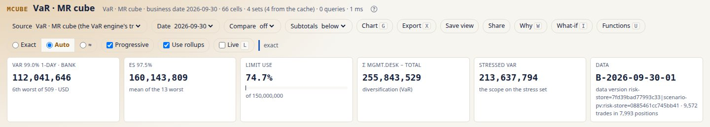

**You should see** a grand total below the desks' sum and the difference in the Σ desks − total tile; pick one desk's cell and run `VAR <its scope>` (the scope is in the cell's provenance, step 22): the same VaR to the cent.

### Step 23 · A cell's tail, provenance and why it moved

**UI.** Click the RATES × IR cell. The provenance popover shows its scope (`(NODE:MGMT~DESK-RATES) & (WHERE:PRODUCT_GROUP in (…))`), its
trades and how the figure is made. The rail under the pivot shows its scenario P&L histogram (the VaR scenario marked **V**, the ES tail
**E**) and *Explain the move*: the cell's VaR on the date before, each exact step, and today's VaR. Shift-click an earlier date on the slider
to explain against it instead.

**CLI.**

```
drishti.py pivot mr cell --source var --rows MGMT.DESK --cols RISK_CLASS --cell MGMT.DESK=DESK-RATES,RISK_CLASS=IR
drishti.py pivot mr explain --scope "(NODE:MGMT~DESK-RATES) & (WHERE:PRODUCT_GROUP in ('Rates'))"
```

**JSON** (`POST /api/v1/risk/mr/detail`):

```json
{"view": {"source": "var", "rows": ["MGMT.DESK"], "columns": ["RISK_CLASS"], "values": [{"measure": "var()"}]},
 "coords": {"MGMT.DESK": "DESK-RATES", "RISK_CLASS": "IR"}}
```

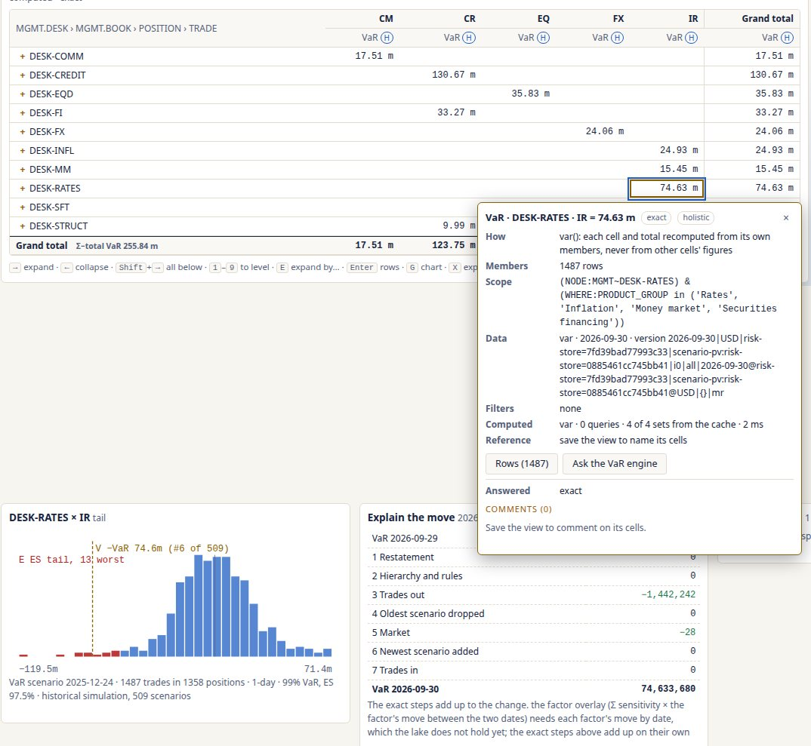

**You should see** the cell's scope, its scenario P&L histogram with V and E marked and its steps; the detail's `var` equals the cell's VaR, and its `k` says which worst loss it is (the 6th of 509 at 99%).

### Step 24 · The lens: 10 days, 97.5%, stressed, another currency

**UI.** Press **H** (or click *10D √10*): every cell is computed again at 10 days. Click *97.5%*, then *Stressed*: the stress set's VaR
(USD). Click *Normal* and *EUR*: the bank in euros. Type `DESK:RATES` in *Scope* and press Enter: the view starts from the rates desk.

**CLI.**

```
drishti.py pivot run --source var --rows MGMT.DESK --values "var()" --option horizon=10d --option confidence=0.975
drishti.py pivot run --source var --rows MGMT.BOOK --values "var()" --option scope=DESK:RATES --option ccy=EUR
```

**JSON.** The options of the view: `"options": {"scope": "DESK:RATES", "horizon": "10d", "confidence": "0.975", "ccy": "EUR"}`.

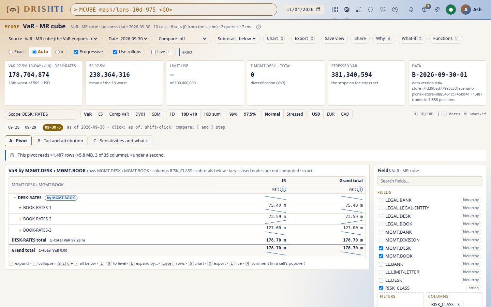

**You should see** every cell computed again for the lens; `VAR DESK:RATES H 10D` on the VaR explorer gives the total of the 10-day view.

### Step 25 · Re-pivot and open a desk down to its trades

**UI.** Press `C`, uncheck *Risk class* and check *Currency* (or drag it in the panes). Open RATES with →: its books are computed, nothing else. Open a book: its
positions; a position: its trades. Select a book and press **E**, type `COUNTERPARTY`: that book alone is broken down by counterparty.
Press Enter on a cell: its trades, as the VaR engine holds them.

**CLI.**

```
drishti.py pivot run --source var --rows MGMT.DESK,MGMT.BOOK --cols CURRENCY --values "var()" --open MGMT.DESK=DESK-RATES
drishti.py pivot export --source var --rows MGMT.DESK --values "var()" --what rows --cell MGMT.DESK=DESK-RATES -o rates-trades.csv
```

**JSON.** The node opened: `"expanded": [{"axis": "rows", "path": [["MGMT.DESK", "DESK-RATES"]], "by": "MGMT.BOOK"}]`.

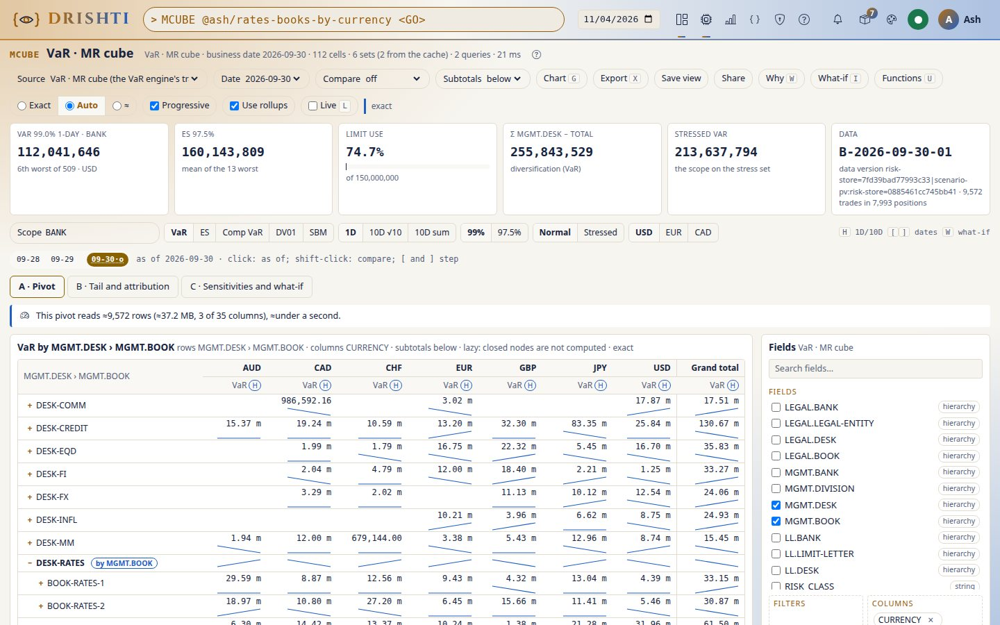

**You should see** RATES's books and nothing else computed; each book's VaR is its own (`VAR BOOK:<book>`), and the desk's subtotal is not their sum.

### Step 26 · Components, the waterfall, the ladder and a what-if

**UI.** Open tab **B**: each desk's component VaR and its share; a negative one is a hedge; they add up to the bank's VaR exactly. The
waterfall draws them, the total last; the histogram is the bank's; the heat map is DV01 by currency × tenor. Open tab **C**: the DV01 ladder
by currency and bucket (*Grid* switches between the bank's buckets and FRTB's vertices). In *What-if*, copy a booked trade with × -1 and add
it: every desk and the total, before, after and the change.

**CLI.**

```
drishti.py pivot run --source var --rows MGMT.DESK --values "comp_var()" --values "var()"
drishti.py pivot mr ladder --scope BANK --grid BANK-IR-TENOR
drishti.py pivot mr whatif --source var --rows MGMT.DESK --copy <a trade id> --factor -1
```

**JSON** (`POST /api/v1/risk/mr/what-if`): `{"view": {...}, "items": [{"copyOf": "<a trade id>", "factor": -1}]}`.

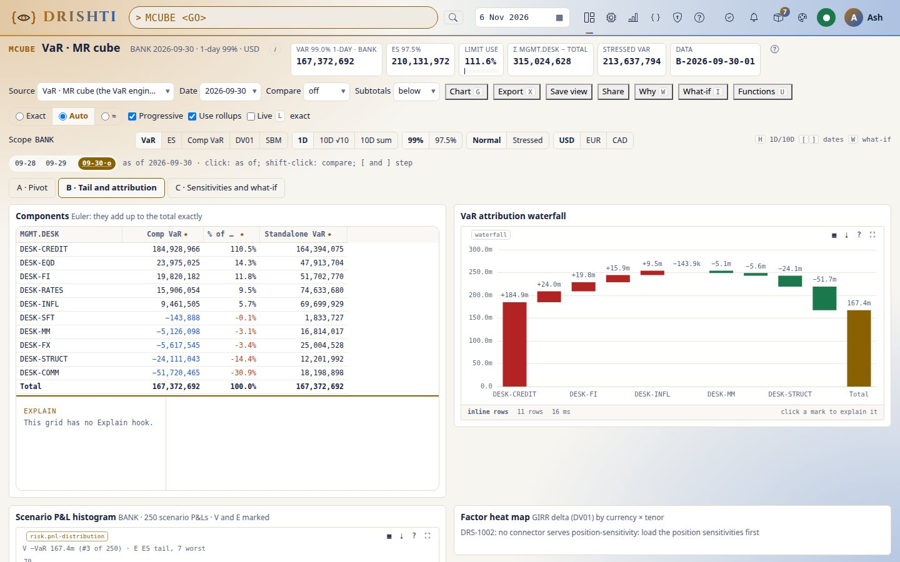

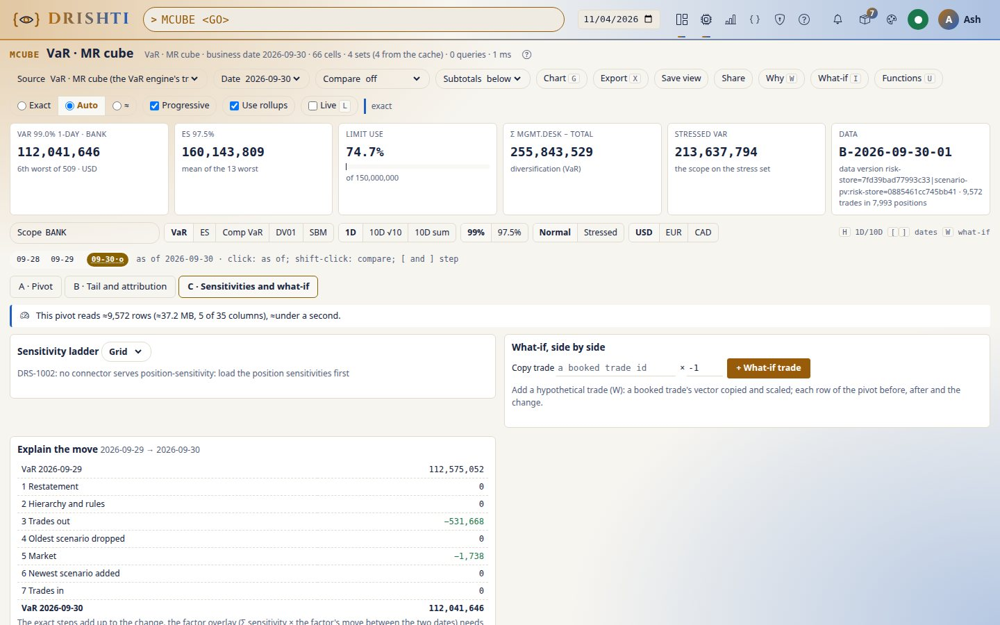

**You should see** the components with the hedges negative, the ladder and the what-if before and after; the components' sum equals the bank's VaR to the cent; the what-if's *Total* row's *before* equals the grand total.

### Step 27 · Save, share and export

**UI.** `Shift+V`, **Save view as…** `morning`, **Shared** with `role:risk`, `Ctrl+S` (or **Save view**, then **Share**). A colleague opens `MCUBE @you/morning <GO>` with their own rights.
**Export → Excel**: the outline of the rows, `SUM` formulas only for the measures that add up (`comp_var()`, `pv()`, `trades()`), the server's
values for VaR and ES, a Provenance sheet.

**CLI.**

```
drishti.py pivot save morning --source var --rows MGMT.DESK --cols RISK_CLASS --values "var()" --share role:risk
drishti.py pivot export --view you/morning --format xlsx -o morning.xlsx
```

**JSON.** The saved view is the view itself, options included; never its numbers.

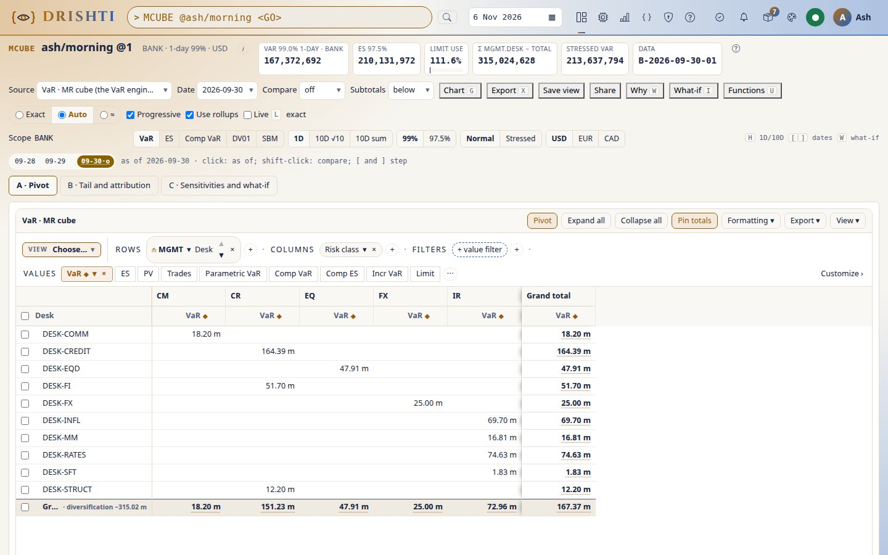

**You should see** the view in your saved views and its workbook; open the workbook: the VaR column's totals are values, not formulas; a Comp VaR total is a `SUM`.
