<!--
  Project Drishti · Any data. Any domain. One grammar.

  Copyright (c) 2026 Ashutosh Sinha <ajsinha@gmail.com>.
  All rights reserved.

  PROPRIETARY AND CONFIDENTIAL.

  This file is the confidential and proprietary property of Ashutosh Sinha.
  Unauthorised copying, use, modification, distribution or disclosure of this
  file, via any medium, is strictly prohibited except with the express prior
  written permission of the copyright holder.

  See the LICENSE file in the root of this repository for the full terms.
-->
# Reports and the designer


> Commands: Linux and macOS `python3 tools/drishti.py X`; Windows `py -3.13 tools\drishti.py X` (same arguments).

Business intelligence: [Index](README.md) · [Pivot](PIVOT.md) · [Pivot at scale and the risk cubes](PIVOT_SCALE_AND_CUBES.md) · [Tables and models](TABLES_AND_MODELS.md) · **Reports and the designer** · [The report file, formatting and statements](REPORT_FILE_FORMAT_STATEMENTS.md) · [Models and datasets for reports](MODELS_AND_DATASETS_FOR_REPORTS.md) · [Live reports, boards and background runs](LIVE_REPORTS_AND_BOARDS.md) · [Distribution, subscriptions and alerts](DISTRIBUTION_AND_ALERTS.md) · [Governing BI and AI in BI](GOVERNANCE_AND_AI.md) · [The Notebook and Python](NOTEBOOK_AND_PYTHON.md) · [Groupings and analytics](GROUPINGS_AND_ANALYTICS.md)

What a report is, getting in, the four powers, the catalogue and workspaces, the viewer, which date a report reads, BI Studio and the report designer, Python in reports and the settings and problem codes; with the first-report tutorial.

## Contents

- [Guide](#guide)
  - [1. What a report is, and the path to one](#1-what-a-report-is-and-the-path-to-one)
  - [2. Getting in: the BI menu, the rail and BI GO](#2-getting-in-the-bi-menu-the-rail-and-bi-go)
  - [3. Who may do what: the four powers](#3-who-may-do-what-the-four-powers)
  - [4. Home, the catalogue, workspaces and items](#4-home-the-catalogue-workspaces-and-items)
  - [5. The report viewer](#5-the-report-viewer)
  - [6. Which date a report reads](#6-which-date-a-report-reads)
  - [7. BI Studio and the report designer](#7-bi-studio-and-the-report-designer)
  - [8. Python in reports](#8-python-in-reports)
  - [9. Settings, limits and problem codes](#9-settings-limits-and-problem-codes)
- [Tutorial: Your first BI report](#tutorial-your-first-bi-report)
  - [Part A · Your first BI report](#part-a--your-first-bi-report)

## Guide

Drishti's reports, boards and statements are its business-intelligence layer, called **BI** in the top bar and on the command line
(`RUPAKA` is an alias). There is one analysis path: **slice in the Pivot, then make a report**. The [Pivot](PIVOT.md) is the one grid
for slicing and totalling any table; when an analysis is worth keeping for other people (published, shared, scheduled, put on a wall
screen, sent as a statement, watched by an alert), it becomes a **report**. A report reads a **model** written in Rachana over the
**tables** of the table layer (**Build › Tables & models**; [BI_GUIDE.md](TABLES_AND_MODELS.md) is the home of tables, models and virtual
tables). Every number is computed on the server, as the person looking: their row rules and masks apply to every visual, export, mail,
alert and embedded report. The browser only draws.

This guide is what you see and what you do: the pages, the designer, the report file, boards, statements, background runs, AI helpers,
publishing and governance, and distribution (the Reports page, export, subscriptions, alerts, embedding). How it is built is
[ARCHITECTURE.md section 28](../../architecture/ARCHITECTURE.md). Code over a model (SQL and Python cells, Python measures, visuals and
Transforms) is the [Notebook](NOTEBOOK_AND_PYTHON.md).

### 1. What a report is, and the path to one

**The path.** Open any table, entity search or VaR in the **Pivot** (`PIVOT <GO>`, or *Pivot* on the BI rail) and slice it: the risk cubes
are its presets ([BI_GUIDE.md](README.md)). A figure for other people is a **report**: pages of visuals over one model, designed by
dragging fields onto a canvas, published through review, read by many, each as themselves. What a grid cannot say is the
[Notebook](NOTEBOOK_AND_PYTHON.md)'s.

**What you can do**

* open BI from the top bar or with `BI <GO>`; keep drafts in a personal workspace and move them to a shared one; create typed items
  (`report`, `theme`, `notebook`, `python`, and the table layer's `table` and `model`; a board is a report with board pages) with a YAML body;
* read the **models** reports sit on: tables from pack kinds through connectors, relationships, measures, row rules and masks; a pack's
  every kind is already a table; start a model from the packs (section 5);
* open a **report**: tabs, slicers, click a bar to filter the page, drill down, drill through, show the rows, open a trade in the terminal
  (section 6); **design** one in BI Studio by dragging fields onto a canvas, with the YAML beside it, real data, Check, undo and redo (section 8);
* lay a page out as **paper** (a statement, one per reader: section 12) or as a **board** of live tiles for a wall screen (section 14);
* watch a report over a **live table** redraw as the data ticks (section 13); let a long question run in the **background** and come back
  to it (section 15);
* publish versions, propose for review, approve (four eyes), compare any two saved states, certify, see lineage and what a change breaks,
  move content between servers as a bundle (section 17);
* **export** a page as PDF, PNG, Excel, CSV or JSON Lines, **subscribe** people by email, set **alerts** on a number, **embed** a report in
  another application (sections 18 to 20);
* ask the **AI helpers**, when an administrator has switched them on: describe a report, ask the data, explain a number (section 16).

Everything the pages do, the server decides: the pages are a shell that asks the server's `/api/v1/bi` under your identity.

### 2. Getting in: the BI menu, the rail and BI GO

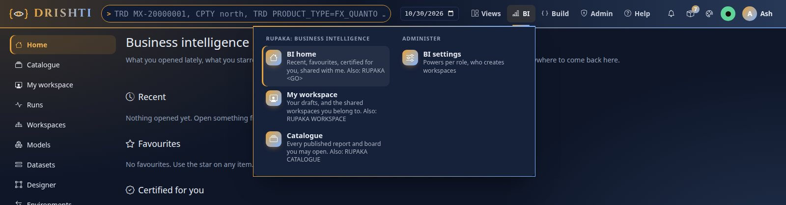

**The BI menu** is a menu of the top bar, with the icon `bar-chart-line` (an edition or a lens chooses which menus it draws, and in what
order). It is shown only to people who hold the `bi` power (section 3), and not at all when BI is
switched off. Its entries are also the **rail** on the left of every BI page:

| Group | Entry | Opens |
|---|---|---|
| Business intelligence | **Catalogue** | every published report and board you may open (`/bi/catalogue`) |
| | **My workspace** | your drafts (`/bi/w/me`) |
| | **My runs** | your BI questions queued or running, and the last ones answered (`/bi/w/me?tab=runs`, section 15) |
| | **Workspaces** | the shared workspaces you belong to, and their members (`/bi/workspaces`) |
| Analyse | **Models** | *Start from your data*: the models and the tables the packs give (`/bi/models`, section 5) |
| | **Datasets** | the tables reports read, with their refresh (`/bi/datasets`) |
| | **Report designer** | your report drafts, a new report or board, and the designer (`/bi/designer`) |
| | **Promotion (test to live)** | move reports and models from one environment to the next as a bundle (`/bi/environments`, section 17.7) |
| | **Notebook**, **Data prep** | code over a model, and Python data preparation ([BI_GUIDE.md](NOTEBOOK_AND_PYTHON.md)) |
| Administer | **BI settings** | Admin, BI settings (`/admin/bi`, needs `bi-admin`; in the top bar's menu only) |

The rail also links the **Build home** (`/build`, where BI's own home `/bi` leads), **Tables & models** (`/build/tables`) and the **Pivot**.
**Reports** in the **Views** menu (`/reports`) lists your scheduled reports, subscriptions and alerts, and the BI reports (section 18.1).

**`BI` on the command line** is a reserved keyword (`RUPAKA` is an alias). Case does not matter.

| Type | Opens |
|---|---|
| `BI <GO>` | the Build home (`/build`) |
| `BI WORKSPACE <GO>` (or `WORKSPACES`) | your personal workspace (`/bi/w/me`) |
| `BI CATALOGUE <GO>` (or `CATALOG`) | the catalogue (`/bi/catalogue`) |
| `BI RUNS <GO>` | your runs (section 15) |
| `BI <report-or-board> <GO>` | an item by its id or its title (any case); a **report opens drawn** (`/bi/r/<id>`), any other item opens its page; words that match several items open the catalogue searched for them |
| `BI SETTINGS <GO>` | Admin, BI settings (needs `bi-admin`) |

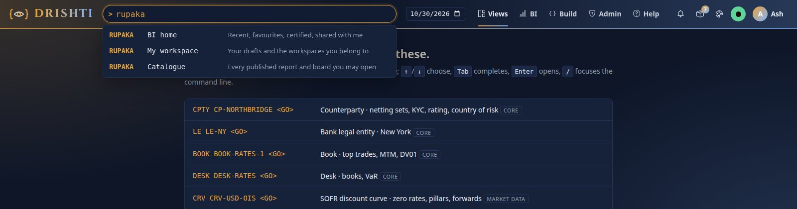

Type-ahead offers the keyword after the first letters (`b`, `ru`), the pages after `BI `, and the items you may open that match what you
type next. Someone without the `bi` power gets no suggestions and, on `<GO>`, a message that says what is missing. A pack may not define a
mnemonic named `BI` or `RUPAKA` (or `FORM`, `FUNC`, `WHAT`, `DATAMAP`): the pack loader refuses it, and `pack check` fails the same way.

**Addresses:** `/bi/catalogue`, `/bi/workspaces`, `/bi/w/<workspace>` (`me` is your personal one), `/bi/i/<item>` (an item's page),
`/bi/models`, `/bi/datasets`, `/bi/ds/<table>` (a table's page), `/bi/r/<report>[/<page>]` (the viewer; `/bi/b/<board>` opens it),
`/bi/designer` and `/bi/design/<draft>` (the designer), `/bi/design/theme/<id>` (the theme designer), `/bi/environments`, `/bi/run/<id>`
(one run), `/admin/bi` and `/admin/bi/runs`. The addresses of tables and models (`/bi/d/<id>`, `/bi/m/<id>`, `/bi/md/<id>`,
`/bi/datasets/new`) lead to the table's page or to **Build › Tables & models**.

**Keys** (the console's one keymap: `?` or the rail's **Keys** button lists them with the rest of the screen's): `/` searches the catalogue
(from another BI page it takes you there with the search focused), `g h` the Build home, `g c` the catalogue, `g w` my workspace, `g r` my
runs. Keys are ignored while you type in a field.

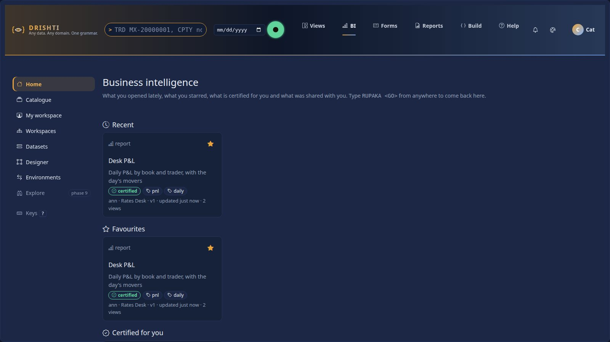

**On a phone** (390 px) the rail becomes a scrolling bar above the page, cards stack in one column, every control is at least 44 px high,
and fields use 16 px text so the browser does not zoom.

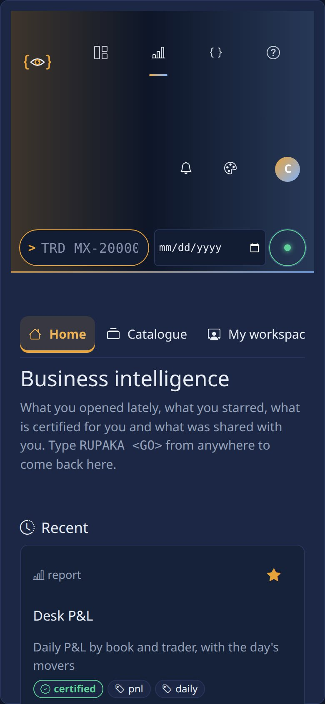

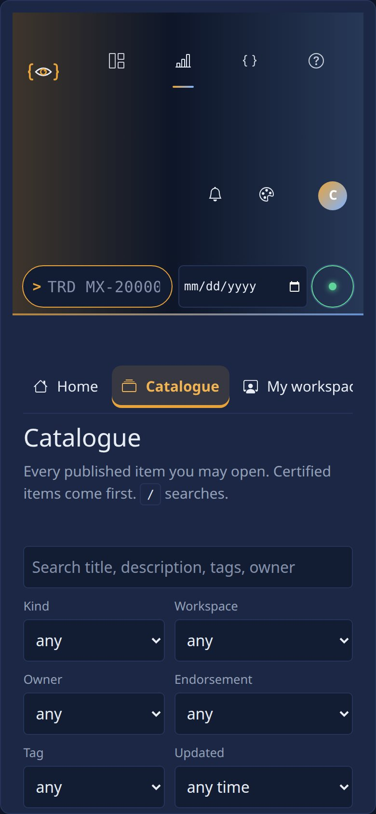 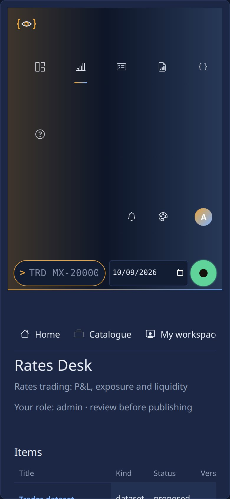

### 3. Who may do what: the four powers

BI powers are granted on roles, beside `raw`, `author` and `approve` (see [ADMIN_GUIDE.md](../ADMIN_GUIDE.md#34-bi-powers-rupaka)).

| Power | Lets a holder |
|---|---|
| `bi` | open BI, the catalogue and the published content their audience allows; keep favourites and recents |
| `bi-author` | create, edit, move, propose and publish items (reports, tables, models, themes), design, and create shared workspaces (if the policy says authors) |
| `bi-steward` | **certify** published items; **review** (approve or reject) proposals in any workspace; **import bundles**; create shared workspaces when the policy says stewards |
| `bi-admin` | change BI settings, see and manage every shared workspace, force a publish that breaks reports or fails tests; always allowed to create workspaces |

A higher power also opens BI, so a role granted only `bi-author` still sees the catalogue. The built-in `admin` role holds all four;
`viewer` holds `bi`; `author` and `approver` hold `bi` and `bi-author`; a role a pack defines holds none until an administrator grants it.
With security off, everyone holds everything. What a power allows is then narrowed by the **workspace role** (section 4.3). Approving also
needs the role's own **`approve`** flag for a workspace member who is not a steward (section 17.3).

### 4. Home, the catalogue, workspaces and items

#### 4.1 Home: For you

BI's home is the **Build home** (`/build`). Its **For you** strip holds four sets of cards: **Recent** (what you opened lately, newest
first), **Favourites** (items you starred), **Certified for you** (certified items you may open, most used first) and **Shared with me**
(published items of your workspaces that others own). A card shows the kind, a star, the title, the description, badges (certified,
promoted, shipped, status, tags) and a line with owner, workspace, version, freshness ("updated 3 days ago") and the views in the last
30 days.

#### 4.2 The catalogue

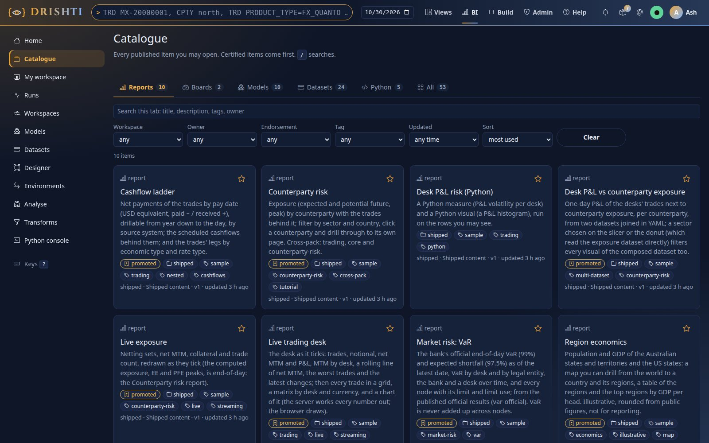

The catalogue lists every **published** item you may open (section 4.5), **split by kind into tabs**: **Reports · Boards · Models · Datasets ·
Python · All**, each with its count (*Reports 24*). Boards holds reports with board pages; Python holds Python items and notebooks; All shows
everything, grouped by kind. A tab switches in place; the address names it (`/bi/catalogue?kind=reports&sort=use`), so a link opens the same
tab and back and forward walk the tabs. With no `kind` in the address the catalogue opens on the tab you used last (remembered in this
browser), else Reports. The arrow keys move along the tabs; on a phone the tabs scroll sideways.

Search, filters and sort work **inside the chosen tab**, and every tab's count follows the search. The search box searches title,
description, tags, owner, kind and workspace name (every word must match); the filters narrow by workspace, owner, endorsement, tag and how
recently it was published; sort is *most used* (the default), *newest* or *title*. **Certified items are pinned first** except when sorted by
title. The address keeps the state (`?kind=python&q=daily`), and the filter lists show only values that exist, with counts.

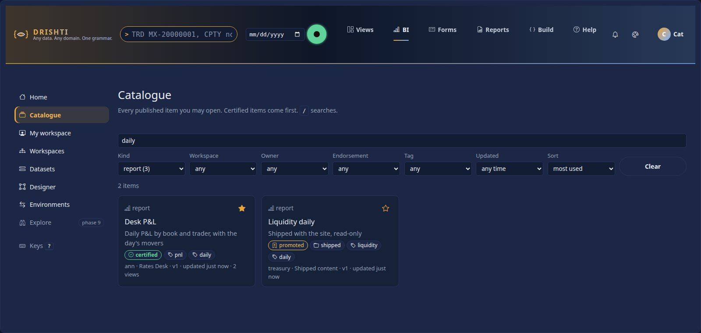

#### 4.3 Workspaces and their roles

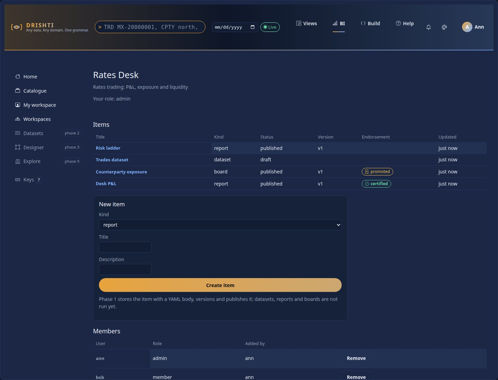

- **Personal workspace** (one per user, made on first use): drafts only you can see. It has no members and cannot publish: move an item
  to a shared workspace first (*Move to workspace*).
- **Shared workspace**: created from **Workspaces** (needs the policy's power, section 4.6). The creator becomes its admin. Members have a role:

| Workspace role | May |
|---|---|
| `viewer` | open the workspace and its published items |
| `contributor` | also create and edit drafts (needs the `bi-author` power too) |
| `member` | also publish, approve proposals, promote, delete others' drafts (publish needs `bi-author`) |
| `admin` | also add and remove members, rename it, switch review on or off, delete it (when empty) |

**Items · Runs · Members.** A workspace page has three tabs (`?tab=members`, `?tab=runs` in the address). **Items** lists the title, a short
id and the created time, the kind, status, version, endorsement and when it was updated. Rows you may delete (your own items, or any item
if you are a member of a shared workspace; never shipped content) have a checkbox; **Select all** and **Delete selected (N)** open one
confirmation listing the titles, and the message says which were deleted and which were skipped, with the reason. **New item** asks a report
for its model and opens it in the designer; a board opens in the same designer; a table or model opens **Build › Tables & models**; a
notebook or a Python item starts in the Notebook. **Members** lists the members and, for its admins, **Add a member** (type part of a name,
choose the role, **Add or change**) and the settings (*Require review before publishing*, *Delete workspace*). After **Create workspace**,
*Next: add the people who share it* opens the Members tab. **Runs** is section 15.4.

A person who is not a member does not learn that a workspace exists (`404 DRS-9001`). The last admin cannot be demoted or removed. A
workspace that **requires review before publishing** offers *Propose* instead of *Publish*. A `bi-admin` is an admin of every shared
workspace (but cannot read anyone's personal workspace).

#### 4.4 Items: lifecycle, versions, duplicate and delete

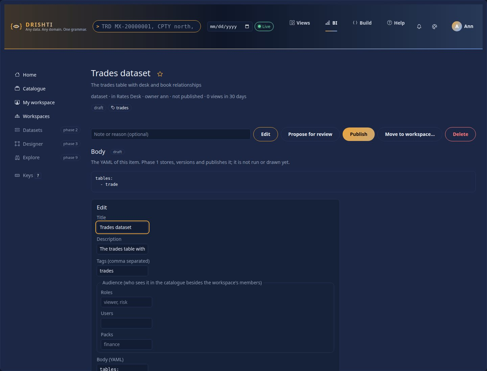

An **item** has a kind, a title, a description, an owner, tags, an audience, a **YAML body** (a mapping, at most
`drishti.bi.max-body-bytes`, 256 KiB; nothing runs it) and a lifecycle: `draft` → (optional `proposed`) → `published` as version N.

- Editing a **published** item makes a new draft; readers keep the published version until you publish again, and the page shows "draft
  changes not published".
- **Publish** (member, `bi-author`, shared workspace, no review required) writes the next version. **Propose for review** freezes the item
  until it is approved, rejected or withdrawn (section 17.3).
- **Two people, one draft.** Every editor saves from the saved state it opened. If someone else saved first, the save is refused
  (`DRS-9007`, nothing written) and the editor offers **Reload theirs**, **Save mine as a copy** (into a workspace you choose) or **Overwrite
  with mine**. This holds in the report designer (boards included), the theme designer and the item page's Edit form.
- **Frozen items open read-only.** A proposed item opens with a banner and **Withdraw to edit**; its page shows who can approve it.
- **One bad visual, not a blank report.** A visual with an error of its own shows an error card; every other visual is drawn, in the
  designer, the viewer, exports and boards.
- **Buttons that do not double-submit.** A button that sends a request is disabled while it is in flight, and the answer (*Published*,
  *Certified*, or a refusal in words such as *DRS-9052 ... which is still a draft*) appears beside it.
- **View as readers see it.** The designers' **View** menu offers **my draft** or **as readers see it (published)**: the published version
  with data masked for you, with a banner naming the version; greyed until the item has been published.
- **Duplicate...** makes a draft copy of any item in a workspace you choose. **Delete** (on the item page and in the workspace list) first
  says what depends on it: the reports that read a model, the boards that show a report (the count is of what you may read). **Move**
  changes workspace (you need contributor in the target).
- **Versions** are kept (`drishti.bi.versions-keep`, 50): *View* shows a version's body; *Restore as draft* makes an old version the draft
  again. **History** (section 17.1) adds a saved state for every save, a side-by-side diff and restore.
- **Endorsement.** The owner or a member may **promote** a published item; only a `bi-steward` may **certify** it (section 17.4).
- **Favourites and views.** The star is yours alone. Opening an item counts one view for today; the card shows the views of the last
  `drishti.bi.usage-days` (30).

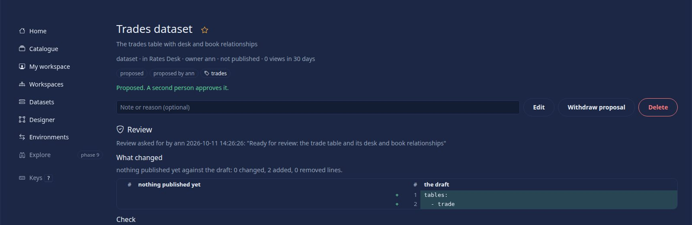

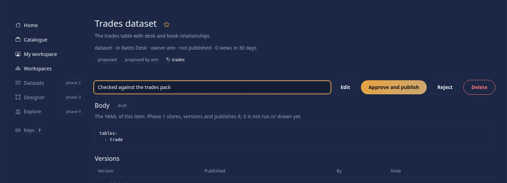

#### 4.5 Who sees what

An item reaches the **catalogue** and **Home** for you when it is **published**, not in a personal workspace, and at least one holds: you
are a `bi-admin`, its owner, or a member of its workspace; its **audience** names one of your roles, you by name, or a pack assigned to you;
it is shipped content with no audience (everyone with `bi`). An item with an empty audience is visible to its workspace's members only. A
draft is seen only by the workspace's contributors and above. Anyone who may not see an item gets `404 DRS-9001`, never a hint that it
exists. Rows and fields **inside** a model are a separate layer: the table's and the model's row rules and masks are applied by the server to
every query, for each reader (section 5.5); the catalogue decides only whether you may open the item.

#### 4.6 Shipped content, the samples and BI settings

**Shipped content.** Files in the BI folder (`drishti.bi.dir`, default `./config/bi`) appear as published, read-only items of the workspace
*Shipped content*: `reports/<id>.report.yaml` (boards are reports), `python/<id>.python.yaml`, `themes/<id>.theme.yaml`,
`notebooks/<id>.notebook.yaml`, and the table layer's tables and models in `config/tables/<domain>/` ([BI_GUIDE.md](TABLES_AND_MODELS.md)). The
keys `title`, `description`, `owner`, `tags`, `endorsement` (`none`, `promoted`, `certified`) and `audience` (`roles`, `users`, `packs`)
describe the catalogue entry; the file is the body. The folder is read again **live, with no restart** (`drishti.bi.watch`: `auto` file
events with a polling safety net every `folder-refresh`, 5 s; `poll`; or `off`): **add** a file and it appears; **change** it and the next
read is the next version (counted since the server started); **delete** it and it is gone (`404 DRS-9001`). A file that does not parse
**keeps its last good version** and is listed as a problem in *Admin, BI settings* and on *Health*. Shipped items cannot be edited here:
change the file, or **Save a copy**. Details: [config/bi/README.md](../../../config/bi/README.md).

```yaml
# config/bi/reports/liquidity-daily.report.yaml
title: Liquidity daily
description: Shipped with the site, read-only
owner: treasury
tags: [liquidity, daily]
endorsement: promoted
pages: []
```

**The samples**, each commented and marked `sample: true`: ten models in `config/tables/banking/` and `config/tables/bi/` (`trades-basic`,
`trading-risk`, `trading-cashflows`, `counterparty-exposure`, `desk-pnl-vs-exposure-py`, the live `live-trading` and `live-exposure`,
`market-risk-var`, `world-economics`, `region-economics`) over the tables beside them; twelve reports in `config/bi/reports/`
(`trades-overview`, `counterparty-risk`, `cashflow-ladder`, `live-trading-desk`, `live-exposure`, `python-desk-risk`, `pnl-vs-exposure`,
`market-risk-var`, `world-economics`, `region-economics`, and the boards `desk-wall` and `python-wall`); four Python items, one notebook
and two themes (**Corporate** and **Print**). `world-economics` reads real World Bank data; `region-economics` (Australian and US states)
has illustrative figures rounded from public figures, not for reporting. A sample is hidden from the people who may not see sample packs
(*Admin, Packs, Hide samples from business users* or *from everyone*).

**VaR in BI.** The sample report **Market risk: VaR** (model `market-risk-var`) reads the official end-of-day VaR the server publishes
([VAR_GUIDE.md section 19](../VAR_GUIDE.md#19-official-end-of-day-results)), served by the market-risk pack as the read-only kind
`var-official` (connector `var-results`). The table `market_risk_var_official` holds every result version; `market_risk_var_latest` keeps the
latest version of each node and date, and the model reads that one. VaR is not additive, so no measure sums it: `VaR 99%` and `ES 97.5%` are
`max()` of a node's one row (over several nodes, the largest, never a total), and `Bank VaR` and `Bank ES` are the bank node's own figures.
The report shows the bank's VaR, ES and limit use; VaR by desk and by legal entity, each bar drilling through to a **Node** page; the bank
over time and a desk chosen in a slicer over time; every node with VaR, ES, limit and limit use (over 90% in red). Every figure says what it
is: `nodes.HORIZON` (`1D`), `nodes.METHOD`, and the measures **VaR confidence** and **ES confidence**; put `nodes.HORIZON` on a slicer to keep
a 1-day figure apart from a 10-day one. A 10-day or another-confidence figure is the engine's on demand (`VRES <scope>~horizon=10d~method=sum`,
[VAR_GUIDE.md section 18.6](../VAR_GUIDE.md#186-horizons-the-two-10-day-methods-and-the-confidence-chosen)). A node id opens the node in the
terminal; `VAR NODE:<id> <GO>` opens the VaR explorer.

**Exposure in BI.** Netting-set and counterparty records store no exposure: the exposure engine computes it and publishes its official
end-of-day results ([EXPOSURE_GUIDE.md section 20](../EXPOSURE_GUIDE.md#20-official-end-of-day-results)), served as the read-only kind
`exposure-official-cpty` (command `XOFC`, connector `exposure-results`). The tables `counterparty_exposure_official_netting_sets` and
`counterparty_exposure_official_counterparties` keep one row type each, the latest version of each scope and date. The models
`counterparty-exposure` and `trading-risk` read them as two more facts, `set_exposure` and `cpty_exposure`, related to `counterparties.id`:
**Exposure (EE peak)** is `sum(set_exposure.PEAK_EE)` (a reporting sum of the netting sets' peaks), and **Exposure (PFE peak)** is
`sum(cpty_exposure.PEAK_PFE_95)`, each counterparty's own peak 95% PFE, never a sum of its sets' PFEs. The live model `live-exposure` keeps
only what the netting set carries as it ticks (net MTM, collateral, limit, trades), since a live table is not joined to the daily results.

**Admin, BI settings** (`/admin/bi`, needs `bi-admin`):

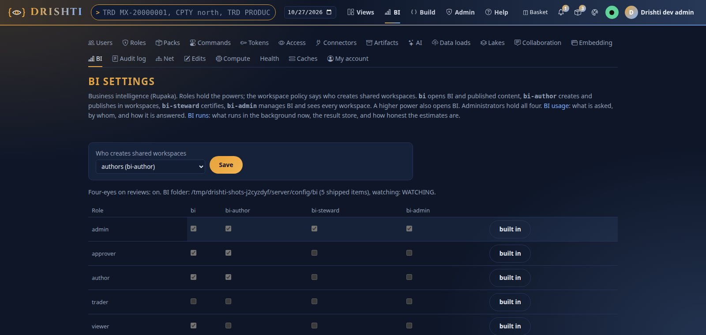

- *Who creates shared workspaces*: `authors` (`bi-author`, the default), `stewards` or `admins`. Kept in the identity database; overrides
  `drishti.bi.workspace-creation`.
- *The BI folder*: how it is watched (`WATCHING`, `POLLING`, `OFF`), how many shipped items it holds, and any file with a problem.
- *Roles and their powers*: tick `bi`, `bi-author`, `bi-steward`, `bi-admin` per role and **Save**. Roles from configuration or a pack are
  read-only here; roles defined in Admin, Roles are editable, by an administrator. A change reaches everyone who holds the role at once.
- *Shipped files*: the same list as **Admin → Artifacts**. **Disable** hides a file from the catalogue and keeps it; **Uninstall…** shows the
  reports, boards, models, alerts and subscriptions that depend on it, refuses while any do, and otherwise moves the file to
  `data/uninstalled/`, from where it is restored ([OPERATIONS_GUIDE.md section 18](../OPERATIONS_GUIDE.md#10-admin--artifacts-install-and-uninstall-safely)).

**The command line.** `drishti.py bi workspace list|get`, `drishti.py bi catalogue list|get|publish` and `drishti.py bi item ...` talk to
the API as the token's user ([CLI_REFERENCE.md](../CLI_REFERENCE.md#bi-workspaces-and-the-catalogue-rupaka)); the token scopes are `bi:write`,
`bi:approve` and `bi:admin`:

Run these from the Drishti folder (the repository root, or the install folder of a release).

```
$ drishti.py bi workspace list
id                            role          items  name
u-cat-7fd6                    admin             0  My workspace  [personal]
rates-desk                    viewer            4  Rates Desk
shipped                       viewer            2  Shipped content
$ drishti.py bi catalogue list --q exposure --kind board
id              kind     endorsed  status    ver  title
bi-cd5f8b2cc5   board    promoted  published v1   Counterparty exposure  (Rates Desk, ann)
1 item(s)
```

### 5. The report viewer

Open a report from the catalogue (its page has **Open the report**), with `BI <report> <GO>`, or at `/bi/r/<id>` (and `/bi/r/<id>/<page>`).
The shipped **Trades overview**, **Counterparty risk** and **Cashflow ladder** read the three stored sample models; **Live trading desk** and
**Live exposure** are live (section 13).

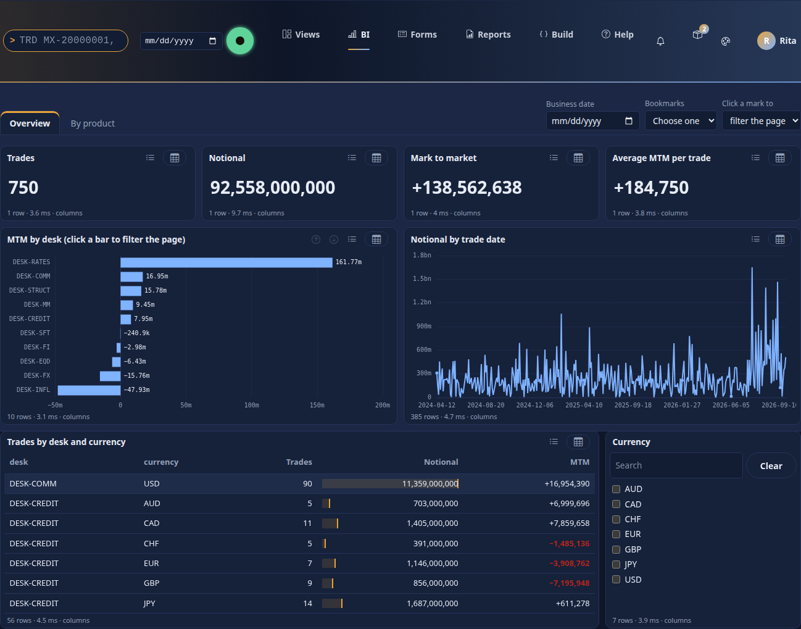

The toolbar holds the **business date** (empty: the latest the data has; section 7), **Bookmarks** (saved states of the report), *Click a
mark to* **filter the page** or **highlight**, and **Reset**; the filters in force are chips under the page tabs. Every visual has a header
with its title and the buttons that fit it, and a line under it with the rows that came back, the milliseconds the question took (or "from
the cache") and the layer that answered (`columns`, `rollup`, `direct`, `live`); *masked* is added when a column was masked for you.

* **Click a mark.** The other visuals filter to it: here DESK-COMM was clicked, the cards, the line and the table are that desk's, the bar
  keeps all desks but dims the others, and a chip says what is selected. Click it again, press `Esc`, or use the visual's clear button to
  let go (the chip's ✕, or *Clear all* when there are several); Ctrl or Shift adds marks. **Drag across a line, area, histogram or scatter** to
  select a range the same way (a brush: the other visuals filter to it, VaR recomputed for the selection). One selection at a time is the default; `selection: crossfilter` at the top of the report file keeps one per visual, each chart ignoring only its own. With **highlight**, bar, column, line, area and combo charts keep the whole answer and draw the chosen
  share over it.

  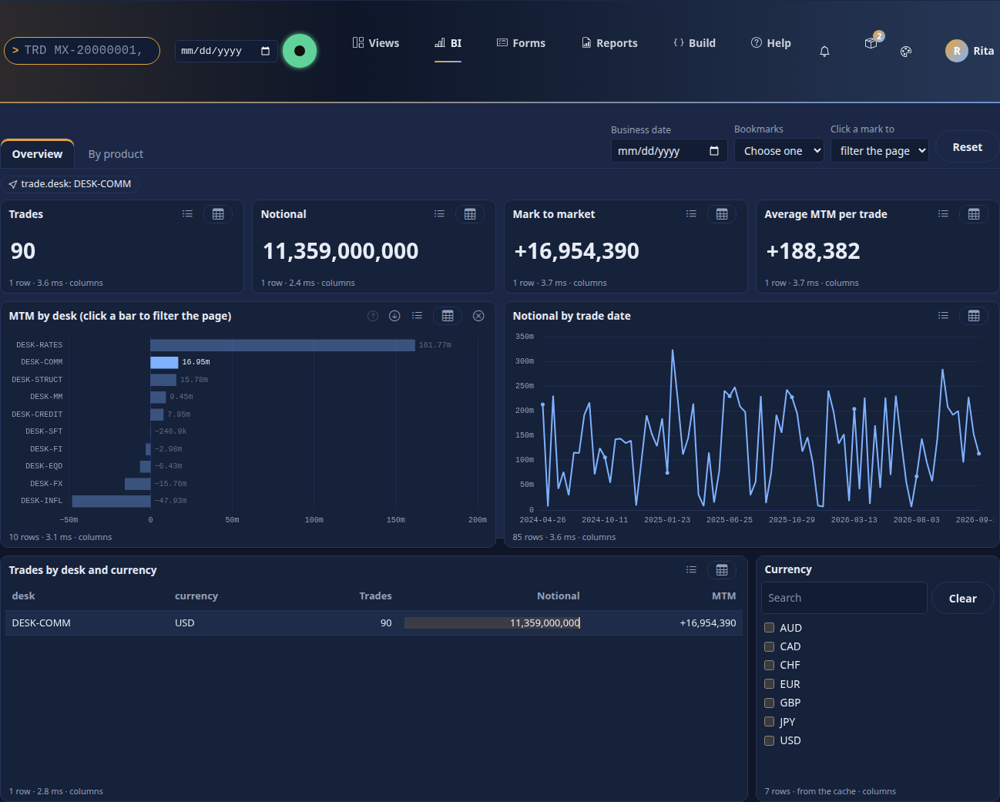

* **Drill down and up.** With a mark selected the drill-down button (or `d`) goes one level down the visual's hierarchy (desk to book); the
  title shows the path; the up button (or `u`) comes back.

  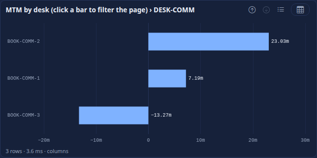

* **Show the rows** (`r`) replaces the visual with the rows behind it (every column of the table it reads; the selected mark's rows when one
  is selected); **Show as a table** (`t`) shows the visual's own numbers, and is what a screen reader reads. Masked columns read `•••` here too.

  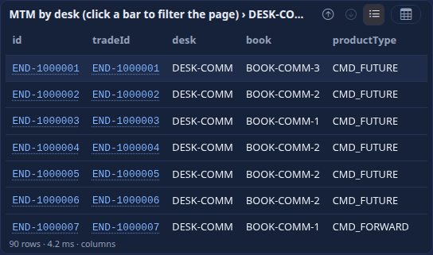

* **Drill through.** In **Counterparty risk**, select a counterparty's bar and press *Drill through to Counterparty*: that counterparty's page
  opens with the value carried as a chip (in the address, `?carry=...`, so the link can be shared) and a **Back** button. A trade in its table
  opens in the terminal (*Open in the terminal*, or the link in the key column; a column that references a kind links to that entity too).

  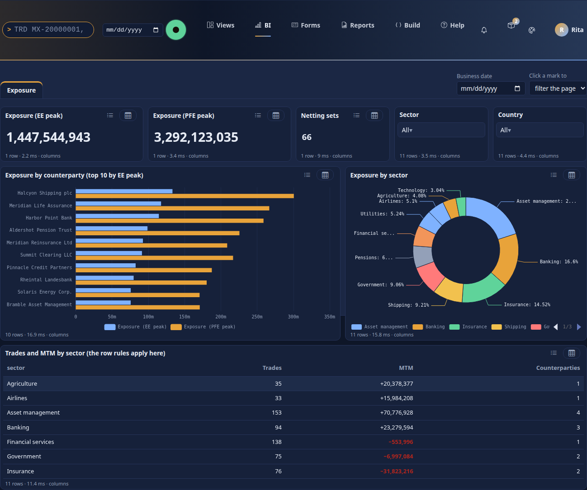

  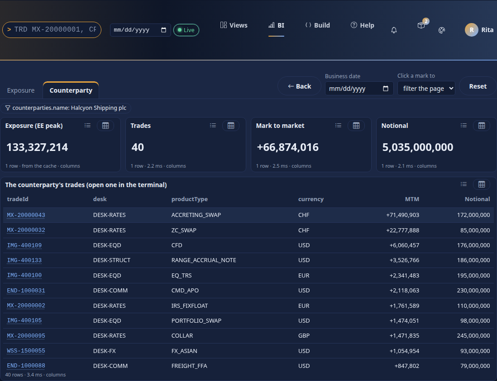

* **The rows you see are yours.** The report asks its model as **you**. A desk head sees the trades of their desk, and the exposure visuals say,
  with the code, why they cannot be drawn for a reader whose row rule is on the trades (`DRS-9020`); a reader without the raw power sees the
  counterparty name as `•••`, one bar:

  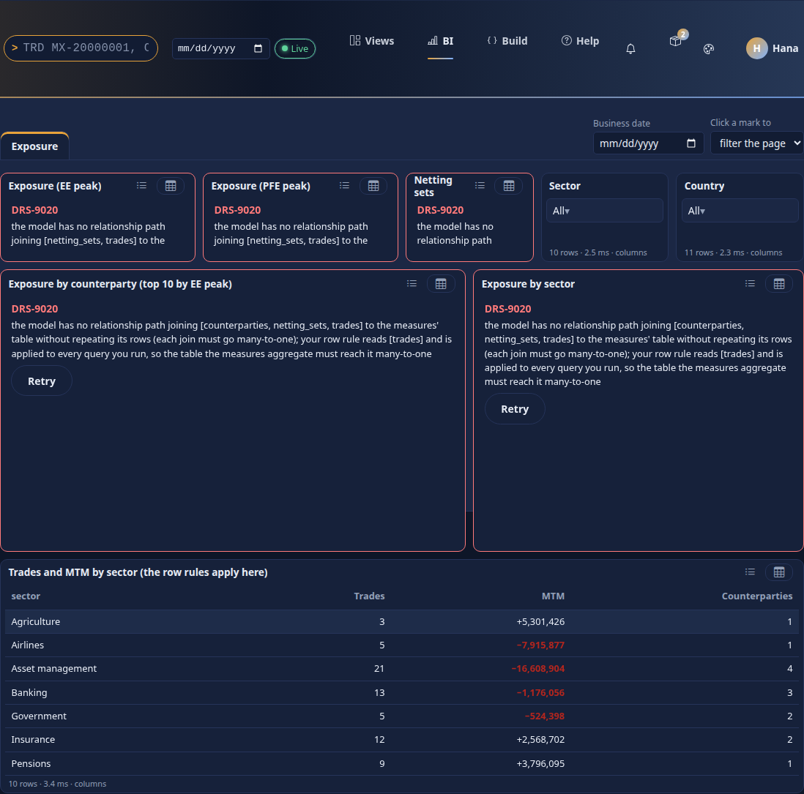

  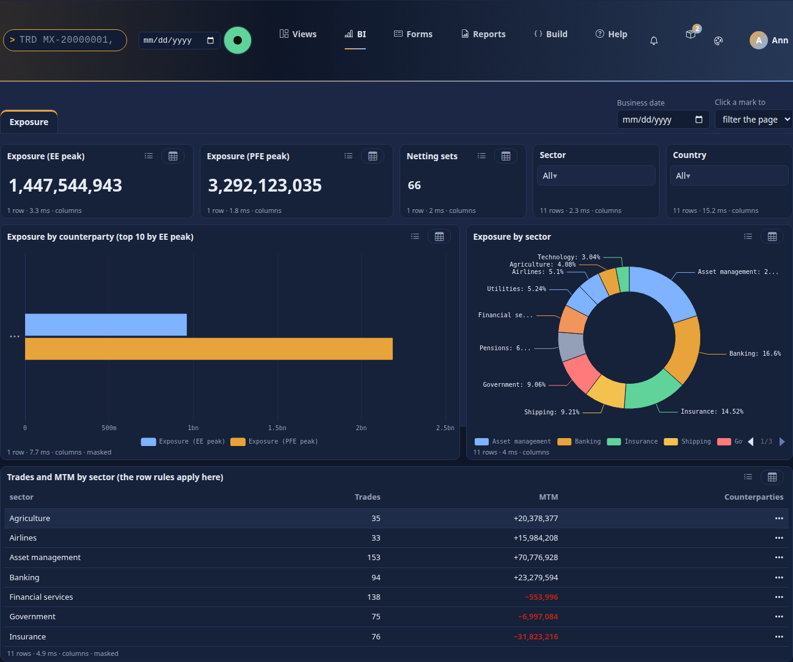

* **Cashflow ladder** drills from the pay year to the quarter, month and day, and lays the legs out as a matrix with subtotals:

  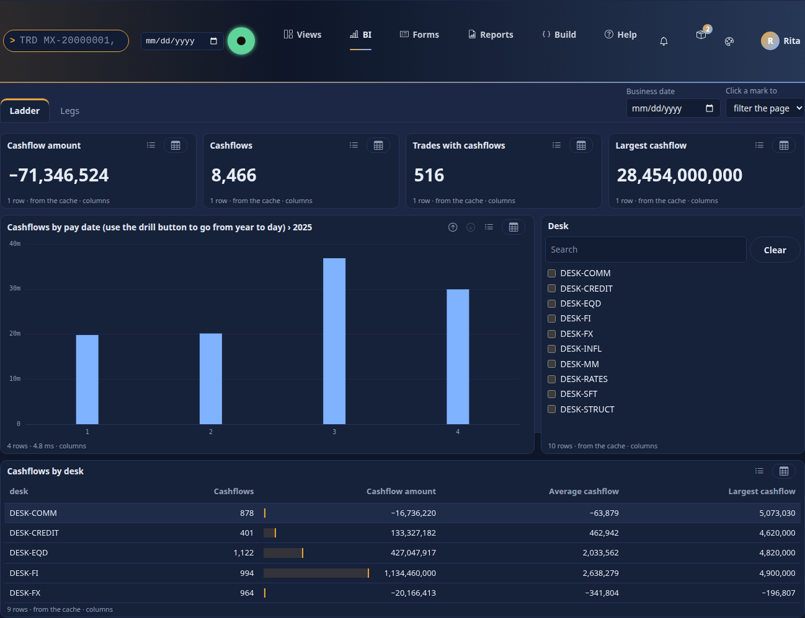

  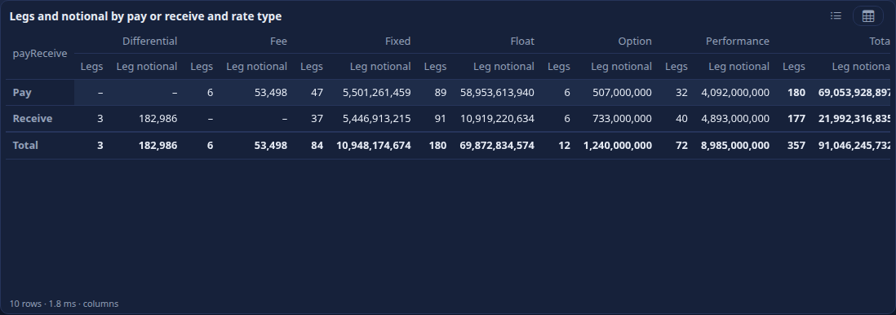

* **Keys.** `Tab` walks the visuals in reading order (top to bottom, left to right); in a chart `Left` and `Right` move between marks and
  `Enter` selects; `Esc` clears; `t`, `r`, `d`, `u` act on the focused visual; `?` lists them.
* **A phone** (390 px) shows one column in reading order with 44 px buttons and no sideways scroll; a report that declares a phone or tablet
  arrangement shows its own (section 8.4):

  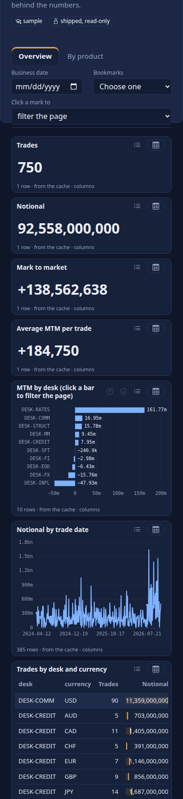

The page asks for each visual's data **three at a time** (the server allows three a person, and the page retries a refusal for busy); a
visual that is refused shows the code and words in its frame with a **Retry** button while the others carry on. A question that takes longer
than the inline wait becomes a background run with a card in place of the chart (section 15). A visual whose rows reach its limit says so
(*first 500 of 2,340*) and offers **Show all** (up to 5,000 rows); a time series is asked again by week, month, quarter or year until the
whole range fits, and says *by week* (section 9.11).

A visual's answer can also come as Apache Arrow (`POST /api/v1/bi/reports/{id}/query` with `Accept: application/vnd.apache.arrow.stream`)
for clients that read Arrow; the page itself asks JSON, which measured as fast to draw ([DATA_GUIDE.md](../DATA_GUIDE.md#6-arrow-to-the-browser-where-it-pays)).

### 6. Which date a report reads

"As of D" (a day in the toolbar's date or the time picker, or **Now**, the current business date) means **each table at its latest business
date on or before D**: facts and dimensions alike, live or not, on a weekend or a holiday, and before today's load. A report never shows an
empty table for today while yesterday's data is there, and an empty partition built for a date with no data is never kept as the answer.
The line under the toolbar says the date the data is as of and names each table's date when they differ (*Data as of: prices 2026-10-20,
trades 2026-10-16 (asked 2026-10-21)*); a visual or a board tile whose tables differ says the same under it, in the theme's warning colour.

A report may choose otherwise with the top-level key `as-of`:

| `as-of:` | Each visual reads |
|---|---|
| `per-table` (the default) | each table at its own latest date on or before D; a fact and a dimension may stand at different dates |
| `aligned` | every table at the newest date on or before D that **all** of the visual's tables hold (a reconciliation: no mixing of days) |
| `2026-09-30` | always that date (a month-end pack), whatever the reader picks |
| a relative name | the end of its window at D: `last-business-day`, `previous-month` (the last day of the month before), `previous-quarter`, `last-5-business-days`, `this-month` (D), ... (the names of section 9.9) |

```yaml
report: month-end-reconciliation
model: trading-risk@1
as-of: aligned
```

A window the reader picks (two dates) is read as it is; a report's `dates: { from, to }` sets one for every question. Anything else is
`DRS-9030` at `as-of`. A visual pinned to a past date is asked once, never followed live. Every answer says the date each table was read at
(`meta.dataAsOf`: `{asked, tables: {trades: "2026-10-16", prices: "2026-10-20"}, aligned: false}`).

### 7. BI Studio and the report designer

The designers share one shell, **BI Studio**: the report designer (and so the board and statement designers: a board and a statement are
report pages) and the theme designer. Tables and models are written in **Build › Tables & models**. **Report designer** in the rail
(`/bi/designer`) lists your report drafts (in every workspace where you may add items) and starts a new report or board on a model, in the
workspace you choose; **Samples to start from** lists the shipped reports, each with **Copy and design**. A draft opens at
`/bi/design/<draft>`; a shipped report opens read-only with **Save a copy**. From a table's page, **Start a report on it** opens the designer
with it chosen. The designer needs the `bi-author` power; its step-by-step use is [the reports tutorial, Part A](#part-a--your-first-bi-report).

#### 7.1 The Studio shell

* **The header**: where you are (BI › Studio › Reports), the item's name and status (*Saved*, *Unsaved changes*, *Read-only*), the actions
  (Undo, Redo, Preview with data, Check, View, Item page, Publish, Save) and **+ New** (report, board, theme, table, model). The layout picker
  switches between **Studio**, **Side by side** and **Terminal** (dense and monospace, a `DESIGN>` command line on Ctrl+K that takes `check`,
  `save`, `publish`, `undo`, `redo`; F3 Check, F4 the YAML tab, F9 Publish), remembered in this browser. In a workspace that requires review,
  Publish reads **Propose** and asks for a note for the reviewer.
* **The Explorer** (left): the items of every workspace where you may add items, by kind, with a search; a draft shows its status. The button
  at the left of the header folds it away (under 900 px it starts folded).
* **The open items** (above the designer): every item you open joins the tabs (the last eight, for this browser tab). The work itself is saved
  on the server: the tabs are only a convenience.
* **The properties** (right): the designer's panes (Filters, Visualizations with Build and Format, Fields).
* **The dock** (under the designer): **Problems**, what the server's Check says about the draft a second after each change (each linked to its
  visual; the count is on the tab), and **Query**, the selected visual's model query and its SQL (section 8.3).

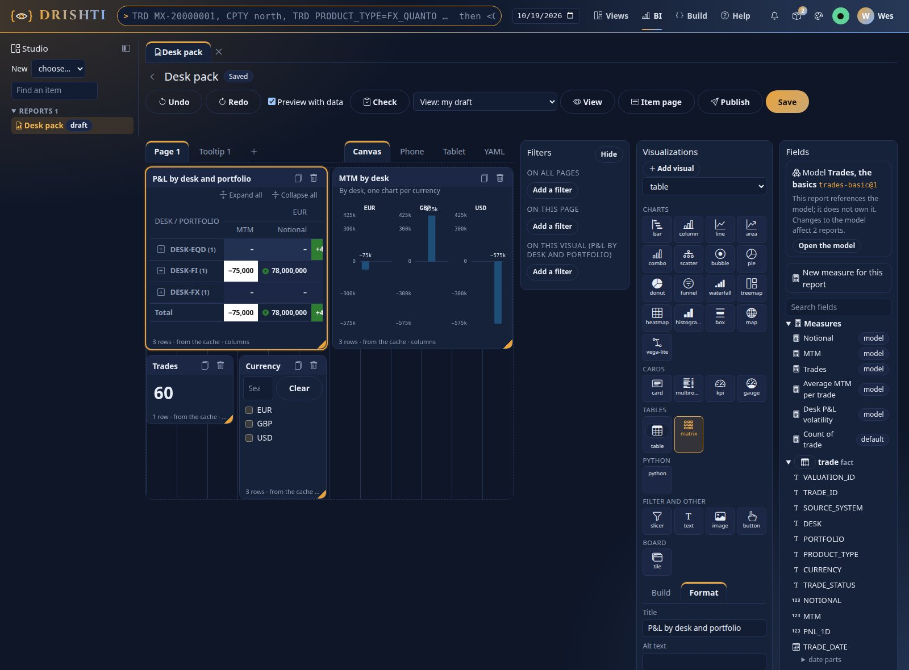

#### 7.2 The report designer

The panes are where Power BI authors expect them: the canvas on the left, then **Filters**, **Visualizations** (with **Build** and **Format**)
and **Fields**. The designer is an authoring tool, so it opens with its panes, as the pivot screen does behind **Customize ›**
([BI_GUIDE.md section 2](PIVOT.md#2-the-screen), mode A); a reader of the report meets the visuals alone, as a pivot's reader meets
the View picker and the compact line. The same field-list rules hold in both: a hierarchy is one item, a model's hidden fields are left
out, measures sit in their display folders.

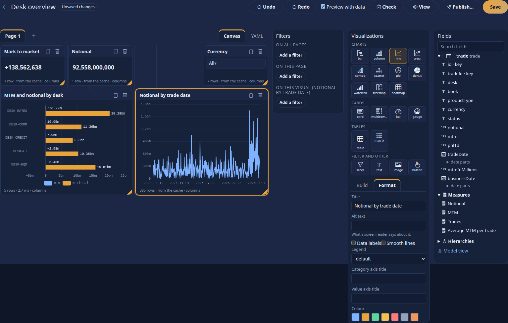

* **Fields.** The model's tables, their columns (a date opens into its parts: year, quarter, month, week, day), its measures (listed first,
  labelled *default* or *model*) and hierarchies, with a search box. **Drag a field onto the canvas** and the best visual for it appears: a
  measure is a card, a column a table; **drag another onto that visual** and it improves: a category with a measure becomes a bar, a date with
  a measure a line, two categories with a measure a matrix. Without a mouse, the field's button adds it to the selected visual (or makes a new
  one). A hierarchy added to a chart makes it drillable.
* **Visualizations.** The types the designer offers (section 9.3; `vega-lite` has a box for its specification; the rolling chart, the
  `perspective-*` types and the entity view are written in the YAML tab). Choosing one with a visual selected converts it (and asks first when
  wells would be dropped); **+ Add visual**, or dragging a type onto the canvas, makes a new one. **Build** shows the wells of the selected
  visual: chips you can remove or reorder and a select that adds without dragging; drill-down along a hierarchy and drill-through to a page are
  set here. **Format** is section 10; with no visual selected it is the **page** (title, layout: grid, board or statement, the fields it takes as
  a drill-through target, whether it is a tooltip page) and the **report** (title, description, theme, palette, business dates, links,
  bookmarks, the kiosk rotation of its board pages).
* **Filters.** *On all pages*, *On this page*, *On this visual*. **Basic** picks values (type them, or *Pick from the data*), **Advanced** is a
  condition (is, is not, less than, between, contains, starts with, is empty ...; for a list column also *list contains*, *list has any of*, *list has all of*), **Top N** keeps the N values with the highest (or lowest)
  measure.

  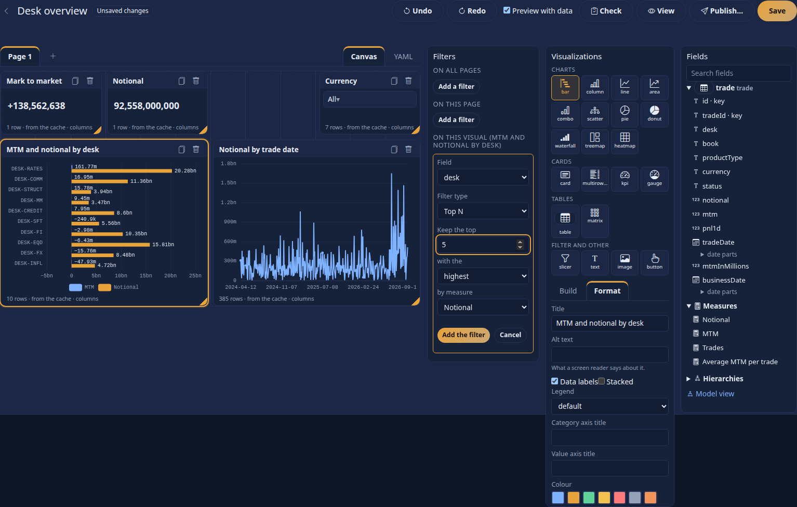

* **The canvas** is the 12-column grid. Drag a visual by its header and drag the corner to resize: both snap to the grid, and what a move would
  overlap is pushed down. **Keyboard:** focus a visual and `Arrow` moves it a cell, `Shift` with an arrow resizes it, `Ctrl+D` duplicates,
  `Delete` removes, `Enter` goes to its title in Format.
* **Real data while you design.** Every visual is drawn from the model, as you (your rows, your masks), with the rows and the **question time**
  under it; **Preview with data** can be turned off. An **incomplete visual** (a required well empty) shows its own note (*Add a field to the
  axis well*) while the others still draw. A field dropped where it does not fit says which wells the visual has.
* **YAML.** The tab shows the same draft as text. Edit either view and the other follows at once; a mistake in the text is reported with its
  code and path (`DRS-9031`, ...) and the canvas keeps the last good draft. A strip of **suggestions** follows the cursor: visual types after
  `type:`, operators, hierarchies, pages, and the model's fields and measures in a well. Comments, key order and every entry you did not touch
  stay as written.

  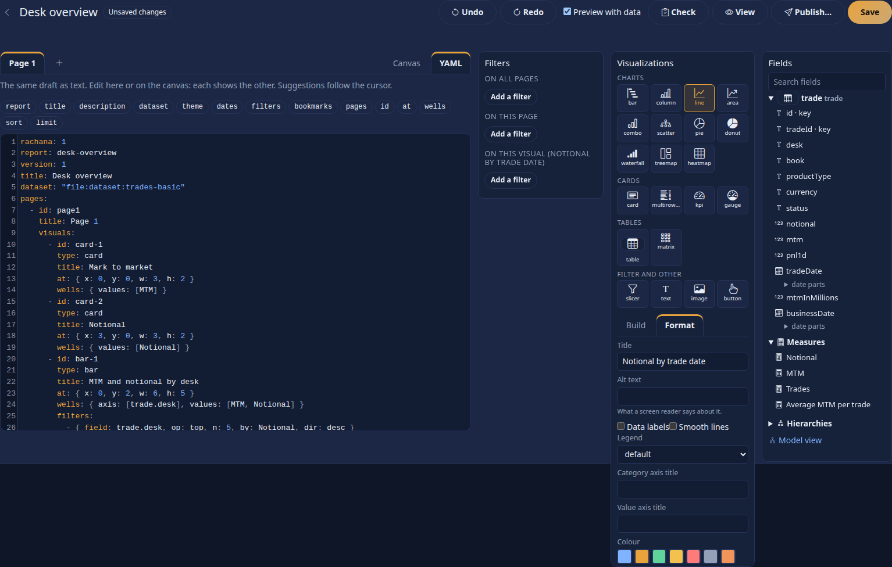

* **Check** validates the draft and adds the quality checks (`A11Y`: a chart, table, card or image with no title or alt text, a colour too pale
  for the background; `LAYOUT`: visuals that overlap; `PERF`: a preview that took over a second) and runs the report's expected values.
  Clicking a finding goes to the visual; each names the visual's title, id, number and page.

  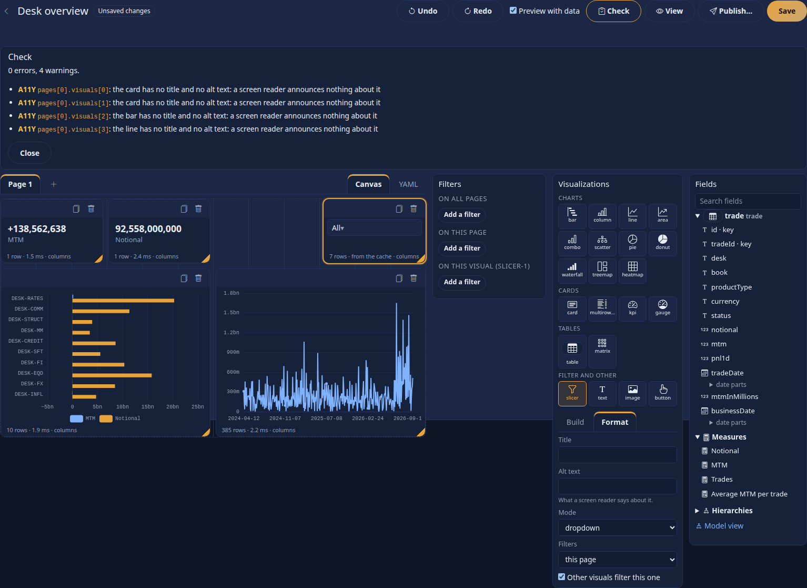

* **Undo and redo** (`Ctrl+Z`, `Ctrl+Y`) walk the last 100 changes; **Save** (`Ctrl+S`) keeps the draft; the page warns before you leave with
  unsaved changes. **Publish** (**Propose** where the workspace reviews) saves first, then publishes; a report that cannot be drawn is refused
  with its errors listed. Converting a visual's type renames its made-up id (`card-1` becomes `slicer-1`), and everything that named the old id
  follows it (bookmarks, layouts, interactions, tooltips).

#### 7.3 A report on a model: Fields, own measures, MQ or SQL

The **Fields** pane is the model as you see it (`GET /api/v1/bi/models/{ref}/describe`): one group per alias, the model's **display names**
(every visual's labels use them), **descriptions** (the tooltip), **formats**, **folders**, hidden fields left out, masked fields marked. Its
header names the model (*Implicit model of Trade* with **Make it a model**, or *Model Trades and desks* with **Open the model**) and how many
reports a change of it reaches. When the model has **perspectives**, **Perspective** shows only one perspective's fields and measures, and the
report keeps the choice (`perspective: "desk-view"`).

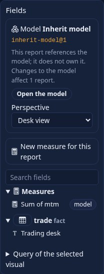

**A measure of this report only.** *New measure for this report* takes a name and a formula in the expression editor over the model's
measures and fields; **Try it** asks the model. It is written into the report and sent with every question that uses it as `define`, so it
never changes the model; it is marked *this report only*, with **Move to the model**. A name the model already has is refused (`DRS-9154`).

```yaml
measures:
  "MTM in thousands": { expr: "measure('Sum of MTM') / 1000" }
```

**Query of the selected visual: MQ or SQL.** Every visual's data is one **model query** built from its wells, the report's, page's and
visual's filters (a filter on a measure becomes `having`), its sort and limit, and in the viewer the slicers and the other visuals'
selections. The Query panel shows it as YAML or as **Drishti SQL** (the model's aliases as tables, `MEASURE('name')` for a measure, `JOIN`
without `ON` along the model's relationships), one switch. **Run as SQL** sends the statement to the server (`POST /api/v1/bi/sql`) and shows
its rows, time and plan, saying whether the plan is the visual's: one question, one plan, one cache entry, whichever language asks it.

```yaml
mq: 1
model: trades-and-desks@1
select:
  fields: [trade.DESK]
  measures: [Sum of MTM]
```

```sql
SELECT trade.DESK,
       MEASURE('Sum of MTM') / 1000 AS "MTM in thousands"
FROM   trade
GROUP  BY trade.DESK
ORDER  BY "MTM in thousands" DESC
LIMIT  500
```

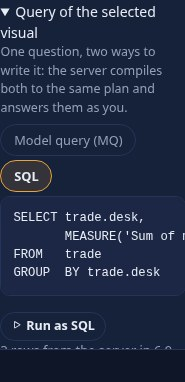

**Publishing a report on a model** needs that model **published** (a draft model is read by its author only) and readable by the publisher
(a member of its workspace, or in its audience); otherwise publish is refused with `DRS-9030` (*the model 'wes-draft@1' is not published ...*).
A report names `model:` or the older `dataset:`, never both (`DRS-9140`).

#### 7.4 Phone and tablet layouts

A phone shows one column: without anything declared, the grid in **reading order**, each visual at its type's default height. A report may say
how each page is arranged at **640 px and narrower** (`layouts.phone`) and, for a tablet, at **1024 px and narrower** (`layouts.tablet`, two
columns: each visual half the width, those in `wide` the whole width):

```yaml
layouts:
  phone:
    desk:                                   # a page id
      order: [mtm, trades, by-desk, movers] # first, in this order; every other visual follows in reading order
      hide: [rolling, losses, latest]       # not drawn on a phone, and not asked for
      span: { by-desk: 5 }                  # height in grid rows (1 to 40; a row is 56 px)
  tablet:
    main: { order: [desk, trades, mtm, notional, rows], wide: [desk, rows], span: { desk: 5, rows: 4 }, hide: [] }
```

Hidden visuals are **not asked for**, so a hidden table costs the phone nothing. A visual may not be both in `order` and in `hide`; a page or
visual that does not exist is `DRS-9031`, a bad height `DRS-9030`. The viewer chooses by the **screen** (a phone with only a tablet layout gets
the automatic column) and swaps back when the window grows. In the
designer the **Phone** tab lists the page's visuals in phone order (drag a row or use its arrows, *Hide*, *Rows* for the height) beside a 390 px
preview drawn to scale; *Back to automatic* removes the page's entry. The **Tablet** tab is the same list with *Wide*, above a 768 px preview.
The sample *Live trading desk* ships with a phone layout.

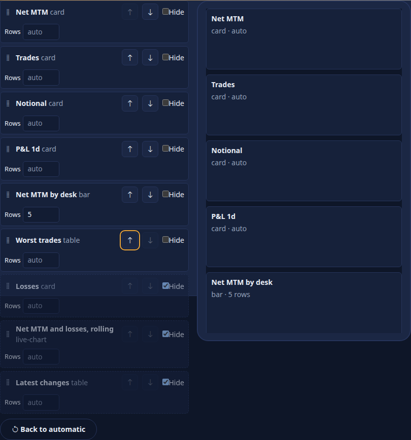

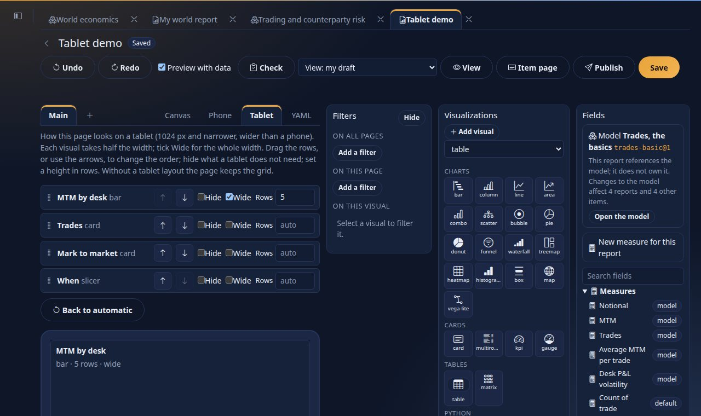

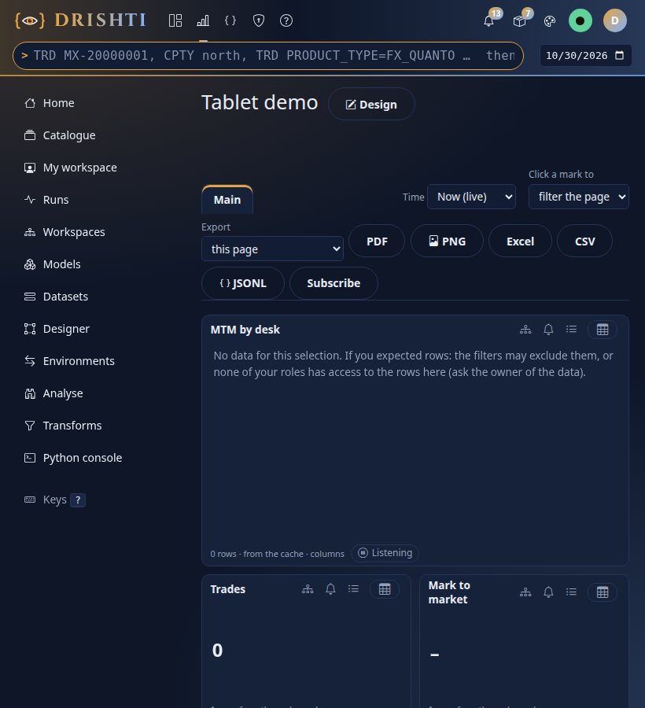

### 8. Python in reports

Python reaches a report in three ways, always run on the server's compute pool in its sandbox, over the rows the reader may see, never in the
browser: a **Python measure** of a model (`{ python: <item>, inputs, by }`), shown by a `python` visual and watchable by an alert; a **python
visual** that draws what a Python item returns (bars, a chart or a Vega-Lite specification), also as a board tile; and a **Python-driven table**
(a transform whose output is a table a model reads; [BI_GUIDE.md section 11.4](TABLES_AND_MODELS.md#114-python-driven-tables-and-models)). The
sample report `python-desk-risk` and the board `python-wall` show them. Writing the items, the sandbox, their tests, data prep step by step and the
Notebook's SQL and Python cells are in [BI_GUIDE.md](NOTEBOOK_AND_PYTHON.md).

### 9. Settings, limits and problem codes

**Settings** (all in [CONFIGURATION.md](../../admin/CONFIGURATION.md)): `drishti.bi.*` (`enabled`, `dir`, `watch`, `folder-refresh`,
`workspace-creation`, `max-body-bytes`, `versions-keep`, `usage-days`, `recent`, `list-limit`) and the console's `bi.enabled`
(`DRISHTI_BI_ENABLED`); `drishti.bi.query.*` (the engine's limits), `drishti.bi.report.*` (rows per visual, totals, distributions),
`drishti.bi.refresh.*`, `drishti.bi.live.*` with the console's `bi.live.*` and `bi.board.rotate_seconds`, `drishti.bi.mq.*` (standing queries),
`drishti.bi.exec.*` and `config/runs/runs.yaml` (background runs), `drishti.bi.governance.*`, `drishti.bi.ai`, `drishti.distribution.*`,
`drishti.alerts.*` and `drishti.notify.*`.

**The menu is missing**: you hold no BI power (ask an administrator to grant `bi` on one of your roles), the console's `bi.enabled` is off, or the
server could not be asked (the menu then hides rather than failing the page). *Publish* is not offered: the workspace requires review, or you are
not a member with `bi-author`.

| Code | HTTP | Meaning |
|---|---|---|
| `DRS-9001` | 404 | no such workspace, item or version, **or you may not know it exists** |
| `DRS-9002` | 403 | you lack a BI power or the workspace role the action needs (the message says which) |
| `DRS-9003` | 422 | a name, kind, body (not YAML, too large), tag, audience or endorsement that is not valid |
| `DRS-9004` | 409 | the state forbids it: name taken, nothing new to publish, already proposed, personal workspace, last admin, workspace not empty, shipped content is read-only, a model still read |
| `DRS-9005` | 403 | four eyes: you proposed it, so you may not decide it |
| `DRS-9006` | 403 | BI is switched off on this server (`drishti.bi.enabled`) |
| `DRS-9007` | 409 | stale save: someone saved the item since you opened it |
| `DRS-9020` to `9027` | 4xx/5xx | a question refused (a field, measure, operator, value or date it cannot take, or no join), masked (`9021`), too many rows or bytes, too slow, too many at once, a source down, the engine failed |
| `DRS-9030` to `9038` | 422 | a report, theme, field parameter or statement (section 9.14) |
| `DRS-9040` to `9043` | 409/422 | a publish that breaks reports, a bad bundle, a conflicting import, a failing expected value (section 17) |
| `DRS-9050`, `9051` | 422/429 | a live table that cannot be kept; too many live streams |
| `DRS-9052`, `9053` | 422/501 | a board (section 14.5) |
| `DRS-9060` to `9062` | 422 | an export over a limit; a subscription; an alert |
| `DRS-9080` to `9089` | | background runs (section 15) |
| `DRS-9126`, `9130`, `9131`, `9140`, `9150` to `9163`, `9181`, `9182`, `9196` | | models and model queries: a breaking change without a major, the security safeguard, a model binding, query refusals, standing-query room, a file in the older form |
| `DRS-4015` to `4020` | | AI (section 16.7) |

Every code is listed with its fix in [OPERATIONS_GUIDE.md](../OPERATIONS_GUIDE.md#22-error-codes).

## Tutorial: Your first BI report

Business intelligence from a first report to a published one: a model's questions, a report in the designer (cards, a map, a bar, a slicer), viewing and drilling it, publishing it and filtering like Power BI. Every step shows the UI, the command line where there is one, and the YAML. The other parts of the BI tutorial are on the pages beside this one (see the [index](README.md#the-pages-and-where-each-tutorial-is)).

### Time to complete

- Part A · Your first BI report: About 60 minutes.

### Before you start

- **The quick-start environment** ([data/testdata/README.md](../../../data/testdata/README.md)): the demo lakes built (`python3 tools/drishti.py lake demo`, or the run configuration **Drishti: build demo lakes**), the server started on them (run configuration **Drishti: run server (demo)**: sign-in on, the seven packs, the samples off) and the console (**Drishti: run console**). The figures below are from the default lake `lake demo` built on 26 October 2026: sixty business days ending **2026-10-26**, 5,000 trades in each of ENDUR, CALYPSO and MUREX, and the exposure run `lake demo` generates (all 76 netting sets): exposure is computed by the exposure engine, and the server publishes its official end-of-day results when it starts. `lake demo` moves the days to end on *your* business date, so your dates differ.
- Signed in as the development administrator (`drishti-dev-admin`, password `drishti-dev-admin123`, the run configuration's seed), and, for the command line, a **personal API token** in `DRISHTI_TOKEN` (click your name → **My account** → **API tokens**, tick `bi:write` among the scopes, **Create token**; [tutorial 1, step 9](../../tutorials/01-first-15-minutes.md#step-9--make-a-token-for-the-command-line)). Every command line below is run from the repository folder with the console's Python, `python3 tools/drishti.py ...` (written `python3 tools/drishti.py` for short), against `DRISHTI_SERVER` (default `http://localhost:18480`).
- Nothing else to install. The sample models, datasets and reports are files in `config/bi/` that every server reads. The data of **World economics** is real and public: about 200 economies from the World Bank (CC BY 4.0), through the `world-economy` pack. The dataset uses only the World Bank
  fields on purpose; the pack's IMF fields stay out of it ([WORLD_DATA_GUIDE.md (world-economy)](../WORLD_DATA_GUIDE.md#the-world-economy-data-in-detail)). Every column of every shipped model is in **UPPER_SNAKE** (`REGION_NAME`, `GDP_USD_BN`, `TRADE_DATE`), the names the data has in production.

**Where this data comes from.** The *World economics* model reads the `world-economy` pack: World Bank figures (CC BY 4.0), fetched by `drishti.py feed run world-economy`; its IMF fields (internal only) stay out of the model. Each source, its licence and how to refresh it: [External data](../WORLD_DATA_GUIDE.md).

### What you will learn

**Part A · Your first BI report**

- the parts of a **model**: the datasets it reads (one table each, with its columns), the measures it owns; and how to ask it a question before drawing anything;
- how to make a report in the designer: cards, a **map**, a bar with a **top 10** filter, a slicer; where each visual sits on the 12-column grid;
- (at the end) a **relative-date slicer**, a **tablet layout** and an **entity view**: *last 3 months*, two columns on an 820 px screen, and a counterparty's own view beside a bar;
- how the map drills **world, country, region** with a breadcrumb, and how a click on a map or a bar **cross-filters** the rest of the page;
- how to publish: your own workspace, a shared workspace, the catalogue;
- **filter like Power BI**: list, dropdown and range slicers, page and report scope, a top-N filter that tames a busy donut, bookmarks, and when to use a slicer instead of a click;
- the **Counterparty risk** sample: slicers that reach across packs, a selected bar, and drill-through;
- **two fact tables in one model**: trades and netting sets, each added up on its own and joined through the counterparty, so one-day P&L and exposure stand side by side and one slicer filters both;
- (step 13) **a dataset and a model of your own, in the wizard**: narrow a pack dataset (some columns, some rows, a worked-out column), preview it, publish it and make a model of it in one click, with no YAML typed.
- (step 14) **models**: a pack dataset with nothing to build, a report on it at once, then a model of trades and desks with a suggested relationship, a measure, a row rule and the security safeguard, published, opened in the Notebook and watched by an alert, in the UI, over the API and as YAML.

#### Part A · Your first BI report

Business intelligence in Drishti (it is called **Rūpaka**; type `BI <GO>` or choose the bar-chart icon in the top bar) is built from three things: a **dataset** (tables, how they join, and named **measures** such as "GDP per capita"), a **report**
(pages of **visuals** that ask the dataset questions), and the **catalogue** where published reports are found. In this part you build a report of your own on the **World economics** sample: two cards, a **map** you can drill from the world to a country
and its regions, a bar, and a slicer. You look at it, cross-filter it, publish it, learn the slicers in detail on the **Trades overview** sample, and meet the cross-filter and drill-through of **Counterparty risk**.

### Step 1 · Look at the model

A report reads a **model**: a small star of **datasets** (each one table with its columns, the time it keeps and its row rules), the relationships
between them and the **measures** the model owns. Choose **Models** in the left rail. Under *Your models* find **World economics**
(`world-economics`, `model 1.0.0 · published`) and press **Open the designer**, then the **Measures** tab.

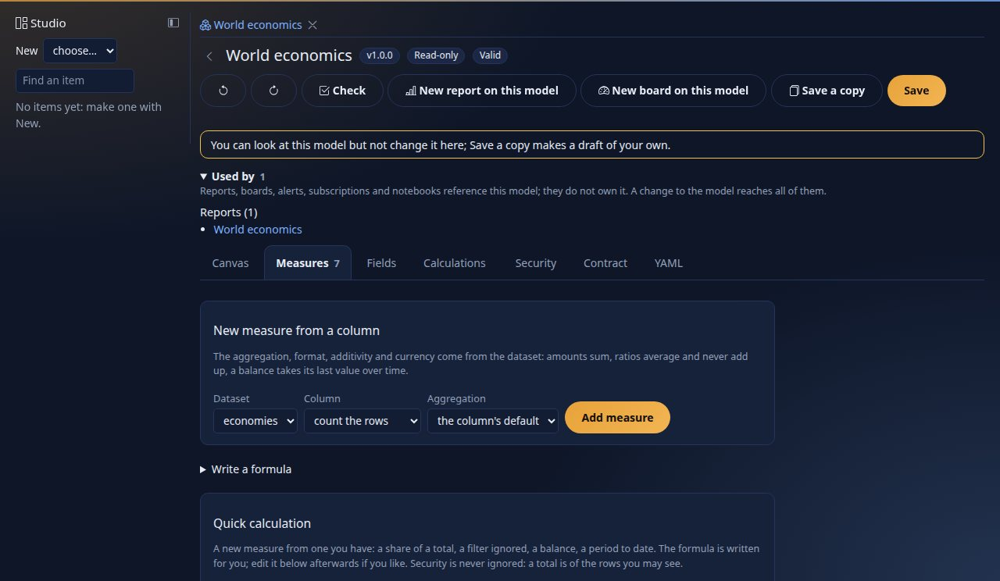

You should see `World economics`, `v1.0.0`, `Read-only` (it ships with Drishti: **Save a copy** makes one of your own) and `Valid`, **Used by** the
report **World economics**, and the seven **measures** (`Economies`, `GDP (USD bn)`, `Population (m)`, `GDP per capita (USD)`, `Average growth`,
`Average inflation`, `Average unemployment`), each a formula the model owns, so every report on it agrees. `GDP per capita (USD)` is
`ratio(sum(economies.GDP_USD_BN), sum(economies.POPULATION_M)) * 1000`: GDP over population, not an average of averages, so a region's figure is right. The
**Canvas** tab shows the one dataset the model reads, under the alias `economies`. Back on **Models**, under *Your datasets*, press **Open** on
**World economics: economies**.

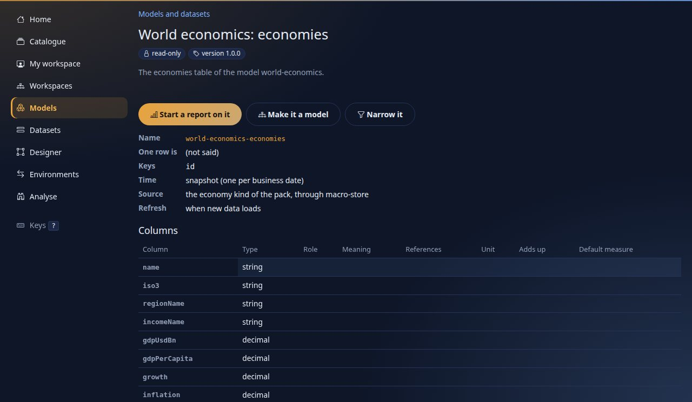

You should see the dataset `world-economics-economies` `1.0.0`: one row per economy (key `id`), time `snapshot (one per business date)`, read from
`the economy kind of the pack, through macro-store`, refreshed `when new data loads`, and its columns: the country's name, its ISO code (`iso3`, which
is what a map needs), World Bank region and income group and a few figures. The data is real and public (the World Bank, CC BY 4.0, through the
`world-economy` pack).

**Ask it a question** before drawing anything. **From the command line** (the token of tutorial 1, Part A), a **model query** groups by the region and asks
three measures, the biggest economies first:

```text
$ python3 tools/drishti.py bi mq --model world-economics@1 --select economies.REGION_NAME \
    --measures "GDP (USD bn),Population (m),GDP per capita (USD)" --sort="-GDP (USD bn)"
economies.REGION_NAME                               GDP (USD bn)  Population (m)  GDP per capita (USD)
-------------------------------------------------  ------------  --------------  --------------------
North America                                      33,098.79     383.50          86,306.87
East Asia & Pacific                                32,710.77     2,340.96        13,973.22
Europe & Central Asia                              32,262.10     932.48          34,598.00
Latin America & Caribbean                          7,327.57      666.55          10,993.23
Middle East, North Africa, Afghanistan & Pakistan  5,136.27      828.03          6,203.03
South Asia                                         4,578.02      1,692.26        2,705.28
Sub-Saharan Africa                                 2,213.29      1,318.05        1,679.22
7 row(s)  as of 2026-10-26  plan p_6020bb1a1c70beae
```

**As YAML**, the same question is a file you can keep and run with `python3 tools/drishti.py bi mq gdp-by-region.yaml`:

```yaml
mq: 1
model: world-economics@1
select: { fields: [economies.REGION_NAME], measures: [GDP (USD bn), Population (m), GDP per capita (USD)] }
sort: [{ by: GDP (USD bn), desc: true }]
```

and **over REST** it is `POST $DRISHTI_SERVER/api/v1/bi/mq` with that body as JSON (`{"mq": 1, "model": "world-economics@1", "select": {...}, "sort": [...]}`),
which answers the `columns`, the `rows` and a `meta` block with the as-of date and the plan. `python3 tools/drishti.py bi model list` lists every model
and dataset you may read (`world-economics@1  model  World economics  1.0.0  published`). Everything a report draws is a question like this, asked **as
you**: your row rules and masks apply, which is why two people can open one report and see different figures. (Your dates differ: the business date is
today's.)

### Step 2 · Start a report

Choose **Designer** in the rail. Choose the dataset **World economics**, give the report the title `My world report` and look at the form before you press the button.

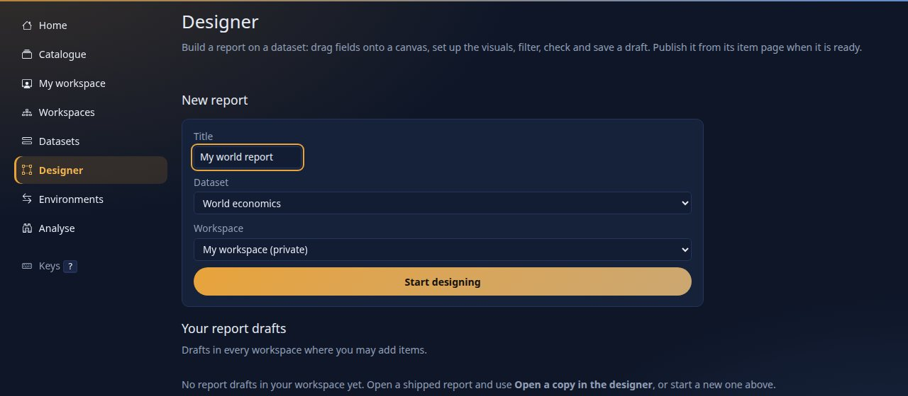

You should see the dataset chooser (every dataset you may open), the title box and the button **Start designing**. Press it.

You land in the designer: a canvas on a 12-column grid, a **Filters** pane, **Visualizations** (every kind of visual) and **Fields** (the dataset's columns and measures). The report is a draft in **My workspace**, which only you see.

The designer sits in **BI Studio**, the shell the report, model and theme designers share: the **Explorer** of your items on the left (with
**New**), the items you opened as **tabs** above the canvas, and under it a **dock** with **Problems** (the server's check of your draft a second after each
change, each problem linked to its visual) and **Query** (the selected visual's model query and its SQL). The steps below work the same in it;
[BI_GUIDE.md section 26](#7-bi-studio-and-the-report-designer) is the tour, and
[BI_GUIDE.md › Reports: the YAML, the visuals and how they behave, section 5](REPORT_FILE_FORMAT_STATEMENTS.md#21-the-format-pane) the Format pane, conditional formatting and themes.


### Step 3 · Two cards

Drag the measure `GDP (USD bn)` from **Fields** onto the canvas, then `Population (m)` beside it. (Dragging with the keyboard also works: focus a field and press Enter.)

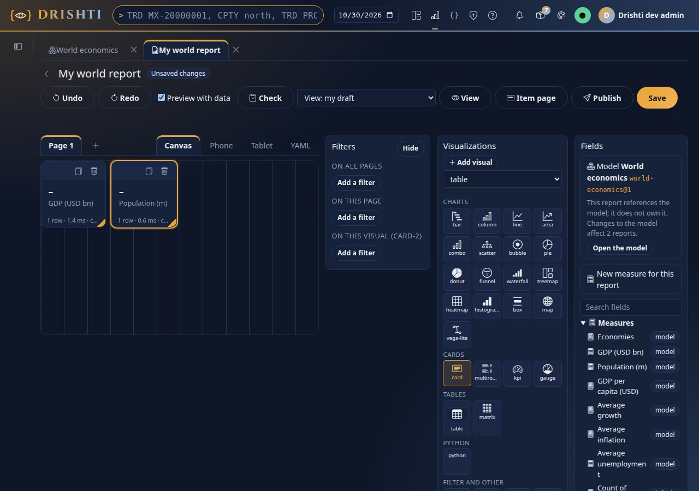

You should see two cards with real figures: `117,327` (billion dollars) and `8,161.83` (million people). A **measure alone becomes a card**; a column alone would become a table; a column with a measure becomes a bar. Under each card is the line the server answered with: rows, time
and the layer.

**From the command line** the two cards are one question with no field (and **in the YAML** each is a visual `{ type: card, wells: { values: [GDP (USD bn)] } }`):

```text
$ python3 tools/drishti.py bi mq --model world-economics@1 --measures "GDP (USD bn),Population (m)"
GDP (USD bn)  Population (m)
------------  --------------
117,326.82    8,161.83
1 row(s)  as of 2026-10-26  plan p_1a5eabbd64657b9f
```

### Step 4 · A map

Click an empty part of the canvas to let go of the selection, then click **map** in **Visualizations**. In **Build**, add `economies.ISO3` to the **location** well and `GDP per capita (USD)` to **values**.

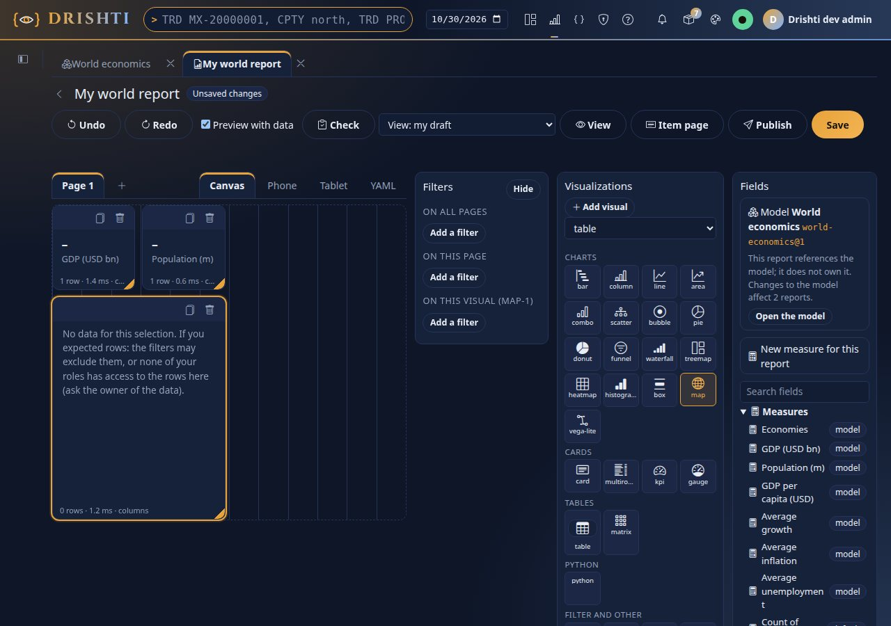

You should see the world shaded from dark to light by GDP per capita (the legend runs from 0 to `90k+`), the title `World` above it, and a note `Not on the map: CHI, XKX` under it: two codes the shapes do not know are **named, never dropped silently**. Small countries (Cayman Islands, Monaco)
are dots so they can be clicked. The shapes are Natural Earth, shipped with the console: nothing is fetched from the internet. The `location` well takes ISO country codes (`AUS`, `AU` or the English name), or ISO 3166-2 region codes (`AU-NSW`) for a map of one country's regions.

### Step 5 · A bar, a slicer, and where everything sits

Add a bar: with nothing selected click **bar**, put `economies.NAME` in **axis** and `GDP (USD bn)` in **values**. Add a slicer: click **slicer**, put `economies.REGION_NAME` in **field**, then open **Format** and set the mode to **dropdown**.
The visuals are stacked wherever there was room, so now place them. **In the UI**, drag a visual by its header and resize it by its corner (the places snap to the 12-column grid), and give the bar its **top 10** in the **Filters** pane: under *On this visual* press **Add a filter**, choose the field `economies.NAME`, the filter type **Top N**, *Keep the top* `10`, *with the* `highest`, *by measure* `GDP (USD bn)`, and press **Add the filter**. **From the YAML** (the exact way, and what both of these write), open the **YAML** tab: the report is text, and each visual has `at: { x, y, w, h }` on the 12-column grid. Give each one a title and a place, and give the bar a **top 10** filter
(a filter on the visual, `op: top`: the ten economies with the largest GDP):

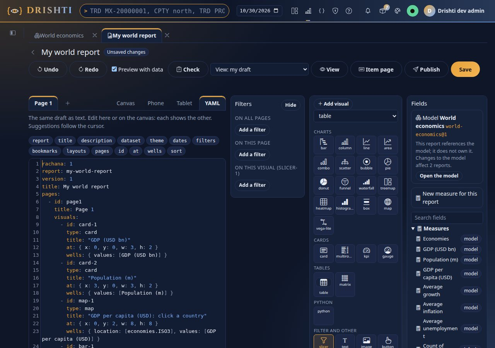

```yaml
- id: card-1
  type: card
  title: "GDP (USD bn)"
  at: { x: 0, y: 0, w: 3, h: 2 }
  wells: { values: [GDP (USD bn)] }
- id: map-1
  type: map
  title: "GDP per capita (USD): click a country"
  at: { x: 0, y: 2, w: 8, h: 8 }
  wells: { location: [economies.ISO3], values: [GDP per capita (USD)] }
- id: bar-1
  type: bar
  title: "Largest economies (GDP, USD bn)"
  at: { x: 8, y: 2, w: 4, h: 8 }
  wells: { axis: [economies.NAME], values: [GDP (USD bn)] }
  filters: [{ field: economies.NAME, op: top, n: 10, by: GDP (USD bn) }]
```

You should see the YAML with `at:` lines and no complaints (a mistake is reported with its code, and `DRS-9030` is a place off the grid). Switch back to **Canvas**. (You can also drag a visual by its header and resize it by its corner; the YAML is simply the exact way.)

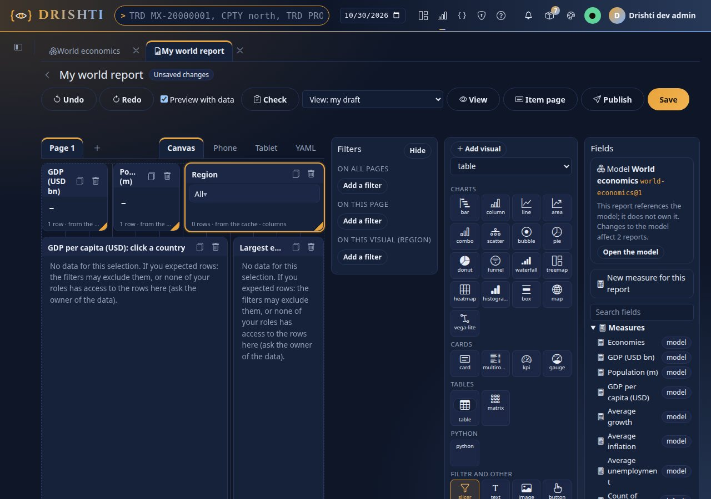

You should see two cards, a `Region` dropdown, the map on the left and ten bars on the right. Press **Save** (or `Ctrl+S`); the status next to the title says `Saved`. Press **Check**: it adds accessibility checks (a visual without a title or alt text is flagged for screen readers).

### Step 6 · View it, click, drill

Press **View**: the report opens as a reader sees it.

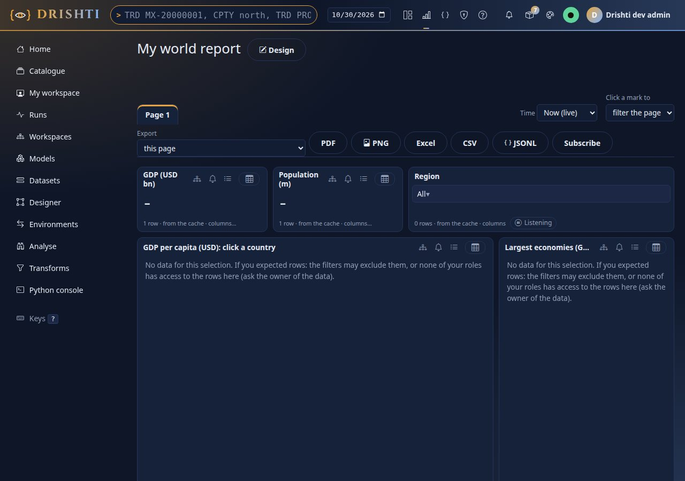

You should see the toolbar (business date, *Click a mark to filter the page / highlight*, **Reset**), the **Export** bar (PDF, PNG, Excel, CSV, Subscribe; Part D), and your visuals drawn with real data. Now **click Australia** on the map.

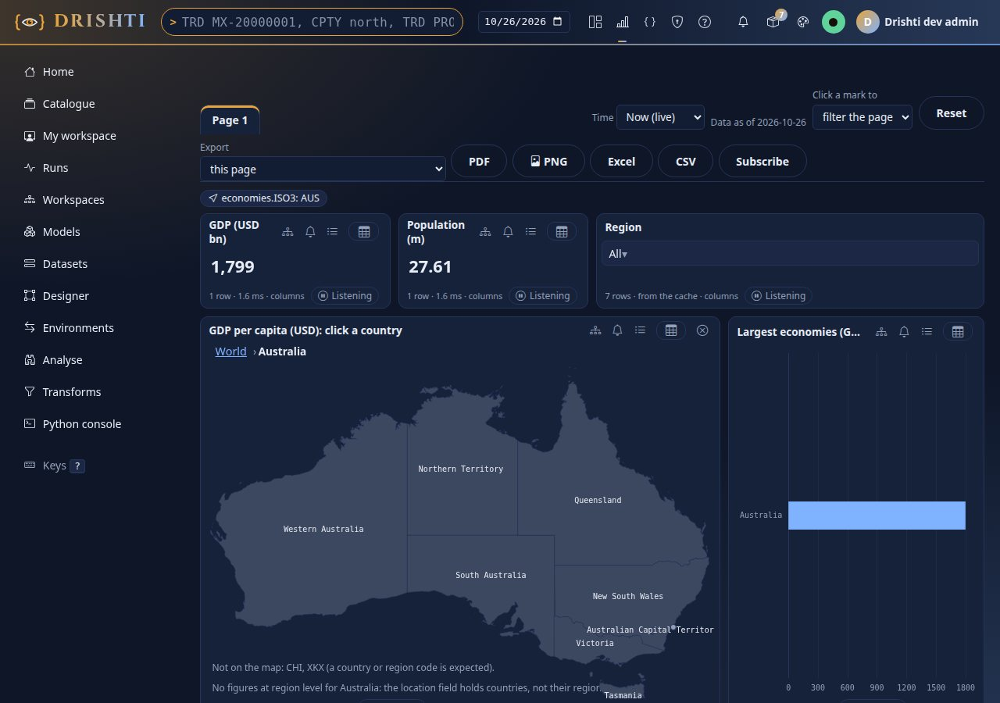

You should see three things at once. A **chip** under the toolbar, `economies.ISO3: AUS`, says what is filtering the page. The cards answer for Australia alone (`1,799` billion dollars of GDP, `27.61` million people): this is the **cross-filter**. And the map **drilled**:
its title bar says **World › Australia**, and the shapes of Australia's states and territories replace the world.

The cross-filter is a filter on the click's field; **from the command line** it is `--where`:

```text
$ python3 tools/drishti.py bi mq --model world-economics@1 --select economies.ISO3,economies.NAME \
    --measures "GDP (USD bn),Population (m)" --where economies.ISO3=AUS
economies.ISO3  economies.NAME  GDP (USD bn)  Population (m)
--------------  --------------  ------------  --------------
AUS             Australia       1,798.52      27.61
1 row(s)  as of 2026-10-26  plan p_097e0dff24160bf0
```

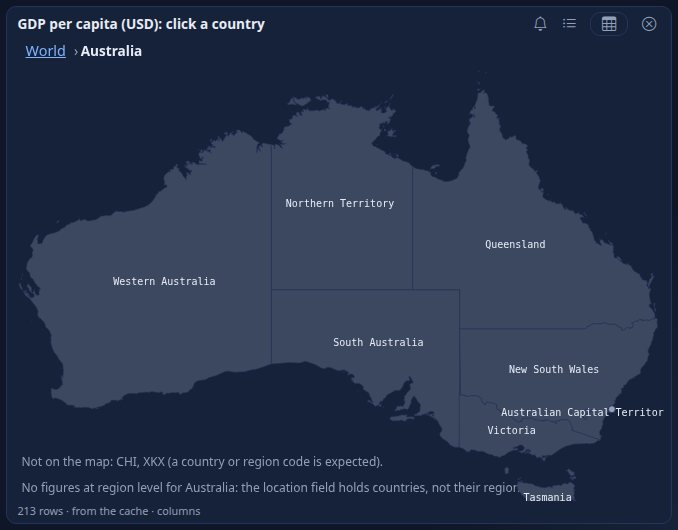

Under the map you read `No figures at region level for Australia: the location field holds countries, not their regions.` That is honest: this dataset has one row per **country**. To shade regions give the map a field of ISO 3166-2 codes (`AU-NSW`, `US-CA`) and the same visual
colours the states by their own figure. Press **World** in the breadcrumb.

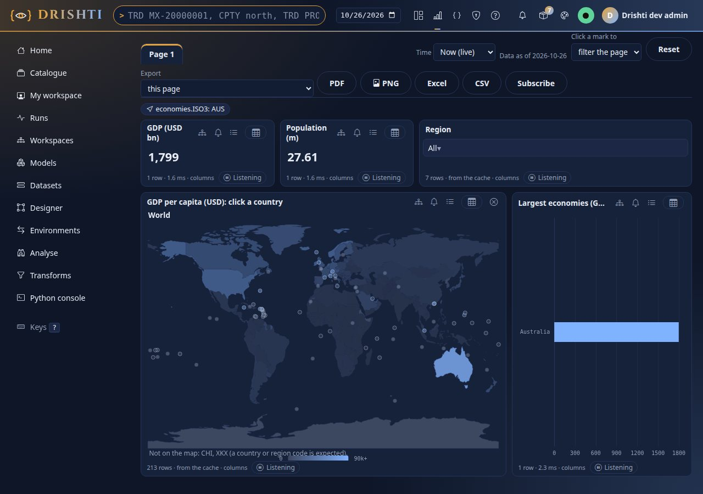

You should see the world again and the chip still in place: the breadcrumb moves the map, the chip (or **Reset**, or `Esc`) clears the filter. Click a second country with `Ctrl` held to add it to the selection.

### Step 7 · Publish

A draft in **My workspace** is private. To publish, move it to a **shared workspace** (that is where people are members and where review can be required). Choose **Workspaces** and fill in **New workspace**.

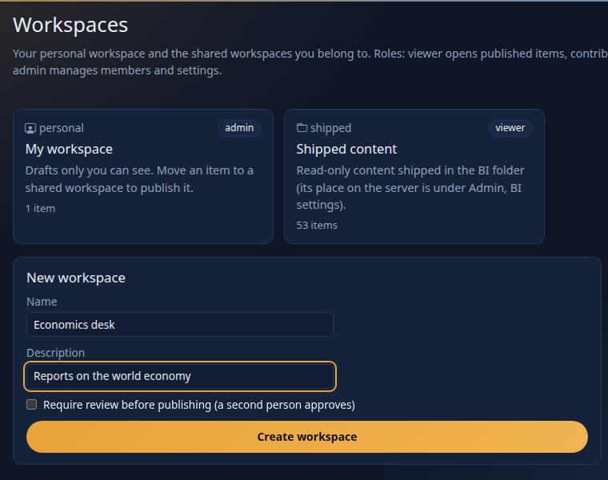

You should see the form; leave *Require review before publishing* unticked for now and press **Create workspace** (a workspace that requires review needs a second person to approve, which is [Part G](GOVERNANCE_AND_AI.md#part-g--govern-bi)). Open your report's page (**My workspace**, then the report), press **Move…**, pick `Economics desk` and press **Move**.

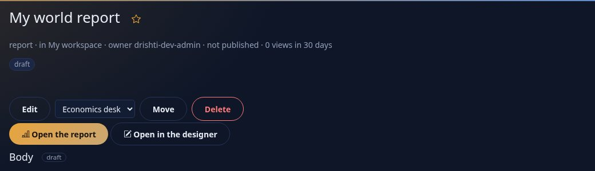

You should see the report listed under the new workspace. Type a note and press **Publish**.

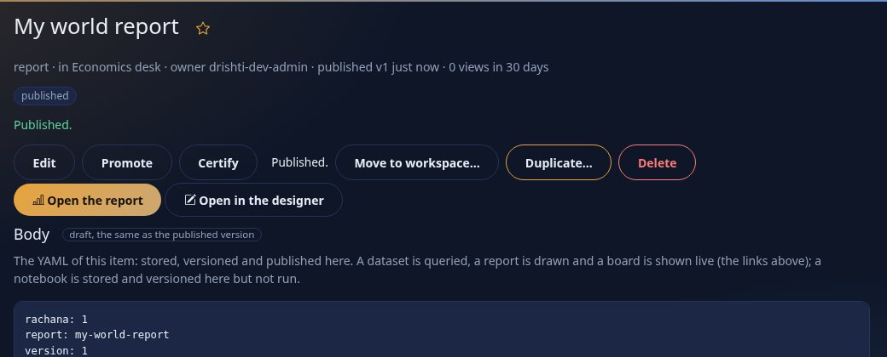

You should see `Published.` and `published v1 just now`. Each publish makes the next numbered version; the draft carries on separately. Open the **Catalogue**, the one place every published item is found, and search `world`.

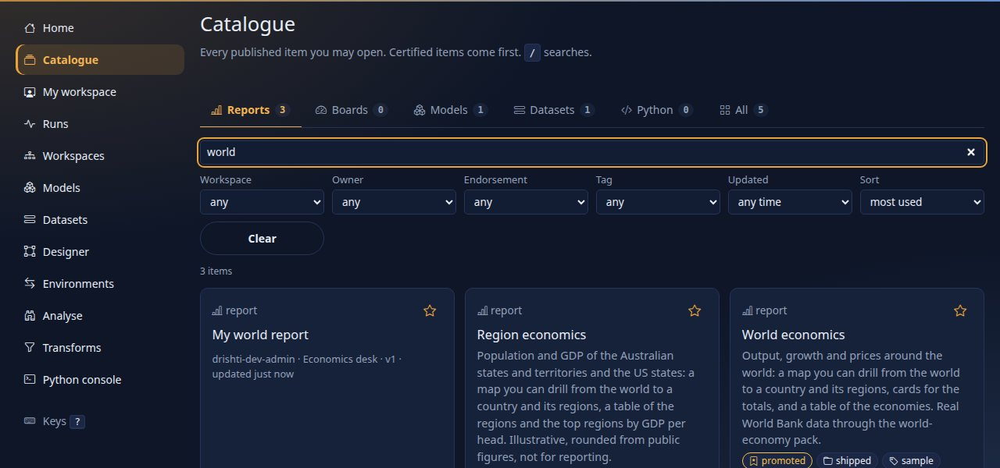

You should see your report beside the shipped one, with its workspace and owner. The same list from the command line:

```text
$ python3 tools/drishti.py bi catalogue list
id                                                 kind     endorsed  status    ver  title
file:report:cashflow-ladder                         report   promoted  published v1   Cashflow ladder  (Shipped content, shipped)
file:model:counterparty-exposure                    model    promoted  published v1   Counterparty exposure  (Shipped content, shipped)
...
bi-7f8269ba14                                       report   none      published v1   My world report  (Economics desk, drishti-dev-admin)
...
file:report:world-economics                         report   promoted  published v1   World economics  (Shipped content, shipped)
file:dataset:world-economics-economies              dataset  promoted  published v1   World economics: economies  (Shipped content, shipped)
54 item(s), showing 50
```

```text
$ python3 tools/drishti.py bi workspace list
id                            role          items  name
u-drishti-dev-admin-eb6f      admin             0  My workspace  [personal]
economics-desk                admin             1  Economics desk
shipped                       viewer           53  Shipped content
```

You should see the report with `published v1` among the 53 shipped items (ten models, their datasets, ten reports, two boards, two themes, a notebook and four Python items), and the workspace with one item. (Ids and dates differ on your machine.)

### Step 8 · Filter like Power BI

The sample **Trades overview** has a second page, **By product**, built to show slicers. Open it from the Catalogue (or type `BI trades overview <GO>`) and choose the tab **By product**.

A **slicer** is a visual that holds choices and filters other visuals. It has a mode and a scope. **In the UI** select the slicer and open **Format**: **Mode** is a choice of *list*, *dropdown*, *range* and *relative date*, and **Filters** is *this page* or *every page*. **In the YAML** the same two settings are:

```yaml
- { id: pick-product, type: slicer, title: Product type, wells: { field: [trade.PRODUCT_TYPE] }, format: { mode: dropdown, scope: page } }
```

| `format.mode` | What it looks like | Use it for |
|---|---|---|
| `list` (the default) | a checkbox list with a search box, always open | a field with a handful of values (desks, currencies) |
| `dropdown` | a closed box that opens a **floating** checkbox list with a search box, **Select all** and **Clear** | a field with many values (product types: 130 across the three source systems) |
| `range` | two boxes, *From* and *To* | a number or a date field (notional, trade date) |

| `format.scope` | A choice filters |
|---|---|
| `page` (the default) | the visuals of this page |
| `report` | every page of the report, so a choice made on one page holds on the next (the Counterparty risk sector slicer) |

All three together on one page (the YAML is [data/slicer-kinds.report.yaml](../../tutorials/data/slicer-kinds.report.yaml); paste it into **My workspace → New item** or into the designer's YAML tab to try it):

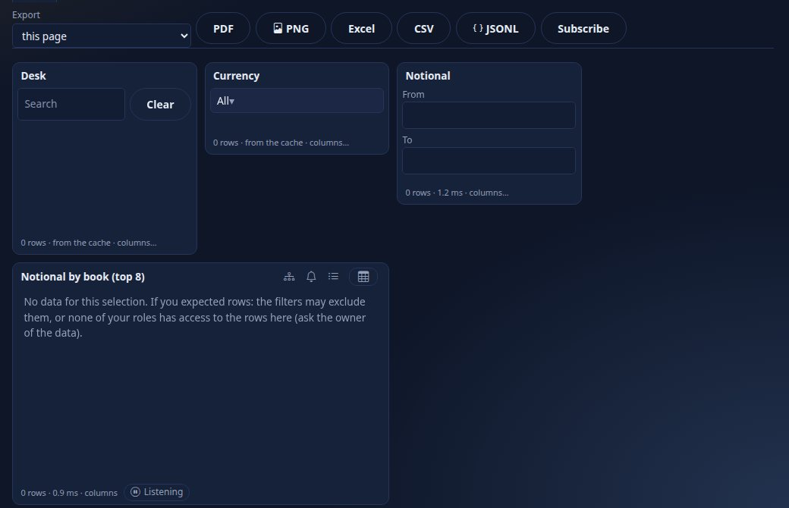

You should see the desks as an open list with its search box and **Clear**, the currency as a closed dropdown, the notional as *From* and *To* boxes, and the donut. **Open the Product type dropdown** on the Trades overview and type `SWAP` in its search box.


You should see the list **floating over** the visuals below it (it does not push the page down), narrowed to the product types that contain `SWAP`, each with a tick box. **Select all** and **Clear** tick and untick the values in one press. Tick `AMORT_SWAP` and `BASIS_SWAP`, then click outside.


You should see `2 selected: AMORT_SWAP, BASIS_SWAP` in the box, a **chip** `Product type: AMORT_SWAP, BASIS_SWAP` under the toolbar, the Desk and Currency slicers narrowed to values that still exist (a slicer never filters itself; **other** slicers filter it), a donut of two slices (72 trades each) and a matrix of one desk, `DESK-RATES`, in four currencies (CAD, EUR, GBP, USD). **Reset** clears all of it.

**From the command line** the matrix's question with the slicer's choice is a filter (`--where` once per value is an *and*; a list of values is the YAML's `in`):

```text
$ python3 tools/drishti.py bi mq --model trades-basic@1 --select trade.DESK,trade.CURRENCY --measures Trades --where trade.PRODUCT_TYPE=AMORT_SWAP
trade.DESK  trade.CURRENCY  Trades
----------  --------------  ------
DESK-RATES  CAD             12
DESK-RATES  EUR             12
DESK-RATES  GBP             24
DESK-RATES  USD             24
4 row(s)  as of 2026-10-26  plan p_841e66dd1d28602d
```

The slicer's two choices together, as a file (`python3 tools/drishti.py bi mq both-swaps.yaml`):

```yaml
mq: 1
model: trades-basic@1
select: { fields: [trade.DESK, trade.CURRENCY], measures: [Trades] }
where: [{ field: trade.PRODUCT_TYPE, op: in, values: [AMORT_SWAP, BASIS_SWAP] }]
```

```text
trade.DESK  trade.CURRENCY  Trades
----------  --------------  ------
DESK-RATES  CAD             12
DESK-RATES  EUR             36
DESK-RATES  GBP             60
DESK-RATES  USD             36
4 row(s)  as of 2026-10-26  plan p_1b9ffa4705022ec3
```

**Taming a busy donut.** The donut on this page could have about forty product types. It does not draw forty slices: it carries a **top filter**. **In the UI** that is the **Filters** pane: *On this visual*, **Add a filter**, filter type **Top N**, how many, highest or lowest, and the measure to rank by:


**In the YAML** it is one line (both write the same):

```yaml
- { id: share, type: donut, title: "Notional by product type (top 12)", wells: { axis: [trade.PRODUCT_TYPE], values: [Notional] },
    filters: [{ field: trade.PRODUCT_TYPE, op: top, n: 12, by: Notional }] }
```


You should see twelve slices and the title `(top 12)`, ENDUR's `ComSwap` the largest (`498,190,803,406` of notional), then `FRA` and `FX_BARRIER`. The server ranks the product types **in the context of the slicers**, so the top twelve of the swaps you chose is a different twelve from the top twelve overall. `n` is how many, `by` the measure to rank by.

**Bookmarks** save a state. **In the UI**, in the designer, select nothing (click the empty canvas) and open **Format**: under **Bookmarks** type a name, set the slicer choices you want kept (a relative-date slicer offers its windows), and press **Save this page as a bookmark**; it keeps the page, the filters of the Filters pane and those slicer choices. Each saved bookmark can be renamed in place, updated from the page's filters again, or removed:


**In the YAML** they are `bookmarks:` (a name, a page, slicer choices and filters). Either way they appear in the **Bookmarks** box of the viewer's toolbar. On the **Overview** page choose the bookmark `FX desk only`.


You should see the page filtered to `DESK-FX` (`1,428` trades, notional `372,842,213,118`, MTM `-681,989,222`) with a chip, as if you had made the choice yourself. **From the command line**: `python3 tools/drishti.py bi mq --model trades-basic@1 --select trade.DESK --measures Trades,Notional,MTM --where trade.DESK=DESK-FX` prints the same three numbers. **In the YAML** the bookmark is `- { name: FX desk only, page: overview, slicers: {}, filters: [{ field: trade.DESK, op: in, values: [DESK-FX] }] }` (`config/bi/reports/banking/trades-overview.report.yaml`). A bookmark is written in the designer, not captured from what a reader has chosen on screen in the viewer.

**Slicer or click?** Both filter. A **slicer** is a choice you make on purpose from a list, it stays visible, and it can be page or report wide. A **click on a mark** (a bar, a slice, a country) is exploring: it filters the **other** visuals of the page, it highlights what you picked, and it is gone when you click again.
Click the `DESK-FX` bar on the Overview page:


You should see the same figures as the bookmark gave. *Click a mark to* **highlight** (in the toolbar) keeps the whole answer on bar and column charts and draws the chosen share over it instead of filtering.

### Step 9 · Counterparty risk: slicers across packs, and drill-through

Open the shipped report **Counterparty risk**. It reads the model **Trading and counterparty risk** (`trading-risk@1`), which joins three packs (trade valuations from `market-risk`, counterparties, desks and books from `core`, netting sets and their computed exposure from `counterparty-risk`), and its two slicers, Sector and Country, are `scope: report`: they filter every page and reach the trades and the netting sets **through the relationships**.


You should see exposure cards (`2,663,018,256` EE peak, `5,217,565,098` PFE peak, `76` netting sets), the two dropdown slicers and a bar of the ten counterparties with the highest expected exposure (a **top 10** filter again), Verdant Agri Holdings first. The exposure is the exposure engine's: its official end-of-day results for the date (a netting set does not store it). EE peak adds up the netting sets' computed peaks; PFE peak is each counterparty's own peak 95% PFE (its sets netted path by path), never a sum of its sets' PFEs. The demo's run covers all 76 netting sets of the 24 counterparties, so every set carries exposure. Click the bar of **Verdant Agri Holdings**.


You should see a chip, the cards narrowed to that counterparty (`303,824,105` expected exposure, `498,606,456` PFE, `4` netting sets) and, in the bar's header, a **drill-through** button. Press it.


You should see a second page, **Counterparty**, with the name carried in as a chip **and in the address** (so the link can be shared), a **Back** button, four cards (exposure `303,824,105`, `576` trades, MTM `+647,788,759`, notional `157,685,840,489`) and a table of its trades, highest MTM first, whose ids are links: `MX-30000477` (a MUREX zero-coupon swap of DESK-RATES) opens that trade's view in the terminal.

**From the command line**, the bar and the drill-through page are two model queries:

```text
$ python3 tools/drishti.py bi mq --model trading-risk@1 --select counterparties.NAME \
    --measures "Exposure (EE peak),Exposure (PFE peak)" --sort="-Exposure (EE peak)" --limit 3
counterparties.NAME      Exposure (EE peak)  Exposure (PFE peak)
-----------------------  ------------------  -------------------
Verdant Agri Holdings    303,824,105.00      498,606,456.00
Aldershot Pension Trust  278,109,475.00      395,266,101.00
Tokai Mutual Trust Bank  226,721,872.00      382,755,529.00
3 row(s)  as of 2026-10-26
$ python3 tools/drishti.py bi mq --model trading-risk@1 --select trades.TRADE_ID,trades.DESK,trades.PRODUCT_TYPE --measures MTM \
    --where "counterparties.NAME=Verdant Agri Holdings" --sort=-MTM --limit 3
trades.TRADE_ID  trades.DESK  trades.PRODUCT_TYPE  MTM
---------------  -----------  -------------------  --------------
MX-30000477      DESK-RATES   ZC_SWAP              198,326,642.98
MX-30000098      DESK-RATES   SWAPTION_EUR         137,469,021.75
MX-30001342      DESK-RATES   OIS                  91,875,065.38
3 row(s)  as of 2026-10-26
```

**In the YAML** the drill-through is two lines of `config/bi/reports/banking/counterparty-risk.report.yaml`: the bar's `drillthrough: { page: counterparty, field: counterparties.NAME }` and the target page's `drillthrough: { fields: [counterparties.NAME] }`.

### Step 10 · On a phone

Open your report on a phone-width window (390 px).


You should see one column in reading order, the map at the full width, targets at least 44 pixels high and no sideways scroll. A report can also have a **phone layout** of its own (which visuals, in what order): [tutorial 20](../../tutorials/20-embed-drishti.md) and the designer's **Phone** tab.

### Step 11 · Two fact tables in one model

Everything so far added up **one** table. The question "what is each counterparty's one-day P&L next to its exposure?" needs two: P&L is a
column of the **trades** (one row per trade valuation) and exposure a column of the **netting sets** (one row per netting set). Adding them up in
one table would count a netting set's exposure once for every trade under it. A **model** keeps each as a **fact table** of its own: each is added
up alone at the visual's fields, and the two answers are joined on the dimension both reach, here the counterparty.

**In the UI.** Choose **Models** and open **Trading and counterparty risk** (`trading-risk`, `model 1.0.0 · published`) in the designer, on the
**Canvas** tab.


You should see the datasets under their aliases: the **facts** `trades` and `netting_sets`, and the **dimensions** `counterparties`, `desks`
and `books`, with a line for each relationship (from the many side to the one side): `trades.COUNTERPARTY → counterparties.id` and
`netting_sets.COUNTERPARTY → counterparties.id`, the two paths that meet at the counterparty. (`trades.NETTING_SET → netting_sets.id` is an
**inactive** relationship, `active: false`, so the two facts are never joined row to row.) Two more facts sit beside them, `set_exposure`
and `cpty_exposure` (scroll the canvas to see them all): the exposure engine's official end-of-day results for each netting set and each
counterparty (the datasets `counterparty-exposure-official-netting-sets` and `-counterparties`), related to `counterparties.id` the same way;
the netting-set record does not store exposure. Press the **Measures** tab.


Scroll to the list. You should see `P&L 1d` (`sum(trades.PNL_1D)`), `Exposure (EE peak)` (`sum(set_exposure.PEAK_EE)`: the netting sets'
computed peaks), `Exposure (PFE peak)` (`sum(cpty_exposure.PEAK_PFE_95)`: each counterparty's own) and `P&L per exposure`,
`measure('P&L 1d') / measure('Exposure (EE peak)')`: the ratio of the two sums, whatever the grouping. Now open the report **Desk P&L vs
counterparty exposure** from the catalogue.


You should see `Desk P&L` `90,804,863`, `Exposure (EE peak)` `2,663,018,256` and the ratio `0.03`, the ten counterparties with the most exposure
as pairs of bars, a donut of exposure by sector and the table of every counterparty. In the Sector slicer choose **Banking**.


You should see a chip `Sector: Banking`, the cards narrowed to the banks (`Desk P&L` `52,050,305`, exposure `441,334,249`), four banks in the
bar chart (Rheintal Landesbank, Tokai Mutual Trust Bank, Harbor Point Bank, and Harbourline Bank London Branch, whose exposure, `56,174`, is too small
to see as a bar) and the donut a single slice: one
slicer on the dimension filters **both** facts. Click a slice of the donut instead and the same happens. Open the report as a desk head and the P&L
shrinks to the trades of your desks (the exposure does not: the model says `may-see-all` for the netting sets and their exposure); open it as an analyst and the
names read `•••` (the bars are ranked by the counterparty's **id**, which is not masked, so the report still works).

**From the command line** the table of the report is one model query; the server says how it answered (the two facts aggregated alone, then
joined):

```text
$ python3 tools/drishti.py bi mq --model trading-risk@1 --select counterparties.NAME,counterparties.SECTOR \
    --measures "P&L 1d,Exposure (EE peak),P&L per exposure" --sort="-Exposure (EE peak)" --limit 4 --json | jq -c '.rows[], .meta.warnings'
["Verdant Agri Holdings","Agriculture",-1441625.5600000015,303824105.0,-0.004744934770728615]
["Aldershot Pension Trust","Pensions",11885402.729999984,278109475.0,0.04273641784408814]
["Tokai Mutual Trust Bank","Banking",17583780.69000001,226721872.0,0.077556613902694]
["Aurora Sovereign Wealth Fund","Government",-4988548.660000008,202918363.0,-0.024584017859438416]
["2 fact tables, each aggregated alone at the query's fields and then joined: [trades, counterparties, set_exposure]","a measure that combines measures of different grains is worked out over the joined results: P&L per exposure"]
```

**In the YAML** (`config/tables/banking/trading-risk.model.yaml`), the part that makes it work:

```yaml
datasets:
  trades:         { dataset: trading-risk-trades, role: fact }
  netting_sets:   { dataset: trading-risk-netting-sets, role: fact }
  set_exposure:   { dataset: counterparty-exposure-official-netting-sets, role: fact }    # the computed exposure
  cpty_exposure:  { dataset: counterparty-exposure-official-counterparties, role: fact }
  counterparties: { dataset: trading-risk-counterparties, role: dimension }
relationships:                  # from the MANY side to the ONE side
  - { from: trades.COUNTERPARTY, to: counterparties.id }
  - { from: trades.NETTING_SET, to: netting_sets.id, active: false }
  - { from: netting_sets.COUNTERPARTY, to: counterparties.id }
  - { from: set_exposure.COUNTERPARTY, to: counterparties.id }
  - { from: cpty_exposure.COUNTERPARTY, to: counterparties.id }
measures:
  P&L 1d:             { expr: "sum(trades.PNL_1D)", format: signed0 }
  Exposure (EE peak): { expr: "sum(set_exposure.PEAK_EE)", format: amount0 }        # a reporting sum of the sets' computed peaks
  Exposure (PFE peak): { expr: "sum(cpty_exposure.PEAK_PFE_95)", format: amount0 }  # the counterparty's own row, never a sum of its sets' PFEs
  P&L per exposure:   { expr: "measure('P&L 1d') / measure('Exposure (EE peak)')", format: signed2 }
```

and the report (`config/bi/reports/banking/pnl-vs-exposure.report.yaml`) only says `model: trading-risk@1`. When the two numbers live in **two models**
(each with its own row rules), a report can still read both side by side and link their fields: that is [Part B](MODELS_AND_DATASETS_FOR_REPORTS.md#part-b--several-datasets-in-one-report).
The same table made by a Python Transform is in [the Notebook tutorial](NOTEBOOK_AND_PYTHON.md); the reference is
[ARCHITECTURE.md §28](../../architecture/ARCHITECTURE.md#281-the-table-layer-and-models-in-rachana) and [BI_GUIDE.md › Reports: the YAML, the visuals and how they behave, section 16](REPORT_FILE_FORMAT_STATEMENTS.md#113-reports-over-several-models).

### Step 12 · Relative dates, a tablet, and a view inside a report

Three things a real report needs. Each is a few controls in the designer, and each is also a few lines of YAML (**In the UI**: build it in the designer; **in the YAML**: open **My workspace → New item**, kind *report*, paste, **Save draft**, then **View**; the two write the same text).

**A slicer that says "last 4 weeks".** A slicer on a date column can offer named windows instead of values. The server works them out from the report's date and the business-day calendar, so the same name means the same dates on the screen, in an export and in a subscription.

**In the UI:** drag the date field (`trade.TRADE_DATE`) onto the canvas, choose **slicer**, open **Format** and set **Mode** to *relative date (a date field)*. Two more controls appear: **Starts as** (the window used until a reader chooses; it is the `default`) and **Windows it offers** (a tick for each of the sixteen names; unticking one narrows the list, the `options`).


**In the YAML:**

```yaml
rachana: 2
report: relative-dates
title: Relative dates
model: trades-basic@1
pages:
  - id: main
    title: Main
    visuals:
      - { id: when, type: slicer, title: When, at: { x: 0, y: 0, w: 4, h: 3 }, wells: { field: [trade.TRADE_DATE] }, format: { mode: relative-date, default: last-90-days } }
      - { id: count, type: card, title: Trades, at: { x: 4, y: 0, w: 4, h: 3 }, wells: { values: [Trades] } }
      - { id: mtm, type: card, title: Mark to market, at: { x: 8, y: 0, w: 4, h: 3 }, wells: { values: [MTM] } }
      - { id: desk, type: bar, title: MTM by desk, at: { x: 0, y: 3, w: 12, h: 6 }, wells: { axis: [trade.DESK], values: [MTM] } }
```

**From the command line**, check it before saving (`Check`, nothing stored) and ask what the window holds: *last 3 months* runs from the day after the same date
three months earlier to the report's date, 2026-07-27 to 2026-10-26 here, of `TRADE_DATE`:

```text
$ jq -Rs '{yaml: .}' relative-dates.report.yaml | curl -s -X POST -H "Authorization: Bearer $DRISHTI_TOKEN" \
    -H 'Content-Type: application/json' -d @- $DRISHTI_SERVER/api/v1/bi/reports/validate | jq -c '{valid, problems}'
{"valid":true,"problems":[]}
$ python3 tools/drishti.py bi mq relative-window.yaml
Trades  MTM
------  ----------------
2619    1,125,679,037.48
1 row(s)  as of 2026-10-26  plan p_eaea0217f95f331d
```

```yaml
# relative-window.yaml: the window the slicer works out, as an explicit filter
mq: 1
model: trades-basic@1
select: { measures: [Trades, MTM] }
where: [{ field: trade.TRADE_DATE, op: between, values: [2026-07-27, 2026-10-26] }]
```


You should see the slicer's dropdown (the report's `default: last-90-days` is chosen until you pick another) and, after choosing **Last 3 months**, a chip `When: Last 3 months` and cards narrowed to the `2,619` trades booked in the three months ending on the report's date (MTM `+1,125,679,037`; the whole book is `15,000` trades). Your count depends on the day you built the lake: the trade dates stay (the newest is 2026-09-25), the business dates move, so a short window such as *Last 4 weeks* can hold no trades at all. The names are `last-N-days`, `last-N-business-days`, `last-N-weeks`, `last-N-months`, `this-week|month|quarter|year` (to date), `previous-...` and `all`: [BI_GUIDE.md › Reports: the YAML, the visuals and how they behave, section 6.1](REPORT_FILE_FORMAT_STATEMENTS.md#19-slicers).

**A tablet layout.** A phone gets one column ([step 10](#step-10--on-a-phone)); a tablet (up to 1024 px) can get two, with some visuals across:

```yaml
layouts:
  tablet:
    main:
      order: [desk, count, mtm]                     # first, in this order (the visuals' ids)
      wide: [desk]                                  # the whole width; the others take half
      span: { desk: 5 }                             # heights in grid rows
```

**In the UI** open the draft in the designer and press the **Tablet** tab (the **Phone** tab is the same for a phone). Every key above has a control there: the arrows or a drag set the `order`, **Hide** hides a visual, **Wide** is `wide` (tablet only) and **Rows** is `span`:


You should see the visuals in tablet order with **Hide**, **Wide** and **Rows**, and a preview below. Then open the report on an 820 px screen:


You should see the bar the whole width, then the cards in two columns. A phone, or a desktop, is not affected. **From the command line** there is no layout command: the layout is part of the report's YAML, so `python3 tools/drishti.py bi item new me relative-dates.report.yaml` saves the whole report, `layouts:` included, as a draft in your own workspace (`me`), and `bi item save <id> FILE` saves a changed file over it.

**A counterparty's own view inside the report.** The sample **Counterparty risk** has a page *Counterparty lookup*: a bar of the ten largest counterparties and, beside it, a visual of `type: entity-view` with `wells: { key: [counterparties.id] }`. Open it and click a bar:


You should see the counterparty's own **Drishti view** (its name, rating, net MTM and netting sets) in the frame beside the bar, with a chip `counterparties.id: CP-VERDANT` (the first bar: the largest computed expected exposure). It is the view page built **for you**: someone who may not see a field does not see it here either. [BI_GUIDE.md › Reports: the YAML, the visuals and how they behave, section 3.4](REPORT_FILE_FORMAT_STATEMENTS.md#15-the-entity-view).

### Step 13 · A dataset and a model of your own, in the wizard

Everything so far read models that ship with Drishti. A business user can make a dataset and a model without typing YAML. This step makes
**Large economies** (the economies with a GDP of 100 billion dollars or more, with a GDP per head worked out), publishes it, and makes a model of it.

**In the UI.** Choose **Models**, then **New dataset**. The wizard has eight steps along the top; you can go back at any time, and each step shows the
server's check of what you chose.

**1 · Source.** Where the table comes from: **a pack dataset** (keep some of its columns and rows, add columns, group it), an SQL view over a model, a
query in a SQL connector, a Python Transform, or the answer of a model. Choose **A pack dataset** and `pack.world-economy.economy` (every kind of every pack
is a dataset already, certified and read-only; this one narrows it).


**2 · Columns.** Tick the columns to keep: press **Only the keys**, then tick `NAME`, `ISO3`, `REGION_NAME`, `INCOME_NAME`, `GDP_USD_BN` and `POPULATION_M`
(each shows its type and role; the key `id` always stays, a row must still say what it is).


**3 · Rows.** *Keep the rows where* `GDP_USD_BN >= 100` (a filter of the table in DEL, not a security rule: row rules are set on the model). **4 · One row
is**: the pack's grain stays, one row per economy per business date. **5 · Worked-out columns.** Press **A formula column**, name it `GDP_PER_HEAD`, type
`decimal`, formula `GDP_USD_BN / POPULATION_M * 1000`: the server checks it as you type.


**6 · Group** (optional) makes a coarser grain; leave it. **7 · Preview**: press **Preview**, then **Save the draft and preview** when it asks (the server previews a saved
draft, visible only to you; Save later updates the same draft): it answers the first rows, as you.


You should see 76 economies in all (GDP of 100 billion dollars or more), Australia with `GDP_USD_BN` `1,798.52` and `GDP_PER_HEAD` `65,129.79`.

**8 · Save.** Title `Large economies` (the name, what models use, follows: `large-economies`), the **workspace** (a shared one, here *Models desk*: a
private draft cannot be published), the columns to mask, and the YAML the wizard wrote, for review.


Press **Save and publish**. **You should see** the next steps under the buttons: **Open the dataset**, **Start a report on it** (a report on its implicit model,
`dataset:large-economies`) and **Use it in a new model**. Press **Use it in a new model**, choose *Models desk* and **Make the model**: the model
designer opens on **Large economies model**, the dataset placed as a fact under the alias `large_economies`, with the default measures of its columns
(`Count of large_economies`, `Sum of GDP_USD_BN`, `Sum of POPULATION_M`).


From here it is the model designer of the preview section below: add measures, relationships and row rules, **Save**, **Publish**, then **New report
on this model**. To change the dataset later, open it (Models → *Your datasets* → **Open**) and choose **Narrow it** or edit its YAML; publishing a
change needs a new version (`1.0.1` for words, `1.1.0` for an added column, `2.0.0` for a column taken away; `DRS-9126` says which).

**In YAML.** What the wizard wrote for the dataset (the server added `id` on save) and for the model:

```yaml
rachana: 2
expressions: 2
dataset: large-economies
version: 1.0.0
id: ds_482151d0
title: Large economies
extends: pack.world-economy.economy@^1
columns: [NAME, ISO3, REGION_NAME, INCOME_NAME, GDP_USD_BN, POPULATION_M]
where: GDP_USD_BN >= 100
grain:
  says: One row per economy per business date
  keys: [id]
derive:
  GDP_PER_HEAD: {expr: GDP_USD_BN / POPULATION_M * 1000, type: decimal}
```

```yaml
rachana: 2
expressions: 2
model: large-economies-model
version: 1.0.0
id: md_52756ba0
title: Large economies model
datasets:
  large_economies: {dataset: large-economies@^1, role: fact}
relationships: []
measures: {}          # the defaults of the columns: Count of large_economies, Sum of GDP_USD_BN, Sum of POPULATION_M
```

**From the command line.** The same two files make the same items (a write needs a token with the `bi:write` scope and the `bi-author` power; the
ids differ on your machine). The shared workspace is made once on the **Workspaces** page, or over REST (there is no `bi workspace new`):

```text
$ curl -s -X POST -H "Authorization: Bearer $DRISHTI_TOKEN" -H 'Content-Type: application/json' \
    -d '{"name": "Models desk", "id": "models-desk"}' $DRISHTI_SERVER/api/v1/bi/workspaces | jq -c '{id, name, role}'
{"id":"models-desk","name":"Models desk","role":"admin"}
```

```text
$ python3 tools/drishti.py bi model check large-economies.dataset.yaml          # the server's Check, nothing stored
valid  (dataset large-economies)
$ python3 tools/drishti.py bi item new models-desk large-economies.dataset.yaml
bi-23cecf80ac  dataset  Large economies  draft in Models desk
$ python3 tools/drishti.py bi catalogue publish bi-23cecf80ac
published Large economies as version 1
$ python3 tools/drishti.py bi item new models-desk large-economies-model.model.yaml
bi-f7cc3473c2  model  Large economies model  draft in Models desk
$ python3 tools/drishti.py bi model describe large-economies-model@1
Large economies model  (large-economies-model@1)

large_economies  fact  large-economies 1.0.0
  large_economies.GDP_USD_BN         decimal   amount
  large_economies.INCOME_NAME        string    dimension
  large_economies.ISO3               string    dimension
  large_economies.NAME               string    dimension
  large_economies.POPULATION_M       decimal   amount
  large_economies.REGION_NAME        string    dimension
  large_economies.GDP_PER_HEAD       decimal   amount

measures
  Count of large_economies          count(large_economies)  (default)
  Sum of GDP_USD_BN                 sum(large_economies.GDP_USD_BN)  (default)
  Sum of POPULATION_M               sum(large_economies.POPULATION_M)  (default)
$ python3 tools/drishti.py bi mq --model large-economies-model@1 --select large_economies.REGION_NAME \
    --measures "Count of large_economies" --sort="-Count of large_economies" --limit 3
large_economies.REGION_NAME                        Count of large_economies
-------------------------------------------------  ------------------------
Europe & Central Asia                              29
Middle East, North Africa, Afghanistan & Pakistan  12
Latin America & Caribbean                          12
3 row(s)  as of 2026-10-26  plan p_1a5faeead616790e
```

A draft model answers its owner (and is listed as `draft` by `bi model list`); a report on it is published once the model is. The reference for the
wizard's every step is [BI_GUIDE.md section 23](MODELS_AND_DATASETS_FOR_REPORTS.md#1-models-and-datasets-what-a-report-reads) and
[BI_GUIDE.md](MODELS_AND_DATASETS_FOR_REPORTS.md#1-models-and-datasets-what-a-report-reads); the version 1 guided tables builder (*Use the guided tables builder* under the wizard's first step) still makes
`rachana: 1` datasets, which the upgrade converts to models ([tutorial 21](../../tutorials/21-run-it-in-production.md)).

#### Notes: saving safely, and more than one dataset

- **UI.** *New report* on the designer's start page asks for a **Main dataset** and an optional **Also add** (Ctrl or Shift for several): the designer opens with all of them in the **Fields** pane. A dataset you cannot use yet is greyed with the reason (for example *draft in a private workspace: publish it first*). **+ Add visual** makes an empty visual; the **Publish** button (Propose where review is required) saves first. Open the same draft in two tabs and save in both: the second is refused with **Reload theirs / Save mine as a copy / Overwrite with mine**.
- **CLI.** `drishti.py bi catalogue get <id>` shows the item with its `etag`; a propose, approve or publish of a report that cannot be drawn is refused with `DRS-9030` and the errors (a bi-admin may force it).
- **YAML.** Nothing new to write: the extra datasets are named in each visual's `dataset:` and the report's `links:` (BI_GUIDE.md › Reports: the YAML, the visuals and how they behave, section 16); `?also=a,b` on the designer URL opens extra datasets in the Fields pane.

### Step 14 · Models: from a pack dataset to a report

The **model layer** ([BI_GUIDE.md section 23](MODELS_AND_DATASETS_FOR_REPORTS.md#1-models-and-datasets-what-a-report-reads)): every
kind of every pack is a dataset already, and a model is a few of them joined. This step goes from the pack's **Trade valuation** (one row per trade
per business date, with its desk, MTM and P&L, in the `market-risk` pack) to a model of trades and desks with a row rule, published, analysed and
watched. The numbers are from the demo lake (15,000 trade valuations over ten desks).

**In the UI.**

1. **BI → Models** in the rail. Under *Datasets from the packs* every kind is already a dataset: find **Trade valuation**
   (`pack.market-risk.trade-valuation`, certified, read-only). Its title opens its page: *One row per trade valuation per business date*, key `id`,
   time *snapshot*, and `DESK` marked `desk →` (it holds desk ids; `COUNTERPARTY`, `PORTFOLIO`, `NETTING_SET` and `TRADER_ID` likewise).
2. Press **Use** on the card and choose your workspace: a report opens in the designer on the **implicit model of Trade valuation**. Fields lists
   `trade_valuation` and, brought along by the pack reference, `desk`; drag **Sum of MTM** onto the canvas, then **desk → NAME** onto the card: a bar of
   MTM by desk name, with nothing modelled by hand. *Query of the selected visual* shows the model query it asked.
3. Back on **Models**, press **New model**, title it *Trades and desks*, tick **Trade valuation** and **Desk**, **Create and open the designer**. Desk is
   placed as a **dimension** (Trade valuation references it). Under the canvas, *Suggested relationships* offers `trade.DESK → desk.id` (*trade.DESK holds
   desk ids (from the pack)*): press **Add**. (The designer names the alias after the dataset; rename it `trade` in the **Fields** tab to match the YAML
   below.)
4. **Measures**: dataset `trade`, column `MTM`, **Add measure**: `Sum of MTM`, `sum(trade.MTM)`, adds up: yes.
5. **Security**: on `trade`, roles `desk-head`, *the column matches the reader*, column `DESK`, *the reader's desks*, **Add the rule**. The tab shows ⚠ 1:
   *The role desk-head is restricted elsewhere in this model, but desk has no rule*, and the header badge agrees (*Valid, 1 to fix before publishing*).
   Press **desk-head may see every row of desk** (desks are not secret); the ⚠ goes. Add a second rule so you see every trade yourself: under **Roles**
   tick your own role (`admin` for the development administrator; the list holds the roles the server knows, any other can be typed under it), *every
   row*. The note under the list says *roles without a rule see no rows*: a reader no rule matches reads nothing of that dataset.
6. **Save** (the badge says *Valid*), then **New report on this model**: the Fields pane's header says *Model Trades and desks*, *this report
   references the model*. A model is shared: **Used by** (above the tabs) lists the reports, boards, alerts, subscriptions and notebooks that read it, and
   **New board on this model** starts a board on it. Deleting a report never deletes its model, and a model that is used cannot be deleted.
7. **Publish.** In your private workspace Publish says to move it to a shared workspace first, with **Move…** beside it: choose a shared workspace (*Models
   desk* of step 13) and Move, then **Publish** (it checks the model and its security safeguard first). A report on the published model publishes the same
   way from its item page.
8. **Open it in the Notebook.** Open the **Notebook** (`/bi/notebook`): the *Model or dataset* picker lists *Models*, *Your datasets* and one group per pack. Choose
   **Trades and desks (model 1.0.0, published)**, tick `trade.DESK`, `trade.MTM` and `desk.NAME`, **Open the extract**: the rows you may see, as one model
   query.
9. **Alert on it.** **Alerts → New**, *Watch: measure of a model*: choose the model, then the measure `Sum of MTM`, a filter (`trade.DESK is one of
   DESK-FX`), *Tell me when* it is above a limit, **Check now** (it reads your own number; a masked one cannot be saved) and **Save alert**.

You should see, in step 2, the bar of MTM by desk name led by `Rates · Swaps and options` (`4,484,481,851.44` over 1,832 valuations), then
`Money markets` and `Structured products`: the same three rows the command line below prints.

**From the command line.** The same through the CLI and the REST API, with your token. The pack datasets (79 of them for the seven packs), then a
question to the implicit model of Trade valuation:

```text
$ curl -s -H "Authorization: Bearer $DRISHTI_TOKEN" $DRISHTI_SERVER/api/v1/bi/pack-datasets | jq -c '.datasets | length, .[0]'
79
{"name":"pack.core.book","id":"ds_pack_core_book","title":"Book","description":"Book: one row per book per business date, from the Core pack.","pack":"core","kind":"book","version":"1.0.0","mode":"snapshot","endorsement":"certified","columns":10,"query":"dataset:pack.core.book"}
$ python3 tools/drishti.py bi mq --model dataset:pack.market-risk.trade-valuation --select desk.NAME \
    --measures "Sum of MTM,Count of trade_valuation" --sort="-Sum of MTM" --limit 3
desk.NAME                  Sum of MTM        Count of trade_valuation
-------------------------  ----------------  ------------------------
Rates · Swaps and options  4,484,481,851.44  1832
Money markets              401,503,094.06    480
Structured products        394,244,806.24    330
3 row(s)  as of 2026-10-26  plan p_b9a516b4619eb2dc
```

Check of the model's YAML without storing it: `python3 tools/drishti.py bi model check trades-and-desks.model.yaml`, or
`POST /api/v1/bi/models/validate` with `{"yaml": "..."}`. Before step 5's **may see every row**, it answers `"valid": true` with the warning
`DRS-9130` and `"exposures": [{"dataset": "desk", "role": "desk-head"}]`, which a publish refuses; after it, only `DRS-9131` remains (the roles
`approver`, `author` and `viewer` have no rule and see no trades: on purpose here).

**In the YAML.** What the designer wrote in steps 3 to 5 (you typed none of it; the server added `id` on save):

```yaml
rachana: 2
expressions: 2
model: trades-and-desks
version: 1.0.0
id: md_...
title: Trades and desks
datasets:
  trade: {dataset: pack.market-risk.trade-valuation@^1, role: fact}
  desk: {dataset: pack.core.desk@^1, role: dimension}
relationships:
  - {from: trade.DESK, to: desk.id, suggested: {from: pack-reference}}
measures:
  Sum of MTM: {expr: sum(trade.MTM)}
security:
  rows:
    trade:
      - {role: desk-head, where: trade.DESK in user.desks}
      - {role: admin, where: 'True'}
  may-see-all:
    desk: [desk-head]
```

and the report of step 6 says `model: trades-and-desks@1`. It publishes like any report once its model is published and passes its safeguard
([BI_GUIDE.md › Reports: the YAML, the visuals and how they behave, section 18](#73-a-report-on-a-model-fields-own-measures-mq-or-sql)).

**Steps 7 to 9 from the command line.** Make the item, publish it and ask it (through the console the same calls are `/bi/api/items/<id>/publish`
and **`/bi/api/mq`**):

```text
$ python3 tools/drishti.py bi item new models-desk trades-and-desks.model.yaml
bi-6b99de51c7  model  Trades and desks  draft in Models desk
$ python3 tools/drishti.py bi catalogue publish bi-6b99de51c7
published Trades and desks as version 1
$ python3 tools/drishti.py bi mq --model trades-and-desks@1 --select desk.NAME --measures "Sum of MTM" --sort="-Sum of MTM" --limit 3
desk.NAME                  Sum of MTM
-------------------------  ----------------
Rates · Swaps and options  4,484,481,851.44
Money markets              401,503,094.06
Structured products        394,244,806.24
3 row(s)  as of 2026-10-26  plan p_bd58306ba8d6bb50
warning: connector 'reference-store' cannot scan desk as columns for table desk: reading documents one by one (slow for a large table; promote the columns in the connector's layout, or fewer columns)
```

The alert is made in the console only (`/alerts/rules` is never open to a personal API token); what **Alerts → New** writes, as
`PUT /api/v1/alerts/rules/<name>` with title, severity, trigger and delivery around it:

```yaml
source:
  type: model
  model: trades-and-desks@1
  query: {select: {fields: [], measures: ["Sum of MTM"]}, where: [{field: trade.DESK, op: in, values: [DESK-FX]}]}
  reduce: first
condition: {type: threshold, op: above, value: 1000000}
```

`Sum of MTM` for `DESK-FX` is `-681,989,222` today, so this alert stays quiet; [Part D](DISTRIBUTION_AND_ALERTS.md#part-d--bi-that-runs-itself) makes one that fires.

### Next steps

- [BI_GUIDE.md](README.md) for every page of the BI area, [BI_GUIDE.md](REPORT_FILE_FORMAT_STATEMENTS.md#1-the-report-file-pages-visuals-filters-and-slicers) for every visual and its wells (sections 3 and 6 are the map and the slicers), [BI_GUIDE.md](MODELS_AND_DATASETS_FOR_REPORTS.md#1-models-and-datasets-what-a-report-reads) for writing a dataset, and [BI_GUIDE.md › Datasets: the YAML, the expression language and the security rules, section 17](MODELS_AND_DATASETS_FOR_REPORTS.md#19-worked-examples-the-shipped-models-row-rules-and-masks) for
  a stack with four people, row rules and masks at work, and the Model view.
- [BI_GUIDE.md sections 23 and 24](MODELS_AND_DATASETS_FOR_REPORTS.md#14-measures-the-expression-language) for models and the model designer, [RACHANA_REFERENCE.md › Rachana-EL expressions](../../guides/RACHANA_REFERENCE.md#rachana-el-expressions) for measures (fifty-odd recipes), [API_REFERENCE.md › Drishti SQL](../../guides/API_REFERENCE.md#8-drishti-sql-apiv1bisql) for Drishti SQL, [BI_GUIDE.md › Python in BI: measures, visuals and data prep written in Python, section 13](NOTEBOOK_AND_PYTHON.md#4-transforms-a-table-in-a-table-out) for Transforms, [USER_GUIDE.md](../../guides/USER_GUIDE.md#the-notebook) for extracts and promotion.
- [BI_GUIDE.md › Reports: the YAML, the visuals and how they behave, section 24](REPORT_FILE_FORMAT_STATEMENTS.md#4-statements-paginated-reports-page-exact-one-per-reader): every key of a statement and how the layout decides where a page breaks.
- [BI_GUIDE.md](DISTRIBUTION_AND_ALERTS.md#1-distribution-the-reports-page-export-and-subscriptions): schedules, recipients and retries of a subscription.
- [BI_GUIDE.md › Reports: the YAML, the visuals and how they behave, section 21](REPORT_FILE_FORMAT_STATEMENTS.md#3-field-parameters): field parameters in every kind of well.
- [BI_GUIDE.md](DISTRIBUTION_AND_ALERTS.md#1-distribution-the-reports-page-export-and-subscriptions): every schedule word, retries, alerts on models and fields, chat bridges, board notifications.
- [CLI_REFERENCE.md](../../guides/CLI_REFERENCE.md): `bi item`, `bi dataset refresh` and `bi mq` with every option.
- [BI_GUIDE.md](DISTRIBUTION_AND_ALERTS.md#1-distribution-the-reports-page-export-and-subscriptions): export formats (PDF, PNG, Excel, CSV), subscriptions in depth, alerts on numbers, boards, embedding a report in another web application.
- [USER_GUIDE.md › Scheduled reports](DISTRIBUTION_AND_ALERTS.md#11-the-reports-page-and-scheduled-searches) is the reference for the CSV reports.
- Tutorial 1, Part C made the search; tutorial 12 told Drishti when the data lands, which is what `after-load` waits for.
- [BI_GUIDE.md › Reports: the YAML, the visuals and how they behave, section 23](LIVE_REPORTS_AND_BOARDS.md#2-boards-report-pages-of-live-tiles): every tile option, alerts on tiles and notifications, the API. [BI_GUIDE.md › Datasets: the YAML, the expression language and the security rules, section 7.1](MODELS_AND_DATASETS_FOR_REPORTS.md#17-live-tables) is the live-table reference.
- [DEMO_CONNECTOR.md](../../../docs/connectors/types/demo/README.md) and [../guides/DATA_GUIDE.md section 11](../../guides/DATA_GUIDE.md#11-the-demo-data) say exactly what ticks and how.
- [The Notebook tutorial](NOTEBOOK_AND_PYTHON.md): Python in a measure, a visual and a notebook.
- [BI_GUIDE.md](GOVERNANCE_AND_AI.md#2-publishing-and-governance-versions-review-certification-lineage-impact-environments): every rule, setting (`drishti.governance.four-eyes`, `drishti.bi.governance.refuse-breaking`) and error code of this tutorial.
- [BI_GUIDE.md section 23](MODELS_AND_DATASETS_FOR_REPORTS.md#1-models-and-datasets-what-a-report-reads): models, their contract and their versions.
- [ADMIN_GUIDE.md](../../guides/ADMIN_GUIDE.md): roles and users in depth; tutorial 21 summarises them.

### If something goes wrong

| You see | Meaning |
|---|---|
| a visual says `DRS-9031` | a field, measure or page named in the YAML is not in the dataset; the message lists the real names |
| `DRS-9030` on the Check button | a visual's `at` is off the 12-column grid (`x + w` is at most 12) |
| `Not on the map: XXX` | the location field holds a code the shapes do not know; it is named, not dropped |
| `No figures at region level for ...` | the rows name countries, not their regions: add a field of ISO 3166-2 codes |
| Publish is not offered | the report is in **My workspace**: move it to a shared workspace first |
| a visual says `DRS-9020` | a slicer or a selection cannot reach that visual through the dataset's relationships |
| a number is `•••` | the dataset masks it for your role; the report is working as it should |
| `DRS-9196` on a dataset made of others (`from:` or `derived:`) | a composed or derived dataset, which BI does not read: write it as a model ([BI_GUIDE.md › Datasets: the YAML, the expression language and the security rules, section 11](MODELS_AND_DATASETS_FOR_REPORTS.md#13-relationships-and-how-a-question-joins)) |
| `DRS-9021` "the join key ... is masked for you" | a source masks the column the join is made on; join on an unmasked key such as an id |
| a slicer does not filter a visual of another dataset | no `link` in the report says the two fields are the same ([BI_GUIDE.md › Reports: the YAML, the visuals and how they behave, section 16](REPORT_FILE_FORMAT_STATEMENTS.md#113-reports-over-several-models)) |
| a dataset with amounts guessed a *dimension* | another dataset references it: change its role to *fact* with the select on its box (step 16) |
| *Add as inactive* on a suggestion | it joins two facts directly; relate both to a dimension they share instead, and dismiss it |
| `DRS-9156` for a field and a measure | the field's dataset is not reached many-to-one from the measure's fact (a netting set has no desk): group by a field both facts reach, or ask the measure alone |
| a total several times what the source says | rows were joined, not sums (step 18): put the measures in one model, or aggregate each side to the key first |
| `DRS-9130` when publishing | the safeguard: a role restricted on one dataset is open on another; add a rule or press *may see every row* (step 16) |
| `DRS-9151` for a reader | they may not read the model: give the model an **Audience** (its item page), or share the report only |
| `DRS-9070` "no Python item" on a Python dataset | name the Transform by its catalogue id or its title, and publish it first |
| `DRS-9071` from a Transform | the code failed on the frames it got (a column named differently, for example); the message is Python's |
| *Checks clean as far as the saved draft goes* in the formula editor | the formula uses measures you made since the last save: wait for *Draft saved at …* (the autosave, two seconds after a change) or press Save, and the check is complete |
| *Saved elsewhere since you opened it* with a table of parts | someone saved the model while you edited it: the autosave stopped; keep theirs or yours for each part and press **Merge and save** |
| `no SMTP host: set spring.mail.host` | the server has no mail settings; set them as in step 32 and restart **the server** |
| `DRS-9061` on Subscribe | an email address was typed in To; use user names and `role:NAME` |
| `skipped · no email address on file` | the recipient's account has no email; add it in Admin, Users |
| `skipped` for a recipient who may not open the report | give them the role the report's audience asks for; the history names the reason |
| Refresh stays `waiting for the scheduler` | its time has not come, or the scheduler is off on this server (`drishti.bi.refresh.enabled`) |
| **Set a schedule** is not offered | the dataset already has a schedule, or you may not edit its draft (a shipped dataset is read-only) |
| the alert says `masked for you` | the number is masked for your role; an alert never judges what you may not see |
| a test finds `0` as a role | the model's row rules give that role no rows; add a rule for it (Security tab) or leave it out on purpose |
| `DRS-9043` on Publish | a test of the item fails; the message names it, the figure expected and the figure found |
| `DRS-9060` on an export | over an export limit; the message names the setting |
| the schedule is refused | the words are not understood: the page lists the forms; the server preview call above shows what it understood |
| a report says `0 rows` | the search matches nothing for that business day |
| a subscription is skipped | the recipient may not open the view, or has no email address on file; the history says which |
| `retrying` | the mail server is not set up or not reachable; set `spring.mail.host` and check Admin → Collaboration |
| no file appears | the report's *Deliver to* is a webhook, or the run failed: see its last-run line |
| the indicator says `Disconnected` | the page lost its stream (the console or the network stopped); it keeps what it has and recovers by itself |
| `Paused` and nothing moves | you paused it (or the browser tab was hidden); press **Resume** |
| the last-hour line is empty or has one point | the dataset samples only while it is open; keep a report open for a minute |
| a tile stays red after the number looks normal | the tile has a hysteresis: it drops a level only when the number is back inside by that much |
| the live table says `state: error` | its connector is down: see Admin → Connectors; the table recovers when the connector does |
| the wall shows `•••` | the screen's user has a role that masks the field |
| an amber tile you did not expect | the tile's `alert` in the board file; the footer names the condition's word (`warning` or `critical`) |
| no ticks at all | the demo source is switched off (`drishti.sources.plugins.demo`), or a real source pushes nothing |
| `DRS-9002` | the person lacks the power the step needs (`bi-author` to publish or propose, `bi-steward` to approve or certify, `bi-admin` to force) |
| `DRS-9005` | four-eyes: the person who proposed tried to approve or reject; they may only withdraw |
| `DRS-9126` | a breaking change (a column removed or retyped, something consumers use taken away) needs the next major version; change the reports first, or keep what they read |
| `DRS-9131` (a warning on Check) | roles without a row rule see no rows of that dataset in the model; add a rule, or leave them out on purpose |
| `DRS-9040` | (a version 1 dataset) the change would break published reports: fix the reports, keep the old names, **publish and update the reports** when the impact shows every lost name as a rename, or ask a `bi-admin` to force it |
| the roll back says `DRS-9004` | an item was edited or published after the import: nothing was changed; a `bi-admin` may force it, losing that work |
| Propose for review is not offered | the workspace does not require review: publish directly; or you are not a member of it |
| no email about a review | the **inbox** (the bell) is always told; email needs the mail settings of [Part D](DISTRIBUTION_AND_ALERTS.md#part-d--bi-that-runs-itself) |
| the dry run says `conflict` | the item exists on the target and differs: tick *Overwrite* or rename it; read the reason first |
| the steward cannot certify an item | a steward must be in the item's audience or workspace; add the steward or the role to the audience |
