<!--
  Project Drishti · Any data. Any domain. One grammar.

  Copyright (c) 2026 Ashutosh Sinha <ajsinha@gmail.com>.
  All rights reserved.

  PROPRIETARY AND CONFIDENTIAL.

  This file is the confidential and proprietary property of Ashutosh Sinha.
  Unauthorised copying, use, modification, distribution or disclosure of this
  file, via any medium, is strictly prohibited except with the express prior
  written permission of the copyright holder.

  See the LICENSE file in the root of this repository for the full terms.
-->
# The report file, formatting and statements


> Commands: Linux and macOS `python3 tools/drishti.py X`; Windows `py -3.13 tools\drishti.py X` (same arguments).

<!-- nav:begin -->
Business intelligence: [Index](README.md) · [Pivot](PIVOT.md) · [Pivot at scale and the risk cubes](PIVOT_SCALE_AND_CUBES.md) · [Tables and models](TABLES_AND_MODELS.md) · [Reports and the designer](REPORTS.md) · **The report file, formatting and statements** · [Models and datasets for reports](TABLES_AND_MODELS.md#models-and-datasets-for-reports) · [Live reports, boards and background runs](LIVE_REPORTS_AND_BOARDS.md) · [Distribution, subscriptions and alerts](DISTRIBUTION_AND_ALERTS.md) · [Governing BI and AI in BI](GOVERNANCE_AND_AI.md) · [The Notebook and Python](NOTEBOOK_AND_PYTHON.md) · [Groupings and analytics](GROUPINGS_AND_ANALYTICS.md)
<!-- nav:end -->

The report YAML (pages, visuals, filters, slicers, interactions), the Format pane, conditional formatting and themes, field parameters, and statements: paginated reports, page-exact, one per reader; with the tutorial.

## Contents

- [Guide](#guide)
  - [1. The report file: pages, visuals, filters and slicers](#1-the-report-file-pages-visuals-filters-and-slicers)
  - [2. Format, conditional formatting and themes](#2-format-conditional-formatting-and-themes)
  - [3. Field parameters](#3-field-parameters)
  - [4. Statements: paginated reports, page-exact, one per reader](#4-statements-paginated-reports-page-exact-one-per-reader)
- [Tutorial: Statements and field parameters](#tutorial-statements-and-field-parameters)
  - [Part C · Statements and field parameters](#part-c--statements-and-field-parameters)

## Guide

The file and the look of a report, and the paginated statement. The designer that writes the file is on [Reports and the designer](REPORTS.md).

### 1. The report file: pages, visuals, filters and slicers

#### 1.1 Where a report lives

* **A file** in the BI folder, `config/bi/reports/<id>.report.yaml`: a published, read-only item of *Shipped content* (id
  `file:report:<id>`), watched live (section 4.6).
* **An item** of a workspace: a `report` item whose YAML body is a draft you edit in the designer, then publish like any item. Publishing checks
  it and refuses a report with errors (`DRS-9030`).

#### 1.2 The file

```yaml
report: trades-overview        # the report's name: letters, digits, hyphen, underscore, dot
version: 1
title: Trades overview
description: The day's trades at a glance.
sample: true
model: trades-basic@1          # the model it reads, at a major version; or table:<name> (an implicit model)
theme: corporate               # a theme item (section 10.3), or { palette: default | colour-blind | mono }
dates: { from: 2026-10-01, to: 2026-10-08 }   # optional; without it each question reads the latest business date (section 7)
filters: []                    # report filters (section 9.8)
pages:
  - id: overview
    title: Overview
    filters: []                # page filters
    visuals:
      - id: mtm
        type: card
        title: Mark to market
        at: { x: 6, y: 0, w: 3, h: 2 }          # column, row, width in columns, height in rows
        wells: { values: [MTM] }
        format: { rules: [{ type: rule, apply: MTM, op: lt, value: 0, colour: "#b3261e" }] }
bookmarks:
  - { name: FX desk only, page: overview, filters: [{ field: trade.DESK, op: in, values: [DESK-FX] }] }
layouts: { phone: { overview: { order: [mtm] } } }   # section 8.4
tests:                         # section 9.12
  - { name: Trades is not empty, measure: Trades, expect: { min: 1 } }
```

| Key | Meaning |
|---|---|
| `report`, `version`, `title`, `description` | the name (also the file name), your own version number, the catalogue's title and description |
| `sample` | `true`: sample content, hidden from people who may not see samples |
| `model` | the model it reads (`<name>@<major>`, or `table:<name>` for a table's implicit model); not found or not readable: `DRS-9034`. Older reports name `dataset:` |
| `perspective`, `measures` | the model's perspective the Fields pane shows; the report's own measures (section 8.3) |
| `theme` | a theme item's name (`theme: corporate`, or `{ use: corporate }`), or a palette: `default` (following light, dark and high contrast), `colour-blind` (Okabe-Ito) or `mono`; optional `palette` and `background` over the theme's |
| `as-of`, `dates` | which date it reads (section 7) |
| `board`, `statement` | the settings of its board pages (section 14) and its paper (section 12) |
| `filters`, `bookmarks`, `links`, `pages` | sections 9.8, 9.10, 9.13 and below |
| `layouts`, `tests` | sections 8.4 and 9.12 |

A **page** has `id` (made from the title when missing), `title`, `filters`, `visuals`, and optionally `layout` (`grid`, the default; `board`,
section 14; `statement`, section 12), `drillthrough: { fields: [table.column] }` (a **drill-through target**, left out of the tabs),
`tooltip: true` (a **tooltip page**) and `interactions:` (section 9.10). At most 30 pages, 60 visuals a page.

A **visual** has `id` (unique on the page), `type` (section 9.3), `title`, `at` (`{ x, y, w, h }`: column `x` 0 to 11, `w` 1 to 12 with
`x + w` at most 12, row `y`, `h` 1 to 40 rows of 56 px), `wells`, its own `filters`, `sort: { by, desc }` and `limit`, `hierarchy` (a model
hierarchy it drills down), `drillthrough: { page, field }`, `format` (section 10), `tooltip` (a tooltip page's id), `interacts: false` (other
visuals' selections do not filter it), the `text` of a text visual or button, an image's `src` (this site's `/static/...` or a `data:image/`
URI, never another address) and `alt` (also a text alternative for any visual), a button's `action: { navigate: <page> }` or
`{ bookmark: <name> }`, and a tile's `from` and `alert` (section 14). The keyboard order is the picture's: top to bottom, then left to right.

#### 1.3 The visuals and their wells

A **well** holds fields (`table.column`, or `table.column.year|quarter|month|week|day` for a date), measures or either. Charts draw with the
vendored chart library; everything else is plain elements. Required wells must be filled.

| Type | Wells (kind, how many) | What it draws |
|---|---|---|
| `bar` | `axis` field (1, required), `legend` field (1), `values` measures (required), `split` field (1) | horizontal bars ranked by the first measure; one series per measure or per legend value; with `split`, **small multiples** (section 10.4) |
| `column`, `line`, `area` | as `bar` | vertical columns (`stacked`, `percent`); lines in axis order (a date axis in date order); filled lines |
| `combo` | `axis` (1, required), `values` (required), `secondary` measures | columns for `values`, lines for `secondary` on a second axis |
| `scatter` | `details` field (1, required), `x`, `y` measures (1 each, required), `size` measure (1) | a point per value of `details` |
| `pie`, `donut` | `axis` field (1, required), `values` measure (1, required) | shares of the whole, the percentage in the tip |
| `waterfall` | `axis` field (1, required), `values` measure (1, required) | each step from the running total, and a total |
| `treemap` | `axis` fields (1 or 2, required), `values` measure (1, required) | nested rectangles |
| `sunburst`, `icicle` | `axis` fields (1 to 5, required), `values` measure (1, required, additive: it sizes the parts), `colour` measure (1) | the hierarchy as rings or bars, sized by a measure that adds up; `colour` is read per node, so it may be a measure that does not add (VaR use of limit), asked of the server at every level (`format: { warnAt: 0.9, badAt: 1 }` set where a node turns amber or red; a node with no figure is hollow). Click to select; the side panel zooms |
| `calendar` | `axis` date field (1, required), `values` measure (1, required) | a square per day on a month grid (limit breaches, exceptions); a day with no row is left hollow |
| `decomposition` | no wells; `format: { source, measure, splits: [...] }` | one measure split level by level through the [pivot engine](PIVOT.md): see below |
| `heatmap` | `axis` and `legend` fields (1 each, required), `values` measure (1, required) | a grid coloured by the measure |
| `bubble` | `details` field (1, required), `x`, `y` and `size` measures (1 each, required) | a scatter sized by `size` (section 9.4) |
| `funnel` | `axis` field (1, required), `values` measure (1, required) | stages from the largest down |
| `histogram` | `axis` field (1, required), `values` measure (1, required); `format: { bins: 10 }` | how many members of `axis` fall in each band of the measure, binned by the server |
| `box` | `axis` field (1), `details` field (1, required), `values` measure (1, required) | a box plot of the measure over the members of `details`, one box per value of `axis` |
| `map` | `location` field (1) **or** `latitude` and `longitude` fields; `details` (1), `values` measure (1, required) | countries or regions shaded by the measure, or points (section 9.4) |
| `card` | `values` measure (1, required) | one number |
| `multirow-card` | `axis` field (1), `values` measures (required) | a row per value of `axis`, or the measures as rows |
| `kpi` | `values` measure (1, required), `target` measure (1), `axis` field (1) | the value against the target, a sparkline over `axis` |
| `gauge` | `values` measure (1, required), `target` measure (1) | a dial; `format: { min, max }` |
| `table` | `columns` fields and measures (required) | the fields grouped, the measures added up; sortable titles; data bars and colours; key and reference columns link to the entity in the terminal; `format: { totals: true }` adds a true total row (section 9.7) |
| `matrix` | `rows` fields (required, any number), `columns` field (1), `values` measures (required) | rows by columns, with subtotals at every level and true totals (section 10.5) |
| `slicer` | `field` (1, required) | section 9.9 |
| `text`, `image`, `button` | none | `text`; `src` and `alt`; `text` and `action` |
| `live-chart` | `values` measures (1 to 4, required) | a **rolling line** of a live report: a point per update, the latest `format.window` (5 to 1,000) points (section 13.1) |
| `vega-lite` | `axis` fields, `legend` (1), `values` measures: at least one | a Vega-Lite specification in `format.spec`, its data the rows of the wells (section 9.6) |
| `python` | `columns` fields, `values` one Python measure | what a Python item returns for your rows ([BI_GUIDE.md](NOTEBOOK_AND_PYTHON.md)) |
| `entity-view` | `key` (1, required): a field holding an entity's id | the Drishti view of the entity selected on the page (section 9.5) |
| `tile` | none: `from: { report, visual, page }` | a visual of another report on a board page (section 14) |
| `perspective-grid`, `perspective-pivot`, `perspective-chart` | `columns` / `rows`, `columns`, `values` fields of one table | drawn as Drishti's own grid of the rows the server sends, masked; for a pivot use a `matrix`, for a chart a chart type |

Reserved and refused with `DRS-9033`: `shape`. A measure in a field well, a field in a measure well, an unknown well, a required well left
empty or one over its number of items is `DRS-9032`; a name the model does not have is `DRS-9031`.

#### 1.4 The map, funnel, histogram, box plot and bubble

All five draw from the same question as any chart, are built the same way in the designer (the Charts group, Build, Format), and are exported
and drawn by `<drishti-report>`. A mask applies as everywhere: a masked measure is a blank visual that says `•••`, a masked field is one bar or
box.

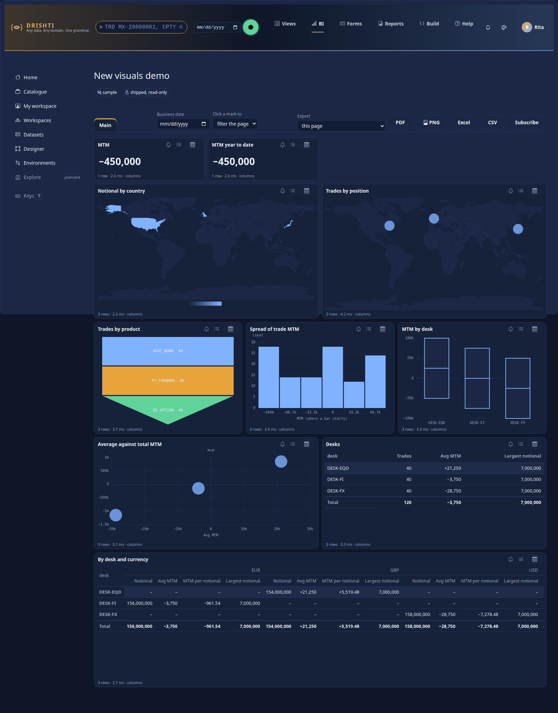

**Map.** `wells: { location: [counterparties.COUNTRY], values: [Exposure (EE peak)] }` shades each country by the measure. `location` holds
**ISO 3166-1 codes** (`US` or `USA`) or the English name or, below the country, **ISO 3166-2 region codes** (`AU-NSW`), matched against
vendored Natural Earth shapes: no tiles, no map service, no CDN. A country too small for the world shapes is a **clickable dot**; a value no
shape knows is **named under the map** (*Not on the map: CHI, XKX*), never dropped. **Points:** `latitude`, `longitude`, `details` and
`values` put a point at each position, as large as the measure. **Drilling:** a map opens at the world; a click on a country **selects it**
(the cross-filter) **and opens its regions**, with the breadcrumb **World › Australia**. Rows that name only regions shade their country with
the **sum** of their regions, so use an additive measure. `format: { level: AUS }` opens already drilled in; `drill: false` keeps the world
only. The samples **World economics** (real World Bank data) and **Region economics** (Australian and US states, illustrative figures) are the
ones to adopt.

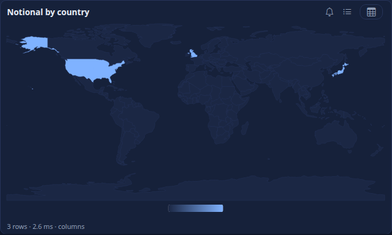 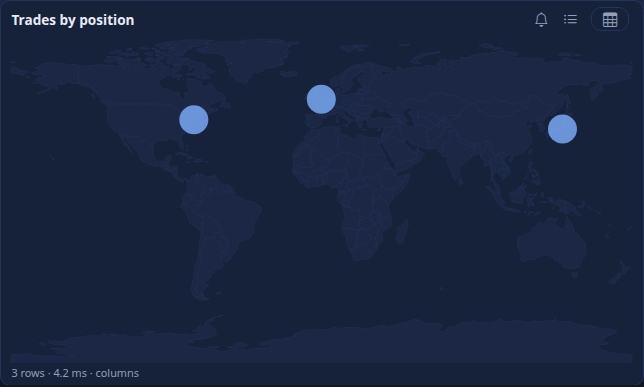

**Funnel** (`axis`, `values`): the stages largest first; a click filters by the stage. **Bubble** (`details`, `x`, `y`, `size`): the scatter
with its fourth measure as the size.

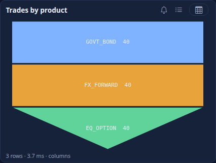 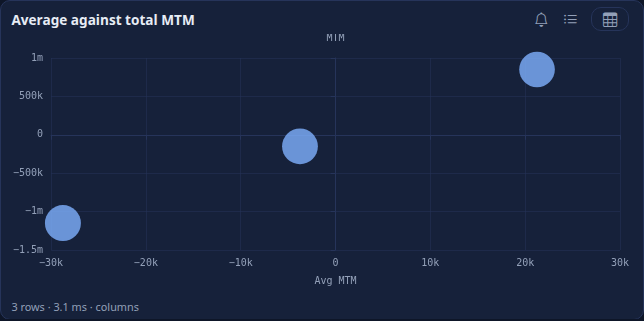

**Histogram.** `wells: { axis: [trades.TRADE_ID], values: [MTM] }, format: { bins: 12 }`: the engine is asked for the measure of every member
of `axis` (up to `drishti.bi.report.distribution-rows`, 20,000), as the reader, and the **server** bins it into equal-width bands (2 to 100);
the answer is `bin`, `count`, `from`, `to`, so the screen, an export and a subscription show the same bars. **Box plot.**
`wells: { axis: [trade.DESK], details: [trade.TRADE_ID], values: [MTM] }`: quartiles by linear interpolation, whiskers at the lowest and highest
value within 1.5 interquartile ranges, the members beyond them as outliers (at most 25 listed).

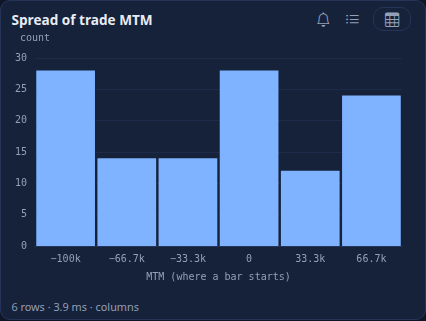 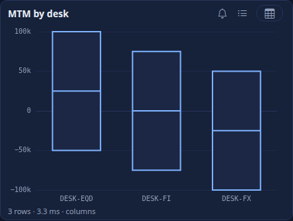

In the designer the five are in the Charts group; Build shows their wells (the map's place wells are optional, the check asks for a place);
Format has **Bars** for a histogram, and **Level** and **Drill into countries** for a map.

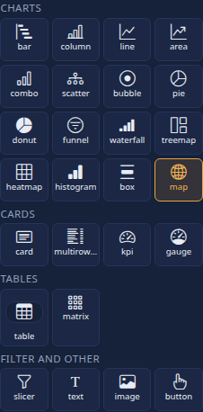 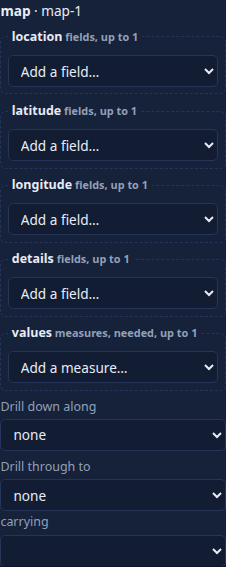

**The map shapes.** `world-countries.json` (Natural Earth 1:110m, 177 shapes), `world-points.json` (the
countries too small for those shapes, as points) and `regions/<ISO3>.json` (one country's admin-1 regions at 1:10m, simplified, coded by
ISO 3166-2; 251 files, none over 200 KB, loaded when the map first opens that country), in the vendored Drishti Elements (`vendor/echarts/maps/` of its release tree). The console
serves them, and for an embedded renderer `/embed/v2/vendor/echarts/maps/world-countries.json`, `.../world-points.json` and `.../regions/<ISO3>.json`.
Natural Earth is public domain ([VENDOR.md](../../../drishti-console/web/static/vendor/VENDOR.md)). The same shapes draw the Sutra `map` panel.

#### 1.5 The entity view

`type: entity-view` shows **a Drishti view inline** for the row the person picks: click a counterparty in a bar and its view opens beside it.

```yaml
- { id: ids, type: bar, title: Exposure by counterparty (click one), at: { x: 0, y: 0, w: 5, h: 10 }, wells: { axis: [counterparties.id], values: [Exposure (EE peak)] },
    filters: [{ field: counterparties.id, op: top, n: 10, by: Exposure (EE peak) }] }
- { id: counterparty-view, type: entity-view, title: The counterparty's view, at: { x: 5, y: 0, w: 7, h: 10 }, wells: { key: [counterparties.id] } }
```

When a mark of another visual selects exactly one value of the `key` field, the visual shows that entity's view (`/v/<kind>/<id>?embed=1`);
until then it says *Select a counterparty in another visual to see its counterparty here*. `format: { kind: counterparty }` names the kind when
the table does not. The frame is the view **built for the person looking** (their masks, row rules and rights); the report only supplies the
id, so select by **id**, not by a name that may be masked. It asks no question of its own (no *Alert me*, *Show as a table* or export), and the
designer's canvas and an embedded report show a note instead. The sample **Counterparty risk** has the page *Counterparty lookup*.

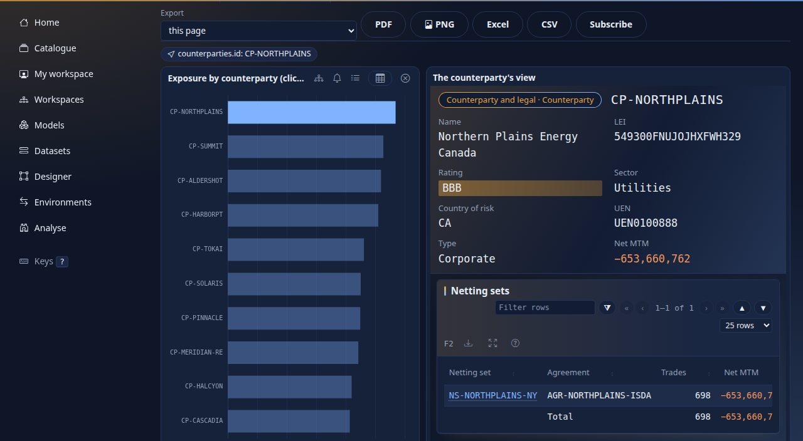

#### 1.6 Vega-Lite visuals

A `vega-lite` visual draws a [Vega-Lite](https://vega.github.io/vega-lite/) specification written in the report. Its **data is the rows of
its wells**, asked as the person looking and put in as `data.values`; put no data in the specification.

```yaml
- id: mtm-by-desk
  type: vega-lite
  title: Net MTM by desk (Vega-Lite)
  at: { x: 0, y: 0, w: 8, h: 7 }
  wells: { axis: [trade.DESK], values: [MTM, Trades] }
  format:
    spec:
      mark: { type: bar, cornerRadiusEnd: 3 }
      encoding:
        x: { field: DESK, type: nominal, sort: "-y", title: Desk }
        y: { field: MTM, type: quantitative, title: Net MTM }
        color: { condition: { test: "datum.MTM < 0", value: "#b3261e" }, value: "#4f7cff" }
        tooltip: [{ field: DESK }, { field: MTM, format: ",.0f" }, { field: Trades }]
  alt: Bars of net mark to market for each desk, red where it is negative
```

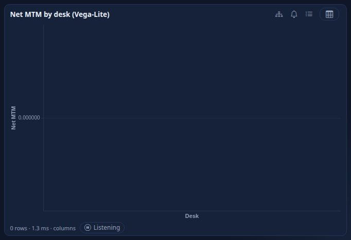

* **Field names.** A row is keyed by the well's items: a field by the text after the table's dot (`trade.DESK` is `DESK`; `trade_DESK` when two
  fields share a name), a measure by its name. Check warns about a field the specification names that no well supplies.
* **Nothing is loaded.** `data.url`, `url` and `loader` are refused (`DRS-9032`); the specification is limited to 200,000 characters.
* **Drawn by drishti-chart**, which translates the specification (marks `bar`, `line`, `area`, `point`, `circle`, `square`, `tick`, `rule`,
  `rect`, `arc`, `boxplot`; encodings `x`, `y`, `color`, `size`, `theta`, `tooltip`, `opacity`; `aggregate`, `bin`, `stack`, `scale`, `axis`;
  `layer`; `transform` `filter` and `calculate`), read by a small expression language, never `eval`, under the page's strict content policy.
  Anything else (facets, `repeat`, `concat`, `params`, `selection`, `projection`, other transforms, `text` marks, `resolve`) is **not drawn**,
  and the frame says which feature and what to use instead. `width` and `height` are ignored. An embedded `<drishti-report>` does not draw it.

#### 1.7 True totals

A total of a ratio, an average, a distinct count, a percentile, a minimum or a maximum is **not** the sum or the average of the figures shown.
Every total and subtotal of a matrix, and the total row of a table with `format: { totals: true }`, is computed by the **pivot engine**
([BI_GUIDE.md section 22](PIVOT.md#22-bi-on-the-pivot-engine)) over the model's rows as the reader may see them, each level from the rows
of its own group, in one statement; the page adds nothing up. A measure that reads beyond its group's rows (time intelligence, running,
context, Python) has no total. The answer carries them as `totals` (one entry per level: `by`, the measures, the rows); a level the engine
refuses, or a measure masked for the reader, stays `–` with its reason in the cell's title. The cap is `drishti.bi.report.totals-max-rows`
(2,000 rows a level).

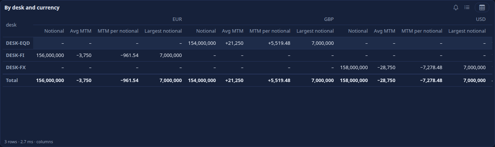
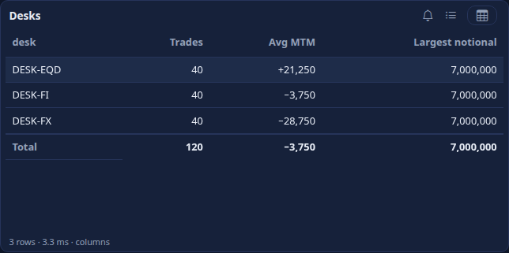

The grand total of *Largest notional* is the largest, 7,000,000 (its sum would have been 21,000,000); the cells the engine worked out say so
in their tip.

#### 9.7a The decomposition tree

A `decomposition` visual asks the pivot engine one split at a time (`POST /api/v1/pivot/decompose`). Its format names a pivot source, a measure
(a function: `var()`, `sum(NOTIONAL)`) and the dimensions a reader may split by. The reader chooses the next split in the list at each column
head and opens a box to go a level down.

```yaml
- id: var-tree
  type: decomposition
  title: 99% VaR
  format:
    source: var                   # the pivot source
    measure: var()
    splits: [DESK, LEGAL_ENTITY, PRODUCT_GROUP, CURRENCY]
    options: { scope: BANK }      # the provider's options of the view
```

Every box is its own figure, recomputed for that slice by the engine; nothing is added in the browser. A measure that adds up (a plain sum)
says the parts add to the parent. For a measure that does not (VaR), each split says **Σ standalone − diversification = parent**, the server's
figures; when the source has the Euler component (`comp_var`), each box shows **component VaR** beside its standalone figure, and the
components add up to the parent. In the designer: *Add a visual → Decomposition*, then Format.

#### 1.8 Filters

A filter is `{ field, op, values }` at **report**, **page** or **visual** level. `field` is a column (or date part) or, for a comparison on a
total, a **measure** (it becomes `having`).

| `op` | Values |
|---|---|
| `in`, `not-in` | a list |
| `eq`, `ne`, `lt`, `le`, `gt`, `ge` | one value |
| `between` | two values |
| `contains`, `starts-with` | text |
| `has`, `any-of`, `all-of` | a list column (type `list`, or text holding a list): one value, or several; nothing chosen holds every row; the engine's own tables only (not pushed down to PostgreSQL) |
| `is-null`, `not-null` | none |
| `top` | `n`, `by` (a measure), `dir` (`desc` for the highest, `asc` for the lowest): keep the `n` values of `field` with the highest measure |

```yaml
filters: [{ field: counterparties.id, op: top, n: 10, by: Exposure (EE peak) }]   # the ten largest counterparties
```

A `top` filter is resolved first, in the context of the other filters (slicers included), so it follows the person's choices. Rank by a column
that is not masked (`counterparties.id`, not the masked name): a filter on a masked column is `DRS-9021`.

#### 1.9 Slicers

A `slicer` lists the values of its field (under the reader's rows and masks) and filters the visuals in its **scope**.

* `format.mode`: `list` (the default: checkboxes with a search box), `dropdown`, `range` (**From** and **To** for a number or a date) or
  `relative-date` (below). `format.style: tiles` draws a list as buttons.
* `format.scope`: `page` (the default) or `report` (every page, so a choice holds on the others).
* `format.syncGroup: <name>`: the slicers of one group, on any pages, share **one choice**, each filtering its own page; they slice one field
  (else `DRS-9032`).
* A slicer never filters itself, and other slicers filter it. A visual a slicer cannot reach through the model's relationships answers
  `DRS-9020` and says so.

**The relative-date slicer.** `format.mode: relative-date` on a date or timestamp field offers named windows, worked out **on the server** from
the report's as-of date and the pack's **business-day calendar**, so the same name means the same dates on a screen, in an export and in a
subscription.

```yaml
- { id: when, type: slicer, title: When, at: { x: 0, y: 0, w: 4, h: 3 }, wells: { field: [trade.TRADE_DATE] },
    format: { mode: relative-date, default: last-30-days, options: [last-7-days, last-5-business-days, last-4-weeks, this-month, this-quarter, this-year, previous-month, all] } }
```

| Name | The window |
|---|---|
| `last-N-days` | the N calendar days ending on the as-of date (which counts as one) |
| `last-N-business-days` | the N business days ending on the as-of date (or the business day before it); holidays skipped |
| `last-N-weeks` | the 7 × N days ending on the as-of date |
| `last-N-months` | from the day after the same date N months earlier, to the as-of date |
| `this-week`, `this-month`, `this-quarter`, `this-year` | from the start of the period (a week starts on Monday) **to date** |
| `previous-week`, `previous-month`, `previous-quarter`, `previous-year` | the whole period before the one the as-of date is in |
| `all` | no restriction |

N is 1 to 3,660. `default` applies until the person chooses (and in exports and subscriptions); `options` lists the names offered (default:
`last-7-days`, `last-30-days`, `last-90-days`, `last-5-business-days`, `last-4-weeks`, `last-3-months`, `last-12-months`, the `this-*` and
`previous-*` names, `all`). In the designer: the slicer's Format, **Mode** *relative date*, **Starts as** and **Windows it offers**. With USNY,
5 business days ending Tuesday 7 July 2026 start on Tuesday 30 June, since Friday 3 July is a holiday.

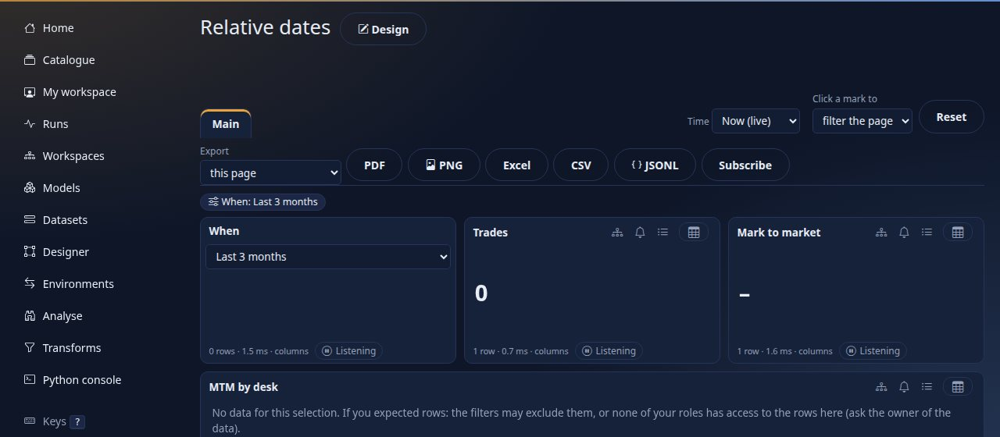

#### 1.10 Interactions, tooltip pages, drill-through and bookmarks

* **Edit interactions.** A page's `interactions: { <source visual>: { <target visual>: filter | highlight | none } }` says, pair by pair, how a
  selection (or a slicer's choice) on one visual acts on another; a pair not listed follows the viewer's *Click a mark to* choice. In the
  designer: select the source, then Format, *Interactions*, or **Edit on the canvas** (Filter, Highlight and None over each other visual).
* **Tooltip pages.** A page with `tooltip: true` is left out of the tabs; a visual with `tooltip: <page id>` opens it in a popover when the
  pointer rests on a mark, each of its visuals asked with the mark's value carried. In the designer: Format, *Tooltip*, **New tooltip page**.
* **Drill through.** A visual offers *Drill through to <page>* for each page whose `drillthrough: fields` lists the selected mark's field.
* **Bookmarks** (`bookmarks: [{ name, page, slicers: { <slicer id>: [values] }, filters }]`): choosing one applies the page, slicer choices
  and filters. In the designer, with nothing selected, Format's **Bookmarks** box writes them: a name, a choice for each slicer (a
  relative-date slicer offers its windows and writes `{ relative: name }`), and **Save this page as a bookmark**; a bookmark can be renamed,
  updated from the page's filters or removed.

#### 1.11 How a visual becomes a query

For each visual the server builds one model query from the visual and the state of the page, in this order of authority: the report's
filters, the page's, the visual's, the slicers in scope, the marks selected on **other** visuals, the values carried by a drill-through, the
drill-down path. It runs it **as the person looking**. A finished answer is shared with everyone of the same **access profile** (section 15.6).

| Part | Rule |
|---|---|
| fields | the `axis`, `legend` (and `rows`, `columns`, `details`) wells in order; a table's `columns` that are not measures |
| measures | the `values`, `secondary`, `target`, `x`, `y`, `size` wells |
| order | a date axis in date order; else the first measure, largest first; a table, matrix, heatmap or slicer has the engine's order (never on a masked column); `sort` overrides |
| rows | `limit`, else the chart, table or slicer default (`drishti.bi.report.chart-rows`, 500; `table-rows`, 1,000; `slicer-values`, 1,000) |
| dates | section 7 |
| selections | a selected mark on another visual filters this one; with highlight on, a chart asks twice (the whole and the highlighted part); `interacts: false` and slicers are not touched |
| drill-down | the first axis field moves down the hierarchy one level per value clicked, and those values become filters (past the last level: `DRS-9035`) |
| show the rows | the visual's own filters and selection, every column of the table it reads, up to `show-rows` (1,000) |

**Never cut silently.** A visual whose rows reach its limit says *first 500 of 2,340* (*more than* past 50,000) and offers **Show all** (up to
5,000 rows, what one JSON answer holds). A time series (a line, area, column or combo over a date axis) is asked again by period, week, then
month, quarter and year, until the whole range fits, and its footer says *by week*; `format: { period: auto | day | week | month | quarter | year }`
fixes it. A model field may name a period itself: `trade.TRADE_DATE.month_start` (also `week_start`, `quarter_start`, `year_start`).

#### 1.12 Expected values in a report

A report may declare what its numbers should be (the keys of section 5.8, plus `visual`: what a visual shows, its first measure, one row, asked
as the viewer asks it; and `column`, the measure column to read). **Check** runs them and shows each as passed, failed or could-not-run;
**publishing is refused while one fails** (`409 DRS-9043`) unless a `bi-admin` forces it (audited `FORCED over N failing test(s)`).

```yaml
tests:
  - { name: The card shows every trade, visual: trades, expect: 750 }
  - { name: Rates desk MTM, measure: MTM, by: [trade.DESK], row: { trade.DESK: DESK-RATES }, expect: 161766771, tolerance: 0.5% }
  - { name: A bad day, measure: Trades, filters: [{ field: trade.DESK, op: eq, values: [DESK-FX] }], date: 2026-10-09, expect: { min: 10, max: 90 }, role: desk-head }
```

**As a chosen role.** Check offers **Run the tests as** *yourself* or a role you hold (a `bi-steward` may choose any): the figure a test finds
is the figure a reader with that role's rules and masks sees. A role you do not hold, a figure masked for the role, or an answer of several
rows without `row` is `error`, never a figure. `drishti.bi.governance.refuse-failing-tests` (on) turns the publish gate off; a test that cannot
run counts as failing at publish. Exports and subscriptions do not run tests.

```text
POST /api/v1/bi/items/bi-d73f79cdbc/tests     {"role": "writer"}
{"item": "bi-d73f79cdbc", "kind": "report", "role": "writer", "total": 3, "passed": 2, "failed": 1, "errors": 0, "ok": false, "results": [
  {"name": "card shows the count", "kind": "visual", "target": "n", "expect": "16", "actual": 16.0, "status": "pass", "message": "", "role": "writer"},
  {"name": "card is wrong", "kind": "visual", "target": "n", "expect": "1", "actual": 16.0, "status": "fail", "message": "expected 1, got 16", "role": "writer"},
  {"name": "measure through the report", "kind": "measure", "target": "N", "expect": "1 or more", "actual": 16.0, "status": "pass", "message": "", "role": "writer"}]}
```

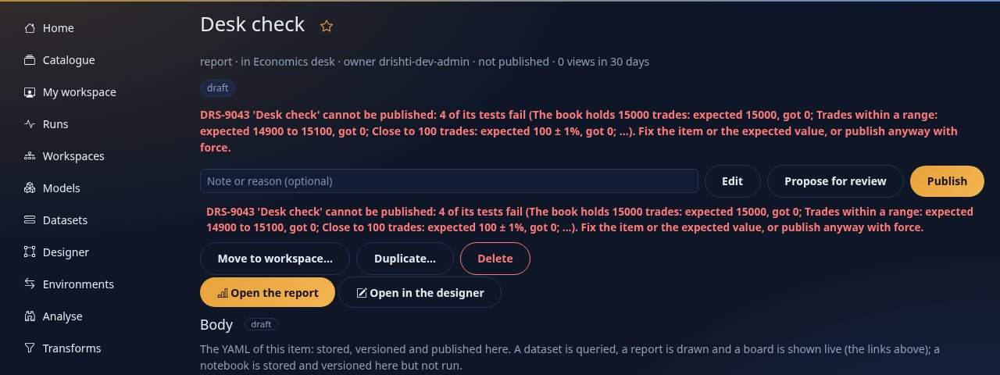

#### 1.13 Reports over several models

A report reads **one model**; put facts that belong together in one model with several fact tables (section 5.3). Only across teams that own
different models may a visual name its own `model:` (or `dataset:`), with the report's `links:` saying which fields of different models mean
the same, so a slicer or a click on one model's visual filters the visuals of another. Each visual is still asked as the reader against its
own model.

```yaml
links:                                  # fields (table.column) of different models that mean the same thing
  - fields: [counterparties.SECTOR, joined.sector]
```

A choice made on one model reaches a visual of another only through a link that names a field that visual's model has; otherwise it does not
reach it, and the visual says so. A link naming a field no model of the report has is `DRS-9031`. Alerts, subscriptions, exports, boards and
the embedded report ask each visual the same way; impact analysis counts what each visual reads. The sample *Desk P&L vs counterparty
exposure* (`pnl-vs-exposure`) reads one model, `trading-risk@1`, which holds both facts:

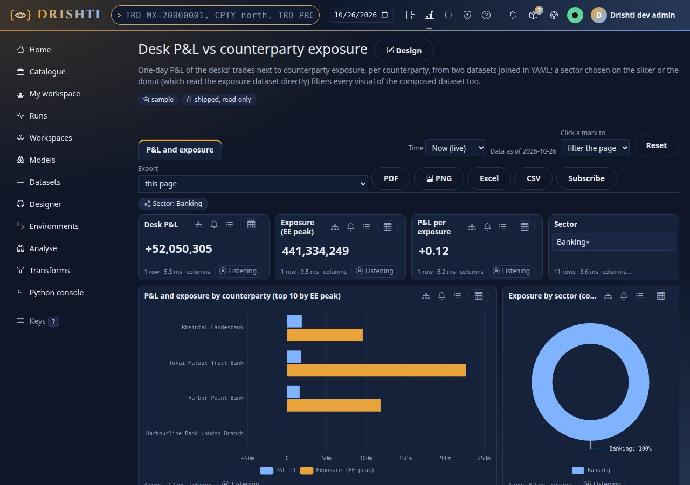

#### 1.14 Checking a report: DRS-9030 to DRS-9038

The check never throws: it returns every problem with its code and the path of the key (`POST /api/v1/bi/reports/validate`, the YAML tab, Check,
the dock's Problems, and the viewer when a report cannot be drawn). **One bad visual is one error card**: it answers `422 DRS-9034` for itself and
every other visual is still drawn. A draft with errors can be saved; **Propose, Approve and Publish** refuse it (a `bi-admin` may force it,
audited).

| Code | Meaning | Example |
|---|---|---|
| `DRS-9030` | the structure is wrong: not YAML, an unknown visual type, a bad `at`, a duplicate id, an unknown operator or interaction, an image from another address, a bad `as-of` | `pages[0].visuals[1].at: x is 0 to 11 and w is 1 to 12, and x + w is at most 12 ... this is x=8, w=6` |
| `DRS-9031` | a name the model or the report lacks: a field, measure, hierarchy, page, bookmark, slicer, tooltip page, a rule's `apply` | `pages[0].visuals[0].wells.axis: table 'trade' has no column 'nope' (it has id, tradeId, desk, ...)` |
| `DRS-9032` | a visual built wrongly: a measure in a field well, an unknown or empty well, too many items, a format value of the wrong type, a sync group over two fields | `...wells.values: 'trade.MTM' is a field; the values well takes measures (Notional, MTM, ...)` |
| `DRS-9033` | a reserved visual type (`shape`) | `...type: the visual 'shape' is reserved and not built yet` |
| `DRS-9034` | the model cannot be found or has errors | `no dataset 'x' (a catalogue id, a file name such as trades-basic, or the dataset's name)` |
| `DRS-9035` | a visual question names a page, visual or slicer the report lacks, or its state is not valid | `the hierarchy 'Desk and book' has 2 levels; there is nothing below trade.PORTFOLIO` |
| `DRS-9036` | a theme item is not valid, or (a warning) the report names a theme that cannot be found | `palette[1]: 'red' is not a colour (#rrggbb)` |
| `DRS-9037` | a well's field parameter is not one, or a choice does not fit the well (section 11) | `...wells.values: the values well takes measures, and the field parameter 'breakdown' can be trade.DESK, trade.PORTFOLIO, fields: put it in a field well` |
| `DRS-9038` | a statement is not valid (section 12.8) | `statement.paper: paper is one of [A3, A4, A5, Legal, Letter], not 'B5'` |

#### 1.15 Security of a report

* A reader needs the **report** (audience and workspace roles); they need not open the model's catalogue entry: a published report reads its
  model with the grants of the people who published it, and the engine applies **the reader's own row rules and masks**. A draft (and the
  designer) finds only the models its author may read, so a report cannot be used to reach a model the catalogue hides from its author.
* A reader is never told the model's row rules through the report. A visual whose table a rule cannot reach answers `DRS-9020`, naming it.
* Report questions go through the same limits as any question: three at a time per person, time, rows and bytes.
* Nothing in a report is executed: it is parsed, checked, turned into parameterised model queries (every value bound) and drawn. No script,
  style or address from a report reaches the page.

### 2. Format, conditional formatting and themes

#### 2.1 The Format pane

`format` is **typed per visual family**: one schema per family (`chart` for bar, column, line, area and combo; `other-chart`; `card` for cards,
KPIs and gauges; `table`; `matrix`; `slicer`; `static` for text, image, button and tile; `code` for python, vega-lite and the live types;
`common` for what they share). The server checks every visual's format against its family: a wrong value of a typed key is `DRS-9032`, an
unknown key a warning (so a stored report never stops opening). The designer's **Format pane is generated from the schemas**
(`GET /api/v1/bi/reports/format-schemas`): a section per group in the family's order (Title, Frame, Data labels, Axes, Legend, Colours, Small
multiples, Values, Conditional formatting; for a matrix Layout and Subtotals; for a slicer Slicer), the right control for each key with its
range and hint, so whatever the pane offers the server accepts.

| In Power BI | In BI Studio | YAML |
|---|---|---|
| Format, Visual, Values axis (min, max, log, gridlines) | Format, *Axes*, *Value axis* | `format: { valueAxis: { min, max, log, gridlines } }` |
| Format, General, Title, Subtitle; Effects, Border, Shadow | Format, *Title*, *Subtitle*; *Frame*, *Border*, *Shadow* | `format: { subtitle, border: true, shadow: true }` |
| Conditional formatting, Background colour, Gradient | Format, *Conditional formatting*, *Colour scale*, **Add a rule** | `rules: [{ type: gradient, apply: MTM, min, mid, max }]` |
| Conditional formatting, Icons | *Icons*, **Add a rule** | `rules: [{ type: icons, apply: Notional, icons: arrows, thresholds: [0, 1000000] }]` |
| Conditional formatting, Rules, based on another field | *Rule*, *When*: another measure | `rules: [{ type: rule, apply: MTM, on: Trades, op: gt, value: 10, colour }]` |
| Matrix, Row subtotals, Stepped layout, Expand all | Format, *Subtotals*, *Layout*; *Expand all* above the matrix | `format: { subtotals: true, stepped: true, expandTo: 0 }` |
| Small multiples well | Build, the **split** well | `wells: { split: [trade.CURRENCY] }`, `format: { multiples: { columns: 3 } }` |
| Edit interactions | Format, *Interactions*, or **Edit on the canvas** | `interactions: { column-1: { matrix-1: none } }` |
| Page information, Allow use as tooltip; Format, Tooltip, Page | Page: *Use as a tooltip page*; visual: Format, *Tooltip*, **New tooltip page** | `tooltip: true` (page), `tooltip: tip1` (visual) |
| Sync slicers | Format, *Slicer*, *Sync group* | `format: { syncGroup: ccy }` |
| View, Themes, Customize current theme | Format, *Report*, *Theme*; **Make a theme** | `theme: corporate`; a `theme` item (section 10.3) |

| Key | For | Meaning |
|---|---|---|
| `subtitle`, `titleSize` | every visual | a line under the title; the title's size (10 to 32 px) |
| `border`, `shadow`, `background`, `padding` | every visual | the frame |
| `labels`, `labelDensity`, `labelPosition` | charts | data labels; the share of points labelled; outside, inside or centre |
| `stacked`, `percent`, `smooth` | bar, column, area; line, area, combo | stack; 100% stacked; smooth the line |
| `valueAxis`, `categoryAxis`, `axisTitles`, `legend` | charts | `{ min, max, log, gridlines, show }`; `{ rotate, show }`; `{ x, y }`; `bottom`, `top`, `right`, `none` |
| `colour`, `seriesColours` | charts | one colour for a one-series chart; a colour per series or, for a pie, per category |
| `period` | charts on a date axis | `auto`, `day`, `week`, `month`, `quarter`, `year` (section 9.11) |
| `numberFormat` | charts, cards, tables | `amount0`, `signed0`, `signed2`, `compact`, `pct`, `share`; else the measure's own format |
| `rules`, `dataBars` | cards, KPIs, gauges, tables, matrices, bar, column; table, matrix | conditional formatting (10.2); measures drawn as bars in the cell |
| `calloutSize`, `showLabel`, `goodWhen`, `min`, `max` | card, KPI, gauge | the number's size; show the measure's name; better `higher` or `lower` than the target; the dial's range |
| `totals`, `rowBanding`, `wrap`, `fontSize` | table | a true total row; banded rows; wrap text; text size |
| `subtotals`, `rowSubtotals`, `columnSubtotals`, `stepped`, `expandTo`, `valuesOn` | matrix | section 10.5 |
| `mode`, `style`, `scope`, `syncGroup`, `default`, `options` | slicer | section 9.9 |
| `size`, `align` | text, button | `heading`; left, centre, right |
| `bins`, `level`, `drill` | histogram; map | section 9.4 |

A theme's visual defaults are applied under a visual's own format: what the visual says wins.

#### 2.2 Conditional formatting

`format.rules` is a list; each rule names what it colours (`apply`: a measure the visual shows, or a field for `values`) and its `type`:

```yaml
format:
  rules:
    - { type: gradient, apply: MTM, min: "#c62828", mid: "#ffffff", max: "#2e7d32" }       # a colour scale (mid optional)
    - { type: rule, apply: MTM, on: Trades, op: gt, value: 10, colour: "#b3261e" }         # a rule on ANOTHER measure; background: also takes a colour
    - { type: icons, apply: Notional, icons: arrows, thresholds: [0, 1000000] }             # arrows, traffic, signs or flags: low, middle, high
    - { type: values, apply: trade.DESK, colours: { DESK-FX: "#1565c0" }, target: background } # a colour per value of a field
```

| Type | Keys |
|---|---|
| `rule` | `on` (a measure of the model; else the one coloured), `op` (`lt le gt ge eq ne between`), `value`, `to` (for `between`), `colour` (text), `background` |
| `gradient` | `min`, `max`, optional `mid`; `minValue`, `midValue`, `maxValue` (else the lowest, middle and highest the visual shows); `target`: `background` or `font` |
| `icons` | `icons` (`arrows`, `traffic`, `signs`, `flags`), `thresholds` (one or two numbers), `reverse` (low is good), `on` |
| `values` | `colours` (a value to a colour), `target` (`font` or `background`) |

A rule on another measure makes the visual ask for that measure too (not shown). A cell with a background takes black or white text, whichever
reads; an icon is said in words to a screen reader (*low*, *middle*, *high*). Charts colour their marks, tables and matrices their cells,
cards their number. The short form `conditional: [{ measure, op, value, colour }]` is still read. In the designer: Format, *Conditional
formatting*, choose the kind and **Add a rule**; nothing is typed but the numbers.

#### 2.3 Themes

A **theme** is an item of kind `theme` (shipped in `config/bi/themes`, or stored, versioned, reviewed and published like a report), which a
report names with `theme: corporate`:

```yaml
theme: corporate
title: Corporate
palette: ["#1f4e79", "#2e75b6", "#9dc3e6", "#c55a11", "#70ad47", "#7f7f7f", "#ffc000", "#5b9bd5"]   # 3 to 12 series colours, in order
good: "#2e7d32"                         # a KPI above target, a colour scale's high end
bad: "#c62828"
background: "#ffffff"                   # optional: the visuals' background and text
foreground: "#1b1b1b"
font: { family: sans, size: 12 }        # sans, serif, mono or system (nothing is fetched); 10 to 18 px
visuals:                                # format defaults by family (chart, other-chart, card, table, matrix, slicer, static, code) or type
  chart: { labels: true, legend: bottom, valueAxis: { gridlines: true } }
  matrix: { rowBanding: true, stepped: true }
```

The shipped themes are **Corporate** and **Print**. A report's own `palette` and `background` win over the theme's; a theme that cannot be
found is a warning (`DRS-9036`) and the report draws with the default colours. A theme is checked like a report
(`POST /api/v1/bi/themes/validate`): a palette that is not 3 to 12 colours, a colour that is not `#rrggbb`, a font that is not one of the four,
or a visual default the format schemas refuse is `DRS-9036`; text on its background under a contrast of 4.5 is an `A11Y` warning.
`GET /api/v1/bi/themes` lists the themes you may use.

**The theme designer** (`/bi/design/theme/<id>`; *New: theme* in the Explorer, or **Make a theme** in Format; `/bi/design/theme/new` starts from
Corporate in your private workspace) edits a theme: its title and name, its series colours (add, remove, move; 3 to 12), page, text, good and
bad colours, type, and the format defaults of each kind of visual, drawn by the same generated Format pane, with a live preview of a chart, a
table and a card. The theme's YAML is the Studio's YAML panel (**Visual**, **YAML** or **Both**): a change on either side shows on the other.
Save keeps the draft; **Publish** makes it what reports read.

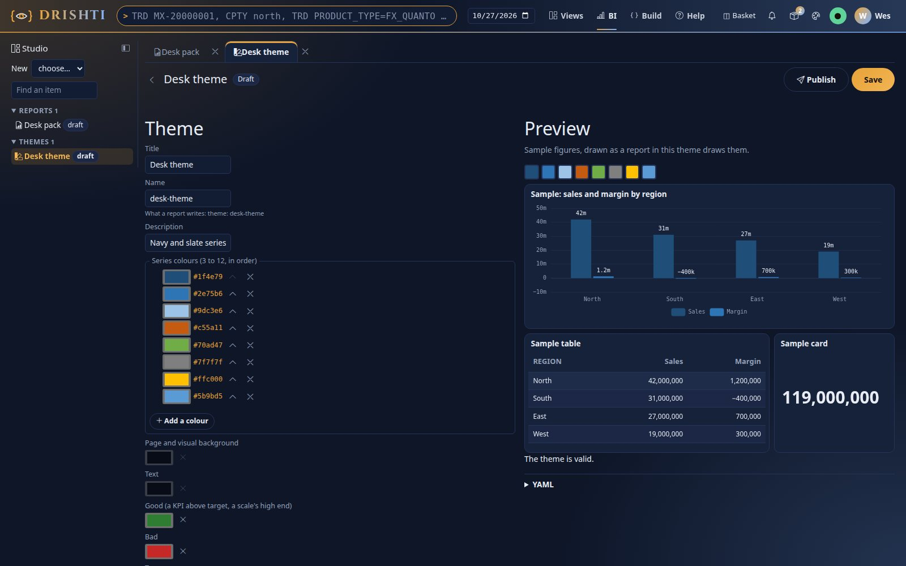

#### 2.4 Number formats and small multiples

`numberFormat` or the measure's own format; a calculation group item's format wins in a visual that shows it (a share reads as a percent).

A bar, column, line or area chart with a field in its **Small multiples** well (`split`) is one small chart per value of that field, from the
one answer the server gave:

```yaml
- { id: mtm-by-ccy, type: column, at: { x: 0, y: 0, w: 12, h: 7 }, wells: { axis: [trade.DESK], values: [MTM], split: [trade.CURRENCY] },
    format: { multiples: { columns: 3, max: 12, sharedAxis: true } } }
```

`columns` is the charts per row (default up to 3), `max` the most charts (default 12; the rest are named under the chart), `sharedAxis` one
value axis for all (the default).

#### 2.5 The matrix

| Key | Default | Meaning |
|---|---|---|
| `subtotals` | off | a subtotal for each group at every level of the row fields, a total per row and a grand total |
| `rowSubtotals` | on | off keeps the grand total and the levels but drops the groups' subtotals |
| `columnSubtotals` | on | the *Total* column of each row |
| `stepped` | on | one indented column for the row fields; off: a column per row field, with a total line after each group |
| `expandTo` | every level | the level it opens at (`0` the first row field only); *Expand all* and *Collapse all* above the matrix |
| `valuesOn` | `columns` | `rows` lists the measures down the rows |

A total of a measure that adds up is the sum of the figures shown; one that does not is the engine's (section 9.7). A click on a row's name
selects its value, which filters the other visuals like any mark.

**One report with all of it**, made in the designer without the YAML tab (the YAML is what the designer writes):

```yaml
report: desk-pack
title: Desk pack
model: trades-basic@1
theme: { use: corporate }                                    # Format, Report, Theme
pages:
  - id: page1
    title: Page 1
    interactions:                                            # Format, Interactions (or Edit on the canvas)
      column-1: { matrix-1: none }
    visuals:
      - id: matrix-1
        type: matrix
        at: { x: 0, y: 0, w: 6, h: 5 }
        wells: { rows: [trade.DESK, trade.PORTFOLIO], columns: [trade.CURRENCY], values: [MTM, Notional] }
        format:                                              # Format, Subtotals, Layout, Conditional formatting
          subtotals: true
          expandTo: 0
          rules:
            - { type: gradient, apply: MTM, min: "#c62828", mid: "#ffffff", max: "#2e7d32" }
            - { type: icons, apply: Notional, icons: arrows, thresholds: [0, 1000000] }
      - id: column-1
        type: column
        at: { x: 6, y: 0, w: 6, h: 5 }
        wells: { axis: [trade.DESK], values: [MTM], split: [trade.CURRENCY] }        # Build, the Small multiples well
        tooltip: tip1                                        # Format, Tooltip, New tooltip page
        format: { subtitle: "By desk, one chart per currency", border: true, valueAxis: { gridlines: false }, multiples: { columns: 3 } }
      - { id: card-1, type: card, at: { x: 0, y: 5, w: 3, h: 2 }, wells: { values: [Trades] } }
      - { id: slicer-1, type: slicer, at: { x: 3, y: 5, w: 3, h: 5 }, wells: { field: [trade.CURRENCY] }, format: { syncGroup: ccy } }
  - id: tip1
    title: Tooltip 1
    tooltip: true                                            # Format with no visual selected: Use as a tooltip page
    visuals:
      - { id: card-1, type: card, at: { x: 0, y: 0, w: 6, h: 2 }, wells: { values: [Trades] } }
  - id: page3
    title: Page 3
    visuals:
      - { id: slicer-1, type: slicer, at: { x: 0, y: 0, w: 3, h: 5 }, wells: { field: [trade.CURRENCY] }, format: { syncGroup: ccy } }
      - { id: card-1, type: card, at: { x: 3, y: 0, w: 6, h: 2 }, wells: { values: [MTM] } }
```

The matrix opens at the desks and expands and collapses, coloured and with icons; the small multiples draw a chart per currency; a selection on
the chart filters the card and not the matrix; the tooltip page opens over a bar, filtered to it; a currency chosen on page 1 holds on page 3.

### 3. Field parameters

A **field parameter** of a model lets the **reader** choose what a visual draws: *break down by desk or by portfolio*, *show MTM or Notional*.
A well of a report on that model may name `param.<name>` instead of a field or a measure, and the parameter slicer above the page
(*Parameters*) switches it.

```yaml
# the model (excerpt)
measures:
  MTM:      { expr: "sum(trade.MTM)" }
  NOTIONAL: { expr: "sum(trade.NOTIONAL)" }
parameters:
  breakdown: { kind: field, fields: [trade.DESK, trade.PORTFOLIO], default: trade.DESK, title: Break down by }
  metric:    { kind: field, fields: [MTM, NOTIONAL], default: MTM, title: Show }
```

```yaml
# the report
model: fp-desk@1
pages:
  - id: main
    title: Main
    visuals:
      - { id: chart, type: column, title: By the reader's choice, at: { x: 0, y: 0, w: 8, h: 5 },
          wells: { axis: [param.breakdown], values: [param.metric] }, sort: { by: param.metric, desc: true } }
```

* **What is drawn.** Each question carries the reader's values (the state's `params`); the server puts the chosen field or measure in place of
  `param.<name>` in the wells and the sort, so the axis, the legend and the tooltips name what was chosen. Without a choice the `default` (else
  the first choice) is drawn: in the designer's canvas, in an export, in a statement. The choice is a chip in the filter line; **Reset** puts the
  defaults back.
* **Masks hold.** The choice is only a name: a masked measure chosen stays masked (and a sort by it is refused for that reader, `DRS-9021`).
* **In BI Studio.** Build's *Add a field…* list ends with **Field parameters**: a parameter of fields in a field well (axis, legend, rows,
  columns), one of measures in a measure well (values), one of both only in a well of either. Its chip is marked as a field parameter.
* **Checked (`DRS-9037`).** The report is on a model with a parameter of that name of `kind: field` (a what-if value goes in a measure, not a
  well); every choice fits the well and is a field or measure of the model. A value the parameter does not list is refused when the visual is
  asked (`422 DRS-9037`). `param.<name>` works in a model query's `select.measures` and `sort` too.

What-if parameters (a number with a min, max and step, shown as a slider) and calculation groups (*Show as*) appear above the page in the same
way (section 13.3).

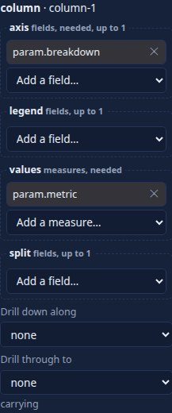

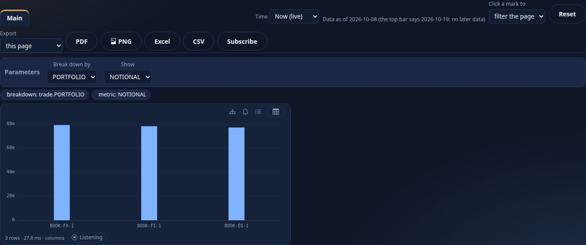

### 4. Statements: paginated reports, page-exact, one per reader

A **statement** is a report page laid out on paper: a monthly client statement, a desk's positions at month end, a regulatory schedule. Where
a grid page is a screen people slice, a statement page is **page-exact**: a paper size and orientation, margins, a header and a footer with the
page number and the run date on every page, explicit and automatic page breaks, a table's column titles repeated on every page it runs onto,
and groups of rows kept together. It is made as a **PDF** (and as an Excel workbook set to print on the same paper), and a subscription
**bursts** it: one statement per recipient, each made **as that recipient**. A statement is a page with `layout: statement`; the report's
`statement:` sets its paper. Nothing new is stored: a statement is a report. The walk-through is
[the reports tutorial, Part C](#part-c--statements-and-field-parameters).

#### 4.1 A statement in YAML

```yaml
report: monthly-statement
title: Monthly statement
model: trades-basic@1
statement:                                   # the paper of every statement page (12.2)
  paper: A4
  orientation: portrait
  margins: { top: 15, right: 12, bottom: 15, left: 12 }        # millimetres
  header: { left: "{title}", center: "{period}", right: "For {reader}" }
  footer: { left: "Run {run-date}", right: "Page {page} of {pages}" }
  period: previous-month                      # what it covers (12.4)
  fontSize: 9
pages:
  - id: statement
    title: Statement
    layout: statement                         # this page is paper
    visuals:                                  # bands, top to bottom by row (at.y), side by side in a row by column (at.x, at.w)
      - { id: intro, type: text, at: { x: 0, y: 0, w: 12, h: 1 }, text: "Positions of {reader} for {period}", format: { size: heading } }
      - { id: notional, type: card, title: Notional, at: { x: 0, y: 1, w: 4, h: 2 }, wells: { values: [Notional] } }
      - { id: mtm, type: card, title: MTM, at: { x: 4, y: 1, w: 4, h: 2 }, wells: { values: [MTM] } }
      - { id: trades, type: card, title: Trades, at: { x: 8, y: 1, w: 4, h: 2 }, wells: { values: [Trades] } }
      - { id: positions, type: table, title: Positions, at: { x: 0, y: 3, w: 12, h: 8 },
          wells: { columns: [trade.DESK, trade.TRADE_ID, trade.PORTFOLIO, Notional, MTM] }, sort: { by: trade.TRADE_ID },
          format: { groupBy: trade.DESK } }                          # each desk's rows kept on one page when they fit
      - { id: books, type: matrix, title: By book and currency, at: { x: 0, y: 11, w: 12, h: 4 },
          wells: { rows: [trade.PORTFOLIO], columns: [trade.CURRENCY], values: [Notional] }, format: { pageBreak: before } }
```

A statement page's visuals are **bands**: `text`, `card`, `multirow-card`, `kpi`, `gauge`, `table` and `matrix`. A table, a matrix and a
multirow card run over pages, so each has its row to itself; text and cards share a row by their columns. A report may mix grid, board and
statement pages. Every band is the visual's ordinary question, asked as the reader (section 9.11).

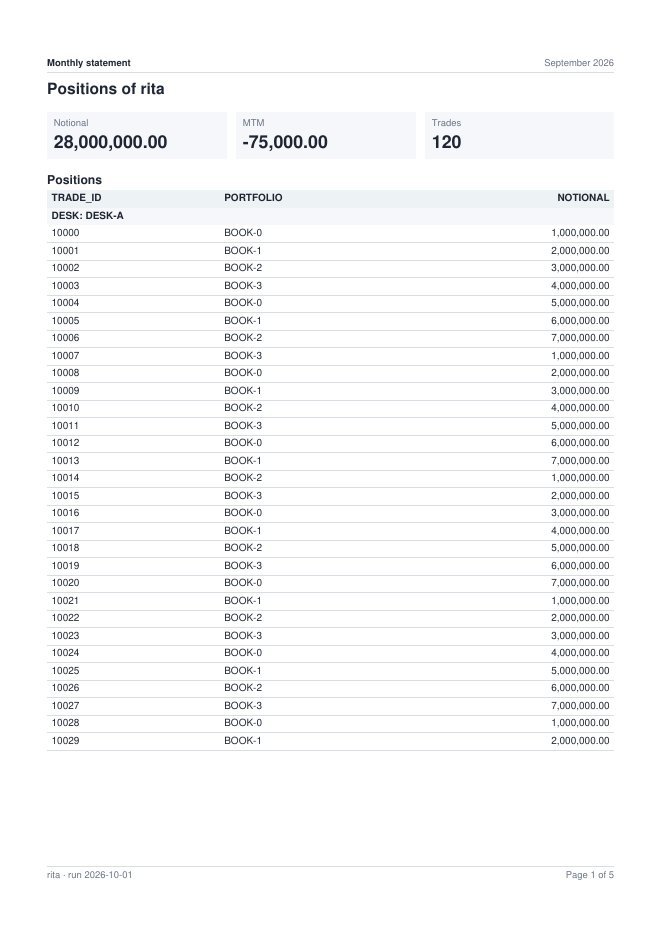

#### 4.2 The paper: `statement:`

| Key | Meaning | Default |
|---|---|---|
| `paper` | `A4`, `A3`, `A5`, `Letter` or `Legal` | `drishti.distribution.statements.paper` (`A4`) |
| `orientation` | `portrait` or `landscape` | `portrait` |
| `margins` | `{ top, right, bottom, left }` in millimetres (0 to 60), or one number for all four | `{ top: 18, right: 15, bottom: 18, left: 15 }` |
| `header`, `footer` | `{ left, center, right }` with tokens; `header: false` for none | header `{title}` · `{period}`; footer `{reader} · run {run-date}` · `Page {page} of {pages}` |
| `period` | `none`, `day`, `month`, `previous-month`, `quarter`, `previous-quarter`, `year`, `previous-year` | `none` |
| `dates` | its questions read the period's last day (`end`) or every day of it (`window`) | `end` |
| `fontSize` | the text size in points, 7 to 12 | `9` |

**Tokens** in the header, the footer, a text band and a visual's title: `{title}`, `{page}` and `{pages}`, `{run-date}` and `{run-time}` (in the
server's business time zone), `{period}` (*September 2026*, *2026-Q3*, *2026*, or the date), `{from}` and `{to}`, `{as-of}`, `{reader}` and
`{param.<name>}` (a parameter of the model). An unknown token is refused (`DRS-9038`). A **band** adds to its `format` (the Format pane's
**Statement** group): `pageBreak` (`before`, `after`, `none`), `keepTogether` (never split; moves to the next page whole when it fits on one),
`repeatHeader` (a table's column titles on every page, under its title marked *(continued)*; on by default) and `groupBy` (rows grouped under a
heading *DESK: DESK-FX*; a group that fits on a page is never split).

#### 4.3 How the pages are laid out

The server lays the pages out, so the PDF, the preview and the Excel print setup agree: the browser never computes a page.

* Rows of bands go top to bottom; a row is as tall as its tallest band and is never split. Text taller than a page flows line by line.
* A **table** holds every row of its question, up to `drishti.distribution.statements.max-rows` (10,000); a longer one stops there and says so
  above itself (*The first 10,000 rows only: the table goes on*). A table never leaves its title and column titles alone at the foot of a page.
* A table **sorted by a measure masked for the reader** is drawn in the question's own order, with the note *Not sorted: 'MTM' is masked for
  you, and its order would tell the masked figures*.
* A **card** with no value: a count of nothing is `0`, a value of nothing is `–`, a masked one reads its mask. A date later than the business
  date is not read: every card reads `–` with its note.
* **Notes are never cut**: they wrap, and the band grows to hold them.
* When **no band has data** for the dates read, the preview, the file's notes and the command line say which dates were read and where data is:
  *No data is held for 2026-10-25, the date this October 2026 statement reads: every band is empty. The nearest date with data is 2026-10-20
  (before). Choose a date the data covers.*
* **A figure is never cut**: a number column is as wide as its widest figure. When the figures do not fit, the table's font shrinks in
  half-point steps (to three quarters of `fontSize`, at least 6 pt), then the number columns go on **in parts below the table**, each repeating
  the row labels (*MTM by desk and currency (part 2 of 2: NOK to NZD)*), then the text columns narrow. A card's value reads in compact units
  (`3.62tn`) with the exact figure under it. Text wider than its column is cut with an ellipsis where the column ends.
* A matrix is drawn as a table. The header and footer are written last, when the page count is known. A statement longer than
  `drishti.distribution.statements.max-pages` (500) is refused, never cut (`DRS-9038`).

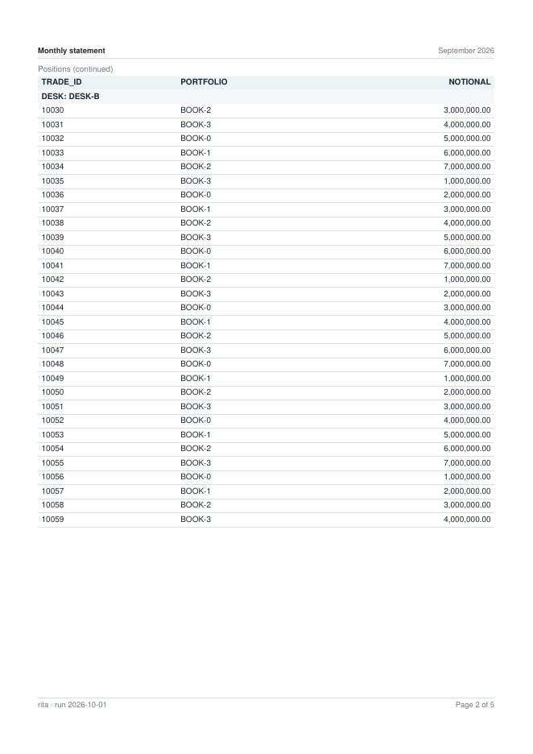

#### 4.4 The period, the date and the parameters

A statement's **date** is the subscription's business date (`today`, `previous` or `load`, section 18.3), the date given to a preview or the
command line, else the view state's `dates.to`, else the latest business date. Its `period` is worked out from it: dated 2026-10-01 with
`period: previous-month`, it covers *September 2026*. With `dates: end` every band reads the period's last day; with `dates: window` every day
of it (for flows rather than positions). The run's view state carries the model's **parameters** (`params`; a subscription's
`target.state.params`; `--param name=value`), so a statement whose table names `param.breakdown` is by desk or by portfolio as its
subscription chooses.

#### 4.5 The statement designer

With no visual selected, **Format → Layout → statement** makes the page a statement, and the **Paper** tab appears beside Canvas, Phone, Tablet
and YAML: **Paper** (size, orientation, margins, text size), **Header** and **Footer** (left, centre and right, with the tokens listed under
them), **Period**. **Preview pages** lays the draft out on the server, as you, for the **Statement date** you choose, one sheet at a time with
**‹** and **›** (or Page Up and Page Down), *Page 2 of 3 · Letter landscape* beside them. **PDF** and **Excel** download the saved draft. Each
band's **Page break**, **Keep together**, **Repeat the column titles on every page** and **Keep rows together by** are in **Format → Statement**.

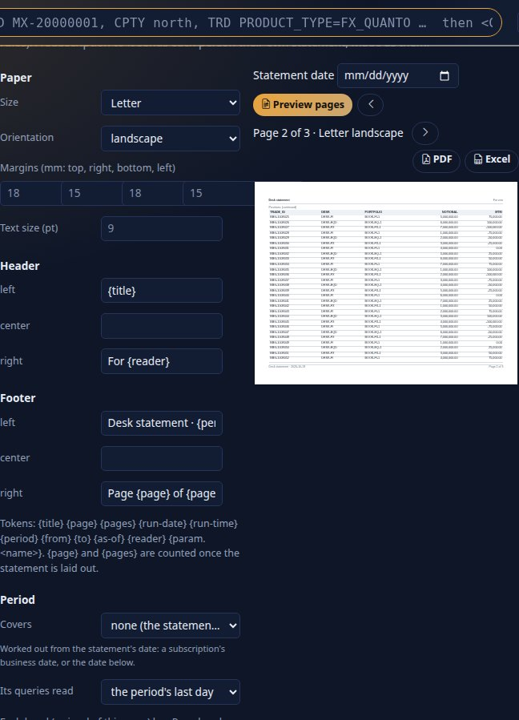

#### 4.6 PDF, Excel and bursting through subscriptions

* **PDF** (Export on the page, `POST /api/v1/export/pdf`, or `POST /api/v1/bi/reports/statement/file`): written by the server itself (the standard
  Helvetica fonts, nothing downloaded), every page exactly the paper's size. The export of a statement page is always the statement.
* **Excel**: the bands' tables as typed sheets (an *About* sheet first), each set to print on the statement's paper (orientation, size,
  margins, header and footer, the column titles repeated on every printed page), carrying every note the PDF has.
* **Bursting**: a subscription to a statement page (format `pdf` or `xlsx`) makes **one statement per recipient**, each asked as that recipient,
  so two people's statements differ only by their masks, row rules and name. The file is named after the statement, its period and the
  recipient (*Monthly statement September 2026 hana.pdf*); each delivery's history says `statement: true`, its `pages` and its `file`; the mail's
  subject ends with the page count. A recipient who may not open the report is skipped with the reason in words. The Subscribe form says so when
  it opens on a statement page and offers a PDF first.

#### 4.7 The command line and the API

Run these from the Drishti folder (the repository root, or the install folder of a release).

```
$ drishti.py bi statement preview bi-39eb12fe47 --date 2026-10-08
Monthly statement: 3 pages, A4 portrait, October 2026, 66 rows
  page 1: Monthly statement | October 2026 | For wes  ...  Run 2026-10-19 · by DESK | Page 1 of 3  (80 cells)
  page 2: Monthly statement | October 2026 | For wes  ...  Run 2026-10-19 · by DESK | Page 2 of 3  (160 cells)
  page 3: Monthly statement | October 2026 | For wes  ...  Run 2026-10-19 · by DESK | Page 3 of 3  (6 cells)
$ drishti.py bi statement preview bi-39eb12fe47 --date 2026-10-08 --param breakdown=trade.PORTFOLIO
$ drishti.py bi statement file bi-39eb12fe47 --date 2026-10-08 -o statement.pdf
wrote statement.pdf (5,000 bytes)
$ drishti.py bi statement file bi-39eb12fe47 --date 2026-10-08 --format xlsx -o statement.xlsx
wrote statement.xlsx (7,823 bytes)
$ drishti.py bi statement preview bi-39eb12fe47 --date 9999-12-31
Monthly statement: 2 pages, A4 portrait, December 9999, 3 rows
  hint: No data is held for 9999-12-31, the date this December 9999 statement reads: every band is empty. The nearest date with data is 2026-10-20 (before). Choose a date the data covers.
```

`--file report.yaml` makes the statement of a draft's YAML (a BI author). Over the API: `POST /api/v1/bi/reports/statement/preview` (the pages as
drawing operations, `pageCount`, `rows`, `cut`, `hint`) and `POST /api/v1/bi/reports/statement/file` (`format: pdf`, `xlsx` or `jsonl`, with
`X-Statement-Pages`, `X-Statement-Cut` and `X-Statement-Hint`) ([API_REFERENCE.md](../API_REFERENCE.md), [CLI_REFERENCE.md](../CLI_REFERENCE.md#bi-statement)).

#### 4.8 Checks: DRS-9038

| Path | Refused |
|---|---|
| `statement.paper`, `statement.orientation` | not one of the paper sizes; not portrait or landscape |
| `statement.margins.<side>` | not 0 to 60 millimetres, or an unknown side |
| `statement.header.<part>`, `.footer.<part>`, a text band, a title | an unknown part or token, or `{param.<name>}` naming no parameter of the model |
| `statement.period`, `statement.dates`, `statement.fontSize` | not one of the periods; not end or window; not 7 to 12 |
| `pages[i].visuals[j].type` | a visual a statement does not draw (a chart: put it on a grid page and export that as a picture) |
| `pages[i].visuals[j].at` | a table, matrix or multirow card that shares its row |
| `...format.groupBy`, `.pageBreak` | a field the band does not show; not before, after or none |
| `pages[i].tooltip` | a statement page that is a tooltip page |

Settings: `drishti.distribution.statements.*` (`max-pages`, `max-rows`, `paper`, `band-queries`) and the export limits
([CONFIGURATION.md](../../admin/CONFIGURATION.md)). A statement draws text, cards, tables and matrices in Helvetica (characters outside
Windows-1252 print as `?`), on the report's one paper, for users and roles.

## Tutorial: Statements and field parameters

A statement page, its paper and its page breaks, one statement per person by subscription, and field parameters that let the reader switch a measure or a field. Every step shows the UI, the command line where there is one, and the YAML.

### Time to complete

- Part C · Statements and field parameters: About 40 minutes.

### Before you start

The environment, the sign-in and the token are those of [Reports, Before you start](REPORTS.md#before-you-start).

**Part C · Statements and field parameters.**

- Part A done: a running server and console, signed in as a BI author (`bi-author`), the sample model *Trades, the basics* (`trades-basic@1`) and its
  dataset `trades-basic-trade` (the trade valuations).
- For step 29, a server that can send mail (`spring.mail.host`) and two or more users with an email address.

The outputs below were captured on this version against the test stack of `drishti-console/tests/test_bi_wave_d_browser.py` (the sample's 60 valuations of
2026-10-08); your numbers are your data's.

### What you will learn

**Part C · Statements and field parameters**

- what a field parameter is and how it goes in a well, in Build and in the YAML;
- how a reader's parameter slicer switches a chart's field and measure, and that masks still hold;
- how to make a page a statement, set its paper, header and footer, and preview it page by page;
- how a statement's tables run over pages: repeated column titles, groups kept together, page breaks;
- how one subscription sends each person their own statement, and the CLI for the same.

#### Part C · Statements and field parameters

Two things a Power BI or SSRS author expects are built. **Field parameters in a visual's wells**: the reader chooses which field a chart breaks
down by and which measure it shows. **Statements**: a report page laid out on paper, page by page (paper size, margins, a header and footer with page
numbers, page breaks, column titles on every page, groups kept together), made as a PDF or Excel and sent by a subscription to many people, **each made as
that person**. This part builds a model with two field parameters, a report whose chart the reader switches, and a monthly statement that bursts to a
role. Each step shows the UI, the command line and the YAML. The references are [BI_GUIDE.md › Reports: the YAML, the visuals and how they behave, section 21](#3-field-parameters)
and [BI_GUIDE.md › Reports: the YAML, the visuals and how they behave, section 24](#4-statements-paginated-reports-page-exact-one-per-reader).

### Step 24 · A model with two field parameters

A field parameter is a model's list of fields (or of measures) the reader chooses from.

**In the UI.** Open the model designer on a new model (BI Studio → Explorer → New → Model, the dataset `trades-basic-trade`), add the measures `MTM`
(`sum(trade.MTM)`) and `NOTIONAL` (`sum(trade.NOTIONAL)`), then the **Calculations** tab → *New parameter* `breakdown`, kind **field (switch a
breakdown)**, ticking `trade.DESK` and `trade.PORTFOLIO`; and `metric`, kind **field**, ticking the measures `MTM (measure)` and `NOTIONAL (measure)`
(a field parameter's choices may be measures). Save and publish.

**From the command line**, the same model from its file:

```
$ drishti.py bi item new me docs/tutorials/data/desk-params.model.yaml
```

**The YAML** ([desk-params.model.yaml](../../tutorials/data/desk-params.model.yaml)):

```yaml
model: fp-desk
datasets:
  trade: { dataset: trades-basic-trade, role: fact }
measures:
  MTM:      { expr: "sum(trade.MTM)", format: signed0 }
  NOTIONAL: { expr: "sum(trade.NOTIONAL)", format: amount0 }
  Trades:   { expr: "count(trade)" }
parameters:
  breakdown: { kind: field, fields: [trade.DESK, trade.PORTFOLIO], default: trade.DESK, title: Break down by }
  metric:    { kind: field, fields: [MTM, NOTIONAL], default: MTM, title: Show }
```

**You should see:** the model published as `fp-desk@1`, its **Calculations** tab listing the parameters `breakdown` (the fields `trade.DESK` and
`trade.PORTFOLIO`, *Break down by*) and `metric` (the measures `MTM` and `NOTIONAL`, *Show*).

### Step 25 · A chart the reader switches

**In the UI.** New report on the model `fp-desk@1`, add a **column** visual and open **Build**. The *Add a field…* list of the **axis** well ends with
*Field parameters*: choose `param.breakdown`; the **values** well's list offers `param.metric` (a parameter of measures goes in a measure well only). Each
chip says it is a field parameter, and the canvas draws the default: MTM by desk. Save, and open the report: **Parameters** above the page has *Break down
by* and *Show*. Choose *PORTFOLIO* and *NOTIONAL*: the chart is asked again and draws notional by book; each choice is a chip, and **Reset** brings the
defaults back.


**The YAML** of the visual: `wells: { axis: [param.breakdown], values: [param.metric] }`. A parameter that does not fit its well is refused by Check,
`DRS-9037`: put `param.breakdown` in **values** and Problems says, once for the parameter, *the values well takes measures, and the field parameter
'breakdown' can be trade.DESK, trade.PORTFOLIO, fields: put it in a field well*.

**From the command line**, the model query the chart asks with the reader's choice (a field parameter of measures goes among the measures), written as a
file `switch.mq.yaml`:

```yaml
mq: 2
model: fp-desk@1
select: { fields: [param.breakdown], measures: [param.metric] }
params: { breakdown: trade.PORTFOLIO, metric: NOTIONAL }
```

```
$ drishti.py bi mq switch.mq.yaml          # notional by book, as you
```

A reader without raw sees MTM masked whichever way they choose: the choice is only a name; the visual is asked as them.

**You should see:** the column chart drawing MTM by desk by default; with *PORTFOLIO* and *NOTIONAL* chosen, notional by book and the two choices
as chips above the page (**Reset** brings MTM by desk back); `param.breakdown` in the values well refused with `DRS-9037`.

### Step 26 · A statement page

**In the UI.** In the same report, **+** a page, then in **Format** with no visual selected, **Layout → statement**. The **Paper** tab appears beside
Canvas. Add the bands as on any page: a **text** (`Positions of {reader} for {period}`, Format → Size → heading), three **cards** side by side (Notional,
MTM, Trades), a **table** of `param.breakdown`, `trade.TRADE_ID`, `trade.CURRENCY`, `NOTIONAL`, `MTM` sorted by `trade.TRADE_ID`, and a **matrix** of
`trade.PORTFOLIO` by `trade.CURRENCY` with `NOTIONAL`. A table and a matrix run over pages, so each has a row of its own.

**The YAML** ([monthly-statement.report.yaml](../../tutorials/data/monthly-statement.report.yaml)), the statement page:

```yaml
  - id: statement
    title: Statement
    layout: statement
    visuals:
      - { id: intro, type: text, at: { x: 0, y: 0, w: 12, h: 1 }, text: "Positions of {reader} for {period}", format: { size: heading } }
      - { id: notional, type: card, title: Notional, at: { x: 0, y: 1, w: 4, h: 2 }, wells: { values: [NOTIONAL] } }
      - { id: mtm, type: card, title: MTM, at: { x: 4, y: 1, w: 4, h: 2 }, wells: { values: [MTM] } }
      - { id: trades, type: card, title: Trades, at: { x: 8, y: 1, w: 4, h: 2 }, wells: { values: [Trades] } }
      - { id: positions, type: table, title: Positions, at: { x: 0, y: 3, w: 12, h: 8 },
          wells: { columns: [param.breakdown, trade.TRADE_ID, trade.CURRENCY, NOTIONAL, MTM] }, sort: { by: trade.TRADE_ID },
          format: { groupBy: param.breakdown } }
      - { id: by-currency, type: matrix, title: Notional by book and currency, at: { x: 0, y: 11, w: 12, h: 4 },
          wells: { rows: [trade.PORTFOLIO], columns: [trade.CURRENCY], values: [NOTIONAL] }, format: { pageBreak: before } }
```

**You should see:** the page's layout *statement*, the **Paper** tab beside Canvas, and the bands one under another: the heading, the three cards
in a row, the *Positions* table and the *Notional by book and currency* matrix, each table on a row of its own.

### Step 27 · The paper, and how the pages break

**In the UI.** The **Paper** tab: *Size* A4, *Orientation* portrait, the margins in millimetres, the **Header** (left `{title}`, centre `{period}`, right
`For {reader}`) and **Footer** (left `Run {run-date} · by {param.breakdown}`, right `Page {page} of {pages}`), *Covers* **the month of its date**. Select
the table, and in **Format → Statement**: **Keep rows together by** `param.breakdown` (each desk's rows on one page when they fit, under a heading),
**Repeat the column titles on every page** (on by default). Select the matrix: **Page break** *before* (it starts a page of its own).

**The YAML** of the paper:

```yaml
statement:
  paper: A4
  orientation: portrait
  margins: { top: 15, right: 12, bottom: 15, left: 12 }
  header: { left: "{title}", center: "{period}", right: "For {reader}" }
  footer: { left: "Run {run-date} · by {param.breakdown}", right: "Page {page} of {pages}" }
  period: month
  fontSize: 9
```

Try a wrong one in the YAML tab (`paper: B5`, a token `{nope}`): Problems lists each with `DRS-9038` and its path.

**You should see:** the Paper tab holding A4 portrait, the margins, the header and footer as typed and *Covers* the month; the table's Format →
Statement keeping rows together by `param.breakdown` with the column titles repeated, the matrix's page break *before*; and for `paper: B5` or
`{nope}`, a `DRS-9038` in Problems naming the key's path.

### Step 28 · Preview page by page

**In the UI.** Paper tab → *Statement date* 2026-10-08 → **Preview pages**. The server lays the statement out for you, with your masks and row rules, and
the preview shows one sheet at a time: **›** for the next (or Page Down), *Page 2 of 3 · A4 portrait · October 2026* beside it. Page 1 holds the heading,
the cards and the first desk's rows; page 2 starts with the column titles again and keeps each desk whole; page 3 is the matrix. Change the orientation to
landscape and preview again: more pages, as fewer rows fit a landscape page. **PDF** and **Excel** download the saved draft.


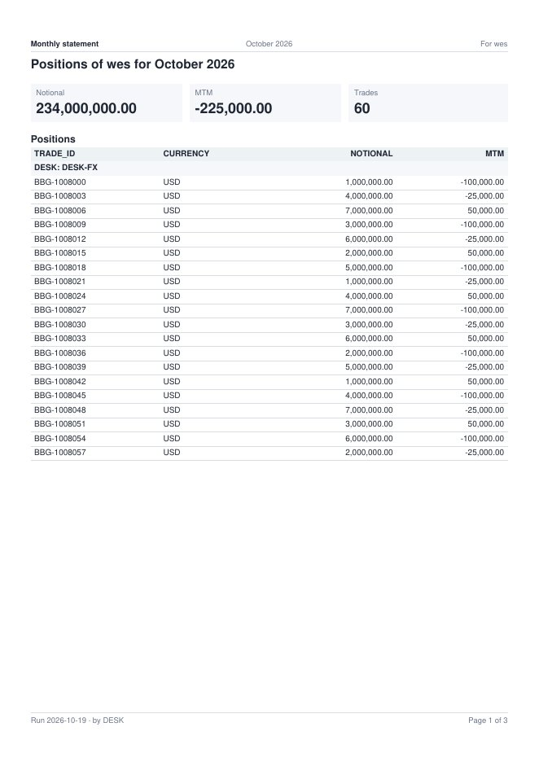

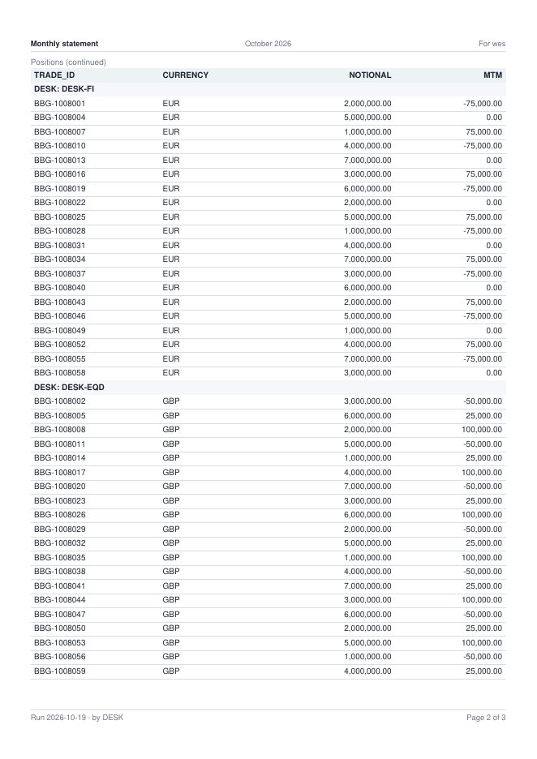

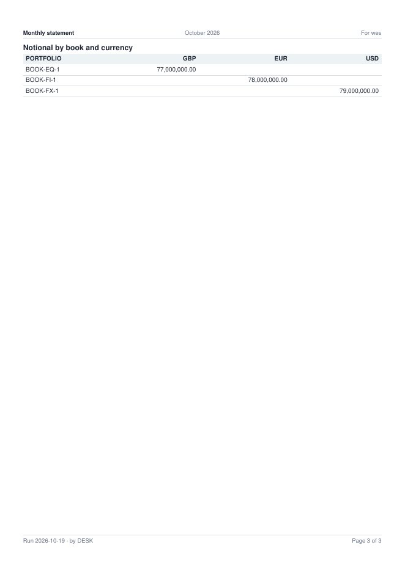

**From the command line** (the report's id from step 25):

```
$ drishti.py bi statement preview bi-39eb12fe47 --date 2026-10-08
Monthly statement: 3 pages, A4 portrait, October 2026, 66 rows
  page 1: Monthly statement | October 2026 | For wes  ...  Run 2026-10-19 · by DESK | Page 1 of 3  (80 cells)
  page 2: Monthly statement | October 2026 | For wes  ...  Run 2026-10-19 · by DESK | Page 2 of 3  (160 cells)
  page 3: Monthly statement | October 2026 | For wes  ...  Run 2026-10-19 · by DESK | Page 3 of 3  (6 cells)

$ drishti.py bi statement preview bi-39eb12fe47 --date 2026-10-08 --param breakdown=trade.PORTFOLIO
Monthly statement: 3 pages, A4 portrait, October 2026, 66 rows
  page 1: Monthly statement | October 2026 | For wes  ...  Run 2026-10-19 · by PORTFOLIO | Page 1 of 3  (80 cells)
  ...
$ drishti.py bi statement file bi-39eb12fe47 --date 2026-10-08 -o statement.pdf
wrote statement.pdf (5,000 bytes)
$ drishti.py bi statement file bi-39eb12fe47 --date 2026-10-08 --format xlsx -o statement.xlsx
wrote statement.xlsx (7,823 bytes)
```

The workbook's sheets print on the same paper, with the header and footer and the column titles on every printed page.

**You should see:** *Page 1 of 3 · A4 portrait · October 2026* in the preview; page 2 headed *Positions (continued)* with the column titles
`TRADE_ID`, `CURRENCY`, `NOTIONAL`, `MTM` again and each desk (*DESK: DESK-FI*, *DESK: DESK-EQD*) whole under its heading; page 3 the matrix alone;
the footer *Run … · by DESK* and *Page n of 3* on every page. On the command line, `3 pages, A4 portrait, October 2026, 66 rows`, the footer saying
*by PORTFOLIO* with `--param breakdown=trade.PORTFOLIO`, and `statement.pdf` and `statement.xlsx` written.

### Step 29 · One statement per person: a subscription

Move the report to a shared workspace and publish it (Part G). Then on the report's **Statement** page, **Subscribe**: *Send as* **pdf**, *To*
`role:desk-head` (or the people), *When* `monthly 1 07:30 business`, *Data for* `previous` (the business day before the run: the statement covers that
month). **Run now** in the subscription's history: one mail per person, each with their own PDF, *Monthly statement October 2026 hana.pdf*; the history
shows each delivery with `statement: true` and its page count. A desk head's statement holds their desk's trades only; an analyst's has MTM masked;
two people with the same rights get the same pages but their name ([BI_GUIDE.md › Distribution: scheduled reports, export, subscriptions, alerts and embedding, section 2](DISTRIBUTION_AND_ALERTS.md#13-subscriptions)).

**From the command line.** A subscription is yours, so it is saved and run from the console while you are signed in: saving one
(`PUT /api/v1/me/subscriptions/{name}`) or running it (`POST …/{name}/run`) with a personal API token answers `403 DRS-5002 API tokens
may not call this endpoint`, whatever the token's scopes, because every `/me/**` write is never open to a token
([API_REFERENCE.md › Personal API tokens](../../guides/API_REFERENCE.md#28-personal-api-tokens)). A token can read it back once the console has saved it,
with its runs and deliveries:

```
$ curl -s -H "Authorization: Bearer $DRISHTI_TOKEN" $DRISHTI_SERVER/api/v1/me/subscriptions \
    | jq '.[] | {name, title, schedule, format, recipients, runs: [.runs[] | {at, status, sent}]}'
```

and make your own statement as a file, which only reads (step 28's `drishti.py bi statement file`, or
`POST /api/v1/bi/reports/statement/file`, [BI_GUIDE.md › Reports: the YAML, the visuals and how they behave, section 24](#4-statements-paginated-reports-page-exact-one-per-reader)).

**You should see:** after **Run now**, one mail per person in `role:desk-head`, each with their own PDF (*Monthly statement October 2026
hana.pdf*), and in the subscription's history one delivery per person with `statement: true` and its page count; a desk head's PDF holds
only their desk's trades. On the command line, the subscription with `format: pdf`, `recipients: ["role:desk-head"]` and the run.

##### What you did

- a model's field parameters in a chart's wells, switched by the reader, masks intact (`DRS-9037` for one that does not fit);
- a statement page with its paper, header and footer, page breaks, repeated column titles and groups kept together (`DRS-9038` for a wrong one);
- a page-by-page preview in the Studio, the PDF and Excel from the CLI, and one statement per person from one subscription.
