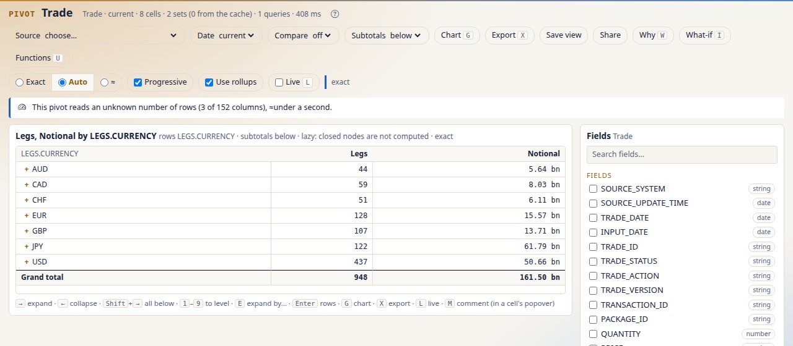
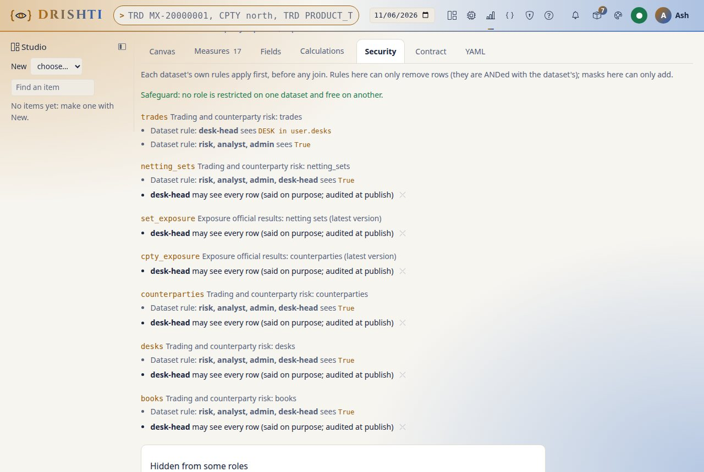
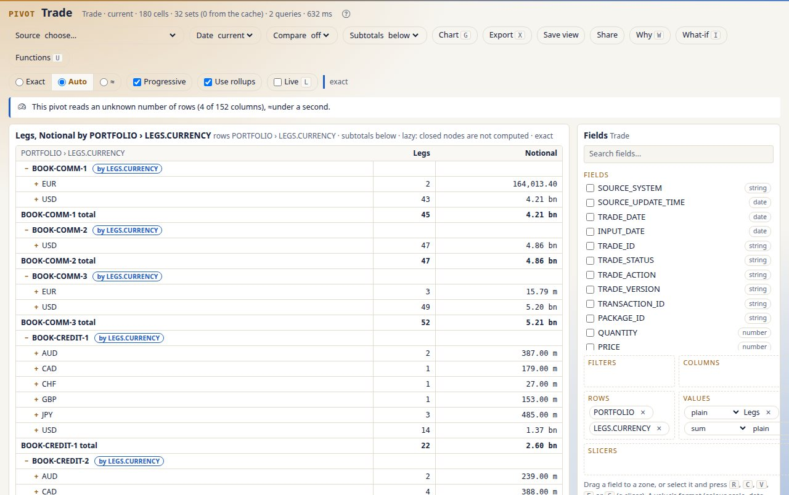
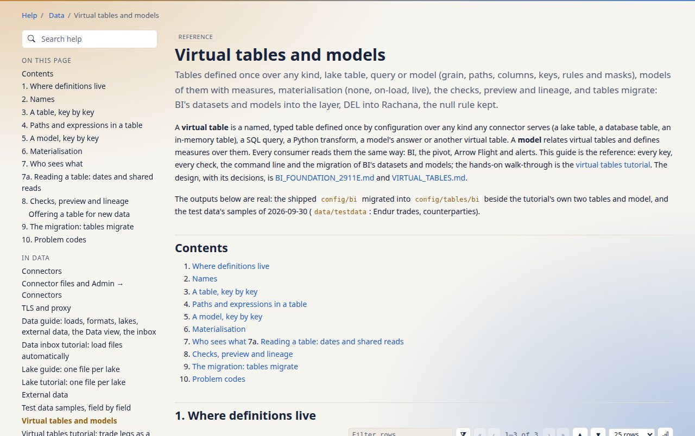

<!--
  Project Drishti · Any data. Any domain. One grammar.

  Copyright (c) 2026 Ashutosh Sinha <ajsinha@gmail.com>.
  All rights reserved.

  PROPRIETARY AND CONFIDENTIAL.

  This file is the confidential and proprietary property of Ashutosh Sinha.
  Unauthorised copying, use, modification, distribution or disclosure of this
  file, via any medium, is strictly prohibited except with the express prior
  written permission of the copyright holder.

  See the LICENSE file in the root of this repository for the full terms.
-->
# Tables and models

Business intelligence: [Index](README.md) · [Pivot](PIVOT.md) · [Pivot at scale and the risk cubes](PIVOT_SCALE_AND_CUBES.md) · **Tables and models** · [Reports and the designer](REPORTS.md) · [The report file, formatting and statements](REPORT_FILE_FORMAT_STATEMENTS.md) · [Models and datasets for reports](MODELS_AND_DATASETS_FOR_REPORTS.md) · [Live reports, boards and background runs](LIVE_REPORTS_AND_BOARDS.md) · [Distribution, subscriptions and alerts](DISTRIBUTION_AND_ALERTS.md) · [Governing BI and AI in BI](GOVERNANCE_AND_AI.md) · [The Notebook and Python](NOTEBOOK_AND_PYTHON.md) · [Groupings and analytics](GROUPINGS_AND_ANALYTICS.md)

Virtual tables and semantic models: where definitions live, a table key by key, paths and expressions, a model, materialisation, who sees what, checks, lineage, the editors and measures in a model; with the tutorial.

## Virtual tables and models

A **virtual table** is a named, typed table defined once by configuration over any kind any connector serves (a lake table, a database
table, an in-memory table), a SQL query, a Python transform, a model's answer or another virtual table. A **model** relates virtual tables
and defines measures over them. Every consumer reads them the same way: BI, the pivot, Arrow Flight and alerts. This guide is the
reference: every key, every check, the command line; the hands-on walk-through is the
[virtual tables tutorial](TABLES_AND_MODELS.md). The design, with its decisions, is
[ARCHITECTURE.md section 24](../../architecture/ARCHITECTURE.md#24-virtual-tables-the-central-table-layer); how BI reads the layer is
[ARCHITECTURE.md §28 section 18](../../architecture/ARCHITECTURE.md#281-the-table-layer-and-models-in-rachana).

The outputs below are real: the shipped BI datasets and models as migrated into `config/tables/bi` (where they ship) beside the tutorial's own two tables and model, and the
test data's samples of 2026-09-30 (`data/testdata`: Endur trades, counterparties).

### Contents

1. [Where definitions live](#1-where-definitions-live)
2. [Names](#2-names)
3. [A table, key by key](#3-a-table-key-by-key)
4. [Paths and expressions in a table](#4-paths-and-expressions-in-a-table)
5. [A model, key by key](#5-a-model-key-by-key)
6. [Materialisation](#6-materialisation)
7. [Who sees what](#7-who-sees-what)
7a. [Reading a table: dates and shared reads](#7a-reading-a-table-dates-and-shared-reads)
8. [Checks, preview and lineage](#8-checks-preview-and-lineage)
10. [Problem codes](#10-problem-codes)
11. [The editors](#11-the-editors)
12. [Measures in a model: filter context, and what is refused](#12-measures-in-a-model-filter-context-and-what-is-refused)

### 1. Where definitions live

| Where | What |
|---|---|
| `config/tables/<domain>/<name>.table.yaml` | one virtual table per file, in its domain's folder (`config/tables/trading/trade_legs.table.yaml`) |
| `config/tables/<domain>/<name>.model.yaml` | one model per file (the shipped samples: `config/tables/banking/` for the banking module's, read only while it is on, and `config/tables/bi/`) |
| the item store (`drishti_bi_item`, kinds `table` and `model`) | stored definitions, governed as BI's items are: workspaces, review, versions (no schema change) |

The catalogue reads both, checks every definition and the catalogue as a whole, and is replaced in one step when a definition changes. The
module is `drishti-tables` (plain Java); BI depends on it, never the reverse.

Every file starts with `rachana: 3`, the language version of the layer's files: expressions are Rachana. A file in BI's old form
(`rachana: 2`, `dataset:`, `datasets:`) is refused (`DRS-9614`); write it as a table or a model.

### 2. Names

| Kind | Rule | Example |
|---|---|---|
| table | `<domain>.<name>`: lower case, letters, digits, underscores, starting with a letter; the domain is the file's folder | `trading.trade_legs` |
| migrated BI dataset | the domain `bi`, hyphens as underscores | `trading-risk-trades` is `banking.trading_risk_trades` |
| pack-generated dataset | the pack's name as the domain | `pack.trading.trade` is `trading.trade` |
| model | BI's model name, kept (reports, boards and bookmarks bind it by name and major) | `trading-risk@1` |
| a table's old name | `was: trading-risk-trades`: resolves for one release, with a warning wherever it is used | |
| reference with a version | `@^1` (or `@1`): the major asked for | `trading.trade@^1` |

A table's name is unique across virtual tables and stored tables: a virtual table named like a lake table or a kind is refused when it is
defined (`DRS-9616`; `tables check --stored NAME,...` checks against a list, the server against its lakes and packs). Many tables may read
one source, each with its own columns, grain and filter (`trading.trade_summary` and `trading.trade_legs`, both `from: { kind: trade }`).

### 3. A table, key by key

```yaml
rachana: 3
table: banking.trading_cashflows_cashflows
was: trading-cashflows-cashflows             # the name before, one release
version: 1.0.0
title: "Trade legs and cashflows: cashflows"
from: { kind: trade }
grain: $.LEGS[*].CASH_FLOWS[*]               # one row per cash flow of every leg
columns:
  LEG_ID:       { path: "^.LEG_ID", type: integer }
  CURRENCY:     { path: "^.CURRENCY", type: string }   # the leg's currency
  FLOW_TYPE:    { path: "@.FLOW_TYPE", type: string }
  PAYMENT_DATE: { path: "@.PAYMENT_DATE", type: date }
  NOTIONAL:     { path: "@.NOTIONAL", type: decimal, format: amount0 }
materialize: on-load
```

| Key | Value | Notes |
|---|---|---|
| `rachana` | `3` | required: the language version |
| `table` | the name (section 2) | required |
| `was` | the old name | optional, one release |
| `version` | `major.minor.patch` | `1.0.0` when not given; consumers bind by major |
| `id`, `title`, `description`, `owner`, `sample`, `endorsement`, `tags`, `ai`, `layout` | as BI's items have them | kept as written |
| `from` | `{ kind, pack, connector }`, `{ lake, table }`, `{ table }` (a table over a table), `{ connector, query, params }` (SQL), `{ python, inputs, params }`, `{ model, query }` (a summary table) | exactly one form; `from: trade` is `from: { kind: trade }` |
| `grain` | a path from `$` ending in a list: `$.LEGS[*]`, `$.LEGS[*].CASH_FLOWS[*]` | omitted: one row per entity; only over documents (a kind, a lake table, a table) |
| `filter` | a row-scope condition over the source | rows that do not meet it are not in the table |
| `columns` | name to `path`, `expr` or `python` (exactly one), with `type`, `role`, `meaning`, `references`, `unit`, `additive`, `aggregate`, `format`, `key`, `masked`, `hidden-for`, `description` | `NAME: $.PATH` is the short form of a path column |
| `keys` | the columns that identify a row (with `business_date`) | a column with `key: true` or `role: key` is added |
| `keep` | `{ latest: COLUMN }`: of the rows with the same keys, the one with the greatest value; or a number of business dates (`30`) or days (`90d`) kept | de-duplication is explicit, never a silent distinct |
| `says` | what one row is, in words | |
| `materialize` | `none`, `on-load`, `{ live: { rows, age } }` | section 6 |
| `as-of` | `business-date` or `latest-load` | |
| `refresh` | `{ on-load: true, schedule: ... }` | |
| `rules` | `- { role: desk-head, where: "$.DESK in user.desks" }` | section 7 |
| `hidden-for` | roles that see none of the table | |
| `tests` | `unique`, `not-null`, `references-exist`, `agg` | the item's own tests |

**Built-in columns.** Every table has `id`, `business_date`, `index` (under a grain: the element's place in its list), and a live table
`update_seq` and `updated_at`. They are never declared (`DRS-9602`).

**Types.** `string`, `integer`, `decimal`, `boolean`, `date`, `timestamp`.

### 4. Paths and expressions in a table

| Root | Names | Needs |
|---|---|---|
| `$` | the entity (or the source row) | always |
| `@` | the grain's element (the row) | a grain |
| `^` | the element's parent (the leg of a cash flow) | a grain two lists deep; one list deep, `^` is the entity: write `$` |
| `^^` | the parent's parent | a grain three lists deep |

A path holds one value: a list (`[*]`) in a column is refused (`DRS-9603`); an aggregate of a list in an expression is Rachana's list form
(`sum($.LEGS[*].NOTIONAL)`), not a measure. Indexes are written in brackets (`$.LEGS[0].CURRENCY`).

A **calculated column** (`expr`) and the `filter` are row-scope Rachana over the **source**, never over another column: write
`$.MTM / 1000000`, not `MTM / 1000000` (`DRS-9127`), so a column means the same whatever order columns are read in. Aggregates of rows
belong in a model's measures (`DRS-9127`); `ctl.x` and the other display concerns of a Sutra are refused (`DRS-9127`); `user.x` belongs in a
rule. A look-up of another table is `related(core.desks.NAME, on = $.DESK)`.

A column whose expression reads a masked column's path is masked too.

**The null rule.** A comparison with a missing value follows Rachana: `null != 'X'` is true, `null == 'X'` is false, `null == null` is
true. Write `$.STATUS != 'MATURED' && $.STATUS != null` to leave rows with no status out.

**Checked mode.** Every expression of a table or model is checked by Rachana's checked mode, with the types of the table's columns (a
path a column reads has that column's type) or the model's `alias.COLUMN`: the scope's rules, the types, `in` and lists, named arguments,
`^`. Its codes are the language's: `DRS-9127` (type or scope), `DRS-9129` (not yet), `DRS-9152` (unknown name). A definition reads the
source as it is: masks are its readers'. An aggregate is a measure's, not a column's: `greatest(a, b)` is the larger of two values in a
row.

### 5. A model, key by key

```yaml
rachana: 3
model: trading-risk
version: 1.0.0
tables:
  trades:         { table: banking.trading_risk_trades, role: fact }
  netting_sets:   { table: banking.trading_risk_netting_sets, role: fact }
  counterparties: { table: banking.trading_risk_counterparties, role: dimension }
  desks:          { table: banking.trading_risk_desks, role: dimension }
relationships:
  - { from: trades.DESK, to: desks.id }
  - { from: trades.NETTING_SET, to: netting_sets.id, active: false }
measures:
  MTM:      { expr: "sum(trades.MTM)", format: signed0 }
  Open MTM: { expr: "sum(trades.MTM, where = trades.TRADE_STATUS != 'MATURED' && trades.TRADE_STATUS != null)", format: signed0 }
  MTM rank: { expr: "rank(sum(trades.MTM))" }
hierarchies:
  Desk and book: [desks.NAME, books.NAME]
security:
  may-see-all: { netting_sets: [desk-head], counterparties: [desk-head], desks: [desk-head] }
```

| Key | Value | Notes |
|---|---|---|
| `tables` | alias to `{ table, role }` (`fact` or `dimension`) | measures, fields and rules name `alias.COLUMN` |
| `relationships` | `{ id, from, to, cardinality, direction, active, name }`, from the many side | both ends real columns of one type (`DRS-9122`); one active relationship per pair of aliases |
| `measures` | name to `{ expr, format, description, currency, additive, id, title, display, folder, hidden }`, or a Python measure `{ python, inputs, by }` | aggregate scope: `alias.COLUMN` inside aggregates, `measure('name')`, `param.x`; no document path (`DRS-9127`); an inactive relationship is `calc(..., via = 'r_5')` |
| `hierarchies` | name to its levels (`trades.TRADE_DATE.month` is a field) | |
| `security` | `rows` per alias, `masked`, `may-see-all`, `propagate` | only tightens what the tables' rules allow |
| `scan-warn-rows` | a whole number of rows above zero | this model's own threshold for the warning on a join across connectors; without it, `drishti.tables.scan-warn-rows` |
| `calc-groups`, `parameters`, `calendars`, `fx`, `tests`, `rollups`, `history` | as BI's models have them | `history` samples measures of a live table |
| `id`, `title`, `description`, `owner`, `tags`, `sample`, `endorsement`, `lifecycle`, `layout`, `ai`, `golden`, `contract`, `perspectives`, `fields` | kept as written | |

The model query (MQ, `mq: 1` and `mq: 2`) asks a model as it always has; a table's implicit model is `table:<name>`.

### 6. Materialisation

| `materialize` | Means |
|---|---|
| `none` (default) | read on demand; the compiler pushes work to the fastest route (a promoted column, a connector's column scan, SQL to the source) |
| `on-load` | Parquet per business date under `<store>/<domain>/<name>/v<major>/<date>/part-*.parquet`, rebuilt when the source's data-load signal arrives; a query reading the previous file goes on (each build writes a file of its own) |
| `{ live: { rows, age } }` | in memory by key, maintained from what the source pushes; bounded by `rows` and `age` (`30s`, `15m`, `2h`, `1d`, or ISO-8601); needs `keys`; only over a kind |

A live table's rows are worked out from each pushed entity through the table's own definition; a row whose values did not change keeps its
`update_seq`. An on-load build writes a new file and moves it in, so a query reading the previous file goes on.

Materialised files are a cache: rebuilt at will, never the truth, never written into a lake's own tables. A model's `rollups:` keep partial
states per date. The store's folder is a setting of the layer (planned: `drishti.tables.store-dir`, by default `<data>/tables`).

### 7. Who sees what

| Layer | Applies to | Notes |
|---|---|---|
| the table's `rules` | every reader of the table: BI, the pivot, Flight | a reader with several roles sees the rows any of their rules allows; a role no rule names sees none |
| the table's masked columns | readers without the raw power (a role with `raw`) | they see `•••`, whatever the installation's own field masks (`drishti.security.redact`) are, even none; a filter, sort or grouping on a masked column is refused |
| the model's `security` | readers through the model | only tightens; `may-see-all` stops a fact's rule reaching a dimension |

`$.DESK in user.desks` is strict: a desk-head with no desks sees no trades.

A rule on one fact also limits another fact of a model through `related_rows('alias')`: `- { role: desk-head, where: "related_rows('trades')" }`
on the exposure table keeps the exposure rows that share a key (a dimension both reference, such as the counterparty, or a reference
between the two) with the trades the desk head sees, so she sees the exposure of the counterparties her desks trade with and nothing
more. BI's engine works it out over the other table with that table's own rules; a model where the two share no key refuses the question,
and a table with such a rule read on its own shows that role no rows. Write it wherever a rule names
another table (ARCHITECTURE.md §28 8.5). A live table's history follows its table's rules the same way,
on its group columns.

Before the table's own rules, a read is a read of the source as the reader: their row rules and masks on the source kind apply to every
document. A table hidden from a role (`hidden-for`) gives that role no rows; a column hidden from a role is left out of what they read.
Administrators and BI authors (the power to edit BI datasets) define tables and models; definitions are audited and versioned like BI's
items.

### 7a. Reading a table: dates and shared reads

| Point | Rule |
|---|---|
| business date | every read names one; none means the source's latest; a date the source does not hold is refused (`DRS-9615`) |
| undated source | gives its current rows, dated today |
| known-at time | passed to a source that keeps history; refused by one that does not (`DRS-9615`) |
| shared reads | within one request (a pivot view, a model query, a Flight read, a Sutra page) a source is read once per business date, and every table over it is computed from that read |
| a table over a table | reads its base's source with the base's grain and filter, its own filter added, the base's columns and its own |
| a condition | a reader's condition (a Sutra's `where:`, Flight's `filter`) is Rachana over the table's columns, bare or as `@.X`; a masked column cannot filter (`DRS-9615`) |
| size | a read of more rows than `drishti.tables.read-max-rows` (2,000,000) is refused in words, never cut short |
| reading again | a read's version is the definitions, the table, the date, the source kind's data version and who reads; a consumer keeps what it staged while the version holds (the pivot does), and a source without a data version is read every time |
| sources read here | a kind and a lake table; a SQL, Python or model source is computed by its runner |
| models across connectors | a model may relate tables from different connectors; the engine joins them, and the scan estimate warns when a side is larger than the model's `scan-warn-rows`, else `drishti.tables.scan-warn-rows` (1,000,000), and unfiltered |
| Sutra pages | a panel's `source: { table: trading.trade_legs, where: "@.CURRENCY == $.CCY", limit: 50, as-of }` reads the table for the page's viewer on the page's date (or `as-of`); `where` keeps rows (`@` the row, `$` the page's document, the page's events), at most `limit` (default 20, at most 200); the rows are `$src`. Each viewer gets their own rows and masks; a page built for nobody in particular (an audience's snapshot) shows the panel's reason instead |

### 8. Checks, preview and lineage

The command line reads definitions and sample files only; it starts no server. Run it from the repository (or installation) folder:
`config/tables` is read by default (`--root` for another folder).

Run these from the Drishti folder (the repository root, or the install folder of a release).

```text
$ drishti.py tables list
table  banking.counterparty_exposure_counterparties@1.0.0  from kind, 4 columns, materialize on-load
table  banking.counterparty_exposure_official_counterparties@1.0.0  from table, 0 columns, materialize on-load
...
table  banking.live_trading_trade@1.0.0  from kind, 14 columns, materialize live
table  banking.trading_cashflows_cashflows@1.0.0  from kind, grain $.LEGS[*].CASH_FLOWS[*], 9 columns, materialize on-load
table  banking.trading_risk_trades@1.0.0  from kind, 17 columns, materialize on-load
table  core.books@1.0.0  from kind, 3 columns, materialize none
table  trading.trade_legs@1.0.0  from kind, grain $.LEGS[*], 8 columns, materialize on-load
model  trading-risk@1.0.0  7 tables, 17 measures
model  legs@1.0.0  2 tables, 4 measures
...
24 table(s), 11 model(s)

$ drishti.py tables check
24 table(s), 11 model(s): 0 error(s), 0 warning(s)
```

A table over a table (`from: { table }`) has its base's columns; `0 columns` counts only those it adds.

`tables check` checks every table (name and folder, source, grain, paths, columns, types, keys, materialisation, rules, expressions in their
scopes), every model (aliases, tables found at the major asked, relationships, measures, hierarchies, security) and the catalogue (two
definitions with one name, `was:` names, references between tables, `related(...)`, tables over tables that come back to themselves). It
exits 1 when it finds an error. With `--sample TABLE=FILE.jsonl` it also checks the table against sample documents: keys unique per
business date, every path present in some row.

```text
$ drishti.py tables preview banking.trading_cashflows_cashflows --sample trades.jsonl --limit 5
id	business_date	index	LEG_ID	CURRENCY	FLOW_TYPE	FLOW_ID	PAYMENT_DATE	START_DATE	END_DATE	NOTIONAL	RATE
row-1		0	1	USD		5000028	2026-11-03	2026-11-01	2026-11-01	1.484794E7
row-1		0	2	USD		5000029	2026-11-03	2026-11-01	2026-11-01	1.1878352E7
row-2		0	1	USD		5002953	2026-04-07	2026-03-01	2026-03-31	979542.3
row-2		1	1	USD		5002954	2026-05-10	2026-04-01	2026-04-30	979542.3
row-2		2	1	USD		5002955	2026-06-10	2026-05-01	2026-05-31	979542.3
5 row(s) from 136 document(s)
```

A sample is JSON Lines (plain or `.gz`), one entity a line: the document itself, or `{ id, business_date, doc }` as the lake keeps it.
The preview expands the grain, walks `$`, `@` and `^`, evaluates filters and calculated columns with Rachana, and shows at most 10,000 rows.
A sample has no entity id or business date unless it is in the lake's form: the preview numbers its documents (`row-1`). `related(...)`
reads another table's sample given with `--related TABLE=FILE.jsonl` (repeatable), and `fx(...)` the spot rates of `--fx FILE.jsonl`
(documents with `PAIR_NAME: "EUR/USD"` and `MID`, the market-data pack's [`fx-spot`](../../contracts/samples/market-data.md#fx-spot) ([contract](../../contracts/packs/market-data.md#fx-fx-spot-rate-fx-spot)): a pair as quoted, its inverse, or through USD); without
them `related` finds nothing and only a currency to itself converts.

```text
$ drishti.py tables lineage banking.trading_risk_trades
used by  model trading-risk: reads it as trades (fact)
```

Lineage lists who uses a table: models that read it (and as which alias), tables over it, columns that look it up; BI's reports, alerts
and Flight add theirs once BI reads the layer. Every command takes `--json`.

#### Offering a table for new data

A table a data load creates (a new lake table, DATA_LAKE_GUIDE.md section 5.6) is offered a flat virtual table; nothing is defined until
someone accepts it. `tables offer` reads a sample of the new documents and suggests one column per scalar field (a nested object's
fields one level down, `$.OWNER.NAME` as `OWNER_NAME`), each typed from its values (`integer`, `decimal`, `boolean`, `date`,
`timestamp`, else `string`), the id field (`id` or a name ending `_ID`) as the key when it is unique in the sample, and names each list
of objects as a grain to choose instead (`--grain '$.MOVES[*]'`: one row per element, its fields as `@` paths). `--write` accepts it: a
new file under `config/tables/<domain>/`, refused when the name is taken (a table, a `was:` name, or `--stored`).

```text
$ drishti.py tables offer bank.counterparties --sample counterparties.jsonl --kind counterparty
rachana: 3
table: bank.counterparties
version: 1.0.0
description: "Offered from a sample of 24 documents; review the columns before accepting."
from: { kind: counterparty }
keys: [COUNTERPARTY_ID]
columns:
  COUNTERPARTY_ID:         { path: "$.COUNTERPARTY_ID", type: string }
  NAME:                    { path: "$.NAME", type: string }
  ...
  NET_MTM:                 { path: "$.NET_MTM", type: decimal }
  KYC_STATUS:              { path: "$.KYC.STATUS", type: string }
  KYC_LAST_REVIEW:         { path: "$.KYC.LAST_REVIEW", type: date }
  KYC_PD_1Y:               { path: "$.KYC.PD_1Y", type: decimal }
  ...
materialize: none
# offered from 24 document(s); grains you may choose instead: [$.NETTING_SETS[*]]
```

### 10. Problem codes

| Code | Meaning |
|---|---|
| `DRS-9600` | the definition cannot be read (YAML, an unknown key, a required key missing), or an expression does not read |
| `DRS-9601` | a name breaks the naming rule, or the file is not in its domain's folder |
| `DRS-9602` | a built-in column declared |
| `DRS-9603` | a grain or path that is not one |
| `DRS-9604` | a column with none, or several, of `path`, `expr`, `python` |
| `DRS-9605` | an unknown type |
| `DRS-9606` | keys and `keep` |
| `DRS-9607` | materialisation |
| `DRS-9608` | a rule without a role or a condition |
| `DRS-9609` | a table, model, column, measure or alias the catalogue does not hold |
| `DRS-9610` | two definitions with one name, or one `was:` name twice |
| `DRS-9611` | tables over tables in a circle |
| `DRS-9613` | a sample check |
| `DRS-9614` | BI's old form where the layer reads |
| `DRS-9615` | a read refused: a date the source does not hold, known-at on a source without history, too many rows, a source its runner computes, a condition on a masked column, a reader no rule names |
| `DRS-9616` | a virtual table named like a stored table |
| `DRS-9127`, `DRS-9129`, `DRS-9152`, `DRS-9122` | the language's (checked mode): a type or scope, not yet, an unknown name; a relationship's ends |

### 11. The editors

**Build › Tables & models** (`/build/tables`; also from BI's rail) is one screen for every table, virtual table, semantic model and
Python-driven table. The designs and the mock-ups the product owner chose are in [EDITORS.md](../../architecture/SHARED_SCREENS.md#7-the-editors-one-pattern-for-every-object-people-author). Opening it needs
the `bi` power; saving and proposing need `bi-author` (or an administrator); a person without it reads the YAML and the preview but cannot
change them.

#### 11.1 The shell

| Part | What it does |
|---|---|
| **Objects** (left) | every table, Python-driven table and model you may open, in three groups, with a search over name, title, form and connector. A definition shipped under `config/tables/` is read-only here (*Shipped*); **Copy as a draft** starts an editable copy |
| **Editor** (middle) | the visual editor of the object, and **below it the live YAML**: a visual edit rewrites the YAML at once (the layer's own writer, the file's comment header kept) and the line being edited is highlighted; a YAML edit is checked as you type and shows in the visual side. An invalid YAML is marked at its line and kept as typed; the visual side keeps the last valid version and the switch to **Visual** waits until it reads |
| **Preview and checks** (right) | read on the server as you may see the source, on the source's latest business date (or one you choose): the first 20 rows, the **totals of the number columns computed by the pivot engine** over every row read, the checks (name unique, key unique, empty values, dates follow the source, the read's own problems), the cost of a join across connectors, and *Used by* |
| **Visual / YAML / Both** | the views; your choice and whether the YAML panel is open are remembered for you on the server (`PUT /api/v1/tables/editor/prefs`) |
| **Validate** (Ctrl+Enter) | the layer's checks now, every problem listed with its line (click it to go there) |
| **Preview** | reads the preview again |
| **History** | the saved versions and reviews of a stored object |
| **Impact (n)** | what uses it: models, tables over it, look-ups, and BI's reports, boards and notebooks that bind it |
| **Save draft** (Ctrl+S) | saves a draft in a workspace (your own, or a shared one); nothing goes live |
| **Propose for review** | asks a second person to approve it (four eyes: BI's review, the same approve power and notifications); approving runs the layer's checks and refuses a definition with an error |
| **+ New** | guided steps that land in the editor: a table (name, source, the columns suggested from a sample of the source, check), a model (the four questions below), a Python-driven table (name, then a template, a notebook or an empty function) |

The panes are resized with the shared handles (remembered per person; off on a phone, where the panes stack). Every button is reachable by
keyboard; the model's tabs move with the arrow keys.

#### 11.2 Tables and virtual tables

**The source and its look-ups** are rows: the source (a kind any connector serves, or another table) and each **look-up**: one row of
another table by a key for each row (`related(trading.desks.NAME, on = $.DESK)`, many to one). A table never multiplies its rows:
combining tables row by row is a model's relationships. **+ Look-up** picks the table, the key and the
columns to bring in. When the two sides are served by different connectors, the cost shows under the sources: the rows each side read now,
the memory they take and the time the read took; above `drishti.tables.scan-warn-rows` (1,000,000) on a side and with no filter, readers
are asked to filter first.

**Columns** are a checklist: the source's own fields unticked until you tick them, each with the name here, where it comes from (a path such
as `$.mtm`, or a Rachana formula: a computed column), its type and whether it is a key. **+ Computed column** adds a formula; the function
catalogue and the columns complete as you type. `business_date` is built in and follows the source. The **Rows** card holds the filter, the
grain and the materialisation.

**Text** shows the same table as one Rachana statement, read back as you type:

```text
table trading.trade_view from trade
grain $.LEGS[*]
select $.TRADE_ID as TRADE_ID: string key,
       @.NOTIONAL / 1000000 as NOTIONAL_M: decimal,
       related(core.desks.NAME, on = $.DESK) as DESK_NAME: string
where $.STATUS != 'CANCELLED' && $.STATUS != null
```

Every other key of the table (formats, masks, rules, materialisation) is kept as it was. A table whose source is SQL, Python or a model's
answer is edited in the visual view or the YAML.

#### 11.3 Semantic models

Tabs with counts: **Overview**, **Tables** (aliases, their tables and roles, and the relationships from the many side, with the join cost
across connectors), **Fields** (every `alias.COLUMN`), **Measures**, **Hierarchies**, **Row rules**, **Masks** and **Access**.

- **Overview** answers four questions: what it is about, what people look at it by, what numbers it gives, who may see what. The same four
  questions are the *+ New model* steps.
- **Measures**: each with its formula, format and **Adds up?**. That answer is the engine's: each aggregate is looked up in the pivot
  engine's functions, and a total adds up only when every aggregate in it is a plain sum of its parts (`sum`, `count`) and they are only
  added, subtracted or scaled by a number. An average, a ratio, a distinct count or VaR is computed per total.
- A measure's **?** opens its card: the formula, the formula in words (from the function catalogue), a worked test value (the measure's total
  over every row you may see, from the preview), whether it adds up and why, and the measures that use it.
- **Access** is the matrix of every role against the rows it sees (the tables' rules and the model's, `all`, or `none`), the columns masked for
  it (none for a role with the raw power) and whether it may edit.
- The preview pane is the model's live answer: each measure's grand total, read as you.

#### 11.4 Python-driven tables and models

A Python-driven table is a table whose source is a build function: `from: { python: <item>, inputs: { alias: table }, params: { pool, runs } }`.
Its **output contract** is the table's columns (names, types, keys) and tests (`not-null`, `unique`); its code is kept in the build
function's item (a BI Python item: `interface: transform`, `entry: build`, `target: server`, with its time and memory limits) and saved with
the table.

```yaml
rachana: 3
table: risk.desk_pnl_stats
from:
  python: risk-desk_pnl_stats
  inputs: { pnl: risk.daily_pnl }
  params: { pool: default, runs: on-demand, by: DESK, value: PNL }
columns:
  GROUP: { type: string, key: true }
  N:     { type: integer }
  MEAN:  { type: decimal }
tests:
  - { not-null: MEAN }
```

| Part | What it does |
|---|---|
| **Build function** | `build(inputs, params)`: the inputs by alias, each a table as you may see it; returns one table with the contract's columns |
| **Output contract** | the columns, types, keys and *never empty*; **Contract from the code** proposes it from the columns the code assigns and selects |
| **Inputs** | the tables it reads, read as the person the run is for |
| **Runs** | on demand and kept per business date, or on each load of an input; the compute pool and the time and memory limits |
| **Templates** | join and derive, resample a series, statistics per group, a file or feed from an approved source: each writes the code, the inputs and the contract |
| **Notebook → Turn into table** | cells become the build function: `drishti.table("domain.name")` becomes an input, the imports move to the top, the last expression is returned, and the contract is proposed |
| **Sample run** | reads each input as you may see it (a table by name, or a model query), runs the build function on the server's compute pool `python` (the strict sandbox of [BI_GUIDE.md section 34](NOTEBOOK_AND_PYTHON.md#3-python-measures-and-visuals), section 7), and checks the rows against the contract: each contract column there and of its type, the keys unique and the never-empty columns filled, each failure said in words in the checks; the first 20 rows show. Needs `bi-author`; where the server cannot run Python safely (compute off, Windows) the button is off and says why. The Notebook's **Run cells on the server** turns the cells into a build function and runs it the same way |

**Where the code runs.** On the server's compute pool `python`, never in the console or the browser, in the strict sandbox of
[BI_GUIDE.md section 19](../../architecture/ARCHITECTURE.md#291-one-python-runtime): the inputs read as the person the run
is for (their row rules and masks), the pinned libraries only (`config/compute/locks/python.lock`), the build function's time and memory limits, no
network (a file or feed from an approved source is read by the server and handed in as an input), files only in its own folder; every run is audited.
When BI reads the table, the same function runs for the reader and its rows are checked against the contract: a column missing or of another type is
refused in words (`DRS-9075`). Where the server cannot run Python safely (compute off, a Windows server), the table answers `DRS-9074` with the reason.

A Python **model** is a model whose measures are Python measures (`{ python, inputs, by }`): the Measures tab lists them with the engine's "adds up?" (computed per total), and their keys are edited in the YAML; they run on the same pool.

#### 11.5 The editor API

Everything the screen shows is computed on the server, for the person who asks: `/api/v1/tables/editor`.

| Call | What it answers |
|---|---|
| `GET /objects` | the tables, Python tables and models you may open, with where each comes from and its status; whether you may edit |
| `GET /object?kind=table&name=` (or `&item=`) | the YAML, the document, the problems at their lines, the statement, the build function of a Python table |
| `POST /check` `{kind, yaml}` or `{kind, yaml, doc}` | the layer's checks as typed; a `doc` is written back as YAML |
| `POST /statement` `{statement, yaml}` | the Text toggle's statement read onto the table |
| `POST /preview` `{kind, yaml, date}` | a table's rows, totals (pivot engine), checks and cost; a model's measures with their totals and "adds up?" |
| `POST /access` `{yaml}` | a model's Access matrix |
| `GET /impact?kind=&name=`, `GET /history?item=` | what uses it; its versions |
| `POST /suggest` `{kind, name}` | + New: a table over a kind with columns from a sample |
| `POST /save`, `POST /propose` | a draft saved in a workspace; proposed for review |
| `GET`/`PUT /prefs` | your view (`visual`, `yaml`, `both`) and the YAML panel |
| `GET /python/templates`, `POST /python/notebook`, `POST /python/contract` | the Python table's templates, a notebook turned into a build function, a contract proposed from code |
| `POST /python/run` `{yaml, source, date?, timeout?, memory?, inputs?}` | the sample run on the compute pool, checked against the contract (`bi-author`) |
| `GET /python/runtime` | whether the sample run runs on this server, and why not |

The same definitions are checked on the command line by `drishti.py tables check` (section 8); a saved draft is a BI item of kind `table` or
`model` in the layer's form (`rachana: 3`).

### 12. Measures in a model: filter context, and what is refused

**Filter direction, bridges and named paths.** A relationship has a `direction: single` (one way, the default) or `both`. A many-to-many is declared with `bridges:` naming its bridge table; each measure can follow a named or inactive relationship once for all of its expression with `via: name` (`calc(..., via = 'name', filter = 'one_way')` overrides one relationship's direction for one measure). A model where a table reaches another by two paths and one is both-ways or across a bridge is refused at save with both paths and the fix; see [Reports guide section 5.3](MODELS_AND_DATASETS_FOR_REPORTS.md#13-relationships-and-how-a-question-joins).

**Measure functions.** `functions: { share: { params: [a, b], expr: "a / b" } }` lets a measure write `share(sum(x.V), sum(x.W))`; a call is expanded before the checks, so it is exactly the expression it stands for.

Every expression is written in one of four scopes, decided by where it stands: **row** (a column's `expr`, a `filter`), **rule** (a
table's `rules`, a model's `security.rows`), **aggregate** (a model's measures, MQ `define` and `having`) and **context** (the first
argument of `calc`, `share_of`, `parent_of`, `as_of`). What each scope may name: [ARCHITECTURE.md §28 section
18.2](../../architecture/ARCHITECTURE.md#284-the-expression-language-del-and-its-checks). Every function, with its arguments and where it runs:
[FUNCTIONS.md](../FUNCTIONS.md).

A measure is evaluated per group of the answer in four layers: the reader's **security** (fixed: no function touches it), the **query**
(MQ `where`, report, page and visual filters, slicers, drill, cross-filter), the **group** (the current group's values) and the
**measure**'s own `where =` and `calc` edits. The context functions edit the query and group layers:

```yaml
measures:
  MTM:             { expr: "sum(trades.MTM)" }
  Open MTM:        { expr: "sum(trades.MTM, where = trades.TRADE_STATUS != 'MATURED' && trades.TRADE_STATUS != null)" }
  MTM all desks:   { expr: "calc(measure('MTM'), ignore = [desks.NAME])" }        # the desk filter dropped
  MTM % of total:  { expr: "share_of(measure('MTM'), over = ALL)", format: share } # of everything you may see
  MTM % of parent: { expr: "parent_of(measure('MTM'), hierarchy = 'Desk and book')" }
  MTM day on day:  { expr: "measure('MTM') - as_of(measure('MTM'), shift_date(asof(), -1))" }
  MTM ytd:         { expr: "ytd(sum(trades.MTM), trades.TRADE_DATE)" }
  Closing balance: { expr: "latest(sum(accounts.BALANCE), accounts.business_date)" }
```

`ignore = ALL` means everything **you** may see: security is never in scope. `share_of` and `parent_of` drop filters, so a book's share
of the total stays a share of everything you may see whatever the slicers say; the pivot's `pct_of_total` and `pct_of_parent` are shares
of the totals the answer shows. Context functions nest at most three deep; iteration is explicit (`avg_by(sum(trades.MTM), by = [desks.NAME])`),
never a silent context transition. A literal mapping reads better as `switch(payments.CURRENCY, 'JPY', 1 / 148.2, 'EUR', 1.174, null)`
than as a chain of `? :`.

**What is refused, and why.**

| Refused | Why |
|---|---|
| any function that edits the security layer or adds rows a rule removed | nothing adds rights |
| an aggregate in a column, a filter or a rule; a bare column outside an aggregate in a measure (`DRS-9127`) | a column is one value per row, a measure one value per group |
| a document path in a measure (`sum(trades.LEGS[*].NOTIONAL)`) | add the path as a table column, so every consumer reads the same figure |
| a filter, sort, `in` or grouping on a masked column (`DRS-9161`) | a hidden value must not be inferred from what a filter keeps |
| `reduce` with `+` over a list | an aggregate is the engine's (`sum`) |
| `as_of` with a date that depends on a row (`DRS-9166`), or on a live table (`DRS-9157`) | the second plan is bound to one date before the query runs |
| context functions nested deeper than three | the plans stay bounded and readable |
| `ctl.x`, `link`, `fmt` in tables and models | display concerns of a Sutra; a column or a measure has a `format` |
| VaR, ES, exposure, FRTB-SA or SIMM as an aggregate over a vector or a table | they come only from their engines, through `measure('VAR', scope)` |

## Tutorial: Virtual tables and models

A virtual table turns documents into rows and typed columns, once, for every reader. In this tutorial you define the trades' legs as a
table, preview it over sample documents, add a column converted to US dollars and the desk's name looked up in a table of books, give a
trader only their own trades, relate the legs to the books in a model with measures. Each step shows the YAML, the command line and the screen. The guide is [BI_GUIDE.md](README.md).

The outputs below are real: the test data's Endur trades, books and FX spots of 2026-09-30 (`data/testdata`), and the shipped
`config/bi`. BI reads the table layer from the switch on; until then the screens shown are the ones that read the same data today.

### Time to complete

About 30 minutes.

### Before you start

- A checkout of the repository and the server's exec jar built (`./mvnw -q -DskipTests package`): the `tables` commands run from it
  without starting a server ([CLI_REFERENCE.md](../../guides/CLI_REFERENCE.md)).
- Sample documents as JSON Lines, one entity a line, in the folder you work in:

  ```text
  $ zcat data/testdata/trades/endur/trade_endur.2026-09-30.jsonl.gz > trades.jsonl
  $ zcat data/testdata/core/book/book.2026-09-30.jsonl.gz > books.jsonl
  $ zcat data/testdata/market-data/fx-spot/fx-spot.2026-09-30.jsonl.gz > fx-spot.jsonl
  ```

- Run every command from the folder that holds `config/tables` (the repository's folder, or a copy of it to try things in): the tables live
  under `config/tables`, one folder per domain.

### What you will learn

- how a table's grain, paths and columns turn a trade's legs into rows, and what `$`, `@` and `^` name;
- why a calculated column reads the source, never another column, and how `fx` and `related` read another source;
- how a table's rules and masks apply to every reader, and what a reader no rule names sees;
- how a model relates tables and defines measures in Rachana;

### Step 1 · A table of the trades' legs

An Endur trade holds its legs in `LEGS`, each with `LEG_ID`, `CURRENCY` and `NOTIONAL`; the trade's book is `PORTFOLIO`. Write
`config/tables/trading/trade_legs.table.yaml`:

```yaml
rachana: 3
table: trading.trade_legs
from: { kind: trade }
grain: $.LEGS[*]                          # one row per leg
keys: [TRADE_ID, LEG_ID]
columns:
  TRADE_ID: $.TRADE_ID                    # the trade's own field
  BOOK:     { path: $.PORTFOLIO, type: string }
  LEG_ID:   { path: "@.LEG_ID", type: string }
  CURRENCY: { path: "@.CURRENCY", type: string }
  NOTIONAL: { path: "@.NOTIONAL", type: decimal, format: amount0 }
materialize: on-load
```

Check it:

```text
$ python3 tools/drishti.py tables check
1 table(s), 0 model(s): 0 error(s), 0 warning(s)
```

You should see `0 error(s)`. Write `$.LEGS[0]` as the grain and the check names the grain and every path that needed it:

```text
$ python3 tools/drishti.py tables check
trading/trade_legs.table.yaml: error DRS-9603 grain: a grain is a path from $ that ends in a list: $.LEGS[*] or $.LEGS[*].CASH_FLOWS[*]
trading/trade_legs.table.yaml: error DRS-9603 columns.LEG_ID.path: @ names the grain's element: this table's grain is the entity (use $)
trading/trade_legs.table.yaml: error DRS-9603 columns.CURRENCY.path: @ names the grain's element: this table's grain is the entity (use $)
trading/trade_legs.table.yaml: error DRS-9603 columns.NOTIONAL.path: @ names the grain's element: this table's grain is the entity (use $)
1 table(s), 0 model(s): 4 error(s), 0 warning(s)
```

On the screen: the Pivot reads the same grain from the trades today. Rows `$.LEGS[*].CURRENCY` count one row per leg, as the table will:



### Step 2 · Its rows over sample documents

```text
$ python3 tools/drishti.py tables preview trading.trade_legs --sample trades.jsonl --limit 5
id	business_date	index	TRADE_ID	BOOK	LEG_ID	CURRENCY	NOTIONAL
row-1		0	1000016	BOOK-COMM-3	1	USD	1.484794E7
row-1		1	1000016	BOOK-COMM-3	2	USD	1.1878352E7
row-2		0	1000138	BOOK-COMM-3	1	USD	3.52635228E7
row-2		1	1000138	BOOK-COMM-3	2	USD	3.635252842E7
row-3		0	1000156	BOOK-COMM-3	1	EUR	6437605.63
5 row(s) from 136 document(s)
```

Add `--json` for the rows as JSON. Check the keys on the sample:

```text
$ python3 tools/drishti.py tables check --sample trading.trade_legs=trades.jsonl
1 table(s), 0 model(s): 0 error(s), 0 warning(s)
```

You should see one row per leg (trade 1000016 has two), the built-in columns `id`, `business_date` and `index` first (a sample file has
no entity id or business date: the preview numbers its documents `row-1`, `row-2` ...), and no `DRS-9613` (the keys are unique on each
business date).

### Step 3 · A column in dollars and the desk's name

Add two calculated columns. A column's expression reads the source (`@.NOTIONAL`), never another column (`NOTIONAL`):

```yaml
  NOTIONAL_USD: { expr: "@.NOTIONAL * fx(@.CURRENCY, 'USD')", type: decimal }
  DESK_NAME:    { expr: "related(core.books.DESK_NAME, on = $.PORTFOLIO)", type: string }
```

`fx` reads the installation's one FX source at the row's business date; `related` reads the `DESK_NAME` of the `core.books` row whose key
is the trade's book. Write `config/tables/core/books.table.yaml`:

```yaml
rachana: 3
table: core.books
from: { kind: book }
keys: [BOOK_ID]
columns:
  BOOK_ID:   { path: $.BOOK_ID, type: string }
  NAME:      { path: $.NAME, type: string }
  DESK_NAME: { path: $.DESK_NAME, type: string }
```

then preview again, the books' and the FX spots' samples beside the trades' (`--related` gives a table's sample, `--fx` the spot rates;
without them only a currency to itself converts and `related` finds nothing):

```text
$ python3 tools/drishti.py tables preview trading.trade_legs --sample trades.jsonl --related core.books=books.jsonl --fx fx-spot.jsonl --limit 6
id	business_date	index	TRADE_ID	BOOK	LEG_ID	CURRENCY	TRADER	NOTIONAL	NOTIONAL_USD	DESK_NAME
row-1		0	1000016	BOOK-COMM-3	1	USD	TRDR-FROSSI	1.484794E7	14847940	Commodities
row-1		1	1000016	BOOK-COMM-3	2	USD	TRDR-FROSSI	1.1878352E7	11878352	Commodities
row-2		0	1000138	BOOK-COMM-3	1	USD	TRDR-FROSSI	3.52635228E7	3.52635228E7	Commodities
row-2		1	1000138	BOOK-COMM-3	2	USD	TRDR-FROSSI	3.635252842E7	3.635252842E7	Commodities
row-3		0	1000156	BOOK-COMM-3	1	EUR	TRDR-TBRENNAN	6437605.63	7557749.00962	Commodities
row-4		0	1000172	BOOK-COMM-1	1	USD	TRDR-TBRENNAN	659442.31	659442.31	Commodities
6 row(s) from 136 document(s)
```

(The `TRADER` column is step 4's.) You should see the EUR leg in dollars at the sample's EUR/USD spot (1.174) and the desk's name. Write
`NOTIONAL * 2` instead and the check refuses it with the path to write:

```text
trading/trade_legs.table.yaml: error DRS-9152 columns.DOUBLE.expr: no field 'NOTIONAL'; did you mean @.NOTIONAL?
trading/trade_legs.table.yaml: error DRS-9127 columns.DOUBLE.expr: 'NOTIONAL' is a column of this table: an expression reads the source, so write the column's path (@.NOTIONAL)
```

### Step 4 · Who sees which rows

Add rules, and a column masked for readers without the raw power:

```yaml
  TRADER:   { path: $.TRADER_ID, type: string, masked: true }
...
rules:
  - { role: trader, where: "$.TRADER_ID == user.name" }
  - { role: [risk, analyst], where: "true" }
```

The rules apply to every reader of the table: BI, the pivot, Arrow Flight; `tables check` reads each rule in Rachana's checked mode (a
rule reads the row and `user`). You should see `0 error(s)` from the check and, once BI reads the layer, a trader see the legs of their
own trades, risk and analysts every leg, and a role no rule names none, told so (`DRS-9131`). A list attribute is strict: a rule
`$.DESK in user.desks` holds nothing for a reader with no desks. On the screen, BI's model `trading-risk` shows the same today on its Security tab: a row rule
per role and the masked columns of its tables:



### Step 5 · A model over the legs and the books

Write `config/tables/trading/legs.model.yaml`:

```yaml
rachana: 3
model: legs
tables:
  legs:  { table: trading.trade_legs, role: fact }
  books: { table: core.books, role: dimension }
relationships:
  - { from: legs.BOOK, to: books.BOOK_ID }
measures:
  Notional USD:   { expr: "sum(legs.NOTIONAL_USD)", format: amount0 }
  Legs:           { expr: "count(legs)" }
  Average leg:    { expr: "measure('Notional USD') / measure('Legs')", format: amount0 }
  Non-USD legs:   { expr: "count(legs, where = legs.CURRENCY != 'USD' && legs.CURRENCY != null)" }
hierarchies:
  Desk and book: [books.DESK_NAME, books.NAME]
```

```text
$ python3 tools/drishti.py tables check
2 table(s), 1 model(s): 0 error(s), 0 warning(s)
$ python3 tools/drishti.py tables lineage trading.trade_legs
used by  model legs: reads it as legs (fact)
$ python3 tools/drishti.py tables lineage legs
reads  legs  trading.trade_legs
reads  books  core.books
```

You should see `0 error(s)`, and the lineage name the model `legs` and what it reads. Asked by `books.DESK_NAME` or by book, the layer
compiles each measure with Rachana's one compiler and the pivot engine's aggregates: one row per leg underneath, each book's subtotal and
the grand total, as the Pivot shows over the same trades today (rows `$.PORTFOLIO` and `$.LEGS[*].CURRENCY`, every book open):



### Step 5a · A bridge, both ways, and a measure along another path

**In the Console.** Open the model, **Tables** tab. Under **Many-to-many bridges** add a row: left key `books.BOOK_ID`, right key `limit_groups.GROUP_ID`, bridge table `book_limit_group`. In **Relationships** set a relationship's **Filter** to **Both ways** only if a one-side measure must be filtered by the many side. If the save is refused, the two paths and the fix buttons appear with the paths drawn; **Show the paths** draws them at any time. **Convert DAX to Rachana** at the bottom of the tab turns a pasted DAX measure into Rachana and names what it cannot convert.

**In YAML:**

```yaml
relationships:
  - { name: trade_date, from: trades.TRADE_DATE, to: dates.DAY }
  - { name: settle_date, from: trades.SETTLE_DATE, to: dates.DAY, active: false }
bridges:
  - { name: book_limit_group, left: books.BOOK_ID, right: limit_groups.GROUP_ID, through: book_limit_group }
measures:
  Notional by settle date: { expr: "sum(trades.NOTIONAL)", via: settle_date }
```

**At the prompt:** `tools/drishti.py bi dax "CALCULATE(SUM(trades[NOTIONAL]), USERELATIONSHIP(trades[SETTLE_DATE], dates[DAY]))"`

You should see group rows by limit group that do not add to the total when a book sits in two groups: the total counts each trade once.

### Next steps

- Every key, check and code: [BI_GUIDE.md](README.md), in Help beside this tutorial:

  

- The language: [RACHANA_REFERENCE.md](../../guides/RACHANA_REFERENCE.md) (paths, `in`, the null rule, checked mode).
- The design and what is built: [BI_FOUNDATION_2911E.md](../../architecture/ARCHITECTURE.md#281-the-table-layer-and-models-in-rachana).
