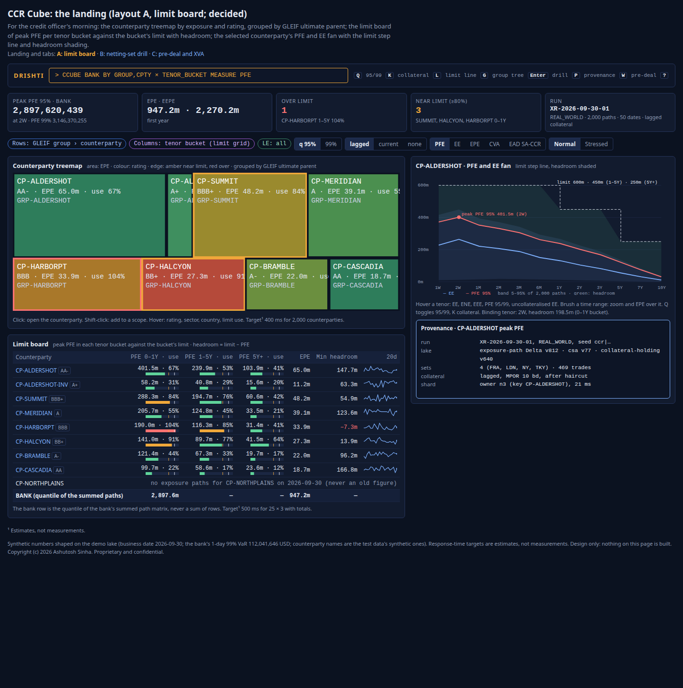
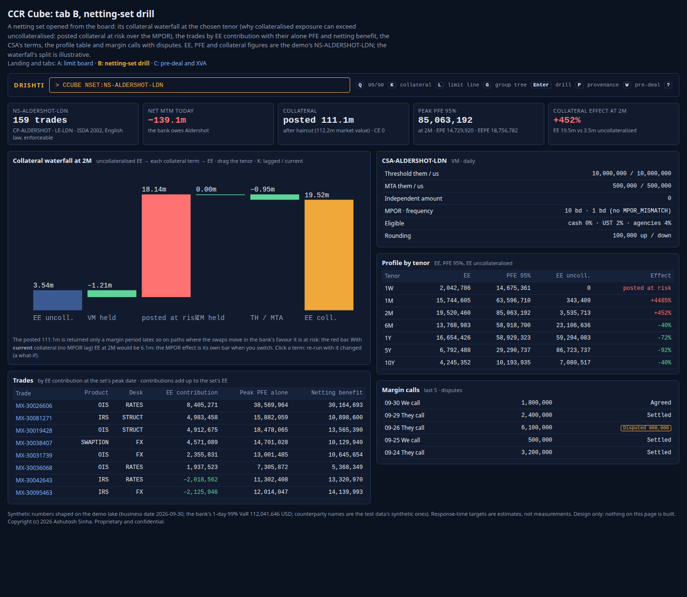
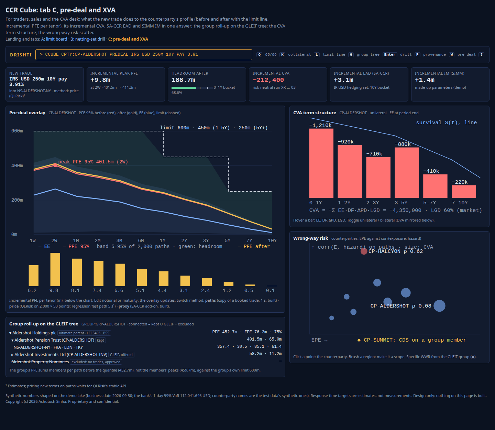

<!--
  Project Drishti · Any data. Any domain. One grammar.

  Copyright (c) 2026 Ashutosh Sinha <ajsinha@gmail.com>.
  All rights reserved.

  PROPRIETARY AND CONFIDENTIAL.

  This file is the confidential and proprietary property of Ashutosh Sinha.
  Unauthorised copying, use, modification, distribution or disclosure of this
  file, via any medium, is strictly prohibited except with the express prior
  written permission of the copyright holder.

  See the LICENSE file in the root of this repository for the full terms.
-->
# The CCR Cube: a counterparty credit risk cube lens that answers what FIS Adaptiv answers, and shows why

**Status: analysis and product description; design, not built.** Nothing in this document is built unless a row of
[section 5](#5-what-drishti-has-today) says so and cites the guide it was read from (2026-10-31). Every phase named here is a **proposal**, not a commitment. The rows it proposes are candidates in the
[implementation plan](../architecture/IMPLEMENTATION_PLAN.md#risk-cubes-candidates-not-started) (CC1 to CC14; the proof-of-concept rows CCP1 to CCP6, section 12), not started.

**The request (product owner, 2026-10-31):** separate cube designs for market risk ([MR_CUBE_LENS.md](MR_CUBE_LENS.md)) and counterparty
credit risk (this document), as lens documents, with an exhaustive data and contracts chapter, written from the angle of beating FIS,
SunGard and Adaptiv in capability and in visualisation.

**Read with:** [MR_CUBE_LENS.md section 4](MR_CUBE_LENS.md#4-the-shared-cube-core-mr-and-ccr) (**the shared cube core: pivot, totals,
drill, saved views, provenance, explain, corrections, streaming, export, embedding, permissions, scatter-gather, caching; not repeated
here**), [EXPOSURE_GUIDE.md](../guides/EXPOSURE_GUIDE.md) (the exposure engine), [COMPUTED_ATTRIBUTES.md](../architecture/COMPUTED_ATTRIBUTES.md)
(the CCR kinds and the modelling defaults of its section 10, confirmed by the product owner on 2026-10-31),
[CLUSTER_DEPLOYMENT.md section 6](../architecture/CLUSTER_DEPLOYMENT.md#6-exposure-sharding-in-depth-planned) (exposure sharding, decision
PO-C3), [RISK_LENS.md](RISK_LENS.md) and [TRADING_LENS.md](TRADING_LENS.md), and the contracts [SACCR.md](../contracts/SACCR.md),
[SIMM.md](../contracts/SIMM.md), [CVA.md](../contracts/CVA.md), [WWR.md](../contracts/WWR.md), [LIM.md](../contracts/LIM.md),
[GRP.md](../contracts/GRP.md), [NSET.md](../contracts/NSET.md), [COLL.md](../contracts/COLL.md) and [MC.md](../contracts/MC.md).

## Contents

1. [Purpose: a counterparty cube, and what FIS offers](#1-purpose-a-counterparty-cube-and-what-fis-offers)
2. [Who uses it](#2-who-uses-it)
3. [Their questions](#3-their-questions)
4. [What makes CCR different: the grain and the order of aggregation](#4-what-makes-ccr-different-the-grain-and-the-order-of-aggregation)
5. [What Drishti has today](#5-what-drishti-has-today)
6. [Screens and visualisation](#6-screens-and-visualisation)
7. [Data and contracts](#7-data-and-contracts)
8. [Measures](#8-measures)
9. [Pre-deal: incremental PFE, CVA and SA-CCR](#9-pre-deal-incremental-pfe-cva-and-sa-ccr)
10. [Performance and scale targets](#10-performance-and-scale-targets)
11. [How this beats FIS Adaptiv / artiQ](#11-how-this-beats-fis-adaptiv--artiq)
12. [Lens design and proof of concept (POC)](#12-lens-design-and-proof-of-concept-poc)
13. [Phases (proposed)](#13-phases-proposed)
14. [Risks and data dependencies](#14-risks-and-data-dependencies)
15. [Decisions for the product owner](#15-decisions-for-the-product-owner)
16. [Glossary](#16-glossary)

---

## 1. Purpose: a counterparty cube, and what FIS offers

A counterparty credit risk cube answers *how much could each counterparty, group or legal entity owe us if it defaulted at a future
date, after netting and collateral; what does that cost (CVA), what capital does it need (SA-CCR, IMM, CVA capital), what margin do we
call (SIMM), and does a new trade fit the limit?*, for any rows and columns: counterparty × tenor, rating × sector, desk × legal
entity, group × netting set.

FIS's public claims for its cube are listed with their sources and the caveat that they are marketing material in
[MR_CUBE_LENS.md section 1](MR_CUBE_LENS.md#1-purpose-what-a-risk-cube-is-and-what-fis-offers). On the counterparty side the Adaptiv
suite is known for exposure simulation (Adaptiv Analytics, a stateless credit and market risk simulation and calculation engine feeding
the cube), XVA, SA-CCR, SIMM and SA-CVA; FIS publishes no technical detail on sharding, high availability or benchmarks
([Risk.net, 2020](https://www.risk.net/awards/7676746/market-risk-management-product-of-the-year-fis);
[FIS FRTB white paper](https://www.fisglobal.com/-/media/fisglobal/files/PDF/white-paper/FRTB-Risk-Aggregation-An-IT-Perspective-White-Paper.pdf?sc_lang=en)).

**Drishti's answer in one paragraph.** Drishti already computes exposure for any scope from the bank's simulated paths, after netting
and lagged collateral per path, with EE contributions that add up exactly, a pre-deal what-if by exact paths or an SA-CCR-style proxy,
and official records. The **CCR Cube** adds the pivot (by the shared core), **allocated exposure** so desks and books add up to the
counterparty, a **counterparty hierarchy** with GLEIF legal parents beside the desk hierarchy, **limits by tenor bucket with headroom on
the profile**, **CVA and the XVA family**, **SA-CCR, IMM EEPE, SIMM, BA-CVA and SA-CVA** computed from the trade grain, **wrong-way
risk**, **collateral and margin-call views**, **stressed EEPE and CVA**, and the exposure shards of CLUSTER_DEPLOYMENT section 6 so that
a netting set never splits across nodes.

---

## 2. Who uses it

| Person | What they do with the cube | Lens today |
|---|---|---|
| **Credit risk officer** | counterparty and group exposure against limits by tenor, headroom, excesses, annual reviews | Drishti Risk (exposure explorer) |
| **CVA desk (XVA)** | CVA and its sensitivities by counterparty, hedges, the P&L of CVA, pre-deal CVA charge | none |
| **Collateral and margin operations** | margin calls, disputes, IM posted and held, SIMM against the counterparty's number | none (the stored `margin-call` and `simm` kinds) |
| **Regulatory capital** | SA-CCR EAD by netting set and asset class, IMM EEPE and alpha, BA-CVA or SA-CVA capital | none |
| **Trader, sales** | does this trade fit the counterparty's limit; what does it cost in CVA and capital | Drishti Trading (largest counterparty, TL2) |
| **Second line** | concentration by group, sector, country; wrong-way risk; stressed exposure | the proposed Oversight lens |

The CCR Cube is a lens (`Open Drishti CCR Cube`), and a cube screen (`CCUBE`, decision 9) inside Risk,
Trading and Oversight.

---

## 3. Their questions

| When | Question | The cube's answer |
|---|---|---|
| Morning | Which counterparties are over or near their limit at any tenor? | the board: counterparty × tenor bucket, peak PFE against the bucket limit, headroom shaded |
| Morning | Which groups concentrate exposure, by rating and sector? | the treemap: area by EPE, colour by rating, grouped by GLEIF ultimate parent |
| Intraday | Does this new swap with CP-ALDERSHOT fit? | the pre-deal overlay: the profile before and after, incremental PFE per tenor, the limit line |
| Intraday | Why is NS-ALDERSHOT-LDN's exposure above its uncollateralised exposure? | the netting-set drill: posted collateral at risk over the MPOR, the collateral waterfall |
| Close | What is each desk's share of counterparty exposure? | allocated EE and EPE by desk, adding up to the bank |
| Month-end | CVA by counterparty and its sensitivity to spreads; SA-CVA capital | the CVA term-structure bars and the SA-CVA pivot |
| Quarter | SA-CCR EAD by asset class and hedging set; IMM EEPE and stressed EEPE | the SA-CCR pivot; the IMM tiles |
| Any time | Where is wrong-way risk? | the WWR scatter and the specific-WWR list |

---

## 4. What makes CCR different: the grain and the order of aggregation

### 4.1 The grain: paths × time steps × trade

The input is every live OTC trade's MtM on every simulated path *p* (P = 200 in the demo, 2,000 to 5,000 at a bank) at every grid date
*k* (13 primary tenors in the demo, 50 to 100 at a bank), from the bank's exposure simulator (`exposure-path`,
[EXPOSURE_GUIDE section 15.3](../guides/EXPOSURE_GUIDE.md#153-exposure-path-every-trades-mtm-on-every-path-the-large-input)). A trade is
P × G numbers, not a vector of scenarios.

### 4.2 The order: per netting set first, then across netting sets

```
1. V_n(p,k) = Σ_{i∈n} MTM_i(p,k)                                  net per netting set (linear)
2. C_n(p,k) = R( target(V_n(p, ℓ(k))) )                            collateral per path, lagged by the MPOR (non-linear: TH, MTA, IA, rounding)
3. E_n(p,k) = max(V_n − C_n − IM_n, 0)                             floored per netting set (non-linear)
4. E_S(p,k) = Σ_{n∈S} E_n(p,k)                                     only now summed across netting sets (linear)
5. EE, PFE_q, EEE, EPE, EEPE of S                                  statistics last (quantiles, running maxima: non-linear)
```

(as built: [EXPOSURE_GUIDE section 18](../guides/EXPOSURE_GUIDE.md#18-the-computation)). Steps 2 and 3 are why the CCR cube cannot sum
trades across netting sets the way the MR cube sums positions: the threshold, the minimum transfer amount, the independent amount, the
rounding and the lag apply to the netting set's value, and the floor at zero makes exposures of different sets add but never net.

### 4.3 What adds up across the pivot

| Measure | Across netting sets | Across trades inside a set | How a pivot cell is made |
|---|---|---|---|
| E per path, EE, ENE, CE | **additive** | additive only through allocation (Euler) | sum of the sets' path matrices (or EE rows) |
| EPE | additive when the horizons agree | via allocation | from the cell's EE |
| CVA (unilateral) | **additive across counterparties** (EE per counterparty × its own PD) | via allocated EE | Σ of counterparties' CVA |
| PFE_q, peak PFE, EEPE, EEE | **not additive** | not additive | the cell's summed matrix, then the statistic |
| SA-CCR EAD | additive across netting sets | not (hedging sets, square roots, the multiplier) | per set, then summed |
| SIMM | not additive across risk classes or netting sets of different CSAs | not | per netting set and regime; a cell sums sets |
| Group limit use | not additive | | the group's PFE (members summed per path) over the group's own limit |

A cell such as **desk × counterparty** is a cut netting set: Drishti offers two readings (decision 3): **allocated** (the desk's Euler
share of the set's collateralised exposure: adds up to the counterparty) and **standalone** (`DESK:` partial, built: the desk's trades as
if they were the set; does not add up).

### 4.4 Two hierarchies

| Hierarchy | Levels | Source |
|---|---|---|
| **Counterparty (legal)** | GLEIF ultimate parent → direct parent → counterparty (legal entity) → agreement → netting set → trade | `counterparty`, `counterparty-group` (kept members), GLEIF `lei-entity` and `lei-relationship` (the gleif pack, built) |
| **Desk (management)** | bank → division → desk → book → trade, and the legal-entity and limit-letter hierarchies | the VaR hierarchies ([VAR_GUIDE section 15.14](../guides/VAR_GUIDE.md#1514-hierarchies-from-the-rows-or-from-the-trades-columns)) |

The cube puts either on rows; a group roll-up uses `connected(G) = kept(G) ∪ gleif(G) − excluded` (GRP.md section 6.1). Exposure
up the legal hierarchy is exact (sets sum per path); up the desk hierarchy it is allocated.

### 4.5 Shards: by counterparty and netting set (decision PO-C3)

Exposure shards with key `[COUNTERPARTY, NETTING_SET]` (no group prefix, PO-C3): **a netting set is never split** and a counterparty's
sets sit together, so steps 1 to 3 of section 4.2 run on one owner; the owner returns the **summed positive-exposure path matrix** of
each scope's sets it holds (800 KB at P 2,000 × G 50); the coordinator adds partials in shard order and takes quantiles **after** the
combine (CLUSTER_DEPLOYMENT section 6.3). A group across owners is summed by the coordinator. Allocation needs a second round for PFE
(the quantile paths), as contributions do today.

### 4.6 MR versus CCR: two cubes on one core

| | MR Cube ([MR_CUBE_LENS.md](MR_CUBE_LENS.md)) | CCR Cube (this document) |
|---|---|---|
| Core | shared (MR_CUBE_LENS section 4) | shared |
| Data grain | position × scenario; position × factor | trade × path × time step |
| Aggregation order | sum vectors, then the statistic | net and collateralise per netting set per path, then sum sets, then the statistic |
| Shard key | `LEGAL_ENTITY`, `DESK` | `COUNTERPARTY`, `NETTING_SET` |
| Shared inputs | **`position-sensitivity`** (SBM) and the **QLRisk bridge** (scenario P&L) | **`position-sensitivity`** (SIMM, SA-CVA hedges) and the **QLRisk bridge** (path MtMs) |

---

## 5. What Drishti has today

| Capability | Status | Evidence |
|---|---|---|
| EE, ENE, EEE, PFE 95% and 99%, EPE, EEPE, CE, EAD (IMM, informational) for any scope after netting and lagged collateral | **Built** | [EXPOSURE_GUIDE sections 1, 2, 18](../guides/EXPOSURE_GUIDE.md#1-the-question-exposure-answers) |
| Scopes `NSET:`, `CPTY:`, `GROUP:`, `LE:`, `DESK:` and `BOOK:` (partial), `TRD:`, `WHERE:`, `+ - &` | **Built** | [EXPOSURE_GUIDE section 4](../guides/EXPOSURE_GUIDE.md#4-scopes) |
| Collateral models `lagged`, `current`, `none`; MPOR from the run's look-back; haircuts contractual (after haircut) | **Built** | [EXPOSURE_GUIDE section 18.3](../guides/EXPOSURE_GUIDE.md#183-collateral-on-each-path-margined-netting-sets) |
| EE and EPE contributions per trade within a set (Euler); PFE contributions by window; incremental PFE | **Built** | [EXPOSURE_GUIDE section 18.6](../guides/EXPOSURE_GUIDE.md#186-contributions-decomposition) |
| Allocated exposure by desk across netting sets, served on the VaR hierarchy | **Not built**, designed (RL6, TL2) | [RISK_LENS section 5.6](RISK_LENS.md#56-rl6-exposure-on-the-var-hierarchy) |
| Pre-deal: exact paths (Python) or the add-on proxy (Java) | **Built** | [EXPOSURE_GUIDE section 7](../guides/EXPOSURE_GUIDE.md#7-pre-deal-what-if); `ExposureWhatIf.java`, `ExposureWhatIfPaths.java` |
| Pricing a new trade's path MtMs (QLRisk) | **Not built** | section 9 |
| Official end-of-day records, captures and compare | **Built** | [EXPOSURE_GUIDE section 20](../guides/EXPOSURE_GUIDE.md#20-official-end-of-day-results) |
| Credit limits read as stored, with tenor buckets; utilisation on the computed peak | **Built as read**; stored limits sized on stored profiles; LIM engine parked | [EXPOSURE_GUIDE section 28](../guides/EXPOSURE_GUIDE.md#28-open-items) |
| Counterparty groups with GLEIF members | **Partly**: kept members stored; GLEIF pack built; `connected(G)` proposed | [COMPUTED_ATTRIBUTES.md section 5.12](../architecture/COMPUTED_ATTRIBUTES.md#512-core-counterparty-group-grp-figures) |
| CVA, DVA, FVA, KVA | **Stored, parked**; formulas proposed | [COMPUTED_ATTRIBUTES.md section 5.9](../architecture/COMPUTED_ATTRIBUTES.md#59-cva-cva) |
| SA-CCR | **Stored, retiring**; computation designed | [COMPUTED_ATTRIBUTES.md section 5.7](../architecture/COMPUTED_ATTRIBUTES.md#57-sa-ccr-saccr); [SACCR.md](../contracts/SACCR.md) |
| SIMM | **Stored, retiring**; computation designed on the shared sensitivity table | [COMPUTED_ATTRIBUTES.md section 5.8](../architecture/COMPUTED_ATTRIBUTES.md#58-simm-simm); [SIMM.md](../contracts/SIMM.md) |
| Wrong-way risk | **Not built**, proposed | [COMPUTED_ATTRIBUTES.md section 5.13](../architecture/COMPUTED_ATTRIBUTES.md#513-wrong-way-risk-wwr-new) |
| Stressed runs (`STRESSED` calibration, `EAD_IMM_STRESSED`) | **Not built** (several runs on one date) | [EXPOSURE_GUIDE section 28](../guides/EXPOSURE_GUIDE.md#28-open-items) |
| Margin calls, collateral balances | **Stored** (`margin-call`, `collateral-balance`) | [MC.md](../contracts/MC.md), [COLL.md](../contracts/COLL.md) |
| Exposure sharding | **Planned** (CD10), designed | [CLUSTER_DEPLOYMENT section 6](../architecture/CLUSTER_DEPLOYMENT.md#6-exposure-sharding-in-depth-planned) |
| Explorer with tree, tiles, profile, path fan, collateral, trades, pre-deal tabs; phone layout | **Built** | [EXPOSURE_GUIDE section 3](../guides/EXPOSURE_GUIDE.md#3-the-explorer-screen-by-screen) |

**Verified in code (2026-10-31):** `drishti-server/src/main/java/com/ash/drishti/server/exposure/` holds `ExposureService`,
`ExposureWhatIf`, `ExposureWhatIfPaths`, `ExposureExplorer`, `ExposureOfficial`, `ExposureLoader`, `ExposureTier`; there is no CVA,
SA-CCR, SIMM, WWR or sharding class there (the exposure guide's section 18.8: "Fan-out across nodes is PLANNED").

**On the demo** (2026-09-30, `--as-of data`): the bank's peak PFE 95% is **2,897,620,439** USD at 2W (EPE 947,202,991); CP-ALDERSHOT's
peak PFE 401,456,820 against the sum of its four sets' peaks 534.4 m (PFE is not additive; EXPOSURE_GUIDE section 2.2).

---

## 6. Screens and visualisation

The mock-ups are in the repository: [A](mockups/ccr-cube/A.html), [B](mockups/ccr-cube/B.html), [C](mockups/ccr-cube/C.html),
each with its screenshot; [section 6.7](#67-mock-ups-the-screens-to-build) is the build checklist.
The house rules of [MR_CUBE_LENS section 6](MR_CUBE_LENS.md#6-screens-and-visualisation) apply: keyboard first, every number printed,
never colour alone.

### 6.1 Three layouts (mock-ups, the product owner picks)

| Option | Layout | Best for |
|---|---|---|
| **A: Limit board** | the pivot counterparty × tenor bucket (peak PFE in bucket, limit, use bar), a counterparty treemap above it, the selected counterparty's PFE and EE fan with the limit line and headroom shading in the right rail | the credit officer's morning |
| **B: Netting-set drill** | a netting set's trades, its collateral waterfall at the peak tenor, the CSA's terms, the MPOR effect (lagged against current collateral), margin calls and disputes | collateral, the "why is exposure above uncollateralised" question |
| **C: Pre-deal and XVA** | the pre-deal overlay on the profile (before, after, limit), incremental PFE, CVA, SA-CCR EAD of the trade; the group roll-up on the GLEIF tree; CVA term-structure bars; the WWR scatter | traders, sales, the CVA desk |

**Recommendation:** A as the landing; B opens on a netting set; C opens from Pre-deal or the XVA menu.

### 6.2 The visual catalogue

| Visual | What it shows | Interactions | Built today? |
|---|---|---|---|
| **PFE and EE profile fan chart with the limit line and headroom shading** | EE, PFE at q, the 5–95% and 25–75% path bands over the primary tenors; the limit as a step line by tenor bucket; the gap between PFE and the limit shaded (green headroom, red excess); the peak marked | hover a tenor: every figure; **brush a time range** to zoom and get EPE over it; toggle q 95/99 and collateral on/off | the profile and fan built (netting set); limit line by bucket and headroom shading not built |
| **Counterparty treemap by exposure and rating** | rectangles by EPE (or peak PFE, CE), nested by group (GLEIF ultimate parent) and counterparty; colour by rating band; a red edge when over limit | click: open the counterparty; shift-click: add to a scope; hover: rating, sector, country, limit use | not built |
| **Netting-set drill** | trades (EE contribution, alone PFE, netting benefit), the CSA (thresholds, MTA, IA, MPOR, frequency), collateral held and posted by asset, margin calls | click a trade: its exposure; click a CSA term: its effect (re-run with the term changed: a what-if) | trades, collateral and CSA tabs built; term what-if not built |
| **Collateral waterfall** | at a chosen tenor: uncollateralised EE → − VM held on the lagged paths → + posted collateral at risk → − IM held → threshold and MTA effect → EE; each bar printed | drag the tenor; toggle `lagged` / `current` to see the MPOR effect as its own bar | the "collateral effect" tile built; waterfall not built |
| **Wrong-way risk scatter** | per counterparty: EPE (x) against PD or the correlation of exposure and hazard on the paths (y), size by CVA, specific-WWR names marked; or, for one counterparty, E against hazard per path at a tenor | click a point: the counterparty; **brush** a region to make a scope | not built |
| **CVA term-structure bar chart** | per tenor bucket: EE(t) · DF(t) · ΔPD(t) · LGD as bars adding up to CVA; the survival curve as a line; DVA mirrored below | hover: the four factors; toggle unilateral / bilateral | not built |
| **Pre-deal overlay** | the profile before (grey) and after (bright), the incremental PFE per tenor as bars below, the limit line, and the new trade's CVA and SA-CCR EAD in tiles | edit the notional or maturity: the overlay updates; switch method (paths, price, proxy) | incremental profile built (table); overlay chart not built |
| **Group roll-up on the GLEIF tree** | the group's ultimate parent, direct parents and counterparties as an indented tree with peak PFE, EPE, limit use per node; members from GLEIF marked apart from kept members; excluded members struck through | expand, collapse; click a node: its scope; toggle `kept` / `connected` membership | GLEIF pack built; roll-up not built |

### 6.3 Response-time targets

| Interaction | Target (p95, warm) | Note |
|---|---|---|
| The board, 25 counterparties × 6 tenor buckets with totals | 500 ms¹ | per-counterparty statistics cached at date load |
| Treemap of 2,000 counterparties | 400 ms¹ | EPE is additive, from per-set rows |
| A group of 200 sets at P 5,000 × G 100 | 150 ms¹ | the target of EXPOSURE_GUIDE section 27.1, open (0.3 s measured single-threaded) |
| Netting-set drill with trades | 300 ms¹ (the trade paths read for the set only, after pruning by netting set) | |
| Pre-deal by exact paths, one set | 1 s¹; by QLRisk pricing a vanilla swap on 2,000 × 50 points: 30 s or more¹ | the pricing cost dominates (section 9) |
| CVA of a counterparty | 50 ms¹ | EE row × DF × ΔPD, G terms |
| SA-CCR of the bank (1M derivatives) | 3 s¹ | additive per hedging set, cached per set |

¹ Estimates, not measurements, scaled from the exposure benchmark (EXPOSURE_GUIDE section 27.4) and the VaR engine's summing rate; to be
measured on the demo and on the product owner's server.

### 6.4 Keyboard, phone, embedding

Keys as the MR cube (MR_CUBE_LENS section 6.4) with `Q` (PFE confidence), `K` (collateral model), `L` (limit line), `G` (group tree).
Phone tiers: **must** the counterparty's tiles (peak PFE, limit use, EPE, CE) and the profile; **glance** the top-five board rows;
**more** the netting sets, collateral waterfall, CVA; **desk** the treemap and the pivot editor. Every visual is a ViewModel panel and
embeds by the client renderer.

### 6.7 Mock-ups: the screens to build

**Decided (product owner, 2026-10-31): layout A is the landing page; B and C are tabs of the same page** (a netting set clicked on A
opens B in place). The mock-ups are in the repository, self-contained HTML (no CDN, no external fonts) with a screenshot of each:
[A.html](mockups/ccr-cube/A.html), [B.html](mockups/ccr-cube/B.html), [C.html](mockups/ccr-cube/C.html). Their exposure figures are the
demo's (the bank's peak PFE 95% 2,897,620,439; CP-ALDERSHOT 401,456,820; NS-ALDERSHOT-LDN's profile); limits, the legal tree, CVA, wrong-way
risk and the waterfall's split are illustrative. The tables are the **build checklist**: every panel, its exact contents, data,
interactions, phase (POC or later, section 12), phone tier; tick *Done* when the panel matches and its test exists.

**States every panel has:** **loading** (a skeleton of the panel's shape); **empty** in words: a counterparty or netting set without paths
says "no exposure paths for <id> on <date>" (CP-NORTHPLAINS in the demo), never an old figure; a counterparty without a limit says so
instead of a bar; **error** (the `DRS` code and its sentence, *Retry*; `400 DRS-5440` for a pre-deal into a netting set the scope does
not cover whole); **refused** (a counterparty the person sees only in aggregate: no trades, no drill, said so); **proxy** (the add-on method flagged on
every number it touched).

#### A: the landing (limit board)



| # | Panel | Exact contents | Data | Interactions | Phase | Phone | Done? |
|---|---|---|---|---|---|---|---|
| A1 | Command line and key strip | `CCUBE BANK BY GROUP,CPTY × TENOR_BUCKET MEASURE PFE <GO>`; keys **Q** 95/99, **K** collateral, **L** limit line, **G** group tree, **Enter** drill, **P** provenance, **W** pre-deal, **?** | the view (`POST /api/v1/cube/ccr/query`) | type and `<GO>`; type-ahead; the keys | POC | must (field) | [ ] |
| A2 | Headline strip (five tiles) | **Peak PFE 95% · bank** 2,897,620,439 "at 2W · PFE 99% 3,146,370,255"; **EPE · EEPE** 947.2m · 2,270.2m "first year"; **Over limit** count in red with the first name and bucket ("CP-HARBORPT 1–5Y 104%"); **Near limit (≥80%)** count in amber with names; **Run** `XR-2026-09-30-01` "REAL_WORLD · paths · dates · lagged collateral" | `/api/v1/exposure/scope?scope=BANK`; `GET /api/v1/cube/ccr/limits` | click Over or Near: filter the board to them; hover: provenance | POC | must (peak PFE, over, near), glance (rest) | [ ] |
| A3 | Lens controls | chips **Rows: GLEIF group › counterparty**, **Columns: tenor bucket (limit grid)**, **LE: all**; segmented **q 95% · 99%**; **lagged · current · none**; measure **PFE · EE · EPE · CVA · EAD SA-CCR**; **Normal · Stressed** | the view | drag chips; click segments; `Q`, `K` | POC (EAD SA-CCR shows once the counterparty engines release, 2.9.12, computes it (CC7); CVA greyed until CC5, 2.9.17; Stressed greyed until CC10, unscheduled) | desk | [ ] |
| A4 | Counterparty treemap | rectangles by EPE (switchable to peak PFE, CE), nested by group (GLEIF ultimate parent) and counterparty; fill by rating band (AA dark green through BBB amber-brown to BB+ red-brown); edge amber when any bucket is at or above the warning level, red when over; labels: name, "rating · EPE · use", group | `/api/v1/cube/ccr/query` (rows group, counterparty; measure EPE); ratings from `counterparty` ([§7.9](#79-c8-the-legal-hierarchy-counterparty-counterparty-group-gleif)); limits ([§7.10](#710-c9-credit-limit-lim-existing-extended)) | click: open the counterparty (fan in A6); shift-click: add to a scope; hover: rating, sector, country, limit use | POC | desk | [ ] |
| A5 | Limit board | columns Counterparty (with a rating badge), **PFE 0–1Y · use**, **PFE 1–5Y · use**, **PFE 5Y+ · use** (each the peak PFE inside the bucket, "401.5m · 67%", with a 70 × 6 px limit bar: green, amber at the warning level, red over), **EPE**, **Min headroom** (red when negative), **20d** sparkline of peak PFE; a counterparty without paths in one muted row in words; the total row "BANK (quantile of the summed paths)" 2,897.6m, 947.2m | `GET /api/v1/cube/ccr/limits`; sparklines from exposure captures ([EXPOSURE_GUIDE section 20](../guides/EXPOSURE_GUIDE.md#20-official-end-of-day-results)) | click a row: the fan (A6); double-click: the counterparty's netting sets; sort by any column; arrows and `Enter` | POC | must (the top five by use), glance | [ ] |
| A6 | PFE and EE fan with the limit line | x axis the primary tenors (1W … 10Y), y axis USD (0 to the limit's top); EE line blue; PFE 95% line red; the 5–95% path band light blue; the limit as a white dashed step line by bucket (600m, 450m 1–5Y, 250m 5Y+); the gap between PFE and the limit shaded green (headroom), red where PFE is above; the peak marked "peak PFE 95% 401.5m (2W)"; a legend; under it: "Binding tenor: 2W, headroom 198.5m" | `/api/v1/exposure/scope/profile` and `/scope/distribution?bands=true` (built); the limit's buckets ([§7.10](#710-c9-credit-limit-lim-existing-extended)) | hover a tenor: EE, ENE, EEE, PFE 95 and 99, uncollateralised EE; **brush** a time range: zoom and EPE over it; `Q`, `K`, `L` | POC | must (the profile with the limit line) | [ ] |
| A7 | Provenance popover | run and its calibration and seed; lake versions (exposure-path, csa, collateral); sets and trades; collateral model, MPOR, haircut basis; the owner and time | `GET /api/v1/cube/provenance/{id}` | hover, long-press, `P` | POC | more | [ ] |

#### B: the netting-set drill (tab)



| # | Panel | Exact contents | Data | Interactions | Phase | Phone | Done? |
|---|---|---|---|---|---|---|---|
| B1 | Netting-set tiles | **NS-ALDERSHOT-LDN** "159 trades" with counterparty, legal entity, agreement and law, enforceability; **Net MtM today** −139.1m in red "the bank owes Aldershot"; **Collateral** "posted 111.1m" after haircut (market value 112.2m) and CE 0; **Peak PFE 95%** 85,063,192 "at 2M · EPE · EEPE"; **Collateral effect at 2M** +452% in red "EE 19.5m vs 3.5m uncollateralised" | `/api/v1/exposure/scope?scope=NSET:…` (built); `netting-set`, `agreement`, `collateral-balance` ([§7.5](#75-c4-netting-set-and-agreement-existing), [§7.7](#77-c6-collateral-balance-and-collateral-holding)) | click Collateral: B2; hover: provenance | POC | must | [ ] |
| B2 | Collateral waterfall at a tenor | bars: **EE uncoll.** (blue) 3.54m; **VM held** (green, lowers) −1.21m; **posted at risk** (red, raises) 18.14m; **IM held** 0.00m; **TH / MTA** −0.95m; **EE coll.** (amber) 19.52m; each bar labelled in m with two decimals; a note on posted collateral at risk over the MPOR | `GET /api/v1/cube/ccr/waterfall?nset=…&tenor=…` from the set's paths, CSA and balance ([§7.6](#76-c5-csa-existing)) | **drag** the tenor; `K`: `lagged` against `current` adds the **MPOR effect** bar; click a CSA term: re-run with it changed (a what-if) | POC (the waterfall, MPOR effect); the term what-if later | more | [ ] |
| B3 | Trades | columns Trade (link), Product, Desk, **EE contribution** (negative green: a hedge), **Peak PFE alone**, **Netting benefit**; sorted by contribution at the set's peak date; 25 a page | `/api/v1/exposure/scope/contributions?by=trade` (built) | click a trade: its exposure alone and in the set; its id opens `TRD`; sort | POC | more | [ ] |
| B4 | CSA terms | Threshold them / us 10,000,000 / 10,000,000; MTA them / us 500,000 / 500,000; Independent amount 0; MPOR · frequency "10 bd · 1 bd (no MPOR_MISMATCH)"; Eligible "cash 0% · UST 2% · agencies 4%"; Rounding "100,000 up / down" | `csa` ([§7.6](#76-c5-csa-existing)); rounding is an extended field | click a term: B2's what-if (later) | POC (read); later (what-if) | more | [ ] |
| B5 | Profile by tenor | columns Tenor, EE, PFE 95%, EE uncoll., **Effect** (+ red when collateral raises exposure, − green when it lowers; "posted at risk" where uncollateralised EE is 0) | `/api/v1/exposure/scope/profile` (built) | click a tenor: B2 at that tenor; CSV | POC | more | [ ] |
| B6 | Margin calls | the last five: date and direction ("We call", "They call"), amount, status (Agreed, Settled), disputes as an amber badge "Disputed 900,000" | `margin-call` ([§7.8](#78-c7-margin-call-existing-and-im-history-new)) | click: the call's events | unscheduled (CC11); shown read-only in the POC if cheap | more | [ ] |

#### C: pre-deal and XVA (tab)



| # | Panel | Exact contents | Data | Interactions | Phase | Phone | Done? |
|---|---|---|---|---|---|---|---|
| C1 | Pre-deal tiles | **New trade** "IRS USD 250m 10Y pay 3.91%" into a netting set, with its method; **Incremental peak PFE** +9.8m "at 2W · 401.5m → 411.3m"; **Headroom after** 188.7m with a bar "0–1Y bucket 68.6%"; **Incremental CVA** −212,400 (red); **Incremental EAD (SA-CCR)** +3.1m; **Incremental IM (SIMM)** +1.4m "made-up parameters (demo)" | `POST /api/v1/exposure/what-if` (built: `addon`, `paths`) ([§7.16](#716-c16-exposure-predeal-existing-api-extended)) | edit the trade's terms; choose the netting set | POC (PFE and headroom by add-on or copied paths); CVA, EAD, IM tiles later (CC5, CC7, CC8) | must | [ ] |
| C2 | Pre-deal overlay | the A6 chart with the after-PFE line in gold over the before-PFE in red, the EE in blue, the limit step line and headroom; under it the **incremental PFE per tenor** as gold bars labelled in m | as C1 | edit notional or maturity: the overlay updates; switch method **paths** (copy of a booked trade, built), **price** (QLRisk, later), **proxy** (add-on, built) | POC (paths, proxy); advanced market risk (price, regression) | must (overlay), more (bars) | [ ] |
| C3 | Group roll-up on the legal tree | an indented tree: ultimate parent (badge "ultimate parent · LEI …") with PFE, EPE and use; the kept counterparty with its sets' peak PFEs; a GLEIF member "offered" (badge); an excluded entity struck through with its reason; a note that the group's PFE sums members per path before the quantile (452.7m), below the members' peaks (459.7m), against the group's own limit | `GET /api/v1/cube/ccr/group-tree` over `counterparty-group` and the legal tree ([§7.9](#79-c8-the-legal-hierarchy-counterparty-counterparty-group-gleif)) | expand, collapse; click a node: its scope; toggle `kept` / `connected`; `G` | POC (synthetic legal tree) | more | [ ] |
| C4 | CVA term structure | bars per tenor bucket (0–1Y … 7–10Y) of EE·DF·ΔPD·LGD in red, labelled "−1,210k"; the survival curve S(t) as a blue line; the formula line "CVA = −Σ EE·DF·ΔPD·LGD = −4,350,000 · LGD 60% (market) · USD OIS" | CVA (CC5) from the risk-neutral run, `credit-curve`, `ir-curve` ([§7.11](#711-c10-cva-inputs-credit-curve-ir-curve-cva-proxy-map)) | hover a bar: the four factors; toggle unilateral / bilateral (DVA below) | XVA and wrong-way risk (CC5) | more | [ ] |
| C5 | Wrong-way risk scatter | x EPE, y corr(E, hazard) on the paths; size CVA; red above a threshold (0.45) and labelled with ρ; a diamond marks specific WWR ("CP-SUMMIT: CDS on a group member") | `credit-path`, `wwr-flag` ([§7.12](#712-c11-credit-path-and-c12-wwr-flag-new)) | click a point: the counterparty; **brush** a region: make it a scope | XVA and wrong-way risk (CC9) | desk | [ ] |

**Not on the mock-ups but in the design, to build with them:** allocation by desk (rows `DESK` on A's pivot: the POC's Euler allocation,
section 8.2), saved views, export, the embed, the phone layout of section 6.4, SA-CCR and SIMM pivots (CC7, CC8).

---

## 7. Data and contracts

### Data needed: the complete list

**Every dataset the CCR Cube reads, in one table.** Columns as in [MR_CUBE_LENS.md's list](MR_CUBE_LENS.md#data-needed-the-complete-list):
*Phase* is the first phase that needs the row (POC of [section 12](#12-lens-design-and-proof-of-concept-poc), then the phases of
[section 13](#13-phases-proposed), all proposed in the plan's themes, product owner 2026-10-31); a **new generator** is a script under `tools/packgen/ccr/` writing JSON Lines to
`data/testdata/<domain>/<kind>/*.jsonl.gz`, loaded by `tools/build_demo_lakes.py` into Delta.

| # | Dataset | What it is; needed by | Phase | Typical source in a bank | Grain, frequency | State | Demo or POC gets it from | §7 |
|---|---|---|---|---|---|---|---|---|
| 1 | Trades and valuations (`trade`, `trade-valuation`) | membership, MtM today, CE, dimensions, desk for allocation | POC | Endur, Murex, Calypso | trade × date; daily | existing | existing demo | [7.2](#72-c1-trade-and-trade-valuation-existing) |
| 2 | Simulation run (`simulation-run`) | the grid, paths, calibration; the run in provenance | POC | the exposure simulator (Adaptiv Analytics, Murex, Calypso, Numerix, in-house) | run × date; nightly | existing; extended (`PURPOSE`; XVA and wrong-way risk) | existing demo (`tools/packgen/ccr/make_ccr_data.py`) | [7.3](#73-c2-simulation-run-xrun-existing-extended) |
| 3 | Exposure paths (`exposure-path`) | every exposure figure, the fan, allocation, pre-deal by paths | POC | the exposure simulator | trade × grid date × run; nightly | existing | existing demo: run `XR-2026-09-30-01`, 200 paths, 13 primary tenors, 74 of 76 netting sets | [7.4](#74-c3-exposure-path-xpath-existing-extended) |
| 4 | Netting sets and agreements (`netting-set`, `agreement`) | the sets, enforceability | POC | the legal agreements system | set × date | existing | existing demo (76 sets) | [7.5](#75-c4-netting-set-and-agreement-existing) |
| 5 | CSA terms (`csa`): thresholds, MTA, IA, MPOR, frequency, eligibility and haircuts | collateral on paths, the netting-set drill | POC; extended in sensitivities and capital (rounding, SIMM version, regimes) | the collateral or legal system | CSA × date | existing; extended | existing demo | [7.6](#76-c5-csa-existing) |
| 6 | Collateral balances and holdings (`collateral-balance`, `collateral-holding`) | collateral today; the waterfall by asset; posted at risk | POC (balances); unscheduled (holdings, CC11) | the collateral system | account (× asset) × date | existing; `collateral-holding` new | existing balances; **new generator** `tools/packgen/ccr/collateral_holdings.py` | [7.7](#77-c6-collateral-balance-and-collateral-holding) |
| 7 | Margin calls and IM history (`margin-call`, `im-history`) | calls and disputes; IM trend; SIMM backtesting | Sensitivities and capital | the margin system | call; set × regime × date | existing; `im-history` new | existing calls; **new generator** `tools/packgen/ccr/im_history.py` | [7.8](#78-c7-margin-call-existing-and-im-history-new) |
| 8 | Counterparties and groups (`counterparty`, `counterparty-group`) | rows, ratings, sectors, countries, the group's own limit | POC | the client master and the credit system | counterparty × date | existing; extended (membership rule) | existing demo (24 counterparties, 23 groups) | [7.9](#79-c8-the-legal-hierarchy-counterparty-counterparty-group-gleif) |
| 9 | Legal hierarchy: GLEIF parents | the group roll-up, specific wrong-way risk | POC | GLEIF's golden copy (public), the bank's client master | relationship; static, monthly | existing (the gleif pack); a synthetic tree for the demo | the demo counterparties' LEIs are synthetic, so a **new generator** `tools/packgen/ccr/legal_tree.py` writes their parent tree to `data/testdata/counterparty-risk/legal-parent/`, kept apart from the real GLEIF data (decision P3) | [7.9](#79-c8-the-legal-hierarchy-counterparty-counterparty-group-gleif) |
| 10 | Credit limits by tenor bucket (`credit-limit`) | the limit board, the limit line, headroom | POC | the credit system | limit × date | existing; extended (scope, confidence, buckets) | **new generator** `tools/packgen/ccr/credit_limits.py`: limits re-sized on the computed PFE (the stored ones read 0.1% to a few percent, EXPOSURE_GUIDE section 28), a few near or over for the demo | [7.10](#710-c9-credit-limit-lim-existing-extended) |
| 11 | Desk hierarchy (the VaR hierarchies) | allocation by desk, book, legal entity, limit letter | POC | the hierarchy system | node × date | existing | existing demo (MGMT, LEGAL, LL) | [section 4.4](#44-two-hierarchies) |
| 12 | FX rates (`fx-spot`) | sums in USD, CSA currencies | POC | market data | currency × date | existing | existing demo | — |
| 13 | Ratings | the treemap's colour, BA-CVA weights, proxies | POC | the credit system (counterparty `RATING`) | counterparty × date | existing | existing demo | [7.9](#79-c8-the-legal-hierarchy-counterparty-counterparty-group-gleif) |
| 14 | Calendars (`calendar`) | business days, MPOR in business days | POC | the calendar service | yearly | existing | existing demo | — |
| 15 | Pre-deal requests (`POST /api/v1/exposure/what-if`) | incremental PFE by paths (copied) or the add-on proxy | POC | Drishti, per request | request | existing API; extended (advanced market risk) | made at run time | [7.16](#716-c16-exposure-predeal-existing-api-extended) |
| 16 | Official exposure captures | sparklines on the board, compare | POC | Drishti | scope × date | existing | the demo's captures | [EXPOSURE_GUIDE section 20](../guides/EXPOSURE_GUIDE.md#20-official-end-of-day-results) |
| 17 | Credit curves and recovery (`credit-curve`) | CVA: PD, LGD = 1 − recovery | XVA and wrong-way risk | market data (Markit CDS) | curve × date | existing | existing demo | [7.11](#711-c10-cva-inputs-credit-curve-ir-curve-cva-proxy-map) |
| 18 | The USD OIS discount curve (`ir-curve`) | CVA discounting | XVA and wrong-way risk | market data | curve × date | existing | existing demo | [7.11](#711-c10-cva-inputs-credit-curve-ir-curve-cva-proxy-map) |
| 19 | CVA proxy map (`cva-proxy-map`) | a curve for every counterparty without one | XVA and wrong-way risk | the CVA desk | rating × sector × region | new | **configuration** plus the demo's sector curves | [7.11](#711-c10-cva-inputs-credit-curve-ir-curve-cva-proxy-map) |
| 20 | A risk-neutral run | CVA's EE | XVA and wrong-way risk | the exposure simulator | run × date | extended (`PURPOSE`) | `make_ccr_data.py` extended to write a second, risk-neutral run | [7.3](#73-c2-simulation-run-xrun-existing-extended) |
| 21 | SA-CCR trade attributes (`saccr-trade`) | SA-CCR | Counterparty engines | the booking systems' regulatory classification, or Drishti's rules | trade × driver × date | new | **new generator** `tools/packgen/ccr/saccr_trades.py` (from the demo trades) | [7.13](#713-c13-saccr-trade-new-saccrmd) |
| 22 | SA-CCR supervisory parameters (factors, correlations, option volatilities, α, the multiplier floor) | SA-CCR | Counterparty engines | the Basel text CRE52 and the jurisdiction's rule | parameter set | new | **configuration** shipped from the public text (BCBS first; OSFI and US overlays later) | [8.5](#85-sa-ccr-cc7) |
| 23 | Haircut schedules: the CSA's contractual haircuts and the supervisory haircuts (CRE22) | collateral after haircut; SA-CCR's C | POC (contractual, in the CSA); counterparty engines (supervisory) | the CSA; the Basel text | schedule | existing (CSA `ELIGIBLE`); supervisory new | existing demo; **configuration** from CRE22 | [7.6](#76-c5-csa-existing) |
| 24 | Sensitivities as CRIF (`position-sensitivity`, shared with the MR cube) | SIMM, SA-CVA hedges | Sensitivities and capital | the same engine as the scenario PVs | trade × factor × date | new (shared) | the MR cube's generator `tools/packgen/var/sensitivities.py`, at trade grain for the netting sets' trades | [7.14](#714-c14-simm-inputs-the-shared-sensitivities-as-crif-simm-addon-crif-external) |
| 25 | SIMM parameters (risk weights, correlations, concentration thresholds) | SIMM | Sensitivities and capital | **ISDA, licensed**: a client loads its own licensed file | version | new | **bank only**; the demo uses **made-up parameters**, labelled as such | [8.7](#87-simm-initial-margin-cc8) |
| 26 | SIMM add-ons and the counterparty's CRIF (`simm-addon`, `crif-external`) | add-ons; dispute reconciliation | Sensitivities and capital | the margin system; the counterparty or a vendor | trade; set × date | new | **new generator** `tools/packgen/ccr/simm_inputs.py` | [7.14](#714-c14-simm-inputs-the-shared-sensitivities-as-crif-simm-addon-crif-external) |
| 27 | BA-CVA and SA-CVA parameters (MAR50 risk weights, correlations, R, m_CVA) | CVA capital | XVA and wrong-way risk (BA-CVA and SA-CVA) | the Basel text MAR50 | parameter set | new | **configuration** from the public text | [8.4](#84-cva-and-the-xva-family-cc5-cc6) |
| 28 | CVA sensitivities (`cva-sensitivity`) | SA-CVA | XVA and wrong-way risk | the XVA engine | counterparty × factor × date | new | **new generator** `tools/packgen/ccr/cva_sensitivity.py` (bumps on the risk-neutral run) | [7.15](#715-c15-cva-sensitivity-new-for-sa-cva) |
| 29 | A stressed run | stressed EEPE and CVA | unscheduled (CC10) | the exposure simulator | run × date; weekly | extended | `make_ccr_data.py` extended (a stressed calibration) | [7.3](#73-c2-simulation-run-xrun-existing-extended) |
| 30 | Credit paths (`credit-path`) | general wrong-way risk | XVA and wrong-way risk | the exposure simulator, jointly with the market | name × grid date × run | new | `make_ccr_data.py` extended (`CREDIT_PATHS` true) | [7.12](#712-c11-credit-path-and-c12-wwr-flag-new) |
| 31 | Wrong-way risk flags (`wwr-flag`) | specific WWR | XVA and wrong-way risk | Drishti's rules over `saccr-trade` and the legal tree; manual flags | trade | new | **new generator** `tools/packgen/ccr/wwr_flags.py` (two demo CDS trades on group members) | [7.12](#712-c11-credit-path-and-c12-wwr-flag-new) |

**Count by the first phase each row is needed in:** POC **16** (rows 1 to 6, 8 to 16, and 23 for the contractual haircuts; CC1 to CC4 in the counterparty engines phase read
the POC's data); sensitivities and capital **4** (rows 7, 24 to 26; row 5 widens); counterparty engines **2** (rows 21, 22; 23 widens to the supervisory haircuts); XVA and wrong-way risk **8** (rows 17 to 20, 27, 28, 30, 31; row 2 gains `PURPOSE`); unscheduled **1** (row 29; row 6's holdings widen with CC11, unscheduled).
**New generators: 8** under `tools/packgen/ccr/` (`legal_tree.py`, `credit_limits.py`, `collateral_holdings.py`, `im_history.py`,
`saccr_trades.py`, `simm_inputs.py`, `cva_sensitivity.py`, `wwr_flags.py`) plus `make_ccr_data.py` extended three times (risk-neutral,
stressed, credit paths); the shared `sensitivities.py` comes from the MR cube. **Bank only:** every input in production, and the SIMM
parameters always (ISDA's licence).

### Minimum data for a first answer

The landing (layout A, the limit board) lights up from **seven datasets, six in the demo today**: the simulation run and its exposure
paths, the netting sets, the CSAs, the collateral balances, the counterparties with their ratings and groups, and **credit limits by
tenor bucket**, the one to regenerate (row 10), because today's stored limits were sized on stored profiles and read near zero. With
them: the treemap, the board by tenor with headroom, the fan chart with the limit line, the netting-set drill and the add-on pre-deal.
Allocation by desk adds the desk hierarchy (in the demo); the group roll-up adds the legal tree (row 9).

### Data readiness checklist (CCR Cube, for a bank's onboarding)

- [ ] One complete exposure run per date (real-world for PFE), every live OTC trade and SFT, the run's grid with look-back points, P and
      the seed; failed rows counted.
- [ ] Netting-set membership agreed with the simulator's (the membership wins); enforceability per agreement.
- [ ] CSAs with thresholds, MTAs, IA, MPOR, frequency, rounding and eligible collateral with haircuts; one CSA per agreement and legal entity.
- [ ] Collateral balances after haircut, today; holdings by asset when the waterfall by asset is wanted.
- [ ] Counterparties with LEI, rating, sector, country; groups with their own approved limits; the legal tree (GLEIF plus the bank's
      overrides and exclusions).
- [ ] Credit limits by scope, confidence and tenor bucket, sized on the bank's own PFE measure.
- [ ] The desk hierarchy the allocation should roll up.
- [ ] For CVA: a risk-neutral run, credit curves or the proxy map, the discount curve, the LGD choice.
- [ ] For SA-CCR: the trade attributes (asset class, hedging set, supervisory delta inputs, dates), the jurisdiction.
- [ ] For SIMM: the ISDA licence and parameter file, sensitivities at trade grain, the regimes per CSA, the counterparty's CRIF for disputes.
- [ ] For SA-CVA, stress and wrong-way risk: CVA sensitivities, a stressed run, credit paths or a hazard model.
- [ ] Retention (the paths are 0.4 to 2 TB a date), entitlements by counterparty, group or legal entity.

### The contracts in detail

The conventions of [MR_CUBE_LENS section 7](MR_CUBE_LENS.md#7-data-and-contracts) apply (contract YAMLs, JSON Lines gzipped into Delta or
Iceberg partitioned by `business_date`, `data/testdata/counterparty-risk/<kind>/*.jsonl.gz` for the demo, Endur-style UPPER_SNAKE
names). Sizes at the reference bank: **2.3M positions, about 10M trades of which about 1M live OTC derivatives and SFTs in about 100,000
netting sets with 20,000 counterparties** (assumptions of EXPOSURE_GUIDE section 27 and CLUSTER_DEPLOYMENT section 6.4)².

### 7.1 The contract map

| # | Contract (kind) | Class | State | Read by the CCR Cube for | Section |
|---|---|---|---|---|---|
| C1 | `trade` (TRD), `trade-valuation` (TVAL) | fundamental | existing | membership, MtM today, CE, dimensions | 7.2 |
| C2 | `simulation-run` (XRUN) | input | existing; **extended** | the run's grid, calibration, stressed runs | 7.3 |
| C3 | `exposure-path` (XPATH) | input | existing; **extended** | path MtMs | 7.4 |
| C4 | `netting-set` (NSET), `agreement` (AGR) | fundamental | existing (stored figures retiring) | sets, enforceability | 7.5 |
| C5 | `csa` (CSA) | fundamental | existing | thresholds, MTA, IA, MPOR, eligibility, haircuts | 7.6 |
| C6 | `collateral-balance` (COLL), `collateral-holding` | fundamental | existing; `collateral-holding` **new** (COLL.md) | collateral today, by asset | 7.7 |
| C7 | `margin-call` (MC), `im-history` | fundamental, input | existing; `im-history` **new** | calls, disputes, IM over time | 7.8 |
| C8 | `counterparty`, `counterparty-group`, GLEIF `lei-entity`, `lei-relationship` | fundamental | existing; group **extended** | the legal hierarchy | 7.9 |
| C9 | `credit-limit` (LIM) | fundamental | existing; **extended** | limits by tenor bucket and measure | 7.10 |
| C10 | `credit-curve`, `ir-curve` and `cva-proxy-map` | fundamental, configuration | existing; `cva-proxy-map` **new** | CVA: PD, LGD, DF, proxies | 7.11 |
| C11 | `credit-path` | input | **new** (WWR.md, optional) | general WWR on the paths | 7.12 |
| C12 | `wwr-flag` | fundamental | **new** | specific WWR | 7.12 |
| C13 | `saccr-trade` | input | **new** (SACCR.md) | SA-CCR | 7.13 |
| C14 | `position-sensitivity` read as CRIF; `simm-addon`, `crif-external` | input | **new** (shared with the MR cube; SIMM.md) | SIMM, SA-CVA hedges | 7.14 |
| C15 | `cva-sensitivity` | input (optional) or computed | **new** | SA-CVA | 7.15 |
| C16 | `exposure-predeal` request and result | drishti-owned, computed | existing API; **extended** | pre-deal | 7.16 |

### 7.2 C1 `trade` and `trade-valuation`: existing

`trade` as in [MR_CUBE_LENS section 7.2](MR_CUBE_LENS.md#72-d1-trade-trd-existing-read-as-dimensions). `trade-valuation` (TVAL,
`trade-valuation.contract.yaml`): one row per trade per date, key `VALUATION_ID` (`TVAL-<TRADE_ID>`), fields `TRADE_ID`, `SOURCE_SYSTEM`,
`PRODUCT_TYPE`, `PRODUCT_GROUP`, `PORTFOLIO`, `DESK`, `COUNTERPARTY`, `NETTING_SET`, `TRADER_ID`, `BUY_SELL_CODE`, `TRADE_STATUS`, `CURRENCY`,
`NOTIONAL` (USD), `MTM` (USD, dirty, bank's side), `MTM_CURRENCY`, `PNL_1D`, `DV01`, `TRADE_DATE`, `MATURITY_DATE`, `VALUATION_DATE`. The
exposure engine reads members and MtM from it (E0). **The cube adds** (optional, proposed): `CSA_DISCOUNTED_MTM` (when the
source values on the CSA discount curve), `XVA_EXCLUDED` (a reason). **Size:** 10M rows, about 0.5 KB each: 5 GB JSON, 0.5 GB Parquet a
day. **Sources:** Endur, Murex, Calypso valuations at the close.

### 7.3 C2 `simulation-run` (XRUN): existing, extended

**Grain:** one row per run and date. **Key:** `RUN_ID` (`XR-<date>-<nn>`). Existing fields (`simulation-run.contract.yaml`): `BUSINESS_DATE`,
`MARKET_DATA_DATE`, `MODEL`, `MODEL_VERSION`, `CALIBRATION` (`REAL_WORLD`, `RISK_NEUTRAL`, `STRESSED`), `PATHS`, `SEED`, `ANTITHETIC`,
`GRID_DATES`, `GRID_ROLE` (`PRIMARY`, `LOOKBACK`), `LOOKBACK_OF`, `GRID_TENORS`, `LOOKBACK_DAYS`, `VALUE_BASIS` (`FUTURE`, `DISCOUNTED`),
`CURRENCY` (USD), `PRECISION`, `CREDIT_PATHS`, `NETTING_SETS`, `TRADES`, `ROWS`, `BATCH_ID`, `COMPUTED_AT`, `STATUS`. **Sources:** the bank's
exposure simulator (Adaptiv Analytics, Murex MX.3 credit, Calypso, Numerix, an in-house engine). **Frequency:** nightly (04:00 to 07:00
typical), a stressed run weekly or monthly.

**Extended (proposed):** `PURPOSE` (`PFE`, `CVA`, `IMM`, `STRESSED_IMM`, `STRESSED_CVA`): several runs a date, each read for its
purpose (EXPOSURE_GUIDE open question 4); `STRESS_PERIOD_START`, `STRESS_PERIOD_END` for a stressed calibration; `PARENT_RUN_ID` when a run
re-uses another's paths. **Validation:** one complete run per purpose and date; `CVA` runs must be `RISK_NEUTRAL`; a cube cell names the
run in its provenance.

```json
{"RUN_ID":"XR-2026-09-30-02","BUSINESS_DATE":"2026-09-30","MARKET_DATA_DATE":"2026-09-30","MODEL":"Hull-White 1F rates, GBM FX and equity",
 "MODEL_VERSION":"bank-sim-7.4","CALIBRATION":"STRESSED","PURPOSE":"STRESSED_IMM","STRESS_PERIOD_START":"2008-07-01","STRESS_PERIOD_END":"2009-06-30",
 "PATHS":2000,"SEED":"ccr|XR-2026-09-30-02","ANTITHETIC":true,"LOOKBACK_DAYS":10,"VALUE_BASIS":"FUTURE","CURRENCY":"USD","PRECISION":"float32",
 "CREDIT_PATHS":false,"NETTING_SETS":100000,"TRADES":1000000,"ROWS":50000000,"BATCH_ID":"XB-2026-09-30-02","COMPUTED_AT":"2026-10-01T03:40:00Z",
 "STATUS":"complete","GRID_DATES":["2026-10-07","… 50 dates …"],"GRID_ROLE":["PRIMARY","…"],"LOOKBACK_OF":[-1,"…"],"GRID_TENORS":["1W","…"]}
```

### 7.4 C3 `exposure-path` (XPATH): existing, extended

**Grain:** one row per trade, grid date and run. **Key:** `PATH_ROW_ID` = `<run>~<trade>~<grid index>`. **Storage:** Delta or Iceberg,
`<root>/risk/exposure-path/`, partitioned by `business_date` (and `RUN_ID`), sorted by `NETTING_SET` then trade then grid index so a
set's rows are contiguous and files can be skipped by netting-set statistics; vector column `MTM` (P values, USD, bank's side).
Existing fields: `BUSINESS_DATE`, `RUN_ID`, `TRADE_ID`, `SOURCE_SYSTEM`, `NETTING_SET`, `COUNTERPARTY`, `LEGAL_ENTITY`, `DESK`, `TT_BOOK`,
`LIMIT_LETTER`, `ASSET_CLASS`, `PRODUCT`, `NOTIONAL`, `MATURITY_DATE`, `GRID_INDEX`, `GRID_DATE`, `MTM`, `STATUS`, `PRICER`, `BATCH_ID`.
**Size:** 1M trades × G × P × 4 bytes: **0.4 TB** (G 50, P 2,000) to **2 TB** (G 100, P 5,000) a date, the largest input of Drishti
(EXPOSURE_GUIDE section 28). **Validation:** the denormalised set, counterparty and notional must match the membership (the
membership wins, warned); a missing row before maturity + 10 business days is an error; `failed` counted, never zero.

**Extended (proposed):** `CASHFLOW` (vector, optional: cash paid between grid dates, for the cash-flow spike issue,
EXPOSURE_GUIDE open question 6), `FRTB_DESK` (for CVA desk hedges), `TRADE_VERSION` (the version simulated, for corrections).

```json
{"PATH_ROW_ID":"XR-2026-09-30-01~CLY-3000280~0","BUSINESS_DATE":"2026-09-30","RUN_ID":"XR-2026-09-30-01","TRADE_ID":"CLY-3000280",
 "SOURCE_SYSTEM":"CALYPSO","NETTING_SET":"NS-ALDERSHOT-FRA","COUNTERPARTY":"CP-ALDERSHOT","LEGAL_ENTITY":"LE-FRA","DESK":"DESK-SFT",
 "TT_BOOK":"BOOK-SFT-1","ASSET_CLASS":"Securities financing","PRODUCT":"Tri-party repo","NOTIONAL":237000000.0,"MATURITY_DATE":"2027-02-15",
 "GRID_INDEX":0,"GRID_DATE":"2026-10-07","MTM":[120455.2,-88310.9,"… 200 values …"],"STATUS":"ok","PRICER":"testgen-factor-walk",
 "BATCH_ID":"XB-2026-09-30-01"}
```

### 7.5 C4 `netting-set` and `agreement`: existing

`netting-set` (NSET): key `NETTING_SET_ID` (`NS-<counterparty>-<entity>`), `COUNTERPARTY`, `AGREEMENT`, `CSA`, `CREDIT_LIMIT`,
`COLLATERAL_BALANCE`, `LEGAL_ENTITY`, `NETTING_ENFORCEABLE`, `TRADE_IDS`; the stored figures (`NET_MTM`, `COLLATERAL`, `LIMIT`, `CVA`,
`TRADES[]`, `BY_ASSET`) retire with the NSET engine (COMPUTED_ATTRIBUTES section 13.5). `agreement` (AGR): `AGREEMENT_ID`, `TYPE`
(ISDA 2002, GMRA, GMSLA), `COUNTERPARTY`, `GOVERNING_LAW`, `SIGNED`, `CLOSE_OUT_NETTING`, `ELECTIONS`, `CSAS`. **Sources:** the legal
agreements system (often in-house, or Calypso's collateral module, Murex Collateral, Acadia). **Frequency:** daily, changes rare. **Size:**
100,000 sets, 30,000 agreements, under 100 MB. **The cube adds:** nothing; a set with `NETTING_ENFORCEABLE` false makes each trade its
own set.

### 7.6 C5 `csa`: existing

Key `CSA_ID`; `MARGIN_TYPE` (`VM`, `IM`), `THRESHOLD_US`, `THRESHOLD_THEM`, `MTA_US`, `MTA_THEM`, `INDEPENDENT_AMOUNT`, `CSA_CURRENCY`,
`FREQUENCY`, `MARGIN_FREQUENCY_DAYS`, `MPOR_DAYS`, `LEGAL_ENTITY`, `ELIGIBLE[]` (asset class and haircut), `AGREEMENT`, `COUNTERPARTY`,
`NETTING_SETS`, `COLLATERAL_BALANCES`. **The cube adds** (proposed, optional): `ROUNDING` (amount and direction), `SIMM_VERSION` (the
agreed version: the modelling default "SIMM per the CSA"), `IM_REGIMES` (collect and post regulations), `DISPUTE_THRESHOLD`. Validation:
MPOR + frequency − 1 against the run's look-back flagged `MPOR_MISMATCH`.

### 7.7 C6 `collateral-balance` and `collateral-holding`

`collateral-balance` (COLL, existing): key `BALANCE_ID`, `HELD`, `POSTED`, `NET` (after haircut, USD), `AS_OF`, `POSITIONS[]`, `CSA`,
`NETTING_SET`. `collateral-holding` (new, [COLL.md section 3.3](../contracts/COLL.md#33-collateral-holding-what-is-held-and-posted-kept-new)):
one row per account, asset, direction, margin type and settlement status; key `HOLDING_ID`; `MARGIN_TYPE` (`VM`, `IM`, `IA`), `DIRECTION`
(`HELD`, `POSTED`), `ASSET_TYPE`, `ASSET_ID` (ISIN or `CASH-<ccy>`), `CURRENCY`, `QUANTITY`, `ISSUER`, `ISSUER_RATING`, `MATURITY_DATE`,
`PRICE`, `SEGREGATED`, `SETTLEMENT_STATUS`, `BATCH_ID`. **Sources:** the collateral system (Calypso Collateral, Murex Collateral,
Cloudmargin, Acadia, in-house). **Size:** a few hundred thousand rows a day, under 200 MB. The cube's collateral waterfall and "posted at
risk" read it.

```json
{"HOLDING_ID":"COLL-ALDERSHOT-NY~VM~HELD~US91282CJL54~SETTLED","BUSINESS_DATE":"2026-09-30","BALANCE_ID":"COLL-ALDERSHOT-NY",
 "NETTING_SET":"NS-ALDERSHOT-NY","CSA":"CSA-ALDERSHOT-NY","MARGIN_TYPE":"VM","DIRECTION":"HELD","ASSET_TYPE":"GOVT_BOND",
 "ASSET_ID":"US91282CJL54","CURRENCY":"USD","QUANTITY":5000000,"SEGREGATED":false,"SETTLEMENT_STATUS":"SETTLED","BATCH_ID":"B-2026-09-30-01"}
```

### 7.8 C7 `margin-call` (existing) and `im-history` (new)

`margin-call` (MC): key `CALL_ID`, `CALL_DATE`, `MARGIN_TYPE`, `DIRECTION`, `AMOUNT`, `CURRENCY`, `STATUS` (`Agreed`, `Settled`, `Disputed`),
`DISPUTE_AMOUNT`, `EVENTS[]`, `NETTING_SET`, `CSA`. **`im-history` (new):** the initial margin required and held per netting set, regime
and date, for the IM trend and SIMM backtesting. **Grain:** one row per netting set, regime and date. **Key:** `IMH-<NETTING_SET>-<REGIME>-<date>`.

| Field | Type | Unit | Req. | Meaning |
|---|---|---|---|---|
| `IM_HISTORY_ID` | id | | required | the key |
| `NETTING_SET`, `CSA`, `COUNTERPARTY` | id | | required | |
| `REGIME`, `DIRECTION` | text | | required | `USPR`, `CFTC`, `EMIR`, `OSFI`…; `COLLECT` or `POST` |
| `IM_REQUIRED_BANK` | amount | USD | required | the bank's SIMM (or schedule) number |
| `IM_REQUIRED_CPTY` | amount | USD | optional | the counterparty's number (for disputes) |
| `IM_HELD`, `IM_POSTED` | amount | USD | required | settled amounts |
| `MODEL` | text | | required | `SIMM` with its version, or `SCHEDULE` |
| `BUSINESS_DATE`, `BATCH_ID` | date, id | | required | |

Sources: the margin system; daily; 100,000 sets × 2 directions × 250 days a year: 50M rows a year, about 2 GB. Validation: one row per
key; a model version different from the CSA's flagged.

### 7.9 C8 The legal hierarchy: `counterparty`, `counterparty-group`, GLEIF

`counterparty` (CPTY): key `COUNTERPARTY_ID`, `NAME`, `LEI`, `RATING`, `SECTOR`, `COUNTRY`, `TYPE`, `COUNTRY_OF_RISK`, `UEN`, `GROUP`,
`CREDIT_LIMIT`, `CREDIT_CURVE`, `LEGAL_ENTITY`, `HIERARCHY`, `KYC` (with `PD_1Y`). `counterparty-group` (GRP): `GROUP_ID`, `NAME`, `LIMIT`
(the group's own approved limit, decision 7), `MEMBERS[]`; `UTILISATION` becomes computed. GLEIF (`config/packs/gleif/contracts/`):
`lei-entity` (`LEI`, `NAME`, `LEI_GROUP`, `DIRECT_PARENT`, `ULTIMATE_PARENT`, `PARENTS[]`, `ENTITY_STATUS`, `REGISTRATION_STATUS`) and
`lei-relationship` (`CHILD_ENTITY`, `PARENT_ENTITY`, `LEVEL` direct or ultimate, `RELATIONSHIP_STATUS`, `START`, `END`, `LEI_GROUP`).
**Sources:** the bank's client master (UEN), the credit system (ratings, limits), GLEIF's golden copy (public). **The cube adds to
`counterparty-group`** (proposed): `MEMBERSHIP_RULE` (`kept`, `connected`), `EXCLUDED[]` (LEIs excluded with a reason and approver), and
the computed `connected(G)`. Validation: a counterparty whose LEI is lapsed or retired is flagged; a GLEIF parent outside the kept group
is offered, never added silently.

### 7.10 C9 `credit-limit` (LIM): existing, extended

Existing: key `LIMIT_ID`, `COUNTERPARTY`, `COUNTERPARTY_NAME`, `MEASURE` (`PFE 95 peak`), `LIMIT`, `USED`, `UTILISATION`, `STATUS`,
`BUCKETS[]` (0-1Y, 1-3Y, 3-5Y, 5-10Y, 10Y+ with limit and use), `APPROVED_BY`, `REVIEW_DUE`. `USED`, `UTILISATION` and `STATUS` become
computed (LIM.md). **Extended (proposed):**

| Field | Type | Unit | Req. | Meaning |
|---|---|---|---|---|
| `SCOPE` | text | | required | `CPTY:CP-ALDERSHOT`, `GROUP:GRP-ALDERSHOT`, `NSET:…`, `LE:… & CPTY:…` |
| `CONFIDENCE` | rate | fraction | required | 0.95 by default (the modelling default: limits at 95%) |
| `BUCKETS[].FROM_TENOR`, `TO_TENOR`, `LIMIT` | text, amount | USD | required | the step line of the limit profile |
| `SUB_LIMITS[]` | record list | | optional | by product (`SETTLEMENT`, `PRE_SETTLEMENT`, `REPO`) or legal entity |
| `WARNING_AT`, `TEMPORARY`, `VALID_FROM`, `VALID_TO` | rate, boolean, date | | optional | as `risk-limit` |

Headroom per tenor: `H(t) = LIMIT(bucket(t)) − PFE_q(t)`; the board shows the minimum headroom and its tenor. Sources: the credit
system; daily; tens of thousands of rows.

```json
{"LIMIT_ID":"LIM-ALDERSHOT","SCOPE":"CPTY:CP-ALDERSHOT","COUNTERPARTY":"CP-ALDERSHOT","MEASURE":"PFE","CONFIDENCE":0.95,"CURRENCY":"USD",
 "LIMIT":600000000,"BUCKETS":[{"FROM_TENOR":"0D","TO_TENOR":"1Y","LIMIT":600000000},{"FROM_TENOR":"1Y","TO_TENOR":"5Y","LIMIT":450000000},
 {"FROM_TENOR":"5Y","TO_TENOR":"30Y","LIMIT":250000000}],"WARNING_AT":0.8,"APPROVED_BY":"Credit Risk Committee","REVIEW_DUE":"2027-03-19",
 "BUSINESS_DATE":"2026-09-30"}
```

### 7.11 C10 CVA inputs: `credit-curve`, `ir-curve`, `cva-proxy-map`

`credit-curve` (existing, market-data pack): `CURVE_ID`, `ISSUER`, `POINTS[]` (`TENOR`, `SPREAD` bp, `HAZARD`, `SURVIVAL`), `RECOVERY`,
`PD_1Y`, `SENIORITY`, `DOC_CLAUSE`, `CURRENCY`. `ir-curve`: the USD OIS curve for discounting (modelling default: DF from USD OIS).
**LGD:** market LGD = 1 − `RECOVERY` of the counterparty's curve (modelling default). **`cva-proxy-map` (new, configuration plus a
table):** a counterparty without its own curve gets a proxy by rating × sector × region (modelling default).

| Field | Type | Req. | Meaning |
|---|---|---|---|
| `PROXY_ID` | id | required | `PXY-<rating>-<sector>-<region>` |
| `RATING_BAND`, `SECTOR`, `REGION` | text | required | the cell |
| `CURVE_ID` | id | required | the proxy curve (a CDS index tranche or a bank-built sector curve) |
| `SPREAD_MULTIPLIER` | rate | optional | a scaling of the proxy |
| `APPROVED_BY`, `VALID_FROM`, `BUSINESS_DATE` | | required | |

Sources: market data (Markit CDS), the bank's CVA desk for proxies; daily; small. Validation: every counterparty with exposure resolves to
a curve or a proxy, else its CVA is refused and named (never zero).

### 7.12 C11 `credit-path` and C12 `wwr-flag`: new

`credit-path` ([WWR.md section 3.2](../contracts/WWR.md#32-credit-path-counterparty-credit-on-the-exposure-paths-optional-shared)):
one row per credit name and grid date per run; key `<RUN_ID>~<NAME>~<GRID_INDEX>`; `NAME_TYPE`, `NAME`, `HAZARD` (vector, per year, P
values) drawn jointly with the market paths; about **40 GB** a date at 20,000 names × G 100 × P 5,000 in float32. **`wwr-flag`** (new,
fundamental): specific wrong-way risk, one row per trade flagged.

| Field | Type | Req. | Meaning |
|---|---|---|---|
| `WWR_FLAG_ID` | id | required | `WWR-<TRADE_ID>` |
| `TRADE_ID`, `NETTING_SET`, `COUNTERPARTY` | id | required | |
| `WWR_TYPE` | text | required | `SPECIFIC_SELF` (the reference is the counterparty), `SPECIFIC_GROUP` (a group member), `GENERAL_SECTOR`, `GENERAL_COUNTRY` |
| `REFERENCE_LEI` | text | optional | the reference entity |
| `SOURCE` | text | required | `RULE` (derived by Drishti from `saccr-trade.REFERENCE` against the GLEIF group) or `MANUAL` |
| `APPROVED_BY`, `BUSINESS_DATE` | | required for `MANUAL` | |

Specific WWR trades are, per CRE53, treated as their own netting set with jump-to-default exposure; the cube shows them apart.

### 7.13 C13 `saccr-trade`: new (SACCR.md)

From [SACCR.md section 3.3](../contracts/SACCR.md#33-saccr-trade-the-classification-and-terms): one row per trade and risk driver per
date; key `SACCR_ROW_ID` = `<TRADE_ID>~<DRIVER>`. Fields: `BUSINESS_DATE`, `TRADE_ID`, `SOURCE_SYSTEM`, `DRIVER`, `NETTING_SET`,
`COUNTERPARTY`, `LEGAL_ENTITY`, `ASSET_CLASS` (`IR`, `FX`, `CREDIT`, `EQUITY`, `COMMODITY`), `HEDGING_SET`, `TRANSACTION_TYPE` (`LINEAR`,
`OPTION`, `CDO_TRANCHE`, `BASIS`, `VOLATILITY`), `REFERENCE`, `IS_INDEX`, `CREDIT_QUALITY`, `DIRECTION`, `NOTIONAL_USD`, `QUANTITY`,
`UNDERLYING_PRICE`, `START_DATE`, `END_DATE`, `MATURITY_DATE`, `OPTION_TYPE`, `BOUGHT_SOLD`, `EXERCISE_DATE`, `STRIKE`,
`UNDERLYING_FORWARD`, `SHIFT`, `ATTACHMENT`, `DETACHMENT`, `CLEARED`, `DERIVED_BY` (`upstream` or `rules`), `BATCH_ID`. **Never
delivered:** the supervisory duration, delta, maturity factor, adjusted and effective notional, add-ons, RC, multiplier, EAD (the guard
test refuses them). Sources: the booking systems' regulatory classification or Drishti's rules from the trade; daily; about 1M rows, 0.3
GB.

```json
{"SACCR_ROW_ID":"MX-30000412~0","BUSINESS_DATE":"2026-09-30","TRADE_ID":"MX-30000412","SOURCE_SYSTEM":"MUREX","DRIVER":0,
 "NETTING_SET":"NS-ALDERSHOT-NY","COUNTERPARTY":"CP-ALDERSHOT","LEGAL_ENTITY":"LE-NY","ASSET_CLASS":"IR","HEDGING_SET":"USD",
 "TRANSACTION_TYPE":"LINEAR","DIRECTION":"LONG","NOTIONAL_USD":250000000,"START_DATE":"2026-10-02","END_DATE":"2036-10-02",
 "MATURITY_DATE":"2036-10-02","CLEARED":false,"DERIVED_BY":"upstream","BATCH_ID":"B-2026-09-30-01"}
```

### 7.14 C14 SIMM inputs: the shared sensitivities as CRIF, `simm-addon`, `crif-external`

SIMM reads **the same `position-sensitivity` records as the MR cube** ([MR_CUBE_LENS section 7.9](MR_CUBE_LENS.md#79-d8-position-sensitivity-sens-new)),
at trade grain for the netting set's trades, mapped to ISDA's Common Risk Interchange Format by the CRIF mapping of
[SIMM.md section 3.2](../contracts/SIMM.md#32-the-crif-mapping-drishti-columns-and-isda-crif): CRIF `RiskType` (`Risk_IRCurve`,
`Risk_CreditQ`, `Risk_FX`, `Risk_Equity`, `Risk_Commodity`, vega and curvature types) from `RISK_CLASS` and `MEASURE`; `Qualifier` from
`QUALIFIER`; `Bucket` from `SIMM_BUCKET`; `Label1` from `TENOR`; `Label2` from `CURVE` (the IR sub-curve); `Amount`, `AmountCurrency`,
`AmountUSD` from `VALUE`, `CURRENCY`; `ProductClass`; `CollectRegulations` and `PostRegulations` from the CSA. SIMM-only vertices (2W,
1M IR deltas, SIMM's vega expiries) come in the same records with the `SIMM` grid. `simm-addon` (SIMM.md section 3.3): `TRADE_ID`,
`ADDON_TYPE` (`NOTIONAL`, `FIXED`, `MULTIPLIER`), `PRODUCT_CLASS`, `QUALIFIER`, `AMOUNT_USD`, `FACTOR`, `BATCH_ID`. `crif-external`
(SIMM.md section 3.4): the counterparty's or custodian's CRIF and IM per netting set, compared, never computed from. **ISDA licensing:**
the SIMM risk weights and correlations are ISDA's licensed parameters: a client loads its own; the demo ships made-up parameters,
labelled.

### 7.15 C15 `cva-sensitivity`: new (for SA-CVA)

SA-CVA (MAR50) needs CVA's sensitivities to counterparty credit spreads and to market factors (IR, FX, reference credit, equity,
commodity), delta and vega. Counterparty-spread sensitivities Drishti can compute (bump the credit curve: `CVA(s + 1 bp) − CVA`); market
sensitivities need **re-simulated exposure** under bumped markets, which only the simulator can produce (CVA.md section 6.4). So:
**an input** for market-factor sensitivities, **computed** for counterparty spreads.

| Field | Type | Unit | Req. | Meaning |
|---|---|---|---|---|
| `CVA_SENS_ID` | id | | required | `CVAS-<COUNTERPARTY>-<RISK_FACTOR>-<MEASURE>-<date>` |
| `COUNTERPARTY`, `NETTING_SET` | id | | required (set optional) | |
| `RISK_FACTOR` | text | | required | the factor dictionary's name (MR_CUBE_LENS section 7.10) |
| `MEASURE` | text | | required | `DELTA`, `VEGA` |
| `VALUE` | amount | USD | required | ΔCVA for the MAR50 shift (1 bp; 1% relative for others) |
| `HEDGE` | boolean | | required | true for an eligible CVA hedge's own sensitivity (from `position-sensitivity` of the CVA desk's hedges) |
| `RUN_ID`, `BUSINESS_DATE`, `BATCH_ID` | | | required | the risk-neutral run |

Sources: the XVA engine (Adaptiv, Murex XVA, Quantifi, in-house); daily or monthly; 20,000 counterparties × 50 factors = 1M rows, small.

### 7.16 C16 `exposure-predeal`: existing API, extended

Today `POST /api/v1/exposure/what-if` (built): candidates with `method` `paths` (`{copyOf, factor}`, `{runId, mtm}`, `{runId,
arrow}`) or `addon`; the answer `base`, `with`, `incremental {epe, peakPfe, profile[]}`, `items`, `method`, `flags`. **Extended
(proposed):** a candidate `{terms}` in the `trade` contract's fields, priced on the run's paths by QLRisk (`method: price`); the answer
adds `cva` (before, after, incremental), `saccrEad` (incremental, from the candidate's `saccr-trade` row derived by rules), `simmIm`
(incremental, from its sensitivities), `limit` (headroom per tenor after), and `allocated` (the candidate's EE share).

```json
{"scope":"CPTY:CP-ALDERSHOT","q":0.95,"collateral":"lagged","method":"price",
 "items":[{"nettingSet":"NS-ALDERSHOT-NY","terms":{"PRODUCT_TYPE":"IRS","CURRENCY":"USD","QUANTITY":250000000,"BUY_SELL_CODE":"B",
  "START_DATE":"2026-10-02","MATURITY_DATE":"2036-10-02","LEGS":[{"LEG_TYPE":"FIXED","RATE":0.0391},{"LEG_TYPE":"FLOAT","INDEX":"SOFR"}]}}]}
```

### 7.17 Proposed contract YAMLs (not created yet)

| File | Kind | Mnemonic (proposed) | Class | New or extended |
|---|---|---|---|---|
| `config/packs/counterparty-risk/contracts/saccr-trade.contract.yaml` | `saccr-trade` | `SACT` | input | new (SACCR.md) |
| `config/packs/counterparty-risk/contracts/collateral-holding.contract.yaml` | `collateral-holding` | `CHLD` | fundamental | new (COLL.md) |
| `config/packs/counterparty-risk/contracts/im-history.contract.yaml` | `im-history` | `IMH` | input | new |
| `config/packs/counterparty-risk/contracts/credit-path.contract.yaml` | `credit-path` | `XCRP` | input | new (WWR.md) |
| `config/packs/counterparty-risk/contracts/wwr-flag.contract.yaml` | `wwr-flag` | `WWRF` | fundamental | new |
| `config/packs/counterparty-risk/contracts/cva-proxy-map.contract.yaml` | `cva-proxy-map` | `CPXY` | fundamental | new |
| `config/packs/counterparty-risk/contracts/cva-sensitivity.contract.yaml` | `cva-sensitivity` | `CVAS` | input | new |
| `config/packs/counterparty-risk/contracts/simm-addon.contract.yaml` | `simm-addon` | `SIMA` | input | new (SIMM.md) |
| `config/packs/counterparty-risk/contracts/crif-external.contract.yaml` | `crif-external` | `CRIF` | input | new (SIMM.md) |
| `config/packs/counterparty-risk/contracts/exposure-allocation.contract.yaml` | `exposure-allocation` | `XALC` | computed | new (allocated EE, EPE, PFE share by trade, desk, book) |
| `config/packs/counterparty-risk/contracts/saccr-result.contract.yaml` | `saccr-result` | `SACR` | computed | new (replaces stored `sa-ccr`) |
| `config/packs/counterparty-risk/contracts/simm-result.contract.yaml` | `simm-result` | `SIMR` | computed | new (replaces stored `simm`) |
| `config/packs/counterparty-risk/contracts/cva-result.contract.yaml` | `cva-result` | `CVAR` | computed | new (replaces stored `cva`) |
| `simulation-run`, `exposure-path`, `csa`, `credit-limit`, `counterparty-group`, `trade-valuation` | existing | | | extended (optional fields above) |
| `position-sensitivity` | shared with the MR cube | `SENS` | input | new (MR_CUBE_LENS section 7.17) |

The mnemonics are placeholders, to be checked against every pack's mnemonics at build.

² 1M live derivatives and SFTs of 10M trades, 10 trades a set, 5 sets a counterparty: the exposure benchmark's shape
(`trades-per-set=10`, `sets-per-cpty=20` scaled); a bank's real shape changes every size here.

---

## 8. Measures

### 8.1 Exposure profile (built)

E, EE, ENE, EEE, PFE_q, peak PFE, EPE, EEPE, CE as in section 4.2 and [EXPOSURE_GUIDE section 18.4](../guides/EXPOSURE_GUIDE.md#184-statistics-of-a-scope).

### 8.2 Allocated exposure (CC2)

Euler allocation of a netting set's collateralised exposure to its trades, per path and time step (inside a set):

```
a_i(p,k) = ( MTM_i(p,k) − w_i(p,k) · (C_n(p,k) + IM_n) ) · 1{E_n(p,k) > 0},   w_i = MTM_i / V_n   (0 when V_n = 0)
Σ_{i∈n} a_i(p,k) = E_n(p,k)                                                   exactly, on every path
EE_i^alloc(k) = (1/P) Σ_p a_i(p,k);  EPE_i^alloc = Σ_k EE_i^alloc(k) Δt_k / T
EE_desk(k) = Σ_n Σ_{i ∈ n ∩ desk} EE_i^alloc(k)                                adds up to the bank's EE
PFE share of a part j = mean of Σ_{i∈j} a_i over the contribution window of paths ranked around the quantile of the scope at its peak date, scaled to the peak
```

The cube serves `exposure-allocation` per trade and sums it up any hierarchy (desk, book, legal entity, limit letter), closing
RL6 and TL2. Tests: desks' allocated EE equals the bank's EE at every date; a desk alone in a set gets the set.

### 8.3 Limits and headroom (CC4)

`use(t) = PFE_q(t) / LIMIT(bucket(t))`; `headroom(t) = LIMIT(bucket(t)) − PFE_q(t)`; the counterparty's binding tenor is
`argmin_t headroom(t)`. Group: the members' exposure **summed per path** before the quantile, against the group's own limit (GRP.md
section 6.3, never the sum of members' peaks).

### 8.4 CVA and the XVA family (CC5, CC6)

```
EE*(t_k) = EE(t_k) · DF(t_k)      ENE*(t_k) = ENE(t_k) · DF(t_k)              discounted once (CVA.md section 6.2)
CVA  = −LGD_C · Σ_k EE*(t_k) · ( S_C(t_{k−1}) − S_C(t_k) )                    unilateral, EE* at the period end (ee-point: end)
DVA  = +LGD_B · Σ_k |ENE*(t_k)| · ( S_B(t_{k−1}) − S_B(t_k) )
FVA  = FCA + FBA = −Σ_k EE*(t_k)·s_F(t_k)·Δt_k + Σ_k |ENE*(t_k)|·s_F(t_k)·Δt_k   counterparty engines (2.9.12), with its playground
KVA  = −Σ K(t_k) · hurdle · Δt_k · DF(t_k)                                    XVA and wrong-way risk (2.9.17), indicative
```

EE and ENE from the risk-neutral run, each discounted **once**: EE* and ENE* already carry DF(t_k) (from USD OIS), so no formula above
multiplies them by DF again ([CVA.md section 6.2](../contracts/CVA.md#62-default-probabilities-and-discount-factors)); K(t_k) is not
discounted, so KVA carries its own DF. LGD = 1 − market recovery; S_C from the counterparty's credit curve or its proxy
(COMPUTED_ATTRIBUTES section 10 defaults, confirmed). **MVA** (the cost of funding IM over the life, from the IM profile) comes with KVA
in the XVA and wrong-way risk release (2.9.17). CVA is additive across counterparties (each with its own S_C).

**BA-CVA (MAR50, reduced):** `SCVA_c = (1/α) · RW_c · Σ_NS M_NS · EAD_NS · DF_NS`, α = 1.4;
`K_reduced = sqrt( (ρ Σ_c SCVA_c)² + (1 − ρ²) Σ_c SCVA_c² )`, ρ = 0.5; `K_BA-CVA = 0.65 · K_reduced` (discount scalar).

**SA-CVA (MAR50):** weighted sensitivities `WS_k = RW_k · s_k^CVA`, net of eligible hedges `WS_k^hdg`; within a bucket
`K_b = sqrt( (Σ_k WS_k)² + Σ_{k≠l} ρ_kl WS_k WS_l + R · Σ_k (WS_k^hdg)² )` with `WS_k = WS_k^CVA + WS_k^hdg` and R = 0.01; across buckets
`K = m_CVA · sqrt( Σ_b K_b² + Σ_{b≠c} γ_bc S_b S_c )` with `S_b = max(min(Σ WS_k, K_b), −K_b)` and m_CVA = 1 unless the supervisor sets
more; as MAR50 sets it out, per risk class and for delta and vega, summed. Needs `cva-sensitivity` (C15).

### 8.5 SA-CCR (CC7)

From COMPUTED_ATTRIBUTES section 5.7 and CRE52:

```
RC (unmargined) = max(V − C, 0);  RC (margined) = max(V − C, TH + MTA − NICA, 0)
d_i  = notional_i × SD_i,  SD_i = ( e^{−0.05 S_i} − e^{−0.05 E_i} ) / 0.05          IR and credit
MF_i = sqrt( min(max(M_i, 10 bd), 1y) / 1y ) unmargined;  1.5 · sqrt( MPOR_i / 1y ) margined
δ_i  = ±1 linear;  options: ±Φ( ±( ln((P+λ)/(K+λ)) + 0.5 σ² T ) / (σ √T) )          CRE52.40
D_i  = δ_i · d_i · MF_i
IR hedging set: EN = sqrt( D1² + D2² + D3² + 1.4 D1D2 + 1.4 D2D3 + 0.6 D1D3 ) by maturity bucket, AddOn = SF · EN
FX: SF · |Σ D|;  credit and equity: sqrt( (Σ ρ_k AddOn_k)² + Σ (1 − ρ_k²) AddOn_k² );  commodity: ρ = 0.4 within a hedging set
multiplier = min( 1, f + (1 − f) · exp( (V − C) / (2 (1 − f) AddOn_agg) ) ),  f = 5%
EAD = α · ( RC + multiplier · AddOn_agg ),  α = 1.4;  margined EAD capped at the unmargined EAD
```

BCBS first; OSFI and US overlays later (modelling default, confirmed). Per netting set; the cube sums sets and pivots by asset class and
hedging set.

### 8.6 IMM EEPE and alpha (built informational; CC10 stressed)

`EAD_IMM = α · EEPE`, α = 1.4 (CRE53); with a stressed run `EAD = α · max(EEPE, EEPE_stressed)` (CRE53 asks for the greater of the
portfolio-level capital under current and stressed calibration); informational unless the bank has IMM approval.

### 8.7 SIMM initial margin (CC8)

Per netting set and regime (COMPUTED_ATTRIBUTES section 5.8, ISDA SIMM): `WS_k = RW_k · s_k · CR_k`;
`K_b = sqrt( Σ WS_k² + Σ_{k≠l} ρ_kl f_kl WS_k WS_l )`; `DeltaMargin = sqrt( Σ K_b² + Σ_{b≠c} γ_bc g_bc S_b S_c )`; per risk class
`IM_r = Delta + Vega + Curvature + BaseCorr`; per product class `SIMM_p = sqrt( Σ IM_r² + Σ_{r≠s} ψ_rs IM_r IM_s )`; `SIMM = Σ_p SIMM_p`
plus add-ons. Version per the CSA (modelling default). The cube shows the bank's number beside the counterparty's (`crif-external`), the
difference by risk class, and the IM trend from `im-history`.

### 8.8 Wrong-way risk (CC9)

Specific: `wwr-flag` trades shown apart with jump-to-default exposure. General: per counterparty and tenor
`ρ(k) = corr_p( E(p,k), λ(p,k) )`; `CVA_WWR = −LGD · Σ_k DF(t_k) · (1/P) Σ_p E(p,k) · ΔPD_p(k)`; `WWR_RATIO = CVA_WWR / CVA_independent`
(WWR.md section 6.3). Without credit paths, a Hull–White `λ = exp(a(k) + b·E)` calibrated to the survival curve (WWR.md).

### 8.9 Stress for CCR (CC10)

Stressed EEPE from a `STRESSED` run; stressed CVA from the stressed run's EE with stressed spreads (`credit-curve` shocked by a
`stress-scenario`); the cube's Normal / Stressed lens switches the run, as the MR cube switches the scenario set.

### 8.10 Collateral and margin-call views (CC11)

Calls by status and age, disputes by size and counterparty, IM held against required (`im-history`), collateral by asset type, issuer and
haircut, posted collateral at risk over the MPOR (from the lagged model). All additive except the "at risk" figure (path-wise).

---

## 9. Pre-deal: incremental PFE, CVA and SA-CCR

| Method | When | How | Status |
|---|---|---|---|
| **paths** (exact) | the candidate's path MtMs on the same run (copied, scaled, or delivered) | added to its set's V, collateral and E recomputed, the scope's figures; incremental = with − without | **Built** (Python, `ExposureWhatIfPaths`) |
| **addon** (proxy) | no paths | `max(MTM,0) + z_q · SF · d · |δ| · sqrt(min(t_k, M))` as its own set, flagged `proxy` | **Built** (Java, `ExposureWhatIf`) |
| **price** (QLRisk) | new terms | QLRisk prices the trade on each path's market state at each grid date (P × G valuations: 100,000 at P 2,000 × G 50); the result joins as `paths` | **Not built**; the QLRisk bridge is shared with the MR cube (MR_CUBE_LENS section 9) |
| **regression** (fast pricing) | price too slow | a pricing function fitted per product on the run's state variables (least squares on a few hundred priced points), evaluated on every path | **Not built**, candidate (decision 5) |

The new trade's **incremental CVA** (from its EE change), **incremental SA-CCR EAD** (its `saccr-trade` row by rules), **incremental SIMM**
(its sensitivities, from QLRisk or delta-gamma: shared with the MR cube) and **limit headroom per tenor** come with the answer.
Target: 1 s by paths; 5 s by regression; tens of seconds by full pricing (estimates, section 6.3).

---

## 10. Performance and scale targets

| Item | Target | Basis |
|---|---|---|
| Netting sets, trades | 100,000 sets, 1M OTC trades; 250,000 sets at P 5,000 × G 100 | CLUSTER_DEPLOYMENT section 6.4 (assumption) |
| Hot data a date | 80 GB (P 2,000, G 50) to 1 TB (P 5,000, G 100) of set matrices, across owners with two replicas | the same |
| Partial per scope | 0.8 to 2 MB | the same |
| Board and treemap | 400 to 500 ms | section 6.3 |
| Allocation by desk for the bank | 30 s at date load, then cached (a pass over trade paths per set)³ | trade-path reads pruned by netting set |
| SA-CCR bank | 3 s | section 6.3 |
| CVA all counterparties | 1 s (20,000 × G terms)³ | |
| SIMM per set | 50 ms; bank 10 s³ | sensitivity sums per factor per set |

³ Estimates: allocation reads each set's trades' paths once (0.4 to 2 TB at the full bank), so it must run per owner at load and be
stored as a computed cache for the date, not on request; CVA and SIMM are small formulas on summed inputs. To be measured.

---

## 11. How this beats FIS Adaptiv / artiQ

| FIS's public claim (or the suite's) | Drishti's answer | Why Drishti's is better | The proof in a demo |
|---|---|---|---|
| Aggregation across risk types top of house to trade | exposure for any scope (built); allocation so desks add up to the bank (CC2); the GLEIF legal tree beside the desk tree (CC3) | both hierarchies, exact on the legal side and Euler-exact on the desk side, with the reading said in each cell | the bank's EE split by desk adding up to the dollar; then by GLEIF ultimate parent |
| Non-additive measures (PFE) over billions of path values | quantiles only after summing path matrices (built); sharded by counterparty and netting set (CD10) | the set never splits; equality with one server is a test, not a hope; FIS publishes no sharding detail | the same group on one node and across owners, identical |
| What-if, incremental impacts | exact paths and proxy (built); pricing of new terms and regression (CC12) with CVA, SA-CCR, SIMM and headroom in one answer | one answer for every cost of the trade; the method is a flag on the number | an IRS with CP-ALDERSHOT: the overlay, incremental PFE at 2W, CVA, EAD, IM, headroom |
| XVA | CVA, DVA computed from the bank's own EE (CC5, 2.9.17); FVA with its playground in the counterparty engines release (2.9.12); MVA and KVA in the XVA and wrong-way risk release (2.9.17) | the CVA term structure is shown factor by factor (EE, DF, ΔPD, LGD); every input's provenance | the CVA bars of a counterparty, then its spread bumped |
| SA-CCR | computed from `saccr-trade` per CRE52 (CC7) | the formula with the set's numbers in it; reconciled to the stored figure with the difference split | an IR hedging set's EN, SF and add-on, then the multiplier |
| SIMM | computed from the shared sensitivities through the CRIF mapping (CC8); the counterparty's CRIF compared | MR and CCR read **one** sensitivity table: the SIMM and the FRTB numbers can never come from different runs | a dispute: the bank's and the counterparty's IM by risk class, the largest gap's factors |
| SA-CVA | hedges netted with R, bucket and class aggregation (CC6) | the CVA desk's hedges come from the same position sensitivities as the MR cube | the SA-CVA charge with and without the CDS hedges |
| Limit governance | limits by tenor bucket with headroom shaded on the profile (CC4); group limits on the group's own PFE | a credit officer sees **where in time** the limit binds, not just a peak | CP-ALDERSHOT's 1–5Y bucket at 92%, its headroom band narrowing at 2Y |
| Mixed mode | Drishti never simulates the daily run: it reads the bank's paths (built); prices only pre-deal | one exposure model for the bank, the simulator it already validated; no second model risk | the simulator's run id in every cell's provenance |
| Streaming | exposure has no intraday paths today (a new run reloads); pre-deal answers in seconds | honest: the cube says the run's time; intraday PFE is a pre-deal question | the provenance names the run at 03:40 |
| Several servers | CD10 with replicas, handover and drains, documented | documented sizes and failure behaviour | kill an owner: the replica answers |
| (no claim) wrong-way risk | specific flags from the GLEIF group, general from credit paths (CC9) | the GLEIF tree finds specific WWR the booking system misses | a CDS on a group member of the counterparty flagged |
| (no claim) collateral explained | the collateral waterfall, posted-at-risk over the MPOR (CC11) | the question "why is collateralised EE above uncollateralised" answered on screen | NS-ALDERSHOT-LDN: 111.1 m posted at risk in the first months |
| (no claim) one platform | the MR cube, entity pages, GLEIF, news, BI beside it | the counterparty's news and filings beside its exposure | from the treemap to the counterparty's page and its news |

---

## 12. Lens design and proof of concept (POC)

**Status: designed, POC not started.** The CCR Cube lens is designed here and proved in a POC that **reuses the MR Cube POC's shared core**
([MR_CUBE_LENS.md section 12](MR_CUBE_LENS.md#12-lens-design-and-proof-of-concept-poc)): the view model, the planner pattern, provenance
ids, saved views, `cube-core.js`. The POC rows are CCP1 to CCP6 in the plan.

### 12.1 The lens

| Item | CCR Cube lens |
|---|---|
| Lens id and file | `ccrcube`, `config/editions/ccrcube.yaml` (new), offered by `drishti.lenses` like the four built lenses |
| Title, link | **Drishti CCR Cube**; **Open Drishti CCR Cube** in Views and on Home |
| Home | **decided: layout A (limit board) is the landing; B (netting-set drill) and C (pre-deal and XVA) are tabs**; a netting set clicked on A opens B in place |
| Mnemonics on | `CCUBE`, `EXP` (its explorer's Pre-deal tab is the pre-deal), `MCUBE` and `VAR` (to cross to the market risk cube), `FUNC`, `WHAT`, `BI` |
| Kinds allowed | counterparties and groups (`CPTY`, `GRP`), netting sets and their MtM (`NSET`, `NSMTM`, `CPMTM`), credit limits (`LIM`), CSAs and collateral (`CSA`, `COLL`, `MC`, `AGR`), the exposure engine's kinds (`EXP`, `XRUN`, `XOFC`), trades (`TRD`, `CTRD`), GLEIF entities (`LEI`), credit curves (`CDS`) |
| Hidden | as the MR Cube lens; each regulatory kind shows once its engine computes it: `SACCR` with the counterparty engines release (2.9.12, CC7), `SIMM` with sensitivities and capital (2.9.11, CC8), `CVA` with XVA and wrong-way risk (2.9.17, CC5); the stored versions stay hidden |
| Switches | `words: {CCUBE: on, MCUBE: on, EXP: on, VAR: on, SMAT: off, BI: on, FUNC: on, WHAT: on, FORM: off, DATAMAP: off, RUPAKA: off}`; the feature preset `cube` (proposed, MR_CUBE_LENS section 12.1) |
| Relation to other lenses | **Risk**: `CCUBE` on as a screen, a chip beside `EXP BANK`; **Trading**: off (Trading's largest-counterparty tile reads allocated exposure through the same endpoint); **Oversight** (proposed): the concentration view (its decision 6) reads the CCR Cube |

```yaml
# config/editions/ccrcube.yaml (proposed sketch, not created)
edition: ccrcube
title: Drishti CCR Cube
description: Counterparty exposure as a cube: limits by tenor with headroom, groups on the legal tree, allocation by desk, pre-deal
packs:
  enabled: [core, market-data, trading, counterparty-risk, market-risk, gleif]
  allow-only: true
commands:
  allow: [CCUBE, MCUBE, EXP, XRUN, XOFC, CPTY, GRP, NSET, NSMTM, CPMTM, LIM, CSA, COLL, MC, AGR, TRD, CTRD, LEI, CDS]
  words: { CCUBE: on, MCUBE: on, EXP: on, VAR: on, SMAT: off, BI: on, FUNC: on, WHAT: on, FORM: off, DATAMAP: off, RUPAKA: off }
features: { cube: on, exposure: on, var: on, bi: edition, embed: on, layouts: on, workspaces: on, alerts: on,
            calc: off, python: off, designer: off, build: off, forms: off, datamap: off, ai: off }
menus:
  views: [terminal, search, functions, ccube, mcube, exposure, var, reports, workspaces]
  placeholder: "CCUBE BANK, CCUBE GROUP:GRP-ALDERSHOT, CCUBE NSET:NS-ALDERSHOT-LDN, EXP CPTY:CP-ALDERSHOT …  then <GO>"
home:
  landing: cube                          # decided: layout A is the landing; B and C are tabs of the same page
  landings: [cube]
  template: home/ccube_landing.html      # names ccube.js and ccube.css; shares cube-core.js with the MR cube
  titles: { cube: CCR Cube }
  tabs: [board, netting-set, predeal]    # A, B, C
  default-view: { scope: BANK, rows: [GROUP, CPTY], columns: [TENOR_BUCKET], measures: [PFE], q: 0.95, collateral: lagged }
  chips: [CCUBE BANK, CCUBE GROUP:GRP-ALDERSHOT, CCUBE NSET:NS-ALDERSHOT-LDN, MCUBE BANK]
help: { categories: [knowledge, start, use, bi, operate], knowledge: [counterparty-risk, gleif, trading, core] }
branding: { product: Drishti CCR Cube, tagline: "Where in time the limit binds, and who causes it" }
```

### 12.2 POC scope

Every panel the POC builds is a row marked POC in [section 6.7](#67-mock-ups-the-screens-to-build)'s build checklist; the POC is
done when every such row is ticked.

| In the POC (over the existing exposure paths and netting sets) | How |
|---|---|
| **The treemap** by EPE (or peak PFE, CE), colour by rating, grouped by group | per-counterparty statistics the engine already computes at date load; EPE is additive |
| **The limit board by tenor** | per counterparty the peak PFE inside each limit bucket against the regenerated bucket limits; minimum headroom and its tenor |
| **The PFE fan chart with the limit line and headroom shading** | the existing profile and `distribution?bands=true`, with the limit's step line |
| **The netting-set drill** (tab B) | the existing Collateral and Trades tabs' data, plus the collateral waterfall at a tenor (uncollateralised EE, the collateral terms' effects, EE) and the MPOR effect (`lagged` against `current`, both built) |
| **Euler allocation per desk** | `a_i(p,k)` per trade inside each set (section 8.2; built for EE contributions inside a set), summed by desk, book and legal entity across every set; computed once per date at load and cached; the desks add up to the bank's EE exactly |
| **The group roll-up over GLEIF** | `connected(G)` over the demo's synthetic legal tree: a group's members' exposures summed per path, the quantile last, against the group's own limit |
| **Pre-deal, with a simple approximation** | the built add-on proxy (`method: addon`) and copied paths (`method: paths`, `{copyOf, factor}`), drawn as the overlay on the profile with the limit line; incremental PFE per tenor |
| Phone and embedding | must: the counterparty's tiles and profile; glance: the board's top five; the views embed through the client renderer |

**Out of the POC:** CVA, DVA and the XVA family, BA-CVA and SA-CVA, SA-CCR, IMM beyond the built informational EAD, SIMM, wrong-way risk,
stressed runs, QLRisk pricing on paths and regression pricing, collateral holdings by asset, margin-call and IM views, exposure sharding
(CD10: the POC runs on one exposure server, as today), corrections.

### 12.3 POC data

| Dataset | Generator | Demo size | 2.3M scale test (the product owner's server only) |
|---|---|---|---|
| Runs, paths, netting sets, CSAs, balances, trades, counterparties, groups | existing (`make_ccr_data.py`, `make_trades.py`) | 24 counterparties, 76 netting sets (74 with paths), 8,022 live trades, 200 paths, 13 primary tenors; the bank's peak PFE 95% **2,897,620,439**, CP-ALDERSHOT 401,456,820 (unchanged) | the exposure benchmark's shape (EXPOSURE_GUIDE section 27.4: 100,000 trades in memory on a workstation is the limit; the full size only on the server) |
| Credit limits by tenor bucket | new `tools/packgen/ccr/credit_limits.py`: three buckets (0–1Y, 1–5Y, 5Y+) per counterparty and group, sized from the reference profiles so most read 30% to 70%, three near the warning level and one over | 24 counterparty and 23 group limits, about 50 KB | 20,000 counterparties, a few MB |
| Synthetic legal tree | new `tools/packgen/ccr/legal_tree.py`: for each demo group an ultimate parent and one or two intermediate parents, with synthetic LEIs, in `data/testdata/counterparty-risk/legal-parent/` (never mixed into the real GLEIF data) | about 60 relationships | tens of thousands |
| Allocation | none: computed from the paths | per trade × 13 tenors: 8,022 × 13 rows cached | 1M trades × 50 dates: 50M rows a date, computed per owner at load |

### 12.4 POC architecture

**Reused** (`/api/v1/exposure`, built): `/scope`, `/scope/profile`, `/scope/distribution` (the fan's bands), `/scope/contributions`
(EE contributions inside a set), `/tree`, `/compare`, `/captures`, `/official`, `/what-if` (`addon` and `paths`), `/status`.

**New** (package `com.ash.drishti.server.cube.ccr` on the shared core):

| Endpoint | What |
|---|---|
| `POST /api/v1/cube/ccr/query` | a view (scope, rows: group, counterparty, legal entity, desk, rating, sector, country; columns: tenor bucket or measure; measures EE, EPE, PFE, CE, limit use, headroom) → cells and totals, each total the quantile of its own summed matrix |
| `GET /api/v1/cube/ccr/limits?scope=…` | the board: peak PFE per bucket, limit, use, minimum headroom and tenor |
| `GET /api/v1/cube/ccr/allocation?scope=…&by=desk` | allocated EE and EPE (and the PFE share at the scope's peak) by desk, book, legal entity or trade; the date's cache |
| `GET /api/v1/cube/ccr/group-tree?group=…&membership=connected` | the legal tree with each node's PFE, EPE and limit use |
| `GET /api/v1/cube/ccr/waterfall?nset=…&tenor=…` | the collateral waterfall at a tenor |
| `GET /api/v1/cube/provenance/{id}`, `GET`/`POST /api/v1/cube/views` | shared with the MR cube |

**Console:** routes `/ccube` and `/api/ccube/...`; templates `home/ccube_landing.html` and `terminal/ccube.html`, `ccube.js` and
`ccube.css` on `cube-core.js`; the treemap, fan and waterfall in the vendored ECharts or inline SVG. **Client renderer:** the same
`cube-view` kind. **Phone tiers:** must (tiles, profile with the limit line), glance (board top five), more (netting sets, waterfall,
allocation), desk (treemap, pivot editor).

### 12.5 POC success criteria

| Criterion | Target |
|---|---|
| Open the landing (treemap, board of 24 × 3 with totals, the fan of the top counterparty) | 500 ms p95 warm on the demo¹ |
| Re-pivot (group × rating, desk × legal entity …) | 400 ms¹ |
| Netting-set drill with the waterfall | 300 ms¹ |
| Allocation by desk for the bank, at date load | 2 s on the demo¹; cached after |
| Pre-deal overlay (add-on or copied paths) | 300 ms (add-on), 1 s (paths)¹ |
| **Allocation adds up** | the desks' allocated EE equals the bank's EE at every tenor to the cent; a desk alone in a set gets the set |
| **Totals are quantiles of summed paths** | the bank's peak PFE equals `EXP BANK` (2,897,620,439) exactly; a group's PFE differs from the sum of its members' peaks |
| **Bit-equal across shards** | not in the POC (one exposure server, CD10 planned); the equality suite of CLUSTER_DEPLOYMENT section 6.5 when CD10 lands |

¹ Estimates scaled from the exposure engine's measured answers; measured on the demo first.

**The 10-minute FIS beat (CCR).**

1. `Open Drishti CCR Cube`: the treemap and the board; one counterparty over its 1–5Y limit in red, three near.
2. Click CP-ALDERSHOT: the fan with the limit step line; headroom shading narrows at 2W; the binding tenor named. *Point: where in time
   the limit binds.*
3. Hover the peak: provenance (run, paths, collateral model, MPOR, owner).
4. Rows to `GROUP` over the legal tree: GRP-ALDERSHOT's PFE as a quantile of summed paths, below the sum of members' peaks.
5. Click NS-ALDERSHOT-LDN (tab B): the collateral waterfall shows the 111.1m posted at risk over the MPOR; toggle `current`: the MPOR
   effect appears as its own bar.
6. Rows to `DESK`: allocated EE by desk adding up to the bank's EE; RATES' share of CP-ALDERSHOT's limit use.
7. Tab C: a new trade into NS-ALDERSHOT-NY by the add-on proxy, then as a copy of a booked swap: the overlay before and after, incremental
   PFE per tenor, headroom after.
8. `MCUBE` from the same command line: the market risk cube, then back. The same view on a phone and embedded.

**Tests.** Java: the board's buckets and headroom, the group tree's sums per path, allocation adding up (property test on random paths),
the waterfall's bars adding up to EE, the query totals as quantiles. Console (pytest): routes, the proxy as the person, the lens file,
help. Browser: the landing, treemap click, fan hover, drill to tab B, allocation by desk, pre-deal overlay, keyboard, phone, embed. One
drill for the POC branch.

### 12.6 POC effort and builder plan

On the recommended single branch `risk-cube-poc` (MR_CUBE_LENS section 12.6), after the shared core:

| # | Builder | Weight | Work | Size² | After |
|---|---|---|---|---|---|
| 5 | Synthetic data (CCR) | light | `credit_limits.py`, `legal_tree.py`, contracts and READMEs | S (3 to 5 days) | — (can start with the MR builders) |
| 6 | CCR server | heavy | `cube.ccr`: query, limits, allocation at load, group tree, waterfall | M to L (2 weeks) | the core (builder 1) |
| 7 | CCR console | heavy | `/ccube`, the landing with tabs A, B, C, the treemap, fan, waterfall, overlay, the lens file | M (1.5 weeks) | 6's API frozen |
| 8 | Docs and screenshots | light | the exposure guide's cube chapter, a tutorial, screenshots | S | 7 |

Two heavy builders at a time at most: 6 and 7 overlap once 6's API is frozen, while the MR console finishes. The whole POC (MR and CCR) is
about six to eight weeks elapsed².

² Rough sizes from comparable work; not commitments.

### 12.7 Decisions for the POC

**Decided (product owner, 2026-10-31): every recommendation below is accepted.**

| # | Decision | Recommendation |
|---|---|---|
| P1 | Build the CCR POC on the MR POC's branch and core | yes (`risk-cube-poc`, core first) |
| P2 | Regenerate the demo's credit limits by tenor bucket on the computed PFE | yes; the stored limits read near zero today |
| P3 | A synthetic legal tree for the demo counterparties, kept apart from the real GLEIF data | yes, in `data/testdata/counterparty-risk/legal-parent/` |
| P4 | Allocation computed at date load and cached, or on request | at load (section 15, decision 8) |
| P5 | Pre-deal in the POC by the built add-on and copied paths only | yes; pricing waits for QLRisk |
| P6 | The POC on one exposure server (no CD10) | yes; the shard equality suite joins with CD10 |
| P7 | The lens `ccrcube` off by default, on in the demo profile | yes |

---

## 13. Phases (proposed)

The phases follow the plan's themed releases (product owner, 2026-10-31; reordered 2026-11-01): the market-risk regulatory foundation (2.9.8, released); memory, scale and mobile with the VaR change explained (2.9.10, in release); sensitivities and market-risk capital (2.9.11); counterparty engines (2.9.12); Java 25 and performance I (2.9.13); oversight (2.9.14); regulatory reporting (2.9.15); native performance II (2.9.16); XVA and wrong-way risk (2.9.17); advanced market risk (2.9.18); executive (2.9.19). From 2.9.11 on each is **proposed** until it starts; a row without one is unscheduled. Every metric ships with its playground in the same phase (the rule of
[VAR_PLAYGROUND.md section 13](../architecture/VAR_PLAYGROUND.md#13-the-playground-family-and-the-rule)).

| Phase | Rows | Status | Depends on |
|---|---|---|---|
| 1. Sensitivities and market-risk capital (2.9.11) | MC2 (the shared core, built first with its first user, the MR cube pivot); CC8 (SIMM computed on the shared sensitivities, with its playground) | proposed | the VaR engine (built); MC1 (sensitivities, first in the release); ISDA parameters (client's licence) |
| 2. Counterparty engines (2.9.12) | CC1 (the CCR pivot on the shared core of 2.9.11: counterparty × tenor, treemap, fan with limit line), CC2 (allocated exposure), CC3 (GLEIF group roll-up), CC4 (limits by tenor bucket, headroom); CC7 (SA-CCR computed, with its playground); the Exposure playground (one netting set); FVA with its playground | proposed | MC2; the exposure engine (built); `saccr-trade`; LIM's engine for CC4 |
| 3. XVA and wrong-way risk (2.9.17) | CC5 (CVA, DVA, BA-CVA), CC6 (SA-CVA), CC13 (CVA proxies), CC9 (WWR), MVA and KVA, each measure with its playground | proposed | a risk-neutral run; credit curves; `cva-sensitivity`; MC1; `credit-path`; projected IM and capital |
| 4. Advanced market risk (2.9.18) | CC12 (QLRisk pricing and regression for path MtMs; incremental CVA, EAD, IM, shared with MC13) | proposed | QLRisk's API stable |
| Unscheduled | CC10 (stressed EEPE and CVA; several runs a date), CC11 (collateral and margin views) | unscheduled | stressed runs; `collateral-holding`, `im-history` |
| Scale | CC14 = CD10 (exposure sharding) | unscheduled, with the cluster candidates | CLUSTER_DEPLOYMENT section 6 |

---

## 14. Risks and data dependencies

| Risk | Effect | Mitigation |
|---|---|---|
| **The exposure paths are the largest input** (0.4 to 2 TB a date) | load time, storage, allocation cost | set-at-a-time load (CD10), pruning by netting set, allocation at load per owner, retention as decided (EXPOSURE_GUIDE section 27.3) |
| **SIMM parameters are licensed by ISDA** | Drishti cannot ship real parameters | the client's licence and parameter file; made-up parameters in the demo, labelled |
| **Market sensitivities of CVA need re-simulation** | SA-CVA without the simulator's bumped runs is incomplete | `cva-sensitivity` as an input; counterparty-spread sensitivities computed; say what is missing per risk class |
| Pricing new trades on paths is expensive | slow pre-deal | regression pricing; the proxy and copy methods first |
| A single real-world run serves PFE; CVA needs risk-neutral | wrong CVA on real-world paths | `PURPOSE` on the run; CVA refuses a non-risk-neutral run (flag in the demo) |
| Stored limits sized on stored profiles | utilisation reads near zero | the LIM engine (parked) resizes limits on computed PFE (EXPOSURE_GUIDE section 28) |
| GLEIF and kept groups disagree | wrong group exposure | `connected(G)` with exclusions approved, both readings available |
| Allocation choices disputed by desks | Euler is one convention | document it; offer standalone as the second reading |
| Over-claiming against FIS | credibility | demo-proved claims only (section 11) |

---

## 15. Decisions for the product owner

1. **Shared core.** The CCR Cube on MR_CUBE_LENS section 4's core (recommended), not a second cube engine.
2. **The default layout.** **Decided (product owner, 2026-10-31): A (limit board) is the landing, B (a netting set) and C (pre-deal and
   XVA) its tabs.** Options were: A as the landing, B on a netting set, C for pre-deal and XVA (recommended); after the mock-ups.
3. **Desk cells.** Allocated (Euler, adds up; recommended as the default) or standalone (`DESK:` partial, built) as the default reading
   of a desk × counterparty cell; both available.
4. **Group membership.** `connected(G)` (kept plus GLEIF minus approved exclusions, recommended) or kept only.
5. **Pre-deal pricing.** Regression pricing on the run's state variables as the fast path, full QLRisk path pricing on request
   (recommended), or full pricing only.
6. **SA-CVA or BA-CVA first.** BA-CVA first (inputs exist once SA-CCR is computed; recommended), SA-CVA when `cva-sensitivity` arrives.
7. **Several runs a date.** `PURPOSE` on `simulation-run` and the cube's run lens (recommended), or separate dates.
8. **Allocation cost.** **Decided (product owner, 2026-10-31, with the POC decisions): computed at date load per owner and cached for
   the date.** Options were: at date load (recommended), or on request for small scopes only.
9. **Command word.** **Decided (product owner, 2026-10-31): `CCUBE`** (the MR cube is `MCUBE`); checked against every pack's mnemonics at build.
10. **Phase placement.** **Decided (product owner, 2026-10-31), by the themed plan:** the shared core (MC2) and SIMM in the sensitivities and capital
    phase (2.9.11), the core built with the MR cube pivot; CC1 to CC4 on that core, SA-CCR, the Exposure playground and FVA in the counterparty engines phase (2.9.12); CVA, BA-CVA, SA-CVA,
    the proxies, WWR, MVA and KVA in the XVA and wrong-way risk phase (2.9.17); pre-deal pricing in the advanced market risk phase (2.9.18); stressed runs and the collateral views
    unscheduled (section 13).

---

## 16. Glossary

| Term | In plain words |
|---|---|
| **Netting set** | Trades under one agreement that net to one amount on default |
| **CSA, TH, MTA, IA** | The collateral annex; threshold; minimum transfer amount; independent amount |
| **MPOR** | Margin period of risk: the days between the last collateral received and the close-out |
| **EE, PFE, EPE, EEPE** | Expected exposure; potential future exposure at a confidence; their time averages, effective (non-decreasing) |
| **Allocated exposure** | A netting set's exposure shared out among its trades (and so desks), adding up to the whole |
| **Headroom** | The limit minus the PFE at a tenor |
| **CVA, DVA, FVA, MVA, KVA** | Valuation adjustments for the counterparty's default, our default, funding, initial margin funding, capital |
| **SA-CCR** | The standardised approach for counterparty exposure (CRE52) |
| **IMM, alpha** | The internal model method; the 1.4 multiplier on EEPE |
| **SIMM, CRIF** | ISDA's standard initial margin model; its sensitivity file format |
| **BA-CVA, SA-CVA** | Basic and standardised approaches for CVA capital (MAR50) |
| **Wrong-way risk** | Exposure that grows as the counterparty's credit worsens |
| **GLEIF** | The Global Legal Entity Identifier Foundation: LEIs and parent relationships |

---

*Copyright (c) 2026 Ashutosh Sinha <ajsinha@gmail.com>. All rights reserved.
Proprietary and confidential. Unauthorised copying, use or distribution is prohibited.*
