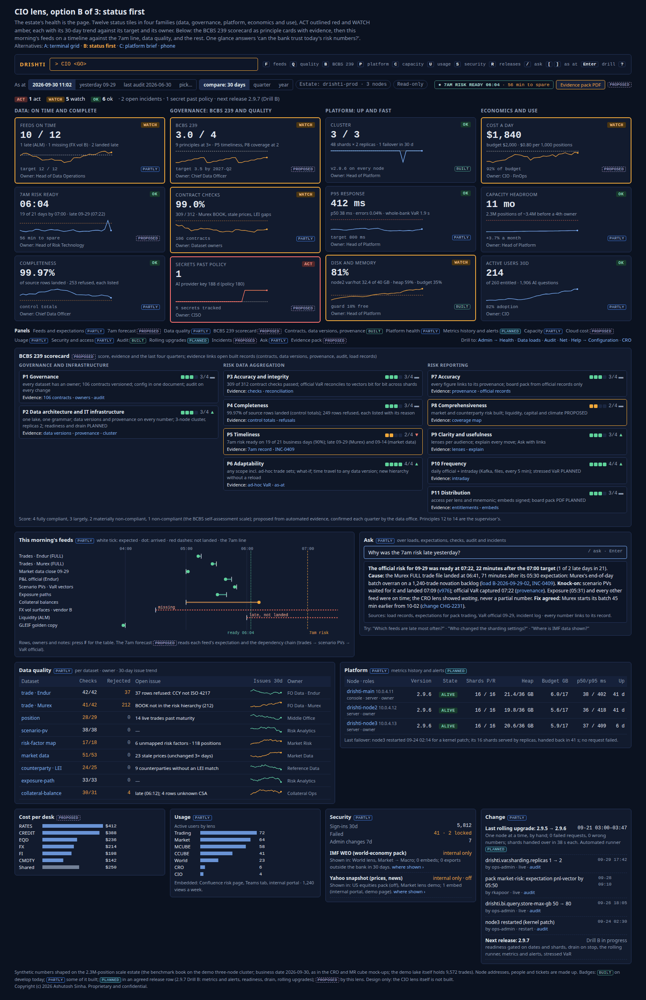
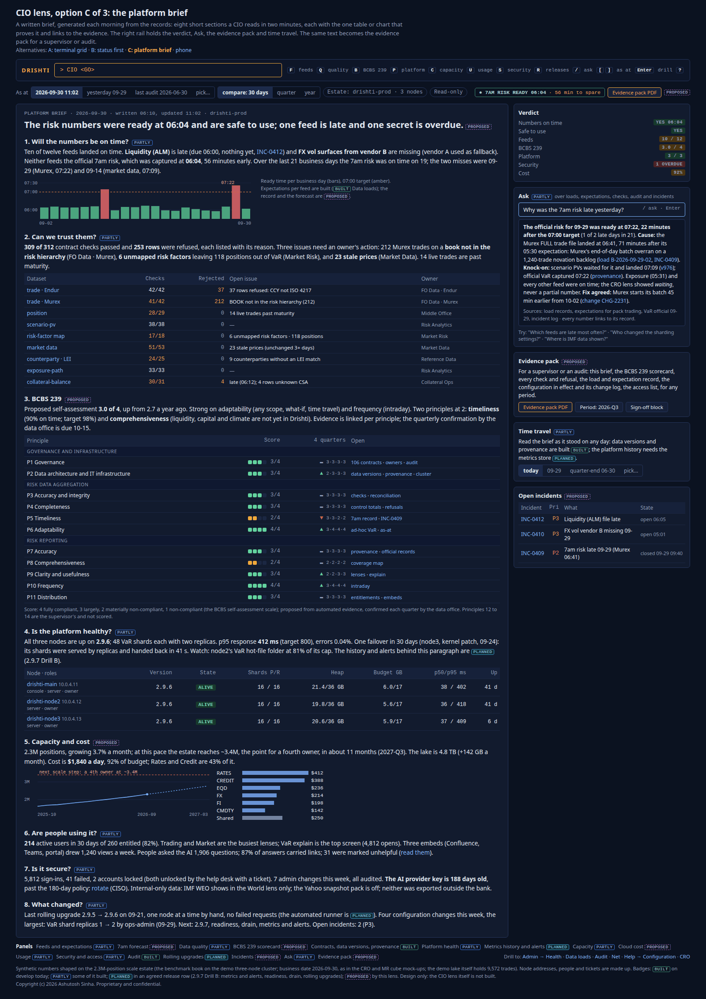
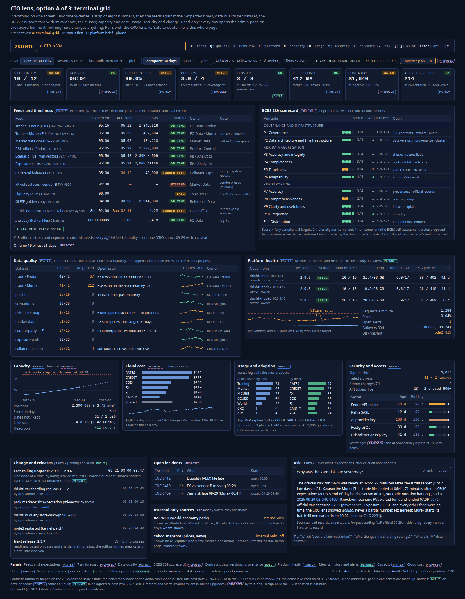
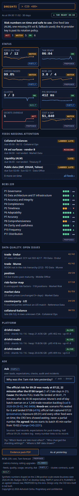

<!--
  Project Drishti · Any data. Any domain. One grammar.

  Copyright (c) 2026 Ashutosh Sinha <ajsinha@gmail.com>.
  All rights reserved.

  PROPRIETARY AND CONFIDENTIAL.

  This file is the confidential and proprietary property of Ashutosh Sinha.
  Unauthorised copying, use, modification, distribution or disclosure of this
  file, via any medium, is strictly prohibited except with the express prior
  written permission of the copyright holder.

  See the LICENSE file in the root of this repository for the full terms.
-->
# The CIO lens: is the risk data estate healthy, trustworthy, on time, secure, affordable, and used

**Status: analysis and product description; design, not built.** Nothing in this document is built unless a row of
[section 4](#4-what-drishti-has-today) says so and cites the guide or file it was read from (on
2026-10-31). Every phase named here is a **proposal**, not a commitment. The rows it
proposes are candidates in the [implementation plan](../architecture/IMPLEMENTATION_PLAN.md#cio-lens-candidates-not-started) (CIO1 to
CIO14), not started.

**The request (product owner, 2026-10-31):** a **CIO lens** for the Chief Information Officer: the executive view of **the platform and
the risk data behind the numbers**. It answers *"Is the risk data estate healthy, trustworthy, on time, secure, affordable, and are
people using it?"* Its strongest angle is **BCBS 239** (the Basel Committee's principles for risk data aggregation and risk reporting): a
live scorecard with its evidence (contracts, lineage, data versions, completeness, timeliness). The admin pages are for operators fixing
things; the CIO lens is a **read-only executive summary with trends and evidence**. It pairs with the CRO lens: the CRO's "data health /
safe to quote" panel ([CRO_LENS.md section 8.3](CRO_LENS.md#83-safe-to-quote)) is the CIO lens's whole story. Three landing mock-ups and a
phone mock-up first; the product owner liked them ("i like it and i am aligned with your recommendations"), and the recommendations are
recorded as decided in [section 15](#15-decisions-for-the-product-owner).

**Read with:** [CRO_LENS.md](CRO_LENS.md) (the executive sibling; its safe-to-quote rule reads this lens's feed and quality records),
[OVERSIGHT_LENS.md](OVERSIGHT_LENS.md) (the data-trust card RO13), [CLUSTER_DEPLOYMENT.md](../architecture/CLUSTER_DEPLOYMENT.md) (the
cluster, its gossip, shards, drain and the rolling upgrade), [RESOURCES_AND_SCALE.md](../architecture/RESOURCES_AND_SCALE.md) (memory, disk
and cache budgets, data versions), [DATA_GUIDE.md sections 8 and 9](../guides/DATA_GUIDE.md#8-expectations-and-late-data) (load
expectations and the Data loads page), [OPERATIONS.md section 13](../admin/OPERATIONS.md#132-admin--health) (Health, Prometheus, the
suggested alerts), [USER_MANAGEMENT.md](../admin/USER_MANAGEMENT.md) (roles, tokens, the audit and access logs),
[CONFIGURATION.md](../admin/CONFIGURATION.md) (every setting), [docs/contracts/README.md](../contracts/README.md) (contracts, validation
and rejects), [EDITIONS.md](../admin/EDITIONS.md) (lenses and editions) and [MOBILE_DISPLAY.md](../architecture/MOBILE_DISPLAY.md) (phone
tiers).

## Contents

1. [Purpose: what a CIO lens is](#1-purpose-what-a-cio-lens-is)
2. [Who uses it](#2-who-uses-it)
3. [Their questions: the morning, the month, the audit, the year](#3-their-questions-the-morning-the-month-the-audit-the-year)
4. [What Drishti has today](#4-what-drishti-has-today)
5. [Screens and interactions](#5-screens-and-interactions)
6. [Mock-ups: the screens to build](#6-mock-ups-the-screens-to-build)
7. [Data needed: the complete list](#7-data-needed-the-complete-list)
8. [Measures and rules](#8-measures-and-rules)
9. [BCBS 239, principle by principle](#9-bcbs-239-principle-by-principle)
10. [How this beats FIS / SunGard / Adaptiv](#10-how-this-beats-fis--sungard--adaptiv)
11. [The lens design](#11-the-lens-design)
12. [A proof of concept](#12-a-proof-of-concept)
13. [Phases (proposed)](#13-phases-proposed)
14. [Risks and data dependencies](#14-risks-and-data-dependencies)
15. [Decisions for the product owner](#15-decisions-for-the-product-owner)
16. [Glossary](#16-glossary)

**Status words,** as in the other lens documents, and the four **badge levels** on every panel of the lens (as the CRO lens):
**Built**: on develop, documented as built. **Partly**: some of it is built; the cell says what is missing. **Planned (row)**: a plan
row names it. **Proposed (CIOn)**: proposed here. **Not built**: neither. On the screens the badges are BUILT (green), PARTLY (blue),
PLANNED (cyan, its own colour: decided, product owner 2026-10-31, and applied to the CRO mock-ups in the same change) and PROPOSED (purple,
dashed).

---

## 1. Purpose: what a CIO lens is

The Chief Information Officer answers for the systems that produce the bank's risk numbers: that the data arrives on time, is complete
and correct, that the platform is up and fast, that access is controlled, that it costs what was budgeted and that the investment is
used. Since 2013 supervisors have asked large banks to show this against **BCBS 239**, the eleven bank-side principles of risk data
aggregation and risk reporting (governance and infrastructure; accuracy, completeness, timeliness and adaptability of aggregation;
accuracy, comprehensiveness, clarity, frequency and distribution of reporting). Most banks still answer it with a yearly self-assessment
spreadsheet, screenshots and a binder of evidence assembled by hand.

**What Drishti's answer is, in one paragraph.** Drishti already records, as a side effect of running, most of the evidence a CIO and a
supervisor need: every load with its rows and rejected rows, every expectation met or missed, a data contract for every kind with its
validation and rejects, a data version and provenance on every answer, the configuration in one generated document, an audit log of
every administrative change and sign-in, an access log of every answered read, a cluster with gossip and shards, and disk and cache
budgets. What it lacks is **one executive page** that turns those records into trends and a verdict. The **CIO lens** adds: the feeds
against their service levels with a **7am-ready forecast**; data quality per dataset with an owner and a history; a **BCBS 239
scorecard** whose every score links to the records behind it; platform health, capacity and (later) cost with trends; usage and adoption;
security and access; change and incidents; Ask over all of it; and an **evidence pack** for a supervisor or an audit. It is read-only:
every row opens the admin page or the record behind it, where operators act.

---

## 2. Who uses it

| Person | What they do with the lens | Lens today |
|---|---|---|
| **Chief Information Officer** (or the CTO for risk) | the morning glance (B); the monthly platform brief (C) for the executive committee; the evidence pack for the supervisor | none |
| **Chief Data Officer, the data office** | own the BCBS 239 self-assessment: confirm the proposed scores each quarter, chase dataset owners, publish the evidence pack | none |
| **Head of risk technology, head of platform** | read Detail (A) each morning: feeds, quality, nodes, alerts; open the admin page behind a row | Admin → Health, Data loads, Net (operators' pages) |
| **CISO, the security team** | access per lens and mnemonic, sign-ins and failures, secret ages, internal-only sources and where they show | Admin → Audit log, Access, Roles, Tokens |
| **FinOps, the CIO's chief of staff** | capacity against the next scale step, cost per day and per desk (later), adoption against licences | none |
| **CRO and the CRO's office** | the safe-to-quote panel reads this lens's records; "why was the 7am risk late?" | the CRO lens (proposed) |
| **Internal audit, supervisors** | reproduce the scorecard and the evidence of a quarter (time travel), read the evidence pack | none |

The CIO lens is **a lens** ([EDITIONS.md section 8](../admin/EDITIONS.md#8-lenses)): `Open Drishti CIO` from Views and Home on a full
instance, and the command word `CIO` (proposed) for its landing. It **reads**; it has no action of its own beyond opening the page that
owns a row, confirming a BCBS 239 score (the data office) and generating the evidence pack.

---

## 3. Their questions: the morning, the month, the audit, the year

| When | Question | The lens's answer |
|---|---|---|
| Morning (06:30, before the risk numbers go out) | Will the 7am risk be ready? | the **7AM RISK READY** badge (or the forecast time) and the twelve feeds against their expected times, late and missing first |
| Morning | Can people trust today's numbers? | contract checks passed per dataset, rejected rows, the open issues with their owners; the CRO's safe-to-quote reads the same |
| Morning | Is the platform healthy? | nodes alive, shards and replicas, p95 response against target, errors, open alerts, the last failover |
| Morning | Why was the 7am risk late yesterday? | Ask: the answer in sentences with every link (the load, the expectation, the dependency, the incident, the fix) |
| Weekly | Which feeds are late most often, and whose? | the feed history: on-time rate per feed and owner over 30 days |
| Monthly (executive committee) | Capacity, cost and adoption | positions and lake size against the next scale step; cost per day (later per desk); active users by lens and desk, top screens, AI questions |
| Monthly | Is it secure? | sign-ins and failures, locked accounts, admin changes, tokens unused, secrets past their rotation policy, internal-only sources and where they show |
| Quarterly (data office) | Where do we stand on BCBS 239? | the scorecard: eleven principles, a proposed score each from automated evidence, confirmed by the data office, the trend over four quarters |
| Audit, supervisor visit | Show me the evidence for the quarter | the **evidence pack PDF**: the brief, the scorecard, every check and refusal, the load and expectation record, the configuration in force and its changes, the access list; time travel to any date |
| Annual | Are we investing in the right places? | the BCBS 239 trend, the timeliness record, capacity headroom, cost and adoption over the year |
| Any time | Where did this number come from? | every figure opens its record (the load, the check, the audit row, the metric) |

---

## 4. What Drishti has today

| Capability | Status | Evidence |
|---|---|---|
| Load announcements with rows, rejected rows, batch, source, verification, steps and alerts fired | **Built** | [DATA_GUIDE section 9](../guides/DATA_GUIDE.md#9-the-data-loads-page); `LoadRecord` (`rows`, `rejected`, `verified`, `steps`) in `drishti-server/src/main/java/com/ash/drishti/server/loads/LoadRecord.java` |
| Expectations per pack and kind (expected by, zone, calendar) with the states `pending`, `on-time`, `landed-late`, `late`, `missing`, `failed`; a notice once; Health turns `DEGRADED` | **Built** | [DATA_GUIDE section 8](../guides/DATA_GUIDE.md#8-expectations-and-late-data); `ExpectationService` in `drishti-server/src/main/java/com/ash/drishti/server/loads/ExpectationService.java`; `dataLate` in `HealthController` |
| A history of expectations beyond the look-back window, a dependency chain, a "ready by" forecast | **Not built**: states are worked out for today and `lookback-days` (3) business days; the load history keeps `keep` (2000) loads per pack | [CONFIGURATION, `drishti.loads`](../admin/CONFIGURATION.md#drishtiloads--data-loads-a-batch-landed) |
| Data contracts: one per kind, with `validation` (required, unique, enum, pattern, link, range, vector length) and rejects to the load's reject file | **Built** (106 contract files under `config/packs/*/contracts/`) | [contracts README sections 10, 15](../contracts/README.md#10-validation-and-rejects) |
| Content checks beyond the contract: live trades past maturity, unmapped risk factors, stale prices, counterparties without an LEI match | **Not built** as checks; the Market lens shows market-data quality | [MARKET_LENS.md](MARKET_LENS.md) |
| Data versions, the inputs' digest and provenance on every answer | **Built** | [RESOURCES_AND_SCALE section 4.2](../architecture/RESOURCES_AND_SCALE.md#42-data-versions-the-inputs-digest-and-provenance-today); `drishti-api/src/main/java/com/ash/drishti/api/Provenance.java` |
| Lineage and impact of BI datasets and reports | **Built** | [BI_GUIDE section 32](../guides/BI_GUIDE.md#32-publishing-and-governance-versions-review-certification-lineage-impact-environments) |
| Official records of VaR and exposure, reproducible for any past date | **Built** | [VAR_GUIDE section 19](../guides/VAR_GUIDE.md#19-official-end-of-day-results) |
| The configuration in one generated document, in the UI with the value in force and its origin | **Built** (C1 to C3) | [CONFIGURATION.md](../admin/CONFIGURATION.md#every-setting); `tools/settings_catalogue.py` |
| The audit log: sign-ins (`login`, `login-failed`, `locked`, `login-sso`), users, roles, tokens, packs, connectors, load settings (`data-load-config-changed`), cache purges, embed applications (`embed-app-secret-rotated`), Drishti\*net files | **Built** | [USER_MANAGEMENT.md](../admin/USER_MANAGEMENT.md#step-6-read-the-audit-log); `AuditLog` and `UserService` in `drishti-identity/src/main/java/com/ash/drishti/identity/` |
| Write-back audit and four-eyes approval | **Built** | [WRITE_BACK section 14](../guides/WRITE_BACK.md#14-audit-and-retention) |
| The access log: every answered read (view, raw document, history, search, export, embedded view as `embed:<application>`, Ask questions) with person, time, entity and business date, 90 days | **Built** | [USER_MANAGEMENT, the access log](../admin/USER_MANAGEMENT.md#who-looked-at-what-the-access-log); [OPERATIONS section 9b](../admin/OPERATIONS.md#9b-the-access-log); `AccessLog` in `drishti-identity` |
| Usage analytics: active users by lens and desk, top screens, adoption against entitlement | **Not built**; the access log is the raw material, the lens and screen of a read are not recorded | — |
| Roles and powers per pack; a command turned off by an administrator (Admin → Commands) | **Built** | [USER_MANAGEMENT section 2](../admin/USER_MANAGEMENT.md#2-roles) |
| An entitlement report: who may open which lens and mnemonic, as of a date | **Not built** | — |
| Secrets: read from the environment or files; embed application secrets rotated and audited; the pack registry key's rotation described | **Partly**: no inventory of secrets with their age and a rotation policy | [OPERATIONS section 9c](../admin/OPERATIONS.md#9c-pack-registry-keys) |
| The internal-only rule for public sources (IMF data, the Yahoo snapshot) | **Built** as a rule and a pack switch; **not built**: a report of where each is shown | [EXTERNAL_DATA, the internal-only rule](../guides/EXTERNAL_DATA.md#the-internal-only-rule) |
| Admin → Health: overall status, connectors, packs, the views' p50, p95 and p99 per kind (last ten minutes), activity (requests a minute and response time, last 30 minutes), disk, Drishti\*net, data that is late | **Built** | [OPERATIONS section 13.2](../admin/OPERATIONS.md#132-admin--health); `drishti-console/web/templates/admin/_health_body.html` |
| Prometheus metrics, a Grafana dashboard, suggested alert rules | **Built** (`/actuator/prometheus`, `deploy/grafana/drishti-dashboard.json`) | [OPERATIONS sections 13.4, 13.5](../admin/OPERATIONS.md#134-prometheus-and-grafana) |
| Platform metrics and alerts: caches, memory budget, disk, sources' freshness, feeds, loads, open alerts as named gauges; alert rules each server evaluates itself, told to administrators, listed on Health and at `GET /api/v1/admin/alerts`; the same rules for Prometheus | **Built** (`server/metrics`, `config/alerts/platform-alerts.yaml`, `deploy/prometheus/drishti-alerts.yaml`) | [OPERATIONS section 13.6](../admin/OPERATIONS.md#136-platform-metrics-and-alerts) |
| Drishti's own history of those metrics (days, months) | **Not built** (CIO4, `platform-metric`, section 7.7) | [RESOURCES_AND_SCALE section 8.3](../architecture/RESOURCES_AND_SCALE.md#83-metrics-to-export) |
| Cluster membership by gossip, VaR sharding with replicas and zones, handover | **Built** | [CLUSTER_DEPLOYMENT sections 4.1, 4.4](../architecture/CLUSTER_DEPLOYMENT.md#41-membership-by-gossip-swim-over-http) |
| Disk caps with a free-space guard, one cache budget, Admin → Health → Disk | **Built** | [RESOURCES_AND_SCALE section 14](../architecture/RESOURCES_AND_SCALE.md#14-built) |
| Readiness gated on dates and shards, drain on stop, the rolling upgrade runner, N and N−1 | **Built** for readiness, drain and the runner (CD1 to CD3); the N and N−1 rule **planned** (CD4) | [CLUSTER_DEPLOYMENT section 18](../architecture/CLUSTER_DEPLOYMENT.md#18-built-against-planned) |
| A record of releases and upgrades per node (what ran, when, by whom, failed requests) | **Partly**: each server reports its version (`/actuator/info`, Health); no history | [OPERATIONS section 15](../admin/OPERATIONS.md#15-upgrades-and-rollback) |
| Incidents | **Not built** (the bank's ITSM tool owns them) | — |
| Cloud cost | **Not built**; a later phase (decided) | — |
| A BCBS 239 scorecard | **Not built**; nothing in the repository mentions BCBS 239 before this document | — |
| Ask | **Partly**: *Ask about this page* and BI's *ask the data* on the AI layer, off by default; an answer across loads, checks, audit and incidents **not built** | [AI.md section 7](../admin/AI.md#7-ask-on-the-ai-layer) |
| Lenses and editions | **Built** | [EDITIONS.md section 8](../admin/EDITIONS.md#8-lenses) |
| Phone tiers | **Design**; the phone display is proposed | [MOBILE_DISPLAY.md](../architecture/MOBILE_DISPLAY.md#3-phone-tiers-must-glance-more-desk) |

**Verified in code (2026-10-31):** `ExpectationService` (`drishti-server/src/main/java/com/ash/drishti/server/loads/`) defines the six
states and the one-time notice; `LoadRecord` carries `rows` and `rejected`; `HealthController` puts `dataLate` in the health answer and
turns the status `DEGRADED`; `UserService` records `login-failed` and `locked` through `AuditLog`; `AccessLog` writes `drishti_access`.
No class in `drishti-server/src/main`, `drishti-identity/src/main` or the console's `core` and `routes` folders names BCBS 239, a feed
dependency, a forecast, a data-quality history, a cloud cost, an incident or a secret inventory. The demo lake holds 9,572 trades; the
mock-ups use the **2.3M-position scale estate** for feeds, capacity and cost (decided, section 15), labelled as such.

---

## 5. Screens and interactions

The lens follows the house rules: keyboard first, every number printed (a chart never replaces a figure), a problem in the theme's loss
colour **and** with a word (`LATE`, `MISSING`, `ACT`, `WATCH`), dark terminal theme by default, every panel a ViewModel panel so it embeds
and stacks on a phone. Every panel carries one of the **four badges** until the whole lens is built.

### 5.1 The layouts (decided)

**Decided (product owner, 2026-10-31):** **B (status first) is the landing page; C (the platform brief) is its "Brief" tab and is also
the Evidence pack PDF; A (terminal grid) is its "Detail" tab; the phone view is its own layout,** with phone tiers per panel as in
[MOBILE_DISPLAY.md](../architecture/MOBILE_DISPLAY.md) (the phone display is proposed). The three tabs share one data request.

| Tab | Layout | Best for | Mock-up |
|---|---|---|---|
| **Status** (landing) | **B**: twelve status tiles in four families (data, governance, platform, economics and use), then the BCBS 239 principle cards, this morning's feeds on a timeline against the 7am line, Ask, data quality, the platform, cost, usage, security and change | the morning glance: "can the bank trust today's risk numbers?" | [cio/B.html](mockups/cio/B.html) |
| **Brief** | **C**: a written brief in eight sections, each with the table or chart that proves it; a right rail with the verdict, Ask, the evidence pack, time travel and incidents. The same text, for a period, **is** the evidence pack PDF | the executive committee; the supervisor; the audit | [cio/C.html](mockups/cio/C.html) |
| **Detail** | **A**: one dense terminal screen: eight numbers, the feeds table, the BCBS 239 table, data quality, the nodes, capacity, cost, usage, security, change, incidents, internal-only sources, Ask | the head of risk technology and the data office | [cio/A.html](mockups/cio/A.html) |
| **Phone** | one 390 px column: the verdict, eight tiles two-up, the feeds needing attention, BCBS 239, open quality issues, nodes, Ask | the CIO away from the desk | [cio/phone.html](mockups/cio/phone.html) |

### 5.2 The visual catalogue

| Visual | What it shows | Interactions | Built today? |
|---|---|---|---|
| **Status tile** | name, value, status word (`OK`, `WATCH`, `ACT`), a sub-line, a 30-day sparkline against its target (dashed), the target, the badge, the owner | click: the panel or admin page behind it; hover: the record it came from | Health shows a status; tiles, targets and trends not built |
| **Status count line** | "ACT 1 · WATCH 5 · OK 6", open incidents, secrets past policy, the next release | click a count: filter the tiles | not built |
| **7am-ready badge** | `7AM RISK READY 06:04 · 56 min to spare`, or `FORECAST 07:18 · LATE` before it is ready, with the feed holding it up | click: the feed timeline | not built (CIO1) |
| **Feed table** (Detail) | per feed: name, batch, expected, arrived, rows, status word, owner, note | click: the pack's Data loads page | the same facts per pack on Data loads (built); one table across packs not built |
| **Feed timeline** (Status) | expected (white tick) against arrived (dot), red dashes for not landed, the 7am line and the ready time | hover: the load; click: Data loads | not built |
| **Ready-time chart** (Brief) | the ready time per business day for 21 days, bars red above 07:00 | click a bar: that day's feeds | not built (CIO1) |
| **Data-quality table** | per dataset: checks passed of total, rejected rows, the open issue, a 30-day issue trend, the owner | click: the dataset's checks and rejected rows | contract checks and rejects built; the table, content checks and history not built (CIO2) |
| **BCBS 239 scorecard** | eleven principles in three groups, score 1 to 4 as four squares and a number, the last four quarters, the evidence today and the open items, each a link | click evidence: the record; the data office confirms a score | not built (CIO3) |
| **Nodes table** | node, address, roles, version, state, shards primary and replica, heap, cache budget, p50 and p95, uptime | click: Admin → Net, Health | the facts on Net and Health (built); one table across members partly |
| **Latency chart** | p50 and p95 over 48 hours with the target and the failover marked | hover: the minute | Health's last 30 minutes built; the history planned |
| **Capacity chart** | positions monthly with a dotted forecast and the next scale step (a fourth owner at about 3.4M) | hover | not built (CIO5) |
| **Cost bars** | cost a day per desk, a 30-day trend against budget | click: the allocation | not built; later phase (CIO14) |
| **Usage bars** | active users by lens and by desk; top screens; embeds; AI questions | click: the access log filtered | access log built; the view not built (CIO6) |
| **Secrets table** | secret, age, policy, a meter | click: the rotation runbook | not built (CIO7) |
| **Change list** | the last rolling upgrade, configuration changes with who and when, the next release | click: the audit row | audit built; upgrade record not built (CIO8) |
| **Incidents table** | id, priority, what, state | click: the ITSM ticket | not built (CIO8) |
| **Ask** | a question box; the answer in sentences with every figure a link; suggested questions | `/` focuses it; `Enter` asks | not built across these records (CIO10) |
| **As-at strip** | as at now, yesterday, the last audit date, pick; compare 30 days, quarter, year; the estate chip; Read-only | `[` `]` step | not built (CIO11) |
| **Evidence pack PDF** | a button generating the Brief for a period with the scorecard and the evidence | click | not built (CIO11) |

### 5.3 Keyboard and the command line

`CIO <GO>` opens the landing (Status); `CIO BRIEF <GO>` and `CIO DETAIL <GO>` open the other tabs; `CIO BCBS <GO>` opens the scorecard;
`CIO ASOF:2026-06-30 <GO>` opens it as at a date (all proposed, CIO9 and CIO11). On the page: `F` feeds, `Q` quality, `B` BCBS 239, `P`
platform, `C` capacity, `U` usage, `S` security, `R` releases, `/` Ask, `[` `]` step the as-at, `Enter` drill, `?` help. The command word
and its arguments are checked against every pack's mnemonics at build.

### 5.4 Read-only, and where each row goes

The lens never changes the platform. A row opens the page that owns it, where the people with the power act: a feed opens the pack's
**Data loads** page; a check opens the dataset's rejects; a node opens **Admin → Net** or **Health**; an audit line opens **Admin → Audit
log**; a secret opens its runbook; an incident opens the bank's ticket. Two actions exist in the lens and both write records, never
settings: the data office **confirms** a BCBS 239 score (with a comment; section 8.4), and anyone with the power **generates** the
evidence pack.

### 5.5 Response-time targets

| Interaction | Target (p95, warm) | Note |
|---|---|---|
| Open the landing (12 tiles, BCBS cards, the feed timeline, quality, nodes) | 600 ms¹ | the daily summaries are precomputed (section 7); the live part (nodes, today's feeds) is a few small calls |
| Switch tab | 100 ms¹ | the same answer, rearranged |
| As at a past date | 1.5 s¹ | the captured summaries of that date; nothing recomputed |
| Ask, first token | 2 s¹ | the AI layer's model; the records fetched first |
| Evidence pack PDF for a quarter | 30 s¹ | the Brief for the period, with the scorecard and evidence tables |

¹ Estimates, not measurements; to be measured with the POC.

### 5.6 Phone

**must**: the verdict paragraph, the status counts, the 7am badge, the ACT and WATCH tiles; **glance**: the other tiles, the feeds
needing attention; **more**: BCBS 239, open quality issues, the nodes, Ask, the two buttons; **desk**: the feed table, cost, usage,
security detail, change, the Detail tab. The phone shows the decided phone layout ([cio/phone.html](mockups/cio/phone.html)), not a
shrunken landing; the tier mechanism is [MOBILE_DISPLAY.md](../architecture/MOBILE_DISPLAY.md#4-where-the-tier-is-set-five-layers-one-rule)'s.

---

## 6. Mock-ups: the screens to build

The four mock-ups are in the repository, self-contained (no CDN, no external fonts, inline SVG), each with a headless-Chrome screenshot
beside it: [A.html](mockups/cio/A.html), [B.html](mockups/cio/B.html), [C.html](mockups/cio/C.html), [phone.html](mockups/cio/phone.html).
**Chosen (decided, product owner, 2026-10-31):** B is the landing, C the Brief tab and the evidence pack, A the Detail tab, the phone its
own layout.

**Their numbers are synthetic** and consistent across the four pages and with the CRO and cube mock-ups: business date 2026-09-30, as at
11:02; the batch `B-2026-09-30-01`, scenario PVs `v977`, VaR vectors `v4182`, exposure run `XR-2026-09-30-01` and the late liquidity
(ALM) feed as in the CRO mock-ups. Feeds, capacity and cost use the **2.3M-position scale estate** (the benchmark book on the demo
three-node cluster; Endur 1,842,316 plus Murex 457,684 positions), not the demo lake's 9,572 trades, and say so in their footers. Node
addresses (`10.0.4.11` to `.13`), people (`ops-admin`, `rkapoor`), tickets (`INC-0409`, `CHG-2231`), every cost, usage and security
figure and the BCBS 239 scores are invented for the mock-ups; **never a client's name or figure**.

**Version numbers.** This document writes the running version as N and the next as N+1. The mock-up pictures draw example version
numbers; **nothing deck-bound** (a slide, a screenshot in a deck, a client handout) may show them: a deck uses these pictures only after
the version cells read "current" and "next".

**How to read the checklists.** One table per mock-up: each row is a panel to build, with its exact contents, the data and contract it
reads (section 7), its interactions, the phase (**POC** of [section 12](#12-a-proof-of-concept), or the CIO row that brings it), its
phone tier and a **Done?** column for the build to tick. The empty, loading and error states shared by every panel are in
[section 6.5](#65-empty-loading-and-error-states).

### 6.1 B: Status (the landing)



[Open B.html](mockups/cio/B.html)

| Panel | Contents (exact) | Data and contract | Interaction | Phase | Phone tier | Done? |
|---|---|---|---|---|---|---|
| Command bar | `DRISHTI`, the command line with `CIO <GO>`, the key legend (`F` `Q` `B` `P` `C` `U` `S` `R` `/` `[` `]` `Enter` `?`) | the lens file's placeholder | type a command; keys | POC | must | no |
| As-at strip | as at `2026-09-30 11:02`, presets *yesterday 09-29*, *last audit 2026-06-30*, *pick…*; compare *30 days* / *quarter* / *year*; chip *Estate: drishti-prod · 3 nodes*; chip *Read-only*; **7AM RISK READY 06:04 · 56 min to spare**; **Evidence pack PDF** with PROPOSED | `feed-status` (7.4) and `feed-dependency` (7.5) for the badge; the captured summaries for past dates | preset click; `[` `]`; the badge opens the feed timeline | POC: now and yesterday; CIO11 the rest | must (badge) | no |
| Status count line | `ACT 1 act`, `WATCH 5 watch`, `OK 6 ok`; *2 open incidents · 1 secret past policy · next release N+1* | the tiles' statuses (8.5); `incident` (7.11); `secret-inventory` (7.10); `change-record` (7.12) | click a count: filter the tiles | POC (counts) | must | no |
| Family headings | DATA: ON TIME AND COMPLETE · GOVERNANCE: BCBS 239 AND QUALITY · PLATFORM: UP AND FAST · ECONOMICS AND USE | the lens file | none | POC | must | no |
| Tile: Feeds on time | `10 / 12`, *1 late (ALM) · 1 missing (FX vol B) · 2 landed late*, sparkline against *target 12 / 12*, `WATCH`, PARTLY, *Owner: Head of Data Operations* | `feed-status` (7.4); today's states from `ExpectationService` (built) | click: the feed timeline (`F`) | POC | must | no |
| Tile: 7am risk ready | `06:04`, *19 of 21 days by 07:00 · late 09-29 (07:22)*, sparkline against the 07:00 line, *56 min to spare*, `OK`, PROPOSED, *Owner: Head of Risk Technology* | `feed-status` and `feed-dependency`; the official capture time of VaR and exposure | click: the ready-time chart | CIO1 | must | no |
| Tile: Completeness | `99.97%`, *of source rows landed · 253 refused, each listed*, sparkline against 99.9%, *control totals*, `OK`, PARTLY, *Owner: Chief Data Officer* | `LoadRecord.rows`, `rejected` (built); control totals from `feed-sla` (7.3) | click: the refused rows | POC (rows, rejected); CIO1 (control totals) | glance | no |
| Tile: BCBS 239 | `3.0 / 4`, *9 principles at 3+ · P5 timeliness, P8 coverage at 2*, sparkline against *target 3.5 by 2027-Q2*, `WATCH`, PROPOSED, *Owner: Chief Data Officer* | `bcbs239-assessment` (7.13) | click: the scorecard (`B`) | CIO3 | must | no |
| Tile: Contract checks | `99.0%`, *309 / 312 · Murex BOOK, stale prices, LEI gaps*, sparkline against 99.5%, *106 contracts*, `WATCH`, PARTLY, *Owner: Dataset owners* | `dq-result` (7.6); the contracts' validation (built) | click: data quality (`Q`) | POC (contract checks from rejects); CIO2 (content checks) | glance | no |
| Tile: Secrets past policy | `1`, *AI provider key 188 d (policy 180)*, *5 secrets tracked*, `ACT`, red outline, PROPOSED, *Owner: CISO* | `secret-inventory` (7.10) | click: the secrets table | CIO7 (decision 5) | must | no |
| Tile: Cluster | `3 / 3`, *48 shards × 2 replicas · 1 failover in 30 d*, *vN on every node*, `OK`, BUILT, *Owner: Head of Platform* | Drishti\*net membership and the shard map (built); `platform-metric` (7.7) for the trend | click: the nodes table (`P`) | POC | glance | no |
| Tile: p95 response | `412 ms`, *p50 38 ms · errors 0.04% · whole-bank VaR 1.9 s*, sparkline against *target 800 ms*, `OK`, PARTLY | Health's views p95 (built, ten minutes); `platform-metric` for the 30 days (planned) | click: the latency chart | POC (now); CIO4 (trend) | glance | no |
| Tile: Disk and memory | `81%`, *node2 var/hot 32.4 of 40 GB · heap 59% · budget 35%*, *guard 10% free*, `WATCH`, BUILT | Health → Disk and the cache budget (built) | click: Admin → Health → Disk | POC | glance | no |
| Tile: Cost a day | `$1,840`, *budget $2,000 · $0.80 per 1,000 positions*, *92% of budget*, `WATCH`, PROPOSED, *Owner: CIO · FinOps* | `cloud-cost` (7.8) | click: cost per desk | CIO14 (later phase, decision 4) | more | no |
| Tile: Capacity headroom | `11 mo`, *2.3M positions of ~3.4M before a 4th owner*, *+3.7% a month*, `OK`, PARTLY | `platform-metric` (positions, lake size); the scale step from CLUSTER_DEPLOYMENT section 3 | click: the capacity chart | CIO5 | more | no |
| Tile: Active users 30d | `214`, *of 260 entitled · 1,906 AI questions*, *82% adoption*, `OK`, PARTLY | `usage-event` (7.9) over the access log (built); `entitlement` (7.10) for "entitled" | click: usage (`U`) | CIO6 | more | no |
| Panels and drill line | each panel's badge (Feeds and expectations PARTLY, 7am forecast PROPOSED, Data quality PARTLY, BCBS 239 scorecard PROPOSED, Contracts, data versions, provenance BUILT, Platform health PARTLY, Metrics history and alerts PLANNED, Capacity PARTLY, Cloud cost PROPOSED, Usage PARTLY, Security and access PARTLY, Audit BUILT, Rolling upgrades PLANNED, Incidents PROPOSED, Ask PARTLY, Evidence pack PROPOSED); *Drill to: Admin → Health · Data loads · Audit · Net · Help → Configuration · CRO* | the lens file (badges are configuration until built) | click a link | POC | more | no |
| BCBS 239 scorecard | three columns (governance and infrastructure; risk data aggregation; risk reporting), eleven cards: *P1 Governance 3/4* … *P11 Distribution 3/4*, each with its score squares, trend arrow, one line of evidence and *Evidence:* links; P5 and P8 outlined amber at 2/4; the scale note | `bcbs239-assessment` (7.13) and the evidence it links (section 9) | click a link: the record; confirm (data office) | CIO3 | more | no |
| This morning's feeds | the timeline 03:30 to 07:30 for the eleven timed feeds, the 07:00 line and *ready 06:04*; *missing* (FX vol vendor B) and *late, not landed* (ALM) in red dashes; the note on the forecast | `feed-status`, `feed-sla`, `feed-dependency` | hover: the load; click: Data loads | POC (today's states); CIO1 (dependency) | glance | no |
| Ask | the box *Why was the 7am risk late yesterday?*; the answer: *ready at 07:22 … Murex FULL trade file landed at 06:41 … scenario PVs waited … official VaR captured 07:22 … Fix agreed: Murex starts its batch 45 min earlier (CHG-2231)*, every figure a link; *Sources: load records, expectations for pack trading, VaR official 09-29, incident log*; three suggested questions | the AI layer with tools over the records of section 7 (8.10) | `/`, `Enter`; click a link | CIO10 | more | no |
| Data quality | nine datasets: *trade · Endur 42/42, 37 rejected, CCY not ISO 4217*; *trade · Murex 41/42, 212, BOOK not in the risk hierarchy*; *position 28/29, 14 live trades past maturity*; *scenario-pv 38/38*; *risk-factor map 17/18, 6 unmapped · 118 positions*; *market data 51/53, 23 stale prices*; *counterparty · LEI 24/25, 9 without an LEI match*; *exposure-path 33/33*; *collateral-balance 30/31, late; 4 rows unknown CSA*; a 30-day issue sparkline; the owner | `dq-result` (7.6) | click a dataset: its checks and rejects | POC (contract checks, rejects); CIO2 (content checks, trend) | more | no |
| Platform | the nodes table (`drishti-main` 10.0.4.11 console · server · owner, `drishti-node2`, `drishti-node3`: N, `ALIVE`, 16 / 16, heap, budget, p50 / p95, up); *Last failover: node3 restarted 09-24 02:14 … handed back in 41 s; no request failed* | Drishti\*net members and their digests (built); `platform-metric`; `change-record` for the failover | click: Admin → Net | POC (now); CIO4 (history) | more | no |
| Cost per desk | RATES $412, CREDIT $388, EQD $236, FX $214, FI $198, CMDTY $142, Shared $250 | `cloud-cost` and `cost-allocation` (7.8) | click: the allocation rules | CIO14 (later) | desk | no |
| Usage | active users by lens (Trading 72, Market 64, MCUBE 58, CCUBE 41, World 23, CRO 6, CIO 4); *Embedded: Confluence risk page, Teams tab, internal portal · 1,240 views a week* | `usage-event` (7.9) | click: Admin → Access filtered | CIO6 | desk | no |
| Security | *Sign-ins 30d 5,812 · Failed 41 · 2 locked · Admin changes 7d 7*; internal-only sources: *IMF WEO (world-economy pack) shown in World lens, Market → Macro; 0 embeds; 0 exports*, *Yahoo snapshot … off; 1 embed (demo page)* | the audit log (built); `entitlement` (7.10); the internal-only map (8.8) | click: Admin → Audit log, Access | POC (sign-ins from audit); CIO7 | desk | no |
| Change | *Last rolling upgrade N−1 → N, 09-21 03:00–03:47, one node at a time, by hand; 0 failed requests … Automated runner PLANNED*; four configuration changes with who, when and *live* or *restart*, each with an audit link; *Next release: N+1 … testing in progress* | `change-record` (7.12); the audit log (built) | click: the audit row | POC (configuration changes from audit); CIO8 | desk | no |
| Footer | the scale-estate note, the badge meanings, *Design only*; copyright from branding | branding configuration | none | POC | more | no |

### 6.2 C: Brief (and the Evidence pack PDF)



[Open C.html](mockups/cio/C.html)

| Panel | Contents (exact) | Data and contract | Interaction | Phase | Phone tier | Done? |
|---|---|---|---|---|---|---|
| Command bar, as-at strip | as B | as B | as B | CIO9 | must | no |
| Headline | *PLATFORM BRIEF · 2026-09-30 · written 06:10, updated 11:02 · drishti-prod*; *The risk numbers were ready at 06:04 and are safe to use; one feed is late and one secret is overdue.* | the tiles' statuses; text from a **template** (8.9) | click a figure: its record | CIO9 | must | no |
| 1. Will the numbers be on time? | the paragraph (ten of twelve on time; ALM late, INC-0412; FX vol B missing, fallback; 06:04; 19 of 21; the two misses) and the ready-time chart (21 days, 07:00 line) | `feed-status`, `feed-dependency` | click a bar: that day | CIO1 | glance | no |
| 2. Can we trust them? | the paragraph (309 of 312; 253 refused; three owner actions; 14 past maturity) and the data-quality table without the trend column | `dq-result` | as B | CIO2 | more | no |
| 3. BCBS 239 | the paragraph (3.0 of 4, up from 2.7; strong on P6, P10; P5 and P8 at 2; confirmation due 10-15) and the scorecard table (score, four quarters, open items) | `bcbs239-assessment` | as B | CIO3 | more | no |
| 4. Is the platform healthy? | the paragraph (three nodes on N; 48 shards × 2; p95 412 ms; one failover; node2 at 81%; history PLANNED) and the nodes table | as B's platform | as B | POC (now); CIO4 | more | no |
| 5. Capacity and cost | the paragraph (2.3M, +3.7% a month, ~3.4M in ~11 months, 4.8 TB, $1,840 a day) and the capacity chart with the cost bars | `platform-metric`; `cloud-cost` | hover | CIO5; CIO14 | desk | no |
| 6. Are people using it? | the paragraph (214 of 260; top lens and screen; embeds; 1,906 AI questions, 87% with links, 31 unhelpful) | `usage-event`, `entitlement` | click *read them* | CIO6 | desk | no |
| 7. Is it secure? | the paragraph (sign-ins, failures, locks, admin changes; the AI provider key past policy; internal-only data) | audit log; `secret-inventory`; the internal-only map | click *rotate*: the runbook | CIO7 | desk | no |
| 8. What changed? | the paragraph (the upgrade 09-21; four configuration changes; next release; two P3 incidents) | `change-record`, `incident` | click: the record | CIO8 | desk | no |
| Right rail: Verdict | *Numbers on time YES 06:04 · Safe to use YES · Feeds 10 / 12 · BCBS 239 3.0 / 4 · Platform 3 / 3 · Security 1 OVERDUE · Cost 92%* | the tiles | click: the section | CIO9 | must | no |
| Right rail: Ask | as B | as B | as B | CIO10 | more | no |
| Right rail: Evidence pack | the description; **Evidence pack PDF**, *Period: 2026-Q3*, *Sign-off block* | the brief for a period (8.9) and the scorecard; the planned board pack's PDF house style | click: generate | CIO11 | more | no |
| Right rail: Time travel | *data versions and provenance are built; the platform history needs the metrics store (PLANNED)*; presets *today*, *09-29*, *quarter-end 06-30*, *pick…* | the captured summaries | preset click | CIO11 | desk | no |
| Right rail: Open incidents | *INC-0412 P3 Liquidity (ALM) file late, open 06:05*; *INC-0410 P3 FX vol vendor B missing 09-29*; *INC-0409 P2 7am risk late 09-29 (Murex 06:41), closed 09-29 09:40* | `incident` (7.11) | click: the ticket | CIO8 | more | no |

### 6.3 A: Detail



[Open A.html](mockups/cio/A.html)

| Panel | Contents (exact) | Data and contract | Interaction | Phase | Phone tier | Done? |
|---|---|---|---|---|---|---|
| Command bar, as-at strip | as B | as B | as B | CIO9 | must | no |
| Eight numbers | *Feeds on time 10 / 12 WATCH*, *7am risk 06:04 OK*, *Checks passed 99.0% WATCH*, *BCBS 239 3.0 / 4 WATCH*, *Cluster 3 / 3 OK*, *p95 response 412 ms OK*, *Cost a day $1,840 WATCH*, *Active users 30d 214 OK*, each with its sub-line and badge | as B's tiles | click: the panel | as B's tiles | must | no |
| Feeds and timeliness | the table of twelve feeds: name and batch, *Expected*, *Arrived* (amber when late, red dash when absent), *Rows*, the status word (`ON TIME`, `LANDED LATE`, `MISSING`, `LATE`), *Owner*, *Note* (*late 09-29 (06:41)*, *within 10 min grace*, *margin system restart*, *vendor A used (fallback)*, *09-29 shown in CRO*, *internal-only sources*, *lag 4 s*); the 7am badge and its rule; *On time 19 of last 21 days* | `feed-status`, `feed-sla`; `LoadRecord` (built) | sort; click: Data loads | POC (today); CIO1 | desk | no |
| BCBS 239 scorecard | the table: principle, score squares and *n/4*, the last four quarters (*3·3·3·3*), the open links; groups as rows; the scale note | `bcbs239-assessment` | click a link | CIO3 | more | no |
| Data quality | as B, with the trend column | `dq-result` | as B | POC; CIO2 | more | no |
| Platform health | the nodes table, the 48-hour p50 and p95 chart with the 800 ms target and *failover 09-24*, and *Requests a minute 1,284 · Errors 0.04% · Open alerts 2 · Failovers 30d 1 (node3, 09-24) · Disk var/hot node2 81%* | Health (built); `platform-metric` (planned, CIO4) | click: Health, Net | POC; CIO4 | more | no |
| Capacity | the chart (12 months and 6 forecast, the 3.4M step) and *Positions 2,300,000 (+3.7% m/m) · Scenario days 509 · Dates hot / kept 31 / 2,520 · Lake size 4.8 TB (+142 GB/mo) · Headroom ~11 months* | `platform-metric` | hover | CIO5 | desk | no |
| Cloud cost | cost per desk bars, the 30-day trend against $2,000, *compute 61%, storage 27%, transfer 12%; $0.80 per 1,000 positions a day* | `cloud-cost`, `cost-allocation` | click | CIO14 (later) | desk | no |
| Usage and adoption | active users by lens and by desk; *Top: VaR explain 4,812 · CCUBE GRP 3,377 · blotter 3,104. Embedded: 3 places … AI: 1,906 questions, 87% answered with links* | `usage-event` | click: Access | CIO6 | desk | no |
| Security and access | *Sign-ins 30d 5,812 · Failed sign-ins 41 · 2 locked · Admin changes 7d 7 · API tokens live 23 · 2 unused 60d+*; the secrets table (Endur API token 74 d / 90, Kafka SASL 12 / 90, AI provider key 188 / 180 red, PostgreSQL 33 / 90, Drishti\*net gossip key 41 / 180) | audit log, tokens (built); `secret-inventory` | click: Audit, Tokens | POC (sign-ins, tokens); CIO7 | desk | no |
| Change and releases | as B's change list | as B | as B | POC; CIO8 | desk | no |
| Open incidents | as C's rail | `incident` | as C | CIO8 | more | no |
| Internal-only sources | IMF WEO and the Yahoo snapshot with where each is shown, embeds and exports | the pack switches (built); `usage-event` with the source of each read (8.8) | click: *where shown* | CIO7 | desk | no |
| Ask | as B | as B | as B | CIO10 | more | no |
| Panels line, footer | as B | as B | as B | POC | more | no |

### 6.4 Phone



[Open phone.html](mockups/cio/phone.html)

| Panel | Contents (exact) | Data and contract | Interaction | Phone tier | Phase | Done? |
|---|---|---|---|---|---|---|
| Command bar | `DRISHTI` and `CIO <GO>` | as B | type | must | CIO12 | no |
| As-at and badge | *As at 09-30 11:02 · 30 days*, **7AM READY 06:04** | as B | tap the badge: the feeds | must | CIO12 | no |
| The verdict | *Risk numbers on time and safe to use. One feed late (ALM), one missing (FX vol B, fallback used); the AI provider key is past its rotation policy.*; ACT 1 · WATCH 5 · OK 6 | as C's headline | tap: the Brief | must | CIO12 | no |
| Status tiles | eight tiles two-up: Feeds on time, 7am ready, Checks passed, BCBS 239, Cluster, p95 response, Secrets overdue, Cost a day; value, status, sparkline 150 × 20, badge; ACT and WATCH first in the built lens | as B's tiles | tap: the panel's phone view | must (ACT, WATCH); glance (OK) | CIO12 | no |
| Feeds needing attention | the four not on time (Collateral balances landed late; FX vol surfaces vendor B missing; Liquidity (ALM) late; Public data landed late) with due, arrival and owner; *8 more on time · all feeds ›* | `feed-status` | tap: the feed | glance | CIO12 | no |
| BCBS 239 | the eleven principles with score squares and trend | `bcbs239-assessment` | tap: the card | more | CIO12 after CIO3 | no |
| Data quality: open issues | seven datasets with an open issue, checks and owner | `dq-result` | tap: the dataset | more | CIO12 | no |
| Platform | three nodes with version, shards, heap, p95, uptime | as B | tap: the node | more | CIO12 | no |
| Ask | the box and the answer | as B | type, tap links | more | CIO12 after CIO10 | no |
| Buttons | **Evidence pack PDF**, **As at yesterday** | as B | tap | more | CIO12 | no |
| Badge line, footer | *BCBS 239, cost, 7am forecast PROPOSED · metrics history, rolling upgrades PLANNED · feeds, quality, usage, security, Ask PARTLY · cluster, contracts, audit BUILT* | the lens file | none | more | CIO12 | no |

### 6.5 Empty, loading and error states

| State | Every panel | Tiles specifically | Feeds | BCBS 239 | Ask |
|---|---|---|---|---|---|
| **Loading** | the panel's frame with a thin progress line; figures never shown half-loaded | the frame, name and target from the lens file, value `…` | "Reading today's loads…" | "Reading the assessment…" | the box disabled with "Fetching the records…" |
| **Empty** | a sentence saying why, never a blank panel | a tile with no figure: *"No cost for 2026-09-30 (the billing export arrives at 10:00)"*, grey, no status word, never yesterday's figure as today's | *"No pack expects data today (a holiday on every calendar)"* | *"No assessment yet for 2026-Q3: the proposed scores are below; the data office confirms them by 10-15"* | suggested questions only |
| **Stale** | the figure with its own date in amber and a caveat | the tile shows its as-of date under the value | a feed whose state is older than `check-interval` × 3 says *"state from 10:58"* | a principle not confirmed this quarter says *"proposed, not confirmed"* | the answer names any record from an older date |
| **Error** | *"Could not read the platform metrics (DRS code). The other panels are current."* with Retry; the rest of the page unaffected | the tile in the error style, with the source named | *"Data loads could not be read on drishti-node2"* (a member down: the others still answer) | as every panel | *"Ask is off on this instance"* (AI off) or the model's error, never a guessed answer |
| **No access** | the panel says the person's roles do not cover it, and whom to ask | security tiles hidden for people without `cio.security` (decision 5) | — | — | Ask's tools see only what the person may |
| **Not built** (until each row lands) | the panel with its badge and one line of what it will show | as the mock-ups | as the mock-ups | as the mock-ups | as the mock-ups |

### 6.6 What the mock-ups do not show exactly

- **Scale estate, not the demo lake.** The feed rows (1,842,316 Endur, 457,684 Murex), the 2.3M positions, the lake size and the cost are
  the scale estate's (decision 6). The POC on the demo lake shows the demo's own rows (9,572 trades) with the same panels.
- **Feeds the demo does not have.** Murex as a separate FULL file, collateral balances from a margin system, FX vol surfaces from two
  vendors and the liquidity (ALM) feed are illustrative; the demo's packs expect what their `loads:` sections say. CIO1's synthetic
  history generator writes the mock-ups' twelve feeds.
- **Version numbers** appear on the mock-up pictures; see section 6 above: never in anything deck-bound.
- **A failover and an upgrade record** are drawn as if recorded; today neither is kept as history (CIO4, CIO8).

---

## 7. Data needed: the complete list

Every contract follows the repository's conventions ([docs/contracts/README.md](../contracts/README.md)): one contract YAML per kind in
`config/packs/<pack>/contracts/<kind>.contract.yaml` with `kind`, `mnemonic`, `class` (`fundamental`, `input`, `drishti-owned`,
`computed`), `grain`, `key`, `dated-by`, `cadence`, `storage` and `fields`; data delivered as **JSON Lines, gzipped**, in
`data/testdata/<domain>/<kind>/*.jsonl.gz` for the demo, loaded into Delta (or Iceberg) partitioned by `business_date`; field names in
Endur-style UPPER_SNAKE. Most of the CIO lens's data is **Drishti's own records captured daily** (loads, expectations, checks, metrics,
the access and audit logs) so that time travel and trends read a table, never a log that has been pruned.

### 7.1 The data map

**Columns:** *Phase*: POC, or the CIO row. *State*: existing (a contract or record exists), extended (exists; fields or history added),
new. *Demo*: how the demo gets it: existing records; a **new synthetic generator** writing JSONL to `data/testdata/platform/<kind>/`; or
**bank only**.

| # | Dataset (kind) | Panel | Phase | Source (at a bank) | Grain | Frequency | State | Demo |
|---|---|---|---|---|---|---|---|---|
| 1 | Load records (`LoadRecord`) | feeds, completeness, rejected rows | POC | Drishti (`data landed`, `POST /packs/{pack}/loads`) | load | per load | existing (`data/loads/<pack>.json`, 2000 a pack) | existing |
| 2 | Pack expectations (`loads: expect:`) | feeds, expected time | POC | the pack and the administrator's override | pack × kind | on change | existing | existing |
| 3 | **`feed-sla`** (7.3) | expected, grace, control totals, owner, official or not | CIO1 | the data office (extends 2) | feed | on change | **extended** (2 plus owner, grace, control totals, official flag) | **new generator** for the twelve feeds |
| 4 | **`feed-status`** (7.4) | feeds history, on-time rate, 7am record, time travel | CIO1 | Drishti (captured from `ExpectationService` daily and on each change) | feed × business date | daily, on change | **new** (captured) | **new generator**: 90 days of history |
| 5 | **`feed-dependency`** (7.5) | 7am forecast, Ask "why late" | CIO1 | the data office (what each official output needs) | output × input | on change | **new** | **new generator** (VaR official ← scenario PVs ← trades, …) |
| 6 | **`dq-result`** (7.6) | data quality, completeness, BCBS P3 and P4 | POC (contract checks); CIO2 | Drishti (contract validation at load; content checks after load) | dataset × check × business date | per load | **new** (captured; the rejects exist) | computed on the demo; **new generator** for 90 days |
| 7 | **`platform-metric`** (7.7) | nodes, latency, errors, capacity, failovers | CIO4 (after the planned metrics) | Drishti (daily and hourly roll-ups of its own metrics) | member × metric × hour | hourly, daily | **new** | **new generator** for 12 months |
| 8 | **`cloud-cost`**, **`cost-allocation`** (7.8) | cost a day, per desk | CIO14 (later phase) | the cloud billing export (AWS CUR, Azure Cost Management) and FinOps's allocation rules | resource × day; rule | daily; on change | **new** | **new generator** |
| 9 | **`usage-event`** (7.9) | usage and adoption, internal-only map | CIO6 | Drishti (extends the access log with lens, screen, embed, source) | event | per event | **extended** (the access log) | from demo use; **new generator** for 90 days |
| 10 | **`entitlement`** (7.10) | access per lens and mnemonic, "entitled" | CIO7 | Drishti (an export of roles, powers, packs, commands, lenses, per person, per date) | person × grant × date | daily snapshot | **new** (exported) | computed on the demo |
| 11 | **`secret-inventory`** (7.10) | secrets and their age | CIO7 (decision 5) | the bank's vault (HashiCorp Vault, AWS Secrets Manager) or Drishti's own rotation records | secret | daily | **new** | **new generator** (five secrets) |
| 12 | The audit log (`drishti_audit`) | sign-ins, failures, admin and configuration changes | POC | Drishti | action | per action | existing | existing |
| 13 | **`incident`** (7.11) | open incidents, Ask | CIO8 | the bank's ITSM (ServiceNow, Jira Service Management) | incident × version | on event | **new** (input) | **new generator** |
| 14 | **`change-record`** (7.12) | releases, upgrades, failovers, configuration changes | CIO8 | Drishti (members' version changes, drains, restarts; the audit's configuration actions) and the bank's change tickets | change | per event | **new** (captured) | **new generator** |
| 15 | **`bcbs239-assessment`** (7.13) | the scorecard | CIO3 | Drishti (proposed from evidence) and the data office (confirmed) | principle × quarter | daily proposal; quarterly confirmation | **new** | **new generator** for four quarters |
| 16 | Contracts (`config/packs/*/contracts/`) | BCBS P1, P2 evidence | POC | the repository | kind | on change | existing (106) | existing |
| 17 | Data versions and provenance | BCBS P2, P3, P7 evidence; time travel | POC | Drishti | answer | per answer | existing | existing |
| 18 | Official VaR and exposure records and their capture times | 7am record, BCBS P5, P7 | POC | Drishti | node × date | daily | existing | existing |
| 19 | The configuration in force (`GET /api/v1/admin/settings`) | BCBS P1, the evidence pack | POC | Drishti | key | on change | existing | existing |
| 20 | Health and Drishti\*net state (now) | nodes, shards, disk | POC | Drishti | member | live | existing | existing |
| 21 | AI audit of Ask | AI questions, Ask | CIO10 | Drishti (`ai-audit`, the access log's `ask`) | question | per question | existing | existing |

**Not needed from the bank for the POC:** rows 1, 2, 6 (contract checks), 12 and 16 to 20 exist; rows 3 to 5, 7, 9 to 11, 13 to 15 have
synthetic generators. A bank supplies rows 3 and 5 (its data office's service levels and dependencies), 8 (billing), 11 (from its vault)
and 13 (from its ITSM); Drishti produces the rest.

### 7.2 Contract notes common to the new kinds

- **One pack:** a `platform` pack holds every kind of this section (decision 9), with its `README.md` (the README standard), a
  standalone generator per kind and its synthetic data under `data/testdata/platform/`, loaded by `lake build` into Delta and read by the
  delta connector, tested with the demo off.
- **Captured, not logged:** kinds 4, 6, 7, 9, 10 and 14 are written by Drishti once a day (and on change) to the lake, so a quarter's
  evidence survives the pruning of the access log (`drishti.access-log.keep-days`, 90) and the load history (`keep`, 2000 a pack).
- **Members:** Drishti-produced rows carry `MEMBER` (the Drishti\*net member name) so a cluster's rows are told apart and summed.
- **People:** user names are carried as in the audit log; the lens shows counts to everyone and names only to people with
  `cio.security` (decision 5); masking follows the contract's `masks` as everywhere.
- **Mnemonics** are placeholders, checked against every pack's at build (none of those below is taken today).

### 7.3 `feed-sla` (FSLA): each feed's service level (extended, fundamental)

**Extends** the pack expectations (`loads: expect: {kind: {by, zone, calendar}}`, [DATA_GUIDE section 4.3](../guides/DATA_GUIDE.md#43-the-expectation-settings-administrators-never-open-to-a-token))
with what a CIO needs and a pack does not say (decided: an extension of `ExpectationService`, not a new feature). **Grain:** one row per
feed (a pack and kind, optionally a source within it). **Key:** `FEED_ID`, `VERSION`. **Dated by:** `VALID_FROM` / `VALID_TO`. **Size:**
tens of rows. **Storage:** Delta, `<root>/platform/feed-sla/`; the expectation fields stay in the pack's `loads:` section (one truth) and
are copied into the row at capture.

| Field | Type | Unit | Req. | Meaning |
|---|---|---|---|---|
| `FEED_ID` | id | | required | `FEED-TRADING-TRADE-MUREX` |
| `PACK`, `KIND` | text | | required | the expectation it extends |
| `SOURCE` | text | | optional | `MUREX`, when one kind has several sources (multi-source trades stay separate) |
| `NAME` | text | | required | as shown: *Trades · Murex (FULL)* |
| `EXPECTED_BY`, `ZONE`, `CALENDAR` | time, text, text | | required | copied from the pack's expectation |
| `GRACE_MINUTES` | integer | minutes | optional | arrival within the grace is on time (*within 10 min grace*) |
| `OFFICIAL` | boolean | | required | true when an official output (the 7am risk) depends on it; the CRO's safe-to-quote reads it |
| `CONTROL_TOTAL_SOURCE` | text | | optional | where the source's own row count comes from (a trailer record, a manifest, the announcement's `rows`) |
| `OWNER`, `OWNER_ROLE` | text | | required | *FO Data · Murex*, `fo-data` |
| `ESCALATION` | list | | optional | roles told when late, in order (the pack's notify list stays the first) |
| `TARGET_ON_TIME` | rate | fraction | optional | the service level: 0.98 of business days |
| `VERSION`, `VALID_FROM`, `VALID_TO` | | | required | |

```json
{"FEED_ID":"FEED-TRADING-TRADE-MUREX","PACK":"trading","KIND":"trade","SOURCE":"MUREX","NAME":"Trades · Murex (FULL)",
 "EXPECTED_BY":"05:30","ZONE":"America/New_York","CALENDAR":"US","GRACE_MINUTES":10,"OFFICIAL":true,"CONTROL_TOTAL_SOURCE":"manifest",
 "OWNER":"FO Data · Murex","OWNER_ROLE":"fo-data","TARGET_ON_TIME":0.98,"VERSION":1,"VALID_FROM":"2026-10-01"}
```

**Validation:** `PACK` and `KIND` must name a loaded pack's kind with an expectation (else refused with the list); `EXPECTED_BY` equal to
the pack's (a difference is a warning naming both; the pack wins); `TARGET_ON_TIME` in (0, 1].

### 7.4 `feed-status` (FSTS): each feed's state per business date (new, computed, captured)

**Grain:** one row per feed per business date (the latest state; earlier states as versions). **Key:** `FEED_ID`, `BUSINESS_DATE`,
`VERSION`. **Class:** computed; **captured** by `ExpectationService` at each state change and at end of day, so the history outlives
`lookback-days`. **Size:** about 20 rows a day. **Storage:** Delta, `<root>/platform/feed-status/`.

| Field | Type | Unit | Req. | Meaning |
|---|---|---|---|---|
| `FEED_ID`, `PACK`, `KIND`, `SOURCE` | | | required | |
| `BUSINESS_DATE` | date | | required | |
| `STATE` | text | | required | the six states of `ExpectationService` (`pending`, `on-time`, `landed-late`, `late`, `missing`, `failed`) |
| `DEADLINE`, `LANDED_AT` | timestamp | | required / optional | |
| `MINUTES_LATE` | integer | minutes | optional | `LANDED_AT − DEADLINE` beyond the grace |
| `LOAD_ID`, `BATCH_ID` | id | | optional | the `LoadRecord` that satisfied it |
| `ROWS`, `REJECTED` | integer | | optional | from the load |
| `CONTROL_TOTAL` | integer | | optional | the source's own count; `ROWS + REJECTED` should equal it (8.3) |
| `FALLBACK` | text | | optional | *vendor A used* |
| `INCIDENT_ID` | id | | optional | the ticket opened for it |
| `MEMBER` | text | | required | the member that recorded it |
| `VERSION`, `AS_OF` | | | required | |

### 7.5 `feed-dependency` (FDEP): what each official output needs (new, fundamental)

**Grain:** one row per output per input. **Key:** `OUTPUT`, `INPUT`. **Source:** the data office, checked against what the engines read
(VaR reads `pnl-vector`, `risk-hierarchy`, `scenario-set`, `scenario-pv`; exposure reads `simulation-run`, `exposure-path`). **Size:**
tens of rows.

| Field | Type | Req. | Meaning |
|---|---|---|---|
| `OUTPUT` | text | required | `VAR-OFFICIAL`, `EXPOSURE-OFFICIAL`, `STRESS`, or a feed (`FEED-SCENARIO-PV`) for chains |
| `INPUT` | text | required | a `FEED_ID` or another output |
| `READY_BY` | time | output rows | the target the output must meet (`07:00`) |
| `TYPICAL_MINUTES` | integer | optional | the usual time from the last input to the output (learned from `feed-status` and the capture times; editable) |
| `REQUIRED` | boolean | required | false for an input the output can do without (a fallback exists) |

**Validation:** no cycles; every `INPUT` a known feed or output; an output with no input is refused.

### 7.6 `dq-result` (DQR): data-quality checks per dataset per date (new, computed, captured)

**Grain:** one row per dataset per check per business date (per load when a date has several). **Key:** `DATASET`, `CHECK_ID`,
`BUSINESS_DATE`, `LOAD_ID`. **Class:** computed. Two families: **contract checks** (the contract's `validation` rules at load, built:
required, unique, enum, pattern, link, range, vector length; their rejects are today's reject file) and **content checks** (new, run after
the load as a pack's `checks:`: live trades past maturity, risk factors with no mapping, prices unchanged for N days, counterparties
without an LEI match, a book not in the risk hierarchy). **Storage:** Delta, `<root>/platform/dq-result/`.

| Field | Type | Unit | Req. | Meaning |
|---|---|---|---|---|
| `DATASET` | text | | required | pack and kind, with the source: `trading/trade/MUREX` |
| `CHECK_ID` | text | | required | `contract.required.BOOK`, `content.past-maturity`, `content.unmapped-risk-factor`, `content.stale-price` |
| `FAMILY` | text | | required | `CONTRACT`, `CONTENT` |
| `BUSINESS_DATE`, `LOAD_ID` | | | required | |
| `RESULT` | text | | required | `PASS`, `FAIL`, `WARN`, `SKIPPED` |
| `ROWS_CHECKED`, `ROWS_FAILED` | integer | | required | |
| `IMPACT` | text | | optional | *118 positions out of VaR* |
| `SAMPLE_IDS` | list | | optional | up to 20 failing ids, for the drill |
| `OWNER` | text | | required | from `feed-sla` or the pack |
| `ISSUE_STATE` | text | | optional | `OPEN`, `ACKNOWLEDGED`, `FIXED` (the owner's answer, through write-back) |

**Validation:** `ROWS_FAILED ≤ ROWS_CHECKED`; a `FAIL` names at least one sample id or says why not.

### 7.7 `platform-metric` (PMET): the platform's own history (new, computed, captured)

**Grain:** one row per member per metric per hour, rolled up to a day. **Key:** `MEMBER`, `METRIC`, `PERIOD_START`, `GRAIN`. **Source:**
the server's own Micrometer metrics (**available**: [OPERATIONS section 13.6](../admin/OPERATIONS.md#136-platform-metrics-and-alerts), the
names of [RESOURCES_AND_SCALE section 8.3](../architecture/RESOURCES_AND_SCALE.md#83-metrics-to-export)), sampled by Drishti itself so the
lens works without Prometheus; a site with Prometheus may instead point the lens at it (decision 8). **Size:** about 30 metrics × 3 members × 24
hours a day; kept 2 years at the daily grain. **Storage:** Delta, `<root>/platform/platform-metric/`.

| Field | Type | Unit | Req. | Meaning |
|---|---|---|---|---|
| `MEMBER`, `ROLES`, `VERSION` | text | | required | `drishti-node2`, `server owner`, the server's version |
| `METRIC` | text | | required | `requests`, `errors`, `view_p50_ms`, `view_p95_ms`, `heap_used_bytes`, `cache_budget_used_bytes`, `disk_folder_bytes{var/hot}`, `shards_primary`, `shards_replica`, `alive`, `positions`, `dates_hot`, `lake_bytes`, `alerts_open` |
| `GRAIN` | text | | required | `HOUR`, `DAY` |
| `PERIOD_START` | timestamp | | required | |
| `VALUE`, `LIMIT` | number | per metric | required / optional | the limit for budgets and caps |
| `SAMPLES` | integer | | required | |

Where each `METRIC` comes from (Micrometer name; Prometheus writes dots as underscores); each is **available** unless marked:

| `METRIC` | Read from | State |
|---|---|---|
| `requests`, `errors` | `http.server.requests` count; with `outcome=SERVER_ERROR` | available |
| `view_p50_ms`, `view_p95_ms` | `drishti.view.percentile{phi=0.5}`, `{phi=0.95}` (seconds) | available |
| `heap_used_bytes` | `jvm.memory.used{area=heap}`; after a collection `jvm.gc.live.data.size` | available |
| `cache_budget_used_bytes` | `drishti.memory.budget.used.bytes{pool=all}` against `drishti.memory.budget.bytes{pool=all}` (the `LIMIT`) | available |
| `disk_folder_bytes{var/hot}` | `drishti.disk.folder.bytes{folder}` against `drishti.disk.folder.limit.bytes`; `drishti.disk.free.bytes`, `drishti.disk.guard.bytes` | available |
| `shards_primary`, `shards_replica` | `drishti.cache.entries{cache=var.shard-books}` is the shard books held; by role: **not available** | partly |
| `alive` | `drishti.net.members{state}` | available |
| `dates_hot` | `drishti.cache.entries{cache=var.dates}` (`exposure.dates` for exposure) | available |
| `positions`, `lake_bytes` | **not available** as metrics | not built |
| `alerts_open` | `drishti.alerts.open{severity}` | available |
| feeds and sources (sections 7.3, 7.4) | `drishti.feeds.attention{state}`, `drishti.loads.last.ready.age.seconds{pack}`, `drishti.source.up`, `drishti.source.stale`, `drishti.source.update.age.seconds` | available |

### 7.8 `cloud-cost` (CCST) and `cost-allocation` (CALC): cost a day and per desk (new, input; later phase)

**Decided (product owner, 2026-10-31): a later phase**, because it needs the billing export and allocation rules. **`cloud-cost`
grain:** one row per cloud resource per day from the billing export (AWS Cost and Usage Report, Azure Cost Management export), filtered by
the tags of the Drishti estate. **Key:** `RESOURCE_ID`, `USAGE_DATE`. **`cost-allocation`:** the FinOps rules that split shared cost to
desks (by positions, by VaR requests, by storage). **Storage:** Delta, `<root>/platform/cloud-cost/`, `<root>/platform/cost-allocation/`.

| Field (`cloud-cost`) | Type | Unit | Req. | Meaning |
|---|---|---|---|---|
| `RESOURCE_ID`, `SERVICE` | text | | required | `i-0abc…`, `EC2`, `EFS`, `S3`, `RDS`, data transfer |
| `USAGE_DATE` | date | | required | |
| `COST`, `CURRENCY` | amount | | required | amortised cost |
| `CATEGORY` | text | | required | `COMPUTE`, `STORAGE`, `TRANSFER`, `DATABASE` |
| `TAGS` | object | | required | `{"estate":"drishti-prod","member":"drishti-node2","role":"owner"}` |
| `DESK` | text | | optional | when the resource is the desk's own; else allocated |

| Field (`cost-allocation`) | Type | Req. | Meaning |
|---|---|---|---|
| `RULE_ID`, `VALID_FROM` | | required | |
| `CATEGORY` | text | required | which cost it splits |
| `DRIVER` | text | required | `POSITIONS`, `VAR_REQUESTS`, `STORAGE_BYTES`, `USERS`, `EVEN` |
| `DESKS` | list | optional | the desks it applies to (all by default) |

### 7.9 `usage-event` (USEV): who used what, through which lens (extended from the access log)

**Extends** the access log (`drishti_access`: every answered read with person, time, action, kind, id and business date, built) with
the fields a usage view needs, captured daily to the lake. **Grain:** one row per event. **Key:** `EVENT_ID`. **Size:** about 60,000 rows
a day for 200 people (OPERATIONS section 9b's sizing); a daily summary (`usage-daily`, person × lens × screen × day) keeps the trend
after the events age out.

| Field | Type | Req. | Meaning |
|---|---|---|---|
| `EVENT_ID`, `AT`, `USER` | | required | as the access log |
| `ACTION` | text | required | `view`, `raw`, `history`, `search`, `export`, `share`, `ask`, and new: `landing`, `report`, `bi` |
| `LENS` | text | required | `risk`, `trading`, `market`, `world`, `cro`, `cio`, `full` (new) |
| `SCREEN` | text | required | the route or Sutra (`var-explain`, `ccube-grp`, `blotter`) (new) |
| `KIND`, `ENTITY_ID`, `BUSINESS_DATE` | | optional | as the access log |
| `EMBED_APP` | text | optional | the embedding application, today the detail `embed:<application>` |
| `SOURCES` | list | optional | the packs whose data the answer showed (for the internal-only map, 8.8) (new) |
| `DESK` | text | optional | the person's desk, from their profile or role (new) |
| `ANSWERED_WITH_LINKS`, `FEEDBACK` | boolean, text | `ask` | did the answer carry links; `helpful` / `unhelpful` |

### 7.10 `entitlement` (ENTL) and `secret-inventory` (SECI): access and secrets (new; decision 5)

**`entitlement`** is an **export** of what each person may do, as of a date: roles (built-in and defined), their powers, packs, the
commands turned off for the site (Admin → Commands), the lenses offered. **Grain:** person × grant × date. **Key:** `USER`, `GRANT`,
`AS_OF_DATE`. Fields: `USER`, `ROLE`, `GRANT_TYPE` (`POWER`, `PACK`, `COMMAND`, `LENS`), `GRANT`, `SOURCE` (`configuration`, `admin`,
`sso-group`), `GRANTED_BY`, `GRANTED_AT`, `LAST_USED_AT` (from the access log). The evidence pack's access list is this table for the
period's last day.

**`secret-inventory`** names each secret Drishti uses, never its value. **Grain:** one row per secret per day. **Key:** `SECRET_ID`,
`AS_OF_DATE`. Fields: `SECRET_ID`, `NAME` (*AI provider key*), `KIND` (`API_KEY`, `PASSWORD`, `TOKEN_SIGNING`, `TLS_KEY`, `GOSSIP_KEY`),
`WHERE` (the environment variable or file reference, e.g. `DRISHTI_ASK_KEY`), `LAST_ROTATED` (from the vault's metadata or Drishti's
rotation audit), `AGE_DAYS`, `POLICY_DAYS`, `OWNER`, `STATE` (`OK`, `DUE`, `OVERDUE`). **Validation:** a secret without a policy is
refused; `AGE_DAYS` is computed, never supplied.

### 7.11 `incident` (INCD): incidents from the bank's ITSM (new, input)

**Grain:** one row per incident per status change. **Key:** `INCIDENT_ID`, `VERSION`. **Source:** the bank's ITSM tool, by export or its
API; Drishti never owns incidents. Fields: `INCIDENT_ID`, `PRIORITY` (`P1` to `P4`), `TITLE`, `STATE` (`OPEN`, `RESOLVED`, `CLOSED`),
`OPENED_AT`, `RESOLVED_AT`, `CLOSED_AT`, `OWNER_GROUP`, `AFFECTS` (feed ids, members, outputs), `ROOT_CAUSE`, `FIX` (a change id),
`URL` (the ticket). **Validation:** `AFFECTS` names known feeds or members or is empty with a warning.

### 7.12 `change-record` (CHGR): releases, upgrades, failovers and configuration changes (new, captured)

**Grain:** one row per change. **Key:** `CHANGE_ID`. **Source:** Drishti records what it sees (a member's version changes, a drain and
its return, a restart, a shard handover; the audit's configuration actions such as `data-load-config-changed`, `connector-saved`,
`net-file-saved`, `role-updated`, `cache-purged`) and imports the bank's change tickets. Fields: `CHANGE_ID`, `TYPE` (`RELEASE`,
`UPGRADE_STEP`, `RESTART`, `FAILOVER`, `CONFIG`, `TICKET`), `MEMBER`, `FROM_VERSION`, `TO_VERSION`, `STARTED_AT`, `ENDED_AT`, `BY`,
`DETAIL` (the setting and its old and new value, from the audit), `RESTART_NEEDED`, `FAILED_REQUESTS` (during the window, from
`platform-metric`), `TICKET` (the bank's change id), `AUDIT_REF`.

### 7.13 `bcbs239-assessment` (BCBS): the scorecard (new, Drishti-owned)

**Grain:** one row per principle per quarter (per version: the daily proposal, then the confirmation). **Key:** `PRINCIPLE`, `PERIOD`,
`VERSION`. **Storage:** the Drishti content store, exported to Delta `<root>/platform/bcbs239-assessment/` daily.

| Field | Type | Req. | Meaning |
|---|---|---|---|
| `PRINCIPLE` | integer | required | 1 to 11 (12 to 14 are the supervisor's and not scored: decided) |
| `GROUP` | text | required | `GOVERNANCE_INFRASTRUCTURE`, `AGGREGATION`, `REPORTING` |
| `PERIOD` | text | required | `2026-Q3` |
| `PROPOSED_SCORE` | integer | required | 1 to 4 from the rules of section 8.4 |
| `CONFIRMED_SCORE` | integer | optional | the data office's score (may differ, with a reason) |
| `EVIDENCE` | list | required | each item: a check id, its value, its threshold, a link (a contract count, the on-time rate, the completeness rate, a document) |
| `GAPS` | list | optional | the open items (*liquidity, capital and climate not in Drishti*), each with its plan row |
| `CONFIRMED_BY`, `CONFIRMED_AT`, `COMMENT` | | on confirmation | four eyes: the confirmer is not the person who last edited the rules |

### 7.14 Existing records read as they are

The load records and expectations, the contracts, data versions and provenance, the official VaR and exposure records, the configuration
in force, the audit log, the access log, Health and Drishti\*net: read as they are; the lens adds no field to them. The captures of
sections 7.4, 7.6, 7.7, 7.9, 7.10 and 7.12 are new tables written beside them.

### 7.15 Proposed contract YAMLs (not created yet)

| File | Kind | Mnemonic (placeholder) | Class | New or extended |
|---|---|---|---|---|
| `config/packs/platform/contracts/feed-sla.contract.yaml` | `feed-sla` | `FSLA` | fundamental | extended from the pack expectations |
| `config/packs/platform/contracts/feed-status.contract.yaml` | `feed-status` | `FSTS` | computed | new (captured) |
| `config/packs/platform/contracts/feed-dependency.contract.yaml` | `feed-dependency` | `FDEP` | fundamental | new |
| `config/packs/platform/contracts/dq-result.contract.yaml` | `dq-result` | `DQR` | computed | new (captured) |
| `config/packs/platform/contracts/platform-metric.contract.yaml` | `platform-metric` | `PMET` | computed | new (captured) |
| `config/packs/platform/contracts/cloud-cost.contract.yaml` | `cloud-cost` | `CCST` | input | new (later phase) |
| `config/packs/platform/contracts/cost-allocation.contract.yaml` | `cost-allocation` | `CALC` | fundamental | new (later phase) |
| `config/packs/platform/contracts/usage-event.contract.yaml` | `usage-event` | `USEV` | computed | extended from the access log |
| `config/packs/platform/contracts/entitlement.contract.yaml` | `entitlement` | `ENTL` | computed | new (exported) |
| `config/packs/platform/contracts/secret-inventory.contract.yaml` | `secret-inventory` | `SECI` | input | new |
| `config/packs/platform/contracts/incident.contract.yaml` | `incident` | `INCD` | input | new |
| `config/packs/platform/contracts/change-record.contract.yaml` | `change-record` | `CHGR` | computed | new (captured) |
| `config/packs/platform/contracts/bcbs239-assessment.contract.yaml` | `bcbs239-assessment` | `BCBS` | drishti-owned | new |

---

## 8. Measures and rules

### 8.1 A feed's state and its service level

Today's state is `ExpectationService`'s (built). The lens adds: **on time** includes arrival within `GRACE_MINUTES`; the **on-time rate**
of a feed is on-time days over expected days in the window (holidays have no expectation); the **service level** is met when the rate is
at least `TARGET_ON_TIME`. A feed is listed late or missing first, then landed late, then on time.

### 8.2 The 7am-ready forecast

For each official output (`feed-dependency` rows with `READY_BY`): if every required input has landed, the forecast is the latest input's
landing plus `TYPICAL_MINUTES` of each step on the chain; if a required input has not landed, the forecast is `now + TYPICAL_MINUTES` of
the chain after it, and the badge says **FORECAST hh:mm · LATE** with the feed holding it up when that passes `READY_BY`. When the output
is captured, the badge shows the **actual** time. `TYPICAL_MINUTES` is the median of the last 20 days, editable. The record (19 of 21 days)
is the share of business days the actual time met `READY_BY`. **Design, not built** (CIO1).

### 8.3 Completeness and the checks

- **Completeness** of a load is `(ROWS + REJECTED) / CONTROL_TOTAL` when a control total exists, else `ROWS / (ROWS + REJECTED)`; the
  estate's figure is the row-weighted mean over official feeds.
- **Checks passed** is `PASS` results over all results for the date; a `WARN` counts as passed and is listed.
- **Content checks** are declared per pack (`checks:` beside `loads:`) with a threshold; the first four are past maturity
  (`MATURITY_DATE < BUSINESS_DATE` and live), unmapped risk factor (a position whose factor has no mapping in the scenario set), stale price
  (unchanged for `N` business days, default 3) and no LEI match (a counterparty without an LEI or a GLEIF match).

### 8.4 The BCBS 239 score

**Decided (product owner, 2026-10-31):** the BCBS self-assessment scale, **4 fully compliant, 3 largely compliant, 2 materially
non-compliant, 1 non-compliant**; scores are **proposed from automated evidence** each day and **confirmed quarterly by the data office**;
principles 12 to 14 (supervisory review, remedial action, home and host cooperation) are the supervisor's and are left out. Each
principle's proposal is the **lowest** score its evidence rules allow (section 9 lists them), so a single failing rule caps it; the card
names the rule that capped it. A confirmed score may differ from the proposal only with a comment, and both are kept.

### 8.5 A tile's status

`ACT` when a hard threshold is passed (a secret past its policy, a feed missing for an official output, a node down without a replica,
the 7am forecast late); `WATCH` when a soft threshold is passed (a measure under its target: on-time 10 of 12, checks under 99.5%, BCBS
under its target, a disk folder over 80%, cost over 90% of budget); `OK` otherwise. Thresholds are the lens file's (`cio.thresholds`),
each tile naming its own. The count line counts tiles, not problems.

### 8.6 Capacity and the next scale step

The forecast is a linear fit of the last 6 months of daily positions (from `platform-metric`), shown 6 months ahead. The **next scale
step** is the position count at which an owner's page cache or heap would pass its budget at today's member count, from the sizing of
[CLUSTER_DEPLOYMENT section 3](../architecture/CLUSTER_DEPLOYMENT.md#34-disk-and-cache-budgets-per-role) (about 3.4M for three owners in
the mock-up); **headroom** is the time until the forecast meets it.

### 8.7 Cost (later phase)

Cost a day is the sum of `cloud-cost` for the estate's tags; a desk's cost is its own resources plus its share of each shared category by
the rule's driver; the unallocated rest is shown as *Shared*, never spread silently. Cost per 1,000 positions is cost a day over positions.

### 8.8 Adoption and the internal-only map

**Active users** are distinct people with a `usage-event` in the window; **entitled** are distinct people with an `entitlement` to at
least one lens or pack; adoption is one over the other. The **internal-only map** lists, per internal-only source (IMF WEO in the
world-economy pack, the Yahoo snapshot), the screens, embeds and exports whose `usage-event.SOURCES` included it; any embed or export
outside the bank is `ACT`.

### 8.9 The brief's text and the evidence pack

The Brief's paragraphs come from a **template** filled with the figures (*"Ten of twelve feeds landed on time"*), so every word is
reproducible from the records; the AI layer may rephrase with the figures held fixed and checked after (as the CRO lens, its section 8.5).
The **evidence pack** is the Brief for a period (a quarter by default) followed by the scorecard with its evidence tables, every check and
refusal, the feed record, the configuration in force and its change log, and the access list, as a PDF in the house style of the planned board pack,
with a sign-off block for the data office.

### 8.10 Ask

The question goes to the AI layer with **tools** over the records of section 7 (feed status and dependencies, checks, audit, changes,
incidents, metrics), never with raw rows; the answer cites each record and links it; the AI layer's policy, masks and audit apply
([AI.md section 7](../admin/AI.md#7-ask-on-the-ai-layer)). An answer with a figure no tool returned is refused. On only when the site has a
model provider. **Design, not built** (CIO10).

---

## 9. BCBS 239, principle by principle

What each principle asks (paraphrased from BCBS 239, January 2013), the evidence Drishti produces today, the rule that proposes a score,
and what is missing. **Evidence today** cites built features; **Rule** is how CIO3 proposes the score (section 8.4).

| # | Principle | What it asks | Evidence today | Rule for the proposed score | Gap and row |
|---|---|---|---|---|---|
| 1 | **Governance** | a governance framework for risk data, owned by the board and senior management, with independent validation | every kind has a contract (106) naming its fields and rules; the configuration in one generated document; the audit log of every administrative change; four-eyes on write-back | 4 if every official dataset has an owner in `feed-sla` and a contract, and the scorecard was confirmed last quarter; 3 if owners are missing on non-official feeds; 2 if any official dataset has no owner | owners per feed (CIO1); the confirmation itself (CIO3) |
| 2 | **Data architecture and IT infrastructure** | integrated data taxonomies and architecture; resilient infrastructure in normal times and stress | one lake and one grammar for every kind; data versions and provenance on every answer; a cluster with gossip, shard replicas and zones; disk and cache budgets | 4 if every official output has replicas and readiness is gated (CD1) and drain exists (CD2); 3 with replicas only; 2 without | readiness, drain, the rolling runner (CD1 to CD3, planned) |
| 3 | **Accuracy and integrity** | accurate and reliable data, largely automated, reconciled | contract validation with rejects; official VaR equal to the bit across shards; provenance | 4 if checks passed ≥ 99.5% and every official output reconciles; 3 at ≥ 99%; 2 below | content checks (CIO2); reconciliation to source control totals (CIO1) |
| 4 | **Completeness** | all material risk data captured across the group | rows and rejected per load, each reject listed | 4 if completeness ≥ 99.9% on official feeds with control totals on all; 3 without control totals on some; 2 below 99.5% | control totals (CIO1) |
| 5 | **Timeliness** | aggregated risk data in a timely manner, also in stress | expectations and late states (built); official capture times | 4 if the 7am record ≥ 98% over the quarter; 3 at ≥ 95%; 2 at ≥ 85%; 1 below | the record and forecast (CIO1); the mock-up shows 90%, so 2 |
| 6 | **Adaptability** | ad-hoc and stress requests, new scopes, quickly | VaR at any scope including ad-hoc trade sets; what-if; time travel to any data version; new hierarchies without a reload | 4 if ad-hoc scopes, what-if and as-at are on for the official measures; else 3 | — |
| 7 | **Accuracy (reporting)** | reports that reflect the aggregated data accurately, reconciled and validated | every figure links to its provenance; official records reproducible; the CRO board pack from official records only (planned) | 4 if every reported figure carries provenance and comes from an official record; 3 if some reports are from non-official runs | the board pack (planned) |
| 8 | **Comprehensiveness** | reports cover all material risk areas | market risk (VaR, ES, stress) and counterparty risk (exposure) computed; liquidity, capital and climate not in Drishti | the share of the CRO's appetite families with data: 4 at all, 3 at most, 2 at about half | liquidity, capital, climate (CRO5 to CRO7) |
| 9 | **Clarity and usefulness** | clear, concise, tailored to the audience | a lens per audience; explain on every move; Ask with links | 4 if each executive audience has a lens built (Risk, Trading, CRO, CIO); 3 with some | the CRO and CIO lenses themselves |
| 10 | **Frequency** | as often as needed, more in stress | daily official runs; intraday batches (files and Kafka) | 4 if intraday is on for the official measures; 3 with daily only | stressed VaR (planned) for stress |
| 11 | **Distribution** | to the right people, securely, on time | roles and powers; signed embeds; the access log | 4 if entitlements are reviewed each quarter (`entitlement` export confirmed) and no internal-only source left the bank; 3 otherwise | the entitlement export (CIO7); the board pack PDF |

The scorecard never claims compliance: it **proposes** a score from these rules and shows the evidence; the bank's data office confirms
it, and the bank's own BCBS 239 programme decides what the score means.

---

## 10. How this beats FIS / SunGard / Adaptiv

FIS (which absorbed SunGard, whose Adaptiv is now FIS's credit and exposure suite) publishes aggregation cubes, limit governance and
reporting front ends; it publishes no CIO-level view of the risk data estate, and BCBS 239 is answered by the bank around such a suite
with a GRC tool, a data-quality tool, an APM tool and spreadsheets. The comparison below is against that assembly. Only claims we can
**show** in a demo are made.

| What a vendor-based setup gives the CIO | Drishti's CIO lens | Why it is better | The proof in a demo |
|---|---|---|---|
| A BCBS 239 self-assessment in a spreadsheet, once a year | a scorecard proposed daily from the platform's own records, confirmed each quarter | the evidence is the system's own record, not screenshots | click P5 → the 7am record → the late day's load |
| Feed monitoring in a scheduler, data quality in another tool, results in the risk engine | feeds, checks and the official outputs on one page with the dependency between them | "will the 7am risk be ready?" answered before 07:00 | the forecast turning amber while Murex is late |
| An APM dashboard that knows servers, not risk data | nodes, shards and response times beside the data they serve | the CIO sees the platform and the data together | node3's failover and the shards its replicas served |
| Access reviews from the identity system's export | the entitlement export and the access log of what was actually read, per lens and source | the review shows use, not only rights | IMF data: where it was shown, to whom, no export outside |
| An audit binder assembled by hand | the evidence pack PDF for any period, generated from the same records | an audit request answered in minutes, reproducible | the 2026-Q3 pack and the as-at view of 06-30 |
| Usage guessed from licences | active users by lens and desk, top screens, embeds, AI questions | the investment's use is measured | the adoption tile and the top screens |
| Vendor-held data and metrics | the bank's own lake, published contracts for every record | any tool reads the same evidence | open `feed-status` in Spark or DuckDB |
| A desktop dashboard | a decided phone layout | the CIO's morning answer anywhere | the verdict at 390 px |

---

## 11. The lens design

### 11.1 Identity

| Item | Value (proposed) |
|---|---|
| Lens id | `cio` (`drishti.lenses: risk,world,market,trading,cio`; the link **Open Drishti CIO**) |
| Edition file | `config/editions/cio.yaml` (an edition and a lens from one file, as the others) |
| Mnemonic | `CIO` (the landing); `CIO BRIEF`, `CIO DETAIL`, `CIO BCBS`; checked against every pack's mnemonics |
| Landing | `status` (B); tabs `brief` (C) and `detail` (A); the phone layout (decided) |
| Links out | Admin → Health, Data loads, Net, Audit log, Access; Help → Configuration; the CRO lens |
| Read-only? | yes, except confirming a BCBS 239 score and generating the evidence pack |
| Powers (proposed) | `cio.read` (the lens), `cio.security` (the security panels and names; decision 5), `bcbs.confirm` (the data office), `evidence.generate` |

### 11.2 The edition file, in outline

```yaml
edition: cio
title: Drishti CIO
description: The risk data estate for the Chief Information Officer: feeds, quality, BCBS 239, platform, capacity, usage and security
packs:
  enabled: [core, platform]                 # platform proposed (section 7.2); reads the other packs' load records, not their data
  allow-only: true
commands:
  allow: [CIO, FSLA, FSTS, FDEP, DQR, PMET, USEV, ENTL, SECI, INCD, CHGR, BCBS]   # the proposed kinds' commands
  words: { BI: on, FUNC: off, WHAT: on, DATAMAP: on, VAR: off, EXP: off, SMAT: off, MCUBE: off, CCUBE: off, FORM: off, RUPAKA: off }
features: { bi: edition, reports: on, alerts: on, monitors: on, workspaces: on, collaboration: on, ai: site,
            build: off, designer: off, forms: off, calc: off, python: off, embed: on }
menus:
  views: [terminal, search, cio-status, cio-brief, cio-detail, reports, monitors, alerts]
  placeholder: "CIO, CIO BRIEF, CIO BCBS, CIO ASOF:2026-06-30 … then <GO>"
home:
  landing: status
  landings: [status, brief, detail]
  titles: { status: Status, brief: Brief, detail: Detail }
  template: home/cio_landing.html
help: { categories: [start, use, data, operate], knowledge: [core] }
branding: { product: Drishti CIO, tagline: "On time? Trustworthy? Secure? Used?" }
cio:
  ready-by: "07:00"
  thresholds: { feeds-on-time: 1.0, checks-passed: 0.995, disk-folder: 0.8, cost-budget: 0.9, bcbs-target: 3.5 }
  badges: { bcbs239: proposed, cost: proposed, metrics-history: planned, rolling-upgrades: planned }   # until each is built
```

Illustrative: keys like `cio:`, `features.ai: site` and the proposed commands are names to confirm at the build.

### 11.3 Relationship to the other lenses

| Lens | What the CIO lens gives it | What it takes |
|---|---|---|
| **CRO** | the feed states, the 7am forecast and the checks behind "safe to quote" ([CRO_LENS section 8.3](CRO_LENS.md#83-safe-to-quote)); CRO9 reads `feed-status` and `dq-result` | nothing |
| **Oversight** | the data-trust card RO13 reads the same checks | nothing |
| **Market** | the market-data checks (stale prices) are the Market lens's quality, summarised | its quality figures |
| **Risk, Trading** | nothing | the official capture times |

The CIO lens owns **no engine**: only the captures of section 7, the scorecard, the brief and the evidence pack.

---

## 12. A proof of concept

Built after the CRO lens's POC (or beside it: it shares no engine with the cubes), on the demo lake and the demo three-node cluster; a
demo the product owner can show in one sitting.

| In the POC | Out of the POC |
|---|---|
| The B landing and the phone layout with the tiles the records serve today: feeds on time (today's expectation states), completeness from rows and rejected, contract checks from rejects, cluster, p95 now, disk and memory, sign-ins and failures from the audit; the other tiles drawn with their badge | the C and A tabs (CIO9) |
| `feed-status` captured (CIO1's first half) so the 30-day sparkline is real, with a generator for 90 days of history | the dependency chain and forecast (CIO1's second half) |
| The BCBS 239 cards drawn from the rules of section 9 for P2, P3, P4, P5 and P6 (the ones today's records feed), the rest PROPOSED | confirmation, the quarterly record, the evidence pack (CIO3, CIO11) |
| `CIO <GO>` and the lens link; drill to Admin → Health, Data loads, Net, Audit log | cost (later phase), usage (CIO6), secrets (CIO7), incidents (CIO8), Ask (CIO10) |

**Done when:** the landing opens in under a second on the demo; each tile's figure equals the admin page's for the same moment (a test
per tile); a feed made late by the test clock shows `LATE` on the tile and the timeline within one `check-interval`; a member stopped in
the three-node test shows `2 / 3` and `ACT`; the phone view stacks ACT and WATCH first; the browser suite at 390 and 1280 px is green.
**Size:** M (two to three weeks).

---

## 13. Phases (proposed)

The phases follow the plan's themed releases (product owner, 2026-10-31; reordered 2026-11-01): the market-risk regulatory foundation (2.9.8, released); memory, scale and mobile with the VaR change explained (2.9.10, in release); sensitivities and market-risk capital (2.9.11); counterparty engines (2.9.12); Java 25 and performance I (2.9.13); oversight (2.9.14); regulatory reporting (2.9.15); native performance II (2.9.16); XVA and wrong-way risk (2.9.17); advanced market risk (2.9.18); executive (2.9.19). From 2.9.11 on each is **proposed** until it starts; a row without one is unscheduled. The rows are in the plan's "CIO lens" section. The proof of concept becomes the
first part of the lens build in the executive phase (2.9.19).

| Phase | Rows | Status | Depends on |
|---|---|---|---|
| 1. Data trust (the first CIO rows; regulatory reporting, 2.9.15) | CIO1 (SLA, dependency, forecast), CIO2 (content checks, history), CIO3 (BCBS 239 scorecard) | proposed | Data loads and expectations (built); the data office's owners and service levels |
| 2. The lens build (executive, 2.9.19) | CIO9 (landing B, C and A tabs), CIO12 (phone), CIO13 (the lens file) | proposed | CIO1; the phone display |
| 3. Platform (executive, 2.9.19) | CIO4 (metrics history), CIO5 (capacity), CIO8 (change and incidents) | proposed | the platform metrics and alerts (built, OPERATIONS section 13.6), readiness, drain and runner (CD1 to CD3) |
| 4. People (executive, 2.9.19) | CIO6 (usage), CIO7 (security; decision 5) | proposed | the security team's agreement |
| 5. Words and evidence (executive, 2.9.19) | CIO10 (Ask), CIO11 (evidence pack, time travel) | proposed | the planned board pack's PDF house style; the AI layer |
| Later | CIO14 (cloud cost per desk) | unscheduled (after the lens build) | the billing export and allocation rules (decision 4) |

---

## 14. Risks and data dependencies

| Risk | Effect | Mitigation |
|---|---|---|
| **A BCBS 239 score read as a compliance claim** | a supervisor or client takes a proposed score as an attestation | always "proposed" until the data office confirms it; the rule and evidence on every card; the bank's programme decides |
| **Service levels and owners do not exist in writing** at many banks | no targets to measure against | `feed-sla` starts from the packs' expectations; the data office adds owners and targets; unowned feeds are listed |
| **Security panels expose sensitive facts** (failed sign-ins, secret ages, who read what) | a security concern in an executive view | subject to the security team (decision 5); names only with `cio.security`; counts for others; secrets never by value |
| **Logs pruned before the quarter ends** | the evidence pack cannot cover the quarter | daily captures to the lake (section 7.2) independent of `keep-days` and `keep` |
| **Cost allocation disputes** | desks contest their share | later phase; the rules are FinOps's table, shown; the unallocated rest stays *Shared* |
| **Metrics without the planned history** | trends missing in the POC | the POC shows now-values from the platform metrics (built) with the PLANNED badge on the trends until CIO4 keeps their history |
| **Release numbers in a deck** | breaks the deck rule | section 6: nothing deck-bound shows release numbers |
| **Scale-estate figures taken for the demo's** | a demo that does not match | every mock-up footer says "2.3M-position scale estate"; the POC uses the demo's own figures |
| **AI inventing a cause** | a wrong "why was it late?" | tools only, records cited, refused when unsupported; AI off unless the site turns it on |

---

## 15. Decisions for the product owner

1. **The layouts. Decided (product owner, 2026-10-31):** B (status first) is the landing page; C (the platform brief) is the "Brief" tab
   and is also the Evidence pack PDF; A (terminal grid) is the "Detail" tab; the phone view is its own layout, with phone tiers per panel
   as in [MOBILE_DISPLAY.md](../architecture/MOBILE_DISPLAY.md) (the phone display is proposed).
2. **Feed service levels. Decided (product owner, 2026-10-31):** an extension of the existing `ExpectationService` (a captured history, a
   dependency chain, the 7am-ready forecast), not a new feature (section 7.3 to 7.5).
3. **BCBS 239 scoring. Decided (product owner, 2026-10-31):** the BCBS self-assessment scale, 4 to 1; scores proposed from automated
   evidence and confirmed quarterly by the data office; principles 12 to 14 left out as the supervisor's (section 8.4).
4. **Cloud cost. Decided (product owner, 2026-10-31):** cost per desk is a later phase, because it needs the billing export and
   allocation rules (CIO14).
5. **Security tiles. Decided (product owner, 2026-10-31):** included, subject to the security team's agreement (CIO7; names only with
   `cio.security`).
6. **Scale estate. Decided (product owner, 2026-10-31):** capacity, feeds and cost use the 2.3M-position scale estate, labelled as such.
7. **The PLANNED colour. Decided (product owner, 2026-10-31):** PLANNED has its own colour (cyan), here and in the CRO mock-ups (applied in
   the same change).
8. **Platform metrics store.** Drishti samples its own metrics into `platform-metric` (recommended: works without Prometheus, and time
   travel reads the lake), or the lens reads a site's Prometheus.
9. **Packs.** One `platform` pack for every kind of section 7 (recommended: switchable, with its README and generators), or the kinds
   split between a `governance` and an `operations` pack.
10. **Incidents.** Read from the bank's ITSM (recommended; Drishti never owns incidents), or a small Drishti-owned record for sites without
    one.
11. **Phase placement.** **Decided (product owner, 2026-10-31), by the themed plan:** data trust (CIO1 to CIO3, the first CIO
    rows) with regulatory reporting (2.9.15); the lens build, platform, people, words and evidence in the executive phase (2.9.19); cost per
    desk unscheduled (section 13).

---

## 16. Glossary

| Term | In plain words |
|---|---|
| **CIO** | Chief Information Officer: answers for the systems and data behind the bank's numbers |
| **BCBS 239** | the Basel Committee's 2013 principles for risk data aggregation and risk reporting: eleven for banks, three for supervisors |
| **Self-assessment scale** | 4 fully compliant, 3 largely compliant, 2 materially non-compliant, 1 non-compliant |
| **Feed** | one source's delivery of one kind for a business date (Endur trades, Murex trades, market data …) |
| **Expectation, service level** | when a feed should land (the pack's `expect`), and the share of days it must (the target) |
| **Landed late, late, missing** | arrived after the deadline; not arrived and past the deadline today; never arrived for an earlier day |
| **Dependency chain** | which feeds an official output needs, in order (trades → scenario PVs → official VaR) |
| **7am risk** | the official VaR, stress and exposure figures the bank sends out each morning |
| **Control total** | the source's own count of what it sent, to prove nothing was lost |
| **Contract check, content check** | a rule of the kind's contract at load (a required field); a rule on the content after load (a trade past maturity) |
| **Data version, provenance** | the stamp of the data an answer was computed from; the record of where it came from |
| **Scale estate** | the 2.3M-position benchmark book on the demo three-node cluster, used for the mock-ups' feeds, capacity and cost |
| **Shard, replica** | a slice of the VaR book held by one member; a copy on another member |
| **Rolling upgrade** | upgrading one member at a time so the service never stops |
| **Entitlement** | what a person may open or do (roles, powers, packs, commands, lenses) |
| **Evidence pack** | the PDF for a supervisor or audit: the brief, the scorecard and the records behind it for a period |
| **FinOps** | the practice of measuring and allocating cloud cost |
| **ITSM** | IT service management: the bank's incident and change ticket system |

---

*Copyright (c) 2026 Ashutosh Sinha <ajsinha@gmail.com>. All rights reserved.
Proprietary and confidential. Unauthorised copying, use or distribution is prohibited.*
