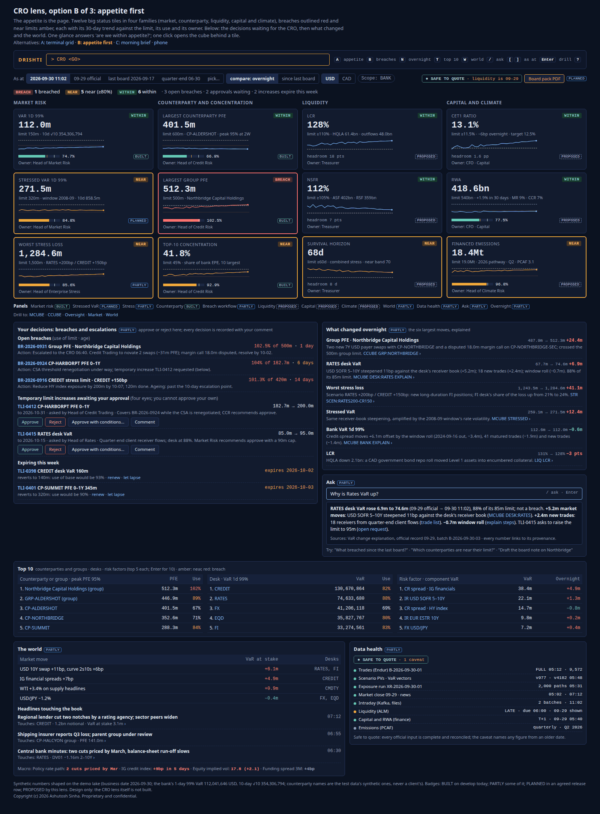
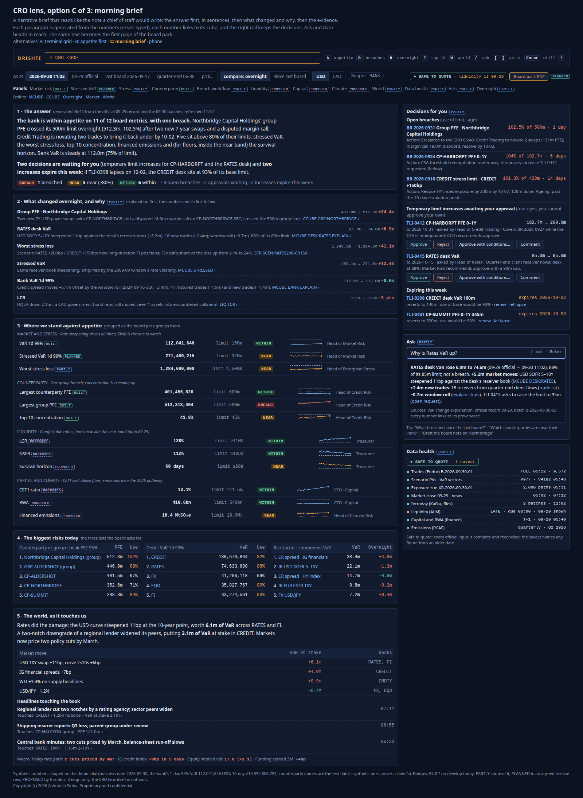
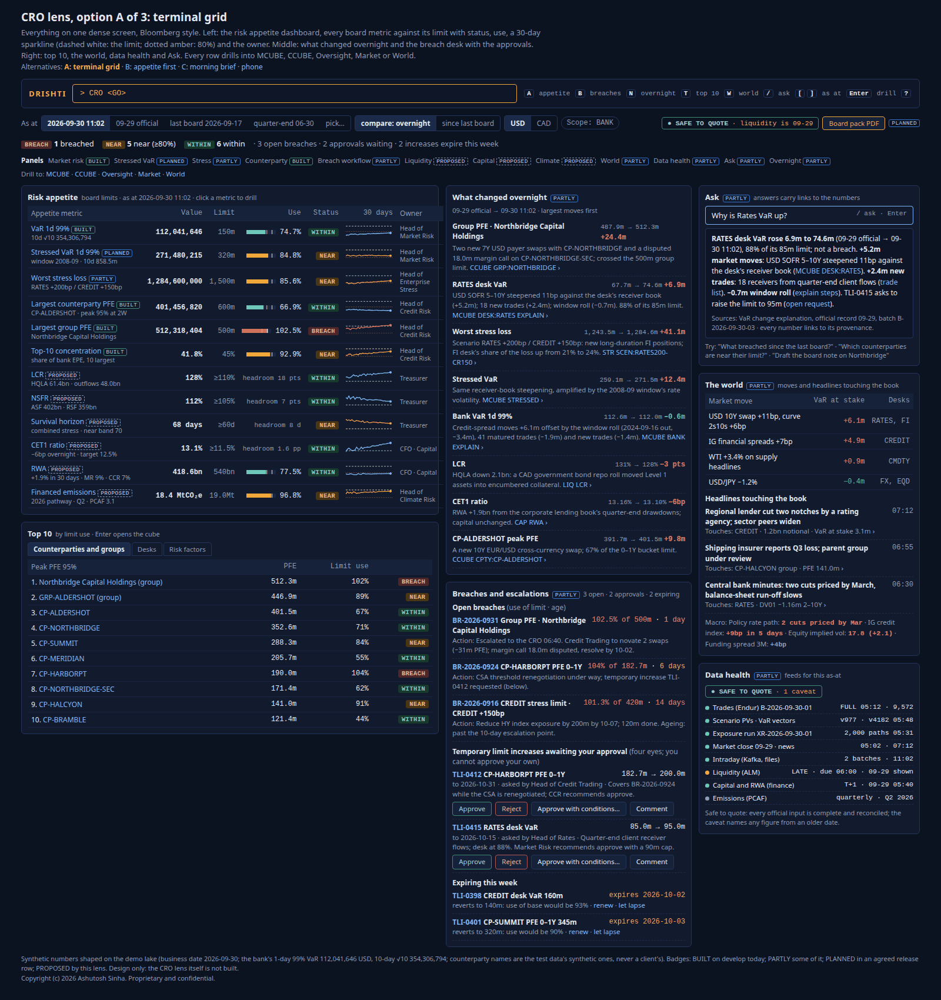
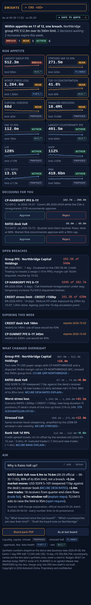

<!--
  Project Drishti · Any data. Any domain. One grammar.

  Copyright (c) 2026 Ashutosh Sinha <ajsinha@gmail.com>.
  All rights reserved.

  PROPRIETARY AND CONFIDENTIAL.

  This file is the confidential and proprietary property of Ashutosh Sinha.
  Unauthorised copying, use, modification, distribution or disclosure of this
  file, via any medium, is strictly prohibited except with the express prior
  written permission of the copyright holder.

  See the LICENSE file in the root of this repository for the full terms.
-->
# The CRO lens: is the bank within its risk appetite, what changed overnight, and what must the Chief Risk Officer act on

**Status: analysis and product description; design, not built.** Nothing in this document is built unless a row of
[section 4](#4-what-drishti-has-today) says so and cites the guide or file it was read from (on
2026-10-31). Every phase named here is a **proposal**, not a commitment. The rows it proposes are candidates in the
[implementation plan](../architecture/IMPLEMENTATION_PLAN.md#cro-lens-candidates-not-started) (CRO1 to CRO13), not started.

**The request (product owner, 2026-10-31):** a **CRO lens**: the executive, top-of-house, cross-risk-type view that answers *"Is the
bank within its risk appetite, what changed overnight, and what do I need to act on or tell the board?"* It summarises; drilling opens
the other lenses (the market risk cube `MCUBE`, the counterparty credit risk cube `CCUBE`, Oversight, Market and World). Three landing
mock-ups and a phone mock-up first; the product owner liked all four ("CRO Lens mockup looks amazing") and aligned with the
recommendation of [section 5.1](#51-the-layouts-decided).

**Read with:** [OVERSIGHT_LENS.md](OVERSIGHT_LENS.md) (the second line that works beneath the CRO; its RO1 VaR change explanation and RO2
breach workflow are this lens's two largest dependencies), [MR_CUBE_LENS.md](MR_CUBE_LENS.md) and [CCR_CUBE_LENS.md](CCR_CUBE_LENS.md)
(the drill targets, and the `risk-limit` and `credit-limit` contracts this lens reads), [RISK_LENS.md](RISK_LENS.md),
[MARKET_LENS.md](MARKET_LENS.md) and [WORLD_LENS.md](WORLD_LENS.md) (the other lenses it links to), [EDITIONS.md](../admin/EDITIONS.md)
(how lenses and editions work), [MOBILE_DISPLAY.md](../architecture/MOBILE_DISPLAY.md) (phone tiers) and the plan's themed phases in
[IMPLEMENTATION_PLAN.md](../architecture/IMPLEMENTATION_PLAN.md).

## Contents

1. [Purpose: what a CRO lens is](#1-purpose-what-a-cro-lens-is)
2. [Who uses it](#2-who-uses-it)
3. [Their questions: the morning, the week, the board, the year](#3-their-questions-the-morning-the-week-the-board-the-year)
4. [What Drishti has today](#4-what-drishti-has-today)
5. [Screens and interactions](#5-screens-and-interactions)
6. [Mock-ups: the screens to build](#6-mock-ups-the-screens-to-build)
7. [Data needed: the complete list](#7-data-needed-the-complete-list)
8. [Measures and rules](#8-measures-and-rules)
9. [How this beats FIS / SunGard / Adaptiv](#9-how-this-beats-fis--sungard--adaptiv)
10. [The lens design](#10-the-lens-design)
11. [A proof of concept (after the cube POCs)](#11-a-proof-of-concept-after-the-cube-pocs)
12. [Phases (proposed)](#12-phases-proposed)
13. [Risks and data dependencies](#13-risks-and-data-dependencies)
14. [Decisions for the product owner](#14-decisions-for-the-product-owner)
15. [Glossary](#15-glossary)

**Status words,** as in the other lens documents, and the four **badge levels** on every panel of the lens (decided, section 14):
**Built**: on develop, documented as built. **Partly**: some of it is built; the cell says what is missing. **Planned (row)**: a plan
row names it. **Proposed (CROn)**: proposed here. **Not built**: neither.

---

## 1. Purpose: what a CRO lens is

The Chief Risk Officer owns the bank's **risk appetite framework**: a statement the board approves each year that says how much risk the
bank will take, expressed as a short list of **appetite metrics** (market risk, counterparty and concentration, liquidity, capital,
climate), each with a **board limit**, an early-warning level and an owner. The CRO's job each morning is not to run any one of those
measures (the second line, the treasurer and finance do that) but to know **at once** whether the bank is inside every one of them,
what moved, who is dealing with each breach and what needs the CRO's own decision; and, before each board or risk committee, to say
the same thing in writing.

Every risk system has the numbers. What the CRO lacks is **one place** where they meet, at one as-of time, with the reason for each move
beside it and the decisions in reach. Today the morning answer is assembled by hand from the market risk report, the credit report, the
treasurer's liquidity sheet and finance's capital estimate, each from a different system at a different cut-off; the board pack is a
deck rebuilt each quarter.

**What Drishti's answer is, in one paragraph.** Drishti already computes, from the bank's own trade-grain data, the two hardest
families of the appetite (market risk: VaR at any scope, 1-day and 10-day, official records and captures; counterparty risk: PFE by
counterparty and connected group against limits), keeps every official result with its inputs' versions, and has the World and Market
lenses for context. The **CRO lens** adds: an **appetite catalogue** (the board's metrics, limits, warning levels and owners), a
**status for every metric** computed from the engines and from the bank's liquidity, capital and climate inputs, **what changed
overnight with the reason**, the **CRO's decision queue** (breaches, temporary limit increases to approve, those expiring), **Ask** with
answers that link to the numbers, **time travel** to the last board date, and a **board pack** generated from the same figures. It
summarises; every figure opens the lens that owns it.

---

## 2. Who uses it

| Person | What they do with the lens | Lens today |
|---|---|---|
| **Chief Risk Officer** | the morning glance (B), the brief before the executive committee (C), approve or reject temporary limit increases, read the board pack | none |
| **CRO's chief of staff, enterprise risk** | prepare the risk committee and board packs; check every figure's source; chase the owners of near-limit metrics | none |
| **Heads of market, credit, liquidity and climate risk** (the metric owners) | see their own metrics as the CRO sees them; write the explanation of a move or a breach before the CRO asks | Drishti Risk ([RISK_LENS.md](RISK_LENS.md)); the proposed Oversight lens ([OVERSIGHT_LENS.md](OVERSIGHT_LENS.md)) |
| **Treasurer, CFO's capital team** | supply and confirm the liquidity and capital figures; see them beside the risk metrics | none |
| **CEO, board risk committee members** | read the brief or the board pack; on a phone, the tiles and the one-paragraph answer | none (read-only, a later role) |
| **Internal audit, supervisors** | reproduce what the CRO saw on a given date (time travel), the approvals and their trail | none |

The CRO lens is **a lens** ([EDITIONS.md section 8](../admin/EDITIONS.md#8-lenses)): `Open Drishti CRO` from Views and Home on a full
instance, and the command word `CRO` (proposed) for its landing. It **reads**; its only actions are governance actions (approve, reject,
comment, escalate), and only for people with the power to take them ([section 10](#10-the-lens-design)).

---

## 3. Their questions: the morning, the week, the board, the year

| When | Question | The lens's answer |
|---|---|---|
| Morning (07:00, before the executive meeting) | Are we within appetite? | the 12 appetite tiles, breaches red and near limits amber, with the count line "1 breached · 5 near · 6 within" |
| Morning | What changed overnight, and why? | the largest moves across every metric and the top 10, each with a one-line reason and a link to the explaining lens |
| Morning | What needs me? | the decision queue: open breaches with age and action, temporary limit increases awaiting approval, increases expiring this week |
| Morning | Can I quote these numbers? | the "safe to quote" badge with its caveats (a late feed, a figure from an older date) |
| Morning | Why is Rates VaR up? | Ask: an answer in sentences with every figure linked (the VaR change explanation, the trades, the request) |
| Intraday | Has anything crossed since this morning? | the tiles patched by intraday batches; an alert on a new breach (the alert machinery, rules from the catalogue) |
| Weekly risk committee | Which metrics are trending towards their limits? | the 30-day sparklines against the limit and the 80% line; "compare: since last committee" |
| Board week | What has changed since the last board, and what do I tell them? | time travel "as at last board"; the brief (C) as the first page of the board pack; the board pack PDF |
| Quarter | Concentration, capital and liquidity at quarter-end | the quarter-end as-at; RWA and CET1 trend; top-10 concentration |
| Annual | Re-calibrate the appetite: are the limits right for how the bank actually used them? | each metric's use history over the year; the number of near and breached days; the approvals granted |
| Any time | Where did this number come from? | every figure opens the lens that owns it, with its provenance (the official record, the batch, the data version) |

---

## 4. What Drishti has today

| Capability | Status | Evidence |
|---|---|---|
| Bank and desk VaR 1-day 99%, ES, any scope, from the bank's vectors | **Built** | [VAR_GUIDE sections 1, 2](../guides/VAR_GUIDE.md#1-the-question-var-answers) |
| 10-day VaR by √10 and by the overlapping 10-day sum | **Built** | [VAR_GUIDE section 18.6](../guides/VAR_GUIDE.md#186-horizons-the-two-10-day-methods-and-the-confidence-chosen) |
| VaR limits per node and limit use in the official record (`LIMIT`, `LIMIT_USE`) | **Built** | [VAR_GUIDE section 15.15](../guides/VAR_GUIDE.md#1515-var-limit-the-nodes-var-limits); [section 19](../guides/VAR_GUIDE.md#19-official-end-of-day-results) |
| Stressed VaR (a stress scenario set, 1-day and 10-day) | **Built** | [VAR_GUIDE section 18.8](../guides/VAR_GUIDE.md#188-stressed-var) |
| Worst stress loss | **Partly**: stress P&L stored per desk and scenario with a desk `LIMIT`; the bank's P&L per scenario derived; not computed from trades (RO9) | [VAR_GUIDE section 21.4](../guides/VAR_GUIDE.md#214-the-banks-stress-pl-by-scenario-derived) |
| Peak PFE by counterparty, connected group (`GROUP:`), legal entity, against the stored credit limit | **Built**; group limits on the group's own PFE and limits by tenor are CC4 | [EXPOSURE_GUIDE sections 3.3, 4](../guides/EXPOSURE_GUIDE.md#4-scopes); [CCR_CUBE_LENS section 7.10](CCR_CUBE_LENS.md#710-c9-credit-limit-lim-existing-extended) |
| Official end-of-day exposure results | **Built** | [EXPOSURE_GUIDE section 20](../guides/EXPOSURE_GUIDE.md#20-official-end-of-day-results) |
| Top-10 concentration (share of bank EPE in the ten largest) | **Partly**: EPE per counterparty is served (the `tree` answer); the share and its limit are not a measure | [EXPOSURE_GUIDE](../guides/EXPOSURE_GUIDE.md); [OVERSIGHT_LENS section 3.7](OVERSIGHT_LENS.md#37-concentration-and-liquidity) |
| A within / near / breach state against a limit | **Built** on the Trading landing: `breach` above 1, `near` at or above `trading.near-limit` (0.8), `ok` below (`drishti-console/plugins/banking/trading_landing.py`); the Risk landing's limits in breach | [EDITIONS.md sections 7, 14](../admin/EDITIONS.md#7-drishti-risks-home-three-landings) |
| Headline tiles of VaR, ES, backtest, EPE, peak PFE and limits in breach | **Built** (Drishti Risk's desk landing) | [EDITIONS.md section 7](../admin/EDITIONS.md#7-drishti-risks-home-three-landings) |
| Compare with an earlier capture; component VaR that adds up | **Built** | [VAR_GUIDE sections 6, 18.3](../guides/VAR_GUIDE.md#6-captures-and-compare) |
| VaR change explanation by cause (window roll, market, trades in and out) | **Not built**, designed (RO1, MC12) | [OVERSIGHT_LENS section 4.1](OVERSIGHT_LENS.md#41-ro1-var-change-explanation) |
| A breach as a record (status, age, action, escalation) | **Not built**, designed (RO2) | [OVERSIGHT_LENS section 4.2](OVERSIGHT_LENS.md#42-ro2-breaches-and-escalation) |
| Temporary limit increases with four eyes | **Not built**; the pattern exists: write-back approval with four eyes and no self-approval | [WRITE_BACK.md section 10](../guides/WRITE_BACK.md#10-approval) |
| One catalogue of every limit | **Not built**, designed (RO3, the `risk-limit` contract) | [MR_CUBE_LENS section 7.7](MR_CUBE_LENS.md#77-d6-risk-limit-new-one-limit-table-for-every-measure) |
| Comment threads anchored to data | **Built** | [COLLABORATION.md](../architecture/COLLABORATION.md) |
| Alerts on numbers (inbox, bell, email, chat; hysteresis, cooldown) | **Built**; set up per person, not from a catalogue | [USER_GUIDE.md › Alerts on numbers](../guides/USER_GUIDE.md#alerts-on-numbers) |
| LCR, NSFR, survival horizon | **Not built**. Example records exist (`examples/packs/liquidity-risk`, camelCase, not loaded); liquidity is a measure of the balance-sheet roadmap | [IMPLEMENTATION_PLAN, balance sheet and regulatory](../architecture/IMPLEMENTATION_PLAN.md#2110-balance-sheet-and-regulatory); [OVERSIGHT_LENS section 4.10](OVERSIGHT_LENS.md#410-ro10-liquidity) |
| CET1 ratio, RWA | **Not built**; nothing in the packs (stored `sa-ccr` and `frtb-sensitivity` charges are partial RWA inputs only) | — |
| Financed emissions | **Not built**. Example records (`examples/packs/climate-risk`, `financed-emissions`); **climate risk is out of scope as a computed measure** (product owner, 2026-10-25) | [IMPLEMENTATION_PLAN, balance sheet and regulatory](../architecture/IMPLEMENTATION_PLAN.md#2110-balance-sheet-and-regulatory) |
| News and market moves | **Built** (news-and-markets pack; the World lens's desk) | [EDITIONS.md section 12](../admin/EDITIONS.md#12-drishti-world) |
| News relevance to the book ("headlines touching the book") | **Not built** (WL9) | [WORLD_LENS section 5.9](WORLD_LENS.md#59-wl9-news-relevance) |
| VaR at stake of a market move or a bad data point | **Proposed** | [MARKET_LENS section 5.1](MARKET_LENS.md#51-ml1-who-uses-each-item-and-what-is-at-stake) |
| Macro signals (economies, forecasts) | **Built** (world-economy pack; IMF data internal demos only) | [WORLD_LENS.md](WORLD_LENS.md) |
| Data health: late loads by expectation, rejected rows, market-data quality | **Partly**: late loads ([DATA_GUIDE section 8](../guides/DATA_GUIDE.md#8-expectations-and-late-data)); quality in the Market lens; the data-trust card RO13 and a "safe to quote" rule **not built** | [OVERSIGHT_LENS section 4.6](OVERSIGHT_LENS.md#46-the-data-trust-card-ro13-and-model-performance-ro14) |
| Ask: questions in words | **Partly**: *Ask about this page* and BI's *ask the data* on the AI layer ([AI.md section 7](../admin/AI.md#7-ask-on-the-ai-layer); [BI_GUIDE section 29](../guides/BI_GUIDE.md#29-ai-in-bi-report-from-words-ask-the-data-explain-this-number)); an answer across the engines with linked figures **not built**; AI is off in every edition today | |
| Time travel: an earlier date's official figures | **Partly**: official records and history per date ([VAR_GUIDE section 7](../guides/VAR_GUIDE.md#7-history-and-backtesting)); "as at the last board" across every metric **not built** | |
| Board pack PDF | **Proposed** | [OVERSIGHT_LENS section 4.11](OVERSIGHT_LENS.md#411-ro11-the-daily-risk-report-and-the-committee-pack) |
| Lenses and editions (a file per edition, a lens per person) | **Built** | [EDITIONS.md section 8](../admin/EDITIONS.md#8-lenses) |
| Phone tiers | **Design** | [MOBILE_DISPLAY.md](../architecture/MOBILE_DISPLAY.md) |

**Verified in code (2026-10-31):** no class in `drishti-server/src/main`, `drishti-compute/src/main` or the console's `core` and
`routes` folders names a risk appetite, an LCR, an NSFR, a CET1 ratio, financed emissions or a limit request; the only "breach" logic is
the Trading landing's state function (`drishti-console/plugins/banking/trading_landing.py`) and the alert logic of
`drishti-server/src/main/java/com/ash/drishti/server/alerts/`. The demo's connected group `GRP-NORTHBRIDGE` (Northbridge
Capital Holdings, `data/testdata/core/counterparty-group`) has one member, `CP-NORTHBRIDGE`, and a stored group limit; the mock-ups'
second member and their group limit are illustrative (section 6.6).

---

## 5. Screens and interactions

The lens follows the house rules: keyboard first, every number printed (a chart never replaces a figure), a loss or a breach in the
theme's loss colour **and** with a word or sign (`BREACH`, `NEAR`, a minus), dark terminal theme by default, every panel a ViewModel
panel so it embeds and stacks on a phone. Every panel carries one of the **four badges** (built, partly, planned, proposed) until the
whole lens is built, so nobody mistakes a design for a figure.

### 5.1 The layouts (decided)

**Decided (product owner, 2026-10-31):** **B (appetite first) is the landing page; C (morning brief) is its "Brief" tab; A (terminal
grid) is its "Detail" tab; the phone view is its own layout.** The product owner liked all four and aligned with this recommendation.
The three tabs share one data request (the same figures, three arrangements), so switching tabs costs no new computation.

| Tab | Layout | Best for | Mock-up |
|---|---|---|---|
| **Appetite** (landing) | **B**: twelve big status tiles in four families, then the decision queue, what changed, Ask, the top 10, the world and data health | the morning glance: "are we within appetite?" | [cro/B.html](mockups/cro/B.html) |
| **Brief** | **C**: a narrative brief, the answer first in sentences, then what changed and why, then the evidence; decisions, Ask and data health in a right rail | the executive meeting; the first page of the board pack | [cro/C.html](mockups/cro/C.html) |
| **Detail** | **A**: one dense terminal screen: the appetite table, the top 10, what changed, the breach desk, Ask, the world, data health | the chief of staff and the metric owners | [cro/A.html](mockups/cro/A.html) |
| **Phone** | one 390 px column: the answer, the tiles two-up, decisions with big buttons, breaches, what is expiring, what changed, Ask | the CRO away from the desk | [cro/phone.html](mockups/cro/phone.html) |

### 5.2 The visual catalogue

| Visual | What it shows | Interactions | Built today? |
|---|---|---|---|
| **Appetite tile** | the metric's name, value, board limit, status word (`WITHIN`, `NEAR`, `BREACH`), a 30-day sparkline against a dashed limit line and a dotted 80% line, a use bar (ceilings) or the headroom above the floor (floors), the owner, the badge | click: open the owning lens at the metric's scope; hover: the provenance (official record, batch, data version); `Enter` on the focused tile | a VaR tile with limit use exists on the Risk landing; sparkline, floor headroom and catalogue not built |
| **Status count line** | "1 breached · 5 near (≥80%) · 6 within", the open breaches, approvals waiting, increases expiring | click a count: filter the tiles | not built |
| **Appetite table** (Detail) | one row per metric: value, limit, use bar, status, sparkline, owner | sort by any column; click a row as a tile | not built |
| **What changed** | the largest moves since the comparison point (overnight by default), each with before → after, the change, a one-line reason and a link | click: open the explaining lens (MCUBE explain, CCUBE group, STR scenario, the liquidity or capital input); the comparison switch (overnight, since last committee, since last board) | compare built for VaR; reasons not built (RO1) |
| **Decision queue** | open breaches (id, what, use of limit, age, action taken); temporary limit increases awaiting the CRO (old → new, until, who asked, the second line's recommendation) with **Approve**, **Reject**, **Approve with conditions…** and **Comment**; increases expiring this week with "renew" and "let lapse" and what the use of the base limit would be | approve or reject records the decision with a required comment, four eyes, never one's own request; renew opens a new request | not built (RO2; CRO4) |
| **Top 10** | counterparties and groups by peak PFE with limit use; desks by VaR with limit use; risk factors by component VaR with the overnight change | click: open CCUBE, MCUBE; `Enter` for ten (the landing shows five) | PFE and desk VaR built; factor component VaR needs MC1 |
| **The world** | market moves with the VaR at stake and the desks touched; headlines touching the book; macro signals | click: open World or Market | moves and news built; VaR at stake proposed; relevance not built (WL9) |
| **Data health** | each feed for the as-at: complete, late or periodic, with its time and count; the **safe to quote** badge and its caveats | click a feed: Admin → Loads; the caveat: the figure it affects | late loads built; the safe-to-quote rule not built (CRO9) |
| **Ask** | a question box; the answer in sentences with every figure a link; suggested questions | `/` focuses it; `Enter` asks | not built across engines (CRO10) |
| **As-at strip** | the as-at time and presets (now, the last official, the last board, quarter-end, pick a date); the comparison; the currency; the scope (BANK, a legal entity) | `[` `]` step; the presets | not built (CRO11) |
| **Board pack PDF** | a button that generates the board pack from the as-at figures | click | proposed |
| **Panel badges and drill links** | the badge of every panel; links to MCUBE, CCUBE, Oversight, Market, World | click | not built |

### 5.3 Keyboard and the command line

`CRO <GO>` opens the landing (the Appetite tab); `CRO BRIEF <GO>` and `CRO DETAIL <GO>` open the other tabs; `CRO LE:LE-NY <GO>` scopes
it to a legal entity; `CRO ASOF:BOARD <GO>` opens it as at the last board date (all proposed, CRO2 and CRO11). On the page: `A`
appetite, `B` breaches and decisions, `N` what changed (overnight), `T` top 10, `W` world, `/` Ask, `[` `]` step the as-at, `Enter`
drill, `?` help. The command word and its arguments are checked against every pack's mnemonics at build.

### 5.4 Approve and reject

A temporary limit increase is a Drishti-owned request (section 7.12) raised by a desk or a metric owner; the limit's owner (for board
limits, the CRO) approves. **Approve** asks for a comment and, optionally, a cap and an earlier end date ("Approve with conditions…");
**Reject** requires a reason; both are recorded with who, when and the comment, and notify the requester. The approver must not be the
requester (four eyes, as write-back approval). Whether an approved increase changes the limit in Drishti the same day or waits for the
bank's limit system is OVERSIGHT decision on RO2's temporary limits (overlay or read back), adopted here as decision 6.

### 5.5 Response-time targets

| Interaction | Target (p95, warm, the date open) | Note |
|---|---|---|
| Open the landing (12 tiles, the queue, what changed, top 10) | 600 ms¹ | the official figures and the overnight comparison precomputed with the official run (section 8.4) |
| Switch tab (Brief, Detail) | 100 ms¹ | the same answer, re-arranged |
| As at the last board | 1.5 s¹ | the official records of that date; nothing recomputed |
| An intraday batch: tiles patched | 1 s after the batch is applied¹ | VaR and exposure only; liquidity, capital and climate are daily or slower inputs |
| Ask, first token | 2 s¹ | the AI layer's model; the figures are fetched first, never invented |
| Board pack PDF | 20 s¹ | the planned board pack's generator |

¹ Estimates, not measurements, scaled from the engines' measured node answers (VAR_GUIDE section 27); to be measured with the POC.

### 5.6 Phone

**must**: the one-paragraph answer, the status counts, the breached and near tiles; **glance**: the other tiles, the decision queue
with full-width Approve and Reject; **more**: open breaches, expiring increases, what changed, Ask; **desk**: the top 10, the world,
data health, the Detail tab. The phone shows the decided phone layout ([cro/phone.html](mockups/cro/phone.html)), not a shrunken
landing; the tier mechanism is [MOBILE_DISPLAY.md](../architecture/MOBILE_DISPLAY.md)'s.

---

## 6. Mock-ups: the screens to build

The four mock-ups are in the repository, self-contained (no CDN, no external fonts, inline SVG), each with a headless-Chrome screenshot
beside it: [A.html](mockups/cro/A.html), [B.html](mockups/cro/B.html), [C.html](mockups/cro/C.html), [phone.html](mockups/cro/phone.html).
**Chosen (decided, product owner, 2026-10-31):** B is the landing, C the Brief tab, A the Detail tab, the phone its own layout.

**Their numbers are synthetic** and consistent across the four pages and with the cube mock-ups: business date 2026-09-30; the bank's
1-day 99% VaR 112,041,646 and its 10-day √10 354,306,794; desk VaRs as in the MR cube mock-up (CREDIT 130,670,864, RATES 74,633,680);
CP-ALDERSHOT's peak PFE 401,456,820; the group Northbridge Capital Holdings over its group limit at 512.3m against 500m. The names are
the test data's synthetic ones (CP-ALDERSHOT, CP-NORTHBRIDGE, CP-SUMMIT, CP-HARBORPT, CP-HALCYON …), plus some invented for the
mock-ups only (the member CP-NORTHBRIDGE-SEC, the desks CMDTY, XVA, TREASURY and EM-MACRO, the headlines, every liquidity, capital and
climate figure); **never a client's name**.

**How to read the checklists.** One table per mock-up: each row is a panel to build, with its exact contents, the data and contract it
reads (section 7), its interactions, the phase (**POC** of [section 11](#11-a-proof-of-concept-after-the-cube-pocs), or the CRO row
that brings it) and a **Done?** column for the build to tick. The empty, loading and error states shared by every panel are in
[section 6.5](#65-empty-loading-and-error-states).

### 6.1 B: Appetite (the landing)



[Open B.html](mockups/cro/B.html)

| Panel | Contents (exact) | Data and contract | Interaction | Phase | Done? |
|---|---|---|---|---|---|
| Command bar | `DRISHTI`, the command line with `CRO <GO>`, the key legend (`A` `B` `N` `T` `W` `/` `[` `]` `Enter` `?`) | the lens file's placeholder | type a command; keys | POC | no |
| As-at strip | as at `2026-09-30 11:02`, presets *09-29 official*, *last board 2026-09-17*, *quarter-end 06-30*, *pick…*; compare *overnight* / *since last board*; currency USD / CAD; scope chip `BANK`; the **SAFE TO QUOTE** badge with its caveat (*liquidity is 09-29*); **Board pack PDF** with its PLANNED badge | `governance-calendar` (7.13) for the board and committee dates; the official records' dates; the safe-to-quote rule (8.3) | preset click; `[` `]`; badge click lists the caveats | POC: now and 09-29 official only; CRO11 the rest; PDF the planned board pack | no |
| Status count line | `BREACH 1 breached`, `NEAR 5 near (≥80%)`, `WITHIN 6 within`; *3 open breaches · 2 approvals waiting · 2 increases expire this week* | `appetite-status` (7.4); `limit-breach`, `limit-request` (7.10, 7.12) | click a count: filter the tiles | POC (counts); CRO4 (queue counts) | no |
| Family headings | MARKET RISK · COUNTERPARTY AND CONCENTRATION · LIQUIDITY · CAPITAL AND CLIMATE | `risk-appetite-metric.FAMILY` (7.3) | none | POC | no |
| Tile: VaR 1d 99% | `112.0m`, *limit 150m · 10d √10 354,306,794*, sparkline 30 days with the dashed limit and dotted 80% line, use bar 74.7%, `WITHIN`, BUILT, *Owner: Head of Market Risk* | `var-official` (bank node), `var-limit`; `risk-appetite-metric` VAR-1D-99 | click: `MCUBE BANK`; hover: provenance | POC | no |
| Tile: Stressed VaR 1d 99% | `271.5m`, *limit 320m · window 2008-09 · 10d 858.5m*, 84.8% `NEAR`, PLANNED | the stress scenario set | click: `MCUBE` Normal / Stressed | with stressed VaR | no |
| Tile: Worst stress loss | `1,284.6m`, *limit 1,500m · RATES +200bp / CREDIT +150bp*, 85.6% `NEAR`, PARTLY | `stress-result` (stored per desk) and the derived bank P&L per scenario; RO9 for computed | click: `STR` on the worst scenario | POC (stored) | no |
| Tile: Largest counterparty PFE | `401.5m`, *limit 600m · CP-ALDERSHOT · peak 95% at 2W*, 66.9% `WITHIN`, BUILT | `exposure-official-cpty`, `credit-limit` | click: `CCUBE CPTY:CP-ALDERSHOT` (until CCUBE: `EXP CPTY:CP-ALDERSHOT`) | POC | no |
| Tile: Largest group PFE | `512.3m`, *limit 500m · Northbridge Capital Holdings*, 102.5% `BREACH`, red outline, BUILT | the exposure engine at `GROUP:` scope; `counterparty-group`; group limit (CC4) | click: `CCUBE GRP:NORTHBRIDGE` | POC (stored group limit); CC4 for the group's own limit | no |
| Tile: Top-10 concentration | `41.8%`, *limit 45% · share of bank EPE, 10 largest*, 92.9% `NEAR`, BUILT (badge to read PARTLY until CRO1 computes the share) | the exposure `tree` answer (EPE per counterparty) | click: the top-10 list | POC | no |
| Tile: LCR | `128%`, *limit ≥110% · HQLA 61.4bn · outflows 48.0bn*, *headroom 18 pts*, `WITHIN`, PROPOSED, *Owner: Treasurer* | `liquidity-metric` (7.5) | click: the liquidity page (CRO5) | CRO5 | no |
| Tile: NSFR | `112%`, *limit ≥105% · ASF 402bn · RSF 359bn*, *headroom 7 pts*, `WITHIN`, PROPOSED | `liquidity-metric` | as LCR | CRO5 | no |
| Tile: Survival horizon | `68d`, *limit ≥60d · combined stress · near band 70*, *headroom 8 d*, `NEAR`, PROPOSED | `liquidity-metric` (SURVIVAL_DAYS) | as LCR | CRO5 | no |
| Tile: CET1 ratio | `13.1%`, *limit ≥11.5% · −6bp overnight · target 12.5%*, *headroom 1.6 pp*, `WITHIN`, PROPOSED, *Owner: CFO · Capital* | `capital-position` (7.6) | click: the capital page (CRO6) | CRO6 | no |
| Tile: RWA | `418.6bn`, *limit 540bn · +1.9% in 30 days · MR 9% · CCR 7%*, 77.5% `WITHIN`, PROPOSED | `capital-position` | as CET1 | CRO6 | no |
| Tile: Financed emissions | `18.4Mt`, *limit 19.0Mt · 2026 pathway · Q2 · PCAF 3.1*, 96.8% `NEAR`, PROPOSED, *Owner: Head of Climate Risk* | `financed-emissions` (7.7) | click: the climate page (CRO7) | CRO7 (decision 4) | no |
| Panels and drill line | the badge of each panel (Market risk BUILT, Stressed VaR PLANNED, Stress PARTLY, Counterparty BUILT, Breach workflow PARTLY, Liquidity, Capital, Climate PROPOSED, World, Data health, Ask, Overnight PARTLY); *Drill to: MCUBE · CCUBE · Oversight · Market · World* | the lens file (badges are configuration until built) | click a link: open that lens | POC | no |
| Your decisions | **Open breaches**: BR-2026-0931 *Group PFE · Northbridge Capital Holdings* 102.5% of 500m · 1 day, action; BR-2026-0924 *CP-HARBORPT PFE 0–1Y* 104% of 182.7m · 6 days; BR-2026-0916 *CREDIT stress limit · CREDIT +150bp* 101.3% of 420m · 14 days (age amber past the escalation point). **Awaiting your approval**: TLI-0412 *CP-HARBORPT PFE 0–1Y* 182.7m → 200.0m to 2026-10-31; TLI-0415 *RATES desk VaR* 85.0m → 95.0m to 2026-10-15; each with Approve, Reject, Approve with conditions…, Comment. **Expiring this week**: TLI-0398 *CREDIT desk VaR 160m* expires 2026-10-02, *reverts to 140m: use of base would be 93%*; TLI-0401 *CP-SUMMIT PFE 0–1Y 345m* expires 2026-10-03 | `limit-breach` (7.10), `breach-action` (7.11), `limit-request` (7.12), `risk-limit` / `credit-limit` | approve, reject (section 5.4); renew; let lapse; click an id: the record and its thread | POC: read-only breaches from `LIMIT_USE` above 1; CRO4 the queue and approvals | no |
| What changed overnight | six moves: *Group PFE · Northbridge* 487.9m → 512.3m +24.4m; *RATES desk VaR* 67.7m → 74.6m +6.9m; *Worst stress loss* +41.1m; *Stressed VaR* +12.4m; *Bank VaR* 112.6m → 112.0m −0.6m; *LCR* 131% → 128% −3 pts; each with its one-line reason and link (`CCUBE GRP:NORTHBRIDGE`, `MCUBE DESK:RATES EXPLAIN`, …) | `appetite-status` of both dates (8.4); RO1 / MC12 for VaR reasons; exposure compare for PFE | click: the explaining lens | POC: moves without reasons for non-VaR; CRO3 reasons | no |
| Ask | the box *Why is Rates VaR up?*; the answer: *RATES desk VaR rose 6.9m to 74.6m … +5.2m market moves … +2.4m new trades … −0.7m window roll … TLI-0415 asks to raise the limit to 95m*, every figure a link; *Sources: VaR change explanation, official record 09-29, batch B-2026-09-30-03*; three suggested questions | the AI layer; the engines' answers as tools (section 8.6) | `/`, `Enter`; click a link | CRO10 | no |
| Top 10 | three lists of five (Enter for ten): counterparties and groups by peak PFE with use (Northbridge group 512.3m 102%, GRP-ALDERSHOT 446.9m 89%, CP-ALDERSHOT 401.5m 67%, CP-NORTHBRIDGE 352.6m 71%, CP-SUMMIT 288.3m 84%); desks by VaR with use (CREDIT 82%, RATES 88%, FX 69%, EQD 80%, FI 83%); risk factors by component VaR with the overnight change; amber near, red breach | exposure `tree`; `var-official` by desk; factor component VaR (MC1) | click: CCUBE, MCUBE | POC (counterparties, desks); factors after MC1 | no |
| The world | market moves with VaR at stake and desks (*USD 10Y swap +11bp … +6.1m RATES, FI*); three headlines touching the book with time and what they touch; the macro line | news-and-markets `news`, `quote`; market data; world-economy; VaR at stake (planned); relevance (WL9) | click: World, Market | CRO8 | no |
| Data health | **SAFE TO QUOTE · 1 caveat**; eight feeds with a dot (green complete, amber late, grey periodic) and their time and count (*Trades (Endur) B-2026-09-30-01 FULL 05:12 · 9,572*; *Liquidity (ALM) LATE · due 06:00 · 09-29 shown*; …); the rule in one line | load events and expectations (DATA_GUIDE section 8); official records; the safe-to-quote rule (8.3) | click a feed: Admin → Loads | POC (feeds); CRO9 (the rule) | no |
| Footer | the synthetic-data note and the badge meanings; copyright from branding | branding configuration | none | POC | no |

### 6.2 C: Brief



[Open C.html](mockups/cro/C.html)

| Panel | Contents (exact) | Data and contract | Interaction | Phase | Done? |
|---|---|---|---|---|---|
| Command bar, as-at strip, panel line | as B | as B | as B | POC | no |
| 1 · The answer | *generated 06:42 from the official 09-29 record and the 09-30 batches; refreshed 11:02*; two paragraphs: *The bank is within appetite on 11 of 12 board metrics, with one breach. Northbridge …* and *Two decisions are waiting for you …*; the status count line | `appetite-status`, `limit-breach`, `limit-request`; text from a **template** filled with the figures (section 8.5), never typed, optionally polished by the AI layer with the figures fixed | click a figure: its lens | CRO2 (template); CRO10 (AI polish) | no |
| 2 · What changed overnight, and why | the six moves, explanation first, the number and the link after | as B's what changed | as B | CRO3 | no |
| 3 · Where we stand against appetite | four groups (market and stress, counterparty, liquidity, capital and climate), each with a one-line verdict in italics (*Rate steepening drives all three; SVaR is the one to watch.*) and three rows: metric with badge, value, limit, status, sparkline, owner | `appetite-status`; the verdict from rules (the largest mover, the closest to its limit) | click a row: its lens | CRO2 | no |
| 4 · The biggest risks today | the three top-10 lists (five each) side by side | as B's top 10 | as B | POC | no |
| 5 · The world, as it touches us | a paragraph (*Rates did the damage: … 6.1m of VaR …*), the market-move table, the headlines, the macro line | as B's world | as B | CRO8 | no |
| Right rail: Decisions for you | as B's decision queue | as B | as B | CRO4 | no |
| Right rail: Ask, Data health | as B | as B | as B | CRO10, CRO9 | no |

### 6.3 A: Detail



[Open A.html](mockups/cro/A.html)

| Panel | Contents (exact) | Data and contract | Interaction | Phase | Done? |
|---|---|---|---|---|---|
| Command bar, as-at strip, status line, panel line | as B | as B | as B | POC | no |
| Risk appetite table | columns *Appetite metric* (name, badge, a sub-line), *Value* (full figure: 112,041,646), *Limit* (150m, ≥110%), *Use* (bar and %; floors: *headroom 18 pts*), *Status*, *30 days* (sparkline 80 × 24 with the limit and 80% lines), *Owner*; twelve rows in the catalogue's order | `appetite-status`, `risk-appetite-metric` | click a row: its lens; sort any column | POC (built metrics); CRO5 to CRO7 the rest | no |
| Top 10 (tabs) | tabs *Counterparties and groups* · *Desks* · *Risk factors*; ten rows with value, limit use and status word | as B's top 10 | tab click; `T` | POC | no |
| What changed overnight | eight moves (B's six plus *CET1 ratio 13.16% → 13.10% −6bp* and *CP-ALDERSHOT peak PFE 391.7m → 401.5m +9.8m*) | as B | as B | CRO3 | no |
| Breaches and escalations | as B's decision queue, in a narrower column | as B | as B | CRO4 | no |
| Ask, The world, Data health | as B, stacked in the right column | as B | as B | CRO8 to CRO10 | no |

### 6.4 Phone



[Open phone.html](mockups/cro/phone.html)

| Panel | Contents (exact) | Data and contract | Interaction | Phone tier | Phase | Done? |
|---|---|---|---|---|---|---|
| Command bar | `DRISHTI` and `CRO <GO>` | as B | type | must | CRO12 | no |
| As-at and badge | *As at 09-30 11:02 · vs 09-29*, **SAFE TO QUOTE · 1** | as B | tap the badge: caveats | must | CRO12 | no |
| The answer | *Within appetite on 11 of 12, one breach. Northbridge group PFE 512.3m over its 500m limit. 2 decisions waiting · 2 increases expire this week.*; BREACH 1 · NEAR 5 · WITHIN 6 | as C's answer | tap: the Brief | must | CRO12 | no |
| Risk appetite tiles | twelve tiles two-up, **breached first, then near, then within** (Largest group PFE, Stressed VaR, Worst stress loss, Top-10, Survival horizon, Financed emissions, VaR, Largest counterparty, LCR, NSFR, CET1, RWA): name, short value, status, sparkline 150 × 20, limit, badge | as B's tiles | tap: the owning lens's phone view | must (breached, near); glance (within) | CRO12 | no |
| Decisions for you | TLI-0412 and TLI-0415 with full-width **Approve** and **Reject** | `limit-request` | approve, reject (a comment sheet opens) | glance | CRO12 after CRO4 | no |
| Open breaches, expiring this week | as B, one line of action each | `limit-breach`, `limit-request` | tap: the record | more | CRO12 | no |
| What changed overnight | five moves with reasons | as B | tap: link | more | CRO12 | no |
| Ask | the box and the answer | as B | type, tap links | more | CRO12 after CRO10 | no |
| Buttons | **Board pack PDF**, **As at last board** | as B | tap | more | CRO12 | no |
| Badge line | *Liquidity, capital, climate PROPOSED · stressed VaR PLANNED · approvals, Ask, data health PARTLY · rest BUILT* | the lens file | none | more | CRO12 | no |

### 6.5 Empty, loading and error states

| State | Every panel | Tiles specifically | Decision queue | Ask |
|---|---|---|---|---|
| **Loading** | the panel's frame with a thin progress line; figures never shown half-loaded | the tile frame, name and limit from the catalogue, value `…` | "Loading decisions…" | the box disabled with "Fetching the figures…" |
| **Empty** | a sentence saying why (never a blank panel) | a metric with no figure on the date: *"No LCR for 2026-09-30 (the liquidity feed has not arrived; due 06:00)"*, grey, no status word, never yesterday's figure shown as today's | "No open breaches. No requests waiting. Nothing expires this week." | suggested questions only |
| **Stale** | the figure with its own date in amber (*09-29*) and a caveat on the safe-to-quote badge | the tile shows its as-of date under the value | — | the answer names any figure from an older date |
| **Error** | *"Could not load the exposure figures (DRS code). The other panels are current."* with Retry; the rest of the page unaffected | the tile in the error style, with the owning engine named | "Decisions could not be loaded; approvals are disabled until they are" | *"Ask is off on this instance"* (AI off) or the model's error, never a guessed answer |
| **No access** | the panel says the person's roles do not cover it, and whom to ask | the tile hidden by the lens file or shown as "no access" (decision 8) | read-only queue for a person without `limit.approve` | — |
| **Not built** (until each row lands) | the panel with its badge (PLANNED or PROPOSED) and one line of what it will show | as the mock-ups | as the mock-ups | as the mock-ups |

### 6.6 What the mock-ups do not show exactly

The mock-ups' Northbridge group has two members and a 500m limit; the demo's `GRP-NORTHBRIDGE` has one member and a stored group limit
of 5.51bn. The POC shows the demo's real figures; CRO1's synthetic appetite catalogue sets a 500m group appetite limit so the breach
story can be shown, and whether to add a second synthetic member to the generator is decision 10.

---

## 7. Data needed: the complete list

Every contract follows the repository's conventions ([docs/contracts/README.md](../contracts/README.md)): one contract YAML per kind in
`config/packs/<pack>/contracts/<kind>.contract.yaml` with `kind`, `mnemonic`, `class` (`fundamental`, `input`, `drishti-owned`,
`computed`), `grain`, `key`, `dated-by`, `cadence`, `storage` and `fields`; data delivered as **JSON Lines, gzipped**, in
`data/testdata/<domain>/<kind>/*.jsonl.gz` for the demo, loaded into Delta (or Iceberg) partitioned by `business_date`; field names in
Endur-style UPPER_SNAKE. The CRO lens is small in data volume (hundreds of rows a day) and wide in sources.

### 7.1 The data map

**Columns:** *Phase*: POC, or the CRO row. *State*: existing (a contract and demo data exist), extended (exists; fields added), new.
*Demo*: how the demo gets it: an existing demo dataset; a **new synthetic generator** writing JSONL to
`data/testdata/<domain>/<kind>/*.jsonl.gz`; or **bank only** (no synthetic stand-in makes sense).

| # | Dataset (kind) | Panel | Phase | Source system (at a bank) | Grain | Frequency | State | Demo |
|---|---|---|---|---|---|---|---|---|
| 1 | `var-official` (VOFF), `var-result` | VaR tile, desks, what changed | POC | Drishti (computed from the bank's vectors) | node × date | daily; intraday | existing | existing (computed from the demo `pnl-vector`, `scenario-pv`) |
| 2 | `var-limit` (VLIM) | VaR use, desks | POC | the bank's limit system | node × date | daily, on change | existing | existing `data/testdata/market-risk/var-limit` |
| 3 | `scenario-set` with the stress set | Stressed VaR | with stressed VaR | the bank's VaR engine | set × date | daily or weekly | extended (2c) | 2c's synthetic stress set |
| 4 | `stress-result`, `stress-scenario-pnl` | Worst stress loss | POC | the bank's stress engine | desk × scenario × date | daily | existing | existing `data/testdata/market-risk/stress-result` |
| 5 | `simulation-run`, `exposure-path` | PFE tiles, top 10 | POC | the bank's exposure simulator | trade × path × time step | daily | existing | existing `data/testdata/counterparty-risk/` |
| 6 | `exposure-official-cpty` | PFE, concentration | POC | Drishti (computed) | counterparty × date | daily | existing | computed from 5 |
| 7 | `credit-limit` (LIM) | PFE use; group limit | POC; CC4 | the bank's limit system | limit × date | daily | existing; extended by CC4 (tenor buckets, group limits) | existing `data/testdata/counterparty-risk/credit-limit` |
| 8 | `counterparty`, `counterparty-group` (CPTY, GRP) | group roll-up, names | POC | the bank's reference data; GLEIF | counterparty | on change | existing | existing `data/testdata/core/` |
| 9 | `risk-limit` (RO3) | desk and stress limits beyond VaR | CRO4 | the bank's limit system | limit × date | daily | new (MR_CUBE_LENS 7.7) | the MR cube's generator (MC1/RO3) |
| 10 | **`risk-appetite-metric`** (section 7.3) | every tile: limit, warning, owner, family, order | POC | the risk appetite framework (GRC system or the CRO office's spreadsheet) | metric × version | annual, on change | **new** | **new synthetic generator**: `data/testdata/governance/risk-appetite-metric/` (twelve metrics) |
| 11 | **`appetite-status`** (section 7.4) | tiles, counts, sparklines, what changed, time travel | POC | Drishti (computed with the official runs; captured) | metric × date (× intraday time) | daily; intraday for VaR and PFE | **new** (computed capture) | computed from 1 to 10 and 12 to 14 |
| 12 | **`liquidity-metric`** (section 7.5) | LCR, NSFR, survival horizon | CRO5 | treasury / ALM system (QRM, Moody's, in-house), the LCR return | legal entity × metric × date | LCR daily; NSFR monthly (daily estimate); survival weekly | **new** (the retired example kinds `lcr`, `nsfr`, `liquidity-stress` are its prototype) | **new synthetic generator** from `tools/packgen/liquidity/make.py`: `data/testdata/liquidity/liquidity-metric/` |
| 13 | **`capital-position`** (section 7.6) | CET1, RWA trend | CRO6 | finance / regulatory reporting (the capital engine, the BCAR or FFIEC 101 return) | legal entity × component × date | monthly official; daily estimate | **new** | **new synthetic generator**: `data/testdata/capital/capital-position/` |
| 14 | **`financed-emissions`** (section 7.7) | financed emissions | CRO7 | the climate team's PCAF calculation or a data vendor | book or sector × quarter | quarterly | **extended** (the retired example kind of the same name, camelCase, renamed to UPPER_SNAKE, with a pathway) | **new synthetic generator** from `tools/packgen/climate/make.py`: `data/testdata/climate/financed-emissions/` |
| 15 | **`limit-breach`** (section 7.10) | open breaches, ages | POC (derived, read-only); CRO4 (records) | Drishti (created by the official run, RO2) | limit × date | daily | **new** (RO2) | created by the official run on the demo; plus a **new synthetic generator** for a history of older breaches: `data/testdata/governance/limit-breach/` |
| 16 | **`breach-action`** (section 7.11) | action taken, commentary, escalation | CRO4 | Drishti (people, through write-back) | action | on event | **new** | seeded by the same generator: `data/testdata/governance/breach-action/` |
| 17 | **`limit-request`** (section 7.12) | approvals, expiring increases | CRO4 | Drishti (people, through write-back); exported to the bank's limit system | request | on event | **new** | **new synthetic generator**: `data/testdata/governance/limit-request/` |
| 18 | **`governance-calendar`** (section 7.13) | "as at last board", "since last committee" | CRO11 | the corporate secretary's calendar | meeting | yearly, on change | **new** | **new synthetic generator**: `data/testdata/governance/governance-calendar/` |
| 19 | `news`, `quote` (news-and-markets) | headlines, moves | CRO8 | news and market feeds | story; quote | intraday | existing | existing `data/testdata/news-and-markets/` (the offline snapshot) |
| 20 | News relevance to the book (WL9) | "headlines touching the book" | CRO8 | Drishti (computed: story → issuer, counterparty, sector, country) | story × entity | intraday | new (WORLD_LENS section 5.9) | computed from 19 and 8 |
| 21 | Market data (`ir-curve`, `fx-spot`, …) and VaR at stake (planned) | market moves with VaR at stake | CRO8 | market data system | point × date | daily | existing; VaR at stake planned | existing `data/testdata/market-data/` |
| 22 | world-economy (economies, forecasts) | macro signals | CRO8 | IMF and other public data | economy × indicator | monthly | existing | existing (**internal demos only**: the IMF data rule) |
| 23 | Position sensitivities (`position-sensitivity`, MC1) | top 10 risk factors | after MC1 | the bank's risk engine | position × factor × date | daily | new (MR_CUBE_LENS 7.9) | MC1's generator |
| 24 | VaR change explanation (RO1 / MC12) | what changed reasons; Ask | CRO3 | Drishti (computed) | node × step × date pair | on demand | new (computed) | computed |
| 25 | Load events and expectations | data health, safe to quote | POC | Drishti (load audit) | load | per load | existing (DATA_GUIDE section 8) | existing |
| 26 | Official exposure, VaR and stress records of earlier dates | time travel | POC (earlier official dates); CRO11 | Drishti | as 1, 6 | daily | existing | existing |
| 27 | AI audit of Ask | Ask | CRO10 | Drishti (`ai-audit`) | question | per question | existing (AI.md) | existing |

**Not needed from the bank for the POC:** rows 10 to 18 have synthetic generators; rows 1 to 8 are the demo's existing data. A bank
supplies rows 2 to 5, 7, 8, 10, 12 to 14 and 18 from its own systems; Drishti produces the rest.

### 7.2 Contract notes common to the new kinds

- **Legal entity:** every bank-supplied figure carries `LEGAL_ENTITY` (the core `legal-entity` ids; `BANK` for the consolidated
  figure); the lens's scope chip filters on it.
- **Reporting currency:** amounts carry `CURRENCY`; the lens converts at the official run's FX (as VaR does), never at a live rate.
- **Versions:** bank inputs may be restated; each row carries `VERSION` and `AS_OF` (the producer's time); the lens shows the latest
  version for the date and its provenance names the version.
- **Proposed packs:** a `risk-appetite` pack (risk-appetite-metric, appetite-status, limit-breach, breach-action, limit-request,
  governance-calendar), a `liquidity` pack (liquidity-metric), a `capital` pack (capital-position), a `climate` pack (financed-emissions);
  or all in one `enterprise-risk` pack (decision 9).
- **Mnemonics** are placeholders, checked against every pack's at build (the liquidity example's `FUND` already clashes with the
  funds pack's `FUND`).

### 7.3 `risk-appetite-metric` (RAPM): the risk appetite framework table (new, fundamental)

**Grain:** one row per appetite metric per framework version. **Key:** `METRIC_ID`, `FRAMEWORK_VERSION`. **Dated by:** `VALID_FROM` /
`VALID_TO` (not by business date: the framework changes yearly or on a board resolution). **Source:** the risk appetite statement
approved by the board, held in a GRC system or the CRO office's spreadsheet. **Frequency:** annual, and on change. **Size:** 10 to 60
metrics; under 1 MB. **Storage:** Delta, `<root>/governance/risk-appetite-metric/`.

| Field | Type | Unit | Req. | Meaning |
|---|---|---|---|---|
| `METRIC_ID` | id | | required | `RAM-<FAMILY>-<NAME>`, for example `RAM-MKT-VAR-1D-99` |
| `FRAMEWORK_VERSION` | text | | required | the appetite statement's version, `RAF-2026` |
| `NAME` | text | | required | as shown on the tile: *VaR 1d 99%* |
| `FAMILY` | text | | required | `MARKET`, `COUNTERPARTY`, `LIQUIDITY`, `CAPITAL`, `CLIMATE` (the tile groups) |
| `ORDER` | integer | | required | position on the landing |
| `MEASURE` | text | | required | how the value is read: `VAR`, `SVAR`, `STRESS_WORST`, `PFE_PEAK_CPTY_MAX`, `PFE_PEAK_GROUP_MAX`, `CONC_TOP10_EPE`, `LCR`, `NSFR`, `SURVIVAL_DAYS`, `CET1_RATIO`, `RWA`, `FIN_EMISSIONS` |
| `SCOPE` | text | | required | a scope text: `BANK`, `LE:LE-NY` |
| `PARAMETERS` | object | | optional | the measure's lens: `{"HORIZON":"1D","CONFIDENCE":0.99}`, `{"SCENARIO_SET":"HS-STRESS"}`, `{"QUANTILE":0.95}` |
| `DIRECTION` | text | | required | `CEILING` (stay below) or `FLOOR` (stay above) |
| `LIMIT` | amount or rate | `UNIT` | required | the board limit |
| `WARNING_AT` | rate | fraction | optional | for ceilings: the use at which the metric is near (default 0.8) |
| `WARNING_BAND` | amount or rate | `UNIT` | optional | for floors: the headroom above the floor below which the metric is near (board-set; decision 3) |
| `TARGET` | amount or rate | `UNIT` | optional | a management target inside the limit (CET1 target 12.5%) |
| `UNIT` | text | | required | `USD`, `PCT`, `DAYS`, `TCO2E`, `RATIO` |
| `OWNER`, `OWNER_ROLE` | text | | required | the person and role accountable (*Head of Market Risk*) |
| `ESCALATION_CHAIN` | list | | optional | roles notified on near and breach, in order |
| `APPROVED_BY`, `APPROVED_ON` | text, date | | required | the board or committee and the date of the resolution |
| `VALID_FROM`, `VALID_TO` | date | | required / optional | the version's validity |
| `CASCADED_TO` | list | | optional | `risk-limit` or `credit-limit` ids that cascade this metric (desk limits under the bank VaR) |

```json
{"METRIC_ID":"RAM-MKT-VAR-1D-99","FRAMEWORK_VERSION":"RAF-2026","NAME":"VaR 1d 99%","FAMILY":"MARKET","ORDER":1,"MEASURE":"VAR",
 "SCOPE":"BANK","PARAMETERS":{"HORIZON":"1D","CONFIDENCE":0.99},"DIRECTION":"CEILING","LIMIT":150000000,"WARNING_AT":0.8,"UNIT":"USD",
 "OWNER":"Head of Market Risk","OWNER_ROLE":"market-risk-head","ESCALATION_CHAIN":["market-risk-head","cro","board-risk-committee"],
 "APPROVED_BY":"Board Risk Committee","APPROVED_ON":"2026-01-22","VALID_FROM":"2026-02-01"}
{"METRIC_ID":"RAM-LIQ-LCR","FRAMEWORK_VERSION":"RAF-2026","NAME":"LCR","FAMILY":"LIQUIDITY","ORDER":7,"MEASURE":"LCR","SCOPE":"BANK",
 "DIRECTION":"FLOOR","LIMIT":1.10,"WARNING_BAND":0.05,"UNIT":"RATIO","OWNER":"Treasurer","OWNER_ROLE":"treasurer",
 "APPROVED_BY":"Board Risk Committee","APPROVED_ON":"2026-01-22","VALID_FROM":"2026-02-01"}
```

**Validation:** a `MEASURE` the lens cannot read is refused with the list; a `SCOPE` that does not parse is refused; `DIRECTION FLOOR`
with `WARNING_AT` (instead of `WARNING_BAND`) refused; two versions valid on the same day for one metric refused; a board limit that a
cascaded desk limit exceeds is a warning, not a refusal.

### 7.4 `appetite-status` (RAPS): every metric's value and status, per date (new, computed, captured)

**Grain:** one row per metric per business date, plus intraday rows for metrics that update intraday. **Key:** `METRIC_ID`,
`BUSINESS_DATE`, `AS_OF`. **Class:** computed; **captured** with the official runs (like the official VaR and exposure records), so time
travel reads it and never recomputes a past date. **Size:** about 20 rows a day. **Storage:** Delta,
`<root>/governance/appetite-status/`.

| Field | Type | Unit | Req. | Meaning |
|---|---|---|---|---|
| `METRIC_ID`, `FRAMEWORK_VERSION` | id, text | | required | the catalogue row used |
| `BUSINESS_DATE`, `AS_OF` | date, timestamp | | required | the date and the time of the figure |
| `VALUE` | amount or rate | `UNIT` | required (or empty with `MISSING_REASON`) | the metric |
| `LIMIT`, `UNIT`, `DIRECTION` | | | required | copied from the catalogue for the date (so a later framework change does not rewrite history) |
| `USE` | rate | fraction | ceilings | `VALUE / LIMIT` |
| `HEADROOM` | amount or rate | `UNIT` | floors | `VALUE − LIMIT` |
| `STATUS` | text | | required | `WITHIN`, `NEAR`, `BREACH`, `MISSING` (section 8.1) |
| `DETAIL` | text | | optional | the tile's sub-line: the counterparty, the scenario, the window |
| `SOURCE_REF` | text | | required | the official record, capture or input row and version it came from |
| `INPUT_AS_OF` | date | | required | the date of the input (09-29 for a late liquidity feed) |
| `SAFE_TO_QUOTE` | boolean | | required | section 8.3 |
| `MISSING_REASON` | text | | optional | *liquidity feed not arrived* |

### 7.5 `liquidity-metric` (LIQM): LCR, NSFR and the survival horizon (new, input)

**Grain:** one row per legal entity per metric per business date. **Key:** `LEGAL_ENTITY`, `METRIC`, `BUSINESS_DATE`, `VERSION`.
**Source:** the treasury or ALM system, reconciled with the LCR and NSFR returns. **Frequency:** LCR daily; NSFR monthly with a daily
estimate; the survival horizon weekly (the internal liquidity stress). **Size:** under 100 rows a day. **Storage:** Delta,
`<root>/liquidity/liquidity-metric/`. **Prototype:** the retired example kinds `lcr`, `nsfr` and `liquidity-stress`
(`examples/packs/liquidity-risk/samples/`), whose camelCase fields map one to one.

| Field | Type | Unit | Req. | Meaning |
|---|---|---|---|---|
| `LEGAL_ENTITY` | id | | required | `BANK` for the consolidated figure |
| `METRIC` | text | | required | `LCR`, `NSFR`, `SURVIVAL_DAYS` |
| `VALUE` | rate or integer | | required | 1.28; 1.12; 68 |
| `NUMERATOR`, `DENOMINATOR` | amount | `CURRENCY` | LCR, NSFR | HQLA and net outflows; ASF and RSF |
| `COMPONENTS` | list | | optional | HQLA by level, outflows by category, ASF and RSF by category (as the example records) |
| `REGULATORY_MINIMUM` | rate or integer | | required | 1.0 for LCR and NSFR; the regulator's survival minimum if any |
| `SCENARIO` | text | | survival | *Combined idiosyncratic and market-wide* |
| `STATUS_OF_FIGURE` | text | | required | `OFFICIAL`, `ESTIMATE` |
| `CURRENCY`, `BUSINESS_DATE`, `VERSION`, `AS_OF` | | | required | as section 7.2 |

```json
{"LEGAL_ENTITY":"BANK","METRIC":"LCR","VALUE":1.28,"NUMERATOR":61400000000,"DENOMINATOR":48000000000,"REGULATORY_MINIMUM":1.0,
 "STATUS_OF_FIGURE":"OFFICIAL","CURRENCY":"USD","BUSINESS_DATE":"2026-09-29","VERSION":1,"AS_OF":"2026-09-30T05:55:00Z"}
```

**Validation:** `VALUE` equal to `NUMERATOR / DENOMINATOR` within 0.0005 for LCR and NSFR; a missing date is shown as missing (never
yesterday's figure as today's); an `ESTIMATE` row never overwrites an `OFFICIAL` one.

### 7.6 `capital-position` (CAPP): CET1 and RWA (new, input)

**Grain:** one row per legal entity per component per business date. **Key:** `LEGAL_ENTITY`, `COMPONENT`, `BUSINESS_DATE`, `VERSION`.
**Source:** finance and regulatory reporting (the capital engine behind the BCAR return in Canada, FFIEC 101 and FR Y-9C in the US).
**Frequency:** monthly official, daily estimate. **Size:** under 100 rows a day. **Storage:** Delta, `<root>/capital/capital-position/`.

| Field | Type | Unit | Req. | Meaning |
|---|---|---|---|---|
| `LEGAL_ENTITY` | id | | required | `BANK` for the consolidated figure |
| `COMPONENT` | text | | required | `CET1_CAPITAL`, `TIER1_CAPITAL`, `TOTAL_CAPITAL`, `RWA_TOTAL`, `RWA_CREDIT`, `RWA_CCR`, `RWA_MARKET`, `RWA_CVA`, `RWA_OPERATIONAL`, `CET1_RATIO`, `LEVERAGE_RATIO` |
| `VALUE` | amount or rate | | required | |
| `APPROACH` | text | | optional | `STANDARDISED`, `IRB`, `IMA`, `SA_CCR` |
| `STATUS_OF_FIGURE` | text | | required | `OFFICIAL`, `ESTIMATE` |
| `CURRENCY`, `BUSINESS_DATE`, `VERSION`, `AS_OF` | | | required | |

**Validation:** `CET1_RATIO` equal to `CET1_CAPITAL / RWA_TOTAL` within 0.00005; the RWA components sum to `RWA_TOTAL` within 0.1%;
Drishti's own computed SA-CCR and FRTB (CC7, MC5) shown **beside** the bank's `RWA_CCR` and `RWA_MARKET`, never replacing them.

### 7.7 `financed-emissions` (FEMS): financed emissions against the pathway (extended, input)

**Grain:** one row per book or sector per quarter, plus a `BANK` total. **Key:** `SCOPE_ID`, `PERIOD`, `VERSION`. **Source:** the
climate team's PCAF calculation or a data vendor. **Frequency:** quarterly. **Storage:** Delta, `<root>/climate/financed-emissions/`.
**Extends** the retired example kind `financed-emissions` (`examples/packs/climate-risk/samples/financed-emissions.jsonl`: `financed`,
`exposure`, `intensity`, `dataQuality`, `byCounterparty`) with UPPER_SNAKE names and the pathway. **Scope (decision 4):** an input
shown as supplied; Drishti computes nothing climate-related (climate is out of scope as a computed measure, product owner 2026-10-25).

| Field | Type | Unit | Req. | Meaning |
|---|---|---|---|---|
| `SCOPE_ID` | text | | required | `BANK`, a book, a sector code |
| `PERIOD` | text | | required | `2026-Q2` |
| `FINANCED_EMISSIONS` | amount | tCO2e | required | attributed emissions |
| `EXPOSURE` | amount | `CURRENCY` | required | the exposure the attribution is on |
| `INTENSITY` | rate | tCO2e per million | optional | |
| `PCAF_SCORE` | rate | 1 to 5 | required | data quality (lower is better) |
| `PATHWAY_LIMIT` | amount | tCO2e | optional | the year's pathway ceiling (the board metric's limit, when the board sets one) |
| `BY_COUNTERPARTY` | list | | optional | counterparty id, exposure, attribution, financed, score |
| `CURRENCY`, `VERSION`, `AS_OF` | | | required | |

### 7.8 Existing contracts read as they are

`var-official`, `var-limit`, `stress-result`, `stress-scenario-pnl`, `simulation-run`, `exposure-path`, `exposure-official-cpty`,
`credit-limit`, `counterparty`, `counterparty-group`, `news`, `quote`, the market-data and world-economy kinds: read as their contracts
say; the lens adds no field. `credit-limit` gains the CCR cube's tenor buckets and group limits (CC4) and `scenario-set` the stress
flag (planned) through their own rows.

### 7.9 `risk-limit` (RO3)

The one limit catalogue for every measure below the appetite (desk VaR, stress, sensitivities), as [MR_CUBE_LENS section 7.7](MR_CUBE_LENS.md#77-d6-risk-limit-new-one-limit-table-for-every-measure)
defines it; the CRO lens reads it for desk-level breaches and for `CASCADED_TO`. Not redefined here.

### 7.10 `limit-breach` (BRCH): a breach as a record (new, Drishti-owned)

RO2's breach record ([OVERSIGHT_LENS section 4.2](OVERSIGHT_LENS.md#42-ro2-breaches-and-escalation)), made a contract. **Created** by
the official run (or a configured intraday check) when a limit's or an appetite metric's use passes 1 (a floor: the value below the
floor). **Grain:** one row per breach per status change (versioned). **Key:** `BREACH_ID`, `VERSION`. **Storage:** the Drishti content
store, exported to Delta `<root>/governance/limit-breach/` daily.

| Field | Type | Req. | Meaning |
|---|---|---|---|
| `BREACH_ID` | id | required | `BR-<year>-<sequence>` (shown as BR-2026-0931) |
| `LIMIT_REF` | text | required | a `risk-limit`, `credit-limit`, `var-limit` id or a `risk-appetite-metric` id |
| `LEVEL` | text | required | `BOARD` (appetite), `CRO`, `BUSINESS`, `DESK`: whose limit |
| `SCOPE`, `MEASURE` | text | required | |
| `DETECTED_ON`, `DETECTED_BY` | date, text | required | the business date and the official record or check that found it |
| `USE_AT_DETECTION`, `USE_LATEST` | rate | required | |
| `STATUS` | text | required | `OPEN`, `EXPLAINED`, `APPROVED`, `REMEDIATED`, `CLOSED`, `WITHDRAWN` (a restatement removed it), with `ESCALATED` as a flag |
| `ESCALATED_TO` | text | optional | the role it sits with now |
| `AGE_DAYS` | integer | computed | business days since detection |
| `OWNER` | text | required | from the limit |
| `CHANGED_BY`, `CHANGED_AT`, `COMMENT` | text, timestamp, text | required per version | |

### 7.11 `breach-action` (BACT): the explanation and the actions (new, Drishti-owned)

**Grain:** one row per action on a breach. **Key:** `ACTION_ID`. Entered through write-back forms; commentary as a comment thread
anchored to the breach.

| Field | Type | Req. | Meaning |
|---|---|---|---|
| `ACTION_ID`, `BREACH_ID` | id | required | |
| `TYPE` | text | required | `EXPLAIN`, `REMEDIATE`, `ESCALATE`, `REVIEW`, `CLOSE` |
| `CAUSE` | text | EXPLAIN | required structure: cause |
| `ACTION`, `EXPECTED_BY` | text, date | REMEDIATE | *Novate 2 swaps (−31m PFE)*, 2026-10-02 |
| `PROGRESS` | rate | optional | 0.6 for "120m of 200m done" |
| `BY`, `AT` | text, timestamp | required | |

### 7.12 `limit-request` (LREQ): temporary limit increases (new, Drishti-owned)

**Grain:** one row per request per status change (versioned). **Key:** `REQUEST_ID`, `VERSION`. Entered and approved through
write-back with four eyes ([WRITE_BACK.md section 10](../guides/WRITE_BACK.md#10-approval)); exported for the bank's limit system.

| Field | Type | Req. | Meaning |
|---|---|---|---|
| `REQUEST_ID` | id | required | `TLI-<sequence>` (TLI-0412) |
| `LIMIT_REF` | text | required | the limit to raise |
| `CURRENT_LIMIT`, `REQUESTED_LIMIT`, `APPROVED_LIMIT` | amount | required / required / on approval | 182.7m, 200.0m, 195.0m |
| `VALID_FROM`, `VALID_TO` | date | required | a temporary increase always ends |
| `REASON` | text | required | |
| `COVERS_BREACH` | id | optional | BR-2026-0924 |
| `REQUESTED_BY`, `RECOMMENDED_BY`, `RECOMMENDATION` | text | required / optional / optional | *Head of Credit Trading*; *CCR*; *approve* |
| `APPROVER_ROLE` | text | required | from the limit's level: board limits → `cro` |
| `STATUS` | text | required | `REQUESTED`, `RECOMMENDED`, `APPROVED`, `APPROVED_WITH_CONDITIONS`, `REJECTED`, `EXPIRED`, `WITHDRAWN` |
| `DECIDED_BY`, `DECIDED_AT`, `DECISION_COMMENT`, `CONDITIONS` | | on decision | the approver is never `REQUESTED_BY` |
| `BASE_USE_AT_EXPIRY` | rate | computed | the use of the base limit if it lapsed today (93%) |

```json
{"REQUEST_ID":"TLI-0412","VERSION":2,"LIMIT_REF":"LIM-HARBORPT-0-1Y","CURRENT_LIMIT":182700000,"REQUESTED_LIMIT":200000000,
 "VALID_FROM":"2026-09-30","VALID_TO":"2026-10-31","REASON":"CSA threshold renegotiation","COVERS_BREACH":"BR-2026-0924",
 "REQUESTED_BY":"head-credit-trading","RECOMMENDED_BY":"ccr-risk","RECOMMENDATION":"approve","APPROVER_ROLE":"cro","STATUS":"RECOMMENDED"}
```

**Validation:** `VALID_TO` required and after `VALID_FROM`; `REQUESTED_LIMIT` above `CURRENT_LIMIT`; the decider differs from the
requester; an expired request becomes `EXPIRED` by itself, never silently extended.

### 7.13 `governance-calendar` (GCAL): board and committee dates (new, fundamental)

**Grain:** one row per meeting. **Key:** `MEETING_ID`. **Fields:** `MEETING_ID`, `BODY` (`BOARD`, `BOARD_RISK_COMMITTEE`,
`EXECUTIVE_RISK_COMMITTEE`, `ALCO`), `MEETING_DATE`, `DATA_AS_OF` (the business date whose official figures the pack used), `PACK_REF`
(the board pack produced, when the planned board pack exists). Feeds the "as at last board" preset and "compare: since last board".

### 7.14 Proposed contract YAMLs (not created yet)

| File | Kind | Mnemonic (placeholder) | Class | Pack (decision 9) | New or extended |
|---|---|---|---|---|---|
| `config/packs/risk-appetite/contracts/risk-appetite-metric.contract.yaml` | `risk-appetite-metric` | `RAPM` | fundamental | risk-appetite | new |
| `config/packs/risk-appetite/contracts/appetite-status.contract.yaml` | `appetite-status` | `RAPS` | computed | risk-appetite | new |
| `config/packs/risk-appetite/contracts/limit-breach.contract.yaml` | `limit-breach` | `BRCH` | drishti-owned | risk-appetite | new (RO2) |
| `config/packs/risk-appetite/contracts/breach-action.contract.yaml` | `breach-action` | `BACT` | drishti-owned | risk-appetite | new |
| `config/packs/risk-appetite/contracts/limit-request.contract.yaml` | `limit-request` | `LREQ` | drishti-owned | risk-appetite | new |
| `config/packs/risk-appetite/contracts/governance-calendar.contract.yaml` | `governance-calendar` | `GCAL` | fundamental | risk-appetite | new |
| `config/packs/liquidity/contracts/liquidity-metric.contract.yaml` | `liquidity-metric` | `LIQM` | input | liquidity | new |
| `config/packs/capital/contracts/capital-position.contract.yaml` | `capital-position` | `CAPP` | input | capital | new |
| `config/packs/climate/contracts/financed-emissions.contract.yaml` | `financed-emissions` | `FEMS` | input | climate | extended from the retired example |

Every pack gets its `README.md` with front matter and data structures (the README standard), a standalone refresh or generator script
per pack, and its synthetic data through the generators of section 7.1, loaded by `lake build` into Delta and read by the delta
connector, tested with the demo off.

---

## 8. Measures and rules

### 8.1 The status of a metric

- **Ceilings** (VaR, stressed VaR, stress loss, PFE, concentration, RWA, emissions): `USE = VALUE / LIMIT`; `BREACH` when `USE > 1`;
  `NEAR` when `USE ≥ WARNING_AT` (default 0.8, the same default as `trading.near-limit`); `WITHIN` below.
- **Floors** (LCR, NSFR, survival horizon, CET1): **decided (product owner, 2026-10-31): shown as headroom above the floor with a
  board-set warning band.** `HEADROOM = VALUE − LIMIT`; `BREACH` when `HEADROOM < 0`; `NEAR` when `HEADROOM < WARNING_BAND`; `WITHIN`
  otherwise. The tile prints the headroom in the metric's own unit (*18 pts*, *8 d*, *1.6 pp*), never a percentage of the floor, because
  an LCR of 128% against 110% is not "86% used".
- **Missing:** no figure for the date: `MISSING`, grey, the reason; never the previous figure shown as today's.
- Each status is computed with the official run and captured in `appetite-status`; the intraday tiles recompute only VaR and PFE.

### 8.2 The top-10 concentration

The share of the bank's EPE (from the official exposure run) held by the ten largest counterparties or connected groups (the catalogue
says which), computed from the exposure engine's per-counterparty EPE; the group view uses the group's own scope (`GROUP:`), never a sum
of members' PFE quantiles.

### 8.3 "Safe to quote"

A figure is **safe to quote** when its input is the official one for the as-of date, every feed it depends on completed (load
expectations met, no failed rows above the threshold), and no unapproved correction applies. The page badge is green when every tile is
safe; otherwise it says how many caveats and lists them (*liquidity is 09-29*). **Design, not built** (CRO9); it reuses the late-load
expectations (built) and the data-trust card's checks (RO13); the feed states, the 7am forecast and the checks it reads are the
CIO lens's records ([CIO_LENS.md section 7](CIO_LENS.md#7-data-needed-the-complete-list)).

### 8.4 What changed

For every metric and every top-10 entry: the difference between the as-of figure and the comparison figure (overnight: the previous
official record; since the last committee or board: that meeting's `DATA_AS_OF`). Ranked by the change as a share of the limit (so a
24.4m move on a 500m limit outranks a 41.1m move on a 1,500m one). The **reason** line comes from the owning engine: the VaR change
explanation (RO1 / MC12) for VaR and stressed VaR, the exposure compare (new and matured trades, collateral) for PFE, the input's own
commentary field for liquidity and capital. **Design, not built** (CRO3); without RO1, the POC shows the move and "explanation not
available yet".

### 8.5 The brief's text

The Brief tab's paragraphs come from a **template** filled with the figures ("The bank is within appetite on {within+near} of {n} board
metrics, with {breached} breach…"), so every word is reproducible from the data; optionally the AI layer rephrases it with the figures
held fixed and checked after (any number in the output that is not in the input is refused). **Design, not built** (CRO2, CRO10).

### 8.6 Ask

The question goes to the AI layer with **tools** that call the engines (VaR and its explanation, exposure, the appetite status, the
breach queue), never with rows; the answer cites each figure's source and links it; the policy, masks and audit of the AI layer apply
([AI.md section 7](../admin/AI.md#7-ask-on-the-ai-layer)). An answer with a figure that no tool returned is refused. AI is off in every
edition today; the CRO lens turns it on only when the site has a provider (decision 7). **Design, not built** (CRO10).

---

## 9. How this beats FIS / SunGard / Adaptiv

FIS's public material (as cited in [MR_CUBE_LENS section 1](MR_CUBE_LENS.md#1-purpose-what-a-risk-cube-is-and-what-fis-offers)) describes
aggregation cubes, limit governance and Excel, Tableau and XLCubed front ends; it publishes no CRO-level view of its own, so the
comparison below is against what a bank assembles on top of such a suite (a BI dashboard over the vendor's results plus the
treasurer's and finance's spreadsheets). Only claims we can **show** in a demo are made.

| What a vendor-based setup gives the CRO | Drishti's CRO lens | Why it is better | The proof in a demo |
|---|---|---|---|
| A dashboard refreshed from each system's extract, each at its own cut-off | one as-of for every metric, each tile naming its input's date; the safe-to-quote badge | the CRO knows which number is stale before quoting it | the late liquidity feed: one amber caveat, the tile's own date |
| Figures without reasons; the "why" is an email chain | what changed with a reason per move, from exact explanations (RO1) | the morning question answered on the landing | Rates VaR +6.9m: market +5.2m, trades +2.4m, window −0.7m |
| Limit breaches in a separate workflow tool | breaches, ages, actions and the CRO's approvals on the same page as the figures | decide with the number in front of you; four eyes enforced | approve TLI-0412 with a cap; the requester cannot approve their own |
| Drill stops at the report | every tile opens the cube that computed it: MCUBE to the trade and scenario, CCUBE to the netting set and path | from board metric to trade in a few clicks | Northbridge group → its netting sets → the two new swaps |
| A quarterly board deck rebuilt by hand | the Brief tab as the board pack's first page, generated from the same figures; time travel to the last board | the pack and the screen never disagree; audit reproduces any date | "as at last board" and the pack for that date, figure for figure |
| Market and news context in another terminal | the moves and headlines that touch the book, with VaR at stake | context without leaving the screen | the downgrade headline → CREDIT's VaR at stake |
| A desktop dashboard | a decided phone layout with approvals | the CRO decides from anywhere | approve on a 390 px phone |
| Ask a person | Ask, answered from the engines with every figure linked, refused when unsupported | no invented numbers | "Why is Rates VaR up?" with links |
| Vendor-held data | the bank's own lake (Delta or Iceberg), published contracts | any tool reads the same figures | open `appetite-status` in Spark or DuckDB |

---

## 10. The lens design

### 10.1 Identity

| Item | Value (proposed) |
|---|---|
| Lens id | `cro` (`drishti.lenses: risk,world,market,trading,cro`; the link **Open Drishti CRO**) |
| Edition file | `config/editions/cro.yaml` (an edition and a lens from one file, as the others) |
| Mnemonic | `CRO` (the landing); `CRO BRIEF`, `CRO DETAIL`; checked against every pack's mnemonics |
| Landing | `appetite` (B); tabs `brief` (C) and `detail` (A); the phone layout (decided) |
| Links out | MCUBE, CCUBE, Oversight, Market, World (each opens in that lens, back returns) |
| Read-only? | yes, except the governance actions: approve, reject, comment, escalate, renew |
| Powers (proposed) | `appetite.read` (the lens), `limit.approve` (decisions), `breach.escalate`, `appetite.edit` (the catalogue, for the CRO office) |

### 10.2 The edition file, in outline

```yaml
edition: cro
title: Drishti CRO
description: Risk appetite, what changed overnight and the decisions for the Chief Risk Officer
packs:
  enabled: [core, market-data, trading, market-risk, counterparty-risk, news-and-markets, world-economy, gleif,
            risk-appetite, liquidity, capital, climate]          # the last four proposed (decision 9)
  allow-only: true
commands:
  allow: [CRO, VOFF, VLIM, VRES, HIER, STR, SCN, SSPNL, EXP, XOFC, LIM, CPTY, GRP, LE, DESK, BOOK, NEWS, TOPIC, QUOTE, ECON, MACRO,
          RAPM, RAPS, BRCH, LREQ, GCAL, LIQM, CAPP, FEMS]        # the proposed kinds' commands
  words: { BI: on, FUNC: on, WHAT: on, DATAMAP: off, VAR: on, EXP: on, SMAT: on, MCUBE: on, CCUBE: on, FORM: off, RUPAKA: off }
features: { bi: edition, var: on, exposure: on, reports: on, alerts: on, monitors: on, workspaces: on, layouts: on,
            collaboration: on, governance: on, ai: site,          # Ask only when the site has a provider (decision 7)
            build: off, designer: off, forms: off, calc: off, python: off, embed: on }
bi:
  datasets: [market-risk-var-official, counterparty-exposure-counterparties, and the proposed appetite-status, limit-breach, limit-request]
menus:
  views: [terminal, search, cro-appetite, cro-brief, cro-detail, oversight-breaches, reports, monitors, alerts]
  placeholder: "CRO, CRO BRIEF, CRO ASOF:BOARD, MCUBE BANK … then <GO>"
home:
  landing: appetite
  landings: [appetite, brief, detail]
  titles: { appetite: Appetite, brief: Brief, detail: Detail }
  template: home/cro_landing.html
  landing-by-role: {}                  # e.g. {cro: appetite, board: brief} once roles are wired
help: { categories: [knowledge, start, use, data, operate], knowledge: [market-risk, counterparty-risk, core] }
branding: { product: Drishti CRO, tagline: "Within appetite? What changed? What needs you?" }
cro:
  near-limit: 0.8                      # default WARNING_AT for ceilings without their own
  badges: { liquidity: proposed, capital: proposed, climate: proposed, stressed-var: planned }   # until each is built
```

Illustrative: keys like `features.governance`, `features.ai: site`, `cro:` and the proposed commands are names to confirm at the build
(Oversight's file proposes the same `governance` feature).

### 10.3 Relationship to the other lenses

| Lens | What the CRO lens takes from it | Where it sends the CRO |
|---|---|---|
| **Oversight** | the breach workflow (RO2), the limit catalogue (RO3), the VaR change explanation (RO1) | Breaches, Limits |
| **MR Cube** | VaR, stressed VaR, explain, desk and factor figures | `MCUBE BANK`, `MCUBE DESK:RATES EXPLAIN` |
| **CCR Cube** | PFE by counterparty and group, limits by tenor | `CCUBE GRP:NORTHBRIDGE` |
| **Risk, Trading** | the landings' limit states (built) | Risk's desk landing |
| **Market, World** | moves, quality, news, macro | the World desk, a curve |

The CRO lens owns **no engine**: only the appetite catalogue, the statuses, the brief and the decisions.

---

## 11. A proof of concept (after the cube POCs)

Built **after** the MR and CCR cube POCs, because its drill targets are the cubes; a demo the product owner can show in one sitting.

| In the POC | Out of the POC |
|---|---|
| The B landing and the phone layout on the demo lake, with the eight metrics the engines can serve today: VaR 1d 99% (and 10d √10 in the sub-line), worst stress loss (stored), largest counterparty PFE, largest group PFE, top-10 concentration; liquidity, capital and climate tiles drawn from their synthetic generators with the PROPOSED badge | the C and A tabs (CRO2) |
| `risk-appetite-metric` with its generator (twelve metrics, RAF-2026), and the status rule of section 8.1 including floors | stressed VaR until stressed VaR lands |
| `appetite-status` computed on open (captured from CRO1 on) | reasons for every move (RO1 / CRO3): the POC shows moves only |
| Read-only breaches derived from `LIMIT_USE` above 1 and the appetite statuses | the breach records and approvals (CRO4); approve and reject drawn disabled with "comes with CRO4" |
| Data health from the load events; the safe-to-quote badge from late loads only | Ask (CRO10), the world's VaR at stake and relevance (CRO8), time travel beyond the previous official date (CRO11), the board pack PDF |
| `CRO <GO>` and the lens link; drill to MCUBE and CCUBE (or VAR and EXP where the cube POCs are not merged) | the edition file as a standalone product (CRO13) |

**Done when:** the landing opens in under a second on the 10K demo; each tile's figure equals the owning engine's answer for the same
scope and date (a test per tile); a floor metric shows headroom and turns NEAR inside its band; a missing liquidity file shows MISSING,
never yesterday's figure; the phone view stacks the breached and near tiles first; the browser suite at 390 and 1280 px is green.
**Size:** M (two to three weeks), after the cube POCs.

---

## 12. Phases (proposed)

The phases follow the plan's themed releases (product owner, 2026-10-31; reordered 2026-11-01): the market-risk regulatory foundation (2.9.8, released); memory, scale and mobile with the VaR change explained (2.9.10, in release); sensitivities and market-risk capital (2.9.11); counterparty engines (2.9.12); Java 25 and performance I (2.9.13); oversight (2.9.14); regulatory reporting (2.9.15); native performance II (2.9.16); XVA and wrong-way risk (2.9.17); advanced market risk (2.9.18); executive (2.9.19). From 2.9.11 on each is **proposed** until it starts; a row without one is unscheduled. The rows are in the plan's "CRO lens" section. The proof of concept of section 11
becomes the first part of the lens build in the executive phase (2.9.19).

| Phase | Rows | Status | Depends on |
|---|---|---|---|
| 1. Decisions (regulatory reporting, 2.9.15) | CRO4 (breach queue, approvals, expiring increases), with RO3 (the limit catalogue) | proposed | RO2, RO3; write-back approvals (built) |
| 2. The lens build (executive, 2.9.19) | CRO1 (catalogue, statuses), CRO2 (B, C, A), CRO3 (what changed with reasons), CRO9 (data health), CRO12 (phone), CRO13 (the lens file) | proposed | the cubes (sensitivities and capital phase); RO1 / MC12 for reasons; the phone display |
| 3. The rest of the appetite (executive, 2.9.19) | CRO5 (liquidity), CRO6 (capital), CRO7 (climate: an optional supplied-input tile, off by default) | proposed | the bank's feeds; the roadmap's liquidity measures if Drishti computes LCR |
| 4. Context and words (executive, 2.9.19) | CRO8 (world: VaR at stake, relevance), CRO10 (Ask), CRO11 (time travel, board pack) | proposed | the planned market-data impact and board pack; WL9; the AI layer |

---

## 13. Risks and data dependencies

| Risk | Effect | Mitigation |
|---|---|---|
| **Liquidity, capital and climate figures belong to other functions** | the lens shows numbers it cannot check | inputs shown as supplied with their source, version and `OFFICIAL` / `ESTIMATE`; Drishti never computes a substitute; validation of the identities (LCR = HQLA / outflows) only |
| **Climate is out of scope** (product owner, 2026-10-25) | a climate tile could read as a Drishti measure | an input only, badge PROPOSED, the source named; or leave it out (decision 4) |
| **The appetite catalogue does not exist in machine-readable form** at many banks | no limits to compare against | a spreadsheet import into `risk-appetite-metric` (one row a metric); the CRO office owns it |
| **Breach workflow overlap** with the bank's existing GRC tool | two records of one breach | read-only mode reading the bank's records (decision 6); or Drishti's records exported |
| **A wrong number in front of the board** | reputational | the safe-to-quote rule, the per-tile date, provenance on every figure, the brief from a template with figures checked |
| **AI inventing a figure** | a false answer to the CRO | tools only, figures checked after, refused when unsupported, audit; AI off unless the site turns it on |
| **The mock-ups' Northbridge story differs from the demo data** | a demo that does not match the mock-up | section 6.6; decision 10 |
| **Too many proposed panels** | a landing full of PROPOSED badges | the POC shows the built ones first; the badges per panel are configuration (`cro.badges`) |

---

## 14. Decisions for the product owner

1. **The layouts. Decided (product owner, 2026-10-31):** B (appetite first) is the landing, C (morning brief) the Brief tab, A (terminal
   grid) the Detail tab, the phone view its own layout.
2. **Badge levels. Decided (product owner, 2026-10-31):** four levels on every panel (built, partly, planned, proposed), and the build
   checklist uses the same levels. PLANNED has its own colour (cyan) on the mock-ups, apart from PARTLY's blue (product owner,
   2026-10-31, with the CIO lens).
3. **Floor metrics. Decided (product owner, 2026-10-31):** LCR, NSFR, the survival horizon and CET1 are shown as **headroom above the
   floor with a board-set warning band** (`WARNING_BAND`), not as a percentage used.
4. **Climate.** **Decided (product owner, 2026-10-31): an optional tile, off by default, showing financed emissions as a supplied input; Drishti computes nothing, so "climate out of scope" (2026-10-25) stands.** Options were: show financed emissions as a supplied input with its source (recommended; the board asks for it and Drishti computes
   nothing), or leave the climate tile out while climate is out of scope.
5. **The appetite catalogue's home.** A Drishti-owned table edited by the CRO office through write-back (recommended for banks without a
   GRC tool), or read from the bank's GRC system as a fundamental input.
6. **Temporary limit increases.** **Decided (product owner, 2026-10-31), with OVERSIGHT decision 4: option a.** Record and approve in Drishti, and the bank's limit system takes the approved limit by its own process
   (recommended, one source of truth; OVERSIGHT's option a), or a Drishti overlay effective the same day (option b).
7. **Ask.** On in the CRO lens when the site has a model provider (recommended), with tools only; or off until the lens build.
8. **Board members.** A read-only `board` role that sees the Brief and the phone layout only (recommended, later), or no board access.
9. **Packs.** Four small packs (risk-appetite, liquidity, capital, climate; recommended: each with its own README and refresh script,
   switchable), or one `enterprise-risk` pack.
10. **Demo data for the Northbridge story.** **Decided (product owner, 2026-10-31): add the second synthetic member and the 500m group appetite limit through the generators.** Options were: add a second synthetic member and a 500m group appetite limit through the generators
    (recommended: the demo then matches the mock-up), or keep the demo's single-member group and change the mock-up's figures.
11. **Phase placement.** **Decided (product owner, 2026-10-31), by the themed plan:** the decision queue (CRO4, with RO3) with
    regulatory reporting (2.9.15), after RO2 (oversight, 2.9.14); the CRO lens build (CRO1 to CRO3, CRO9, CRO12, CRO13) with liquidity,
    capital, the optional climate tile (off by default), Ask and time travel in the executive phase (2.9.19) (section 12).

---

## 15. Glossary

| Term | In plain words |
|---|---|
| **CRO** | Chief Risk Officer: owns the risk appetite and the second line |
| **Risk appetite framework (RAF)** | the board-approved statement of how much risk the bank will take, as metrics with limits |
| **Appetite metric** | one line of the RAF: a measure, a scope, a limit, a warning level and an owner |
| **Ceiling, floor** | a limit to stay below (VaR) or above (LCR) |
| **Near, warning band** | use at or above 80% of a ceiling; headroom inside the board's band above a floor |
| **Breach** | a metric or limit beyond its limit; a record with a status, an owner and actions |
| **Temporary limit increase** | a time-limited raise of a limit, requested, recommended and approved by someone else |
| **LCR, HQLA** | liquidity coverage ratio: high-quality liquid assets over 30-day stressed net outflows |
| **NSFR, ASF, RSF** | net stable funding ratio: available over required stable funding |
| **Survival horizon** | days the bank stays liquid under its internal combined stress |
| **CET1, RWA** | common equity tier 1 capital; risk-weighted assets; the CET1 ratio is one over the other |
| **Financed emissions, PCAF** | greenhouse gases attributed to the bank's lending and investing; the accounting standard and its 1 to 5 data-quality score |
| **PFE, EPE** | potential future exposure (a high quantile of exposure); expected positive exposure |
| **Safe to quote** | every input official, complete and current for the as-of date |
| **Time travel** | showing the lens as it was on an earlier date from the captured records |
| **Board pack** | the document the board risk committee receives each meeting |

---

*Copyright (c) 2026 Ashutosh Sinha <ajsinha@gmail.com>. All rights reserved.
Proprietary and confidential. Unauthorised copying, use or distribution is prohibited.*
