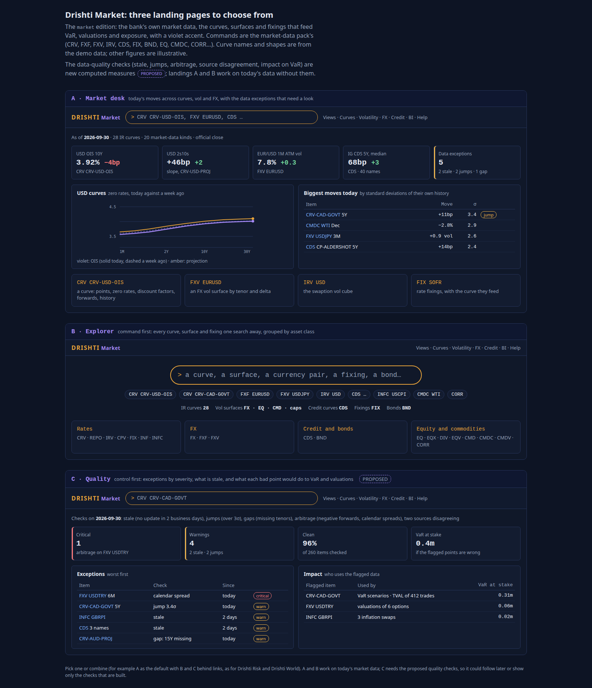
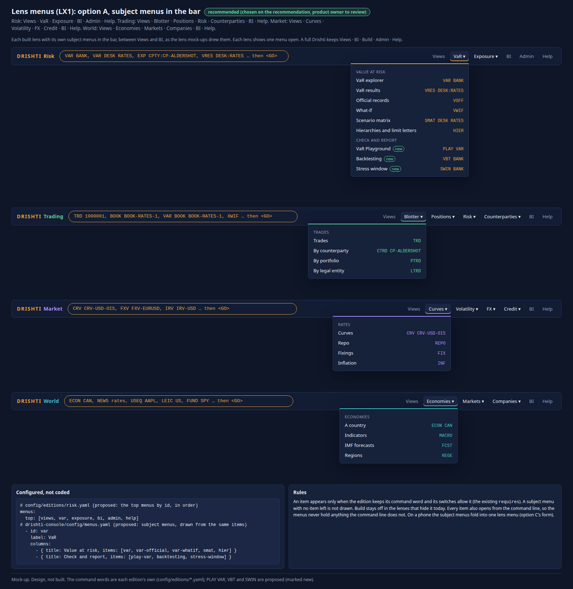

<!--
  Project Drishti · Any data. Any domain. One grammar.

  Copyright (c) 2026 Ashutosh Sinha <ajsinha@gmail.com>.
  All rights reserved.

  PROPRIETARY AND CONFIDENTIAL.

  This file is the confidential and proprietary property of Ashutosh Sinha.
  Unauthorised copying, use, modification, distribution or disclosure of this
  file, via any medium, is strictly prohibited except with the express prior
  written permission of the copyright holder.

  See the LICENSE file in the root of this repository for the full terms.
-->
# Drishti Market: what the market-data team needs, what the lens gives it today, and what comes next

**Status: analysis and product description: built parts as built, the rest proposals.** Every "built" or "partly" statement cites the
document, section or file it was read from on 2026-10-31. Everything in sections 5 and 8 is a proposal; the rows of
section 8 are candidates in the [implementation plan](../architecture/IMPLEMENTATION_PLAN.md#lens-product-candidates-not-started), not
started, except where the plan already names the work (cited as such).

**The request (product owner, 2026-10-31):** "We should have similar and fuller standalone document for other lenses too", after the
market risk oversight analysis ([OVERSIGHT_LENS.md](OVERSIGHT_LENS.md), the proposed Oversight lens; built). This is the Market lens's.

**Read with:** [EDITIONS.md section 13](../admin/EDITIONS.md#13-drishti-market) (the lens as built),
[EDITIONS.md section 11](../admin/EDITIONS.md#11-drishti-market) (how to run it), the edition file
[`config/editions/market.yaml`](../../config/editions/market.yaml), the [market-data pack README](../../config/packs/market-data/README.md)
(every kind and field), [DATA_ARCHITECTURE.md](../architecture/DATA_ARCHITECTURE.md#2-history-queries-an-entity-over-time) (an item over time), [VAR_GUIDE.md](../guides/VAR_GUIDE.md)
(how market data reaches VaR: through the upstream P&L vectors) and the plan's
[market-data rows](../architecture/IMPLEMENTATION_PLAN.md#2914-oversight-proposed) (VaR at stake and the quality checks). The sibling lens
documents: [RISK_LENS.md](RISK_LENS.md), [TRADING_LENS.md](TRADING_LENS.md), [WORLD_LENS.md](WORLD_LENS.md).

## Contents

1. [Who uses it](#1-who-uses-it)
2. [Their questions: the morning, intraday, the close, month-end](#2-their-questions-the-morning-intraday-the-close-month-end)
3. [Needs by area, with status](#3-needs-by-area-with-status)
4. [The landings as built](#4-the-landings)
5. [Gaps, with design sketches](#5-gaps-with-design-sketches)
6. [Data needed](#6-data-needed)
7. [Relationship to the other lenses](#7-relationship-to-the-other-lenses)
8. [A roadmap](#8-a-roadmap)
9. [Decisions for the product owner](#9-decisions-for-the-product-owner)
10. [Glossary](#10-glossary)
11. [Mock-ups: the screens to build](#11-mock-ups-the-screens-to-build)

**Status words.** **Built**: on develop, documented as built. **Partly**: some of it is built; the cell says what is missing.
**Planned (row)**: a row of the implementation plan names it. **Not built**: neither built nor planned; section 5 sketches it and section 8
proposes a row.

---

## 1. Who uses it

Drishti Market is "the bank's own market data in one product: curves, fixings, FX, volatility surfaces and cubes, credit curves, equities,
inflation, commodities, bonds and correlations, the inputs that feed risk and valuations. No trades and no VaR"
([`config/editions/market.yaml`](../../config/editions/market.yaml), its header).

| Persona | Accountable for | What they need from a system |
|---|---|---|
| **Market data analyst** (the market-data team; in many banks inside risk technology or a "market data management" function) | The end-of-day market data set that the valuation and risk batches use: complete, on time, consistent, correct; curve and surface construction inputs; fixings; corrections and their audit | Every item's latest value and history; checks that catch stale, missing, inconsistent and jumping data before the batch; who uses each item |
| **Valuation control** (product control's independent price verification, IPV) | That the marks the desks use agree with independent sources within tolerance; the month-end IPV report and reserves | Two sources side by side, the differences against tolerance, the trades affected |
| **Market risk methodology / time series** | The historical moves that become VaR's 509 scenario days: clean, complete, proxies documented | Long histories, jumps and gaps flagged, the proxies listed, the impact of a bad day on VaR |
| *Also served*: a **quant** or **structurer** reading a curve or a surface | Pricing inputs | The pages, the forms, the history |

**What they do not own:** the trades, the VaR and the limits (the Risk and Trading lenses); the vendor contracts (procurement), though
licensing shapes what they may show (section 6).

### 1.1 A day, a month and a year

| When | What the team does |
|---|---|
| **Before the batch** (end of day, 17:00 to 20:00) | The official close snap arrives from vendors and internal sources; curves and surfaces are built; the team checks completeness, staleness, arbitrage and jumps; corrects or proxies; releases the set to the valuation and VaR batches |
| **The morning** | Reviews overnight exceptions; answers the desks' and risk's questions ("why did my P&L move: is the curve right?"); re-releases a corrected item when needed |
| **Intraday** | Monitors live sources (for intraday risk and pricing); onboards new instruments and curves |
| **Month-end** | IPV: compares desk marks to independent sources; computes reserves; reviews proxies and long-stale items; reports data quality statistics |
| **Year** | Vendor review (coverage, cost, licences); the VaR history review with methodology (gaps, proxies, the stress window's data) |

---

## 2. Their questions: the morning, intraday, the close, month-end

### 2.1 The close (the batch window)

| Question | Drishti today | Gap |
|---|---|---|
| *Did everything arrive?* | **Partly**: **Stale** check per curve and surface (`AS_OF` older than the business date by more than `quality.stale-days`, 2 business days) and per other kind by its latest load ([EDITIONS.md section 13](../admin/EDITIONS.md#13-drishti-market), Quality); late loads by expectation ([DATA_GUIDE.md › Telling Drishti new data has landed, section 8](../guides/DATA_GUIDE.md#8-expectations-and-late-data)) | Completeness against an **expected list** of ids per date (a new curve that never arrived is not stale, it is missing): section 5.8 |
| *Is anything internally inconsistent?* | **Built**: **Gaps** (a curve missing a tenor every other curve of its type has), **Discount factors and forwards** (a DF that does not fall with maturity or is outside (0, 1]: critical; a negative forward: warning), **Vol surfaces** (a vol at or below zero; ATM total variance falling with expiry on FX and equity surfaces) | Calendar and smile checks on the commodity, cap and swaption grids (planned); section 5.4 |
| *Did anything jump?* | **Partly**: the desk's **Biggest moves** ranks the latest move in σ of each item's own daily moves (a "jump" at 3σ or more), but only as a ranking on the desk, not as a Quality check | σ-jump as a check (planned); section 5.2 |
| *Do two sources disagree?* | **Not built**: the lake holds one source per kind | Section 5.3 (planned) |
| *If this is wrong, what does it cost?* | **Not built**: the tile reads *Impact on VaR and valuations comes in a later release* | VaR at stake (planned); section 5.1 |

### 2.2 The morning

| Question | Drishti today | Gap |
|---|---|---|
| *What moved overnight, and is it real?* | **Built**: **Biggest moves** over 21 business days in σ (10 or more moves held), else largest moves against the day before, else "no history" ([EDITIONS.md section 13](../admin/EDITIONS.md#13-drishti-market)); a day-over-day change on tiles only when both days hold real data | Moves per pillar (the desk checks `TEN_Y`, `SPREAD_5Y`, `MID`, `FRONT`, `LEVEL`); a curve's shift, twist and butterfly (section 5.5) |
| *A desk says its P&L is wrong because of a curve: which trades use it?* | **Not built**: no link from an item to the trades and VaR inputs that use it | Section 5.1, "Used by" |
| *What did we correct, when and why?* | **Partly**: an item's history over dates ([DATA_ARCHITECTURE.md](../architecture/DATA_ARCHITECTURE.md#2-history-queries-an-entity-over-time)); the load's provenance | Corrections as records with a reason (section 5.7) |

### 2.3 Intraday

| Question | Drishti today | Gap |
|---|---|---|
| *What is the live level?* | **Partly**: the lake holds end-of-day documents; live connectors exist in the platform but the market-data pack is served from the demo lake (`market-store`) | Live market data is the bank's systems' job; Drishti shows what is loaded. Not a gap to fill in the lens |
| *Watch this curve for me* | **Built**: monitors and alerts on numbers are on (`market.yaml` `features`) | — |

### 2.4 Month-end and the year

| Task | Drishti today | Gap |
|---|---|---|
| IPV: marks against independent sources | **Not built** (one source) | Section 5.3 with a tolerance table and a report |
| Proxy review: which instruments have no data of their own | **Partly**: each P&L vector and scenario-PV row says `ok`, `proxied` or `failed` ([VAR_GUIDE section 15.2](../guides/VAR_GUIDE.md#152-pnl-vector-one-pl-vector-per-trade)), but in the Risk packs, not the Market lens | A proxy list in the Market lens (section 5.9) |
| Data quality statistics over the month | **Not built**: the checks run when the Quality landing opens; nothing keeps their results | Section 5.7 |
| Market data in BI | **Not built**: the pack ships no BI dataset; BI offers its themes only (`market.yaml` `bi`) | Section 5.6 |
| The VaR history review | **Partly**: an item's history; the moves in σ | Jumps across the whole history; the VaR at stake of a bad historical day (section 5.1) |

---

## 3. Needs by area, with status

### 3.1 Coverage: what the lens shows

| Need | Status | Evidence |
|---|---|---|
| Rates: IR curves, repo, swaption and cap vols, fixings, inflation | **Built**: `CRV`, `REPO`, `IRV`, `CPV`, `FIX`, `INF`, `INFC` | `market.yaml` `commands.allow`; [market-data README](../../config/packs/market-data/README.md) |
| FX: spot, forwards, vol surfaces | **Built**: `FX`, `FXF`, `FXV` | |
| Credit and bonds | **Built**: `CDS`, `BND` | |
| Equities and commodities, their curves and vols, dividends | **Built**: `EQ`, `EQX`, `DIV`, `EQV`, `CMD`, `CMDC`, `CMDV` | |
| Correlations, computed on request from history | **Built**: `CORR`, `CORRC`, `EQB` | |
| Issuers and holiday calendars | **Loaded, hidden**: core's commands (`CAL`, `ISS`) are not in the allow-list; calendars are used by the checks (business days) | [EDITIONS.md section 13](../admin/EDITIONS.md#13-drishti-market); section 9, decision 6 |
| Query by form | **Built** (`forms: on`) | |
| History of an item | **Built** for dated kinds; the pack's `history:` block shapes equities, indexes, FX spots, IR and credit curves, commodities, bonds, inflation | `config/packs/market-data/pack.yaml` (`history:`) |

### 3.2 Quality checks

| Check | Status | Evidence or row |
|---|---|---|
| Stale (`quality.stale-days`) | **Built** | EDITIONS.md section 13, check 1 |
| Gaps (missing tenor against the type) | **Built** for types of three or more | check 2 |
| Discount factors monotone and in (0, 1]; negative forwards | **Built** | check 3 |
| Vol surfaces: non-positive vols; ATM total variance falling with expiry (FX, equity) | **Built** | check 4 |
| Calendar checks on commodity, cap and swaption grids; smile (butterfly) checks | **Planned** | section 5.4 |
| Jumps over n σ as a check | **Planned** | section 5.2 |
| Two sources disagreeing | **Planned**, needs a second source per kind | section 5.3 |
| Completeness against an expected list | **Not built** | section 5.8 |
| Quality results kept, with acknowledgements | **Not built** | section 5.7 |

### 3.3 Impact and lineage

| Need | Status | Evidence or row |
|---|---|---|
| Who uses each item (trades, books, VaR inputs) | **Not built**; trades carry `LEGS[].INDEX` (a benchmark name) and `DISCOUNT_INDEX`, not market-data ids ([trading pack README](../../config/packs/trading/README.md)); IR curves carry an `INDEX` field ([market-data README](../../config/packs/market-data/README.md)) | section 5.1 |
| VaR at stake of a flagged item | **Planned** | section 5.1 |
| Valuations at stake | **Planned** | section 5.1 |
| The market-data line of a data-trust card | **Proposed** as RO13 of the oversight analysis (reusing the Quality checks) | OVERSIGHT_LENS.md section 4.6 |

### 3.4 Analytics

| Need | Status | Evidence or row |
|---|---|---|
| Moves in σ of their own history | **Built** (desk ranking) | EDITIONS.md section 13 |
| A curve today against a week ago | **Built** when the history holds that day | USD curves card |
| Shift, twist, butterfly of a curve's move | **Not built** | section 5.5 |
| Correlations and betas | **Built** (`CORR`, `EQB`) | |
| Market data BI | **Not built** (no dataset) | section 5.6 |

---

## 4. The landings

One template, `home/market_landing.html`, with `market-landing.js` and `market-landing.css`, a **violet accent**. The figures are worked out
by `drishti-console/core/market_landing.py` from the pack's own answers (search, raw documents, the business date, one field's history
through `/api/v1/history/{kind}/{id}/series`), read as the person, cached two minutes per person, and served by `/api/home/market/desk`,
`/api/home/market/moves` and `/api/home/market/quality` (`404 DRS-4023` unless the edition or lens shows `CRV`)
([EDITIONS.md section 13](../admin/EDITIONS.md#13-drishti-market)).

### 4.1 A: Market desk (`desk`, the default)

| Tile or card | What is real | Left out, and why |
|---|---|---|
| **USD OIS 10Y** | `CRV-USD-OIS`'s `TEN_Y` | A change only when the history holds real data for the latest day and the business day before (a point whose data date is its date, not carried) |
| **USD 2s10s** | `CRV-USD-PROJ`'s `SLOPE_2S_10S` | as above |
| **EUR/USD 1M ATM vol** | `FXV-EURUSD`'s `ATM_1M` | as above |
| **CDS 5Y, median** | the median of every credit curve's `SPREAD_5Y` | as above |
| **Data exceptions** | the Quality checks' count; opens C | — |
| **USD curves** | OIS zero rates today against five business days before (dashed) when held, and projection | Without that history: OIS against projection |
| **Biggest moves** | each curve's `TEN_Y`, credit's `SPREAD_5Y`, FX's `MID`, commodity's `FRONT`, index's `LEVEL` over 21 business days, in σ when ten or more moves are held ("jump" at 3σ) | Less history: largest moves against the day before; none: says so and ranks nothing |
| **Quick cards** | `CRV CRV-USD-OIS`, `FXV FXV-EURUSD`, `IRV IRV-USD`, `FIX FIX-SOFR` | — |

### 4.2 B: Explorer (`explorer`)

A big command line; the chips of `home.chips` (`CRV CRV-USD-OIS`, `CRV CRV-CAD-GOVT`, `FXF FXF-EURUSD`, `FXV FXV-USDJPY`, `IRV IRV-USD`,
`CDS CDS-SOLARIS`, `INFC INFC-USCPI`, `CMDC CMDC-WTI`, `CORR CORR-G10FX`, `DATAMAP`); counts by asset class (each command's `matched`); the
commands grouped by asset class with their counts; Recently opened (Market's commands only), Knowledge, Data map, Learn.

### 4.3 C: Quality (`quality`)

The checks the data supports, by severity, worst first, each item opening its command (section 3.2's built rows). Tiles: **Critical**,
**Warnings**, **Clean** (the share of items checked with no exception) and, in place of the mock-up's **VaR at stake**, the note *Impact
on VaR and valuations comes in a later release*. A **Checks run** card gives each check's items and flags.

**On the committed demo data every check is clean**: the market data is consistent and its dates move with the lake's business dates
(EDITIONS.md section 13). The checks are proved on crafted bad data in `test_market_landing.py` (stale, gap, discount factor, forward and
surface problems).

### 4.4 What the builder left out, and why

- **VaR at stake** and the Impact card: no link from market data to the VaR and valuation inputs that use it (planned).
- **Jumps over n σ as a check**: the desk ranks moves in σ; turning that into a check with thresholds and severities is planned.
- **Two sources disagreeing**: one source per kind in the lake.
- **Calendar spreads on commodity, cap and swaption grids**: a different underlying per row, so the FX and equity rule does not apply.
- **Market data BI**: the pack ships no dataset; the edition keeps BI to `market-data-*` names so it never offers VaR or exposure items
  (`market.yaml` `bi`, its comment).

---

## 5. Gaps, with design sketches

Drishti's rules ([COMPUTED_ATTRIBUTES.md section 1.2](../architecture/COMPUTED_ATTRIBUTES.md#12-the-rule-for-deciding-which)): market
data is **fundamental** (delivered under the market-data pack's contracts as JSON Lines into the lake); every check, move, impact and
link is **computed on demand**, never stored; an acknowledgement or a correction note is a **Drishti-owned** record, versioned; **BI is
the report layer**. Sizes: **S** days, **M** one to three weeks, **L** more than three weeks. Ids ML1 to ML10 are this document's.

| Id | Gap | Size | Depends on |
|---|---|---|---|
| ML1 | Usage map, "Used by", and VaR and valuations at stake | M (map, used by), then S (at stake) | a usage rule set; VaR contributions (built) |
| ML2 | σ-jump check | S | history (built) |
| ML3 | Two sources and tolerance (and IPV) | M | a second source per kind |
| ML4 | Grid calendar and smile checks | M | — |
| ML5 | Curve move decomposition (shift, twist, butterfly) and pillar moves | S | history (built) |
| ML6 | A market-data BI dataset | S | — |
| ML7 | Quality results kept, acknowledged and corrected, with statistics | M | content store (built) |
| ML8 | Completeness against an expected list | S | expectations (built for loads) |
| ML9 | The proxy list in the Market lens | S | P&L vector status (built) |
| ML10 | A historical-day check for the VaR window | M | ML2, ML1 |

### 5.1 ML1: who uses each item, and what is at stake

**Why it is not trivial.** Drishti's VaR does **not** read market data: an upstream risk batch revalues each trade under 509 historical
scenarios with the bank's market data and sends a P&L vector or scenario PVs per trade
([VAR_GUIDE section 1](../guides/VAR_GUIDE.md#1-the-question-var-answers)). So "VaR at stake" is not a recomputation with a corrected
curve; it is a measure of **how much of VaR and MtM rides on the trades that use the flagged item**. The plan's own words: "who uses each
flagged point (VaR scenarios, the valuations of which trades) and the VaR at stake if it is wrong, computed, never invented; needs the
market data linked to the VaR and valuation inputs that use it" (planned).

**Step 1: the usage map (M).** A computed kind `market-data-usage` (proposed), keyed by market-data id and date, built from the trades
by **rules** (configuration), or from the bank's pricing configuration when it can supply one (fundamental, preferred):

| Market data | Used by a trade when (rule, illustrative) | Evidence the rule can use |
|---|---|---|
| IR projection curve `CRV-*` | a leg's `INDEX.NAME` equals the curve's `INDEX` | trades' `LEGS[].INDEX` ([trading pack README](../../config/packs/trading/README.md)); curves' `INDEX` ([market-data README](../../config/packs/market-data/README.md)) |
| IR discount curve | a leg's `DISCOUNT_INDEX`, else the leg currency's OIS curve (a site rule `CRV-<CCY>-OIS`) | `LEGS[].DISCOUNT_INDEX`, `LEGS[].CURRENCY` |
| Rate fixing `FIX-*` | a floating leg's index with a reset in the window | `LEGS[].CASH_FLOWS[].RESETS[]` |
| FX spot, forward curve, vol surface | the trade's currency pair (legs in two currencies, or an FX product) | legs' currencies; the FX kinds' `FX_SPOT`, `FX_FORWARD_CURVE`, `FX_VOL_SURFACE` links |
| Equity, dividend curve, equity vol | the trade's underlying equity or index | the equity kinds' `DIVIDEND_CURVE`, `EQUITY_VOL_SURFACE` links |
| Commodity curve and vol | the leg's index or commodity | `COMMODITY_CURVE`, `COMMODITY_VOL_SURFACE` |
| Credit curve | the reference entity or issuer | `ISSUER` |

The map answers per item: the trades, books and desks that use it, their count and **MtM** (from the valuations), the **pillars** a trade
is sensitive to (by maturity bucket, when sensitivities arrive). A **Used by** panel on each market-data page (CRV, FXV, CDS …) and a
column on the Quality list. Unmapped trades are counted as *unknown usage*, never dropped.

**Step 2: what is at stake (S after step 1).**

| Figure | How | Meaning |
|---|---|---|
| **MtM at stake** | Σ \|MtM\| of the trades that use the item (valuations, built) | Valuations exposed to an error in it |
| **Component VaR at stake** | Σ of those trades' component VaR in `BANK` (the engine's contributions, [VAR_GUIDE section 18.3](../guides/VAR_GUIDE.md#183-decomposition-of-a-scope-into-parts), by trade, adding up to the bank's VaR) | How much of today's VaR rides on them |
| **Incremental VaR** | `VAR BANK` − `VAR BANK - TRD:<those trades>` (one more scope, exact) | VaR if those trades were wrong enough to remove; an upper bound of the error's reach |
| **Sensitivity at stake** (when per-trade sensitivities exist) | Σ sensitivity to the flagged pillar × the suspected error (the stale gap, or the jump less a normal move) | A first-order P&L of the error |

The Quality tile **VaR at stake** reads the largest component VaR at stake among critical items, with the item named; each item in the
list shows its MtM and component VaR at stake. All computed when the Quality landing opens, cached like the rest, never stored.

**A bad historical day** (ML10): when the flagged point is in the **history** (a past day's move), the question is different: is that
scenario day in today's tail? If the day is the VaR scenario (rank k), VaR at stake is `VaR − VaR without that scenario` (the next rank:
exact, a different rank of the same sorted vector); if it is in the ES tail, the same for ES. This assumes the upstream batch builds its
scenarios from the same history the lake holds: the answer says so.

**Data needs.** The trades and valuations (held); a usage rule set or the bank's pricing configuration (section 6); sensitivities by
pillar for the last row. **Tests:** crafted trades using a crafted curve appear under Used by; the component VaR at stake of a curve used
by every trade equals the bank's VaR; removing the scenario day that is the VaR scenario gives the next rank; an unmapped trade is
counted as unknown.

### 5.2 ML2: the σ-jump check

The desk already measures the latest move in σ of the item's own daily moves over 21 business days when ten or more are held
(`drishti-console/core/market_landing.py`, `moves`). The check: for every item and **every pillar** (a curve's `POINTS[].ZERO_RATE`, a
surface's grid, not only the headline field), flag |move| ≥ `quality.jump-sigma` σ (proposed setting, default 4 for a warning; 6 for
critical, configurable), measured in the item's natural unit (basis points for rates and spreads, log return for prices, vol points for
vols); fewer than ten moves held: not checked, counted as such. Two jumps of opposite sign on consecutive days (a spike that reverts) are
flagged as a **suspected bad print**. **Size** S. **Tests:** a crafted spike at 5σ is a warning, at 7σ critical; a spike-and-revert pair is
named; an item with nine moves is "not checked".

### 5.3 ML3: two sources, tolerance and IPV

**Data.** Each kind may carry a second source: the same id and date with a `SOURCE` (for example `INTERNAL`, `VENDOR-A`), delivered as a
second load of the same contract (a source column in the lake table) rather than a second kind. The IR curve already lists the quote
sources it was built from (`SOURCES`, [market-data README](../../config/packs/market-data/README.md)): the lake today holds one built curve
per id.

**The check.** Per field and pillar, |a − b| against a **tolerance table** by asset class and tenor (configuration: 0.5 bp for G10 OIS
pillars, 2 bp for credit spreads, 0.25 vol points for liquid FX vols, 0.1% for equity closes …); breaches as warnings, a multiple of the
tolerance as critical; the source the batch used marked. **IPV** at month-end: the same comparison of the desk's marks (the official close)
against the independent source, aggregated by desk with the **MtM at stake** of ML1, as a BI report signed off through the report sign-off framework.
**Size** M. **Depends on** a second source per kind (data). **Tests:** crafted pairs inside and outside tolerance; a missing second source
is "single source", never "agreed".

### 5.4 ML4: grid calendar and smile checks

| Grid | Calendar check | Smile check |
|---|---|---|
| **FX, equity surfaces** | Built: ATM total variance rising with expiry; extend to every delta or strike column | Call prices convex and decreasing in strike (no butterfly or call-spread arbitrage), computed with Black from each expiry's vols (FX surfaces converted from delta to strike first) |
| **Commodity vol surface** | Per contract (row), total variance rising with option expiry where a row has several expiries; never across rows (different underlyings) | As FX and equity, per row |
| **Cap vol surface** | Caplet (forward) variance positive after stripping the flat cap vols by maturity: σ²(T₂)·T₂ ≥ σ²(T₁)·T₁ as a first test, the stripped caplet vols ≥ 0 as the full one | Convexity in strike per maturity |
| **Swaption cube** | Along a **co-terminal** line (expiry + tenor fixed), total variance rising with expiry; not along a fixed tenor (a different underlying) | Convexity in strike per expiry and tenor |

Each finding names the cell and its neighbours. **Size** M. **Tests:** a crafted arbitrage per grid type; a clean demo stays clean.

### 5.5 ML5: curve moves decomposed, and moves per pillar

For a curve and two dates: the move per pillar in basis points; **shift** (the mean move), **twist** (2s10s or a slope regression),
**butterfly** (the belly against the wings), with the share of the move each explains; for a surface, the ATM level move and the skew
move. A card on the Market desk under Biggest moves, and a tab on the curve page. Derived from two dated documents; **S**. Also the input
TRADING_LENS.md section 5.4 needs for a P&L explain (market moves per factor).

### 5.6 ML6: a market-data BI dataset

Datasets `market-data-curves` (curve × pillar × date: zero rate, DF, forward), `market-data-surfaces` (surface × expiry × strike or
delta × date), `market-data-quality` (item × check × date, from ML7's records) and a model `market-data`; the edition already keeps BI to
these names (`market.yaml` `bi`). **Size** S. **Tests:** the dataset's rows equal the documents' pillars; the edition offers only these.

### 5.7 ML7: quality results kept, acknowledged and corrected

**Today** the checks run when the Quality landing opens; nothing is kept. **Design:** the official end-of-day run of the checks (after the
market data load, beside the VaR official run) writes **one immutable record per date** of every exception (check, item, pillar, value,
threshold) and the counts per check; a **Drishti-owned acknowledgement** per exception (accepted as correct with a reason, corrected with
the new load's batch id, proxied), versioned, four eyes optional; statistics over the month (exceptions per check and per source, time
to resolve) in BI (ML6). The record points at the load's batch id; it never copies a corrected value as truth. **Size** M. **Tests:** an
exception acknowledged stays acknowledged on reopen; a corrected load clears it and links the batch; the month statistics.

### 5.8 ML8: completeness against an expected list

An **expected list** per date: the ids each kind should have (configuration or derived: every id loaded on most of the last N business
days, or used by a live trade through ML1). Missing ids are a **critical** "missing" exception (distinct from stale). Reuses the load
expectations ([DATA_GUIDE.md › Telling Drishti new data has landed, section 8](../guides/DATA_GUIDE.md#8-expectations-and-late-data)) one level down: from "the kind loaded" to
"each id loaded". **Size** S.

### 5.9 ML9: the proxy list

The P&L vector and scenario-PV rows say `ok`, `proxied` or `failed` per trade ([VAR_GUIDE section 15.2](../guides/VAR_GUIDE.md#152-pnl-vector-one-pl-vector-per-trade)).
With ML1's usage map, the Market lens lists the **market data behind the proxies**: which items are missing so that trades are proxied,
the trades, their MtM and component VaR. Reading the VaR engine's status needs the market-risk pack's read access, not its commands: the
Market lens hides VaR, so the list is a read-only card, or the item lives in the Risk lens with a link (section 9, decision 3). **Size** S.

### 5.10 ML10: the historical-day check for the VaR window

The VaR window is the last 509 business days of moves. Run ML2 over the **whole window** of every item the VaR uses (by ML1), not only
the latest day; list suspected bad days with their **VaR at stake** (section 5.1: the scenario's rank today and the VaR without it). A
monthly task for methodology, a BI report, and the evidence for the stress window review (the stress window tool chooses the window; this checks its
data). **Size** M.

### 5.11 VaR at stake, jumps and two sources: the build design

ML1's at-stake step, ML2 and ML3, with ML7's kept records for *Since* (ML11), as one build on the Quality landing (C). Mock-ups:
[section 11.3](#113-quality-with-var-at-stake-jumps-and-two-sources-market-checks).

**What it shows.** On the Quality landing: the tiles **Critical**, **Warnings**, **Clean**, **VaR at stake** (in place of today's note)
and **Two sources** (items compared and agreeing); the exceptions worst first with **Since**, **Used by** (trades and desks),
**MtM at stake** and **Component VaR at stake**; the opened exception's evidence (the moves against σ for a jump, the pillars of both
sources for a disagreement), who uses it by desk, and what is at stake. A **Used by** panel on each market-data page (`CRV`, `FXV`,
`CDS` …). Market shows the figures read-only; trade lists stay in Risk (decision 2).

**One screen, three views.** The Quality landing has a view switch, **Exceptions · Impact · Checks**, over the same records and the
same API:

| View | Mock-up | What it draws |
|---|---|---|
| **Exceptions** (the default) | A | the tiles, the exceptions worst first with Since, Used by and the at-stake figures, and the opened exception's evidence, users and two sources |
| **Impact** | B | every flagged item's component VaR at stake to scale, signed, and the usage matrix by desk; the evidence a click away |
| **Checks** | C | a tab per check (jumps, two sources, stale, gaps, arbitrage), each with its own list and chart |

The chosen view is kept in the address (`view=exceptions|impact|checks`) and remembered in the person's settings, beside the landing
choice of the Market Home ([EDITIONS.md section 13](../admin/EDITIONS.md#13-drishti-market)); the date and the check filters are shared
by the three. The phone draws its own tiers (below) whatever view is chosen.

**How it is built: Sutra panels on the Quality landing.** The landing keeps its bar, meta line and landing switch; its body becomes a
Sutra-drawn view of a page kind, `market-quality`, whose id is the business date (`MDQ 2026-09-30` opens the same page), painted in place
by the one renderer of every screen ([CLIENT_RENDERER.md](../architecture/CLIENT_RENDERER.md)). Each view is one Sutra of that kind
(`market-quality`, `market-quality-impact`, `market-quality-checks`), selected by the switch as `?sutra=` selects a Sutra
([RACHANA_REFERENCE, events, sources and children](../guides/RACHANA_REFERENCE.md#events-sources-and-children-sutra-next)), so a bank
tailors the panels, columns and thresholds shown in YAML. The opened exception is a Sutra Next child of the exceptions table. **VaR at
stake is read from the engine by a panel:** a computed kind, `market-data-at-stake` (id the item, `params: { incremental }`), served by a
reactive connector whose engine is Drishti's own Java engine calling the VaR engine's decomposition of `BANK`
([REACTIVE_CONNECTOR.md](../connectors/REACTIVE_CONNECTOR.md#reading-a-computed-kind)); the At stake panel reads it with `source:` and
shows *computing*, *ready* or *refused* as every computed panel does, and the incremental VaR is the same read with `incremental: true`
on request. The acknowledgements (Accept as correct, Corrected, Proxied) are Sutra Next forms with write-back to the `owned` target
(`save: { kind: market-data-quality, target: owned, reason: required }`, [WRITE_BACK.md section 4a](../guides/WRITE_BACK.md#4a-submitting-a-change-write-back)).

| Part | Kind or fragment |
|---|---|
| Tiles (K2) | `metric` (the kit's `key-figure@1`) |
| Exceptions (K3) | `row-picker@1` (a `table` that emits `open`) |
| Jump evidence (K4) | `line` over the moves, with ±4σ and ±6σ as reference lines |
| Used by (K5) | `ranked-bars@1` (`hbar`) by desk, `kv` for the counts and *unknown usage*, `links` to Risk |
| At stake (K6) | `kv` and `metric` over the computed kind `market-data-at-stake` |
| Two sources by pillar (K7) | `table` (both sources, the difference, the tolerance, the state, toned) |
| Record actions (K8) | `kv` with the forms above |
| Impact view (K9) | `hbar` (signed, toned) and `pivot` (item by desk, `heat`) |
| Checks view (K10) | `tabs` over the checks, each a `table` and an `hbar` of the moves in σ |
| Used by on item pages (K12) | the kit fragment `ranked-bars@1` added to the `CRV`, `FXV`, `CDS` … Sutras, reading `market-data-usage` with `source:` |

No new panel kind is needed. One small addition is: **reference lines on `line` and `area`** (`markers:`, as `histogram` has), for
±4σ and ±6σ on the jump evidence; until it exists, the thresholds are said under the chart. The new pack fragment is
`quality-exception@1` (the opened exception's panels, used by the three views).

**How each figure is computed.**

| Figure | Rule |
|---|---|
| Move | m_t = x_t − x_{t−1} between consecutive business days that both hold real data, per item and **per pillar** (a curve's points, a surface's grid cells), in the natural unit: basis points for rates and spreads, log return for prices and levels, vol points for vols |
| σ | the population standard deviation of the item's previous moves in the window (21 business days, today excluded), as the Market desk ranks moves; fewer than ten moves: *not checked*, counted as such |
| Jump | z = \|m_t\| / σ; warning at z ≥ 4, critical at z ≥ 6 (decision 5); the item takes its worst pillar |
| Suspected bad print | yesterday's pillar was a jump and today's move reverses it (opposite sign, \|m_t + m_{t−1}\| ≤ 25% of \|m_{t−1}\|): named on today's exception |
| Two sources | d = a − b per pillar between the primary source (the one the batch used, `INTERNAL` by default) and the second, in the natural unit (relative for prices); agree when \|d\| ≤ τ, warning when τ < \|d\| ≤ 3τ, critical above, τ from the tolerance table by asset class and tenor; no second row: *single source*, never *agree*; a second row of an older date: *second source stale* |
| Used by | the usage map (section 5.1): the trades whose rules match the item, rolled to their positions (a position's trades share an instrument and so their market data); unmatched trades counted as *unknown usage* |
| MtM at stake | Σ \|MtM\| of the users (`trade-valuation`) |
| Component VaR at stake | Σ of the users' positions' component VaR in `BANK` from one decomposition of the bank by position (cached with the VaR page's answers; [VAR_GUIDE section 18.3](../guides/VAR_GUIDE.md#183-decomposition-of-a-scope-into-parts)); signed: a negative sum means the users hedge the bank's tail; also as a share of VaR BANK |
| VaR at stake tile | the largest component VaR at stake among **critical** items, with the item named (decision 1) |
| Incremental VaR | on request only: VaR BANK − VaR of BANK without those positions (one more scope, exact) |
| Since | the first date of the unbroken run of daily quality records holding the same exception (ML7) |

A discount curve that every trade uses carries a large component VaR at stake whatever its error: the figure says how much of today's VaR
rides on the item, not the size of the error, and the tile's note says so.

**Data used.** The market-data contracts as they are (`ir-curve`, `credit-curve`, `fx-vol-surface`, `commodity-curve`,
`inflation-curve` and the rest of the pack) and their history; `trade` (legs' `INDEX`, `DISCOUNT_INDEX`, currencies, underlyings),
`trade-valuation`, `position`, `pnl-vector` and `scenario-pv` (the bank's decomposition), `var-official`; `calendar` (business days).
Three additions, described here and created with the build:

- **A `SOURCE` field on every market-data contract** (text, optional; absent reads as the primary source), added to the lake key so a
  second load of the same contract can sit beside the first. Existing data stays valid unchanged.
- **`market-data-usage`** (proposed mnemonic `MDU`, computed, never stored as truth): one row per item, date and position: `ITEM_KIND`,
  `ITEM_ID`, `BUSINESS_DATE`, `POSITION_ID`, `TRADE_IDS`, `DESK`, `BOOK`, `RULE` (the rule that matched, or `BANK-MAP` when the bank's
  pricing configuration supplied it), `PILLARS` (when sensitivities say which), `MTM`. The rules live in a pack configuration file
  (proposed `usage-rules.yaml` of the market-data pack), one rule per kind as the table of section 5.1.
- **`market-data-quality`** (proposed mnemonic `MDQ`, Drishti-owned, ML7): one immutable record per date and exception: `BUSINESS_DATE`,
  `CHECK`, `ITEM_KIND`, `ITEM_ID`, `PILLAR`, `VALUE`, `REFERENCE` (σ, or the second source's value), `MEASURE` (z, or the difference),
  `THRESHOLD`, `SEVERITY`, `FIRST_SEEN`, `BATCH_ID`; and a versioned acknowledgement: `ACK` (`ACCEPTED`, `CORRECTED`, `PROXIED`), `REASON`,
  `CORRECTED_BY_BATCH`, `ACK_BY`, `ACK_AT`.

The two new kinds get their contract files (status *planned*) once the contract schema accepts that status; until then this section is
their description. On the demo, the decided synthetic second source is a second load with `SOURCE: VENDOR-B` and small, labelled
differences, a few of them crafted beyond tolerance so the check shows something (decision 8).

**Settings (proposed, in the edition's `quality:` block beside `stale-days`).**

| Key | Default | Meaning |
|---|---|---|
| `quality.jump.warn-sigma` | `4` | a jump at or above this many σ is a warning |
| `quality.jump.critical-sigma` | `6` | … critical |
| `quality.jump.window-days` | `21` | business days of moves behind σ |
| `quality.jump.min-moves` | `10` | fewer moves: not checked |
| `quality.jump.revert-share` | `0.25` | how close to a full reversal counts as spike and revert |
| `quality.two-source.primary` | `INTERNAL` | the source the batch used |
| `quality.two-source.critical-multiple` | `3` | a difference above this many tolerances is critical |
| `quality.two-source.tolerances` | a table by asset class and tenor (0.5 bp G10 OIS, 2 bp credit, 0.25 vol FX liquid, 0.1% equity closes …) | valuation control's policy |
| `quality.at-stake.scope` | `BANK` | the scope whose components are summed |

**Command, CLI and API (proposed; no existing word is reused).**

- `MDQ [date]` lists the kept quality records with their acknowledgements; `<command> <id> USED` (for example `CRV CRV-CAD-GOVT USED`)
  opens an item's Used by panel.
- `drishti.py quality run --pack market-data --date` runs the checks and writes the day's records; `drishti.py quality at-stake <kind>
  <id> [--incremental]` prints the at-stake figures.
- `/api/home/market/quality` gains `jumps`, `twoSource`, `atStake` and `since`; `GET /api/home/market/usage/{kind}/{id}` answers Used
  by (counts, desks, MtM, component VaR; never trade lists in Market); `POST /api/home/market/at-stake/{kind}/{id}/incremental` computes
  the incremental VaR on request.

**Phone.** The four tiles are **must**; the top five exceptions with severity and VaR at stake are **glance**; the evidence and Used by
are **more**; acknowledging an exception is **desk** (it needs a reason and a batch).

**Open questions for the product owner.**

1. **Mock-up choice:** A (the Quality landing with Used by and VaR at stake, recommended), B (impact first) or C (a tab per check; its
   Jumps tab fits as A's drill-down).

   **Decided (product owner, 2026-11-01):** one screen; A is the default view, B and C are views on the same screen (the view switch
   above), built as Sutra panels on the Quality landing.
2. **Who sees VaR at stake in Market:** everyone in the lens (the figure is an aggregate, recommended), or only people whose role reads
   VaR results elsewhere.
3. **Pillars checked:** every pillar (recommended), or the headline fields only until ML7's records are in.
4. **The demo's crafted disagreements:** a handful, each labelled in the second source's rows (recommended), or none beyond tolerance.

---

## 6. Data needed

| Data | Grain and cadence | Needed by | Source and licensing note |
|---|---|---|---|
| End-of-day market data, every kind of the pack | per id per business date | everything (built) | the bank's market data system and vendors. **Vendor licences** decide who may see vendor data in another application: a display licence for the users, sometimes a per-user count; derived data (a built curve) is usually freer than raw quotes. The bank's market-data team owns this; the Market lens should show source and licence per item (as the public-data packs' `PROVENANCE` does) |
| History of at least 21 business days (10 for σ) and the 509-day window for ML10 | per id per date | moves, ML2, ML10 | the same; the demo lake moves with its business dates |
| A second source per kind | per id per date | ML3 | a second vendor or the internal mark |
| A usage map (pricing configuration: which curves, surfaces and fixings each product or trade uses) | per trade or per product rule | ML1, ML9, ML10 | the bank's pricing system; otherwise Drishti's rules (section 5.1) |
| **Position sensitivities by pillar** (DV01 by curve and tenor, vega by surface point) | per trade per date | ML1's sensitivity at stake | the bank's risk engine; FRTB.md's per-trade `sensitivity` table (proposed); RO4 of the oversight analysis (OVERSIGHT_LENS.md section 4.4) |
| An expected list of ids | per kind, on change | ML8 | configuration or derived |
| Tolerances by asset class and tenor | configuration | ML3 | valuation control's policy |

---

## 7. Relationship to the other lenses

| Lens | What Market shares with it | What Market deliberately hides | When a Market user should switch |
|---|---|---|---|
| **Drishti Risk** ([RISK_LENS.md](RISK_LENS.md)) | The market-data pack (Risk loads it; its commands are hidden in Risk except `FX`) | Trades, VaR, exposure, limits | To see the VaR a flagged curve touches, until ML1 brings the figure into Market |
| **Drishti Trading** ([TRADING_LENS.md](TRADING_LENS.md)) | The market data a trader reads (`CRV`, `FX`, `FXV`, `EQ`, `EQX`, `CMD`, `CMDC`, `BND`, `CDS`) | Fixings, cubes, correlations, the Quality checks | When a desk asks "is my P&L a data problem?": the desk opens Market to see the item's checks |
| **Drishti World** ([WORLD_LENS.md](WORLD_LENS.md)) | Nothing: no pack in common; the World lens's quotes are a public snapshot, not the bank's marks | — | For macro context of a move (an economy, a central bank's news topic) |
| **Drishti Oversight** (proposed) | The Quality checks become the market-data line of its data-trust card (RO13) | — | — |

**The boundary.** Market never shows trades or VaR (`market.yaml`: "No trades and no VaR"). ML1's figures are computed by the engines
and **shown** in Market as numbers attached to market data (MtM at stake, VaR at stake); the trades behind them open in Risk or Trading.
Section 9, decision 2.

---

## 8. A roadmap

The rows below are added to the plan's [Lens product candidates (not started)](../architecture/IMPLEMENTATION_PLAN.md#lens-product-candidates-not-started)
section. ML1 (with ML2 to ML4) is the plan's market-data rows (VaR at stake and the quality checks) broken into buildable steps.

**Status (product owner, 2026-10-31).** The Status column says where each row stands: *planned* rows are next, *proposed* rows wait until their work starts, and *unscheduled* rows wait for the product owner.

| Order | Row | Why here | Size | Depends on | Status |
|---|---|---|---|---|---|
| 1 | **ML2** σ-jump check | Small; the desk computes it already | S | — | proposed |
| 2 | **ML1** usage map and Used by; then at stake | The lens's empty tile; the most asked question ("who uses this?") | M then S | usage rules; VaR at stake (planned) | proposed |
| 3 | **ML8** completeness against an expected list | Missing is worse than stale | S | — | unscheduled |
| 4 | **ML4** grid calendar and smile checks | Part of the planned quality checks | M | — | proposed |
| 5 | **ML7** quality results kept and acknowledged | Turns checks into a control with an audit trail | M | — | proposed |
| 6 | **ML6** market-data BI; **ML5** curve moves decomposed | Reports and the P&L explain's input | S each | ML7 for the quality dataset | ML6 unscheduled; ML5 unscheduled |
| 7 | **ML9** the proxy list | Needs ML1 | S | ML1 | unscheduled |
| 8 | **ML3** two sources and IPV | Needs a second source | M | data | proposed |
| 9 | **ML10** the historical-day check | Methodology's monthly review; feeds the stress window work | M | ML1, ML2 | unscheduled |
| 10 | **ML11** since when each exception has stood; **LX1** subject menus | Close what the mock-up showed and the build left out ([section 11](#11-mock-ups-the-screens-to-build)) | S each | ML7 | ML11 proposed; LX1 built |

---

## 9. Decisions for the product owner

**Decided (product owner, 2026-10-31):** every recommendation accepted ("I am aligned with your recommendations"); each choice is under its question. Each row is proposed until its work starts.

1. **VaR at stake: which figure leads** the tile: the component VaR at stake (recommended: adds up, cheap), the incremental VaR, or the
   MtM at stake.

   **Decided (product owner, 2026-10-31):** the component VaR at stake leads the tile (adds up, cheap).
2. **VaR figures inside Market.** Show ML1's at-stake numbers in Market while trades and VaR stay hidden (recommended), or link to Risk
   only.

   **Decided (product owner, 2026-10-31):** Market shows ML1's VaR at stake read-only while trades and VaR stay hidden (proposed).
3. **The proxy list (ML9).** In Market (read-only card) or in Risk with a link.

   **Decided (product owner, 2026-10-31):** in Market, as a read-only card (ML9, unscheduled).
4. **Usage rules (ML1).** Drishti's configured rules now, the bank's pricing configuration when available (recommended), or wait for the
   bank's map.

   **Decided (product owner, 2026-10-31):** Drishti's configured rules now, the bank's pricing configuration when available.
5. **Jump thresholds.** 4σ warning and 6σ critical by default (proposed), or the desk's 3σ.

   **Decided (product owner, 2026-10-31):** 4σ warning and 6σ critical by default, configurable.
6. **Core's `CAL` and `ISS` in Market.** Show the holiday calendars and issuers (the checks use calendars), or keep them hidden.

   **Decided (product owner, 2026-10-31):** show the holiday calendars and issuers in Market (the checks use calendars).
7. **Quality records (ML7).** An official end-of-day quality record per date (recommended), or checks on open only.

   **Decided (product owner, 2026-10-31):** an official end-of-day quality record per date (ML7, proposed).
8. **A second source for the demo (ML3).** A synthetic second source with small, labelled differences so the check shows something, or
   none until a bank provides one.

   **Decided (product owner, 2026-10-31):** a synthetic second source with small, labelled differences on the demo, so the two-source check shows something (proposed).
9. **Source and licence per item.** Show each item's source and licence on its page as the public-data packs do (recommended), or not.

   **Decided (product owner, 2026-10-31):** show each item's source and licence on its page, as the public-data packs do.

---

## 10. Glossary

| Term | In plain words |
|---|---|
| **Market data** | The prices, rates, curves and volatilities the bank values trades with |
| **Curve** | Rates (or spreads, or prices) by maturity, built from market quotes |
| **Pillar** | One maturity point of a curve (the 10-year rate) |
| **Discount factor** | What 1 paid at a future date is worth today; must fall with maturity and stay between 0 and 1 |
| **Forward rate** | The rate implied today for a future period |
| **Vol surface** | Implied volatility by expiry and strike (or delta) |
| **Total variance** | Volatility squared times time; must rise with expiry for the same underlying |
| **Smile, butterfly** | How vol changes with strike; a butterfly check makes sure option prices are consistent across strikes |
| **Co-terminal** | Swaptions whose underlying swaps end on the same date |
| **Stale** | Not updated for longer than allowed |
| **Gap** | A missing pillar that similar curves have |
| **σ (sigma)** | The usual size of a day's move, from the item's own history; a 4σ move is very unusual |
| **Bad print** | A wrong value from a source, often a spike that reverts the next day |
| **IPV** | Independent price verification: checking the desks' marks against independent sources |
| **Tolerance** | How far two sources may differ before it counts as a disagreement |
| **Proxy** | A stand-in price or history used for an instrument without its own |
| **Usage map** | Which trades use which market data |
| **VaR at stake** | How much of today's VaR rides on trades that use a doubtful item |
| **Scenario day** | One past day's market move, applied to today's trades in VaR |
| **Lens** | One person's focused view of Drishti, opened by a link; it hides, it does not secure |

---

## 11. Mock-ups: the screens to build

The three Market landings are copied into the repository, self-contained (system fonts, nothing from a CDN), with a screenshot beside
it, under [`docs/lenses/mockups/market/`](mockups/market/); the lens menus under [`docs/lenses/mockups/menus/`](mockups/menus/A.html); the
Quality landing's completion (VaR at stake, jumps, two sources) under [`docs/architecture/mockups/market-checks/`](../architecture/mockups/market-checks/A.html). **The checklist below is the
source of truth at build time** ([README.md](README.md#mock-ups)): every panel is a row, its status checked against the code on
2026-10-31 (`wip/drill-a`). **Built** cites the code or guide; **partly built** says what is missing; **not built** names the candidate
row.

| Mock-up | Chosen | Built | Partly built | Not built |
|---|---|---:|---:|---:|
| [Market landings](#111-the-market-landings-market-landinghtml) (A Market desk, B Explorer, C Quality) | all three, 2026-10-29: A the default, B and C behind the landing switch; C with the checks the data supports | 16 | 3 | 2 |
| [Lens menus (LX1)](#112-the-lens-menus-lx1-menusahtml) (A subject menus in the bar, B a subject strip, C one lens menu) | A recommended, 2026-10-31 (chosen on the recommendation, product owner to review) | 5 | 0 | 0 |
| [Quality with VaR at stake, jumps and two sources](#113-quality-with-var-at-stake-jumps-and-two-sources-market-checks) (A the Quality landing completed, B impact first, C a tab per check; a phone variant) | one screen, 2026-11-01: A the default view, B and C views on the same screen | 0 | 2 | 11 |

### 11.1 The Market landings (`market-landing.html`)

[Open the mock-up](mockups/market/market-landing.html). **Chosen:** the footer's proposal, adopted: A the default, B and C behind links;
C built with the quality checks the data supports (its *PROPOSED* badge on the mock-up) ([EDITIONS.md section 13](../admin/EDITIONS.md#13-drishti-market)).
A violet accent on the terminal look. **Code:** [`market_landing.html`](../../drishti-console/web/templates/home/market_landing.html),
[`market-landing.js`](../../drishti-console/web/static/js/market-landing.js), [`market-landing.css`](../../drishti-console/web/static/css/market-landing.css),
[`market_landing.py`](../../drishti-console/core/market_landing.py) (`/api/home/market/desk`, `/api/home/market/moves`,
`/api/home/market/quality`), [`market.yaml`](../../config/editions/market.yaml). Curve names and shapes are the demo's; other figures
illustrative.

**Interactions.** Every tile, item and exception opens its command (`CRV CRV-USD-OIS <GO>` and so on); the Data exceptions tile opens C;
chips and quick cards run their commands; hovering a move shows its dates and the number of daily changes behind its σ. A landing switch
and the lens links sit above every landing. **States.** *Loading:* `…`. *Error:* `Not available: <reason>` in the panel. *Not given by
the data*, said in place: a change only when both days hold real data; fewer than ten moves ranks by the day's move (the σ column then
reads *since*); no history: says so and ranks nothing; on the demo every quality check is clean ("no exceptions"). **Phone** (600 px and
below): one column ([`market-landing.css`](../../drishti-console/web/static/css/market-landing.css)); the mock-up drew no phone form; on a phone the landing takes the phone tiers ([MOBILE_DISPLAY.md section 8](../architecture/MOBILE_DISPLAY.md#8-beyond-sutra-pages)): the command line, the tiles and the first card in full, the other tables at a glance (five rows, *Show all*), charts, maps and the quick links under *More on this page*.

| # | Panel (option) | Contents on the mock-up | Data, API or contract | Interaction | Gap row | Status |
|---|---|---|---|---|---|---|
| M1 | Bar (A, B, C) | `DRISHTI Market` (*Market* violet); a command line (*CRV CRV-USD-OIS, FXV EURUSD, CDS …*); menus **Views · Curves · Volatility · FX · Credit · BI · Help** | `market.yaml` `menus` (`placeholder`), [`menus.yaml`](../../drishti-console/config/menus.yaml) | type, `<GO>`; open a menu | — | **Built**: brand, command line, and Curves, Volatility, FX and Credit menus ([section 11.2](#112-the-lens-menus-lx1-menusahtml)) |
| M2 | Meta line (A) | *As of **2026-09-30** · 28 IR curves · 20 market-data kinds · official close* | `/api/home/market/desk` | — | — | **Built** (with the lake's lag when behind) |
| M3 | Tile: USD OIS 10Y (A) | **3.92%** *−4bp* red; *CRV CRV-USD-OIS* | `CRV-USD-OIS` `TEN_Y`; history `/api/v1/history/{kind}/{id}/series` | click: the curve | — | **Built** (a change only when both days hold real data) |
| M4 | Tile: USD 2s10s (A) | **+46bp** *+2*; *slope, CRV-USD-PROJ* | `CRV-USD-PROJ` `SLOPE_2S_10S` | click | — | **Built** |
| M5 | Tile: EUR/USD 1M ATM vol (A) | **7.8%** *+0.3*; *FXV EURUSD* | `FXV-EURUSD` `ATM_1M` | click | — | **Built** |
| M6 | Tile: IG CDS 5Y, median (A) | **68bp** *+3*; *CDS · 40 names* | the median of every credit curve's `SPREAD_5Y` | click: `CDS` by spread | — | **Built** (every credit curve, no investment-grade filter: the demo holds no rating to filter on) |
| M7 | Tile: Data exceptions (A) | **5** amber *2 stale · 2 jumps · 1 gap* | `/api/home/market/quality` | click: C | — | **Partly built**: the count of the built checks; **jumps** are not a check (ML2) |
| M8 | Card: USD curves (A) | *zero rates, today against a week ago*: OIS solid violet today, dashed a week ago; projection amber; x 1M, 2Y, 10Y, 30Y; y 3.5 to 4.5 | the curves' points; five business days before when held | — | — | **Built** (without that history: OIS against projection, said) |
| M9 | Card: Biggest moves today (A) | *by standard deviations of their own history*; Item, Move, σ, a pill: CRV-CAD-GOVT 5Y +11bp 3.4 **jump**; CMDC WTI Dec −2.8% 2.9; FXV USDJPY 3M +0.9 vol 2.6; CDS CP-ALDERSHOT 5Y +14bp 2.4 | `/api/home/market/moves` (21 business days; `TEN_Y`, `SPREAD_5Y`, `MID`, `FRONT`, `LEVEL`) | click an item; hover: its dates | — | **Built** (*jump* at 3σ; fewer than ten moves: against the day before) |
| M10 | Quick commands (A) | `CRV CRV-USD-OIS` (a curve: points, zero rates, discount factors, forwards, history), `FXV EURUSD`, `IRV USD`, `FIX SOFR` | `market.yaml` `home.cards` | click | — | **Built** (the demo's ids: `FXV FXV-EURUSD`, `IRV IRV-USD`, `FIX FIX-SOFR`) |
| M11 | Big command line and chips (B) | *a curve, a surface, a currency pair, a fixing, a bond…*; chips `CRV CRV-USD-OIS`, `CRV CRV-CAD-GOVT`, `FXF EURUSD`, `FXV USDJPY`, `IRV USD`, `CDS …`, `INFC USCPI`, `CMDC WTI`, `CORR` | `market.yaml` `home.chips` | type, `<GO>`; click | — | **Built** (the demo's ids, and `DATAMAP`) |
| M12 | Strip (B) | *IR curves **28** · Vol surfaces **FX · EQ · CMD · caps** · Credit curves **CDS** · Fixings **FIX** · Bonds **BND*** | each command's `matched` count | — | — | **Built** (counts by asset class) |
| M13 | Command groups (B) | Rates (`CRV`, `REPO`, `IRV`, `CPV`, `FIX`, `INF`, `INFC`); FX (`FX`, `FXF`, `FXV`); Credit and bonds (`CDS`, `BND`); Equity and commodities (`EQ`, `EQX`, `DIV`, `EQV`, `CMD`, `CMDC`, `CMDV`, `CORR`) | the template's groups | click | — | **Built** (each with its count; plus Recently opened, Knowledge, Data map, Learn) |
| M14 | Meta line: the checks (C) | *Checks on **2026-09-30**: stale (no update in 2 business days), jumps (over 3σ), gaps (missing tenors), arbitrage (negative forwards, calendar spreads), two sources disagreeing* | `quality.stale-days` | — | — | **Partly built**: stale, gaps, discount factors and negative forwards, vol surfaces (negative vols, total variance falling with expiry); **jumps** (ML2) and **two sources** (ML3) are not run, and the card says so |
| M15 | Tile: Critical (C) | **1** red *arbitrage on FXV USDTRY* | `/api/home/market/quality` | — | — | **Built** |
| M16 | Tile: Warnings (C) | **4** amber *2 stale · 2 jumps* | as M15 | — | — | **Built** (the built checks' warnings) |
| M17 | Tile: Clean (C) | **96%** *of 260 items checked* | as M15 | — | — | **Built** |
| M18 | Tile: VaR at stake (C) | **0.4m** *if the flagged points are wrong* | the usage map and VaR contributions | — | ML1 | **Not built**: the tile says *Impact on VaR and valuations comes in a later release* |
| M19 | Card: Exceptions (C) | *worst first*; Item, Check, **Since**, a severity pill: FXV USDTRY 6M calendar spread today **critical**; CRV-CAD-GOVT 5Y jump 3.4σ today warn; INFC GBRPI stale 2 days; CDS 3 names stale 2 days; CRV-AUD-PROJ gap: 15Y missing today | `/api/home/market/quality` | click: its command | — | **Partly built**: Item, Check, **Detail** and the pill; no **Since** column (how long an exception has stood needs the kept quality records, ML7; ML11) |
| M20 | Card: Impact (C) | *who uses the flagged data*: Flagged item, Used by, VaR at stake: CRV-CAD-GOVT *VaR scenarios · TVAL of 412 trades* 0.31m; FXV USDTRY *valuations of 6 options* 0.06m; INFC GBRPI *3 inflation swaps* 0.02m | the usage map; component and incremental VaR | — | ML1 | **Not built**: a *Checks run* card stands in its place |
| M21 | Landing switch | (the footer: A the default, B and C behind links) | `home.landings`, the person's settings | click | — | **Built** |

**Gaps: on the mock-up, not in the product.**

1. **Jumps as a check** (M7, M14, M16; ML2).
2. **Two sources disagreeing** (M14; ML3).
3. **VaR at stake and the Impact card** (M18, M20; ML1).
4. **Since: how long each exception has stood** (M19; ML11, after ML7).

### 11.2 The lens menus (LX1, `menus/A.html`)

[Open the mock-up](mockups/menus/A.html) (options: [B](mockups/menus/B.html) a subject strip under the standard bar,
[C](mockups/menus/C.html) one lens menu with subject columns; the light theme: [A-light.png](mockups/menus/A-light.png)). One mock-up for the
four built lenses (Risk, Trading, Market, World), each lens with one menu open. **Recommended:** option A, subject menus in the bar
(chosen on the recommendation, product owner to review); plan row LX1.

**Why A.** The lens mock-ups the product owner chose already drew their bars this way (Views, the lens's subjects, BI, Help), so A builds what was approved; each subject is one click from anywhere, as the five standard menus are. The strip of B costs a second row on every page; the single lens menu of C hides the subjects a click deeper and is better kept as the phone form of A. Subject menus are configured, not coded: the edition names its top menus in order, and a subject menu draws on the items of the menus file with the same switches (an item shows only when the edition keeps its command word).

| # | Panel | Contents on the mock-up | Data, API or contract | Interaction | Status |
|---|---|---|---|---|---|
| X1 | Bar | `DRISHTI Market`; the command line; menus **Views · Curves · Volatility · FX · Credit · BI · Help** | the edition's top menus by id, in order (`menus.top`), [`menus.yaml`](../../drishti-console/config/menus.yaml) | open a menu | **Built**: `menus.top` in [`market.yaml`](../../config/editions/market.yaml), drawn by [`core/menus.py`](../../drishti-console/core/menus.py); Build is not named (off in the lens) (replaces the menus part of M1) |
| X2 | Curves menu | Curves `CRV`; Repo `REPO`; Fixings `FIX`; Inflation `INF` | a subject menu in [`menus.yaml`](../../drishti-console/config/menus.yaml), each item shown only when the edition keeps its command | click an item: its page or command | **Built** |
| X3 | Volatility menu | Swaption volatility `IRV`; Cap volatility `CPV`; FX volatility `FXV`; Equity volatility `EQV`; Commodity volatility `CMDV` | a subject menu in [`menus.yaml`](../../drishti-console/config/menus.yaml), each item shown only when the edition keeps its command | click an item: its page or command | **Built** |
| X4 | FX menu | Spot `FX`; Forwards `FXF`; Volatility `FXV` | a subject menu in [`menus.yaml`](../../drishti-console/config/menus.yaml), each item shown only when the edition keeps its command | click an item: its page or command | **Built** |
| X5 | Credit menu | CDS curves `CDS`; Bonds `BND` | a subject menu in [`menus.yaml`](../../drishti-console/config/menus.yaml), each item shown only when the edition keeps its command | click an item: its page or command | **Built** |
| X6 | Phone form | below 640 px the subject menus fold into one **Market** menu, a column per subject (option C) | [`core/menus.py`](../../drishti-console/core/menus.py) `lens_menu`; the bar's template and [`phone.js`](../../drishti-console/web/static/js/phone.js) put it in below 640 px | tap the lens menu, then an item | **Built** |

On a phone (below 640 px) the subject menus fold into one menu named after the lens, first in the bar (option C's form, [menus/C](mockups/menus/C.html)): a column per subject, each item 44 px high with its command beside it; a wider screen keeps the subject menus in the bar, and the folded menu is not drawn there. Each item runs its command (shown beside its name) as if typed; an item that needs an id (*A counterparty*, *A country*) puts its words in the command line for the person to finish. With more than six menus in the bar they show as icons up to 1750 px wide, so the command line keeps its room. The configuration: [EDITIONS.md section 5.4](../admin/EDITIONS.md).

### 11.3 Quality with VaR at stake, jumps and two sources (`market-checks`)

[Open option A](../architecture/mockups/market-checks/A.html) (options: [B](../architecture/mockups/market-checks/B.html) impact first,
[C](../architecture/mockups/market-checks/C.html) a tab per check; the [phone](../architecture/mockups/market-checks/phone.html)). Self-contained
HTML (system fonts, nothing from a CDN), dark by default and light with `#light`; the screenshot is taken when the option is picked. The
ids are the demo's market data and VaR BANK is the guides' figure; the exceptions are crafted (the committed demo is clean), as the
footer says. **Decided (product owner, 2026-11-01):** one screen; option A is the default view, B and C are views on the same screen
(**Exceptions · Impact · Checks**). Design in [section 5.11](#511-var-at-stake-jumps-and-two-sources-the-build-design).

**Why A opens first.** It completes the Quality landing that was chosen and built (C), filling its two empty places (the VaR at stake
tile and the Impact card) and adding the two checks to the same list, so the market-data team keeps one place that answers *what needs me
now and what does it cost*. B (the **Impact** view) answers the cost first for the reader who ranks by it; C (the **Checks** view) is
thorough per check, its Jumps tab the drill-down of a jump.

| # | Panel | Contents on the mock-up | Data, API or contract | Interaction | Status |
|---|---|---|---|---|---|
| K1 | Bar and header | `DRISHTI Market` with the subject menus (LX1); *Market data · quality*, `MDQ 2026-09-30`; the checks run with their thresholds; the landing switch; check filters; the second source named *synthetic, labelled* | the edition's `quality:` block | switch landing, filter | not built |
| K1a | View switch | **Exceptions · Impact · Checks**; Exceptions the default | `view=` in the address, a Sutra per view of `market-quality`; the person's settings | switch: the same date and filters | not built |
| K2 | Tiles | Critical 3, Warnings 5, Clean 96.9% of 260, **VaR at stake 2.94m** (CMDC-WTI, 2.6% of bank VaR), Two sources 211 / 214 | `/api/home/market/quality` (`atStake`, `twoSource`) | click: filter | not built (Critical, Warnings, Clean are built) |
| K3 | Exceptions | item, pillar, check, detail, **Since**, severity, **Used by**, desks, **MtM at stake**, **Component VaR at stake**; the note on what the figure means | the checks; `market-data-quality` (Since); `market-data-usage` | click: its command | partly: item, check, detail and severity are built |
| K4 | Jump evidence | the 21 moves and today's as bars against ±4σ and ±6σ; σ and z said; the spike-and-revert rule | history (`/api/v1/history/{kind}/{id}/series`) | hover a bar | not built |
| K5 | Used by | trades and MtM by desk, component VaR in BANK; *unknown usage*; the link to Risk | `GET /api/home/market/usage/{kind}/{id}` | open in Drishti Risk | not built |
| K6 | At stake | MtM, component VaR (leads), incremental VaR (Compute, on request), sensitivity at stake (needs sensitivities) | the engines; `POST …/at-stake/{kind}/{id}/incremental` | Compute | not built |
| K7 | Two sources by pillar | both sources, the difference, the tolerance and the state per pillar; *the item takes its worst pillar* | the market-data contracts with `SOURCE`; the tolerance table | — | not built |
| K8 | Record actions | Accept as correct…, Corrected: link the batch…, Proxied… | `market-data-quality` acknowledgements | each opens a form with a reason | not built (ML7) |
| K9 | Impact view (option B) | every flagged item's component VaR at stake to scale, signed; the usage matrix by desk | the same | click a cell: Risk at that desk | not built |
| K10 | Checks view (option C) | a tab per check; the Jumps tab: every pillar's move in σ against 4σ and 6σ, those over, spike and revert | the same | — | not built |
| K11 | Phone | the four tiles (must), top five exceptions (glance), evidence and Used by (more), acknowledging (desk) | the same API, compact | tap an exception | not built |
| K12 | Used by on item pages | the Used by panel on `CRV`, `FXV`, `CDS` … pages, opened by `<command> <id> USED` | the usage API | — | not built |

---

*Copyright (c) 2026 Ashutosh Sinha <ajsinha@gmail.com>. All rights reserved.
Proprietary and confidential. Unauthorised copying, use or distribution is prohibited.*
