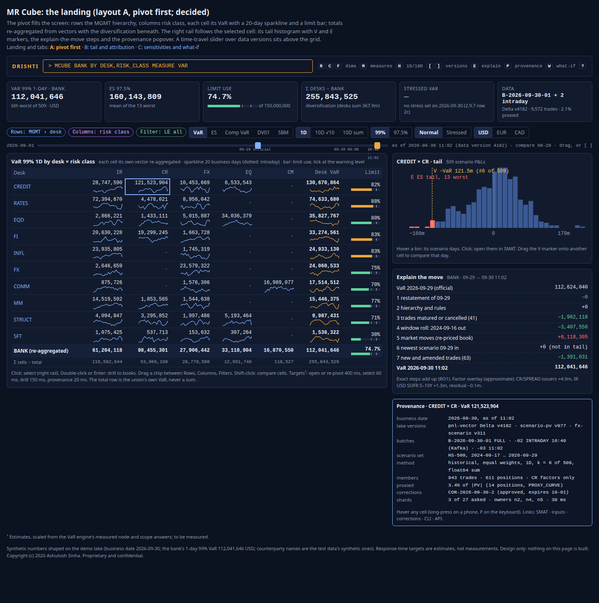
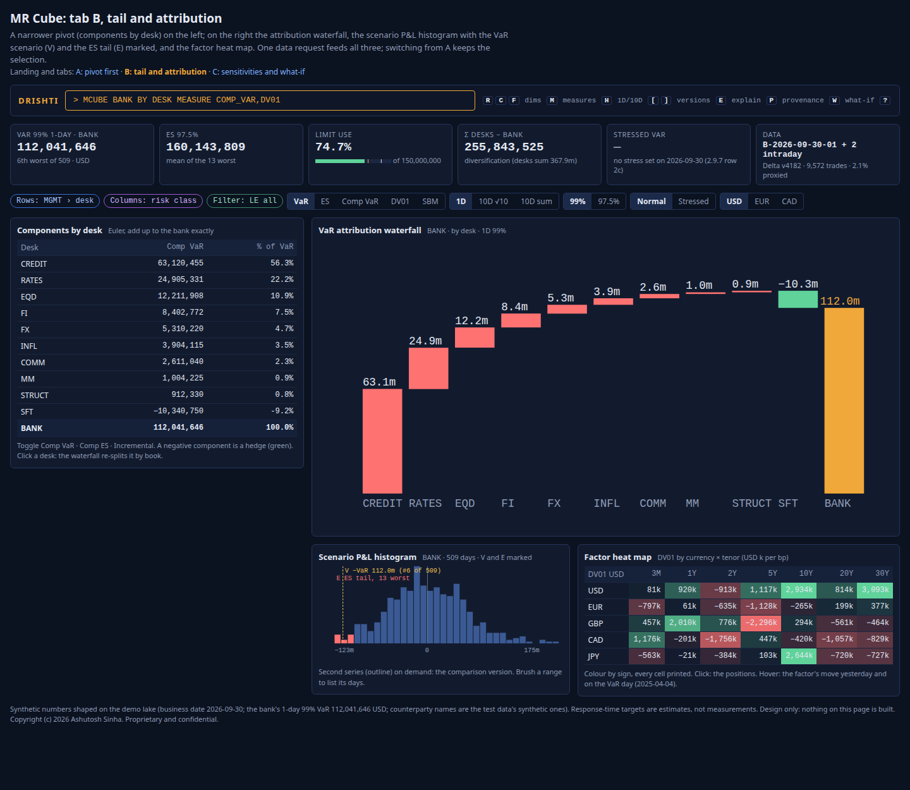
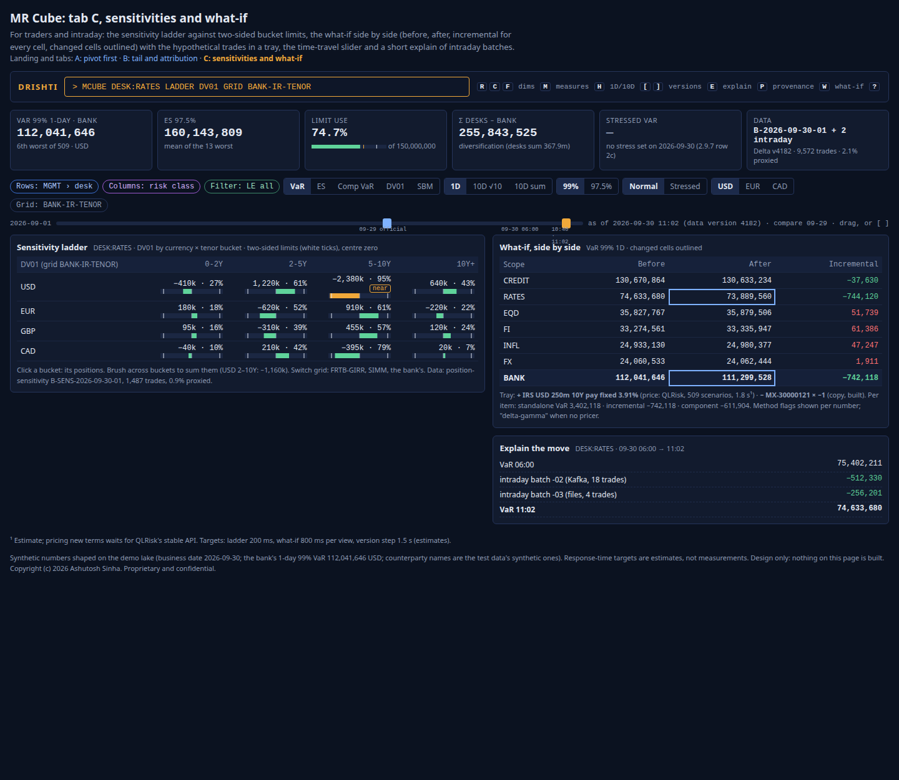

<!--
  Project Drishti · Any data. Any domain. One grammar.

  Copyright (c) 2026 Ashutosh Sinha <ajsinha@gmail.com>.
  All rights reserved.

  PROPRIETARY AND CONFIDENTIAL.

  This file is the confidential and proprietary property of Ashutosh Sinha.
  Unauthorised copying, use, modification, distribution or disclosure of this
  file, via any medium, is strictly prohibited except with the express prior
  written permission of the copyright holder.

  See the LICENSE file in the root of this repository for the full terms.
-->
# The MR Cube: a market risk cube lens that answers what FIS Adaptiv's artiQ answers, and shows why

**Status: analysis and product description; the MR cube is building on the pivot engine** (2.9.11.b, branch `wip/mr-cube-2`: the pivot, non-additive totals from vectors, components, limits, the lens, landing A with tabs B and C, explain, the ladder, the heat map and the what-if; [MR_CUBE_GUIDE.md](../guides/MR_CUBE_GUIDE.md)). Nothing else in this document is built unless a row of
[section 5](#5-what-drishti-has-today) says so and cites the guide it was read from (2026-10-31). Every phase named here is a **proposal**, not a commitment. The rows it proposes are candidates in the
[implementation plan](../architecture/IMPLEMENTATION_PLAN.md#risk-cubes-candidates-not-started) (MC1 to MC13; the proof-of-concept rows MCP1 to MCP6, section 12), not started.

**The request (product owner, 2026-10-31):** what it takes to build something like FIS Adaptiv's risk cube (artiQ) in Drishti, "even
better"; then separate designs for market risk (this document) and counterparty credit risk ([CCR_CUBE_LENS.md](CCR_CUBE_LENS.md));
then: make both of them lens documents, make the data and contracts chapter exhaustive, and write everything from the angle of beating
FIS, SunGard and Adaptiv in capability and in visualisation.

**Read with:** [VAR_GUIDE.md](../guides/VAR_GUIDE.md) (the VaR engine as built), [OVERSIGHT_LENS.md](OVERSIGHT_LENS.md) (the second line,
the `position-sensitivity` contract this document adopts), [RISK_LENS.md](RISK_LENS.md) and [TRADING_LENS.md](TRADING_LENS.md) (the
lenses the cube serves), [COMPUTED_ATTRIBUTES.md](../architecture/COMPUTED_ATTRIBUTES.md) (compute, never store; the modelling defaults
of its section 10, confirmed by the product owner on 2026-10-31), [REGULATORY_VAR_REPORTING.md](../guides/REGULATORY_VAR_REPORTING.md)
(the regulatory foundation and the reports), [CLUSTER_DEPLOYMENT.md](../architecture/CLUSTER_DEPLOYMENT.md) (sharding), and the contracts [FRTB.md](../contracts/FRTB.md),
[STR.md](../contracts/STR.md) and [PNL.md](../contracts/PNL.md).

## Contents

1. [Purpose: what a risk cube is, and what FIS offers](#1-purpose-what-a-risk-cube-is-and-what-fis-offers)
2. [Who uses it](#2-who-uses-it)
3. [Their questions: the morning, intraday, the close, the quarter](#3-their-questions-the-morning-intraday-the-close-the-quarter)
4. [The shared cube core (MR and CCR)](#4-the-shared-cube-core-mr-and-ccr)
5. [What Drishti has today](#5-what-drishti-has-today)
6. [Screens and visualisation](#6-screens-and-visualisation)
7. [Data and contracts](#7-data-and-contracts)
8. [Measures](#8-measures)
9. [Pre-deal what-if](#9-pre-deal-what-if)
10. [Performance and scale targets](#10-performance-and-scale-targets)
11. [How this beats FIS Adaptiv / artiQ](#11-how-this-beats-fis-adaptiv--artiq)
12. [Lens design and proof of concept (POC)](#12-lens-design-and-proof-of-concept-poc)
13. [Phases (proposed)](#13-phases-proposed)
14. [Risks and data dependencies](#14-risks-and-data-dependencies)
15. [Decisions for the product owner](#15-decisions-for-the-product-owner)
16. [Glossary](#16-glossary)

**Status words,** as in the other lens documents. **Built**: on develop, documented as built. **Partly**: some of it is built; the cell
says what is missing. **Planned (row)**: a plan row names it. **Proposed (MCn)**: proposed here. **Not built**: neither.

---

## 1. Purpose: what a risk cube is, and what FIS offers

A **risk cube** is a multidimensional store of risk numbers at the lowest grain the bank produces (a trade, a position, a scenario, a
risk factor), with **dimensions** (desk, book, legal entity, currency, product, issuer, tenor, scenario day, any attribute) that a user
puts on rows and columns, and **measures** that the cube aggregates for every cell on demand. What makes a *risk* cube harder than a
business-intelligence cube is that its most important measures are **not additive**: the VaR of two desks is not the sum of their VaRs,
and a regulatory charge is a square root of correlated sums. A correct cube therefore keeps the **vectors** (scenario P&L, sensitivities
per factor) and re-aggregates them for each cell; it never sums the cells' figures.

**What FIS claims in public** (marketing and award material, not technical documentation; no independent benchmark exists):

| Claim | Where FIS or the press says it |
|---|---|
| An in-memory aggregation cube that aggregates risk across all risk types, firm-wide results down to granular factors | [Risk.net, Market risk management product of the year: FIS](https://www.risk.net/awards/7676746/market-risk-management-product-of-the-year-fis) |
| Streaming aggregation in real time; incremental and what-if impacts on a real-time basis | the same article |
| "Mixed mode": the system values deals itself for risk, and accepts front-office valuations as inputs | the same article |
| Data first written to a detail pre-aggregation store; cubes "hydrated" from it; several dates, per-user offline cubes, recovery | [FIS, FRTB Risk Aggregation: An IT Perspective (white paper)](https://www.fisglobal.com/-/media/fisglobal/files/PDF/white-paper/FRTB-Risk-Aggregation-An-IT-Perspective-White-Paper.pdf?sc_lang=en) |
| Multi-server cube distribution so users see one cube | the same white paper |
| Non-additive VaR and ES over billions of scenario P&L values; FRTB SA and IMA; on-the-fly stress; users correct erroneous data in the cube; limit governance; Excel, Tableau and XLCubed front ends; Kafka streaming | FIS product pages and brochures, as summarised in the request (not independently verified here) |
| The wider suite: XVA, SA-CCR, SIMM, SA-CVA | FIS product pages (the counterparty side is [CCR_CUBE_LENS.md](CCR_CUBE_LENS.md)) |

**Caveat.** These are vendor claims. FIS publishes no detail on how the cube shards, how it fails over, or how fast it is at a stated
size. An older SunGard "Adaptiv risk cube" was built on Microsoft SQL Server Analysis Services; nothing suggests artiQ's figures resemble
it, and this document does not use them. Where this document says "beats", it means a claim we can **show** in a demo on Drishti's own
data (the *proof* column of [section 11](#11-how-this-beats-fis-adaptiv--artiq)), not a claim about FIS's internals.

**What Drishti's answer is, in one paragraph.** Drishti already holds the hard part of a market risk cube: every position's 509-scenario
P&L vector in memory, any scope's VaR and ES re-aggregated from the vectors, components that add up exactly, intraday updates from files
and Kafka, what-if, official records and sharding equal to the bit. The **MR Cube** adds the parts a cube needs on top of that: a
**pivot** over any attributes with correct non-additive totals, **sensitivities** in the lake, **FRTB SA and IMA** computed from the
trade grain, **pre-deal pricing**, and a **visual language** (in-cell sparklines and limit bars, waterfalls, tail histograms, factor heat
maps, ladders, a time-travel slider, provenance on every cell) that a vendor cube with an Excel front end cannot offer.

---

## 2. Who uses it

| Person | What they do with the cube | Lens today |
|---|---|---|
| **Market risk manager near the desks** | morning VaR by desk × risk class, the tail scenarios, sensitivity ladders against limits, what changed | Drishti Risk ([RISK_LENS.md](RISK_LENS.md)) |
| **Second-line oversight** | bank-wide pivots, limit utilisation of every kind, why VaR moved, data trust | the proposed Oversight lens ([OVERSIGHT_LENS.md](OVERSIGHT_LENS.md)) |
| **Desk head and trader** | my books by product and currency, my VaR contribution, "what does this trade do" | Drishti Trading ([TRADING_LENS.md](TRADING_LENS.md)) |
| **Regulatory capital team** | FRTB SA by risk class and correlation scenario, IMA ES by liquidity horizon, PLA and backtesting by desk | FRTB SA is built ([FRTB_SA_GUIDE.md](../guides/FRTB_SA_GUIDE.md): the FRSA screen, PLAY FRTB); the reporting chain and then IMA are planned in that order |
| **Product control** | hypothetical and actual P&L against the risk-theoretical P&L, restatements, corrections | none today |
| **Model validation** | the scenario set, proxies, NMRF, PLA statistics, the provenance of every number | none today |

The MR Cube is **a lens** ([EDITIONS.md section 8](../admin/EDITIONS.md#8-lenses)): `Open Drishti MR Cube` from Views and Home on a full
instance, and a cube **screen** (`MCUBE <GO>`, the command word the product owner chose on 2026-10-31) inside Drishti Risk, Trading and Oversight. It
hides what a cube user does not need (Build, Studio, the World and Market packs' menus) and keeps the VaR explorer, SMAT, the
counterparty cube and BI one click away.

---

## 3. Their questions: the morning, intraday, the close, the quarter

| When | Question | The cube's answer |
|---|---|---|
| Morning (07:30) | Where is the bank's VaR, by division × risk class, against limits? | a pivot, rows the MGMT hierarchy, columns risk class, cells VaR with a limit bar; totals re-aggregated |
| Morning | Which scenario days drive the tail, and are they new? | the tail histogram with V and E markers; SMAT one click away |
| Morning | Why did the credit desk's VaR rise 18 m overnight? | the "explain the move" panel (RO1's exact steps, then the factor overlay) |
| Intraday | What does the 10:40 batch from Murex do to the rates desk? | the cell flashes, the sparkline extends, the provenance popover names the batch |
| Intraday | What if we unwind these three swaps? Price this new one. | the what-if side by side: before, after, incremental, per cell |
| Close | Am I within my DV01 limits by currency × tenor? | the sensitivity ladder with two-sided bars |
| Close | Which issuers concentrate CS01? | the factor heat map, top N, Herfindahl |
| Month-end | FRTB SA by risk class, the binding correlation scenario | the SBM pivot with the three scenarios side by side |
| Quarter | IMA: ES by liquidity horizon, NMRF capital, PLA zones per desk | the IMA pivot and the desk zone board |
| Any time | Where did this number come from? | the provenance popover: data version, batch, scenario set, inputs, method, as-of |
| Any time | Show me last Tuesday as it was at 11:00 | the time-travel slider over data versions |

---

## 4. The shared cube core (MR and CCR)

This section is the **core** both cubes share. [CCR_CUBE_LENS.md](CCR_CUBE_LENS.md) refers to it and does not repeat it.

### 4.1 The pivot model

A **cube view** is a scope, a set of **dimensions** on rows and columns, a set of **measures**, filters, a business date (or two for a
change) and a lens (horizon, confidence, reporting currency).

- **Dimensions** come from any attribute the inputs carry (`LEGAL_ENTITY`, `DIVISION`, `DESK`, `TT_BOOK`, `LIMIT_LETTER`,
  `PRODUCT_GROUP`, `PRODUCT_TYPE`, `CURRENCY`, `COUNTERPARTY`, `TAGS`, `SOURCE_SYSTEM`), from any **hierarchy** the engine holds
  ([VAR_GUIDE section 15.14](../guides/VAR_GUIDE.md#1514-hierarchies-from-the-rows-or-from-the-trades-columns): MGMT, LEGAL,
  limit letters, any configured), from the **risk-factor** parts of the sensitivity contract (risk class, curve, tenor, issuer, bucket of
  any grid), from **reference data** joined by id (an issuer's sector and rating, a counterparty's country), and, for scenario measures,
  from the **scenario day**.
- **Measures** fall in three classes, and the class decides how a total is made:

| Class | Examples | How a cell and a total are made |
|---|---|---|
| **Additive** | PV, notional, DV01 by bucket, CS01, delta, vega, stress P&L of one scenario, EE (CCR) | the sum of the members; a total is the sum of its cells |
| **Vector-based, non-additive** | VaR, ES, stressed VaR, component VaR, ES by liquidity horizon, PFE (CCR) | the members' **vectors** summed element by element (float64, a fixed order), then the statistic (a rank, a tail mean); a total re-aggregates the vectors of all its members |
| **Formula, non-additive** | FRTB SBM (square roots of correlated sums), DRC, SIMM (CCR), SA-CCR add-ons (CCR) | the members' **inputs** summed to the formula's own grain (net weighted sensitivity per factor, bucket), then the formula; a total re-runs the formula on the union |

### 4.2 Correct totals for non-additive measures

**The rule: a cell or a total is always computed from the vectors or inputs of its members, never from other cells.** A pivot of desks ×
risk classes shows, in the bottom-right cell, the VaR of the union of every member of every visible cell (the bank, or the filtered
part), computed once from its own summed vector, not the sum of the row totals. Row and column totals and the grand total are each one
more scope. The cube shows the **diversification** of a row or column beside its total (Σ cells − total), so the reader sees why the
total is smaller.

This is how the VaR engine works today: any scope's vector is summed from the position rows in a fixed order, and node aggregates
equal the same sum to the bit ([VAR_GUIDE section 18.6](../guides/VAR_GUIDE.md#186-horizons-the-two-10-day-methods-and-the-confidence-chosen),
"sums for any scope come first"). A pivot of R × C cells is R × C + R + C + 1 scopes; each is a planner request over the date's rows.

### 4.3 Drill-through, saved views and sharing

- **Drill-through**: any cell opens its members (a desk's books, a book's positions, a position's trades, a factor's positions) with the
  same measures; the last level opens the trade (`TRD`), the position, the P&L vector (`PNLV`), or the scenario matrix (`SMAT`). The
  breadcrumb and Back work as in the VaR explorer ([VAR_GUIDE section 3.3](../guides/VAR_GUIDE.md#33-drill-down-bank-desk-book-position-trade)).
- **Saved views**: a view (its scope, dimensions, measures, filters, lens, sort, column widths, visual choices) is saved under a name,
  private or shared with a group, and opened by a link or a command (`MCUBE @asha/morning`). A shared view opens with **the reader's**
  entitlements; it is never a copy of the numbers.
- **Sharing**: the existing share with a note and comment threads ([COLLABORATION.md](../architecture/COLLABORATION.md)) work on a cube view; a
  comment anchors to a cell (dimension values and measure), so it survives a re-sort or a new date.

### 4.4 Provenance per cell

Every cell carries its provenance, opened by hovering (desktop) or long-pressing (phone): the business date, the **lake data version**
(Delta version or Iceberg snapshot of each input table), the batches included (full and intraday, in order), the scenario set and its
window, the method (historical simulation, equal weights, rank k, 1-day or 10-day and its method), the reporting currency and FX source,
the members counted, the **proxied share**, any refused or failed members by reason, the shards and who answered, and the time taken.
Today the VaR headline already returns most of this ([VAR_GUIDE section 11.2](../guides/VAR_GUIDE.md#112-the-headline-get-scope-and-its-provenance));
the cube returns it per cell, compactly (a provenance id per answer, details on demand).

### 4.5 Explain

Beside the figures, never on another screen:

- **Why it moved** (day over day, or between any two versions): RO1's fixed sequence of exact steps (restatement, hierarchy, trades out,
  window roll, market, trades in) whose differences add up to the change, each with its top contributors
  ([OVERSIGHT_LENS.md section 4.1](OVERSIGHT_LENS.md#41-ro1-var-change-explanation)), then the approximate **factor overlay** from
  sensitivities (Σ sensitivity × factor move, with its residual).
- **What drives it**: components (Euler, adding up exactly), incremental and marginal VaR
  ([VAR_GUIDE section 18.3](../guides/VAR_GUIDE.md#183-decomposition-of-a-scope-into-parts)).
- **How it was computed**: the formula with this cell's numbers in it (for SBM: the weighted sensitivities, the bucket K_b, the
  correlation scenario that binds).

### 4.6 Data correction: write-back with approvals and audit

FIS says users correct erroneous data inside the cube. Drishti does it through **write-back** ([WRITE_BACK.md](../guides/WRITE_BACK.md),
built: a change request, approval by a second person, an edit log, audit): a user marks a member (a P&L vector, a sensitivity
record, a trade attribute) as wrong, proposes a correction (a proxy vector, an excluded record with a reason, a corrected attribute),
and an approver applies it. The correction is **an overlay record** in the lake with its author, approver, reason and expiry; the
original stays; every cell that uses it shows a **corrected** marker and its provenance names the correction. The official run either
includes approved corrections or not, by a setting; the choice is recorded with the run. Nothing is edited in place.

### 4.7 Streaming updates

The cube subscribes to the engine's intraday updates (files appended to the lake, or the Kafka PV stream: VAR_GUIDE section 8.4, built:
`VarPvStream`). A visible cell whose members changed is recomputed and **patched in place** through the live channel (the
same machinery as live views), flashing for a second with its old value on hover; a cell more than one batch behind says so. Throttle:
a view recomputes at most once per batch, coalescing bursts.

### 4.8 Export

| Format | How | Today |
|---|---|---|
| xlsx | the view as a formatted workbook (one sheet per measure, totals, provenance sheet) | BI already exports statements as xlsx ([BI_GUIDE.md](../guides/BI_GUIDE.md)); the cube reuses it |
| csv | the cells, unformatted, one row per cell | the VaR explorer exports CSV |
| Power Query | a REST endpoint per saved view, with the token in the header | the pattern exists for search ([API_GUIDE.md](../guides/API_GUIDE.md)) |
| Arrow | `Accept: application/vnd.apache.arrow.stream` on the view's answer | built for two answers ([API_GUIDE.md, answers as Arrow](../guides/API_GUIDE.md#answers-as-arrow-the-accept-header)) |
| Tableau, Power BI, XLCubed | through the REST and Arrow endpoints (Tableau's Web Data Connector, Power BI's web connector); no MDX/XMLA server | not built; decision 6 |

### 4.9 Embed and phone views (tiers)

- **Embedding**: a cube view is a ViewModel screen, so the client renderer draws it in any web page
  ([CLIENT_RENDERER.md](../architecture/CLIENT_RENDERER.md), built): `render(el, {kind: 'cube-view', id: 'asha/morning'})`.
- **Phone tiers** ([MOBILE_DISPLAY.md section 3](../architecture/MOBILE_DISPLAY.md#3-phone-tiers-must-glance-more-desk), design): the
  headline strip and the top-left 5 × 3 of the pivot are **must**; sparklines and the tail histogram **glance**; drill, explain and
  provenance **more**; the full pivot editor **desk** (open on desktop).

### 4.10 Lenses and permissions

The cube reads as the person: entitlements per scope and kind, masks and audit per answer, exactly as the VaR explorer
([VAR_GUIDE section 9](../guides/VAR_GUIDE.md#9-who-sees-what-entitlements-and-audit)). A cell whose members the reader may see only in
aggregate shows the aggregate and refuses drill-through with the reason. A lens hides; it does not secure.

### 4.11 Cluster execution: scatter and gather of vectors, bit-equal results

A cube view is many scopes. On a sharded cluster ([VAR_GUIDE section 28](../guides/VAR_GUIDE.md#28-sharding-across-drishtinet),
built) the coordinator splits each scope's rows by shard; each owner returns **one partial per scope**: its summed vector (for
vector measures) or its summed inputs per factor (for formula measures); the coordinator adds the partials **in shard order** and takes
the statistic once. A pivot request is batched: one call per owner carrying all the view's scopes, not one per cell. Bit-equality is the
existing invariant (partials are always the 1-day vectors, never statistics); for sensitivities the partial is a sparse map factor →
sum, also added in shard order. **No live owner of a needed shard: the cell says so (`DRS-5215`), never a partial figure.**

### 4.12 Caching and memory budgets

- **Cell cache**: keyed by (date, data version, batch list, scope text, measure, lens); invalidated by a batch touching any member
  (the existing VaR caches, `VarCaches`, extended to cube scopes).
- **Vector budget**: a pivot of 40 × 12 cells is about 500 scopes; each scope's 509-value float64 vector is 4 KB, so 2 MB a view; at
  1,518 values (normal + stressed + spare) 6 MB. Views over a configurable cell count (proposed default 5,000) are refused with the
  count, not truncated.
- **Sensitivity budget**: per date a factor dictionary (a few hundred thousand names) and per-position sparse rows in the hot file
  (proposed section `SENS`); about 0.3 to 1.7 GB a day at 2.3M positions (section 7).

### 4.13 MR versus CCR: two cubes on one core

| | MR Cube (this document) | CCR Cube ([CCR_CUBE_LENS.md](CCR_CUBE_LENS.md)) |
|---|---|---|
| Core (sections 4.1 to 4.12) | shared | shared |
| Data grain | position (or trade) × scenario; position × risk factor | trade × path × time step |
| Aggregation order | sum vectors over any members, then the statistic | **first** net per netting set and apply collateral per path (non-linear), **then** sum across netting sets, then the statistic |
| Additive across the pivot | PV, sensitivities, one scenario's P&L | EE, EPE, CE, CVA contributions |
| Non-additive | VaR, ES, SBM charges | PFE quantiles, peaks, EEPE, SA-CCR, SIMM |
| Shard key | `LEGAL_ENTITY`, `DESK` (a desk never split) | `COUNTERPARTY`, `NETTING_SET` (a netting set never split) |
| Shared inputs | **sensitivities** (`position-sensitivity`: FRTB here, SIMM and SA-CVA there) and the **QLRisk pricing bridge** (scenario P&L here, path MtMs there) | the same |

Two cubes, because the **grain and the order of aggregation differ**; one core, because the pivot, totals, provenance, explain,
corrections, streaming, export, embedding, permissions, scatter-gather and caching are the same machinery.

---

## 5. What Drishti has today

| Capability | Status | Evidence |
|---|---|---|
| VaR 99% and ES 97.5%, historical simulation, any scope, re-aggregated from vectors | **Built** | [VAR_GUIDE sections 1, 2](../guides/VAR_GUIDE.md#1-the-question-var-answers) |
| Component, incremental, marginal VaR; diversification; components adding up exactly | **Built** | [VAR_GUIDE section 18.3](../guides/VAR_GUIDE.md#183-decomposition-of-a-scope-into-parts) |
| Any confidence and window; 1-day and 10-day (√10 and the 10-day sum) | **Built** | [VAR_GUIDE section 18.6](../guides/VAR_GUIDE.md#186-horizons-the-two-10-day-methods-and-the-confidence-chosen) |
| Scopes: hierarchies, positions, trades, rules, baskets, `+ - &` | **Built** | [VAR_GUIDE section 5](../guides/VAR_GUIDE.md#5-scopes-portfolios-and-baskets) |
| Several hierarchies (MGMT, LEGAL, limit letters, configured) | **Built** | [VAR_GUIDE section 15.14](../guides/VAR_GUIDE.md#1514-hierarchies-from-the-rows-or-from-the-trades-columns) |
| Scenario matrix (a scope's scenarios across dates) | **Built** (`SMAT`) | [VAR_GUIDE section 3.9](../guides/VAR_GUIDE.md#39-the-scenario-matrix-smat) |
| Intraday updates from files and Kafka | **Built** | [VAR_GUIDE section 8.4](../guides/VAR_GUIDE.md#84-what-if-pricing-and-intraday-recomputes); `VarPvStream.java` |
| What-if: copies of booked trades scaled, in a basket | **Built** | [VAR_GUIDE section 8.5](../guides/VAR_GUIDE.md#85-the-pre-deal-what-if-under-the-baskets-sheet); `VarWhatIf.java` |
| Pricing a new trade over the scenarios (QLRisk) | **Not built** (parked until QLRisk's API is stable) | [VAR_GUIDE section 8.4](../guides/VAR_GUIDE.md#84-what-if-pricing-and-intraday-recomputes) |
| Mixed mode: Drishti never prices; it takes the bank's P&L vectors or scenario PVs | **Built** (by design) | [VAR_GUIDE section 15.9](../guides/VAR_GUIDE.md#159-scenario-pv-scenario-pvs-per-trade-in-the-trades-currency) |
| Official records, captures, compare, history, backtest on derived hypothetical P&L | **Built** | [VAR_GUIDE sections 6, 7, 19](../guides/VAR_GUIDE.md#19-official-end-of-day-results) |
| VaR limits per node, limit letters | **Built** | [VAR_GUIDE section 15.15](../guides/VAR_GUIDE.md#1515-var-limit-the-nodes-var-limits) |
| Sharding across Drishti\*net, equal to the bit | **Built** | [VAR_GUIDE section 28](../guides/VAR_GUIDE.md#28-sharding-across-drishtinet) |
| Delta and Iceberg inputs and results | **Built** | [VAR_GUIDE](../guides/VAR_GUIDE.md) |
| Arrow answers (contributions) | **Built** | [API_GUIDE.md](../guides/API_GUIDE.md#answers-as-arrow-the-accept-header) |
| Pivot over any fields with server totals (BI "Slice", matrix visual) | **Built for BI datasets**, additive measures only | [BI_GUIDE.md](../guides/BI_GUIDE.md) |
| Pivot with non-additive VaR totals over the engine | **Not built** | MC2 |
| Stressed VaR (a stress scenario set, 1-day and 10-day, `SVAR`) | **Planned**; the what-if already reports a "stressed window" figure | [VAR_GUIDE section 8.2](../guides/VAR_GUIDE.md#82-the-what-if-the-java-engine) |
| Sensitivities per position and factor | **Built**: position sensitivities per factor, the input of FRTB-SA and SIMM ([FRTB_SA_GUIDE.md](../guides/FRTB_SA_GUIDE.md) section 3) | [OVERSIGHT_LENS.md section 7.1](OVERSIGHT_LENS.md#71-what-the-lake-holds-today) |
| FRTB SA computed | **Built**: computed from position sensitivities, any scope ([FRTB_SA_GUIDE.md](../guides/FRTB_SA_GUIDE.md)) | [COMPUTED_ATTRIBUTES.md section 4.9](../architecture/COMPUTED_ATTRIBUTES.md#49-frtb-sensitivity-frtb); [FRTB.md](../contracts/FRTB.md) |
| FRTB IMA | **Not built**, not planned | MC8 to MC10 |
| Stress P&L by desk and scenario; the bank's P&L per scenario | **Built** stored and derived | [VAR_GUIDE section 21.4](../guides/VAR_GUIDE.md#214-the-banks-stress-pl-by-scenario-derived) |
| Actual and hypothetical P&L feed; backtesting engine with the multiplier | **Planned** | [REGULATORY_VAR_REPORTING.md section 8](../guides/REGULATORY_VAR_REPORTING.md#82-the-order-to-build-in) |
| VaR change explanation | **Not built**, designed (RO1) | [OVERSIGHT_LENS.md section 4.1](OVERSIGHT_LENS.md#41-ro1-var-change-explanation) |
| Write-back with approval and audit | **Built**, on entity forms; not on engine inputs | [WRITE_BACK.md](../guides/WRITE_BACK.md) |
| Client renderer, embedding | **Built** | [CLIENT_RENDERER.md](../architecture/CLIENT_RENDERER.md) |
| Phone tiers | **Design** | [MOBILE_DISPLAY.md](../architecture/MOBILE_DISPLAY.md) |

**Verified in code (2026-10-31):** `drishti-banking/src/main/java/com/ash/drishti/banking/var/` holds `VarService`, `VarWhatIf`,
`VarPvStream` (the Kafka window), `VarShardBooks` and `VarSharding` (shards), `VarMatrix` (SMAT), `VarOfficial`, `VarCaches`; no class
in `drishti-server` or `drishti-compute` reads sensitivities by risk factor (the only matches for "sensitivit" are outside those
packages), and there is no FRTB or IMA calculator.

---

## 6. Screens and visualisation

The cube's screens follow the house rules: keyboard first, every number printed (a chart never replaces a figure), losses in the
theme's loss colour **and** with a sign or marker (never colour alone), dark terminal theme by default, every panel a ViewModel panel so
it embeds and stacks on a phone. The mock-ups are in the repository: [A](mockups/mr-cube/A.html), [B](mockups/mr-cube/B.html), [C](mockups/mr-cube/C.html),
each with its screenshot; [section 6.7](#67-mock-ups-the-screens-to-build) is the build checklist.

### 6.1 Three layouts (mock-ups, the product owner picks)

| Option | Layout | Best for | Mock-up |
|---|---|---|---|
| **A: Pivot first** | the pivot grid fills the screen (rows MGMT desk, columns risk class), each cell its VaR, a 20-day sparkline and a limit bar; a right rail with the selected cell's tail histogram, explain and provenance | the risk manager's morning; the Oversight lens | [mr-cube/A.html](mockups/mr-cube/A.html) |
| **B: Tail and attribution** | a narrower pivot on the left; on the right the VaR attribution waterfall (components by the column dimension), the scenario P&L histogram with V and E markers, and the factor heat map below | "what drives it"; the regulatory capital team | [mr-cube/B.html](mockups/mr-cube/B.html) |
| **C: Sensitivities and what-if** | the sensitivity ladder (DV01 currency × tenor) with two-sided limit bars; a what-if side by side (before, after, incremental per cell); the time-travel slider across the top | traders, pre-deal, intraday | [mr-cube/C.html](mockups/mr-cube/C.html) |

**Recommendation:** A as the default landing, B and C as tabs of the same view (one data request; switching re-uses the cell answers).

### 6.2 The visual catalogue

| Visual | What it shows | Interactions | Built today? |
|---|---|---|---|
| **Pivot grid with in-cell sparklines and limit bars** | each cell: the measure, a 20-business-day sparkline of the same cell (from official captures, intraday points dotted), a horizontal limit bar (use %, amber from the limit's warning level, red over 100%, a marker at the warning level); totals rows and columns with diversification | click a cell: select and fill the right rail; double-click: drill; hover: provenance popover; drag a dimension chip between Rows, Columns and Filters; shift-click: multi-select cells to compare | pivot: BI only (additive); sparklines and limit bars: not built |
| **VaR attribution waterfall** | a scope's VaR split into the column dimension's components (Euler, adding up exactly), sorted by size, hedges as negative bars, the total as the last bar | click a bar: drill into that part; toggle component VaR / component ES / incremental | components built; the waterfall not built |
| **Scenario P&L histogram with tail markers** | the scope's 509 scenario P&Ls in bins, the VaR scenario marked **V**, the ES tail shaded and marked **E**, the mean and today's P&L; a second series for the comparison date | hover a bin: its scenario days; click: open those days in SMAT; **drag a scenario** marker onto another scope's histogram to compare that day | the P&L path chart built; histogram not built |
| **Factor heat map** | sensitivities (or component VaR by factor group) on two factor dimensions: currency × tenor, issuer × tenor, underlying × expiry; colour by signed value, every cell printed | click: drill to positions; hover: the factor's move yesterday and its VaR-scenario move | not built |
| **Sensitivity ladder by tenor** | per currency (or curve) DV01 by tenor bucket as two-sided bars against the bucket's long and short limits; net and gross; the bucket grid chosen (FRTB, the bank's limit grid) | click a bucket: its positions; **brush** a tenor range to sum it; switch grid | not built |
| **What-if side by side** | for the same view: before, after and incremental per cell; the hypothetical trades in a tray with their standalone and incremental VaR; changed cells outlined | add a trade (copy and scale a booked one, or price new terms), remove one, toggle "show only changed" | the basket what-if built (one scope); per-cell side by side not built |
| **Time-travel slider over data versions** | a slider across the top: business dates and, within a date, each batch and correction (lake data versions); the view redraws as of that version; a second handle sets the comparison | drag the handle; **brush** a range for the sparkline window; keyboard `[` and `]` step a version | history of official captures built; per-version slider not built |
| **Provenance popover per cell** | data versions, batches, scenario set and window, method and lens, members, proxied share, refusals, shards, time; links to SMAT, the inputs and the corrections | hover (desktop), long-press (phone), `P` on the selected cell | VaR headline provenance built; per cell not built |
| **"Explain the move" panel** | RO1's waterfall of exact steps between two versions (restatement, hierarchy, trades out, window roll, market, trades in), each with its top 5 contributors; the factor overlay below with its residual | click a step: highlight the cells it moved; click a contributor: open it | designed (RO1); not built |

### 6.3 Response-time targets

| Interaction | Target (p95, warm, one date open) | Note |
|---|---|---|
| Open a saved view of 40 × 12 cells with totals (about 500 scopes) | 400 ms¹ | one batched planner request per owner |
| Re-pivot (drag a dimension) | 400 ms¹ | the same |
| Select a cell: histogram, components, provenance | 60 ms¹ | the cell's vector is already summed |
| Drill one level | 150 ms¹ | |
| Hover provenance | 20 ms¹ | the provenance id is in the answer; details cached |
| An intraday batch: visible cells patched | 1 s after the batch is applied¹ | coalesced per batch |
| What-if with three copied trades, per cell | 800 ms¹ | the server's VaR engine; pricing a new trade adds QLRisk's time |
| Time-travel to another version of an open date | 1.5 s¹ | the version's batch rows replayed onto the date |
| SBM capital of the bank, three correlation scenarios | 2 s¹ | sums per factor are additive and cached per node |

¹ Estimates, not measurements: scaled from the VaR engine's measured node answers (under 1 ms from aggregates, VAR_GUIDE section 27)
and ad-hoc scope sums (VAR_GUIDE section 27.3), times the number of scopes in a view. To be measured with MC2 on the 10K test data and
on the product owner's server at 2.3M.

### 6.4 Keyboard first

`MCUBE <view> <GO>` opens a view; arrows move the selection; `Enter` drills; `Backspace` goes back; `R`, `C`, `F` move the focused
dimension chip to Rows, Columns, Filters; `M` picks measures; `H` toggles 1-day / 10-day; `[` `]` step data versions; `E` opens explain;
`P` provenance; `W` the what-if tray; `S` save; `X` export; `?` help. The command line accepts the scope grammar: `MCUBE DESK:RATES BY
BOOK,CCY MEASURE VAR,ES,DV01 <GO>`.

### 6.5 Phone tiers

**must**: the headline strip (VaR, ES, limit use) and the pivot's first five rows by the first measure, totals pinned; **glance**: the
sparkline column and the tail histogram as a strip; **more**: explain, provenance, the waterfall; **desk**: the pivot editor, the factor
heat map wider than 640 px, what-if. A phone user opens a saved view, never designs one.

### 6.6 Embedding

A saved view embeds with one call of the client renderer; the host page receives `drishti:navigate` events on drill and may keep the
drill in place. A dashboard tile (a cell with its sparkline and limit bar) is a ViewModel panel too.

### 6.7 Mock-ups: the screens to build

**Decided (product owner, 2026-10-31): layout A is the landing page; B and C are tabs of the same page.** The mock-ups are in the
repository beside this document, self-contained HTML (no CDN, no external fonts) with a screenshot of each:
[A.html](mockups/mr-cube/A.html), [B.html](mockups/mr-cube/B.html), [C.html](mockups/mr-cube/C.html). Their numbers are synthetic, shaped on
the demo (the bank's 1-day 99% VaR 112,041,646). The tables below are the **build checklist**: every panel on the mock-ups, its exact
contents, the data it reads, its interactions, its phase (POC or later, section 12), its phone tier and its states. A builder ticks
*Done* when the panel matches the row and its test exists.

**States every panel has** (unless its row says otherwise): **loading**: a skeleton of the panel's shape, never a spinner over old
numbers; **empty**: one sentence saying why (no vectors for the scope on the date; no sensitivities delivered; no official capture for a
past date), never zeros; **error**: the `DRS` code and its sentence in words, with *Retry*; **refused**: a scope or cell the person may
see only in aggregate shows the aggregate and says drill is not allowed; **stale**: a cell more than one batch behind carries a marker.

#### A: the landing (pivot first)



| # | Panel | Exact contents | Data | Interactions | Phase | Phone | Done? |
|---|---|---|---|---|---|---|---|
| A1 | Command line and key strip | `DRISHTI` mark; the command field (amber border, mono) showing the view as text: `MCUBE BANK BY DESK,RISK_CLASS MEASURE VAR <GO>`; the key strip **R C F** dims, **M** measures, **H** 1D/10D, **[ ]** versions, **E** explain, **P** provenance, **W** what-if, **?** | the view (`POST /api/v1/cube/mr/query`'s request) | type a view and `<GO>`; type-ahead of dimensions and measures; every key in section 6.4 | POC | must (command field), keys hidden | [ ] |
| A2 | Headline strip (six tiles) | **VaR 99% 1-day · bank** 112,041,646 "6th worst of 509 · USD"; **ES 97.5%** 160,143,809 "mean of the 13 worst"; **Limit use** 74.7% with a bar (green under the warning level, amber from it, red over 100%, a tick at the warning level) "of 150,000,000"; **Σ desks − bank** 255,843,525 "diversification (desks sum 367.9m)"; **Stressed VaR** "—" with the reason ("no stress set on 2026-09-30", stressed VaR); **Data**: the batch and intraday count, the Delta version, trade count, proxied share | `/api/v1/risk/var/scope` of the view's scope; `var-limit` ([§7.6](#76-d5-risk-hierarchy-and-var-limit-existing)); the scope's provenance | click a tile: the matching measure in the pivot; hover: provenance | POC (stressed tile after 2c) | must (VaR, ES, limit use), glance (the rest) | [ ] |
| A3 | Lens controls | chips **Rows: MGMT › desk** (blue), **Columns: risk class** (purple), **Filter: LE all** (green); segmented: measure **VaR · ES · Comp VaR · DV01 · SBM**; horizon **1D · 10D √10 · 10D sum**; confidence **99% · 97.5%**; set **Normal · Stressed**; currency **USD · EUR · CAD** | the view; currencies from `/api/v1/risk/var/currencies` | drag a chip between Rows, Columns and Filters; click a segment; `R`, `C`, `F`, `M`, `H` | POC (SBM and Stressed greyed until MC5 and 2c) | desk (a phone opens saved views only) | [ ] |
| A4 | Time-travel slider | a track from the first date with an official capture to now; ticks at the official runs and each batch (`09-29 official`, `09-30 06:00`, `10:40`, `11:02`); the amber handle "as of", the blue handle "compare"; the text "as of 2026-09-30 11:02 (data version 4182) · compare 09-29" | `GET /api/v1/cube/mr/versions` (dates with captures, each date's batches) | drag either handle; `[` and `]` step the as-of; **brush** a range for the sparkline window | POC (dates and batches; raw lake versions later, decision P3) | more | [ ] |
| A5 | Pivot grid | rows: the ten desks (CREDIT, RATES, EQD, FI, INFL, FX, COMM, MM, STRUCT, SFT) as links; columns IR, CR, FX, EQ, CM, **Desk VaR**, **Limit**; each cell: the VaR (mono, thousands separators), under it a 70 × 16 px sparkline of 20 business days (blue; the desk column amber; dotted for intraday points); the Limit cell: use % and a 70 × 6 px bar (green, amber at the warning level, red over 100%, white tick at 100%); a dot `·` where the desk has no factor of the class; the selected cell outlined blue; **total row** "BANK (re-aggregated)" with each column's own VaR (IR 61,204,118 … bank 112,041,646) and 74.7%; **Σ cells − total** row in muted text | `POST /api/v1/cube/mr/query` (cells, totals, diversification, provenance ids); sparklines from official captures; per-class vectors ([§7.4](#74-d3-pnl-vector-scenario-pv-fx-scenario-existing-extended)); limits ([§7.6](#76-d5-risk-hierarchy-and-var-limit-existing)) | click: select (fills the right rail); double-click or `Enter`: drill to books, positions, trades; `Backspace`: back; hover: the provenance popover (A8); shift-click: compare cells; arrows move the selection; the column header sorts | POC | must: the first five rows by the first measure, totals pinned; glance: the sparkline column | [ ] |
| A6 | Tail histogram (right rail) | title "<row> × <column> · tail · 509 scenario P&Ls"; 34 bins; the ES tail bins red and marked **E** "ES tail, 13 worst"; the VaR bin amber with a dashed line and **V** "−VaR 121.5m (#6 of 509)"; a zero line; the x axis from the worst to the best P&L (m) | `/api/v1/risk/var/scope/distribution` for the cell's scope; `GET /api/v1/cube/mr/cell` | hover a bin: its scenario days; click: open them in `SMAT`; **drag** the V marker onto another cell: compare that scenario day there | POC | glance (a strip) | [ ] |
| A7 | Explain the move (right rail) | "BANK · 09-29 → 09-30 11:02"; lines: VaR 09-29 (official) 112,624,040; the steps with signed amounts (decreases green, increases red); the result 112,041,646 in bold; a note that the exact steps add up and the factor overlay is approximate | `GET /api/v1/cube/mr/explain` (POC: trades out, re-priced book, trades in); RO1's full steps and the overlay later | click a step: highlight the cells it moved; click a contributor: open it; `E` | POC (three steps); RO1's seven steps built (2.9.10); the factor overlay, MC12, in sensitivities and capital (2.9.11) | more | [ ] |
| A8 | Provenance popover | "Provenance · <cell> · VaR <value>"; business date and as-of; lake versions per input table; batches in order with their kind (FULL, INTRADAY, Kafka or files); scenario set and window; method (historical, equal weights, horizon, k of N, float64 sum); members (trades, positions, factors); proxied share with reason; corrections; shards asked and owners, time; links SMAT, inputs, corrections, CLI, API | `GET /api/v1/cube/provenance/{id}` | hover (desktop), long-press (phone), `P` | POC (corrections later) | more | [ ] |

#### B: tail and attribution (tab)



| # | Panel | Exact contents | Data | Interactions | Phase | Phone | Done? |
|---|---|---|---|---|---|---|---|
| B1 | Components by desk | columns Desk, Comp VaR, % of VaR; rows sorted by component; a negative component (SFT −10,340,750, −9.2%) is a hedge; total BANK 112,041,646, 100.0% | `/api/v1/risk/var/scope/contributions` (`by` the column dimension; Arrow on request) | toggle Comp VaR · Comp ES · Incremental; click a desk: the waterfall re-splits it by book | POC | glance (top five) | [ ] |
| B2 | VaR attribution waterfall | one bar per part, sorted by size, red for a positive component, green for a hedge, each labelled (63.1m … −10.3m); the total bar amber "112.0m"; x axis the parts, y axis USD | as B1 | click a bar: drill into that part; hover: standalone, component, incremental, marginal | POC | more | [ ] |
| B3 | Scenario P&L histogram | as A6 for the scope; an outline series for the compare version | `/api/v1/risk/var/scope/distribution` | **brush** a range: list its days; hover, click as A6 | POC | glance | [ ] |
| B4 | Factor heat map | DV01 in USD thousands per bp, rows currencies (USD, EUR, GBP, CAD, JPY), columns tenors (3M, 1Y, 2Y, 5Y, 10Y, 20Y, 30Y); each cell printed, green for long and red for short, intensity by size (full at 2.5m) | `GET /api/v1/cube/mr/sensitivities?by=QUALIFIER,TENOR` from `position-sensitivity` ([§7.9](#79-d8-position-sensitivity-sens-new)) and `risk-factor` ([§7.10](#710-d9-the-factor-dictionary-risk-factor-and-the-bucket-mapping-sensitivity-bucketsyaml-new)) | click a cell: its positions; hover: the factor's move yesterday and on the VaR day; switch the two factor parts (issuer × tenor for CS01, underlying × expiry for vega) | POC (synthetic DV01); CS01 and vega with MC3 | desk | [ ] |

#### C: sensitivities and what-if (tab)



| # | Panel | Exact contents | Data | Interactions | Phase | Phone | Done? |
|---|---|---|---|---|---|---|---|
| C1 | Grid chip | **Grid: BANK-IR-TENOR** beside the lens controls | `sensitivity-buckets.yaml` ([§7.10](#710-d9-the-factor-dictionary-risk-factor-and-the-bucket-mapping-sensitivity-bucketsyaml-new)) | click: choose FRTB-GIRR, SIMM or the bank's grids | POC (the bank's grid); FRTB grids with MC5 | desk | [ ] |
| C2 | Sensitivity ladder | rows USD, EUR, GBP, CAD; columns 0-2Y, 2-5Y, 5-10Y, 10Y+; each cell "<DV01>k · <use>%" with a 100 × 8 px centre-zero bar (long right, short left), white ticks at both limits, green under the warning level, amber from it, red over; a **near** badge (amber) at the warning level, **breach** (red) over 100% | `GET /api/v1/cube/mr/sensitivities?grid=…` from `position-sensitivity` ([§7.9](#79-d8-position-sensitivity-sens-new)); limits from `risk-limit` ([§7.7](#77-d6-risk-limit-new-one-limit-table-for-every-measure)) | click a bucket: its positions; **brush** across buckets to sum them ("USD 2–10Y: −1,160k"); switch grid | POC (synthetic DV01 and DV01 limits) | must (the scope's worst three buckets), more (the ladder) | [ ] |
| C3 | What-if side by side | columns Scope, Before, After, Incremental (decrease green, increase red); rows the visible desks and BANK; a cell whose change is material outlined blue; the tray under it listing each hypothetical trade with its method (copy, price) and its standalone, incremental and component VaR | `POST /api/v1/risk/var/what-if` per visible scope (built); pricing of new terms later ([§7.16](#716-d15-predeal-request-and-predeal-result-new)) | `W` or **+ What-if trade**: copy and scale a booked trade; remove one; "show only changed" | POC (copy method); advanced market risk (QLRisk pricing, delta-gamma) | desk | [ ] |
| C4 | Explain the move (intraday) | "DESK:RATES · 09-30 06:00 → 11:02": the morning VaR, one line per intraday batch with its source (Kafka, files) and trade count, the current VaR | `GET /api/v1/cube/mr/explain?from=<batch>&to=<batch>` | click a batch: highlight its trades | POC | more | [ ] |
| C5 | Time-travel slider | as A4 | as A4 | as A4 | POC | more | [ ] |

**Not on the mock-ups but in the design, to build with them:** saved views (`S`), export (`X`: CSV and Arrow in the POC; xlsx and Power
Query later), the embed of a saved view, the phone layout of section 6.5, the SBM pivot (MC5), corrections' markers (MC11).

---

## 7. Data and contracts

### Data needed: the complete list

**Every dataset the MR Cube reads, in one table.** A row is needed from the phase in its *Phase* column onward. POC is the proof of
concept of [section 12](#12-lens-design-and-proof-of-concept-poc); the regulatory foundation (released, 2.9.8), sensitivities and capital (2.9.11) and advanced market risk (2.9.18; both proposed) are the phases of
[section 13](#13-phases-proposed), from the plan's themes (product owner, 2026-10-31); *unscheduled* rows wait for the product owner. *State*: **existing** (a contract and demo data today), **extended** (existing, with optional fields
added), **new**. *Demo or POC* says how the demo gets the data: an existing demo dataset; a **new generator** (a script under
`tools/packgen/`, writing JSON Lines to `data/testdata/<domain>/<kind>/*.jsonl.gz`, loaded by `tools/build_demo_lakes.py` into Delta, read
by the Delta connector, tested with the demo switched off); shipped **configuration** from a public text; or **bank only**.

| # | Dataset | What it is; needed by | Phase | Typical source in a bank | Grain, frequency | State | Demo or POC gets it from | §7 |
|---|---|---|---|---|---|---|---|---|
| 1 | Trades (`trade`) | booking attributes as dimensions, drill to the trade; `FRTB_DESK`, `RRAO_CLASS` later | POC | Endur, Murex, Calypso | trade × date; daily, intraday amendments | existing; extended (sensitivities and capital) | existing demo (`tools/packgen/trades/make_trades.py`, `data/testdata/trades`) | [7.2](#72-d1-trade-trd-existing-read-as-dimensions) |
| 2 | Positions (`position`) | the position grain, market value for marginal VaR | POC | derived by Drishti | position × date, at load | existing | derived from the vectors | [7.3](#73-d2-position-pos-existing-derived-by-drishti) |
| 3 | Scenario P&L vectors (`pnl-vector`, `scenario-pv`, `fx-scenario`) | VaR, ES, components, histogram, explain, time travel | POC | the risk engine of the booking system or the bank's pricing grid | trade or position × date × set; daily, intraday files or Kafka | existing; extended (`RISK_CLASS_VECTORS`; regulatory reporting, G6, 2.9.15) | existing demo (`tools/packgen/var/make_var_data.py`); the POC adds per-class vectors from the same factor model | [7.4](#74-d3-pnl-vector-scenario-pv-fx-scenario-existing-extended) |
| 4 | Scenario sets (`scenario-set`), the stress set included | the scenario days; the Normal / Stressed lens | POC (normal); sensitivities and capital (stressed, from stressed VaR) | the risk engine | set × date; daily, the stress set weekly | existing; extended (`PURPOSE`) | existing demo; the stress set from stressed VaR's generator | [7.5](#75-d4-scenario-set-sset-existing-extended) |
| 5 | Hierarchies (`risk-hierarchy`) and VaR limits (`var-limit`) | rows of the pivot (MGMT, LEGAL, limit letters), limit bars | POC | the bank's hierarchy and limit systems | node × date; daily | existing | existing demo | [7.6](#76-d5-risk-hierarchy-and-var-limit-existing) |
| 6 | Limits of every measure (`risk-limit`) | ladder limits (DV01, CS01, vega), stress, ES and capital limits | POC (DV01 only); sensitivities and capital (all) | the limit system | limit × date; daily, on change | new | **new generator** `tools/packgen/var/make_risk_limits.py` → `data/testdata/market-risk/risk-limit/` | [7.7](#77-d6-risk-limit-new-one-limit-table-for-every-measure) |
| 7 | Market data: rate, credit, inflation, FX forward, equity and commodity curves; vol surfaces and cubes | factor moves for explain's overlay; QLRisk pricing | Sensitivities and capital (explain overlay); advanced market risk (pricing) | the market-data system (Bloomberg, Refinitiv, Markit through an in-house builder) | curve × date; end of day | existing | existing demo (`data/testdata/market-data/`) | [7.8](#78-d7-market-data-existing-read-for-explain-and-pricing) |
| 8 | FX rates (`fx-spot`, `fx-scenario`) | the reporting currency; sensitivities summed in USD | POC | market data; the risk engine for scenario FX | currency × date | existing | existing demo | [7.4](#74-d3-pnl-vector-scenario-pv-fx-scenario-existing-extended) |
| 9 | Position sensitivities (`position-sensitivity`) | ladders, heat map, SBM, explain overlay, SIMM (CCR cube) | POC (synthetic); sensitivities and capital | the same engine and run as the scenario PVs | position × date × batch; daily, intraday | new | **new generator** `tools/packgen/var/sensitivities.py`, from `factors.py`'s loadings so the first-order P&L matches the vectors → `data/testdata/market-risk/position-sensitivity/` | [7.9](#79-d8-position-sensitivity-sens-new) |
| 10 | Factor dictionary (`risk-factor`) and bucket grids (`sensitivity-buckets.yaml`) | factor parts and bucket grids for ladders and SBM; liquidity horizons and modellability for IMA | POC (names, grids); advanced market risk (IMA attributes) | the FRTB engine or the market-data system | factor, slowly changing | new | **new generator** `tools/packgen/var/risk_factors.py` (the demo's forty-odd factors and their curve points) → `data/testdata/market-risk/risk-factor/`; the grids as pack configuration | [7.10](#710-d9-the-factor-dictionary-risk-factor-and-the-bucket-mapping-sensitivity-bucketsyaml-new) |
| 11 | FRTB parameters: risk weights, correlations (ρ, γ), curvature shocks, DRC and RRAO weights | SBM, DRC, RRAO | Sensitivities and capital | the Basel text (MAR21 to MAR23) and the jurisdiction's rule | parameter set, per regulatory change | new | **configuration** shipped from the public text (`config/packs/banking/market-risk/frtb/*.yaml`, BCBS first) | [8.3](#83-frtb-standardised-approach-mc5-to-mc7) |
| 12 | Issuers and ratings (`issuer`, `credit-curve`, the counterparty's `RATING`) | heat map by issuer, DRC credit quality, concentration | Sensitivities and capital | the security master and the credit system | issuer × date | existing | existing demo (`data/testdata/core/issuer`, `data/testdata/market-data/credit-curve`) | [7.8](#78-d7-market-data-existing-read-for-explain-and-pricing) |
| 13 | Calendars (`calendar`) | business days for the time-travel slider, the 10-day windows, backtesting's 250 days | POC | the bank's calendar service | calendar, yearly | existing | existing demo (`data/testdata/core/calendar`) | — |
| 14 | IMA P&L vectors (`ima-pnl-vector`) | ES by liquidity horizon, stressed calibration, IMCC | Advanced market risk | the FRTB IMA engine | position × date × subset; daily, stressed weekly | new | **new generator** `tools/packgen/var/ima_vectors.py` (the factor model with factor groups switched off per subset) | [7.11](#711-d10-ima-pnl-vector-new-pl-vectors-per-risk-class-and-liquidity-horizon) |
| 15 | Actual, hypothetical and risk-theoretical P&L (`desk-pnl`) | backtesting, PLA, desk zones | Regulatory foundation (backtesting, its row 3); advanced market risk (PLA) | product control and the front office | desk (or trade) × date; T+1 | new | **new generator** `tools/packgen/var/desk_pnl.py` (hypothetical from the business date's own move, actual with noise and fees) | [7.12](#712-d11-desk-pnl-new-actual-hypothetical-and-risk-theoretical-pl) |
| 16 | Stress scenarios and stress P&L (`stress-scenario`, `scenario-pnl`) | stress P&L per cell, the worst scenario | unscheduled (the stress engine, RO9) | the stress engine | scenario × date; trade × scenario × date | existing (extended); `scenario-pnl` new | existing `stress-scenario`; **new generator** `tools/packgen/var/scenario_pnl.py` (shocks × the factor loadings) | [7.13](#713-d12-stress-scenario-extended-and-scenario-pnl-new) |
| 17 | DRC and RRAO inputs (`default-risk`, `residual-risk`) | DRC, RRAO | Sensitivities and capital | the FRTB engine; the booking system's classification | trade × obligor × date | new | **new generator** `tools/packgen/var/frtb_inputs.py` (from the credit and equity trades and the issuer master) | [7.14](#714-d13-default-risk-and-residual-risk-new-frtbmd-proposals) |
| 18 | Corrections (`cube-correction`) | data corrections inside the cube | unscheduled (MC11) | Drishti (write-back) | correction | new (Drishti-owned) | made in the demo through write-back (the demo script seeds one) | [7.15](#715-d14-cube-correction-new-data-corrections-drishti-owned) |
| 19 | Pre-deal requests and results | what-if per cell; pricing of new terms | POC (copy method, built); advanced market risk (pricing) | Drishti, per request | request | new (Drishti-owned, computed) | made at run time | [7.16](#716-d15-predeal-request-and-predeal-result-new) |
| 20 | Official captures and the intraday batch list (`var-official`, the batches on the vectors) | sparklines, explain between dates, the time-travel slider | POC | Drishti (official runs); the risk engine (batches) | node × date; batch | existing | existing demo (the demo's official captures and intraday batches) | [VAR_GUIDE section 19](../guides/VAR_GUIDE.md#19-official-end-of-day-results) |

**Count by the first phase each row is needed in:** POC **12** (rows 1 to 6, 8 to 10, 13, 19, 20); planned **1** (row 15);
proposed **4** (rows 7, 11, 12, 17; rows 4 and 6 widen there to stressed sets and the full limit table); proposed **1** (row
14); unscheduled **2** (rows 16 and 18). **New generators: 8**, all under `tools/packgen/var/`, all writing JSON Lines: `make_risk_limits.py`, `sensitivities.py`,
`risk_factors.py`, `ima_vectors.py`, `desk_pnl.py`, `scenario_pnl.py`, `frtb_inputs.py`, and per-class vectors added to
`make_var_data.py`. **In production every input is the bank's**: Drishti never invents a bank's number, and the demo's synthetic data is
labelled as such.

### Minimum data for a first answer

The smallest set that lights up the landing (layout A, the pivot) is **five datasets, all in the demo today**: the scenario P&L vectors
(or scenario PVs with their FX scenarios), the scenario set, the trades (for the dimensions), the risk hierarchy and the VaR limits. With
them the pivot shows VaR, ES and components for any two dimensions with recomputed totals, the tail histogram, drill to the trade, the
provenance popover and limit bars. The official captures of earlier dates add the sparklines and explain between dates; **synthetic
sensitivities** (row 9) light up tab C's ladder and the heat map.

### Data readiness checklist (MR Cube, for a bank's onboarding)

- [ ] One full scenario P&L run per date and source, every live trade or position, with `STATUS` and `BATCH_ID`; failed rows counted.
- [ ] The scenario set of that run (dates oldest first) and, for scenario PVs, the FX scenarios of every currency.
- [ ] The trades (or the placement columns on the vectors) with legal entity, desk, book, product, currency, counterparty.
- [ ] The management hierarchy, the legal hierarchy, the limit letters, and the VaR limits with horizon and confidence.
- [ ] Intraday: the file drop or Kafka topic agreed, with batch ids.
- [ ] Sensitivities from the same run as the vectors, in the factor naming standard or with a factor mapping; the bucket grids the
      limits use.
- [ ] A limit catalogue for sensitivities (two sides, warning level, owner).
- [ ] For explain's overlay: the curve points behind each factor (market data references).
- [ ] For FRTB SA: the jurisdiction's parameters chosen; DRC and RRAO inputs; `FRTB_DESK` on trades.
- [ ] For backtesting and PLA: actual, hypothetical and risk-theoretical P&L by regulatory desk.
- [ ] For IMA: the IMA P&L subsets, the factors' liquidity horizons and modellability, the approved stress period.
- [ ] Retention, entitlements (who sees which scopes) and the reporting currencies agreed.

### The contracts in detail

**This is the heart of the cube.** Every contract below follows the repository's conventions ([docs/contracts/README.md](../contracts/README.md)):
one contract YAML per kind in `config/packs/<domain>/<pack>/contracts/<kind>.contract.yaml` with `kind`, `mnemonic`, `class` (`fundamental`,
`input`, `drishti-owned`, `computed`), `grain`, `key`, `dated-by`, `cadence`, `storage` (Delta or Iceberg table, `vectors`) and `fields`
(name, type, presence, unit, description, example); data delivered as **JSON Lines, gzipped**, in `data/testdata/<domain>/<kind>/*.jsonl.gz`
for the demo, loaded by `lake build` or the parallel loader into Delta (or Iceberg), partitioned by `business_date`; trade fields in
Endur-style UPPER_SNAKE names. Sizes are at **2.3M positions** (about 10M trades, the reference bank of
[CLUSTER_DEPLOYMENT.md](../architecture/CLUSTER_DEPLOYMENT.md)), estimates footnoted.

### 7.1 The contract map

| # | Contract (kind) | Class | State | Read by the MR Cube for | Section |
|---|---|---|---|---|---|
| D1 | `trade` (TRD) | fundamental | existing | trade attributes as dimensions; FRTB classification inputs | 7.2 |
| D2 | `position` (POS) | drishti-owned | existing | the position grain; market value, notional | 7.3 |
| D3 | `pnl-vector` (PNLV), `scenario-pv` (SPV), `fx-scenario` (FXS) | input | existing; **extended** | scenario P&L; the vector measures | 7.4 |
| D4 | `scenario-set` (SSET) | input | existing; **extended** | scenario days, stress set flag | 7.5 |
| D5 | `risk-hierarchy` (HIER), `var-limit` (VLIM) | input | existing | dimensions; VaR limits | 7.6 |
| D6 | `risk-limit` | fundamental | **new** (STR.md proposal, RO3) | sensitivity, stress, ES, capital limits | 7.7 |
| D7 | market data (`ir-curve`, `credit-curve`, `fx-spot`, vol surfaces …) | fundamental | existing | factor moves for explain; QLRisk pricing | 7.8 |
| D8 | `position-sensitivity` (SENS) | input | **new** | sensitivities, ladders, SBM, explain overlay, SIMM (CCR) | 7.9 |
| D9 | `risk-factor` (the factor dictionary) and `sensitivity-buckets.yaml` | fundamental + configuration | **new** | factor parts, liquidity horizons, modellability, bucket grids | 7.10 |
| D10 | `ima-pnl-vector` | input | **new** | ES by liquidity horizon, reduced set, stressed calibration, by risk class | 7.11 |
| D11 | `desk-pnl` (actual, hypothetical, risk-theoretical) | input | **new** (planned) | backtesting, PLA | 7.12 |
| D12 | `stress-scenario` (SCN) and `scenario-pnl` | fundamental, input | existing; **extended**; `scenario-pnl` **new** (STR.md) | stress P&L | 7.13 |
| D13 | `default-risk` and `residual-risk` | input | **new** (FRTB.md proposals) | DRC and RRAO | 7.14 |
| D14 | `cube-correction` | drishti-owned | **new** | data corrections inside the cube | 7.15 |
| D15 | `predeal-request` and `predeal-result` | drishti-owned, computed | **new** | pre-deal what-if | 7.16 |

### 7.2 D1 `trade` (TRD): existing, read as dimensions

**Grain:** one row per trade per business date. **Key:** `TRADE_ID`. **Storage:** Delta, `<root>/trading/trade_<system>/`, partitioned by
business date (`config/packs/banking/trading/contracts/trade.contract.yaml`, version 1.1). **Sources:** Endur, Murex, Calypso (the demo's three
booking systems). **Frequency:** daily snapshot, intraday amendments. **Size at 2.3M positions:** about 10M trades, about 3 KB a trade
as JSON with legs and events (30 GB a day of JSON, about 3 GB in Parquet)².

| Field (existing) | Type | Req. | Meaning, as the cube uses it |
|---|---|---|---|
| `TRADE_ID`, `SOURCE_SYSTEM`, `TRANSACTION_ID`, `TRADE_VERSION` | id, text | required | the member's identity; the version the vector priced |
| `TRADE_STATUS`, `TRADE_ACTION` | text | required, optional | the one live rule (status and maturity, COMPUTED_ATTRIBUTES section 10, confirmed 2026-10-31) |
| `PRODUCT_TYPE`, `PRODUCT_SUB_TYPE`, `PRODUCT_GROUP`, `PRODUCT_SUB_GROUP` | text | required/optional | dimensions; FRTB risk class defaults; RRAO's exotic flag (proposed below) |
| `LEGAL_ENTITY`, `PORTFOLIO`, `TT_GROUP`, `TT_BOOK`, `TRADER_ID` | id | required/optional | hierarchy placement |
| `COUNTERPARTY`, `COUNTERPARTY_COUNTRY_OF_RISK` | id, text | required | dimensions; the CCR cube's link |
| `CURRENCY`, `QUANTITY`, `PRICE`, `BUY_SELL_CODE`, `OPTION_TYPE`, `STRIKE_PRICE` | text, amount | required/optional | what-if terms; pre-deal pricing |
| `TRADE_DATE`, `START_DATE`, `MATURITY_DATE` | date | required | live rule; DRC maturity scaling |
| `LEGS[]`, `EVENTS[]` | record list | required | QLRisk pricing of an amended trade |

**What the MR Cube adds (extended, optional fields, proposed):** `FRTB_DESK` (the regulatory trading desk, for IMA approval and PLA:
often not the management desk), `RRAO_CLASS` (`EXOTIC`, `OTHER_RESIDUAL`, empty), `IMA_ELIGIBLE` (boolean, the desk's model approval
applies), `HEDGE_DESIGNATION` (for what-if hedge suggestions). **Validation:** an unknown `FRTB_DESK` is a warning per source; a
`RRAO_CLASS` outside the list is refused.

### 7.3 D2 `position` (POS): existing, derived by Drishti

**Grain:** one position per business date, derived when the date's vectors load (never stored), `POS-<TT_BOOK>~<security or trade>`
(`position.contract.yaml`). Fields read: `POSITION_ID`, `POSITION_RULE`, `INSTRUMENT_ID`, `QUANTITY`, `GROSS_QUANTITY`, `TRADE_IDS`,
`LEGAL_ENTITY`, `DIVISION`, `DESK`, `TT_BOOK`, `PRODUCT_GROUP`, `CURRENCY`, `MARKET_VALUE` (USD), `NOTIONAL`, `TAGS`, `STATUS`. **The cube
adds nothing to the contract**; it reads `MARKET_VALUE` for marginal VaR and as an additive measure. **Size:** 2.3M rows, about 0.8 KB a
position skeleton (CLUSTER_DEPLOYMENT section 6.7).

### 7.4 D3 `pnl-vector`, `scenario-pv`, `fx-scenario`: existing, extended

**Grain:** one row per trade (`GRAIN TRADE`) or position (`GRAIN POSITION`), business date and scenario set. **Key:** `VECTOR_ID` =
`PNL-<TRADE_ID or POSITION_ID>-<SCENARIO_SET_ID>` (`SPV-…` for scenario PVs). **Storage:** Delta or Iceberg, `<root>/risk/pnl-vector/`,
partitioned by `business_date`, sorted by book, vector column `PNL` (`SCENARIO_PV` for scenario PVs). **Sources:** the bank's risk engine
(Murex MLC, Calypso risk, Endur's risk server, or an in-house pricing grid) on the same run as the trades. **Frequency:** a full run
after the close (06:00 in the demo), intraday batches (`RUN_KIND INTRADAY`) from files or Kafka. **Size:** 2.3M × 509 × 8 bytes of
JSON-decimal text ≈ 20 GB of JSON a day; float32 in the hot file 4.7 GB; at 1,518 values (normal 509, stressed 250, spare) 14 GB in the
hot tier across shards (27 shards of 0.52 GB at `target-shard-mb: 512`, CLUSTER_DEPLOYMENT decision PO-C2).

Existing fields (`pnl-vector.contract.yaml` version 1.1, every one read): `VALUE_TYPE`, `GRAIN`, `TRADE_ID`, `POSITION_ID`, `CURRENCY`,
`SOURCE_SYSTEM`, `VECTOR_ID`, `TRADE_CURRENCY`, `SECURITY_ID`, `INSTRUMENT`, `BUSINESS_DATE`, `SCENARIO_SET_ID`, `TRADE_VERSIONS`,
`TRADE_STATUS`, `MATURITY_DATE`, `LEGAL_ENTITY`, `DIVISION`, `DESK`, `TT_BOOK`, `LIMIT_LETTER`, `PORTFOLIO`, `STRATEGY`, `PRODUCT_GROUP`,
`PRODUCT_TYPE`, `COUNTERPARTY`, `DIRECTION`, `QUANTITY`, `TAGS`, `PV` (USD), `PNL` (vector, USD, gain positive, oldest scenario first),
`STATUS` (`ok`, `proxied`, `failed`), `PRICER`, `MODEL_VERSION`, `COMPUTED_AT`, `BATCH_ID`, `RESTATEMENT`, `RUN_KIND`, `TRADE_IDS`.
Validation as built ([VAR_GUIDE section 20.3](../guides/VAR_GUIDE.md#203-what-the-load-checks)): wrong vector length,
NaN, a failed row counted never zero, one full run per date and source, one form and grain per source and date.

**Extended (proposed, optional):**

| New field | Type | Unit | Req. | Meaning |
|---|---|---|---|---|
| `RISK_CLASS_VECTORS` | record list | USD | optional | the same vector split by FRTB risk class (`RISK_CLASS`, `PNL`), when the source runs partial revaluations; enables "VaR by risk type" (G6, planned) without a second table; the split need not add up to `PNL` (cross effects), the residual is reported |
| `FRTB_DESK` | id | | optional | the regulatory desk (as on the trade) |
| `PROXY_REASON` | text | | optional | why `STATUS` is `proxied` (`NO_HISTORY`, `PROXY_CURVE`, `STALE_DATA`); counted per reason on the data-trust card |

```json
{"VECTOR_ID":"PNL-MX-20000274-HS-509","VALUE_TYPE":"PNL","GRAIN":"TRADE","TRADE_ID":"MX-20000274","SOURCE_SYSTEM":"MUREX",
 "BUSINESS_DATE":"2026-09-30","SCENARIO_SET_ID":"HS-509","CURRENCY":"USD","LEGAL_ENTITY":"LE-LDN","DIVISION":"DIV-MARKETS",
 "DESK":"DESK-EQD","TT_BOOK":"BOOK-EQD-2","PORTFOLIO":"BOOK-EQD-2","PRODUCT_GROUP":"Equity","PRODUCT_TYPE":"WARRANT",
 "DIRECTION":"SHORT","QUANTITY":-179000000.0,"TRADE_STATUS":"AMENDED","MATURITY_DATE":"2027-05-26","PV":3143714,
 "PNL":[-1204.5,882.1,"… 509 values …"],"STATUS":"ok","PRICER":"demo-factor-model","MODEL_VERSION":"demo-2",
 "COMPUTED_AT":"2026-09-30T06:00:00Z","BATCH_ID":"B-2026-09-30-01","RESTATEMENT":0,"RUN_KIND":"FULL",
 "RISK_CLASS_VECTORS":[{"RISK_CLASS":"EQ","PNL":["… 509 values …"]},{"RISK_CLASS":"FX","PNL":["… 509 values …"]}]}
```

`fx-scenario` (FXS, existing, unchanged): one row per currency, date and set, `RATE` and the vector `RATES` (USD per one unit), so
scenario PVs in any currency turn into USD P&L.

### 7.5 D4 `scenario-set` (SSET): existing, extended

**Grain:** one row per scenario set per business date. **Key:** `SCENARIO_SET_ID`. Existing fields: `SCENARIO_DATES` (oldest first),
`SCENARIO_COUNT`, `WINDOW_START`, `WINDOW_END`, `HORIZON_DAYS`, `REVALUATION` (`full` or `sensitivities`), `WEIGHTS`, `SOURCE_BATCH`,
`DESCRIPTION`. **Extended (proposed):** `PURPOSE` (`NORMAL`, `STRESSED`, `IMA_CURRENT`, `IMA_STRESSED`, `STRESS_SELECTION`), `APPROVED_BY`
and `APPROVAL_ID` (the stress window's sign-off, the planned stress window tool), `REDUCED_FACTOR_SET` (boolean: the vectors priced with the reduced set of
MAR33's stressed calibration). Stressed VaR introduces a second set per date (`HS-STRESS-…`); the cube treats every set
as a **lens** (Normal / Stressed beside the confidence picker). **Validation:** one `NORMAL` set per date; a `STRESSED` set's window
inside the approved stress period.

### 7.6 D5 `risk-hierarchy` and `var-limit`: existing

`risk-hierarchy` (HIER): one row per node per date, key `NODE_ID` (`LEGAL~LE-NY`), fields `HIERARCHY`, `LEVEL`, `PARENT_ID`, `NAME`,
`REF`, `CHILDREN`, `BOOKS`, `BUSINESS_DATE`, `VALID_FROM`, `VALID_TO`; or built from the vectors' columns. `var-limit` (VLIM): key
`LIMIT_ID` = `VL-<NODE_ID>`, `HIERARCHY`, `NODE_ID`, `LIMIT_VAR` (USD), `CURRENCY`, `HORIZON` (`1D`, `10D`), `CONFIDENCE`, `BUSINESS_DATE`,
`VALID_FROM`, `VALID_TO`. **The cube adds nothing**; it draws the limit bar of a VaR cell from `var-limit` when the cell is exactly a
node and the lens matches the limit's horizon and confidence (otherwise no bar, said in the provenance: "limit not comparable").

### 7.7 D6 `risk-limit`: new (one limit table for every measure)

Proposed in [STR.md section 3.5](../contracts/STR.md#35-risk-limit-limits-by-measure-and-scope-fundamental) and RO3; the cube adopts and
extends it. **Grain:** one row per limit per business date. **Key:** `LIMIT_ID`. **Storage:** Delta, `<root>/risk/risk-limit/`.
**Sources:** the bank's limit system (often in-house; Murex and Calypso limit modules). **Frequency:** daily with the morning inputs,
and on change. **Size:** 10,000 to 100,000 limits, under 50 MB a day.

| Field | Type | Unit | Req. | Meaning |
|---|---|---|---|---|
| `LIMIT_ID` | id | | required | `LIM-<measure>-<scope>-<bucket>` |
| `MEASURE` | text | | required | `VAR`, `SVAR`, `ES`, `STR`, `DV01`, `CS01`, `VEGA`, `FX_DELTA`, `EQ_DELTA`, `CM_DELTA`, `NOTIONAL`, `STOP_LOSS`, `FRTB_SA`, `IMA_ES` |
| `SCOPE` | text | | required | a scope text (`DESK:DESK-RATES`, `LL~LL-0003/DESK-RATES`) |
| `GRID`, `BUCKET` | text | | optional | the bucket grid of `sensitivity-buckets.yaml` and the bucket (`BANK-IR-TENOR`, `5-10Y`) |
| `HORIZON`, `CONFIDENCE`, `SCENARIO_ID` | text, rate, id | | optional | the lens the limit is set for; a stress limit's scenario (empty: the worst) |
| `LIMIT_LONG`, `LIMIT_SHORT` | amount | `CURRENCY` | required (one of) | two sides for sensitivities; a VaR limit uses `LIMIT_LONG` only |
| `CURRENCY` | text | | required | ISO 4217 |
| `WARNING_AT` | rate | fraction | optional | early warning (site default 0.8, OVERSIGHT decision 8) |
| `OWNER`, `ESCALATION_CHAIN`, `APPROVED_BY`, `LIMIT_LETTER` | text, list | | optional | governance |
| `TEMPORARY`, `VALID_FROM`, `VALID_TO`, `BUSINESS_DATE` | boolean, date | | required/optional | temporary increases have an end |

```json
{"LIMIT_ID":"LIM-DV01-DESK-RATES-USD-5-10Y","MEASURE":"DV01","SCOPE":"DESK:DESK-RATES","GRID":"BANK-IR-TENOR","BUCKET":"USD/5-10Y",
 "LIMIT_LONG":2500000,"LIMIT_SHORT":2500000,"CURRENCY":"USD","WARNING_AT":0.8,"OWNER":"rates-risk","APPROVED_BY":"Market Risk Committee",
 "LIMIT_LETTER":"LL-0003","TEMPORARY":false,"VALID_FROM":"2026-01-02","BUSINESS_DATE":"2026-09-30"}
```

**Validation:** a scope that does not parse is refused; a `GRID` or `BUCKET` not in the configuration is refused; overlapping limits on
the same measure, scope and bucket refused unless one is `TEMPORARY`; `var-limit` rows are read as `MEASURE VAR` (OVERSIGHT decision 5).

### 7.8 D7 Market data: existing, read for explain and pricing

The market-data pack's contracts (`config/packs/banking/market-data/contracts/`): `ir-curve` (key `CURVE_ID`, `CURRENCY`, `CURVE_TYPE`, `INDEX`,
`POINTS[]` 1M to 30Y, `FORWARDS[]`, `INTERPOLATION`, `DAY_COUNT`, `CALENDAR`, `AS_OF`, `BUILT_AT`, `SOURCES`), `credit-curve` (`CURVE_ID`,
`ISSUER`, `POINTS[]` 6M to 10Y, `SPREAD_5Y` bp, `RECOVERY`, `PD_1Y`, `SENIORITY`, `DOC_CLAUSE`, `CURRENCY`), `fx-spot`, `fx-forward-curve`,
`inflation-curve`, `equity`, `equity-index`, `dividend-curve`, `commodity-curve`, `repo-curve`, and the vol surfaces (`ir-vol-cube`,
`cap-vol-surface`, `fx-vol-surface`, `equity-vol-surface`, `commodity-vol-surface`). **Sources:** the bank's market-data system
(Bloomberg, Refinitiv, Markit through an in-house curve builder). **Frequency:** end of day, intraday snapshots on demand. **What the
cube adds:** nothing to the contracts; a **factor mapping** from curve points to the factor dictionary (`IR/CURVE/USD/SOFR/10Y` ↔
`CRV-USD-SOFR` point `10Y`), so the explain overlay reads each factor's move T−1 → T, and QLRisk reads the same curves for pre-deal.

### 7.9 D8 `position-sensitivity` (SENS): new

Adopted from [OVERSIGHT_LENS.md section 7.3](OVERSIGHT_LENS.md#73-a-proposed-data-contract-position-sensitivity) (decision 9 there:
a new kind that **becomes** FRTB.md's per-trade `sensitivity` input, so FRTB SA, SIMM, P&L explain, sensitivity stress and the cube read
one table). The cube adds the FRTB and SIMM bucket fields per element, the curvature inputs and the regulatory desk.

**Grain:** one record per position (or trade) per business date and batch. **Key:** `SENSITIVITY_ID` =
`SENS-<TRADE_ID or POSITION_ID>-<BATCH_ID>`. **Storage:** Delta or Iceberg, `<root>/risk/position-sensitivity/`, partitioned by
`business_date`, sorted by `TT_BOOK` then id (as the vectors); the list column `SENSITIVITIES` as a list of structs. **Test data:**
`data/testdata/market-risk/position-sensitivity/*.jsonl.gz`, generated consistent with the demo's scenario PVs. **Sources:** the same
system and run that produce the scenario PVs (Murex, Calypso, Endur risk, the bank's grid). **Frequency:** full run after the close;
intraday batches replace a position's record whole. **Size:** 23 to 115 million elements a day (10 to 50 non-zero factors a position);
0.4 to 1.5 GB gzipped JSON; 0.3 to 1.7 GB of Parquet a day; 0.5 to 3 TB over seven years³.

| Field (record) | Type | Unit | Req. | Meaning |
|---|---|---|---|---|
| `SENSITIVITY_ID` | id | | required | the key |
| `GRAIN` | text | | required | `TRADE` or `POSITION` |
| `TRADE_ID`, `POSITION_ID`, `TRADE_IDS` | id, id list | | one required | as `scenario-pv` |
| `SOURCE_SYSTEM`, `BUSINESS_DATE`, `BATCH_ID`, `RUN_KIND`, `COMPUTED_AT`, `RESTATEMENT` | text, date, id, text, timestamp, integer | | required | the run, as the vectors |
| `STATUS`, `PROXY_REASON` | text | | required, optional | `ok`, `proxied`, `failed` |
| `MODEL_VERSION`, `PRICER` | text | | optional | audit |
| `LEGAL_ENTITY`, `DIVISION`, `DESK`, `TT_BOOK`, `LIMIT_LETTER`, `FRTB_DESK` | id | | required (`FRTB_DESK` optional) | placement, as the vectors |
| `PRODUCT_GROUP`, `PRODUCT_TYPE`, `TRADE_STATUS`, `MATURITY_DATE`, `CURRENCY` | text, date | | required | the live rule; dimensions |
| `SENSITIVITIES` | record list | | required (empty only when `TRADE_STATUS` is `CANCELLED`) | the sparse list below |

| Field (element of `SENSITIVITIES[]`) | Type | Unit | Req. | Meaning |
|---|---|---|---|---|
| `RISK_FACTOR` | text | | required | the standard name (section 7.10) |
| `MEASURE` | text | | required | `DV01`, `CS01`, `IE01`, `DELTA`, `BETA`, `VEGA`, `GAMMA`, `CURVATURE_UP`, `CURVATURE_DOWN`, `BASE_CORR` |
| `VALUE` | amount | `CURRENCY` of the element | required | P&L for the measure's standard move: +1 bp (DV01, CS01, IE01), +1% of spot (DELTA), +1 vol point (VEGA); curvature: V(shocked) − V(base) for the regulatory shock |
| `CURRENCY` | text | | required | converted to the reporting currency at today's FX when summed |
| `RISK_CLASS`, `FACTOR_TYPE`, `QUALIFIER`, `CURVE`, `TENOR`, `UNDERLYING_TENOR`, `STRIKE` | text | | optional (derived from `RISK_FACTOR`) | the parts |
| `SHOCK_SIZE` | rate | bp or fraction | required on curvature | the shock applied (checked against MAR21) |
| `IMPLIED_VOL` | rate | fraction or bp | optional | for vega risk (VR = vega × σ) and absolute vol shocks |
| `FRTB_BUCKET`, `SIMM_BUCKET` | text | | optional | the source's bucket; Drishti's mapping wins when they disagree (a warning) |

```json
{"SENSITIVITY_ID":"SENS-POS-BOOK-RATES-1~MX-30000951-B-SENS-2026-09-30-01","GRAIN":"POSITION","POSITION_ID":"POS-BOOK-RATES-1~MX-30000951",
 "SOURCE_SYSTEM":"MUREX","BUSINESS_DATE":"2026-09-30","BATCH_ID":"B-SENS-2026-09-30-01","RUN_KIND":"FULL","COMPUTED_AT":"2026-09-30T06:10:00Z",
 "RESTATEMENT":0,"STATUS":"ok","LEGAL_ENTITY":"LE-NY","DIVISION":"DIV-MARKETS","DESK":"DESK-RATES","TT_BOOK":"BOOK-RATES-1",
 "FRTB_DESK":"FD-USD-RATES","PRODUCT_GROUP":"Rates","PRODUCT_TYPE":"IRS","TRADE_STATUS":"VALIDATED","MATURITY_DATE":"2036-09-30","CURRENCY":"USD",
 "SENSITIVITIES":[
  {"RISK_FACTOR":"IR/CURVE/USD/SOFR/5Y","MEASURE":"DV01","VALUE":-820.0,"CURRENCY":"USD"},
  {"RISK_FACTOR":"IR/CURVE/USD/SOFR/10Y","MEASURE":"DV01","VALUE":-1250.5,"CURRENCY":"USD"},
  {"RISK_FACTOR":"VOL/IR/USD/SOFR/1Y/10Y","MEASURE":"VEGA","VALUE":310.0,"CURRENCY":"USD","IMPLIED_VOL":0.0095},
  {"RISK_FACTOR":"IR/CURVE/USD/SOFR","MEASURE":"CURVATURE_UP","VALUE":-41200.0,"CURRENCY":"USD","SHOCK_SIZE":170}]}
```

**Validation and refusals** (each counted per source, first reasons listed): a factor name that does not parse or is not mapped (element
rejected); `CURRENCY` without FX on the date (element rejected); `VALUE` null, NaN or infinite (element rejected; a failed factor is never
zero); the same factor and measure twice in a record (record rejected); one full run per date and source; curvature without
`SHOCK_SIZE`, or a shock outside MAR21's (warning); a position with vectors and no sensitivities, or the reverse (a completeness warning
by desk, never an error); `proxied` counted and its share shown beside every sum; a factor outside every bucket of a grid a limit uses
(warning). **Consistency check (new, proposed):** for a sample of positions, the first-order P&L Σ sensitivity × factor move of each
scenario against the vector's P&L (a correlation per desk on the data-trust card): it catches vectors and sensitivities from different
runs.

### 7.10 D9 The factor dictionary (`risk-factor`) and the bucket mapping (`sensitivity-buckets.yaml`): new

**The factor naming standard** (OVERSIGHT decision 10): one text name per factor, slash-separated: `IR/CURVE/<ccy>/<curve>/<tenor>`,
`INF/<index>/<tenor>`, `CR/SPREAD/<issuer, LEI preferred>/<BOND or CDS>/<tenor>`, `FX/SPOT/<ccy>`, `EQ/SPOT/<ISIN or index>`,
`EQ/REPO/<ISIN>`, `CM/PRICE/<underlying>/<location>/<tenor>`, `VOL/<class>/<qualifier>/<curve or underlying>/<expiry>[/<underlying
tenor>][/<strike>]`.

**`risk-factor` (new kind, fundamental):** the dictionary of every factor the bank uses, with the regulatory attributes IMA needs.
**Grain:** one row per factor per business date (changes only, as a slowly changing table). **Key:** `RISK_FACTOR`. **Storage:**
`<root>/risk/risk-factor/`. **Sources:** the bank's risk-factor master (often in the market-data system or the FRTB engine). **Size:** a
few hundred thousand rows, under 100 MB.

| Field | Type | Unit | Req. | Meaning |
|---|---|---|---|---|
| `RISK_FACTOR` | id | | required | the standard name |
| `RISK_CLASS`, `FACTOR_TYPE`, `QUALIFIER`, `CURVE`, `TENOR`, `UNDERLYING_TENOR`, `STRIKE` | text | | required/optional | the parts |
| `FRTB_BUCKET`, `SIMM_BUCKET` | text | | optional | defaults; the bucket file decides |
| `LIQUIDITY_HORIZON` | integer | days | required for IMA | 10, 20, 40, 60 or 120 (MAR33.12) |
| `MODELLABLE` | boolean | | required for IMA | passes the risk factor eligibility test (MAR31) on the date |
| `RFET_OBSERVATIONS_12M`, `RFET_MAX_GAP_DAYS` | integer | count, days | optional | the eligibility evidence (24 real prices a year and no 90-day window with fewer than 4, MAR31) |
| `IN_REDUCED_SET` | boolean | | optional | in the reduced set used for the stressed calibration (MAR33) |
| `PROXY_OF` | id | | optional | the factor this one is proxied by, when proxied |
| `MARKET_DATA_REF` | text | | optional | where the factor's level comes from (`CRV-USD-SOFR#10Y`), for explain and QLRisk |
| `VALID_FROM`, `VALID_TO`, `BUSINESS_DATE` | date | | required/optional | |

```json
{"RISK_FACTOR":"IR/CURVE/USD/SOFR/10Y","RISK_CLASS":"GIRR","FACTOR_TYPE":"CURVE","QUALIFIER":"USD","CURVE":"SOFR","TENOR":"10Y",
 "FRTB_BUCKET":"USD","SIMM_BUCKET":"1","LIQUIDITY_HORIZON":10,"MODELLABLE":true,"RFET_OBSERVATIONS_12M":251,"RFET_MAX_GAP_DAYS":3,
 "IN_REDUCED_SET":true,"MARKET_DATA_REF":"CRV-USD-SOFR#10Y","VALID_FROM":"2026-01-02","BUSINESS_DATE":"2026-09-30"}
```

**`sensitivity-buckets.yaml` (configuration, in the market-risk pack):** named **grids**, each mapping factors to buckets by rules on the
parts: the FRTB grids (MAR21's bucket tables, with risk weights and correlations as parameters), the SIMM grid (licensed parameters: see
section 14) and the bank's own limit grids. Each limit names its grid; a factor falls in exactly one bucket of each grid (checked at
start, overlaps refused). A **bank's factor mapping** (its names → the standard) is configuration too; an unmapped name is refused,
never guessed.

```yaml
# config/packs/banking/market-risk/sensitivity-buckets.yaml (proposed, illustrative)
grids:
  BANK-IR-TENOR:
    applies-to: {RISK_CLASS: GIRR, MEASURE: DV01}
    by: [QUALIFIER, TENOR]
    tenor-bands: {0-2Y: [2W, 1M, 3M, 6M, 1Y, 2Y], 2-5Y: [3Y, 5Y], 5-10Y: [10Y], 10Y+: [15Y, 20Y, 30Y]}
  FRTB-GIRR:
    applies-to: {RISK_CLASS: GIRR}
    bucket: QUALIFIER            # MAR21.39: one bucket per currency
    parameters: frtb/girr.yaml   # risk weights MAR21.42, correlations MAR21.45-50
```

### 7.11 D10 `ima-pnl-vector`: new (P&L vectors per risk class and liquidity horizon)

FRTB-IMA's expected shortfall needs, per desk and date, the P&L of the portfolio under **different subsets of risk factors**: all factors
and each liquidity-horizon cascade level, the full and the reduced set, the current and the stressed period, unconstrained and per risk
class (MAR33). Drishti cannot make these from one vector: the subsets require the pricer to move only some factors.

**Grain:** one row per position (or trade), business date, scenario set, **factor subset**. **Key:** `IMA_VECTOR_ID` =
`IMA-<POSITION_ID or TRADE_ID>-<SCENARIO_SET_ID>-<SUBSET>`. **Storage:** `<root>/risk/ima-pnl-vector/`, partitioned by `business_date`
and `SCENARIO_SET_ID`, vector column `PNL`. **Sources:** the bank's FRTB IMA engine (Murex FRTB, Calypso, an in-house grid, or the FIS
engine itself). **Frequency:** daily for the current period; the stressed set at least weekly (MAR33). **Size:** with 3 calibrations
(full current, reduced current, reduced stressed) × 5 liquidity-horizon levels × (1 unconstrained + 5 risk classes) = **90 vectors a
position** at most; sparse in practice (a position touches one or two classes and its factors' horizons), about **10 to 20 vectors a
position** of 250 values: 2.3M × 15 × 250 × 4 bytes ≈ **35 GB** a date in float32 (up to 207 GB dense); only for IMA-approved desks⁴.

| Field | Type | Unit | Req. | Meaning |
|---|---|---|---|---|
| `IMA_VECTOR_ID` | id | | required | the key |
| `GRAIN`, `TRADE_ID`, `POSITION_ID`, `FRTB_DESK` | text, id | | required | the member and its regulatory desk |
| `BUSINESS_DATE`, `SCENARIO_SET_ID`, `BATCH_ID`, `COMPUTED_AT`, `RESTATEMENT`, `RUN_KIND` | | | required | as the vectors |
| `CALIBRATION` | text | | required | `FULL_CURRENT`, `REDUCED_CURRENT`, `REDUCED_STRESSED` |
| `LH_LEVEL` | integer | days | required | 10, 20, 40, 60, 120: only factors with liquidity horizon ≥ this level move (level 10 is all factors) |
| `RISK_CLASS` | text | | required | `ALL` or `GIRR`, `CSR`, `EQ`, `COMM`, `FX` (only that class's factors move) |
| `PNL` | vector | USD | required | 250 values (or the set's length), gain positive |
| `STATUS`, `PROXY_REASON` | text | | required, optional | |

```json
{"IMA_VECTOR_ID":"IMA-POS-BOOK-RATES-1~MX-30000951-IMA-CUR-250-FULL_CURRENT-L20-GIRR","GRAIN":"POSITION",
 "POSITION_ID":"POS-BOOK-RATES-1~MX-30000951","FRTB_DESK":"FD-USD-RATES","BUSINESS_DATE":"2026-09-30","SCENARIO_SET_ID":"IMA-CUR-250",
 "CALIBRATION":"FULL_CURRENT","LH_LEVEL":20,"RISK_CLASS":"GIRR","PNL":[-1820.4,"… 250 values …"],"STATUS":"ok",
 "BATCH_ID":"B-IMA-2026-09-30-01","COMPUTED_AT":"2026-09-30T07:30:00Z","RESTATEMENT":0,"RUN_KIND":"FULL"}
```

**Validation:** every (calibration, level, class) the desk's factors need present or the desk's ES is refused with the missing subsets
named; level 10 `ALL` of `FULL_CURRENT` should equal the position's normal vector over the same 250 days (checked to 0.01%, a warning);
vectors only for desks with `IMA_ELIGIBLE` positions. **Alternative (decision 4):** the source delivers desk-level vectors only (a bank
whose engine aggregates), far smaller (thousands of rows), losing position drill-through for IMA.

### 7.12 D11 `desk-pnl`: new (actual, hypothetical and risk-theoretical P&L)

The planned P&L feed ([REGULATORY_VAR_REPORTING section 7.1](../guides/REGULATORY_VAR_REPORTING.md#71-inputs-that-exist)); the cube
uses it for backtesting and PLA. **Grain:** one row per regulatory desk (or trade, better) per business date. **Key:** `DESK_PNL_ID` =
`DPNL-<FRTB_DESK or TRADE_ID>-<BUSINESS_DATE>`. **Storage:** `<root>/risk/desk-pnl/`. **Sources:** product control (actual, from the
general ledger and the front office's P&L), the front office (hypothetical: yesterday's positions at today's prices), the risk engine
(risk-theoretical, RTPL, from the IMA model's factors). **Frequency:** T+1 for actual; daily. **Size:** desks × days, small; per trade 10M
rows a day, about 1 GB.

| Field | Type | Unit | Req. | Meaning |
|---|---|---|---|---|
| `DESK_PNL_ID` | id | | required | |
| `GRAIN` | text | | required | `DESK` or `TRADE` |
| `FRTB_DESK`, `DESK`, `TRADE_ID`, `LEGAL_ENTITY` | id | | required by grain | |
| `BUSINESS_DATE` | date | | required | the day the P&L is for |
| `APL` | amount | USD | required | actual P&L, without fees, commissions, reserves, net interest income (MAR32) |
| `HPL` | amount | USD | required | hypothetical P&L |
| `RTPL` | amount | USD | optional | risk-theoretical P&L; when absent Drishti uses its own from the vectors (named as such) |
| `EXCLUDED_ITEMS` | record list | USD | optional | the parts removed from actual, by type |
| `SOURCE`, `BATCH_ID`, `RESTATEMENT`, `COMPUTED_AT` | | | required | |

```json
{"DESK_PNL_ID":"DPNL-FD-USD-RATES-2026-09-30","GRAIN":"DESK","FRTB_DESK":"FD-USD-RATES","DESK":"DESK-RATES","LEGAL_ENTITY":"LE-NY",
 "BUSINESS_DATE":"2026-09-30","APL":-3120400,"HPL":-2980150,"RTPL":-3011020,"SOURCE":"PRODUCT-CONTROL","BATCH_ID":"B-PNL-2026-10-01-01",
 "RESTATEMENT":0,"COMPUTED_AT":"2026-10-01T09:00:00Z"}
```

**Validation:** one row per desk and date per source; a restatement supersedes; HPL and RTPL both present for PLA.

### 7.13 D12 `stress-scenario` (extended) and `scenario-pnl` (new)

`stress-scenario` (SCN, existing): key `SCENARIO_ID`, `NAME`, `TYPE` (historical, hypothetical), `SEVERITY`, `SHOCKS[]` (`FACTOR`,
`SHOCK`), `HORIZON` in words. **Extended (STR.md section 3.3):** `VERSION`, machine-readable shocks on the factor dictionary
(`RISK_FACTOR`, `SHOCK`, `SHOCK_UNIT` bp, %, vol points, absolute), `IN_PROGRAMME`, `STRESS_CADENCE`, `APPROVED_BY`. **`scenario-pnl`
(new, STR.md section 3.2):** one row per trade, scenario and date, key `<TRADE_ID>~<SCENARIO_ID>`, `PNL` (USD, gain positive, full
revaluation), `BASE_MTM`, `SCENARIO_VERSION`, `STATUS` (`ok`, `proxied`, `sensitivity`, `failed`), `BATCH_ID`; 1M trades × 50 scenarios =
50M rows a date, about 600 MB compressed; at 10M trades about 6 GB (estimate from STR.md). The cube's stress P&L is additive (one scenario)
and its "worst scenario" per cell is a maximum over scenarios computed per cell. Sensitivity stress (Σ sensitivity × shock) needs only
D8 and the extended shocks.

```json
{"SCENARIO_PNL_KEY":"MX-20000209~SCN-COVID2020","BUSINESS_DATE":"2026-09-30","TRADE_ID":"MX-20000209","SCENARIO_ID":"SCN-COVID2020",
 "SCENARIO_VERSION":3,"PNL":-182340.0,"BASE_MTM":4121280.0,"STATUS":"ok","BATCH_ID":"B-STR-2026-09-30-01"}
```

### 7.14 D13 `default-risk` and `residual-risk`: new (FRTB.md proposals)

From [FRTB.md sections 3.3 and 3.4](../contracts/FRTB.md#33-default-risk-the-drc-inputs-optional). **`default-risk`:** one row per trade
(or position) and obligor per date, key `<TRADE_ID>~<OBLIGOR>`: `OBLIGOR` (LEI), `SENIORITY` (`SENIOR`, `NON_SENIOR`, `EQUITY`,
`COVERED`), `CREDIT_QUALITY` (rating band for MAR22 risk weights), `DIRECTION` (long, short in default terms), `NOTIONAL` and `MTM`
(USD), `LGD` (MAR22 defaults: senior 75%, non-senior 100%, covered 25%, equity 100%), `MATURITY_DATE`, `DRC_CLASS` (`NON_SEC`, `SEC_NON_CTP`,
`SEC_CTP`). **`residual-risk`:** one row per trade, `RRAO_CLASS` (`EXOTIC`, `OTHER_RESIDUAL`), `GROSS_NOTIONAL` (USD), `EVIDENCE` (why).
Sources: the FRTB engine or the trade's classification in the booking system. Sizes small (rows only for credit and equity positions,
and residual-risk trades). Validation: an obligor without a rating band refused (no default band guessed); `LGD` outside (0, 1] refused.

### 7.15 D14 `cube-correction`: new (data corrections, Drishti-owned)

**Grain:** one row per correction. **Key:** `CORRECTION_ID`. **Storage:** Drishti's own lake area (`<root>/drishti/cube-correction/`),
written only by write-back on approval. **Size:** small.

| Field | Type | Req. | Meaning |
|---|---|---|---|
| `CORRECTION_ID` | id | required | `COR-<date>-<n>` |
| `TARGET_KIND`, `TARGET_ID` | text, id | required | the record corrected (`pnl-vector` `PNL-MX-20000274-HS-509`; `position-sensitivity` …) |
| `ACTION` | text | required | `EXCLUDE`, `REPLACE_VECTOR`, `PROXY_FROM` (another member's vector scaled), `SET_ATTRIBUTE` |
| `PAYLOAD` | record | optional | the replacement (vector, attribute and value, proxy id and factor) |
| `REASON`, `AUTHOR`, `APPROVER`, `APPROVED_AT`, `EXPIRES` | text, timestamp, date | required | governance; expiry defaults to the next business date |
| `BUSINESS_DATE`, `APPLIES_TO_OFFICIAL` | date, boolean | required | whether the official run takes it |

### 7.16 D15 `predeal-request` and `predeal-result`: new

**`predeal-request`** (Drishti-owned, private to the requester, deleted with the sandbox): `REQUEST_ID`, `SCOPES` (the view's scopes or
one), `ITEMS[]` each either `{COPY_OF, FACTOR}` (built today), or `{TERMS}` (a trade in the `trade` contract's fields and legs, priced by
QLRisk), or `{SENSITIVITIES}` (a sparse list as D8, for the delta-gamma estimate), `METHOD` (`copy`, `price`, `delta-gamma`, `auto`),
`LENS`. **`predeal-result`** (computed, never stored beyond the session): per scope `BEFORE`, `AFTER`, `CHANGE` (`VAR`, `ES`, `SVAR`,
`DV01` by bucket, `FRTB_SA`), per item `STANDALONE_VAR`, `INCREMENTAL_VAR`, `COMPONENT_VAR`, `METHOD_USED`, `PRICING_STATUS`, `FLAGS`
(`proxy`, `delta-gamma`), `PROVENANCE`.

```json
{"REQUEST_ID":"PD-2026-09-30-asha-0007","SCOPES":["DESK:DESK-RATES","BANK"],"METHOD":"auto","LENS":{"HORIZON":"1D","CONFIDENCE":0.99},
 "ITEMS":[{"TERMS":{"PRODUCT_TYPE":"IRS","CURRENCY":"USD","QUANTITY":250000000,"BUY_SELL_CODE":"B","START_DATE":"2026-10-02",
  "MATURITY_DATE":"2036-10-02","LEGS":[{"LEG_TYPE":"FIXED","RATE":0.0391},{"LEG_TYPE":"FLOAT","INDEX":"SOFR"}]}}]}
```

### 7.17 Proposed contract YAMLs (not created yet)

| File | Kind | Mnemonic (proposed) | Class | Pack | New or extended |
|---|---|---|---|---|---|
| `config/packs/banking/market-risk/contracts/position-sensitivity.contract.yaml` | `position-sensitivity` | `SENS` | input | market-risk | new |
| `config/packs/banking/market-risk/contracts/risk-factor.contract.yaml` | `risk-factor` | `RFAC` | fundamental | market-risk | new |
| `config/packs/banking/market-risk/contracts/ima-pnl-vector.contract.yaml` | `ima-pnl-vector` | `IMAV` | input | market-risk | new |
| `config/packs/banking/market-risk/contracts/desk-pnl.contract.yaml` | `desk-pnl` | `DPNL` | input | market-risk | new (planned) |
| `config/packs/banking/market-risk/contracts/risk-limit.contract.yaml` | `risk-limit` | `RLIM` | fundamental | market-risk | new (RO3) |
| `config/packs/banking/market-risk/contracts/scenario-pnl.contract.yaml` | `scenario-pnl` | `SPNL` | input | market-risk | new (STR.md) |
| `config/packs/banking/market-risk/contracts/default-risk.contract.yaml` | `default-risk` | `DRCI` | input | market-risk | new (FRTB.md) |
| `config/packs/banking/market-risk/contracts/residual-risk.contract.yaml` | `residual-risk` | `RRAI` | input | market-risk | new (FRTB.md) |
| `config/packs/banking/market-risk/contracts/cube-correction.contract.yaml` | `cube-correction` | `CCOR` | drishti-owned | market-risk | new |
| `config/packs/banking/market-risk/contracts/frtb-sa-result.contract.yaml` | `frtb-sa-result` | `FRSA` | computed | market-risk | new (replaces stored `frtb-sensitivity`) |
| `config/packs/banking/market-risk/contracts/ima-result.contract.yaml` | `ima-result` | `IMAR` | computed | market-risk | new |
| `pnl-vector`, `scenario-pv`, `scenario-set`, `stress-scenario`, `trade` | existing | | | | extended (optional fields above) |
| `config/packs/banking/market-risk/sensitivity-buckets.yaml` | configuration | | | market-risk | new |

The mnemonics are placeholders: each must be checked against every pack's mnemonics at build. The CCR cube's list is in
[CCR_CUBE_LENS.md section 7](CCR_CUBE_LENS.md#7-data-and-contracts).

² Trade size from the demo's trade records (legs and events included); Parquet ratio about 10:1 from the demo lakes.
³ From OVERSIGHT_LENS.md section 7.4 (about 110 bytes an element in JSON, 10 to 15 in Parquet; 1,764 business days in seven years).
⁴ 4 bytes a float32 value; the sparse count assumes a position in one risk class with factors in two liquidity-horizon levels across three
calibrations and the unconstrained set (3 × 2 × 2 + a few); to be measured on a bank's real factor mapping.

---

## 8. Measures

### 8.1 VaR, ES and their decomposition (built; served per cell)

As built ([VAR_GUIDE section 2](../guides/VAR_GUIDE.md#2-the-measures-with-worked-numbers)): with the cell's summed vector *v* of N
scenarios sorted worst first, `VaR(α) = −v_(k)`, k = ⌈N(1−α)⌉ (the 6th worst of 509 at 99%); `ES(α) = −mean(v_(1..k_ES))` (13 worst at
97.5%); component VaR the scope's tail window mean scaled to add up (Euler); component ES exact; incremental VaR `VaR(v) − VaR(v − p)`;
marginal VaR per million. On the demo: **the bank's 1-day 99% VaR is 112,041,646 USD**, ES 160,143,809, the ten desks' VaRs sum to
367.9 m (diversification shown in the pivot's total row). Stressed VaR is the same on the stress set.

### 8.2 Sensitivities and ladders (MC1, MC3)

Additive: a cell's sensitivity to factor *f* is `Σ_{positions in cell} s_f`, converted at today's FX. Ladders sum by bucket of a grid.
Net and gross (Σ|s|) shown; utilisation against two-sided limits `use = max(net/LIMIT_LONG, −net/LIMIT_SHORT)`.

### 8.3 FRTB standardised approach (MC5 to MC7)

**Sensitivities-based method (MAR21).** For each risk class, measure (delta, vega, curvature) and bucket *b*:

```
WS_k   = RW_k · s_k                                       weighted sensitivity (delta: MAR21.4; vega: s_k = vega_k · σ_k)
K_b    = sqrt( max(0, Σ_k WS_k² + Σ_k Σ_{l≠k} ρ_kl WS_k WS_l) )            within the bucket
S_b    = max( min(Σ_k WS_k, K_b), −K_b )                  the alternative specification, used only when the sum below is negative
Δ      = sqrt( Σ_b K_b² + Σ_b Σ_{c≠b} γ_bc S_b S_c )      across buckets (with Σ_k WS_k in place of S_b unless the radicand is negative)
```

**Curvature (MAR21.5):** `CVR_k = −min( V(x+RW) − V(x) − RW·s_k , V(x−RW) − V(x) + RW·s_k )` from `CURVATURE_UP`, `CURVATURE_DOWN` and
the delta; `K_b = sqrt(max(0, Σ max(CVR_k,0)² + Σ_{l≠k} ρ_kl² CVR_k CVR_l ψ(CVR_k, CVR_l)))`, ψ = 0 when both are negative, else 1; across
buckets with γ_bc² and the same ψ.

**The three correlation scenarios (MAR21.6):** medium (the prescribed ρ, γ), high `ρ_high = min(1.25ρ, 1)`, low
`ρ_low = max(2ρ − 1, 0.75ρ)` (the same for γ); the SBM capital is the **largest** over the three scenarios of Σ over risk classes of
(delta + vega + curvature). The cube shows the three side by side and marks the binding one.

**DRC (MAR22):** per obligor, gross jump-to-default `JTD_long = max(LGD · notional + P&L, 0)`, `JTD_short = min(LGD · notional + P&L, 0)`,
scaled by maturity (floor 3 months, cap 1 year), netted by obligor and seniority; per bucket
`DRC_b = max( Σ RW_i · netJTD_long,i − HBR · Σ RW_i · |netJTD_short,i| , 0 )` with `HBR = Σ netJTD_long / (Σ netJTD_long + Σ |netJTD_short|)`;
the total is the simple sum over buckets (non-securitisations).

**RRAO (MAR23):** `Σ gross notional × 1.0%` for exotic underlyings, `× 0.1%` for other residual risks.

**Total SA** = SBM + DRC + RRAO. Non-additive across desks (square roots and maxima): every cell re-runs the formula on its members' net
weighted sensitivities, which are additive per factor (so a cell's inputs are a sparse sum, cheap to combine across shards).

### 8.4 FRTB internal models approach (MC8 to MC10)

**ES with liquidity horizons (MAR33):** with *T* = 10 days and the cascade levels LH_j ∈ {10, 20, 40, 60, 120},

```
ES = sqrt( ES_T(P)² + Σ_{j≥2} ( ES_T(P, j) · sqrt( (LH_j − LH_{j−1}) / T ) )² )
```

where `ES_T(P, j)` is the 97.5% ES of the 10-day P&L with only the factors of horizon ≥ LH_j moving (the `ima-pnl-vector` subsets, 10-day
P&L from 1-day vectors by the overlapping sum or as delivered: decision 3). **Stressed calibration:**
`ES = ES_{R,S} · max(ES_{F,C} / ES_{R,C}, 1)`. **IMCC:** `ρ · ES_unconstrained + (1 − ρ) · Σ_classes ES_class`, ρ = 0.5. **SES for
non-modellable factors:** a stress scenario per NMRF, aggregated with ρ = 0.6 for idiosyncratic credit and equity and summed for the rest
(MAR33). **DRC (IMA):** a two-factor default simulation at 99.9% over one year (MAR33): **not computed by Drishti**: a bank input
(decision 5). **Capital:** `max( IMCC_{t−1} + SES_{t−1} ; m_c · avg_60(IMCC) + avg_60(SES) ) + DRC`, `m_c = 1.5` plus the backtesting
add-on.

**Backtesting and PLA (MAR32):** per desk, exceptions of 99% and 97.5% VaR against APL and HPL over 250 days (desk thresholds 12 and 30);
PLA compares HPL with RTPL over 250 days: Spearman correlation and the Kolmogorov–Smirnov statistic; green (ρ ≥ 0.80 and KS ≤ 0.09), red
(ρ < 0.70 or KS > 0.12), amber otherwise; a red desk falls back to SA. The cube shows the desk zone board, each desk's two statistics with
their 250-day sparklines, and its exceptions.

### 8.5 Stress P&L (built stored; computed: RO9)

A cell's P&L under a scenario is additive; the worst scenario per cell is a maximum over scenarios (not additive: each cell may pick a
different scenario, said in the cell). From `scenario-pnl` (full revaluation) or Σ sensitivity × shock (labelled approximate).

---

## 9. Pre-deal what-if

| Method | When | How | Status |
|---|---|---|---|
| **copy** | the new trade resembles a booked one | a booked trade's vector scaled (1, −1, 0.5) added to the scope | **Built** ([VAR_GUIDE section 8.5](../guides/VAR_GUIDE.md#85-the-pre-deal-what-if-under-the-baskets-sheet)) |
| **price** (full revaluation) | new terms | QLRisk prices the trade on the base market and under each of the 509 scenario moves (`MarketRiskEngine.scenario_pnl`); the vector joins the scope like any other; sensitivities from the same pricing feed the ladder and SBM | **Not built** (QLRisk design only until its API is stable; [PYTHON_COMPUTE.md section 9.2](../architecture/PYTHON_COMPUTE.md#92-qlrisk-default-python)) |
| **delta-gamma** (fallback) | no pricer for the product, or a quick answer | from the trade's sensitivities (supplied, or from a similar booked trade): `P&L_s ≈ Σ_f s_f · Δx_{f,s} + ½ Σ_f Γ_f · Δx_{f,s}²` with Δx the factor moves of scenario *s* (from the factor dictionary's market-data references); flagged `delta-gamma`, its error shown as the gap on the same product's booked trades | **Not built** |

**The QLRisk bridge is shared with the CCR cube**: the same request prices a trade's scenario P&L here and its path MtMs there; the same
market data assembly (the server's business-date snapshot) and caching by trade terms and date. **Response target:** 2 s for a vanilla
swap's 509 scenarios on one worker (estimate⁵); the what-if per cell of a 40 × 12 view adds 0.8 s (section 6.3).

⁵ QLRisk's own timing for a vanilla swap reprice is about a millisecond; 509 scenarios plus curve rebuilding per scenario dominate. To be
measured when its API is declared stable.

---

## 10. Performance and scale targets

| Item | Target | Basis |
|---|---|---|
| Positions | 2.3M (10M trades) on the reference cluster; 10M positions with `target-shard-mb: 1024` | CLUSTER_DEPLOYMENT section 15, decision PO-C2 |
| Scenario values held | 1,518 a position (normal 509, stressed 250, spare), float32: 14 GB a date across 6 owners | CLUSTER_DEPLOYMENT section 5 |
| Sensitivity elements | 23M to 115M a day, about 0.4 to 2 GB in the hot tier⁶ | section 7.9 |
| IMA vectors | about 35 GB a date for every desk approved (sparse), held only for open dates | section 7.11 |
| A view of 500 scopes | 400 ms p95 warm | section 6.3 |
| SBM bank capital, three scenarios | 2 s; a desk 200 ms⁶ | additive sums per factor per node, formulas on a few hundred thousand factors |
| IMA ES of the bank, every subset | 5 s⁶ | 90 subset vectors summed per node, 250 values each |
| Intraday batch to patched cells | 1 s after the batch applies | section 4.7 |
| Load of the sensitivities | 1 to 3 minutes a day on 32 vCPU | OVERSIGHT_LENS section 7.4 |

⁶ Estimates: the sparse float32 element plus a 4-byte factor index is 8 bytes (23M × 8 = 0.2 GB; 115M × 8 = 0.9 GB) with dictionaries
and node aggregates doubling it; SBM and IMA times scaled from the VaR engine's measured summing rate (VAR_GUIDE section 27). Every
figure is to be measured on the 10K test data, then the product owner's server, before it is quoted outside.

---

## 11. How this beats FIS Adaptiv / artiQ

| FIS's public claim | Drishti's answer | Why Drishti's is better | The proof in a demo |
|---|---|---|---|
| In-memory aggregation across risk types, firm-wide down to granular factors | the VaR engine's in-memory vectors (built) plus sensitivities by factor (MC1) in the same cube; drill to the trade, the P&L vector and the scenario matrix | the drill does not stop at the cube's lowest grain: it reaches the trade's page, its booking history, its counterparty's exposure and the market data it was priced on | `MCUBE BANK BY DESK,RISK_CLASS` → the credit desk → a position → `SMAT` → the trade → its counterparty's PFE, in under ten clicks |
| Non-additive VaR and ES over billions of scenario P&L values | every cell and total re-aggregated from vectors in a fixed order, components adding up exactly (built); 2.3M × 1,518 values sharded | **equal to the bit** on one server or a cluster, tested (`VarShardClusterTest`); FIS publishes no such evidence | the same view on one node and on three members, every cell identical; the diversification of each total shown beside it |
| What-if and on-the-fly stress | the basket what-if (built); per-cell what-if side by side; QLRisk pricing of new terms; sensitivity stress for any shock | the what-if is per cell of the whole view, not a separate report; the hypothetical trade's own standalone, incremental and component VaR are shown; every result carries its method flag | add an unwind and a new swap, watch 480 cells update side by side with changed cells outlined |
| FRTB SA and IMA | SBM with the three scenarios, DRC, RRAO computed from trade-grain sensitivities (MC5 to MC7); IMA ES by liquidity horizon, SES, PLA and backtesting by desk (MC8 to MC10) | the formula is shown **with this cell's numbers in it**; the binding correlation scenario is marked; capital pivots by any dimension, not only the regulatory desk | click a bucket: the WS, K_b, ρ and the scenario that binds, then drill to the positions behind the largest WS |
| Streaming via Kafka | intraday batches from files or Kafka (built), patched in place in the view | each patched cell names its batch; the time-travel slider replays any batch; nothing is silently overwritten | publish a batch on the demo topic; the cell flashes; its popover names the batch; slide back to before it |
| Mixed mode: prices trades itself or accepts front-office PVs | accepts P&L vectors and scenario PVs in any currency and grain (built); prices only for pre-deal (QLRisk); delta-gamma fallback | bring your own valuations: no second pricing library to validate for the daily numbers; the front office's model is the risk model, reconciled by construction | Endur's scenario PVs in EUR beside Murex's USD vectors in one total, the FX provenance per cell |
| Users correct erroneous data inside the cube | write-back corrections as approved overlays with expiry (MC11) | four eyes, a reason, an expiry and a marker on every affected cell; the original stays; the official run says which corrections it took | propose a proxy for a failed vector, approve it as a second user, see the corrected marker and the provenance |
| Limit governance | VaR limits per node (built); one limit catalogue for every measure (RO3), breaches and escalation (RO2) | limits are drawn in the cell (bars), on the ladder and on the sparkline; a breach opens its workflow in place | a DV01 bucket at 104%, red bar, click: the breach record and its escalation chain |
| Excel, Tableau and XLCubed | xlsx and csv export; Power Query and Arrow over REST per saved view; embedding in any web page | the browser **is** the front end, with Bloomberg-grade keyboard UX; Excel refreshes the same saved view the risk manager sees, with their entitlements | refresh a Power Query of the morning view; embed the same view in an intranet page |
| Distribution across several servers | sharding with owners, replicas, handover and drain (built), documented with sizes and failure timings | **documented**: shard key, sizes, failure behaviour and the equality evidence are public in CLUSTER_DEPLOYMENT; FIS publishes none | kill an owner during a pivot: the replica answers, the cell's provenance shows who answered |
| (no claim) provenance | every cell's data versions, batches, scenario set, method, members, proxied share | an auditor or a regulator can reproduce any number | hover any cell |
| (no claim) explanations | why it moved (exact steps) and what drives it (components, factors) next to the figure | the morning question answered on the same screen | the 18 m overnight move of the credit desk explained in six steps |
| (no claim) open storage | Delta or Iceberg, published contracts, JSON Lines in | the bank owns its data; any tool reads the lake | open the same table in Spark or DuckDB |
| (no claim) one platform | Market, World, entity pages, BI and the CCR cube beside the MR cube | context without leaving the screen: the curve that moved, the issuer's news | from a CS01 concentration to the issuer's page, its news and its GLEIF parents |
| (no claim) phone and lenses | phone tiers, lenses per person | a head of risk reads the morning view on a phone | the morning view at 390 px |

---

## 12. Lens design and proof of concept (POC)

**Status: designed, POC not started.** The product owner asked for the MR Cube lens to be designed and then proved in a POC. This
chapter designs both; the POC rows are MCP1 to MCP6 in the plan. The CCR Cube's POC ([CCR_CUBE_LENS.md section 12](CCR_CUBE_LENS.md#12-lens-design-and-proof-of-concept-poc))
shares the cube core built here.

### 12.1 The lens

A lens is an edition file opened by one person on a full instance ([EDITIONS.md section 8 of the design as built](../admin/EDITIONS.md#8-lenses)):
the server offers it in `drishti.lenses` (on by default today: `risk,world,market,trading`), the console's **Open Drishti …** link sets the
person's `lens` setting, and every call carries `X-Drishti-Lens` so the command line, FUNC, the type-ahead and BI follow the file
(`drishti-console/core/edition.py`, `drishti-server/.../edition/EditionContext.java`). A lens hides; it does not secure.

| Item | MR Cube lens |
|---|---|
| Lens id and file | `mrcube`, `config/lenses/mrcube.yaml` (new) |
| Title, link | **Drishti MR Cube**; **Open Drishti MR Cube** in Views and on Home |
| Home | **decided: layout A (pivot first) is the landing; B (tail and attribution) and C (sensitivities and what-if) are tabs of the same page**, one data request feeding the three |
| Mnemonics on | `MCUBE` (the cube), `VAR`, `SMAT`, `EXP` and `CCUBE` (to cross to the counterparty cube), `FUNC`, `WHAT`, `BI` |
| Kinds allowed | trades and books (`TRD`, `BOOK`, `DESK`, `POS`), VaR (`VRES`, `VOFF`, `VLIM`, `PNLV`, `SPV`, `HIER`, `PORT`), sensitivities (`SENS`, `RFAC` when built), counterparties read for drill (`CPTY`, `NSET`), the market data explain reads (`CRV`, `FX`, `CDS`, `EQ`) |
| Hidden | Build, Studio, the designer, Calc, Python, forms, the data map, World and Market packs' menus, Admin pages but users, packs, health, audit |
| Switches | the edition's `words:` map, as `SMAT: on` today: `{MCUBE: on, CCUBE: on, VAR: on, EXP: on, SMAT: on, BI: on, FUNC: on, WHAT: on, FORM: off, DATAMAP: off, RUPAKA: off}`; a new feature preset **`cube`** in `config/lenses/features.yaml` (`server: [drishti.cube.enabled]`, `console: [features.cube]`, proposed) |
| Relation to other lenses | **Risk**: `MCUBE` and `CCUBE` switched on as screens (a chip on the Command-first landing); **Trading**: `MCUBE` on, opening on the person's own desk scope; **Oversight** (proposed): the MR Cube is its explorer landing; the MR Cube lens is for people who live in the cube (the regulatory capital team, risk analysts) |

```yaml
# config/lenses/mrcube.yaml (proposed sketch, not created)
edition: mrcube
title: Drishti MR Cube
description: Market risk as a cube: any rows and columns, correct totals, the tail, sensitivities and why it moved
packs:
  enabled: [core, market-data, trading, market-risk, counterparty-risk]
  allow-only: true
commands:
  allow: [MCUBE, CCUBE, TRD, BOOK, DESK, POS, VRES, VOFF, VLIM, PNLV, SPV, HIER, PORT, SENS, RFAC, CPTY, NSET, CRV, FX, CDS, EQ]
  words: { MCUBE: on, CCUBE: on, VAR: on, EXP: on, SMAT: on, BI: on, FUNC: on, WHAT: on, FORM: off, DATAMAP: off, RUPAKA: off }
features: { cube: on, var: on, exposure: on, bi: edition, embed: on, layouts: on, workspaces: on, alerts: on,
            calc: off, python: off, designer: off, build: off, forms: off, datamap: off, ai: off }
menus:
  views: [terminal, search, functions, mcube, ccube, var, exposure, reports, workspaces]
  placeholder: "MCUBE BANK BY DESK,RISK_CLASS, MCUBE DESK:RATES LADDER DV01, VAR BANK, SMAT BANK …  then <GO>"
home:
  landing: cube                          # decided: layout A is the landing; B and C are tabs of the same page
  landings: [cube]
  template: home/mcube_landing.html      # names mcube.js and mcube.css
  titles: { cube: MR Cube }
  tabs: [pivot, tail, sensitivities]     # A, B, C
  default-view: { scope: BANK, rows: [MGMT.desk], columns: [RISK_CLASS], measures: [VAR], lens: { horizon: 1D, confidence: 0.99 } }
  chips: [MCUBE BANK BY DESK,RISK_CLASS, MCUBE DESK:RATES LADDER DV01, SMAT BANK, CCUBE BANK]
help: { categories: [knowledge, start, use, bi, operate], knowledge: [market-risk, counterparty-risk, trading, core, market-data] }
branding: { product: Drishti MR Cube, tagline: "Any rows, any columns, the right totals, and why it moved" }
```

### 12.2 POC scope: the thinnest slice that beats FIS in a demo

Every panel the POC builds is a row marked POC in [section 6.7](#67-mock-ups-the-screens-to-build)'s build checklist; the POC is
done when every such row is ticked.

| In the POC (over the existing VaR vectors) | How |
|---|---|
| The pivot: any two dimensions (attributes or hierarchy levels), VaR, ES, component VaR, PV; totals recomputed as the union's own VaR, diversification shown | each cell a scope of the existing planner; a batched request |
| Component VaR and the attribution waterfall (tab B) | the existing contributions (`/scope/contributions`) by the column dimension |
| Drill to the trade | cell → its members → position → trade (`TRD`), the P&L vector (`PNLV`), `SMAT` |
| The tail histogram with V and E | the existing `/scope/distribution` |
| The provenance popover per cell | the scope answer's provenance, compacted per cell |
| Explain the move (POC form) | three **exact** steps between two dates or two batches: trades out (yesterday's vectors without the trades no longer live), re-priced book (survivors' new vectors: market and window roll together), trades in; the full RO1 split (window roll apart, restatements, hierarchy) is MC12 |
| The time-travel slider | over business dates (official captures and the engine's open dates) and, within a date, its batches (full and intraday, in order); not arbitrary Delta versions (decision P3) |
| Sparklines and limit bars | official captures of the last 20 dates; `var-limit` |
| **Synthetic sensitivities**: the DV01 ladder (tab C) and the factor heat map (tab B) | `position-sensitivity` demo data from the new generator; sums by bucket; DV01 limits from the new `risk-limit` demo data |
| What-if side by side (tab C) | the existing basket what-if (copy and scale) per visible cell |
| Phone and embedding | the landing's must and glance tiers; the view embeds through the client renderer |

**Out of the POC:** FRTB SA (SBM, DRC, RRAO), IMA, PLA and backtesting by desk, stressed VaR in the cube (until stressed VaR is in),
corrections through write-back, QLRisk pricing of new terms and the delta-gamma estimate, SIMM, saved views shared with groups (saved
private views are in), Excel Power Query and xlsx export (CSV and Arrow are in), Tableau and XLCubed.

### 12.3 POC data

| Dataset | Generator | Demo size | 2.3M scale test (on the product owner's server only, never on a workstation) |
|---|---|---|---|
| Vectors, scenario PVs, scenario set, FX, trades, hierarchies, VaR limits, official captures | existing (`make_var_data.py`, `make_trades.py`, the official capture the demo writes) | 9,572 trades in 7,993 positions; the bank's 1-day 99% VaR **112,041,646** (unchanged: the POC must not move a demo figure) | the existing 2.3M benchmark data (VAR_GUIDE section 27) |
| Per-class vectors for "VaR by risk class" columns | `make_var_data.py` extended: the same factor model with one factor group at a time | 5 more vectors a position: about 40,000 rows of 509 values, about 60 MB gzipped | 11.5M vectors, about 47 GB float32 (estimate) |
| `position-sensitivity` | new `tools/packgen/var/sensitivities.py`: each position's loadings on the demo's forty-odd factors × its scale, split onto curve points (DV01 per tenor, CS01 per issuer, FX and equity delta, vega for options) so Σ s × move matches the vector's P&L to first order | about 20 factors a position: 160,000 elements, about 3 MB gzipped | 46M elements, about 0.6 GB of Parquet (OVERSIGHT_LENS section 7.4's range) |
| `risk-factor` | new `tools/packgen/var/risk_factors.py` | about 400 factors (the demo's curves and points) | a few hundred thousand |
| `risk-limit` (DV01 by currency × tenor bucket for the ten desks) | new `tools/packgen/var/make_risk_limits.py`, sized so a few buckets are near or over (for the demo's red bars) | about 200 limits | tens of thousands |
| Intraday batches for the time-travel slider | the existing intraday demo batches (files and the Kafka demo topic) | two batches on 2026-09-30 | as the benchmark |

Each new generator writes JSON Lines to `data/testdata/market-risk/<kind>/*.jsonl.gz`, is deterministic from a seed, has a test beside it
(as `test_var_data.py`), is loaded by `tools/build_demo_lakes.py`, and its kind has a contract YAML, a README entry and a sample page.

### 12.4 POC architecture

**Reused server endpoints** (`/api/v1/risk/var`, built): `/scope`, `/scope/contributions` (also as Arrow), `/scope/distribution`,
`/scope/history`, `/scope/path`, `/tree`, `/matrix`, `/compare`, `/captures`, `/official`, `/what-if`, `/partial` (the members' signed
channel on a sharded cluster), `/status`.

**New server endpoints** (proposed package `com.ash.drishti.server.cube`, the shared core, and `cube.mr`):

| Endpoint | What |
|---|---|
| `POST /api/v1/cube/mr/query` | a view (scope, rows, columns, measures, filters, lens, date, batch) → cells, row and column totals, the grand total, diversification, a provenance id per cell; batched per shard owner; a cell budget (`DRS-` code chosen at build) |
| `GET /api/v1/cube/mr/cell?view=…&cell=…` | one cell's members (drill), its vector's histogram bins and tail |
| `GET /api/v1/cube/provenance/{id}` | the cell's full provenance (shared with the CCR cube) |
| `GET /api/v1/cube/mr/explain?scope=…&from=…&to=…` | the POC's three exact steps with their top contributors |
| `GET /api/v1/cube/mr/versions?date=…` | the time-travel slider's stops: dates with official captures, each date's batches |
| `GET /api/v1/cube/mr/sensitivities?scope=…&grid=…&by=…` | sums by bucket (ladder) or by two factor parts (heat map), with limits |
| `GET`/`POST /api/v1/cube/views` | private saved views (shared with the CCR cube) |

**Console:** routes `/mcube` (the page) and `/api/mcube/...` (the same-origin proxy, as the person); templates
`home/mcube_landing.html` (the lens's Home) and `terminal/mcube.html` (the `MCUBE <GO>` screen) sharing `static/js/cube-core.js` (pivot
grid, sparklines, limit bars, popover, slider, keyboard) with `mcube.js` (tabs A, B, C) and `mcube.css`; every chart drawn with the
vendored ECharts or inline SVG, nothing from a CDN. **Client renderer:** the cube view as a ViewModel screen kind (`cube-view`), so
`render(el, {kind: 'cube-view', id: 'asha/morning'})` embeds it; Elements gets `<drishti-screen kind="cube-view">` for free. **Phone
tiers:** must (headline strip, first five rows by the first measure, totals pinned), glance (sparkline column, histogram strip), more
(explain, provenance, waterfall), desk (the pivot editor, the heat map, what-if).

### 12.5 POC success criteria

| Criterion | Target |
|---|---|
| Open the landing (10 desks × 5 risk classes with totals, about 66 scopes) | 300 ms p95 warm on the demo¹ |
| Re-pivot to any two dimensions (up to 40 × 12) | 400 ms¹ |
| Select a cell (histogram, components, provenance) | 60 ms¹ |
| Explain between two dates | 1 s¹ |
| Time-travel to another batch or date | 1.5 s¹ |
| Ladder or heat map from sensitivities | 200 ms¹ |
| **Totals equal to the bit** | every cell and total of the landing equal on one server and on three members (Delta and Iceberg); the grand total equals `VAR BANK` (112,041,646) exactly |
| **Totals are never sums** | a test proving the bank total differs from the sum of the desks' VaR (367.9m) and equals the union's own VaR |
| **Sensitivities consistent** | the synthetic first-order P&L correlates with the vectors (above 0.9 per desk on the demo) |

¹ Estimates from the engine's measured scope answers; measured on the demo first, then on the server at 2.3M.

**The 10-minute FIS beat (the demo script).**

1. `Open Drishti MR Cube`: the landing pivot, desks × risk classes; read the headline (VaR 112.0m, 74.7% of the limit). *Point: totals
   recomputed, the diversification row under the totals.*
2. Click CREDIT × CR: the tail histogram with V and E; hover the popover: data versions, batches, shards. *Point: provenance per cell;
   FIS publishes nothing like it.*
3. Drag `LEGAL_ENTITY` onto columns: re-pivot in under half a second.
4. Double-click CREDIT: books; again: positions; again: a trade; `SMAT` from there. *Point: the drill reaches the trade's own page.*
5. Tab B: the waterfall of components adding up to 112,041,646 to the dollar; SFT's negative component is a hedge.
6. The heat map of DV01 by currency × tenor (synthetic sensitivities); click USD 10Y: the positions.
7. Tab C: the DV01 ladder with a red bucket; then add an unwind in the what-if tray: every cell before and after, side by side.
8. Drag the time-travel slider to the morning batch, then to yesterday's official run; open **Explain**: three steps that add up exactly.
9. Publish an intraday batch on the demo Kafka topic: the touched cells flash and their popover names the batch.
10. The same view embedded in a plain web page and on a phone (390 px). Close on the comparison table (section 11).

**Tests.** Java: the cube planner (cells, totals and diversification on hand-made vectors), totals never summed, the batch per owner,
the cell budget, explain's steps adding up, sensitivities summed by grid with overlapping buckets refused, `CubeShardEqualityTest` (as
`VarShardClusterTest`, the landing on 1 and 3 members, Delta and Iceberg). Console (pytest): the routes, the proxy as the person, the
edition file (lens id, words, menus), the help page, `DRS` codes documented. Browser: the landing, a re-pivot, drill to a trade, the
popover, the slider, tabs B and C, keyboard only, the phone at 390 px, an embed. **The drill:** one full drill for the POC branch
the new suites in it.

### 12.6 POC effort and builder plan

| # | Builder | Weight | Work | Size² | After |
|---|---|---|---|---|---|
| 1 | Cube core (server) | heavy | `cube` package: the view model, the planner over VaR scopes, totals, batching per owner, provenance ids, versions, saved views; MR query, cell, explain, sensitivities endpoints | L (2 to 3 weeks) | — |
| 2 | Synthetic data | light | `sensitivities.py`, `risk_factors.py`, `make_risk_limits.py`, per-class vectors; contracts, READMEs, samples; `build_demo_lakes` | M (1 week) | — (parallel with 1) |
| 3 | MR console | heavy | `/mcube`, the landing with tabs A, B, C, `cube-core.js`, the lens file, help, phone tiers, the renderer kind | L (2 weeks) | 1's API frozen (week 1) |
| 4 | Docs and screenshots | light | the guide's cube chapter, a tutorial, CONFIGURATION, screenshots | S | 3 |

At most two heavy builders at a time (1 and 3 overlap once the API is frozen), the third light. **Recommendation: one branch,
`risk-cube-poc`, with the shared core first**, then the MR console, then the CCR POC on the same branch (its builders follow these), one
drill at the end of each cube (or one for both, if the product owner prefers fewer drills). Separate `mr-cube-poc` and `ccr-cube-poc`
branches would build the core twice or merge it across branches.

² Rough sizes from comparable work (the scenario matrix, the Trading lens); not commitments.

### 12.7 Decisions for the POC

**Decided (product owner, 2026-10-31): every recommendation below is accepted.**

| # | Decision | Recommendation |
|---|---|---|
| P1 | One branch `risk-cube-poc` (core first, MR, then CCR) or two branches | one branch, core first |
| P2 | Synthetic sensitivities derived from the VaR factor model (consistent with the vectors) or drawn independently | derived from the factor model |
| P3 | Time travel over dates and batches, or over every Delta and Iceberg version | dates and batches (what a risk manager means); raw versions later |
| P4 | Explain in three exact steps for the POC, the full RO1 sequence later (MC12) | yes |
| P5 | The lenses `mrcube` and `ccrcube` off by default, on in the demo stack | off by default, on in the demo profile until the POC is accepted |
| P6 | `MCUBE` and `CCUBE` on in the Risk and Trading lenses during the POC | on in Risk; on in Trading for `MCUBE` only |
| P7 | The cell budget for a view | 5,000 cells (section 4.12), refused with the count above it |

---

## 13. Phases (proposed)

The phases follow the plan's themed releases (product owner, 2026-10-31; reordered 2026-11-01): the market-risk regulatory foundation (2.9.8, released); memory, scale and mobile with the VaR change explained (2.9.10, in release); sensitivities and market-risk capital (2.9.11); counterparty engines (2.9.12); Java 25 and performance I (2.9.13); oversight (2.9.14); regulatory reporting (2.9.15); native performance II (2.9.16); XVA and wrong-way risk (2.9.17); advanced market risk (2.9.18); executive (2.9.19). From 2.9.11 on each is **proposed** until it starts; a row without one is unscheduled. The rows are in the plan's "Risk cubes" section. The shared core (MC2) is built
first, with its first user, the MR cube pivot, in the sensitivities and capital phase (2.9.11); the CCR cube follows on it in the counterparty engines phase (2.9.12). The POC's order (P1: core, MR, then CCR, one branch) is kept, on
the same branch.

| Phase | Rows | Status | Depends on |
|---|---|---|---|
| 1. Sensitivities in the lake (2.9.11) | MC1 (= RO15, the contract, loader, factor dictionary, buckets, sums), first in its phase | proposed | none; RO15's design |
| 1. The shared core (2.9.11) | MC2 (the cube core: pivot with non-additive totals, drill, saved views, provenance per cell, export), built with its first user, the MR pivot; the CCR cube builds on it in 2.9.12 | proposed | the VaR engine (built) |
| 1. The MR pivot (2.9.11) | MC3 (ladders and heat map), MC4 (sparklines, limit bars, waterfall, histogram), MC12 (explain the move: RO1 plus the factor overlay) | proposed | MC1 for sensitivity measures; MC2; RO1 |
| 1. FRTB SA (2.9.11) | MC5 (SBM delta, vega, curvature, three scenarios), MC6 (DRC), MC7 (RRAO), each with its playground | proposed | MC1; `default-risk`, `residual-risk` |
| 2. FRTB IMA (2.9.18) | MC8 (ES by liquidity horizon, stressed calibration), MC9 (SES and NMRF), MC10 (PLA and desk zones), each with its playground | proposed | the planned P&L feed and backtesting; stressed VaR (stressed VaR); `ima-pnl-vector` from the bank |
| 2. Pre-deal pricing (2.9.18) | MC13 (QLRisk pricing and delta-gamma, shared with CC12) | proposed | QLRisk's API declared stable |
| Unscheduled | MC11 (corrections in the cube) | unscheduled | write-back (built) |

---

## 14. Risks and data dependencies

| Risk | Effect | Mitigation |
|---|---|---|
| **IMA vectors are the bank's to produce** | without `ima-pnl-vector` subsets no ES by liquidity horizon, no stressed calibration | accept desk-level vectors (decision 4); ship the computation on synthetic subsets in the demo; say "no subsets delivered" per desk, never compute a substitute |
| **SIMM parameters are licensed by ISDA** | the shared sensitivity contract feeds SIMM (CCR cube); Drishti cannot ship the real risk weights | a client uses its own ISDA licence and loads the parameters as configuration; the demo uses made-up parameters, labelled so |
| **FRTB parameters differ by jurisdiction** (OSFI, US proposal, EU) | different risk weights, correlations, floors | parameters per jurisdiction as configuration; BCBS first (as SA-CCR, COMPUTED_ATTRIBUTES section 10) |
| Sensitivities and vectors from different runs | explain overlays and SBM disagree with VaR | the consistency check of section 7.9; same `BATCH_ID` family required |
| Pivot views of thousands of scopes | heavy requests on owners | a cell budget (section 4.12), batched requests, admission queue (CD6) |
| Regulatory desks differ from management desks | IMA by the wrong grouping | `FRTB_DESK` on trades and vectors; the FRTB hierarchy as a configured hierarchy |
| QLRisk API not stable | no pricing of new terms | copy and delta-gamma methods first; pricing behind a flag |
| Corrections misused to hide losses | governance failure | four eyes, reasons, expiry, markers on every cell, the official run's list; RO2 breaches unaffected by corrections unless approved |
| Vendor comparison claims | over-claiming against FIS | only claims shown in the demo (section 11); FIS's are marketing, said so |

---

## 15. Decisions for the product owner

1. **One lens, two documents, one core.** The MR Cube and CCR Cube as two lenses sharing one cube core (recommended), or one "Risk Cube"
   lens with an MR and a CCR tab.
2. **The default layout.** **Decided (product owner, 2026-10-31): A (pivot first) is the landing, B and C its tabs.** Options were: A as
   the landing with B and C as tabs (recommended), or one of B or C first; after the mock-ups.
3. **10-day P&L for IMA.** From the bank's 10-day vectors (recommended where the engine provides them), or Drishti's overlapping sum of
   1-day vectors (built for VaR, section 18.6 of VAR_GUIDE) labelled.
4. **IMA grain.** Position-level `ima-pnl-vector` subsets for drill-through (recommended for banks that can produce them), or desk-level
   only (smaller, no drill).
5. **IMA DRC.** A bank input (recommended), or a Drishti two-factor default simulation later.
6. **Front ends.** REST, Arrow, Power Query and embedding (recommended), or also an XMLA/MDX endpoint for Excel pivot tables and XLCubed
   (large; a product of its own).
7. **Corrections in the official run.** Approved corrections included by default with the list on the run (recommended), or excluded
   unless the run is restated.
8. **Phase placement.** **Decided (product owner, 2026-10-31), by the themed plan:** sensitivities first, then the shared core with its
   first user, the MR pivot, and FRTB SA in the sensitivities and capital phase (2.9.11); the CCR cube on that core in the counterparty
   engines phase (2.9.12); IMA and pre-deal pricing in the advanced market risk phase (2.9.18) (section 13).
9. **Command word.** **Decided (product owner, 2026-10-31): `MCUBE`** (the CCR cube is `CCUBE`); checked against every pack's mnemonics at build.
10. **The `position-sensitivity` contract.** Adopt OVERSIGHT_LENS decision 9 as this cube's input (recommended), retiring
    `frtb-sensitivity` when MC5 lands.

---

## 16. Glossary

| Term | In plain words |
|---|---|
| **Cube** | Risk numbers at the lowest grain, aggregated for any rows and columns the user picks |
| **Non-additive measure** | One whose total is not the sum of its parts (VaR, ES, capital); computed again for every total |
| **Vector** | A trade's or position's P&L under every scenario, in a fixed order, so vectors add element by element |
| **SBM** | FRTB's sensitivities-based method: risk weights, correlations within and across buckets, three correlation scenarios |
| **DRC, RRAO** | Default risk charge; residual risk add-on |
| **IMA, ES, LH** | The internal models approach; expected shortfall at 97.5%; liquidity horizon (10 to 120 days) |
| **NMRF, SES** | A non-modellable risk factor (too few real prices) and its stressed capital add-on |
| **PLA** | P&L attribution test: is the risk model's P&L close to the front office's hypothetical P&L |
| **APL, HPL, RTPL** | Actual, hypothetical and risk-theoretical P&L |
| **Provenance** | Where a number came from: data versions, batches, method, inputs |
| **Time travel** | Showing the cube as it was at an earlier data version |
| **Delta-gamma** | A quick P&L estimate from first and second derivatives instead of full repricing |
| **Mixed mode** | FIS's term for pricing some trades itself and accepting others' valuations |

---

*Copyright (c) 2026 Ashutosh Sinha <ajsinha@gmail.com>. All rights reserved.
Proprietary and confidential. Unauthorised copying, use or distribution is prohibited.*
