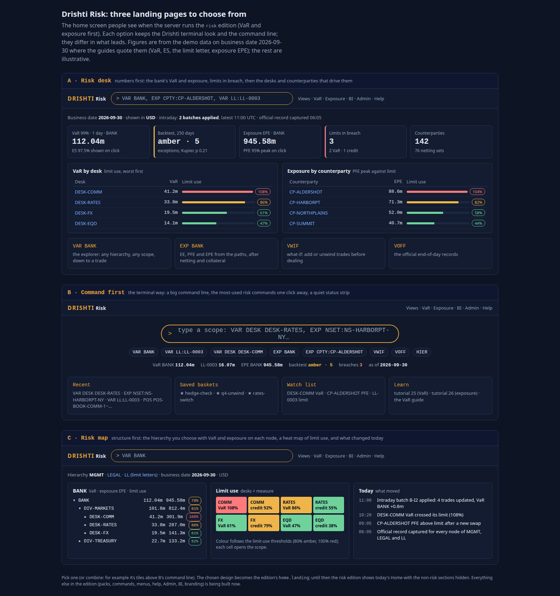
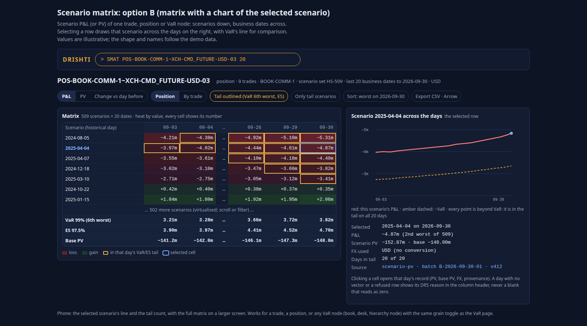
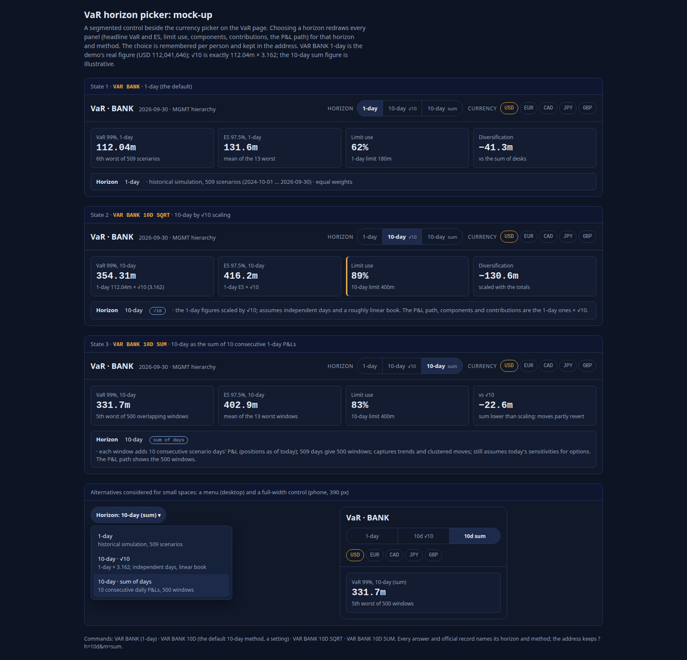
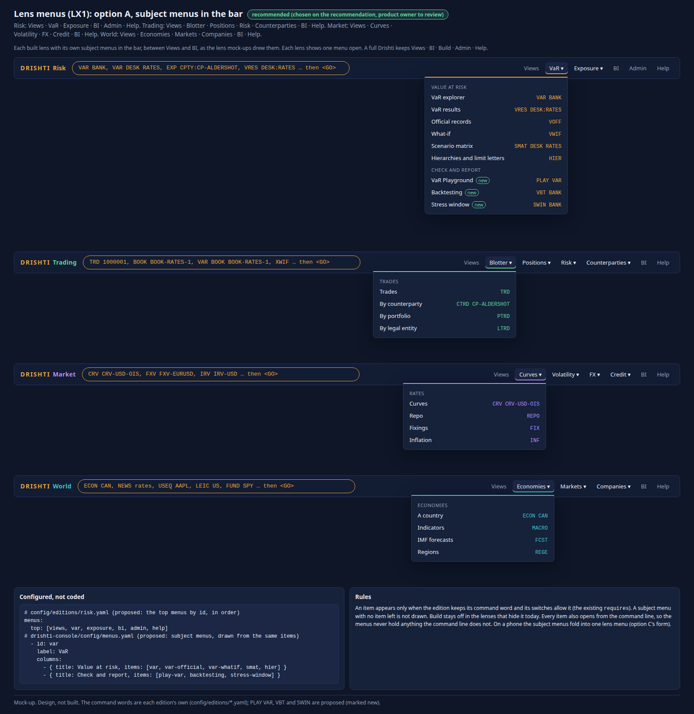

<!--
  Project Drishti · Any data. Any domain. One grammar.

  Copyright (c) 2026 Ashutosh Sinha <ajsinha@gmail.com>.
  All rights reserved.

  PROPRIETARY AND CONFIDENTIAL.

  This file is the confidential and proprietary property of Ashutosh Sinha.
  Unauthorised copying, use, modification, distribution or disclosure of this
  file, via any medium, is strictly prohibited except with the express prior
  written permission of the copyright holder.

  See the LICENSE file in the root of this repository for the full terms.
-->
# Drishti Risk: what risk managers near the desks need, what the lens gives them today, and what comes next

**Status: analysis and product description: built parts as built, the rest proposals.** Every "built" or "partly" statement cites the
document, section or file it was read from on 2026-10-31 (develop at b22ff3850). Features built on a branch were cited as "branch, merging
in 2.9.7"; built (10-day VaR and confidence, the scenario matrix, the renderer's sign-in window), they are cited as built. Everything in sections 5 and 8 is a proposal; the rows of section 8 are candidates in the
[implementation plan](../architecture/IMPLEMENTATION_PLAN.md#lens-product-candidates-not-started), not started, except where a 2.9.7 to
2.9.9 row already names the work (cited as such).

**The request (product owner, 2026-10-31):** "We should have similar and fuller standalone document for other lenses too", after the
market risk oversight analysis ([OVERSIGHT_LENS.md](OVERSIGHT_LENS.md), the proposed Oversight lens; built). The proposed risk cubes that would serve this lens as a screen are designed in [MR_CUBE_LENS.md](MR_CUBE_LENS.md) and [CCR_CUBE_LENS.md](CCR_CUBE_LENS.md) (see the design). Drishti Risk is the first edition
and the oldest lens; this is its product document, and it draws the line between Risk and the proposed Oversight lens (section 7.1).

**Read with:** [EDITIONS.md sections 4 and 7](../admin/EDITIONS.md#4-what-drishti-risk-shows) (what the lens shows and its three
landings), [EDITIONS.md](../admin/EDITIONS.md) (how to run it), the edition file
[`config/editions/risk.yaml`](../../config/editions/risk.yaml), [VAR_GUIDE.md](../guides/VAR_GUIDE.md) (the VaR engine as built),
[EXPOSURE_GUIDE.md](../guides/EXPOSURE_GUIDE.md) (the exposure engine),
[COMPUTED_ATTRIBUTES.md](../architecture/COMPUTED_ATTRIBUTES.md) (compute, do not store),
[REGULATORY_VAR_REPORTING.md](../architecture/REGULATORY_VAR_REPORTING.md) (2.9.8 and 2.9.10) and the contracts [STR.md](../contracts/STR.md)
(stress), [FRTB.md](../contracts/FRTB.md) (sensitivities) and [LIM.md](../contracts/LIM.md) (credit limits). The sibling lens documents:
[TRADING_LENS.md](TRADING_LENS.md), [MARKET_LENS.md](MARKET_LENS.md), [WORLD_LENS.md](WORLD_LENS.md).

## Contents

1. [Who uses it](#1-who-uses-it)
2. [Their questions: the morning, intraday, the close, month-end](#2-their-questions-the-morning-intraday-the-close-month-end)
3. [Needs by area, with status](#3-needs-by-area-with-status)
4. [The landings as built](#4-the-landings)
5. [Gaps, with design sketches](#5-gaps-with-design-sketches)
6. [Data needed](#6-data-needed)
7. [Relationship to the other lenses](#7-relationship-to-the-other-lenses)
8. [A roadmap](#8-a-roadmap)
9. [Decisions for the product owner](#9-decisions-for-the-product-owner)
10. [Glossary](#10-glossary)
11. [Mock-ups: the screens to build](#11-mock-ups-the-screens-to-build)

**Status words.** **Built**: on develop, documented as built. **Partly**: some of it is built; the cell says what is missing.
**Branch**: built on a branch, not yet merged (none now: the 10-day VaR and confidence, the scenario matrix and the renderer's sign-in window, branches when this was written, are built and cited as built). **Planned (row)**: a row of the implementation plan names it. **Not built**: neither
built nor planned; section 5 sketches it and section 8 proposes a row. **Hidden**: built, and hidden in this lens by decision.

---

## 1. Who uses it

Drishti Risk is "a one-stop shop to manage risk. VaR and Exposure first; liquidity, climate and more join as more lines here"
([`config/editions/risk.yaml`](../../config/editions/risk.yaml), its header; [EDITIONS.md section 9](../admin/EDITIONS.md#9-decisions-product-owner),
decision 1). Its users sit **near the desks**: they know the books, talk to the traders every day and answer for the numbers.

| Persona | Accountable for | What they need from the lens |
|---|---|---|
| **Business-aligned market risk manager** (rates, FX, credit, equities, commodities) | The VaR of the businesses they cover: right, explained, within limits; challenging the desks' risk; the first explanation of a move or a breach to the head of market risk | VaR and ES of any scope, from the bank to a trade; why it moved; limit use by node; the scenarios that drive it; backtesting; intraday VaR after a large trade |
| **Counterparty credit risk officer** (credit risk, the exposure side) | Exposure to counterparties against their credit limits; pre-deal approval of trades that use credit; collateral and netting assumptions | EE, PFE, EPE per netting set, counterparty and group; the pre-deal check; the trades that drive a peak |
| **Risk analyst, risk reporting** | The daily numbers and their reproducibility; the official records; the reports | Official records, captures, BI over them |
| *Also served:* a **quant** or **model validator** reading the engines' answers | Methodology evidence | Scenario windows, confidences, decomposition, reproducibility |

**Who it is not for.** Traders and desk heads (Drishti Trading, [TRADING_LENS.md](TRADING_LENS.md)); the market-data team (Drishti Market);
the **second line's governance** (limit framework, breach approval, RNIV, sign-offs), which the oversight analysis proposes as a separate
**Drishti Oversight** lens (section 7.1).

### 1.1 A day, a month and a year

| When | Market risk manager | Counterparty credit risk officer |
|---|---|---|
| **The morning** (07:00 to 09:00) | The official run of yesterday: VaR by desk, limit use, breaches, the backtest exception if any; why the numbers moved; the morning meeting | Exposure by counterparty against credit limits; peaks that moved; collateral disputes |
| **Intraday** | A large trade's VaR impact; intraday VaR after updates; questions from desks ("what if we hedge with this?") | Pre-deal approvals; limit headroom for a counterparty |
| **The close** | The official run's completeness; restated inputs | The exposure run |
| **Month-end** | Backtesting review; limit utilisation; the VaR section of the committee pack; stress results | Exposure reviews of the largest counterparties; credit limit reviews |
| **Year** | Limit framework input; stress window review (2.9.8 row 8); model validation support | Annual credit reviews |

---

## 2. Their questions: the morning, intraday, the close, month-end

### 2.1 The morning

| Question | Drishti today | Gap |
|---|---|---|
| *What is the bank's and each desk's VaR, and are we within limits?* | **Built**: the Risk desk landing's tiles (VaR and ES of BANK, limits in breach) and **VaR by desk with limit use**; the Risk map's hierarchy with limit use per node and the limit-use heat map ([EDITIONS.md section 7](../admin/EDITIONS.md#7-drishti-risks-home-three-landings)); the official records' `LIMIT` and `LIMIT_USE` ([VAR_GUIDE section 19](../guides/VAR_GUIDE.md#19-official-end-of-day-results)) | Stressed VaR (2.9.7 row 2c); other limit types (RO3 of the oversight analysis) |
| *Why did VaR move?* | **Partly**: compare a capture with now: the change, members added and removed, the components that moved most ([VAR_GUIDE section 6](../guides/VAR_GUIDE.md#6-captures-and-compare)); component VaRs add up exactly ([VAR_GUIDE section 18.3](../guides/VAR_GUIDE.md#183-decomposition-of-a-scope-into-parts)); the scenario matrix across dates (**built**, 2.9.7: `SMAT`, [VAR_GUIDE section 3.9](../guides/VAR_GUIDE.md#39-the-scenario-matrix-smat)) | The change **by cause** that adds up exactly: RO1 of the oversight analysis; on the Risk desk as RL4 (section 5.4) |
| *Which scenario drives it, and who loses on it?* | **Built**: the P&L path tab, the 25 worst scenarios, the contributors on a scenario day ([VAR_GUIDE section 3.4](../guides/VAR_GUIDE.md#34-the-tabs)) | — |
| *Did yesterday's P&L exceed VaR?* | **Partly**: the Risk desk's backtest tile and the official-mode history: Drishti's derived hypothetical P&L against the VaR before it, the Basel light, Kupiec and Christoffersen ([VAR_GUIDE section 7](../guides/VAR_GUIDE.md#7-history-and-backtesting)) | The bank's actual and hypothetical P&L (2.9.8 rows 3 and 4); section 5.3 |
| *Which counterparties are near their credit limits?* | **Built**: exposure EPE and peak PFE of the bank; exposure by counterparty against its credit limit (Risk desk) | The stored credit limits read very low use (sized on the retired stored profiles, [EXPOSURE_GUIDE section 28](../guides/EXPOSURE_GUIDE.md#28-open-items)); section 5.9 |
| *What happened overnight?* | **Built**: the Risk map's **Today** feed: intraday batches, official records, breaches | The official capture's time (left out: the feed names the date captured) |

### 2.2 Intraday

| Question | Drishti today | Gap |
|---|---|---|
| *What does this large trade do to the desk's VaR?* | **Built**: intraday updates from files and Kafka ([VAR_GUIDE section 8.4](../guides/VAR_GUIDE.md#84-what-if-pricing-and-intraday-recomputes)); the pre-deal what-if in the basket tray ([VAR_GUIDE section 8.5](../guides/VAR_GUIDE.md#85-the-pre-deal-what-if-in-the-basket-tray)); `VWIF` | Pricing a new trade over the scenarios (QLRisk, parked) |
| *Can we approve this trade against the counterparty's limit?* | **Built**: the exposure pre-deal what-if ([EXPOSURE_GUIDE section 7](../guides/EXPOSURE_GUIDE.md#7-pre-deal-what-if)); `XWIF` | — |
| *What is the VaR of every short EUR position? Of this basket?* | **Built**: scope words by a trade's attribute, rule portfolios, `WHERE:`, baskets ([VAR_GUIDE section 5.5](../guides/VAR_GUIDE.md#55-scope-words-by-a-trades-attribute)) | — |
| *At 10 days? At 95%?* | **Built**: the horizon and confidence pickers ([VAR_GUIDE section 18.6](../guides/VAR_GUIDE.md#186-horizons-the-two-10-day-methods-and-the-confidence-chosen); plan row 2b) | The desk tiles and the map following the person's horizon and confidence (section 5) |
| *Tell me when a desk crosses its limit intraday* | **Partly**: alerts on numbers watch BI and view numbers, after a load ([USER_GUIDE.md](../guides/USER_GUIDE.md#alerts-on-numbers)) | An intraday limit check that notifies (RO2's notification side; section 5.11) |

### 2.3 The close

| Question | Drishti today | Gap |
|---|---|---|
| *Is today's official run complete?* | **Partly**: load checks and rejected rows ([VAR_GUIDE section 20.3](../guides/VAR_GUIDE.md#203-what-the-load-checks)); late loads ([DATA_GUIDE.md › Telling Drishti new data has landed, section 8](../guides/DATA_GUIDE.md#8-expectations-and-late-data)) | Completeness against trades booked; a data-trust card (RO13) |
| *Is every number reproducible?* | **Built**: official captures with inputs' versions, batch ids, membership; seven years ([VAR_GUIDE section 19](../guides/VAR_GUIDE.md#19-official-end-of-day-results)); exposure's official tables ([EXPOSURE_GUIDE section 20](../guides/EXPOSURE_GUIDE.md#20-official-end-of-day-results)) | — |

### 2.4 Month-end and the year

| Task | Drishti today | Gap |
|---|---|---|
| Backtesting review | **Partly**: official backtest per node | Bank P&L, separate counts; exception commentary (RO14) |
| Limit utilisation review | **Partly**: `LIMIT_USE` per node and date in BI (`market-risk-var-official`) | Statistics per node (average, peak, days near) |
| Stress results | **Hidden** in the lens (product owner, 2026-10-30: `risk.yaml`'s comment); stored per desk and scenario, the bank's P&L per scenario derived ([VAR_GUIDE section 21.4](../guides/VAR_GUIDE.md#214-the-banks-stress-pl-by-scenario-derived)) | Decision on showing them (section 5.7); the stress engine (STR.md, proposed; RO9) |
| Stressed VaR and its 12-week average | **Planned** (2.9.7 row 2c) | — |
| The stress window review | **Planned** (2.9.8 row 8) | — |
| Exposure reviews | **Built**: explorer, captures and compare, official tables | Exposure on the VaR hierarchy (section 5.6) |

---

## 3. Needs by area, with status

### 3.1 VaR

| Need | Status | Evidence or row |
|---|---|---|
| VaR 99% and ES 97.5%, 1-day, historical simulation, any scope | **Built** | [VAR_GUIDE sections 1, 2, 18](../guides/VAR_GUIDE.md#1-the-question-var-answers) |
| Component, incremental, marginal VaR, diversification | **Built** | [VAR_GUIDE section 18.3](../guides/VAR_GUIDE.md#183-decomposition-of-a-scope-into-parts) |
| Any window and confidence per request; the configured one official | **Built** | [VAR_GUIDE section 18.5](../guides/VAR_GUIDE.md#185-the-scenario-window-and-the-confidences) |
| 10-day (√10 and the 10-day sum), confidence picker, limit use only when comparable | **Built** (plan row 2b) | [VAR_GUIDE section 18.6](../guides/VAR_GUIDE.md#186-horizons-the-two-10-day-methods-and-the-confidence-chosen) |
| Stressed VaR, 1-day and 10-day, official `SVAR`, the 12-week average | **Planned** (2.9.7 row 2c) | |
| Several hierarchies (MGMT, LEGAL, limit letters `LL`, any configured) | **Built** | [VAR_GUIDE section 15.14](../guides/VAR_GUIDE.md#1514-hierarchies-from-the-rows-or-from-the-trades-columns) |
| Captures, compare, history, backtest (derived hypothetical P&L) | **Built** | [VAR_GUIDE sections 6, 7](../guides/VAR_GUIDE.md#6-captures-and-compare) |
| Backtesting against the bank's actual and hypothetical P&L, the multiplier | **Planned** (2.9.8 rows 3, 4) | [REGULATORY_VAR_REPORTING section 7](../architecture/REGULATORY_VAR_REPORTING.md#7-gaps-and-what-to-build) |
| VaR change explanation by cause | **Not built**; designed as RO1 (OVERSIGHT_LENS.md section 4.1) | section 5.4 |
| The scenario matrix (a scope's scenarios across dates) | **Built** (`SMAT`, on in Drishti Risk) | [VAR_GUIDE section 3.9](../guides/VAR_GUIDE.md#39-the-scenario-matrix-smat) |
| Intraday VaR; what-if; the pre-deal basket | **Built** | [VAR_GUIDE section 8](../guides/VAR_GUIDE.md#8-what-if-and-var-as-a-kind) |
| VaR by risk type (IR, credit spread, equity, FX, commodity) | **Not built**, designed (G6) | 2.9.9 row 3 |
| Sharded across a cluster, equal to the bit | **Built** | [VAR_GUIDE section 28](../guides/VAR_GUIDE.md#28-sharding-across-drishtinet) |

### 3.2 Exposure

| Need | Status | Evidence or row |
|---|---|---|
| EE, ENE, EEE, PFE 95% and 99%, EPE, EEPE for any scope, after netting and collateral | **Built** | [EXPOSURE_GUIDE section 1](../guides/EXPOSURE_GUIDE.md#1-the-question-exposure-answers) |
| Scopes: `NSET:`, `CPTY:`, `GROUP:`, `LE:`, `DESK:` and `BOOK:` (partial), `TRD:`, `WHERE:` | **Built** | [EXPOSURE_GUIDE section 4](../guides/EXPOSURE_GUIDE.md#4-scopes) |
| Pre-deal what-if | **Built** | [EXPOSURE_GUIDE section 7](../guides/EXPOSURE_GUIDE.md#7-pre-deal-what-if) |
| Official records | **Built** | [EXPOSURE_GUIDE section 20](../guides/EXPOSURE_GUIDE.md#20-official-end-of-day-results) |
| Credit limits and their use | **Built as read**; stored limits sized on the retired profiles (use reads 0.1% to a few percent); LIM engine parked | [EXPOSURE_GUIDE section 28](../guides/EXPOSURE_GUIDE.md#28-open-items); [LIM.md](../contracts/LIM.md) |
| EPE per node of a VaR hierarchy; credit-limit use per desk | **Not served** (left out of the Risk landings) | [EDITIONS.md section 7](../admin/EDITIONS.md#7-drishti-risks-home-three-landings); section 5.6 |
| CVA, SA-CCR, SIMM | **Hidden** (and CVA parked) | [EDITIONS.md section 4](../admin/EDITIONS.md#4-what-drishti-risk-shows) |
| Wrong-way risk | **Not built** (proposed) | [COMPUTED_ATTRIBUTES.md](../architecture/COMPUTED_ATTRIBUTES.md) section 5.13 |

### 3.3 Sensitivities

| Need | Status | Evidence or row |
|---|---|---|
| Per-trade DV01 | **Stored** on trade valuations; `TVAL` hidden in Risk | [COMPUTED_ATTRIBUTES.md section 4.1](../architecture/COMPUTED_ATTRIBUTES.md#41-trade-valuation-tval) |
| Delta by risk factor and bucket (DV01 by currency × tenor, CS01, vega, FX delta, equity delta) for any scope | **Not built**: per-trade `sensitivity` table proposed (FRTB.md); FRTB sensitivities stored per book and bucket only | [COMPUTED_ATTRIBUTES.md section 4.9](../architecture/COMPUTED_ATTRIBUTES.md#49-frtb-sensitivity-frtb); RO4 of the oversight analysis; section 5.5 |
| Sensitivity limits | **Not built** | RO3, RO4 |

### 3.4 Stress

| Need | Status | Evidence or row |
|---|---|---|
| Scenario definitions | **Built**, stored (`stress-scenario`); **hidden** in Risk | [COMPUTED_ATTRIBUTES.md section 4.7](../architecture/COMPUTED_ATTRIBUTES.md#47-stress-scenario-scn) |
| Stress P&L per desk and scenario; the bank's P&L per scenario | **Built** stored and derived; **hidden** in Risk | [VAR_GUIDE section 21.4](../guides/VAR_GUIDE.md#214-the-banks-stress-pl-by-scenario-derived) |
| A stress engine for any scope | **Not built**, proposed | [STR.md](../contracts/STR.md); RO9 |

### 3.5 Liquidity, climate and concentration

| Need | Status | Evidence or row |
|---|---|---|
| Liquidity (days to liquidate, bid-offer cost) | **Not built**; "join as more lines" (EDITIONS.md decision 1) | RO10 of the oversight analysis |
| Climate risk (transition and physical scenarios, financed emissions) | **Not built**; named as a future line only | section 5.8 |
| Concentration by issuer, sector, country, currency, tenor | **Not built** as a view | RO8 of the oversight analysis |

### 3.6 Access and governance

| Need | Status | Evidence or row |
|---|---|---|
| Entitlements per scope and kind, masks, audit per answer | **Built** | [VAR_GUIDE section 9](../guides/VAR_GUIDE.md#9-who-sees-what-entitlements-and-audit) |
| A lens per person; edition per instance; RBAC later | **Built** (hides, does not secure); `lens.roles` not wired | [EDITIONS.md section 8](../admin/EDITIONS.md#8-lenses) |
| Breach records, commentary, approvals, RNIV, sign-off | **Not built**; proposed for the Oversight lens | RO2, RO7, RO11 |

---

## 4. The landings

One template, `home/risk_landing.html`, with `static/js/risk-landing.js` and `static/css/risk-landing.css`; every figure is the engines' own
answer through the console's `/api/var/...` and `/api/exposure/...` (`scope`, `scope/history`, `tree`, `intraday/streams`, `official`,
`baskets`). Not Sutras: a Sutra lays out one entity's view, and these pages span the engines with no entity; a "home" Sutra kind would be
needed (product owner may ask later). No new panel kind (the heat map is a CSS grid of links). One column on a phone. All three mock-ups
chosen by the product owner on 2026-10-29 ([EDITIONS.md section 7](../admin/EDITIONS.md#7-drishti-risks-home-three-landings)).

### 4.1 A: Risk desk (`desk`, the default)

| Tile or card | What is real | Left out, and why |
|---|---|---|
| **VaR and ES of BANK** | `/api/var/scope?scope=BANK` | 10-day and other confidences: built (row 2b), not yet on this tile (RL2); stressed: not yet (row 2c) |
| **Backtest** | `/api/var/scope/history?scope=BANK`: official mode when official records exist (derived hypothetical P&L), else a replay labelled *not a regulatory backtest* | The bank's P&L |
| **Exposure EPE and peak PFE** | `/api/exposure/scope?scope=BANK` | — |
| **Limits in breach** | From the hierarchy tree's limit use | VaR limits only |
| **Counterparties and netting sets** | From the exposure tree | — |
| **VaR by desk with limit use** | The tree | — |
| **Exposure by counterparty** against its credit limit | `/api/exposure/tree` | The stored limits' low use (section 5.9) |
| **Quick cards** | `VAR BANK`, `VAR DESK RATES`, `VRES DESK:RATES`, `EXP CPTY:CP-ALDERSHOT` (`risk.yaml` `home.cards`) | — |

### 4.2 B: Command first (`command`)

A big command line; the edition's chips (`VAR BANK`, `VAR DESK RATES`, `EXP BANK`, `EXP CPTY:CP-ALDERSHOT`, `VRES DESK:RATES`, `HIER`,
`VWIF`, `VOFF`); a status strip; the person's VaR baskets (`/api/var/baskets`); their monitors; links to learn. **Left out:** the mock-up's
"recent" commands (the person's baskets and monitors instead). World and Market built a Recently opened card from the person's command
history since; Risk could reuse it (section 5.10).

### 4.3 C: Risk map (`map`)

The hierarchy (`home.hierarchies: [MGMT]` to open, with a switch between every hierarchy the engine holds: MGMT, LEGAL, limit letters `LL`,
any configured) with VaR and limit use per node; a **limit-use heat map**; a **Today** feed of intraday batches, official records and
breaches. **Left out:** exposure (EPE) per node of a VaR hierarchy (the map shows VaR and limit use only); credit-limit use per desk (the
heat map shows each node's VaR limit use); the time of an official capture (the feed names the date captured).

### 4.4 What is missing (this document's gaps)

1. Stressed VaR on the landings (5.1). 2. Horizon and confidence (5.2). 3. Backtesting on the bank's P&L (5.3). 4. Why it moved (5.4).
5. Sensitivities (5.5). 6. Exposure on the VaR hierarchy (5.6). 7. Stress shown or not (5.7). 8. Liquidity and climate (5.8). 9. Credit
limits sized on computed PFE (5.9). 10. Context from World, recents and the capture time (5.10). 11. Intraday limit alerts (5.11).
12. The scenario matrix in the lens (5.12).

---

## 5. Gaps, with design sketches

Drishti's rules ([COMPUTED_ATTRIBUTES.md section 1.2](../architecture/COMPUTED_ATTRIBUTES.md#12-the-rule-for-deciding-which)): fundamental
inputs under a **data contract** as JSON Lines; measures **computed on demand** from trade or position-grain inputs and **never stored**,
except as an immutable capture or an official end-of-day record; governance records Drishti-owned and versioned; **BI is the report
layer**; the engines are unchanged by a lens. Sizes: **S** days, **M** one to three weeks, **L** more than three weeks. Ids RL1 to RL13
are this document's; RO ids are the oversight analysis's.

| Id | Gap | Size | Depends on |
|---|---|---|---|
| RL1 | Stressed VaR on the Risk landings | S | 2.9.7 row 2c |
| RL2 | Horizon and confidence on the landings, limit use like for like | S | 2.9.7 row 2b (built) |
| RL3 | Backtesting on the bank's P&L on the desk tile and the map | S | 2.9.8 rows 3, 4 |
| RL4 | Why it moved on the Risk desk | S | RO1 |
| RL5 | Sensitivities: per-trade input, aggregation, ladders | L (M if bucketed by the bank) | per-trade sensitivities; shares RO4 |
| RL6 | Exposure on the VaR hierarchy (EPE per node, credit-limit use per desk) | M | exposure allocation (shares TL2) |
| RL7 | Stress in Risk | S (show stored) or L (engine) | decision; RO9 |
| RL8 | Liquidity and climate lines | L each | data; RO10 |
| RL9 | Credit limits on computed PFE | M | LIM wave (parked) |
| RL10 | World context on the counterparty page | S to M | World's data (internal only) |
| RL11 | Recently opened and the capture time | S | — |
| RL12 | Intraday limit alerts | S to M | intraday VaR (built), RO2 notification |
| RL13 | The scenario matrix in the lens | S | met: `SMAT` built and on in the Risk edition (`commands.words.SMAT: on`) |

### 5.1 RL1: stressed VaR on the Risk landings

Plan row 2c builds VaR and ES on a stress scenario set per date (a second `SCENARIO_SET_ID` flagged as stress), 1-day and 10-day, any
confidence, a **Normal / Stressed** choice beside the pickers, official `SVAR`, the 12-week average, a synthetic demo stress set. The lens
part: the Risk desk gains a **Stressed VaR of BANK** tile (with the 12-week average and its date range); the Risk map's node label and the
heat map follow the person's Normal / Stressed choice; a date without a stress set says so, never zero (the row's own rule). **Size** S
after 2c. **Tests:** the tile equals `VAR BANK SVAR` on the demo; no stress set: the tile says so.

### 5.2 RL2: horizon and confidence on the landings

Now that the horizon and confidence are built (plan row 2b): the desk tiles and the map follow the person's horizon and confidence; **limit use is shown only when the
answer's horizon and confidence are the limit's own** (`limitComparable`, [VAR_GUIDE section 18.6](../guides/VAR_GUIDE.md#186-horizons-the-two-10-day-methods-and-the-confidence-chosen)), so the heat map greys a
cell with "not comparable" rather than colouring a 10-day VaR against a 1-day limit; the backtest tile stays 1-day (backtesting is 1-day).
**Size** S. **Tests:** heat map cells empty and labelled at 10 days; restored at 1-day 99%.

### 5.3 RL3: backtesting on the bank's P&L

2.9.8 rows 3 and 4 bring actual and hypothetical P&L per desk and the backtesting engine (exceptions over 250 days, the traffic light,
the multiplier, 99% and 97.5%). The lens part: the Risk desk's backtest tile shows **both** counts (actual, hypothetical) and the light;
the map's node opens its backtest; Drishti's own derived figure stays, named **risk-theoretical**. **Size** S after 2.9.8. **Tests:** the
counts equal the engine's; a desk without P&L shows "—".

### 5.4 RL4: why it moved, on the Risk desk

RO1 (the oversight analysis, section 4.1) designs the VaR change explanation: a fixed sequence of full VaR states whose
differences add up exactly to the change (restatement, hierarchy and rules, trades out, oldest scenario dropped, market, newest scenario
added, trades in, amendments split), each step with its contributors; computed from the official capture and the churned trades'
vectors; never stored. The Risk lens is where a business risk manager first needs it: a **Why VaR moved** card on the Risk desk (the
bank, with a switch to any desk; a waterfall, each bar opening its contributors) and a **Why it moved** action on every node of the Risk
map. The Oversight lens (when built) shows the same answer in its Appetite landing. **Size** S after RO1 (M for RO1 itself). **Tests:**
the waterfall's bars add to the change to the cent on every demo node.

### 5.5 RL5: sensitivities

**The gap.** Risk managers near the desks talk in sensitivities as much as in VaR ("you are 2m DV01 long the 10-year"). Today the lens has
per-trade `DV01` only (hidden with `TVAL`), FRTB sensitivities per book and bucket (hidden with `FRTB`), and no engine that aggregates
them ([COMPUTED_ATTRIBUTES.md section 4.9](../architecture/COMPUTED_ATTRIBUTES.md#49-frtb-sensitivity-frtb)).

**Design** (RO4 of the oversight analysis, OVERSIGHT_LENS.md section 4.4, which this follows):

- **Input** (fundamental): the per-trade `sensitivity` table proposed in [FRTB.md](../contracts/FRTB.md): one row per trade, date and risk
  factor (`RISK_CLASS`, `FACTOR` such as a curve and tenor, an underlying and expiry; `MEASURE` delta, vega, gamma or curvature inputs;
  `VALUE`; `CURRENCY`), shared by FRTB SA, P&L explain and sensitivity-based stress.
- **Computation**: sensitivities are **additive**; a scope's DV01 by currency × tenor is the sum of its trades' rows. Per arbitrary scope
  with entitlements this is an engine (the VaR engine's summing pattern: a factor dictionary, per-trade rows, per-node totals), not a
  derived kind.
- **Screens in Risk**: a **Sensitivities** tab on the VaR page for the scope on screen (ladders: DV01 by currency × tenor bucket, CS01 by
  curve × tenor, vega by underlying × expiry, FX delta by currency), every cell printing its value; a drill to the trades of a bucket; the
  map's node opens its ladder. Limits on buckets come with RO3 (the catalogue).
- **Commands**: a command form chosen at build (proposed `SENS <scope>`), added to the edition's allow-list.

**Data needs**: the bank's per-trade sensitivities (section 6). **Size** L; M when the bank delivers sensitivities bucketed to its limit
grid. **Tests:** the sum by bucket equals the sum of trades; netting long and short in a bucket; a node's ladder equals the sum of its
children's; sharded equals single-server.

### 5.6 RL6: exposure on the VaR hierarchy

**Left out of the landings** (EDITIONS.md section 7): EPE per node of a VaR hierarchy, and credit-limit use per desk. **Why it is not a
sum:** exposure is netted and collateralised per netting set across desks, and PFE is not additive. **Design:** EPE and EE **allocated**
to trades (on each path and date, the set's collateralised exposure shared among its trades in proportion to their positive value; EE
and EPE then add across sets and up any hierarchy), summed by the VaR hierarchy's nodes (desk, book, legal entity); the map's node shows
"VaR 41.2m · EPE 118.0m"; the heat map gains an **EPE** column. Credit-limit use stays a counterparty measure; per desk, the map shows
the desk's **share** of each counterparty's limit use (allocated PFE at the counterparty's peak date ÷ its limit). The same allocation
serves the Trading lens's largest-counterparty tile (TRADING_LENS.md, TL2). The standalone `DESK:` scope (partial, built) is not used for
this: it ignores netting with other desks. **Size** M. **Tests:** allocated EE of all desks equals the bank's EE; a desk alone in a set
gets the set.

### 5.7 RL7: stress in Risk

**Today:** hidden by the product owner's decision (`risk.yaml`: "stress (SCN, STR, SSPNL) is left out (product owner, 2026-10-30)"). The
file records the decision, not its reason. The likely one, to confirm: the stress results are **stored** per desk and scenario (only the
bank's sum per scenario is derived, VAR_GUIDE section 21.4), not computed from the trades, while the
[computed-measures roadmap](../architecture/IMPLEMENTATION_PLAN.md#the-computed-measures-roadmap-280-to-2120-product-owner-2026-10-25)
replaces stored measures with computed ones, and [STR.md](../contracts/STR.md) proposes the engine.

| Option | What Risk shows | Size |
|---|---|---|
| (a) Keep hidden until the engine (recommended) | Nothing; stressed VaR (RL1) covers the regulatory stress measure | — |
| (b) Show the stored and derived stress read-only | `SCN`, `STR`, `SSPNL`: the bank's P&L per scenario, desks' limit use (built, VAR_GUIDE section 21.4), labelled *stored results* | S |
| (c) The stress engine | STR.md as proposed: full revaluation from per-trade scenario P&L, sensitivity-based for any scenario, user scenarios, the stress matrix; RO9 | L |

### 5.8 RL8: liquidity and climate

**Liquidity** follows RO10 of the oversight analysis (days to liquidate, bid-offer cost, share of volume, a liquidity ladder, VaR scaled
by liquidity horizons), with the bank's volume and bid-offer data; in Risk as a **Liquidity** tab on the VaR page and a column on the map.
**Climate** is named in `risk.yaml` and EDITIONS.md decision 1 only; a proposal for scoping: (1) **transition risk** as stress scenarios
(NGFS-style carbon-price and sector shocks) run through the stress engine (RO9) on the trades' sectors; (2) **physical risk** as
concentration by the location of the issuer or collateral (RO8's country and region dimension); (3) **financed emissions** (PCAF) needs
emissions data per issuer and is a balance-sheet measure more than a trading one. Each needs data the packs do not hold. **Size** L each;
design only until the product owner scopes them.

### 5.9 RL9: credit limits on computed PFE

The stored `credit-limit` records were sized on the retired stored profiles (3 to 30 times the computed peaks), so the Risk desk's
*exposure by counterparty against its credit limit* reads 0.1% to a few percent ([EXPOSURE_GUIDE section 28](../guides/EXPOSURE_GUIDE.md#28-open-items)).
**Design:** regenerate the demo's credit limits from the computed PFE (a configured headroom distribution so some counterparties sit near
and a few above), as test data; the LIM engine (limit use computed, never stored, [LIM.md](../contracts/LIM.md)) when the LIM wave
resumes. **Size** S for the data, M for the engine. **Tests:** on the demo, a spread of uses from 20% to 110%.

### 5.10 RL10, RL11: World context; recents and the capture time

- **RL10, World context on the counterparty page** (internal only): a read-only panel on the counterparty page in the full product and the
  Risk lens: its country's growth, inflation and debt (world-economy), its LEI group's ultimate parent (gleif), its latest filing
  (us-equities), when those packs are loaded; licensing as WORLD_LENS.md section 6. **S to M.**
- **RL11, Recently opened** on Command first (the person's own command history, Risk's commands only, as World and Market built) and the
  **official capture's time** in the Today feed (the engines' capture record carries it; the feed shows the date today). **S.**

### 5.11 RL12: intraday limit alerts

Intraday VaR is live (VAR_GUIDE section 8.4) but nothing checks it against the limit and tells anyone. **Design:** after each intraday
batch the engine computes the limit use of every node whose members changed (cheap: the churn), and the alert machinery notifies the
node's subscribers at the near and breach levels, with hysteresis and a cooldown; the rules come from the limit catalogue (RO3) when it
exists, from `var-limit` until then. **Size** S to M. **Tests:** a crafted intraday batch pushing a desk over 100% notifies once.

### 5.12 RL13: the scenario matrix in the lens

`SMAT` is merged ([VAR_GUIDE section 3.9](../guides/VAR_GUIDE.md#39-the-scenario-matrix-smat)): a reserved word answered by the console, on in the Risk edition
(`commands.words.SMAT: on`), linked from the trade, position, `PNLV`, `SPV` and VaR pages; what is left is to show it on the Risk
landings (the VaR explorer's header links to it). **Size** S (the edition's words and a chip). **Tests:**
`SMAT BANK` opens in the Risk lens; refused in Market and World.

---

## 6. Data needed

| Data | Grain and cadence | Needed by | Note |
|---|---|---|---|
| P&L vectors or scenario PVs, scenario sets, hierarchies, `var-limit` | per trade, per date | VaR (built) | [VAR_GUIDE Part II](../guides/VAR_GUIDE.md#14-the-contract-at-a-glance) |
| A **stress scenario set** (the 12-month stress window revalued) | per trade, per date, weekly at least | RL1 | the same contract, a second `SCENARIO_SET_ID` (row 2c) |
| Actual and hypothetical P&L | per desk (better per trade) per date | RL3 | the 2.9.8 row 3 contract |
| **Position sensitivities** by risk factor (delta, vega, gamma; DV01 by currency × tenor, CS01 by curve × tenor, vega by underlying × expiry, FX delta by currency) | per trade per date | RL5, sensitivity limits, P&L explain, FRTB SA | FRTB.md's `sensitivity` table (proposed); RO4 (OVERSIGHT_LENS.md section 4.4); the bank's risk engine |
| Exposure paths, simulation runs, CSAs, netting sets | per trade per path and date | exposure (built), RL6 | [EXPOSURE_GUIDE Part II](../guides/EXPOSURE_GUIDE.md#14-the-contract-at-a-glance) |
| Credit limits sized on today's methodology | per counterparty | RL9 | the bank's credit limit system |
| Stress scenarios with machine-readable shocks and per-trade scenario P&L | per scenario, per run | RL7 (c) | STR.md section 3 |
| Average daily volume and bid-offer | per instrument | RL8 liquidity | vendors; the us-equities prices are internal only and off: not a source |
| Climate data (sector, emissions, location of risk) | per issuer or position | RL8 climate | to be scoped |
| Limits of every type (catalogue) | per limit | RL12 (later), RO3 | the bank's limit system |

---

## 7. Relationship to the other lenses

### 7.1 Risk and Oversight: the split

The oversight analysis recommends a **separate Drishti Oversight lens**, built after RO1 (why VaR moved) and RO2 (breaches and
escalation) exist (OVERSIGHT_LENS.md section 5.1). This document agrees and draws the line:

| | Drishti Risk (this lens) | Drishti Oversight (proposed) |
|---|---|---|
| **Persona** | Risk managers near the desks; credit risk officers | The second line's governance: the head of market risk, the CRO's team, limit framework, reporting |
| **Default page** | The engines' numbers (Risk desk, Command first, Risk map) | Appetite; Breaches and escalations; Explorer or Risk map |
| **Actions** | Read, compute, what-if, capture | Govern: explain, review, approve, escalate, close a breach; RNIV; sign-off |
| **Commands** | VaR, exposure, reference, trades; stress hidden | VaR read, stress, P&L explain, FRTB; no operational exposure or collateral commands |
| **Shared** | The VaR and exposure explorers, the official records, the map's heat map and Today feed, RL4's waterfall | the same, reused |
| **When to switch** | A Risk user who must review or approve a breach, or sign a report | An Oversight user who must challenge a number down to a trade (Oversight reuses the explorers, so rarely) |

**Why Risk does not simply grow governance.** A lens is one person's focus; Risk's users compute and explain, Oversight's users approve and
record. Putting both on one Home makes it neither (the same ground on which Trading was split from Risk). What Risk gains from the
oversight work is the **why it moved** answer (RL4) and, later, a read-only view of open breaches on its map.

### 7.2 The other lenses

| Lens | Shares with Risk | Hidden from Risk users | When to switch |
|---|---|---|---|
| **Drishti Trading** ([TRADING_LENS.md](TRADING_LENS.md)) | The five packs and engines; VaR limits; the official records; the new-trade check uses the same what-ifs | Trading's "my" scoping; `TVAL`, `ITRD` and the market data a trader reads | To see a desk as its head sees it (View as is for administrators) |
| **Drishti Market** ([MARKET_LENS.md](MARKET_LENS.md)) | The market-data pack is loaded in Risk; only `FX` is shown | The Quality checks; curves and surfaces | When a move looks like a data problem; ML1 will show VaR at stake there |
| **Drishti World** ([WORLD_LENS.md](WORLD_LENS.md)) | Nothing loaded in common | Every public-data pack (allow-only) | For macro and entity context; RL10 brings some of it to the counterparty page |

---

## 8. A roadmap

The rows below are added to the plan's [Lens product candidates (not started)](../architecture/IMPLEMENTATION_PLAN.md#lens-product-candidates-not-started)
section; where a 2.9.7 to 2.9.9 row builds the engine, the RL row is only the lens's part.

**Releases (product owner, 2026-10-31).** The Release column places each row in the plan's themed releases: 2.9.8 is planned, 2.9.9 to 2.9.14 are proposed until each starts, and *unscheduled* rows wait for the product owner.

| Order | Row | Why here | Size | Depends on | Release |
|---|---|---|---|---|---|
| 1 | **RL2** horizon and confidence on the landings; **RL13** `SMAT` in the lens | Follow the 2.9.7 features at once | S each | 2b and the scenario matrix: built | RL2 proposed; RL13 built |
| 2 | **RL1** stressed VaR on the landings | Follows row 2c in Drill B | S | 2c | proposed |
| 3 | **RL11** recents and the capture time | Small; closes the landings' left-outs | S | — | proposed |
| 4 | **RL9** credit limits on computed PFE (data) | The desk's exposure card reads near zero today | S | — | proposed |
| 5 | **RL4** why it moved | The morning meeting's first question | S | RO1 | proposed |
| 6 | **RL3** backtesting on the bank's P&L | Follows 2.9.8 | S | 2.9.8 rows 3, 4 | proposed |
| 7 | **RL12** intraday limit alerts | Turns intraday VaR into a control | S to M | — | proposed |
| 8 | **RL6** exposure on the VaR hierarchy | The map's main left-out; shared with TL2 | M | exposure allocation | proposed |
| 9 | **RL10** World context on the counterparty page | Cheap context, internal only | S to M | World packs loaded | unscheduled |
| 10 | **RL5** sensitivities | The largest; needs the bank's data | L | per-trade sensitivities | proposed |
| 11 | **RL7** stress (by decision); **RL8** liquidity and climate | Engines and data first | S to L | RO9, RO10, data | RL7 closed: kept hidden (decided); RL8 proposed |
| 12 | **RL14** the landings' mock-up remainders; **RL15** the horizon picker as drawn; **LX1** subject menus | Close what the mock-ups showed and the build left out ([section 11](#11-mock-ups-the-screens-to-build)) | S each | — | RL14 proposed; RL15 proposed; LX1 planned |

---

## 9. Decisions for the product owner

**Decided (product owner, 2026-10-31):** every recommendation accepted ("I am aligned with your recommendations"); each choice is under its question. Releases follow the plan's themed releases 2.9.8 to 2.9.14, each proposed until that release starts.

1. **The split.** Risk stays the engines' lens; governance goes to a separate Oversight lens after RO1 and RO2 (recommended, as the
   oversight analysis), or Risk gains a fourth landing for oversight.

   **Decided (product owner, 2026-10-31):** Risk stays the engines' lens; governance goes to the separate Oversight lens after RO1 and RO2.
2. **Stress in Risk (RL7).** Keep hidden until the stress engine (recommended), show the stored and derived results read-only, or build the
   engine first.

   **Decided (product owner, 2026-10-31):** keep stress hidden in Risk until the stress engine (RO9, unscheduled); RL7 is closed by this decision.
3. **Exposure on the VaR hierarchy (RL6).** Allocated EE and EPE (recommended: adds up), the standalone `DESK:` scope, or leave it out.

   **Decided (product owner, 2026-10-31):** allocated EE and EPE (Euler allocation, adds up), with the CCR cube's allocated exposure (CC2), proposed.
4. **Sensitivities first or VaR by risk type first.** RL5 (needs the bank's per-trade sensitivities) or G6 VaR by risk type (2.9.9 row 3,
   needs factor tags on the vectors).

   **Decided (product owner, 2026-10-31):** VaR by risk type (G6) first, with the regulatory reports (proposed); position sensitivities follow in 2.9.12 (proposed; RL5 with them).
5. **Credit limits on the demo (RL9).** Regenerate them from the computed PFE now, or wait for the LIM wave.

   **Decided (product owner, 2026-10-31):** regenerate the demo credit limits from the computed PFE (as the cube POC decided), with the CCR cube (proposed).
6. **Climate (RL8).** Scope it (transition scenarios, physical concentration, financed emissions) or keep it a named future line.

   **Decided (product owner, 2026-10-31):** climate stays a named future line, out of scope as a computed measure; the CRO lens shows it only as an optional supplied-input tile, off by default (proposed).
7. **World context in Risk (RL10).** A context panel on the counterparty page, internal only (recommended), or none.

   **Decided (product owner, 2026-10-31):** a context panel on the counterparty page, internal only (unscheduled).
8. **One near-limit threshold.** The explorer's 75% and 90%, Trading's 80% and the proposed catalogue's `WARNING_AT`: one per limit with a
   site default (as the oversight analysis's decision 8).

   **Decided (product owner, 2026-10-31):** one per limit (its own warning level) with a site default of 80%, configurable, as the oversight analysis's decision 8.

---

## 10. Glossary

| Term | In plain words |
|---|---|
| **VaR** | The loss that a day's market move should exceed only 1 day in 100, from the last two years of moves applied to today's trades |
| **ES** (expected shortfall) | The average loss on the worst days beyond VaR (the worst 2.5%) |
| **Component VaR** | A part's share of a total VaR; the parts add up to the total |
| **Diversification** | How much less a total VaR is than the sum of its parts' VaRs |
| **Stressed VaR** | VaR computed on a year of crisis moves instead of the last two years |
| **10-day VaR** | VaR over ten trading days, by √10 or by summing ten consecutive days |
| **Backtesting** | Counting the days the actual loss was larger than VaR; about 2.5 in 250 at 99% |
| **Traffic light** | The Basel zones for backtesting exceptions: green, amber, red |
| **Hierarchy** | A tree of the bank: management (desks, books), legal entities, limit letters |
| **Limit letter** | The document that delegates a limit from one level to the next |
| **Official record** | The end-of-day figure of a node, captured with its inputs and kept seven years |
| **EE, PFE, EPE** | Expected exposure at a future date; a bad-case exposure at a high confidence; the average expected exposure over the first year |
| **Netting set** | Trades with one counterparty under one agreement, whose values offset |
| **CSA** | The agreement that says how much collateral each side posts |
| **Allocated exposure** | A counterparty's exposure shared out among the trades (and desks) that cause it, adding up to the whole |
| **Sensitivity** | How much a position's value changes for a small move in one market factor (DV01 for rates, CS01 for credit spreads, vega for volatility) |
| **Ladder** | Sensitivities split into buckets (currency × tenor) |
| **Stress test** | The loss under a defined severe scenario |
| **Liquidity risk** | The cost and time to get out of positions without moving the market |
| **First line, second line** | The desks that take risk; the risk function that oversees them independently |
| **Lens** | One person's focused view of Drishti, opened by a link; it hides, it does not secure |

---

## 11. Mock-ups: the screens to build

Three of the product owner's mock-ups belong to this lens. Each is copied into the repository, self-contained (system fonts, nothing from
a CDN), with a screenshot beside it, under [`docs/lenses/mockups/risk/`](mockups/risk/). **The checklists below are the source of truth
at build time** ([README.md](README.md#mock-ups)): every panel of a mock-up is a row, and its status was checked against the code on
2026-10-31 (`wip/drill-a`). **Built** cites the code or the guide section that shows it; **partly built** says what is missing; **not built**
names the candidate row that would build it. The gaps (on a mock-up, not in the product) close each subsection and are rows of the plan's
[Lens product candidates](../architecture/IMPLEMENTATION_PLAN.md#lens-product-candidates-not-started).

| Mock-up | Chosen | Built | Partly built | Not built |
|---|---|---:|---:|---:|
| [Risk landings](#111-the-risk-landings-risk-landinghtml) (A Risk desk, B Command first, C Risk map) | all three, 2026-10-29; A the default | 13 | 7 | 1 |
| [Scenario matrix](#112-the-scenario-matrix-scenario-matrix-bhtml) | option B (matrix with a chart of the selected scenario), 2026-10-31 | 14 | 0 | 0 |
| [VaR horizon picker](#113-the-var-horizon-picker-var-horizon-pickerhtml) | the one design shown (its alternatives for small spaces considered), 2026-10-30 | 11 | 2 | 1 |
| [Lens menus (LX1)](#114-the-lens-menus-lx1-menusahtml) (A subject menus in the bar, B a subject strip, C one lens menu) | A recommended, 2026-10-31 (chosen on the recommendation, product owner to review) | 0 | 0 | 3 |
| **Total** | | **38** | **9** | **5** |

### 11.1 The Risk landings (`risk-landing.html`)

[Open the mock-up](mockups/risk/risk-landing.html). **Chosen:** all three, as the person's choice of Home (`home.landings: [desk, command,
map]`, `desk` the default) ([EDITIONS.md section 7](../admin/EDITIONS.md#7-drishti-risks-home-three-landings)). The mock-up's footer
proposed "pick one or combine"; the product owner kept all three. **Code:** [`risk_landing.html`](../../drishti-console/web/templates/home/risk_landing.html),
[`risk-landing.js`](../../drishti-console/web/static/js/risk-landing.js), [`risk-landing.css`](../../drishti-console/web/static/css/risk-landing.css),
[`risk.yaml`](../../config/editions/risk.yaml) `home`. Figures on the mock-up are the demo's on 2026-09-30 where the guides quote them
(VaR 112.04m, ES, the limit letter `LL-0003` 16.07m, EPE 945.58m); the rest are illustrative.

**Interactions on the mock-up, and as built.** Every desk, counterparty, node and heat cell is a link to its scope (`/var?scope=…`,
`/exposure?scope=…`): built. Every tile is a link (VaR and backtest to `/var?scope=BANK`, EPE and Counterparties to `/exposure`): built;
the mock-up's "ES shown on click" and "PFE peak on click" are shown in the tile's subline instead. The command line in the bar takes any
command and `<GO>`; the chips are links to `/go?q=<chip> <GO>`. The hierarchy switch (C) redraws the tree, the heat map and the desks
without a reload. A landing switch (Risk desk · Command first · Risk map) and the lens links sit above every landing; *The classic Home*
under it.

**States.** *Loading:* every figure shows `…` until its answer arrives; each panel is painted on its own answer. *Error:* a refused or
failed answer says `Not available: <reason>` in place of that panel (the others carry on); a tile shows `—` and the reason in its subline.
*Empty:* "No desks in MGMT", "No counterparty exposure on this date", "No limits set in MGMT", "Nothing yet today", "No baskets yet: build
one on the VaR page", "No monitors yet: make one"; a node without a limit says "no limit". **Phone** (600 px and below): one column, the
tiles two to a row, the big command line 46 px high ([`risk-landing.css`](../../drishti-console/web/static/css/risk-landing.css)); the
mock-up drew no phone form.

| # | Panel (option) | Contents on the mock-up | Data, API or contract | Interaction | Phase | Status |
|---|---|---|---|---|---|---|
| R1 | Bar (A, B, C) | `DRISHTI Risk` in amber; a rounded amber command line with the placeholder *VAR BANK, EXP CPTY:CP-ALDERSHOT, VAR LL:LL-0003*; menus **Views · VaR · Exposure · BI · Admin · Help** | `risk.yaml` `menus` (`placeholder`), [`menus.yaml`](../../drishti-console/config/menus.yaml) | type a command, `<GO>`; open a menu | 2.9.6 | **Partly built**: brand, command line and placeholder built; **VaR** and **Exposure** are items of the Views menu, not menus of their own (the top menus are Views, BI, Build, Admin, Help for every edition): row LX1 |
| R2 | Landing switch | (the footer: pick one or combine) | `home.landings`, `home.titles`; the person's choice in their settings ([`edition_routes.py`](../../drishti-console/routes/edition_routes.py)) | click a landing; lens links; *The classic Home* | 2.9.6 | **Built** |
| R3 | Meta line (A, C) | *Business date **2026-09-30** · shown in **USD** · intraday: **2 batches applied**, latest 11:00 UTC · official record captured 06:05* | `/api/var/scope?scope=BANK` (`businessDate`, `currency`, `intraday`), `/api/var/official` | — | 2.9.6 | **Partly built**: date, currency, the intraday note and the official record's **date**; missing the number of batches with the latest time, and the capture **time** (RL11) |
| R4 | Tile: VaR (A) | *VaR 99% · 1 day · BANK* **112.04m**; *ES 97.5% shown on click* | `/api/var/scope?scope=BANK` (`var`, `es`, `confidence`) ([VAR_GUIDE section 11](../guides/VAR_GUIDE.md#11-the-api)) | click: the VaR explorer at BANK | 2.9.6 | **Built** (ES in the subline: *ES … · 99% · 1 day*); horizon and confidence on the tile: RL2 |
| R5 | Tile: Backtest (A) | *Backtest, 250 days* **amber · 5**; *exceptions; Kupiec p 0.21*; amber edge | `/api/var/scope/history?scope=BANK` (`backtest.light`, `exceptions`, `days`, `kupiecPValue`) | click: the VaR explorer | 2.9.6 | **Built** (amber edge when the light is not green; a replay is labelled *not a regulatory backtest*) |
| R6 | Tile: Exposure EPE (A) | *Exposure EPE · BANK* **945.58m**; *PFE 95% peak on click* | `/api/exposure/scope?scope=BANK` (`epe`, `peakPfe`) ([EXPOSURE_GUIDE](../guides/EXPOSURE_GUIDE.md)) | click: the exposure explorer | 2.9.6 | **Built** (PFE peak in the subline) |
| R7 | Tile: Limits in breach (A) | **3**; *2 VaR · 1 credit*; red edge | VaR: `/api/var/tree` nodes with limit use ≥ 100%; credit: `/api/exposure/tree` counterparties with `limit.use` ≥ 1 | — | 2.9.6 | **Built** (red edge when any) |
| R8 | Tile: Counterparties (A) | **142**; *76 netting sets* | `/api/exposure/tree` (counterparties and their netting sets) | click: `/exposure` | 2.9.6 | **Built** |
| R9 | Card: VaR by desk (A) | *limit use, worst first*; columns Desk, VaR, Limit use (a bar and a pill): DESK-COMM 41.2m 108% red, DESK-RATES 33.8m 86% amber, DESK-FX 19.5m 61%, DESK-EQD 14.1m 47% green; amber from 80%, red from 100% | `/api/var/tree?hierarchy=MGMT` (`level: DESK`, `var`, `limitUse`) | click a desk: its VaR | 2.9.6 | **Built** (top 8; "no limit" when none) |
| R10 | Card: Exposure by counterparty (A) | *PFE peak against limit*; Counterparty, EPE, Limit use: CP-ALDERSHOT 88.6m 104%, CP-HARBORPT 71.3m 82%, CP-NORTHPLAINS 52.0m 58%, CP-SUMMIT 40.7m 44% | `/api/exposure/tree` (`epe`, `limit.use`) | click: its exposure | 2.9.6 | **Built** (top 8 by limit use; the demo's stored limits read low: RL9) |
| R11 | Quick commands (A) | four cards: `VAR BANK` (the explorer), `EXP BANK` (EE, PFE, EPE after netting and collateral), `VWIF` (what-if), `VOFF` (official records) | `risk.yaml` `home.cards` | click: run the command | 2.9.6 | **Built** (configured: `VAR BANK`, `VAR DESK RATES`, `VRES DESK:RATES`, `EXP CPTY:CP-ALDERSHOT`; `VWIF`, `VOFF` and `EXP BANK` are B's chips) |
| R12 | Big command line and chips (B) | a 52 px amber command line, *type a scope: VAR DESK DESK-RATES, EXP NSET:NS-HARBORPT-NY…*; chips `VAR BANK`, `VAR LL:LL-0003`, `VAR DESK DESK-COMM`, `EXP BANK`, `EXP CPTY:CP-ALDERSHOT`, `VWIF`, `VOFF`, `HIER` | `risk.yaml` `home.chips` | type and `<GO>`; click a chip | 2.9.6 | **Built** (chips configured: `VAR BANK`, `VAR DESK RATES`, `EXP BANK`, `EXP CPTY:CP-ALDERSHOT`, `VRES DESK:RATES`, `HIER`, `VWIF`, `VOFF`) |
| R13 | Status strip (B) | *VaR BANK **112.04m** · LL-0003 **16.07m** · EPE BANK **945.58m** · backtest **amber · 5** · breaches **3** · as of **2026-09-30*** | as R4 to R7 | — | 2.9.6 | **Partly built**: VaR, EPE, backtest and breaches; the limit letter's figure (`LL-0003`) and "as of" (the date is on the meta line) are not on the strip (RL14) |
| R14 | Recent (B) | *VAR DESK DESK-RATES · EXP NSET:NS-HARBORPT-NY · VAR LL:LL-0003 · POS …* | the person's command history (as World's and Market's Recently opened) | click: run it | RL11 | **Not built**: the route passes `recents` to every landing; the Risk template does not draw them |
| R15 | Saved baskets (B) | *★ hedge-check · ★ q4-unwind · ★ rates-switch* | `/api/var/baskets` | click: the basket's VaR | 2.9.6 | **Built** (up to six) |
| R16 | Watch list (B) | *DESK-COMM VaR · CP-ALDERSHOT PFE · LL-0003 limit* | the person's monitors | click: the monitor; *make one* when none | 2.9.6 | **Built** (the person's monitors by name) |
| R17 | Learn (B) | *tutorial 25 (VaR) · tutorial 26 (exposure) · the VaR guide* | help links | click | 2.9.6 | **Partly built**: the VaR guide, the exposure guide and Knowledge; tutorials 25 and 26 are not linked (RL14) |
| R18 | Hierarchy switch (C) | *Hierarchy **MGMT** · LEGAL · LL (limit letters)* | `/api/var/tree` (`hierarchies`); `home.hierarchies: [MGMT]` | click: redraw the tree, heat map, desks | 2.9.6 | **Built** (every hierarchy the engine holds) |
| R19 | Card: BANK tree (C) | *VaR · exposure EPE · limit use* per node, expandable (▾ ▸): BANK 112.04m 945.58m 78%; DIV-MARKETS 101.6m 812.4m 81%; DESK-COMM 41.2m 301.9m 108%; DESK-RATES 33.8m 287.0m 86%; DESK-FX 19.5m 141.3m 61%; DIV-TREASURY 22.7m 133.2m 52% | `/api/var/tree` (`depth`, `var`, `limitUse`) | click a node: its VaR | 2.9.6 | **Partly built**: VaR and limit use per node to depth 2, as links; no **EPE** per node (RL6) and no expand or collapse (RL14) |
| R20 | Card: Limit use heat map (C) | *desks × measure*: COMM VaR 108% (red), COMM credit 92%, RATES VaR 86%, RATES credit 55%, FX VaR 61%, FX credit 79%, EQD VaR 47%, EQD credit 38%; *80% amber, 100% red; each cell opens the scope* | `/api/var/tree` (`limitUse`) | click a cell: its scope | 2.9.6 | **Partly built**: VaR limit use per node (up to 16, worst first); the **credit** cells per desk are not built (RL6) |
| R21 | Card: Today (C) | *11:00 Intraday batch B-I2 applied: 4 trades updated, VaR BANK +0.8m · 10:20 DESK-COMM VaR crossed its limit (108%) · 09:05 CP-ALDERSHOT PFE above limit after a new swap · 06:05 Official record captured for every node of MGMT, LEGAL and LL* | `/api/var/intraday/streams`, `/api/var/official`, `/api/exposure/official`, the tree's breaches | — | 2.9.6 | **Partly built**: each intraday stream's state and last message, the VaR and exposure official records (by date), the count of VaR limits at or over 100%; missing the batch's VaR change, the **time** a limit was crossed, credit-limit crossings and the capture time (RL11, RL12, RL14) |

**Gaps: on the mock-up, not in the product.**

1. **VaR and Exposure as menus of their own** (R1): the top menus are the same five for every edition (LX1, shared by all lenses).
2. **The meta line's batch count, latest batch time and the capture time** (R3; RL11 for the capture time, RL14 for the batches).
3. **The limit letter's figure on the status strip** (R13; RL14).
4. **Recent commands on Command first** (R14; RL11): the route already has them.
5. **Tutorials 25 and 26 in Learn** (R17; RL14).
6. **EPE per node, and expand and collapse in the tree** (R19; RL6 for EPE, RL14 for the tree).
7. **Credit-limit use per desk in the heat map** (R20; RL6).
8. **The Today feed's events**: the batch's VaR change, the time a limit was crossed, credit-limit crossings (R21; RL12 and RL14).

### 11.2 The scenario matrix (`scenario-matrix-B.html`)

[Open the mock-up](mockups/risk/scenario-matrix-B.html). **Chosen:** option B, *matrix with a chart of the selected scenario* (product
owner, 2026-10-31; plan 2.9.7 row 10); only option B was kept in the mock-ups folder. In Drishti Risk and Drishti Trading
(`commands.words.SMAT: on`); refused in Market and World. **Code:** [`smat.html`](../../drishti-console/web/templates/terminal/smat.html),
[`scenario-matrix.js`](../../drishti-console/web/static/js/scenario-matrix.js), [`scenario-matrix.css`](../../drishti-console/web/static/css/scenario-matrix.css),
[`smat_routes.py`](../../drishti-console/routes/smat_routes.py). **Guide:** [VAR_GUIDE section 3.9](../guides/VAR_GUIDE.md#39-the-scenario-matrix-smat).
On the Risk landings themselves `SMAT` is not yet a chip (RL13).

**Interactions.** `SMAT <id> [N] <GO>` (N business dates, 20 by default, at most 60) or `/smat?id=…&days=N`; a *Scenario matrix* link on
the trade, position, `PNLV`, `SPV` and VaR pages. Click a row, or move with the arrow keys, to select it; the chart and the details
follow. The segmented switches, the chips and the sort redraw in place; Export downloads CSV or Arrow. **States.** *Loading:* `loading…`
in the meta line. *Error and gaps:* a date with no values shows its DRS code in red in the column header, the reason in its tooltip, `—`
in its cells; a notice above the matrix counts them; never blank, never zero. *Empty:* with no id, a form asks for a trade, position or
VaR scope and the number of dates. **Phone** (640 px and below): the glance form: the chart (the selected date's scenarios, or the scenario across the dates), the tail
count, a scenario picker and the details; the matrix on a larger screen (the mock-up's footer asked exactly this).

| # | Panel | Contents on the mock-up | Data, API or contract | Interaction | Phase | Status |
|---|---|---|---|---|---|---|
| S1 | Command and header | `SMAT POS-BOOK-COMM-1~XCH-CMD_FUTURE-USD-03 20`; title the id; meta *position · 9 trades · BOOK-COMM-1 · scenario set HS-509 · last 20 business dates to 2026-09-30 · USD* | `/api/smat/matrix?id=…&days=N` (the console), `GET /api/v1/var/matrix` ([VAR_GUIDE section 11.1](../guides/VAR_GUIDE.md#111-the-endpoints)) | type the command; links from the trade, position, `PNLV`, `SPV`, VaR pages | 2.9.7 | **Built** |
| S2 | Values switch | **P&L** · PV · Change vs day before | P&L from the answer; PV = base PV + P&L; change = cell − the same scenario the date before | click | 2.9.7 | **Built** |
| S3 | Grain switch | **Position** · By trade | by trade: asks again with `by=trade` and the selected scenario | click; disabled with the reason for a trade, a node or a supplied position | 2.9.7 | **Built** |
| S4 | Tail chips | **Tail outlined (VaR 6th worst, ES)** (on, amber); Only tail scenarios | the answer's per-date VaR rank and ES tail | click: toggle | 2.9.7 | **Built** (markers **V** and **E** besides the outline, so not colour alone) |
| S5 | Sort | *Sort: worst on 2026-09-30* | computed in the page | select | 2.9.7 | **Built** (worst on the newest date, on any one date, by scenario day) |
| S6 | Export | *Export CSV · Arrow* | the whole matrix, every row and date, with the summary rows and each date's source and gap | click: download | 2.9.7 | **Built** |
| S7 | Matrix | *509 scenarios × 20 dates · heat by value, every cell shows its number*; rows a historical day (2024-08-05 −4.21m … −5.31m; 2025-04-04 the selected row; …); sticky header and first column; cells in the tail outlined amber; the selected cell outlined blue; "… 502 more scenarios (virtualised)" | the answer's rows (a scenario day each) and columns (a date each); Arrow above about 4,000 cells, JSON below | click a cell or row; arrow keys | 2.9.7 | **Built** (virtualised rows; `·` where the window does not hold the day) |
| S8 | Summary rows | *VaR 99% (6th worst)* 3.21m … 3.82m; *ES 97.5%* 3.90m … 4.70m; *Base PV* −141.2m … −148.0m | the answer's per-date `var`, `es`, `basePv` | — | 2.9.7 | **Built** (labels follow the confidences passed) |
| S9 | Legend | loss, gain, *in that day's VaR/ES tail*, selected cell | — | — | 2.9.7 | **Built** |
| S10 | Chart of the selected row | *Scenario 2025-04-04 across the days*: red line the scenario's P&L, amber dashed −VaR, a blue dot on the selected date; y axis −5m to −3m, x 09-03 to 09-30; *every point is beyond VaR: it is in the tail on all 20 days* | computed in the page from the answer | follows the selection | 2.9.7 | **Built** (points beyond VaR marked) |
| S11 | Details | *Selected 2025-04-04 on 2026-09-30 · P&L −4.87m (2nd worst of 509) · Scenario PV −152.87m, base −148.00m · FX used USD · Days in tail 20 of 20 · Source scenario-pv · batch B-2026-09-30-01 · v412* (a link) | the column's `source`, `batch`, `dataVersion`, `fx`, `link` | click Source: that day's record as of that date | 2.9.7 | **Built** (also *Tail that day* and *Input*) |
| S12 | Gaps | "a day with no vector or a refused row shows its DRS reason in the column header, never a blank that reads as zero" | `DRS-5203`, `DRS-1001`, `DRS-5201`, `DRS-5206`, `DRS-5207`, `DRS-5002` | hover: the reason | 2.9.7 | **Built** |
| S13 | Phone | "the selected scenario's line and the tail count, with the full matrix on a larger screen" | — | pick a scenario from a list | 2.9.7 | **Built** |
| S14 | Scope | "a trade, a position, or any VaR node (book, desk, hierarchy node) with the same grain toggle as the VaR page" | read as the person (`403 DRS-5002` for a scope seen only in aggregate) | — | 2.9.7 | **Built** |

**Gaps: on the mock-up, not in the product.** None. The one open item is the lens's: `SMAT` as a chip on the Risk landings (RL13).

### 11.3 The VaR horizon picker (`var-horizon-picker.html`)

[Open the mock-up](mockups/risk/var-horizon-picker.html). **Chosen:** the design shown (three states of the VaR page header; its
alternatives for small spaces, a menu and a full-width phone control, were "considered"); approved for 2.9.7 row 2b, to which the product
owner added a **Confidence** picker (and ES's own) on 2026-10-30. **Code:** [`var.html`](../../drishti-console/web/templates/terminal/var.html)
(the header strip), [`var-explorer.js`](../../drishti-console/web/static/js/var-explorer.js) (tiles, the method strip, the lens),
[`var.css`](../../drishti-console/web/static/css/var.css). **Guide:** [VAR_GUIDE section 3.1](../guides/VAR_GUIDE.md#31-open-it) (*Horizon
and Confidence*) and [section 18.6](../guides/VAR_GUIDE.md#186-horizons-the-two-10-day-methods-and-the-confidence-chosen).
The mock-up's figures: 1-day 112.04m (the demo's), √10 354.31m (exact), the 10-day sum 331.7m (illustrative; the demo's is 274.5m).

**Interactions.** Choosing a horizon redraws every panel in place (tiles, limit use, components, contributions, the P&L path); the choice
goes into the address (`?h=10d&m=sum`, with `q` and `esq` for the confidences) and the person's settings (`varView`); the commands
`VAR BANK 10D`, `VAR BANK 10D SQRT`, `VAR BANK 10D SUM` open the same. **States.** While computing, the tiles are marked as computing; an
unconfigured confidence is refused in words (`400`); a limit at another horizon or confidence says *not comparable*; at 10 days the
backtest tile says *backtesting is 1-day*. **Phone:** the controls are full width (VAR_GUIDE section 3.1).

| # | Panel | Contents on the mock-up | Data, API or contract | Interaction | Phase | Status |
|---|---|---|---|---|---|---|
| H1 | Horizon control | a **segmented control** labelled HORIZON: **1-day** · 10-day *√10* · 10-day *sum*, beside the currency | `horizon`, `method` on `/api/var/scope` and the other VaR endpoints | click a segment | 2.9.7 | **Partly built**: a drop-down (`data-vx-horizon`: 1-day, 10-day (√10), 10-day (sum)), not the segmented control (RL15) |
| H2 | Currency picker | chips USD (on, amber) · EUR · CAD · JPY · GBP | `/scope/currencies`; the scenario FX | click | before 2.9.7 | **Built** (a drop-down, as before the mock-up) |
| H3 | Tile: VaR | *VaR 99%, 1-day* **112.04m** *6th worst of 509 scenarios*; at √10 **354.31m** *1-day 112.04m × √10 (3.162)*; at sum **331.7m** *5th worst of 500 overlapping windows* | the answer's `var`, `k`, `scenarios`, `lens` | — | 2.9.7 | **Built** |
| H4 | Tile: ES | *ES 97.5%, 1-day* **131.6m** *mean of the 13 worst*; √10: *1-day ES × √10*; sum: *mean of the 13 worst windows* | `es`, `esCount` | — | 2.9.7 | **Built** |
| H5 | Tile: Limit use | 1-day **62%** *1-day limit 180m*; 10-day **89%** (amber) *10-day limit 400m*; sum **83%** | `limitUse`, `limitComparable`; the `var-limit` row's `HORIZON` and `CONFIDENCE` ([VAR_GUIDE section 15.15](../guides/VAR_GUIDE.md#1515-var-limit-the-nodes-var-limits)) | — | 2.9.7 | **Built** (like for like: the demo's limits are 1-day, so at 10 days the tile says *limit is for 1-day 99%: not comparable*) |
| H6 | Tile: Diversification | **−41.3m** *vs the sum of desks*; at √10 **−130.6m** *scaled with the totals* | `diversification`, `sumStandalone` | — | 2.9.7 | **Built** (with a *Sum of standalone VaR* tile beside it) |
| H7 | Tile: vs √10 | at 10-day sum: **−22.6m** *sum lower than scaling: moves partly revert* | the sum's VaR less the √10 VaR (two answers) | — | RL15 | **Not built**: the sum shows no comparison with √10 |
| H8 | Method strip | *Horizon 1-day · historical simulation, 509 scenarios (2024-10-01 … 2026-09-30) · equal weights*; √10 with a pill and *the 1-day figures scaled by √10; assumes independent days and a roughly linear book …*; sum with a *sum of days* pill and *each window adds 10 consecutive scenario days' P&L …* | the answer's `lens` (`describe`) | — | 2.9.7 | **Built** (with the confidences) |
| H9 | Every panel follows | "redraws every panel (headline VaR and ES, limit use, components, contributions, the P&L path)" | every VaR endpoint takes `horizon`, `method`, `confidence`, `esConfidence` | — | 2.9.7 | **Built** (also the tree, the history and the captured results) |
| H10 | Remembered and in the address | "remembered per person and kept in the address"; `?h=10d&m=sum` | the person's settings (`varView`) | Back and a shared link | 2.9.7 | **Built** |
| H11 | Commands | `VAR BANK`, `VAR BANK 10D`, `VAR BANK 10D SQRT`, `VAR BANK 10D SUM` | the command grammar; `drishti.var.ten-day-method` | type and `<GO>` | 2.9.7 | **Built** (with confidences: `VAR BANK 95`, `VAR BANK 10D SUM 97.5`, `VAR BANK ES 95`) |
| H12 | Menu (desktop alternative) | *Horizon: 10-day (sum) ▾* opening three entries, each with a line: *historical simulation, 509 scenarios*; *1-day × 3.162; independent days, linear book*; *10 consecutive daily P&Ls, 500 windows* | — | click | 2.9.7 | **Partly built**: the drop-down is this form, without the per-entry lines (the label's tooltip carries them) (RL15) |
| H13 | Phone (390 px) | a full-width three-part control (*1-day · 10d √10 · 10d sum*), the currency chips under it, the VaR tile | — | tap | 2.9.7 | **Built** (full-width drop-downs) |
| H14 | Confidence and ES pickers | (not on the mock-up; added by the product owner, 2026-10-30) | `drishti.var.confidences`, `drishti.var.es-confidences` | select | 2.9.7 | **Built** |

**Gaps: on the mock-up, not in the product.**

1. **The segmented Horizon control** on a desktop (H1), and the menu's one line per entry (H12) (RL15).
2. **The "vs √10" tile** at the 10-day sum (H7) (RL15).

### 11.4 The lens menus (LX1, `menus/A.html`)

[Open the mock-up](mockups/menus/A.html) (options: [B](mockups/menus/B.html) a subject strip under the standard bar,
[C](mockups/menus/C.html) one lens menu with subject columns; the light theme: [A-light.png](mockups/menus/A-light.png)). One mock-up for the
four built lenses (Risk, Trading, Market, World), each lens with one menu open. **Recommended:** option A, subject menus in the bar
(chosen on the recommendation, product owner to review); plan row LX1, 2.9.8 row 10.

**Why A.** The lens mock-ups the product owner chose already drew their bars this way (Views, the lens's subjects, BI, Help), so A builds what was approved; each subject is one click from anywhere, as the five standard menus are. The strip of B costs a second row on every page; the single lens menu of C hides the subjects a click deeper and is better kept as the phone form of A. Subject menus are configured, not coded: the edition names its top menus in order, and a subject menu draws on the items of the menus file with the same switches (an item shows only when the edition keeps its command word).

| # | Panel | Contents on the mock-up | Data, API or contract | Interaction | Status |
|---|---|---|---|---|---|
| X1 | Bar | `DRISHTI Risk`; the command line; menus **Views · VaR · Exposure · BI · Admin · Help** | the edition's top menus by id, in order (proposed `menus.top`), [`menus.yaml`](../../drishti-console/config/menus.yaml) | open a menu | not built: today the top menus are Views, BI, Build, Admin, Help for every edition (LX1, replaces the menus part of R1) |
| X2 | VaR menu | groups Value at risk, Check and report: VaR explorer `VAR`; VaR results `VRES`; Official records `VOFF`; What-if `VWIF`; Scenario matrix `SMAT`; Hierarchies and limit letters `HIER`; VaR Playground `PLAY`; Backtesting `VBT`; Stress window `SWIN` | a subject menu in [`menus.yaml`](../../drishti-console/config/menus.yaml), its items drawn from the edition's command words | click an item: its page or command | not built (LX1) |
| X3 | Exposure menu | Exposure explorer `EXP`; A counterparty `EXP`; A netting set `EXP`; Pre-deal check `XWIF` | a subject menu in [`menus.yaml`](../../drishti-console/config/menus.yaml), its items drawn from the edition's command words | click an item: its page or command | not built (LX1) |

On a phone the subject menus fold into one menu named after the lens (option C's form). The items marked *new* on the mock-up (VaR
Playground, Backtesting, Stress window) appear when their screens are built (2.9.8 rows 4, 8 and 9).

---

*Copyright (c) 2026 Ashutosh Sinha <ajsinha@gmail.com>. All rights reserved.
Proprietary and confidential. Unauthorised copying, use or distribution is prohibited.*
