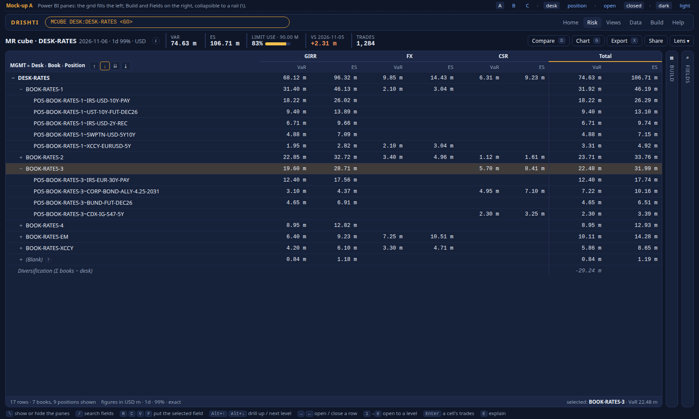
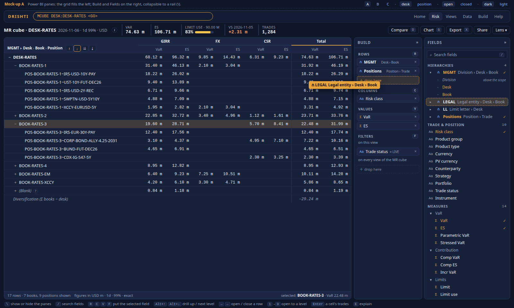
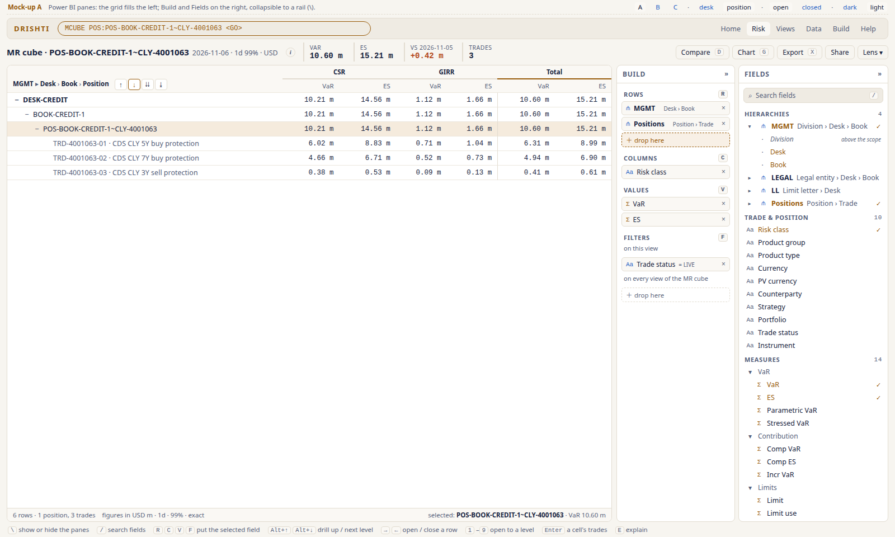
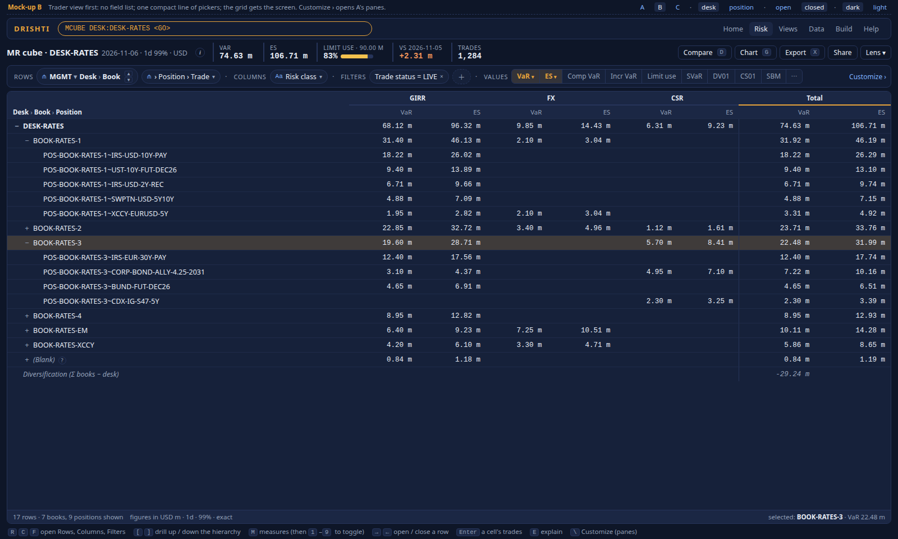
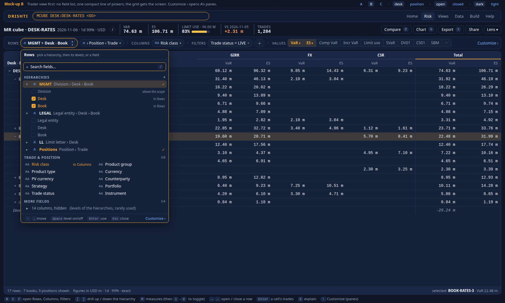
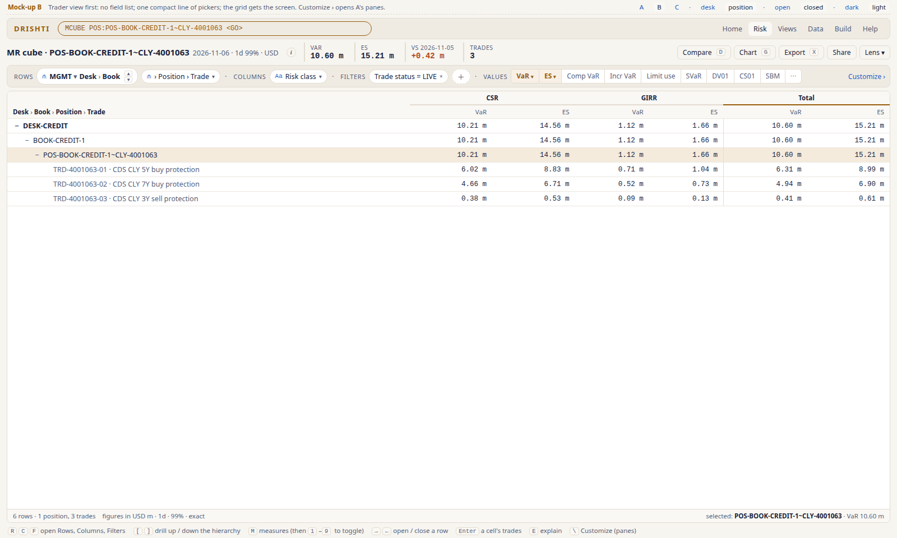
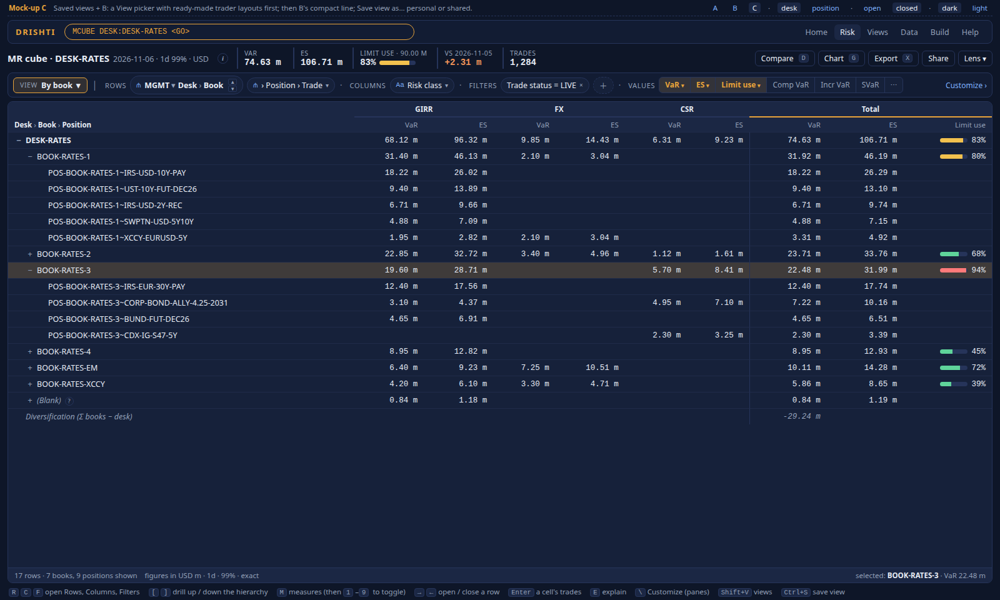
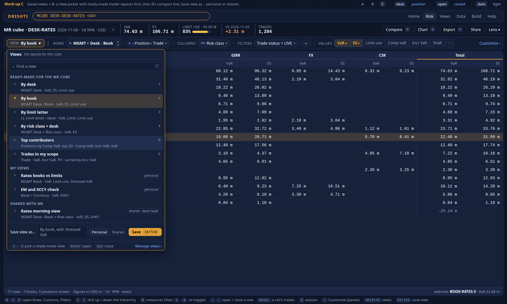
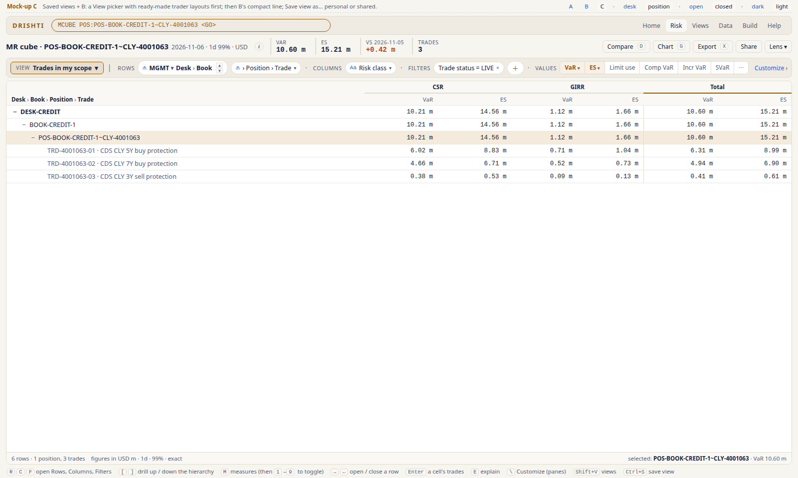

<!--
  Project Drishti · Any data. Any domain. One grammar.
  Copyright (c) 2026 Ashutosh Sinha <ajsinha@gmail.com>. All rights reserved.
  PROPRIETARY AND CONFIDENTIAL. See the LICENSE file in the root of this repository for the full terms.
-->
# Pivot fields: three mock-ups

**The problem.** The MR cube pivot (`/pivot?preset=mr&text=POS:POS-BOOK-CREDIT-1~CLY-4001063`) lists about 45 field chips in
four rows. Every hierarchy level appears as its own field (`MGMT.DESK`, `LEGAL.BOOK`, `LL.LIMIT-LETTER`, …). So does every raw column
those levels are built from (`DIVISION`, `TT_BOOK`, `LIMIT_LETTER`, …). The measures sit among them as wide chips. Below that come the
four wells, a scan banner and a long title. The grid gets about a quarter of the screen, with truncated labels and a
`Σ-total VaR 0.00` line. A trader will not use it.

**What the mock-ups change.** They follow Power BI's idea of a field list: grouped, searchable and collapsible, with hierarchies as one
item and measures apart. They also follow the Bloomberg bar: dense but calm, keyboard first, and a default that answers at once.

Each mock-up is self-contained (system fonts, no CDN). Open it in a browser. The address picks the state: `#desk` or `#pos`, `open`,
`collapsed` (A only) and `light`. The caption bar at the top switches between them. All three use the same data. The first scope is
the owner's screenshot (`POS:POS-BOOK-CREDIT-1~CLY-4001063`, VaR 10.60 m). The second is `DESK:DESK-RATES`, a 17-row tree with seven
books, nine positions, a `(Blank)` book and the diversification line. The figures are made up for the illustration.

| Option | File | Closed | Open | Light, the screenshot's scope |
|---|---|---|---|---|
| A · Power BI panes | [A-powerbi-panes.html](A-powerbi-panes.html) |  |  |  |
| B · Trader view first | [B-trader-view.html](B-trader-view.html) |  |  |  |
| C · Saved views + B | [C-saved-views.html](C-saved-views.html) |  |  |  |

## What is common to all three (the cleanups)

- **A hierarchy is one field.** `MGMT ▸ Division › Desk › Book` is a single item: drag it to get drill-down, or open it to choose
  levels. A level above the view's scope (Division under `DESK:DESK-RATES`) is shown greyed as *above the scope*. `Positions ▸ Position › Trade` is the
  members' drill.
- **Hierarchy-level columns are hidden.** Hierarchies are built from promoted columns, so `DIVISION`, `DESK`, `TT_BOOK`,
  `LEGAL_ENTITY` and `LIMIT_LETTER` would only duplicate them. They go under **More fields** with the rest of the long tail (14
  columns, collapsed). This is Power BI's "hide in report view", applied automatically.
- **Measures are grouped apart** with a Σ icon, in display folders: VaR (VaR, ES, Parametric, Stressed), Contribution (Comp VaR, Comp ES,
  Incr VaR), Limits (Limit, Limit use), Sensitivities (DV01, CS01, SBM capital) and Book (PV, Trades).
- **The grid:** full row labels, indented, with a tooltip giving the scope, and a row-header column wide enough for
  `POS-BOOK-RATES-3~CORP-BOND-ALLY-4.25-2031`. Every figure is in one format (`10.60 m`, USD m stated once in the footer). An empty
  cell is blank, never 0.00. There is no `Σ-total VaR 0.00` line. Instead, a **Diversification (Σ books − desk)** row appears only
  where it means something. `(Blank)` marks an empty level, in muted italics, with a **?** that explains it.
- **The header:** the title is shortened to `MR cube · DESK-RATES 2026-11-06 · 1d 99% · USD`. The headline figures (VaR, ES, Limit
  use, the change since the previous day, Trades) share that line, so no tiles are cut off. The scan banner moves into the **i** icon.
- **A keyboard line** sits under the grid, and every picker has its keys.

## The three options

**A · Power BI panes.** The grid fills about 70% on the left. On the right are **Build** (the four wells as short vertical lists;
Filters split into *on this view* and *on every view of the MR cube*) and **Fields** (search with `/`, then Hierarchies, Trade &
position, Measures, More fields). Drill arrows sit on the grid's corner (↑ up, ↓ drill mode, ⇊ next level, ⤓ expand all). Both panes
collapse to a 28 px rail (`\`). The open screenshot shows LEGAL being dragged to Rows.
*For:* everything is visible and familiar to Power BI and Excel users. *Against:* even tidied, it is an authoring screen. A trader who
only reads the cube still sees about 40 names, and the grid loses about 30% of the width while the panes are open.

**B · Trader view first.** There is no field list on screen. One compact line holds
`Rows [⋔ MGMT ▾ Desk › Book ▲▼] [› Position › Trade] · Columns [Risk class] · Filters [Trade status = LIVE] [+] · Values` and then a
measure toggle strip. The hierarchy is one chip with a level stepper (`[` `]`). Each chip opens a picker, grouped like A's tree, with
level check-boxes and search. `R`, `C` and `F` open the pickers, and `M` jumps to the measures. **Customize ›** (`\`) opens A's panes.
I merged the brief's `Values [VaR ▾ ES ▾]` with the toggle row: the lit toggles *are* the Values well, in order, and ▾ on a lit toggle
sets its options. That saves a line. The grid gets about 85% of the screen at 1600×960, including the console bar.
*For:* calm and fast, and the screen is the answer. *Against:* a field is not visible until you open a picker, and new users must
learn the chips.

**C · Saved views + B.** B plus a **View** picker as the first control (`Shift+V`). It offers ready-made layouts for this cube (By desk,
By book, By limit letter, By risk class × desk, Top contributors, Trades in my scope; keys `1`–`6`), then *My views* and *Shared with
me*, and **Save view as…** (Personal or Shared, `Ctrl+S`). The closed screenshot shows *By book*, which adds Limit use with bars to
the total. The open screenshot shows the picker.
*For:* the trader's first click answers the question, and the desk head can share a morning view. *Against:* the ready-made list has
to be curated for each preset. A changed layout must show that it differs from its view (a dot, plus Save or Revert).

## Recommendation

**Make B + C the default. They are one screen: C is B with the View picker in front. Put A behind Customize ›.** The one exception is
the BI designer, which is an authoring tool and should open with A's panes.

- Traders read the cube; they rarely build it. C's ready-made views plus B's line cover the daily questions with no field list at all.
  Power BI makes the same split: report readers never see the Fields pane, only authors in edit mode do.
- A is still needed: by power users, by anyone building a new view, and by the BI designer. Customize › opens it from B or C,
  and `\` closes it again. A's cleanups (one hierarchy item, hidden level columns, measure folders) are also what B's pickers show,
  so both read one catalogue.

## What the choice means, since the pivot is a shared Elements component

The field list and wells are **drishti-grid**'s `WellsModel` (`drishti_wells.js`) drawn by `drishti_grid-wells-ui.js`. Its own header
already says *"the ribbon above the grid, or the side tool panel: the same model"*. So B's line is the ribbon, A is the side tool
panel, and C adds a view picker over both. Nothing is bespoke to the MR cube (see the no-bespoke-UI rule). The change applies to
every pivot: Views → Pivot, the MR cube, the CCR cube when it is built, the panel pivots (Pivot under a Sutra table), search-result
pivots and the BI visuals on the pivot engine. In practice:

1. **The catalogue grows metadata.** `GET /api/v1/pivot/catalogue` gains, for each field: its *group* (hierarchy, field, measure),
   *display folder*, *hidden*, and for a hierarchy its *levels*. A hierarchy's level columns are hidden automatically. A source or
   pack can set folders and hidden fields in YAML. Each source supplies this data (VaR, tabular/BI layers, panel), and the
   component draws it the same way for all of them.
2. **The default mode is chosen per host, not per screen.** A preset or Sutra `pivot:` block says `mode: views` (C), `compact` (B) or `panes`
   (A). Defaults: risk presets and panel pivots use C, the generic Views → Pivot uses B, and the BI designer uses A. A person's choice
   between closed and open panes is kept.
3. **Ready-made views are configuration.** The preset (`drishti-console/config/pivot-presets.yaml`) gets a `views:` list, and the
   existing saved and shared views ([PIVOT_GUIDE §11](../../../guides/PIVOT_GUIDE.md#11-saved-and-shared-views-compare)) feed *My
   views* and *Shared with me*. There is no new store.
4. **The level stepper and drill arrows** belong to drishti-grid's pivot body (next to `1`–`9` and `Shift+→`), and the picker is
   drishti-inputs (combobox and tree). Grid formats (`10.60 m`, blanks, `(Blank)`) belong to drishti-core's number formats, so every
   pivot gets them.
5. **Existing keys stay as they are:** `R C V F` in A, `→ ← 1–9 Enter G X E`. In B and C, `R C F` open pickers instead of placing a
   selected field, because there is no field list to select from. `M` opens the measures. `[` `]` drill, `Shift+V` opens views and
   `\` opens Customize.
6. **Tests and docs:** the pivot browser tests (`test_pivot_screen_browser.py`, `test_pivot_expand_browser.py`) cover all three modes.
   PIVOT_GUIDE §2 (the screen) and §29, tutorial 7, and its screenshots are redone with the build.

## Decision and build checklist

**Decided (owner, 2026-11-08): C + B is the default everywhere a pivot opens, A behind Customize ›; the BI designer keeps its panes.** The
build checklist, ticked as built, lives in the lens document:
[LENSES.md section 6.4.4](../../../architecture/LENSES.md#644-pivot-fields-the-view-picker-the-compact-line-and-the-panes).
