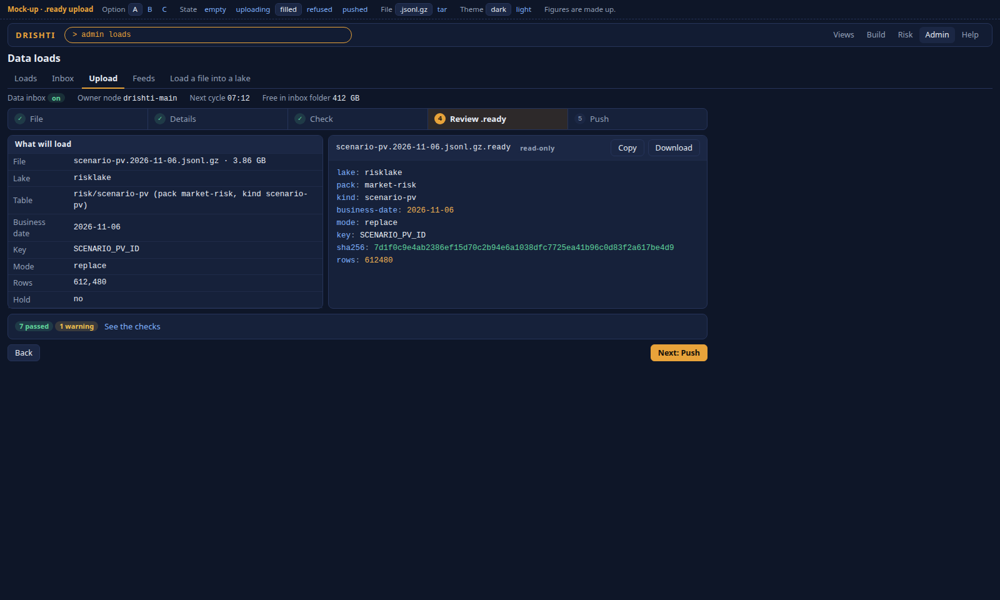
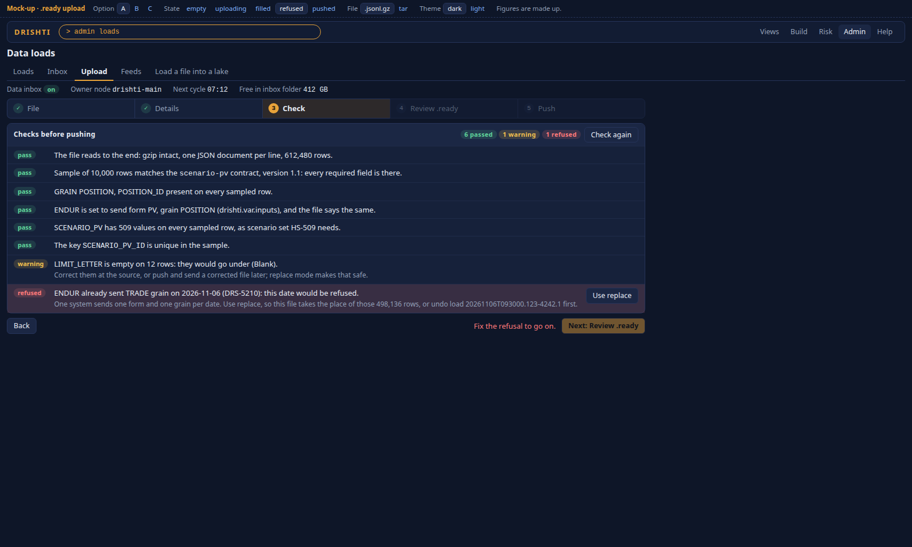
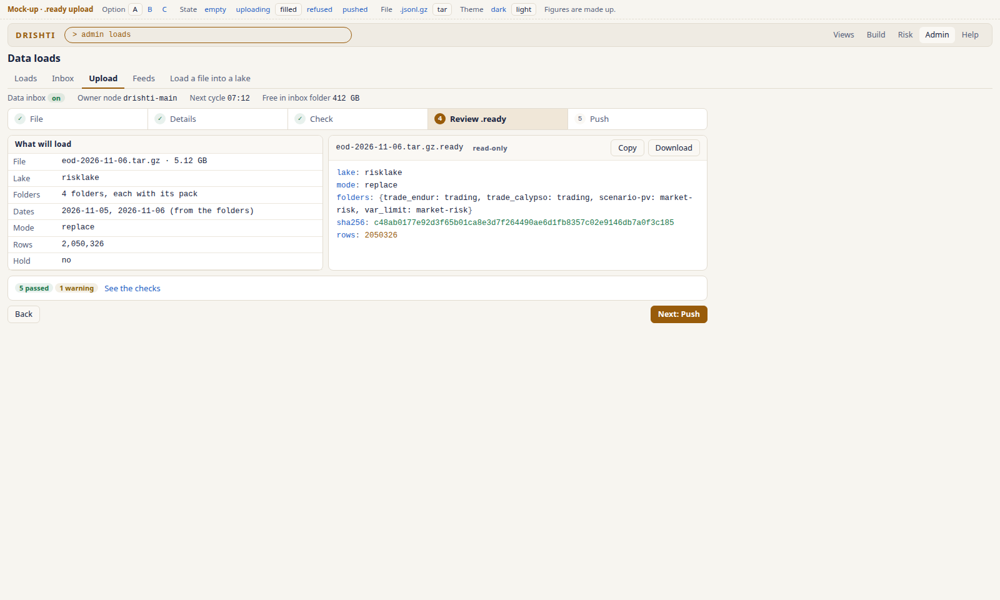
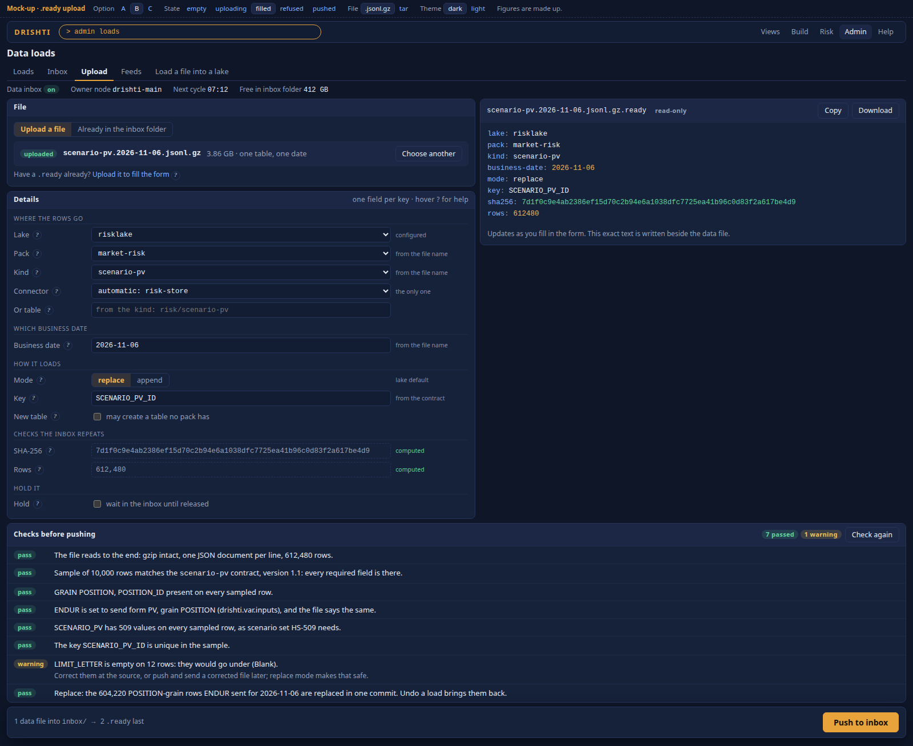
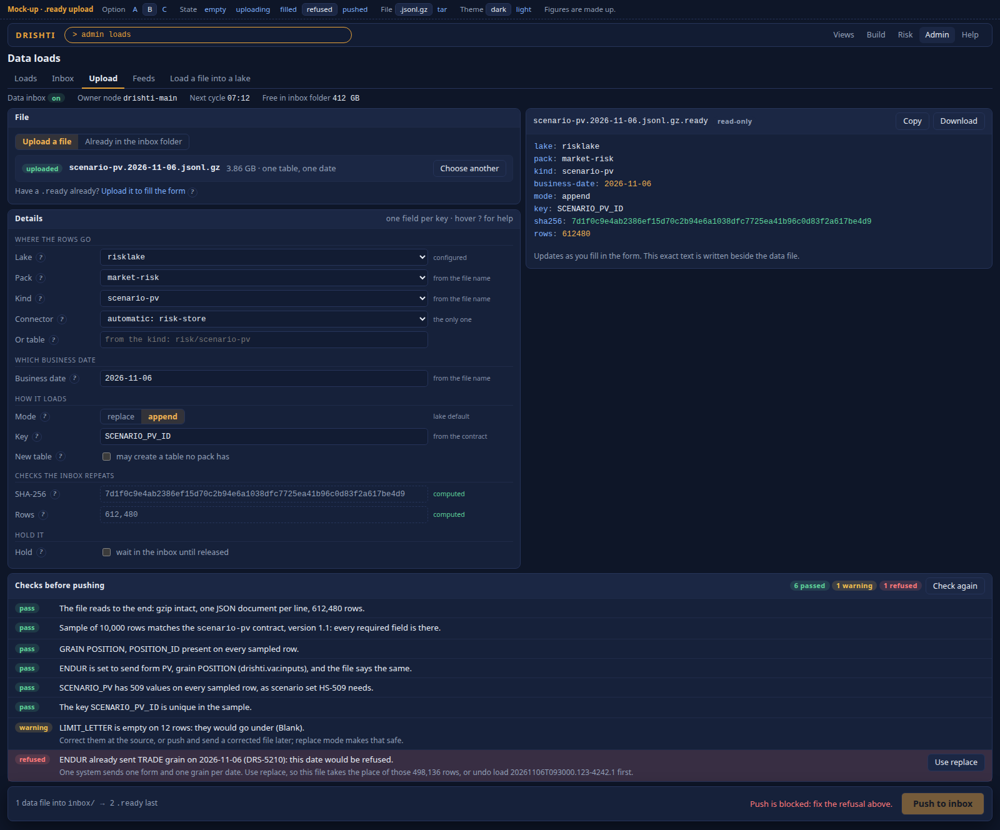
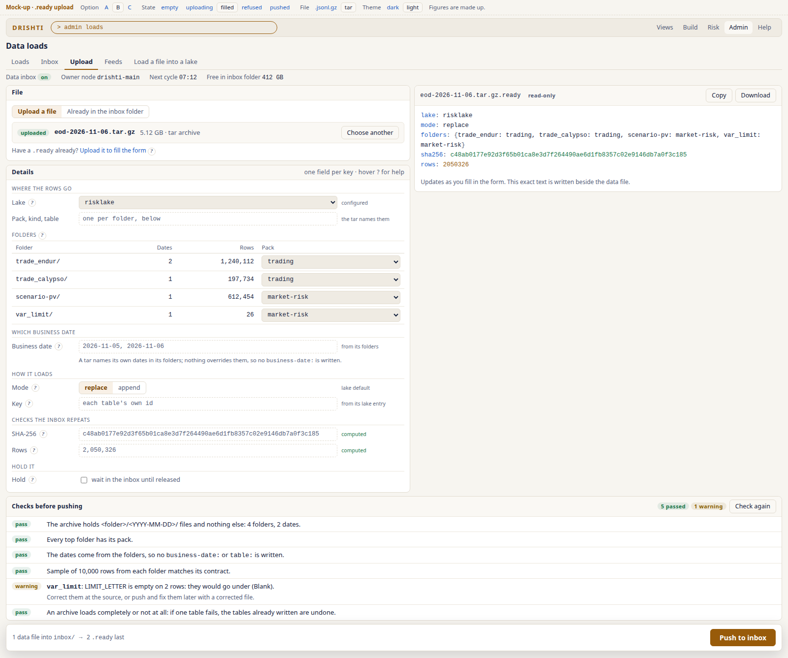
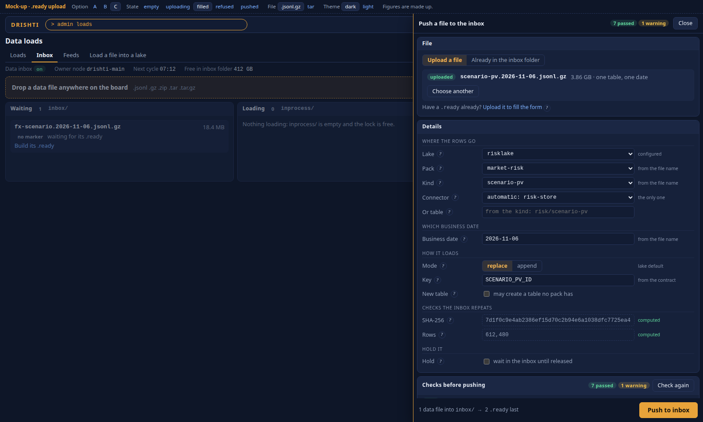
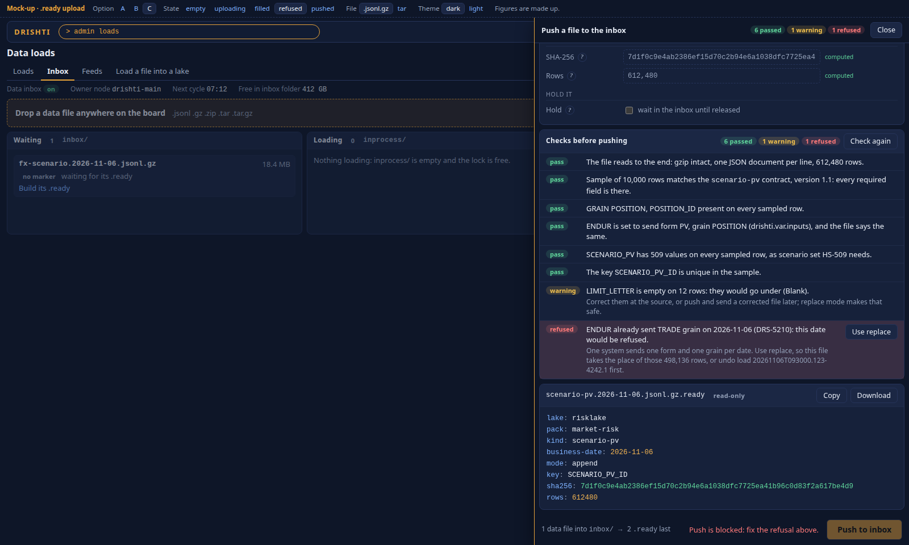
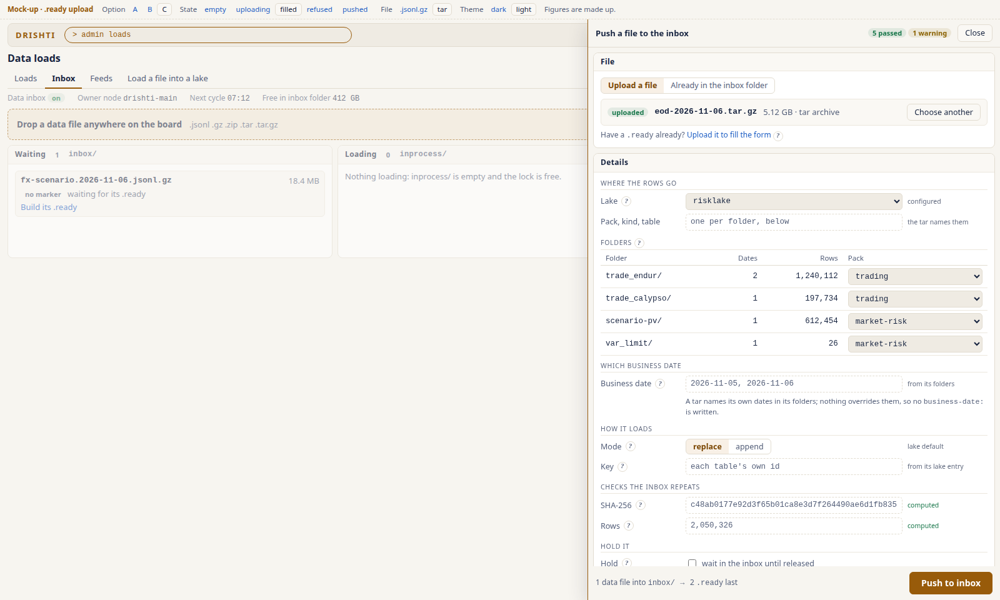

<!--
  Project Drishti · Any data. Any domain. One grammar.
  Copyright (c) 2026 Ashutosh Sinha <ajsinha@gmail.com>. All rights reserved.
  PROPRIETARY AND CONFIDENTIAL. See the LICENSE file in the root of this repository for the full terms.
-->
# Upload a file and build its `.ready`: three mock-ups

**The request.** An Admin page that takes a data file (and optionally a `.ready`), builds the `.ready` from a form so nobody edits it by
hand, shows the exact text, and pushes both to the data inbox.

Each mock-up is self-contained (system fonts, no CDN). Open it in a browser. The caption bar switches option, state (empty, uploading,
filled, refused, pushed), file (a `.jsonl.gz` or a tar) and theme; the address keeps the choice (`#refused-tar-light`). The form really
drives the `.ready` text and the checks: change the mode, pick a pack, press Copy. The example loads position-grain scenario PVs for
2026-11-06 from ENDUR into `risklake`. The figures are made up.

| Option | File | Filled | A refusal blocking Push | Tar, light |
|---|---|---|---|---|
| A · Step wizard | [A-step-wizard.html](A-step-wizard.html) |  |  |  |
| B · One page, split view | [B-split-view.html](B-split-view.html) |  |  |  |
| C · Inbox first | [C-inbox-first.html](C-inbox-first.html) |  |  |  |

## What all three show

- **The file:** upload (drag and drop, progress for a large file) or pick one already in the inbox folder, which is the advice for very
  large files. Accepted: `.jsonl`, `.gz`, `.zip`, `.tar`, `.tar.gz`. A `.ready` you already have can be uploaded to fill the form.
- **The form,** one field per key of [the `.ready` file](../../../guides/DATA_LAKE_GUIDE.md#4-the-ready-file-every-key), a **?** on each, and
  a note saying where each value came from: *from the file name*, *from the contract*, *computed*, *you set this*.
- **A tar** has no pack, kind, table or business date to choose: the date field is read-only and says why, and a Folders table maps each
  top folder to its pack.
- **The checks,** as pass, warning or refused, in plain words with the fix. A refusal disables Push; *Use replace* shows a fix applied in
  one click.
- **The exact `.ready` text,** read-only with syntax colouring, Copy and Download.
- **Push:** data first, `.ready` last, then a confirmation with the next cycle and the way to the Inbox board.

## The three options

**A · Step wizard** (File → Details → Check → Review `.ready` → Push). Check is a gate: a refusal stops you at step 3.
*For:* the clearest for someone who does this rarely; one thing at a time. *Against:* the `.ready` appears only at step 4, so the link
between a field and its line is lost; four clicks for a daily job; fixing a refusal means going back.

**B · One page, split view.** The form on the left, the live `.ready` on the right, the checks underneath, Push held at the bottom of the
window. *For:* the request's point on one screen: change a field and see the line change; the refusal and its field are on the same
page; fast for a daily user, and easy to read top to bottom. *Against:* a long page, the checks sit below the form at 1600×960, and a
first-time user gets every field at once (the pre-filled values soften this).

**C · Inbox first.** A drop band on the existing Inbox tab; a drawer opens with the form, checks and preview, and after the push the file
is simply there in Waiting. *For:* no new tab, the shortest path to the result, and *Build its .ready* on a file waiting without a marker is
the natural way in for very large files. *Against:* a 660 px drawer stacks everything, so the form and the `.ready` are not side by side
and a refusal needs scrolling; the board behind is dimmed while you work.

## Recommendation

**Build B as the screen (Data loads → Upload), and take from C its two ways in, opening B already filled in: dropping a file on the Inbox
board, and *Build its .ready* on a Waiting card with no marker. Leave A out unless wanted.**

- Seeing the `.ready` form as you type is what replaces hand-editing; only B keeps both in view.
- C's entry points cost little and fit how large files really arrive (copied to the folder first). Its drawer would be a second layout
  of the same form for no gain.
- **This departs from the general rule (A, B, C as views of one screen, A the default)**, as the data inbox itself did. If the rule should
  hold, all three are views over one form, one checks list and one preview, and I would still ask for B as the default rather than A.

## Things the build must get right

These came out of reading the code and the guide; the mock-ups simplify them.

1. **DRS-5210 belongs to the VaR intake, not the loader.** The loader would take the file; the date is refused later, in `VarIntake`. The
   check must call that same rule, for the system and date in the file, or the page promises something the load does not do.
2. **`Use replace` is only sometimes the right fix.** Replace clears the date in *this table*. If the other grain arrived through another
   table (P&L vectors), replace does not remove it, so the server decides which fix to offer.
3. **Replace clears the date for every system in the table.** The mock-up's date holds only ENDUR rows. If it also holds another system's rows,
   the check must be a warning that names them and their count, because a single-system file would remove them.
4. **The checks read a sample.** Say so on the screen. SHA-256 and rows are the whole file: on a very large gz that is minutes of
   server work, so it is a job with progress, not a request.
5. **A file of that name already waiting** must not be overwritten: refuse with the name, as a check.
6. **The data inbox can be off**, and the upload then has nowhere to go: Push is disabled with the link to Admin → Engines, as the board does.

## Build checklist

| Area | Item | Status |
|---|---|---|
| Server | `POST /api/v1/admin/dataload/upload`: streams the raw body into `<dataload>/staging/`, never into memory; free-space floor; size limit in `config/engines/dataload.yaml` | to do |
| Server | `POST /api/v1/admin/dataload/inspect`: name, tar layout, SHA-256 and rows as a job with progress; for an upload or a file in `inbox/` (names only, no paths, no links) | to do |
| Server | `POST /api/v1/admin/dataload/check`: the form's values against a sample; returns the pass, warning and refused list in words with the fix | to do |
| Server | `POST /api/v1/admin/dataload/push`: rename the data file into `inbox/`, then write the `.ready` the same way, last; refuses when a check refuses, re-checked on the server | to do |
| Server | `GET /api/v1/admin/dataload/choices`: lakes, packs, kinds, connectors, each kind's key from its contract, files in `inbox/` with no marker | to do |
| Reuse | `ReadyNote` for the keys and rules (today it reads a `Path`: add parsing from text); one writer beside it, tested by reading its output back; `READY_KEYS` in `tools/lake/feedroute.py` stays compared | to do |
| Reuse | `Routes` for what a name routes to, the contract validator for the sample, `VarIntake`'s rule for DRS-5210 | to do |
| Reuse | The streaming of `/api/lakes/upload` in `drishti-console/routes/lake_routes.py`, passed on to the server rather than kept in the console's temporary folder | to do |
| Security | Administrator only; add the new endpoints to the `loads:write` list in `application.yaml` for API tokens; file names validated (no `..`, no leading dot, accepted extensions only) | to do |
| Audit | One audit line per push: who, file, SHA-256, rows, the `.ready` text; a refusal overridden is impossible, so none to record | to do |
| Cluster | Every call goes to the owner node (`owner: true`), which holds the inbox folder; another node forwards; the page names the owner node | to do |
| CLI | `drishti.py dataload ready <file>` in `tools/dataloadcli.py`: same inspect and check, prints the `.ready`, `--push` to push; shares the endpoints | to do |
| Console | Tab *Upload* in `_loads_tabs.html`; *Build its .ready* on a no-marker card in `_inbox_body.html`; dropping on the board opens Upload | to do |
| Elements | No bespoke UI: `Form`, pickers and read-only `CodeEditor` from drishti-inputs. **A file-drop input with progress does not exist yet:** add it to drishti-inputs, with its gallery page | to do |
| Docs | DATA_LAKE_GUIDE section 3 and 4 (the page), one tutorial with UI, CLI and YAML at every step and screenshots, `CONFIGURATION.md` for the new settings, CHANGELOG | to do |
| Tests | Writer and `ReadyNote` round trip for every key; each check's words; refusal blocks push on the server; data before `.ready` (crash between them leaves no marker); name collision; path traversal; tar with an unresolved folder; `loads:write` and non-admin refused; owner-node forwarding; one browser test per state, dark and light | to do |
