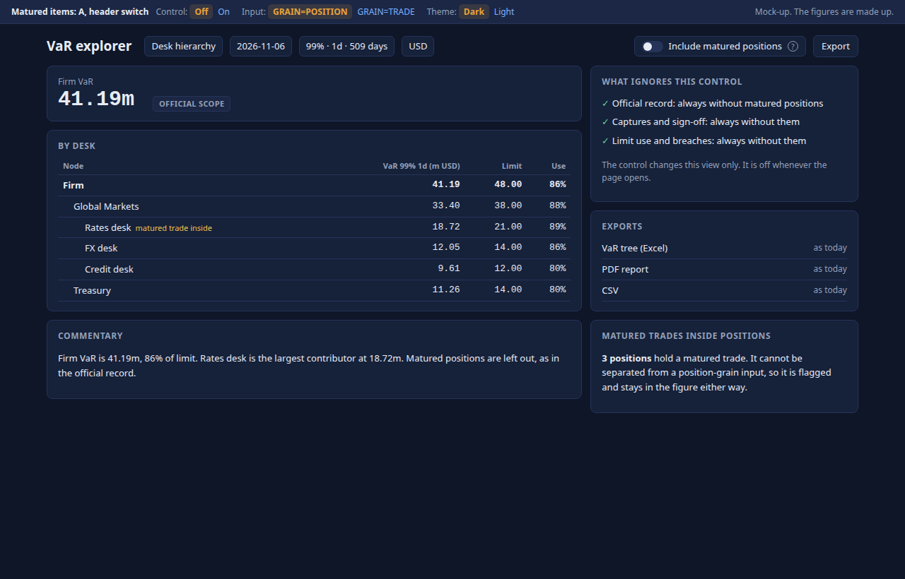
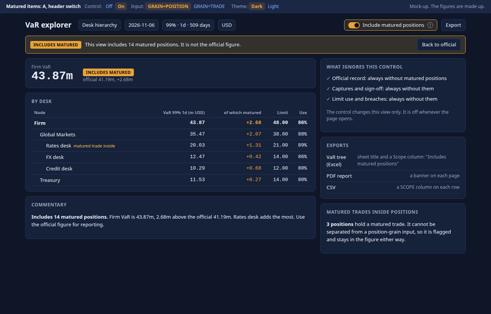
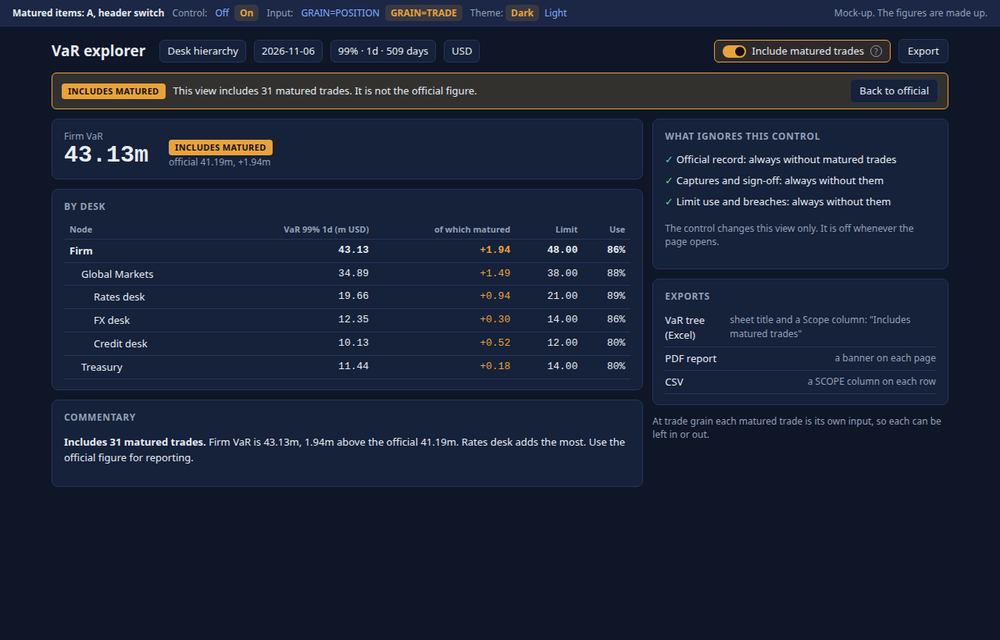
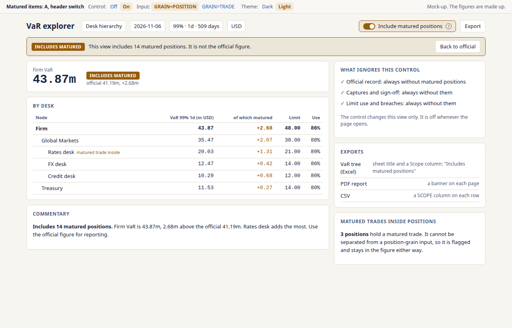
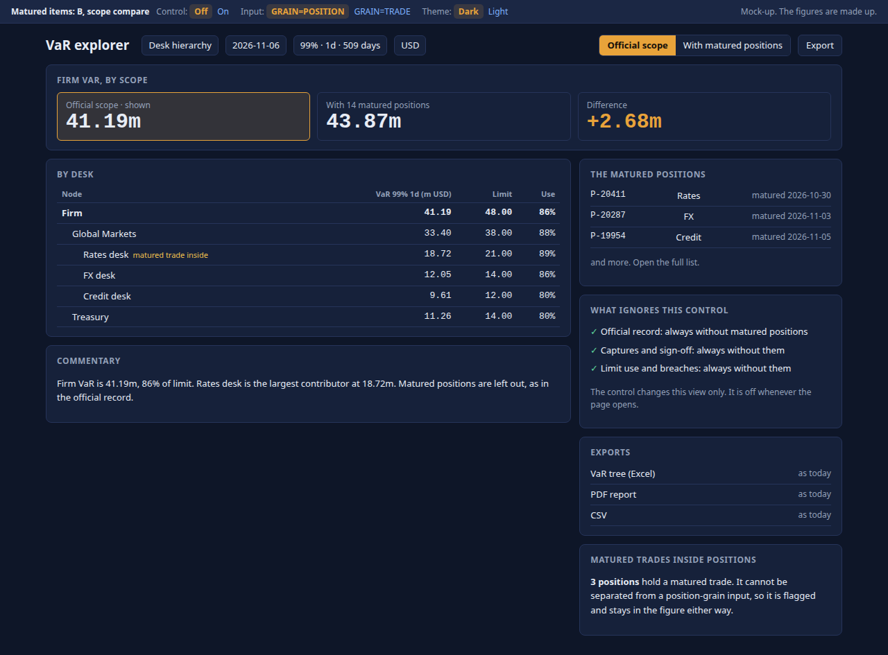
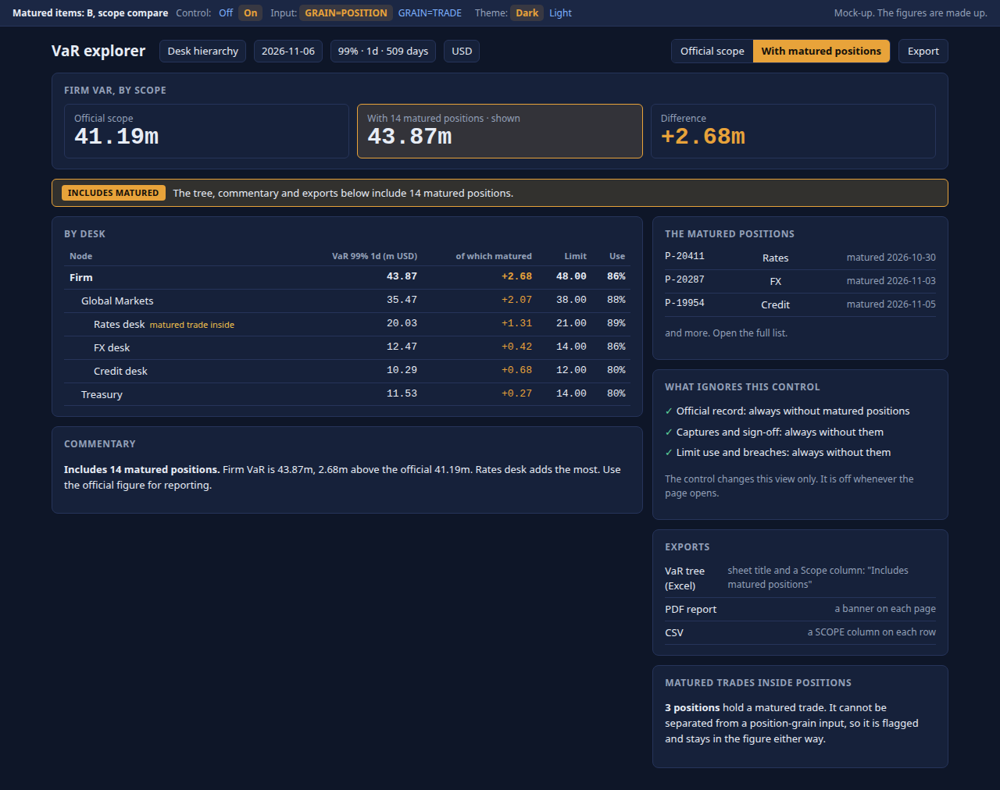
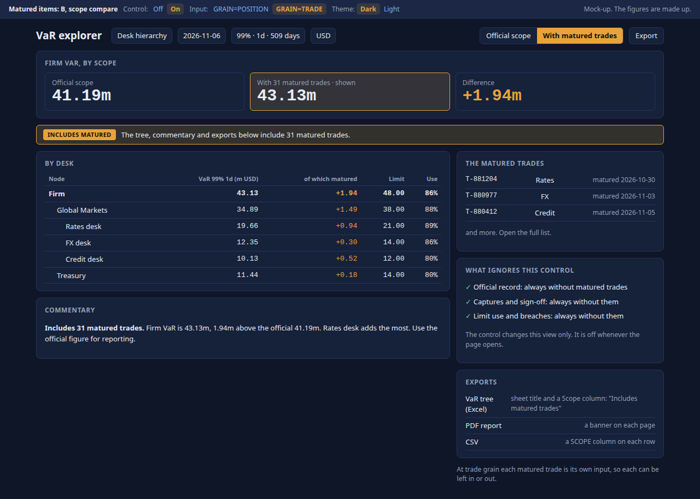
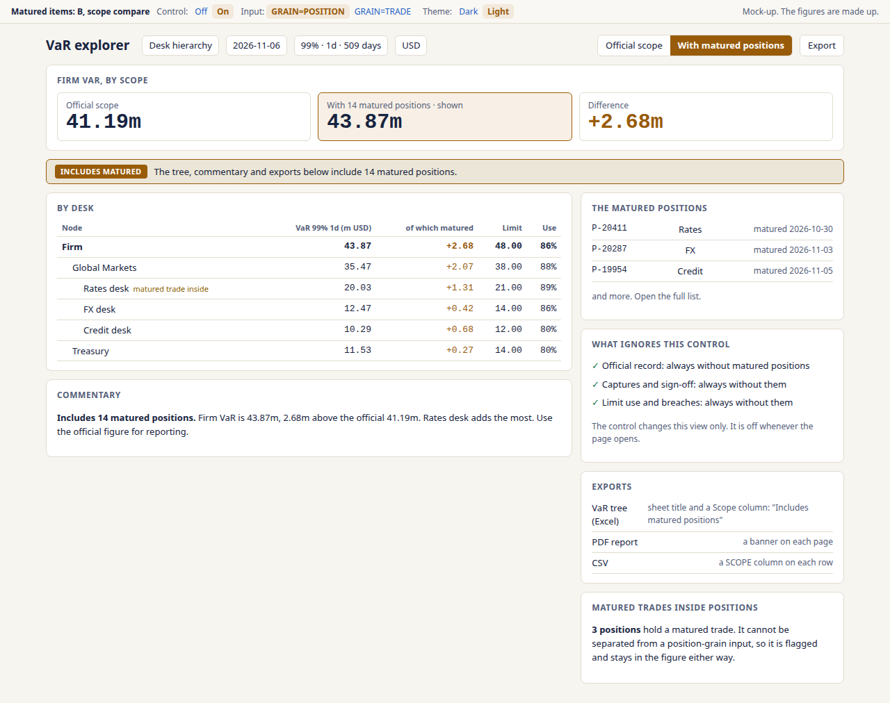

<!--
  Project Drishti · Any data. Any domain. One grammar.
  Copyright (c) 2026 Ashutosh Sinha <ajsinha@gmail.com>. All rights reserved.
  PROPRIETARY AND CONFIDENTIAL. See the LICENSE file in the root of this repository for the full terms.
-->
# Include or exclude matured items on the VaR explorer: two mock-ups

**The request.** A control on the VaR explorer that adds matured items back into the figure, at the grain of the input: positions for
`GRAIN=POSITION`, trades for `GRAIN=TRADE`. Off by default.

Each mock-up is self-contained (system fonts, no CDN). Open it in a browser. The caption bar switches the control, the input grain and the
theme; the address keeps the choice (`#on-trade-light`). The figures are made up.

| Option | File | Off | On, positions | On, trades | On, light |
|---|---|---|---|---|---|
| A · Header switch | [A-header-switch.html](A-header-switch.html) |  |  |  |  |
| B · Scope compare | [B-scope-compare.html](B-scope-compare.html) |  |  |  |  |

## What both show

- **The control names the grain:** "matured positions" or "matured trades", from the input. It is off whenever the page opens.
- **When on, the figure says so:** an INCLUDES MATURED tag in the header, the first words of the commentary, and each export (Excel title and
  Scope column, PDF banner, CSV `SCOPE` column).
- **What ignores it:** the official record, captures and sign-off, limit use and breaches. Limit use stays on the official figure in both.
- **A matured trade inside a position** is flagged only. A position's PVs arrive whole, so it stays in the figure either way.

## The two options

**A · Header switch.** One switch beside Export; on, a band with *Back to official*.
*For:* least on the screen, one click, the page looks as it does today while off. *Against:* the size of the difference is visible only once on.

**B · Scope compare.** Official or With matured as two segments, the official figure, the other figure and the difference always shown, and a
list of the matured items. *For:* the official figure is never out of sight, and the list answers "what was added". *Against:* a permanent
card and a second VaR figure on the page, even for people who never use it, and the second figure must be computed on every open.

## Recommendation

**A as the default,** with B's list of matured items opened from the band when the control is on. A keeps the explorer as it is for the people
who never need this and computes the second figure only on request; the band already states the official figure and the difference.
