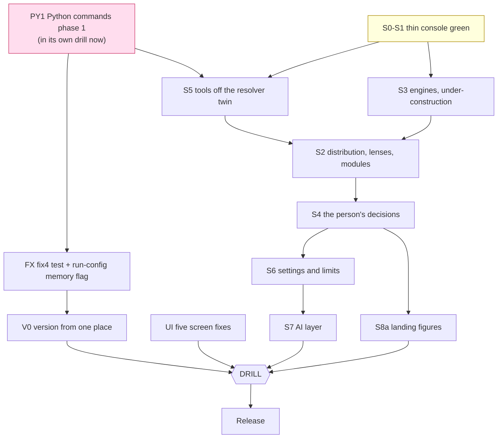

<!--
  Project Drishti · Any data. Any domain. One grammar.
  Copyright (c) 2026 Ashutosh Sinha <ajsinha@gmail.com>. All rights reserved.
  PROPRIETARY AND CONFIDENTIAL. See the LICENSE file in the root of this repository.
-->

# Release i5: the build plan (the thin console, the version, Python commands)

*Internal plan, written 2026-11-16 and re-cut the same morning at the owner's word (the former single i5 plan is now this document, [I6_BUILD_PLAN.md](I6_BUILD_PLAN.md) and [I7_BUILD_PLAN.md](I7_BUILD_PLAN.md)). Planning only: no product code is in this change. Builders follow this document; each builder brief links to its step in [section 2](#2-steps-order-and-the-graph) and to the same step in [section 6](#6-side-effects-and-what-builders-must-be-mindful-of). Sizes are the designs' own builder-days (one builder, one day).*

## Roadmap

| Release | What it is | Plan |
|---|---|---|
| **i5** | The thin console S0–S8, the version from one place, Python commands phase 1, a few screen fixes. One drill, then the release | [I5_BUILD_PLAN.md](I5_BUILD_PLAN.md) |
| **i6** | Module re-engineering only: modules out of the server jar (M1–M7 of the modules design) and what it strictly needs (the core move into market-data) | [I6_BUILD_PLAN.md](I6_BUILD_PLAN.md) |
| **i7** | Everything else of the former i5 plan: the cluster, live L7–L10, trade tables, Python commands phase 2, drill lanes, the Polars proof, the API sweep, the screenshots, the binding designer's choice. Begins with Phase 0 (prove the waiting branches) | [I7_BUILD_PLAN.md](I7_BUILD_PLAN.md) |
| **i8** | What was i6: the console on Spring Boot and single sign-on, market-risk expansion (FRTB, SIMM), lake-writing tests, Polars from P3, `drill.sh` into Python, cluster C7 and C12. Anything later shifts by one | — |

## Contents

1. [The plan on one page](#1-the-plan-on-one-page)
2. [Steps, order and the graph](#2-steps-order-and-the-graph)
3. [Overlaps this release settles](#3-overlaps-this-release-settles)
4. [Checkpoints, the one drill and the release steps](#4-checkpoints-the-one-drill-and-the-release-steps)
5. [Critical path and risks](#5-critical-path-and-risks)
6. [Side effects and what builders must be mindful of](#6-side-effects-and-what-builders-must-be-mindful-of)
7. [Decisions of the owner that apply](#7-decisions-of-the-owner-that-apply)
8. [Builder rules](#8-builder-rules)

## 1. The plan on one page

- **Scope (owner, 2026-11-16).** The thin console S0–S8 (lane B of the former plan); the version from one place (a committed file, and a release check that the tag equals it, Q8); Python commands phase 1 (branch `wip/i5-python-cli`, being drilled now); and small fixes: the NEWS phone list that scrolls sideways and its empty Snapshot column, the economy record falling back to the newest held date, the server's root page saying what it is, the curves' empty "Business date" column, the BI desk-wall label that is cut off, `run-configs/Drishti server.run.xml` setting `MaxDirectMemorySize` twice, and the `ModuleSwitchFollowsTest` fix (`wip/i4-fix4`).
- **One drill, then the release.** A second run only for the lanes a fix touched.
- **Serial spine, parallel edges.** The thin console's spine is S0–S1 → S5 → S2 → S4 and then S6 → S7; S3, the screen fixes, the version and the run-config fix fill the other builders' time (at most three builders).
- **Front-loaded on purpose:** S5 (the tools stop reading packs, modules, connectors, bindings and rules folders; the console's Python resolver and its tests are deleted) is the second step of the spine, so that the later releases (i6 modules, i7 cluster and live) never edit or keep that twin equal.
- **Size.** About 32.5 builder-days of steps plus 3 of release preparation: **about 35.5**. Critical chain about 22 builder-days.
- **Not in i5:** the modules re-engineering (i6), the cluster, live, trade tables, Python phase 2, drill lanes, API sweep, screenshots (i7). The console on Spring Boot and single sign-on stay in i8.

## 2. Steps, order and the graph

### 2.1 The graph

### 2.2 Models

Fable designs only (this plan, and a design question a builder raises). **Opus**: S0–S1 green-up, S5, S2, S4. **Sonnet**: V0, PY1, S3, S6, S7, S8, the screen fixes. **Haiku**: merges of finished branches, regenerating documents, CHANGELOG lines. The model is set on every Agent call.

### 2.3 The steps

| Step | Goal | Branch | Model | Inputs | Outputs | Days | Tests that prove it | Merges at |
|---|---|---|---|---|---|---|---|---|
| **PY1** | Python commands phase 1 finished and drilled: setup, build jar, start, stop, status, `DRISHTI_HOME`, `<home>/lib`, `lib/ext`; `--iceberg` and `lake demo --lake` no longer write `config/connectors`; the guide's *Prepare your environment* | `wip/i5-python-cli` | Sonnet | in progress; its own drill | `tools/launch/*`, shell twins deleted, `test_launch.py` | 2 | `test_launch.py`, `test_launcher_memory.py`, `test_no_hidden_names.py`; a read-only-connectors test; start/stop/status on Linux; the Windows check list (Q6) | CP-A |
| **FX** | `ModuleSwitchFollowsTest` reads its own server's resolution (`wip/i4-fix4`, done); `run-configs/Drishti server.run.xml` sets `MaxDirectMemorySize` once | `wip/i4-fix4` | Haiku | — | merged | 0.5 (the former H0 figure, for this branch; no further day estimated for the run-config line) | the test; the launcher memory test | CP-A |
| **V0** | The version comes from one place and cannot drift | `wip/i5-version` | Sonnet | PY1 merged (`build jar` reads the version) | a committed version file (Q8), Maven `${revision}`, images and tools read it, a guard test (no version literal outside the source and the history files), a release check (the tag equals the version) | 1 | the guard test; `drishti.py --version`; `/public/about`; a jar's manifest; the release check on a wrong tag | CP-A |
| **S0–S1 green** | What is written passes; the recorded `bootstrap.json` / `me-console.json` written by a Java test; core browser tests against the detached console | `wip/i5-thin-console` | **Opus** | written S0–S1; the impact review; develop merged in (98 commits behind) | merged | 2 | server contract tests (shape, ETag, 304, no person in the bootstrap); detached-console test; Help guides walk; two-people-at-once; the browser lane's packs tests | CP-B |
| **S5** | `resolve --json` over the Java resolver, `tools/resolved.py`, the 43 tool files moved; `core/resolution.py`, `test_resolution.py` and the shared fixtures' Python half deleted | `wip/i5-thin-s5` | **Opus** | S0–S1, PY1 (jar lookup) | the twin gone; guard: no Python file but `tools/resolved.py` reads a pack, module, connector, bindings or rules folder | 5 | the tools' tests; generators produce byte-identical documents before and after; timing of a generator with the cache; the message on an unbuilt checkout | CP-C |
| **S3** | Engines and under-construction from the bootstrap | `wip/i5-thin-s3` | Sonnet | S0 | console `engines.yaml` files and their equality test deleted | 2 | engine-off-everywhere (server side), menus from recorded answers | CP-C |
| **UI** | Five screen fixes: economy as-of falls back to the newest held date; the server root page says what it is; NEWS phone layout and the empty Snapshot column; curves' Business date column; BI desk-wall label cut | `wip/i5-screens` | Sonnet | none (fills waiting time) | — | 2 | one browser test each; the page walk and layout checks | CP-C |
| **S2** | Distribution, lenses, modules from the bootstrap; `core/distribution.py` deleted; `modules/` leaves the console image | `wip/i5-thin-s2` | **Opus** | S1, S3, S5 | about 900 Python lines deleted | 5 | detached console (list shrinks); never-stale test; three distributions' browser tests | CP-D |
| **S4** | The person's decisions (functions, engines opened, admin pages, grants) | `wip/i5-thin-s4` | **Opus** | S2 | role literals in 33 files become lookups | 5 | menus-against-enforcement for the five demo roles; two-people-at-once | CP-D |
| **S6** | Settings and limits from the server; `core/hostrule.py` deleted | `wip/i5-thin-s6` | Sonnet | S4 | — | 3 | Help → Configuration and Admin → Configuration equal the server's | CP-E |
| **S7** | AI layer: the console calls the server only | `wip/i5-thin-s7` | Sonnet | S6 | about 4,400 lines and six tests deleted | 2 | AI browser tests; Health line for a console-only provider file | CP-E |
| **S8a** | Landing figures of trading and market data computed by the modules on the server | `wip/i5-thin-s8a` | Sonnet | S4 | `trading_landing.py`, `market_landing.py` deleted | 3 | figures equal before and after (recorded); server tests | CP-E |
| | **Drill** | | | | | | | |

Totals: PY1 2, FX 0.5, V0 1, S0–S1 2, S5 5, S3 2, UI 2, S2 5, S4 5, S6 3, S7 2, S8a 3 = **32.5 builder-days**; release preparation (README rewrite, deck refresh, CHANGELOG, RELEASE_NOTES, PDFs) 3: **about 35.5**. S8's three job pages (lake build, lake maintenance, pack design as server jobs, 5 days) moved to i7 (owner 2026-11-16 08:45; thin console Q7).

---

## 3. Overlaps this release settles

| # | Shared code | Who touches it | Decision | Repeated work removed |
|---|---|---|---|---|
| **O1** | The launchers: `bin/start-server.*`, `bin/start-console.*`, `tools/rolling-upgrade.*`, `deploy/stack/**`, `run-configs/*.run.xml`, `deploy/docker/**`, `deploy/systemd` | Python commands (deletes the `.sh`/`.ps1`, adds `tools/launch/*.py`); cluster C2 and C3 (ports, the witness start script, 20 shared files); thin console S1 (9 shared files); modules M3 (modules folder in every launcher); `--iceberg` and `lake demo --lake` writing `config/connectors` | **Python commands phase 1 merges first (CP0).** Cluster, thin console and M3 then make each launcher change once, in `tools/launch/`. The `--iceberg`/`--lake` fix is done inside phase 1 (the start command is being rewritten there anyway) | every launcher change written once instead of three times (`.sh`, `.ps1`, run-config); the cluster's and thin console's edits to deleted shell files are ported once at their rebase instead of merged by hand; `<home>/lib`, `lib/ext` and `<home>/modules` laid out by one command (`setup`), not by M3 again |
| **O2** | The resolver's Python twin: `drishti-console/core/resolution.py` (1,276 lines), `tests/test_resolution.py`, the shared fixtures `pack-resolution/cases.yaml`, `connector-layers/cases.yaml` | core move (edited it); live L1 (edited it: `companion-of`); modules M2 (would re-point it to the `.dmod` folder and cache); thin console S5 (**deletes it whole**; tools ask the Java resolver through the jar) | **S5 is front-loaded: before M2.** Order: core move → live → S5 → M2. M2 then changes the Java resolver only | M2's "Python twin re-pointed" and M4's "Python fixture" (about 1 of M2+M4's 6.5 days) are never written; no third and fourth round of keeping the twin equal; the bug class of 11-15 ends before the largest change to module discovery |
| **O3** | Where the jar and the home are found: `DRISHTI_HOME`, `<home>/lib`, `tools/javacmd.py` | Python commands; S5 (tools call the jar); M3 (release layout); Polars and the lake build (the Java loader) | One lookup, in `tools/javacmd.py`, from phase 1. S5, M3 and the loaders call it and add nothing | no second "find the jar" in `tools/resolved.py`; `DRISHTI_JAR` and the `target/` fallback retired once |
| **O11** | Generated and shared documents: `docs/admin/CONFIGURATION.md`, `settings_schemas.yaml`, `application.yaml`, `CLI_REFERENCE.md`, `API_REFERENCE.md`, `OPERATIONS_GUIDE.md`, `ADMIN_GUIDE.md`, `KERNEL_AND_MODULES.md`, `CHANGELOG.md` | every lane (the largest file intersection of all) | Generated files are **never merged by hand**: take develop's, run the generator, commit. Hand-written guides: each lane edits only its own sections; `CHANGELOG.md` is a union merge. `KERNEL_AND_MODULES.pdf` and the other PDFs are regenerated once, at release prep | no conflict fixing in generated text; the PDFs are built once |
| **O14** | The version | root `pom.xml` and 5 module poms, 5 Dockerfiles, `compose.yaml`, `deploy/aws/env.example`, `drishti-console/core/app.py`, `help.yaml`, the archetype, `under-construction.yaml`; thin console S0 (the console shows the server's version) | **V0 first** (the owner's first item): one source; the console half is already done by S0 (the server's `/public/about`), so V0 covers the build, the images, the tools and the release check only | the console's own version constant is not touched twice |

Reading the rows for this release: **O1** is PY1 first, and the thin console's S1 then rebases over the deleted shell files (take develop's deletion, re-apply the intent in `tools/launch/`); **O2** is S5, now before the core move, live and modules (those releases drop the twin's edits at their merge); **O3** is the one lookup in `tools/javacmd.py`; **O11** the generated documents; **O14** V0, the console's version half already being S0. Rows O4 to O10, O12 and O13 belong to i6 and i7.

---

## 4. Checkpoints, the one drill and the release steps

A checkpoint is a merge window on develop. Each merge passes its **pre-merge gate** (the affected tests from `tools/drillkit/affected.py`, the guards, VaR goldens where marked) on the rebased branch (a merge of develop into the branch, never a force push), then develop is pushed. `wip/*` branches are pushed after every step.

| # | Merges, in this order | Gate on develop after the window |
|---|---|---|
| **CP-A** foundations | PY1 (after its drill) → FX → V0 | tools tests; launch tests; one Maven build of the touched modules; the version guard; the release check on a wrong tag |
| **CP-B** | S0–S1 (the Live column's `admin_routes.py` edits of the live branch are not yet merged: they rebase over this later) | Java tests of kernel, plugins, banking; the browser lane **once**, alone, with the detached console; VaR goldens |
| **CP-C** | S5 → S3 → UI | tools tests; every generator run, outputs identical; guard on folder readers; the page walk |
| **CP-D** | S2 → S4 | menus against enforcement; the three distributions' browser tests; session isolation; pre-drill check |
| **CP-E** | S6 → S7 → S8a | affected tests; Help → Configuration equals the server's; recorded landing figures; **freeze** |
| **Drill** | | the one drill |

**The drill.** Scope: every lane in two waves (CPU-heavy lanes first, then browser, other, anywhere), including the detached console and the three distributions; the shared read-only test lake (lake-writing tests stay parked with their reason); the page walk and layout checks; two people on one console worker; a console started before the server and against an older server. A second run only for what the first one's fixes touched; a fix to a shared kernel class means a full repeat. During the drill: edits only. Between the drill and the release no change to `tools/drill.sh` or `tools/drillkit/`, and the merge worktree is never checked out or reset for a read (`git show`).

**Release steps** (each waits for the owner's word): the root README rewritten, counts from the file system; the deck refresh; CHANGELOG and RELEASE_NOTES; the PDFs regenerated once; the release check (the tag equals the committed version, Q8); the green drill; merge develop into main and tag; the owner's three-node stack upgraded once after the tag (Q7).

---

## 5. Critical path and risks

**Critical chain:** S0–S1 (2) → S5 (5) → S2 (5) → S4 (5) → S6 (3) → S7 (2) = **22 builder-days**. PY1, FX, V0, S3 and UI run beside the spine. Three builders are used: one on the spine, one on S3 and the screen fixes and then S8a, one on V0, FX and then S6/S8b. The calendar is not estimated here; it is set at CP-B from the measured pace of the first thin console steps.

| # | Risk | Effect | Mitigation |
|---|---|---|---|
| R1 | S0–S1 were written and impact-reviewed, tests never run | the spine starts late | S0–S1 green is the first step after develop is merged into it; nothing else of the thin console is written on it until green |
| R2 | S5 makes every tool need a built jar | a generator on an unbuilt checkout fails; drills slow down | approved (thin console Q2); the cache of the resolved JSON by stamp; one message naming `drishti.py build jar`; measured in S5's gate |
| R3 | Session isolation leaks in the per-person answers | release blocker | the two-people-at-once test from S0; nothing per person in `ServerFacts` |
| R4 | The one heavy slot starves the lanes | untested code piling up | the spine has priority; waiting builders do edits only; no new step on an unproven one |
| R5 | A console against an older server, or started before the server | blank pages | both must say so on every page; tests for each |
| R6 | The owner's three-node stack and data folder are changed by a builder's test | lost demo state | builders never start or stop `drishti-stack`; tests use `@TempDir` and the shared read-only lake |
| R7 | Windows cannot be checked here (no `pwsh`, no QA machine) | a Python command fails on Windows after the shell twin is deleted | one Windows check list run by QA at CP-A and after the drill (Q6) |
| R8 | Generated documents conflict at every merge | hours lost | regenerate, never merge by hand |

---

## 6. Side effects and what builders must be mindful of

For each step: what else it can break, what to scan before changing, what to
run after, and who goes first when two lanes meet. A builder brief links to its step here. The general rules are in
[section 8](#8-builder-rules).

Words used below. **Twin**: Python code that repeats Java logic. **Stack**: the owner's running three-node cluster
(`drishti-stack/`, ports 18480/17480) and its data folder, which no builder starts, stops or writes. **Goldens**: the VaR
golden tests, which must stay exactly equal.

### 6.1 Version and launchers

**V0, version from one place**

| | |
|---|---|
| Can break | every Maven module's version (parent and the five `compute/*` poms that name it), the archetype's generated project, Docker image tags and `compose.yaml`, `deploy/aws/env.example`, Help's version line (`drishti-console/config/help.yaml`), `test_help.py`, `test_engine_pages_menu.py`, `config/under-construction.yaml`'s release words, banking's exact-kernel-build pin (`FirstParty.java`: a changed version string refuses banking) |
| Scan first | `git grep -n "2\.9\.11"` outside `docs/`, `CHANGELOG.md`, `RELEASE_NOTES.md`; `.mvn/`; `packaging/**/pom.xml`; `drishti-sdk/**`; `deploy/docker/**`; `drishti-console/core/app.py` |
| Run after | a clean Maven build of everything; the guard test; `drishti.py --version`; `/public/about`; banking loads (boot guard) |
| Cross-lane | goes after PY1 merges (PY1's `build jar` reads the version: V0 changes that one read to the new source). The console's shown version belongs to S0: do not touch `ServerFacts`. Banking's exact-kernel-build pin must follow the new source in the same change |

**PY1, Python commands phase 1**

| | |
|---|---|
| Can break | every caller of a deleted script: `deploy/stack/**`, `deploy/systemd`, Dockerfiles' entrypoints, `run-configs/*.run.xml`, `tools/drill.sh` and `drillkit/` (they start servers), `tools/rolling.py`, the guides' command lines and tutorials, test stacks under `drishti-console/tests/*_stack.py`, the **stack** (it calls `bin/`), Windows (no `pwsh` here), launcher memory settings (`test_launcher_memory.py`), `DRISHTI_LIB_PATH`'s default moving from `<data>/lib` to `<home>/lib/ext` (an existing install's JDBC driver is no longer found) |
| Scan first | `git grep -n "bin/start-\|\.sh\b\|\.ps1\b"` in `deploy/`, `tools/`, `docs/`, `run-configs/`, `drishti-console/tests/`; `tools/settings_schemas.yaml`; `tools/test_no_hidden_names.py` |
| Run after | `test_launch.py`; start, status, stop of a server and a console on a temp data folder; `config/connectors` byte-identical after `start --iceberg` and `lake demo --lake`; the container smoke; the documents' command lines against `tools/drishti_parser.py` (CLI_REFERENCE is generated from it) |
| Mindful | upgrade of an existing install: `start` says in words when it finds jars in `<data>/lib` and none in `lib/ext`; it does not move them. `start` refuses more than one server jar in `<home>/lib`. Nothing is written outside the data folder |
| Cross-lane | goes before S1's merge and S5, and before the later releases' cluster and modules work. `wip/i5-thin-console` (and, in i7, `wip/i5-cluster`) edited `bin/start-*.sh/.ps1`, `rolling-upgrade.*` and `deploy/stack`: at the rebase, **take develop's deletion and re-apply the intent in `tools/launch/serverstart.py`, `consolestart.py`**; do not resurrect a shell file. `tools/drill.sh` gets only the lines it needs to call the Python start; nothing else in it changes |

### 6.2 The thin console

**S0–S1 green, and every thin console step**

| | |
|---|---|
| Can break | any page whose content came from a folder read (packs, guides with pictures, workspaces, facts, READMEs); a console started before the server (the waiting page); a console against an older server (must say so on every page); two people on one worker (per-person answers must never sit in a shared cache); the three distributions; phone layouts; the ECS and compose console definitions (`packs.enabled`, `DRISHTI_PACKS` removed); the rolling upgrade order (servers first, consoles last); the stack's consoles |
| Scan first | `test_thin_console_guard.py`'s list (it only shrinks); `git grep -n "core.resolution\|open(\|Path("` under `drishti-console/core` and `routes`; the impact review's notes; `deploy/docker/**console**`, `deploy/docker/ecs/**` |
| Run after | the detached-console test; server contract tests; two-people-at-once; never-stale; the affected browser tests only (the whole browser lane once per checkpoint, alone) |
| Mindful | a step's merge holds the new call **and** the deletion; no flag, no fallback to the file reader. Recorded answers are written by a Java test and read by Python, one direction only |
| Cross-lane | `drishti-console/routes/admin_routes.py` is also edited by live L7c (i7): the thin console merges first and the live branch rebases over it. `drishti-console/config/application.yaml` and the console start are also PY1's: PY1 first |

**S5, tools off the twin**

| | |
|---|---|
| Can break | 43 tool files and every generator (contracts, CONFIGURATION, pack guides, CLI reference, the elements catalogue), `tools/lake/**` (demo and test lake builds), `tools/packgen/**`, the drill's Python lanes, `tools/test_config_readers_guard.py`, an unbuilt checkout (no jar), the speed of every tool call (a JVM start per call unless cached), Windows (the jar is found by `tools/javacmd.py` only) |
| Scan first | `git grep -ln "resolution" tools/ drishti-console/`; `pack-resolution/cases.yaml`, `connector-layers/cases.yaml` and who reads them; `schemakit` |
| Run after | every generator, outputs byte-identical to before; tools tests; a timing of the slowest generator before and after; the guard |
| Cross-lane | goes before the core move, live and the modules work (later releases): `wip/i5-core-move` and `wip/i5-live` edited `core/resolution.py`; at their merge of develop they **take the deletion** (their logic is in the Java resolver already). The tools find the jar through `tools/javacmd.py` only |

**S2, S3, S4**

| | |
|---|---|
| Can break | menus and page visibility for every role, lens and distribution (a page hidden that a role may open, or the reverse); a console's own `--distribution` (thin console Q3: the server compiles it); `plugin.yaml` words, paths, statics; white-label brand; engine pages when an engine is off; under-construction notices |
| Scan first | `core/distribution.py`, `edition.py`, `house.py`, `menus.py`, `module_parts.py`, `core/engines.py`, `under_construction.py`; the role literals in 33 files (`git grep -n "'admin'\|\"admin\"\|risk_manager"` under `drishti-console`) |
| Run after | menus-against-enforcement for the five demo roles; the three distributions' browser tests; engine-off-everywhere; session isolation |
| Cross-lane | S2 comes before the modules release (i6): the bootstrap lists modules from the registry's API, which i6's M2 does not change (the recorded `bootstrap.json` is the check). The cluster's Admin → Cluster pages (i7) register through the server's `admin-pages` answer from S4, not a new console literal |

**UI**

| | |
|---|---|
| Can break | phone layouts of neighbouring pages (shared Elements grid CSS), the economics pack's as-of logic used by other pages, BI wall labels in other tiles, the server's root page seen by tools that probe it |
| Scan first | the Elements library the page uses (extend the library, no bespoke code) |
| Run after | one browser test each; the page walk and layout checks |
| Cross-lane | none; the screenshots are retaken in i7 after the pages are final |

**S6, S7, S8a**

| | |
|---|---|
| Can break | S6: Help → Configuration and Admin → Configuration (must equal the server's), console limits and host rules (`core/hostrule.py`), a console against an older server. S7: every AI page and the keys: **no secret or provider key in the console**, a console-only provider file (Health names it), the AI browser tests. S8a: the landing figures of trading and market data (recorded before and after), module-off landings. S8b: the lake build, lake maintenance and pack design pages (they ran in the console's process), long-running job state, who may start a job (the person's decision comes from S4) |
| Scan first | `core/hostrule.py`; the console's AI package and its six tests; `trading_landing.py`, `market_landing.py`; the three job pages; `test_thin_console_guard.py`'s list (it only shrinks) |
| Run after | the affected browser tests; recorded figures equal; two-people-at-once; the server contract tests; the page walk |
| Mindful | each step's merge holds the new call **and** the deletion; no flag, no fallback to the old reader. Jobs write only under the data folder and never the shared test lake |
| Cross-lane | all four after S4; S6 before S7; none touches a launcher or the drill |

---

## 7. Decisions of the owner that apply

Approved 2026-11-16 (the owner's re-cut and Q1–Q13 of the former plan):

| # | Decision |
|---|---|
| **Q5** | Every Python tool and generator needs a built jar (thin console Q2, approved): `drishti.py build jar` exists from PY1; one clear message on an unbuilt checkout |
| **Q6** | The Windows QA machine runs one check list (the Python commands) at CP-A and after the drill (one hour each); without it Windows stays an open risk named in the release notes |
| **Q7** | The owner's three-node stack is upgraded once after the tag, with a short rehearsed step; no builder touches it |
| **Q8** | The version's one place is a **committed file** read by Maven (`${revision}`), Python, the images and the release command, with a release check that the tag equals it (an installed product and a source archive have no git) |
| Thin console Q1–Q8 | approved as designed: the server decides, the console displays; S8's three job pages move to the server |

---

## 8. Builder rules

Every brief carries these; a change that breaks one is not merged.

1. **No dual machinery.** A step's merge holds the new way and the deletion of the old. No flag choosing between them, no fallback.
2. **Docs with the change.** The affected guides, tutorials, CHANGELOG and generated documents are in the same push. Documents say how it works now: no bugs, no history.
3. **The kernel's libraries win.** A module brings a library only when the kernel has none; a duplicate loads with a warning and the kernel's copy is used. Spring and kernel libraries are never bundled in a `.dmod`.
4. **Connectors are read-only to the server and the tools.** Nothing generates, rewrites or retires a connector file; no `.history`, no `.migrated`. Template, override and secrets meet in memory.
5. **Explicit paths.** Absolute, or anchored to a named root (`${module.dir}`, `${lake.root}`, the data folder). No bare relative path, no invisible default; resolved paths are shown. Everything Drishti creates is under the data folder; no hidden file names.
6. **Python-only commands.** Every operator command is `python tools/drishti.py …`. No new `.sh`, `.ps1` or `.cmd`; a deleted one is never restored.
7. **One shared, read-only test lake.** Tests read it and never write it. Lake-writing tests stay parked to i8 with their reason. Local data at most 10,000 trades. Tests use `@TempDir` and clean their temp files.
8. **VaR goldens exactly equal.** Run where a step is marked; a difference stops the step, it is never re-baselined.
9. **Prove before writing more.** Compile and test what is written before the next step. During a drill: edits only.
10. **One heavy job at a time on the machine**: a full Maven build or test run (`mvn clean` first), a lake build, the browser lane (alone), a cluster test. Builders run the affected tests, not whole suites.
11. **At most three builders.** A finished builder is not replaced while three run. The model is set on every Agent call (section 2.2).
12. **Rebase by merging develop into the branch, test, then merge.** Never force-push. Push `wip/*` after every step; develop after every merge; main only after a green drill and the owner's word.
13. **Generated files are regenerated, never hand-merged.**
14. **Scan every consumer first** (section 6's "scan first"), and change engine, console, tools, documents, run-configs, deploy files and demo data together.
15. **Optional externals.** Every module starts with no Kafka, no AI, no outside API; absence turns that feature off and says so.
16. **The server computes; the console displays.** No risk figure and no access decision in Python or JavaScript.
17. **No bespoke UI.** Screens are built from Drishti Elements; extend a library instead. Vendored libraries only, no CDN; own assets are named `drishti_<name>`.
18. **Session isolation.** Nothing per person in a global or a shared cache.
19. **Cluster members advertise the real IP**, never localhost; no multicast.
20. **The owner's stack and data folder are not a test bed.** No builder starts, stops, upgrades or writes them.
21. **Commits are by ajsinha only**, with the copyright header on every new file.
22. **Drishti never prices.** Missing inputs are named exactly; nothing is estimated in their place.
