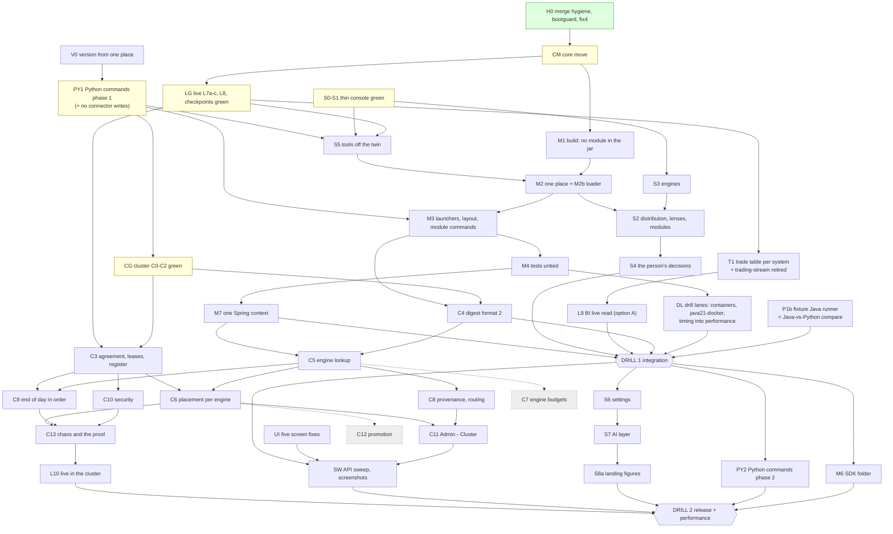

<!--
  Project Drishti · Any data. Any domain. One grammar.
  Copyright (c) 2026 Ashutosh Sinha <ajsinha@gmail.com>. All rights reserved.
  PROPRIETARY AND CONFIDENTIAL. See the LICENSE file in the root of this repository.
-->

# Release i5: the build plan

*Internal plan, written 2026-11-16 for the product owner. Planning only: no product code is in this change. Builders follow this
document; each builder brief links to its step in [section 2](#2-dependency-graph-and-lanes) and to the same step in
[section 8](#8-side-effects-and-what-builders-must-be-mindful-of). Sizes are the designs' own builder-days (one builder, one
day); the calendar is in [section 5](#5-critical-path-calendar-risks).*

The owner's ask (2026-11-16): *"The i5 steps should be planned so that we have optimum steps benefitting parallel and sequential
builds with reduction of repeated work and front loading where possible."*

## Contents

1. [Overlap analysis: where items touch the same code](#1-overlap-analysis)
2. [Dependency graph and lanes](#2-dependency-graph-and-lanes)
3. [Front-loading and what must be sequential](#3-front-loading-and-what-must-be-sequential)
4. [Integration checkpoints and the two drills](#4-integration-checkpoints-and-the-two-drills)
5. [Critical path, calendar, risks](#5-critical-path-calendar-risks)
6. [Recommended cuts and moves to i6](#6-recommended-cuts-and-moves-to-i6)
7. [Open questions for the owner](#7-open-questions-for-the-owner)
8. [Side effects and what builders must be mindful of](#8-side-effects-and-what-builders-must-be-mindful-of)
9. [Builder rules](#9-builder-rules)

## The plan on one page

- **Three lanes.** A = install and modules (version, Python commands, core move, modules M1–M7, then the cluster's engine half).
  B = thin console (S0–S7 and the landing figures), then the screens, the API sweep and the screenshots. C = live (make green,
  merge, trade tables), then the cluster's base (membership, agreement, digest, placement, security, chaos) and live L10.
- **Phase 0 writes nothing new.** About 45 builder-days of i5 code are on branches and not yet proven (cluster C0–C2, live
  L7a–L8 and the checkpoints, thin console S0–S1, core move, Polars P0–P2). Each lane first makes its own written code green
  and merges it. No lane writes a new step on top of unproven code.
- **Five orderings remove repeated work** (section 1): the Python commands merge before anything edits a launcher; the tools
  leave the resolver's Python twin (S5) before the modules step M2 would have had to re-point it; the core move merges before
  M1 and before live; one Spring context (M7) lands before the engine lookup (C5); the modules folder (M2, M3) lands before
  anything writes a `.dmod` to a node (C4, C6, promotion).
- **Two drills.** Drill 1 (integration) after every structural change is in: modules, thin console S0–S5, live L1–L9, cluster
  C0–C4. Drill 2 (release, with the performance lane) after engines anywhere, live L10, chaos and the release work. A second
  run of either only if the first needed fixes.
- **Size.** About 140 builder-days as scoped; about 115 with the cuts of section 6. Critical path about 33 builder-days:
  version → Python commands → M1 → M2 → M3 → M4 → M7 → C5 → C6 → C13 → L10 → Drill 2.
- **Cuts recommended** (section 6): cluster promotion C12 and engine budgets C7, Polars P3–P8, thin console's three job APIs
  (already agreed), `drill.sh` into Python, the binding designer's build.

---

## 1. Overlap analysis

Found by intersecting the changed files of every i5 branch against `origin/develop` (6929cdd51) and by reading the five
designs' own "what changes" tables.

### 1.1 Where the work stands (2026-11-16 08:00)

| Item | Branch | State | Behind develop |
|---|---|---|---|
| Hygiene (time-bomb dates, drill waves, failure files, Delta cache retry) | `wip/i5-hygiene` | done | 84 commits |
| Guard: every module boots with no externals | `wip/i5-bootguard` | done | 158 |
| `ModuleSwitchFollowsTest` reads its own server's resolution | `wip/i4-fix4` | done | 60 |
| Core pack into the market-data module; Pack designer shared-table option removed | `wip/i5-core-move` | written, impact-reviewed, **tests not run** | 98 |
| Thin console S0–S1 | `wip/i5-thin-console` | written, impact-reviewed, **tests not run** | 98 |
| Cluster C0–C2 (wrapper, JGroups membership, gossip deleted) | `wip/i5-cluster` | **code only, never compiled or run**; the C0 spike on Windows not done | 98 |
| Live L1–L7 | `wip/i5-live` | L1–L7 green (kernel and transports) | 98 |
| Live L7a–c, L8, checkpoints in the database | `wip/i5-live`, `wip/i5-live-checkpoints` | **edits, not compiled** | 98 |
| Polars P0–P2 (fixture, row rule, pins) | `wip/i5-polars` | Python side built; Java runner and three file rules left | 98 |
| Python commands, phase 1 | `wip/i5-python-cli` | **in progress**; 92 → 51 shell files so far | 0 |
| Modules outside the server jar | `wip/i5-module-jars-design` | design approved (Q1–Q11); no code | 0 |
| Binding designer | `wip/i5-binding-mockups` | three mock-ups; no choice yet | — |

Seven branches forked 98 commits ago. Every one is rebased onto develop (a merge of develop into the branch, never a force
push) **before** its tests run, so that a test is run once, on what will merge.

### 1.2 The overlaps, and the repeated work each ordering removes

| # | Shared code | Who touches it | Decision | Repeated work removed |
|---|---|---|---|---|
| **O1** | The launchers: `bin/start-server.*`, `bin/start-console.*`, `tools/rolling-upgrade.*`, `deploy/stack/**`, `run-configs/*.run.xml`, `deploy/docker/**`, `deploy/systemd` | Python commands (deletes the `.sh`/`.ps1`, adds `tools/launch/*.py`); cluster C2 and C3 (ports, the witness start script, 20 shared files); thin console S1 (9 shared files); modules M3 (modules folder in every launcher); `--iceberg` and `lake demo --lake` writing `config/connectors` | **Python commands phase 1 merges first (CP0).** Cluster, thin console and M3 then make each launcher change once, in `tools/launch/`. The `--iceberg`/`--lake` fix is done inside phase 1 (the start command is being rewritten there anyway) | every launcher change written once instead of three times (`.sh`, `.ps1`, run-config); the cluster's and thin console's edits to deleted shell files are ported once at their rebase instead of merged by hand; `<home>/lib`, `lib/ext` and `<home>/modules` laid out by one command (`setup`), not by M3 again |
| **O2** | The resolver's Python twin: `drishti-console/core/resolution.py` (1,276 lines), `tests/test_resolution.py`, the shared fixtures `pack-resolution/cases.yaml`, `connector-layers/cases.yaml` | core move (edited it); live L1 (edited it: `companion-of`); modules M2 (would re-point it to the `.dmod` folder and cache); thin console S5 (**deletes it whole**; tools ask the Java resolver through the jar) | **S5 is front-loaded: before M2.** Order: core move → live → S5 → M2. M2 then changes the Java resolver only | M2's "Python twin re-pointed" and M4's "Python fixture" (about 1 of M2+M4's 6.5 days) are never written; no third and fourth round of keeping the twin equal; the bug class of 11-15 ends before the largest change to module discovery |
| **O3** | Where the jar and the home are found: `DRISHTI_HOME`, `<home>/lib`, `tools/javacmd.py` | Python commands; S5 (tools call the jar); M3 (release layout); Polars and the lake build (the Java loader) | One lookup, in `tools/javacmd.py`, from phase 1. S5, M3 and the loaders call it and add nothing | no second "find the jar" in `tools/resolved.py`; `DRISHTI_JAR` and the `target/` fallback retired once |
| **O4** | Module files and their readers: `modules/**`, `packaging/**`, the registry, the module node, `data/modules/installed` | core move (moves files inside `modules/`; adds `modules/` to the console and loader images); M1/M2 (packs them, deletes `installed`/`store`/`shipped`/`active.yaml`); thin console S2 (the console stops reading module and distribution folders); the upgrade finding (stale installed modules shadow the shipped ones) | Core move → M1. The upgrade finding **is** M2's rules 3 and 5 (the cache is swept, leftovers are named in Health): no separate item. The leftover generated connector files get the same Health line in M2 (half a day). `modules/` in the console image, added by the core move, is removed by S2 | the "upgrade detects stale modules" item is not built as its own mechanism; the console image is not re-cut twice |
| **O5** | Spring contexts and engine beans: the module runtime, `EngineRegistry`, banking's engine classes, `ModuleSwitchFollowsTest`, the boot guard | M7 (one context; "lookups by loader"; child-context code deleted); cluster C5 (`EngineLookup`, six changes to `EngineRegistry`, banking's contracts, engines stop holding `VarService`); `wip/i4-fix4` (a test that depends on one resolution per context); the boot guard | **M7 before C5, both before Drill 1's base is frozen for the cluster's engine half; the same builder (lane A) does M7 then C5.** The fix4 test merges now and M7 owns it afterwards | `EngineRegistry` and banking's engine wiring are changed once in each direction instead of C5 being rewritten for the new context; one builder holds the context for both |
| **O6** | A `.dmod` reaching a node: the digest, placement "code staging", promotion | modules M2/M3 (`module install`, the package hash); cluster C4 (digest format 2), C6 (staging), C12 (promotion) | C4, C6 and C12 start after M3. C4 adds the package hash to the digest in the same change as `modules` and `engines` | the digest format changes once; staging and promotion are written once, against the modules folder |
| **O7** | The database schema files `schema-postgres.sql`, `schema-sqlite.sql` (no migrations) | live checkpoints (`drishti_live_checkpoint`, `drishti_live_position`); cluster C3 (`DatabaseAgreement`, leases, the register) | Live checkpoints merge first (CP1); C3 is written on top | one edit of both files per lane, no interleaved hand merge |
| **O8** | Trade connectors: `trade-<system>.yaml`, `trade-<system>-live.yaml`, `tools/packgen/source_module.py`, the Java loader's trade tables | core move; live L3 (`companion-of`); "one trade table per system"; the lake-build follow-up "Java trade tables"; retiring the old trading-stream feed | Core move → live merge → **one step T1** = trade table per system (default) and the common table with filter (both tested), on the Java loader and the Python path together, with the old trading-stream feed deleted in the same step | "Java trade tables" and "trade table per system" are one piece of work, not two; the live companion follows its lake connector, so the table switch needs no live change; the six templates are regenerated once |
| **O9** | Loader equality | Polars P1 (the 75-case contract fixture, Java runner outstanding); lake-build follow-up "Java-vs-Python compare" | The fixture's Java runner **is** the comparison. One step P1b | the compare tool is not built separately |
| **O10** | Engine lease and lookup | live L10; cluster C3, C5 | L10 last, on `Leases` and `EngineLookup` (both designs already say so) | no interim singleton code in live |
| **O11** | Generated and shared documents: `docs/admin/CONFIGURATION.md`, `settings_schemas.yaml`, `application.yaml`, `CLI_REFERENCE.md`, `API_REFERENCE.md`, `OPERATIONS_GUIDE.md`, `ADMIN_GUIDE.md`, `KERNEL_AND_MODULES.md`, `CHANGELOG.md` | every lane (the largest file intersection of all) | Generated files are **never merged by hand**: take develop's, run the generator, commit. Hand-written guides: each lane edits only its own sections; `CHANGELOG.md` is a union merge. `KERNEL_AND_MODULES.pdf` and the other PDFs are regenerated once, at release prep | no conflict fixing in generated text; the PDFs are built once |
| **O12** | Screens and their pictures: Admin → Cluster (C11), the Live column (L7), thin console pages, the five small screen fixes, the 20 QA screenshots, the API sweep's endpoint list | lanes A, B, C | Screens are fixed whenever a lane is free; **screenshots and the API sweep are run once, after Drill 1's fixes**, when the pages and the endpoint list (5 new console answers, `/admin/live`, the cluster's) are final | no second screenshot pass; the sweep's seed data and expected list written once |
| **O13** | The drill's tooling: `tools/drill.sh`, `tools/drillkit/drill_lanes.py` | hygiene (waves); Python commands (small edits); M3 (modules folder, state to clear); the containers and java21-docker lanes; timing tests into the performance lane | All drill tooling changes land **before Drill 1** and are frozen after it (lesson of 2.9.11: no drill tool change mid-release). `drill.sh` into Python is not in i5 (section 6) | Drill 1 proves the tooling once; Drill 2 reuses it unchanged |
| **O14** | The version | root `pom.xml` and 5 module poms, 5 Dockerfiles, `compose.yaml`, `deploy/aws/env.example`, `drishti-console/core/app.py`, `help.yaml`, the archetype, `under-construction.yaml`; thin console S0 (the console shows the server's version) | **V0 first** (the owner's first item): one source; the console half is already done by S0 (the server's `/public/about`), so V0 covers the build, the images, the tools and the release check only | the console's own version constant is not touched twice |

### 1.3 What does not overlap (safe in parallel at any time)

- Live L7a–L9 and the thin console, except `drishti-console/routes/admin_routes.py` (the Live column): live merges first.
- Polars and everything else, except `tools/lake/build.py` and `writers.py` with the Python commands (two small edits; rebase).
- Cluster C0–C3 and the modules work: membership and agreement do not read a module file.
- Thin console S3, S4, S6, S7 and the modules work: they serialise what the server already decides.

---

## 2. Dependency graph and lanes

### 2.1 The graph



Green = done, yellow = written and unproven, dashed = recommended for i6.

### 2.2 Models

Fable designs only (this plan, and a design question a builder raises). **Opus**: deep coding and debugging (modules M2, M7;
cluster C2, C3, C5, C6, C13; thin console S2, S4, S5; live green-up and L10). **Sonnet**: routine coding (V0, PY1, PY2, core
move, M1, M3, M4, M6, S3, S6, S7, T1, L9, C4, C8–C11, drill lanes, screens). **Haiku**: repetitive work (rebases of finished
branches, regenerating documents, screenshot retakes, the remaining shell-to-Python wrappers, CHANGELOG lines). The model is set
on every Agent call.

### 2.3 Lane A: install and modules, then the cluster's engine half

| Step | Goal | Branch | Model | Inputs | Outputs | Days | Tests that prove it | Merges at |
|---|---|---|---|---|---|---|---|---|
| **V0** | The version comes from one place and cannot drift | `wip/i5-version` | Sonnet | the 2.9.11.g literals (section 1.2 O14) | one source (see Q8), Maven `${revision}`, images and tools read it, a guard test (no version literal outside the source and the history files), a release check (tag equals version) | 1 | the guard test; `drishti.py --version`; `/public/about`; a jar's manifest | CP0 |
| **H0** | The three finished branches are on develop | `wip/i5-hygiene`, `wip/i5-bootguard`, `wip/i4-fix4` | Haiku | — | rebased, merged | 0.5 | their own tests; the gate | CP0 |
| **PY1** | Python commands phase 1 finished: setup, build jar, start, stop, status, `DRISHTI_HOME`, `<home>/lib`, `lib/ext`; `--iceberg` and `lake demo --lake` no longer write `config/connectors` (the named-lake mechanism of i4 instead); the guide's *Prepare your environment*, short way and manual way | `wip/i5-python-cli` | Sonnet | in progress | `tools/launch/*`, shell twins deleted, `test_launch.py` | 2 | `test_launch.py`, `test_launcher_memory.py`, `test_no_hidden_names.py`; a read-only-connectors test (start with `--iceberg` leaves `config/connectors` byte-identical); start/stop/status on Linux; the Windows check list (Q6) | CP0 |
| **CM** | Core move proven and merged | `wip/i5-core-move` | Sonnet | written; the impact review's notes | merged; market-data 1.1.0 | 1 | market-data-off test, `test_packs_in_modules.py`, resolver fixtures (Java and Python), contract docs regenerated with no diff, VaR goldens | CP0 |
| **M1** | The build writes twelve `.dmod` into `packaging/dist/target/modules`; the server jar holds no module | `wip/i5-modules` | Sonnet | CM | one server jar, `-Pmodules`, guard G1 | 1.5 | G1; the jar starts with an empty modules folder (G7 early) | with M2 |
| **M2 + M2b** | One place: discovery from `<home>/modules/*.dmod`, cache by hash and its sweep, leftovers named in Health (stale `installed`, **and** leftover generated connector files and `config/bindings.yaml`); the plain loader, kernel first, the duplicate-library warning | `wip/i5-modules` | **Opus** | M1, **S5** (no Python twin to follow) | `installed`/`store`/`shipped`/`active.yaml` and three settings deleted; G3, G4, G8, G9, G10 | 4.5 | G3–G10; `ConfigResolution` tests; **VaR goldens exact on the branch gate**; the boot guard | CP2 |
| **M3** | Launchers (Python only), run-configs, Docker, systemd, the stack and the drill name the modules folder; the release layout; `drishti.py module list/verify/install/remove/rollback` | `wip/i5-modules` | Sonnet | M2, PY1 | G5, G7; the launch-matrix test | 2 | G5, G7, `test_launch.py` matrix, container smoke | CP2 |
| **M4** | Kernel tests untied from module sources (28 + 9 files), `testing/drishti-modules-it`, G2 | `wip/i5-modules` | Sonnet (Haiku for the file moves) | M2 | G2 | 2 | full Java test run of the touched modules (one heavy slot); VaR goldens | CP2 |
| **M7** | One Spring context; child-context and unload code deleted | `wip/i5-modules-ctx` | **Opus** | M4 green on develop | G11, G12; conformance C13–C15 changed | 4 | prototype on genomics, then banking; G11, G12; boot guard; `ModuleSwitchFollowsTest`; VaR goldens exact; module on/off browser test | CP3 |
| **DL** | Drill lanes: containers and java21-docker run again; timing tests move to the performance lane (wall-clock tests keep hang bounds only); VLIM cold timing joins the performance lane | `wip/i5-drill-lanes` | Sonnet | M3 (Docker layout) | `drill_lanes.py`, `affected-map.txt`, TEST_HARNESS | 2.5 | `test_drill_lanes.py`, `test_drill_plan.py`; each new lane run once alone before Drill 1 | CP3 |
| | **Drill 1** | | | | | | | |
| **C5** | `EngineLookup`, contracts, the generated stub, deadlines, fail-over; banking's contracts; engines stop holding `VarService` | `wip/i5-cluster-engines` | **Opus** | M7, C4 | `EngineCluster`'s node choice deleted | 5 | lookup contract suite on `SimMembership`; VaR, FRTB-SA, SIMM goldens exact; C16 | CP4 |
| **C8** | Provenance names the computing node; routing by open dates; shards on the view; lake-root check | same | Sonnet | C5 | — | 2.5 | provenance in API, Explain and records; two-node test | CP4 |
| **M6** | SDK folder in the install; `DrishtiException`, `ErrorCode` into `drishti-api`; G6 | `wip/i5-sdk` | Sonnet | Drill 1 green | `sdk/` | 2 | genomics built from the SDK folder with no kernel source; G6 | CP4 (only if the lane is free; else i6) |
| **M5** | The modules documents; `MODULE_JARS_I5_DESIGN.md` deleted, its facts in KERNEL_AND_MODULES and the guides | with each M step; closed here | Haiku | — | docs | 1 | link check; CONFIGURATION regenerated | CP4 |

Lane A total: about 31.5 days (29.5 without M6).

### 2.4 Lane B: thin console, then screens, sweep and pictures

| Step | Goal | Branch | Model | Inputs | Outputs | Days | Tests that prove it | Merges at |
|---|---|---|---|---|---|---|---|---|
| **S0–S1 green** | What is written passes; the recorded `bootstrap.json` / `me-console.json` written by a Java test; core browser tests against the detached console | `wip/i5-thin-console` | **Opus** | written S0–S1; the impact review | merged | 2 | server contract tests (shape, ETag, 304, no person in the bootstrap); detached-console test; Help guides walk; two-people-at-once; the browser lane's packs tests | CP1 |
| **S5** | **Front-loaded.** `resolve --json` over the Java resolver, `tools/resolved.py`, the 43 tool files moved; `core/resolution.py`, `test_resolution.py` and the shared fixtures' Python half deleted | `wip/i5-thin-s5` | **Opus** | S0–S1, PY1 (jar lookup), CM and live merged (both edited the twin) | the twin gone; guard: no Python file but `tools/resolved.py` reads a pack, module, connector, bindings or rules folder | 5 | the tools' tests; generators produce byte-identical documents before and after; timing of a generator with the cache; message on an unbuilt checkout | CP1b, **before M2** |
| **S3** | Engines and under-construction from the bootstrap | `wip/i5-thin-s3` | Sonnet | S0 | console `engines.yaml` files and their equality test deleted | 2 | engine-off-everywhere (server side), menus from recorded answers | CP2 |
| **S2** | Distribution, lenses, modules from the bootstrap; `core/distribution.py` deleted; `modules/` leaves the console image | `wip/i5-thin-s2` | **Opus** | S1, M2 on develop | about 900 Python lines deleted | 5 | detached console (list shrinks); never-stale test; three distributions' browser tests | CP3 |
| **S4** | The person's decisions (functions, engines opened, admin pages, grants) | `wip/i5-thin-s4` | **Opus** | S2 | role literals in 33 files become lookups | 5 | menus-against-enforcement for the five demo roles; two-people-at-once | CP3 |
| **UI** | Five screen fixes: economy as-of falls back to the newest held date; the server root page says what it is; NEWS phone layout and the empty Snapshot column; curves' Business date column; BI desk-wall label cut | `wip/i5-screens` | Sonnet | none (fills waiting time) | — | 2 | one browser test each; the page walk and layout checks | CP3 |
| | **Drill 1** | | | | | | | |
| **S6** | Settings and limits from the server; `core/hostrule.py` deleted | `wip/i5-thin-s6` | Sonnet | Drill 1 | — | 3 | Help → Configuration and Admin → Configuration equal the server's | CP4 |
| **S7** | AI layer: the console calls the server only | `wip/i5-thin-s7` | Sonnet | S6 | about 4,400 lines and six tests deleted | 2 | AI browser tests; Health line for a console-only provider file | CP4 |
| **S8a** | Landing figures of trading and market data computed by the modules on the server | `wip/i5-thin-s8a` | Sonnet | S4 | `trading_landing.py`, `market_landing.py` deleted | 3 | figures equal before and after (recorded); server tests | CP4 |
| **SW** | API sweep with seeded data over every endpoint (list generated from the server, on the shared read-only lake); 20 QA screenshots retaken; push of the stamps (thin console Q8) | `wip/i5-sweep` | Sonnet (sweep), Haiku (screenshots) | Drill 1 fixes merged, UI, C11 | sweep test in the `other` lane; pictures | 4 | the sweep itself; picture diff reviewed | CP5 |
| **PY2** | Python commands phase 2: every remaining `.sh`/`.ps1` except `drill.sh`, `mvnw*` and a minimal container entrypoint (`tools/load-*`, `bench`, `pvgen`, `feeds`, `deploy/aws/**`, the public-data refresh wrappers) | `wip/i5-python-cli-2` | Haiku, Sonnet for `deploy/aws` | Drill 1 | 50 shell files → 3 | 5 | each command's test; `test_no_shell_scripts` guard (allow-list of three) | CP5 |

Lane B total: about 38 days.

### 2.5 Lane C: live, then the cluster's base

| Step | Goal | Branch | Model | Inputs | Outputs | Days | Tests that prove it | Merges at |
|---|---|---|---|---|---|---|---|---|
| **LG** | Live L7a–c, L8 and the checkpoints compile and pass; `wip/i5-live-checkpoints` folded into `wip/i5-live`; one merge of L1–L8 | `wip/i5-live` | **Opus** | CM merged (L8 edits market-data contracts that the core move touches) | file checkpoint store deleted; both schema files | 5 | `Live*Test` family, `JdbcLiveCheckpointStoreTest`, broker tests (RabbitMQ parked with a reason if it fights), `test_livecli`, the blotter's browser test, `VarPvStreamTest` family, **VaR goldens exact**, contract docs regenerated | CP1 |
| **P1b** | The loader fixture's Java runner (= the Java-vs-Python comparison) and the three file rules of P2 | `wip/i5-polars` | Sonnet | — | findings list for the owner | 2 | 75 cases on the Java loader and the Python path | CP2 |
| **T1** | One trade table per trading system by default; a common table with filter or query by connector YAML only; both first-class; Java loader and Python path; the old trading-stream feed and `TradingStreamTest` retired | `wip/i5-trade-tables` | Sonnet | LG, CM | six templates regenerated; DATA_GUIDE, the daily-load runbook | 3 | one test per layout for each of the six systems (read, live companion, row-rule RBAC); loader fixture cases for both; the boot guard | CP2 |
| **CG** | Cluster C0–C2 proven: the C0 spike's facts (Java 21, three nodes on one machine with real addresses, TCP only, TLS); compile; provider contract suite; no-multicast guard | `wip/i5-cluster` | **Opus** | PY1 merged (the launcher edits ported to Python) | gossip deleted for good | 4 | contract suite on `SimMembership` and `JGroupsMembership`; three-node kill and partition; `drishti.py net check`; the Windows spike items (Q6) | CP2 |
| **L9** | BI and pivot live read for `mode: live`, the snapshot chip; no incremental measures (option A) | `wip/i5-live-l9` | Sonnet | LG | BI's own live table copy deleted | 2.5 | BI live browser test; snapshot-by-default test | CP3 |
| **C3** | `DatabaseAgreement`, `RatisAgreement`, `FirstLiveAgreement`, `auto`, the witness (a Python command), leases, the register; run and inbox leases folded | `wip/i5-cluster` | **Opus** | CG, LG (schema files) | `FirstLiveElection`, `SwitchSync`'s transport deleted | 5 | agreement contract suite in each mode; lost-majority behaviour; singleton never twice (except `first-live`, stated) | CP3 |
| **C4** | Digest format 2: modules with the package hash, engines, lake roots | `wip/i5-cluster` | Sonnet | CG, **M3** | the `engines` service string deleted | 2.5 | drift shown for a node whose `.dmod` differs | CP3 |
| | **Drill 1** | | | | | | | |
| **C6** | Placement per engine (`format: 2`), plan and apply on the register, staging on the union | `wip/i5-cluster-place` | **Opus** | C3, C5 (lane A) | per-node switch differences deleted | 2.5 | VaR on node A, sensitivities and exposure on node B | CP4 |
| **C10** | `[net.tls]` on the three ports, certificate identity, reload, `drishti.py net certs` | same | Sonnet | C3 | — | 2.5 | TLS matrix; refusal of a wrong certificate in words | CP4 |
| **C9** | End of day in `needs` order across nodes | same | Sonnet | C3, C5 | *every member captures* deleted | 2.5 | one ordered run on two nodes; VaR goldens | CP4 |
| **C11** | Admin → Cluster (option A with C's needs line and SPOF card) on Drishti Elements in the Python console | `wip/i5-cluster-admin` | Sonnet | C4–C8 | — | 2.5 | browser test; layout checks | CP4 |
| **C13** | Chaos suite and the proof scenario as the release gate; the lost-majority runbook tested | `wip/i5-cluster-chaos` | **Opus** | C5–C10 | BENCHMARK fail-over timings | 2.5 | the suite | CP5 |
| **L10** | Live in the cluster: the singleton feed on `Leases`, relay, fail-over; an engine's live input through `EngineLookup` | `wip/i5-live-l10` | **Opus** | C3, C5, L1–L9 | — | 2.5 | fail-over of a queue feed with no loss and no duplicate | CP5 |

Lane C total: about 42 days. Lanes A and C share the cluster after Drill 1: lane A owns the engine side (C5, C8), lane C the
membership side (C6, C9, C10, C11, C13). The one shared class is `EngineRegistry`: lane A changes it, lane C only calls it.

### 2.6 Totals

| | Days |
|---|---|
| Lane A | 31.5 |
| Lane B | 38 |
| Lane C | 42 |
| Release preparation (README rewrite, deck refresh, CHANGELOG, RELEASE_NOTES, PDFs, benchmark document) | 3 |
| **i5 with the cuts of section 6** | **about 115** |
| Cut or moved (C12 5, C7 2.5, Polars P3–P8 12, S8 jobs 5, `drill.sh` 2) | about 26 |

---

## 3. Front-loading and what must be sequential

### 3.1 Can start now, with no dependency

| Work | Why it is free |
|---|---|
| **V0** version from one place | the owner's first item; touches build files nobody else is editing today |
| **H0** merge hygiene, bootguard, fix4 | finished |
| **PY1** finish | in progress; everything that touches a launcher waits for it, so it is the most valuable thing to finish |
| **CM** core move tests | written and reviewed; blocks M1 and LG |
| **S0–S1 green** | written; independent of the lanes above except generated documents |
| **LG** compile fixes (edits and module-level compile) | may begin at once; its **merge** waits for CM |
| **UI** five screen fixes | no dependency; they fill any lane's wait for the heavy slot |
| **P1b** | independent of everything |
| **C0 spike facts** on the Windows QA machine and **P0** wheel check | need only the owner or QA (Q6); the answers are needed at CG, so ask now |
| Briefs for M1–M7, S5, T1 | Fable or Opus writes them while phase 0 runs, from this plan's section 8 |

### 3.2 Front-loaded on purpose (moved earlier than their designs said)

| Moved | From | To | Gain |
|---|---|---|---|
| **S5** tools off the twin | after Drill A of the thin console | right after S0–S1, before M2 | O2: the twin dies before the modules work would have had to keep it equal |
| **M7** one Spring context | last step of the modules design | before Drill 1 | O5: C5 is built once on the final context; Drill 2 does not carry a start-order change |
| **DL** drill lanes | "sometime in i5" | before Drill 1 | O13: the new lanes are debugged in the integration drill, not in the release drill |
| **PY1** | parallel item | gate of phase 0 | O1 |
| The `--iceberg`/`--lake` fix | own item | inside PY1 | the same lines are being rewritten |
| Upgrade detection | own item | inside M2 | O4 |

### 3.3 Must be sequential, and why

| Chain | Reason |
|---|---|
| PY1 → CG, S5, M3 | they edit launchers or find the jar; the shell twins must be gone first |
| CM → M1 → M2 → M3 → M4 → M7 | each changes what the next packs, finds, starts or tests; M2 in one branch so there is never a mixed state |
| CM → LG | L8 edits the market-data contracts the core move re-homes |
| CM, LG → S5 → M2 | all four edit the resolver's twin; the delete comes after the last two edits and before the largest |
| LG → C3 | both schema files |
| M3 → C4; M7 → C5; C5 → C6, C8, C9; C3, C5 → L10 | sections 1.2 O5, O6, O10 |
| S1 → S2 → S4 | S4's answers hang on the modules and lenses S2 serves |
| Drill 1 fixes → SW | pictures and the sweep's list are taken once |
| Heavy jobs | one at a time for the whole machine: a full Maven build or test run, a lake build, the browser lane. A lane that waits for the slot edits only (a UI fix, documents, the next brief) |

---

## 4. Integration checkpoints and the two drills

A checkpoint is a merge window on develop. Order inside a window is fixed; each merge passes its **pre-merge gate** (the
affected tests from `tools/drillkit/affected.py`, the guards, VaR goldens where marked) on the rebased branch, then develop is
pushed. `wip/*` branches are pushed after every step.

| # | Merges, in this order | Gate on develop after the window |
|---|---|---|
| **CP0** foundations | H0 (hygiene, bootguard, fix4) → V0 → PY1 → CM | one Maven build with tests of the touched modules; tools tests; launch tests; VaR goldens; pre-drill check |
| **CP1** proven code in | LG (live L1–L8, one merge) → S0–S1 | Java tests of kernel, plugins, banking; the browser lane **once**, alone (first run with the detached console); VaR goldens |
| **CP1b** | S5 | tools tests; every generator run, outputs identical; guard on folder readers |
| **CP2** one place | M1+M2+M2b+M3+M4 (one branch) → S3 → P1b → T1 → CG | full Java run; G1–G10; launch matrix; container smoke; three-node cluster test; VaR goldens |
| **CP3** structure final | M7 → S2 → S4 → C3 → C4 → L9 → UI → DL | G11, G12; menus against enforcement; agreement suite; each new drill lane once alone; pre-drill check; **freeze** |
| **Drill 1** | | integration |
| **CP4** | Drill 1 fixes → C5 → C8 → C6 → C9 → C10 → C11 → S6 → S7 → S8a → M6 → M5 | affected tests; two-node proof scenario; goldens of VaR, FRTB-SA, SIMM |
| **CP5** | C13 → L10 → SW → PY2 → release preparation | chaos suite; sweep; pre-drill check; **freeze** |
| **Drill 2** | | release |

**Drill 1, integration.** When: after CP3. Scope: every lane, in two waves (CPU-heavy lanes first, then browser, other,
containers, anywhere), including the new containers and java21-docker lanes and the detached console; the shared read-only
test lake; lake-writing tests stay parked with their reason; no performance lane. Purpose: prove the structural changes
together (modules folder, one context, thin console S0–S5, live L1–L9, the cluster's membership and agreement) while the
cluster's engine half is not yet written, so its fixes cannot collide with new code in the same classes. During the drill:
edits only (C5 and C6 are written, not run). A second run only for what the first one's fixes touched (the affected lanes), not
a full repeat, unless a fix changed a shared kernel class.

**Drill 2, release.** When: after CP5. Scope: everything of Drill 1, plus the performance lane (the timing tests that moved,
VLIM cold timing, thin console page latency gates, live throughput floors, fail-over timings), the chaos suite and the proof
scenario (VaR and a second engine on different nodes), the API sweep, an upgrade rehearsal on a copy of an i4 data folder
(stale `installed`, generated connectors, `lib` in the data folder). i5 moves performance tests, so the rule "always two for
performance releases" applies: plan for a second run of the performance lane alone. Then the release steps wait for the owner.

**Between drills** no change to `tools/drill.sh` or `tools/drillkit/` (lesson of 2.9.11), and the merge worktree is never
checked out or reset for a read (`git show`).

---

## 5. Critical path, calendar, risks

### 5.1 Critical path

```
V0 (1) → PY1 (2) → M1 (1.5) → M2 (4.5) → M3 (2) → M4 (2) → M7 (4) → Drill 1 → C5 (5) → C6 (2.5) → C13 (2.5) → L10 (2.5) → Drill 2
```

About 30 builder-days of steps plus S5's share before M2 (S5 must finish before M2 does; they overlap M1) and the two drills:
**about 33 builder-days on one chain.** Lane A carries it until C5; lane C from C6. Second-longest chain: S0–S1 → S5 → S2 → S4
(17 days) to Drill 1. Slack: lane B has about 10 days of slack before Drill 1, which is where UI, P1b and the briefs go.

What shortens the path: nothing by adding builders (the chain is serial and the cap is three). What lengthens it: a red M2 or
M7 (the two medium-to-high risks), and waiting for the heavy slot. So lane A has first call on the heavy slot from M1 to M7.

### 5.2 Calendar

Two figures, because the designs' builder-days and the observed pace differ widely.

| Basis | Build | Drills | Total |
|---|---|---|---|
| **Designs' builder-days taken literally** (33 on the critical path, three lanes, 15% rework) | about 7.5 working weeks | 1 week | **about 8.5 weeks** |
| **Observed pace** (2026-11-15: live L1–L7, about 22 design-days, was written and made green by one builder in one calendar day; cluster C0–C2 and thin console S0–S1 were written the same day but **not** tested) | 7 to 9 calendar days | 3 to 4 days | **10 to 13 calendar days: target tag about 2026-11-28** |

The second figure is the planning figure, with one caution: on 11-15 writing was fast and **testing** was the limit, because
every heavy job shares one slot. i5's remaining steps are heavier on that slot than live was (full Java runs for M2, M4, M7;
three-node cluster tests; the browser lane for every thin console step). The figure is re-measured at CP1 and CP2: if phase 0
(CP0 + CP1) takes more than two calendar days, the total moves towards three weeks and the Q1 and Q2 cuts become necessary,
not optional.

### 5.3 Risks

| # | Risk | Effect | Mitigation |
|---|---|---|---|
| R1 | About 45 builder-days of written, unproven code (cluster never compiled) hides design-level faults | phase 0 grows; later steps built on sand | phase 0 writes nothing new; each lane proves its own; the cluster's is proven last of the three because nothing before Drill 1 except C3 and C4 depends on it |
| R2 | M2 or M7 breaks the server's start in a way only the browser lane or the cluster shows | critical path slips | M2 in one branch with G3–G10; M7 prototyped on genomics first; VaR goldens on the branch gate after each of M1–M4 and M7; both before Drill 1 |
| R3 | The one heavy slot starves two lanes | idle builders, or untested code piling up again | lane A has priority from M1 to M7; waiting lanes take edits-only work from a named list (UI, P1b edits, briefs, documents); the rule "no new step on an unproven one" holds even when a lane waits |
| R4 | JGroups or Ratis misbehaves on Windows or Java 21 | the cluster's agreement mode changes | the C0 spike's facts at CG (Q6); `jgroups-raft` behind the same wrapper; the database lease mode covers sites with Postgres |
| R5 | S5 makes every tool need a built jar | a generator on an unbuilt checkout fails; drills slow down | approved (thin console Q2); the cache of the resolved JSON by stamp; one message naming `drishti.py build jar`; measured in S5's gate |
| R6 | Thin console and modules disagree on what "modules" the bootstrap lists while M2 is in flight | wrong menus | S2 merges after M2 (CP3 after CP2); S0–S1's answers come from the registry's API, which M2 does not change |
| R7 | The owner's running three-node stack and data folder are changed by a builder's test | lost demo state | builders never start or stop `drishti-stack`; tests use `@TempDir` and the shared read-only lake; the upgrade of the stack is one rehearsed step after the tag (Q7) |
| R8 | Generated documents conflict at every merge | hours lost | rule O11: regenerate, never merge |
| R9 | RabbitMQ tests fight the machine | LG slips | owner's rule of 11-15: park with an explicit reason, plugin ships off, work to i6 |
| R10 | Scope: 140 days is two releases' worth | i5 is not shippable | section 6; Drill 1 is a natural tag point if the owner wants a release earlier (Q9) |
| R11 | Session isolation leaks in the thin console's per-person answers | release blocker | the two-people-at-once test from S0; nothing per person in `ServerFacts` |
| R12 | Windows cannot be checked here (no `pwsh`, no QA machine) | a Python command fails on Windows after the shell twin is deleted | Python only removes the `.ps1` risk; one Windows check list run by QA at CP0 and CP5 (Q6) |

---

## 6. Recommended cuts and moves to i6

| # | Item | Days | Recommendation | Reason |
|---|---|---|---|---|
| X1 | **Cluster C12, promotion between clusters** | 5 | **move to i6** | It is the cluster's last and most separable step; its signature waits for release j anyway; after M3 an operator already has `drishti.py module install` and `rollback` per node, which is the offline-bundle path in plain form. i5 still delivers the owner's cluster requirement (engines local or remote, VaR and a second engine on different nodes) |
| X2 | **Cluster C7, engine budgets and pools** | 2.5 | **move to i6** | It folds VaR's and exposure's memory settings: a change next to the goldens with no functional need for the proof scenario; it fits i6, where six engines share a node |
| X3 | **Polars P3–P8** (the engine, benchmark, retiring the Python path) | 12 | **move to i6; keep P1b** | Every Polars step is proven by lake-**writing** tests, and those are parked to i6 by the owner's decision of 11-15. Building a third loader engine while its proof is parked is untested code by design. P1b (the fixture's Java runner) stays: it is also the Java-vs-Python comparison |
| X4 | **Thin console S8 jobs** (lake build, lake maintenance, pack design as server jobs) | 5 | i6 (already approved as thin console Q7) | listed for completeness; the three pages say they need a console on the server's machine |
| X5 | **`tools/drill.sh` into Python** | 2 | **first item of i6** | The owner's rule: last, on its own, never during a drill; the lesson of 2.9.11: no drill tool change mid-release. Changing the drill between two drills of a release this large breaks both rules. `drillkit/` is already Python |
| X6 | **Binding designer build** | — | i6, after the owner picks a mock-up | only mock-ups exist; live's Admin column already changes the Data bindings page in i5 |
| X7 | **L9 incremental additive measures** | 2.5 | not in i5 (option A) | the live read and the snapshot chip meet decision Q4; incremental is an optimisation with no user yet |
| X8 | **M6 SDK folder** | 2 | i5 only if lane A is free after Drill 1 | the owner's own condition; in-repository modules do not need it |

Kept although large: M7 (the owner's rule, same release), thin console S5–S7 (they delete; each removes a divergence), C13
(the release's proof).

---

## 7. Open questions for the owner

| # | Question | Recommendation |
|---|---|---|
| **Q1** | Move cluster promotion (C12) and engine budgets (C7) to i6? | **Yes** (X1, X2). i5 keeps engines local or remote with the two-node proof. Saves 7.5 days on the busiest lane |
| **Q2** | Move Polars P3–P8 to i6 and keep only the fixture's Java runner in i5? | **Yes** (X3): its proof is lake-writing tests, parked to i6 |
| **Q3** | `drill.sh` into Python: first item of i6 rather than inside i5? | **Yes** (X5). Every other shell file goes in i5 (PY2) |
| **Q4** | M7 (one Spring context) before Drill 1 instead of last? | **Yes.** The engine lookup is then built once on the final context, and the release drill carries no start-order change. Cost: Drill 1 comes about four days later |
| **Q5** | S5 before M2 means every Python tool and generator needs a built jar from the first week of i5 (thin console Q2, approved). Confirm it may start that early | **Yes.** `drishti.py build jar` exists from PY1; one clear message on an unbuilt checkout |
| **Q6** | The Windows QA machine: can QA run one check list at CP0 (the Python commands; JGroups and Ratis spike items; the Polars wheel check P0) and again at CP5? | **Yes, one hour each.** Nothing else in the plan can prove Windows; without it CG proceeds on Linux facts and Windows stays an open risk named in the release notes |
| **Q7** | The owner's three-node stack: upgrade it to i5 only once, after the tag, with a short full stop (cluster design Q, approved) and the rehearsed upgrade (modules folder, `lib/ext`, leftovers moved aside)? | **Yes.** Until then it stays on i4.1; no builder touches it |
| **Q8** | The version's one place: a committed file read by Maven (`${revision}`), Python, the images and the release command, with a release check that the tag equals it; or the git tag itself read at build time? | **The committed file plus the check.** An installed product and a source archive have no git; the check gives "never drifts from the tag" |
| **Q9** | If the calendar slips: tag at Drill 1 as i5 (modules, thin console S0–S5, live L1–L9, trade tables, Python commands, the cluster's membership) and ship engines anywhere, L10 and S6–S8a as i5.1? | **Decide at CP2 from the measured pace.** Default: one release |
| **Q10** | "L9 option A" is read here as: the BI live read and the snapshot chip, **without** incremental additive measures. Correct? | assumed yes (X7) |
| **Q11** | Common trade table with filter: is `where: SOURCE_SYSTEM = …` in the connector YAML enough, or is a free query also needed in i5? | **Filter first; query only where the plugin already supports one** (no new query language in a connector) |
| **Q12** | The retired trading-stream feed: delete `config/connectors.examples/other/trading-stream.yaml`, `TradingStreamTest` and `tools/samplegen/stream.py`'s old mode in T1, with a Health line for a site file that still names it? | **Yes** (no dual machinery; the live companions replace it) |
| **Q13** | Binding designer: which mock-up (A, B or C)? | choose now, build in i6 (X6) |

---

## 8. Side effects and what builders must be mindful of

Added at the owner's request (2026-11-16 07:48). For each step: what else it can break, what to scan before changing, what to
run after, and who goes first when two lanes meet. A builder brief links to its step here. The general rules are in
[section 9](#9-builder-rules).

Words used below. **Twin**: Python code that repeats Java logic. **Stack**: the owner's running three-node cluster
(`drishti-stack/`, ports 18480/17480) and its data folder, which no builder starts, stops or writes. **Goldens**: the VaR
golden tests, which must stay exactly equal.

### 8.1 Lane A

**V0, version from one place**

| | |
|---|---|
| Can break | every Maven module's version (parent and the five `compute/*` poms that name it), the archetype's generated project, Docker image tags and `compose.yaml`, `deploy/aws/env.example`, Help's version line (`drishti-console/config/help.yaml`), `test_help.py`, `test_engine_pages_menu.py`, `config/under-construction.yaml`'s release words, banking's exact-kernel-build pin (`FirstParty.java`: a changed version string refuses banking) |
| Scan first | `git grep -n "2\.9\.11"` outside `docs/`, `CHANGELOG.md`, `RELEASE_NOTES.md`; `.mvn/`; `packaging/**/pom.xml`; `drishti-sdk/**`; `deploy/docker/**`; `drishti-console/core/app.py` |
| Run after | a clean Maven build of everything; the guard test; `drishti.py --version`; `/public/about`; banking loads (boot guard) |
| Cross-lane | goes first, alone, before PY1 merges (PY1's `build jar` reads the version). The console's shown version belongs to S0: do not touch `ServerFacts` |

**PY1, Python commands phase 1**

| | |
|---|---|
| Can break | every caller of a deleted script: `deploy/stack/**`, `deploy/systemd`, Dockerfiles' entrypoints, `run-configs/*.run.xml`, `tools/drill.sh` and `drillkit/` (they start servers), `tools/rolling.py`, the guides' command lines and tutorials, test stacks under `drishti-console/tests/*_stack.py`, the **stack** (it calls `bin/`), Windows (no `pwsh` here), launcher memory settings (`test_launcher_memory.py`), `DRISHTI_LIB_PATH`'s default moving from `<data>/lib` to `<home>/lib/ext` (an existing install's JDBC driver is no longer found) |
| Scan first | `git grep -n "bin/start-\|\.sh\b\|\.ps1\b"` in `deploy/`, `tools/`, `docs/`, `run-configs/`, `drishti-console/tests/`; `tools/settings_schemas.yaml`; `tools/test_no_hidden_names.py` |
| Run after | `test_launch.py`; start, status, stop of a server and a console on a temp data folder; `config/connectors` byte-identical after `start --iceberg` and `lake demo --lake`; the container smoke; the documents' command lines against `tools/drishti_parser.py` (CLI_REFERENCE is generated from it) |
| Mindful | upgrade of an existing install: `start` says in words when it finds jars in `<data>/lib` and none in `lib/ext`; it does not move them. `start` refuses more than one server jar in `<home>/lib`. Nothing is written outside the data folder |
| Cross-lane | goes before CG, S1's merge, S5 and M3. `wip/i5-cluster` and `wip/i5-thin-console` both edited `bin/start-*.sh/.ps1`, `rolling-upgrade.*` and `deploy/stack`: at their rebase, **take develop's deletion and re-apply the intent in `tools/launch/serverstart.py`, `consolestart.py`, `clusterctl.py`**; do not resurrect a shell file. `tools/drill.sh` gets only the lines it needs to call the Python start; nothing else in it changes |

**CM, core move**

| | |
|---|---|
| Can break | every pack that named `core` (routes for CORE and the ten party words), a server with market-data **off** (the core kinds vanish: the test exists, read it), `docs/contracts/packs/core.md`, the resolver fixtures on both sides, `tools/packgen/source_module.py`, pack guides and Help links, the console and loader images, demo lakes' table names, an existing install whose site folder overrides `config/packs/core/**` (now not used: Health must say so), goldens (the party and book reference data VaR's hierarchy reads) |
| Scan first | `git grep -n "packs/core\|pack: core\|\"core\""` in `modules/`, `config/`, `tools/`, `drishti-console/`, `kernel/**/test`; the impact review's notes on the branch |
| Run after | market-data-off test; `test_packs_in_modules.py`; resolver fixture tests (Java and Python); contract docs and CONFIGURATION regenerated; goldens; a demo lake from the cache still opens |
| Cross-lane | before M1 (which packs `modules/` as it finds it) and before LG's merge (L8 edits market-data contracts) and S5 (both touch `core/resolution.py`). It also removed the Pack designer's shared-table layout: the thin console's S8 later moves the pack designer's job; nothing to merge now |

**M1–M4, modules outside the server jar**

| | |
|---|---|
| Can break | **everything that starts a server**: launchers, run-configs, Docker, systemd, ECS task definitions, the drill, test stacks, the stack; every reader of a module folder (the design's resolver inventory, `docs/architecture/pack-resolution-inventory.md`); kernel tests that read `modules/banking/**` (28 + 9 files); `testing/drishti-it`; banking's tests against the server's test jar; module on/off (`ModuleSwitchFollowsTest`, the engine switches); the module commands (`tools/modulecli.py`); the developer switch that reads source folders; distributions (a distribution was "what is in the jar"); cluster nodes with different `.dmod` files; an **existing install**: `data/modules/installed/*-1.0.0` and `store`, `shipped`, `active.yaml`, the three removed settings in a site's files |
| Scan first | `git grep -n "modules/installed\|module-deploy\|modules\.path\|modules\.shipped\|active\.yaml\|DRISHTI_MODULES_HOME"` everywhere; `packaging/**`; root `pom.xml` reactor; `tools/drill.sh` (state it clears); `deploy/docker/**`; `tools/test_config_readers_guard.py`'s allow-list |
| Run after | G1–G10; the boot guard; a full Java run (heavy slot); goldens on the branch gate after **each** of M1, M2, M3, M4; the launch matrix; container smoke; the upgrade rehearsal on a planted old data folder (Health names the leftovers, nothing is read from them, nothing is deleted by the server) |
| Mindful | the server never writes the modules folder by default (read-only, opt-in write); the cache is under `<data>/cache/modules` and may be deleted at any time; a removed setting found in a site file is named in Health, not silently ignored; no version of the code may read both the old and the new place |
| Cross-lane | S5 merges **before** M2, so M2 does not touch Python resolution. If S5 is late, M2 does not wait by editing the twin: lane A works on M1 and the M3/M4 edits until S5 lands. S2 (thin console) merges after M2. C4 waits for M3. The drill's changes (`drill.sh:578` state list, `DRISHTI_MODULES_HOME`) are made here and reviewed with DL, before Drill 1 |

**M7, one Spring context**

| | |
|---|---|
| Can break | the server's start order; bean name clashes between a module and the kernel; anything that looked a bean up in a module's child context (engine registration, module REST controllers, module security filters, scheduled jobs, `@Value` settings of a module); module off at run time (no unload any more: off means not registered at the next start; check what the Admin switch now says); each context's own `ConfigResolution` (commit 9e8d318f1 and the fix4 test); conformance C13–C15; start-up time and the CDS archive (`tools/drillkit/server_cds.py`); goldens |
| Scan first | the module runtime package; `EngineRegistry`; every `ApplicationContext` and `getBean` use under `kernel/drishti-server`; `modules/banking/**/config`; `ModuleSwitchFollowsTest`; the boot guard test |
| Run after | G11, G12; genomics first, then banking; the boot guard; module and engine switch browser tests; goldens; start-up time against the last drill's figure |
| Cross-lane | lane A then writes C5 on this base. Lane C's cluster branch must not change `EngineRegistry` before C5 (it only calls it). Lane B's bootstrap lists modules from the registry: the answer's shape must not change; the recorded `bootstrap.json` is the check |

**DL, drill lanes**

| | |
|---|---|
| Can break | the drill's memory budget and waves (a new container lane beside the browser lane), lane selection (`affected-map.txt`), tests that silently stop running when moved to the performance lane |
| Scan first | `tools/drillkit/drill_lanes.py`, `drill_plan.py`, `affected-map.txt`, `tools/drill.sh`; every test with a wall-clock assertion (`git grep -n "assertTimeout\|elapsed\|perf_counter"` in tests) |
| Run after | `test_drill_lanes.py`, `test_drill_plan.py`; each new lane once, alone; a count: tests before = tests after, across lanes (none lost) |
| Cross-lane | all drill tooling changes (hygiene's, PY1's, M3's, these) are in before Drill 1; then frozen |

**C5, C8 (lane A, after Drill 1)**

| | |
|---|---|
| Can break | VaR, FRTB-SA, SIMM, sensitivities and exposure wiring (direct `VarService` and `FrtbService` injections go); `EngineGateFilter`; Explain and "Why it moved" (they call engines); pivots and computed kinds that need an engine; provenance fields in API answers (clients, the console's record panel, official records); latency of FRTB-SA → VaR chains; a single server (must load no cluster library) |
| Scan first | `git grep -n "VarService\|FrtbService\|EngineCluster\|EngineRegistry"`; `META-INF/drishti/engines.yaml` of every module; API_REFERENCE's engine answers |
| Run after | goldens of VaR, FRTB-SA, SIMM, exact; the lookup contract suite; the single-server boot guard; the two-node test; the API sweep's engine endpoints |
| Cross-lane | lane C writes C6, C9, C10 against `EngineLookup`'s interface (agreed in the brief before C5 starts); C5 merges first, then C8, then lane C's steps |

### 8.2 Lane B

**S0–S1 green, and every thin console step**

| | |
|---|---|
| Can break | any page whose content came from a folder read (packs, guides with pictures, workspaces, facts, READMEs); a console started before the server (the waiting page); a console against an older server (must say so on every page); two people on one worker (per-person answers must never sit in a shared cache); the three distributions; phone layouts; the ECS and compose console definitions (`packs.enabled`, `DRISHTI_PACKS` removed); the rolling upgrade order (servers first, consoles last); the stack's consoles |
| Scan first | `test_thin_console_guard.py`'s list (it only shrinks); `git grep -n "core.resolution\|open(\|Path("` under `drishti-console/core` and `routes`; the impact review's notes; `deploy/docker/**console**`, `deploy/docker/ecs/**` |
| Run after | the detached-console test; server contract tests; two-people-at-once; never-stale; the affected browser tests only (the whole browser lane once per checkpoint, alone) |
| Mindful | a step's merge holds the new call **and** the deletion; no flag, no fallback to the file reader. Recorded answers are written by a Java test and read by Python, one direction only |
| Cross-lane | `drishti-console/routes/admin_routes.py` is also edited by live L7c: LG merges first at CP1, then S0–S1 rebases. `drishti-console/config/application.yaml` and `bin/start-console.*` are also PY1's: PY1 first |

**S5, tools off the twin**

| | |
|---|---|
| Can break | 43 tool files and every generator (contracts, CONFIGURATION, pack guides, CLI reference, the elements catalogue), `tools/lake/**` (demo and test lake builds), `tools/packgen/**`, the drill's Python lanes, `tools/test_config_readers_guard.py`, an unbuilt checkout (no jar), the speed of every tool call (a JVM start per call unless cached), Windows (the jar is found by `tools/javacmd.py` only) |
| Scan first | `git grep -ln "resolution" tools/ drishti-console/`; `pack-resolution/cases.yaml`, `connector-layers/cases.yaml` and who reads them; `schemakit` |
| Run after | every generator, outputs byte-identical to before; tools tests; a timing of the slowest generator before and after; the guard |
| Cross-lane | after CM and LG are on develop (both edited `resolution.py`; their edits must be in the Java resolver, which they are, before the twin is deleted); before M2. If LG is late, S5 does not wait more than a day: it rebases over LG's twin edits later, since it deletes the file anyway |

**S2, S3, S4**

| | |
|---|---|
| Can break | menus and page visibility for every role, lens and distribution (a page hidden that a role may open, or the reverse); a console's own `--distribution` (thin console Q3: the server compiles it); `plugin.yaml` words, paths, statics; white-label brand; engine pages when an engine is off; under-construction notices |
| Scan first | `core/distribution.py`, `edition.py`, `house.py`, `menus.py`, `module_parts.py`, `core/engines.py`, `under_construction.py`; the role literals in 33 files (`git grep -n "'admin'\|\"admin\"\|risk_manager"` under `drishti-console`) |
| Run after | menus-against-enforcement for the five demo roles; the three distributions' browser tests; engine-off-everywhere; session isolation |
| Cross-lane | S2 after M2 (CP3 after CP2). C11 adds Admin → Cluster pages: it registers them through the server's `admin-pages` answer from S4, not a new console literal |

**UI, SW, PY2**

| | |
|---|---|
| Can break | UI: phone layouts of neighbouring pages (shared Elements grid CSS), the economics pack's as-of logic used by other pages, BI wall labels in other tiles. SW: nothing in the product; it must not write the shared lake (read-only) and seeds only through a temp data folder. PY2: AWS deploy flows that nobody can run here (`deploy/aws/**`), the public-data refresh schedules, pvgen and bench callers in the documents |
| Scan first | UI: the Elements library the page uses (extend the library, no bespoke code); SW: the server's endpoint list (generated), `API_REFERENCE.md`; PY2: `git ls-files '*.sh' '*.ps1' '*.cmd'` and every document that names one |
| Run after | UI: the page walk and layout checks; SW: the sweep twice (same result); PY2: each command's `--help` and a dry run; the guard that allows only `mvnw`, `mvnw.cmd`, `tools/drill.sh` and one container entrypoint |
| Cross-lane | SW's screenshots after C11 and every UI fix; PY2 never touches `tools/drill.sh` and merges before the CP5 freeze |

### 8.3 Lane C

**LG, live L7a–L8 and the checkpoints**

| | |
|---|---|
| Can break | the live trade blotter's hot path; Kafka, ActiveMQ and RabbitMQ plugins (their own index and state store are gone); VaR intraday landing (`VarPvStream` family) and therefore goldens; a server with **no broker** (must start; feeds say NOT CONFIGURED); a site's `pv-updates` override or `mode:` setting (read for one release, named in Health; the server rewrites nothing); both schema files (new tables; no migration, so an existing SQLite or Postgres database needs the tables created at start: check how); 19 market-data contracts and their generated pages; Admin → Data bindings; `drishti.py live`; cluster nodes (which node consumes: until L10, one node, stated) |
| Scan first | `kernel/drishti-common/**/live`, `SourceRegistry`, `Bindings.java`, the three broker plugins, `schema-*.sql`, `modules/market-data/packs/market-data/contracts`, `drishti-console/routes/admin_routes.py`, `tools/livecli.py` |
| Run after | the `Live*Test` family, the broker tests against real brokers one at a time, the broker-absent tests, `VarPvStream*` and `VarIntradayApiTest`, goldens, the boot guard, contract docs regenerated, the blotter's browser test |
| Cross-lane | merges before S0–S1 (`admin_routes.py`), before C3 (schema files) and before S5 (the twin). `wip/i5-live-checkpoints` is folded into `wip/i5-live` first (it is 1 commit beside 2); one branch, one merge |

**T1, trade tables**

| | |
|---|---|
| Can break | every reader of trades: pivots, BI models, VaR's position inputs (goldens), the six source-system modules, row-rule RBAC, record pages, the live companions, the demo and test lakes' table names (the **shared read-only test lake** and the lake cache must be rebuilt once: one heavy job, planned), tutorials and screenshots that show `trades`, the daily-load runbook, a site on the common table (must keep working by config only) |
| Scan first | `git grep -n "trades_\|table: trades\|SOURCE_SYSTEM"`; `tools/packgen/source_module.py`; `tools/lake/**`; the Java loader's table naming; `config/connectors.examples/**`; `trading-stream` references (section 7 Q12) |
| Run after | both layouts for all six systems; the loader fixture; goldens; the boot guard; the lake cache rebuilt and its key changed |
| Cross-lane | after LG and CM. The lake rebuild is the one heavy job of its hour: announce it; lanes A and B hold their heavy jobs |

**CG, C3, C4, C6, C9, C10, C11, C13**

| | |
|---|---|
| Can break | a **single server** (must load no JGroups or Ratis class and need no setting); every consumer of membership (`NetService`, `RunCluster`, routing, drain, readiness, the digest, `members.json`); the settings (old gossip keys are refused with the new key named: an existing node's `net/node.yaml` and `peers/` stop the start in words); ports 7946/7947 on a machine that already runs the stack; multicast (never: guard test); both schema files (C3); singletons (scheduler, live feeds, end-of-day capture: never twice); switches and placement adopted from the register instead of the digest; an existing cluster (short full stop to move to i5: no rolling upgrade from gossip); the Docker and ECS node definitions; tutorial 22 and `deploy/stack/nodes/**`; end-of-day VaR capture (C9) and goldens |
| Scan first | `net/**`; `git grep -n "Gossip\|MemberTable\|PeersFile\|FirstLiveElection\|SwitchSync"`; `deploy/stack/**`; `drishti-console/tests/net_stack.py`; `tools/bench/net_soak.py`; `tools/settings_schemas.yaml`; CLUSTER_GUIDE |
| Run after | the provider and agreement contract suites; three nodes on one machine on **real addresses** (never localhost; ports chosen away from the stack's); kill and partition; the single-server boot guard; the no-multicast guard; goldens after C9 |
| Mindful | cluster tests are heavy: one at a time, not beside the browser lane; they use their own temp data folders and ports; the stack is not a test bed |
| Cross-lane | launcher edits go to `tools/launch/` (after PY1). C3 after LG (schema). C4 after M3 (package hash). C6, C9 after lane A's C5: the `EngineLookup` interface is fixed in the briefs first. The witness is a Python command, not a script |

**L9, L10**

| | |
|---|---|
| Can break | L9: BI `mode: live` reports and their tick events, pivot caches (a snapshot must stay a snapshot unless live is chosen), the row cap. L10: a queue feed's state on fail-over, duplicate consumption on two nodes, an engine's live input when the engine is on another node |
| Scan first | BI's live table code and `materialize:`; `Leases`, `EngineLookup`; LIVE_CONNECTORS_DESIGN sections 7.3 and 7.8 |
| Run after | BI live browser test; snapshot-by-default test; fail-over with no loss and no duplicate; throughput floors in the performance lane |
| Cross-lane | L10 is the last code step; it needs C3 and C5 merged, and it is the only step that may not be parallel with C13's chaos runs on the machine |

### 8.4 Cross-lane conflicts in one table

| Files | Lanes | First | Second does |
|---|---|---|---|
| `bin/**`, `tools/launch/**`, `deploy/stack/**`, `run-configs/**` | A (PY1, M3), B (S1), C (CG, C3) | PY1 | re-applies its intent in `tools/launch/`; never restores a shell file |
| `drishti-console/core/resolution.py`, `test_resolution.py`, shared fixtures | A (CM), C (LG), B (S5), A (M2) | CM, LG | S5 deletes; M2 never touches them |
| `schema-postgres.sql`, `schema-sqlite.sql` | C (LG), C (C3) | LG | C3 appends its tables |
| `EngineRegistry`, the module runtime | A (M7, C5), C (C6, C9) | M7, then C5 | lane C calls the interface only |
| `drishti-console/routes/admin_routes.py`, Admin pages | C (LG L7c, C11), B (S4) | LG, S4 | C11 registers through `admin-pages` |
| `modules/market-data/**/contracts` | A (CM), C (LG L8) | CM | LG rebases; contract pages regenerated |
| Trade templates, `source_module.py` | A (CM), C (LG, T1) | CM, LG | T1 regenerates the six |
| `tools/drill.sh`, `tools/drillkit/**` | A (hygiene, PY1, M3, DL) | all before Drill 1 | frozen after |
| `application.yaml`, `settings_schemas.yaml`, CONFIGURATION.md, CLI/API references | all | whoever merges | takes develop's, adds own keys, **regenerates**; never hand-merges generated text |
| `CHANGELOG.md`, guides | all | — | union merge; own sections only |
| `tools/lake/build.py`, `writers.py` | A (PY1), C (P1b) | PY1 | P1b rebases (two small edits) |

---

## 9. Builder rules

Every brief carries these; a change that breaks one is not merged.

1. **No dual machinery.** A step's merge holds the new way and the deletion of the old. No flag choosing between them, no fallback.
2. **Docs with the change.** The affected guides, tutorials, CHANGELOG and generated documents are in the same push. Documents say how it works now: no bugs, no history.
3. **The kernel's libraries win.** A module brings a library only when the kernel has none; a duplicate loads with a warning and the kernel's copy is used. Spring and kernel libraries are never bundled in a `.dmod`.
4. **Connectors are read-only to the server and the tools.** Nothing generates, rewrites or retires a connector file; no `.history`, no `.migrated`. Template, override and secrets meet in memory.
5. **Explicit paths.** Absolute, or anchored to a named root (`${module.dir}`, `${lake.root}`, the data folder). No bare relative path, no invisible default; resolved paths are shown. Everything Drishti creates is under the data folder; no hidden file names.
6. **Python-only commands.** Every operator command is `python tools/drishti.py …`. No new `.sh`, `.ps1` or `.cmd`; a deleted one is never restored.
7. **One shared, read-only test lake.** Tests read it and never write it. Lake-writing tests stay parked to i6 with their reason. Local data at most 10,000 trades. Tests use `@TempDir` and clean their temp files.
8. **VaR goldens exactly equal.** Run where a step is marked; a difference stops the step, it is never re-baselined.
9. **Prove before writing more.** Compile and test what is written before the next step. During a drill: edits only.
10. **One heavy job at a time on the machine**: a full Maven build or test run (`mvn clean` first), a lake build, the browser lane (alone), a cluster test. Builders run the affected tests, not whole suites.
11. **At most three builders.** A finished builder is not replaced while three run. The model is set on every Agent call (section 2.2).
12. **Rebase by merging develop into the branch, test, then merge.** Never force-push. Push `wip/*` after every step; develop after every merge; main only after a green drill and the owner's word.
13. **Generated files are regenerated, never hand-merged.**
14. **Scan every consumer first** (section 8's "scan first"), and change engine, console, tools, documents, run-configs, deploy files and demo data together.
15. **Optional externals.** Every module starts with no Kafka, no AI, no outside API; absence turns that feature off and says so.
16. **The server computes; the console displays.** No risk figure and no access decision in Python or JavaScript.
17. **No bespoke UI.** Screens are built from Drishti Elements; extend a library instead. Vendored libraries only, no CDN; own assets are named `drishti_<name>`.
18. **Session isolation.** Nothing per person in a global or a shared cache.
19. **Cluster members advertise the real IP**, never localhost; no multicast.
20. **The owner's stack and data folder are not a test bed.** No builder starts, stops, upgrades or writes them.
21. **Commits are by ajsinha only**, with the copyright header on every new file.
22. **Drishti never prices.** Missing inputs are named exactly; nothing is estimated in their place.
